

  

<h1 align="center">Awesome Jev Live</h1>

<b>فهرس Jev المُصنَّف حسب الأدلة، الذي يعيد بناء نفسه كل ساعتين.</b>

  
  
  
  
  
  

<a href="../README.md">English</a> · <a href="README.zh-CN.md">简体中文</a> · <a href="README.zh-TW.md">繁體中文</a> · <a href="README.ja.md">日本語</a> · <a href="README.ko.md">한국어</a> · <a href="README.es.md">Español</a> · <a href="README.fr.md">Français</a> · <a href="README.de.md">Deutsch</a> · <a href="README.pt-BR.md">Português (Brasil)</a> · <a href="README.ru.md">Русский</a> · <a href="README.it.md">Italiano</a> · <b>العربية</b> · <a href="README.hi.md">हिन्दी</a> · <a href="README.tr.md">Türkçe</a> · <a href="README.vi.md">Tiếng Việt</a> · <a href="README.th.md">ไทย</a> · <a href="README.id.md">Bahasa Indonesia</a> · <a href="README.pl.md">Polski</a> · <a href="README.nl.md">Nederlands</a> · <a href="README.uk.md">Українська</a>

> [!NOTE]
> **فهرس مباشر** · آخر مزامنة: `2026-11-21T21:49:05+08:00` (UTC+8)
> · المدخلات: **803** · جديد في هذه الدورة: **7** · لغات التنفيذ: **26**

كل مدخلة أدناه جمعها وفلترتها وأعادت التحقق منها خط الأنابيب في هذا المستودع. الأرقام والطوابع الزمنية تأتي من المصادر، لا من لقطة مكتوبة يدويًا.

## 🔥 اختيار اللحظة — الأول في كل فئة

عنصر واحد لكل فئة، مرتّب حسب درجة الإثبات وعدد النجوم، ويُعاد حسابه في كل مزامنة. هذا ترتيب لا توصية؛ وكل اختيار يرتبط ببطاقته الكاملة أدناه. تُفضَّل المشاريع التي نشرت لقطة شاشة أو تسجيلًا، ليبقى هذا الشريط بصريًا.

<table>
<tr>
<td width="50%" valign="top">
<b>🏛️ <a href="https://github.com/typesafe-ai/skills">typesafe-ai/skills</a></b>
⭐2911 · ✅ official
مهارات الوكيل للبناء باستخدام TypeSafe System One API
</td>
<td width="50%" valign="top">

<b>🧰 <a href="https://github.com/john-rocky/coreai-kit">john-rocky/coreai-kit</a></b>
⭐126 · Swift · 👁️ observed
Swift SDK لتشغيل نماذج الدردشة والرؤية والكلام على iPhone وMac باستخدام Core AI من Apple. تنزيل النماذج وتخزينها مؤقتًا، والتكامل مع FoundationModels، وأمثلة قابلة…
</td>
</tr>
<tr>
<td width="50%" valign="top">
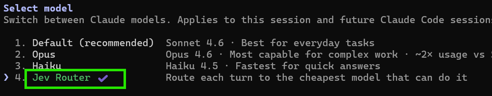
<b>🤖 <a href="https://github.com/gargpratyush/jev-router">gargpratyush/jev-router</a></b>
⭐673 · JavaScript · 🔎 inferred
وجّه إلى أرخص نموذج في claude code لمهمتك باستخدام jev-router
</td>
<td width="50%" valign="top">

<b>🛡️ <a href="https://github.com/dharmeshgurnani/codeotter">dharmeshgurnani/codeotter</a></b>
⭐4 · TypeScript · 👁️ observed
مراجعات شيفرة آلية ومستضافة ذاتيًا، ومقاييس تقييم معايرة، وبوابات دمج باستخدام أي نموذج مفتوح.
</td>
</tr>
<tr>
<td width="50%" valign="top">

<b>🧪 <a href="https://github.com/Mapika/decider">Mapika/decider</a></b>
⭐1035 · Python · 👁️ observed
عائلة من نماذج بأسلوب System One مضبوطة بدقة من Qwen3.5، مصممة لاتخاذ قرارات مطبوعة في تمريرة واحدة مع احتمالات مُعايرة.
</td>
<td width="50%" valign="top">

<b>🔬 <a href="https://github.com/r-ms/mini-jev">r-ms/mini-jev</a></b>
⭐64 · Python · 🔎 inferred
mini-Jev: كيف تبدو واجهة قرار مُنمّط بأسلوب Jev على Qwen3-4B مُجمّد — اقرأ logits لحرف الخيار بدلًا من توليد JSON. تجربة مسجّلة مسبقًا، ونتائج، ومنصة تعليمية.
</td>
</tr>
<tr>
<td width="50%" valign="top">

<b>🎮 <a href="https://github.com/MCG-NJU/VideoJev">MCG-NJU/VideoJev</a></b>
⭐317 · Python · 👁️ observed
VideoJev: System One Model لفهم الفيديو والتفاعل معه
</td>
<td width="50%" valign="top">
<b>📰 <a href="https://docs.typesafe.ai/model-jaggedness/jev-1.13">9 فئات من العيوب المعروفة (jaggedness)</a></b>
⭐0 · ✅ official
الفهم الحرفي، **العد غير موثوق**، مقارنة التواريخ، التوجيه غير المباشر متعدد المستويات، حالة كبيرة بتفاصيل غير ذات صلة، المحتوى العدائي، تعارض التعليمات مع المعايير،…
</td>
</tr>
</table>

## المحتويات

- [ما هو Jev؟](#ما-هو-jev)
- [كيف تُصنَّف المدخلات](#كيف-تصنف-المدخلات)
- [أدوات التطوير الرسمية (SDK)](#أدوات-التطوير-الرسمية-sdk) — **7**
- [عملاء وSDK ومحوّلات من المجتمع](#عملاء-وsdk-ومحولات-من-المجتمع) — **134**
- [أدوات الوكلاء: MCP والخطافات والبوابات ووكلاء البرمجة](#أدوات-الوكلاء-mcp-والخطافات-والبوابات-ووكلاء-البرمجة) — **251**
- [التوجيه وضوابط الحماية والموافقات](#التوجيه-وضوابط-الحماية-والموافقات) — **65**
- [التقييم والمعايرة والمقاييس المرجعية](#التقييم-والمعايرة-والمقاييس-المرجعية) — **84**
- [إعادة إنتاج مفتوحة وأوزان وبحوث في البنية](#إعادة-إنتاج-مفتوحة-وأوزان-وبحوث-في-البنية) — **55**
- [تطبيقات وألعاب وروبوتات وعروض تفاعلية](#تطبيقات-وألعاب-وروبوتات-وعروض-تفاعلية) — **45**
- [كتابات ونقاشات وقوائم مجاورة](#كتابات-ونقاشات-وقوائم-مجاورة) — **73**
- [مشاريع أخرى](#مشاريع-أخرى) — **89**
- [المشاريع حسب لغة التنفيذ](#المشاريع-حسب-لغة-التنفيذ)

## ما هو Jev؟

Jev هو أول **نموذج System One** من TypeSafe AI. لا يكتب نصوصًا إنشائية. يأخذ حالةً مع أسئلة تحدد أنت فضاء إجاباتها مسبقًا، ويعيد قيمًا مُنمَّطة مع توزيعات احتمالية يمكن لشيفرتك أن تتفرع عليها.

|                  |                                                                                                                                                        |
| ---------------- | ------------------------------------------------------------------------------------------------------------------------------------------------------ |
| **الشكل**        | `state + typed questions` → `constrained answers + probabilities` → `your code`                                                                        |
| **البدائيات**    | `Choice` (اختيار واحد من ≤255 خيارًا)، `Score` (معيار تقييم من 2 إلى 10)، `Noul` (نعم/لا احتمالية)                                                      |
| **نقطة النهاية** | `POST https://api.typesafe.ai/v1/systemone`، النموذج `jev-1.13.0` / الاسم البديل `jev-latest`                                                          |
| **مناسب لـ**     | التوجيه والفرز والتقييم والإشراف والتحقق والبوابات منخفضة الكمون داخل مسار عمل محدد                                                                    |
| **حدود معروفة**  | العدّ غير موثوق، والاستدلال متعدد المستويات ضعيف، وتذكر المواد الرسمية تسع فئات من التفاوت. مخرجات صحيحة وفق المخطط ليست قرارًا صحيحًا: عايِر على بياناتك. |

## كيف تُصنَّف المدخلات

معظم القوائم في هذا المجال تكتفي بتأكيد الإدراج. هذه تقول ما تحققت منه فعلًا، ثم تدعك تفلتر على هذا الأساس.

| الدرجة       | ما تعنيه                                                                                                                   |
| ------------ | -------------------------------------------------------------------------------------------------------------------------- |
| `official`   | منشور من TypeSafe AI نفسها.                                                                                                |
| `observed`   | أثر عام يمكن فتحه وقراءته: شيفرة مصدرية حقيقية، أو إعداد حقيقي، أو تصريح صريح بـ TypeSafe/Jev في اسم المستودع أو في وسومه. |
| `inferred`   | مطابقة على إشارة غامضة مع مفردات مؤيدة، لكن لم تُقرأ سطرًا بسطر بعد.                                                         |
| `unverified` | يبدو ذا صلة، ولم يتأكد شيء بشكل مستقل. مُدرَج للاستكشاف فقط.                                                                 |

## أدوات التطوير الرسمية (SDK)

كل ما تنشره TypeSafe نفسها. ابدأ من هنا.

🏛️ <b><a href="https://github.com/typesafe-ai/skills">typesafe-ai/skills</a></b> · ⭐2911 · ✅ official · 28 天

##### 📝 الوصف

مهارات الوكيل للبناء باستخدام TypeSafe System One API

> 💡 مهارات الوكيل الخاصة بالمورّد نفسه. وبما أنها تُحدَّث باستمرار، فهي أقرب ما يكون إلى مواصفة لكيفية اعتزام TypeSafe تشغيل Jev من وكيل.

##### 📌 معلومات أساسية

| الحقل  | القيمة                        |
| ------ | ----------------------------- |
| الفئة  | `أدوات التطوير الرسمية (SDK)` |
| الأدلة | `official`                    |

##### 📊 البيانات

| المقياس   | القيمة     |
| --------- | ---------- |
| النجوم    | **2911**   |
| آخر دفع   | 2026-10-23 |
| أول إدراج | 2026-09-18 |

🏛️ <b><a href="https://github.com/typesafe-ai/system-one-adapter-python">typesafe-ai/system-one-adapter-python</a></b> · ⭐410 · Python · ✅ official · 6 天

##### 📝 الوصف

بديل TypeSafeClient جاهز للاستخدام ومدعوم بـ LLM APIs

> 💡 بديل جاهز للاستخدام يدعم الواجهة نفسها عبر موفّر LLM عادي. هذه هي الطريقة الصادقة لإجراء اختبار A/B لقرار ذي أنواع مقابل موجه، باستخدام بياناتك الخاصة، قبل الالتزام بأيٍّ منهما.

🔧 وُجد مستخدمًا في الشيفرة: `README.md`

##### 📌 معلومات أساسية

| الحقل  | القيمة                        |
| ------ | ----------------------------- |
| الفئة  | `أدوات التطوير الرسمية (SDK)` |
| الأدلة | `official`                    |
| اللغة  | Python                        |

##### 📊 البيانات

| المقياس   | القيمة     |
| --------- | ---------- |
| النجوم    | **410**    |
| آخر دفع   | 2026-11-15 |
| أول إدراج | 2026-10-23 |

🏛️ <b><a href="https://github.com/typesafe-ai/typesafe-sdk-python">typesafe-ai/typesafe-sdk-python</a></b> · ⭐316 · Python · ✅ official · 10 天

##### 📝 الوصف

مكتبة Python الرسمية لـ TypeSafe API

> 💡 عملاء متزامنون وغير متزامنين. أسرع طريق من مفتاح API إلى قرار ذي أنواع، والمرجع الذي تُقارن به عملاء المجتمع.

🔧 وُجد مستخدمًا في الشيفرة: `README.md`

##### 📌 معلومات أساسية

| الحقل  | القيمة                        |
| ------ | ----------------------------- |
| الفئة  | `أدوات التطوير الرسمية (SDK)` |
| الأدلة | `official`                    |
| اللغة  | Python                        |

##### 📊 البيانات

| المقياس   | القيمة     |
| --------- | ---------- |
| النجوم    | **316**    |
| آخر دفع   | 2026-11-11 |
| أول إدراج | 2026-10-23 |

🏛️ <b><a href="https://github.com/typesafe-ai/typesafe-sdk-js">typesafe-ai/typesafe-sdk-js</a></b> · ⭐288 · TypeScript · ✅ official · 10 天

##### 📝 الوصف

مكتبة TypeScript/JavaScript الرسمية لـ TypeSafe API

> 💡 عميل TypeScript يستنتج فيه نوع الإجابة من السؤال الذي طرحته، بحيث يكون نوع الإرجاع غير المتطابق خطأً في الترجمة بدلاً من مفاجأة وقت التشغيل.

##### 📌 معلومات أساسية

| الحقل  | القيمة                        |
| ------ | ----------------------------- |
| الفئة  | `أدوات التطوير الرسمية (SDK)` |
| الأدلة | `official`                    |
| اللغة  | TypeScript                    |

##### 📊 البيانات

| المقياس   | القيمة     |
| --------- | ---------- |
| النجوم    | **288**    |
| آخر دفع   | 2026-11-11 |
| أول إدراج | 2026-10-23 |

🏛️ <b><a href="https://github.com/TypeSafeAI/jev-harness">TypeSafeAI/jev-harness</a></b> · ⭐40 · TypeScript · ✅ official · 4 天

##### 📝 الوصف

A custom coding harness for TypeSafe AI's Jev: an LLM proposes, Jev answers narrow questions, code decides, every step leaves a receipt.

##### 📌 معلومات أساسية

| الحقل  | القيمة                        |
| ------ | ----------------------------- |
| الفئة  | `أدوات التطوير الرسمية (SDK)` |
| الأدلة | `official`                    |
| اللغة  | TypeScript                    |

##### 📊 البيانات

| المقياس   | القيمة     |
| --------- | ---------- |
| النجوم    | **40**     |
| آخر دفع   | 2026-11-17 |
| أول إدراج | 2026-11-18 |

🏷 `agent-harness` · `agentic-coding` · `ai-agents` · `ai-governance` · `ai-safety` · `code-review` · `coding-agent` · `developer-tools`

🏛️ <b><a href="https://github.com/typesafe-ai/WorkflowEvals">typesafe-ai/WorkflowEvals</a></b> · ⭐21 · Python · ✅ official · 7 天

##### 📝 الوصف

نشر تعليمات برمجية لسير عمل evals.typesafe.ai

##### 📌 معلومات أساسية

| الحقل  | القيمة                        |
| ------ | ----------------------------- |
| الفئة  | `أدوات التطوير الرسمية (SDK)` |
| الأدلة | `official`                    |
| اللغة  | Python                        |

##### 📊 البيانات

| المقياس   | القيمة     |
| --------- | ---------- |
| النجوم    | **21**     |
| آخر دفع   | 2026-11-14 |
| أول إدراج | 2026-10-23 |

🏛️ <b><a href="https://github.com/typesafe-ai/typesafe-ai.github.io">typesafe-ai/typesafe-ai.github.io</a></b> · ⭐2 · HTML · ✅ official · 169 天

##### 📝 الوصف

لم يُنشر أي وصف من المستودع المصدر.

##### 📌 معلومات أساسية

| الحقل  | القيمة                        |
| ------ | ----------------------------- |
| الفئة  | `أدوات التطوير الرسمية (SDK)` |
| الأدلة | `official`                    |
| اللغة  | HTML                          |

##### 📊 البيانات

| المقياس   | القيمة     |
| --------- | ---------- |
| النجوم    | **2**      |
| آخر دفع   | 2026-06-04 |
| أول إدراج | 2026-10-23 |

## عملاء وSDK ومحوّلات من المجتمع

عملاء مُنمَّطون (typed) لنقطة نهاية System One، بالعدد من اللغات الذي بلغه المجتمع.

🧰 <b><a href="https://github.com/realZachi/pg-jev">realZachi/pg-jev</a></b> · ⭐1316 · Shell · 👁️ observed · 45 天 · ⭐+1

##### 📝 الوصف

اطرح أسئلة باللغة الطبيعية على جداول Postgres. إضافة PostgreSQL مدعومة بـ Jev الخاص بـ TypeSafe.

🔧 وُجد مستخدمًا في الشيفرة: `README.md`

##### 📌 معلومات أساسية

| الحقل  | القيمة                          |
| ------ | ------------------------------- |
| الفئة  | `عملاء وSDK ومحوّلات من المجتمع` |
| الأدلة | `observed`                      |
| اللغة  | Shell                           |

##### 📊 البيانات

| المقياس   | القيمة        |
| --------- | ------------- |
| النجوم    | **1316** (+1) |
| آخر دفع   | 2026-10-06    |
| أول إدراج | 2026-10-29    |

🧰 <b><a href="https://github.com/jexp/neo4jev">jexp/neo4jev</a></b> · ⭐189 · Jupyter · 👁️ observed · 64 天

##### 📝 الوصف

‏Typesafe.ai System One Model Jev يتنقّل في رسم بياني Neo4j باستخدام مصنّف للعلاقات المجاورة

##### 📌 معلومات أساسية

| الحقل  | القيمة                          |
| ------ | ------------------------------- |
| الفئة  | `عملاء وSDK ومحوّلات من المجتمع` |
| الأدلة | `observed`                      |
| اللغة  | Jupyter                         |

##### 📊 البيانات

| المقياس   | القيمة     |
| --------- | ---------- |
| النجوم    | **189**    |
| آخر دفع   | 2026-09-18 |
| أول إدراج | 2026-10-28 |

🧰 <b><a href="https://github.com/keltokhy/jgrep">keltokhy/jgrep</a></b> · ⭐141 · Python · 👁️ observed · 35 天

##### 📝 الوصف

grep، لكن النمط عبارة عن وصف. يرشّح الأسطر حسب المعنى باستخدام نموذج القرار TypeSafe Jev: نحو 200 مللي ثانية وجزء من الألف من السنت لكل سطر.

🔧 وُجد مستخدمًا في الشيفرة: `README.md`

##### 📌 معلومات أساسية

| الحقل  | القيمة                          |
| ------ | ------------------------------- |
| الفئة  | `عملاء وSDK ومحوّلات من المجتمع` |
| الأدلة | `observed`                      |
| اللغة  | Python                          |

##### 📊 البيانات

| المقياس   | القيمة     |
| --------- | ---------- |
| النجوم    | **141**    |
| آخر دفع   | 2026-10-17 |
| أول إدراج | 2026-10-29 |

🏷 `cli` · `grep` · `jev` · `openrouter` · `semantic-search` · `typesafe`

🧰 <b><a href="https://github.com/qkal/Canny">qkal/Canny</a></b> · ⭐135 · TypeScript · 👁️ observed · 8 天

##### 📝 الوصف

يمنع وكلاء البرمجة بالذكاء الاصطناعي من الادعاء بإتمام العمل دون دليل. تقرر الخطافات الحتمية، وتقدّم TypeSafe Jev المشورة. سجل لا يسمح إلا بالإضافة، ومن دون تبعيات وقت تشغيل.

🔧 وُجد مستخدمًا في الشيفرة: `README.md`

##### 📌 معلومات أساسية

| الحقل  | القيمة                          |
| ------ | ------------------------------- |
| الفئة  | `عملاء وSDK ومحوّلات من المجتمع` |
| الأدلة | `observed`                      |
| اللغة  | TypeScript                      |

##### 📊 البيانات

| المقياس   | القيمة     |
| --------- | ---------- |
| النجوم    | **135**    |
| آخر دفع   | 2026-11-13 |
| أول إدراج | 2026-10-29 |

🏷 `agent-hooks` · `ai-agents` · `claude-code` · `claude-code-hooks` · `codex` · `codex-cli` · `guardrails` · `jev`

🧰 <b><a href="https://github.com/john-rocky/coreai-kit">john-rocky/coreai-kit</a></b> · ⭐126 · Swift · 👁️ observed · 5 天

##### 📝 الوصف

Swift SDK لتشغيل نماذج الدردشة والرؤية والكلام على iPhone وMac باستخدام Core AI من Apple. تنزيل النماذج وتخزينها مؤقتًا، والتكامل مع FoundationModels، وأمثلة قابلة للتشغيل مع توثيق متطلبات نظام التشغيل وSDK والنموذج.

🔧 وُجد مستخدمًا في الشيفرة: `Sources/CoreAIOps/CoreAI+SystemOne.swift`

##### 📌 معلومات أساسية

| الحقل  | القيمة                          |
| ------ | ------------------------------- |
| الفئة  | `عملاء وSDK ومحوّلات من المجتمع` |
| الأدلة | `observed`                      |
| اللغة  | Swift                           |

##### 📊 البيانات

| المقياس   | القيمة     |
| --------- | ---------- |
| النجوم    | **126**    |
| آخر دفع   | 2026-11-16 |
| أول إدراج | 2026-10-26 |

🏷 `apple` · `apple-core-ai` · `asr` · `core-ai` · `coreai` · `foundation-models` · `ios` · `ios-27`

---

<table><tr><th align="center" width="50%">🖼 صورة</th><th align="center" width="50%">🎬 فيديو</th></tr><tr>
<td align="center" valign="top"></td>
<td align="center" valign="top"> تسجيل متحرك</td>
</tr></table>

🧰 <b><a href="https://github.com/AkashPriyadarshii/jev-curate">AkashPriyadarshii/jev-curate</a></b> · ⭐115 · Rust · 👁️ observed · 10 天

##### 📝 الوصف

High-throughput synthetic and pretraining dataset sifter for TypeSafe Jev. Rust streaming core, Parquet and JSONL I/O, typed Choice/Score/Noul judgments, speculative fan-out, 24.0 rows/sec measured.

🔧 وُجد مستخدمًا في الشيفرة: `AGENTS.md`, `site/llms.txt`, `docs/DESIGN.md`

##### 📌 معلومات أساسية

| الحقل  | القيمة                          |
| ------ | ------------------------------- |
| الفئة  | `عملاء وSDK ومحوّلات من المجتمع` |
| الأدلة | `observed`                      |
| اللغة  | Rust                            |

##### 📊 البيانات

| المقياس   | القيمة     |
| --------- | ---------- |
| النجوم    | **115**    |
| آخر دفع   | 2026-11-11 |
| أول إدراج | 2026-11-05 |

🏷 `arrow` · `cli` · `data-cleaning` · `data-engineering` · `dataset-curation` · `eval-harness` · `fine-tuning` · `jev`

🧰 <b><a href="https://github.com/obie/ruby_decision_model">obie/ruby_decision_model</a></b> · ⭐61 · Ruby · 👁️ observed · 39 天

##### 📝 الوصف

عميل Ruby لنماذج القرار مثل Typesafe Jev

🔧 وُجد مستخدمًا في الشيفرة: `README.md`

##### 📌 معلومات أساسية

| الحقل  | القيمة                          |
| ------ | ------------------------------- |
| الفئة  | `عملاء وSDK ومحوّلات من المجتمع` |
| الأدلة | `observed`                      |
| اللغة  | Ruby                            |

##### 📊 البيانات

| المقياس   | القيمة     |
| --------- | ---------- |
| النجوم    | **61**     |
| آخر دفع   | 2026-10-12 |
| أول إدراج | 2026-10-29 |

🧰 <b><a href="https://github.com/bodepudimuneendra-netizen/ConsciousDB">bodepudimuneendra-netizen/ConsciousDB</a></b> · ⭐56 · Python · 👁️ observed · 19 天

##### 📝 الوصف

إطار عمل Agentic GraphRAG غير مرتبط بقاعدة بيانات محددة يستخدم نماذج System One قابلة للتبديل (Laya محلي / Jev سحابي). طبقة ذكاء قابلة للتوصيل والتشغيل تضم خط أنابيب كاملًا من 4 مراحل، وتقييمًا مستمرًا، واجتياز A* مخصصًا لأي قاعدة بيانات رسومية.

##### 📌 معلومات أساسية

| الحقل  | القيمة                          |
| ------ | ------------------------------- |
| الفئة  | `عملاء وSDK ومحوّلات من المجتمع` |
| الأدلة | `observed`                      |
| اللغة  | Python                          |

##### 📊 البيانات

| المقياس   | القيمة     |
| --------- | ---------- |
| النجوم    | **56**     |
| آخر دفع   | 2026-11-02 |
| أول إدراج | 2026-11-20 |

🏷 `astar-algorithm` · `eval-harness` · `fine-tuning` · `graphdatabase` · `graprag` · `jev` · `laya` · `neo4j`

🧰 <b><a href="https://github.com/AkashPriyadarshii/jev-superpowers">AkashPriyadarshii/jev-superpowers</a></b> · ⭐40 · HTML · 👁️ observed · 43 天

##### 📝 الوصف

Systematic software development framework for AI coding agents upgraded with TypeSafe Jev System One typed decisions

🔧 وُجد مستخدمًا في الشيفرة: `CLAUDE.md`

##### 📌 معلومات أساسية

| الحقل  | القيمة                          |
| ------ | ------------------------------- |
| الفئة  | `عملاء وSDK ومحوّلات من المجتمع` |
| الأدلة | `observed`                      |
| اللغة  | HTML                            |

##### 📊 البيانات

| المقياس   | القيمة     |
| --------- | ---------- |
| النجوم    | **40**     |
| آخر دفع   | 2026-10-08 |
| أول إدراج | 2026-11-05 |

🏷 `agentic-skills` · `ai-agents` · `antigravity` · `claude-code` · `codex` · `coding-agents` · `cursor` · `developer-tools`

🧰 <b><a href="https://github.com/MrJev/awesome-jev">MrJev/awesome-jev</a></b> · ⭐21 · Python · 👁️ observed · 0 天

##### 📝 الوصف

قائمة مختارة من المشاريع والتكاملات والموارد الخاصة بـ Jev، نموذج System One الخاص بـ TypeSafe AI.

##### 📌 معلومات أساسية

| الحقل  | القيمة                          |
| ------ | ------------------------------- |
| الفئة  | `عملاء وSDK ومحوّلات من المجتمع` |
| الأدلة | `observed`                      |
| اللغة  | Python                          |

##### 📊 البيانات

| المقياس   | القيمة     |
| --------- | ---------- |
| النجوم    | **21**     |
| آخر دفع   | 2026-11-21 |
| أول إدراج | 2026-09-18 |

🏷 `ai-agents` · `awesome` · `awesome-list` · `jev` · `mcp` · `typesafe`

🧰 <b><a href="https://github.com/ckaraca/awesome-jev">ckaraca/awesome-jev</a></b> · ⭐18 · Python · 👁️ observed · 5 天

##### 📝 الوصف

قائمة منتقاة بالأدوات والتكاملات والتجارب المبنية على Jev، نموذج System One الخاص بـ TypeSafe AI لاتخاذ قرارات سريعة مكتوبة الأنواع.

##### 📌 معلومات أساسية

| الحقل  | القيمة                          |
| ------ | ------------------------------- |
| الفئة  | `عملاء وSDK ومحوّلات من المجتمع` |
| الأدلة | `observed`                      |
| اللغة  | Python                          |

##### 📊 البيانات

| المقياس   | القيمة     |
| --------- | ---------- |
| النجوم    | **18**     |
| آخر دفع   | 2026-11-16 |
| أول إدراج | 2026-09-19 |

🏷 `ai-agents` · `awesome` · `awesome-list` · `computer-use` · `jev` · `llm` · `system-one` · `typesafe`

🧰 <b><a href="https://github.com/Premo-Cloud/typesafe-sdk-java">Premo-Cloud/typesafe-sdk-java</a></b> · ⭐12 · Java · 👁️ observed · 30 天

##### 📝 الوصف

Java SDK مجتمعي لـ Jev، نموذج System One الخاص بـ TypeSafe: أسئلة مكتوبة الأنواع ومدخلات، وإجابات مكتوبة الأنواع مع احتمالات مُعايرة كمخرجات. Java 17+، وبدء تشغيل Spring Boot (غير رسمي)

##### 📌 معلومات أساسية

| الحقل  | القيمة                          |
| ------ | ------------------------------- |
| الفئة  | `عملاء وSDK ومحوّلات من المجتمع` |
| الأدلة | `observed`                      |
| اللغة  | Java                            |

##### 📊 البيانات

| المقياس   | القيمة     |
| --------- | ---------- |
| النجوم    | **12**     |
| آخر دفع   | 2026-10-21 |
| أول إدراج | 2026-10-28 |

🏷 `java` · `jev` · `sdk` · `spring-boot` · `system-one` · `system-one-models` · `typesafe`

🧰 <b><a href="https://github.com/clouatre-labs/decisions-judge-mcp">clouatre-labs/decisions-judge-mcp</a></b> · ⭐5 · JavaScript · 👁️ observed · 0 天

##### 📝 الوصف

قرارات مكتوبة النوع لوكلاء الذكاء الاصطناعي بوصفها أداة MCP: احتمال نعم/لا (noul)، واختيار، ودرجة في طلب سريع واحد. مدعومة بنموذج System One TypeSafe.

##### 📌 معلومات أساسية

| الحقل  | القيمة                          |
| ------ | ------------------------------- |
| الفئة  | `عملاء وSDK ومحوّلات من المجتمع` |
| الأدلة | `observed`                      |
| اللغة  | JavaScript                      |

##### 📊 البيانات

| المقياس   | القيمة     |
| --------- | ---------- |
| النجوم    | **5**      |
| آخر دفع   | 2026-11-21 |
| أول إدراج | 2026-10-12 |

🏷 `agent` · `ai` · `cli` · `decision-making` · `decisions` · `judge` · `llm` · `mcp`

---

<table><tr><th align="center" width="50%">🖼 صورة</th><th align="center" width="50%">🎬 فيديو</th></tr><tr>
<td align="center" valign="top"></td>
<td align="center" valign="top"> تسجيل متحرك</td>
</tr></table>

🧰 <b><a href="https://github.com/elbruno/ElBruno.AI.Decisions">elbruno/ElBruno.AI.Decisions</a></b> · ⭐5 · C# · 👁️ observed · 1 天

##### 📝 الوصف

.NET 10 decision SDK: Choose, Score, and Assess with Microsoft Foundry (Microsoft-Decision-1), native local Ollama System One models, and TypeSafe AI Jev. One API, probabilities instead of paragraphs.

##### 📌 معلومات أساسية

| الحقل  | القيمة                          |
| ------ | ------------------------------- |
| الفئة  | `عملاء وSDK ومحوّلات من المجتمع` |
| الأدلة | `observed`                      |
| اللغة  | C#                              |

##### 📊 البيانات

| المقياس   | القيمة     |
| --------- | ---------- |
| النجوم    | **5**      |
| آخر دفع   | 2026-11-19 |
| أول إدراج | 2026-11-18 |

🏷 `dotnet` · `dotnet10` · `jev` · `microsoft-extensions-ai` · `nuget`

---

<table><tr><th align="center" width="50%">🖼 صورة</th><th align="center" width="50%">🎬 فيديو</th></tr><tr>
<td align="center" valign="top"></td>
<td align="center" valign="top">لا وسائط منشورة</td>
</tr></table>

🧰 <b><a href="https://github.com/Bonzokoles/36_chambers">Bonzokoles/36_chambers</a></b> · Python · 👁️ observed · 29 天

##### 📝 الوصف

محرك موحّد لاسترجاع المعرفة لوكلاء الذكاء الاصطناعي. يوجّه الاستعلامات عبر خلفيات متخصصة (FTS5 وChromaDB والرسم البياني) من خلال منسّق يضع السجل أولًا، مع توجيه ذكاء اصطناعي TypeSafe/Jev وإعادة ترتيب الأدلة. للقراءة فقط افتراضيًا، ومصمم بأمان محكوم.

##### 📌 معلومات أساسية

| الحقل  | القيمة                          |
| ------ | ------------------------------- |
| الفئة  | `عملاء وSDK ومحوّلات من المجتمع` |
| الأدلة | `observed`                      |
| اللغة  | Python                          |

##### 📊 البيانات

| المقياس   | القيمة     |
| --------- | ---------- |
| النجوم    | **0**      |
| آخر دفع   | 2026-10-22 |
| أول إدراج | 2026-10-23 |

🏷 `ai-agents` · `ai-infrastructure` · `chromadb` · `embeddings` · `federated-search` · `fts5` · `information-retrieval` · `jev`

---

<table><tr><th align="center" width="50%">🖼 صورة</th><th align="center" width="50%">🎬 فيديو</th></tr><tr>
<td align="center" valign="top"></td>
<td align="center" valign="top">لا وسائط منشورة</td>
</tr></table>

الأصل مرتبط مباشرة من المستودع المصدر لأنه لم تُعلَن أي رخصة تسمح بإعادة التوزيع.

🧰 <b><a href="https://github.com/dzhng/jevgrep">dzhng/jevgrep</a></b> · ⭐3258 · TypeScript · 🔎 inferred · 8 天

##### 📝 الوصف

اعثر على الكود عبر السؤال عمّا يفعله. CLI لوكلاء البرمجة يستخدم Jev لاكتشاف الملفات ذات الصلة وسياق المصدر.

##### 📌 معلومات أساسية

| الحقل  | القيمة                          |
| ------ | ------------------------------- |
| الفئة  | `عملاء وSDK ومحوّلات من المجتمع` |
| الأدلة | `inferred`                      |
| اللغة  | TypeScript                      |

##### 📊 البيانات

| المقياس   | القيمة     |
| --------- | ---------- |
| النجوم    | **3258**   |
| آخر دفع   | 2026-11-12 |
| أول إدراج | 2026-11-07 |

🏷 `ai-sdk` · `claude-code` · `cli` · `code-search` · `codex` · `coding-agents` · `context-retrieval` · `developer-tools`

---

<table><tr><th align="center" width="50%">🖼 صورة</th><th align="center" width="50%">🎬 فيديو</th></tr><tr>
<td align="center" valign="top">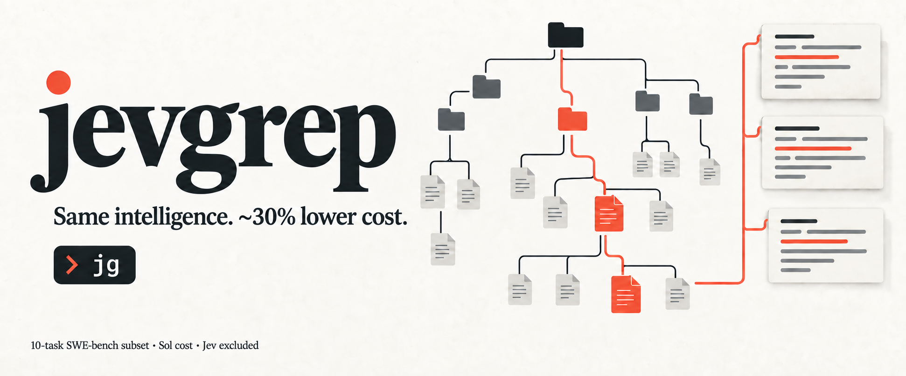</td>
<td align="center" valign="top">لا وسائط منشورة</td>
</tr></table>

🧰 <b><a href="https://github.com/supercorp-ai/supercov">supercorp-ai/supercov</a></b> · ⭐167 · Rust · 🔎 inferred · 0 天

##### 📝 الوصف

Coverage for coding agents

> 💡 أحكام جودة التعليمات البرمجية والتغطية المُنتجة كقرارات ذات أنواع بدلاً من نصوص نثرية، بحيث يمكن للنتيجة التحكم مباشرةً في مسار العمل.

##### 📌 معلومات أساسية

| الحقل  | القيمة                          |
| ------ | ------------------------------- |
| الفئة  | `عملاء وSDK ومحوّلات من المجتمع` |
| الأدلة | `inferred`                      |
| اللغة  | Rust                            |

##### 📊 البيانات

| المقياس   | القيمة     |
| --------- | ---------- |
| النجوم    | **167**    |
| آخر دفع   | 2026-11-21 |
| أول إدراج | 2026-10-23 |

🏷 `agent-skills` · `claude-code` · `code-coverage` · `code-quality` · `codex` · `coding-agents` · `coverage` · `gemini-cli-extension`

---

<table><tr><th align="center" width="50%">🖼 صورة</th><th align="center" width="50%">🎬 فيديو</th></tr><tr>
<td align="center" valign="top"></td>
<td align="center" valign="top">لا وسائط منشورة</td>
</tr></table>

🧰 <b><a href="https://github.com/AkashPriyadarshii/jev-seo">AkashPriyadarshii/jev-seo</a></b> · ⭐106 · Rust · 🔎 inferred · 10 天

##### 📝 الوصف

Free Rust SEO and GEO toolkit powered by TypeSafe Jev: 58-rule audits, site crawls, AI citation checks, rank drift, CI gates, 15-tool MCP. Zero cost.

##### 📌 معلومات أساسية

| الحقل  | القيمة                          |
| ------ | ------------------------------- |
| الفئة  | `عملاء وSDK ومحوّلات من المجتمع` |
| الأدلة | `inferred`                      |
| اللغة  | Rust                            |

##### 📊 البيانات

| المقياس   | القيمة     |
| --------- | ---------- |
| النجوم    | **106**    |
| آخر دفع   | 2026-11-11 |
| أول إدراج | 2026-11-05 |

🏷 `ahrefs-alternative` · `answer-engine-optimization` · `claude-code` · `cli` · `coding-agents` · `generative-engine-optimization` · `geo` · `jev`

---

<table><tr><th align="center" width="50%">🖼 صورة</th><th align="center" width="50%">🎬 فيديو</th></tr><tr>
<td align="center" valign="top"></td>
<td align="center" valign="top">لا وسائط منشورة</td>
</tr></table>

<b>المزيد في هذه الفئة</b> · 116

- [PromtEngineer/jev-harness](https://github.com/PromtEngineer/jev-harness) - إطار تشغيل لوكيل Pi مبني حول Jev الخاص بـTypeSafe (نموذج System One): موجّه،…
- [xingwudao/OpenJev](https://github.com/xingwudao/OpenJev) - OpenJev: قرار API مستقل مستوحى من Jev وSystem One، قائم على مفاهيم TypeSafe.ai.
- [danieleteti/systemone-delphi](https://github.com/danieleteti/systemone-delphi) - Delphi client for System One models (Jev, tev1 and nimble on Ollama): ask typed…
- [GitHub30/OpenJev](https://github.com/GitHub30/OpenJev) - نموذج System One مفتوح الأوزان (متوافق مع Jev): قرارات noul / الاختيار /…
- [chussenot/judgment](https://github.com/chussenot/judgment) - أحكام مكتوبة ومعايرة من نماذج System One: قرار مكتوب كملف .jud أو كأنواع Rust،…
- [CMaintz/jev-dotnet](https://github.com/CMaintz/jev-dotnet) - غلاف .NET غير رسمي لـSDK لنموذج Jev System One الخاص بـTypeSafe AI.
- [erik-hedstrom/loadout](https://github.com/erik-hedstrom/loadout) - اختر النموذج والمهارات وخوادم MCP لكل جلسة وكيل برمجة من مكتبة بأي حجم، مع…
- [jqueryscript/awesome-jev](https://github.com/jqueryscript/awesome-jev) - A curated list of TypeSafe Jev resources, SDKs, agents, MCP servers…
- [basi/typesafe-ai-php-client](https://github.com/basi/typesafe-ai-php-client) - PHP client for the typesafe.ai System One API (Jev).
- [CMaintz/jev-java](https://github.com/CMaintz/jev-java) - Java SDK غير رسمي لنموذج System One الخاص بـTypeSafe AI Jev.
- [gajaguar/typesafe-cli](https://github.com/gajaguar/typesafe-cli) - Unofficial command-line interface for TypeSafe AI System One models, on…
- [JosephHardy91/graph-composition-with-dLLMs](https://github.com/JosephHardy91/graph-composition-with-dLLMs) - A Graph-Compiled Specification RAG system built with **Dagster**, **PostgreSQL…
- [romain-cll/reflex-rag](https://github.com/romain-cll/reflex-rag) - A retrieval loop judged by a system-one model (Jev) instead of an LLM.
- [sanketmuchhala/jevgate](https://github.com/sanketmuchhala/jevgate) - Calibrated policy triage and institutional risk routing: a hybrid…
- [ollaya-dev/ollaya](https://github.com/ollaya-dev/ollaya) - Jev-compatible API server for open decision models.
- [juspay/neurolink](https://github.com/juspay/neurolink) - طبقة الأنابيب في الجهاز العصبي للذكاء الاصطناعي — واجهة واحدة تصل عصبونات…
- [aaddrick/building-with-typesafe-jev](https://github.com/aaddrick/building-with-typesafe-jev) - مهارة غير رسمية تُعلّم وكلاء البرمجة البناء باستخدام TypeSafe AI Jev: قرارات…
- [Ying-Kai-Liao/jev-browser](https://github.com/Ying-Kai-Liao/jev-browser) - أتمتة المتصفح حيث يخطط LLM ويقرر Jev (Typesafe System One).
- [fazlerocks/jevmail](https://github.com/fazlerocks/jevmail) - فرز بريد إلكتروني بالذكاء الاصطناعي مفتوح المصدر لـ Gmail.
- [yzfly/awesome-jev-zh](https://github.com/yzfly/awesome-jev-zh) - قائمة مختارة باللغة الصينية لـ Jev / TypeSafe System One: مواد رسمية، SDK،…
- [AboveColin/HA-Jev](https://github.com/AboveColin/HA-Jev) - اطرح سؤالًا على منزلك، واستلم رقمًا. تكامل Home Assistant مع TypeSafe Jev…
- [sharziki/semdecide](https://github.com/sharziki/semdecide) - قرارات دلالية ذات أنواع لخطوط أنابيب Unix وCI، مدعومة بـ TypeSafe AI Jev.
- [bladedevoff/stuntd](https://github.com/bladedevoff/stuntd) - وكيل محلي يتعلم قرارات LLM ذات النوع في تطبيقك ويجيب عنها برأس Laya.
- [burnigtm/jev-mcp](https://github.com/burnigtm/jev-mcp) - خادم MCP يضع TypeSafe Jev ضمن حلقة البرمجة في Cursor وCodex وأي عميل MCP.
- [mlimarenko/IronRAG](https://github.com/mlimarenko/IronRAG) - One-click knowledge system for documents, internal bots, and AI agents.
- [shaharia-lab/jev-cli](https://github.com/shaharia-lab/jev-cli) - أداة لسطر الأوامر لنموذج Jev الخاص بـ TypeSafe AI.
- [mattn/go-jev](https://github.com/mattn/go-jev) - Go SDK and CLI for TypeSafe Jev: typed decisions (yes/no, choice, score) from a…
- [Eliot5566/JEV-Paper-Radar](https://github.com/Eliot5566/JEV-Paper-Radar) - Turn research interests or paper links into a ranked reading list in Claude.
- [dannote/jev](https://github.com/dannote/jev) - TypeSafe Jev لـ OTP: الرد على Jev من GenServer ومطابقة النمط مع إجابته.
- [DevLoops-ai/unified-brain](https://github.com/DevLoops-ai/unified-brain) - System One coding agents: code-level answers in about 10secs for under 2 cents.
- [jwuthri-cloud/SelfJev](https://github.com/jwuthri-cloud/SelfJev) - Self-hosted decision model (selfjev-4b) with a Jev-compatible API: Python SDK…
- [jiangkoumo/ego-decision-layer](https://github.com/jiangkoumo/ego-decision-layer) - Pluggable decision layer for the ego lite browser: one System One (Jev) call…
- [thusinh1969/BrighTO_Router](https://github.com/thusinh1969/BrighTO_Router) - BrighTO LLM Router: free open-source, ultra-fast Rust LLM gateway/router and…
- [arjun988/Kev](https://github.com/arjun988/Kev) - محرك قرارات System One مفتوح المصدر. choice / score / noul ذات أنواع مع…
- [Ray-Hughes/jevalyn](https://github.com/Ray-Hughes/jevalyn) - طبقة اتخاذ القرار لتطبيق Rails الخاص بك.
- [CheshiAI/Cheshi](https://github.com/CheshiAI/Cheshi) - Jev-powered conversation memory: find past sessions and revisit decisions with…
- [nouli-ai/nouli](https://github.com/nouli-ai/nouli) - Decision Agent Engine.
- [tontoko/jev-browser](https://github.com/tontoko/jev-browser) - نواة Jev/Playwright موحّدة: SDK مكتوبة الأنواع، وCLI مستمرة، وخادم MCP مع…
- [pambrose/jev4k](https://github.com/pambrose/jev4k) - A Kotlin Multiplatform DSL and client for TypeSafe.
- [saibimajdi/typesafeai-dotnet-sdk](https://github.com/saibimajdi/typesafeai-dotnet-sdk) - SDK مجتمعي لـ .NET من أجل TypeSafe AI System One API — أسئلة noul والاختيار…
- [Elue-dev/jev_elixir](https://github.com/Elue-dev/jev_elixir) - jev_elixir هي واجهة صغيرة وأسلوبية لاتخاذ قرارات ذات أنواع باستخدام Jev.
- [himomohi/aside-jev](https://github.com/himomohi/aside-jev) - تتخذ وكلاء Aside قراراتهم باستخدام TypeSafe Jev.
- [rcarmo/go-system-one](https://github.com/rcarmo/go-system-one) - when a gopher met Jev.
- [haileyok/typesafe-client](https://github.com/haileyok/typesafe-client) - عملاء غير رسميين لـ Go وRust لـ TypeSafe AI System One API (Jev).
- [replynodes/jev-web-analyzer](https://github.com/replynodes/jev-web-analyzer) - See what Jev thinks about your SaaS website — powered by ReplyNodes web context…
- [sumleo/prompt2jev](https://github.com/sumleo/prompt2jev) - مهارة وكيل وCLI يحوّلان اللغة الطبيعية أو موجه LLM أو التعليمات البرمجية التي…
- [AIAnytime/Jev-Router](https://github.com/AIAnytime/Jev-Router) - Decision-first, OpenAI-compatible AI router powered by Jev typed decisions.
- [chenrui333/jev-docs](https://github.com/chenrui333/jev-docs) - سجل تاريخي تديره جهات المجتمع لـ Jev / TypeSafe System One APIs، وSDKs،…
- [devbackend/jevgo](https://github.com/devbackend/jevgo) - عميل Go غير رسمي لـ TypeSafe AI System One API (Jev) — أدخل أسئلة مكتوبة…
- [docxology/daf-jev](https://github.com/docxology/daf-jev) - daf-jev: مجموعة أدوات Python قابلة للتركيب لـ Jev الخاص بـ TypeSafe، وAPI…
- [Jev-Engineering/TypeWright](https://github.com/Jev-Engineering/TypeWright) - أعلن قرارًا، واجمع أسئلة Jev مكتوبة، وقِسها، واشحن برنامج JSON.
- [Kadihx/jev-x-kit](https://github.com/Kadihx/jev-x-kit) - طبقة قرارات غير متصلة بتكلفة $0 لوكلاء البرمجة: بدائيات Choice/Score/Noul،…
- [akiiwa-games/AgentCompass](https://github.com/akiiwa-games/AgentCompass) - Deterministic multi-agent task router &amp; subscription quota scheduler for Claude…
- [docwilde/doxa](https://github.com/docwilde/doxa) - ΔΟΞΑ is a Rust multi-agent terminal for Claude, Codex, Gemini via Google…
- [illescasDaniel/jev-mem](https://github.com/illescasDaniel/jev-mem) - Long-term memory for AI agents driven by Jev (System One) decisions: no…
- [JimmyWesley/rlcd-gateway](https://github.com/JimmyWesley/rlcd-gateway) - بوابة مستضافة ذاتياً لـ LLMs ونماذج القرار.
- [PAI-CUHK/SLEEPJEV](https://github.com/PAI-CUHK/SLEEPJEV) - قرارات وقت تشغيل ذات أنواع مستوحاة من JEV عبر PSG طويل الأفق: ترميز ليلي قابل…
- [zhirschtritt/typesafe-go](https://github.com/zhirschtritt/typesafe-go) - Go SDK اصطلاحي لـ TypeSafe AI API.
- [AboveColin/jevclient](https://github.com/AboveColin/jevclient) - عميل Python غير متزامن لـTypeSafe Jev.
- [Butochnikov/laravel-typesafe-jev](https://github.com/Butochnikov/laravel-typesafe-jev) - تكامل Laravel غير رسمي مع TypeSafe Jev AI، مع استجابات ذات أنواع، وطلبات غير…
- [coo-quack/jev-pii-checker](https://github.com/coo-quack/jev-pii-checker) - CLI يعثر على PII في النص باستخدام TypeSafe Jev: الوجود، والحساسية، والمقاطع…
- [frodi-karlsson/onesie](https://github.com/frodi-karlsson/onesie) - Gate scripts and CI on fast, calibrated System One judgments like Jev: a score…
- [Lasimeri/Mechanical-Jev](https://github.com/Lasimeri/Mechanical-Jev) - جانب طرح الأسئلة في Jev (TypeSafe System One: noul وchoice وscore) في Rust…
- [nshkrdotcom/system_one_sdk](https://github.com/nshkrdotcom/system_one_sdk) - Elixir/BEAM SDK محايد تجاه المزوّد لدلالات System One: Noul معرّفة نوعيًا،…
- [zerone-agents/jev-model-router](https://github.com/zerone-agents/jev-model-router) - توجيه خفيف الوزن للنماذج للوكلاء، مع توافق OpenAI وAnthropic API، واختيار…
- [abhisheksharma001/jev-skill](https://github.com/abhisheksharma001/jev-skill) - Agent skill for TypeSafe AI.
- [dsaad68/fuzzy-jev](https://github.com/dsaad68/fuzzy-jev) - A client for OpenRouter&#x27;s decision models, TypeSafe&#x27;s Jev by default: typed…
- [getmissionctrl/hs-jev](https://github.com/getmissionctrl/hs-jev) - عميل Haskell لقرار API الخاص بـTypeSafe System One (Jev) — Choice/Score/Noul…
- [JawzoD3TH/JevApi](https://github.com/JawzoD3TH/JevApi) - JevApi — MCP, Api Client Library and Test Harness for Jev.
- [minorun365/jev-cloud-quiz](https://github.com/minorun365/jev-cloud-quiz) - 三大クラウドの機能名を、TypeSafe AI の System One モデル Jev が確率つきで判定するデモ.
- [NerdishShah/playwright-cli-jev-bakeoff](https://github.com/NerdishShah/playwright-cli-jev-bakeoff) - مقارنة: Playwright CLI مقابل CLI+Jev مقابل Playwright MCP.
- [bitranox/btx-skill-jev-judge](https://github.com/bitranox/btx-skill-jev-judge) - Claude Code plugin and Python CLI: hand a judgment repeated over many items to…
- [Hyper-AI-Lab/openclaw-jev](https://github.com/Hyper-AI-Lab/openclaw-jev) - مستوى تحكم إنتاجي لوكلاء OpenClaw: توجيه الإدخال باستخدام Jev، وتنسيق Temporal،…
- [milojarow/jev-skills](https://github.com/milojarow/jev-skills) - Jev (TypeSafe System One) skill and CLI for coding agents: when to use typed…
- [MrKyaw/CognitiveMirror-Jev-MCP](https://github.com/MrKyaw/CognitiveMirror-Jev-MCP) - Cognitive middleware for personal and enterprise AI agents: 14 MCP tools and a…
- [Talya1412/jev-harness](https://github.com/Talya1412/jev-harness) - TypeSafe Jev (System One) integrations for OMP, MCP, Claude Code, and Pi…
- [vijaycinn/el-jev](https://github.com/vijaycinn/el-jev) - High-speed System One decision sidecar &amp; Copilot CLI pre-turn hook powered by…
- [Wrenik/Jev-toolkit-Compiler](https://github.com/Wrenik/Jev-toolkit-Compiler) - Context log, search and a compact/clear advisor for Claude Code.
- [abirshhishirroy/mini-jev](https://github.com/abirshhishirroy/mini-jev) - A custom Jev-style decision model built from scratch on Qwen2.5-3B.
- [arthurcolle/jev-pivot-lab](https://github.com/arthurcolle/jev-pivot-lab) - Jev-routed sub-executor: answers a prompt on the cheapest model and reasoning…
- [AsgardMuninn/jev-norma](https://github.com/AsgardMuninn/jev-norma) - فرز معياري لأمريكا اللاتينية مع Jev (System One) كبوابة: يطبّع بنود سياسات…
- [CMaintz/jev-tools](https://github.com/CMaintz/jev-tools) - أدوات TypeScript مبنية على Jev الخاص بـTypeSafe AI: حاجز أمان لاستدعاءات أدوات…
- [codebam/jev-guardrails](https://github.com/codebam/jev-guardrails) - حواجز أمان مدعومة بـJev لاستدعاءات أدوات الوكلاء: مكتبة، وخطافات أصلية…
- [gupolicarpo/jev-graphify](https://github.com/gupolicarpo/jev-graphify) - MCP server that gives coding agents the right file, memory or skill for a…
- [heiwa4126/jev-node1](https://github.com/heiwa4126/jev-node1) - Bun で @typesafe-ai/sdk 0.7.0 を使うとエラーになるので、一時的に pnpm と node でやる版.
- [hierichhsu/your-cto-jev](https://github.com/hierichhsu/your-cto-jev) - A sharp-tongued CTO that blocks leaked secrets and destructive commands from AI…
- [HillPhelmuth/JevDotNet](https://github.com/HillPhelmuth/JevDotNet) - c# SDK for &quot;System One&quot; decisions models like Jev.
- [ivanblagdan/jev-cli](https://github.com/ivanblagdan/jev-cli) - Composable CLI for TypeSafe.
- [josephpconley/jev-demo](https://github.com/josephpconley/jev-demo) - Intro to Jev: decision-model talk slides, CLI tools, and local web demo.
- [kkdev92/jev-dotnet](https://github.com/kkdev92/jev-dotnet) - An unofficial .NET 10 client for Jev, TypeSafe.
- [mdimamhosen/jev](https://github.com/mdimamhosen/jev) - One endpoint for every model, one CLI for every MCP.
- [MrGKanev/lets-make-jev](https://github.com/MrGKanev/lets-make-jev) - Jev tests a simple idea: when an LLM only needs to choose a category, score the…
- [ogarciarevett/jev-py-sdk](https://github.com/ogarciarevett/jev-py-sdk) - أحكام Jev ذات الأنواع (noul / choice / score) من TypeSafe لـ Python، مع إخفائها…
- [royalskynet/jev-gate-mcp](https://github.com/royalskynet/jev-gate-mcp) - بوابة قرارات محكومة لـ Jev لعملاء GPT وClaude وMCP.
- [sunjongos/jev-typesafe-gatekeeper](https://github.com/sunjongos/jev-typesafe-gatekeeper) - World-Class Pure System 1 AI Decision &amp; 90/10 Hybrid Gatekeeper Skill powered…
- [SykkoAtHome/MCP_Typesafe_JEV](https://github.com/SykkoAtHome/MCP_Typesafe_JEV) - Domain-agnostic MCP server for TypeSafe Jev (System One) evaluation engine…
- [VianneyMI/python-jev](https://github.com/VianneyMI/python-jev) - Unofficial typed Python SDK for TypeSafe.
- [Yasir-Khan-7/jev-sentinel](https://github.com/Yasir-Khan-7/jev-sentinel) - حماية من حقن المطالبات وضوابط استدعاء الأدوات لوكلاء LangChain / LangGraph AI.
- [MiaoWuNYA/rikkahub-sillytavern-android](https://github.com/MiaoWuNYA/rikkahub-sillytavern-android) - 安卓AI聊天端:开箱即聊，无损导入酒馆卡，专属RP模式，高定制主题，创造模式，RAG记忆，缓存强省用量，防空回，主动信息，前端卡支持，QQbot，AI群聊，插件…
- [BingoWon/apple-rag-mcp](https://github.com/BingoWon/apple-rag-mcp) - Apple developer knowledge for AI agents via MCP or CLI.
- [pithings/advocaat](https://github.com/pithings/advocaat) - عميل صغير وآمن من ناحية الأنواع لطرح أسئلة الذكاء الاصطناعي حول بياناتك، مدعوم…
- [zhulinchng/jevper](https://github.com/zhulinchng/jevper) - غلاف تصنيف على شكل Jev (TypeSafe System One) فوق عملاء شبيهين بـ OpenAI.
- [getcustomaise/customaise-mcp](https://github.com/getcustomaise/customaise-mcp) - MCP server and CLI that connect AI agents.
- [schainks/system_one_client](https://github.com/schainks/system_one_client) - عميل Elixir لنماذج قرارات System One: TypeSafe Jev، وCloudflare Clef،…
- [IKEASven69/dsh-opencli](https://github.com/IKEASven69/dsh-opencli) - 让 dsh 会办事:登录态真实浏览器 × 180 站点结构化命令 + SystemOne 亚秒决策 + 执行真实性判定 + watch 监控.
- [Query-farm/vgi-typesafe](https://github.com/Query-farm/vgi-typesafe) - عامل VGI يعرّض أسئلة TypeSafe System One (choice وnoul وscore) إلى DuckDB/SQL…
- [iamtalha-arshad/ex_typesafe_ai](https://github.com/iamtalha-arshad/ex_typesafe_ai) - عميل Elixir غير رسمي لـ TypeSafe AI API — هياكل ذات أنواع، وHTTP قائم على Req…
- [y0usaf/typesafe-cli](https://github.com/y0usaf/typesafe-cli) - اطرح أسئلة Jev ذات أنواع من الصدفة: إجابات noul وchoice وscore كأرقام، لا كنصوص…
- [DavidObando/Cider](https://github.com/DavidObando/Cider) - A low-level System One decision model library for .NET.
- [geilt/typesafe-cli](https://github.com/geilt/typesafe-cli) - CLI ومهارة وكيل لـ TypeSafe System One (Jev): أحكام Choice وScore وNoul ذات…
- [hardkoded/typesafe-sdk-dotnet](https://github.com/hardkoded/typesafe-sdk-dotnet) - Unofficial .NET port of the TypeSafe AI client SDK (typed questions &amp; answers).
- [KratosLee-6/open-source-model-deploy](https://github.com/KratosLee-6/open-source-model-deploy) - 开源大模型部署可行性鉴别工具 · 168 个开源模型动态评估（含 12 个 JEV/System One 决策模型）· 硬件自动检测 ·…
- [MarcelRoozekrans/Minos.NET](https://github.com/MarcelRoozekrans/Minos.NET) - Typed, source-generated decision questions for .NET: one IDecisionClient for…
- [MIt9/laya-cli](https://github.com/MIt9/laya-cli) - CLI مريح لـ Laya — قرارات ذات أنواع (choice/score/noul) للبشر ووكلاء الذكاء…
- [phiat/typesafe-rust-sdk](https://github.com/phiat/typesafe-rust-sdk) - Unofficial Rust client for TypeSafe.
- [Ridlo543/systemone-judge](https://github.com/Ridlo543/systemone-judge) - Universal Model Context Protocol (MCP) server and CLI runner for TypeSafe Jev…

## أدوات الوكلاء: MCP والخطافات والبوابات ووكلاء البرمجة

الفئة الأسرع نموًا: خطافات وخوادم MCP وبوابات تضع قرارًا مُنمَّطًا أمام الخطوة التالية للوكيل.

🤖 <b><a href="https://github.com/tamaratran/fast-jev-compaction">tamaratran/fast-jev-compaction</a></b> · ⭐8004 · TypeScript · 🔎 inferred · 64 天 · ⭐+1

##### 📝 الوصف

إضافة Claude تستبدل ملخص الضغط بقرارات Jev: تُقيَّم كل مكالمة أداة ونتيجتها في طلب سريع واحد، وتُحذف القديمة أو تُقتطع، وكل ما يبقى محفوظًا حرفيًا.

> 💡 تستبدل ملخص ضغط السياق لوكيل برمجي بقرار مكتوب النوع. مثال واضح على استبدال مكالمة LLM واحدة في خط أنابيب قائم بدلًا من إعادة بنائه.

##### 📌 معلومات أساسية

| الحقل  | القيمة                                                  |
| ------ | ------------------------------------------------------- |
| الفئة  | `أدوات الوكلاء: MCP والخطافات والبوابات ووكلاء البرمجة` |
| الأدلة | `inferred`                                              |
| اللغة  | TypeScript                                              |

##### 📊 البيانات

| المقياس   | القيمة        |
| --------- | ------------- |
| النجوم    | **8004** (+1) |
| آخر دفع   | 2026-09-18    |
| أول إدراج | 2026-11-08    |

🤖 <b><a href="https://github.com/gargpratyush/jev-router">gargpratyush/jev-router</a></b> · ⭐673 · JavaScript · 🔎 inferred · 63 天

##### 📝 الوصف

وجّه إلى أرخص نموذج في claude code لمهمتك باستخدام jev-router

> 💡 يوجّه كل دور إلى أرخص نموذج يمكنه التعامل معه. حالة الاستخدام الأساسية لخفض التكلفة لنموذج System One.

##### 📌 معلومات أساسية

| الحقل  | القيمة                                                  |
| ------ | ------------------------------------------------------- |
| الفئة  | `أدوات الوكلاء: MCP والخطافات والبوابات ووكلاء البرمجة` |
| الأدلة | `inferred`                                              |
| اللغة  | JavaScript                                              |

##### 📊 البيانات

| المقياس   | القيمة     |
| --------- | ---------- |
| النجوم    | **673**    |
| آخر دفع   | 2026-09-19 |
| أول إدراج | 2026-11-08 |

---

<table><tr><th align="center" width="50%">🖼 صورة</th><th align="center" width="50%">🎬 فيديو</th></tr><tr>
<td align="center" valign="top"></td>
<td align="center" valign="top">لا وسائط منشورة</td>
</tr></table>

🤖 <b><a href="https://github.com/0xNatoshi/jev-codex-router">0xNatoshi/jev-codex-router</a></b> · ⭐275 · JavaScript · 🔎 inferred · 60 天

##### 📝 الوصف

توجيه النموذج والاستدلال في كل دور لـ Codex، مدفوعًا بواسطة Jev (TypeSafe System One): يختار النموذج وعمق التفكير ووضع السرعة لكل دور.

> 💡 توجيه النموذج وجهد الاستدلال في كل دور لوكيل برمجي، مدفوعًا بقرارات مُنمّطة.

##### 📌 معلومات أساسية

| الحقل  | القيمة                                                  |
| ------ | ------------------------------------------------------- |
| الفئة  | `أدوات الوكلاء: MCP والخطافات والبوابات ووكلاء البرمجة` |
| الأدلة | `inferred`                                              |
| اللغة  | JavaScript                                              |

##### 📊 البيانات

| المقياس   | القيمة     |
| --------- | ---------- |
| النجوم    | **275**    |
| آخر دفع   | 2026-09-22 |
| أول إدراج | 2026-10-28 |

🏷 `ai` · `codex` · `jev` · `llm` · `macos` · `routing` · `typesafe`

🤖 <b><a href="https://github.com/strands-labs/strands-decider">strands-labs/strands-decider</a></b> · ⭐1243 · Python · 👁️ observed · 0 天

##### 📝 الوصف

نموذج قرارات صغير وسريع، أو نموذج النظام الأول، لسير العمل الوكيلي. اختر بين الخيارات أو قيّم على مقياس أسرع من LLM، مع ثقة مُعايرة في كل قرار.

##### 📌 معلومات أساسية

| الحقل  | القيمة                                                  |
| ------ | ------------------------------------------------------- |
| الفئة  | `أدوات الوكلاء: MCP والخطافات والبوابات ووكلاء البرمجة` |
| الأدلة | `observed`                                              |
| اللغة  | Python                                                  |

##### 📊 البيانات

| المقياس   | القيمة     |
| --------- | ---------- |
| النجوم    | **1243**   |
| آخر دفع   | 2026-11-21 |
| أول إدراج | 2026-10-02 |

🏷 `ai` · `machine-learning` · `natural-language-understanding` · `python` · `strands-agents` · `strands-labs` · `system-one` · `system-one-models`

---

<table><tr><th align="center" width="50%">🖼 صورة</th><th align="center" width="50%">🎬 فيديو</th></tr><tr>
<td align="center" valign="top"></td>
<td align="center" valign="top">لا وسائط منشورة</td>
</tr></table>

🤖 <b><a href="https://github.com/thruwire/foreman">thruwire/foreman</a></b> · ⭐830 · Python · 👁️ observed · 37 天

##### 📝 الوصف

An agent supervisor and software factory foreman powered by decision models

🔧 وُجد مستخدمًا في الشيفرة: `docs/openrouter.md`

##### 📌 معلومات أساسية

| الحقل  | القيمة                                                  |
| ------ | ------------------------------------------------------- |
| الفئة  | `أدوات الوكلاء: MCP والخطافات والبوابات ووكلاء البرمجة` |
| الأدلة | `observed`                                              |
| اللغة  | Python                                                  |

##### 📊 البيانات

| المقياس   | القيمة     |
| --------- | ---------- |
| النجوم    | **830**    |
| آخر دفع   | 2026-10-15 |
| أول إدراج | 2026-11-08 |

🏷 `agent-supervision` · `codex` · `jev` · `opencode` · `pi-agent` · `pi-coding-agent` · `pi-durable`

---

<table><tr><th align="center" width="50%">🖼 صورة</th><th align="center" width="50%">🎬 فيديو</th></tr><tr>
<td align="center" valign="top"></td>
<td align="center" valign="top">لا وسائط منشورة</td>
</tr></table>

🤖 <b><a href="https://github.com/AnotiaWang/awesome-decision-models">AnotiaWang/awesome-decision-models</a></b> · ⭐725 · Python · 👁️ observed · 8 天

##### 📝 الوصف

قائمة منتقاة من نماذج اتخاذ القرار (System One / نماذج اتخاذ القرار المُنَمّطة): نماذج مستضافة على APIs، ونماذج ذات أوزان مفتوحة، وبيئات تشغيل، وSDKs، وتطبيقات، ومعايير قياس، وأوراق بحثية.

🔧 وُجد مستخدمًا في الشيفرة: `README.md`, `README_zh.md`

##### 📌 معلومات أساسية

| الحقل  | القيمة                                                  |
| ------ | ------------------------------------------------------- |
| الفئة  | `أدوات الوكلاء: MCP والخطافات والبوابات ووكلاء البرمجة` |
| الأدلة | `observed`                                              |
| اللغة  | Python                                                  |

##### 📊 البيانات

| المقياس   | القيمة     |
| --------- | ---------- |
| النجوم    | **725**    |
| آخر دفع   | 2026-11-13 |
| أول إدراج | 2026-10-02 |

🏷 `ai-agents` · `awesome` · `awesome-list` · `decision-models` · `jev` · `llm` · `system-one` · `typed-decisions`

🤖 <b><a href="https://github.com/AbdelStark/awesome-typesafe-jev">AbdelStark/awesome-typesafe-jev</a></b> · ⭐620 · HTML · 👁️ observed · 19 天

##### 📝 الوصف

Awesome Jev: دليل ميداني مستند إلى المصادر لنموذج System One الخاص بـ TypeSafe، مع SDKs، وعروض توضيحية مباشرة، وأدوات وكلاء، وتقييمات مستقلة.

🔧 وُجد مستخدمًا في الشيفرة: `README.md`

##### 📌 معلومات أساسية

| الحقل  | القيمة                                                  |
| ------ | ------------------------------------------------------- |
| الفئة  | `أدوات الوكلاء: MCP والخطافات والبوابات ووكلاء البرمجة` |
| الأدلة | `observed`                                              |
| اللغة  | HTML                                                    |

##### 📊 البيانات

| المقياس   | القيمة     |
| --------- | ---------- |
| النجوم    | **620**    |
| آخر دفع   | 2026-11-01 |
| أول إدراج | 2026-10-28 |

🏷 `agent-skills` · `ai-agents` · `awesome` · `awesome-jev` · `awesome-list` · `awesome-lists` · `curated-list` · `developer-tools`

🤖 <b><a href="https://github.com/walidboulanouar/awesome-jev-use-cases">walidboulanouar/awesome-jev-use-cases</a></b> · ⭐497 · 👁️ observed · 55 天

##### 📝 الوصف

قائمة رائعة بحالات استخدام TypeSafe AI Jev: 74 عرضًا تجريبيًا مرتبة حسب الإعجابات، وأكثر من 150 مستودع GitHub، والقيود والتكلفة وأمثلة API. CC0

🔧 وُجد مستخدمًا في الشيفرة: `README.md`

##### 📌 معلومات أساسية

| الحقل  | القيمة                                                  |
| ------ | ------------------------------------------------------- |
| الفئة  | `أدوات الوكلاء: MCP والخطافات والبوابات ووكلاء البرمجة` |
| الأدلة | `observed`                                              |

##### 📊 البيانات

| المقياس   | القيمة     |
| --------- | ---------- |
| النجوم    | **497**    |
| آخر دفع   | 2026-09-26 |
| أول إدراج | 2026-10-29 |

🏷 `ai-guardrails` · `ai-router` · `awesome` · `awesome-list` · `classification` · `claude-code` · `decision-model` · `examples`

🤖 <b><a href="https://github.com/RomanSlack/jev-drone">RomanSlack/jev-drone</a></b> · ⭐302 · Python · 👁️ observed · 57 天

##### 📝 الوصف

طائرة مسيّرة ذاتية القيادة تعتمد على الكاميرا فقط في MuJoCo مع نموذج حكم صغير (TypeSafe Jev) ضمن الحلقة بسرعة 2.5Hz

🔧 وُجد مستخدمًا في الشيفرة: `tactics.py`, `tunnel_tactics.py`

##### 📌 معلومات أساسية

| الحقل  | القيمة                                                  |
| ------ | ------------------------------------------------------- |
| الفئة  | `أدوات الوكلاء: MCP والخطافات والبوابات ووكلاء البرمجة` |
| الأدلة | `observed`                                              |
| اللغة  | Python                                                  |

##### 📊 البيانات

| المقياس   | القيمة     |
| --------- | ---------- |
| النجوم    | **302**    |
| آخر دفع   | 2026-09-24 |
| أول إدراج | 2026-10-29 |

🏷 `autonomous-agents` · `drone` · `mujoco` · `robotics` · `typesafe`

---

<table><tr><th align="center" width="50%">🖼 صورة</th><th align="center" width="50%">🎬 فيديو</th></tr><tr>
<td align="center" valign="top"></td>
<td align="center" valign="top">لا وسائط منشورة</td>
</tr></table>

🤖 <b><a href="https://github.com/kraayenjon/awesome-jev">kraayenjon/awesome-jev</a></b> · ⭐207 · 👁️ observed · 55 天

##### 📝 الوصف

قائمة منتقاة بحالات استخدام Jev، والمشاريع، وSDKs، والموارد. Jev هو نموذج System One الخاص بـ TypeSafe AI لاتخاذ قرارات سريعة مكتوبة الأنواع في البرمجيات — Choice، وScore، وNoul مع احتمالات معايرة.

🔧 وُجد مستخدمًا في الشيفرة: `README.md`

##### 📌 معلومات أساسية

| الحقل  | القيمة                                                  |
| ------ | ------------------------------------------------------- |
| الفئة  | `أدوات الوكلاء: MCP والخطافات والبوابات ووكلاء البرمجة` |
| الأدلة | `observed`                                              |

##### 📊 البيانات

| المقياس   | القيمة     |
| --------- | ---------- |
| النجوم    | **207**    |
| آخر دفع   | 2026-09-27 |
| أول إدراج | 2026-09-19 |

🏷 `agents` · `ai` · `ai-agents` · `api` · `artificial-intelligence` · `automation` · `awesome` · `awesome-list`

🤖 <b><a href="https://github.com/valentynkit/awesome-jev-typesafe">valentynkit/awesome-jev-typesafe</a></b> · ⭐190 · JavaScript · 👁️ observed · 0 天

##### 📝 الوصف

قرارات مكتوبة الأنواع باستخدام TypeSafe Jev، أول نموذج System One

🔧 وُجد مستخدمًا في الشيفرة: `readme.md`, `README.ko.md`, `README.ja.md`, `README.zh-CN.md`

##### 📌 معلومات أساسية

| الحقل  | القيمة                                                  |
| ------ | ------------------------------------------------------- |
| الفئة  | `أدوات الوكلاء: MCP والخطافات والبوابات ووكلاء البرمجة` |
| الأدلة | `observed`                                              |
| اللغة  | JavaScript                                              |

##### 📊 البيانات

| المقياس   | القيمة     |
| --------- | ---------- |
| النجوم    | **190**    |
| آخر دفع   | 2026-11-21 |
| أول إدراج | 2026-09-19 |

🏷 `ai-agents` · `awesome` · `awesome-list` · `claude-code` · `directory` · `jev` · `llm-agents` · `system-one`

🤖 <b><a href="https://github.com/tamaratran/jev-pruner">tamaratran/jev-pruner</a></b> · ⭐170 · TypeScript · 👁️ observed · 52 天

##### 📝 الوصف

إضافة Claude Code: اختصر مخرجات Bash الطويلة باستخدام TypeSafe Jev قبل أن يراها النموذج

🔧 وُجد مستخدمًا في الشيفرة: `README.md`

##### 📌 معلومات أساسية

| الحقل  | القيمة                                                  |
| ------ | ------------------------------------------------------- |
| الفئة  | `أدوات الوكلاء: MCP والخطافات والبوابات ووكلاء البرمجة` |
| الأدلة | `observed`                                              |
| اللغة  | TypeScript                                              |

##### 📊 البيانات

| المقياس   | القيمة     |
| --------- | ---------- |
| النجوم    | **170**    |
| آخر دفع   | 2026-09-30 |
| أول إدراج | 2026-10-29 |

🤖 <b><a href="https://github.com/abhishekswe/agent-fastpath">abhishekswe/agent-fastpath</a></b> · ⭐7 · TypeScript · 👁️ observed · 7 天

##### 📝 الوصف

Jev MCP server: a decision layer for coding agents, built on TypeSafe Jev (System One model). Ship gates, risk checks, file triage that keeps files out of context, and a safe headless browser, with calibrated confidence. For Claude Code, Codex, Cursor.

##### 📌 معلومات أساسية

| الحقل  | القيمة                                                  |
| ------ | ------------------------------------------------------- |
| الفئة  | `أدوات الوكلاء: MCP والخطافات والبوابات ووكلاء البرمجة` |
| الأدلة | `observed`                                              |
| اللغة  | TypeScript                                              |

##### 📊 البيانات

| المقياس   | القيمة     |
| --------- | ---------- |
| النجوم    | **7**      |
| آخر دفع   | 2026-11-13 |
| أول إدراج | 2026-11-21 |

🏷 `agentic-ai` · `ai-agents` · `browser-automation` · `claude-code` · `codex` · `coding-agent` · `context-engineering` · `cursor`

---

<table><tr><th align="center" width="50%">🖼 صورة</th><th align="center" width="50%">🎬 فيديو</th></tr><tr>
<td align="center" valign="top">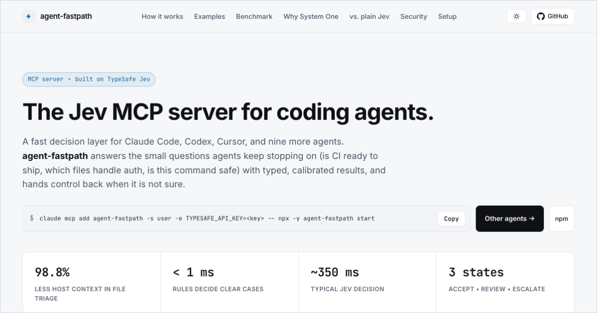</td>
<td align="center" valign="top">لا وسائط منشورة</td>
</tr></table>

🤖 <b><a href="https://github.com/caijinchun/nanojev-arena">caijinchun/nanojev-arena</a></b> · ⭐7 · HTML · 👁️ observed · 62 天

##### 📝 الوصف

ساحة NanoJev Snake: معارك سفن بشرية ضد الذكاء الاصطناعي 1v4 ومحاكي سرب من 100 وكيل. عرض تجريبي محلي لنموذج Jev System-One (نسخة مصغرة مفتوحة المصدر).

##### 📌 معلومات أساسية

| الحقل  | القيمة                                                  |
| ------ | ------------------------------------------------------- |
| الفئة  | `أدوات الوكلاء: MCP والخطافات والبوابات ووكلاء البرمجة` |
| الأدلة | `observed`                                              |
| اللغة  | HTML                                                    |

##### 📊 البيانات

| المقياس   | القيمة     |
| --------- | ---------- |
| النجوم    | **7**      |
| آخر دفع   | 2026-09-19 |
| أول إدراج | 2026-11-01 |

---

<table><tr><th align="center" width="50%">🖼 صورة</th><th align="center" width="50%">🎬 فيديو</th></tr><tr>
<td align="center" valign="top"></td>
<td align="center" valign="top">لا وسائط منشورة</td>
</tr></table>

🤖 <b><a href="https://github.com/dfranco-projects/jev-guardbench">dfranco-projects/jev-guardbench</a></b> · ⭐3 · Python · 👁️ observed · 47 天

##### 📝 الوصف

هل يستطيع نموذج System One (TypeSafe Jev، Kev مفتوح المصدر) استبدال LLM-as-judge في استدعاءات ردود فعل ضوابط الوكيل؟

##### 📌 معلومات أساسية

| الحقل  | القيمة                                                  |
| ------ | ------------------------------------------------------- |
| الفئة  | `أدوات الوكلاء: MCP والخطافات والبوابات ووكلاء البرمجة` |
| الأدلة | `observed`                                              |
| اللغة  | Python                                                  |

##### 📊 البيانات

| المقياس   | القيمة     |
| --------- | ---------- |
| النجوم    | **3**      |
| آخر دفع   | 2026-10-04 |
| أول إدراج | 2026-11-04 |

---

<table><tr><th align="center" width="50%">🖼 صورة</th><th align="center" width="50%">🎬 فيديو</th></tr><tr>
<td align="center" valign="top"></td>
<td align="center" valign="top">لا وسائط منشورة</td>
</tr></table>

الأصل مرتبط مباشرة من المستودع المصدر لأنه لم تُعلَن أي رخصة تسمح بإعادة التوزيع.

🤖 <b><a href="https://github.com/hypler-dev/LNSAT">hypler-dev/LNSAT</a></b> · ⭐1 · TypeScript · 👁️ observed · 0 天

##### 📝 الوصف

Building a CPU-first System One engine for evidence-bound review, with a Gateway for policy, human approval, bounded execution, and durable receipts. Pre-release source.

##### 📌 معلومات أساسية

| الحقل  | القيمة                                                  |
| ------ | ------------------------------------------------------- |
| الفئة  | `أدوات الوكلاء: MCP والخطافات والبوابات ووكلاء البرمجة` |
| الأدلة | `observed`                                              |
| اللغة  | TypeScript                                              |

##### 📊 البيانات

| المقياس   | القيمة     |
| --------- | ---------- |
| النجوم    | **1**      |
| آخر دفع   | 2026-11-21 |
| أول إدراج | 2026-11-16 |

🏷 `access-control` · `agent-security` · `agentic-ai` · `ai-agents` · `ai-governance` · `ai-security` · `audit-trail` · `authorization`

---

<table><tr><th align="center" width="50%">🖼 صورة</th><th align="center" width="50%">🎬 فيديو</th></tr><tr>
<td align="center" valign="top"></td>
<td align="center" valign="top">لا وسائط منشورة</td>
</tr></table>

🤖 <b><a href="https://github.com/light-cheng/Light-Decision-MCP">light-cheng/Light-Decision-MCP</a></b> · ⭐1 · JavaScript · 👁️ observed · 0 天

##### 📝 الوصف

Multi-backend Decision MCP & Magpie plugin for System One models (Gemini Decision, Jev, Perplexity, OpenRouter & local models) with local fallback & setup wizard. | 支持多云端与本地决策模型的 MCP 与 Magpie 插件，内置熔断降级、后台管理与硬件推荐向导。

##### 📌 معلومات أساسية

| الحقل  | القيمة                                                  |
| ------ | ------------------------------------------------------- |
| الفئة  | `أدوات الوكلاء: MCP والخطافات والبوابات ووكلاء البرمجة` |
| الأدلة | `observed`                                              |
| اللغة  | JavaScript                                              |

##### 📊 البيانات

| المقياس   | القيمة     |
| --------- | ---------- |
| النجوم    | **1**      |
| آخر دفع   | 2026-11-20 |
| أول إدراج | 2026-11-20 |

🏷 `decision-model` · `gemini-decision` · `local-ai` · `magpie` · `magpie-plugin` · `mcp` · `system-one`

---

<table><tr><th align="center" width="50%">🖼 صورة</th><th align="center" width="50%">🎬 فيديو</th></tr><tr>
<td align="center" valign="top"></td>
<td align="center" valign="top">لا وسائط منشورة</td>
</tr></table>

🤖 <b><a href="https://github.com/dolevhayut/resurface">dolevhayut/resurface</a></b> · TypeScript · 👁️ observed · 49 天

##### 📝 الوصف

فحص السير الذاتية بواسطة TypeSafe JEV: يكتب LLM الأسئلة، ويجيب عنها JEV (نموذج التصنيف System One) لكل سيرة ذاتية في ATS الخاص بك مع سطر الدليل الدقيق. أسرع 8× وأرخص 31× من LLM.

##### 📌 معلومات أساسية

| الحقل  | القيمة                                                  |
| ------ | ------------------------------------------------------- |
| الفئة  | `أدوات الوكلاء: MCP والخطافات والبوابات ووكلاء البرمجة` |
| الأدلة | `observed`                                              |
| اللغة  | TypeScript                                              |

##### 📊 البيانات

| المقياس   | القيمة     |
| --------- | ---------- |
| النجوم    | **0**      |
| آخر دفع   | 2026-10-03 |
| أول إدراج | 2026-11-01 |

🏷 `ai-recruiting` · `ats` · `candidate-matching` · `classification-model` · `claude` · `decision-model` · `evidence-based-hiring` · `hr-tech`

---

<table><tr><th align="center" width="50%">🖼 صورة</th><th align="center" width="50%">🎬 فيديو</th></tr><tr>
<td align="center" valign="top"></td>
<td align="center" valign="top"> <a href="https://raw.githubusercontent.com/dolevhayut/resurface/main/docs/launch/resurface-launch.mp4">افتح الفيديو</a></td>
</tr></table>

<b>المزيد في هذه الفئة</b> · 233

- [dbreunig/building-with-jev-skill](https://github.com/dbreunig/building-with-jev-skill) - مهارة لكتابة البرامج التي تستدعي Jev وتحسينها، نموذج System One الخاص بـ…
- [Avinash-jetwani/jevmem](https://github.com/Avinash-jetwani/jevmem) - Shared project rules and memory for AI coding agents.
- [openlayer-ai/jevals](https://github.com/openlayer-ai/jevals) - تقييمات Agent وحواجز الحماية كقرارات Jev: طلب واحد لكل trace، بجزء من السنت،…
- [GhalebDweikat/winnow](https://github.com/GhalebDweikat/winnow) - مصفاة سياق مُعايرة لـ Claude Code: يُحكَم على كل نتيجة أداة بواسطة نموذج System…
- [Nisaka520/JevIntent](https://github.com/Nisaka520/JevIntent) - WeChat (إضافة FkWeChat): اضغط مطولًا على رسالة لتحليل النية / المشاعر / أسلوب…
- [andyrewlee/awesome-system-one](https://github.com/andyrewlee/awesome-system-one) - قائمة بنماذج System One (وتُسمى أيضًا نماذج القرار): Jev، الأول، بالإضافة إلى…
- [Li-Evan/awesome-jev](https://github.com/Li-Evan/awesome-jev) - أكثر معرض شامل لما يبنيه الناس باستخدام Jev، نموذج System One الخاص بـ…
- [ChenneyZhuang/laya-browser-agent](https://github.com/ChenneyZhuang/laya-browser-agent) - بديل محلي مفتوح المصدر لـ Jev: قرارات وكيل المتصفح باستخدام Laya.
- [TrustifAI/typed_evals](https://github.com/TrustifAI/typed_evals) - Fast, typed Python framework for Jev-as-a-Judge/Decision-model evaluation for…
- [tiffygk/jev-mode](https://github.com/tiffygk/jev-mode) - Claude Code/Codex skills, evals, harnesses/context tools, and learning…
- [yohanargentina-oss/Foq](https://github.com/yohanargentina-oss/Foq) - ⚡ Foq — البديل المجاني والمحلي ومفتوح المصدر لـJev.
- [mani-aiml/jev-demos](https://github.com/mani-aiml/jev-demos) - عروض توضيحية باستخدام Jev، نموذج System One الخاص بـTypeSafe، مع مجلد واحد لكل…
- [BYK/jev-mcp](https://github.com/BYK/jev-mcp) - خادم MCP يضع التقييم أولاً لـ TypeSafe Jev، وهو نموذج System One يُرجع أحكاماً…
- [kolawong/fast-compaction-dsh](https://github.com/kolawong/fast-compaction-dsh) - ضغط سياق قائم على الأحكام لـ DeepSeek Harness — يستبدل ملخصات LLM الفاقدة…
- [LHCWN/arkui-sem](https://github.com/LHCWN/arkui-sem) - مدقق Semantic ArkUI لوكلاء البرمجة: يكتشف أخطاء الحالة ودورة الحياة التي تُترجم…
- [rajasekharponakala/jev-mcp](https://github.com/rajasekharponakala/jev-mcp) - خادم MCP يغلّف نماذج TypeSafe Jev System One — أحكام noul/الاختيار/النتيجة…
- [BFLabsAI/bf-jev-deep-research](https://github.com/BFLabsAI/bf-jev-deep-research) - مهارة وكيل + دراسة حرفية عن Jev (TypeSafe AI System One Model)…
- [Mainakcris7/agent-guardrail-with-jev](https://github.com/Mainakcris7/agent-guardrail-with-jev) - A practical demo of how can we leverage the power of System One Models like Jev…
- [systemonemodels/noulxp](https://github.com/systemonemodels/noulxp) - NoulXP (المعروف سابقًا باسم OpenDXP): المعيار المفتوح لنماذج System One.
- [Abjcodes/SystemOne-Model-Router](https://github.com/Abjcodes/SystemOne-Model-Router) - Jev based model router for codex.
- [CrowBe/weave](https://github.com/CrowBe/weave) - إطار تشغيل للوكلاء لنموذج System One.
- [ferrousaurus/system-one-mcp](https://github.com/ferrousaurus/system-one-mcp) - An MCP server that allows Agents to interact with System One models such as Jev.
- [gorock007/jev-atlas](https://github.com/gorock007/jev-atlas) - An independent, evidence-first field guide to Jev.
- [izam-mohammed/decisionsmith](https://github.com/izam-mohammed/decisionsmith) - Use and fine-tune System One models (Jev, Laya) on your data, with an LLM as…
- [jms-dcksn/uipath-jev-guardrail-connector](https://github.com/jms-dcksn/uipath-jev-guardrail-connector) - موصل UiPath بمبدأ الحماية الخاص بك، مدعوم بنموذج TypeSafe Jev System One…
- [jonra/atlas-jev](https://github.com/jonra/atlas-jev) - Build a security-specialised, Jev-compatible System One model from open weights…
- [lucast4049/openjev](https://github.com/lucast4049/openjev) - شغّل قرارات سريعة ومُعايرة ومُنمّطة على نماذج System One المفتوحة باستخدام API…
- [Meirdrarel/mcp-systemone](https://github.com/Meirdrarel/mcp-systemone) - MCP server giving coding agents quick judgment tools.
- [Rams901/amira-brightwater-ai-suite](https://github.com/Rams901/amira-brightwater-ai-suite) - Amira AI Engineer Challenge Suite — Hybrid System-One (TypeSafe Jev 1.14) +…
- [vurihuang/magpie-plugin-openai-decisions](https://github.com/vurihuang/magpie-plugin-openai-decisions) - OpenAI.
- [browser-use/jev-ultrafast](https://github.com/browser-use/jev-ultrafast) - وكيل ويب هو الأسرع والأرخص.
- [jev-chat/jev-chat-jarvis](https://github.com/jev-chat/jev-chat-jarvis) - مساعد قرارات الدردشة: قبل أن ترد، يقرأ Jev الدردشة، ويحكم على النية والمخاطر،…
- [YaoApp/yao](https://github.com/YaoApp/yao) - ✨ جميع وكلائك ومساحات عملك في مكان واحد، على كل جهاز تملكه.
- [kerpopule/hermes-jev-skills](https://github.com/kerpopule/hermes-jev-skills) - توجيه النماذج والذاكرة والضغط واختيار المهارات واستخدام الكمبيوتر والمتصفح…
- [reticlehq/reticle](https://github.com/reticlehq/reticle) - يمكن لوكلاء AI توليد التعليمات البرمجية، لكنهم ما زالوا يواجهون صعوبة في فهم ما…
- [wy-coliney/jev-browser-use](https://github.com/wy-coliney/jev-browser-use) - عمليات متصفح أسرع من 5 إلى 10 مرات: ينفّذ Jev النقرات، بينما يفكّر Codex…
- [logicrw/awesome-jev-projects](https://github.com/logicrw/awesome-jev-projects) - Jev الرائع: رادار للنظام البيئي مفتوح المصدر مدعوم بالمصادر، واكتشاف للمشاريع…
- [devagrawal09/jev-review](https://github.com/devagrawal09/jev-review) - سير عمل مرحلي لمراجعة الشيفرة ولوحة معلومات محلية مبنيان باستخدام TypeSafe Jev.
- [wuyoscar/jev-skill](https://github.com/wuyoscar/jev-skill) - مجموعة رائعة من حالات استخدام Jev وسير العمل ومهارات الوكلاء.
- [kydlikebtc/awesome-jev](https://github.com/kydlikebtc/awesome-jev) - Launch what you built on Jev, TypeSafe AI.
- [jkudish/jev-mcp](https://github.com/jkudish/jev-mcp) - أحكام سريعة ورخيصة ومكتوبة النوع من نموذج Jev الخاص بـ TypeSafe، على هيئة أدوات…
- [ttlequals0/MinusPod](https://github.com/ttlequals0/MinusPod) - MinusPod هو خادم مستضاف ذاتيًا يزيل الإعلانات قبل أن تضغط تشغيل أصلًا.
- [OmniJev/Flide](https://github.com/OmniJev/Flide) - 🔥🔥 The extremely fast inference engine for decision model.
- [BillionsBobby/JevRouter](https://github.com/BillionsBobby/JevRouter) - موجّه خفيف مدعوم بواسطة Jev للنماذج والأدوات والوكلاء الفرعيين.
- [qbeka/jev-job-search](https://github.com/qbeka/jev-job-search) - Find software internships and new-grad jobs, fill the application forms, check…
- [malevrigns/agent-jev](https://github.com/malevrigns/agent-jev) - AgentJev-0.6B - نموذج قرار &#x27;System One&#x27; سريع لوكلاء الذكاء الاصطناعي: زوّده بأي…
- [vinilana/jev-gateway](https://github.com/vinilana/jev-gateway) - طريقة سهلة لاستخدام jev مع وكيل البرمجة لديك لاستدلال استدعاء الأدوات.
- [Heman10x-NGU/openJev-verdict-2.0](https://github.com/Heman10x-NGU/openJev-verdict-2.0) - محرك قرار غير ذاتي الانحدار مُعاير بحجم 151M يتفوق على TypeSafe Jev وLaya في…
- [OmniJev/OneJev](https://github.com/OmniJev/OneJev) - 🚀🚀 نموذج قرار متعدد الوسائط System One يعطي إجابات مُعايرة على أسئلة مكتوبة حول…
- [Amal-David/awesome-jev](https://github.com/Amal-David/awesome-jev) - عروض Jev التوضيحية ومشاريع وSDKs ومهارات، مع روابط المصادر ومعرض X منسّق.
- [fatwang2/awesome-jev](https://github.com/fatwang2/awesome-jev) - دليل مشاريع Jev مدعوم بالمصادر مع سير عمل مراجعة قابل لإعادة الاستخدام يقتصر…
- [jmagly/aiwg](https://github.com/jmagly/aiwg) - سياق مشاريع قابل لإعادة الاستخدام وسير عمل متخصص لأدوات الذكاء الاصطناعي التي…
- [luobosibing2/dsh-jev-plugin](https://github.com/luobosibing2/dsh-jev-plugin) - إضافة Native DeepSeek Harness (DSH) تدمج TypeSafe Jev أو واجهة Decision مثل…
- [ThinkFlowLab/system1-agents](https://github.com/ThinkFlowLab/system1-agents) - نماذج قرار System 1 (Jev وLaya وCua-S1) بوصفها عقلًا للوكلاء: استخدام المتصفح،…
- [y0usaf/pi-jev](https://github.com/y0usaf/pi-jev) - TypeSafe Jev كطبقة قرار لوكيل البرمجة Pi: بوابة مقاسة لاستدعاءات الأدوات…
- [kyegomez/open-jev](https://github.com/kyegomez/open-jev) - إعادة بناء مفتوحة المصدر ومن المبادئ الأولى للأفكار الكامنة وراء TypeSafe AI…
- [cookiespiggy/agentic-rl](https://github.com/cookiespiggy/agentic-rl) - دورة تعليمية في Agentic RL للمبتدئين تمامًا باللغة الصينية (33 فصلًا): من…
- [UditAkhourii/quicksilver](https://github.com/UditAkhourii/quicksilver) - مهارة Claude Code: فوّض أحكامك الجماعية إلى Jev.
- [Shanghua-Gao/RSI-Jev](https://github.com/Shanghua-Gao/RSI-Jev) - نماذج قرارات مزيّدة النوع (noul / choice / score) دُرّبت بواسطة حلقة تحسين ذاتي…
- [lawrence3699/jev-style](https://github.com/lawrence3699/jev-style) - JevStyle: local decision models for AI agents.
- [initial-d/ml-quant-trading](https://github.com/initial-d/ml-quant-trading) - أبحاث كمية لـ ML باستخدام PyTorch: 213 عاملاً، وتصحيح التحيز، وتحسين المحافظ،…
- [PerryLink/jevcore](https://github.com/PerryLink/jevcore) - TypeSafe Jev لـDeepSeek Harness وModel Context Protocol وNode العادي: أحكام…
- [onlyreadai/onlyread](https://github.com/onlyreadai/onlyread) - Make AI browser agents read-only: a Chrome extension that refuses writes.
- [charlesdove977/claude-x-jev](https://github.com/charlesdove977/claude-x-jev) - قرارات سريعة ورخيصة وذات أنواع لـ Claude Code.
- [jonathanavis96/jev-kit](https://github.com/jonathanavis96/jev-kit) - كل ما تحتاجه لتشغيل TypeSafe Jev باستخدام Claude Code: حارس لاستدعاءات الأدوات،…
- [akivet/Mica](https://github.com/akivet/Mica) - A 4B decision model: calibrated probabilities for yes/no, choice and score…
- [shitianfang/jev-use](https://github.com/shitianfang/jev-use) - إضافة Claude Code / Codex / pi التي تسلّم خطوات الوكيل التي لا تحتاج إلى مخرجات…
- [yikangy873-gif/jev-desktop](https://github.com/yikangy873-gif/jev-desktop) - اختيار إجراء TypeSafe Jev داخل Codex Computer Use.
- [native-bond-lab/Jev-Interaction](https://github.com/native-bond-lab/Jev-Interaction) - System-One-controlled full-duplex voice interaction: turn-taking as…
- [iamaamir/system-one](https://github.com/iamaamir/system-one) - بيئة تشغيل System One محايدة تجاه المزوّدين لـ TypeScript وPi.
- [TheoOliveira/pi-jev](https://github.com/TheoOliveira/pi-jev) - توجيه دلالي للأدوات وقرارات System One مُنمّطة لوكيل Pi البرمجي باستخدام…
- [alanhuangyoo/OpenJev](https://github.com/alanhuangyoo/OpenJev) - OpenJev: بديل محلي مفتوح المصدر لـ Jev.
- [chuloontop4-code/jev-instance-review](https://github.com/chuloontop4-code/jev-instance-review) - أفضل مراجع لمثيلات Roblox Studio لعام 2026: معايير Jev مكتوبة الأنواع…
- [FrancoisChastel/jev-code](https://github.com/FrancoisChastel/jev-code) - Jev، مصنّف System One الخاص بـTypeSafe، كأداة داخل Claude Code وCodex وPi…
- [intikhab49/open-jev-typed-decision-engine](https://github.com/intikhab49/open-jev-typed-decision-engine) - إعادة إنتاج مفتوحة المصدر لـ TypeSafe Jev: محرك قرارات مكتوبة النوع بحجم 150M…
- [PyModel/jev-judge-mcp](https://github.com/PyModel/jev-judge-mcp) - أدوات حكم مُنمذجة بأنواع لوكلاء MCP. نموذج Jev الخاص بـ TypeSafe بوصفه verify،…
- [alexei-led/claude-router](https://github.com/alexei-led/claude-router) - إضافة Claude Code تختار النموذج والجهد لكل دورة.
- [everyinfra/jev-radar](https://github.com/everyinfra/jev-radar) - 📡 The most rigorously verified tracker of the Jev (TypeSafe AI System One)…
- [AskTheWay/dsh-jev-interceptor](https://github.com/AskTheWay/dsh-jev-interceptor) - ⚡ حكم System-1 بزمن ميلي ثانية لكل استدعاء أداة في DeepSeek Harness — تصنيف…
- [jomatsu/pi-jev-auto-mode](https://github.com/jomatsu/pi-jev-auto-mode) - وضع تلقائي مدعوم بـ Jev (TypeSafe System One) لوكيل Pi البرمجي: يوافق تلقائيًا…
- [abhishek085/open-spark-jev](https://github.com/abhishek085/open-spark-jev) - نماذج قرار محلية مفتوحة المصدر مستوحاة من Jev وSystem One الخاصين بـTypeSafe…
- [teo-nex/jev-codex-harness](https://github.com/teo-nex/jev-codex-harness)
- [anandi1989/awesome-jev-usecases](https://github.com/anandi1989/awesome-jev-usecases) - فهرس مدعوم بالأدلة لحالات استخدام Jev (TypeSafe AI System One) في العالم…
- [Singularity-Compute/super-decider](https://github.com/Singularity-Compute/super-decider) - Decisions, not essays: a choice, a yes or no, or a score with a calibrated…
- [erkamyaman/jev-enforce](https://github.com/erkamyaman/jev-enforce) - 📏 Claude Code plugin that makes Claude follow your AGENTS.md: every reply and…
- [green-dalii/pi-shift-router](https://github.com/green-dalii/pi-shift-router) - توجيه النموذج لكل دور لوكيل البرمجة Pi: يختار حَكَم صغير المستوى الرخيص أو…
- [paramjeetn/jev-cookbook](https://github.com/paramjeetn/jev-cookbook) - كتاب الوصفات الكامل لـJev من TypeSafe AI — أكثر من 120 حالة استخدام، و10 أمثلة…
- [iamtoomas/JevLint](https://github.com/iamtoomas/JevLint) - تدقيق دلالي قابل للتهيئة ومدعوم بـ Jev، مع أحكام NOUL على مستوى الملف وإضافة…
- [vicfei/awesome-jev-prompts](https://github.com/vicfei/awesome-jev-prompts) - Question patterns, engine selection &amp; ecosystem tracking for typed decision…
- [ajensenwaud/hermes-jev-plugin](https://github.com/ajensenwaud/hermes-jev-plugin) - أدوات قرار TypeSafe Jev (System One) لـ Hermes Agent: jev_check / jev_route /…
- [daftAI2026/awesome-jev](https://github.com/daftAI2026/awesome-jev) - مشاريع TypeSafe Jev / System One GitHub منتقاة، وبدائل مفتوحة المصدر، وأخبار Jev.
- [win4r/pi-jev-router](https://github.com/win4r/pi-jev-router) - Task-boundary model routing for Pi Coding Agent, powered by TypeSafe Jev.
- [zhangxaochen/dsh-jev](https://github.com/zhangxaochen/dsh-jev) - مجموعة إضافات Jev (نموذج قرار System One) لـDeepSeek Harness (dsh).
- [alexei-led/pi-model-router](https://github.com/alexei-led/pi-model-router) - Independent Pi extension for four-tier model routing with optional…
- [anisselbd/jev-phishing-bench](https://github.com/anisselbd/jev-phishing-bench) - Jev (TypeSafe) vs Claude Haiku 4.5 on 2,000 phishing emails: accuracy…
- [ronitgupta138/Local-Jev](https://github.com/ronitgupta138/Local-Jev) - ⚡ 100% offline, zero-cost drop-in alternative to TypeSafe Jev System One…
- [win4r/jev-security-scan](https://github.com/win4r/jev-security-scan) - 使用 TypeSafe Jev 审查 Skill 与 MCP 可疑行为 | Review Agent Skills and MCP code with…
- [inso1337/revl](https://github.com/inso1337/revl) - لغة لقابلية التركيب الزمكانية الآمنة والشاملة (نموذج Cordis) والتنسيق.
- [Jessie-QingYu/jev-in-the-wild](https://github.com/Jessie-QingYu/jev-in-the-wild) - حالات استخدام Jev في العالم الحقيقي، ومشاريع مفتوحة المصدر، ومعايير قياس،…
- [SergeyBazhmin/krasivo-jev](https://github.com/SergeyBazhmin/krasivo-jev) - Training data and models for &quot;system one&quot; classifiers: one forward pass, no…
- [allenporter/home-assistant-laya](https://github.com/allenporter/home-assistant-laya) - Conversation agent based on Laya, a multilingual, non-autoregressive System 1…
- [frontierlabai/JevHub](https://github.com/frontierlabai/JevHub) - JevHub · Jev 生态热榜 把值得关注的 Jev 项目、教程和讨论，汇到一页。 自动发现 · 每日更新 · 按 Stars 排序 · 中英双语.
- [AlphaPerseii3000/jev-effort-router](https://github.com/AlphaPerseii3000/jev-effort-router) - Per-turn model AND reasoning-effort routing for Hermes Agent on Ollama:Cloud…
- [FazalAAli/jev-robotics-demo](https://github.com/FazalAAli/jev-robotics-demo) - Jev (TypeSafe System One) مقابل Claude Opus 5 يقود ذراعًا روبوتية محاكاة في…
- [jmrenouard/MicroLLM](https://github.com/jmrenouard/MicroLLM) - Local Hybrid System-One Decision Engine.
- [ranjan2829/AskJev](https://github.com/ranjan2829/AskJev) - AskJev — الطيار الآلي Jev لأي موقع ويب + حماية من النقرات غير القابلة للعكس…
- [reacher-z/Awesome-Jev](https://github.com/reacher-z/Awesome-Jev) - Curated Jev and System One papers, models, datasets, benchmarks and SDKs, with…
- [PerryLink/laya-mcp](https://github.com/PerryLink/laya-mcp) - MCP server for Laya typed decisions (noul / choice / score): warm model…
- [7starsseeker/dsh-fact-check](https://github.com/7starsseeker/dsh-fact-check) - Fact-checking skill for DeepSeek Harness: multi-source verification against the…
- [lgy1027/jevshield](https://github.com/lgy1027/jevshield) - بوابة أمان في أقل من 100ms لاستدعاءات أدوات وكلاء الذكاء الاصطناعي، مدعومة…
- [simota/tenbin](https://github.com/simota/tenbin) - خادم MCP ومهارة وكيل لـ TypeSafe AI System One API (Jev): فكّك حكماً إلى أسئلة…
- [abhishekashokvkumar/jev-mcp-dispatcher](https://github.com/abhishekashokvkumar/jev-mcp-dispatcher) - موزّع أدوات MCP باللغة الطبيعية، يعمل بالكامل بواسطة TypeSafe وJev الخاص به…
- [aitofy-dev/jev-awesome-skills](https://github.com/aitofy-dev/jev-awesome-skills) - مهارات Jev مفتوحة المصدر لـClaude Code وCodex وCursor وGrok.
- [albri/nxk](https://github.com/albri/nxk) - Your agent can.
- [laguagu/jev-skills](https://github.com/laguagu/jev-skills) - Practical agent skills and examples for building with Jev.
- [MongLong0214/jev-gate](https://github.com/MongLong0214/jev-gate) - ليس كل مهمة برمجة تحتاج إلى أفضل نموذج لديك.
- [nanami-0713/dsh-jev-decide](https://github.com/nanami-0713/dsh-jev-decide) - إضافة DSH: سجّل TypeSafe Jev (نموذج قرارات System One) كأداة وكيل — يعيد…
- [7starsseeker/dsh-jev-guard](https://github.com/7starsseeker/dsh-jev-guard) - DeepSeek Harness (DSH) 执行前安全阀门:bash/pwsh 真正执行前先经静态规则 + TypeSafe Jev 语义判定,破坏性操作按…
- [atvari-eu/opencode-decisions](https://github.com/atvari-eu/opencode-decisions) - OpenCode plugin for decision models (System One, Jev): automatic decisions…
- [deepansh-saxena/jev-guardrails](https://github.com/deepansh-saxena/jev-guardrails) - مقارنة LLM بوصفه حكمًا مقابل TypeSafe Jev لحواجز الوكلاء: القواعد نفسها،…
- [kierandotai/jev-scout](https://github.com/kierandotai/jev-scout) - Jev-scored observable web research for MCP agents — every query, result, and…
- [MojoAI-King/jev-paper-trader](https://github.com/MojoAI-King/jev-paper-trader) - تداول ورقي لأسواق Polymarket وKalshi الحقيقية باستخدام 100 ألف دولار وهمية: هل…
- [mywwave/cursor-jev](https://github.com/mywwave/cursor-jev) - إضافة Cursor توجّه الوكلاء الفرعيين باستخدام TypeSafe Jev وتعرض Choice وScore…
- [noetion/dsh-jev](https://github.com/noetion/dsh-jev) - حزمة DSH تسجّل jev_ask لإجابات TypeSafe Jev من نوع noul والاختيار والنتيجة.
- [samtay32/jev-system-architect](https://github.com/samtay32/jev-system-architect) - مهارة معمارية للنظام لـTypeSafe AI Jev/System One — اعثر على الحكم الدلالي…
- [snjrusmn/jev-humanizer](https://github.com/snjrusmn/jev-humanizer) - Антислоп скилл для AI-агентов: Jev от TypeSafe находит признаки нейросети в…
- [SoniaMehta14/paved-gate](https://github.com/SoniaMehta14/paved-gate) - بوابة إدخال سريعة من System 1 لبنى وكلاء الذكاء الاصطناعي: فحوص السلامة…
- [tinypi-extension/tinysubagent](https://github.com/tinypi-extension/tinysubagent) - Minimal herdr-native and Rex subagent spawning for pi — markdown agent roles…
- [vahidkaargar/jade-decision-governance](https://github.com/vahidkaargar/jade-decision-governance) - Adaptive decision governance for AI agents using TypeSafe Jev: journaled…
- [wangkuangkuang/jev-mcp-server](https://github.com/wangkuangkuang/jev-mcp-server) - خادم MCP لـJev (TypeSafe System One): أنواع الأسئلة الرسمية الثلاثة — الاختيار…
- [1aifanatic/jev-uipath-coded-agent](https://github.com/1aifanatic/jev-uipath-coded-agent) - عرض FINS: وكيل مبرمج بواسطة UiPath لفرز تنبيهات AML، حيث يتخذ نموذج Jev الخاص…
- [cnrai/openpave-jev](https://github.com/cnrai/openpave-jev) - مهارة PAVE لنماذج القرار غير الانحدارية ذاتيًا (Jev / Laya / TypeSafe): إجابات…
- [darwintechlab/claude-jev](https://github.com/darwintechlab/claude-jev) - Jev System One لـClaude Code — Choice/Noul/Score مكتوبة عبر TypeSafe API…
- [guanghuang/coding-router-jev](https://github.com/guanghuang/coding-router-jev) - TypeScript/Bun launcher routing Codex turns through JEV with model and…
- [hdjekuue/awesome-jev](https://github.com/hdjekuue/awesome-jev) - الدليل ثلاثي اللغة ذاتي التحديث لكل ما بُني على Jev (TypeSafe AI System One)…
- [jms-dcksn/jev-pii-guardrail](https://github.com/jms-dcksn/jev-pii-guardrail) - وكيل UiPath مبرمج مع حاجز مخصص لاكتشاف PII عند حد LLM، مبني على نموذج TypeSafe…
- [rahilmavani/piedpiper-jev-buildathon](https://github.com/rahilmavani/piedpiper-jev-buildathon) - فريق piedpiper: حواجز failproofai وJev التي تمنع وكيل Helix IT من الفشل.
- [zhuyansen/awesome-typesafe-jev](https://github.com/zhuyansen/awesome-typesafe-jev) - مشاريع مفتوحة المصدر مبنية على نموذج القرار Jev الخاص بـTypeSafe: نسخ مفتوحة،…
- [173787247/dsh-wsl-jev](https://github.com/173787247/dsh-wsl-jev) - DeepSeek Harness WSL plugin: TypeSafe Jev / OpenRouter System One.
- [17671454333/jev-cognitive-mcp](https://github.com/17671454333/jev-cognitive-mcp) - 3+1 Cognitive Hierarchy Toolkit &amp; Model Context Protocol (MCP) Server for…
- [AlekseiUL/jev-broker](https://github.com/AlekseiUL/jev-broker) - JEV Broker: TypeSafe JEV via OpenRouter for Hermes agents | JEV через…
- [bhanuprakashk90-tech/jev-agent-guardrail](https://github.com/bhanuprakashk90-tech/jev-agent-guardrail) - حاجز أمان لحظي ولوحة مراقبة تفاعلية لاستدعاءات أدوات وكلاء الذكاء الاصطناعي،…
- [bismawy/pi-jev-eye](https://github.com/bismawy/pi-jev-eye) - مشرف فائق الخفة لـPi: حواجز regex بلا رموز، وتتبع التحقق من الاختبارات، وبوابة…
- [bitskc/honest-jev](https://github.com/bitskc/honest-jev) - A cheap decider for AI agents: command guard, done-claim verification…
- [bpmforbusiness/jev-agent-harness](https://github.com/bpmforbusiness/jev-agent-harness) - دليل إعداد وكيل Jev (TypeSafe AI System One) + دليل فيديو — من منشور LangChain…
- [celolopes/jev-dev-harness](https://github.com/celolopes/jev-dev-harness) - Open-source developer harness and runtime safety toolkit for AI coding agents…
- [charetterat/awesome-jev-essentials](https://github.com/charetterat/awesome-jev-essentials) - مشاريع Jev التي تستحق وقتك فعلاً — منتقاة ومقارنة ومُحدّثة.
- [d0ng231/jev-gtw](https://github.com/d0ng231/jev-gtw) - JEV Gateway: PII/PHI guardrails for coding agents.
- [edamlabs/e-jev](https://github.com/edamlabs/e-jev) - A self-hosted Jev with a catalog of decision backends — typed, calibrated…
- [eshitakundu/jev-flow](https://github.com/eshitakundu/jev-flow) - Support-triage inbox where an LLM answers typed questions and a deterministic…
- [Faizullah9181/jev-esketcher](https://github.com/Faizullah9181/jev-esketcher) - لوحة رسم توليدية حيث يختار Jev، نموذج القرارات المُعاير الخاص بـTypeSafe، مواد…
- [fivetaku/golla-jev](https://github.com/fivetaku/golla-jev) - 골라제브 — find the pick-one moments in your work and hand them to Jev.
- [frederico-kluser/jev-agent-skill](https://github.com/frederico-kluser/jev-agent-skill) - قرارات typed في أجزاء من الألف من الثانية مع Jev (System One من TypeSafe) عبر…
- [HimuroSenalyc/Jev-Fog](https://github.com/HimuroSenalyc/Jev-Fog)
- [jbatra-umeey/jev-decisionops](https://github.com/jbatra-umeey/jev-decisionops) - ستة مسارات عمل لاتخاذ القرار Jev للذكاء الاصطناعي الوكيلي: توجيه النماذج،…
- [JoaoClemer/jev-lab](https://github.com/JoaoClemer/jev-lab) - ‏Jev (TypeSafe AI) كحاجز أمان لحظي وكأداة تقييم أولي لوكلاء المحادثة في مجال…
- [kittimzhe/dsh-jev-goal-judge](https://github.com/kittimzhe/dsh-jev-goal-judge) - Jev progress judgment between DeepSeek Harness goal rounds — one fan-out per…
- [lijiawei255/jev-tune](https://github.com/lijiawei255/jev-tune) - Jev-inspired calibrated decision &amp; safety shell for typed PID autotuning…
- [masseater/cc-jev-teacher](https://github.com/masseater/cc-jev-teacher) - Claude Code plugin: TypeSafe-judged hooks that make Claude finish the job…
- [MichelePolo/jev-mcp](https://github.com/MichelePolo/jev-mcp) - خادم MCP يعرّض نماذج قرارات System One بنمط Jev (Ollama /v1/systemone) كأدوات.
- [Nhat-Nguyet/product-skill-jev](https://github.com/Nhat-Nguyet/product-skill-jev) - A product management co-pilot that writes the documents, keeps the process…
- [pablozr/JevGuard](https://github.com/pablozr/JevGuard) - Semantic policy engine for AI coding agents.
- [putraridho/jev-switch](https://github.com/putraridho/jev-switch) - Jev-gated Claude router: Sonnet by default, Opus for hard and security work.
- [QI-seven33/dsh-jev-mode](https://github.com/QI-seven33/dsh-jev-mode) - Optional JEV decision mode for DeepSeek Harness Desktop: deterministic reads…
- [rgryta/jev-mcp](https://github.com/rgryta/jev-mcp) - MCP server over TypeSafe.
- [xlennart/dsh-auto-review-jev](https://github.com/xlennart/dsh-auto-review-jev) - DeepSeek Harness 审批守护者：权限请求先由审查模型裁决。内置 System One 决策 API 后端.
- [zachshallbetter/claude-jev](https://github.com/zachshallbetter/claude-jev) - Jev (TypeSafe System One) كمكوّن إضافي لـ Claude Code: قرارات مكتوبة للفرز…
- [aayushhzz/jev-lite](https://github.com/aayushhzz/jev-lite) - Jev Lite: a small local decision API for agents, with typed choice, score, and…
- [abyakod/JEV_ADK](https://github.com/abyakod/JEV_ADK) - حزمة تطوير الوكلاء لـ System-One AI: مسارات قرارات غير ذاتية الانحدار بأقل من…
- [alejandroparis17/router-jev](https://github.com/alejandroparis17/router-jev) - Claude Code hook and skill that routes each task to the model best suited to…
- [aleksvega/jev-stack](https://github.com/aleksvega/jev-stack) - أمر واحد (npx jev-stack) لتثبيت مجموعة أدوات الوكيل المدعومة بـJev: ضغط السياق،…
- [AlienXc137/Support-Ticket-Ai-Agent-with-RAG-Guardrails-and-Jev](https://github.com/AlienXc137/Support-Ticket-Ai-Agent-with-RAG-Guardrails-and-Jev) - وكيل يقرأ استفسارات الطلاب الواردة (البريد الإلكتروني/WhatsApp/نص النموذج)،…
- [availableservices/jev-router](https://github.com/availableservices/jev-router) - وجّه إلى أرخص نموذج في claude code لمهمتك باستخدام jev-router.
- [byte5ai/omadia-jev-plugin](https://github.com/byte5ai/omadia-jev-plugin) - TypeSafe Jev as the omadia decision model (decisionModel@1): model yes/no, data…
- [cameronb-xano/jev-agent-guardrail](https://github.com/cameronb-xano/jev-agent-guardrail) - قالب Xano: حاجز استدعاء أدوات وكيل Jev. يقرر Jev، ويُنفّذ Xano.
- [Covre81/jev-router](https://github.com/Covre81/jev-router) - Local Anthropic-compatible gateway that routes Claude Code traffic across…
- [ddzelal/jev-router-shield](https://github.com/ddzelal/jev-router-shield) - Let Jev pick the Claude model and effort per message in Claude Code, without…
- [duketopceo/jev-compact](https://github.com/duketopceo/jev-compact) - Context compaction for agent harnesses: a decision model scores transcript…
- [dylanfesta/RSS-Sci-Jev-Reader](https://github.com/dylanfesta/RSS-Sci-Jev-Reader) - \[Alpha / Untested\] Multi-platform Tauri v2 scientific journal RSS reader and…
- [eduardo-xyz/jev-browser-mcp](https://github.com/eduardo-xyz/jev-browser-mcp) - MCP tool exposing TypeSafe.
- [fortemate/dicechess-bot-jev](https://github.com/fortemate/dicechess-bot-jev) - Experimental Dice Chess webhook bot powered by TypeSafe Jev, with adaptive…
- [HKUST-KnowComp/jev-guardrail](https://github.com/HKUST-KnowComp/jev-guardrail) - أشجار سياسات قابلة للتحرير ومصنّف 2B لمراجعة طلبات الوكلاء وإجراءاتهم.
- [hsaenzG/jev-strands-decision-lab](https://github.com/hsaenzG/jev-strands-decision-lab) - Capa de decisiones para agentes con Strands + Jev (TypeSafe AI): el agente…
- [iamdgarcia/jev-mini-bench](https://github.com/iamdgarcia/jev-mini-bench) - مستكشف جيبي لموجة نماذج القرار الصغيرة.
- [jbowensii/jev-mcp-unraid](https://github.com/jbowensii/jev-mcp-unraid) - Containerized TypeSafe Jev judgment MCP server (stdio-&gt;HTTP via mcp-proxy) for…
- [jipika/dsh-jev-grep](https://github.com/jipika/dsh-jev-grep) - إضافة للفصل في فيض نتائج البحث لـ DeepSeek Harness: ‏ripgrep + أحكام TypeSafe…
- [kevinyin9/next-steps-jev](https://github.com/kevinyin9/next-steps-jev) - Suggested next steps for Claude Code, scored by how much each one helps your…
- [kimanhdev1999/jev-devops-agent-template](https://github.com/kimanhdev1999/jev-devops-agent-template) - DevOps agent template built on Jev (TypeSafe AI) instead of a conventional LLM.
- [kofanlabs/jev-browser-chrome](https://github.com/kofanlabs/jev-browser-chrome) - Fast Jev browser agent for existing signed-in Chrome tabs via a local extension…
- [liyifan2004/obsidian-jev-inbox-router](https://github.com/liyifan2004/obsidian-jev-inbox-router) - Obsidian plugin: route incoming notes to the right folder using JEV.
- [Mfrostbutter/jev-n8n-patterns](https://github.com/Mfrostbutter/jev-n8n-patterns) - أنماط Jev (TypeSafe System One) في n8n: فحص PII، وضوابط الوكلاء ووكلاء البرمجة،…
- [mjvmsteixeira/jev-browser-mcp](https://github.com/mjvmsteixeira/jev-browser-mcp) - Agente de browser para o Claude Code: jev-ultrafast + Jev (TypeSafe) com…
- [Mohith26/jev-calibration-audit](https://github.com/Mohith26/jev-calibration-audit) - Independent calibration and selective-agreement audit of Jev vs eight LLMs on…
- [Mrmimee/codex-jev](https://github.com/Mrmimee/codex-jev) - JEV for Codex: structured routing, evidence-backed review, and a six-signal…
- [mxttbennett/jev-relayer](https://github.com/mxttbennett/jev-relayer) - Per-task Jev routing for Claude Code and Codex: inline, subagent or sibling…
- [PeriodBLUE/jev-project-atlas](https://github.com/PeriodBLUE/jev-project-atlas) - A source-verified atlas of GitHub projects built with JEV / TypeSafe System One.
- [phoem/jev-router](https://github.com/phoem/jev-router) - Claude Code mod that asks TypeSafe.
- [raniellimontagna/jev-guard-mcp](https://github.com/raniellimontagna/jev-guard-mcp) - A guarded MCP layer for Jev-powered browser decisions with isolated Playwright…
- [roger-yu-ds/jev-tool-selection](https://github.com/roger-yu-ds/jev-tool-selection) - Measuring AI tool selection on real MCP servers: Jev vs LLMs.
- [royalskynet/jev-gate-lite](https://github.com/royalskynet/jev-gate-lite) - Jev Gate without the local Laya lane: MCP judgment tools, tool-output pruning…
- [Sandesh-S-Dalvi/playwright-jev-testing-refactored](https://github.com/Sandesh-S-Dalvi/playwright-jev-testing-refactored) - Goal-driven Playwright E2E testing where TypeSafe Jev (System One) decides the…
- [shahshahdab/fastcampus-jev](https://github.com/shahshahdab/fastcampus-jev) - Learn to gate tool calls, guardrails, and risky actions with Jev judgment plus…
- [siso-os/jev-agent-skills](https://github.com/siso-os/jev-agent-skills) - رأي ثانٍ متحفظ لوكيلك: النية، والإكمال، والتوجيه، والحكم على المتصفح كمهارات…
- [skylence-org/claudecode-jev-marketplace](https://github.com/skylence-org/claudecode-jev-marketplace) - TypeSafe Jev (System One) wired into Claude Code: a decision primitive for…
- [slindelow/jev_optimizer](https://github.com/slindelow/jev_optimizer) - System 1 Decision Model Optimization for Coding Agents.
- [StarDust0083-GP03/jev-router-for-pi](https://github.com/StarDust0083-GP03/jev-router-for-pi) - Tiered virtual model router for the Pi coding agent: one classifier score per…
- [taifoon-io/jev](https://github.com/taifoon-io/jev) - قيّم مهمة وكيل ذكاء اصطناعي باستخدام Jev الخاص بـ TypeSafe: هل أنجز العمل كما…
- [thejasrao262003/jev-compositional-uncertainty](https://github.com/thejasrao262003/jev-compositional-uncertainty) - Research on whether AI decision workflows can trust and combine uncertainty…
- [ttdua/pi-jev-pilot](https://github.com/ttdua/pi-jev-pilot) - Pi extension that lets Jev, TypeSafe.
- [undowhai113/jev-codeguard](https://github.com/undowhai113/jev-codeguard) - Command firewall, AST security auditor &amp; zero-token git diff verifier for AI…
- [veermshah/jev-calibration-lab](https://github.com/veermshah/jev-calibration-lab) - Independent calibration benchmark for System One decision models (TypeSafe Jev)…
- [vinaychawla-ops/jev-adk-guardrail-example](https://github.com/vinaychawla-ops/jev-adk-guardrail-example) - Jev (نموذج قرار TypeSafe) كحاجز أمان للمخاطر داخل before_tool_callback لوكيل…
- [vishalanton16/jev-spotlight](https://github.com/vishalanton16/jev-spotlight) - Handwritten explanations, highlights, and connected arrows on live web pages.
- [xano-community/agent-guardrail-jev](https://github.com/xano-community/agent-guardrail-jev) - حاجز حماية لاستدعاءات أدوات وكيل الذكاء الاصطناعي في Xano: يقيّم Jev.
- [yangzhou-chaofan/awesome-jev-prompt](https://github.com/yangzhou-chaofan/awesome-jev-prompt) - أحدث أفضل 100 عرض لـjev (مع الاستمرار في التحديث) من x / github / أحدث المصادر.
- [yonghongwu/JevNavAgent](https://github.com/yonghongwu/JevNavAgent) - JevNavAgent: Budget-Decoupled Single-Forward Visual Navigation and…
- [ZeroX-01/jev-atlas](https://github.com/ZeroX-01/jev-atlas) - فهرس عام محدّث باستمرار لمشاريع JEV الحقيقية لـTypeSafe ومقاطع الفيديو…
- [rmalde/minecraft-agent](https://github.com/rmalde/minecraft-agent) - مخطط Astra ووحدة تحكم JEV لـ Minecraft، مع تسجيل أصلي، ومسارات مختبرة، والتحقق…
- [notque/vexjoy-agent](https://github.com/notque/vexjoy-agent) - وكيل VexJoy AI مع التوجيه الذكي Jev - يوجّه /do الطلبات المكتوبة بالإنجليزية…
- [itsmostafa/system-one-connector](https://github.com/itsmostafa/system-one-connector) - موصل System One MCP لتقييم أي شيء بسرعة وبتكلفة منخفضة.
- [keeltrace/hermes-nerve](https://github.com/keeltrace/hermes-nerve) - Nerve هو جهاز عصبي إشرافي لوكلاء Hermes، يضيف قرارات System One مُنمّطة،…
- [everafterlabs/jes](https://github.com/everafterlabs/jes) - حواجز حماية مفتوحة المصدر لوكلاء الذكاء الاصطناعي مدعومة بنماذج قرارات مثل Jev؛…
- [Mawfyy/jevflow](https://github.com/Mawfyy/jevflow) - قرارات ذكاء اصطناعي احتمالية كبدائيات خلفية قابلة للتركيب — أحكام ذات أنواع…
- [darwintechlab/openjev](https://github.com/darwintechlab/openjev) - OpenJev: إضافة Opencode تستبدل قرارات توليد النصوص بـ Jev (TypeSafe System One).
- [romanmeclazcke/codex-sift](https://github.com/romanmeclazcke/codex-sift) - Route each Codex turn to the cheapest model that can handle it, judged by…
- [tamnd/kime](https://github.com/tamnd/kime) - Typed decisions over text in milliseconds.
- [laxtiz/opencode-vllm-sr-auth](https://github.com/laxtiz/opencode-vllm-sr-auth) - vLLM-SR System Duo — System One decision models (choice/noul/score/box/span)…
- [patronus-protect/decision-model-guard](https://github.com/patronus-protect/decision-model-guard) - Guardrails for decision models: stop text inside the content from steering…
- [atostivint/hermes-adaptive-effort](https://github.com/atostivint/hermes-adaptive-effort) - Hermes Agent plugin that uses a System One decision model to set the reasoning…
- [bhavikprit/instinct-ai](https://github.com/bhavikprit/instinct-ai) - ⚡ بيئة تشغيل AI عالمية من نوع System-1 وبوابة ثنائية الدماغ.
- [jangtrinh/design-os-generative-ui](https://github.com/jangtrinh/design-os-generative-ui) - محرك واجهة مستخدم توليدية فورية بزمن استجابة أقل من 50ms، مدعوم بـ Laya-MLX…
- [semantic-router/dsh-system-one-plugin](https://github.com/semantic-router/dsh-system-one-plugin) - Make your agent think fast and slow. System One for DeepSeek Harness: fast…
- [lcbkmm/laya-thalamus](https://github.com/lcbkmm/laya-thalamus) - منسّق قرارات System1 لوكلاء الذكاء الاصطناعي.

## التوجيه وضوابط الحماية والموافقات

حالة الاستخدام بصيغتها الإنتاجية: أرسل كل طلب إلى أرخص نموذج قادر على معالجته فعلًا، وأبقِ فحصًا حتميًا على النتيجة.

🛡️ <b><a href="https://github.com/HarnessRouter/SystemOneHarness">HarnessRouter/SystemOneHarness</a></b> · ⭐211 · Python · 👁️ observed · 61 天

##### 📝 الوصف

إطار System One لنماذج System One. شغّل Jev ونماذج System One الأخرى محليًا أو مباشرةً على HarnessRouter.ai.

##### 📌 معلومات أساسية

| الحقل  | القيمة                              |
| ------ | ----------------------------------- |
| الفئة  | `التوجيه وضوابط الحماية والموافقات` |
| الأدلة | `observed`                          |
| اللغة  | Python                              |

##### 📊 البيانات

| المقياس   | القيمة     |
| --------- | ---------- |
| النجوم    | **211**    |
| آخر دفع   | 2026-09-21 |
| أول إدراج | 2026-11-20 |

🏷 `harness` · `harness-engineering` · `system-one-harness` · `system-one-models`

🛡️ <b><a href="https://github.com/Dicklesworthstone/skillranker">Dicklesworthstone/skillranker</a></b> · ⭐149 · Rust · 👁️ observed · 32 天

##### 📝 الوصف

Rust CLI مدعوم بـ Jev من TypeSafe.ai، ويرتّب مهارات الوكيل للخطوة التالية باستخدام سياق الجلسة المباشر. يتضمن خطافات Claude Code، وJSON منظّمًا، والامتناع، وملاحظات محلية. يتطلب مفتاح TypeSafe API.

> 💡 يرتّب مهارات الوكيل باستخدام قرار مُنمّط. نموذج مفيد لأي مشكلة «الاختيار من بين N مرشحين» كانت تُحل سابقًا عبر prompt.

🔧 وُجد مستخدمًا في الشيفرة: `README.md`

##### 📌 معلومات أساسية

| الحقل  | القيمة                              |
| ------ | ----------------------------------- |
| الفئة  | `التوجيه وضوابط الحماية والموافقات` |
| الأدلة | `observed`                          |
| اللغة  | Rust                                |

##### 📊 البيانات

| المقياس   | القيمة     |
| --------- | ---------- |
| النجوم    | **149**    |
| آخر دفع   | 2026-10-19 |
| أول إدراج | 2026-10-29 |

🏷 `agent-skills` · `ai-agents` · `asupersync` · `claude-code` · `cli` · `developer-tools` · `frankentui` · `jev`

🛡️ <b><a href="https://github.com/Sarim-MBZUAI/awesome-jev-security">Sarim-MBZUAI/awesome-jev-security</a></b> · ⭐9 · 👁️ observed · 6 天

##### 📝 الوصف

Curated list of papers on the security, robustness, and safety of TypeSafe Jev / System One models

##### 📌 معلومات أساسية

| الحقل  | القيمة                              |
| ------ | ----------------------------------- |
| الفئة  | `التوجيه وضوابط الحماية والموافقات` |
| الأدلة | `observed`                          |

##### 📊 البيانات

| المقياس   | القيمة     |
| --------- | ---------- |
| النجوم    | **9**      |
| آخر دفع   | 2026-11-15 |
| أول إدراج | 2026-11-10 |

🛡️ <b><a href="https://github.com/dharmeshgurnani/codeotter">dharmeshgurnani/codeotter</a></b> · ⭐4 · TypeScript · 👁️ observed · 0 天

##### 📝 الوصف

مراجعات شيفرة آلية ومستضافة ذاتيًا، ومقاييس تقييم معايرة، وبوابات دمج باستخدام أي نموذج مفتوح.

##### 📌 معلومات أساسية

| الحقل  | القيمة                              |
| ------ | ----------------------------------- |
| الفئة  | `التوجيه وضوابط الحماية والموافقات` |
| الأدلة | `observed`                          |
| اللغة  | TypeScript                          |

##### 📊 البيانات

| المقياس   | القيمة     |
| --------- | ---------- |
| النجوم    | **4**      |
| آخر دفع   | 2026-11-21 |
| أول إدراج | 2026-11-11 |

🏷 `ai-code-review` · `code-review` · `coderabbit` · `developer-tools` · `devops` · `forgejo` · `gguf` · `gitea`

---

<table><tr><th align="center" width="50%">🖼 صورة</th><th align="center" width="50%">🎬 فيديو</th></tr><tr>
<td align="center" valign="top"></td>
<td align="center" valign="top">لا وسائط منشورة</td>
</tr></table>

🛡️ <b><a href="https://github.com/baldellimtt/systemone-lab">baldellimtt/systemone-lab</a></b> · ⭐2 · HTML · 👁️ observed · 19 天

##### 📝 الوصف

Hands-on System One decision lab: Jev-compatible Noul/Choice/Score over local open-weight Laya, with playground UI, routing/eval examples, and CI smoke tests.

##### 📌 معلومات أساسية

| الحقل  | القيمة                              |
| ------ | ----------------------------------- |
| الفئة  | `التوجيه وضوابط الحماية والموافقات` |
| الأدلة | `observed`                          |
| اللغة  | HTML                                |

##### 📊 البيانات

| المقياس   | القيمة     |
| --------- | ---------- |
| النجوم    | **2**      |
| آخر دفع   | 2026-11-02 |
| أول إدراج | 2026-11-02 |

🏷 `calibrated-probabilities` · `jev` · `laya` · `system-one-models` · `typed-decisions` · `typesafe`

---

<table><tr><th align="center" width="50%">🖼 صورة</th><th align="center" width="50%">🎬 فيديو</th></tr><tr>
<td align="center" valign="top"></td>
<td align="center" valign="top">لا وسائط منشورة</td>
</tr></table>

🛡️ <b><a href="https://github.com/alperenerol/jev-1.13-mini-benchmark">alperenerol/jev-1.13-mini-benchmark</a></b> · ⭐1 · Python · 👁️ observed · 52 天

##### 📝 الوصف

قياس أداء مصغّر لنموذج القرار المنظم jev-1.13 الخاص بـ TypeSafe (OpenRouter Decisions API) على فرز دعم مُعنون: noul/choice/score، والاتساق، والتكلفة، والدروس المستفادة

##### 📌 معلومات أساسية

| الحقل  | القيمة                              |
| ------ | ----------------------------------- |
| الفئة  | `التوجيه وضوابط الحماية والموافقات` |
| الأدلة | `observed`                          |
| اللغة  | Python                              |

##### 📊 البيانات

| المقياس   | القيمة     |
| --------- | ---------- |
| النجوم    | **1**      |
| آخر دفع   | 2026-09-29 |
| أول إدراج | 2026-11-01 |

🛡️ <b><a href="https://github.com/Dominion-Academy/System-One-Models">Dominion-Academy/System-One-Models</a></b> · ⭐1 · Python · 👁️ observed · 0 天

##### 📝 الوصف

Code for a course on System One models (Jev, Kev, Laya): LLMs that answer with a choice and a probability instead of free text. Build a support-ticket triage service with Choice, Score and Noul questions, check whether the confidence can be trusted, set thresholds, and run it in production.

##### 📌 معلومات أساسية

| الحقل  | القيمة                              |
| ------ | ----------------------------------- |
| الفئة  | `التوجيه وضوابط الحماية والموافقات` |
| الأدلة | `observed`                          |
| اللغة  | Python                              |

##### 📊 البيانات

| المقياس   | القيمة     |
| --------- | ---------- |
| النجوم    | **1**      |
| آخر دفع   | 2026-11-21 |
| أول إدراج | 2026-11-04 |

🏷 `calibration` · `jev` · `kev` · `laya` · `python` · `system-design` · `system-one` · `system-one-models`

---

<table><tr><th align="center" width="50%">🖼 صورة</th><th align="center" width="50%">🎬 فيديو</th></tr><tr>
<td align="center" valign="top"></td>
<td align="center" valign="top">لا وسائط منشورة</td>
</tr></table>

الأصل مرتبط مباشرة من المستودع المصدر لأنه لم تُعلَن أي رخصة تسمح بإعادة التوزيع.

🛡️ <b><a href="https://github.com/chialab/system-one-italian-tests">chialab/system-one-italian-tests</a></b> · Python · 👁️ observed · 5 天

##### 📝 الوصف

A suite to test System One AI models against italian inputs

##### 📌 معلومات أساسية

| الحقل  | القيمة                              |
| ------ | ----------------------------------- |
| الفئة  | `التوجيه وضوابط الحماية والموافقات` |
| الأدلة | `observed`                          |
| اللغة  | Python                              |

##### 📊 البيانات

| المقياس   | القيمة     |
| --------- | ---------- |
| النجوم    | **0**      |
| آخر دفع   | 2026-11-16 |
| أول إدراج | 2026-11-16 |

🏷 `escalation` · `italian` · `jev` · `system-one` · `system-one-models`

🛡️ <b><a href="https://github.com/mgd34msu/goodvibes">mgd34msu/goodvibes</a></b> · TypeScript · 👁️ observed · 0 天

##### 📝 الوصف

The Goodvibes platform with integrated System One model support. The decision model for guardrails, safety, etc. is now driven by models like Jev/Clef/Laya and is less reliant on HITL.

##### 📌 معلومات أساسية

| الحقل  | القيمة                              |
| ------ | ----------------------------------- |
| الفئة  | `التوجيه وضوابط الحماية والموافقات` |
| الأدلة | `observed`                          |
| اللغة  | TypeScript                          |

##### 📊 البيانات

| المقياس   | القيمة     |
| --------- | ---------- |
| النجوم    | **0**      |
| آخر دفع   | 2026-11-21 |
| أول إدراج | 2026-11-09 |

🛡️ <b><a href="https://github.com/nani-stack/gmail-auto-cleanup">nani-stack/gmail-auto-cleanup</a></b> · Python · 👁️ observed · 3 天

##### 📝 الوصف

Triage your Gmail inbox with a System One model (Jev or Laya): typed yes/no judgements, probabilities, and reversible actions.

##### 📌 معلومات أساسية

| الحقل  | القيمة                              |
| ------ | ----------------------------------- |
| الفئة  | `التوجيه وضوابط الحماية والموافقات` |
| الأدلة | `observed`                          |
| اللغة  | Python                              |

##### 📊 البيانات

| المقياس   | القيمة     |
| --------- | ---------- |
| النجوم    | **0**      |
| آخر دفع   | 2026-11-17 |
| أول إدراج | 2026-11-17 |

🏷 `ai` · `automation` · `email` · `email-classification` · `gmail` · `inbox-zero` · `jev` · `laya`

🛡️ <b><a href="https://github.com/NandhaKishorM/laya">NandhaKishorM/laya</a></b> · ⭐35758 · Python · 🔎 inferred · 0 天 · ⭐+1

##### 📝 الوصف

محرك قرارات System 1 غير ذاتي الانحدار. قرارات اختيار مكتوبة، ودرجات، ونعم/لا على أي نص في تمريرة أمامية واحدة، بأكثر من 100 لغة، مع موجّه يختار نقطة التحقق المناسبة لكل طلب.

##### 📌 معلومات أساسية

| الحقل  | القيمة                              |
| ------ | ----------------------------------- |
| الفئة  | `التوجيه وضوابط الحماية والموافقات` |
| الأدلة | `inferred`                          |
| اللغة  | Python                              |

##### 📊 البيانات

| المقياس   | القيمة         |
| --------- | -------------- |
| النجوم    | **35758** (+1) |
| آخر دفع   | 2026-11-21     |
| أول إدراج | 2026-09-23     |

🏷 `calibration` · `classification` · `decision-model` · `huggingface` · `jev` · `modernbert` · `multilingual` · `nlp`

---

<table><tr><th align="center" width="50%">🖼 صورة</th><th align="center" width="50%">🎬 فيديو</th></tr><tr>
<td align="center" valign="top"></td>
<td align="center" valign="top">لا وسائط منشورة</td>
</tr></table>

🛡️ <b><a href="https://github.com/zhangcy122/OpenJev">zhangcy122/OpenJev</a></b> · ⭐45 · Python · 🔎 inferred · 53 天

##### 📝 الوصف

محرك قرارات معرفية ذاتي التطور وبديل TypeSafe Jev. عجلة قرارات تداولية («الاستكشاف أولاً، والتبلور لاحقاً» من System 2 إلى 1) مع ثبات ترتيب الخيارات بنسبة 100%. API احتمالي ذو أنواع (Choice، Noul، Score) لـ Open LLMs وLaya (ModernBERT) وJev التجارية، مع logprobs معايرة وحواجز أمان تكيفية.

##### 📌 معلومات أساسية

| الحقل  | القيمة                              |
| ------ | ----------------------------------- |
| الفئة  | `التوجيه وضوابط الحماية والموافقات` |
| الأدلة | `inferred`                          |
| اللغة  | Python                              |

##### 📊 البيانات

| المقياس   | القيمة     |
| --------- | ---------- |
| النجوم    | **45**     |
| آخر دفع   | 2026-09-29 |
| أول إدراج | 2026-11-21 |

🛡️ <b><a href="https://github.com/gaborishka/jev-canvas">gaborishka/jev-canvas</a></b> · ⭐24 · JavaScript · 🔎 inferred · 63 天

##### 📝 الوصف

ارسم على لوحة tldraw باستخدام صوتك وإصبع يشير. Jev (TypeSafe System One) يحدد الإجراء والهدف والمكان في ~350 ms لكل كلمة منطوقة.

##### 📌 معلومات أساسية

| الحقل  | القيمة                              |
| ------ | ----------------------------------- |
| الفئة  | `التوجيه وضوابط الحماية والموافقات` |
| الأدلة | `inferred`                          |
| اللغة  | JavaScript                          |

##### 📊 البيانات

| المقياس   | القيمة     |
| --------- | ---------- |
| النجوم    | **24**     |
| آخر دفع   | 2026-09-19 |
| أول إدراج | 2026-10-28 |

🏷 `hand-tracking` · `jev` · `mediapipe` · `openrouter` · `tldraw` · `typesafe` · `voice-control` · `web-speech-api`

---

<table><tr><th align="center" width="50%">🖼 صورة</th><th align="center" width="50%">🎬 فيديو</th></tr><tr>
<td align="center" valign="top"></td>
<td align="center" valign="top"> تسجيل متحرك</td>
</tr></table>

🛡️ <b><a href="https://github.com/slavabars/decision-cascade">slavabars/decision-cascade</a></b> · ⭐24 · Python · 🔎 inferred · 0 天

##### 📝 الوصف

Local decision engine with typed, calibrated outputs (Noul/Choice/Score): cheap→strong cascade, ECE/Brier calibration, SystemOne protocol interop. Apache-2.0.

##### 📌 معلومات أساسية

| الحقل  | القيمة                              |
| ------ | ----------------------------------- |
| الفئة  | `التوجيه وضوابط الحماية والموافقات` |
| الأدلة | `inferred`                          |
| اللغة  | Python                              |

##### 📊 البيانات

| المقياس   | القيمة     |
| --------- | ---------- |
| النجوم    | **24**     |
| آخر دفع   | 2026-11-20 |
| أول إدراج | 2026-10-16 |

🏷 `calibration` · `cascade` · `decision-making` · `fastapi` · `huggingface` · `llm` · `model-routing` · `pytorch`

---

<table><tr><th align="center" width="50%">🖼 صورة</th><th align="center" width="50%">🎬 فيديو</th></tr><tr>
<td align="center" valign="top"></td>
<td align="center" valign="top"> تسجيل متحرك</td>
</tr></table>

🛡️ <b><a href="https://github.com/da-vinci-noob/pi-jev-model-router">da-vinci-noob/pi-jev-model-router</a></b> · ⭐15 · TypeScript · 🔎 inferred · 0 天

##### 📝 الوصف

Route pi prompts to task-appropriate model tiers with TypeSafe Jev typed judgments. Budget-aware, with automatic fallback.

##### 📌 معلومات أساسية

| الحقل  | القيمة                              |
| ------ | ----------------------------------- |
| الفئة  | `التوجيه وضوابط الحماية والموافقات` |
| الأدلة | `inferred`                          |
| اللغة  | TypeScript                          |

##### 📊 البيانات

| المقياس   | القيمة     |
| --------- | ---------- |
| النجوم    | **15**     |
| آخر دفع   | 2026-11-20 |
| أول إدراج | 2026-11-21 |

---

<table><tr><th align="center" width="50%">🖼 صورة</th><th align="center" width="50%">🎬 فيديو</th></tr><tr>
<td align="center" valign="top"></td>
<td align="center" valign="top">لا وسائط منشورة</td>
</tr></table>

🛡️ <b><a href="https://github.com/rupeshpoojary9/poorjev">rupeshpoojary9/poorjev</a></b> · ⭐11 · Python · 🔎 inferred · 61 天

##### 📝 الوصف

بديل Jev مفتوح المصدر ومحلي: طبقة قرار System One ذات ثقة مُعايرة قابلًا لإثباتها (ECE 0.170→0.071). قرارات مكتوبة الأنواع، تعمل دون اتصال، ولا تحتاج إلى مفتاح API، ولا إلى قائمة انتظار.

##### 📌 معلومات أساسية

| الحقل  | القيمة                              |
| ------ | ----------------------------------- |
| الفئة  | `التوجيه وضوابط الحماية والموافقات` |
| الأدلة | `inferred`                          |
| اللغة  | Python                              |

##### 📊 البيانات

| المقياس   | القيمة     |
| --------- | ---------- |
| النجوم    | **11**     |
| آخر دفع   | 2026-09-21 |
| أول إدراج | 2026-10-28 |

🏷 `calibration` · `classification` · `conformal-prediction` · `jev` · `jev-alternative` · `llm` · `llm-guardrails` · `local-llm`

---

<table><tr><th align="center" width="50%">🖼 صورة</th><th align="center" width="50%">🎬 فيديو</th></tr><tr>
<td align="center" valign="top"></td>
<td align="center" valign="top">لا وسائط منشورة</td>
</tr></table>

🛡️ <b><a href="https://github.com/eulogik/nirnay">eulogik/nirnay</a></b> · ⭐10 · Python · 🔎 inferred · 5 天

##### 📝 الوصف

NIRNAY 450M: نموذج قرار مُعاير بأوزان مفتوحة (Apache-2.0). تصنيف نوايا Banking77 بنسبة 87.9%، وECE مُلائم 0.045. تفريعة Laya مع عنق زجاجة مفاهيمي، ومؤشر من الخشن إلى الدقيق وRLCD. بُني بواسطة Eulogik.

##### 📌 معلومات أساسية

| الحقل  | القيمة                              |
| ------ | ----------------------------------- |
| الفئة  | `التوجيه وضوابط الحماية والموافقات` |
| الأدلة | `inferred`                          |
| اللغة  | Python                              |

##### 📊 البيانات

| المقياس   | القيمة     |
| --------- | ---------- |
| النجوم    | **10**     |
| آخر دفع   | 2026-11-16 |
| أول إدراج | 2026-10-01 |

🏷 `apache-2-0` · `banking77` · `calibration` · `concept-bottleneck` · `decision-model` · `edge-ai` · `eulogik` · `guardrails`

---

<table><tr><th align="center" width="50%">🖼 صورة</th><th align="center" width="50%">🎬 فيديو</th></tr><tr>
<td align="center" valign="top"></td>
<td align="center" valign="top">لا وسائط منشورة</td>
</tr></table>

🛡️ <b><a href="https://github.com/tomek7667/cbjev">tomek7667/cbjev</a></b> · ⭐6 · Python · 🔎 inferred · 57 天

##### 📝 الوصف

قرارات ذات أنواع (choice/score/noul) من مرور واحد للمُرمّز — خليفة أسرع وأفضل معايرة لـ Laya، ومتوافق سلكياً مع Jev

##### 📌 معلومات أساسية

| الحقل  | القيمة                              |
| ------ | ----------------------------------- |
| الفئة  | `التوجيه وضوابط الحماية والموافقات` |
| الأدلة | `inferred`                          |
| اللغة  | Python                              |

##### 📊 البيانات

| المقياس   | القيمة     |
| --------- | ---------- |
| النجوم    | **6**      |
| آخر دفع   | 2026-09-24 |
| أول إدراج | 2026-11-21 |

🏷 `calibration` · `classification` · `decision-model` · `jev` · `laya` · `llm-guardrails` · `modernbert`

---

<table><tr><th align="center" width="50%">🖼 صورة</th><th align="center" width="50%">🎬 فيديو</th></tr><tr>
<td align="center" valign="top"></td>
<td align="center" valign="top">لا وسائط منشورة</td>
</tr></table>

<b>المزيد في هذه الفئة</b> · 47

- [mizchi/jev-test-filter](https://github.com/mizchi/jev-test-filter) - Score every test against a git diff with Jev, and emit the filter arguments…
- [bytelabs-oss/clash-jev](https://github.com/bytelabs-oss/clash-jev) - روبوت Clash Royale بلا سياسة مُدرَّبة: يتخذ Jev (TypeSafe System One) كل قرار…
- [vynnlee/jev-mail](https://github.com/vynnlee/jev-mail) - فرز مستقل لصندوق وارد صفري على مدار الساعة طوال أيام الأسبوع في Gmail، مدعوم بـ…
- [leofmarciano/groot](https://github.com/leofmarciano/groot) - 🌳 Groot 1 is a open typed-decision model, with a pure Bend engine.
- [hyspacex/jev-router](https://github.com/hyspacex/jev-router) - Route OpenAI-style chat requests to a model and reasoning effort, using…
- [ItsOdeLeo/MLX-Direct-Decider](https://github.com/ItsOdeLeo/MLX-Direct-Decider) - Training-free decision engine for existing MLX models on Apple Silicon.
- [bitnovus/jev-spam-eval](https://github.com/bitnovus/jev-spam-eval) - تصفية البريد العشوائي دون أمثلة باستخدام أسئلة TypeSafe Jev Noul، مع مقارنتها…
- [ForestMars/Will-It-Jev](https://github.com/ForestMars/Will-It-Jev) - Ultra-low-latency, 6-tier prompt router in Rust to triage traffic between Jev…
- [oluies/jev-vs-spacy](https://github.com/oluies/jev-vs-spacy) - spaCy vs TypeSafe Jev on English spam, support routing and Swedish routing…
- [mikecann/magic-jev-ball](https://github.com/mikecann/magic-jev-ball) - A Magic 8 Ball that asks Jev instead of picking at random.
- [openwhat007/jev-rerank](https://github.com/openwhat007/jev-rerank) - إعادة ترتيب الصلة لقوائم الاستعلامات/المرشحين، مدعومة ببدائية Jev Noul الخاصة…
- [Nhat-Nguyet/guardrail-chatbot-jev](https://github.com/Nhat-Nguyet/guardrail-chatbot-jev) - Content safety guardrails for AI chatbots: input, output and whole-conversation…
- [Nhat-Nguyet/guardrail-rag-jev](https://github.com/Nhat-Nguyet/guardrail-rag-jev) - Content guardrails for RAG systems, with Jev as the decision model.
- [SENZO-NCEKANA/jev-triage-benchmark](https://github.com/SENZO-NCEKANA/jev-triage-benchmark) - قياس أداء مستقل لـ Jev الخاص بـ TypeSafe مقابل GPT-4.1-mini على 200 استفسار…
- [adityavsb/narrative-audit-jev](https://github.com/adityavsb/narrative-audit-jev) - OpenRouter benchmark harness: same decision task for rule baselines and pinned…
- [Arwin-K/jev-llm-gateway](https://github.com/Arwin-K/jev-llm-gateway) - a cost-aware LLM gateway with three-tier model routing, optional verification…
- [cnYanqing/mini-jev-moderation](https://github.com/cnYanqing/mini-jev-moderation) - Mini-Jev image moderation v6: inference code, evaluation report, and Hugging…
- [devgomesai/jev-python](https://github.com/devgomesai/jev-python) - Get structured answers instead of generated text examples using a decision…
- [dosorio79/jev_test](https://github.com/dosorio79/jev_test) - Offline-first multilingual CX sentiment routing benchmark.
- [EilinLux/gemini-decisions-and-jev-lab](https://github.com/EilinLux/gemini-decisions-and-jev-lab) - Python + uv test suite for Google.
- [freezetheflame/jev-ecosystem-research](https://github.com/freezetheflame/jev-ecosystem-research) - Jev (TypeSafe AI System One) 生态调研：开源复现规模、JevBench v1.4.2.2…
- [Haslab-dev/pandu-jev](https://github.com/Haslab-dev/pandu-jev) - Pandu هو نموذج Jev مصغّر مستوحى من Jev.
- [hrtaym1114-github/x-jev-gate](https://github.com/hrtaym1114-github/x-jev-gate) - بوابة مسودات X مدعومة بـ TypeSafe Jev (System One): فحوصات صارمة للأسرار +…
- [jakucermak/pi-jev-router](https://github.com/jakucermak/pi-jev-router) - Opt-in adaptive model routing and assignment scoring for Pi.
- [jasonli0226/jev-benchmark](https://github.com/jasonli0226/jev-benchmark) - Benchmark: Jev decision model (TypeSafe, via OpenRouter) vs local ML on SST-2…
- [kellystuard/jev-gmail-classifier](https://github.com/kellystuard/jev-gmail-classifier) - Google Apps Script يصنّف رسائل Gmail باستخدام Jev، نموذج الذكاء الاصطناعي الخاص…
- [Khidir782/Beam-jev](https://github.com/Khidir782/Beam-jev) - Calibrated DevOps tool-router distilled from Beam-1.0-501B via RLCD.
- [KoushikBose/Jev_Support_Triage](https://github.com/KoushikBose/Jev_Support_Triage) - A small FastAPI demo that triages customer support tickets.
- [lijinyi949341-sudo/JevSearch-public](https://github.com/lijinyi949341-sudo/JevSearch-public) - JevSearch: progressive evidence routing for long visual document QA.
- [lucabae/jev-youtube](https://github.com/lucabae/jev-youtube) - Chrome/Safari extension that filters your YouTube home feed with jev…
- [LuisFX/jev-lead-qualifier](https://github.com/LuisFX/jev-lead-qualifier) - First Read: qualify every inbound lead against an editable ICP with Jev.
- [mani-bellan/jev-apps](https://github.com/mani-bellan/jev-apps) - Pipeline failure triage and a customer support router built on TypeSafe AI.
- [masatoppp/07_Jev-routing-evaluation](https://github.com/masatoppp/07_Jev-routing-evaluation) - Jevを用いたLLM・Web検索・RAGのルーティング実装と、GPT-4.1-miniとの判定精度・処理速度・APIコストの比較検証.
- [mr-kittureddy/AI_Ticket_Routing_JEV](https://github.com/mr-kittureddy/AI_Ticket_Routing_JEV) - Using JEV AI built a Support ticket routing and solution generation with Gemini…
- [Muradmustafayev-03/jev-recovery-router](https://github.com/Muradmustafayev-03/jev-recovery-router) - توجيه النية المشروط بالتكلفة: نموذج معتقدات Qwen3 مختار، وفاعل استرداد، ومعايير…
- [NeuroImgLab/EEG-Jev](https://github.com/NeuroImgLab/EEG-Jev) - EEG-Jev: A Unified Single-Pass Decision Model for EEG — Interactive Demo &amp;…
- [petercr/jev-orchestrator](https://github.com/petercr/jev-orchestrator) - منسّق عقد مصغّر يستخدم Jev لتوجيه الطلبات إلى LLMs مختلفة بناءً على الصعوبة.
- [rajkundalia/expense-approval-using-jev](https://github.com/rajkundalia/expense-approval-using-jev) - A local-first employee expense reimbursement demo exploring Jev.
- [RichardoMrMu/jev-mini](https://github.com/RichardoMrMu/jev-mini) - اختبر ادعاءات Jev الثلاثة الرئيسية على وحدة GPU الخاصة بك.
- [sdogantekin/jev-orchestrator](https://github.com/sdogantekin/jev-orchestrator) - مختبر قرارات الدفع: اختبار محاكاة فقط لمعرفة ما إذا كان Jev.
- [smg1024/jev-router](https://github.com/smg1024/jev-router) - Pi extension: jev/auto virtual model that routes tasks to a physical model and…
- [Sriman-Kabilan/Rag_with_Jev_AI](https://github.com/Sriman-Kabilan/Rag_with_Jev_AI) - Production-grade RAG pipeline combining FAISS + BM25 hybrid search, Jev AI…
- [sunilmehta-si/jev-inference-router](https://github.com/sunilmehta-si/jev-inference-router) - Observable TypeSafe Jev decision routing with local Apple Silicon LLM…
- [THEROCKSSS/awesome-jev](https://github.com/THEROCKSSS/awesome-jev) - دليل موحّد ومزال التكرار ومحدّث يوميًا لمشروعات Jev / TypeSafe System One مع…
- [willirath/2026_jev-box-demo](https://github.com/willirath/2026_jev-box-demo) - Hotdog / not hotdog demo with TypeSafe Jev (noul + box) via OpenRouter.
- [Wu-love-han/ai-jev-filter](https://github.com/Wu-love-han/ai-jev-filter) - JEV 检索台 · 对话式网络信息筛选工作台：官方 /v1/systemone 协议接入、noul/score/choice…
- [sumleo/RLCDAlignBench](https://github.com/sumleo/RLCDAlignBench) - RLCDAlignBench: 44 معياراً مرجعياً لاكتشاف إخفاقات المحاذاة وتعليمات برمجية لـ…

## التقييم والمعايرة والمقاييس المرجعية

كيف يعرف أي أحد أن القرارات جيدة. المعايرة هي السؤال المفتوح في هذا النظام البيئي، وهذه هي المشاريع التي تقيسها.

🧪 <b><a href="https://github.com/Mapika/decider">Mapika/decider</a></b> · ⭐1035 · Python · 👁️ observed · 32 天

##### 📝 الوصف

عائلة من نماذج بأسلوب System One مضبوطة بدقة من Qwen3.5، مصممة لاتخاذ قرارات مطبوعة في تمريرة واحدة مع احتمالات مُعايرة.

🔧 وُجد مستخدمًا في الشيفرة: `docs/HISTORY.md`, `README.md`

##### 📌 معلومات أساسية

| الحقل  | القيمة                                 |
| ------ | -------------------------------------- |
| الفئة  | `التقييم والمعايرة والمقاييس المرجعية` |
| الأدلة | `observed`                             |
| اللغة  | Python                                 |

##### 📊 البيانات

| المقياس   | القيمة     |
| --------- | ---------- |
| النجوم    | **1035**   |
| آخر دفع   | 2026-10-20 |
| أول إدراج | 2026-11-20 |

---

<table><tr><th align="center" width="50%">🖼 صورة</th><th align="center" width="50%">🎬 فيديو</th></tr><tr>
<td align="center" valign="top"></td>
<td align="center" valign="top"> تسجيل متحرك</td>
</tr></table>

🧪 <b><a href="https://github.com/v-modal/awesome-jev-tools">v-modal/awesome-jev-tools</a></b> · ⭐537 · 👁️ observed · 5 天

##### 📝 الوصف

قائمة منتقاة من الأدوات المبنية لـ Jev — نموذج System One الخاص بـ TypeSafe AI للقرارات ذات الأنواع.

##### 📌 معلومات أساسية

| الحقل  | القيمة                                 |
| ------ | -------------------------------------- |
| الفئة  | `التقييم والمعايرة والمقاييس المرجعية` |
| الأدلة | `observed`                             |

##### 📊 البيانات

| المقياس   | القيمة     |
| --------- | ---------- |
| النجوم    | **537**    |
| آخر دفع   | 2026-11-15 |
| أول إدراج | 2026-09-20 |

🏷 `awesome-ai` · `awesome-jev` · `awesome-list` · `awesome-readme` · `calibrated-probabilities` · `jev` · `jev-ai` · `jev-alternative`

🧪 <b><a href="https://github.com/OmniJev/awesome-jev-gallery">OmniJev/awesome-jev-gallery</a></b> · ⭐494 · Python · 👁️ observed · 0 天

##### 📝 الوصف

🔥🔥 رائع Jev: نماذج ومشاريع ومعايير قياس وتقييمات مستقلة مفتوحة المصدر لنماذج Jev وSystem One.

##### 📌 معلومات أساسية

| الحقل  | القيمة                                 |
| ------ | -------------------------------------- |
| الفئة  | `التقييم والمعايرة والمقاييس المرجعية` |
| الأدلة | `observed`                             |
| اللغة  | Python                                 |

##### 📊 البيانات

| المقياس   | القيمة     |
| --------- | ---------- |
| النجوم    | **494**    |
| آخر دفع   | 2026-11-21 |
| أول إدراج | 2026-09-20 |

🏷 `awesome` · `awesome-jev` · `awesome-list` · `calibrated-probabilities` · `calibration` · `decision-models` · `jev` · `jev-ai`

🧪 <b><a href="https://github.com/fstandhartinger/jevbench">fstandhartinger/jevbench</a></b> · ⭐352 · Python · 👁️ observed · 37 天

##### 📝 الوصف

JevBench من Benchmark Heaven: معيار أداء ولوحة صدارة لنماذج قرارات الذكاء الاصطناعي، تقيس دقة القرارات ذات الأنواع، والمعايرة، ووقت الاستجابة، والتكلفة.

🔧 وُجد مستخدمًا في الشيفرة: `README.md`

##### 📌 معلومات أساسية

| الحقل  | القيمة                                 |
| ------ | -------------------------------------- |
| الفئة  | `التقييم والمعايرة والمقاييس المرجعية` |
| الأدلة | `observed`                             |
| اللغة  | Python                                 |

##### 📊 البيانات

| المقياس   | القيمة     |
| --------- | ---------- |
| النجوم    | **352**    |
| آخر دفع   | 2026-10-15 |
| أول إدراج | 2026-11-08 |

🏷 `ai-benchmark` · `benchmark-heaven` · `calibration` · `decision-models` · `decisionmodels` · `jev` · `jev-compatible` · `jevbench`

---

<table><tr><th align="center" width="50%">🖼 صورة</th><th align="center" width="50%">🎬 فيديو</th></tr><tr>
<td align="center" valign="top"></td>
<td align="center" valign="top">لا وسائط منشورة</td>
</tr></table>

🧪 <b><a href="https://github.com/cobusgreyling/Jev">cobusgreyling/Jev</a></b> · ⭐141 · Python · 👁️ observed · 37 天

##### 📝 الوصف

عرض غير رسمي لـ TypeSafe Jev — قرارات System One، لا محادثة.

🔧 وُجد مستخدمًا في الشيفرة: `README.md`

##### 📌 معلومات أساسية

| الحقل  | القيمة                                 |
| ------ | -------------------------------------- |
| الفئة  | `التقييم والمعايرة والمقاييس المرجعية` |
| الأدلة | `observed`                             |
| اللغة  | Python                                 |

##### 📊 البيانات

| المقياس   | القيمة     |
| --------- | ---------- |
| النجوم    | **141**    |
| آخر دفع   | 2026-10-15 |
| أول إدراج | 2026-10-26 |

🏷 `calibrated-decisions` · `jev` · `showcase` · `system-one` · `typesafe`

---

<table><tr><th align="center" width="50%">🖼 صورة</th><th align="center" width="50%">🎬 فيديو</th></tr><tr>
<td align="center" valign="top"></td>
<td align="center" valign="top">لا وسائط منشورة</td>
</tr></table>

🧪 <b><a href="https://github.com/ikermoel/open-alternative-jev">ikermoel/open-alternative-jev</a></b> · ⭐82 · Python · 👁️ observed · 57 天

##### 📝 الوصف

بديل مفتوح المصدر لـ Jev الخاص بـ TypeSafe: طبقة نموذج بأسلوب System One تمنح قرارات مكتوبة الأنواع ومعايرة من أي LLM ذي أوزان مفتوحة في تمريرة أمامية واحدة (HF + vLLM)، مع معايير صادقة

##### 📌 معلومات أساسية

| الحقل  | القيمة                                 |
| ------ | -------------------------------------- |
| الفئة  | `التقييم والمعايرة والمقاييس المرجعية` |
| الأدلة | `observed`                             |
| اللغة  | Python                                 |

##### 📊 البيانات

| المقياس   | القيمة     |
| --------- | ---------- |
| النجوم    | **82**     |
| آخر دفع   | 2026-09-25 |
| أول إدراج | 2026-10-28 |

🏷 `calibration` · `classification` · `jev` · `jev-alternative` · `llm` · `logprobs` · `open-jev` · `open-source-jev`

🧪 <b><a href="https://github.com/hev/reranker">hev/reranker</a></b> · ⭐20 · Jupyter · 👁️ observed · 5 天

##### 📝 الوصف

استخدم Jev (نموذج System One الخاص بـ TypeSafe) لإعادة ترتيب معايرة: استدعاء واحد، وما يصل إلى 30 مستندًا، واحتمال لكل مستند. Apache-2.0.

##### 📌 معلومات أساسية

| الحقل  | القيمة                                 |
| ------ | -------------------------------------- |
| الفئة  | `التقييم والمعايرة والمقاييس المرجعية` |
| الأدلة | `observed`                             |
| اللغة  | Jupyter                                |

##### 📊 البيانات

| المقياس   | القيمة     |
| --------- | ---------- |
| النجوم    | **20**     |
| آخر دفع   | 2026-11-15 |
| أول إدراج | 2026-10-28 |

🧪 <b><a href="https://github.com/OmniJev/awesome-jev-papers">OmniJev/awesome-jev-papers</a></b> · ⭐13 · Python · 👁️ observed · 0 天

##### 📝 الوصف

🔥🔥 Research papers on Jev, TypeSafe's System One model, and the open models built in its shape.

##### 📌 معلومات أساسية

| الحقل  | القيمة                                 |
| ------ | -------------------------------------- |
| الفئة  | `التقييم والمعايرة والمقاييس المرجعية` |
| الأدلة | `observed`                             |
| اللغة  | Python                                 |

##### 📊 البيانات

| المقياس   | القيمة     |
| --------- | ---------- |
| النجوم    | **13**     |
| آخر دفع   | 2026-11-21 |
| أول إدراج | 2026-09-28 |

🏷 `arxiv` · `awesome` · `awesome-list` · `calibration` · `decision-model` · `jev` · `llm` · `paper-list`

🧪 <b><a href="https://github.com/akash-kamat/system-one-gemma">akash-kamat/system-one-gemma</a></b> · ⭐8 · Python · 👁️ observed · 64 天

##### 📝 الوصف

نموذج قرار مفتوح المصدر بأسلوب Jev System One. ‏Gemma 3 270M مع رأس تسجيل — قرارات سريعة ومُعايرة في مرور أمامي واحد. لا توليد للنص. مستوحى من Jev الخاص بـTypeSafe.ai.

##### 📌 معلومات أساسية

| الحقل  | القيمة                                 |
| ------ | -------------------------------------- |
| الفئة  | `التقييم والمعايرة والمقاييس المرجعية` |
| الأدلة | `observed`                             |
| اللغة  | Python                                 |

##### 📊 البيانات

| المقياس   | القيمة     |
| --------- | ---------- |
| النجوم    | **8**      |
| آخر دفع   | 2026-09-18 |
| أول إدراج | 2026-11-16 |

🏷 `calibration` · `decision-model` · `gemma` · `jev` · `lora` · `machine-learning` · `scoring-model` · `system-one`

🧪 <b><a href="https://github.com/brida-ai/reflexbench">brida-ai/reflexbench</a></b> · ⭐7 · Python · 👁️ observed · 58 天

##### 📝 الوصف

ReflexBench — معيار مرجعي مفتوح وأداة تقييم لنماذج System One ومحركات القرارات ذات الأنواع

##### 📌 معلومات أساسية

| الحقل  | القيمة                                 |
| ------ | -------------------------------------- |
| الفئة  | `التقييم والمعايرة والمقاييس المرجعية` |
| الأدلة | `observed`                             |
| اللغة  | Python                                 |

##### 📊 البيانات

| المقياس   | القيمة     |
| --------- | ---------- |
| النجوم    | **7**      |
| آخر دفع   | 2026-09-24 |
| أول إدراج | 2026-11-21 |

🏷 `ai-benchmark` · `ai-evaluation` · `benchmark` · `calibration` · `choice` · `decision-models` · `jev` · `laya`

🧪 <b><a href="https://github.com/jburns24/jev-demo">jburns24/jev-demo</a></b> · 👁️ observed · 63 天

##### 📝 الوصف

التجربة مع نموذج تقييم jev-latest

##### 📌 معلومات أساسية

| الحقل  | القيمة                                 |
| ------ | -------------------------------------- |
| الفئة  | `التقييم والمعايرة والمقاييس المرجعية` |
| الأدلة | `observed`                             |

##### 📊 البيانات

| المقياس   | القيمة     |
| --------- | ---------- |
| النجوم    | **0**      |
| آخر دفع   | 2026-09-19 |
| أول إدراج | 2026-11-01 |

🧪 <b><a href="https://github.com/mahirmalik030/Jev-vs-LLMs">mahirmalik030/Jev-vs-LLMs</a></b> · Python · 👁️ observed · 14 天

##### 📝 الوصف

A comparative study of Jev 1.13 and Large Language Models (LLMs) for phishing email detection, evaluating classification performance, probability calibration, inference latency, token consumption, and API costs.

##### 📌 معلومات أساسية

| الحقل  | القيمة                                 |
| ------ | -------------------------------------- |
| الفئة  | `التقييم والمعايرة والمقاييس المرجعية` |
| الأدلة | `observed`                             |
| اللغة  | Python                                 |

##### 📊 البيانات

| المقياس   | القيمة     |
| --------- | ---------- |
| النجوم    | **0**      |
| آخر دفع   | 2026-11-06 |
| أول إدراج | 2026-11-04 |

🧪 <b><a href="https://github.com/Shauryagulati/mini-jev">Shauryagulati/mini-jev</a></b> · Jupyter · 👁️ observed · 32 天

##### 📝 الوصف

Distilling a calibrated decision model into Qwen3-1.7B: SFT vs. distillation vs. GRPO, plus deployment pitfalls. Free Colab T4.

##### 📌 معلومات أساسية

| الحقل  | القيمة                                 |
| ------ | -------------------------------------- |
| الفئة  | `التقييم والمعايرة والمقاييس المرجعية` |
| الأدلة | `observed`                             |
| اللغة  | Jupyter                                |

##### 📊 البيانات

| المقياس   | القيمة     |
| --------- | ---------- |
| النجوم    | **0**      |
| آخر دفع   | 2026-10-19 |
| أول إدراج | 2026-11-01 |

---

<table><tr><th align="center" width="50%">🖼 صورة</th><th align="center" width="50%">🎬 فيديو</th></tr><tr>
<td align="center" valign="top"></td>
<td align="center" valign="top">لا وسائط منشورة</td>
</tr></table>

🧪 <b><a href="https://github.com/nokia-applied-research/AnyJev">nokia-applied-research/AnyJev</a></b> · ⭐1632 · Python · 🔎 inferred · 30 天

##### 📝 الوصف

حوّل أي LLM إلى نموذج قرار بأسلوب Jev: قرارات مكتوبة الأنواع، احتمالات حقيقية، بلا تدريب. (مستمر في التحديث، نرحب بأي issue وطلب PR)

##### 📌 معلومات أساسية

| الحقل  | القيمة                                 |
| ------ | -------------------------------------- |
| الفئة  | `التقييم والمعايرة والمقاييس المرجعية` |
| الأدلة | `inferred`                             |
| اللغة  | Python                                 |

##### 📊 البيانات

| المقياس   | القيمة     |
| --------- | ---------- |
| النجوم    | **1632**   |
| آخر دفع   | 2026-10-21 |
| أول إدراج | 2026-09-22 |

🏷 `calibration` · `decision-model` · `jev` · `jev-model` · `llm` · `system-one` · `transformers` · `vllm`

---

<table><tr><th align="center" width="50%">🖼 صورة</th><th align="center" width="50%">🎬 فيديو</th></tr><tr>
<td align="center" valign="top">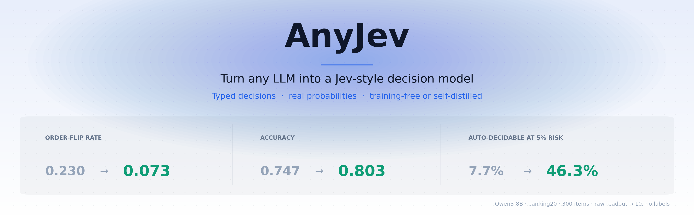</td>
<td align="center" valign="top"> تسجيل متحرك</td>
</tr></table>

🧪 <b><a href="https://github.com/allebee/jevk5">allebee/jevk5</a></b> · ⭐170 · Python · 🔎 inferred · 54 天

##### 📝 الوصف

JevK5: بديل مفتوح الأوزان لـ TypeSafe Jev. قرارات ذات أنواع مع احتمالات في تمريرة أمامية واحدة؛ أوزان Apache-2.0 وشيفرة.

##### 📌 معلومات أساسية

| الحقل  | القيمة                                 |
| ------ | -------------------------------------- |
| الفئة  | `التقييم والمعايرة والمقاييس المرجعية` |
| الأدلة | `inferred`                             |
| اللغة  | Python                                 |

##### 📊 البيانات

| المقياس   | القيمة     |
| --------- | ---------- |
| النجوم    | **170**    |
| آخر دفع   | 2026-09-28 |
| أول إدراج | 2026-10-29 |

🏷 `calibration` · `decision-model` · `jev` · `jev-alternative` · `jevbench` · `lora` · `qwen` · `system-one`

---

<table><tr><th align="center" width="50%">🖼 صورة</th><th align="center" width="50%">🎬 فيديو</th></tr><tr>
<td align="center" valign="top">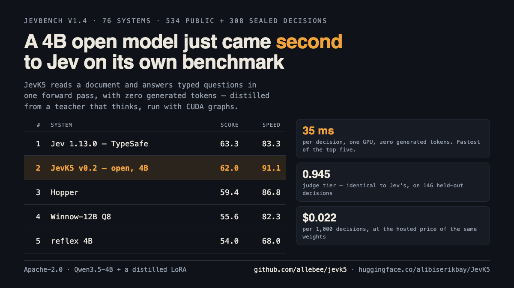</td>
<td align="center" valign="top"> تسجيل متحرك · <a href="https://raw.githubusercontent.com/allebee/jevk5/main/docs/demo/jevk5-nvidia-demo.mp4">افتح الفيديو</a></td>
</tr></table>

🧪 <b><a href="https://github.com/SimpleJev/JevAny">SimpleJev/JevAny</a></b> · ⭐141 · Python · 🔎 inferred · 0 天

##### 📝 الوصف

Open infrastructure for training, evaluating, and deploying System 1 decision models across language and multimodal backbones.

##### 📌 معلومات أساسية

| الحقل  | القيمة                                 |
| ------ | -------------------------------------- |
| الفئة  | `التقييم والمعايرة والمقاييس المرجعية` |
| الأدلة | `inferred`                             |
| اللغة  | Python                                 |

##### 📊 البيانات

| المقياس   | القيمة     |
| --------- | ---------- |
| النجوم    | **141**    |
| آخر دفع   | 2026-11-20 |
| أول إدراج | 2026-11-17 |

🏷 `decision-making` · `decision-model` · `jev` · `jev-ai` · `jev-model` · `lora` · `multimodal` · `reinforcement-learning`

---

<table><tr><th align="center" width="50%">🖼 صورة</th><th align="center" width="50%">🎬 فيديو</th></tr><tr>
<td align="center" valign="top"></td>
<td align="center" valign="top"> تسجيل متحرك · <a href="https://simplejev.org/JevAny/assets/media/docs/jev-agent-harness.mp4">افتح الفيديو</a></td>
</tr></table>

🧪 <b><a href="https://github.com/Heman10x-NGU/Verdict-open-jev">Heman10x-NGU/Verdict-open-jev</a></b> · ⭐119 · Python · 🔎 inferred · 30 天

##### 📝 الوصف

محرك قرارات غير تسلسلي ذاتيًا على ModernBERT (151M) مع عدم يقين مُعاير (RLCD)، وتدقيق معياري لـ TypeSafe AI Jev، وساحة WebGPU داخل المتصفح

##### 📌 معلومات أساسية

| الحقل  | القيمة                                 |
| ------ | -------------------------------------- |
| الفئة  | `التقييم والمعايرة والمقاييس المرجعية` |
| الأدلة | `inferred`                             |
| اللغة  | Python                                 |

##### 📊 البيانات

| المقياس   | القيمة     |
| --------- | ---------- |
| النجوم    | **119**    |
| آخر دفع   | 2026-10-21 |
| أول إدراج | 2026-09-18 |

🏷 `brier-score` · `calibration` · `decision-engine` · `edge-ai` · `gliclass` · `jev` · `modernbert` · `onnx`

---

<table><tr><th align="center" width="50%">🖼 صورة</th><th align="center" width="50%">🎬 فيديو</th></tr><tr>
<td align="center" valign="top"></td>
<td align="center" valign="top">لا وسائط منشورة</td>
</tr></table>

الأصل مرتبط مباشرة من المستودع المصدر لأنه لم تُعلَن أي رخصة تسمح بإعادة التوزيع.

🧪 <b><a href="https://github.com/ankit-aglawe/tinyjev">ankit-aglawe/tinyjev</a></b> · ⭐29 · Python · 🔎 inferred · 50 天

##### 📝 الوصف

نموذج صغير شبيه بـ jev يجيب عن أسئلة Choice وScore وNoul في تمريرة أمامية واحدة ويعيد احتمالات مُعايرة. MLX أو PyTorch، يعمل بالكامل دون اتصال، ومتوافق مع System One.

##### 📌 معلومات أساسية

| الحقل  | القيمة                                 |
| ------ | -------------------------------------- |
| الفئة  | `التقييم والمعايرة والمقاييس المرجعية` |
| الأدلة | `inferred`                             |
| اللغة  | Python                                 |

##### 📊 البيانات

| المقياس   | القيمة     |
| --------- | ---------- |
| النجوم    | **29**     |
| آخر دفع   | 2026-10-01 |
| أول إدراج | 2026-09-23 |

🏷 `decision-model` · `jev` · `jev-model` · `mlx` · `qwen3` · `small-language-models` · `system-one` · `typed-decisions`

---

<table><tr><th align="center" width="50%">🖼 صورة</th><th align="center" width="50%">🎬 فيديو</th></tr><tr>
<td align="center" valign="top"></td>
<td align="center" valign="top"> تسجيل متحرك</td>
</tr></table>

<b>المزيد في هذه الفئة</b> · 66

- [patryckalves/jev-no-enem](https://github.com/patryckalves/jev-no-enem) - مقياس أداء قابل لإعادة الإنتاج يقيّم Jev الخاص بـ TypeSafe AI.
- [vikawork/decision-models-calibration](https://github.com/vikawork/decision-models-calibration) - Decision APIs measured: Jev 1.14, gpt-6-luna Decisions and Gemini Decision 1 on…
- [buberlo/jev-trader](https://github.com/buberlo/jev-trader) - نظام لصنع السوق على مدار الساعة طوال أيام الأسبوع حول قرارات Jev.
- [shibing624/train-jev](https://github.com/shibing624/train-jev) - درّب نماذج قرار System 1 بأسلوب JEV على Qwen3.5 وQwen3.8-27B: رأس قرار من 24…
- [Enntity/sparkscore](https://github.com/Enntity/sparkscore) - Typed, calibrated decisions on one NVIDIA DGX Spark: d3-ultra 27B NVFP4 on…
- [SamratDuttaOfficial/WaterSheep](https://github.com/SamratDuttaOfficial/WaterSheep) - نموذج قرارات يُرجع إجابات مُعايرة لأسئلة نعم/لا، والاختيار، والدرجة، والتصنيفات…
- [BrendanH18/jev_fsd](https://github.com/BrendanH18/jev_fsd) - A driving test for AI models, on real Canadian streets, that you can also take…
- [Nhahan/Xevn](https://github.com/Nhahan/Xevn) - A 4B decision model built for Korean.
- [us/jev-local](https://github.com/us/jev-local) - خادم تقييم محلي متوافق مع Jev: POST /v1/systemone مع noul/choice/score ذات…
- [Algorythm-Canada/OpenJevSwift](https://github.com/Algorythm-Canada/OpenJevSwift) - Native Swift implementation of OpenJev, the Jev-compatible typed-decision…
- [mertkayacs/jevalt](https://github.com/mertkayacs/jevalt) - Three 4B decision models for English, Turkish and German, with per-option…
- [cablehead/jev.nu](https://github.com/cablehead/jev.nu) - وحدة Nushell لـ TypeSafe System One API: قرارات مكتوبة الأنواع مع احتمالات…
- [wondertwins/jev-benchmark](https://github.com/wondertwins/jev-benchmark) - اختبارات أداء وساحة تجريبية لنموذج Jev الخاص بـ TypeSafe (System One): الشطرنج،…
- [Yifan-Lan/awesome-jev-robustness](https://github.com/Yifan-Lan/awesome-jev-robustness) - اختبارات وتدقيقات معايرة ودراسات لأنماط فشل Jev (TypeSafe System One): التعرّج،…
- [ZhangYiqun018/jev-dimabsa](https://github.com/ZhangYiqun018/jev-dimabsa) - TypeSafe Jev (System One) على DimABSA، وSemEval-2026 Task 3 Track A، وجميع…
- [y0usaf/jev-lm](https://github.com/y0usaf/jev-lm) - نموذج لغوي على مستوى الكلمات تكون طبقة إخراجه Jev: مُنشئ n-gram، والتحقق من…
- [instax-dutta/sysone-bench](https://github.com/instax-dutta/sysone-bench) - أول معيار مستقل للمقارنة المباشرة بين نماذج قرار System One (Laya مقابل Jev)…
- [zamax14/Laya-Finetune](https://github.com/zamax14/Laya-Finetune) - اضبط Laya، نموذج القرارات المفتوح System One، لأي مهمة قرارات مكتوبة: بيانات…
- [mertkayacs/jevoss](https://github.com/mertkayacs/jevoss) - Evaluation tools for Jev-compatible decision models, covering accuracy…
- [CodyQin/zh-decision-bench](https://github.com/CodyQin/zh-decision-bench) - أول معيار معايرة باللغة الصينية لنماذج القرار من فئة Jev &#x27;System One&#x27;: مجموعة…
- [mpuig/system-one](https://github.com/mpuig/system-one) - نموذج قرارات System One مفتوح المصدر — وهو مصطلح Kahneman لملكة إصدار الأحكام…
- [tak-bro/local-jev-bench](https://github.com/tak-bro/local-jev-bench) - نماذج قرار محلية بأسلوب Jev من System One على أجهزة Mac المزودة بـ Apple…
- [AlanViollier/jev-vs-pii](https://github.com/AlanViollier/jev-vs-pii) - How good is Jev, a decision model, at finding personal information?
- [CosmoIknosLab/EarthJev](https://github.com/CosmoIknosLab/EarthJev) - EarthJev: calibrated, non-generative answers to natural-language questions…
- [etsabary/jev-deterministic-benchmark](https://github.com/etsabary/jev-deterministic-benchmark) - معيار سلوكي من 1,000 قرار لـJev عبر 25 عائلة من عائلات الاستدلال الحتمية.
- [Rushab1/gr-jev](https://github.com/Rushab1/gr-jev) - Code for.
- [Nefelim584/JEV_Judge](https://github.com/Nefelim584/JEV_Judge) - jev-lite: a ModernBERT-based typed decision model (Bool / Choice / Score) with…
- [teyhouse/jev-secret-detection](https://github.com/teyhouse/jev-secret-detection) - يقيس مدى جودة اكتشاف نموذج RLCD-Jev الخاص بـTypeSafe لبيانات اعتماد الأسرار…
- [beskvladimir-create/ru-jev](https://github.com/beskvladimir-create/ru-jev) - Ru-Jev: an open Russian typed-decision model.
- [capitaharlock/jev-clone](https://github.com/capitaharlock/jev-clone) - Open-source Jev clone: a local System One decision model for fast, calibrated…
- [EnesDemir143/jev-laya-benchmark](https://github.com/EnesDemir143/jev-laya-benchmark) - معيار محلي يقارن بين TypeSafe Jev وLaya-MLX لتصنيف المشكلات المهيكل.
- [lewistouchtech/opencode-jev-safe-compact](https://github.com/lewistouchtech/opencode-jev-safe-compact) - JEV-guided context compaction for OpenCode, built on a measured finding: noul…
- [xiaohuiyan/awesome-jev-papers](https://github.com/xiaohuiyan/awesome-jev-papers) - Curated arXiv papers on Jev, System One and typed decision models, with…
- [ZZKeepCurious/jev-system-one-survey](https://github.com/ZZKeepCurious/jev-system-one-survey) - System One 决策模型（Jev）技术调研：形态、机制、实现谱系与选型 · Technical survey of System One /…
- [113636xfh/jev-decision-head](https://github.com/113636xfh/jev-decision-head) - A lightweight Jev-style decision head, plus the Strata patches that let one…
- [agarwalastitwa027-svg/mini-jev-multimodal](https://github.com/agarwalastitwa027-svg/mini-jev-multimodal) - نموذج قرار صغير للصور والنصوص: Qwen3-VL-2B + LoRA + رأس إجابة يقيّم خياراتك في…
- [ankur287/jev-open-calibration](https://github.com/ankur287/jev-open-calibration) - Rebuilding Jev.
- [betulsimsek/jev-decomposition-tr](https://github.com/betulsimsek/jev-decomposition-tr) - Does splitting a typed-decision question help? Jev vs OpenAI Decisions vs Laya…
- [Chetax/jev-ecommerce-reviews](https://github.com/Chetax/jev-ecommerce-reviews) - E-commerce review classification with TypeSafe.
- [dnakhoa/jev-deferred-crispification](https://github.com/dnakhoa/jev-deferred-crispification) - ورقة موقف: بدائيات Hidden-Markov والضبابية المفقودة من نماذج قرار Jev الخاص…
- [HikaruEgashira/jev-algorithms](https://github.com/HikaruEgashira/jev-algorithms) - Runtime-agnostic algorithms built on TypeSafe.
- [himalaya-kaushik/mini-jev](https://github.com/himalaya-kaushik/mini-jev) - متى تنهار نماذج اتخاذ القرار بتمريرة واحدة: نموذج محلي على نمط Jev + 4 اختبارات…
- [Holovkat/jev-mark](https://github.com/Holovkat/jev-mark) - Benchmarking Local LLM.
- [n9omi/jev-calibration-audit](https://github.com/n9omi/jev-calibration-audit) - Independent calibration audit of TypeSafe AI.
- [Nijal-AI/jev-lab](https://github.com/Nijal-AI/jev-lab) - Atelier web pour mettre à l.
- [onlyoneaman/jev-eval](https://github.com/onlyoneaman/jev-eval) - Jev الخاص بـTypeSafe مقابل gpt-5.4-mini وgpt-5.6-luna على أربع مجموعات تصنيف…
- [open-factoryai/myJEV](https://github.com/open-factoryai/myJEV) - حوّل أي حالة إلى قرارات منظمة ومعايرة.
- [Poojithcodes/jev-calibration-study](https://github.com/Poojithcodes/jev-calibration-study) - Comparing Jev.
- [pramodklal/JEV](https://github.com/pramodklal/JEV) - Fast, type-safe AI decision model by TypeSafe AI.
- [rmax-ai/jev-vs-clef](https://github.com/rmax-ai/jev-vs-clef) - Head-to-head stress comparison of Jev (TypeSafe System One) vs Cloudflare Clef…
- [Teddy9710/jev-playground](https://github.com/Teddy9710/jev-playground) - بيئة تجارب محلية لـ TypeSafe System One (Jev): أنشئ أسئلة Choice/Noul/Score في…
- [unofficial-equivocation2029/Open-Jev](https://github.com/unofficial-equivocation2029/Open-Jev) - احصل فورًا على احتمالات قرارات مقيّدة بالأنواع من السياق والمرشحين — دون توليد…
- [UpHash-Network/mini-jev](https://github.com/UpHash-Network/mini-jev) - LogitTrail (المعروف سابقًا باسم Mini Jev): قرارات محلية مكتوبة قابلة للفحص،…
- [Zayan-droid/Jev](https://github.com/Zayan-droid/Jev) - Calibrated single-pass decision model: typed yes/no, choice and score questions…
- [taeold/djev-run](https://github.com/taeold/djev-run) - Serve the experimental DiffusionGemma-Jev diffusion model on Cloud Run GPUs…
- [kyotofin/tax-doc-classifier](https://github.com/kyotofin/tax-doc-classifier) - مصنّف لصفحات المستندات الضريبية مبني على قرارات Jev.
- [mohit67890/imajev](https://github.com/mohit67890/imajev) - نموذج قرارات مكتوب الأنواع مفتوح المصدر على نمط Jev ويتعامل أيضًا مع الصور…
- [hotchpotch/bekko-system-one](https://github.com/hotchpotch/bekko-system-one) - نماذج قرار صغيرة System One (17M–400M) لـ Yes/No وChoice وScore وإعادة الترتيب.
- [mithalouni/system-one-open](https://github.com/mithalouni/system-one-open) - نسخة مفتوحة من Jev الخاص بـ TypeSafe: قرارات معايرة مكتوبة الأنواع في تمريرة…
- [genai-craft/openvons](https://github.com/genai-craft/openvons) - openvons (open-Jev): طبقة قرار تجيب باحتمالات عن خيارات محدودة — نص / صور /…
- [arnabgho/rlcd-lite](https://github.com/arnabgho/rlcd-lite) - تعلم معزز مبسط للقرارات المعايرة: فك ترميز JSON مقيد بالتوازي + GRPO مع مكافآت…
- [nomadoor/ComfyUI-TypedDecision](https://github.com/nomadoor/ComfyUI-TypedDecision) - قرارات ذات أنواع (noul / choice / score) مع احتمالات معايرة في ComfyUI، على…
- [mithril-lang/typed-decisions](https://github.com/mithril-lang/typed-decisions) - نموذج قرار ذي أنواع على هيئة Jev.
- [Mangaba-ai/brier](https://github.com/Mangaba-ai/brier) - Brier, by Mangaba AI: typed, calibrated decisions (choice/score/noul) for…
- [KanishkaGD/decision-rerank](https://github.com/KanishkaGD/decision-rerank) - Zero-shot reranking and calibration of decision models (Jev, Laya) on TREC DL…
- [shamazharikh/qwen-rlcd](https://github.com/shamazharikh/qwen-rlcd) - نموذج قرار معاير على نمط Jev (Choice/Score/Noul) على Qwen3.5-0.8B.

## إعادة إنتاج مفتوحة وأوزان وبحوث في البنية

أوزان مفتوحة ونسخ مصغّرة وعمل على البنية. بعضها موجود لأن سلوك المعايرة لا يمكن إعادة إنتاجه من المواد العامة وحدها.

🔬 <b><a href="https://github.com/kshetrajna12/reflex">kshetrajna12/reflex</a></b> · ⭐175 · Python · 👁️ observed · 45 天

##### 📝 الوصف

نموذج قرار مفتوح صغير: الحالة + أسئلة مكتوبة النوع ← احتمالات معايرة. إعادة إنشاء Jev / System One على Qwen3.5.

> 💡 نموذج قرار مفتوح بواجهة الحالة والأسئلة المكتوبة النوع نفسها. يستحق القراءة كمرجع للبنية حتى إن لم تشغّله قط.

##### 📌 معلومات أساسية

| الحقل  | القيمة                                      |
| ------ | ------------------------------------------- |
| الفئة  | `إعادة إنتاج مفتوحة وأوزان وبحوث في البنية` |
| الأدلة | `observed`                                  |
| اللغة  | Python                                      |

##### 📊 البيانات

| المقياس   | القيمة     |
| --------- | ---------- |
| النجوم    | **175**    |
| آخر دفع   | 2026-10-06 |
| أول إدراج | 2026-11-20 |

🔬 <b><a href="https://github.com/TianyuCodings/NanoJev">TianyuCodings/NanoJev</a></b> · ⭐2604 · Python · 🔎 inferred · 36 天

##### 📝 الوصف

نسخة نانوية من Jev: قرارات متوازية، ومرشحون ديناميكيون، وخط أنابيب تدريب شامل من البداية إلى النهاية.

> 💡 نسخة صغيرة من بنية القرار المتوازي. مفيدة لقراءة المعمارية دون حزمة المورّد، وهي الطريقة التي أصبح بها العديد من الادعاءات حول الواجهة قابلة للتحقق أول مرة.

##### 📌 معلومات أساسية

| الحقل  | القيمة                                      |
| ------ | ------------------------------------------- |
| الفئة  | `إعادة إنتاج مفتوحة وأوزان وبحوث في البنية` |
| الأدلة | `inferred`                                  |
| اللغة  | Python                                      |

##### 📊 البيانات

| المقياس   | القيمة     |
| --------- | ---------- |
| النجوم    | **2604**   |
| آخر دفع   | 2026-10-16 |
| أول إدراج | 2026-11-08 |

---

<table><tr><th align="center" width="50%">🖼 صورة</th><th align="center" width="50%">🎬 فيديو</th></tr><tr>
<td align="center" valign="top">لا وسائط منشورة</td>
<td align="center" valign="top"> تسجيل متحرك</td>
</tr></table>

🔬 <b><a href="https://github.com/r-ms/mini-jev">r-ms/mini-jev</a></b> · ⭐64 · Python · 🔎 inferred · 64 天

##### 📝 الوصف

mini-Jev: كيف تبدو واجهة قرار مُنمّط بأسلوب Jev على Qwen3-4B مُجمّد — اقرأ logits لحرف الخيار بدلًا من توليد JSON. تجربة مسجّلة مسبقًا، ونتائج، ومنصة تعليمية.

> 💡 أكثر إعادة إنتاج مستقلة فائدة للقراءة: تُظهر آلية قراءة logits وهي تعمل، وتحذّر أيضًا صراحةً من أن الحصة التي تقرؤها ليست احتمالًا مُعايرًا. هذا التحذير هو أهم تحفظ منفرد في هذا النظام البيئي.

##### 📌 معلومات أساسية

| الحقل  | القيمة                                      |
| ------ | ------------------------------------------- |
| الفئة  | `إعادة إنتاج مفتوحة وأوزان وبحوث في البنية` |
| الأدلة | `inferred`                                  |
| اللغة  | Python                                      |

##### 📊 البيانات

| المقياس   | القيمة     |
| --------- | ---------- |
| النجوم    | **64**     |
| آخر دفع   | 2026-09-18 |
| أول إدراج | 2026-09-18 |

---

<table><tr><th align="center" width="50%">🖼 صورة</th><th align="center" width="50%">🎬 فيديو</th></tr><tr>
<td align="center" valign="top"></td>
<td align="center" valign="top">لا وسائط منشورة</td>
</tr></table>

🔬 <b><a href="https://github.com/FBddcz/embodied-jev">FBddcz/embodied-jev</a></b> · ⭐342 · Python · 👁️ observed · 60 天

##### 📝 الوصف

EmbodiedJev: طاولة عمل لقرارات الروبوتات في MuJoCo مع MiniCPM5-2B وJev ونموذج APIs متوافق

🔧 وُجد مستخدمًا في الشيفرة: `README.md`

##### 📌 معلومات أساسية

| الحقل  | القيمة                                      |
| ------ | ------------------------------------------- |
| الفئة  | `إعادة إنتاج مفتوحة وأوزان وبحوث في البنية` |
| الأدلة | `observed`                                  |
| اللغة  | Python                                      |

##### 📊 البيانات

| المقياس   | القيمة     |
| --------- | ---------- |
| النجوم    | **342**    |
| آخر دفع   | 2026-09-22 |
| أول إدراج | 2026-11-08 |

---

<table><tr><th align="center" width="50%">🖼 صورة</th><th align="center" width="50%">🎬 فيديو</th></tr><tr>
<td align="center" valign="top"></td>
<td align="center" valign="top"> تسجيل متحرك · <a href="https://raw.githubusercontent.com/FBddcz/embodied-jev/main/docs/media/libero-drawer-comparison.mp4">افتح الفيديو</a></td>
</tr></table>

🔬 <b><a href="https://github.com/PsiACE/dohnuts">PsiACE/dohnuts</a></b> · ⭐40 · Python · 👁️ observed · 45 天

##### 📝 الوصف

يبني Dohnuts نماذج صغيرة متعددة الوسائط لاتخاذ قرارات مباشرة. -> نموذج System One

##### 📌 معلومات أساسية

| الحقل  | القيمة                                      |
| ------ | ------------------------------------------- |
| الفئة  | `إعادة إنتاج مفتوحة وأوزان وبحوث في البنية` |
| الأدلة | `observed`                                  |
| اللغة  | Python                                      |

##### 📊 البيانات

| المقياس   | القيمة     |
| --------- | ---------- |
| النجوم    | **40**     |
| آخر دفع   | 2026-10-06 |
| أول إدراج | 2026-09-21 |

🏷 `decision-model` · `jev` · `laya` · `llm` · `lora` · `rlcd` · `system-one` · `typesafe`

---

<table><tr><th align="center" width="50%">🖼 صورة</th><th align="center" width="50%">🎬 فيديو</th></tr><tr>
<td align="center" valign="top"></td>
<td align="center" valign="top">لا وسائط منشورة</td>
</tr></table>

🔬 <b><a href="https://github.com/themusebook/clawd-jev-trading-machine">themusebook/clawd-jev-trading-machine</a></b> · ⭐1 · Python · 👁️ observed · 56 天

##### 📝 الوصف

آلة تداول clawd-JEV: متداول ورقي لـ JEV-on-Solana. عقل TypeSafe jev-latest، ومساحة إجراءات ديناميكية، ونظام CoinGecko + ذاكرة Supermemory، ومنصتا Jupiter/DFlow. تشغيل تجريبي فقط.

##### 📌 معلومات أساسية

| الحقل  | القيمة                                      |
| ------ | ------------------------------------------- |
| الفئة  | `إعادة إنتاج مفتوحة وأوزان وبحوث في البنية` |
| الأدلة | `observed`                                  |
| اللغة  | Python                                      |

##### 📊 البيانات

| المقياس   | القيمة     |
| --------- | ---------- |
| النجوم    | **1**      |
| آخر دفع   | 2026-09-25 |
| أول إدراج | 2026-11-01 |

🔬 <b><a href="https://github.com/BipinRajC/Jev-api-experiments">BipinRajC/Jev-api-experiments</a></b> · Python · 👁️ observed · 33 天

##### 📝 الوصف

تجارب تجريبية وأبحاث API لنموذج System One Jev الخاص بـ TypeSafe المدرّب باستخدام RLCD

##### 📌 معلومات أساسية

| الحقل  | القيمة                                      |
| ------ | ------------------------------------------- |
| الفئة  | `إعادة إنتاج مفتوحة وأوزان وبحوث في البنية` |
| الأدلة | `observed`                                  |
| اللغة  | Python                                      |

##### 📊 البيانات

| المقياس   | القيمة     |
| --------- | ---------- |
| النجوم    | **0**      |
| آخر دفع   | 2026-10-18 |
| أول إدراج | 2026-09-22 |

🏷 `api` · `experimental` · `jev` · `rlcd` · `typesafe-ai`

🔬 <b><a href="https://huggingface.co/haohan84/v-jev1.4">haohan84/v-jev1.4</a></b> · model · 👁️ observed · 9 天

##### 📝 الوصف

لم يُنشر أي وصف من المستودع المصدر.

##### 📌 معلومات أساسية

| الحقل  | القيمة                                      |
| ------ | ------------------------------------------- |
| الفئة  | `إعادة إنتاج مفتوحة وأوزان وبحوث في البنية` |
| الأدلة | `observed`                                  |

##### 📊 البيانات

| المقياس   | القيمة     |
| --------- | ---------- |
| أول إدراج | 2026-11-12 |

🏷 `transformers` · `safetensors` · `v-jev` · `jev` · `systemone` · `decision-model` · `information-extraction` · `vision`

🔬 <b><a href="https://github.com/Manishekhar001/mini-clm">Manishekhar001/mini-clm</a></b> · Python · 👁️ observed · 1 天

##### 📝 الوصف

It is system one model, where it acts as a zero shot classification model.

##### 📌 معلومات أساسية

| الحقل  | القيمة                                      |
| ------ | ------------------------------------------- |
| الفئة  | `إعادة إنتاج مفتوحة وأوزان وبحوث في البنية` |
| الأدلة | `observed`                                  |
| اللغة  | Python                                      |

##### 📊 البيانات

| المقياس   | القيمة     |
| --------- | ---------- |
| النجوم    | **0**      |
| آخر دفع   | 2026-11-20 |
| أول إدراج | 2026-11-18 |

🔬 <b><a href="https://huggingface.co/mradermacher/JEV-9B-GGUF">mradermacher/JEV-9B-GGUF</a></b> · model · 👁️ observed · 7 天

##### 📝 الوصف

لم يُنشر أي وصف من المستودع المصدر.

##### 📌 معلومات أساسية

| الحقل  | القيمة                                      |
| ------ | ------------------------------------------- |
| الفئة  | `إعادة إنتاج مفتوحة وأوزان وبحوث في البنية` |
| الأدلة | `observed`                                  |

##### 📊 البيانات

| المقياس   | القيمة     |
| --------- | ---------- |
| أول إدراج | 2026-11-14 |

🏷 `transformers` · `gguf` · `system-one` · `system-two` · `blocks-of-experts` · `typed-decisions` · `decision-model` · `calibrated-probabilities`

🔬 <b><a href="https://github.com/nithiljn/System-One-Models">nithiljn/System-One-Models</a></b> · Python · 👁️ observed · 3 天

##### 📝 الوصف

A beginner friendly guide and code examples for Google's Gemini Decisions API (gemini-decision-1) fast System-1 decisions with zero output token cost, explained in English & Tanglish.

##### 📌 معلومات أساسية

| الحقل  | القيمة                                      |
| ------ | ------------------------------------------- |
| الفئة  | `إعادة إنتاج مفتوحة وأوزان وبحوث في البنية` |
| الأدلة | `observed`                                  |
| اللغة  | Python                                      |

##### 📊 البيانات

| المقياس   | القيمة     |
| --------- | ---------- |
| النجوم    | **0**      |
| آخر دفع   | 2026-11-17 |
| أول إدراج | 2026-11-12 |

🔬 <b><a href="https://github.com/mizorewww/laya-mlx">mizorewww/laya-mlx</a></b> · ⭐7115 · Python · 🔎 inferred · 0 天 · ⭐+1

##### 📝 الوصف

Native MLX runtime for Laya typed decision models — 7–14 ms short decisions on M3 Max. No text generation, PyTorch, or cloud API.

##### 📌 معلومات أساسية

| الحقل  | القيمة                                      |
| ------ | ------------------------------------------- |
| الفئة  | `إعادة إنتاج مفتوحة وأوزان وبحوث في البنية` |
| الأدلة | `inferred`                                  |
| اللغة  | Python                                      |

##### 📊 البيانات

| المقياس   | القيمة        |
| --------- | ------------- |
| النجوم    | **7115** (+1) |
| آخر دفع   | 2026-11-21    |
| أول إدراج | 2026-11-16    |

🏷 `apple-silicon` · `decision-model` · `inference` · `laya` · `local-ai` · `machine-learning` · `mlx` · `modernbert`

---

<table><tr><th align="center" width="50%">🖼 صورة</th><th align="center" width="50%">🎬 فيديو</th></tr><tr>
<td align="center" valign="top"></td>
<td align="center" valign="top"> تسجيل متحرك</td>
</tr></table>

🔬 <b><a href="https://github.com/TheoLeeCJ/SemIf-OpenJev">TheoLeeCJ/SemIf-OpenJev</a></b> · ⭐4970 · Python · 🔎 inferred · 58 天

##### 📝 الوصف

Semantic ifs من نماذج مفتوحة، على جهاز 3090 في المنزل. مستقل؛ وغير تابع لـ Jev أو TypeSafe.

##### 📌 معلومات أساسية

| الحقل  | القيمة                                      |
| ------ | ------------------------------------------- |
| الفئة  | `إعادة إنتاج مفتوحة وأوزان وبحوث في البنية` |
| الأدلة | `inferred`                                  |
| اللغة  | Python                                      |

##### 📊 البيانات

| المقياس   | القيمة     |
| --------- | ---------- |
| النجوم    | **4970**   |
| آخر دفع   | 2026-09-23 |
| أول إدراج | 2026-10-29 |

---

<table><tr><th align="center" width="50%">🖼 صورة</th><th align="center" width="50%">🎬 فيديو</th></tr><tr>
<td align="center" valign="top"></td>
<td align="center" valign="top"> تسجيل متحرك</td>
</tr></table>

🔬 <b><a href="https://github.com/mode-io/vllm-jev">mode-io/vllm-jev</a></b> · ⭐955 · Python · 🔎 inferred · 29 天

##### 📝 الوصف

تقديم أصلي لـ vLLM لنماذج اتخاذ القرار Jev

##### 📌 معلومات أساسية

| الحقل  | القيمة                                      |
| ------ | ------------------------------------------- |
| الفئة  | `إعادة إنتاج مفتوحة وأوزان وبحوث في البنية` |
| الأدلة | `inferred`                                  |
| اللغة  | Python                                      |

##### 📊 البيانات

| المقياس   | القيمة     |
| --------- | ---------- |
| النجوم    | **955**    |
| آخر دفع   | 2026-10-22 |
| أول إدراج | 2026-11-08 |

---

<table><tr><th align="center" width="50%">🖼 صورة</th><th align="center" width="50%">🎬 فيديو</th></tr><tr>
<td align="center" valign="top">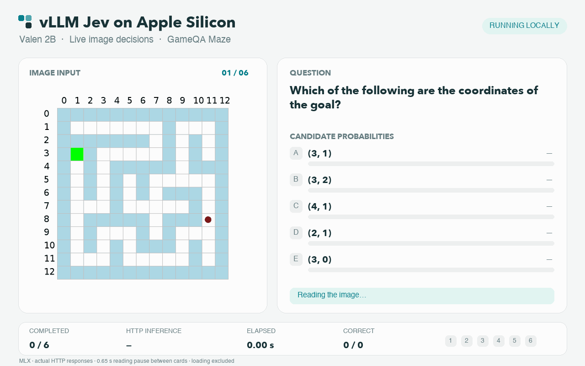</td>
<td align="center" valign="top"> تسجيل متحرك · <a href="https://raw.githubusercontent.com/mode-io/vllm-jev/main/docs/assets/valen-video-live.mp4">افتح الفيديو</a></td>
</tr></table>

🔬 <b><a href="https://github.com/Valen-Team/Valen">Valen-Team/Valen</a></b> · ⭐932 · Python · 🔎 inferred · 5 天

##### 📝 الوصف

Open multimodal decision models, 0.8B to 27B, for text, images and video. Decide with probabilities over your own candidates and locate with bounding boxes, in place of generated text. Free API, ONNX, GGUF, vLLM and SGLang; fine-tuning code included.

##### 📌 معلومات أساسية

| الحقل  | القيمة                                      |
| ------ | ------------------------------------------- |
| الفئة  | `إعادة إنتاج مفتوحة وأوزان وبحوث في البنية` |
| الأدلة | `inferred`                                  |
| اللغة  | Python                                      |

##### 📊 البيانات

| المقياس   | القيمة     |
| --------- | ---------- |
| النجوم    | **932**    |
| آخر دفع   | 2026-11-15 |
| أول إدراج | 2026-10-29 |

🏷 `decision-model` · `fine-tuning` · `gguf` · `jev` · `multimodal` · `onnx` · `structured-output` · `system-one`

---

<table><tr><th align="center" width="50%">🖼 صورة</th><th align="center" width="50%">🎬 فيديو</th></tr><tr>
<td align="center" valign="top">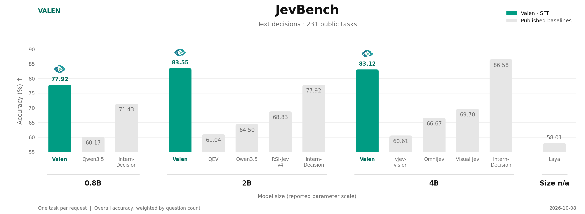</td>
<td align="center" valign="top"> تسجيل متحرك</td>
</tr></table>

🔬 <b><a href="https://github.com/featherless-ai/simple-jev">featherless-ai/simple-jev</a></b> · ⭐661 · Python · 🔎 inferred · 9 天

##### 📝 الوصف

حوّل أي نموذج مفتوح إلى مصنّف/نقطة نهاية jev

##### 📌 معلومات أساسية

| الحقل  | القيمة                                      |
| ------ | ------------------------------------------- |
| الفئة  | `إعادة إنتاج مفتوحة وأوزان وبحوث في البنية` |
| الأدلة | `inferred`                                  |
| اللغة  | Python                                      |

##### 📊 البيانات

| المقياس   | القيمة     |
| --------- | ---------- |
| النجوم    | **661**    |
| آخر دفع   | 2026-11-11 |
| أول إدراج | 2026-11-08 |

---

<table><tr><th align="center" width="50%">🖼 صورة</th><th align="center" width="50%">🎬 فيديو</th></tr><tr>
<td align="center" valign="top"></td>
<td align="center" valign="top">لا وسائط منشورة</td>
</tr></table>

🔬 <b><a href="https://github.com/tomerglick57/Jevstiller">tomerglick57/Jevstiller</a></b> · ⭐83 · Python · 🔎 inferred · 10 天

##### 📝 الوصف

استخلص مهمة تصنيف Jev متكررة في نموذج محلي، فورًا — نفس الإجابات، وعلى عتادك.

##### 📌 معلومات أساسية

| الحقل  | القيمة                                      |
| ------ | ------------------------------------------- |
| الفئة  | `إعادة إنتاج مفتوحة وأوزان وبحوث في البنية` |
| الأدلة | `inferred`                                  |
| اللغة  | Python                                      |

##### 📊 البيانات

| المقياس   | القيمة     |
| --------- | ---------- |
| النجوم    | **83**     |
| آخر دفع   | 2026-11-11 |
| أول إدراج | 2026-10-29 |

🏷 `classification` · `distillation` · `jev` · `knowledge-distillation` · `llm` · `mlops` · `model-cascade` · `python`

---

<table><tr><th align="center" width="50%">🖼 صورة</th><th align="center" width="50%">🎬 فيديو</th></tr><tr>
<td align="center" valign="top"></td>
<td align="center" valign="top"> تسجيل متحرك</td>
</tr></table>

🔬 <b><a href="https://github.com/alvarobartt/sys1">alvarobartt/sys1</a></b> · ⭐62 · Rust · 🔎 inferred · 13 天

##### 📝 الوصف

قرارات منظمة فائقة السرعة ومستضافة ذاتيًا للنماذج المفتوحة مع API متوافق مع TypeSafe AI، ومكتوبة بلغة Rust.

##### 📌 معلومات أساسية

| الحقل  | القيمة                                      |
| ------ | ------------------------------------------- |
| الفئة  | `إعادة إنتاج مفتوحة وأوزان وبحوث في البنية` |
| الأدلة | `inferred`                                  |
| اللغة  | Rust                                        |

##### 📊 البيانات

| المقياس   | القيمة     |
| --------- | ---------- |
| النجوم    | **62**     |
| آخر دفع   | 2026-11-08 |
| أول إدراج | 2026-10-29 |

🏷 `clef` · `decision-model` · `decisions-api` · `huggingface` · `inference-server` · `jev` · `laya` · `self-hosted`

---

<table><tr><th align="center" width="50%">🖼 صورة</th><th align="center" width="50%">🎬 فيديو</th></tr><tr>
<td align="center" valign="top"></td>
<td align="center" valign="top">لا وسائط منشورة</td>
</tr></table>

<b>المزيد في هذه الفئة</b> · 37

- [wfzyx/von](https://github.com/wfzyx/von) - نموذج قرارات System One مفتوح المصدر. بديل محلي غير تسلسلي ذاتيًا ومتوافق…
- [ekzhang/openjev-sglang](https://github.com/ekzhang/openjev-sglang) - نقطة نهاية API متوافقة مع Jev ومبنية على نماذج مفتوحة (الملء المسبق فقط).
- [hyperspaceai/jevcache](https://github.com/hyperspaceai/jevcache) - ذاكرة تخزين مؤقت للقرارات لنماذج من فئة TypeSafe Jev — خزّن القرارات مؤقتًا كي…
- [mars-tw/jev-trading-command-center](https://github.com/mars-tw/jev-trading-command-center) - Open-source paper-trading research app integrating TypeSafe Jev, animated 3D…
- [mattt/AnyDecisionModel](https://github.com/mattt/AnyDecisionModel) - A Swift package for typed decisions from language models.
- [hunkim/solar-mini4-jev](https://github.com/hunkim/solar-mini4-jev)
- [Xiaooolong/vev](https://github.com/Xiaooolong/vev) - Jev-like decision models that can also see images — open weights on Qwen3.5…
- [amithgc/local-jev](https://github.com/amithgc/local-jev) - خادم System One محلي وغير متصل بالإنترنت متوافق مع Jev API الخاص بـ TypeSafe.
- [OpenLAIR/lev](https://github.com/OpenLAIR/lev) - Lev: Thinking Fast and Deep with Looped Decision Models.
- [whyashthakker/awesome-jev-use-cases](https://github.com/whyashthakker/awesome-jev-use-cases) - قائمة رائعة لحالات استخدام Jev. مقارنةً بنماذج GPT (LLMs) من حيث التكلفة…
- [ljwwwiop/JEV-mini](https://github.com/ljwwwiop/JEV-mini) - JEV-mini مشروع تعلّم مصغّر لتدريب نموذج سريع لاتخاذ القرارات.
- [pCwOrM/werr](https://github.com/pCwOrM/werr) - Zero-memory System-1 decision engine &amp; TypeSafe Jev runtime powered by…
- [deep-diver/mini-jev](https://github.com/deep-diver/mini-jev)
- [skydiving94/klint](https://github.com/skydiving94/klint) - مدقق دلالي تصريحي ومدقق معماري للشيفرة لنماذج kev المحلية ذات الأوزان المفتوحة…
- [yuting-ai/minicpm5-2b-jev](https://github.com/yuting-ai/minicpm5-2b-jev) - MiniCPM5-2B-Jev: نموذج قرار System 1 عالي السرعة.
- [Frank-Funney/mini-jev](https://github.com/Frank-Funney/mini-jev) - محرك قرارات بنيوية فائق الخفة لأجهزة الحافة. بدون تبعيات &lt;10MB، ‏11378 QPS.
- [welcomeenjoy75-hue/mini-jev](https://github.com/welcomeenjoy75-hue/mini-jev) - محرك قرارات بنيوية فائق الخفة لأجهزة الحافة.
- [AbdelStark/reachy-jev](https://github.com/AbdelStark/reachy-jev) - بدائيات قرارات Jev مكتوبة لتطبيقات Reachy Mini.
- [AnilDeshpande/jev-youtube-demo](https://github.com/AnilDeshpande/jev-youtube-demo) - Jev (TypeSafe) مقابل GPT-4o-mini: تصنيف تعليقات YouTube باستخدام نموذج حكم…
- [Dlmily/minimind-jev-dlmily](https://github.com/Dlmily/minimind-jev-dlmily) - MiniMind Jev probability scoring page (GitHub Pages).
- [Drykeeightyeight427/jev-robot-control](https://github.com/Drykeeightyeight427/jev-robot-control) - قارن بين GPT-6 Astra وGPT-4.1 mini وJev أثناء التحكم في xArm7 في MuJoCo عبر…
- [emilesilvis/jev-experiment](https://github.com/emilesilvis/jev-experiment) - تجارب تصنيف Jev وGPT-4o mini القابلة لإعادة الإنتاج، والنتائج، والتقرير…
- [gbesse/jev-minimis-watch](https://github.com/gbesse/jev-minimis-watch) - التحضير لمراجعة تراكمات مساعدات de minimis انطلاقًا من عناصر موثقة بالمصادر.
- [jobakk/jev-cj-asap](https://github.com/jobakk/jev-cj-asap) - تقييم مقارن لمقالات ASAP بواسطة Jev (API، نموذج قرار)، وgpt-oss-20b…
- [luckberonne/mini-jev](https://github.com/luckberonne/mini-jev) - مصنّف أوامر shell بتمريرة واحدة (للقراءة فقط / قابل للعكس / هدّام)، مستوحى من…
- [MarwaneAit-mouloud/reachy-jev](https://github.com/MarwaneAit-mouloud/reachy-jev) - Reachy Mini contrôle les commandes : modèles de décision (Jev, OpenAI) contre…
- [u007/minicpm5-jev](https://github.com/u007/minicpm5-jev) - MiniCPM5-2B-8bit كخدمة قرارات مكتوبة متوافقة مع Jev على Apple Silicon ‏.
- [Van5hdeep/mini-jev](https://github.com/Van5hdeep/mini-jev) - نموذج بسيط مُدرَّب مستوحى من jev.
- [vicfei/minimind-jev](https://github.com/vicfei/minimind-jev) - Train your own tiny Jev (System One decision model) — v0.1: frozen Chinese…
- [wangjunxiao/MiniJev](https://github.com/wangjunxiao/MiniJev) - A lightweight and easy-to-follow implementation of Jev.
- [imikerussell/beebots](https://github.com/imikerussell/beebots) - ثلاثة روبوتات تداول بالذكاء الاصطناعي على OKX، وكل قرار يتخذه Jev.
- [apiplant/laya-rs](https://github.com/apiplant/laya-rs) - إعادة تنفيذ Rust لـ Laya، محرك قرارات مُمَيَّزة غير ذاتي الانحدار بزمن أقل من…
- [ninehills/x-ai-detect](https://github.com/ninehills/x-ai-detect) - Anti-XAI: Chrome extension &amp; dataset labeler for detecting AI Slop replies on X…
- [Astro-Han/decision-head-rlcd](https://github.com/Astro-Han/decision-head-rlcd) - من أين يأتي تعميم نموذج القرار؟ RLCD على Qwen3.5-4B، ومجموعات محجوزة مجمعة حسب…
- [smixs/jevchik](https://github.com/smixs/jevchik) - Telegram bot for group chats: karma for useful messages, anti-spam for…
- [vicksiyi/qwen-2.5-1b-rlcd](https://github.com/vicksiyi/qwen-2.5-1b-rlcd) - عرض توضيحي محلي لاحتمالات قرارات MLX مشتق من harshatheg/Qwen-2.5-1B-RLCD على…
- [yangshun2005/laya-cn](https://github.com/yangshun2005/laya-cn) - \[تعريب صيني\] محرّك قرارات System 1 متعدد اللغات وغير ارتجاعي.

## تطبيقات وألعاب وروبوتات وعروض تفاعلية

ألعاب وروبوتات ومتصفحات ولوحات معلومات. العروض التجريبية هي ما يجعل ادعاءات الكمون والتكلفة مقروءة.

🎮 <b><a href="https://github.com/heyjunpenn/awesome-jev">heyjunpenn/awesome-jev</a></b> · ⭐1089 · Astro · 👁️ observed · 9 天 · ⭐+1

##### 📝 الوصف

A verified, community-maintained catalog of 997 open-source projects built with Jev.

🔧 وُجد مستخدمًا في الشيفرة: `README.md`, `CHANGELOG.md`, `README.ko.md`, `README.es.md`

##### 📌 معلومات أساسية

| الحقل  | القيمة                                  |
| ------ | --------------------------------------- |
| الفئة  | `تطبيقات وألعاب وروبوتات وعروض تفاعلية` |
| الأدلة | `observed`                              |
| اللغة  | Astro                                   |

##### 📊 البيانات

| المقياس   | القيمة        |
| --------- | ------------- |
| النجوم    | **1089** (+1) |
| آخر دفع   | 2026-11-12    |
| أول إدراج | 2026-10-29    |

🏷 `astro` · `awesome` · `awesome-jev` · `awesome-list` · `jev` · `typesafe`

🎮 <b><a href="https://github.com/droidrun/mobile-jev">droidrun/mobile-jev</a></b> · ⭐473 · JavaScript · 👁️ observed · 65 天

##### 📝 الوصف

لم يُنشر أي وصف من المستودع المصدر.

🔧 وُجد مستخدمًا في الشيفرة: `README.md`

##### 📌 معلومات أساسية

| الحقل  | القيمة                                  |
| ------ | --------------------------------------- |
| الفئة  | `تطبيقات وألعاب وروبوتات وعروض تفاعلية` |
| الأدلة | `observed`                              |
| اللغة  | JavaScript                              |

##### 📊 البيانات

| المقياس   | القيمة     |
| --------- | ---------- |
| النجوم    | **473**    |
| آخر دفع   | 2026-09-17 |
| أول إدراج | 2026-11-08 |

🎮 <b><a href="https://github.com/MCG-NJU/VideoJev">MCG-NJU/VideoJev</a></b> · ⭐317 · Python · 👁️ observed · 34 天

##### 📝 الوصف

VideoJev: System One Model لفهم الفيديو والتفاعل معه

##### 📌 معلومات أساسية

| الحقل  | القيمة                                  |
| ------ | --------------------------------------- |
| الفئة  | `تطبيقات وألعاب وروبوتات وعروض تفاعلية` |
| الأدلة | `observed`                              |
| اللغة  | Python                                  |

##### 📊 البيانات

| المقياس   | القيمة     |
| --------- | ---------- |
| النجوم    | **317**    |
| آخر دفع   | 2026-10-18 |
| أول إدراج | 2026-11-20 |

---

<table><tr><th align="center" width="50%">🖼 صورة</th><th align="center" width="50%">🎬 فيديو</th></tr><tr>
<td align="center" valign="top"></td>
<td align="center" valign="top">لا وسائط منشورة</td>
</tr></table>

🎮 <b><a href="https://github.com/mrnugget/jev-shell-history">mrnugget/jev-shell-history</a></b> · ⭐121 · TypeScript · 👁️ observed · 64 天

##### 📝 الوصف

اقتراحات تلقائية لسجل zsh بأسلوب Fish مرتبة حسب Jev (TypeSafe)

🔧 وُجد مستخدمًا في الشيفرة: `README.md`

##### 📌 معلومات أساسية

| الحقل  | القيمة                                  |
| ------ | --------------------------------------- |
| الفئة  | `تطبيقات وألعاب وروبوتات وعروض تفاعلية` |
| الأدلة | `observed`                              |
| اللغة  | TypeScript                              |

##### 📊 البيانات

| المقياس   | القيمة     |
| --------- | ---------- |
| النجوم    | **121**    |
| آخر دفع   | 2026-09-18 |
| أول إدراج | 2026-10-29 |

---

<table><tr><th align="center" width="50%">🖼 صورة</th><th align="center" width="50%">🎬 فيديو</th></tr><tr>
<td align="center" valign="top"></td>
<td align="center" valign="top"> تسجيل متحرك</td>
</tr></table>

الأصل مرتبط مباشرة من المستودع المصدر لأنه لم تُعلَن أي رخصة تسمح بإعادة التوزيع.

🎮 <b><a href="https://github.com/realZachi/typesafe-adblock">realZachi/typesafe-adblock</a></b> · ⭐97 · JavaScript · 👁️ observed · 64 天

##### 📝 الوصف

🧹 مشروع ممتع: إضافة Chrome تسأل نموذج قرار صغيرًا للذكاء الاصطناعي (TypeSafe Jev) «هل عنصر DOM هذا إعلان؟» ثم تزيله من الصفحة. BYOK، بلا واجهة خلفية، وليست أداة حقيقية لحجب الإعلانات.

🔧 وُجد مستخدمًا في الشيفرة: `README.md`

##### 📌 معلومات أساسية

| الحقل  | القيمة                                  |
| ------ | --------------------------------------- |
| الفئة  | `تطبيقات وألعاب وروبوتات وعروض تفاعلية` |
| الأدلة | `observed`                              |
| اللغة  | JavaScript                              |

##### 📊 البيانات

| المقياس   | القيمة     |
| --------- | ---------- |
| النجوم    | **97**     |
| آخر دفع   | 2026-09-17 |
| أول إدراج | 2026-10-29 |

🎮 <b><a href="https://github.com/zadescoxp/Jev-Trades">zadescoxp/Jev-Trades</a></b> · ⭐76 · Python · 👁️ observed · 56 天

##### 📝 الوصف

روبوت تداول مع نموذج النظام الأول الجديد كليًا لـ TypeSafe AI والمسمّى Jev

##### 📌 معلومات أساسية

| الحقل  | القيمة                                  |
| ------ | --------------------------------------- |
| الفئة  | `تطبيقات وألعاب وروبوتات وعروض تفاعلية` |
| الأدلة | `observed`                              |
| اللغة  | Python                                  |

##### 📊 البيانات

| المقياس   | القيمة     |
| --------- | ---------- |
| النجوم    | **76**     |
| آخر دفع   | 2026-09-25 |
| أول إدراج | 2026-10-21 |

🏷 `automated-testing` · `backtesting` · `crypto-trading-bot-latest` · `trading-bot-ai-automated`

---

<table><tr><th align="center" width="50%">🖼 صورة</th><th align="center" width="50%">🎬 فيديو</th></tr><tr>
<td align="center" valign="top"></td>
<td align="center" valign="top"> تسجيل متحرك</td>
</tr></table>

🎮 <b><a href="https://github.com/dfinke/Jev">dfinke/Jev</a></b> · ⭐11 · PowerShell · 👁️ observed · 36 天

##### 📝 الوصف

قرارات PowerShell باستخدام نموذج Jev الخاص بـTypeSafe AI: https://typesafe.ai/blog/introducing-system-one-models-and-jev

##### 📌 معلومات أساسية

| الحقل  | القيمة                                  |
| ------ | --------------------------------------- |
| الفئة  | `تطبيقات وألعاب وروبوتات وعروض تفاعلية` |
| الأدلة | `observed`                              |
| اللغة  | PowerShell                              |

##### 📊 البيانات

| المقياس   | القيمة     |
| --------- | ---------- |
| النجوم    | **11**     |
| آخر دفع   | 2026-10-16 |
| أول إدراج | 2026-10-28 |

---

<table><tr><th align="center" width="50%">🖼 صورة</th><th align="center" width="50%">🎬 فيديو</th></tr><tr>
<td align="center" valign="top"></td>
<td align="center" valign="top">لا وسائط منشورة</td>
</tr></table>

🎮 <b><a href="https://github.com/southleft/component-charades">southleft/component-charades</a></b> · ⭐2 · TypeScript · 👁️ observed · 4 天

##### 📝 الوصف

A Taboo-style parlour game for design systems, refereed by Jev (TypeSafe System One model)

##### 📌 معلومات أساسية

| الحقل  | القيمة                                  |
| ------ | --------------------------------------- |
| الفئة  | `تطبيقات وألعاب وروبوتات وعروض تفاعلية` |
| الأدلة | `observed`                              |
| اللغة  | TypeScript                              |

##### 📊 البيانات

| المقياس   | القيمة     |
| --------- | ---------- |
| النجوم    | **2**      |
| آخر دفع   | 2026-11-17 |
| أول إدراج | 2026-11-19 |

🏷 `design-systems` · `game` · `jev` · `nextjs` · `typesafe`

---

<table><tr><th align="center" width="50%">🖼 صورة</th><th align="center" width="50%">🎬 فيديو</th></tr><tr>
<td align="center" valign="top"></td>
<td align="center" valign="top">لا وسائط منشورة</td>
</tr></table>

الأصل مرتبط مباشرة من المستودع المصدر لأنه لم تُعلَن أي رخصة تسمح بإعادة التوزيع.

🎮 <b><a href="https://github.com/Omrigotlieb/awesome-jev">Omrigotlieb/awesome-jev</a></b> · ⭐1 · Python · 👁️ observed · 0 天

##### 📝 الوصف

قائمة رائعة موثقة وغنية بلقطات الشاشة لمشاريع مبنية على Jev — نموذج System One الخاص بـTypeSafe AI للقرارات المكتوبة النوع

##### 📌 معلومات أساسية

| الحقل  | القيمة                                  |
| ------ | --------------------------------------- |
| الفئة  | `تطبيقات وألعاب وروبوتات وعروض تفاعلية` |
| الأدلة | `observed`                              |
| اللغة  | Python                                  |

##### 📊 البيانات

| المقياس   | القيمة     |
| --------- | ---------- |
| النجوم    | **1**      |
| آخر دفع   | 2026-11-21 |
| أول إدراج | 2026-09-21 |

🎮 <b><a href="https://github.com/bobbylite/jev-system-one-model-primitives">bobbylite/jev-system-one-model-primitives</a></b> · TypeScript · 👁️ observed · 42 天

##### 📝 الوصف

تطبيق نموذجي أساسي لعرض الأنواع البدائية لنماذج system one مثل أحدث نموذج قرارات Jev من TypeSafe

##### 📌 معلومات أساسية

| الحقل  | القيمة                                  |
| ------ | --------------------------------------- |
| الفئة  | `تطبيقات وألعاب وروبوتات وعروض تفاعلية` |
| الأدلة | `observed`                              |
| اللغة  | TypeScript                              |

##### 📊 البيانات

| المقياس   | القيمة     |
| --------- | ---------- |
| النجوم    | **0**      |
| آخر دفع   | 2026-10-09 |
| أول إدراج | 2026-11-01 |

🎮 <b><a href="https://github.com/chussenot/bryx">chussenot/bryx</a></b> · Rust · 👁️ observed · 4 天

##### 📝 الوصف

A single-player Brick game in Rust, rendered natively with wgpu. The game can play itself. With the typesafe feature, a TypeSafe System One model (through the judgment crate)

##### 📌 معلومات أساسية

| الحقل  | القيمة                                  |
| ------ | --------------------------------------- |
| الفئة  | `تطبيقات وألعاب وروبوتات وعروض تفاعلية` |
| الأدلة | `observed`                              |
| اللغة  | Rust                                    |

##### 📊 البيانات

| المقياس   | القيمة     |
| --------- | ---------- |
| النجوم    | **0**      |
| آخر دفع   | 2026-11-17 |
| أول إدراج | 2026-11-10 |

---

<table><tr><th align="center" width="50%">🖼 صورة</th><th align="center" width="50%">🎬 فيديو</th></tr><tr>
<td align="center" valign="top"></td>
<td align="center" valign="top">لا وسائط منشورة</td>
</tr></table>

🎮 <b><a href="https://github.com/Shivam-Jha96/gsp">Shivam-Jha96/gsp</a></b> · Python · 👁️ observed · 0 天

##### 📝 الوصف

طرفية لتحليل المشاعر الاقتصادية الكلية مدفوعة بالذكاء الاصطناعي، تقرأ آلاف الأحداث الإخبارية المالية العالمية العاجلة في الوقت الفعلي، وتقيّم تأثيرها على السوق باستخدام نموذج Contrastive-LM System-One مخصص على وحدة معالجة رسومات بلا خادم!

##### 📌 معلومات أساسية

| الحقل  | القيمة                                  |
| ------ | --------------------------------------- |
| الفئة  | `تطبيقات وألعاب وروبوتات وعروض تفاعلية` |
| الأدلة | `observed`                              |
| اللغة  | Python                                  |

##### 📊 البيانات

| المقياس   | القيمة     |
| --------- | ---------- |
| النجوم    | **0**      |
| آخر دفع   | 2026-11-21 |
| أول إدراج | 2026-11-18 |

🏷 `artificial-intelligence-algorithms` · `finance-dashboard` · `stock-analysis` · `stock-market` · `stock-prediction`

---

<table><tr><th align="center" width="50%">🖼 صورة</th><th align="center" width="50%">🎬 فيديو</th></tr><tr>
<td align="center" valign="top"></td>
<td align="center" valign="top">لا وسائط منشورة</td>
</tr></table>

الأصل مرتبط مباشرة من المستودع المصدر لأنه لم تُعلَن أي رخصة تسمح بإعادة التوزيع.

🎮 <b><a href="https://x.com/tspy/status/2100864234523685146">Xtags — X intent labeller</a></b> · @tspy · 👁️ observed · 64 天

##### 📝 الوصف

Xtags: a Chrome extension that labels each post in an X timeline with what it is trying to get from you — inducement, provocation, promotion, machine-generated, persuasion, entertainment, information — drawn as a tag plus a probability right after the timestamp. A side panel reports session counts (seen, judged, correct) and cumulative token cost. The author reports near-instant responses and usable accuracy before any tuning.

➡️ **Original project (manifoldor/xtags)** — [https://github.com/manifoldor/xtags](https://github.com/manifoldor/xtags)

> 💡 Worth reading as a latency argument rather than an accuracy one: labelling a timeline only works if the decision costs less than the scroll, which is the constraint a generative model cannot meet.

##### 📌 معلومات أساسية

| الحقل  | القيمة                                  |
| ------ | --------------------------------------- |
| الفئة  | `تطبيقات وألعاب وروبوتات وعروض تفاعلية` |
| الأدلة | `observed`                              |
| المالك | [yishan](https://x.com/tspy) · @tspy    |

##### 📊 البيانات

| المقياس     | القيمة     |
| ----------- | ---------- |
| المشاهدات   | **9873**   |
| الإعجابات   | 24         |
| التعليقات   | 11         |
| تاريخ النشر | 2026-09-18 |
| أول إدراج   | 2026-09-18 |

🏷 `x`

---

<table><tr><th align="center" width="50%">🖼 صورة</th><th align="center" width="50%">🎬 فيديو</th></tr><tr>
<td align="center" valign="top"></td>
<td align="center" valign="top"> تسجيل متحرك · <a href="https://video.twimg.com/amplify_video/2100858340331200512/vid/avc1/1242x720/ex2FF5-TerVxo9xX.mp4">افتح الفيديو</a></td>
</tr></table>

🎮 <b><a href="https://github.com/superagents-lab/jev-search">superagents-lab/jev-search</a></b> · ⭐564 · TypeScript · 🔎 inferred · 13 天

##### 📝 الوصف

ابحث في الويب باستخدام Jev الخاص بـ TypeSafe: اختيار المصادر، وفهم الاستعلام، وترتيب الصلة. مبني باستخدام Search1API.

##### 📌 معلومات أساسية

| الحقل  | القيمة                                  |
| ------ | --------------------------------------- |
| الفئة  | `تطبيقات وألعاب وروبوتات وعروض تفاعلية` |
| الأدلة | `inferred`                              |
| اللغة  | TypeScript                              |

##### 📊 البيانات

| المقياس   | القيمة     |
| --------- | ---------- |
| النجوم    | **564**    |
| آخر دفع   | 2026-11-07 |
| أول إدراج | 2026-10-29 |

---

<table><tr><th align="center" width="50%">🖼 صورة</th><th align="center" width="50%">🎬 فيديو</th></tr><tr>
<td align="center" valign="top"></td>
<td align="center" valign="top">لا وسائط منشورة</td>
</tr></table>

🎮 <b><a href="https://github.com/jkudish/jev-browser">jkudish/jev-browser</a></b> · ⭐375 · JavaScript · 🔎 inferred · 3 天

##### 📝 الوصف

استخدام المتصفح باستخدام نموذج Jev من Typesafe

##### 📌 معلومات أساسية

| الحقل  | القيمة                                  |
| ------ | --------------------------------------- |
| الفئة  | `تطبيقات وألعاب وروبوتات وعروض تفاعلية` |
| الأدلة | `inferred`                              |
| اللغة  | JavaScript                              |

##### 📊 البيانات

| المقياس   | القيمة     |
| --------- | ---------- |
| النجوم    | **375**    |
| آخر دفع   | 2026-11-17 |
| أول إدراج | 2026-10-29 |

---

<table><tr><th align="center" width="50%">🖼 صورة</th><th align="center" width="50%">🎬 فيديو</th></tr><tr>
<td align="center" valign="top"></td>
<td align="center" valign="top">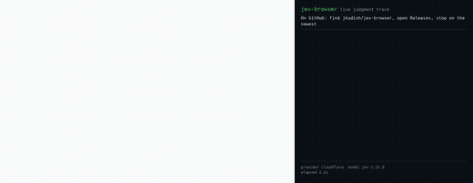 تسجيل متحرك · <a href="https://raw.githubusercontent.com/jkudish/jev-browser/main/assets/github-demo.mp4">افتح الفيديو</a></td>
</tr></table>

🎮 <b><a href="https://github.com/hr98w/jev-visual">hr98w/jev-visual</a></b> · ⭐334 · Python · 🔎 inferred · 61 天

##### 📝 الوصف

تجربة استدلال مرئي تعليمية شبيهة بـ Jev على Apple Silicon: سياق مشترك، وتقييم مباشر للمرشحين، وعروض مرئية محلية.

##### 📌 معلومات أساسية

| الحقل  | القيمة                                  |
| ------ | --------------------------------------- |
| الفئة  | `تطبيقات وألعاب وروبوتات وعروض تفاعلية` |
| الأدلة | `inferred`                              |
| اللغة  | Python                                  |

##### 📊 البيانات

| المقياس   | القيمة     |
| --------- | ---------- |
| النجوم    | **334**    |
| آخر دفع   | 2026-09-21 |
| أول إدراج | 2026-11-08 |

---

<table><tr><th align="center" width="50%">🖼 صورة</th><th align="center" width="50%">🎬 فيديو</th></tr><tr>
<td align="center" valign="top">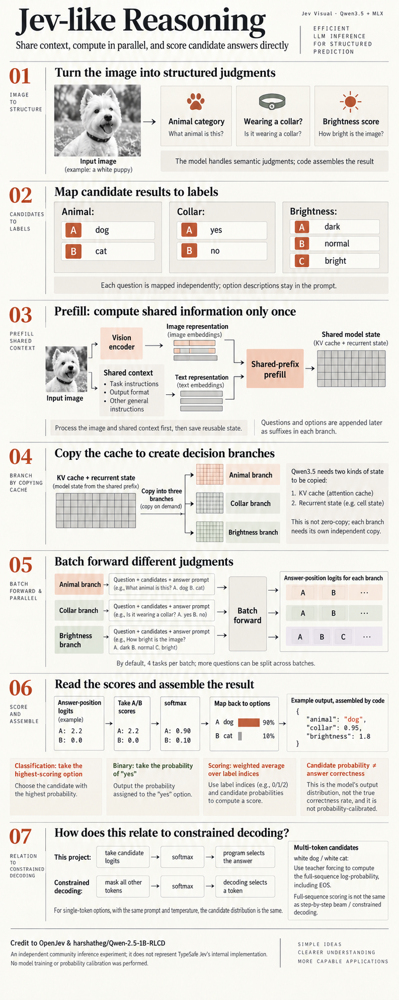</td>
<td align="center" valign="top"> تسجيل متحرك · <a href="https://github.com/user-attachments/assets/c87c09d8-30d2-4392-b981-d0b5cf1879ae">افتح الفيديو</a></td>
</tr></table>

🎮 <b><a href="https://github.com/aowang-ai/jev-trade">aowang-ai/jev-trade</a></b> · ⭐228 · TypeScript · 🔎 inferred · 9 天

##### 📝 الوصف

متداول Jev مباشر على Hyperliquid

##### 📌 معلومات أساسية

| الحقل  | القيمة                                  |
| ------ | --------------------------------------- |
| الفئة  | `تطبيقات وألعاب وروبوتات وعروض تفاعلية` |
| الأدلة | `inferred`                              |
| اللغة  | TypeScript                              |

##### 📊 البيانات

| المقياس   | القيمة     |
| --------- | ---------- |
| النجوم    | **228**    |
| آخر دفع   | 2026-11-12 |
| أول إدراج | 2026-10-29 |

🏷 `hyperliquid` · `jev` · `quantitative-finance` · `typesafe`

---

<table><tr><th align="center" width="50%">🖼 صورة</th><th align="center" width="50%">🎬 فيديو</th></tr><tr>
<td align="center" valign="top"></td>
<td align="center" valign="top">لا وسائط منشورة</td>
</tr></table>

الأصل مرتبط مباشرة من المستودع المصدر لأنه لم تُعلَن أي رخصة تسمح بإعادة التوزيع.

🎮 <b><a href="https://github.com/NanmiCoder/jev-arena">NanmiCoder/jev-arena</a></b> · ⭐125 · JavaScript · 🔎 inferred · 61 天

##### 📝 الوصف

مقدمة واختبار عملي لنموذج Jev: تحويل اللغة الطبيعية إلى أحكام واحتمالات ذات أنواع عبر Choice / Score / Noul لاستخدامها في التصنيف والتقييم والتوجيه؛ مع دعم المقارنة مع نماذج مثل DeepSeek في وسم التعليقات، والسرعة والنتائج، واستيراد CSV/Excel، وإعادة التشغيل بالسرعة الأصلية، والتقارير غير المتصلة.

##### 📌 معلومات أساسية

| الحقل  | القيمة                                  |
| ------ | --------------------------------------- |
| الفئة  | `تطبيقات وألعاب وروبوتات وعروض تفاعلية` |
| الأدلة | `inferred`                              |
| اللغة  | JavaScript                              |

##### 📊 البيانات

| المقياس   | القيمة     |
| --------- | ---------- |
| النجوم    | **125**    |
| آخر دفع   | 2026-09-20 |
| أول إدراج | 2026-11-21 |

---

<table><tr><th align="center" width="50%">🖼 صورة</th><th align="center" width="50%">🎬 فيديو</th></tr><tr>
<td align="center" valign="top"></td>
<td align="center" valign="top">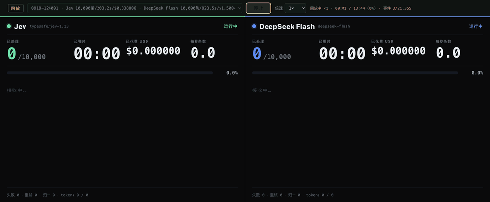 تسجيل متحرك</td>
</tr></table>

<b>المزيد في هذه الفئة</b> · 27

- [jarrodwatts/jev-trader](https://github.com/jarrodwatts/jev-trader) - قرار تداول واحد للذكاء الاصطناعي في كل كتلة Monad. Jev على Kuru MON-USDC.
- [moritzkremb/jev-voice-browser](https://github.com/moritzkremb/jev-voice-browser) - تحكّم في متصفح حقيقي بالصوت. يقرّر Jev (TypeSafe System One) النية + الهدف في…
- [kevinbadi/jev-voice](https://github.com/kevinbadi/jev-voice) - تحدث إلى جهاز Mac الخاص بك. whisper.cpp محلي + استدعاء Jev واحد (TypeSafe) لكل…
- [BudEcosystem/Bud-Decision-Studio](https://github.com/BudEcosystem/Bud-Decision-Studio) - Bud Decision studio هو تطبيق سطح مكتب ونظام تقديم سهل الاستخدام ومتعدد المنصات…
- [buer2233/jev-ui-test](https://github.com/buer2233/jev-ui-test) - إطار عمل لاختبار أتمتة واجهة المستخدم مدفوع بنموذج القرار Jev: لا يُنشئ نصًا…
- [bilune/jev-design](https://github.com/bilune/jev-design) - هل يستطيع نموذج تصميم لوحة معلومات؟ وحدة تحكم يُولَّد نظام تصميمها بالكامل…
- [emrickgarrett/OneVOneJev](https://github.com/emrickgarrett/OneVOneJev) - ساحة quickscope ‏Jev واحدًا لواحد — Three.js + TypeSafe System One.
- [joch/jevman](https://github.com/joch/jevman) - Pac-Man driven by the jev decision model.
- [codelivin/jev-laya-toolkit](https://github.com/codelivin/jev-laya-toolkit) - Dashboard and local proxy for SystemOne decision models - Jev (TypeSafe API)…
- [wizicer/jev_info_site](https://github.com/wizicer/jev_info_site) - Community index of tools, models, and real-world use cases built on Jev.
- [dgarridou/KaLM-Jev](https://github.com/dgarridou/KaLM-Jev) - شغّل خدمات Choice وScore وNoul المحلية بكفاءة باستخدام KaLM-Reranker-V1-R2…
- [harsha89/jev-demo](https://github.com/harsha89/jev-demo) - عرض توضيحي لـTypeSafe JEV يصنّف رسائل البريد الإلكتروني: بريد عشوائي (noul)،…
- [PistachioAIHQ/jev-synergy-screening](https://github.com/PistachioAIHQ/jev-synergy-screening) - عرض توضيحي لفحص الملخصات Jev (TypeSafe System One) × ASReview SYNERGY…
- [Tatuck/jev-boe-demo](https://github.com/Tatuck/jev-boe-demo) - Daily demo applying TypeSafe&#x27;s Jev model to Spain&#x27;s official gazette (BOE).
- [BrendanH18/jev-lab](https://github.com/BrendanH18/jev-lab) - Six small apps and a workbench that show what TypeSafe.
- [lalitsonawane/jev-snake](https://github.com/lalitsonawane/jev-snake) - Snake autoplay powered by TypeSafe Jev (System One).
- [SanHsien/jev-chat-jarvis](https://github.com/SanHsien/jev-chat-jarvis) - 手機與電腦上的「對話副駕」：讀取最新訊息、AI 分析意圖並建議回覆，一鍵填入聊天輸入框（Android；LINE 電腦版 Windows 預覽）｜A…
- [Anahadd/jev-minecraft](https://github.com/Anahadd/jev-minecraft) - A Minecraft bot that uses TypeSafe.
- [arkulinskis/jev-buddy](https://github.com/arkulinskis/jev-buddy) - Jev Buddy: the developer guide to Jev, the AI decision model.
- [frostaura/labs.demo.jev](https://github.com/frostaura/labs.demo.jev) - Everything is a classification problem — a live slideshow demo of classic ML vs…
- [huntsman95/PowerJev](https://github.com/huntsman95/PowerJev) - Powershell Module to interact with /v1/systemone AI Decision Endpoints.
- [krishnakanthb13/JEV-testing](https://github.com/krishnakanthb13/JEV-testing) - PWA test console for Jev (TypeSafe System One) structured-decision primitives…
- [liangkingjin/jev-demo](https://github.com/liangkingjin/jev-demo) - Jev（TypeSafe System One）判定模型演示：Choice / Noul / Score 三原语 + 三档阈值分流，离线可跑.
- [MatthewRuizDiaz/voicecom-jev](https://github.com/MatthewRuizDiaz/voicecom-jev) - Hold a key, say several commands in one sentence, and your Mac does them.
- [netcode001/jev](https://github.com/netcode001/jev) - مركز معلومات غير رسمي للذكاء الاصطناعي Jev — دليل الوصول، والأسعار، وملعب BYOK…
- [neurogabo/jev-arena](https://github.com/neurogabo/jev-arena) - Run a Pokémon Champions battle arena locally with Jev, TypeSafe, and Pokémon…
- [sorrycc/typesafe-snake](https://github.com/sorrycc/typesafe-snake) - ‏Snake يتم تشغيله تلقائيًا بواسطة نموذج Jev الخاص بـTypeSafe: خيار واحد System…

## كتابات ونقاشات وقوائم مجاورة

خيوط الإطلاق وكتابات مستقلة والقوائم المنسّقة الأخرى في هذا المجال. هذا المستودع ليس الوحيد، وقول ذلك أنفع من التظاهر بغير ذلك.

📰 <b><a href="https://docs.typesafe.ai/model-jaggedness/jev-1.13">9 فئات من العيوب المعروفة (jaggedness)</a></b> · ✅ official · 64 天

##### 📝 الوصف

الفهم الحرفي، **العد غير موثوق**، مقارنة التواريخ، التوجيه غير المباشر متعدد المستويات، حالة كبيرة بتفاصيل غير ذات صلة، المحتوى العدائي، تعارض التعليمات مع المعايير، الثوابت البنيوية، والتوليد. التوصية الرسمية هي "تقسيمها إلى مسائل ذرية ودمجها في الكود".

> 💡 **حدود القدرة**——هذه قائمة الحدود التي يقرّ بها المورّد، وقد أُدرجت كاملة

##### 📌 معلومات أساسية

| الحقل  | القيمة                         |
| ------ | ------------------------------ |
| الفئة  | `كتابات ونقاشات وقوائم مجاورة` |
| الأدلة | `official`                     |

##### 📊 البيانات

| المقياس   | القيمة     |
| --------- | ---------- |
| أول إدراج | 2026-11-13 |

📰 <b><a href="https://docs.typesafe.ai/cookbooks/consistency_choice_cookbook">أجاب `consistency_choice` cookbook رسميًا عن سؤال «ستتغير النتائج عند تكرار الاستدعاء»</a></b> · ✅ official · 64 天

##### 📝 الوصف

نفس rubric المراجعة، **8 من Choice × تكرار كل شرط 15 مرة**. حقق TypeSafe **raw agree نسبة 90.8%** (انقلبت إجابتان من أصل 8 أسئلة، لكن **conflicts=0** —— حدث الانقلاب فقط بين «وسم محدد ↔ uncertain»). **بعد إضافة قاعدة abstention (باستخدام `probabilities` لطلب top probability ≥ 0.60، وإلا تُحال `uncertain` إلى المراجعة البشرية) ارتفعت نسبة الاتساق إلى 99.2%**، وبلغت automatic نسبة 74.2%، **من دون زيادة استدعاءات النموذج**. للمقارنة: Haiku t=0 بنسبة 100%، وOpus 4.8 reasoning بنسبة 92.5%، وgpt-5.4-mini t=0 بنسبة 99.2%. التصريح الرسمي: هذا لا يجعل النموذج يقينيًا؛ هذه الأرقام تقيس **قابلية التكرار لا الصحة**؛ و0.60 استراتيجية مثال، أما عتبة الإنتاج فيجب تحديدها باستخدام عينات معنونة وتكاليفها.

> 💡 **\[DEFINITION-CHANGE\]** أُعيدت كتابة B5، وجدول الأرقام الرئيسية، والقاعدة 3 في SKILL.md، والبند 6 عند الإطلاق، والبند 6 في حدود القابلية للتطبيق——كانت هذه المكتبة تسجل «عدم اليقين» سابقًا بوصفه خطرًا، أما الآن فقد عُدّل ذلك إلى الحل الرسمي: إدارته باستخدام abstention

##### 📌 معلومات أساسية

| الحقل  | القيمة                         |
| ------ | ------------------------------ |
| الفئة  | `كتابات ونقاشات وقوائم مجاورة` |
| الأدلة | `official`                     |

##### 📊 البيانات

| المقياس   | القيمة     |
| --------- | ---------- |
| أول إدراج | 2026-11-13 |

📰 <b><a href="https://docs.typesafe.ai/confidence">تأكيد المعنى الرسمي لـ confidence</a></b> · ✅ official · 64 天

##### 📝 الوصف

يصرّح المصدر الرسمي بوضوح بأن `confidence` هو **إحصاء محسوب من توزيع `probabilities`**؛ وكلما كان التوزيع أكثر تركّزًا كان أكثر يقينًا؛ **Noul لا يتضمن confidence**؛ كما يصرّح رسميًا: «لست مقيدًا بتعريفاتنا»؛ ويجب أن تبدأ العتبة «من قيمة محافظة، ثم تختبرها على بياناتك الخاصة».

> 💡 متوافق مع الصيغة العكسية لـ Archer، وقد أُدرج في ملف التعريف

##### 📌 معلومات أساسية

| الحقل  | القيمة                         |
| ------ | ------------------------------ |
| الفئة  | `كتابات ونقاشات وقوائم مجاورة` |
| الأدلة | `official`                     |

##### 📊 البيانات

| المقياس   | القيمة     |
| --------- | ---------- |
| أول إدراج | 2026-11-13 |

📰 <b><a href="https://www.langchain.com/blog/building-a-harness-with-jev（2026-09-17">تشرح تدوينة LangChain الرسمية «لماذا انفجرت فئة حواجز حماية الوكلاء» — ،Sydney Runkle &amp; Hunter Lovell）</a></b> · ✅ official

##### 📝 الوصف

*"Coding harnesses مثل claude وcodex وcursor أطلقت نوعًا من الوسائل لتصنيف الإجراءات الخطرة… **حتى الآن، كانت خطوة المصنّف هذه مخفية داخل الأجزاء مغلقة المصدر من harness. والآن، بعد وجود نموذج مصنّف رخيص وعالي الأداء، يمكننا اتباع النمط نفسه وتبنّيه لدى جميع الوكلاء!**"*؛ كما يقدم مثال router (باستخدام Jev لاختيار نموذج وفق معايير مخصصة، مع الاحتفاظ بالاحتمالات في agent state) و*"Jev ليس بديلًا مباشرًا لـ LLM"*.

> 💡 **يفسّر ظاهرة «تحول حواجز حماية الوكلاء إلى سلعة» التي لاحظتها هذه المكتبة**——إذ جرى تحويل خصائص harness مغلقة المصدر إلى برمجيات مفتوحة المصدر؛ وقد أُدرج ذلك في مكتبة المقاطع §2.5

##### 📌 معلومات أساسية

| الحقل  | القيمة                         |
| ------ | ------------------------------ |
| الفئة  | `كتابات ونقاشات وقوائم مجاورة` |
| الأدلة | `official`                     |

##### 📊 البيانات

| المقياس   | القيمة     |
| --------- | ---------- |
| أول إدراج | 2026-11-13 |

📰 <b><a href="https://typesafe.ai/team">أضاف TypeSafe صفحة Team جديدة + أضافت الملاحة مدخل `Enterprise` (إشارة إلى تحويل المنتج إلى سلعة/تجاريته)</a></b> · ✅ official · 63 天

##### 📝 الوصف

أضاف TypeSafe صفحة Team جديدة + أضافت الملاحة مدخل `Enterprise` (إشارة إلى تحويل المنتج إلى سلعة/تجاريته)

> 💡 **\[DEFINITION-CHANGE\]** (حقائق الفريق + إشارة إلى تحويل المنتج إلى سلعة)؛ أضاف `01-系统定义/jev-系统定义.md` **§6b/6c**؛ وحدّث `references/README.md` بطاقة الحقائق السريعة

##### 📌 معلومات أساسية

| الحقل  | القيمة                         |
| ------ | ------------------------------ |
| الفئة  | `كتابات ونقاشات وقوائم مجاورة` |
| الأدلة | `official`                     |

##### 📊 البيانات

| المقياس   | القيمة     |
| --------- | ---------- |
| أول إدراج | 2026-11-13 |

📰 <b><a href="https://vercel.com/changelog/typesafe-ai-jev-now-available-on-ai-gateway">أعلن changelog الرسمي لـ Vercel إدراج Jev في AI Gateway</a></b> · ✅ official

##### 📝 الوصف

أعلن changelog الرسمي لـ Vercel إدراج Jev في AI Gateway

> 💡 استُكمل سطر Vercel في مكتبة المقاطع بـ **طريقة استخدام AI SDK** (الزيادة الفعلية)؛ **لا حاجة إلى تعديل جدول الأرقام الرئيسية** (الأرقام موجودة) → **خُفّض تغيير التعريف في هذه الجولة إلى «لا»**

##### 📌 معلومات أساسية

| الحقل  | القيمة                         |
| ------ | ------------------------------ |
| الفئة  | `كتابات ونقاشات وقوائم مجاورة` |
| الأدلة | `official`                     |

##### 📊 البيانات

| المقياس   | القيمة     |
| --------- | ---------- |
| أول إدراج | 2026-11-13 |

📰 <b><a href="https://docs.typesafe.ai/llms.txt">اكتُشفت وجُلبت 18 وصفة تطبيقية رسمية من cookbook (كانت مفقودة تمامًا سابقًا)</a></b> · ✅ official · 64 天

##### 📝 الوصف

يضم `llms.txt` 111 صفحة على مستوى الموقع؛ وكان الموجود محليًا 30 صفحة، وبعد diff تبيّن وجود **18 وصفة** تحت `cookbooks/` (تتضمن كودًا قابلًا للتشغيل، ومجموعات بيانات حقيقية، وأرقامًا مقاسة). جرى جلبها واحدةً تلو الأخرى وإضافة `type: official-cookbook` frontmatter.

> 💡 أُنشئت صفحة فهرس `03-能力边界/jev-官方cookbook配方.md` جديدة؛ **هذه هي الطبقة التي «تنقل المبادئ إلى الإنتاج»**

##### 📌 معلومات أساسية

| الحقل  | القيمة                         |
| ------ | ------------------------------ |
| الفئة  | `كتابات ونقاشات وقوائم مجاورة` |
| الأدلة | `official`                     |

##### 📊 البيانات

| المقياس   | القيمة     |
| --------- | ---------- |
| أول إدراج | 2026-11-13 |

📰 <b><a href="https://github.com/typesafe-ai/skills（⭐128">تثبيت agent skill الرسمي `typesafe-ai` — ،MIT）</a></b> · ✅ official · 64 天

##### 📝 الوصف

`npx -y skills@latest add typesafe-ai/skills -s typesafe-ai -g -a '*' --copy -y` → التثبيت في `~/.agents/skills/typesafe-ai/` (ملف SKILL.md واحد، 149 سطرًا / 10 KB، يغطي 79 وكيلًا). التقييم الأمني: Gen=Safe، Socket=0 alerts، Snyk=Low Risk. العنصر الوحيد الفاشل هو Eve (لا يدعم التثبيت العام، من دون تأثير).

> 💡 يتعايش ويتكامل **تكامليًا** مع skill الخاص بنا `jev`

##### 📌 معلومات أساسية

| الحقل  | القيمة                         |
| ------ | ------------------------------ |
| الفئة  | `كتابات ونقاشات وقوائم مجاورة` |
| الأدلة | `official`                     |

##### 📊 البيانات

| المقياس   | القيمة     |
| --------- | ---------- |
| أول إدراج | 2026-11-13 |

📰 <b><a href="https://docs.typesafe.ai/llms.txt`">تحقق diff لوثائق المصدر الرسمي مرة أخرى من فعاليته — `</a></b> · ✅ official

##### 📝 الوصف

لم يكتشف diff في هذه الجولة صفحات جديدة (اكتملت 30 صفحة + 18 cookbook)؛ ما يوضح صحة منطق diff في أداة الجمع.

> 💡 يُحتفظ به كخطوة ثابتة في كل جولة

##### 📌 معلومات أساسية

| الحقل  | القيمة                         |
| ------ | ------------------------------ |
| الفئة  | `كتابات ونقاشات وقوائم مجاورة` |
| الأدلة | `official`                     |

##### 📊 البيانات

| المقياس   | القيمة     |
| --------- | ---------- |
| أول إدراج | 2026-11-13 |

📰 <b><a href="https://docs.typesafe.ai/models">تم التحقق بالكامل من فهرس الوثائق الرسمية وسياسات تحديد المعدل/السياق/التخصيص</a></b> · ✅ official · 64 天

##### 📝 الوصف

نقطة النهاية `POST https://api.typesafe.ai/v1/systemone`؛ `jev-1.13.0`، والاسم المستعار `jev-latest`/`jev-preview`؛ 64k لكل طلب، وstate+أطول سؤال 32k؛ تحديد المعدل 250k tok/s و1200 req/min مع **تعديل ديناميكي**؛ إدخال نصي فقط؛ Choice≤255، وScore ضمن 2–10؛ **لا fine-tune، وجميع الحسابات تشترك في مجموعة الأوزان نفسها**؛ لا تُستخدم بيانات العملاء للتدريب؛ والإنجليزية هي الأدق.

> 💡 **حدود البنية/القدرات**——أُدرجت في `01-系统定义/jev-系统定义.md` و`jev-能力与边界-准确定义.md`

##### 📌 معلومات أساسية

| الحقل  | القيمة                         |
| ------ | ------------------------------ |
| الفئة  | `كتابات ونقاشات وقوائم مجاورة` |
| الأدلة | `official`                     |

##### 📊 البيانات

| المقياس   | القيمة     |
| --------- | ---------- |
| أول إدراج | 2026-11-13 |

📰 <b><a href="https://docs.typesafe.ai/migrating-to-v1">استُكملت الصفحات الرسمية المفقودة: الترحيل إلى v1 API</a></b> · ✅ official · 64 天

##### 📝 الوصف

نقطة نهاية preview `/preview/evaluation` → الإصدار المستقر **`POST /v1/systemone`**؛ مصفوفة `prompts` → map ‏`questions`؛ مصفوفة `responses` → map ‏`answers`؛ إعادة تسمية الحقول **`probability`→`noul`، `chosen`→`choice`، `expectation`→`score`**؛ احتمالات choice تحولت من مصفوفة إلى map؛ **احتمال score إضافة جديدة في v1**؛ ولم تتغير المصادقة.

> 💡 أُدرج `官方文档快照/migrating-to-v1.md`؛ وهذا يوفر أيضًا **قناة رسمية ثانية لاكتشاف الصفحات** (جدول توجيه الوثائق في skill الرسمي)

##### 📌 معلومات أساسية

| الحقل  | القيمة                         |
| ------ | ------------------------------ |
| الفئة  | `كتابات ونقاشات وقوائم مجاورة` |
| الأدلة | `official`                     |

##### 📊 البيانات

| المقياس   | القيمة     |
| --------- | ---------- |
| أول إدراج | 2026-11-13 |

📰 <b><a href="https://github.com/yibie/awesome-jev">yibie/awesome-jev</a></b> · ⭐2618 · Python · 👁️ observed · 0 天

##### 📝 الوصف

قائمة منتقاة من المشاريع العامة والتكاملات والنقاشات المبنية على Jev — نموذج System One الخاص بـ TypeSafe AI للقرارات المكتوبة النوع.

##### 📌 معلومات أساسية

| الحقل  | القيمة                         |
| ------ | ------------------------------ |
| الفئة  | `كتابات ونقاشات وقوائم مجاورة` |
| الأدلة | `observed`                     |
| اللغة  | Python                         |

##### 📊 البيانات

| المقياس   | القيمة     |
| --------- | ---------- |
| النجوم    | **2618**   |
| آخر دفع   | 2026-11-21 |
| أول إدراج | 2026-09-18 |

🏷 `awesome` · `awesome-list` · `jev` · `llm`

<b>المزيد في هذه الفئة</b> · 61

- [cobanov/awesome-jev](https://github.com/cobanov/awesome-jev) - قائمة منتقاة ومدعومة بالمصادر من المشاريع المبنية باستخدام Jev، نموذج System…
- [hellogumbo/awesome-jev](https://github.com/hellogumbo/awesome-jev) - دليل مجتمعي للمشاريع المبنية على Jev، نموذج System One الخاص بـ TypeSafe AI.
- [Open-sourced jev architecture last year with model,paper and dataset](https://news.ycombinator.com/item?id=49736660) - يتحدث الجميع الآن عن المعمارية التي &amp;#x27;ليست ذاتية الانحدار وتنفذ تنبؤًا…
- [Show HN: Jev Cards, Can you beat a vision model at a picture quiz?](https://news.ycombinator.com/item?id=50167617) - I built a quiz game around TypeSafe&amp;#x27;s new Jev model, which has vision…
- [What Is RLCD? The Secret Behind Jev](https://news.ycombinator.com/item?id=49829625)
- [aliaihub/awesome-jev-usecases](https://github.com/aliaihub/awesome-jev-usecases) - حالات استخدام وأنماط وإرشادات مدعومة بالأدلة للبناء باستخدام Jev، نموذج System…
- [Anil-matcha/awesome-jev-by-typesafe](https://github.com/Anil-matcha/awesome-jev-by-typesafe) - حالات استخدام وأنماط ومطالبات وشيفرة بداية مدعومة بالأدلة لـ TypeSafe Jev…
- [Show HN: Fastbrowse, Browser agent that picks clicks with a System One model](https://news.ycombinator.com/item?id=50311029) - Hi HN, I&amp;#x27;m Furqan founder of Nebula.
- [jtnkminimal/awesome-jev](https://github.com/jtnkminimal/awesome-jev) - مجموعة منتقاة من المشاريع المبنية باستخدام Jev، ونموذج System One الخاص بـ…
- [Show HN: Nouli – A multi-turn decision graph harness for System One models](https://news.ycombinator.com/item?id=50288442) - I&amp;#x27;ve been fine tuning my own decision models lately and I&amp;#x27;ve been…
- [Ask HN: Everyone was Jev-maxxing. Why not CDMs now?](https://news.ycombinator.com/item?id=50242523) - Just a few weeks ago, all that my feed had was people JEV-maxxing.
- [Ask HN: System One models for autonomous agents](https://news.ycombinator.com/item?id=50142037) - I&amp;#x27;ve seen a few impressive demos of Typesafe&amp;#x27;s new paradigm with…
- [Jack and Jill Cut Candidate Screening Costs by 88% with Jev](https://news.ycombinator.com/item?id=50450433)
- [Cutting LLM Token Costs with Currents News API and TypeSafe Jev Pre-Filtering](https://news.ycombinator.com/item?id=50450911)
- [JEV: Type Safe AI](https://news.ycombinator.com/item?id=50106296)
- [RadRebelSam/awesome-jev](https://github.com/RadRebelSam/awesome-jev) - دليل تُديره أداة زحف للمشاريع المبنية على Jev، نموذج System One الخاص…
- [Show HN: Decide – Jev decisions in the shell, scripts, and agent skills](https://news.ycombinator.com/item?id=49878492) - كل البرامج تتخذ قرارات. يتولى الكود القرارات الحتمية.
- [The Hitchhiker's Guide to System One Models](https://news.ycombinator.com/item?id=50301027)
- [Typesafe.ai Jev Open Source Alternative Qwen-2.5-1B-RLCD](https://news.ycombinator.com/item?id=49734345)
- [ozers/jevsome-projects](https://github.com/ozers/jevsome-projects) - مشاريع مفتوحة المصدر تستدعي Jev وSystem One نموذج TypeSafe AI بشكل يمكن إثباته.
- [rhc98/awesome-jev](https://github.com/rhc98/awesome-jev) - مشاريع مبنية على Jev (نموذج System One الخاص بـTypeSafe AI)، منتقاة بواسطة Jev…
- [108 条声明对照：Jev 的校准并不独特（含作者自我修正）](https://truestandard.ai/blog/jev-accuracy-tested) - مقارنة 108 تصريحات: معايرة Jev ليست فريدة (بما في ذلك التصحيح الذاتي للمؤلف).
- [\[cellcog.ai 追踪页\]() 自称分层记录 *"claims / concedes / measured / found, dated"* → 与本库锚页设计意图一致，值得长期对照](https://cellcog.ai/blog/jev-typesafe-decision-model) - تزعم \[صفحة تتبع cellcog.ai\]() أنها تسجل على طبقات *.
- [\`calibre\`：独立标定实验证明"阈值参数不跨数据集迁移"](https://github.com/FirasSX914/calibre) - قيسَت معايرة Jev بشكل مستقل على مجموعتي بيانات معنّمتين.
- [\`classifier.dev\`：建在 Jev 上的免费零样本分类服务（含 agent skill）](https://classifier.dev) - **دون مفتاح API ودون حساب** لخدمة تصنيف من دون أمثلة HTTP؛ توفّر…
- [\`clownware/bouncer\` 提供目前最硬的第三方独立标定数据](https://github.com/clownware/bouncer) - دقة 6 أسئلة وBrier وموثوقية التجميع: Brier **0.036–0.149**؛ وكانت معظم مجموعات…
- [\`Jev Judge vs Dimension Scores\`：分解不总是更好（含日语多语证据）](https://agentjournal.dev/blog/llm-judge-vs-feature-extraction/) - مقارنة «سؤال Jev مباشر واحد لكل مهمة» مقابل «12–14 بُعدًا للتقييم + أوزان…
- [\`jevcal\`：最小样本经验值 \< 约 100 条不可信；并多做两件我们没做的事](https://github.com/abhixhek/jevcal) - ملاءمة عتبة ثقة لكل سؤال على بيانات معنونة مملوكة → التحقق على مجموعة محجوزة →…
- [\`kaijia323/dsh-plugin-jev\`：DeepSeek Harness 的 Jev 插件（与本库同环境）](https://github.com/kaijia323/dsh-plugin-jev) - توصيل Jev بـ DSH، **وتسجيل الأداة الأصلية `jev_decide`**.
- [New：\[InfoWorld（2026-09-17）\]() —— 企业媒体视角，用例清单：*"which tool to invoke, which action to take next, whether a request should be approved, when a task…](https://www.infoworld.com/article/4223468/typesafe-ais-new-models-work-with-machines-not-humans.html) - جديد: \[InfoWorld（2026-09-17）\]() —— منظور إعلام المؤسسات، قائمة حالات…
- [OOD 校准审计："Jev 知道自己不知道吗？"](https://github.com/scienthoon/jev-ood-calibration)
- [X 上一条新描述口径](https://x.com/testingcatalog/status/2099968075861008781) - وصف Jev بأنه *&quot;a small and customizable System One decision model&quot;*، مع توضيح…
- [X： \[@omarsar0\]()（Elvis Saravia, DAIR.AI）独立表述了本库的「铁律 1」](https://x.com/omarsar0/status/2099933100440494105) - *.
- [X：\[@heyDhavall\]() 的简洁概括（*"why make software wait for an LLM to generate paragraphs when it really just needs decisions?"*）](https://x.com/heyDhavall/status/2099926342095798783) - X: الملخص الموجز من \[@heyDhavall\]().
- [X：拿到本库最具体的单次成本数字 — \[@moritzkremb\]()](https://x.com/moritzkremb) - *.
- [主 HN 帖规模](https://news.ycombinator.com/item?id=49717558) - **1862 points**؛ كانت التعليقات إيجابية في الغالب.
- [先例清单：\[ibl.ai\]() 指出 CriticGPT 与 Prometheus 2 都在 2024 年就做"判断模型" → 写进优先权争议页 §4d，与 Laya 的指称分开记；本库判断 Jev 与它们的真实差异是"把判断做成带类型与概率的一等 API"](https://ibl.ai/blog/jev-judge-model-evaluation-not-generation-enterprise) - قائمة السوابق: تشير \[ibl.ai\]() إلى أن CriticGPT وPrometheus 2 نفّذا بالفعل…
- [创始人第二段"原始初衷"（比第一段更锋利）：Diogo Almeida 经 \[Pat McGuinness Substack\]() 转引](https://patmcguinness.substack.com/p/jev-makes-fast-and-cheap-decisions) - الفقرة الثانية للمؤسس، &quot;الدافع الأصلي&quot; (وهي أشد حدة من الأولى): نقلها Diogo…
- [又一份"本地 vs 托管"选型实录：\[astgl.com\]()（James Cruce，09-22）—— 421M 开源模型在其 frozen replay 上胜过自制路由；他最终不选 Jev 是因为约束（数据不出本机、可控回退），并主动限定*"whether Laya beats Jev…](https://astgl.com/p/local-laya-vs-hosted-jev-typed-decisions) - سجل آخر لاختيار &quot;محلي مقابل مستضاف&quot;: \[astgl.com\]() (James Cruce، 09-22)…
- [发现与本库做同一件事的 agent skill：\`decision-first\`](https://github.com/harrymunro/decision-first) - *.
- [发现社区维护的完整索引 \`AbdelStark/awesome-typesafe\`（ 103）](https://github.com/AbdelStark/awesome-typesafe) - استكمال النظام البيئي الذي جمعناه سابقًا بصورة متفرقة وتحويله إلى خريطة كاملة،…
- [四条精准告诫（已写入 IO 契约 §S8） —— \[Wavect 独立评测\]()：](https://wavect.io/blog/jev-ai-decision-model-review) - أربع تحذيرات دقيقة (أُدرجت بالفعل في عقد IO §S8) — \[تقييم Wavect المستقل\]():
- [新用例：上下文压缩（LiteLLM 的 TypeSafe 护栏）](https://github.com/BerriAI/litellm) - نفّذ `litellm/types/proxy/guardrails/guardrail_hooks/typesafe.py` **compaction…
- [独立第三方与我们的术语纪律收敛：\[HarnessRouter（2026-09-20）\]()](https://harnessrouter.ai/blog/what-is-a-system-one-model) - تقارب الطرف الثالث المستقل مع انضباطنا الاصطلاحي…
- [生态跨过一条线：出现 Jev-HTTP-API 兼容的开源服务端](https://github.com/ekzhang/openjev-sglang（⭐**123**）) - *.
- [第 11 份独立评测：克罗地亚语零样本 vs 自己微调的 BERT（\[Senko Rašić\]()，09-22）](https://blog.senko.net/analyzing-jev-a-new-ai-model) - التقييم المستقل الحادي عشر: مقارنة zero-shot باللغة الكرواتية مع BERT الذي جرى…
- [第 12 份独立评测：注入鲁棒性系统测试《Can Jev be jailbroken?》（\[tanh.xyz\]()，14,495 次记录调用，原始记录公开）](https://tanh.xyz/research-notes/jev-prompt-manipulation) - التقييم المستقل الثاني عشر: اختبار منهجي لمتانة الحقن بعنوان 《Can Jev be…
- [第 9 份独立评测：\[@juanmacias《Testing TypeSafe's Jev - Legal Corpus》\]()](https://x.com/i/article/2100463318209048850) - التقييم المستقل التاسع: \.
- [第三方 SDK 覆盖主流服务端语言：HN \`Show HN: Typesafe Java SDK (Unofficial)\`（\[item 49762324\]()）](https://news.ycombinator.com/item?id=49762324) - إضافةً إلى Go / Rust (×3) / Elixir / Ruby (×3) / .NET / Rails، **يغطي SDK…
- [第三方深度解读补充大量可操作实测](https://flaviocopes.com/jev) - ① **لا تعني قيمة 0.5 في Noul «متوسطًا»**، بل تعني أن النموذج لا يستطيع التمييز…
- [第三方独立实测：Classmethod / DevelopersIO](https://dev.classmethod.jp/en/articles/jev-for-llm-model-routing/) - نجحت جميع الاستدعاءات الأربعين، وصُنّفت الحالات العشر من أصل عشر تصنيفات صحيحة؛…
- [第三方独立实测：Vercel 生产集成（最重要产业证据）](https://x.com/rauchg/status/2100307962262872105) - في الوضع الافتراضي auto لـ fx، كان تشغيل safety reviewer الأصلي يستخدم GPT…
- [财经媒体的独立表态：\[TechStock²《…Its 445× Cost Claim Is Still Self-Tested》\]()（2026-09-17）：*"…leaves the biggest performance numbers dependent on TypeSafe's…](https://ts2.tech/en/typesafe-ai-raises-40-million-for-jev-but-its-445x-cost-claim-is-still-self-tested/) - إفادة مستقلة من وسيلة إعلام مالية: \.
- [闭环信号：Archer 那篇文章上了 HN —— \`Jev's Architecture Unmasked\`（\[item 49766351\]()，1pt）](https://news.ycombinator.com/item?id=49766351) - إشارة الحلقة المكتملة: نُشرت مقالة Archer على HN — `Jev.
- [首个上市公司级集成：\[Aurora Mobile（NASDAQ: JG）的 GPTBots.ai 集成 Jev\]()（09-22）→ *"two-layer AI architecture: one layer that thinks, one layer that…](https://markets.businessinsider.com/news/stocks/aurora-mobile-s-gptbots-ai-integrates-jev-two-layers-of-ai-one-enterprise-platform-1036563338) - أول تكامل على مستوى شركة مدرجة: \.
- [首份关于 Jev 概率的强反证：\`jev-does-not-play-dice\`](https://github.com/KantaHayashiAI/jev-does-not-play-dice) - **يعكس الاحتمال الذي أبلغت عنه Jev مدى يقين «النموذج»، ولا يعكس مدى عشوائية…
- [AppitStudio/awesome-jev](https://github.com/AppitStudio/awesome-jev) - موارد Jev منتقاة وأمثلة قابلة للتشغيل لقرارات الذكاء الاصطناعي المكتوبة الأنواع.
- [onlyoasis/awesome-jev-cases](https://github.com/onlyoasis/awesome-jev-cases) - Source-linked Jev use cases, open-source projects, and official cookbooks.
- [samTime101/Jev-emoji-reactor](https://github.com/samTime101/Jev-emoji-reactor) - دمج أحدث نموذج لاتخاذ القرار jev لتصنيف الرموز التعبيرية وقراءة دلالات النص.
- [新的优先权主张（与 Laya 无关）：HN \`I built the Jev architecture one year ago and open-sourced it\`（2pts）→ \[r/LocalLLaMA 帖\]()；本轮只登记 URL 与主张，未读原文、不下判断，下一轮核实](https://www.reddit.com/r/LocalLLaMA/comments/1wijo3e/i_literally_built_the_jev_architecture_one_year/) - مطالبة جديدة بالأولوية (لا علاقة لها بـ Laya): HN `I built the Jev architecture…
- [X 社区：发布日官方账号被钓鱼](https://commondefense.ai/blog/typesafe-x-account-phished) - نشر @typesafeai في يوم الإصدار عند 11:17am، ثم أبلغ CEO عن سرقته عند 5:43pm،…

## مشاريع أخرى

🧩 <b><a href="https://github.com/Contrastive-LM/CLM">Contrastive-LM/CLM</a></b> · ⭐3212 · Python · 👁️ observed · 46 天

##### 📝 الوصف

نماذج اللغة التباينية (CLMs) هي فئة جديدة من نماذج System One المدرَّبة بهدف تعلّم تبايني يربط بين الحالات والإجراءات.

##### 📌 معلومات أساسية

| الحقل  | القيمة        |
| ------ | ------------- |
| الفئة  | `مشاريع أخرى` |
| الأدلة | `observed`    |
| اللغة  | Python        |

##### 📊 البيانات

| المقياس   | القيمة     |
| --------- | ---------- |
| النجوم    | **3212**   |
| آخر دفع   | 2026-10-05 |
| أول إدراج | 2026-11-20 |

---

<table><tr><th align="center" width="50%">🖼 صورة</th><th align="center" width="50%">🎬 فيديو</th></tr><tr>
<td align="center" valign="top"></td>
<td align="center" valign="top">لا وسائط منشورة</td>
</tr></table>

🧩 <b><a href="https://github.com/feder-cr/jev">feder-cr/jev</a></b> · ⭐970 · C++ · 👁️ observed · 33 天

##### 📝 الوصف

jevos: بديل مفتوح المصدر لـ Jev و Microsoft-Decision-1. قرارات نعم/لا، اختيارات ودرجات مع احتمالات، على CPU حاسوبك المحمول.

🔧 وُجد مستخدمًا في الشيفرة: `README.md`

##### 📌 معلومات أساسية

| الحقل  | القيمة        |
| ------ | ------------- |
| الفئة  | `مشاريع أخرى` |
| الأدلة | `observed`    |
| اللغة  | C++           |

##### 📊 البيانات

| المقياس   | القيمة     |
| --------- | ---------- |
| النجوم    | **970**    |
| آخر دفع   | 2026-10-18 |
| أول إدراج | 2026-11-08 |

🏷 `ai` · `classification` · `cpu-inference` · `decision-model` · `edge-ai` · `gguf` · `jev` · `jev-alternative`

---

<table><tr><th align="center" width="50%">🖼 صورة</th><th align="center" width="50%">🎬 فيديو</th></tr><tr>
<td align="center" valign="top"></td>
<td align="center" valign="top"> تسجيل متحرك</td>
</tr></table>

🧩 <b><a href="https://github.com/jev-chat/jev-chat-windows">jev-chat/jev-chat-windows</a></b> · ⭐899 · Python · 👁️ observed · 54 天

##### 📝 الوصف

JevChat-Windows: مساعد للردود معلق بجانب نافذة الدردشة. لقطة للشاشة + OCR محلي وغير متصل يقرأ رسالة الطرف الآخر → Jev يحدد النية → 3 ردود مقترحة تُملأ بنقرة واحدة، والإرسال يدوي دائمًا

🔧 وُجد مستخدمًا في الشيفرة: `README.md`, `jev.spec`, `core/providers.py`

##### 📌 معلومات أساسية

| الحقل  | القيمة        |
| ------ | ------------- |
| الفئة  | `مشاريع أخرى` |
| الأدلة | `observed`    |
| اللغة  | Python        |

##### 📊 البيانات

| المقياس   | القيمة     |
| --------- | ---------- |
| النجوم    | **899**    |
| آخر دفع   | 2026-09-28 |
| أول إدراج | 2026-11-08 |

🏷 `chat-assistant` · `jev` · `llm` · `local-first` · `ocr` · `privacy` · `pyqt` · `python`

---

<table><tr><th align="center" width="50%">🖼 صورة</th><th align="center" width="50%">🎬 فيديو</th></tr><tr>
<td align="center" valign="top"></td>
<td align="center" valign="top">لا وسائط منشورة</td>
</tr></table>

الأصل مرتبط مباشرة من المستودع المصدر لأنه لم تُعلَن أي رخصة تسمح بإعادة التوزيع.

🧩 <b><a href="https://github.com/razorback16/openjev">razorback16/openjev</a></b> · ⭐799 · Python · 👁️ observed · 39 天 · ⭐+1

##### 📝 الوصف

خادم قرارات مفتوح ومتوافق مع Jev لـ System One على DiffusionGemma

🔧 وُجد مستخدمًا في الشيفرة: `README.md`

##### 📌 معلومات أساسية

| الحقل  | القيمة        |
| ------ | ------------- |
| الفئة  | `مشاريع أخرى` |
| الأدلة | `observed`    |
| اللغة  | Python        |

##### 📊 البيانات

| المقياس   | القيمة       |
| --------- | ------------ |
| النجوم    | **799** (+1) |
| آخر دفع   | 2026-10-13   |
| أول إدراج | 2026-11-08   |

🧩 <b><a href="https://github.com/datawhalechina/jev-cookbook">datawhalechina/jev-cookbook</a></b> · ⭐679 · Jupyter · 👁️ observed · 22 天

##### 📝 الوصف

⚡ دليل تمهيدي لـ Jev مناسب للمبتدئين الصينيين｜يأخذك خطوة بخطوة لفهم كل ما يتعلق بـ Jev — تجارب سهلة باستخدام Jupyter Notebook، من ثلاثة بدائيات للمشكلات إلى 18 وصفة عملية، والمنازل الذكية الصوتية، وتقييم النماذج والضبط الدقيق المحلي، لإتقان شامل لنمط تطوير نماذج الحكم System One

🔧 وُجد مستخدمًا في الشيفرة: `AGENT.md`, `content/sdk/python.md`, `content/sdk/python/usage.md`, `content/models.md`

##### 📌 معلومات أساسية

| الحقل  | القيمة        |
| ------ | ------------- |
| الفئة  | `مشاريع أخرى` |
| الأدلة | `observed`    |
| اللغة  | Jupyter       |

##### 📊 البيانات

| المقياس   | القيمة     |
| --------- | ---------- |
| النجوم    | **679**    |
| آخر دفع   | 2026-10-30 |
| أول إدراج | 2026-11-08 |

---

<table><tr><th align="center" width="50%">🖼 صورة</th><th align="center" width="50%">🎬 فيديو</th></tr><tr>
<td align="center" valign="top"></td>
<td align="center" valign="top">لا وسائط منشورة</td>
</tr></table>

الأصل مرتبط مباشرة من المستودع المصدر لأنه لم تُعلَن أي رخصة تسمح بإعادة التوزيع.

🧩 <b><a href="https://github.com/logan-markewich/jeff">logan-markewich/jeff</a></b> · ⭐321 · Python · 👁️ observed · 62 天

##### 📝 الوصف

بديل مستضاف ذاتيًا ومتوافق إسقاطيًا لـ jev الخاص بـ TypeSafe، مدعومًا بـ GliFormer.

🔧 وُجد مستخدمًا في الشيفرة: `README.md`

##### 📌 معلومات أساسية

| الحقل  | القيمة        |
| ------ | ------------- |
| الفئة  | `مشاريع أخرى` |
| الأدلة | `observed`    |
| اللغة  | Python        |

##### 📊 البيانات

| المقياس   | القيمة     |
| --------- | ---------- |
| النجوم    | **321**    |
| آخر دفع   | 2026-09-20 |
| أول إدراج | 2026-10-29 |

🏷 `classification` · `encoder` · `gliner` · `jev` · `typesafe`

🧩 <b><a href="https://github.com/brianbell-x/codehygiene">brianbell-x/codehygiene</a></b> · ⭐267 · Python · 👁️ observed · 0 天 · ⭐+11

##### 📝 الوصف

A tiny system one model for code readability and hygiene.

##### 📌 معلومات أساسية

| الحقل  | القيمة        |
| ------ | ------------- |
| الفئة  | `مشاريع أخرى` |
| الأدلة | `observed`    |
| اللغة  | Python        |

##### 📊 البيانات

| المقياس   | القيمة        |
| --------- | ------------- |
| النجوم    | **267** (+11) |
| آخر دفع   | 2026-11-20    |
| أول إدراج | 2026-11-15    |

🧩 <b><a href="https://github.com/brainstormity/Jev-X-Sentiment-Analysis">brainstormity/Jev-X-Sentiment-Analysis</a></b> · ⭐234 · Python · 👁️ observed · 31 天

##### 📝 الوصف

An on-demand crypto market intelligence and decision-support terminal powered by TypeSafe AI's System One model

##### 📌 معلومات أساسية

| الحقل  | القيمة        |
| ------ | ------------- |
| الفئة  | `مشاريع أخرى` |
| الأدلة | `observed`    |
| اللغة  | Python        |

##### 📊 البيانات

| المقياس   | القيمة     |
| --------- | ---------- |
| النجوم    | **234**    |
| آخر دفع   | 2026-10-21 |
| أول إدراج | 2026-10-29 |

---

<table><tr><th align="center" width="50%">🖼 صورة</th><th align="center" width="50%">🎬 فيديو</th></tr><tr>
<td align="center" valign="top"></td>
<td align="center" valign="top">لا وسائط منشورة</td>
</tr></table>

🧩 <b><a href="https://github.com/LiQiiiii/Jeva">LiQiiiii/Jeva</a></b> · ⭐234 · Python · 👁️ observed · 34 天

##### 📝 الوصف

Jeva: نماذج System One من المبادئ الأولى

##### 📌 معلومات أساسية

| الحقل  | القيمة        |
| ------ | ------------- |
| الفئة  | `مشاريع أخرى` |
| الأدلة | `observed`    |
| اللغة  | Python        |

##### 📊 البيانات

| المقياس   | القيمة     |
| --------- | ---------- |
| النجوم    | **234**    |
| آخر دفع   | 2026-10-17 |
| أول إدراج | 2026-11-20 |

---

<table><tr><th align="center" width="50%">🖼 صورة</th><th align="center" width="50%">🎬 فيديو</th></tr><tr>
<td align="center" valign="top"></td>
<td align="center" valign="top">لا وسائط منشورة</td>
</tr></table>

🧩 <b><a href="https://github.com/Futureppo/typesafe_register">Futureppo/typesafe_register</a></b> · ⭐132 · Python · 👁️ observed · 60 天

##### 📝 الوصف

مسجّل typesafe.ai، محسّن إلى أقصى حد، وjev بلا حدود

##### 📌 معلومات أساسية

| الحقل  | القيمة        |
| ------ | ------------- |
| الفئة  | `مشاريع أخرى` |
| الأدلة | `observed`    |
| اللغة  | Python        |

##### 📊 البيانات

| المقياس   | القيمة     |
| --------- | ---------- |
| النجوم    | **132**    |
| آخر دفع   | 2026-09-21 |
| أول إدراج | 2026-10-29 |

---

<table><tr><th align="center" width="50%">🖼 صورة</th><th align="center" width="50%">🎬 فيديو</th></tr><tr>
<td align="center" valign="top"></td>
<td align="center" valign="top">لا وسائط منشورة</td>
</tr></table>

🧩 <b><a href="https://github.com/Carol-lyh/Jeveration">Carol-lyh/Jeveration</a></b> · ⭐87 · Python · 👁️ observed · 2 天 · ⭐+2

##### 📝 الوصف

\[arXiv\] Jeveration: System One Models Now Generate. https://arxiv.org/abs/2611.24738

##### 📌 معلومات أساسية

| الحقل  | القيمة        |
| ------ | ------------- |
| الفئة  | `مشاريع أخرى` |
| الأدلة | `observed`    |
| اللغة  | Python        |

##### 📊 البيانات

| المقياس   | القيمة      |
| --------- | ----------- |
| النجوم    | **87** (+2) |
| آخر دفع   | 2026-11-19  |
| أول إدراج | 2026-11-19  |

🏷 `dense-prediction` · `image-generation` · `image-to-image` · `pytorch` · `text-to-image` · `vision-language-model`

---

<table><tr><th align="center" width="50%">🖼 صورة</th><th align="center" width="50%">🎬 فيديو</th></tr><tr>
<td align="center" valign="top"></td>
<td align="center" valign="top">لا وسائط منشورة</td>
</tr></table>

🧩 <b><a href="https://github.com/f/jev-leftpad">f/jev-leftpad</a></b> · ⭐85 · JavaScript · 👁️ observed · 26 天

##### 📝 الوصف

إضافة حشو إلى يسار السلاسل باستخدام TypeSafe AI Jev. لأسباب ما.

🔧 وُجد مستخدمًا في الشيفرة: `README.md`

##### 📌 معلومات أساسية

| الحقل  | القيمة        |
| ------ | ------------- |
| الفئة  | `مشاريع أخرى` |
| الأدلة | `observed`    |
| اللغة  | JavaScript    |

##### 📊 البيانات

| المقياس   | القيمة     |
| --------- | ---------- |
| النجوم    | **85**     |
| آخر دفع   | 2026-10-25 |
| أول إدراج | 2026-10-29 |

🧩 <b><a href="https://github.com/Mushroom-Systems/lichen-v1">Mushroom-Systems/lichen-v1</a></b> · ⭐59 · Python · 👁️ observed · 51 天

##### 📝 الوصف

بديل محلي متوافق مع API لـ Jev، نموذج System One الخاص بـ TypeSafe

##### 📌 معلومات أساسية

| الحقل  | القيمة        |
| ------ | ------------- |
| الفئة  | `مشاريع أخرى` |
| الأدلة | `observed`    |
| اللغة  | Python        |

##### 📊 البيانات

| المقياس   | القيمة     |
| --------- | ---------- |
| النجوم    | **59**     |
| آخر دفع   | 2026-09-30 |
| أول إدراج | 2026-11-03 |

---

<table><tr><th align="center" width="50%">🖼 صورة</th><th align="center" width="50%">🎬 فيديو</th></tr><tr>
<td align="center" valign="top"></td>
<td align="center" valign="top">لا وسائط منشورة</td>
</tr></table>

🧩 <b><a href="https://github.com/jev-sec/jev-ids">jev-sec/jev-ids</a></b> · ⭐34 · Python · 👁️ observed · 1 天

##### 📝 الوصف

Blazing-Fast Token-Efficient Intrusion Detection System (IDS) based on TypeSafe's Jev.

##### 📌 معلومات أساسية

| الحقل  | القيمة        |
| ------ | ------------- |
| الفئة  | `مشاريع أخرى` |
| الأدلة | `observed`    |
| اللغة  | Python        |

##### 📊 البيانات

| المقياس   | القيمة     |
| --------- | ---------- |
| النجوم    | **34**     |
| آخر دفع   | 2026-11-19 |
| أول إدراج | 2026-11-20 |

🏷 `cybersecurity` · `intrusion-detection` · `intrusion-detection-system` · `jev` · `network-security` · `system-one-model` · `typesafe`

---

<table><tr><th align="center" width="50%">🖼 صورة</th><th align="center" width="50%">🎬 فيديو</th></tr><tr>
<td align="center" valign="top"></td>
<td align="center" valign="top">لا وسائط منشورة</td>
</tr></table>

🧩 <b><a href="https://github.com/parth-kp/jev-mail-classifier">parth-kp/jev-mail-classifier</a></b> · ⭐25 · Python · 👁️ observed · 61 天

##### 📝 الوصف

صنّف صندوق الوارد لديك باستخدام Jev (نموذج System One الخاص بـ TypeSafe) — وسم، ونقل، ووضع علامة، وإشعار، وكل ذلك مدفوع بالإعدادات.

##### 📌 معلومات أساسية

| الحقل  | القيمة        |
| ------ | ------------- |
| الفئة  | `مشاريع أخرى` |
| الأدلة | `observed`    |
| اللغة  | Python        |

##### 📊 البيانات

| المقياس   | القيمة     |
| --------- | ---------- |
| النجوم    | **25**     |
| آخر دفع   | 2026-09-20 |
| أول إدراج | 2026-10-28 |

🏷 `classifier` · `email` · `python` · `textual` · `typesafe`

---

<table><tr><th align="center" width="50%">🖼 صورة</th><th align="center" width="50%">🎬 فيديو</th></tr><tr>
<td align="center" valign="top"></td>
<td align="center" valign="top">لا وسائط منشورة</td>
</tr></table>

🧩 <b><a href="https://github.com/DreamBlooms/Jev-AutoLaya">DreamBlooms/Jev-AutoLaya</a></b> · ⭐2 · Python · 👁️ observed · 4 天

##### 📝 الوصف

One-stop automated decision modeling solution, build your own fine-tuned Laya model in under 30 minutes. | 一站式自动化领域决策模型构建方案，在 30 分钟内构建您自己的 Laya 微调模型

##### 📌 معلومات أساسية

| الحقل  | القيمة        |
| ------ | ------------- |
| الفئة  | `مشاريع أخرى` |
| الأدلة | `observed`    |
| اللغة  | Python        |

##### 📊 البيانات

| المقياس   | القيمة     |
| --------- | ---------- |
| النجوم    | **2**      |
| آخر دفع   | 2026-11-16 |
| أول إدراج | 2026-11-16 |

🏷 `decision-model` · `jev` · `jev-alternative` · `jev-compatible` · `laya` · `system-one` · `system-one-model`

---

<table><tr><th align="center" width="50%">🖼 صورة</th><th align="center" width="50%">🎬 فيديو</th></tr><tr>
<td align="center" valign="top">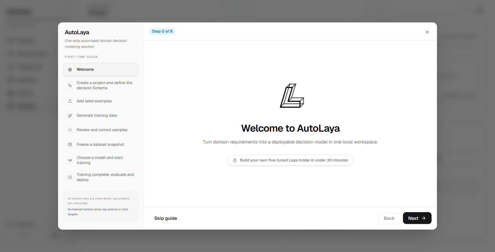</td>
<td align="center" valign="top">لا وسائط منشورة</td>
</tr></table>

🧩 <b><a href="https://github.com/factbag/factbag">factbag/factbag</a></b> · ⭐1 · TypeScript · 👁️ observed · 3 天

##### 📝 الوصف

Combine narrow judgments from System One models with explicit rules in a knowledgebase.

##### 📌 معلومات أساسية

| الحقل  | القيمة        |
| ------ | ------------- |
| الفئة  | `مشاريع أخرى` |
| الأدلة | `observed`    |
| اللغة  | TypeScript    |

##### 📊 البيانات

| المقياس   | القيمة     |
| --------- | ---------- |
| النجوم    | **1**      |
| آخر دفع   | 2026-11-18 |
| أول إدراج | 2026-11-09 |

🏷 `explainability` · `jev` · `knowledge-base` · `logic` · `npm-package` · `provenance` · `rules-engine` · `system-one`

---

<table><tr><th align="center" width="50%">🖼 صورة</th><th align="center" width="50%">🎬 فيديو</th></tr><tr>
<td align="center" valign="top"></td>
<td align="center" valign="top">لا وسائط منشورة</td>
</tr></table>

🧩 <b><a href="https://github.com/godatadriven/laya-vs-jev-on-open-food-facts-dataset">godatadriven/laya-vs-jev-on-open-food-facts-dataset</a></b> · ⭐1 · Jupyter · 👁️ observed · 3 天

##### 📝 الوصف

2026-10-30 Innovation day project: Laya and Jev

##### 📌 معلومات أساسية

| الحقل  | القيمة        |
| ------ | ------------- |
| الفئة  | `مشاريع أخرى` |
| الأدلة | `observed`    |
| اللغة  | Jupyter       |

##### 📊 البيانات

| المقياس   | القيمة     |
| --------- | ---------- |
| النجوم    | **1**      |
| آخر دفع   | 2026-11-18 |
| أول إدراج | 2026-11-18 |

🏷 `decision-model` · `jev` · `jev-ai` · `laya` · `open-food-facts` · `system-one` · `system-one-models`

---

<table><tr><th align="center" width="50%">🖼 صورة</th><th align="center" width="50%">🎬 فيديو</th></tr><tr>
<td align="center" valign="top"></td>
<td align="center" valign="top">لا وسائط منشورة</td>
</tr></table>

الأصل مرتبط مباشرة من المستودع المصدر لأنه لم تُعلَن أي رخصة تسمح بإعادة التوزيع.

<b>المزيد في هذه الفئة</b> · 71

- [DreamBlooms/dohnuts.cpp](https://github.com/DreamBlooms/dohnuts.cpp) - The same decisions, on CPU. System One model that can run on your Personal…
- [SoundBlaster/SwiftJev](https://github.com/SoundBlaster/SwiftJev) - إطار عمل Swift للوصول إلى نموذج System One Jev بواسطة TypeSafe.ai.
- [codaaiteam/jev-ai](https://github.com/codaaiteam/jev-ai) - Jev AI quickstart &amp; FAQ — TypeSafe AI.
- [soderlind/ai-provider-for-jev](https://github.com/soderlind/ai-provider-for-jev) - اربط WordPress بنموذج System One Jev الخاص بـ TypeSafe لاتخاذ قرارات منظمة…
- [DreamBlooms/ifReflex.cpp](https://github.com/DreamBlooms/ifReflex.cpp) - يمكن لأي LLM أن يعمل كنموذج قرار SystemOne على حاسوبك الشخصي.
- [Chonyoomin/Email-Checker](https://github.com/Chonyoomin/Email-Checker) - Check Gmails for harm with LAYA (System One Model) and Qwen locally.
- [cookkie03/any-class](https://github.com/cookkie03/any-class) - Zero-token local decision engine for classifying Telegram Saved Messages with…
- [DevItaliya22/jev-chess](https://github.com/DevItaliya22/jev-chess) - Jev.
- [jmschnei/n4c-decision-broker](https://github.com/jmschnei/n4c-decision-broker) - Confidence-governed decision broker over local Ollama System One models…
- [JustinRoderick/jev-test](https://github.com/JustinRoderick/jev-test) - Testing typesafe.ai new model Jev.
- [kasperihallinen/football-ai](https://github.com/kasperihallinen/football-ai) - Comparing a fine-tuned System One model called Von with conventional machine…
- [MKDYasserH/system-one-model](https://github.com/MKDYasserH/system-one-model)
- [Paveerongar/clef-spam-detection](https://github.com/Paveerongar/clef-spam-detection) - Experiment using the System One model Clef to detect spam vs ham.
- [scholarly360/Microsoft-Decision-1-on-Microsoft-Foundry](https://github.com/scholarly360/Microsoft-Decision-1-on-Microsoft-Foundry) - Microsoft Decision-1 System One Model on Microsoft Foundry.
- [Shivam557/System-One-Model](https://github.com/Shivam557/System-One-Model) - It is a model which makes choices faster, cheaper.
- [SodaZheng/system-one-model](https://github.com/SodaZheng/system-one-model)
- [TomatenMarc/Sycophancy-System-One-Models](https://github.com/TomatenMarc/Sycophancy-System-One-Models)
- [unbraind/pm-jev](https://github.com/unbraind/pm-jev) - قرارات محلية مقيّنة، مع إعطاء الأولوية للنوع، لعناصر pm باستخدام نماذج System…
- [jaredpalmer/kev](https://github.com/jaredpalmer/kev) - عائلة نماذج قرارات شبيهة بـ Jev مبنية على Qwen3.5/3.8، يمكنك تدريبها وتشغيلها…
- [shcherbak-ai/contextgem](https://github.com/shcherbak-ai/contextgem) - Extract structured data and insights from documents using LLMs and decision…
- [AgriciDaniel/jev-seo](https://github.com/AgriciDaniel/jev-seo) - تدقيق SEO مباشر لأي موقع ويب انطلاقًا من عنوان الصفحة الرئيسية، وفقًا لـ Jev.
- [TypeLLM/TypeLLM](https://github.com/TypeLLM/TypeLLM) - TypeLLM: LLMs مع توليد آمن من ناحية الأنواع.
- [shengjidaguai-china/goutoujunshi-jev-chat](https://github.com/shengjidaguai-china/goutoujunshi-jev-chat) - 狗头军师 Chat: قراءة شاشة WeChat على Mac، تحليل العلاقات ونافذة عائمة لمسودات الردود.
- [Sac-Y/Jev-cu](https://github.com/Sac-Y/Jev-cu)
- [TianyuCodings/JevHarness](https://github.com/TianyuCodings/JevHarness) - أُطر اختبار Jev مخصصة للمهام من تأليف LLM، مع إمكانية اختيارية للتأمل في…
- [jev-chat/jev-chat-jarvis-mac](https://github.com/jev-chat/jev-chat-jarvis-mac) - مساعد نافذة عائمة للدردشة (macOS): إدراك الشاشة + نموذج محلي صغير لتحديد النية…
- [Yinsongxu/LLM2Jev](https://github.com/Yinsongxu/LLM2Jev) - حوّل نماذج اللغة المحلية إلى نماذج قرارات منظمة بأسلوب Jev.
- [Zefan-Cai/Open-Jev](https://github.com/Zefan-Cai/Open-Jev)
- [dabit3/jev-experiments](https://github.com/dabit3/jev-experiments)
- [zfkarl/MedJev](https://github.com/zfkarl/MedJev) - MedJev: A System One Vision-Language Decision Model for Fast and Effective…
- [1Panel-dev/laya-server](https://github.com/1Panel-dev/laya-server) - API مستضاف ذاتيًا وواجهة ويب لنماذج قرارات Laya المهيكلة، متوافقان مع تنسيق…
- [Abhinavexists/lev](https://github.com/Abhinavexists/lev) - نموذج قرار مفتوح System One.
- [2951461586/Jev-Register-Tool](https://github.com/2951461586/Jev-Register-Tool) - أداة لسير العمل الكامل لـ TypeSafe（Jev / System One） من التقديم → تأكيد البريد…
- [I-You-Dream/jev-from-scratch](https://github.com/I-You-Dream/jev-from-scratch) - 从零开源复刻 Jev（System One）决策模型范式，基于 Qwen 基座训练，支持 Choice / Noul 原语，包含推理、微调、ECE…
- [Jev-Engineering/cookbook](https://github.com/Jev-Engineering/cookbook) - ستون وصفة لدفاتر الملاحظات لاتخاذ قرارات مكتوبة باستخدام Jev: أنماط Choice…
- [yijunyu/jev-rs](https://github.com/yijunyu/jev-rs) - أحكام System One (noul/choice/score) من أي LLM في عملية prefill واحدة — محرك…
- [OmniAI-Lab-CUHKSZ/Jev_Survey](https://github.com/OmniAI-Lab-CUHKSZ/Jev_Survey) - Jev-Like Models and Decision Systems: A Survey.
- [nvkudva/ollajev](https://github.com/nvkudva/ollajev) - شغّل نماذج قرار System One من Hugging Face محليًا خلف Jev / System One API،…
- [manifoldor/xtags](https://github.com/manifoldor/xtags) - على الخط الزمني في X، ضع علامة على ما تريد كل مشاركة أن تفعله بك.
- [botassembly/thinkthen](https://github.com/botassembly/thinkthen) - ThinkThen: شيفرة تعرف ما تعنيه.
- [rawwerks/one-system](https://github.com/rawwerks/one-system) - استخدم المصنّفات المحلية والمستضافة، المعروفة أيضًا بنماذج اتخاذ القرار أو…
- [comoc/jev-minesweeper](https://github.com/comoc/jev-minesweeper) - عرض توضيحي يجعل TypeSafe Jev (System One) يحل لعبة Minesweeper على المتصفح.
- [XingQiPan/rwkv-jev](https://github.com/XingQiPan/rwkv-jev) - محرك قرارات على نمط Jev بعدد صفري من التوليد، مبني على RWKV-7 (g1k-1b): قراءة…
- [david-j-lustig/jev-fantasy-football-manager](https://github.com/david-j-lustig/jev-fantasy-football-manager) - Experimenting with using Decision Models to manage my fantasy football team.
- [TuoZhang0902/JEVLab](https://github.com/TuoZhang0902/JEVLab) - Exploring latent-space predictive learning and multi-step reasoning…
- [amapara27/jev-pilot](https://github.com/amapara27/jev-pilot) - Control your MacOS desktop smoothly. Powered by Jev.
- [binary-husky/qwen-jev-rsi](https://github.com/binary-husky/qwen-jev-rsi) - System One RSI for True Realtime Control.
- [cfu288/jev-vs-ml-classifiers](https://github.com/cfu288/jev-vs-ml-classifiers) - ما مدى جودة أداء أحدث نموذج JEV مقارنةً بنماذج المصنّفات التقليدية للتعلّم…
- [Copperhorse/HRM_JEV](https://github.com/Copperhorse/HRM_JEV) - LoRA fine-tune of HRM-Text-1B into a typed decision model on Open-Jev.
- [demirfahrieren-png/jev-canli-sonuclar](https://github.com/demirfahrieren-png/jev-canli-sonuclar) - Jev canlı sanal işlem sonuçları (sunucu her gün günceller; gerçek emir yok).
- [fdsfserrrr/JEV-AI-](https://github.com/fdsfserrrr/JEV-AI-) - 获课：jzit.top/26594/JEV 决策大模型实战，让 AI 从会聊天到能决策.
- [LiLittleCat/jev-playlist-classify](https://github.com/LiLittleCat/jev-playlist-classify) - صنّف قوائم التشغيل الكبيرة حسب لغة الأغنية باستخدام أحدث نموذج Jev لدى TypeSafe…
- [m8appz-dotcom/jev-contact-center-qa](https://github.com/m8appz-dotcom/jev-contact-center-qa) - Jev contact-center quality-assurance audit application and recovered processing…
- [michalflowers245-alt/shanju-planet-content-workbench-jev-dev](https://github.com/michalflowers245-alt/shanju-planet-content-workbench-jev-dev) - 闪聚星球内容工作台-JEV-开发：本地文案研究、创作与双平台内容归档工作台（仅源码，不含用户数据与凭据）.
- [mwmw7/typesafe-jev-handson](https://github.com/mwmw7/typesafe-jev-handson) - 공군 AI 교육용 TypeSafe Jev 핸즈온: 레이더에 뭔가 잡혔다! 전투기를 띄워야 할까?
- [PineappleBingo/jev-radar](https://github.com/PineappleBingo/jev-radar) - TypeSafe Jev 오픈소스 구현을 매일 모아 한국어로 정리하는 레이더 (radar-index/1).
- [ritchieking/jev](https://github.com/ritchieking/jev) - An explainer for Jev, TypeSafe.
- [ros-claw/jev-nav](https://github.com/ros-claw/jev-nav) - Experimental Decisions-driven mapless navigation for LIMO.
- [yoshi47/jev-youtube-guard](https://github.com/yoshi47/jev-youtube-guard) - YouTubeの動画をTypeSafe Jevで分類してブロックするユーザースクリプト.
- [receptron/laya](https://github.com/receptron/laya) - شغّل Laya، نموذج القرار System-1 مفتوح المصدر والمتوافق مع Jev، من Node.js /…
- [Rizzo-AI-Academy/rizzo-flow](https://github.com/Rizzo-AI-Academy/rizzo-flow) - النسخة المفتوحة والمحلية من Jev: قرارات مكتوبة النوع من LLM، من دون توليد رمز…
- [jerryjliu/docjev](https://github.com/jerryjliu/docjev) - مصنّف/مقسّم مستندات سريع جدًا باستخدام Jev.
- [PostHog/jeeves](https://github.com/PostHog/jeeves) - Jeeves – الاستدلال يحسّن نماذج القرار الشبيهة بـ Jev.
- [codejunkie99/keel](https://github.com/codejunkie99/keel) - مساحة عمل برمجة macOS محلية أولًا مع Laya محلي وخيار Jev لاختيار القرار.
- [peterfriese/system-one-foundation-models](https://github.com/peterfriese/system-one-foundation-models) - جسر خفيف الوزن وأصلي لـ Swift 6 يدمج نموذج القرار System One Jev الخاص بـ…
- [iapp-technology/openthai-systemone](https://github.com/iapp-technology/openthai-systemone) - OpenThai-SystemOne: نموذج قرار System One تايلاندي + إنجليزي مفتوح.
- [spring-ai-community/spring-ai-typesafe](https://github.com/spring-ai-community/spring-ai-typesafe) - Archived: moved to Spring AI and Spring AI Decision Extensions.
- [hawkymisc/typed-decision-bert](https://github.com/hawkymisc/typed-decision-bert) - إثبات مفهوم غير رسمي: محرك قرارات بترميز على نمط BERT خلف HTTP API لقرار ذي…
- [InterfazeAI/lev](https://github.com/InterfazeAI/lev) - نموذج قرار مفتوح System One.
- [epergaboni/jevseo](https://github.com/epergaboni/jevseo) - أحكام SEO وAEO وGEO مكتوبة الأنواع ومدعومة بـJev، وهو نموذج قرارات System One.
- [Temikus/lgtm](https://github.com/Temikus/lgtm) - Score pull requests with System One decision models.

## المشاريع حسب لغة التنفيذ

يتركّز النظام البيئي في Python وTypeScript، لكن العملاء المُنمَّطين يواصلون الظهور بلغات أخرى. هذا الجدول مُشتق من المدخلات نفسها.

| اللغة      | المدخلات | أمثلة                                                                                                   |
| ---------- | -------- | ------------------------------------------------------------------------------------------------------- |
| Python     | 356      | `typesafe-ai/system-one-adapter-python`, `typesafe-ai/typesafe-sdk-python`, `typesafe-ai/WorkflowEvals` |
| TypeScript | 141      | `typesafe-ai/typesafe-sdk-js`, `TypeSafeAI/jev-harness`, `qkal/Canny`                                   |
| JavaScript | 76       | `clouatre-labs/decisions-judge-mcp`, `Ying-Kai-Liao/jev-browser`, `jiangkoumo/ego-decision-layer`       |
| Rust       | 28       | `AkashPriyadarshii/jev-curate`, `chussenot/judgment`, `ollaya-dev/ollaya`                               |
| HTML       | 26       | `typesafe-ai/typesafe-ai.github.io`, `AkashPriyadarshii/jev-superpowers`, `yzfly/awesome-jev-zh`        |
| Jupyter    | 16       | `jexp/neo4jev`, `GitHub30/OpenJev`, `Query-farm/vgi-typesafe`                                           |
| Go         | 11       | `mattn/go-jev`, `rcarmo/go-system-one`, `devbackend/jevgo`                                              |
| C#         | 9        | `elbruno/ElBruno.AI.Decisions`, `CMaintz/jev-dotnet`, `saibimajdi/typesafeai-dotnet-sdk`                |
| Elixir     | 5        | `dannote/jev`, `Elue-dev/jev_elixir`, `nshkrdotcom/system_one_sdk`                                      |
| Java       | 5        | `Premo-Cloud/typesafe-sdk-java`, `CMaintz/jev-java`, `Nisaka520/JevIntent`                              |
| Swift      | 5        | `john-rocky/coreai-kit`, `Algorythm-Canada/OpenJevSwift`, `mattt/AnyDecisionModel`                      |
| C++        | 3        | `feder-cr/jev`, `DreamBlooms/dohnuts.cpp`, `DreamBlooms/ifReflex.cpp`                                   |
| Kotlin     | 3        | `pambrose/jev4k`, `MiaoWuNYA/rikkahub-sillytavern-android`, `jev-chat/jev-chat-jarvis`                  |
| PHP        | 3        | `basi/typesafe-ai-php-client`, `Butochnikov/laravel-typesafe-jev`, `soderlind/ai-provider-for-jev`      |
| PowerShell | 3        | `BFLabsAI/bf-jev-deep-research`, `dfinke/Jev`, `huntsman95/PowerJev`                                    |
| Shell      | 3        | `realZachi/pg-jev`, `milojarow/jev-skills`, `skylence-org/claudecode-jev-marketplace`                   |
| Astro      | 2        | `heyjunpenn/awesome-jev`, `wizicer/jev_info_site`                                                       |
| C          | 2        | `CheshiAI/Cheshi`, `lijiawei255/jev-tune`                                                               |
| CSS        | 2        | `yangzhou-chaofan/awesome-jev-prompt`, `Dlmily/minimind-jev-dlmily`                                     |
| Ruby       | 2        | `obie/ruby_decision_model`, `Ray-Hughes/jevalyn`                                                        |
| TeX        | 2        | `xiaohuiyan/awesome-jev-papers`, `dnakhoa/jev-deferred-crispification`                                  |
| XS         | 2        | `cameronb-xano/jev-agent-guardrail`, `xano-community/agent-guardrail-jev`                               |
| Dockerfile | 1        | `jbowensii/jev-mcp-unraid`                                                                              |
| Haskell    | 1        | `getmissionctrl/hs-jev`                                                                                 |
| Nushell    | 1        | `cablehead/jev.nu`                                                                                      |
| Pascal     | 1        | `danieleteti/systemone-delphi`                                                                          |

تُحتسب فقط المدخلات التي تُصرِّح بلغة. أما مدخلات البنية التحتية والتوثيق والنقاش فمستبعدة من هذا الجدول.

## المساهمة

التصحيحات مرحّب بها وهي أسرع طريقة لتحسين هذه القائمة. افتح مشكلة (issue) أو طلب سحب (pull request) إذا كانت مدخلة في الفئة الخطأ أو مُصنَّفة تصنيفًا خاطئًا، أو إذا استُبعد مشروع خطأً باعتباره تشابه أسماء — فهذه الفئة الأخيرة هي الأكثر عرضة لخطأ المرشحات الآلية. الأفضل أن تُضاف الإضافات بإضافة مصدر إلى `scripts/collect.py` لا بتحرير README، لأن README يُعاد توليده في كل دورة.

---

مشروع مجتمعي مستقل. غير تابع لـ TypeSafe AI ولا معتمد أو مُراجَع منها. سلوك المنتج والأسعار والحدود والأسماء البديلة للنماذج تتغير دون إشعار؛ تحقق من كل ما تعتمد عليه في التوثيق الرسمي. تبقى الأصول ملكًا لمشاريعها المصدر ولا يُعاد إنتاجها إلا حيث تسمح رخصة بذلك.

أُنشئ بواسطة · 2026-11-21T21:49:05+08:00
