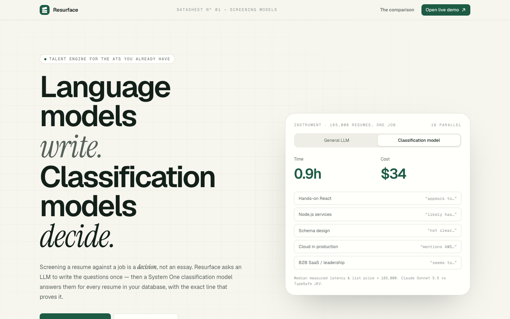
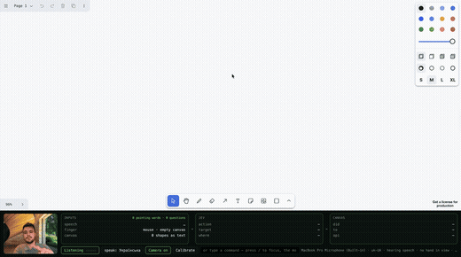
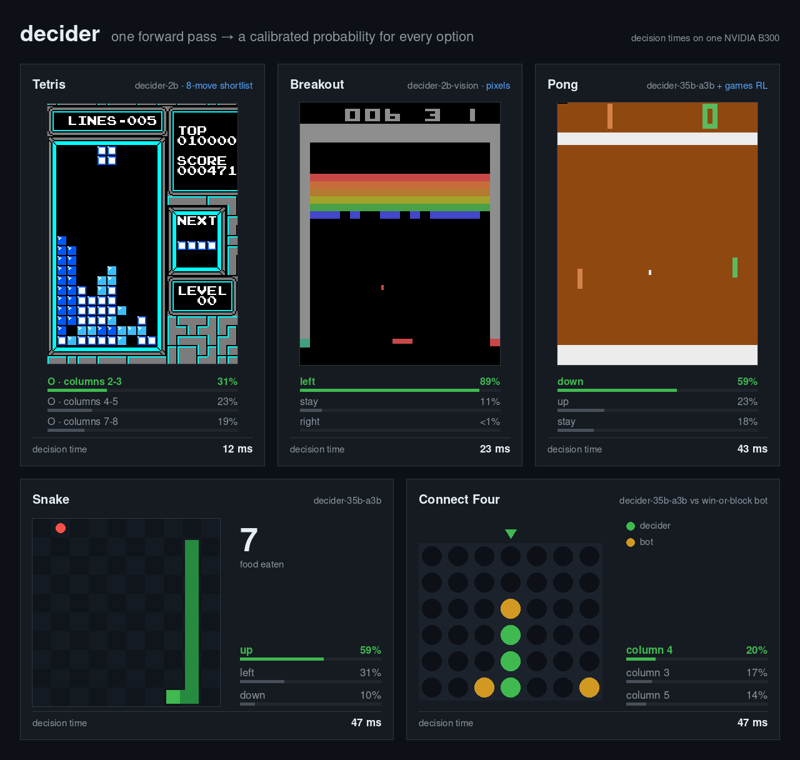
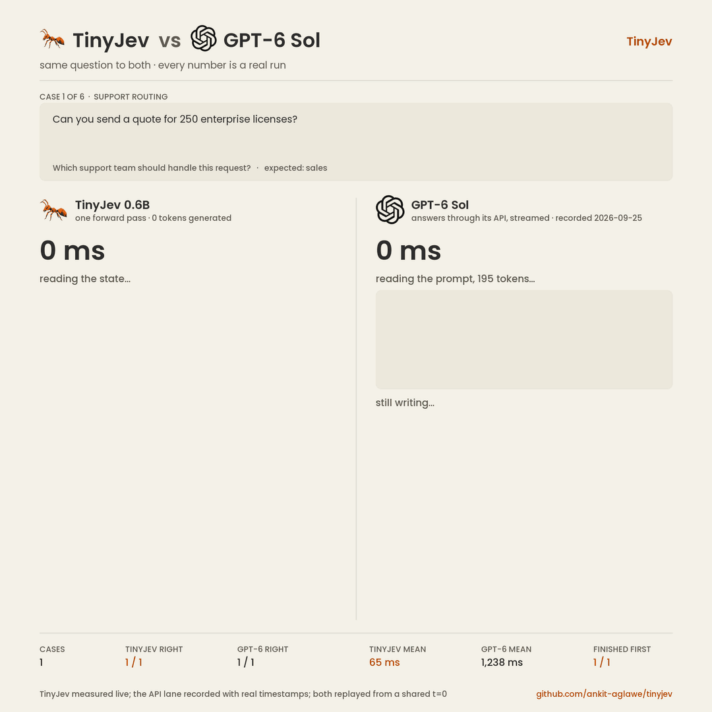
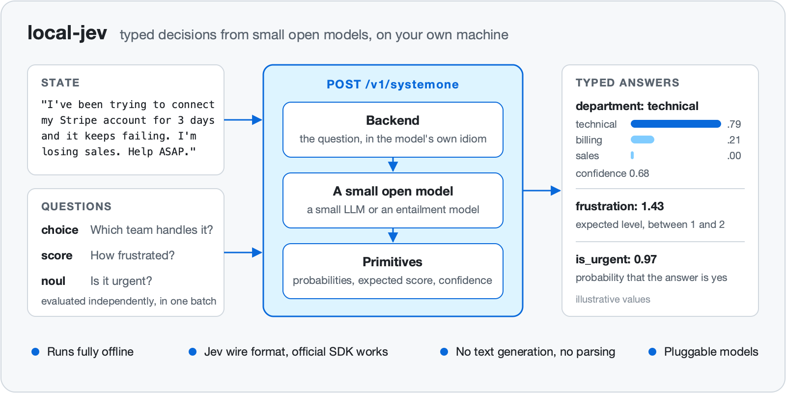
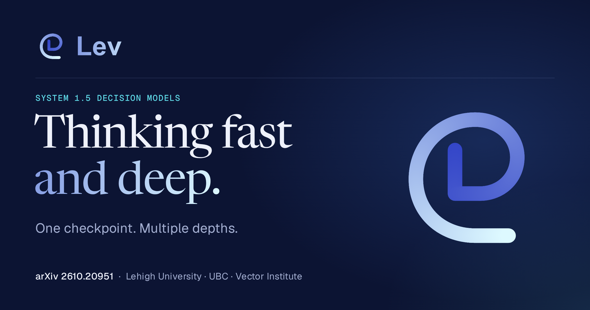
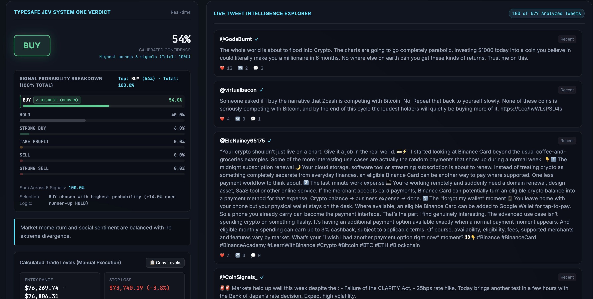
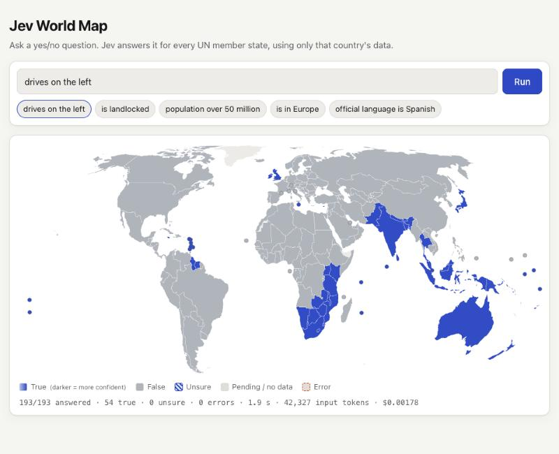

  

<h1 align="center">Awesome Jev Live</h1>

<b>Der nach Belegstufe geordnete Jev-Index, der sich alle zwei Stunden neu aufbaut.</b>

  
  
  
  
  
  

<a href="../README.md">English</a> · <a href="README.zh-CN.md">简体中文</a> · <a href="README.zh-TW.md">繁體中文</a> · <a href="README.ja.md">日本語</a> · <a href="README.ko.md">한국어</a> · <a href="README.es.md">Español</a> · <a href="README.fr.md">Français</a> · <b>Deutsch</b> · <a href="README.pt-BR.md">Português (Brasil)</a> · <a href="README.ru.md">Русский</a> · <a href="README.it.md">Italiano</a> · <a href="README.ar.md">العربية</a> · <a href="README.hi.md">हिन्दी</a> · <a href="README.tr.md">Türkçe</a> · <a href="README.vi.md">Tiếng Việt</a> · <a href="README.th.md">ไทย</a> · <a href="README.id.md">Bahasa Indonesia</a> · <a href="README.pl.md">Polski</a> · <a href="README.nl.md">Nederlands</a> · <a href="README.uk.md">Українська</a>

> [!NOTE]
> **Live-Index** · Letzte Synchronisierung: `2026-11-28T19:51:18+08:00` (UTC+8)
> · Einträge: **793** · Neu in diesem Durchlauf: **5** · Implementierungssprachen: **26**

Jeder Eintrag unten wurde von der Pipeline in diesem Repository gesammelt, gefiltert und erneut geprüft. Zahlen und Zeitstempel stammen aus den Quellen, nicht aus einer handgeschriebenen Momentaufnahme.

## 🔥 Auswahl des Moments — der Erste je Kategorie

Ein Eintrag je Kategorie, sortiert nach Evidenzgrad und Sternen, bei jeder Synchronisierung neu berechnet. Eine Rangliste, keine Empfehlung; jeder Pick verlinkt seine vollständige Karte. Projekte mit veröffentlichtem Screenshot oder einer Aufnahme werden bevorzugt, damit die Leiste visuell bleibt.

<table>
<tr>
<td width="50%" valign="top">
<b>🏛️ <a href="https://github.com/typesafe-ai/skills">typesafe-ai/skills</a></b>
⭐2929 · ✅ official
Agentenfähigkeiten für die Entwicklung mit TypeSafe&#x27;s System One API
</td>
<td width="50%" valign="top">

<b>🧰 <a href="https://github.com/AkashPriyadarshii/jev-curate">AkashPriyadarshii/jev-curate</a></b>
⭐116 · Rust · 👁️ observed
High-throughput synthetic and pretraining dataset sifter for TypeSafe Jev. Rust streaming core, Parquet and JSONL I/O, typed Choice/Score/Noul judgments, speculative…
</td>
</tr>
<tr>
<td width="50%" valign="top">

<b>🤖 <a href="https://github.com/gargpratyush/jev-router">gargpratyush/jev-router</a></b>
⭐675 · JavaScript · 🔎 inferred
Leite in claude code mit jev-router für deine Aufgabe an das günstigste Modell weiter
</td>
<td width="50%" valign="top">

<b>🛡️ <a href="https://github.com/dharmeshgurnani/codeotter">dharmeshgurnani/codeotter</a></b>
⭐9 · TypeScript · 👁️ observed
Autonome, selbst gehostete KI-Code-Reviews, kalibrierte Bewertungsanzeigen und Merge-Gates von jedem Open Model.
</td>
</tr>
<tr>
<td width="50%" valign="top">

<b>🧪 <a href="https://github.com/Mapika/decider">Mapika/decider</a></b>
⭐1034 · Python · 👁️ observed
Eine Familie von Modellen im System One-Stil, feinabgestimmt aus Qwen3.5, entwickelt für typisierte Entscheidungen in einem Durchlauf mit kalibrierten…
</td>
<td width="50%" valign="top">

<b>🔬 <a href="https://github.com/r-ms/mini-jev">r-ms/mini-jev</a></b>
⭐65 · Python · 🔎 inferred
mini-Jev: So sieht eine typisierte Entscheidungsoberfläche im Stil von Jev auf einem eingefrorenen Qwen3-4B aus — lies die Logits des Optionsbuchstabens statt JSON zu…
</td>
</tr>
<tr>
<td width="50%" valign="top">

<b>🎮 <a href="https://github.com/MCG-NJU/VideoJev">MCG-NJU/VideoJev</a></b>
⭐322 · Python · 👁️ observed
VideoJev: System One Model für Videoverständnis und Interaktion
</td>
<td width="50%" valign="top">
<b>📰 <a href="https://docs.typesafe.ai/model-jaggedness/jev-1.13">9 Klassen bekannter Defekte (jaggedness)</a></b>
⭐0 · ✅ official
Wörtliches Verständnis, **unzuverlässiges Zählen**, Datumsvergleiche, mehrstufige Indirektion, irrelevante Details mit großem state, adversariale Inhalte,…
</td>
</tr>
</table>

## Inhalt

- [Was ist Jev?](#was-ist-jev)
- [Wie Einträge eingestuft werden](#wie-einträge-eingestuft-werden)
- [Offizielle SDKs und Entwicklerwerkzeuge](#offizielle-sdks-und-entwicklerwerkzeuge) — **6**
- [Community-Clients, SDKs und Adapter](#community-clients-sdks-und-adapter) — **139**
- [Agent-Tooling: MCP, Hooks, Gates und Coding-Agents](#agent-tooling-mcp-hooks-gates-und-coding-agents) — **256**
- [Routing, Guardrails und Freigaben](#routing-guardrails-und-freigaben) — **53**
- [Evaluation, Kalibrierung und Benchmarks](#evaluation-kalibrierung-und-benchmarks) — **86**
- [Offene Reproduktionen, Gewichte und Architekturforschung](#offene-reproduktionen-gewichte-und-architekturforschung) — **54**
- [Anwendungen, Spiele, Robotik und interaktive Demos](#anwendungen-spiele-robotik-und-interaktive-demos) — **47**
- [Artikel, Diskussionen und verwandte Listen](#artikel-diskussionen-und-verwandte-listen) — **72**
- [Weitere Projekte](#weitere-projekte) — **80**
- [Projekte nach Implementierungssprache](#projekte-nach-implementierungssprache)

## Was ist Jev?

Jev ist das erste **System One model** von TypeSafe AI. Es schreibt keine Prosa. Es nimmt einen Zustand plus Fragen, deren Antwortraum Sie vorab festlegen, und liefert typisierte Werte mit Wahrscheinlichkeitsverteilungen zurück, auf die Ihr Code verzweigen kann.

|                        |                                                                                                                                                                                                                                                    |
| ---------------------- | -------------------------------------------------------------------------------------------------------------------------------------------------------------------------------------------------------------------------------------------------- |
| **Form**               | `state + typed questions` → `constrained answers + probabilities` → `your code`                                                                                                                                                                    |
| **Primitive**          | `Choice` (eine von ≤255 Optionen wählen), `Score` (ein Raster von 2–10), `Noul` (ein probabilistisches Ja/Nein)                                                                                                                                    |
| **Endpoint**           | `POST https://api.typesafe.ai/v1/systemone`, Modell `jev-1.13.0` / Alias `jev-latest`                                                                                                                                                              |
| **Gute Einsatzfelder** | Routing, Triage, Bewertung, Moderation, Verifikation und Gates mit niedriger Latenz in einem begrenzten Workflow                                                                                                                                   |
| **Bekannte Grenzen**   | Zählen ist unzuverlässig, mehrstufige Indirektion ist schwach, und offizielles Material nennt neun Klassen von Jaggedness. Eine schema-gültige Ausgabe ist nicht dasselbe wie eine korrekte Entscheidung — kalibrieren Sie an Ihren eigenen Daten. |

## Wie Einträge eingestuft werden

Die meisten Listen in diesem Feld behaupten, etwas aufzunehmen. Diese sagt, wie viel sie tatsächlich geprüft hat, und lässt Sie entsprechend filtern.

| Grad         | Bedeutung                                                                                                                                                                                   |
| ------------ | ------------------------------------------------------------------------------------------------------------------------------------------------------------------------------------------- |
| `official`   | Von TypeSafe AI selbst veröffentlicht.                                                                                                                                                      |
| `observed`   | Ein öffentliches Artefakt, das geöffnet und gelesen werden kann — echter Quellcode, echte Konfiguration oder eine ausdrückliche TypeSafe/Jev-Angabe im Repository-Namen oder in den Topics. |
| `inferred`   | Aufgrund eines uneindeutigen Signals plus bestätigenden Vokabulars zugeordnet, aber noch nicht Zeile für Zeile gelesen.                                                                     |
| `unverified` | Sieht verwandt aus, nichts unabhängig bestätigt. Nur zum Auffinden gelistet.                                                                                                                |

## Offizielle SDKs und Entwicklerwerkzeuge

Alles, was TypeSafe selbst veröffentlicht. Hier anfangen.

🏛️ <b><a href="https://github.com/typesafe-ai/skills">typesafe-ai/skills</a></b> · ⭐2929 · ✅ official · 35 天

##### 📝 Zusammenfassung

Agentenfähigkeiten für die Entwicklung mit TypeSafe's System One API

> 💡 Die eigenen Agent-Fähigkeiten des Anbieters. Da sie kontinuierlich aktualisiert werden, kommen sie einer Spezifikation dessen, wie TypeSafe beabsichtigt, Jev von einem Agenten steuern zu lassen, am nächsten.

##### 📌 Basisfakten

| Feld      | Wert                                      |
| --------- | ----------------------------------------- |
| Kategorie | `Offizielle SDKs und Entwicklerwerkzeuge` |
| Beleg     | `official`                                |

##### 📊 Daten

| Metrik            | Wert       |
| ----------------- | ---------- |
| Stars             | **2929**   |
| Letzter Push      | 2026-10-23 |
| Erstmals gelistet | 2026-09-18 |

🏛️ <b><a href="https://github.com/typesafe-ai/system-one-adapter-python">typesafe-ai/system-one-adapter-python</a></b> · ⭐410 · Python · ✅ official · 13 天

##### 📝 Zusammenfassung

Drop-in-Ersatz für TypeSafeClient, unterstützt durch LLM APIs

> 💡 Drop-in-Ersatz, der dieselbe Schnittstelle mit einem gewöhnlichen LLM-Provider unterstützt. Dies ist der ehrliche Weg, eine typisierte Entscheidung auf den eigenen Daten per A/B-Test mit einem Prompt zu vergleichen, bevor man sich für eine der beiden Möglichkeiten entscheidet.

🔧 Im Code verwendet: `README.md`

##### 📌 Basisfakten

| Feld      | Wert                                      |
| --------- | ----------------------------------------- |
| Kategorie | `Offizielle SDKs und Entwicklerwerkzeuge` |
| Beleg     | `official`                                |
| Sprache   | Python                                    |

##### 📊 Daten

| Metrik            | Wert       |
| ----------------- | ---------- |
| Stars             | **410**    |
| Letzter Push      | 2026-11-15 |
| Erstmals gelistet | 2026-10-23 |

🏛️ <b><a href="https://github.com/typesafe-ai/typesafe-sdk-python">typesafe-ai/typesafe-sdk-python</a></b> · ⭐317 · Python · ✅ official · 3 天

##### 📝 Zusammenfassung

Die offizielle Python-Bibliothek für TypeSafe API

> 💡 Synchrone und asynchrone Clients. Der schnellste Weg von einem API-Schlüssel zu einer typisierten Entscheidung und die Referenz, mit der Community-Clients verglichen werden.

##### 📌 Basisfakten

| Feld      | Wert                                      |
| --------- | ----------------------------------------- |
| Kategorie | `Offizielle SDKs und Entwicklerwerkzeuge` |
| Beleg     | `official`                                |
| Sprache   | Python                                    |

##### 📊 Daten

| Metrik            | Wert       |
| ----------------- | ---------- |
| Stars             | **317**    |
| Letzter Push      | 2026-11-25 |
| Erstmals gelistet | 2026-10-23 |

🏛️ <b><a href="https://github.com/typesafe-ai/typesafe-sdk-js">typesafe-ai/typesafe-sdk-js</a></b> · ⭐288 · TypeScript · ✅ official · 17 天

##### 📝 Zusammenfassung

Die offizielle TypeScript/JavaScript-Bibliothek für TypeSafe API

> 💡 TypeScript-Client, bei dem der Antworttyp aus der gestellten Frage abgeleitet wird, sodass ein nicht übereinstimmender Rückgabetyp ein Kompilierungsfehler statt einer Überraschung zur Laufzeit ist.

##### 📌 Basisfakten

| Feld      | Wert                                      |
| --------- | ----------------------------------------- |
| Kategorie | `Offizielle SDKs und Entwicklerwerkzeuge` |
| Beleg     | `official`                                |
| Sprache   | TypeScript                                |

##### 📊 Daten

| Metrik            | Wert       |
| ----------------- | ---------- |
| Stars             | **288**    |
| Letzter Push      | 2026-11-11 |
| Erstmals gelistet | 2026-10-23 |

🏛️ <b><a href="https://github.com/typesafe-ai/WorkflowEvals">typesafe-ai/WorkflowEvals</a></b> · ⭐22 · Python · ✅ official · 14 天

##### 📝 Zusammenfassung

Workflow-Code von evals.typesafe.ai veröffentlicht

##### 📌 Basisfakten

| Feld      | Wert                                      |
| --------- | ----------------------------------------- |
| Kategorie | `Offizielle SDKs und Entwicklerwerkzeuge` |
| Beleg     | `official`                                |
| Sprache   | Python                                    |

##### 📊 Daten

| Metrik            | Wert       |
| ----------------- | ---------- |
| Stars             | **22**     |
| Letzter Push      | 2026-11-14 |
| Erstmals gelistet | 2026-10-23 |

🏛️ <b><a href="https://github.com/typesafe-ai/typesafe-ai.github.io">typesafe-ai/typesafe-ai.github.io</a></b> · ⭐2 · HTML · ✅ official · 176 天

##### 📝 Zusammenfassung

Im Upstream wurde keine Beschreibung veröffentlicht.

##### 📌 Basisfakten

| Feld      | Wert                                      |
| --------- | ----------------------------------------- |
| Kategorie | `Offizielle SDKs und Entwicklerwerkzeuge` |
| Beleg     | `official`                                |
| Sprache   | HTML                                      |

##### 📊 Daten

| Metrik            | Wert       |
| ----------------- | ---------- |
| Stars             | **2**      |
| Letzter Push      | 2026-06-04 |
| Erstmals gelistet | 2026-10-23 |

## Community-Clients, SDKs und Adapter

Typisierte Clients für den System-One-Endpoint, in so vielen Sprachen, wie die Community bisher bearbeitet hat.

🧰 <b><a href="https://github.com/jexp/neo4jev">jexp/neo4jev</a></b> · ⭐190 · Jupyter · 👁️ observed · 71 天

##### 📝 Zusammenfassung

Typesafe.ai System One Model Jev, das einen Neo4j-Graphen durch Verwendung eines Klassifizierers über benachbarte Beziehungen durchläuft

##### 📌 Basisfakten

| Feld      | Wert                                  |
| --------- | ------------------------------------- |
| Kategorie | `Community-Clients, SDKs und Adapter` |
| Beleg     | `observed`                            |
| Sprache   | Jupyter                               |

##### 📊 Daten

| Metrik            | Wert       |
| ----------------- | ---------- |
| Stars             | **190**    |
| Letzter Push      | 2026-09-18 |
| Erstmals gelistet | 2026-10-28 |

🧰 <b><a href="https://github.com/keltokhy/jgrep">keltokhy/jgrep</a></b> · ⭐141 · Python · 👁️ observed · 41 天

##### 📝 Zusammenfassung

grep, aber das Muster ist eine Beschreibung. Filtert Zeilen nach ihrer Bedeutung mit dem Jev-Entscheidungsmodell von TypeSafe: etwa 200 ms und ein Tausendstel Cent pro Zeile.

🔧 Im Code verwendet: `README.md`

##### 📌 Basisfakten

| Feld      | Wert                                  |
| --------- | ------------------------------------- |
| Kategorie | `Community-Clients, SDKs und Adapter` |
| Beleg     | `observed`                            |
| Sprache   | Python                                |

##### 📊 Daten

| Metrik            | Wert       |
| ----------------- | ---------- |
| Stars             | **141**    |
| Letzter Push      | 2026-10-17 |
| Erstmals gelistet | 2026-10-29 |

🏷 `cli` · `grep` · `jev` · `openrouter` · `semantic-search` · `typesafe`

🧰 <b><a href="https://github.com/qkal/Canny">qkal/Canny</a></b> · ⭐136 · TypeScript · 👁️ observed · 15 天

##### 📝 Zusammenfassung

Verhindert, dass KI-Coding-Agenten ohne Belege behaupten, ihre Arbeit sei erledigt. Deterministische Hooks entscheiden, TypeSafe's Jev berät. Nur-anhängbares Ledger, keine Laufzeitabhängigkeiten.

🔧 Im Code verwendet: `README.md`

##### 📌 Basisfakten

| Feld      | Wert                                  |
| --------- | ------------------------------------- |
| Kategorie | `Community-Clients, SDKs und Adapter` |
| Beleg     | `observed`                            |
| Sprache   | TypeScript                            |

##### 📊 Daten

| Metrik            | Wert       |
| ----------------- | ---------- |
| Stars             | **136**    |
| Letzter Push      | 2026-11-13 |
| Erstmals gelistet | 2026-10-29 |

🏷 `agent-hooks` · `ai-agents` · `claude-code` · `claude-code-hooks` · `codex` · `codex-cli` · `guardrails` · `jev`

🧰 <b><a href="https://github.com/AkashPriyadarshii/jev-curate">AkashPriyadarshii/jev-curate</a></b> · ⭐116 · Rust · 👁️ observed · 0 天

##### 📝 Zusammenfassung

High-throughput synthetic and pretraining dataset sifter for TypeSafe Jev. Rust streaming core, Parquet and JSONL I/O, typed Choice/Score/Noul judgments, speculative fan-out, 24.0 rows/sec measured.

🔧 Im Code verwendet: `AGENTS.md`

##### 📌 Basisfakten

| Feld      | Wert                                  |
| --------- | ------------------------------------- |
| Kategorie | `Community-Clients, SDKs und Adapter` |
| Beleg     | `observed`                            |
| Sprache   | Rust                                  |

##### 📊 Daten

| Metrik            | Wert       |
| ----------------- | ---------- |
| Stars             | **116**    |
| Letzter Push      | 2026-11-28 |
| Erstmals gelistet | 2026-11-05 |

🏷 `arrow` · `cli` · `data-cleaning` · `data-engineering` · `dataset-curation` · `eval-harness` · `fine-tuning` · `jev`

---

<table><tr><th align="center" width="50%">🖼 Bild</th><th align="center" width="50%">🎬 Video</th></tr><tr>
<td align="center" valign="top"></td>
<td align="center" valign="top">keine Medien veröffentlicht</td>
</tr></table>

🧰 <b><a href="https://github.com/yzfly/awesome-jev-zh">yzfly/awesome-jev-zh</a></b> · ⭐97 · HTML · 👁️ observed · 0 天

##### 📝 Zusammenfassung

Jev / TypeSafe System One chinesische Auswahlliste: offizielle Materialien, SDK, beliebte Anwendungen, Agent-Tools, Open-Source-Reproduktionen und unabhängige Bewertungen, mit chinesischen Einstiegsanleitungen; täglich werden automatisch GitHub beliebte Projekte aufgenommen.

🔧 Im Code verwendet: `docs/quickstart.md`

##### 📌 Basisfakten

| Feld      | Wert                                  |
| --------- | ------------------------------------- |
| Kategorie | `Community-Clients, SDKs und Adapter` |
| Beleg     | `observed`                            |
| Sprache   | HTML                                  |

##### 📊 Daten

| Metrik            | Wert       |
| ----------------- | ---------- |
| Stars             | **97**     |
| Letzter Push      | 2026-11-28 |
| Erstmals gelistet | 2026-09-18 |

🏷 `ai-agent` · `awesome` · `awesome-list` · `chinese` · `jev` · `llm` · `structured-output` · `system-one`

🧰 <b><a href="https://github.com/obie/ruby_decision_model">obie/ruby_decision_model</a></b> · ⭐61 · Ruby · 👁️ observed · 46 天

##### 📝 Zusammenfassung

Ruby-Client für Entscheidungsmodelle wie Typesafe Jev

🔧 Im Code verwendet: `README.md`

##### 📌 Basisfakten

| Feld      | Wert                                  |
| --------- | ------------------------------------- |
| Kategorie | `Community-Clients, SDKs und Adapter` |
| Beleg     | `observed`                            |
| Sprache   | Ruby                                  |

##### 📊 Daten

| Metrik            | Wert       |
| ----------------- | ---------- |
| Stars             | **61**     |
| Letzter Push      | 2026-10-12 |
| Erstmals gelistet | 2026-10-29 |

🧰 <b><a href="https://github.com/bodepudimuneendra-netizen/ConsciousDB">bodepudimuneendra-netizen/ConsciousDB</a></b> · ⭐56 · Python · 👁️ observed · 26 天

##### 📝 Zusammenfassung

Ein datenbankagnostisches Agentic-GraphRAG-Framework mit austauschbaren System One-Modellen (lokales Laya / Cloud-Jev). Eine Plug-and-play-Intelligenzschicht mit einer vollständigen 4-Phasen-Pipeline, kontinuierlicher Evaluierung und benutzerdefinierter A*-Traversal für jede Graphdatenbank.

##### 📌 Basisfakten

| Feld      | Wert                                  |
| --------- | ------------------------------------- |
| Kategorie | `Community-Clients, SDKs und Adapter` |
| Beleg     | `observed`                            |
| Sprache   | Python                                |

##### 📊 Daten

| Metrik            | Wert       |
| ----------------- | ---------- |
| Stars             | **56**     |
| Letzter Push      | 2026-11-02 |
| Erstmals gelistet | 2026-11-20 |

🏷 `astar-algorithm` · `eval-harness` · `fine-tuning` · `graphdatabase` · `graprag` · `jev` · `laya` · `neo4j`

🧰 <b><a href="https://github.com/AkashPriyadarshii/jev-superpowers">AkashPriyadarshii/jev-superpowers</a></b> · ⭐41 · HTML · 👁️ observed · 50 天

##### 📝 Zusammenfassung

Systematic software development framework for AI coding agents upgraded with TypeSafe Jev System One typed decisions

🔧 Im Code verwendet: `CLAUDE.md`

##### 📌 Basisfakten

| Feld      | Wert                                  |
| --------- | ------------------------------------- |
| Kategorie | `Community-Clients, SDKs und Adapter` |
| Beleg     | `observed`                            |
| Sprache   | HTML                                  |

##### 📊 Daten

| Metrik            | Wert       |
| ----------------- | ---------- |
| Stars             | **41**     |
| Letzter Push      | 2026-10-08 |
| Erstmals gelistet | 2026-11-05 |

🏷 `agentic-skills` · `ai-agents` · `antigravity` · `claude-code` · `codex` · `coding-agents` · `cursor` · `developer-tools`

🧰 <b><a href="https://github.com/MrJev/awesome-jev">MrJev/awesome-jev</a></b> · ⭐21 · Python · 👁️ observed · 0 天

##### 📝 Zusammenfassung

Eine kuratierte Liste von Projekten, Integrationen und Ressourcen für Jev, das System One-Modell von TypeSafe AI.

##### 📌 Basisfakten

| Feld      | Wert                                  |
| --------- | ------------------------------------- |
| Kategorie | `Community-Clients, SDKs und Adapter` |
| Beleg     | `observed`                            |
| Sprache   | Python                                |

##### 📊 Daten

| Metrik            | Wert       |
| ----------------- | ---------- |
| Stars             | **21**     |
| Letzter Push      | 2026-11-27 |
| Erstmals gelistet | 2026-09-18 |

🏷 `ai-agents` · `awesome` · `awesome-list` · `jev` · `mcp` · `typesafe`

🧰 <b><a href="https://github.com/ckaraca/awesome-jev">ckaraca/awesome-jev</a></b> · ⭐18 · Python · 👁️ observed · 4 天

##### 📝 Zusammenfassung

Eine kuratierte Liste von Tools, Integrationen und Experimenten auf Basis von Jev, dem System One-Modell von TypeSafe AI für schnelle, typisierte Entscheidungen.

##### 📌 Basisfakten

| Feld      | Wert                                  |
| --------- | ------------------------------------- |
| Kategorie | `Community-Clients, SDKs und Adapter` |
| Beleg     | `observed`                            |
| Sprache   | Python                                |

##### 📊 Daten

| Metrik            | Wert       |
| ----------------- | ---------- |
| Stars             | **18**     |
| Letzter Push      | 2026-11-23 |
| Erstmals gelistet | 2026-09-19 |

🏷 `ai-agents` · `awesome` · `awesome-list` · `computer-use` · `jev` · `llm` · `system-one` · `typesafe`

🧰 <b><a href="https://github.com/Premo-Cloud/typesafe-sdk-java">Premo-Cloud/typesafe-sdk-java</a></b> · ⭐12 · Java · 👁️ observed · 37 天

##### 📝 Zusammenfassung

Community-Java-SDK für Jev, das System One-Modell von TypeSafe: typisierte Fragen hinein, typisierte Antworten mit kalibrierten Wahrscheinlichkeiten heraus. Java 17+, Spring-Boot-Starter (inoffiziell)

##### 📌 Basisfakten

| Feld      | Wert                                  |
| --------- | ------------------------------------- |
| Kategorie | `Community-Clients, SDKs und Adapter` |
| Beleg     | `observed`                            |
| Sprache   | Java                                  |

##### 📊 Daten

| Metrik            | Wert       |
| ----------------- | ---------- |
| Stars             | **12**     |
| Letzter Push      | 2026-10-21 |
| Erstmals gelistet | 2026-10-28 |

🏷 `java` · `jev` · `sdk` · `spring-boot` · `system-one` · `system-one-models` · `typesafe`

🧰 <b><a href="https://github.com/Sur-Cai/macos-computer-use-kit">Sur-Cai/macos-computer-use-kit</a></b> · ⭐10 · Python · 👁️ observed · 55 天

##### 📝 Zusammenfassung

AX-first computer use for AI agents on macOS with optional Jev (TypeSafe System One) semantic guards: calibrated target/input judgments before an irreversible action, decisions kept in code. Accessibility-tree targeting, window-scoped input, clipboard-safe paste, read-back verification. Ships a pip CLI, a pi package and a DeepSeek Harness plugin.

##### 📌 Basisfakten

| Feld      | Wert                                  |
| --------- | ------------------------------------- |
| Kategorie | `Community-Clients, SDKs und Adapter` |
| Beleg     | `observed`                            |
| Sprache   | Python                                |

##### 📊 Daten

| Metrik            | Wert       |
| ----------------- | ---------- |
| Stars             | **10**     |
| Letzter Push      | 2026-10-03 |
| Erstmals gelistet | 2026-11-23 |

🏷 `accessibility` · `agent-skills` · `ai-agents` · `claude-code` · `computer-use` · `decision-intelligence` · `desktop-automation` · `dsh-plugin`

🧰 <b><a href="https://github.com/clouatre-labs/decisions-judge-mcp">clouatre-labs/decisions-judge-mcp</a></b> · ⭐5 · JavaScript · 👁️ observed · 2 天

##### 📝 Zusammenfassung

Typisierte Entscheidungen für KI-Agenten als MCP-Tool: Ja/Nein-Wahrscheinlichkeit (noul), Auswahl und Bewertung in einer schnellen Anfrage. Unterstützt durch das TypeSafe-System One-Modell.

##### 📌 Basisfakten

| Feld      | Wert                                  |
| --------- | ------------------------------------- |
| Kategorie | `Community-Clients, SDKs und Adapter` |
| Beleg     | `observed`                            |
| Sprache   | JavaScript                            |

##### 📊 Daten

| Metrik            | Wert       |
| ----------------- | ---------- |
| Stars             | **5**      |
| Letzter Push      | 2026-11-26 |
| Erstmals gelistet | 2026-10-12 |

🏷 `agent` · `ai` · `cli` · `decision-making` · `decisions` · `judge` · `llm` · `mcp`

---

<table><tr><th align="center" width="50%">🖼 Bild</th><th align="center" width="50%">🎬 Video</th></tr><tr>
<td align="center" valign="top"></td>
<td align="center" valign="top"> animierte Aufzeichnung</td>
</tr></table>

🧰 <b><a href="https://github.com/elbruno/ElBruno.AI.Decisions">elbruno/ElBruno.AI.Decisions</a></b> · ⭐5 · C# · 👁️ observed · 1 天

##### 📝 Zusammenfassung

.NET 10 decision SDK: Choose, Score, and Assess with Microsoft Foundry (Microsoft-Decision-1), native local Ollama System One models, and TypeSafe AI Jev. One API, probabilities instead of paragraphs.

##### 📌 Basisfakten

| Feld      | Wert                                  |
| --------- | ------------------------------------- |
| Kategorie | `Community-Clients, SDKs und Adapter` |
| Beleg     | `observed`                            |
| Sprache   | C#                                    |

##### 📊 Daten

| Metrik            | Wert       |
| ----------------- | ---------- |
| Stars             | **5**      |
| Letzter Push      | 2026-11-26 |
| Erstmals gelistet | 2026-11-18 |

🏷 `dotnet` · `dotnet10` · `jev` · `microsoft-extensions-ai` · `nuget`

---

<table><tr><th align="center" width="50%">🖼 Bild</th><th align="center" width="50%">🎬 Video</th></tr><tr>
<td align="center" valign="top"></td>
<td align="center" valign="top">keine Medien veröffentlicht</td>
</tr></table>

🧰 <b><a href="https://github.com/agent-ix/sapho">agent-ix/sapho</a></b> · ⭐2 · Rust · 👁️ observed · 0 天

##### 📝 Zusammenfassung

Compound decisions with System One models like Jev: ask small questions, combine the answers with rules you write in a decision graph. Rust library and CLI.

##### 📌 Basisfakten

| Feld      | Wert                                  |
| --------- | ------------------------------------- |
| Kategorie | `Community-Clients, SDKs und Adapter` |
| Beleg     | `observed`                            |
| Sprache   | Rust                                  |

##### 📊 Daten

| Metrik            | Wert       |
| ----------------- | ---------- |
| Stars             | **2**      |
| Letzter Push      | 2026-11-27 |
| Erstmals gelistet | 2026-11-23 |

🏷 `ai` · `cli` · `clm` · `code-review` · `dag` · `decision-engine` · `decision-graph` · `fuzzy-logic`

---

<table><tr><th align="center" width="50%">🖼 Bild</th><th align="center" width="50%">🎬 Video</th></tr><tr>
<td align="center" valign="top"></td>
<td align="center" valign="top">keine Medien veröffentlicht</td>
</tr></table>

🧰 <b><a href="https://github.com/Bonzokoles/36_chambers">Bonzokoles/36_chambers</a></b> · Python · 👁️ observed · 36 天

##### 📝 Zusammenfassung

Föderierte Wissensabfrage-Engine für KI-Agenten. Leitet Abfragen über eine registrierungsorientierte Orchestrierung mit TypeSafe/Jev-KI-Routing und Evidenz-Neubewertung an spezialisierte Backends (FTS5, ChromaDB, Graph) weiter. Standardmäßig schreibgeschützt und von Grund auf sicherheitsgeschützt.

##### 📌 Basisfakten

| Feld      | Wert                                  |
| --------- | ------------------------------------- |
| Kategorie | `Community-Clients, SDKs und Adapter` |
| Beleg     | `observed`                            |
| Sprache   | Python                                |

##### 📊 Daten

| Metrik            | Wert       |
| ----------------- | ---------- |
| Stars             | **0**      |
| Letzter Push      | 2026-10-22 |
| Erstmals gelistet | 2026-11-24 |

🏷 `ai-agents` · `ai-infrastructure` · `chromadb` · `embeddings` · `federated-search` · `fts5` · `information-retrieval` · `jev`

---

<table><tr><th align="center" width="50%">🖼 Bild</th><th align="center" width="50%">🎬 Video</th></tr><tr>
<td align="center" valign="top"></td>
<td align="center" valign="top">keine Medien veröffentlicht</td>
</tr></table>

Asset direkt aus dem Upstream-Repository verlinkt, da keine Lizenz zur Weiterverbreitung angegeben wurde.

🧰 <b><a href="https://github.com/dzhng/jevgrep">dzhng/jevgrep</a></b> · ⭐3276 · TypeScript · 🔎 inferred · 15 天

##### 📝 Zusammenfassung

Code finden, indem man fragt, was er tut. Ein CLI für Coding Agents, das Jev verwendet, um relevante Dateien und Quellkontext zu entdecken.

##### 📌 Basisfakten

| Feld      | Wert                                  |
| --------- | ------------------------------------- |
| Kategorie | `Community-Clients, SDKs und Adapter` |
| Beleg     | `inferred`                            |
| Sprache   | TypeScript                            |

##### 📊 Daten

| Metrik            | Wert       |
| ----------------- | ---------- |
| Stars             | **3276**   |
| Letzter Push      | 2026-11-12 |
| Erstmals gelistet | 2026-11-07 |

🏷 `ai-sdk` · `claude-code` · `cli` · `code-search` · `codex` · `coding-agents` · `context-retrieval` · `developer-tools`

---

<table><tr><th align="center" width="50%">🖼 Bild</th><th align="center" width="50%">🎬 Video</th></tr><tr>
<td align="center" valign="top"></td>
<td align="center" valign="top">keine Medien veröffentlicht</td>
</tr></table>

🧰 <b><a href="https://github.com/supercorp-ai/supercov">supercorp-ai/supercov</a></b> · ⭐173 · Rust · 🔎 inferred · 0 天

##### 📝 Zusammenfassung

Coverage for coding agents

> 💡 Bewertungen der Codequalität und Testabdeckung, als typisierte Entscheidungen statt als Prosa erzeugt, sodass das Ergebnis eine Pipeline direkt freigeben oder blockieren kann.

##### 📌 Basisfakten

| Feld      | Wert                                  |
| --------- | ------------------------------------- |
| Kategorie | `Community-Clients, SDKs und Adapter` |
| Beleg     | `inferred`                            |
| Sprache   | Rust                                  |

##### 📊 Daten

| Metrik            | Wert       |
| ----------------- | ---------- |
| Stars             | **173**    |
| Letzter Push      | 2026-11-28 |
| Erstmals gelistet | 2026-10-23 |

🏷 `agent-skills` · `claude-code` · `code-coverage` · `code-quality` · `codex` · `coding-agents` · `coverage` · `gemini-cli-extension`

---

<table><tr><th align="center" width="50%">🖼 Bild</th><th align="center" width="50%">🎬 Video</th></tr><tr>
<td align="center" valign="top"></td>
<td align="center" valign="top">keine Medien veröffentlicht</td>
</tr></table>

<b>Mehr in dieser Kategorie</b> · 121

- [PromtEngineer/jev-harness](https://github.com/PromtEngineer/jev-harness) - Ein Pi-Agenten-Harness rund um TypeSafe.
- [xingwudao/OpenJev](https://github.com/xingwudao/OpenJev) - OpenJev: eine von Jev inspirierte unabhängige System One-Entscheidungs-API…
- [danieleteti/systemone-delphi](https://github.com/danieleteti/systemone-delphi) - Delphi client for System One models (Jev, tev1 and nimble on Ollama): ask typed…
- [chussenot/judgment](https://github.com/chussenot/judgment) - Typisierte, kalibrierte Bewertungen aus System One-Modellen: Eine Entscheidung…
- [GitHub30/OpenJev](https://github.com/GitHub30/OpenJev) - Open-Weight-System One-Modell (Jev-kompatibel): kalibrierte…
- [CMaintz/jev-dotnet](https://github.com/CMaintz/jev-dotnet) - Inoffizielles .NET SDK für das Jev System One-Modell von TypeSafe AI.
- [jqueryscript/awesome-jev](https://github.com/jqueryscript/awesome-jev) - A curated list of TypeSafe Jev resources, SDKs, agents, MCP servers…
- [andyrossa/ai-search-copilot](https://github.com/andyrossa/ai-search-copilot) - Eine kuratierte Liste von Projekten, Integrationen und Ressourcen für Jev, das…
- [basi/typesafe-ai-php-client](https://github.com/basi/typesafe-ai-php-client) - PHP client for the typesafe.ai System One API (Jev).
- [CMaintz/jev-java](https://github.com/CMaintz/jev-java) - Inoffizielles Java SDK für TypeSafe AI.
- [gajaguar/typesafe-cli](https://github.com/gajaguar/typesafe-cli) - Unofficial command-line interface for TypeSafe AI System One models, on…
- [JosephHardy91/graph-composition-with-dLLMs](https://github.com/JosephHardy91/graph-composition-with-dLLMs) - A Graph-Compiled Specification RAG system built with **Dagster**, **PostgreSQL…
- [lmbgithub/ai-resume-screening-system-one-kev](https://github.com/lmbgithub/ai-resume-screening-system-one-kev) - Benchmark of Kev System One models against an LLM judge for resume screening…
- [sanketmuchhala/jevgate](https://github.com/sanketmuchhala/jevgate) - Calibrated policy triage and institutional risk routing: a hybrid…
- [ollaya-dev/ollaya](https://github.com/ollaya-dev/ollaya) - Jev-compatible API server for open decision models.
- [realZachi/pg-jev](https://github.com/realZachi/pg-jev) - Stelle deinen Postgres-Tabellen Fragen in natürlicher Sprache.
- [sutro-sh/jev-align](https://github.com/sutro-sh/jev-align) - Erstelle kalibrierte AI Functions aus menschlichem Feedback mit Jev und GEPA.
- [juspay/neurolink](https://github.com/juspay/neurolink) - Die Pipe-Schicht eines KI-Nervensystems — eine Schnittstelle, die…
- [aaddrick/building-with-typesafe-jev](https://github.com/aaddrick/building-with-typesafe-jev) - Inoffizieller Skill, der Coding-Agenten beibringt, mit TypeSafe AIs Jev zu…
- [Ying-Kai-Liao/jev-browser](https://github.com/Ying-Kai-Liao/jev-browser) - Browser-Automatisierung, bei der ein LLM plant und Jev (Typesafe System One)…
- [fazlerocks/jevmail](https://github.com/fazlerocks/jevmail) - Open-Source-KI-E-Mail-Triage für Gmail.
- [AkashPriyadarshii/jev-seo](https://github.com/AkashPriyadarshii/jev-seo) - Free Rust SEO and GEO toolkit powered by TypeSafe Jev: 58-rule audits, site…
- [AboveColin/HA-Jev](https://github.com/AboveColin/HA-Jev) - Stelle deinem Haus eine Frage und erhalte eine Zahl zurück.
- [sharziki/semdecide](https://github.com/sharziki/semdecide) - Typisierte semantische Entscheidungen für Unix-Pipelines und CI, betrieben mit…
- [bladedevoff/stuntd](https://github.com/bladedevoff/stuntd) - Lokaler Proxy, der die typisierten LLM-Entscheidungen deiner App lernt und sie…
- [burnigtm/jev-mcp](https://github.com/burnigtm/jev-mcp) - MCP-Server, der TypeSafe Jev in Cursor, Codex und jeden MCP-Client in die…
- [mlimarenko/IronRAG](https://github.com/mlimarenko/IronRAG) - One-click knowledge system for documents, internal bots, and AI agents.
- [shiftynick/jev-axi](https://github.com/shiftynick/jev-axi) - Agent-ergonomic CLI for TypeSafe.
- [Eliot5566/JEV-Paper-Radar](https://github.com/Eliot5566/JEV-Paper-Radar) - Turn research interests or paper links into a ranked reading list in Claude.
- [dannote/jev](https://github.com/dannote/jev) - TypeSafe Jev für OTP: auf Jev von einem GenServer antworten und eine…
- [DevLoops-ai/unified-brain](https://github.com/DevLoops-ai/unified-brain) - System One coding agents: code-level answers in about 10secs for under 2 cents.
- [jiangkoumo/ego-decision-layer](https://github.com/jiangkoumo/ego-decision-layer) - Pluggable decision layer for the ego lite browser: one System One (Jev) call…
- [jwuthri-cloud/SelfJev](https://github.com/jwuthri-cloud/SelfJev) - Self-hosted decision model (selfjev-4b) with a Jev-compatible API: Python SDK…
- [thusinh1969/BrighTO_Router](https://github.com/thusinh1969/BrighTO_Router) - BrighTO LLM Router: free open-source, ultra-fast Rust LLM gateway/router and…
- [tumf/jev-cli](https://github.com/tumf/jev-cli) - Small dependency-free CLI for TypeSafe Jev.
- [arjun988/Kev](https://github.com/arjun988/Kev) - Open-Source-System One-Entscheidungsmaschine.
- [Ray-Hughes/jevalyn](https://github.com/Ray-Hughes/jevalyn) - Die Entscheidungsebene für deine Rails-App.
- [CheshiAI/Cheshi](https://github.com/CheshiAI/Cheshi) - Jev-powered conversation memory: find past sessions and revisit decisions with…
- [nouli-ai/nouli](https://github.com/nouli-ai/nouli) - Decision Agent Engine.
- [saibimajdi/typesafeai-dotnet-sdk](https://github.com/saibimajdi/typesafeai-dotnet-sdk) - Community-.NET-SDK für TypeSafe AI System One API — typisierte Noul-, Choice…
- [Elue-dev/jev_elixir](https://github.com/Elue-dev/jev_elixir) - jev_elixir ist eine kleine, idiomatische Schnittstelle zum Treffen typisierter…
- [himomohi/aside-jev](https://github.com/himomohi/aside-jev) - Aside-Agenten entscheiden mit TypeSafe Jev (System One: Choice/Score/Noul).
- [rcarmo/go-system-one](https://github.com/rcarmo/go-system-one) - when a gopher met Jev.
- [haileyok/typesafe-client](https://github.com/haileyok/typesafe-client) - Inoffizielle Go- und Rust-Clients für TypeSafe AI System One API (Jev).
- [sumleo/prompt2jev](https://github.com/sumleo/prompt2jev) - Agenten-Skill und CLI, die natürliche Sprache, einen LLM-Prompt oder den Code…
- [AIAnytime/Jev-Router](https://github.com/AIAnytime/Jev-Router) - Decision-first, OpenAI-compatible AI router powered by Jev typed decisions.
- [akiiwa-games/AgentCompass-Router](https://github.com/akiiwa-games/AgentCompass-Router) - Multi-agent task router &amp; subscription quota scheduler for Claude Code, Codex…
- [chenrui333/jev-docs](https://github.com/chenrui333/jev-docs) - Von der Community gepflegte Historie von Jev / TypeSafe System One APIs, SDKs…
- [devbackend/jevgo](https://github.com/devbackend/jevgo) - Inoffizieller Go-Client für den TypeSafe AI System One API (Jev) — typisierte…
- [docxology/daf-jev](https://github.com/docxology/daf-jev) - daf-jev: kombinierbares Python-Toolkit für TypeSafe.
- [kataras/jev](https://github.com/kataras/jev) - A Go client for the TypeSafe AI.
- [Kadihx/jev-x-kit](https://github.com/Kadihx/jev-x-kit) - Offline-Entscheidungsschicht für 0 $ für Coding-Agenten…
- [gudcks/jev-java](https://github.com/gudcks/jev-java) - Unofficial Java SDK for TypeSafe Jev and Vercel AI Gateway, with Spring Boot…
- [Jev-Engineering/TypeWright](https://github.com/Jev-Engineering/TypeWright) - Deklariere eine Entscheidung, kompiliere typisierte Jev-Fragen, messe sie und…
- [brida-ai/sdk](https://github.com/brida-ai/sdk) - Official TypeScript SDK for the Brida platform.
- [docwilde/doxa](https://github.com/docwilde/doxa) - ΔΟΞΑ is a Rust multi-agent terminal for Claude, Codex, Gemini via Google…
- [FrancoisChastel/skill-scanner](https://github.com/FrancoisChastel/skill-scanner) - Scan Agent Skills before your coding agent installs them.
- [JimmyWesley/rlcd-gateway](https://github.com/JimmyWesley/rlcd-gateway) - Self-hosted-Gateway für LLMs und Entscheidungsmodelle.
- [PAI-CUHK/SLEEPJEV](https://github.com/PAI-CUHK/SLEEPJEV) - JEV-inspirierte typisierte Laufzeitentscheidungen über langfristiges PSG…
- [zhirschtritt/typesafe-go](https://github.com/zhirschtritt/typesafe-go) - Idiomatic Go SDK für TypeSafe AI API.
- [AboveColin/jevclient](https://github.com/AboveColin/jevclient) - Asynchroner Python-Client für TypeSafe Jev.
- [Butochnikov/laravel-typesafe-jev](https://github.com/Butochnikov/laravel-typesafe-jev) - Inoffizielle Laravel-Integration für TypeSafe Jev AI mit typisierten Antworten…
- [coo-quack/jev-pii-checker](https://github.com/coo-quack/jev-pii-checker) - CLI, das PII in Text mit TypeSafe Jev findet: Vorhandensein, Sensitivität und…
- [frodi-karlsson/onesie](https://github.com/frodi-karlsson/onesie) - Gate scripts and CI on fast, calibrated System One judgments like Jev: a score…
- [Lasimeri/Mechanical-Jev](https://github.com/Lasimeri/Mechanical-Jev) - Die fragende Seite von Jev (TypeSafe System One: noul, choice, score) in Rust…
- [neuronection/desktop-assistant](https://github.com/neuronection/desktop-assistant) - Open-source AI launcher in your system tray: global hotkey, streaming chat…
- [nshkrdotcom/system_one_sdk](https://github.com/nshkrdotcom/system_one_sdk) - Providerneutrale Elixir/BEAM-SDK für System One-Semantik: typisierte Noul…
- [X32Studio/Argus](https://github.com/X32Studio/Argus) - Universal persistent deep-exploration &amp; decision-intelligence engine — rare…
- [zerone-agents/jev-model-router](https://github.com/zerone-agents/jev-model-router) - Leichtgewichtiges Modellrouting für Agenten mit Kompatibilität für OpenAI und…
- [abhisheksharma001/jev-skill](https://github.com/abhisheksharma001/jev-skill) - Agent skill for TypeSafe AI.
- [dsaad68/fuzzy-jev](https://github.com/dsaad68/fuzzy-jev) - A client for OpenRouter&#x27;s decision models, TypeSafe&#x27;s Jev by default: typed…
- [fabric-runtime/jev-fabric](https://github.com/fabric-runtime/jev-fabric) - Native process orchestration with typed, explicit Jev decisions.
- [getmissionctrl/hs-jev](https://github.com/getmissionctrl/hs-jev) - Haskell-Client für die Entscheidungs-API von TypeSafe (System One) (Jev)…
- [JawzoD3TH/JevApi](https://github.com/JawzoD3TH/JevApi) - JevApi — MCP, Api Client Library and Test Harness for Jev.
- [minorun365/jev-cloud-quiz](https://github.com/minorun365/jev-cloud-quiz) - 三大クラウドの機能名を、TypeSafe AI の System One モデル Jev が確率つきで判定するデモ.
- [NerdishShah/playwright-cli-jev-bakeoff](https://github.com/NerdishShah/playwright-cli-jev-bakeoff) - Vergleichstest: Playwright CLI vs. CLI+Jev vs.
- [Afloat16/jev-mcp](https://github.com/Afloat16/jev-mcp) - TypeSafe AI Jev MCP server for bounded probabilistic decisions: four read-only…
- [AkashPriyadarshii/jev-stars](https://github.com/AkashPriyadarshii/jev-stars) - Local-first GitHub stars memory for AI coding agents: Rust CLI turning 1243…
- [bitranox/btx-skill-jev-judge](https://github.com/bitranox/btx-skill-jev-judge) - Claude Code plugin and Python CLI: hand a judgment repeated over many items to…
- [Howardyh/gemini-codex-jev](https://github.com/Howardyh/gemini-codex-jev) - Antigravity plugin bridging Gemini thinking, TypeSafe Jev System-1 calibrated…
- [kitepon/jev-bookmarks](https://github.com/kitepon/jev-bookmarks) - Chrome履歴から目的に合うページを選び、Jevで操作して役立ったURLだけをプロジェクトごとに記録するCLI.
- [milojarow/jev-skills](https://github.com/milojarow/jev-skills) - Jev (TypeSafe System One) skill and CLI for coding agents: when to use typed…
- [MrKyaw/CognitiveMirror-Jev-MCP](https://github.com/MrKyaw/CognitiveMirror-Jev-MCP) - Cognitive middleware for personal and enterprise AI agents: 14 MCP tools and a…
- [talalkashar/jev-brain](https://github.com/talalkashar/jev-brain) - Any agent is the brain; jev does the step.
- [Talya1412/jev-harness](https://github.com/Talya1412/jev-harness) - TypeSafe Jev (System One) integrations for OMP, MCP, Claude Code, and Pi…
- [Wrenik/Jev-toolkit-Compiler](https://github.com/Wrenik/Jev-toolkit-Compiler) - Context log, search and a compact/clear advisor for Claude Code.
- [abirshhishirroy/mini-jev](https://github.com/abirshhishirroy/mini-jev) - A custom Jev-style decision model built from scratch on Qwen2.5-3B.
- [BramVR/jev-batch](https://github.com/BramVR/jev-batch) - Tiny stdlib CLI for the Jev classifier API, plus an agent skill for…
- [bruno-olivaes/jev-ai-qa-observability-suite](https://github.com/bruno-olivaes/jev-ai-qa-observability-suite) - AI QA &amp; Observability showcase: JEV System-1 typed…
- [CMaintz/jev-tools](https://github.com/CMaintz/jev-tools) - TypeScript-Tools auf Basis von TypeSafe AI.
- [codebam/jev-guardrails](https://github.com/codebam/jev-guardrails) - Auf Jev basierende Schutzmechanismen für Agenten-Toolaufrufe: Bibliothek…
- [drrozen-med/jev-classify](https://github.com/drrozen-med/jev-classify) - Jev (TypeSafe System One) taxonomy classification machinery: typed-choice…
- [fan56/dsh-jev-core](https://github.com/fan56/dsh-jev-core) - Shared TypeSafe Jev decision-model client for the dsh ecosystem: strict…
- [gupolicarpo/jev-graphify](https://github.com/gupolicarpo/jev-graphify) - MCP server that gives coding agents the right file, memory or skill for a…
- [kkdev92/jev-dotnet](https://github.com/kkdev92/jev-dotnet) - An unofficial .NET 10 client for Jev, TypeSafe.
- [mdimamhosen/jev](https://github.com/mdimamhosen/jev) - One endpoint for every model, one CLI for every MCP.
- [ogarciarevett/jev-py-sdk](https://github.com/ogarciarevett/jev-py-sdk) - Typisierte Jev-Urteile (noul / choice / score) aus TypeSafe für Python…
- [royalskynet/jev-gate-mcp](https://github.com/royalskynet/jev-gate-mcp) - Gesteuertes Jev-Entscheidungsgateway für GPT-, Claude- und MCP-Clients.
- [sunjongos/jev-typesafe-gatekeeper](https://github.com/sunjongos/jev-typesafe-gatekeeper) - World-Class Pure System 1 AI Decision &amp; 90/10 Hybrid Gatekeeper Skill powered…
- [sususu98/pi-jev-navigator](https://github.com/sususu98/pi-jev-navigator) - Ultra-low-token System One context navigation and precision SOP dispatch engine…
- [VianneyMI/python-jev](https://github.com/VianneyMI/python-jev) - Unofficial typed Python SDK for TypeSafe.
- [Yasir-Khan-7/jev-sentinel](https://github.com/Yasir-Khan-7/jev-sentinel) - Schutz vor Prompt-Injection und Tool-Call-Leitplanken für…
- [BingoWon/apple-rag-mcp](https://github.com/BingoWon/apple-rag-mcp) - Apple developer knowledge for AI agents via MCP or CLI.
- [pithings/advocaat](https://github.com/pithings/advocaat) - Ein kleiner, typsicherer Client zum Stellen von KI-Fragen zu deinen Daten…
- [zhulinchng/jevper](https://github.com/zhulinchng/jevper) - Jev-förmiger (TypeSafe System One) Klassifikations-Wrapper über…
- [getcustomaise/customaise-mcp](https://github.com/getcustomaise/customaise-mcp) - MCP server and CLI that connect AI agents.
- [schainks/system_one_client](https://github.com/schainks/system_one_client) - Elixir-Client für System One-Entscheidungsmodelle: TypeSafe Jev, Cloudflare…
- [IKEASven69/dsh-opencli](https://github.com/IKEASven69/dsh-opencli) - 让 dsh 会办事:登录态真实浏览器 × 180 站点结构化命令 + SystemOne 亚秒决策 + 执行真实性判定 + watch 监控.
- [AutreMachine/bosco](https://github.com/AutreMachine/bosco) - Router and proxy for OpenAI compatible LLMs machines - 1 url to rule them all !
- [Query-farm/vgi-typesafe](https://github.com/Query-farm/vgi-typesafe) - Ein VGI-Worker, der TypeSafe System One-Fragen (choice, noul, score) für…
- [iamtalha-arshad/ex_typesafe_ai](https://github.com/iamtalha-arshad/ex_typesafe_ai) - Inoffizieller Elixir-Client für TypeSafe AI API – typisierte Strukturen…
- [lirantal/discoprint](https://github.com/lirantal/discoprint) - Classify an artist.
- [y0usaf/typesafe-cli](https://github.com/y0usaf/typesafe-cli) - Stelle Jev typisierte Fragen aus der Shell: noul-, choice- und score-Antworten…
- [DavidObando/Cider](https://github.com/DavidObando/Cider) - A low-level System One decision model library for .NET.
- [geilt/typesafe-cli](https://github.com/geilt/typesafe-cli) - CLI und Agenten-Skill für TypeSafe System One (Jev): typisierte Choice-, Score…
- [hardkoded/typesafe-sdk-dotnet](https://github.com/hardkoded/typesafe-sdk-dotnet) - Unofficial .NET port of the TypeSafe AI client SDK (typed questions &amp; answers).
- [KratosLee-6/open-source-model-deploy](https://github.com/KratosLee-6/open-source-model-deploy) - 开源大模型部署可行性鉴别工具 · 168 个开源模型动态评估（含 12 个 JEV/System One 决策模型）· 硬件自动检测 ·…
- [MarcelRoozekrans/Minos.NET](https://github.com/MarcelRoozekrans/Minos.NET) - Typed, source-generated decision questions for .NET: one IDecisionClient for…
- [MIt9/laya-cli](https://github.com/MIt9/laya-cli) - Ergonomisches CLI für Laya – typisierte Entscheidungen (choice/score/noul) für…
- [phiat/typesafe-rust-sdk](https://github.com/phiat/typesafe-rust-sdk) - Unofficial Rust client for TypeSafe.
- [Ridlo543/systemone-judge](https://github.com/Ridlo543/systemone-judge) - Universal Model Context Protocol (MCP) server and CLI runner for TypeSafe Jev…

## Agent-Tooling: MCP, Hooks, Gates und Coding-Agents

Die am schnellsten wachsende Kategorie: Hooks, MCP-Server und Gates, die der nächsten Aktion eines Agenten eine typisierte Entscheidung voranstellen.

🤖 <b><a href="https://github.com/tamaratran/fast-jev-compaction">tamaratran/fast-jev-compaction</a></b> · ⭐8033 · TypeScript · 🔎 inferred · 71 天

##### 📝 Zusammenfassung

Claude-Code-Plugin, das die Kompaktierungszusammenfassung durch Jev-Entscheidungen ersetzt: Jeder Tool-Aufruf und jedes Ergebnis wird in einer schnellen Anfrage bewertet, veraltete Elemente werden verworfen oder gekürzt, und alles, was behalten wird, bleibt wortgetreu.

> 💡 Ersetzt die Kontext-Kompaktierungszusammenfassung eines Coding-Agenten durch eine typisierte Entscheidung. Ein sauberes Beispiel dafür, wie man einen einzelnen LLM-Aufruf in einer bestehenden Pipeline austauscht, anstatt die Pipeline neu zu erstellen.

##### 📌 Basisfakten

| Feld      | Wert                                                 |
| --------- | ---------------------------------------------------- |
| Kategorie | `Agent-Tooling: MCP, Hooks, Gates und Coding-Agents` |
| Beleg     | `inferred`                                           |
| Sprache   | TypeScript                                           |

##### 📊 Daten

| Metrik            | Wert       |
| ----------------- | ---------- |
| Stars             | **8033**   |
| Letzter Push      | 2026-09-18 |
| Erstmals gelistet | 2026-11-08 |

🤖 <b><a href="https://github.com/gargpratyush/jev-router">gargpratyush/jev-router</a></b> · ⭐675 · JavaScript · 🔎 inferred · 70 天

##### 📝 Zusammenfassung

Leite in claude code mit jev-router für deine Aufgabe an das günstigste Modell weiter

> 💡 Leitet jeden Durchlauf an das günstigste Modell weiter, das ihn verarbeiten kann. Der maßgebliche Anwendungsfall zur Kostensenkung für ein System One-Modell.

##### 📌 Basisfakten

| Feld      | Wert                                                 |
| --------- | ---------------------------------------------------- |
| Kategorie | `Agent-Tooling: MCP, Hooks, Gates und Coding-Agents` |
| Beleg     | `inferred`                                           |
| Sprache   | JavaScript                                           |

##### 📊 Daten

| Metrik            | Wert       |
| ----------------- | ---------- |
| Stars             | **675**    |
| Letzter Push      | 2026-09-19 |
| Erstmals gelistet | 2026-11-08 |

---

<table><tr><th align="center" width="50%">🖼 Bild</th><th align="center" width="50%">🎬 Video</th></tr><tr>
<td align="center" valign="top"></td>
<td align="center" valign="top">keine Medien veröffentlicht</td>
</tr></table>

🤖 <b><a href="https://github.com/0xNatoshi/jev-codex-router">0xNatoshi/jev-codex-router</a></b> · ⭐275 · JavaScript · 🔎 inferred · 67 天

##### 📝 Zusammenfassung

Modell- und Reasoning-Routing pro Durchlauf für Codex, gesteuert durch Jev (TypeSafe System One): wählt für jeden Durchlauf das Modell, die Denktiefe und den Geschwindigkeitsmodus.

> 💡 Routing von Modell und Reasoning-Aufwand pro Durchlauf für einen Coding-Agenten, gesteuert durch typisierte Entscheidungen.

##### 📌 Basisfakten

| Feld      | Wert                                                 |
| --------- | ---------------------------------------------------- |
| Kategorie | `Agent-Tooling: MCP, Hooks, Gates und Coding-Agents` |
| Beleg     | `inferred`                                           |
| Sprache   | JavaScript                                           |

##### 📊 Daten

| Metrik            | Wert       |
| ----------------- | ---------- |
| Stars             | **275**    |
| Letzter Push      | 2026-09-22 |
| Erstmals gelistet | 2026-10-28 |

🏷 `ai` · `codex` · `jev` · `llm` · `macos` · `routing` · `typesafe`

🤖 <b><a href="https://github.com/strands-labs/strands-decider">strands-labs/strands-decider</a></b> · ⭐1307 · Python · 👁️ observed · 2 天

##### 📝 Zusammenfassung

Ein kleines, schnelles Entscheidungsmodell oder System-1-Modell für agentische Workflows. Wähle zwischen Optionen oder bewerte auf einer Skala schneller als mit einem LLM, mit kalibrierter Konfidenz bei jeder Entscheidung.

##### 📌 Basisfakten

| Feld      | Wert                                                 |
| --------- | ---------------------------------------------------- |
| Kategorie | `Agent-Tooling: MCP, Hooks, Gates und Coding-Agents` |
| Beleg     | `observed`                                           |
| Sprache   | Python                                               |

##### 📊 Daten

| Metrik            | Wert       |
| ----------------- | ---------- |
| Stars             | **1307**   |
| Letzter Push      | 2026-11-26 |
| Erstmals gelistet | 2026-10-02 |

🏷 `ai` · `machine-learning` · `natural-language-understanding` · `python` · `strands-agents` · `strands-labs` · `system-one` · `system-one-models`

---

<table><tr><th align="center" width="50%">🖼 Bild</th><th align="center" width="50%">🎬 Video</th></tr><tr>
<td align="center" valign="top"></td>
<td align="center" valign="top">keine Medien veröffentlicht</td>
</tr></table>

🤖 <b><a href="https://github.com/thruwire/foreman">thruwire/foreman</a></b> · ⭐838 · Python · 👁️ observed · 43 天

##### 📝 Zusammenfassung

An agent supervisor and software factory foreman powered by decision models

🔧 Im Code verwendet: `docs/openrouter.md`

##### 📌 Basisfakten

| Feld      | Wert                                                 |
| --------- | ---------------------------------------------------- |
| Kategorie | `Agent-Tooling: MCP, Hooks, Gates und Coding-Agents` |
| Beleg     | `observed`                                           |
| Sprache   | Python                                               |

##### 📊 Daten

| Metrik            | Wert       |
| ----------------- | ---------- |
| Stars             | **838**    |
| Letzter Push      | 2026-10-15 |
| Erstmals gelistet | 2026-11-08 |

🏷 `agent-supervision` · `codex` · `jev` · `opencode` · `pi-agent` · `pi-coding-agent` · `pi-durable`

---

<table><tr><th align="center" width="50%">🖼 Bild</th><th align="center" width="50%">🎬 Video</th></tr><tr>
<td align="center" valign="top"></td>
<td align="center" valign="top">keine Medien veröffentlicht</td>
</tr></table>

🤖 <b><a href="https://github.com/AbdelStark/awesome-typesafe-jev">AbdelStark/awesome-typesafe-jev</a></b> · ⭐620 · HTML · 👁️ observed · 26 天

##### 📝 Zusammenfassung

Awesome Jev: ein quellenbasierter Feldführer zu TypeSafes System One-Modell, mit SDKs, Live-Demos, Agent-Tools und unabhängigen Bewertungen.

🔧 Im Code verwendet: `README.md`

##### 📌 Basisfakten

| Feld      | Wert                                                 |
| --------- | ---------------------------------------------------- |
| Kategorie | `Agent-Tooling: MCP, Hooks, Gates und Coding-Agents` |
| Beleg     | `observed`                                           |
| Sprache   | HTML                                                 |

##### 📊 Daten

| Metrik            | Wert       |
| ----------------- | ---------- |
| Stars             | **620**    |
| Letzter Push      | 2026-11-01 |
| Erstmals gelistet | 2026-10-28 |

🏷 `agent-skills` · `ai-agents` · `awesome` · `awesome-jev` · `awesome-list` · `awesome-lists` · `curated-list` · `developer-tools`

🤖 <b><a href="https://github.com/walidboulanouar/awesome-jev-use-cases">walidboulanouar/awesome-jev-use-cases</a></b> · ⭐500 · 👁️ observed · 62 天

##### 📝 Zusammenfassung

Awesome-Liste mit TypeSafe AI-Jev-Anwendungsfällen: 74 Demos, nach Likes sortiert, über 150 GitHub-Repos, Grenzen, Kosten und API-Beispiele. CC0

🔧 Im Code verwendet: `README.md`

##### 📌 Basisfakten

| Feld      | Wert                                                 |
| --------- | ---------------------------------------------------- |
| Kategorie | `Agent-Tooling: MCP, Hooks, Gates und Coding-Agents` |
| Beleg     | `observed`                                           |

##### 📊 Daten

| Metrik            | Wert       |
| ----------------- | ---------- |
| Stars             | **500**    |
| Letzter Push      | 2026-09-26 |
| Erstmals gelistet | 2026-10-29 |

🏷 `ai-guardrails` · `ai-router` · `awesome` · `awesome-list` · `classification` · `claude-code` · `decision-model` · `examples`

🤖 <b><a href="https://github.com/RomanSlack/jev-drone">RomanSlack/jev-drone</a></b> · ⭐305 · Python · 👁️ observed · 64 天

##### 📝 Zusammenfassung

Autonome Drohne in MuJoCo, die ausschließlich Kameradaten nutzt, mit einem kleinen Bewertungsmodell (TypeSafe Jev) im Regelkreis bei 2,5 Hz

🔧 Im Code verwendet: `tactics.py`, `tunnel_tactics.py`

##### 📌 Basisfakten

| Feld      | Wert                                                 |
| --------- | ---------------------------------------------------- |
| Kategorie | `Agent-Tooling: MCP, Hooks, Gates und Coding-Agents` |
| Beleg     | `observed`                                           |
| Sprache   | Python                                               |

##### 📊 Daten

| Metrik            | Wert       |
| ----------------- | ---------- |
| Stars             | **305**    |
| Letzter Push      | 2026-09-24 |
| Erstmals gelistet | 2026-10-29 |

🏷 `autonomous-agents` · `drone` · `mujoco` · `robotics` · `typesafe`

---

<table><tr><th align="center" width="50%">🖼 Bild</th><th align="center" width="50%">🎬 Video</th></tr><tr>
<td align="center" valign="top"></td>
<td align="center" valign="top">keine Medien veröffentlicht</td>
</tr></table>

🤖 <b><a href="https://github.com/Amal-David/awesome-jev">Amal-David/awesome-jev</a></b> · ⭐250 · Python · 👁️ observed · 0 天

##### 📝 Zusammenfassung

Jev-Demos, Projekte, SDKs und Skills, mit Quelllinks und einer kuratierten X-Galerie.

🔧 Im Code verwendet: `templates/README.md`

##### 📌 Basisfakten

| Feld      | Wert                                                 |
| --------- | ---------------------------------------------------- |
| Kategorie | `Agent-Tooling: MCP, Hooks, Gates und Coding-Agents` |
| Beleg     | `observed`                                           |
| Sprache   | Python                                               |

##### 📊 Daten

| Metrik            | Wert       |
| ----------------- | ---------- |
| Stars             | **250**    |
| Letzter Push      | 2026-11-28 |
| Erstmals gelistet | 2026-09-27 |

🏷 `agent-skills` · `awesome-ai` · `awesome-list` · `browser-use` · `claude-code` · `codex` · `coding-agent` · `computer-use`

🤖 <b><a href="https://github.com/kraayenjon/awesome-jev">kraayenjon/awesome-jev</a></b> · ⭐209 · 👁️ observed · 62 天

##### 📝 Zusammenfassung

Eine kuratierte Liste von Jev-Anwendungsfällen, Projekten, SDKs und Ressourcen. Jev ist das System One-Modell von TypeSafe AI für schnelle, typisierte Entscheidungen in Software — Choice, Score und Noul mit kalibrierten Wahrscheinlichkeiten.

🔧 Im Code verwendet: `README.md`

##### 📌 Basisfakten

| Feld      | Wert                                                 |
| --------- | ---------------------------------------------------- |
| Kategorie | `Agent-Tooling: MCP, Hooks, Gates und Coding-Agents` |
| Beleg     | `observed`                                           |

##### 📊 Daten

| Metrik            | Wert       |
| ----------------- | ---------- |
| Stars             | **209**    |
| Letzter Push      | 2026-09-27 |
| Erstmals gelistet | 2026-09-19 |

🏷 `agents` · `ai` · `ai-agents` · `api` · `artificial-intelligence` · `automation` · `awesome` · `awesome-list`

🤖 <b><a href="https://github.com/valentynkit/awesome-jev-typesafe">valentynkit/awesome-jev-typesafe</a></b> · ⭐188 · JavaScript · 👁️ observed · 0 天 · ⭐-2

##### 📝 Zusammenfassung

Typisierte Entscheidungen mit TypeSafe's Jev, dem ersten System One-Modell

🔧 Im Code verwendet: `readme.md`, `README.ko.md`, `README.ja.md`, `README.zh-CN.md`

##### 📌 Basisfakten

| Feld      | Wert                                                 |
| --------- | ---------------------------------------------------- |
| Kategorie | `Agent-Tooling: MCP, Hooks, Gates und Coding-Agents` |
| Beleg     | `observed`                                           |
| Sprache   | JavaScript                                           |

##### 📊 Daten

| Metrik            | Wert         |
| ----------------- | ------------ |
| Stars             | **188** (-2) |
| Letzter Push      | 2026-11-27   |
| Erstmals gelistet | 2026-09-19   |

🏷 `ai-agents` · `awesome` · `awesome-list` · `claude-code` · `directory` · `jev` · `llm-agents` · `system-one`

🤖 <b><a href="https://github.com/dbreunig/building-with-jev-skill">dbreunig/building-with-jev-skill</a></b> · ⭐170 · 👁️ observed · 29 天 · ⭐+1

##### 📝 Zusammenfassung

Eine Fähigkeit zum Schreiben und Verbessern von Programmen, die Jev, TypeSafe's System One-Modell, aufrufen

> 💡 Eine Fähigkeit zum Schreiben von Programmen, die Jev aufrufen, statt eines Programms, das Jev aufruft. Der Unterschied ist wichtig: Sie kodiert die Designregeln, nicht eine einzelne Implementierung davon.

##### 📌 Basisfakten

| Feld      | Wert                                                 |
| --------- | ---------------------------------------------------- |
| Kategorie | `Agent-Tooling: MCP, Hooks, Gates und Coding-Agents` |
| Beleg     | `observed`                                           |

##### 📊 Daten

| Metrik            | Wert         |
| ----------------- | ------------ |
| Stars             | **170** (+1) |
| Letzter Push      | 2026-10-29   |
| Erstmals gelistet | 2026-10-28   |

🤖 <b><a href="https://github.com/abhishekswe/agent-fastpath">abhishekswe/agent-fastpath</a></b> · ⭐8 · TypeScript · 👁️ observed · 3 天

##### 📝 Zusammenfassung

Jev MCP server: a decision layer for coding agents, built on TypeSafe Jev (System One model). Ship gates, risk checks, file triage that keeps files out of context, and a safe headless browser, with calibrated confidence. For Claude Code, Codex, Cursor.

##### 📌 Basisfakten

| Feld      | Wert                                                 |
| --------- | ---------------------------------------------------- |
| Kategorie | `Agent-Tooling: MCP, Hooks, Gates und Coding-Agents` |
| Beleg     | `observed`                                           |
| Sprache   | TypeScript                                           |

##### 📊 Daten

| Metrik            | Wert       |
| ----------------- | ---------- |
| Stars             | **8**      |
| Letzter Push      | 2026-11-24 |
| Erstmals gelistet | 2026-11-25 |

🏷 `agentic-ai` · `ai-agents` · `browser-automation` · `claude-code` · `codex` · `coding-agent` · `context-engineering` · `cursor`

---

<table><tr><th align="center" width="50%">🖼 Bild</th><th align="center" width="50%">🎬 Video</th></tr><tr>
<td align="center" valign="top"></td>
<td align="center" valign="top">keine Medien veröffentlicht</td>
</tr></table>

🤖 <b><a href="https://github.com/caijinchun/nanojev-arena">caijinchun/nanojev-arena</a></b> · ⭐7 · HTML · 👁️ observed · 69 天

##### 📝 Zusammenfassung

NanoJev Snake Arena: 1v4-Schlachtschiffduelle Mensch gegen KI plus Schwarm-Simulator mit 100 Agenten. Lokale Demo des Jev-System-One-Modells (Open-Source-Minireplikat).

##### 📌 Basisfakten

| Feld      | Wert                                                 |
| --------- | ---------------------------------------------------- |
| Kategorie | `Agent-Tooling: MCP, Hooks, Gates und Coding-Agents` |
| Beleg     | `observed`                                           |
| Sprache   | HTML                                                 |

##### 📊 Daten

| Metrik            | Wert       |
| ----------------- | ---------- |
| Stars             | **7**      |
| Letzter Push      | 2026-09-19 |
| Erstmals gelistet | 2026-11-24 |

---

<table><tr><th align="center" width="50%">🖼 Bild</th><th align="center" width="50%">🎬 Video</th></tr><tr>
<td align="center" valign="top"></td>
<td align="center" valign="top">keine Medien veröffentlicht</td>
</tr></table>

🤖 <b><a href="https://github.com/dfranco-projects/jev-guardbench">dfranco-projects/jev-guardbench</a></b> · ⭐3 · Python · 👁️ observed · 54 天

##### 📝 Zusammenfassung

Kann ein System One-Modell (TypeSafe Jev, Open-Source-Kev) einen LLM-als-Judge in Agenten-Leitplanken-Callbacks ersetzen?

##### 📌 Basisfakten

| Feld      | Wert                                                 |
| --------- | ---------------------------------------------------- |
| Kategorie | `Agent-Tooling: MCP, Hooks, Gates und Coding-Agents` |
| Beleg     | `observed`                                           |
| Sprache   | Python                                               |

##### 📊 Daten

| Metrik            | Wert       |
| ----------------- | ---------- |
| Stars             | **3**      |
| Letzter Push      | 2026-10-04 |
| Erstmals gelistet | 2026-11-04 |

---

<table><tr><th align="center" width="50%">🖼 Bild</th><th align="center" width="50%">🎬 Video</th></tr><tr>
<td align="center" valign="top"></td>
<td align="center" valign="top">keine Medien veröffentlicht</td>
</tr></table>

Asset direkt aus dem Upstream-Repository verlinkt, da keine Lizenz zur Weiterverbreitung angegeben wurde.

🤖 <b><a href="https://github.com/dolevhayut/resurface">dolevhayut/resurface</a></b> · ⭐1 · TypeScript · 👁️ observed · 56 天

##### 📝 Zusammenfassung

TypeSafe JEV-Bewerberscreening: LLM erstellt die Fragen, JEV (System One-Klassifizierungsmodell) beantwortet sie für jeden Lebenslauf in Ihrem ATS mit der exakten Belegzeile. 8× schneller, 31× günstiger als ein LLM.

##### 📌 Basisfakten

| Feld      | Wert                                                 |
| --------- | ---------------------------------------------------- |
| Kategorie | `Agent-Tooling: MCP, Hooks, Gates und Coding-Agents` |
| Beleg     | `observed`                                           |
| Sprache   | TypeScript                                           |

##### 📊 Daten

| Metrik            | Wert       |
| ----------------- | ---------- |
| Stars             | **1**      |
| Letzter Push      | 2026-10-03 |
| Erstmals gelistet | 2026-11-24 |

🏷 `ai-recruiting` · `ats` · `candidate-matching` · `classification-model` · `claude` · `decision-model` · `evidence-based-hiring` · `hr-tech`

---

<table><tr><th align="center" width="50%">🖼 Bild</th><th align="center" width="50%">🎬 Video</th></tr><tr>
<td align="center" valign="top"></td>
<td align="center" valign="top"> <a href="https://raw.githubusercontent.com/dolevhayut/resurface/main/docs/launch/resurface-launch.mp4">Video öffnen</a></td>
</tr></table>

🤖 <b><a href="https://github.com/light-cheng/Light-Decision-MCP">light-cheng/Light-Decision-MCP</a></b> · ⭐1 · JavaScript · 👁️ observed · 7 天

##### 📝 Zusammenfassung

Multi-backend Decision MCP & Magpie plugin for System One models (Gemini Decision, Jev, Perplexity, OpenRouter & local models) with local fallback & setup wizard. | 支持多云端与本地决策模型的 MCP 与 Magpie 插件，内置熔断降级、后台管理与硬件推荐向导。

##### 📌 Basisfakten

| Feld      | Wert                                                 |
| --------- | ---------------------------------------------------- |
| Kategorie | `Agent-Tooling: MCP, Hooks, Gates und Coding-Agents` |
| Beleg     | `observed`                                           |
| Sprache   | JavaScript                                           |

##### 📊 Daten

| Metrik            | Wert       |
| ----------------- | ---------- |
| Stars             | **1**      |
| Letzter Push      | 2026-11-20 |
| Erstmals gelistet | 2026-11-20 |

🏷 `decision-model` · `gemini-decision` · `local-ai` · `magpie` · `magpie-plugin` · `mcp` · `system-one`

---

<table><tr><th align="center" width="50%">🖼 Bild</th><th align="center" width="50%">🎬 Video</th></tr><tr>
<td align="center" valign="top"></td>
<td align="center" valign="top">keine Medien veröffentlicht</td>
</tr></table>

🤖 <b><a href="https://github.com/kentKH245/jev-mode">kentKH245/jev-mode</a></b> · 👁️ observed · 2 天

##### 📝 Zusammenfassung

Pure-Markdown LLM skill inspired by TypeSafe AI's Jev System One model. Turns chat & agent models into a low-token, low-thinking typed decision engine returning minified JSON for noul/choice/score primitives, batch triage, fail-closed gating, and prompt-injection sandboxing.

##### 📌 Basisfakten

| Feld      | Wert                                                 |
| --------- | ---------------------------------------------------- |
| Kategorie | `Agent-Tooling: MCP, Hooks, Gates und Coding-Agents` |
| Beleg     | `observed`                                           |

##### 📊 Daten

| Metrik            | Wert       |
| ----------------- | ---------- |
| Stars             | **0**      |
| Letzter Push      | 2026-11-26 |
| Erstmals gelistet | 2026-11-26 |

🏷 `agent-skills` · `ai-agents` · `classification` · `guardrails` · `jev` · `json` · `llm` · `llm-optimization`

---

<table><tr><th align="center" width="50%">🖼 Bild</th><th align="center" width="50%">🎬 Video</th></tr><tr>
<td align="center" valign="top"></td>
<td align="center" valign="top">keine Medien veröffentlicht</td>
</tr></table>

Asset direkt aus dem Upstream-Repository verlinkt, da keine Lizenz zur Weiterverbreitung angegeben wurde.

<b>Mehr in dieser Kategorie</b> · 238

- [Avinash-jetwani/jevmem](https://github.com/Avinash-jetwani/jevmem) - Shared project rules and memory for AI coding agents.
- [openlayer-ai/jevals](https://github.com/openlayer-ai/jevals) - Agent-Evaluierungen und Guardrails als Jev-Entscheidungen: eine Anfrage pro…
- [GhalebDweikat/winnow](https://github.com/GhalebDweikat/winnow) - Ein kalibriertes Kontext-Sieb für Claude Code: Jedes Tool-Ergebnis wird von…
- [andyrewlee/awesome-system-one](https://github.com/andyrewlee/awesome-system-one) - Eine Liste von System One-Modellen (auch Entscheidungsmodelle genannt): Jev…
- [Nisaka520/JevIntent](https://github.com/Nisaka520/JevIntent) - WeChat (FkWeChat-Plugin): Nachricht lange gedrückt halten, um Absicht /…
- [Li-Evan/awesome-jev](https://github.com/Li-Evan/awesome-jev) - Die umfassendste Galerie dessen, was Menschen mit Jev, dem von TypeSafe…
- [ChenneyZhuang/laya-browser-agent](https://github.com/ChenneyZhuang/laya-browser-agent) - Lokale Open-Source-Alternative zu Jev: Browser-Agent-Entscheidungen mit Laya…
- [blakestone-x/jev-mcp](https://github.com/blakestone-x/jev-mcp) - MCP server for TypeSafe Jev: typed classify, score, check, match and screen for…
- [TrustifAI/typed_evals](https://github.com/TrustifAI/typed_evals) - Fast, typed Python framework for Jev-as-a-Judge/Decision-model evaluation for…
- [tiffygk/jev-mode](https://github.com/tiffygk/jev-mode) - Claude Code/Codex skills, evals, harnesses/context tools, and learning…
- [darwintechlab/openjev](https://github.com/darwintechlab/openjev) - OpenJev: Ein Opencode-Plugin, das Entscheidungen zur Textgenerierung durch Jev…
- [yohanargentina-oss/Foq](https://github.com/yohanargentina-oss/Foq) - ⚡ Foq — die KOSTENLOSE, lokale Open-Source-Alternative zu Jev.
- [mani-aiml/jev-demos](https://github.com/mani-aiml/jev-demos) - Demos mit Jev, dem TypeSafe-System One-Modell, ein Ordner pro Demo.
- [brida-ai/reflex](https://github.com/brida-ai/reflex) - Open schemas, recipes, templates, examples and agent tooling for Brida Reflex.
- [BYK/jev-mcp](https://github.com/BYK/jev-mcp) - Ein eval-first-MCP-Server für TypeSafe.
- [kolawong/fast-compaction-dsh](https://github.com/kolawong/fast-compaction-dsh) - Urteilsbasierte Kontextkomprimierung für DeepSeek Harness – ersetzt…
- [LHCWN/arkui-sem](https://github.com/LHCWN/arkui-sem) - Semantischer ArkUI-Linter für Coding-Agenten: erkennt Zustands- und…
- [rajasekharponakala/jev-mcp](https://github.com/rajasekharponakala/jev-mcp) - MCP-Server, der die Jev-System One-Modelle von TypeSafe kapselt — typisierte…
- [BFLabsAI/bf-jev-deep-research](https://github.com/BFLabsAI/bf-jev-deep-research) - Agenten-Skill + wörtliche Studie über eine Jev (TypeSafe AI System One Model)…
- [JiaWeiXie/decision-enhanced-plugin](https://github.com/JiaWeiXie/decision-enhanced-plugin) - A Claude Code plugin that takes skills already in use and adds one thing to…
- [Mainakcris7/agent-guardrail-with-jev](https://github.com/Mainakcris7/agent-guardrail-with-jev) - A practical demo of how can we leverage the power of System One Models like Jev…
- [systemonemodels/noulxp](https://github.com/systemonemodels/noulxp) - NoulXP (ehemals OpenDXP): der offene Standard für System One-Modelle.
- [Abjcodes/SystemOne-Model-Router](https://github.com/Abjcodes/SystemOne-Model-Router) - Jev based model router for codex.
- [BargLabs/jev-judge-calibration](https://github.com/BargLabs/jev-judge-calibration) - Preregistered calibration test of TypeSafe Jev 1.13 as a judge of agent…
- [CrowBe/cloud-weave](https://github.com/CrowBe/cloud-weave) - CloudFlare based agent harness pushing the limits of System One models in…
- [izam-mohammed/decisionsmith](https://github.com/izam-mohammed/decisionsmith) - Use and fine-tune System One models (Jev, Laya) on your data, with an LLM as…
- [jms-dcksn/uipath-jev-guardrail-connector](https://github.com/jms-dcksn/uipath-jev-guardrail-connector) - UiPath-Connector nach dem Bring-your-own-Guardrail-Prinzip, unterstützt durch…
- [jonra/atlas-jev](https://github.com/jonra/atlas-jev) - Build a security-specialised, Jev-compatible System One model from open weights…
- [lucast4049/openjev](https://github.com/lucast4049/openjev) - Führe schnelle, kalibrierte, typisierte Entscheidungen auf offenen System…
- [Meirdrarel/mcp-systemone](https://github.com/Meirdrarel/mcp-systemone) - MCP server giving coding agents quick judgment tools.
- [nosial/FederationJevGuard](https://github.com/nosial/FederationJevGuard) - A FederationLib plugin that reviews reports, evidence and entities with a…
- [samstealth/system-one-model-tweaks](https://github.com/samstealth/system-one-model-tweaks) - Five measured upgrades to CLM-8B, an open System One decision model: better…
- [vurihuang/magpie-plugin-openai-decisions](https://github.com/vurihuang/magpie-plugin-openai-decisions) - OpenAI.
- [browser-use/jev-ultrafast](https://github.com/browser-use/jev-ultrafast) - Schnellster und günstigster Web-Agent.
- [jev-chat/jev-chat-jarvis](https://github.com/jev-chat/jev-chat-jarvis) - Der Chat-Entscheidungsassistent: Bevor du antwortest, liest Jev den Chat…
- [YaoApp/yao](https://github.com/YaoApp/yao) - ✨ Alle deine Agents und Workspaces an einem Ort, auf jedem Gerät, das du…
- [kerpopule/hermes-jev-skills](https://github.com/kerpopule/hermes-jev-skills) - Jev-gestütztes Modell-Routing, Speicher, Komprimierung, Skill-Auswahl sowie…
- [wy-coliney/jev-browser-use](https://github.com/wy-coliney/jev-browser-use) - 5–10-mal schnellere Browseroperationen: Jev klickt, Codex denkt nach und…
- [logicrw/awesome-jev-projects](https://github.com/logicrw/awesome-jev-projects) - Fantastisches Jev: quellengestütztes Radar für Open-Source-Ökosysteme…
- [AnotiaWang/awesome-decision-models](https://github.com/AnotiaWang/awesome-decision-models) - Eine kuratierte Liste von Entscheidungsmodellen.
- [devagrawal09/jev-review](https://github.com/devagrawal09/jev-review) - Ein stufenweiser Code-Review-Workflow und ein lokales Dashboard, erstellt mit…
- [wuyoscar/jev-skill](https://github.com/wuyoscar/jev-skill) - Eine großartige Sammlung von Jev-Anwendungsfällen, Workflows und…
- [kydlikebtc/awesome-jev](https://github.com/kydlikebtc/awesome-jev) - Launch what you built on Jev, TypeSafe AI.
- [jkudish/jev-mcp](https://github.com/jkudish/jev-mcp) - Schnelle, günstige, typisierte Bewertungen von TypeSafe.
- [ttlequals0/MinusPod](https://github.com/ttlequals0/MinusPod) - MinusPod ist ein selbst gehosteter Server, der Werbung entfernt, bevor du…
- [OmniJev/Flide](https://github.com/OmniJev/Flide) - 🔥🔥 The extremely fast inference engine for Jev-style decision models, up to…
- [BillionsBobby/JevRouter](https://github.com/BillionsBobby/JevRouter) - Ein leichtgewichtiger, von Jev unterstützter Router für Modelle, Tools und…
- [qbeka/jev-job-search](https://github.com/qbeka/jev-job-search) - Find software internships and new-grad jobs, fill the application forms, check…
- [malevrigns/agent-jev](https://github.com/malevrigns/agent-jev) - AgentJev-0.6B – ein schnelles &#x27;System One&#x27;-Entscheidungsmodell für KI-Agenten…
- [vinilana/jev-gateway](https://github.com/vinilana/jev-gateway) - Eine einfache Möglichkeit, jev mit deinem Coding-Agent für…
- [Heman10x-NGU/openJev-verdict-2.0](https://github.com/Heman10x-NGU/openJev-verdict-2.0) - Kalibrierte nicht-autoregressive Entscheidungs-Engine mit 151M Parametern, die…
- [OmniJev/OneJev](https://github.com/OmniJev/OneJev) - 🚀🚀 Ein multimodales System One-Entscheidungsmodell, das kalibrierte Antworten…
- [fatwang2/awesome-jev](https://github.com/fatwang2/awesome-jev) - Ein quellenbasiertes Jev-Projektverzeichnis mit einem wiederverwendbaren…
- [jmagly/aiwg](https://github.com/jmagly/aiwg) - Wiederverwendbarer Projektkontext und Spezialisten-Workflows für die KI-Tools…
- [luobosibing2/dsh-jev-plugin](https://github.com/luobosibing2/dsh-jev-plugin) - Natives DeepSeek Harness (DSH)-Plugin, das TypeSafe Jev oder eine Decision API…
- [native-bond-lab/Jev-Interaction](https://github.com/native-bond-lab/Jev-Interaction) - System-One-controlled full-duplex voice interaction: turn-taking as…
- [ThinkFlowLab/system1-agents](https://github.com/ThinkFlowLab/system1-agents) - System-1-Entscheidungsmodelle (Jev, Laya, Cua-S1) als Gehirn für Agenten…
- [tamaratran/jev-pruner](https://github.com/tamaratran/jev-pruner) - Claude-Code-Plugin: Lange Bash-Ausgaben mit TypeSafe Jev kürzen, bevor das…
- [y0usaf/pi-jev](https://github.com/y0usaf/pi-jev) - TypeSafe Jev als Entscheidungsebene für den Pi-Coding-Agent: ein gemessenes…
- [kyegomez/open-jev](https://github.com/kyegomez/open-jev) - Eine Open-Source-Rekonstruktion der Ideen hinter TypeSafe AI.
- [cookiespiggy/agentic-rl](https://github.com/cookiespiggy/agentic-rl) - Agentic-RL-Tutorial für Anfänger ohne Chinesischkenntnisse (33 Kapitel): von…
- [Shanghua-Gao/RSI-Jev](https://github.com/Shanghua-Gao/RSI-Jev) - Modelle für typisierte Entscheidungen (noul / choice / score), trainiert durch…
- [UditAkhourii/quicksilver](https://github.com/UditAkhourii/quicksilver) - Claude-Code-Skill: Übergib umfangreiche Bewertungsentscheidungen an Jev.
- [lawrence3699/jev-style](https://github.com/lawrence3699/jev-style) - JevStyle: local decision models for AI agents.
- [angel291592/Intent-Router](https://github.com/angel291592/Intent-Router) - Intent-Compiler für KI-Agenten – führt vage Anfragen zu typisierten…
- [initial-d/ml-quant-trading](https://github.com/initial-d/ml-quant-trading) - PyTorch ML-Quant-Forschung: 213 Faktoren, Bias-Korrektur, Portfoliooptimierung…
- [PerryLink/jevcore](https://github.com/PerryLink/jevcore) - TypeSafe Jev für DeepSeek Harness, das Model Context Protocol und Plain Node…
- [onlyreadai/onlyread](https://github.com/onlyreadai/onlyread) - Make AI browser agents read-only: a Chrome extension that refuses writes.
- [charlesdove977/claude-x-jev](https://github.com/charlesdove977/claude-x-jev) - Schnelle, günstige, typisierte Entscheidungen für Claude Code.
- [jonathanavis96/jev-kit](https://github.com/jonathanavis96/jev-kit) - Alles, was du zum Ausführen von TypeSafe.
- [akivet/Mica](https://github.com/akivet/Mica) - A 4B decision model: calibrated probabilities for yes/no, choice and score…
- [shitianfang/jev-use](https://github.com/shitianfang/jev-use) - Claude Code- / Codex- / pi-Plugin, das Agentenschritte ohne erforderliche…
- [yikangy873-gif/jev-desktop](https://github.com/yikangy873-gif/jev-desktop) - Auswahl von TypeSafe Jev-Aktionen innerhalb von Codex Computer Use.
- [iamaamir/system-one](https://github.com/iamaamir/system-one) - Anbieterneutrale System One-Laufzeitumgebung für TypeScript und Pi.
- [alanhuangyoo/OpenJev](https://github.com/alanhuangyoo/OpenJev) - OpenJev: quelloffene, lokale Alternative zu Jev.
- [TheoOliveira/pi-jev](https://github.com/TheoOliveira/pi-jev) - Semantisches Tool-Routing und typisierte System One-Entscheidungen für den…
- [chuloontop4-code/jev-instance-review](https://github.com/chuloontop4-code/jev-instance-review) - Bester Roblox Studio Instance Reviewer 2026: typisierte Jev Kriterien und…
- [FrancoisChastel/jev-code](https://github.com/FrancoisChastel/jev-code) - Jev, der System One-Klassifikator von TypeSafe, als Tool in Claude Code, Codex…
- [alexei-led/claude-router](https://github.com/alexei-led/claude-router) - Claude-Code-Plugin, das für jeden Durchlauf Modell und Aufwand auswählt…
- [intikhab49/open-jev-typed-decision-engine](https://github.com/intikhab49/open-jev-typed-decision-engine) - Offene Reproduktion von TypeSafe Jev: eine typisierte Entscheidungs-Engine mit…
- [PyModel/jev-judge-mcp](https://github.com/PyModel/jev-judge-mcp) - Typisierte Beurteilungstools für MCP-Agenten.
- [everyinfra/jev-radar](https://github.com/everyinfra/jev-radar) - 📡 The most rigorously verified tracker of the Jev (TypeSafe AI System One)…
- [AskTheWay/dsh-jev-interceptor](https://github.com/AskTheWay/dsh-jev-interceptor) - ⚡ Beurteilung jedes Tool-Aufrufs in DeepSeek Harness mit…
- [jomatsu/pi-jev-auto-mode](https://github.com/jomatsu/pi-jev-auto-mode) - Von Jev (TypeSafe System One) unterstützter Automatikmodus für den…
- [abhishek085/open-spark-jev](https://github.com/abhishek085/open-spark-jev) - Open-Source-Entscheidungsmodelle für den lokalen Einsatz, inspiriert von…
- [mas-bandwidth/nova-sprint](https://github.com/mas-bandwidth/nova-sprint) - Coordinate AI sprints across different models, harnesses and machines.
- [wangdada8208/codex-cua-jev](https://github.com/wangdada8208/codex-cua-jev) - Bridge Codex native macOS Computer Use runtime to any AI agent without login…
- [anandi1989/awesome-jev-usecases](https://github.com/anandi1989/awesome-jev-usecases) - Evidenzbasierter Index realer Jev-(TypeSafe AI-System One)-Anwendungsfälle…
- [ckorhonen/jev-lint](https://github.com/ckorhonen/jev-lint) - A fuzzy linter for coding agents. It checks the code your agent writes against…
- [erkamyaman/jev-enforce](https://github.com/erkamyaman/jev-enforce) - 📏 Claude Code plugin that makes Claude follow your AGENTS.md: every reply and…
- [Singularity-Compute/super-decider](https://github.com/Singularity-Compute/super-decider) - Decisions, not essays: a choice, a yes or no, or a score with a calibrated…
- [green-dalii/pi-shift-router](https://github.com/green-dalii/pi-shift-router) - Routing von Modellen pro Runde für den Pi-Coding-Agenten: Ein kleiner Prüfer…
- [paramjeetn/jev-cookbook](https://github.com/paramjeetn/jev-cookbook) - Das vollständige Kochbuch für Jev von TypeSafe AI — über 120 Anwendungsfälle…
- [iamtoomas/JevLint](https://github.com/iamtoomas/JevLint) - Konfigurierbares semantisches Linting, unterstützt durch Jev, mit…
- [vicfei/awesome-jev-prompts](https://github.com/vicfei/awesome-jev-prompts) - Question patterns, engine selection &amp; ecosystem tracking for typed decision…
- [daftAI2026/awesome-jev](https://github.com/daftAI2026/awesome-jev) - Kuratierte TypeSafe-Jev- / System One-GitHub-Projekte, Open-Source-Alternativen…
- [ajensenwaud/hermes-jev-plugin](https://github.com/ajensenwaud/hermes-jev-plugin) - TypeSafe-Jev-(System One)-Entscheidungstools für Hermes Agent: jev_check /…
- [win4r/pi-jev-router](https://github.com/win4r/pi-jev-router) - Task-boundary model routing for Pi Coding Agent, powered by TypeSafe Jev.
- [zhangxaochen/dsh-jev](https://github.com/zhangxaochen/dsh-jev) - Jev-(System One-Entscheidungsmodell)-Plugin-Suite für DeepSeek Harness (dsh).
- [alexei-led/pi-model-router](https://github.com/alexei-led/pi-model-router) - Independent Pi extension for four-tier model routing with optional…
- [allenporter/home-assistant-laya](https://github.com/allenporter/home-assistant-laya) - Conversation agent based on Laya, a multilingual, non-autoregressive System 1…
- [anisselbd/jev-phishing-bench](https://github.com/anisselbd/jev-phishing-bench) - Jev (TypeSafe) vs Claude Haiku 4.5 on 2,000 phishing emails: accuracy…
- [ronitgupta138/Local-Jev](https://github.com/ronitgupta138/Local-Jev) - ⚡ 100% offline, zero-cost drop-in alternative to TypeSafe Jev System One…
- [win4r/jev-security-scan](https://github.com/win4r/jev-security-scan) - 使用 TypeSafe Jev 审查 Skill 与 MCP 可疑行为 | Review Agent Skills and MCP code with…
- [assistant-ui/jevia](https://github.com/assistant-ui/jevia) - outcome-aware &amp; adaptive model routing for coding agents with deterministic…
- [jmrenouard/MicroLLM](https://github.com/jmrenouard/MicroLLM) - Local Hybrid System-One Decision Engine.
- [SergeyBazhmin/krasivo-jev](https://github.com/SergeyBazhmin/krasivo-jev) - Training data and models for &quot;system one&quot; classifiers: one forward pass, no…
- [the-sof/home-assistant-typesafe-conversation-agent](https://github.com/the-sof/home-assistant-typesafe-conversation-agent) - Home Assistant voice agent powered by a System One decision model.
- [AlphaPerseii3000/jev-effort-router](https://github.com/AlphaPerseii3000/jev-effort-router) - Pro-Turn-Modell- UND Reasoning-Aufwand-Routing für Hermes Agent auf…
- [frontierlabai/JevHub](https://github.com/frontierlabai/JevHub) - JevHub · Jev 生态热榜 把值得关注的 Jev 项目、教程和讨论，汇到一页。 自动发现 · 每日更新 · 按 Stars 排序 · 中英双语.
- [inso1337/revl](https://github.com/inso1337/revl) - Eine Sprache für sichere, universelle raumzeitliche Kombinierbarkeit…
- [Jessie-QingYu/jev-in-the-wild](https://github.com/Jessie-QingYu/jev-in-the-wild) - Praxisnahe Jev-Anwendungsfälle, Open-Source-Projekte, Benchmarks und Kritik…
- [Civalski/claujev](https://github.com/Civalski/claujev) - Jev (TypeSafe AI) as a second pair of eyes for Claude Code: request triage…
- [FazalAAli/jev-robotics-demo](https://github.com/FazalAAli/jev-robotics-demo) - Jev (TypeSafe System One) im Vergleich zu Claude Opus 5 beim Steuern eines…
- [PerryLink/laya-mcp](https://github.com/PerryLink/laya-mcp) - MCP server for Laya typed decisions (noul / choice / score): warm model…
- [ranjan2829/AskJev](https://github.com/ranjan2829/AskJev) - AskJev — Jev-Autopilot für jede Website plus Schutz bei irreversiblen Klicks…
- [reacher-z/Awesome-Jev](https://github.com/reacher-z/Awesome-Jev) - Curated Jev and System One papers, models, datasets, benchmarks and SDKs, with…
- [7starsseeker/dsh-fact-check](https://github.com/7starsseeker/dsh-fact-check) - Fact-checking skill for DeepSeek Harness: multi-source verification against the…
- [atvari-eu/opencode-decisions](https://github.com/atvari-eu/opencode-decisions) - OpenCode plugin for decision models (System One, Jev): automatic decisions…
- [bobuk/pi-jewter](https://github.com/bobuk/pi-jewter) - Role- and tier-aware model routing for the Pi coding agent, powered by Jev.
- [lgy1027/jevshield](https://github.com/lgy1027/jevshield) - Sicherheits-Gate für KI-Agenten-Tool-Aufrufe in unter 100 ms, unterstützt durch…
- [simota/tenbin](https://github.com/simota/tenbin) - MCP-Server und Agenten-Skill für TypeSafe AI System One API (Jev): Eine…
- [abhishekashokvkumar/jev-mcp-dispatcher](https://github.com/abhishekashokvkumar/jev-mcp-dispatcher) - Vollständig durch TypeSafe.
- [aitofy-dev/jev-awesome-skills](https://github.com/aitofy-dev/jev-awesome-skills) - Quelloffene Jev-Skills für Claude Code, Codex, Cursor und Grok.
- [flaviomartil/herdr-jev](https://github.com/flaviomartil/herdr-jev) - Jev-driven multi-model triage and Triad orchestration plugin for Herdr and…
- [juanlentino/tribar-connector-for-typesafe-jev](https://github.com/juanlentino/tribar-connector-for-typesafe-jev) - Tribar Connector for TypeSafe Jev: a WordPress plugin for typed…
- [MongLong0214/jev-gate](https://github.com/MongLong0214/jev-gate) - Nicht jede Coding-Aufgabe braucht dein bestes Modell.
- [nanami-0713/dsh-jev-decide](https://github.com/nanami-0713/dsh-jev-decide) - DSH-Plugin: TypeSafe Jev (System One-Entscheidungsmodell) als Agenten-Tool…
- [soderlind/jev-comment-triage](https://github.com/soderlind/jev-comment-triage) - Async Jev-powered WordPress comment triage: For every comment Jev answers three…
- [supermanc417-alt/awesome-jev-hub](https://github.com/supermanc417-alt/awesome-jev-hub) - Ein kuratierter Knotenpunkt des Jev-/TypeSafe-Modellökosystems „System One“…
- [deepansh-saxena/jev-guardrails](https://github.com/deepansh-saxena/jev-guardrails) - Vergleich von LLM als Richter mit TypeSafe Jev für Agenten-Schutzmaßnahmen…
- [kierandotai/jev-scout](https://github.com/kierandotai/jev-scout) - Jev-scored observable web research for MCP agents — every query, result, and…
- [MojoAI-King/jev-paper-trader](https://github.com/MojoAI-King/jev-paper-trader) - Paper Trading auf echten Polymarket- und Kalshi-Märkten mit fiktiven 100.000 $…
- [mywwave/cursor-jev](https://github.com/mywwave/cursor-jev) - Cursor-Plugin, das Subagenten mit TypeSafe Jev weiterleitet und Choice, Score…
- [noetion/dsh-jev](https://github.com/noetion/dsh-jev) - DSH-Bundle, das jev_ask für TypeSafe Jev-Antworten vom Typ noul, choice und…
- [psygreg/agent-reflex](https://github.com/psygreg/agent-reflex) - Coding agent workflow optimization and safeguarding using decision models…
- [samtay32/jev-system-architect](https://github.com/samtay32/jev-system-architect) - Systemarchitektur-Skill für TypeSafe AI Jev/System One — fuzzy-semantische…
- [SoniaMehta14/paved-gate](https://github.com/SoniaMehta14/paved-gate) - Schnelles System-1-Eingangstor für KI-Agentenarchitekturen: typisierte…
- [tinypi-extension/tinysubagent](https://github.com/tinypi-extension/tinysubagent) - Minimal herdr-native and Rex subagent spawning for pi — markdown agent roles…
- [vahidkaargar/jade-decision-governance](https://github.com/vahidkaargar/jade-decision-governance) - Adaptive decision governance for AI agents using TypeSafe Jev: journaled…
- [wangkuangkuang/jev-mcp-server](https://github.com/wangkuangkuang/jev-mcp-server) - MCP-Server für Jev (TypeSafe System One): die drei offiziellen Fragetypen…
- [1aifanatic/jev-uipath-coded-agent](https://github.com/1aifanatic/jev-uipath-coded-agent) - FINS-Demo: ein mit UiPath codierter Agent zur Triage von AML-Warnungen, bei der…
- [cnrai/openpave-jev](https://github.com/cnrai/openpave-jev) - PAVE-Skill für nicht-autoregressive Entscheidungsmodelle.
- [darwintechlab/claude-jev](https://github.com/darwintechlab/claude-jev) - Jev System One für Claude Code — typisierte Choice/Noul/Score über TypeSafe API…
- [guanghuang/coding-router-jev](https://github.com/guanghuang/coding-router-jev) - TypeScript/Bun launcher routing Codex turns through JEV with model and…
- [hdjekuue/awesome-jev](https://github.com/hdjekuue/awesome-jev) - Das sich selbst aktualisierende, dreisprachige Verzeichnis von allem, was auf…
- [jms-dcksn/jev-pii-guardrail](https://github.com/jms-dcksn/jev-pii-guardrail) - Ein UiPath-Coding-Agent mit benutzerdefinierter PII-Erkennung als…
- [rahilmavani/piedpiper-jev-buildathon](https://github.com/rahilmavani/piedpiper-jev-buildathon) - Team piedpiper: failproofai + Jev-Guardrails, die verhindern, dass der Helix IT…
- [zhuyansen/awesome-typesafe-jev](https://github.com/zhuyansen/awesome-typesafe-jev) - Open-Source-Projekte, die auf TypeSafes Jev Entscheidungsmodell aufgebaut sind…
- [173787247/dsh-wsl-jev](https://github.com/173787247/dsh-wsl-jev) - DeepSeek Harness WSL plugin: TypeSafe Jev / OpenRouter System One.
- [17671454333/jev-cognitive-mcp](https://github.com/17671454333/jev-cognitive-mcp) - 3+1 Cognitive Hierarchy Toolkit &amp; Model Context Protocol (MCP) Server for…
- [bhanuprakashk90-tech/jev-agent-guardrail](https://github.com/bhanuprakashk90-tech/jev-agent-guardrail) - Ein Echtzeit-Sicherheits-Guardrail und interaktives Monitoring-Dashboard für…
- [bismawy/pi-jev-eye](https://github.com/bismawy/pi-jev-eye) - Ultra-schlanker Supervisor für Pi: Zero-Token-Regex-Guardrails…
- [bitskc/honest-jev](https://github.com/bitskc/honest-jev) - A cheap decider for AI agents: command guard, done-claim verification…
- [bpmforbusiness/jev-agent-harness](https://github.com/bpmforbusiness/jev-agent-harness) - Leitfaden zum Jev-Agenten-Harness (TypeSafe AI System One) plus Videoanleitung…
- [Caph-dev/pi-jev-router](https://github.com/Caph-dev/pi-jev-router) - Jev-routed two-phase virtual model for pi: plan on a strong model, implement on…
- [celolopes/jev-dev-harness](https://github.com/celolopes/jev-dev-harness) - Open-source developer harness and runtime safety toolkit for AI coding agents…
- [charetterat/awesome-jev-essentials](https://github.com/charetterat/awesome-jev-essentials) - Die Jev-Projekte, die deine Zeit tatsächlich wert sind — ausgewählt…
- [d0ng231/jev-gtw](https://github.com/d0ng231/jev-gtw) - JEV Gateway: PII/PHI guardrails for coding agents.
- [DarkisuSu/Jev-Claude-Router](https://github.com/DarkisuSu/Jev-Claude-Router) - Ein von Jev betriebenes Modell-Routing- und Skill-Auswahl-MOD für Claude.
- [edamlabs/e-jev](https://github.com/edamlabs/e-jev) - A self-hosted Jev with a catalog of decision backends — typed, calibrated…
- [Faizullah9181/jev-esketcher](https://github.com/Faizullah9181/jev-esketcher) - Generative Painting-Canvas, bei dem Jev, das kalibrierte Entscheidungsmodell…
- [fivetaku/golla-jev](https://github.com/fivetaku/golla-jev) - 골라제브 — find the pick-one moments in your work and hand them to Jev.
- [frederico-kluser/jev-agent-skill](https://github.com/frederico-kluser/jev-agent-skill) - Typisierte Entscheidungen in Millisekunden mit Jev (System One von TypeSafe)…
- [jbatra-umeey/jev-decisionops](https://github.com/jbatra-umeey/jev-decisionops) - Sechs Jev-Entscheidungs-Workflows für agentische KI: Modellrouting…
- [JoaoClemer/jev-lab](https://github.com/JoaoClemer/jev-lab) - Der Jev (TypeSafe AI) als Echtzeit-Guardrail und als Vorbewerter von…
- [masseater/cc-jev-teacher](https://github.com/masseater/cc-jev-teacher) - Claude Code plugin: TypeSafe-judged hooks that make Claude finish the job…
- [MichelePolo/jev-mcp](https://github.com/MichelePolo/jev-mcp) - MCP-Server, der Jev-artige System One-Entscheidungsmodelle.
- [putraridho/jev-switch](https://github.com/putraridho/jev-switch) - Jev-gated Claude router: Sonnet by default, Opus for hard and security work.
- [rgryta/jev-mcp](https://github.com/rgryta/jev-mcp) - MCP server over TypeSafe.
- [zachshallbetter/claude-jev](https://github.com/zachshallbetter/claude-jev) - Jev (TypeSafe System One) als Claude Code-Plugin: typisierte Entscheidungen für…
- [01Joseph-Hwang10/pi-jev-router-pro](https://github.com/01Joseph-Hwang10/pi-jev-router-pro) - Single-surface TypeSafe Jev model router for the Pi coding agent: one virtual…
- [7hemas7er/jev-hooks](https://github.com/7hemas7er/jev-hooks) - Claude Code commit reviewer driven by Jev-style typed decisions, with a…
- [aayushhzz/jev-lite](https://github.com/aayushhzz/jev-lite) - Jev Lite: a small local decision API for agents, with typed choice, score, and…
- [abyakod/JEV_ADK](https://github.com/abyakod/JEV_ADK) - Agent Development Kit für System-One AI: nicht-autoregressive…
- [alejandroparis17/router-jev](https://github.com/alejandroparis17/router-jev) - Claude Code hook and skill that routes each task to the model best suited to…
- [aleksvega/jev-stack](https://github.com/aleksvega/jev-stack) - Ein Befehl (npx jev-stack), um das von Jev betriebene Agenten-Toolset zu…
- [AlienXc137/Support-Ticket-Ai-Agent-with-RAG-Guardrails-and-Jev](https://github.com/AlienXc137/Support-Ticket-Ai-Agent-with-RAG-Guardrails-and-Jev) - Ein Agent, der eingehende Anfragen von Studierenden liest…
- [alviso/jev-precheck](https://github.com/alviso/jev-precheck) - A second signature on every write an AI agent makes into a system of record.
- [Antony-12s/hermes-jev-quota-routing](https://github.com/Antony-12s/hermes-jev-quota-routing) - TypeSafe Jev picks the model for Hermes Agent (main chat + subagents) with a…
- [cameronb-xano/jev-agent-guardrail](https://github.com/cameronb-xano/jev-agent-guardrail) - Xano-Template: Jev Agent-Tool-Call-Guardrail. Jev entscheidet, Xano setzt durch.
- [Covre81/jev-router](https://github.com/Covre81/jev-router) - Local Anthropic-compatible gateway that routes Claude Code traffic across…
- [danekkalivoda/jev-skill](https://github.com/danekkalivoda/jev-skill) - Agent skill: route subagent tasks to the cheapest capable model via TypeSafe Jev.
- [danieljohnmorris/omp-jev-router](https://github.com/danieljohnmorris/omp-jev-router) - MOVED to https://github.com/danieljohnmorris/omp-plugins (plugins/jev-router).
- [danielmaciejpytel/jev-lanepilot](https://github.com/danielmaciejpytel/jev-lanepilot) - Bounded Jev routing for Codex and Claude Code, with explicit policies, one…
- [duketopceo/jev-compact](https://github.com/duketopceo/jev-compact) - Context compaction for agent harnesses: a decision model scores transcript…
- [faizsahmed2gmaildotcom/jev-skill-decider](https://github.com/faizsahmed2gmaildotcom/jev-skill-decider) - An AI agent skill utilizing System One to help decide what skills to use.
- [fortemate/dicechess-bot-jev](https://github.com/fortemate/dicechess-bot-jev) - Experimental Dice Chess webhook bot powered by TypeSafe Jev, with adaptive…
- [gkrtjd99/Jev_Orchestration](https://github.com/gkrtjd99/Jev_Orchestration) - Hooks for Claude Code and Codex that pick a model/effort profile and route…
- [gowtham980/jev-router](https://github.com/gowtham980/jev-router) - Provider-neutral, quality-aware model routing for OpenClaw.
- [hj0302/jev-model-router](https://github.com/hj0302/jev-model-router) - Claude Code mod: route model/effort with TypeSafe Jev.
- [HKUST-KnowComp/jev-guardrail](https://github.com/HKUST-KnowComp/jev-guardrail) - Bearbeitbare Richtlinienbäume und ein 2B-Klassifikator zur Prüfung von…
- [iamdgarcia/jev-mini-bench](https://github.com/iamdgarcia/jev-mini-bench) - Taschen-Explorer der winzigen Welle von Entscheidungsmodellen.
- [jayeshsingh7/jev-crash-course](https://github.com/jayeshsingh7/jev-crash-course) - Code repository for Jev Crash Course – System One Decision Models for AI Agents.
- [jbowensii/jev-mcp-unraid](https://github.com/jbowensii/jev-mcp-unraid) - Containerized TypeSafe Jev judgment MCP server (stdio-&gt;HTTP via mcp-proxy) for…
- [kangshifu1/jev-skills-market](https://github.com/kangshifu1/jev-skills-market) - Community Jev skill market and assistant for automation testing, finance…
- [kuldeepsinh19/jev-decision-gateway](https://github.com/kuldeepsinh19/jev-decision-gateway) - A provider-agnostic AI decision gateway using TypeSafe AI.
- [Mfrostbutter/jev-n8n-patterns](https://github.com/Mfrostbutter/jev-n8n-patterns) - Jev-(TypeSafe System One)-Muster in n8n: PII-Prüfung, Schutzmechanismen für…
- [Mohith26/jev-calibration-audit](https://github.com/Mohith26/jev-calibration-audit) - Independent calibration and selective-agreement audit of Jev vs eight LLMs on…
- [mxttbennett/jev-relayer](https://github.com/mxttbennett/jev-relayer) - Per-task Jev routing for Claude Code and Codex: inline, subagent or sibling…
- [nhermosilla14/opencode-jev](https://github.com/nhermosilla14/opencode-jev) - Agent skill for using Jev.
- [PeriodBLUE/jev-project-atlas](https://github.com/PeriodBLUE/jev-project-atlas) - A source-verified atlas of GitHub projects built with JEV / TypeSafe System One.
- [phoem/jev-router](https://github.com/phoem/jev-router) - Claude Code mod that asks TypeSafe.
- [raniellimontagna/jev-guard-mcp](https://github.com/raniellimontagna/jev-guard-mcp) - A guarded MCP layer for Jev-powered browser decisions with isolated Playwright…
- [roger-yu-ds/jev-tool-selection](https://github.com/roger-yu-ds/jev-tool-selection) - Measuring AI tool selection on real MCP servers: Jev vs LLMs.
- [royharden/jev-decision-game](https://github.com/royharden/jev-decision-game) - Should the agent do this? A quiz on AI-agent judgment: pick Allow / Ask / Block…
- [Sandesh-S-Dalvi/playwright-jev-testing-refactored](https://github.com/Sandesh-S-Dalvi/playwright-jev-testing-refactored) - Goal-driven Playwright E2E testing where TypeSafe Jev (System One) decides the…
- [shahshahdab/fastcampus-jev](https://github.com/shahshahdab/fastcampus-jev) - Learn to gate tool calls, guardrails, and risky actions with Jev judgment plus…
- [siso-os/jev-agent-skills](https://github.com/siso-os/jev-agent-skills) - Eine konservative Zweitmeinung für deinen Agenten: Intention, Abschluss…
- [skylence-org/claudecode-jev-marketplace](https://github.com/skylence-org/claudecode-jev-marketplace) - TypeSafe Jev (System One) wired into Claude Code: a decision primitive for…
- [slashdaemon/jev-expert](https://github.com/slashdaemon/jev-expert) - A Claude Code skill: an authoritative reference for TypeSafe AI.
- [sport-viz/jev-guard](https://github.com/sport-viz/jev-guard) - Guard against potentially harmful Claude Code tool calls with Jev decision…
- [StarDust0083-GP03/jev-router-for-pi](https://github.com/StarDust0083-GP03/jev-router-for-pi) - Tiered virtual model router for the Pi coding agent: one classifier score per…
- [thejasrao262003/jev-compositional-uncertainty](https://github.com/thejasrao262003/jev-compositional-uncertainty) - Research on whether AI decision workflows can trust and combine uncertainty…
- [ttdua/pi-jev-pilot](https://github.com/ttdua/pi-jev-pilot) - Pi extension that lets Jev, TypeSafe.
- [undowhai113/jev-codeguard](https://github.com/undowhai113/jev-codeguard) - Command firewall, AST security auditor &amp; zero-token git diff verifier for AI…
- [Vajraaaang/jev-rl](https://github.com/Vajraaaang/jev-rl) - Recovery Lab: Jev-assisted incident recovery agents, local RL training, and…
- [veermshah/jev-calibration-lab](https://github.com/veermshah/jev-calibration-lab) - Independent calibration benchmark for System One decision models (TypeSafe Jev)…
- [vinaychawla-ops/jev-adk-guardrail-example](https://github.com/vinaychawla-ops/jev-adk-guardrail-example) - Jev (TypeSafe Entscheidungsmodell) als Risiko-Leitplanke innerhalb des…
- [vishalanton16/jev-spotlight](https://github.com/vishalanton16/jev-spotlight) - Handwritten explanations, highlights, and connected arrows on live web pages.
- [xano-community/agent-guardrail-jev](https://github.com/xano-community/agent-guardrail-jev) - KI-Agent-Tool-Aufruf-Schutz für Xano: Jev (TypeSafe AI) bewertet jeden Aufruf;
- [yangzhou-chaofan/awesome-jev-prompt](https://github.com/yangzhou-chaofan/awesome-jev-prompt) - Die neuesten Top-100-Schauprojekte für jev (wird laufend aktualisiert) aus x /…
- [ZeroX-01/jev-atlas](https://github.com/ZeroX-01/jev-atlas) - Kontinuierlich aktualisierter öffentlicher Index realer TypeSafe JEV-Projekte…
- [rmalde/minecraft-agent](https://github.com/rmalde/minecraft-agent) - Astra-Planer und JEV-Controller für Minecraft mit nativer Aufzeichnung…
- [notque/vexjoy-agent](https://github.com/notque/vexjoy-agent) - VexJoy-KI-Agent mit intelligenter Jev-Weiterleitung – /do leitet Anfragen in…
- [itsmostafa/system-one-connector](https://github.com/itsmostafa/system-one-connector) - System One-MCP-Connector zur schnellen und günstigen Bewertung beliebiger…
- [keeltrace/hermes-nerve](https://github.com/keeltrace/hermes-nerve) - Nerve ist ein überwachendes Nervensystem für Hermes-Agenten, das typisierte…
- [gogoymh/git-ontology-agent](https://github.com/gogoymh/git-ontology-agent) - Talk to your agent mid-task: every request is a git branch, an ontology decides…
- [everafterlabs/jes](https://github.com/everafterlabs/jes) - Open-Source-Schutzvorkehrungen für KI-Agenten, die von Entscheidungsmodellen…
- [Mawfyy/jevflow](https://github.com/Mawfyy/jevflow) - Probabilistische KI-Entscheidungen als zusammensetzbare Backend-Primitiven…
- [tamnd/kime](https://github.com/tamnd/kime) - Typed decisions over text in milliseconds.
- [kaustav1996/reflex](https://github.com/kaustav1996/reflex) - A coding agent and personal assistant with System One reflexes (TypeSafe Jev)…
- [laxtiz/opencode-vllm-sr-auth](https://github.com/laxtiz/opencode-vllm-sr-auth) - vLLM-SR System Duo — System One decision models (choice/noul/score/box/span)…
- [patronus-protect/decision-model-guard](https://github.com/patronus-protect/decision-model-guard) - Guardrails for decision models: stop text inside the content from steering…
- [atostivint/hermes-adaptive-effort](https://github.com/atostivint/hermes-adaptive-effort) - Hermes Agent plugin that uses a System One decision model to set the reasoning…
- [bhavikprit/instinct-ai](https://github.com/bhavikprit/instinct-ai) - ⚡ Universelle System-1-KI-Laufzeitumgebung und Dual-Brain-Gateway.
- [2skr1996-cloud/kira-ai-plugin-multi-decision](https://github.com/2skr1996-cloud/kira-ai-plugin-multi-decision) - KiraAI 插件：多样化聊天决策（含 JEV）+ 上下文窗口 + 记录页（Beta 测试版）.
- [lcbkmm/laya-thalamus](https://github.com/lcbkmm/laya-thalamus) - Ein System1-Entscheidungsorchestrator für KI-Agenten.

## Routing, Guardrails und Freigaben

Der produktionsnahe Anwendungsfall: jede Anfrage an das günstigste Modell schicken, das sie tatsächlich bewältigen kann, und das Ergebnis deterministisch prüfen.

🛡️ <b><a href="https://github.com/HarnessRouter/SystemOneHarness">HarnessRouter/SystemOneHarness</a></b> · ⭐213 · Python · 👁️ observed · 3 天

##### 📝 Zusammenfassung

Das System One-Harness für System One-Modelle. Führe Jev und andere System One-Modelle lokal oder direkt auf HarnessRouter.ai aus.

##### 📌 Basisfakten

| Feld      | Wert                                |
| --------- | ----------------------------------- |
| Kategorie | `Routing, Guardrails und Freigaben` |
| Beleg     | `observed`                          |
| Sprache   | Python                              |

##### 📊 Daten

| Metrik            | Wert       |
| ----------------- | ---------- |
| Stars             | **213**    |
| Letzter Push      | 2026-11-24 |
| Erstmals gelistet | 2026-11-20 |

🏷 `harness` · `harness-engineering` · `system-one-harness` · `system-one-models`

🛡️ <b><a href="https://github.com/Dicklesworthstone/skillranker">Dicklesworthstone/skillranker</a></b> · ⭐149 · Rust · 👁️ observed · 39 天

##### 📝 Zusammenfassung

Rust CLI, unterstützt von Jev von TypeSafe.ai, das Agentenfähigkeiten für den nächsten Schritt anhand des Live-Sitzungskontexts einstuft. Enthält Claude-Code-Hooks, strukturiertes JSON, Enthaltung und lokales Feedback. Erfordert einen TypeSafe-API-Schlüssel.

> 💡 Bewertet Agentenfähigkeiten mit einer typisierten Entscheidung. Ein nützliches Modell für jedes Problem nach dem Muster „Wähle aus N Kandidaten

🔧 Im Code verwendet: `README.md`

##### 📌 Basisfakten

| Feld      | Wert                                |
| --------- | ----------------------------------- |
| Kategorie | `Routing, Guardrails und Freigaben` |
| Beleg     | `observed`                          |
| Sprache   | Rust                                |

##### 📊 Daten

| Metrik            | Wert       |
| ----------------- | ---------- |
| Stars             | **149**    |
| Letzter Push      | 2026-10-19 |
| Erstmals gelistet | 2026-10-29 |

🏷 `agent-skills` · `ai-agents` · `asupersync` · `claude-code` · `cli` · `developer-tools` · `frankentui` · `jev`

🛡️ <b><a href="https://github.com/Sarim-MBZUAI/awesome-jev-security">Sarim-MBZUAI/awesome-jev-security</a></b> · ⭐10 · 👁️ observed · 5 天

##### 📝 Zusammenfassung

Curated list of papers on the security, robustness, and safety of TypeSafe Jev / System One models

##### 📌 Basisfakten

| Feld      | Wert                                |
| --------- | ----------------------------------- |
| Kategorie | `Routing, Guardrails und Freigaben` |
| Beleg     | `observed`                          |

##### 📊 Daten

| Metrik            | Wert       |
| ----------------- | ---------- |
| Stars             | **10**     |
| Letzter Push      | 2026-11-22 |
| Erstmals gelistet | 2026-11-10 |

🛡️ <b><a href="https://github.com/dharmeshgurnani/codeotter">dharmeshgurnani/codeotter</a></b> · ⭐9 · TypeScript · 👁️ observed · 1 天

##### 📝 Zusammenfassung

Autonome, selbst gehostete KI-Code-Reviews, kalibrierte Bewertungsanzeigen und Merge-Gates von jedem Open Model.

##### 📌 Basisfakten

| Feld      | Wert                                |
| --------- | ----------------------------------- |
| Kategorie | `Routing, Guardrails und Freigaben` |
| Beleg     | `observed`                          |
| Sprache   | TypeScript                          |

##### 📊 Daten

| Metrik            | Wert       |
| ----------------- | ---------- |
| Stars             | **9**      |
| Letzter Push      | 2026-11-27 |
| Erstmals gelistet | 2026-11-11 |

🏷 `ai-code-review` · `code-review` · `coderabbit` · `coderabbit-alternative` · `developer-tools` · `devops` · `forgejo` · `gguf`

---

<table><tr><th align="center" width="50%">🖼 Bild</th><th align="center" width="50%">🎬 Video</th></tr><tr>
<td align="center" valign="top"></td>
<td align="center" valign="top">keine Medien veröffentlicht</td>
</tr></table>

🛡️ <b><a href="https://github.com/baldellimtt/systemone-lab">baldellimtt/systemone-lab</a></b> · ⭐2 · HTML · 👁️ observed · 26 天

##### 📝 Zusammenfassung

Hands-on System One decision lab: Jev-compatible Noul/Choice/Score over local open-weight Laya, with playground UI, routing/eval examples, and CI smoke tests.

##### 📌 Basisfakten

| Feld      | Wert                                |
| --------- | ----------------------------------- |
| Kategorie | `Routing, Guardrails und Freigaben` |
| Beleg     | `observed`                          |
| Sprache   | HTML                                |

##### 📊 Daten

| Metrik            | Wert       |
| ----------------- | ---------- |
| Stars             | **2**      |
| Letzter Push      | 2026-11-02 |
| Erstmals gelistet | 2026-11-02 |

🏷 `calibrated-probabilities` · `jev` · `laya` · `system-one-models` · `typed-decisions` · `typesafe`

---

<table><tr><th align="center" width="50%">🖼 Bild</th><th align="center" width="50%">🎬 Video</th></tr><tr>
<td align="center" valign="top"></td>
<td align="center" valign="top">keine Medien veröffentlicht</td>
</tr></table>

🛡️ <b><a href="https://github.com/alperenerol/jev-1.13-mini-benchmark">alperenerol/jev-1.13-mini-benchmark</a></b> · ⭐1 · Python · 👁️ observed · 59 天

##### 📝 Zusammenfassung

Kleiner Benchmark von TypeSafes strukturiertem Entscheidungsmodell jev-1.13 (OpenRouter Decisions API) zur gekennzeichneten Support-Triage: noul/choice/score, Konsistenz, Kosten, gewonnene Erkenntnisse

##### 📌 Basisfakten

| Feld      | Wert                                |
| --------- | ----------------------------------- |
| Kategorie | `Routing, Guardrails und Freigaben` |
| Beleg     | `observed`                          |
| Sprache   | Python                              |

##### 📊 Daten

| Metrik            | Wert       |
| ----------------- | ---------- |
| Stars             | **1**      |
| Letzter Push      | 2026-09-29 |
| Erstmals gelistet | 2026-11-24 |

🛡️ <b><a href="https://github.com/Dominion-Academy/System-One-Models">Dominion-Academy/System-One-Models</a></b> · ⭐1 · Python · 👁️ observed · 7 天

##### 📝 Zusammenfassung

Code for a course on System One models (Jev, Kev, Laya): LLMs that answer with a choice and a probability instead of free text. Build a support-ticket triage service with Choice, Score and Noul questions, check whether the confidence can be trusted, set thresholds, and run it in production.

##### 📌 Basisfakten

| Feld      | Wert                                |
| --------- | ----------------------------------- |
| Kategorie | `Routing, Guardrails und Freigaben` |
| Beleg     | `observed`                          |
| Sprache   | Python                              |

##### 📊 Daten

| Metrik            | Wert       |
| ----------------- | ---------- |
| Stars             | **1**      |
| Letzter Push      | 2026-11-21 |
| Erstmals gelistet | 2026-11-04 |

🏷 `calibration` · `jev` · `kev` · `laya` · `python` · `system-design` · `system-one` · `system-one-models`

---

<table><tr><th align="center" width="50%">🖼 Bild</th><th align="center" width="50%">🎬 Video</th></tr><tr>
<td align="center" valign="top"></td>
<td align="center" valign="top">keine Medien veröffentlicht</td>
</tr></table>

Asset direkt aus dem Upstream-Repository verlinkt, da keine Lizenz zur Weiterverbreitung angegeben wurde.

🛡️ <b><a href="https://github.com/mgd34msu/goodvibes">mgd34msu/goodvibes</a></b> · TypeScript · 👁️ observed · 0 天

##### 📝 Zusammenfassung

The Goodvibes platform with integrated System One model support. The decision model for guardrails, safety, etc. is now driven by models like Jev/Clef/Laya and is less reliant on HITL.

##### 📌 Basisfakten

| Feld      | Wert                                |
| --------- | ----------------------------------- |
| Kategorie | `Routing, Guardrails und Freigaben` |
| Beleg     | `observed`                          |
| Sprache   | TypeScript                          |

##### 📊 Daten

| Metrik            | Wert       |
| ----------------- | ---------- |
| Stars             | **0**      |
| Letzter Push      | 2026-11-28 |
| Erstmals gelistet | 2026-11-09 |

🛡️ <b><a href="https://github.com/nani-stack/gmail-auto-cleanup">nani-stack/gmail-auto-cleanup</a></b> · Python · 👁️ observed · 10 天

##### 📝 Zusammenfassung

Triage your Gmail inbox with a System One model (Jev or Laya): typed yes/no judgements, probabilities, and reversible actions.

##### 📌 Basisfakten

| Feld      | Wert                                |
| --------- | ----------------------------------- |
| Kategorie | `Routing, Guardrails und Freigaben` |
| Beleg     | `observed`                          |
| Sprache   | Python                              |

##### 📊 Daten

| Metrik            | Wert       |
| ----------------- | ---------- |
| Stars             | **0**      |
| Letzter Push      | 2026-11-17 |
| Erstmals gelistet | 2026-11-17 |

🏷 `ai` · `automation` · `email` · `email-classification` · `gmail` · `inbox-zero` · `jev` · `laya`

🛡️ <b><a href="https://github.com/soh-arch/percentile-ranked-triage">soh-arch/percentile-ranked-triage</a></b> · Python · 👁️ observed · 4 天

##### 📝 Zusammenfassung

System One model で大量の案件を優先度順に並べ、緊急性を色で伝える仕組み（percentile-ranked triage）

##### 📌 Basisfakten

| Feld      | Wert                                |
| --------- | ----------------------------------- |
| Kategorie | `Routing, Guardrails und Freigaben` |
| Beleg     | `observed`                          |
| Sprache   | Python                              |

##### 📊 Daten

| Metrik            | Wert       |
| ----------------- | ---------- |
| Stars             | **0**      |
| Letzter Push      | 2026-11-23 |
| Erstmals gelistet | 2026-11-24 |

---

<table><tr><th align="center" width="50%">🖼 Bild</th><th align="center" width="50%">🎬 Video</th></tr><tr>
<td align="center" valign="top"></td>
<td align="center" valign="top"> animierte Aufzeichnung</td>
</tr></table>

Asset direkt aus dem Upstream-Repository verlinkt, da keine Lizenz zur Weiterverbreitung angegeben wurde.

🛡️ <b><a href="https://github.com/NandhaKishorM/laya">NandhaKishorM/laya</a></b> · ⭐36024 · Python · 🔎 inferred · 0 天

##### 📝 Zusammenfassung

Nicht-autoregressive System-1-Entscheidungs-Engine. Typisierte Auswahl-, Bewertungs- und Ja/Nein-Entscheidungen über beliebigen Text in einem einzigen Forward Pass, in über 100 Sprachen, mit einem Router, der pro Anfrage den richtigen Checkpoint auswählt.

##### 📌 Basisfakten

| Feld      | Wert                                |
| --------- | ----------------------------------- |
| Kategorie | `Routing, Guardrails und Freigaben` |
| Beleg     | `inferred`                          |
| Sprache   | Python                              |

##### 📊 Daten

| Metrik            | Wert       |
| ----------------- | ---------- |
| Stars             | **36024**  |
| Letzter Push      | 2026-11-27 |
| Erstmals gelistet | 2026-09-23 |

🏷 `calibration` · `classification` · `decision-model` · `huggingface` · `jev` · `modernbert` · `multilingual` · `nlp`

---

<table><tr><th align="center" width="50%">🖼 Bild</th><th align="center" width="50%">🎬 Video</th></tr><tr>
<td align="center" valign="top"></td>
<td align="center" valign="top">keine Medien veröffentlicht</td>
</tr></table>

🛡️ <b><a href="https://github.com/zhangcy122/OpenJev">zhangcy122/OpenJev</a></b> · ⭐46 · Python · 🔎 inferred · 60 天

##### 📝 Zusammenfassung

Selbstentwickelnde kognitive Entscheidungsmaschine und TypeSafe-Jev-Alternative. Reflektierendes Entscheidungsrad (System 2→1: „zuerst erkunden, später verdichten“) mit 100%iger Invarianz der Optionsreihenfolge. Typisierte probabilistische API (Choice, Noul, Score) für Open LLMs, Laya (ModernBERT) und kommerzielle Jev mit kalibrierten Logprobs und adaptiven Sicherheitsvorkehrungen.

##### 📌 Basisfakten

| Feld      | Wert                                |
| --------- | ----------------------------------- |
| Kategorie | `Routing, Guardrails und Freigaben` |
| Beleg     | `inferred`                          |
| Sprache   | Python                              |

##### 📊 Daten

| Metrik            | Wert       |
| ----------------- | ---------- |
| Stars             | **46**     |
| Letzter Push      | 2026-09-29 |
| Erstmals gelistet | 2026-11-21 |

🛡️ <b><a href="https://github.com/gaborishka/jev-canvas">gaborishka/jev-canvas</a></b> · ⭐24 · JavaScript · 🔎 inferred · 70 天

##### 📝 Zusammenfassung

Zeichne auf einer tldraw-Leinwand mit deiner Stimme und einem zeigenden Finger. Jev (TypeSafe System One) bestimmt Aktion, Ziel und Ort in ~350 ms pro gesprochenem Wort.

##### 📌 Basisfakten

| Feld      | Wert                                |
| --------- | ----------------------------------- |
| Kategorie | `Routing, Guardrails und Freigaben` |
| Beleg     | `inferred`                          |
| Sprache   | JavaScript                          |

##### 📊 Daten

| Metrik            | Wert       |
| ----------------- | ---------- |
| Stars             | **24**     |
| Letzter Push      | 2026-09-19 |
| Erstmals gelistet | 2026-10-28 |

🏷 `hand-tracking` · `jev` · `mediapipe` · `openrouter` · `tldraw` · `typesafe` · `voice-control` · `web-speech-api`

---

<table><tr><th align="center" width="50%">🖼 Bild</th><th align="center" width="50%">🎬 Video</th></tr><tr>
<td align="center" valign="top"></td>
<td align="center" valign="top"> animierte Aufzeichnung</td>
</tr></table>

🛡️ <b><a href="https://github.com/slavabars/decision-cascade">slavabars/decision-cascade</a></b> · ⭐24 · Python · 🔎 inferred · 7 天

##### 📝 Zusammenfassung

Local decision engine with typed, calibrated outputs (Noul/Choice/Score): cheap→strong cascade, ECE/Brier calibration, SystemOne protocol interop. Apache-2.0.

##### 📌 Basisfakten

| Feld      | Wert                                |
| --------- | ----------------------------------- |
| Kategorie | `Routing, Guardrails und Freigaben` |
| Beleg     | `inferred`                          |
| Sprache   | Python                              |

##### 📊 Daten

| Metrik            | Wert       |
| ----------------- | ---------- |
| Stars             | **24**     |
| Letzter Push      | 2026-11-20 |
| Erstmals gelistet | 2026-10-16 |

🏷 `calibration` · `cascade` · `decision-making` · `fastapi` · `huggingface` · `llm` · `model-routing` · `pytorch`

---

<table><tr><th align="center" width="50%">🖼 Bild</th><th align="center" width="50%">🎬 Video</th></tr><tr>
<td align="center" valign="top"></td>
<td align="center" valign="top"> animierte Aufzeichnung</td>
</tr></table>

🛡️ <b><a href="https://github.com/da-vinci-noob/pi-jev-model-router">da-vinci-noob/pi-jev-model-router</a></b> · ⭐15 · TypeScript · 🔎 inferred · 0 天

##### 📝 Zusammenfassung

Route pi prompts to task-appropriate model tiers with TypeSafe Jev typed judgments. Budget-aware, with automatic fallback.

##### 📌 Basisfakten

| Feld      | Wert                                |
| --------- | ----------------------------------- |
| Kategorie | `Routing, Guardrails und Freigaben` |
| Beleg     | `inferred`                          |
| Sprache   | TypeScript                          |

##### 📊 Daten

| Metrik            | Wert       |
| ----------------- | ---------- |
| Stars             | **15**     |
| Letzter Push      | 2026-11-28 |
| Erstmals gelistet | 2026-11-21 |

---

<table><tr><th align="center" width="50%">🖼 Bild</th><th align="center" width="50%">🎬 Video</th></tr><tr>
<td align="center" valign="top"></td>
<td align="center" valign="top">keine Medien veröffentlicht</td>
</tr></table>

🛡️ <b><a href="https://github.com/rupeshpoojary9/poorjev">rupeshpoojary9/poorjev</a></b> · ⭐11 · Python · 🔎 inferred · 68 天

##### 📝 Zusammenfassung

Lokale Open-Source-Alternative zu Jev: eine System One-Entscheidungsschicht mit nachweislich kalibrierter Konfidenz (ECE 0.170→0.071). Typisierte Entscheidungen, läuft offline, kein API-Schlüssel, keine Warteliste.

##### 📌 Basisfakten

| Feld      | Wert                                |
| --------- | ----------------------------------- |
| Kategorie | `Routing, Guardrails und Freigaben` |
| Beleg     | `inferred`                          |
| Sprache   | Python                              |

##### 📊 Daten

| Metrik            | Wert       |
| ----------------- | ---------- |
| Stars             | **11**     |
| Letzter Push      | 2026-09-21 |
| Erstmals gelistet | 2026-10-28 |

🏷 `calibration` · `classification` · `conformal-prediction` · `jev` · `jev-alternative` · `llm` · `llm-guardrails` · `local-llm`

---

<table><tr><th align="center" width="50%">🖼 Bild</th><th align="center" width="50%">🎬 Video</th></tr><tr>
<td align="center" valign="top"></td>
<td align="center" valign="top">keine Medien veröffentlicht</td>
</tr></table>

🛡️ <b><a href="https://github.com/eulogik/nirnay">eulogik/nirnay</a></b> · ⭐10 · Python · 🔎 inferred · 12 天

##### 📝 Zusammenfassung

NIRNAY 450M: kalibriertes Entscheidungsmodell mit offenen Gewichten (Apache-2.0). Banking77-Intent-Klassifikation 87,9 %, angepasster ECE 0,045. Laya-Fork plus Concept Bottleneck, Coarse-to-Fine-Pointer und RLCD. Erstellt von Eulogik.

##### 📌 Basisfakten

| Feld      | Wert                                |
| --------- | ----------------------------------- |
| Kategorie | `Routing, Guardrails und Freigaben` |
| Beleg     | `inferred`                          |
| Sprache   | Python                              |

##### 📊 Daten

| Metrik            | Wert       |
| ----------------- | ---------- |
| Stars             | **10**     |
| Letzter Push      | 2026-11-16 |
| Erstmals gelistet | 2026-10-01 |

🏷 `apache-2-0` · `banking77` · `calibration` · `concept-bottleneck` · `decision-model` · `edge-ai` · `eulogik` · `guardrails`

---

<table><tr><th align="center" width="50%">🖼 Bild</th><th align="center" width="50%">🎬 Video</th></tr><tr>
<td align="center" valign="top"></td>
<td align="center" valign="top">keine Medien veröffentlicht</td>
</tr></table>

🛡️ <b><a href="https://github.com/tomek7667/cbjev">tomek7667/cbjev</a></b> · ⭐6 · Python · 🔎 inferred · 64 天

##### 📝 Zusammenfassung

Typisierte Entscheidungen (choice/score/noul) aus einem Encoder-Durchlauf – schnellerer, besser kalibrierter Nachfolger von Laya, Jev-wire-kompatibel

##### 📌 Basisfakten

| Feld      | Wert                                |
| --------- | ----------------------------------- |
| Kategorie | `Routing, Guardrails und Freigaben` |
| Beleg     | `inferred`                          |
| Sprache   | Python                              |

##### 📊 Daten

| Metrik            | Wert       |
| ----------------- | ---------- |
| Stars             | **6**      |
| Letzter Push      | 2026-09-24 |
| Erstmals gelistet | 2026-11-21 |

🏷 `calibration` · `classification` · `decision-model` · `jev` · `laya` · `llm-guardrails` · `modernbert`

---

<table><tr><th align="center" width="50%">🖼 Bild</th><th align="center" width="50%">🎬 Video</th></tr><tr>
<td align="center" valign="top"></td>
<td align="center" valign="top">keine Medien veröffentlicht</td>
</tr></table>

<b>Mehr in dieser Kategorie</b> · 35

- [bytelabs-oss/clash-jev](https://github.com/bytelabs-oss/clash-jev) - Ein Clash-Royale-Bot ohne trainierte Policy: Jev (TypeSafe System One) trifft…
- [backmeupplz/jev_antispam_bot](https://github.com/backmeupplz/jev_antispam_bot) - @jev_antispam_bot: free, open-source anti-spam bot for Telegram groups that…
- [vynnlee/jev-mail](https://github.com/vynnlee/jev-mail) - Autonome 24/7-Zero-Inbox-Triage für Gmail, angetrieben von TypeSafe Jev System…
- [hyspacex/jev-router](https://github.com/hyspacex/jev-router) - Route OpenAI-style chat requests to a model and reasoning effort, using…
- [Dino-Kupinic/blackrose](https://github.com/Dino-Kupinic/blackrose) - The decision layer for LLM apps.
- [bitnovus/jev-spam-eval](https://github.com/bitnovus/jev-spam-eval) - Zero-Shot-Spamfilterung mit TypeSafe-Jev-Noul-Fragen, verglichen mit…
- [cobusgreyling/decision-model-cookbook](https://github.com/cobusgreyling/decision-model-cookbook) - Typed questions, one call, a probability the gate can read.
- [oluies/jev-vs-spacy](https://github.com/oluies/jev-vs-spacy) - spaCy vs TypeSafe Jev on English spam, support routing and Swedish routing…
- [openwhat007/jev-rerank](https://github.com/openwhat007/jev-rerank) - Relevanz-Neu-Ranking für Abfrage-/Kandidatenlisten, unterstützt durch das Jev…
- [danvega/jev-comment-moderation](https://github.com/danvega/jev-comment-moderation) - Comment moderation with the Spring AI 2.1 Decision API and TypeSafe Jev.
- [sdogantekin/jev-orchestrator](https://github.com/sdogantekin/jev-orchestrator) - Payment Decision Lab: simulationsbasierter Test, ob Jev.
- [SENZO-NCEKANA/jev-triage-benchmark](https://github.com/SENZO-NCEKANA/jev-triage-benchmark) - Unabhängiger Benchmark von TypeSafes Jev gegenüber GPT-4.1-mini anhand von 200…
- [adityavsb/narrative-audit-jev](https://github.com/adityavsb/narrative-audit-jev) - OpenRouter benchmark harness: same decision task for rule baselines and pinned…
- [Arwin-K/jev-llm-gateway](https://github.com/Arwin-K/jev-llm-gateway) - a cost-aware LLM gateway with three-tier model routing, optional verification…
- [cnYanqing/mini-jev-moderation](https://github.com/cnYanqing/mini-jev-moderation) - Mini-Jev image moderation v6: inference code, evaluation report, and Hugging…
- [devgomesai/jev-python](https://github.com/devgomesai/jev-python) - Get structured answers instead of generated text examples using a decision…
- [freezetheflame/jev-ecosystem-research](https://github.com/freezetheflame/jev-ecosystem-research) - Jev (TypeSafe AI System One) 生态调研：开源复现规模、JevBench v1.4.2.2…
- [Haslab-dev/pandu-jev](https://github.com/Haslab-dev/pandu-jev) - Pandu ist ein Mini-Jev-Modell, inspiriert von Jev.
- [hrtaym1114-github/x-jev-gate](https://github.com/hrtaym1114-github/x-jev-gate) - X-Entwurfs-Gate, unterstützt von TypeSafe Jev (System One): strenge…
- [jakucermak/pi-jev-router](https://github.com/jakucermak/pi-jev-router) - Opt-in adaptive model routing and assignment scoring for Pi.
- [jangsik1986-bot/jev-sim](https://github.com/jangsik1986-bot/jev-sim) - Daily JEV topic-router pipeline simulation (mobile 9:16) for GitHub Pages.
- [kellystuard/jev-gmail-classifier](https://github.com/kellystuard/jev-gmail-classifier) - Google Apps Script, das Gmail-Nachrichten mit Jev, dem…
- [KemalG-u/jev-demo](https://github.com/KemalG-u/jev-demo) - Next.js demo UI of a decision lab (routing, risk, priority) with fixed example…
- [Khidir782/Beam-jev](https://github.com/Khidir782/Beam-jev) - Calibrated DevOps tool-router distilled from Beam-1.0-501B via RLCD.
- [masatoppp/07_Jev-routing-evaluation](https://github.com/masatoppp/07_Jev-routing-evaluation) - Jevを用いたLLM・Web検索・RAGのルーティング実装と、GPT-4.1-miniとの判定精度・処理速度・APIコストの比較検証.
- [Muradmustafayev-03/jev-recovery-router](https://github.com/Muradmustafayev-03/jev-recovery-router) - Kostenabhängiges Intent-Routing: ausgewähltes Qwen3-Glaubensmodell…
- [NeuroImgLab/EEG-Jev](https://github.com/NeuroImgLab/EEG-Jev) - EEG-Jev: A Unified Single-Pass Decision Model for EEG — Interactive Demo &amp;…
- [petercr/jev-orchestrator](https://github.com/petercr/jev-orchestrator) - Ein kleiner Node-Orchestrator, der Jev verwendet, um abhängig vom…
- [rajkundalia/expense-approval-using-jev](https://github.com/rajkundalia/expense-approval-using-jev) - A local-first employee expense reimbursement demo exploring Jev.
- [RichardoMrMu/jev-mini](https://github.com/RichardoMrMu/jev-mini) - Stelle die drei zentralen Behauptungen von Jev auf deiner eigenen GPU auf die…
- [SarathChandraBellam/jev-vs-llm-ticket-router](https://github.com/SarathChandraBellam/jev-vs-llm-ticket-router) - Benchmark: TypeSafe Jev vs traditional LLM on support-ticket routing accuracy…
- [smg1024/jev-router](https://github.com/smg1024/jev-router) - Pi extension: jev/auto virtual model that routes tasks to a physical model and…
- [THEROCKSSS/awesome-jev](https://github.com/THEROCKSSS/awesome-jev) - Zusammengeführter, deduplizierter, täglich aktualisierter Katalog von Jev /…
- [willirath/2026_jev-box-demo](https://github.com/willirath/2026_jev-box-demo) - Hotdog / not hotdog demo with TypeSafe Jev (noul + box) via OpenRouter.
- [sumleo/RLCDAlignBench](https://github.com/sumleo/RLCDAlignBench) - RLCDAlignBench: 44 Benchmarks zur Erkennung von Alignment-Fehlern und Code für…

## Evaluation, Kalibrierung und Benchmarks

Wie man überhaupt weiß, ob die Entscheidungen gut sind. Kalibrierung ist die offene Frage dieses Ökosystems, und diese Projekte messen sie.

🧪 <b><a href="https://github.com/Mapika/decider">Mapika/decider</a></b> · ⭐1034 · Python · 👁️ observed · 38 天

##### 📝 Zusammenfassung

Eine Familie von Modellen im System One-Stil, feinabgestimmt aus Qwen3.5, entwickelt für typisierte Entscheidungen in einem Durchlauf mit kalibrierten Wahrscheinlichkeiten.

🔧 Im Code verwendet: `docs/HISTORY.md`, `README.md`

##### 📌 Basisfakten

| Feld      | Wert                                      |
| --------- | ----------------------------------------- |
| Kategorie | `Evaluation, Kalibrierung und Benchmarks` |
| Beleg     | `observed`                                |
| Sprache   | Python                                    |

##### 📊 Daten

| Metrik            | Wert       |
| ----------------- | ---------- |
| Stars             | **1034**   |
| Letzter Push      | 2026-10-20 |
| Erstmals gelistet | 2026-11-20 |

---

<table><tr><th align="center" width="50%">🖼 Bild</th><th align="center" width="50%">🎬 Video</th></tr><tr>
<td align="center" valign="top"></td>
<td align="center" valign="top"> animierte Aufzeichnung</td>
</tr></table>

🧪 <b><a href="https://github.com/v-modal/awesome-jev-tools">v-modal/awesome-jev-tools</a></b> · ⭐537 · 👁️ observed · 12 天

##### 📝 Zusammenfassung

Eine kuratierte Liste von Tools, die für Jev entwickelt wurden – TypeSafe AIs System One-Modell für typisierte Entscheidungen.

##### 📌 Basisfakten

| Feld      | Wert                                      |
| --------- | ----------------------------------------- |
| Kategorie | `Evaluation, Kalibrierung und Benchmarks` |
| Beleg     | `observed`                                |

##### 📊 Daten

| Metrik            | Wert       |
| ----------------- | ---------- |
| Stars             | **537**    |
| Letzter Push      | 2026-11-15 |
| Erstmals gelistet | 2026-09-20 |

🏷 `awesome-ai` · `awesome-jev` · `awesome-list` · `awesome-readme` · `calibrated-probabilities` · `jev` · `jev-ai` · `jev-alternative`

🧪 <b><a href="https://github.com/OmniJev/awesome-jev-gallery">OmniJev/awesome-jev-gallery</a></b> · ⭐495 · Python · 👁️ observed · 0 天

##### 📝 Zusammenfassung

🔥🔥 Awesome Jev: Open-Source-Modelle, Projekte, Benchmarks und unabhängige Bewertungen für Jev- und System One-Modelle.

##### 📌 Basisfakten

| Feld      | Wert                                      |
| --------- | ----------------------------------------- |
| Kategorie | `Evaluation, Kalibrierung und Benchmarks` |
| Beleg     | `observed`                                |
| Sprache   | Python                                    |

##### 📊 Daten

| Metrik            | Wert       |
| ----------------- | ---------- |
| Stars             | **495**    |
| Letzter Push      | 2026-11-27 |
| Erstmals gelistet | 2026-09-20 |

🏷 `awesome` · `awesome-jev` · `awesome-list` · `calibrated-probabilities` · `calibration` · `decision-models` · `jev` · `jev-ai`

🧪 <b><a href="https://github.com/fstandhartinger/jevbench">fstandhartinger/jevbench</a></b> · ⭐356 · Python · 👁️ observed · 44 天

##### 📝 Zusammenfassung

JevBench von Benchmark Heaven: Benchmark und Bestenliste für KI-Entscheidungsmodelle, die die Genauigkeit typisierter Entscheidungen, Kalibrierung, Latenz und Kosten messen.

🔧 Im Code verwendet: `README.md`

##### 📌 Basisfakten

| Feld      | Wert                                      |
| --------- | ----------------------------------------- |
| Kategorie | `Evaluation, Kalibrierung und Benchmarks` |
| Beleg     | `observed`                                |
| Sprache   | Python                                    |

##### 📊 Daten

| Metrik            | Wert       |
| ----------------- | ---------- |
| Stars             | **356**    |
| Letzter Push      | 2026-10-15 |
| Erstmals gelistet | 2026-11-08 |

🏷 `ai-benchmark` · `benchmark-heaven` · `calibration` · `decision-models` · `decisionmodels` · `jev` · `jev-compatible` · `jevbench`

---

<table><tr><th align="center" width="50%">🖼 Bild</th><th align="center" width="50%">🎬 Video</th></tr><tr>
<td align="center" valign="top"></td>
<td align="center" valign="top">keine Medien veröffentlicht</td>
</tr></table>

🧪 <b><a href="https://github.com/cobusgreyling/Jev">cobusgreyling/Jev</a></b> · ⭐141 · Python · 👁️ observed · 43 天

##### 📝 Zusammenfassung

Inoffizielle TypeSafe Jev-Showcase — System One Entscheidungen, kein Chat.

🔧 Im Code verwendet: `README.md`

##### 📌 Basisfakten

| Feld      | Wert                                      |
| --------- | ----------------------------------------- |
| Kategorie | `Evaluation, Kalibrierung und Benchmarks` |
| Beleg     | `observed`                                |
| Sprache   | Python                                    |

##### 📊 Daten

| Metrik            | Wert       |
| ----------------- | ---------- |
| Stars             | **141**    |
| Letzter Push      | 2026-10-15 |
| Erstmals gelistet | 2026-10-26 |

🏷 `calibrated-decisions` · `jev` · `showcase` · `system-one` · `typesafe`

---

<table><tr><th align="center" width="50%">🖼 Bild</th><th align="center" width="50%">🎬 Video</th></tr><tr>
<td align="center" valign="top"></td>
<td align="center" valign="top">keine Medien veröffentlicht</td>
</tr></table>

🧪 <b><a href="https://github.com/ikermoel/open-alternative-jev">ikermoel/open-alternative-jev</a></b> · ⭐82 · Python · 👁️ observed · 64 天

##### 📝 Zusammenfassung

Open-Source-Alternative zu TypeSafe's Jev: eine System One-artige Modellebene, die typisierte, kalibrierte Entscheidungen aus jedem Open-Weights-LLM in einem Vorwärtsdurchlauf liefert (HF + vLLM), mit ehrlichen Benchmarks

##### 📌 Basisfakten

| Feld      | Wert                                      |
| --------- | ----------------------------------------- |
| Kategorie | `Evaluation, Kalibrierung und Benchmarks` |
| Beleg     | `observed`                                |
| Sprache   | Python                                    |

##### 📊 Daten

| Metrik            | Wert       |
| ----------------- | ---------- |
| Stars             | **82**     |
| Letzter Push      | 2026-09-25 |
| Erstmals gelistet | 2026-10-28 |

🏷 `calibration` · `classification` · `jev` · `jev-alternative` · `llm` · `logprobs` · `open-jev` · `open-source-jev`

🧪 <b><a href="https://github.com/hev/reranker">hev/reranker</a></b> · ⭐20 · Jupyter · 👁️ observed · 12 天

##### 📝 Zusammenfassung

Verwende Jev (das System One-Modell von TypeSafe) als kalibrierten Reranker: ein Aufruf, bis zu 30 Dokumente, eine Wahrscheinlichkeit pro Dokument. Apache-2.0.

##### 📌 Basisfakten

| Feld      | Wert                                      |
| --------- | ----------------------------------------- |
| Kategorie | `Evaluation, Kalibrierung und Benchmarks` |
| Beleg     | `observed`                                |
| Sprache   | Jupyter                                   |

##### 📊 Daten

| Metrik            | Wert       |
| ----------------- | ---------- |
| Stars             | **20**     |
| Letzter Push      | 2026-11-15 |
| Erstmals gelistet | 2026-10-28 |

🧪 <b><a href="https://github.com/OmniJev/awesome-jev-papers">OmniJev/awesome-jev-papers</a></b> · ⭐14 · Python · 👁️ observed · 0 天

##### 📝 Zusammenfassung

🔥🔥 Research papers on Jev, TypeSafe's System One model, and the open models built in its shape.

##### 📌 Basisfakten

| Feld      | Wert                                      |
| --------- | ----------------------------------------- |
| Kategorie | `Evaluation, Kalibrierung und Benchmarks` |
| Beleg     | `observed`                                |
| Sprache   | Python                                    |

##### 📊 Daten

| Metrik            | Wert       |
| ----------------- | ---------- |
| Stars             | **14**     |
| Letzter Push      | 2026-11-27 |
| Erstmals gelistet | 2026-09-28 |

🏷 `arxiv` · `awesome` · `awesome-list` · `calibration` · `decision-model` · `jev` · `llm` · `paper-list`

🧪 <b><a href="https://github.com/akash-kamat/system-one-gemma">akash-kamat/system-one-gemma</a></b> · ⭐9 · Python · 👁️ observed · 71 天

##### 📝 Zusammenfassung

Open-Source-Jev-artiges System One-Entscheidungsmodell. Gemma 3 270M mit Scoring-Head — schnelle, kalibrierte Entscheidungen in einem einzigen Forward Pass. Keine Textgenerierung. Inspiriert von TypeSafe.ais Jev.

##### 📌 Basisfakten

| Feld      | Wert                                      |
| --------- | ----------------------------------------- |
| Kategorie | `Evaluation, Kalibrierung und Benchmarks` |
| Beleg     | `observed`                                |
| Sprache   | Python                                    |

##### 📊 Daten

| Metrik            | Wert       |
| ----------------- | ---------- |
| Stars             | **9**      |
| Letzter Push      | 2026-09-18 |
| Erstmals gelistet | 2026-11-16 |

🏷 `calibration` · `decision-model` · `gemma` · `jev` · `lora` · `machine-learning` · `scoring-model` · `system-one`

🧪 <b><a href="https://github.com/brida-ai/reflexbench">brida-ai/reflexbench</a></b> · ⭐7 · Python · 👁️ observed · 5 天

##### 📝 Zusammenfassung

ReflexBench — offener Benchmark und Evaluierungs-Harness für System One-Modelle und typisierte Entscheidungsmaschinen

##### 📌 Basisfakten

| Feld      | Wert                                      |
| --------- | ----------------------------------------- |
| Kategorie | `Evaluation, Kalibrierung und Benchmarks` |
| Beleg     | `observed`                                |
| Sprache   | Python                                    |

##### 📊 Daten

| Metrik            | Wert       |
| ----------------- | ---------- |
| Stars             | **7**      |
| Letzter Push      | 2026-11-22 |
| Erstmals gelistet | 2026-11-21 |

🏷 `ai-benchmark` · `ai-evaluation` · `benchmark` · `calibration` · `choice` · `decision-models` · `jev` · `laya`

🧪 <b><a href="https://github.com/EventumAI/jev-builds">EventumAI/jev-builds</a></b> · ⭐1 · 👁️ observed · 3 天

##### 📝 Zusammenfassung

Decision model builds: Jev, TypeSafe's System One model, measured against a baseline by engineers who build with Eventum.

##### 📌 Basisfakten

| Feld      | Wert                                      |
| --------- | ----------------------------------------- |
| Kategorie | `Evaluation, Kalibrierung und Benchmarks` |
| Beleg     | `observed`                                |

##### 📊 Daten

| Metrik            | Wert       |
| ----------------- | ---------- |
| Stars             | **1**      |
| Letzter Push      | 2026-11-25 |
| Erstmals gelistet | 2026-11-24 |

🏷 `decision-models` · `evaluation` · `jev` · `system-one` · `typesafe`

🧪 <b><a href="https://github.com/aishwary-dongre/jev-xray">aishwary-dongre/jev-xray</a></b> · Python · 👁️ observed · 0 天

##### 📝 Zusammenfassung

Entscheidungsforensik für System One-Modelle. Jev gibt eine kalibrierte Wahrscheinlichkeit zurück und kann sie nicht erklären — jev-xray misst per Ablation, welcher Teil der Eingabe sie verursacht hat.

##### 📌 Basisfakten

| Feld      | Wert                                      |
| --------- | ----------------------------------------- |
| Kategorie | `Evaluation, Kalibrierung und Benchmarks` |
| Beleg     | `observed`                                |
| Sprache   | Python                                    |

##### 📊 Daten

| Metrik            | Wert       |
| ----------------- | ---------- |
| Stars             | **0**      |
| Letzter Push      | 2026-11-27 |
| Erstmals gelistet | 2026-11-28 |

🧪 <b><a href="https://github.com/Shauryagulati/mini-jev">Shauryagulati/mini-jev</a></b> · Jupyter · 👁️ observed · 39 天

##### 📝 Zusammenfassung

Distilling a calibrated decision model into Qwen3-1.7B: SFT vs. distillation vs. GRPO, plus deployment pitfalls. Free Colab T4.

##### 📌 Basisfakten

| Feld      | Wert                                      |
| --------- | ----------------------------------------- |
| Kategorie | `Evaluation, Kalibrierung und Benchmarks` |
| Beleg     | `observed`                                |
| Sprache   | Jupyter                                   |

##### 📊 Daten

| Metrik            | Wert       |
| ----------------- | ---------- |
| Stars             | **0**      |
| Letzter Push      | 2026-10-19 |
| Erstmals gelistet | 2026-11-24 |

---

<table><tr><th align="center" width="50%">🖼 Bild</th><th align="center" width="50%">🎬 Video</th></tr><tr>
<td align="center" valign="top"></td>
<td align="center" valign="top">keine Medien veröffentlicht</td>
</tr></table>

🧪 <b><a href="https://github.com/nokia-applied-research/AnyJev">nokia-applied-research/AnyJev</a></b> · ⭐1673 · Python · 🔎 inferred · 37 天 · ⭐+1

##### 📝 Zusammenfassung

Verwandle jedes LLM in ein Entscheidungsmodell im Stil von Jev: typisierte Entscheidungen, echte Wahrscheinlichkeiten, kein Training. (wird fortlaufend aktualisiert, alle Issues und PR-Anfragen willkommen)

##### 📌 Basisfakten

| Feld      | Wert                                      |
| --------- | ----------------------------------------- |
| Kategorie | `Evaluation, Kalibrierung und Benchmarks` |
| Beleg     | `inferred`                                |
| Sprache   | Python                                    |

##### 📊 Daten

| Metrik            | Wert          |
| ----------------- | ------------- |
| Stars             | **1673** (+1) |
| Letzter Push      | 2026-10-21    |
| Erstmals gelistet | 2026-09-22    |

🏷 `calibration` · `decision-model` · `jev` · `jev-model` · `llm` · `system-one` · `transformers` · `vllm`

---

<table><tr><th align="center" width="50%">🖼 Bild</th><th align="center" width="50%">🎬 Video</th></tr><tr>
<td align="center" valign="top"></td>
<td align="center" valign="top"> animierte Aufzeichnung</td>
</tr></table>

🧪 <b><a href="https://github.com/allebee/jevk5">allebee/jevk5</a></b> · ⭐169 · Python · 🔎 inferred · 61 天

##### 📝 Zusammenfassung

JevK5: Open-Weights-Alternative zu TypeSafe Jev. Typisierte Entscheidungen mit Wahrscheinlichkeiten in einem Forward-Pass; Apache-2.0-Gewichte und -Code.

##### 📌 Basisfakten

| Feld      | Wert                                      |
| --------- | ----------------------------------------- |
| Kategorie | `Evaluation, Kalibrierung und Benchmarks` |
| Beleg     | `inferred`                                |
| Sprache   | Python                                    |

##### 📊 Daten

| Metrik            | Wert       |
| ----------------- | ---------- |
| Stars             | **169**    |
| Letzter Push      | 2026-09-28 |
| Erstmals gelistet | 2026-10-29 |

🏷 `calibration` · `decision-model` · `jev` · `jev-alternative` · `jevbench` · `lora` · `qwen` · `system-one`

---

<table><tr><th align="center" width="50%">🖼 Bild</th><th align="center" width="50%">🎬 Video</th></tr><tr>
<td align="center" valign="top"></td>
<td align="center" valign="top"> animierte Aufzeichnung · <a href="https://raw.githubusercontent.com/allebee/jevk5/main/docs/demo/jevk5-nvidia-demo.mp4">Video öffnen</a></td>
</tr></table>

🧪 <b><a href="https://github.com/SimpleJev/JevAny">SimpleJev/JevAny</a></b> · ⭐147 · Python · 🔎 inferred · 0 天 · ⭐+1

##### 📝 Zusammenfassung

Open infrastructure for training, evaluating, and deploying System 1 decision models across language and multimodal backbones.

##### 📌 Basisfakten

| Feld      | Wert                                      |
| --------- | ----------------------------------------- |
| Kategorie | `Evaluation, Kalibrierung und Benchmarks` |
| Beleg     | `inferred`                                |
| Sprache   | Python                                    |

##### 📊 Daten

| Metrik            | Wert         |
| ----------------- | ------------ |
| Stars             | **147** (+1) |
| Letzter Push      | 2026-11-27   |
| Erstmals gelistet | 2026-11-24   |

🏷 `decision-making` · `decision-model` · `jev` · `jev-ai` · `jev-model` · `lora` · `multimodal` · `reinforcement-learning`

---

<table><tr><th align="center" width="50%">🖼 Bild</th><th align="center" width="50%">🎬 Video</th></tr><tr>
<td align="center" valign="top"></td>
<td align="center" valign="top"> animierte Aufzeichnung · <a href="https://simplejev.org/JevAny/assets/media/docs/jev-agent-harness.mp4">Video öffnen</a></td>
</tr></table>

🧪 <b><a href="https://github.com/Heman10x-NGU/Verdict-open-jev">Heman10x-NGU/Verdict-open-jev</a></b> · ⭐119 · Python · 🔎 inferred · 37 天

##### 📝 Zusammenfassung

Nicht-autoregressiver Entscheidungsprozessor auf ModernBERT (151M) mit kalibrierter Unsicherheit (RLCD), TypeSafe AI-Jev-Benchmark-Audit und browserbasiertem WebGPU-Playground

##### 📌 Basisfakten

| Feld      | Wert                                      |
| --------- | ----------------------------------------- |
| Kategorie | `Evaluation, Kalibrierung und Benchmarks` |
| Beleg     | `inferred`                                |
| Sprache   | Python                                    |

##### 📊 Daten

| Metrik            | Wert       |
| ----------------- | ---------- |
| Stars             | **119**    |
| Letzter Push      | 2026-10-21 |
| Erstmals gelistet | 2026-09-18 |

🏷 `brier-score` · `calibration` · `decision-engine` · `edge-ai` · `gliclass` · `jev` · `modernbert` · `onnx`

---

<table><tr><th align="center" width="50%">🖼 Bild</th><th align="center" width="50%">🎬 Video</th></tr><tr>
<td align="center" valign="top"></td>
<td align="center" valign="top">keine Medien veröffentlicht</td>
</tr></table>

Asset direkt aus dem Upstream-Repository verlinkt, da keine Lizenz zur Weiterverbreitung angegeben wurde.

🧪 <b><a href="https://github.com/ankit-aglawe/tinyjev">ankit-aglawe/tinyjev</a></b> · ⭐29 · Python · 🔎 inferred · 57 天

##### 📝 Zusammenfassung

Ein winziges jev-ähnliches Modell, das Choice-, Score- und Noul-Fragen in einem Forward Pass beantwortet und kalibrierte Wahrscheinlichkeiten zurückgibt. MLX oder PyTorch, vollständig offline, System One-kompatibel.

##### 📌 Basisfakten

| Feld      | Wert                                      |
| --------- | ----------------------------------------- |
| Kategorie | `Evaluation, Kalibrierung und Benchmarks` |
| Beleg     | `inferred`                                |
| Sprache   | Python                                    |

##### 📊 Daten

| Metrik            | Wert       |
| ----------------- | ---------- |
| Stars             | **29**     |
| Letzter Push      | 2026-10-01 |
| Erstmals gelistet | 2026-09-23 |

🏷 `decision-model` · `jev` · `jev-model` · `mlx` · `qwen3` · `small-language-models` · `system-one` · `typed-decisions`

---

<table><tr><th align="center" width="50%">🖼 Bild</th><th align="center" width="50%">🎬 Video</th></tr><tr>
<td align="center" valign="top"></td>
<td align="center" valign="top"> animierte Aufzeichnung</td>
</tr></table>

<b>Mehr in dieser Kategorie</b> · 68

- [jburns24/jev-demo](https://github.com/jburns24/jev-demo) - Mit dem jev-latest-Evaluierungsmodell herumspielen.
- [mahirmalik030/Jev-vs-LLMs](https://github.com/mahirmalik030/Jev-vs-LLMs) - A comparative study of Jev 1.13 and Large Language Models (LLMs) for phishing…
- [patryckalves/jev-no-enem](https://github.com/patryckalves/jev-no-enem) - Reproduzierbarer Benchmark zur Bewertung von TypeSafe AI.
- [vikawork/decision-models-calibration](https://github.com/vikawork/decision-models-calibration) - Decision APIs measured: Jev 1.14, gpt-6-luna Decisions and Gemini Decision 1 on…
- [buberlo/jev-trader](https://github.com/buberlo/jev-trader) - 24/7-Market-Making-System rund um Jev-Entscheidungen (TypeSafe System One)…
- [Enntity/sparkscore](https://github.com/Enntity/sparkscore) - Typed, calibrated decisions on one NVIDIA DGX Spark: d3-ultra 27B NVFP4 on…
- [SamratDuttaOfficial/WaterSheep](https://github.com/SamratDuttaOfficial/WaterSheep) - Ein Entscheidungsmodell, das kalibrierte Antworten auf Ja/Nein-, Auswahl…
- [BrendanH18/jev_fsd](https://github.com/BrendanH18/jev_fsd) - A driving test for AI models, on real Canadian streets, that you can also take…
- [us/jev-local](https://github.com/us/jev-local) - Lokaler Jev-kompatibler Evaluierungsserver: POST /v1/systemone mit typisiertem…
- [mertkayacs/jevalt](https://github.com/mertkayacs/jevalt) - Three 4B decision models for English, Turkish and German, with per-option…
- [cablehead/jev.nu](https://github.com/cablehead/jev.nu) - Nushell-Modul für das TypeSafe System One API: typisierte Entscheidungen mit…
- [Yifan-Lan/awesome-jev-robustness](https://github.com/Yifan-Lan/awesome-jev-robustness) - Tests, Kalibrierungsaudits und Untersuchungen zu Fehlermodi von Jev.
- [y0usaf/jev-lm](https://github.com/y0usaf/jev-lm) - Ein wortbasiertes Sprachmodell, dessen Ausgabeschicht Jev ist: N-Gramm-Drafter…
- [zamax14/Laya-Finetune](https://github.com/zamax14/Laya-Finetune) - Laya, das offene System One-Entscheidungsmodell, für jede Aufgabe mit…
- [instax-dutta/sysone-bench](https://github.com/instax-dutta/sysone-bench) - Erster unabhängiger direkter Benchmark von System One-Entscheidungsmodellen…
- [kuhung/understanding-jev](https://github.com/kuhung/understanding-jev) - Bilingual deep dive, 20-line local reproduction, 10k+ latency probes &amp;…
- [mertkayacs/jevoss](https://github.com/mertkayacs/jevoss) - Evaluation tools for Jev-compatible decision models, covering accuracy…
- [AlperKartkaya/FlightBench](https://github.com/AlperKartkaya/FlightBench) - FlightBench is a fixed-wing landing simulator and benchmark for decision…
- [KantaHayashiAI/jev-does-not-play-dice](https://github.com/KantaHayashiAI/jev-does-not-play-dice) - Experiments on Jev.
- [mpuig/system-one](https://github.com/mpuig/system-one) - Ein quelloffenes System One-Entscheidungsmodell — Kahnemans Begriff für die…
- [tak-bro/local-jev-bench](https://github.com/tak-bro/local-jev-bench) - Lokale Entscheidungsmodelle im Jev-Stil System One auf Apple-Silicon-Macs…
- [CosmoIknosLab/EarthJev](https://github.com/CosmoIknosLab/EarthJev) - EarthJev: calibrated, non-generative answers to natural-language questions…
- [etsabary/jev-deterministic-benchmark](https://github.com/etsabary/jev-deterministic-benchmark) - Verhaltensbenchmark mit 1.000 Entscheidungen von Jev über 25 deterministische…
- [Rushab1/gr-jev](https://github.com/Rushab1/gr-jev) - Code for.
- [samadpls/onepass](https://github.com/samadpls/onepass) - Tiny open decision model: typed yes/no, choice and score answers with…
- [dengzhe-hou/EEGJev](https://github.com/dengzhe-hou/EEGJev) - System One EEG decision model and EEGJev-Bench for multi-task EEG question…
- [teyhouse/jev-secret-detection](https://github.com/teyhouse/jev-secret-detection) - Misst, wie gut das RLCD-Jev-Modell von TypeSafe echte geheime Zugangsdaten in…
- [beskvladimir-create/ru-jev](https://github.com/beskvladimir-create/ru-jev) - Ru-Jev: an open Russian typed-decision model.
- [EnesDemir143/jev-laya-benchmark](https://github.com/EnesDemir143/jev-laya-benchmark) - Lokaler Benchmark zum Vergleich von TypeSafe Jev und Laya-MLX für die…
- [marchexe/jev-evaluation-lab](https://github.com/marchexe/jev-evaluation-lab) - A web app using TypeSafe Jev to classify AI systems by use case, personal data…
- [xiaohuiyan/awesome-jev-papers](https://github.com/xiaohuiyan/awesome-jev-papers) - Curated arXiv papers on Jev, System One and typed decision models, with…
- [aaaldo/opencode-jev](https://github.com/aaaldo/opencode-jev) - Standalone OpenClaw decision provider for OpenCode Jev models, returning typed…
- [abannachbrown/jev-depression-evaluation](https://github.com/abannachbrown/jev-depression-evaluation) - Evaluation of AutoTrust JEV decision models for citation screening in…
- [agarwalastitwa027-svg/mini-jev-multimodal](https://github.com/agarwalastitwa027-svg/mini-jev-multimodal) - Kleines Bild-Text-Entscheidungsmodell: Qwen3-VL-2B + LoRA + Antwortkopf…
- [alerios/voice-jev](https://github.com/alerios/voice-jev) - Phone conversations driven by audio decision models (Jev-style) instead of a…
- [ankur287/jev-open-calibration](https://github.com/ankur287/jev-open-calibration) - Rebuilding Jev.
- [cayoesn/llm-jev-engine](https://github.com/cayoesn/llm-jev-engine) - System-1 Non-Autoregressive Single-Pass Neural Decision Engine with RLCD…
- [Chetax/jev-ecommerce-reviews](https://github.com/Chetax/jev-ecommerce-reviews) - E-commerce review classification with TypeSafe.
- [Chronona/jev-llm-benchmark](https://github.com/Chronona/jev-llm-benchmark) - TypeSafe Jev と OpenAI 互換 LLM の回答速度・正解率・回答一致率を比較するレイテンシベンチマーク.
- [dnakhoa/jev-deferred-crispification](https://github.com/dnakhoa/jev-deferred-crispification) - Positionspapier: Die Hidden-Markov- und Fuzzy-Primitiven, die in TypeSafe AI.
- [himalaya-kaushik/mini-jev](https://github.com/himalaya-kaushik/mini-jev) - Wo Entscheidungsmodelle mit einem Durchlauf scheitern: ein lokales Jev-artiges…
- [Holovkat/jev-mark](https://github.com/Holovkat/jev-mark) - Benchmarking Local LLM.
- [j2launay/jev-decision-models-xai](https://github.com/j2launay/jev-decision-models-xai) - Jev-style “System 1” decision models replace autoregressive text generation…
- [KemalG-u/jev-teknik-arastirma](https://github.com/KemalG-u/jev-teknik-arastirma) - Independent, source-linked research on using Jev.
- [n9omi/jev-calibration-audit](https://github.com/n9omi/jev-calibration-audit) - Independent calibration audit of TypeSafe AI.
- [Nijal-AI/jev-lab](https://github.com/Nijal-AI/jev-lab) - Atelier web pour mettre à l.
- [omnaiduu/jev](https://github.com/omnaiduu/jev) - Gemma 4 E4B + one LoRA per dataset picks an answer with an honest confidence %.
- [onlyoneaman/jev-eval](https://github.com/onlyoneaman/jev-eval) - Jev von TypeSafe im Vergleich zu gpt-5.4-mini und gpt-5.6-luna auf vier…
- [open-factoryai/myJEV](https://github.com/open-factoryai/myJEV) - Verwandle jeden Zustand in strukturierte, kalibrierte Entscheidungen.
- [pedrovcb/jevHardwareEval](https://github.com/pedrovcb/jevHardwareEval) - Benchmark reprodutível da ferramenta Jev: avalia compatibilidade, latência…
- [Poojithcodes/jev-calibration-study](https://github.com/Poojithcodes/jev-calibration-study) - Comparing Jev.
- [royharden/recruiter-jev-reranker](https://github.com/royharden/recruiter-jev-reranker) - Retrieve-then-rerank candidate search: BM25/vector retrieval, Jev reranks with…
- [turgutino/jev](https://github.com/turgutino/jev) - Replication of the &#x27;intent trap&#x27; of LLM-as-Jev (arXiv 2610.02076): intent…
- [unofficial-equivocation2029/Open-Jev](https://github.com/unofficial-equivocation2029/Open-Jev) - Sofort typisierte Entscheidungswahrscheinlichkeiten aus Kontext und Kandidaten…
- [UpHash-Network/mini-jev](https://github.com/UpHash-Network/mini-jev) - LogitTrail (ehemals Mini Jev): inspizierbare lokale typisierte Entscheidungen…
- [WiredMind2/jev](https://github.com/WiredMind2/jev) - Independent research notes toward an open Jev-like decision model: public…
- [Zayan-droid/Jev](https://github.com/Zayan-droid/Jev) - Calibrated single-pass decision model: typed yes/no, choice and score questions…
- [taeold/djev-run](https://github.com/taeold/djev-run) - Serve the experimental DiffusionGemma-Jev diffusion model on Cloud Run GPUs…
- [kyotofin/tax-doc-classifier](https://github.com/kyotofin/tax-doc-classifier) - Klassifizierer für Seiten von Steuerdokumenten auf Basis von…
- [mohit67890/imajev](https://github.com/mohit67890/imajev) - Offenes Jev-artiges typisiertes Entscheidungsmodell, das auch Bilder…
- [hotchpotch/bekko-system-one](https://github.com/hotchpotch/bekko-system-one) - Kleine System One-Entscheidungsmodelle (17M–400M) für Ja/Nein, Choice, Score…
- [mithalouni/system-one-open](https://github.com/mithalouni/system-one-open) - Offenes Replikat von TypeSafe.
- [genai-craft/openvons](https://github.com/genai-craft/openvons) - openvons (open-Jev): Entscheidungsschicht, die begrenzte Auswahlmöglichkeiten…
- [nibzard/decision-model-benchmark](https://github.com/nibzard/decision-model-benchmark) - Unabhängiger, reproduzierbarer Benchmark: ein Entscheidungsmodell (jev), acht…
- [arnabgho/rlcd-lite](https://github.com/arnabgho/rlcd-lite) - Vereinfachtes RL für kalibrierte Entscheidungen: paralleles eingeschränktes…
- [nomadoor/ComfyUI-TypedDecision](https://github.com/nomadoor/ComfyUI-TypedDecision) - Typisierte Entscheidungen (noul / choice / score) mit kalibrierten…
- [mithril-lang/typed-decisions](https://github.com/mithril-lang/typed-decisions) - Jev-geformtes typisiertes Entscheidungsmodell.
- [shamazharikh/qwen-rlcd](https://github.com/shamazharikh/qwen-rlcd) - Jev-artiges kalibriertes Entscheidungsmodell (Choice/Score/Noul) auf…

## Offene Reproduktionen, Gewichte und Architekturforschung

Offene Gewichte, kleine Nachbauten und Architekturarbeit. Mehrere davon existieren, weil sich das Kalibrierungsverhalten nicht allein aus öffentlichem Material reproduzieren lässt.

🔬 <b><a href="https://github.com/kshetrajna12/reflex">kshetrajna12/reflex</a></b> · ⭐176 · Python · 👁️ observed · 52 天

##### 📝 Zusammenfassung

Ein kleines offenes Entscheidungsmodell: Zustand + typisierte Fragen -> kalibrierte Wahrscheinlichkeiten. Eine Jev-/System One-Neuerstellung auf Qwen3.5.

> 💡 Ein offenes Entscheidungsmodell mit derselben Schnittstelle aus Zustand und typisierter Frage. Lesenswert als Referenz für die Struktur, selbst wenn du es nie ausführst.

##### 📌 Basisfakten

| Feld      | Wert                                                       |
| --------- | ---------------------------------------------------------- |
| Kategorie | `Offene Reproduktionen, Gewichte und Architekturforschung` |
| Beleg     | `observed`                                                 |
| Sprache   | Python                                                     |

##### 📊 Daten

| Metrik            | Wert       |
| ----------------- | ---------- |
| Stars             | **176**    |
| Letzter Push      | 2026-10-06 |
| Erstmals gelistet | 2026-11-20 |

🔬 <b><a href="https://github.com/TianyuCodings/NanoJev">TianyuCodings/NanoJev</a></b> · ⭐2606 · Python · 🔎 inferred · 43 天

##### 📝 Zusammenfassung

Eine Nano-Replik von Jev: parallele Entscheidungen, dynamische Kandidaten und eine durchgängige Trainingspipeline.

> 💡 Eine kleine Replik der Struktur paralleler Entscheidungen. Nützlich, um die Architektur ohne den Hersteller-Stack zu verstehen; auf diese Weise wurden mehrere Aussagen über die Schnittstelle erstmals überprüfbar.

##### 📌 Basisfakten

| Feld      | Wert                                                       |
| --------- | ---------------------------------------------------------- |
| Kategorie | `Offene Reproduktionen, Gewichte und Architekturforschung` |
| Beleg     | `inferred`                                                 |
| Sprache   | Python                                                     |

##### 📊 Daten

| Metrik            | Wert       |
| ----------------- | ---------- |
| Stars             | **2606**   |
| Letzter Push      | 2026-10-16 |
| Erstmals gelistet | 2026-11-08 |

---

<table><tr><th align="center" width="50%">🖼 Bild</th><th align="center" width="50%">🎬 Video</th></tr><tr>
<td align="center" valign="top">keine Medien veröffentlicht</td>
<td align="center" valign="top"> animierte Aufzeichnung</td>
</tr></table>

🔬 <b><a href="https://github.com/r-ms/mini-jev">r-ms/mini-jev</a></b> · ⭐65 · Python · 🔎 inferred · 70 天

##### 📝 Zusammenfassung

mini-Jev: So sieht eine typisierte Entscheidungsoberfläche im Stil von Jev auf einem eingefrorenen Qwen3-4B aus — lies die Logits des Optionsbuchstabens statt JSON zu generieren. Vorab registriertes Experiment, Ergebnisse, Lehrumgebung.

> 💡 Die nützlichste unabhängige Reproduktion zum Lesen: Sie zeigt, dass der Mechanismus zum Auslesen der Logits funktioniert, und warnt außerdem ausdrücklich davor, dass der ausgelesene Anteil keine kalibrierte Wahrscheinlichkeit ist. Diese Warnung ist der wichtigste einzelne Vorbehalt in diesem Ökosystem.

##### 📌 Basisfakten

| Feld      | Wert                                                       |
| --------- | ---------------------------------------------------------- |
| Kategorie | `Offene Reproduktionen, Gewichte und Architekturforschung` |
| Beleg     | `inferred`                                                 |
| Sprache   | Python                                                     |

##### 📊 Daten

| Metrik            | Wert       |
| ----------------- | ---------- |
| Stars             | **65**     |
| Letzter Push      | 2026-09-18 |
| Erstmals gelistet | 2026-09-18 |

---

<table><tr><th align="center" width="50%">🖼 Bild</th><th align="center" width="50%">🎬 Video</th></tr><tr>
<td align="center" valign="top"></td>
<td align="center" valign="top">keine Medien veröffentlicht</td>
</tr></table>

🔬 <b><a href="https://github.com/FBddcz/embodied-jev">FBddcz/embodied-jev</a></b> · ⭐342 · Python · 👁️ observed · 67 天

##### 📝 Zusammenfassung

EmbodiedJev: MuJoCo-Arbeitsumgebung für Roboterentscheidungen mit MiniCPM5-2B, Jev und kompatiblem Modell APIs

🔧 Im Code verwendet: `README.md`

##### 📌 Basisfakten

| Feld      | Wert                                                       |
| --------- | ---------------------------------------------------------- |
| Kategorie | `Offene Reproduktionen, Gewichte und Architekturforschung` |
| Beleg     | `observed`                                                 |
| Sprache   | Python                                                     |

##### 📊 Daten

| Metrik            | Wert       |
| ----------------- | ---------- |
| Stars             | **342**    |
| Letzter Push      | 2026-09-22 |
| Erstmals gelistet | 2026-11-08 |

---

<table><tr><th align="center" width="50%">🖼 Bild</th><th align="center" width="50%">🎬 Video</th></tr><tr>
<td align="center" valign="top"></td>
<td align="center" valign="top"> animierte Aufzeichnung · <a href="https://raw.githubusercontent.com/FBddcz/embodied-jev/main/docs/media/libero-drawer-comparison.mp4">Video öffnen</a></td>
</tr></table>

🔬 <b><a href="https://github.com/PsiACE/dohnuts">PsiACE/dohnuts</a></b> · ⭐40 · Python · 👁️ observed · 52 天

##### 📝 Zusammenfassung

Dohnuts entwickelt kleine multimodale Modelle für direkte Entscheidungen. -> System One-Modell

##### 📌 Basisfakten

| Feld      | Wert                                                       |
| --------- | ---------------------------------------------------------- |
| Kategorie | `Offene Reproduktionen, Gewichte und Architekturforschung` |
| Beleg     | `observed`                                                 |
| Sprache   | Python                                                     |

##### 📊 Daten

| Metrik            | Wert       |
| ----------------- | ---------- |
| Stars             | **40**     |
| Letzter Push      | 2026-10-06 |
| Erstmals gelistet | 2026-09-21 |

🏷 `decision-model` · `jev` · `laya` · `llm` · `lora` · `rlcd` · `system-one` · `typesafe`

---

<table><tr><th align="center" width="50%">🖼 Bild</th><th align="center" width="50%">🎬 Video</th></tr><tr>
<td align="center" valign="top"></td>
<td align="center" valign="top">keine Medien veröffentlicht</td>
</tr></table>

🔬 <b><a href="https://github.com/amithgc/local-jev">amithgc/local-jev</a></b> · ⭐33 · Python · 👁️ observed · 68 天

##### 📝 Zusammenfassung

Ein lokaler Offline-System One-Server, kompatibel mit TypeSafes Jev API. Er beantwortet typisierte Ja/Nein-, Kategorie- und Bewertungsfragen mit kleinen offenen Modellen.

🔧 Im Code verwendet: `README.md`

##### 📌 Basisfakten

| Feld      | Wert                                                       |
| --------- | ---------------------------------------------------------- |
| Kategorie | `Offene Reproduktionen, Gewichte und Architekturforschung` |
| Beleg     | `observed`                                                 |
| Sprache   | Python                                                     |

##### 📊 Daten

| Metrik            | Wert       |
| ----------------- | ---------- |
| Stars             | **33**     |
| Letzter Push      | 2026-09-21 |
| Erstmals gelistet | 2026-10-28 |

---

<table><tr><th align="center" width="50%">🖼 Bild</th><th align="center" width="50%">🎬 Video</th></tr><tr>
<td align="center" valign="top"></td>
<td align="center" valign="top">keine Medien veröffentlicht</td>
</tr></table>

🔬 <b><a href="https://github.com/themusebook/clawd-jev-trading-machine">themusebook/clawd-jev-trading-machine</a></b> · ⭐1 · Python · 👁️ observed · 63 天

##### 📝 Zusammenfassung

clawd-JEV-trading machine: JEV-on-Solana-Paper-Trader. TypeSafe-jev-latest-Gehirn, dynamischer Aktionsraum, CoinGecko-Regime + Supermemory-Speicher, Jupiter/DFlow-Handelsplätze. Nur Probelauf.

##### 📌 Basisfakten

| Feld      | Wert                                                       |
| --------- | ---------------------------------------------------------- |
| Kategorie | `Offene Reproduktionen, Gewichte und Architekturforschung` |
| Beleg     | `observed`                                                 |
| Sprache   | Python                                                     |

##### 📊 Daten

| Metrik            | Wert       |
| ----------------- | ---------- |
| Stars             | **1**      |
| Letzter Push      | 2026-09-25 |
| Erstmals gelistet | 2026-11-24 |

🔬 <b><a href="https://github.com/BipinRajC/Jev-api-experiments">BipinRajC/Jev-api-experiments</a></b> · Python · 👁️ observed · 40 天

##### 📝 Zusammenfassung

Empirische Experimente und API-Forschung für TypeSafes Jev System One-Modell, trainiert mit RLCD

##### 📌 Basisfakten

| Feld      | Wert                                                       |
| --------- | ---------------------------------------------------------- |
| Kategorie | `Offene Reproduktionen, Gewichte und Architekturforschung` |
| Beleg     | `observed`                                                 |
| Sprache   | Python                                                     |

##### 📊 Daten

| Metrik            | Wert       |
| ----------------- | ---------- |
| Stars             | **0**      |
| Letzter Push      | 2026-10-18 |
| Erstmals gelistet | 2026-09-22 |

🏷 `api` · `experimental` · `jev` · `rlcd` · `typesafe-ai`

🔬 <b><a href="https://github.com/dexmac221/system-switch">dexmac221/system-switch</a></b> · Python · 👁️ observed · 2 天

##### 📝 Zusammenfassung

When should a fast decision model stop and think? Code and data of the System Switch paper (Doom, System One models, vision reasoner)

##### 📌 Basisfakten

| Feld      | Wert                                                       |
| --------- | ---------------------------------------------------------- |
| Kategorie | `Offene Reproduktionen, Gewichte und Architekturforschung` |
| Beleg     | `observed`                                                 |
| Sprache   | Python                                                     |

##### 📊 Daten

| Metrik            | Wert       |
| ----------------- | ---------- |
| Stars             | **0**      |
| Letzter Push      | 2026-11-25 |
| Erstmals gelistet | 2026-11-25 |

🔬 <b><a href="https://huggingface.co/Zoellent/xjyh-jev-1.3">Zoellent/xjyh-jev-1.3</a></b> · model · 👁️ observed · 3 天

##### 📝 Zusammenfassung

Im Upstream wurde keine Beschreibung veröffentlicht.

##### 📌 Basisfakten

| Feld      | Wert                                                       |
| --------- | ---------------------------------------------------------- |
| Kategorie | `Offene Reproduktionen, Gewichte und Architekturforschung` |
| Beleg     | `observed`                                                 |

##### 📊 Daten

| Metrik            | Wert       |
| ----------------- | ---------- |
| Erstmals gelistet | 2026-11-26 |

🏷 `safetensors` · `qwen3_5_text` · `region:us`

🔬 <b><a href="https://github.com/mizorewww/laya-mlx">mizorewww/laya-mlx</a></b> · ⭐7133 · Python · 🔎 inferred · 0 天

##### 📝 Zusammenfassung

Native MLX runtime for Laya typed decision models — 7–14 ms short decisions on M3 Max. No text generation, PyTorch, or cloud API.

##### 📌 Basisfakten

| Feld      | Wert                                                       |
| --------- | ---------------------------------------------------------- |
| Kategorie | `Offene Reproduktionen, Gewichte und Architekturforschung` |
| Beleg     | `inferred`                                                 |
| Sprache   | Python                                                     |

##### 📊 Daten

| Metrik            | Wert       |
| ----------------- | ---------- |
| Stars             | **7133**   |
| Letzter Push      | 2026-11-27 |
| Erstmals gelistet | 2026-11-16 |

🏷 `apple-silicon` · `decision-model` · `inference` · `laya` · `local-ai` · `machine-learning` · `mlx` · `modernbert`

---

<table><tr><th align="center" width="50%">🖼 Bild</th><th align="center" width="50%">🎬 Video</th></tr><tr>
<td align="center" valign="top"></td>
<td align="center" valign="top"> animierte Aufzeichnung</td>
</tr></table>

🔬 <b><a href="https://github.com/TheoLeeCJ/SemIf-OpenJev">TheoLeeCJ/SemIf-OpenJev</a></b> · ⭐4982 · Python · 🔎 inferred · 65 天

##### 📝 Zusammenfassung

Semantische Ifs aus Open Models, auf einer 3090 zu Hause. Unabhängig; nicht mit Jev oder TypeSafe verbunden.

##### 📌 Basisfakten

| Feld      | Wert                                                       |
| --------- | ---------------------------------------------------------- |
| Kategorie | `Offene Reproduktionen, Gewichte und Architekturforschung` |
| Beleg     | `inferred`                                                 |
| Sprache   | Python                                                     |

##### 📊 Daten

| Metrik            | Wert       |
| ----------------- | ---------- |
| Stars             | **4982**   |
| Letzter Push      | 2026-09-23 |
| Erstmals gelistet | 2026-10-29 |

---

<table><tr><th align="center" width="50%">🖼 Bild</th><th align="center" width="50%">🎬 Video</th></tr><tr>
<td align="center" valign="top"></td>
<td align="center" valign="top"> animierte Aufzeichnung</td>
</tr></table>

🔬 <b><a href="https://github.com/mode-io/vllm-jev">mode-io/vllm-jev</a></b> · ⭐978 · Python · 🔎 inferred · 4 天 · ⭐+1

##### 📝 Zusammenfassung

Natives vLLM-Serving für Jev-Entscheidungsmodelle

##### 📌 Basisfakten

| Feld      | Wert                                                       |
| --------- | ---------------------------------------------------------- |
| Kategorie | `Offene Reproduktionen, Gewichte und Architekturforschung` |
| Beleg     | `inferred`                                                 |
| Sprache   | Python                                                     |

##### 📊 Daten

| Metrik            | Wert         |
| ----------------- | ------------ |
| Stars             | **978** (+1) |
| Letzter Push      | 2026-11-24   |
| Erstmals gelistet | 2026-11-08   |

---

<table><tr><th align="center" width="50%">🖼 Bild</th><th align="center" width="50%">🎬 Video</th></tr><tr>
<td align="center" valign="top"></td>
<td align="center" valign="top"> animierte Aufzeichnung · <a href="https://raw.githubusercontent.com/mode-io/vllm-jev/main/docs/assets/valen-video-live.mp4">Video öffnen</a></td>
</tr></table>

🔬 <b><a href="https://github.com/Valen-Team/Valen">Valen-Team/Valen</a></b> · ⭐939 · Python · 🔎 inferred · 12 天

##### 📝 Zusammenfassung

Open multimodal decision models, 0.8B to 27B, for text, images and video. Decide with probabilities over your own candidates and locate with bounding boxes, in place of generated text. Free API, ONNX, GGUF, vLLM and SGLang; fine-tuning code included.

##### 📌 Basisfakten

| Feld      | Wert                                                       |
| --------- | ---------------------------------------------------------- |
| Kategorie | `Offene Reproduktionen, Gewichte und Architekturforschung` |
| Beleg     | `inferred`                                                 |
| Sprache   | Python                                                     |

##### 📊 Daten

| Metrik            | Wert       |
| ----------------- | ---------- |
| Stars             | **939**    |
| Letzter Push      | 2026-11-15 |
| Erstmals gelistet | 2026-10-29 |

🏷 `decision-model` · `fine-tuning` · `gguf` · `jev` · `multimodal` · `onnx` · `structured-output` · `system-one`

---

<table><tr><th align="center" width="50%">🖼 Bild</th><th align="center" width="50%">🎬 Video</th></tr><tr>
<td align="center" valign="top"></td>
<td align="center" valign="top"> animierte Aufzeichnung</td>
</tr></table>

🔬 <b><a href="https://github.com/featherless-ai/simple-jev">featherless-ai/simple-jev</a></b> · ⭐661 · Python · 🔎 inferred · 16 天

##### 📝 Zusammenfassung

Verwandle jedes offene Modell in einen Klassifizierer-/jev-Endpunkt

##### 📌 Basisfakten

| Feld      | Wert                                                       |
| --------- | ---------------------------------------------------------- |
| Kategorie | `Offene Reproduktionen, Gewichte und Architekturforschung` |
| Beleg     | `inferred`                                                 |
| Sprache   | Python                                                     |

##### 📊 Daten

| Metrik            | Wert       |
| ----------------- | ---------- |
| Stars             | **661**    |
| Letzter Push      | 2026-11-11 |
| Erstmals gelistet | 2026-11-08 |

---

<table><tr><th align="center" width="50%">🖼 Bild</th><th align="center" width="50%">🎬 Video</th></tr><tr>
<td align="center" valign="top"></td>
<td align="center" valign="top">keine Medien veröffentlicht</td>
</tr></table>

🔬 <b><a href="https://github.com/tomerglick57/Jevstiller">tomerglick57/Jevstiller</a></b> · ⭐86 · Python · 🔎 inferred · 16 天

##### 📝 Zusammenfassung

Destilliert eine wiederholte Jev-Klassifizierungsaufgabe im laufenden Betrieb in ein lokales Modell — gleiche Antworten, deine Hardware.

##### 📌 Basisfakten

| Feld      | Wert                                                       |
| --------- | ---------------------------------------------------------- |
| Kategorie | `Offene Reproduktionen, Gewichte und Architekturforschung` |
| Beleg     | `inferred`                                                 |
| Sprache   | Python                                                     |

##### 📊 Daten

| Metrik            | Wert       |
| ----------------- | ---------- |
| Stars             | **86**     |
| Letzter Push      | 2026-11-11 |
| Erstmals gelistet | 2026-10-29 |

🏷 `classification` · `distillation` · `jev` · `knowledge-distillation` · `llm` · `mlops` · `model-cascade` · `python`

---

<table><tr><th align="center" width="50%">🖼 Bild</th><th align="center" width="50%">🎬 Video</th></tr><tr>
<td align="center" valign="top"></td>
<td align="center" valign="top"> animierte Aufzeichnung</td>
</tr></table>

🔬 <b><a href="https://github.com/alvarobartt/sys1">alvarobartt/sys1</a></b> · ⭐62 · Rust · 🔎 inferred · 20 天

##### 📝 Zusammenfassung

Blitzschnelle, selbst gehostete strukturierte Entscheidungen für offene Modelle mit einem zu TypeSafe AI kompatiblen API, geschrieben in Rust.

##### 📌 Basisfakten

| Feld      | Wert                                                       |
| --------- | ---------------------------------------------------------- |
| Kategorie | `Offene Reproduktionen, Gewichte und Architekturforschung` |
| Beleg     | `inferred`                                                 |
| Sprache   | Rust                                                       |

##### 📊 Daten

| Metrik            | Wert       |
| ----------------- | ---------- |
| Stars             | **62**     |
| Letzter Push      | 2026-11-08 |
| Erstmals gelistet | 2026-10-29 |

🏷 `clef` · `decision-model` · `decisions-api` · `huggingface` · `inference-server` · `jev` · `laya` · `self-hosted`

---

<table><tr><th align="center" width="50%">🖼 Bild</th><th align="center" width="50%">🎬 Video</th></tr><tr>
<td align="center" valign="top"></td>
<td align="center" valign="top">keine Medien veröffentlicht</td>
</tr></table>

🔬 <b><a href="https://github.com/OpenLAIR/lev">OpenLAIR/lev</a></b> · ⭐28 · Python · 🔎 inferred · 40 天

##### 📝 Zusammenfassung

Lev: Thinking Fast and Deep with Looped Decision Models. One checkpoint, multiple depths: System 1.5 decision models that think in loops, not tokens.

##### 📌 Basisfakten

| Feld      | Wert                                                       |
| --------- | ---------------------------------------------------------- |
| Kategorie | `Offene Reproduktionen, Gewichte und Architekturforschung` |
| Beleg     | `inferred`                                                 |
| Sprache   | Python                                                     |

##### 📊 Daten

| Metrik            | Wert       |
| ----------------- | ---------- |
| Stars             | **28**     |
| Letzter Push      | 2026-10-19 |
| Erstmals gelistet | 2026-11-20 |

🏷 `adaptive-computation` · `adaptive-depth` · `decision-models` · `early-exit` · `huggingface` · `jev` · `jev-api` · `jev-model`

---

<table><tr><th align="center" width="50%">🖼 Bild</th><th align="center" width="50%">🎬 Video</th></tr><tr>
<td align="center" valign="top"></td>
<td align="center" valign="top">keine Medien veröffentlicht</td>
</tr></table>

<b>Mehr in dieser Kategorie</b> · 36

- [wfzyx/von](https://github.com/wfzyx/von) - Das quelloffene System One-Entscheidungsmodell.
- [ekzhang/openjev-sglang](https://github.com/ekzhang/openjev-sglang) - Jev-kompatibler API-Endpunkt auf Basis offener Modelle (nur Prefill).
- [hyperspaceai/jevcache](https://github.com/hyperspaceai/jevcache) - Ein Entscheidungs-Cache für TypeSafe-Jev-Klassenmodelle – Entscheidungen…
- [mars-tw/jev-trading-command-center](https://github.com/mars-tw/jev-trading-command-center) - Open-source paper-trading research app integrating TypeSafe Jev, animated 3D…
- [mattt/AnyDecisionModel](https://github.com/mattt/AnyDecisionModel) - A Swift package for typed decisions from language models.
- [hunkim/solar-mini4-jev](https://github.com/hunkim/solar-mini4-jev)
- [whyashthakker/awesome-jev-use-cases](https://github.com/whyashthakker/awesome-jev-use-cases) - Awesome-Liste der Jev-Anwendungsfälle.
- [pCwOrM/werr](https://github.com/pCwOrM/werr) - Zero-memory System-1 decision engine &amp; TypeSafe Jev runtime powered by…
- [ljwwwiop/JEV-mini](https://github.com/ljwwwiop/JEV-mini) - JEV-mini ist ein minimales Lernprojekt zum Trainieren eines schnellen…
- [deep-diver/mini-jev](https://github.com/deep-diver/mini-jev)
- [skydiving94/klint](https://github.com/skydiving94/klint) - Deklarativer semantischer Linter und architektonischer Code-Auditor für lokale…
- [yuting-ai/minicpm5-2b-jev](https://github.com/yuting-ai/minicpm5-2b-jev) - MiniCPM5-2B-Jev: Hochgeschwindigkeits-System-1-Entscheidungsmodell…
- [Frank-Funney/mini-jev](https://github.com/Frank-Funney/mini-jev) - Eine äußerst leichtgewichtige Engine für strukturierte Entscheidungen auf…
- [khs0927/jev-browser-control-plane](https://github.com/khs0927/jev-browser-control-plane) - Official Jev control plane using jev-ultrafast, browser-harness, and minimal…
- [welcomeenjoy75-hue/mini-jev](https://github.com/welcomeenjoy75-hue/mini-jev) - Eine äußerst leichtgewichtige Engine für strukturierte Entscheidungen auf…
- [AbdelStark/reachy-jev](https://github.com/AbdelStark/reachy-jev) - Typisierte Jev-Entscheidungsprimitive für Reachy-Mini-Anwendungen.
- [AnilDeshpande/jev-youtube-demo](https://github.com/AnilDeshpande/jev-youtube-demo) - Jev (TypeSafe) im Vergleich zu GPT-4o-mini: Klassifizierung von…
- [Dlmily/minimind-jev-dlmily](https://github.com/Dlmily/minimind-jev-dlmily) - MiniMind Jev probability scoring page (GitHub Pages).
- [Drykeeightyeight427/jev-robot-control](https://github.com/Drykeeightyeight427/jev-robot-control) - GPT-6 Astra, GPT-4.1 mini und Jev vergleichen, die einen xArm7 in MuJoCo über…
- [emilesilvis/jev-experiment](https://github.com/emilesilvis/jev-experiment) - Reproduzierbare Klassifikationsexperimente mit Jev und GPT-4o mini…
- [gbesse/jev-minimis-watch](https://github.com/gbesse/jev-minimis-watch) - Bereitet die Prüfung der Kumulierung von De-minimis-Beihilfen anhand belegter…
- [jobakk/jev-cj-asap](https://github.com/jobakk/jev-cj-asap) - Vergleichende Bewertung von ASAP-Aufsätzen durch Jev.
- [luckberonne/mini-jev](https://github.com/luckberonne/mini-jev) - Klassifikator für Shell-Befehle mit einem Durchlauf.
- [MarwaneAit-mouloud/reachy-jev](https://github.com/MarwaneAit-mouloud/reachy-jev) - Reachy Mini contrôle les commandes : modèles de décision (Jev, OpenAI) contre…
- [u007/minicpm5-jev](https://github.com/u007/minicpm5-jev) - MiniCPM5-2B-8bit als Jev-kompatibler Dienst für typisierte Entscheidungen auf…
- [Van5hdeep/mini-jev](https://github.com/Van5hdeep/mini-jev) - Ein einfaches Modell, trainiert nach dem Vorbild von jev.
- [vicfei/minimind-jev](https://github.com/vicfei/minimind-jev) - Train your own tiny Jev (System One decision model) — v0.1: frozen Chinese…
- [wangjunxiao/MiniJev](https://github.com/wangjunxiao/MiniJev) - A lightweight and easy-to-follow implementation of Jev.
- [imikerussell/beebots](https://github.com/imikerussell/beebots) - Drei KI-Trading-Bienen auf OKX, jede Entscheidung durch Jev.
- [zhihz/openjev](https://github.com/zhihz/openjev) - Local bilingual probability decisions from context, questions, and candidate…
- [apiplant/laya-rs](https://github.com/apiplant/laya-rs) - Rust-Neuimplementierung von Laya, einer nicht-autoregressiven typisierten…
- [Astro-Han/decision-head-rlcd](https://github.com/Astro-Han/decision-head-rlcd) - Woher stammt die Generalisierung eines Entscheidungsmodells? RLCD auf…
- [smixs/jevchik](https://github.com/smixs/jevchik) - Telegram bot for group chats: karma for useful messages, anti-spam for…
- [vicksiyi/qwen-2.5-1b-rlcd](https://github.com/vicksiyi/qwen-2.5-1b-rlcd) - Lokale Demo für MLX-Entscheidungswahrscheinlichkeiten, abgeleitet von…
- [internet-projects/glide-mlx](https://github.com/internet-projects/glide-mlx) - GLiDE.
- [yangshun2005/laya-cn](https://github.com/yangshun2005/laya-cn) - \[中文化\] Mehrsprachige, nicht-autoregressive System-1-Entscheidungs-Engine.

## Anwendungen, Spiele, Robotik und interaktive Demos

Spiele, Roboter, Browser und Dashboards. Demos sind der Weg, auf dem Aussagen zu Latenz und Kosten lesbar werden.

🎮 <b><a href="https://github.com/heyjunpenn/awesome-jev">heyjunpenn/awesome-jev</a></b> · ⭐1111 · Astro · 👁️ observed · 16 天

##### 📝 Zusammenfassung

A verified, community-maintained catalog of 997 open-source projects built with Jev.

🔧 Im Code verwendet: `README.md`, `CHANGELOG.md`, `README.ko.md`, `README.es.md`

##### 📌 Basisfakten

| Feld      | Wert                                                 |
| --------- | ---------------------------------------------------- |
| Kategorie | `Anwendungen, Spiele, Robotik und interaktive Demos` |
| Beleg     | `observed`                                           |
| Sprache   | Astro                                                |

##### 📊 Daten

| Metrik            | Wert       |
| ----------------- | ---------- |
| Stars             | **1111**   |
| Letzter Push      | 2026-11-12 |
| Erstmals gelistet | 2026-10-29 |

🏷 `astro` · `awesome` · `awesome-jev` · `awesome-list` · `jev` · `typesafe`

🎮 <b><a href="https://github.com/droidrun/mobile-jev">droidrun/mobile-jev</a></b> · ⭐476 · JavaScript · 👁️ observed · 71 天

##### 📝 Zusammenfassung

Im Upstream wurde keine Beschreibung veröffentlicht.

🔧 Im Code verwendet: `README.md`

##### 📌 Basisfakten

| Feld      | Wert                                                 |
| --------- | ---------------------------------------------------- |
| Kategorie | `Anwendungen, Spiele, Robotik und interaktive Demos` |
| Beleg     | `observed`                                           |
| Sprache   | JavaScript                                           |

##### 📊 Daten

| Metrik            | Wert       |
| ----------------- | ---------- |
| Stars             | **476**    |
| Letzter Push      | 2026-09-17 |
| Erstmals gelistet | 2026-11-08 |

🎮 <b><a href="https://github.com/MCG-NJU/VideoJev">MCG-NJU/VideoJev</a></b> · ⭐322 · Python · 👁️ observed · 41 天

##### 📝 Zusammenfassung

VideoJev: System One Model für Videoverständnis und Interaktion

##### 📌 Basisfakten

| Feld      | Wert                                                 |
| --------- | ---------------------------------------------------- |
| Kategorie | `Anwendungen, Spiele, Robotik und interaktive Demos` |
| Beleg     | `observed`                                           |
| Sprache   | Python                                               |

##### 📊 Daten

| Metrik            | Wert       |
| ----------------- | ---------- |
| Stars             | **322**    |
| Letzter Push      | 2026-10-18 |
| Erstmals gelistet | 2026-11-20 |

---

<table><tr><th align="center" width="50%">🖼 Bild</th><th align="center" width="50%">🎬 Video</th></tr><tr>
<td align="center" valign="top"></td>
<td align="center" valign="top">keine Medien veröffentlicht</td>
</tr></table>

🎮 <b><a href="https://github.com/mrnugget/jev-shell-history">mrnugget/jev-shell-history</a></b> · ⭐120 · TypeScript · 👁️ observed · 71 天

##### 📝 Zusammenfassung

Zsh-Verlauf-Autovervollständigungen im Fish-Stil, sortiert nach Jev (TypeSafe)

🔧 Im Code verwendet: `README.md`

##### 📌 Basisfakten

| Feld      | Wert                                                 |
| --------- | ---------------------------------------------------- |
| Kategorie | `Anwendungen, Spiele, Robotik und interaktive Demos` |
| Beleg     | `observed`                                           |
| Sprache   | TypeScript                                           |

##### 📊 Daten

| Metrik            | Wert       |
| ----------------- | ---------- |
| Stars             | **120**    |
| Letzter Push      | 2026-09-18 |
| Erstmals gelistet | 2026-10-29 |

---

<table><tr><th align="center" width="50%">🖼 Bild</th><th align="center" width="50%">🎬 Video</th></tr><tr>
<td align="center" valign="top"></td>
<td align="center" valign="top"> animierte Aufzeichnung</td>
</tr></table>

Asset direkt aus dem Upstream-Repository verlinkt, da keine Lizenz zur Weiterverbreitung angegeben wurde.

🎮 <b><a href="https://github.com/realZachi/typesafe-adblock">realZachi/typesafe-adblock</a></b> · ⭐97 · JavaScript · 👁️ observed · 71 天

##### 📝 Zusammenfassung

🧹 Spaßprojekt: Eine Chrome-Erweiterung, die ein kleines KI-Entscheidungsmodell (TypeSafe Jev) fragt: „Ist dieses DOM-Element eine Werbung?“ und es von der Seite entfernt. BYOK, kein Backend, kein echter Werbeblocker.

🔧 Im Code verwendet: `README.md`

##### 📌 Basisfakten

| Feld      | Wert                                                 |
| --------- | ---------------------------------------------------- |
| Kategorie | `Anwendungen, Spiele, Robotik und interaktive Demos` |
| Beleg     | `observed`                                           |
| Sprache   | JavaScript                                           |

##### 📊 Daten

| Metrik            | Wert       |
| ----------------- | ---------- |
| Stars             | **97**     |
| Letzter Push      | 2026-09-17 |
| Erstmals gelistet | 2026-10-29 |

🎮 <b><a href="https://github.com/zadescoxp/Jev-Trades">zadescoxp/Jev-Trades</a></b> · ⭐82 · Python · 👁️ observed · 63 天

##### 📝 Zusammenfassung

Trading-Bot mit dem völlig neuen ersten System-One-Modell von TypeSafe AI, benannt als Jev

##### 📌 Basisfakten

| Feld      | Wert                                                 |
| --------- | ---------------------------------------------------- |
| Kategorie | `Anwendungen, Spiele, Robotik und interaktive Demos` |
| Beleg     | `observed`                                           |
| Sprache   | Python                                               |

##### 📊 Daten

| Metrik            | Wert       |
| ----------------- | ---------- |
| Stars             | **82**     |
| Letzter Push      | 2026-09-25 |
| Erstmals gelistet | 2026-10-21 |

🏷 `automated-testing` · `backtesting` · `crypto-trading-bot-latest` · `trading-bot-ai-automated`

---

<table><tr><th align="center" width="50%">🖼 Bild</th><th align="center" width="50%">🎬 Video</th></tr><tr>
<td align="center" valign="top"></td>
<td align="center" valign="top"> animierte Aufzeichnung</td>
</tr></table>

🎮 <b><a href="https://github.com/hybridgroup/jeyzma">hybridgroup/jeyzma</a></b> · ⭐16 · JavaScript · 👁️ observed · 1 天

##### 📝 Zusammenfassung

Go make a decision! Run System One models, 100% local in your browser using WebAssembly written in Go.

##### 📌 Basisfakten

| Feld      | Wert                                                 |
| --------- | ---------------------------------------------------- |
| Kategorie | `Anwendungen, Spiele, Robotik und interaktive Demos` |
| Beleg     | `observed`                                           |
| Sprache   | JavaScript                                           |

##### 📊 Daten

| Metrik            | Wert       |
| ----------------- | ---------- |
| Stars             | **16**     |
| Letzter Push      | 2026-11-26 |
| Erstmals gelistet | 2026-11-27 |

---

<table><tr><th align="center" width="50%">🖼 Bild</th><th align="center" width="50%">🎬 Video</th></tr><tr>
<td align="center" valign="top"></td>
<td align="center" valign="top">keine Medien veröffentlicht</td>
</tr></table>

Asset direkt aus dem Upstream-Repository verlinkt, da keine Lizenz zur Weiterverbreitung angegeben wurde.

🎮 <b><a href="https://github.com/dfinke/Jev">dfinke/Jev</a></b> · ⭐12 · PowerShell · 👁️ observed · 43 天

##### 📝 Zusammenfassung

PowerShell-Entscheidungen mit dem Jev-Modell von TypeSafe AI: https://typesafe.ai/blog/introducing-system-one-models-and-jev

##### 📌 Basisfakten

| Feld      | Wert                                                 |
| --------- | ---------------------------------------------------- |
| Kategorie | `Anwendungen, Spiele, Robotik und interaktive Demos` |
| Beleg     | `observed`                                           |
| Sprache   | PowerShell                                           |

##### 📊 Daten

| Metrik            | Wert       |
| ----------------- | ---------- |
| Stars             | **12**     |
| Letzter Push      | 2026-10-16 |
| Erstmals gelistet | 2026-10-28 |

---

<table><tr><th align="center" width="50%">🖼 Bild</th><th align="center" width="50%">🎬 Video</th></tr><tr>
<td align="center" valign="top"></td>
<td align="center" valign="top">keine Medien veröffentlicht</td>
</tr></table>

🎮 <b><a href="https://github.com/southleft/component-charades">southleft/component-charades</a></b> · ⭐2 · TypeScript · 👁️ observed · 11 天

##### 📝 Zusammenfassung

A Taboo-style parlour game for design systems, refereed by Jev (TypeSafe System One model)

##### 📌 Basisfakten

| Feld      | Wert                                                 |
| --------- | ---------------------------------------------------- |
| Kategorie | `Anwendungen, Spiele, Robotik und interaktive Demos` |
| Beleg     | `observed`                                           |
| Sprache   | TypeScript                                           |

##### 📊 Daten

| Metrik            | Wert       |
| ----------------- | ---------- |
| Stars             | **2**      |
| Letzter Push      | 2026-11-17 |
| Erstmals gelistet | 2026-11-19 |

🏷 `design-systems` · `game` · `jev` · `nextjs` · `typesafe`

---

<table><tr><th align="center" width="50%">🖼 Bild</th><th align="center" width="50%">🎬 Video</th></tr><tr>
<td align="center" valign="top"></td>
<td align="center" valign="top">keine Medien veröffentlicht</td>
</tr></table>

Asset direkt aus dem Upstream-Repository verlinkt, da keine Lizenz zur Weiterverbreitung angegeben wurde.

🎮 <b><a href="https://github.com/Omrigotlieb/awesome-jev">Omrigotlieb/awesome-jev</a></b> · ⭐1 · Python · 👁️ observed · 0 天

##### 📝 Zusammenfassung

Geprüfte, screenshotreiche Awesome-Liste von Projekten auf Basis von Jev — TypeSafe AI's System One-Modell für typisierte Entscheidungen

##### 📌 Basisfakten

| Feld      | Wert                                                 |
| --------- | ---------------------------------------------------- |
| Kategorie | `Anwendungen, Spiele, Robotik und interaktive Demos` |
| Beleg     | `observed`                                           |
| Sprache   | Python                                               |

##### 📊 Daten

| Metrik            | Wert       |
| ----------------- | ---------- |
| Stars             | **1**      |
| Letzter Push      | 2026-11-28 |
| Erstmals gelistet | 2026-09-21 |

🎮 <b><a href="https://github.com/productowner-ro/games">productowner-ro/games</a></b> · ⭐1 · JavaScript · 👁️ observed · 3 天

##### 📝 Zusammenfassung

Browser games where Jev, the TypeSafe System One model, makes the decisions of the players.

##### 📌 Basisfakten

| Feld      | Wert                                                 |
| --------- | ---------------------------------------------------- |
| Kategorie | `Anwendungen, Spiele, Robotik und interaktive Demos` |
| Beleg     | `observed`                                           |
| Sprache   | JavaScript                                           |

##### 📊 Daten

| Metrik            | Wert       |
| ----------------- | ---------- |
| Stars             | **1**      |
| Letzter Push      | 2026-11-24 |
| Erstmals gelistet | 2026-11-25 |

🎮 <b><a href="https://github.com/bobbylite/jev-system-one-model-primitives">bobbylite/jev-system-one-model-primitives</a></b> · TypeScript · 👁️ observed · 49 天

##### 📝 Zusammenfassung

Einfache Beispiel-App zur Demonstration primitiver Typen für System-One-Modelle wie TypeSafes neuestes Jev-Entscheidungsmodell

##### 📌 Basisfakten

| Feld      | Wert                                                 |
| --------- | ---------------------------------------------------- |
| Kategorie | `Anwendungen, Spiele, Robotik und interaktive Demos` |
| Beleg     | `observed`                                           |
| Sprache   | TypeScript                                           |

##### 📊 Daten

| Metrik            | Wert       |
| ----------------- | ---------- |
| Stars             | **0**      |
| Letzter Push      | 2026-10-09 |
| Erstmals gelistet | 2026-11-24 |

🎮 <b><a href="https://github.com/chussenot/bryx">chussenot/bryx</a></b> · Rust · 👁️ observed · 0 天

##### 📝 Zusammenfassung

A single-player Brick game in Rust, rendered natively with wgpu. The game can play itself. With the typesafe feature, a TypeSafe System One model (through the judgment crate)

##### 📌 Basisfakten

| Feld      | Wert                                                 |
| --------- | ---------------------------------------------------- |
| Kategorie | `Anwendungen, Spiele, Robotik und interaktive Demos` |
| Beleg     | `observed`                                           |
| Sprache   | Rust                                                 |

##### 📊 Daten

| Metrik            | Wert       |
| ----------------- | ---------- |
| Stars             | **0**      |
| Letzter Push      | 2026-11-28 |
| Erstmals gelistet | 2026-11-10 |

---

<table><tr><th align="center" width="50%">🖼 Bild</th><th align="center" width="50%">🎬 Video</th></tr><tr>
<td align="center" valign="top"></td>
<td align="center" valign="top">keine Medien veröffentlicht</td>
</tr></table>

🎮 <b><a href="https://github.com/Shivam-Jha96/gsp">Shivam-Jha96/gsp</a></b> · Python · 👁️ observed · 0 天

##### 📝 Zusammenfassung

Ein KI-gestütztes Terminal zur Analyse der Makrostimmung, das Tausende aktueller globaler Finanznachrichten in Echtzeit liest und ihre Auswirkungen auf den Markt mit einem benutzerdefinierten Contrastive-LM-System-One-Modell auf einer serverlosen GPU bewertet!

##### 📌 Basisfakten

| Feld      | Wert                                                 |
| --------- | ---------------------------------------------------- |
| Kategorie | `Anwendungen, Spiele, Robotik und interaktive Demos` |
| Beleg     | `observed`                                           |
| Sprache   | Python                                               |

##### 📊 Daten

| Metrik            | Wert       |
| ----------------- | ---------- |
| Stars             | **0**      |
| Letzter Push      | 2026-11-28 |
| Erstmals gelistet | 2026-11-18 |

🏷 `artificial-intelligence-algorithms` · `finance-dashboard` · `stock-analysis` · `stock-market` · `stock-prediction`

---

<table><tr><th align="center" width="50%">🖼 Bild</th><th align="center" width="50%">🎬 Video</th></tr><tr>
<td align="center" valign="top"></td>
<td align="center" valign="top">keine Medien veröffentlicht</td>
</tr></table>

Asset direkt aus dem Upstream-Repository verlinkt, da keine Lizenz zur Weiterverbreitung angegeben wurde.

🎮 <b><a href="https://x.com/tspy/status/2100864234523685146">Xtags — X intent labeller</a></b> · @tspy · 👁️ observed · 71 天

##### 📝 Zusammenfassung

Xtags: a Chrome extension that labels each post in an X timeline with what it is trying to get from you — inducement, provocation, promotion, machine-generated, persuasion, entertainment, information — drawn as a tag plus a probability right after the timestamp. A side panel reports session counts (seen, judged, correct) and cumulative token cost. The author reports near-instant responses and usable accuracy before any tuning.

➡️ **Original project (manifoldor/xtags)** — [https://github.com/manifoldor/xtags](https://github.com/manifoldor/xtags)

> 💡 Worth reading as a latency argument rather than an accuracy one: labelling a timeline only works if the decision costs less than the scroll, which is the constraint a generative model cannot meet.

##### 📌 Basisfakten

| Feld       | Wert                                                 |
| ---------- | ---------------------------------------------------- |
| Kategorie  | `Anwendungen, Spiele, Robotik und interaktive Demos` |
| Beleg      | `observed`                                           |
| Eigentümer | [yishan](https://x.com/tspy) · @tspy                 |

##### 📊 Daten

| Metrik            | Wert       |
| ----------------- | ---------- |
| Aufrufe           | **9873**   |
| Likes             | 24         |
| Kommentare        | 11         |
| Veröffentlicht    | 2026-09-18 |
| Erstmals gelistet | 2026-09-18 |

🏷 `x`

---

<table><tr><th align="center" width="50%">🖼 Bild</th><th align="center" width="50%">🎬 Video</th></tr><tr>
<td align="center" valign="top"></td>
<td align="center" valign="top"> animierte Aufzeichnung · <a href="https://video.twimg.com/amplify_video/2100858340331200512/vid/avc1/1242x720/ex2FF5-TerVxo9xX.mp4">Video öffnen</a></td>
</tr></table>

🎮 <b><a href="https://github.com/superagents-lab/jev-search">superagents-lab/jev-search</a></b> · ⭐562 · TypeScript · 🔎 inferred · 1 天

##### 📝 Zusammenfassung

Durchsuche das Web mit TypeSafe's Jev: Quellenauswahl, Abfrageverständnis und Relevanzranking. Erstellt mit Search1API.

##### 📌 Basisfakten

| Feld      | Wert                                                 |
| --------- | ---------------------------------------------------- |
| Kategorie | `Anwendungen, Spiele, Robotik und interaktive Demos` |
| Beleg     | `inferred`                                           |
| Sprache   | TypeScript                                           |

##### 📊 Daten

| Metrik            | Wert       |
| ----------------- | ---------- |
| Stars             | **562**    |
| Letzter Push      | 2026-11-26 |
| Erstmals gelistet | 2026-10-29 |

---

<table><tr><th align="center" width="50%">🖼 Bild</th><th align="center" width="50%">🎬 Video</th></tr><tr>
<td align="center" valign="top"></td>
<td align="center" valign="top">keine Medien veröffentlicht</td>
</tr></table>

🎮 <b><a href="https://github.com/jkudish/jev-browser">jkudish/jev-browser</a></b> · ⭐377 · JavaScript · 🔎 inferred · 10 天

##### 📝 Zusammenfassung

Browsernutzung mit Typesafe's Jev-Modell

##### 📌 Basisfakten

| Feld      | Wert                                                 |
| --------- | ---------------------------------------------------- |
| Kategorie | `Anwendungen, Spiele, Robotik und interaktive Demos` |
| Beleg     | `inferred`                                           |
| Sprache   | JavaScript                                           |

##### 📊 Daten

| Metrik            | Wert       |
| ----------------- | ---------- |
| Stars             | **377**    |
| Letzter Push      | 2026-11-17 |
| Erstmals gelistet | 2026-10-29 |

---

<table><tr><th align="center" width="50%">🖼 Bild</th><th align="center" width="50%">🎬 Video</th></tr><tr>
<td align="center" valign="top"></td>
<td align="center" valign="top"> animierte Aufzeichnung · <a href="https://raw.githubusercontent.com/jkudish/jev-browser/main/assets/github-demo.mp4">Video öffnen</a></td>
</tr></table>

🎮 <b><a href="https://github.com/hr98w/jev-visual">hr98w/jev-visual</a></b> · ⭐335 · Python · 🔎 inferred · 68 天

##### 📝 Zusammenfassung

Ein lehrreiches visuelles Inferenzexperiment ähnlich Jev auf Apple Silicon: gemeinsamer Kontext, direkte Kandidatenbewertung und lokale visuelle Demos.

##### 📌 Basisfakten

| Feld      | Wert                                                 |
| --------- | ---------------------------------------------------- |
| Kategorie | `Anwendungen, Spiele, Robotik und interaktive Demos` |
| Beleg     | `inferred`                                           |
| Sprache   | Python                                               |

##### 📊 Daten

| Metrik            | Wert       |
| ----------------- | ---------- |
| Stars             | **335**    |
| Letzter Push      | 2026-09-21 |
| Erstmals gelistet | 2026-11-08 |

---

<table><tr><th align="center" width="50%">🖼 Bild</th><th align="center" width="50%">🎬 Video</th></tr><tr>
<td align="center" valign="top"></td>
<td align="center" valign="top"> animierte Aufzeichnung · <a href="https://github.com/user-attachments/assets/c87c09d8-30d2-4392-b981-d0b5cf1879ae">Video öffnen</a></td>
</tr></table>

<b>Mehr in dieser Kategorie</b> · 29

- [jarrodwatts/jev-trader](https://github.com/jarrodwatts/jev-trader) - Eine KI-Handelsentscheidung pro Monad-Block. Jev auf Kuru MON-USDC.
- [moritzkremb/jev-voice-browser](https://github.com/moritzkremb/jev-voice-browser) - Steuere einen echten Browser per Sprache.
- [aowang-ai/jev-trade](https://github.com/aowang-ai/jev-trade) - Live-Jev-Trader auf Hyperliquid.
- [kevinbadi/jev-voice](https://github.com/kevinbadi/jev-voice) - Sprich mit deinem Mac. Lokales whisper.cpp + ein Jev-Aufruf (TypeSafe) pro…
- [NanmiCoder/jev-arena](https://github.com/NanmiCoder/jev-arena) - Einführung und Praxistests des Jev-Modells: Über Choice / Score / Noul wird…
- [BudEcosystem/Bud-Decision-Studio](https://github.com/BudEcosystem/Bud-Decision-Studio) - Bud Decision Studio ist eine einfach zu bedienende plattformübergreifende…
- [buer2233/jev-ui-test](https://github.com/buer2233/jev-ui-test) - UI-Automatisierungstest-Framework, das von einem Jev-Entscheidungsmodell…
- [bilune/jev-design](https://github.com/bilune/jev-design) - Kann ein Modell ein Dashboard entwerfen? Eine Konsole, deren gesamtes…
- [emrickgarrett/OneVOneJev](https://github.com/emrickgarrett/OneVOneJev) - 1v1-Jev-Quickscope-Arena — Three.js + TypeSafe System One.
- [andletenkov/decisium](https://github.com/andletenkov/decisium) - Semantic UI testing with decision models.
- [codelivin/jev-laya-toolkit](https://github.com/codelivin/jev-laya-toolkit) - Dashboard and local proxy for SystemOne decision models - Jev (TypeSafe API)…
- [wizicer/jev_info_site](https://github.com/wizicer/jev_info_site) - Community index of tools, models, and real-world use cases built on Jev.
- [dgarridou/KaLM-Jev](https://github.com/dgarridou/KaLM-Jev) - Führe effiziente lokale Choice-, Score- und Noul-Dienste mit…
- [harsha89/jev-demo](https://github.com/harsha89/jev-demo) - Vorführung der E-Mail-Klassifizierung durch TypeSafe JEV: Spam (noul)…
- [PistachioAIHQ/jev-synergy-screening](https://github.com/PistachioAIHQ/jev-synergy-screening) - Jev (TypeSafe System One) × ASReview-SYNERGY-Demo zur Abstract-Sichtung…
- [Tatuck/jev-boe-demo](https://github.com/Tatuck/jev-boe-demo) - Daily demo applying TypeSafe&#x27;s Jev model to Spain&#x27;s official gazette (BOE).
- [BrendanH18/jev-lab](https://github.com/BrendanH18/jev-lab) - Six small apps and a workbench that show what TypeSafe.
- [arkulinskis/jev-buddy](https://github.com/arkulinskis/jev-buddy) - Jev Buddy: the developer guide to Jev, the AI decision model.
- [bbrainfuckk/qorx-jev-source-check](https://github.com/bbrainfuckk/qorx-jev-source-check) - A local Qorx + Jev source evidence exercise with two pinned FastAPI excerpts…
- [g33ky00/jev-decisions-app](https://github.com/g33ky00/jev-decisions-app) - A web app where Jev makes decisions and the app acts on them via…
- [huntsman95/PowerJev](https://github.com/huntsman95/PowerJev) - Powershell Module to interact with /v1/systemone AI Decision Endpoints.
- [krishnakanthb13/JEV-testing](https://github.com/krishnakanthb13/JEV-testing) - PWA test console for Jev (TypeSafe System One) structured-decision primitives…
- [liangkingjin/jev-demo](https://github.com/liangkingjin/jev-demo) - Jev（TypeSafe System One）判定模型演示：Choice / Noul / Score 三原语 + 三档阈值分流，离线可跑.
- [lla8ll/bot-home-jev-web-automation-public](https://github.com/lla8ll/bot-home-jev-web-automation-public) - مستودع منزلي خاص لبوت Grok المسمّى Jev Web Automation (وثائق فقط): يؤتمت مهام…
- [m407/jev-grep](https://github.com/m407/jev-grep) - Semantic search for log and code fragments using Jev.
- [netcode001/jev](https://github.com/netcode001/jev) - Inoffizielles Jev-KI-Infozentrum — Zugangsleitfaden, Preise, kostenloser…
- [neurogabo/jev-arena](https://github.com/neurogabo/jev-arena) - Run a Pokémon Champions battle arena locally with Jev, TypeSafe, and Pokémon…
- [sorrycc/typesafe-snake](https://github.com/sorrycc/typesafe-snake) - Snake, automatisch von TypeSafes Jev-Modell gespielt: eine System One-Auswahl…
- [developmentseed/stac-zap](https://github.com/developmentseed/stac-zap) - Zap mode for stac-map: one prompt searches STAC with the jev decision model.

## Artikel, Diskussionen und verwandte Listen

Launch-Threads, unabhängige Artikel und die anderen kuratierten Listen in diesem Feld. Dieses Repository ist nicht das einzige, und das zu sagen ist nützlicher, als das Gegenteil zu behaupten.

📰 <b><a href="https://docs.typesafe.ai/model-jaggedness/jev-1.13">9 Klassen bekannter Defekte (jaggedness)</a></b> · ✅ official · 71 天

##### 📝 Zusammenfassung

Wörtliches Verständnis, **unzuverlässiges Zählen**, Datumsvergleiche, mehrstufige Indirektion, irrelevante Details mit großem state, adversariale Inhalte, Widersprüche zwischen Anweisung und criteria, strukturelle Invarianten, Generierung. Offizielle Empfehlung: "in atomare Fragen zerlegen und im Code kombinieren".

> 💡 **Fähigkeitsgrenzen**——dies ist die vom Anbieter selbst anerkannte Grenzliste, vollständig aufgenommen

##### 📌 Basisfakten

| Feld      | Wert                                         |
| --------- | -------------------------------------------- |
| Kategorie | `Artikel, Diskussionen und verwandte Listen` |
| Beleg     | `official`                                   |

##### 📊 Daten

| Metrik            | Wert       |
| ----------------- | ---------- |
| Erstmals gelistet | 2026-11-13 |

📰 <b><a href="https://docs.typesafe.ai/cookbooks/consistency_choice_cookbook">`consistency_choice` cookbook hat offiziell beantwortet: &quot;Wiederholte Aufrufe liefern andere Ergebnisse&quot;</a></b> · ✅ official · 71 天

##### 📝 Zusammenfassung

Dasselbe Prüf-rubric, **8 Choice × 15 Wiederholungen pro Bedingung**. TypeSafe **raw agree 90.8%** (bei 8 Aufgaben kippen 2, aber **conflicts=0** —— Kippen erfolgt nur zwischen „konkretes Label ↔ uncertain“). **Nach Hinzufügen einer abstention-Regel (mit `probabilities` top probability ≥ 0.60 verlangen, sonst `uncertain` an Menschen weiterleiten) steigt die Übereinstimmung auf 99.2%**, automatic 74.2%, **ohne zusätzliche Modellaufrufe**. Vergleich: Haiku t=0 100%, Opus 4.8 reasoning 92.5%, gpt-5.4-mini t=0 99.2%. Offizielle Erklärung: Das macht das Modell nicht deterministisch; diese Zahlen bedeuten **Wiederholbarkeit, nicht Korrektheit**; 0.60 ist eine Beispielstrategie, Produktionsschwellen müssen mit gelabelten Stichproben und Kosten bestimmt werden.

> 💡 **\[DEFINITION-CHANGE\]** B5, die Tabelle der Schlüsselzahlen, SKILL.md eiserne Regel 3 sowie Go-live-Punkt 6 und Eignungsgrenze Punkt 6 wurden zurückgeschrieben——**dieses Repository hatte "Nichtdeterminismus" zuvor als Risiko notiert, nun geändert zur offiziellen richtigen Lösung: ihn mit abstention verwalten**

##### 📌 Basisfakten

| Feld      | Wert                                         |
| --------- | -------------------------------------------- |
| Kategorie | `Artikel, Diskussionen und verwandte Listen` |
| Beleg     | `official`                                   |

##### 📊 Daten

| Metrik            | Wert       |
| ----------------- | ---------- |
| Erstmals gelistet | 2026-11-13 |

📰 <b><a href="https://docs.typesafe.ai/confidence">Offizielle Bestätigung der Semantik von confidence</a></b> · ✅ official · 71 天

##### 📝 Zusammenfassung

Offiziell wird klar gesagt, dass `confidence` eine **aus der `probabilities`-Verteilung berechnete Statistik** ist; je konzentrierter die Verteilung, desto sicherer; **Noul enthält keine confidence**; offiziell wird klar gesagt: "du bist nicht auf unsere Definition festgelegt"; Schwellen sollten "mit konservativen Werten beginnen und auf deinen eigenen Daten getestet werden".

> 💡 Stimmt mit Archers inverser Formel überein, in Definitionsdatei geschrieben

##### 📌 Basisfakten

| Feld      | Wert                                         |
| --------- | -------------------------------------------- |
| Kategorie | `Artikel, Diskussionen und verwandte Listen` |
| Beleg     | `official`                                   |

##### 📊 Daten

| Metrik            | Wert       |
| ----------------- | ---------- |
| Erstmals gelistet | 2026-11-13 |

📰 <b><a href="https://www.langchain.com/blog/building-a-harness-with-jev（2026-09-17">Offizieller LangChain-Blogbeitrag erklärt &quot;warum die agent-Guardrail-Kategorie explodiert&quot; — , Sydney Runkle &amp; Hunter Lovell）</a></b> · ✅ official

##### 📝 Zusammenfassung

*"Coding harnesses like claude, codex, cursor have shipped some kind of way to classify dangerous actions… **Up until now, this classifier step has been locked away in the closed source parts of the harness. Now that a cheap and performant classifier model exists, we can take the same pattern and adopt it to all agents!**"*; außerdem werden ein router-Beispiel (mit Jev zur Modellauswahl nach benutzerdefinierten Standards, Wahrscheinlichkeit bleibt im agent state) und *"Jev isn't a drop-in replacement for an LLM"* gegeben.

> 💡 **Erklärt das in diesem Repository beobachtete Phänomen der "Kommodifizierung von Guardrails"**——Ursache ist, dass Closed-Source-harness-Eigenschaften quelloffen gemacht wurden; in die Fragmentbibliothek §2.5 geschrieben

##### 📌 Basisfakten

| Feld      | Wert                                         |
| --------- | -------------------------------------------- |
| Kategorie | `Artikel, Diskussionen und verwandte Listen` |
| Beleg     | `official`                                   |

##### 📊 Daten

| Metrik            | Wert       |
| ----------------- | ---------- |
| Erstmals gelistet | 2026-11-13 |

📰 <b><a href="https://typesafe.ai/team">TypeSafe fügt Team-Seite hinzu + Navigation erhält neuen `Enterprise`-Einstieg (Signal für Produktisierung/Kommerzialisierung)</a></b> · ✅ official · 70 天

##### 📝 Zusammenfassung

TypeSafe fügt Team-Seite hinzu + Navigation erhält neuen `Enterprise`-Einstieg (Signal für Produktisierung/Kommerzialisierung)

> 💡 **\[DEFINITION-CHANGE\]**（Team-Fakten + Produktisierungssignal）；`01-系统定义/jev-系统定义.md` fügt **§6b/6c** hinzu；`references/README.md` Schnellfaktenkarte aktualisiert

##### 📌 Basisfakten

| Feld      | Wert                                         |
| --------- | -------------------------------------------- |
| Kategorie | `Artikel, Diskussionen und verwandte Listen` |
| Beleg     | `official`                                   |

##### 📊 Daten

| Metrik            | Wert       |
| ----------------- | ---------- |
| Erstmals gelistet | 2026-11-13 |

📰 <b><a href="https://vercel.com/changelog/typesafe-ai-jev-now-available-on-ai-gateway">Offizieller Vercel changelog kündigt an, dass Jev im AI Gateway verfügbar ist</a></b> · ✅ official

##### 📝 Zusammenfassung

Offizieller Vercel changelog kündigt an, dass Jev im AI Gateway verfügbar ist

> 💡 Fragmentbibliothek Vercel-Zeile ergänzt **AI SDK-Nutzung** (echter Zuwachs); **Tabelle der Schlüsselzahlen muss nicht geändert werden** (Zahlen bereits vorhanden) → **Definitionsänderung dieser Runde auf "nein" herabgestuft**

##### 📌 Basisfakten

| Feld      | Wert                                         |
| --------- | -------------------------------------------- |
| Kategorie | `Artikel, Diskussionen und verwandte Listen` |
| Beleg     | `official`                                   |

##### 📊 Daten

| Metrik            | Wert       |
| ----------------- | ---------- |
| Erstmals gelistet | 2026-11-13 |

📰 <b><a href="https://docs.typesafe.ai/llms.txt">18 offizielle cookbook-Praxisrezepte entdeckt und erfasst (zuvor vollständig fehlend)</a></b> · ✅ official · 71 天

##### 📝 Zusammenfassung

`llms.txt` insgesamt 111 Seiten; lokal ursprünglich 30 Seiten, nach diff entdeckt: **18 Rezepte** unter `cookbooks/` (mit ausführbarem Code, echten Datensätzen, gemessenen Zahlen). Seite für Seite abgerufen und `type: official-cookbook` frontmatter hinzugefügt.

> 💡 Neue `03-能力边界/jev-官方cookbook配方.md`-Indexseite erstellt; **das ist die Ebene "von Prinzipien bis zur Produktion"**

##### 📌 Basisfakten

| Feld      | Wert                                         |
| --------- | -------------------------------------------- |
| Kategorie | `Artikel, Diskussionen und verwandte Listen` |
| Beleg     | `official`                                   |

##### 📊 Daten

| Metrik            | Wert       |
| ----------------- | ---------- |
| Erstmals gelistet | 2026-11-13 |

📰 <b><a href="https://github.com/typesafe-ai/skills（⭐128">Offiziellen agent skill `typesafe-ai` installieren — ，MIT）</a></b> · ✅ official · 71 天

##### 📝 Zusammenfassung

`npx -y skills@latest add typesafe-ai/skills -s typesafe-ai -g -a '*' --copy -y` → installiert in `~/.agents/skills/typesafe-ai/` (einzelne Datei SKILL.md, 149 Zeilen / 10 KB, deckt 79 agent ab). Sicherheitsbewertung: Gen=Safe, Socket=0 alerts, Snyk=Low Risk. Einziger fehlgeschlagener Punkt ist Eve (unterstützt keine globale Installation, keine Auswirkung).

> 💡 Koexistiert und ergänzt unseren `jev` skill **komplementär**

##### 📌 Basisfakten

| Feld      | Wert                                         |
| --------- | -------------------------------------------- |
| Kategorie | `Artikel, Diskussionen und verwandte Listen` |
| Beleg     | `official`                                   |

##### 📊 Daten

| Metrik            | Wert       |
| ----------------- | ---------- |
| Erstmals gelistet | 2026-11-13 |

📰 <b><a href="https://docs.typesafe.ai/llms.txt`">diff der offiziellen Dokumentation erneut als wirksam verifiziert — `</a></b> · ✅ official

##### 📝 Zusammenfassung

Dieser diff-Durchlauf fand keine neuen Seiten (30 Artikel + 18 cookbook vollständig); zeigt, dass die diff-Logik des Sammlers korrekt ist.

> 💡 Als festen Schritt für jede Runde beibehalten

##### 📌 Basisfakten

| Feld      | Wert                                         |
| --------- | -------------------------------------------- |
| Kategorie | `Artikel, Diskussionen und verwandte Listen` |
| Beleg     | `official`                                   |

##### 📊 Daten

| Metrik            | Wert       |
| ----------------- | ---------- |
| Erstmals gelistet | 2026-11-13 |

📰 <b><a href="https://docs.typesafe.ai/models">Offizieller Dokumentationsindex sowie Rate-Limit-/Kontext-/Anpassungsrichtlinien vollständig verifiziert</a></b> · ✅ official · 71 天

##### 📝 Zusammenfassung

Endpunkt `POST https://api.typesafe.ai/v1/systemone`; `jev-1.13.0`, Alias `jev-latest`/`jev-preview`; 64k/Anfrage, state+maximale Frage 32k; Rate-Limit 250k tok/s, 1200 req/min und **dynamisch angepasst**; nur Texteingabe; Choice≤255, Score 2–10 Stufen; **kein fine-tune, alle Konten teilen dieselben Gewichte**; keine Kundendaten zum Training; Englisch am genauesten.

> 💡 **Architektur-/Fähigkeitsgrenzen**——in `01-系统定义/jev-系统定义.md` und `jev-能力与边界-准确定义.md` geschrieben

##### 📌 Basisfakten

| Feld      | Wert                                         |
| --------- | -------------------------------------------- |
| Kategorie | `Artikel, Diskussionen und verwandte Listen` |
| Beleg     | `official`                                   |

##### 📊 Daten

| Metrik            | Wert       |
| ----------------- | ---------- |
| Erstmals gelistet | 2026-11-13 |

📰 <b><a href="https://docs.typesafe.ai/migrating-to-v1">Offiziell fehlende Seite ergänzt: Migration zu v1 API</a></b> · ✅ official · 71 天

##### 📝 Zusammenfassung

preview-Endpunkt `/preview/evaluation` → stabile Version **`POST /v1/systemone`**; `prompts`-Array → `questions`-map; `responses`-Array → `answers`-map; Felder umbenannt **`probability`→`noul`、`chosen`→`choice`、`expectation`→`score`**; choice-Wahrscheinlichkeiten von Array zu map; **score-Wahrscheinlichkeit ist in v1 neu**; Authentifizierung unverändert.

> 💡 In `官方文档快照/migrating-to-v1.md` archiviert; dies liefert außerdem den **zweiten offiziellen Kanal zur Seitenentdeckung** (Dokumentations-Routingtabelle des offiziellen skill)

##### 📌 Basisfakten

| Feld      | Wert                                         |
| --------- | -------------------------------------------- |
| Kategorie | `Artikel, Diskussionen und verwandte Listen` |
| Beleg     | `official`                                   |

##### 📊 Daten

| Metrik            | Wert       |
| ----------------- | ---------- |
| Erstmals gelistet | 2026-11-13 |

📰 <b><a href="https://github.com/yibie/awesome-jev">yibie/awesome-jev</a></b> · ⭐2649 · Python · 👁️ observed · 0 天

##### 📝 Zusammenfassung

Eine kuratierte Liste öffentlicher Projekte, Integrationen und Diskussionen auf Basis von Jev — TypeSafe AI's System One-Modell für typisierte Entscheidungen.

##### 📌 Basisfakten

| Feld      | Wert                                         |
| --------- | -------------------------------------------- |
| Kategorie | `Artikel, Diskussionen und verwandte Listen` |
| Beleg     | `observed`                                   |
| Sprache   | Python                                       |

##### 📊 Daten

| Metrik            | Wert       |
| ----------------- | ---------- |
| Stars             | **2649**   |
| Letzter Push      | 2026-11-28 |
| Erstmals gelistet | 2026-09-18 |

🏷 `awesome` · `awesome-list` · `jev` · `llm`

<b>Mehr in dieser Kategorie</b> · 60

- [cobanov/awesome-jev](https://github.com/cobanov/awesome-jev) - Eine kuratierte, quellengestützte Liste von Projekten, die mit Jev erstellt…
- [hellogumbo/awesome-jev](https://github.com/hellogumbo/awesome-jev) - Ein Community-Verzeichnis von Projekten auf Basis von Jev, dem System…
- [Open-sourced jev architecture last year with model,paper and dataset](https://news.ycombinator.com/item?id=49736660) - Alle sprechen jetzt über die Architektur, die nicht autoregressiv ist und…
- [Show HN: Jev Cards, Can you beat a vision model at a picture quiz?](https://news.ycombinator.com/item?id=50167617) - I built a quiz game around TypeSafe&amp;#x27;s new Jev model, which has vision…
- [What Is RLCD? The Secret Behind Jev](https://news.ycombinator.com/item?id=49829625)
- [aliaihub/awesome-jev-usecases](https://github.com/aliaihub/awesome-jev-usecases) - Auf Belegen basierende Anwendungsfälle, Muster und Anleitungen für die…
- [Anil-matcha/awesome-jev-by-typesafe](https://github.com/Anil-matcha/awesome-jev-by-typesafe) - Durch Belege gestützte Anwendungsfälle, Muster, Prompts und Startcode für…
- [Show HN: Fastbrowse, Browser agent that picks clicks with a System One model](https://news.ycombinator.com/item?id=50311029) - Hi HN, I&amp;#x27;m Furqan founder of Nebula.
- [jtnkminimal/awesome-jev](https://github.com/jtnkminimal/awesome-jev) - Eine kuratierte Sammlung von Projekten, die mit Jev, dem System One-Modell von…
- [Show HN: Nouli – A multi-turn decision graph harness for System One models](https://news.ycombinator.com/item?id=50288442) - I&amp;#x27;ve been fine tuning my own decision models lately and I&amp;#x27;ve been…
- [Treg People API powered by TypeSafeAI](https://news.ycombinator.com/item?id=50653011)
- [Ask HN: Everyone was Jev-maxxing. Why not CDMs now?](https://news.ycombinator.com/item?id=50242523) - Just a few weeks ago, all that my feed had was people JEV-maxxing.
- [Ask HN: System One models for autonomous agents](https://news.ycombinator.com/item?id=50142037) - I&amp;#x27;ve seen a few impressive demos of Typesafe&amp;#x27;s new paradigm with…
- [Jack and Jill Cut Candidate Screening Costs by 88% with Jev](https://news.ycombinator.com/item?id=50450433)
- [RadRebelSam/awesome-jev](https://github.com/RadRebelSam/awesome-jev) - Ein von einem Crawler gepflegtes Verzeichnis von Projekten auf Basis von Jev…
- [Cutting LLM Token Costs with Currents News API and TypeSafe Jev Pre-Filtering](https://news.ycombinator.com/item?id=50450911)
- [Show HN: Decide – Jev decisions in the shell, scripts, and agent skills](https://news.ycombinator.com/item?id=49878492) - Jede Software trifft Entscheidungen. Code übernimmt die deterministischen.
- [Strands Decider v2: open, calibrated system one models](https://news.ycombinator.com/item?id=50643915)
- [The Hitchhiker's Guide to System One Models](https://news.ycombinator.com/item?id=50301027)
- [Typesafe.ai Jev Open Source Alternative Qwen-2.5-1B-RLCD](https://news.ycombinator.com/item?id=49734345)
- [ozers/jevsome-projects](https://github.com/ozers/jevsome-projects) - Open-Source-Projekte, die nachweislich Jev, TypeSafe AI.
- [rhc98/awesome-jev](https://github.com/rhc98/awesome-jev) - Projekte auf Basis von Jev.
- [108 条声明对照：Jev 的校准并不独特（含作者自我修正）](https://truestandard.ai/blog/jev-accuracy-tested) - 108 Aussagen abgeglichen: Die Kalibrierung von Jev ist nicht einzigartig…
- [\[cellcog.ai 追踪页\]() 自称分层记录 *"claims / concedes / measured / found, dated"* → 与本库锚页设计意图一致，值得长期对照](https://cellcog.ai/blog/jev-typesafe-decision-model) - \[cellcog.ai-Trackingseite\]() bezeichnet sich als schichtweise Aufzeichnung…
- [\`calibre\`：独立标定实验证明"阈值参数不跨数据集迁移"](https://github.com/FirasSX914/calibre) - Auf zwei gelabelten Datensätzen (**Banking77** und **Web of Science**) wurde…
- [\`classifier.dev\`：建在 Jev 上的免费零样本分类服务（含 agent skill）](https://classifier.dev) - Zero-Shot-Klassifizierungsdienst HTTP **ohne API key, ohne Konto**;
- [\`clownware/bouncer\` 提供目前最硬的第三方独立标定数据](https://github.com/clownware/bouncer) - Genauigkeit/Brier/gebucketete Zuverlässigkeit für 6 Fragen: Brier…
- [\`Jev Judge vs Dimension Scores\`：分解不总是更好（含日语多语证据）](https://agentjournal.dev/blog/llm-judge-vs-feature-extraction/) - Vergleich von „eine direkte Jev-Frage pro Aufgabe“ mit „12–14…
- [\`jevcal\`：最小样本经验值 \< 约 100 条不可信；并多做两件我们没做的事](https://github.com/abhixhek/jevcal) - Konfidenzschwellen pro Frage anhand eigener gelabelter Daten anpassen → auf…
- [\`kaijia323/dsh-plugin-jev\`：DeepSeek Harness 的 Jev 插件（与本库同环境）](https://github.com/kaijia323/dsh-plugin-jev) - Jev in DSH integrieren, **das native Tool `jev_decide` registrieren**.
- [New：\[InfoWorld（2026-09-17）\]() —— 企业媒体视角，用例清单：*"which tool to invoke, which action to take next, whether a request should be approved, when a task…](https://www.infoworld.com/article/4223468/typesafe-ais-new-models-work-with-machines-not-humans.html) - Neu: \[InfoWorld (2026-09-17)\]() – Perspektive eines Unternehmensmediums…
- [OOD 校准审计："Jev 知道自己不知道吗？"](https://github.com/scienthoon/jev-ood-calibration)
- [X 上一条新描述口径](https://x.com/testingcatalog/status/2099968075861008781) - Jev wird als *„a small and customizable System One decision model“*…
- [X： \[@omarsar0\]()（Elvis Saravia, DAIR.AI）独立表述了本库的「铁律 1」](https://x.com/omarsar0/status/2099933100440494105) - *„Your AI reports 0.95 confidence. **That is not automatically a 95% chance of…
- [X：\[@heyDhavall\]() 的简洁概括（*"why make software wait for an LLM to generate paragraphs when it really just needs decisions?"*）](https://x.com/heyDhavall/status/2099926342095798783) - X: die prägnante Zusammenfassung von \[@heyDhavall\]().
- [X：拿到本库最具体的单次成本数字 — \[@moritzkremb\]()](https://x.com/moritzkremb) - *„got Jev to review my PRs. **~200x cheaper than Claude** and it answers in…
- [主 HN 帖规模](https://news.ycombinator.com/item?id=49717558) - **1862 Punkte**; die Kommentare waren überwiegend positiv.
- [先例清单：\[ibl.ai\]() 指出 CriticGPT 与 Prometheus 2 都在 2024 年就做"判断模型" → 写进优先权争议页 §4d，与 Laya 的指称分开记；本库判断 Jev 与它们的真实差异是"把判断做成带类型与概率的一等 API"](https://ibl.ai/blog/jev-judge-model-evaluation-not-generation-enterprise) - Beispielliste: \[ibl.ai\]() weist darauf hin, dass CriticGPT und Prometheus 2…
- [创始人第二段"原始初衷"（比第一段更锋利）：Diogo Almeida 经 \[Pat McGuinness Substack\]() 转引](https://patmcguinness.substack.com/p/jev-makes-fast-and-cheap-decisions) - Zweiter Abschnitt des Gründers zur „ursprünglichen Motivation“.
- [又一份"本地 vs 托管"选型实录：\[astgl.com\]()（James Cruce，09-22）—— 421M 开源模型在其 frozen replay 上胜过自制路由；他最终不选 Jev 是因为约束（数据不出本机、可控回退），并主动限定*"whether Laya beats Jev…](https://astgl.com/p/local-laya-vs-hosted-jev-typed-decisions) - Noch ein Erfahrungsbericht zur Auswahl „lokal vs.
- [发现与本库做同一件事的 agent skill：\`decision-first\`](https://github.com/harrymunro/decision-first) - *„Teach your coding agent to try Jev before it writes another regex, and to…
- [发现社区维护的完整索引 \`AbdelStark/awesome-typesafe\`（ 103）](https://github.com/AbdelStark/awesome-typesafe) - Die zuvor verstreut gesammelten Informationen zum Ökosystem zu einem…
- [四条精准告诫（已写入 IO 契约 §S8） —— \[Wavect 独立评测\]()：](https://wavect.io/blog/jev-ai-decision-model-review) - Vier präzise Warnungen (in den IO-Vertrag §S8 aufgenommen) – \.
- [新用例：上下文压缩（LiteLLM 的 TypeSafe 护栏）](https://github.com/BerriAI/litellm) - `litellm/types/proxy/guardrails/guardrail_hooks/typesafe.py` implementiert ein…
- [独立第三方与我们的术语纪律收敛：\[HarnessRouter（2026-09-20）\]()](https://harnessrouter.ai/blog/what-is-a-system-one-model) - Unabhängige Dritte und unsere Terminologiedisziplin nähern sich an…
- [生态跨过一条线：出现 Jev-HTTP-API 兼容的开源服务端](https://github.com/ekzhang/openjev-sglang（⭐**123**）) - *„A server implementing the TypeSafe/Jev HTTP API with **Qwen3.6-35B-A3B** on…
- [第 11 份独立评测：克罗地亚语零样本 vs 自己微调的 BERT（\[Senko Rašić\]()，09-22）](https://blog.senko.net/analyzing-jev-a-new-ai-model) - 11. unabhängige Evaluation: Zero-Shot auf Kroatisch vs.
- [第 12 份独立评测：注入鲁棒性系统测试《Can Jev be jailbroken?》（\[tanh.xyz\]()，14,495 次记录调用，原始记录公开）](https://tanh.xyz/research-notes/jev-prompt-manipulation) - 12. unabhängige Evaluation: systematischer Robustheitstest gegen…
- [第 9 份独立评测：\[@juanmacias《Testing TypeSafe's Jev - Legal Corpus》\]()](https://x.com/i/article/2100463318209048850) - 9. unabhängige Evaluation: \.
- [第三方 SDK 覆盖主流服务端语言：HN \`Show HN: Typesafe Java SDK (Unofficial)\`（\[item 49762324\]()）](https://news.ycombinator.com/item?id=49762324) - Zusammen mit dem bisherigen Go / Rust (×3) / Elixir / Ruby (×3) / .NET / Rails…
- [第三方深度解读补充大量可操作实测](https://flaviocopes.com/jev) - ① **0,5 von Noul bedeutet nicht „mittel“**, sondern dass das Modell nicht…
- [第三方独立实测：Classmethod / DevelopersIO](https://dev.classmethod.jp/en/articles/jev-for-llm-model-routing/) - Alle 40 Aufrufe erfolgreich, Klassifizierung 10/10 korrekt;
- [第三方独立实测：Vercel 生产集成（最重要产业证据）](https://x.com/rauchg/status/2100307962262872105) - Im standardmäßigen Auto-Modus von fx lief der Safety Reviewer ursprünglich mit…
- [财经媒体的独立表态：\[TechStock²《…Its 445× Cost Claim Is Still Self-Tested》\]()（2026-09-17）：*"…leaves the biggest performance numbers dependent on TypeSafe's…](https://ts2.tech/en/typesafe-ai-raises-40-million-for-jev-but-its-445x-cost-claim-is-still-self-tested/) - Unabhängige Einschätzung eines Finanzmediums: \.
- [闭环信号：Archer 那篇文章上了 HN —— \`Jev's Architecture Unmasked\`（\[item 49766351\]()，1pt）](https://news.ycombinator.com/item?id=49766351) - Signal für einen geschlossenen Kreislauf: Archers Artikel wurde auf HN…
- [首个上市公司级集成：\[Aurora Mobile（NASDAQ: JG）的 GPTBots.ai 集成 Jev\]()（09-22）→ *"two-layer AI architecture: one layer that thinks, one layer that…](https://markets.businessinsider.com/news/stocks/aurora-mobile-s-gptbots-ai-integrates-jev-two-layers-of-ai-one-enterprise-platform-1036563338) - Erste Integration auf Ebene eines börsennotierten Unternehmens…
- [AppitStudio/awesome-jev](https://github.com/AppitStudio/awesome-jev) - Kuratierte Jev-Ressourcen und ausführbare Beispiele für typisierte…
- [samTime101/Jev-emoji-reactor](https://github.com/samTime101/Jev-emoji-reactor) - Das neueste Entscheidungsmodell jev integriert, um Emojis zu klassifizieren und…
- [新的优先权主张（与 Laya 无关）：HN \`I built the Jev architecture one year ago and open-sourced it\`（2pts）→ \[r/LocalLLaMA 帖\]()；本轮只登记 URL 与主张，未读原文、不下判断，下一轮核实](https://www.reddit.com/r/LocalLLaMA/comments/1wijo3e/i_literally_built_the_jev_architecture_one_year/) - Neue Prioritätsbehauptung (unabhängig von Laya): HN `I built the Jev…
- [X 社区：发布日官方账号被钓鱼](https://commondefense.ai/blog/typesafe-x-account-phished) - @typesafeai veröffentlichte am Veröffentlichungstag um 11:17 Uhr;

## Weitere Projekte

🧩 <b><a href="https://github.com/Contrastive-LM/CLM">Contrastive-LM/CLM</a></b> · ⭐3217 · Python · 👁️ observed · 0 天

##### 📝 Zusammenfassung

Kontrastive Sprachmodelle (CLMs) sind eine neue Klasse von System One-Modellen, die mit einem kontrastiven Lernziel trainiert werden, das Zustände und Aktionen verbindet.

##### 📌 Basisfakten

| Feld      | Wert               |
| --------- | ------------------ |
| Kategorie | `Weitere Projekte` |
| Beleg     | `observed`         |
| Sprache   | Python             |

##### 📊 Daten

| Metrik            | Wert       |
| ----------------- | ---------- |
| Stars             | **3217**   |
| Letzter Push      | 2026-11-28 |
| Erstmals gelistet | 2026-11-20 |

---

<table><tr><th align="center" width="50%">🖼 Bild</th><th align="center" width="50%">🎬 Video</th></tr><tr>
<td align="center" valign="top"></td>
<td align="center" valign="top">keine Medien veröffentlicht</td>
</tr></table>

🧩 <b><a href="https://github.com/feder-cr/jev">feder-cr/jev</a></b> · ⭐946 · C++ · 👁️ observed · 40 天

##### 📝 Zusammenfassung

jevos: eine Open-Source-Alternative zu Jev und Microsoft-Decision-1. Ja/Nein-Entscheidungen, Auswahlmöglichkeiten und Scores mit Wahrscheinlichkeiten, auf der CPU deines Laptops.

🔧 Im Code verwendet: `README.md`

##### 📌 Basisfakten

| Feld      | Wert               |
| --------- | ------------------ |
| Kategorie | `Weitere Projekte` |
| Beleg     | `observed`         |
| Sprache   | C++                |

##### 📊 Daten

| Metrik            | Wert       |
| ----------------- | ---------- |
| Stars             | **946**    |
| Letzter Push      | 2026-10-18 |
| Erstmals gelistet | 2026-11-08 |

🏷 `ai` · `classification` · `cpu-inference` · `decision-model` · `edge-ai` · `gguf` · `jev` · `jev-alternative`

---

<table><tr><th align="center" width="50%">🖼 Bild</th><th align="center" width="50%">🎬 Video</th></tr><tr>
<td align="center" valign="top"></td>
<td align="center" valign="top"> animierte Aufzeichnung</td>
</tr></table>

🧩 <b><a href="https://github.com/jev-chat/jev-chat-windows">jev-chat/jev-chat-windows</a></b> · ⭐902 · Python · 👁️ observed · 61 天

##### 📝 Zusammenfassung

JevChat-Windows: Antwortassistent neben dem Chatfenster. Fenster-Screenshot + lokales Offline-OCR liest die Nachrichten der anderen Person → Jev bestimmt die Absicht → 3 Antwortvorschläge werden per Klick eingefügt, das Senden erfolgt immer manuell

🔧 Im Code verwendet: `README.md`, `core/jev_client.py`, `jev.spec`, `core/providers.py`

##### 📌 Basisfakten

| Feld      | Wert               |
| --------- | ------------------ |
| Kategorie | `Weitere Projekte` |
| Beleg     | `observed`         |
| Sprache   | Python             |

##### 📊 Daten

| Metrik            | Wert       |
| ----------------- | ---------- |
| Stars             | **902**    |
| Letzter Push      | 2026-09-28 |
| Erstmals gelistet | 2026-11-08 |

🏷 `chat-assistant` · `jev` · `llm` · `local-first` · `ocr` · `privacy` · `pyqt` · `python`

---

<table><tr><th align="center" width="50%">🖼 Bild</th><th align="center" width="50%">🎬 Video</th></tr><tr>
<td align="center" valign="top"></td>
<td align="center" valign="top">keine Medien veröffentlicht</td>
</tr></table>

Asset direkt aus dem Upstream-Repository verlinkt, da keine Lizenz zur Weiterverbreitung angegeben wurde.

🧩 <b><a href="https://github.com/datawhalechina/jev-cookbook">datawhalechina/jev-cookbook</a></b> · ⭐697 · Jupyter · 👁️ observed · 29 天

##### 📝 Zusammenfassung

⚡ Ein Jev-Einsteiger-Tutorial für chinesische Nutzer｜Führt dich Schritt für Schritt durch alles über Jev – einfache Experimente mit Jupyter Notebook, von drei Problemprimitiven bis zu 18 Praxis-Rezepten, sprachgesteuertem Smart Home, Modellbewertung und lokalem Feintuning, um das Entwicklungsparadigma von System One-Beurteilungsmodellen umfassend zu beherrschen

🔧 Im Code verwendet: `AGENT.md`, `content/sdk/python.md`, `content/sdk/python/usage.md`, `content/models.md`

##### 📌 Basisfakten

| Feld      | Wert               |
| --------- | ------------------ |
| Kategorie | `Weitere Projekte` |
| Beleg     | `observed`         |
| Sprache   | Jupyter            |

##### 📊 Daten

| Metrik            | Wert       |
| ----------------- | ---------- |
| Stars             | **697**    |
| Letzter Push      | 2026-10-30 |
| Erstmals gelistet | 2026-11-08 |

---

<table><tr><th align="center" width="50%">🖼 Bild</th><th align="center" width="50%">🎬 Video</th></tr><tr>
<td align="center" valign="top"></td>
<td align="center" valign="top">keine Medien veröffentlicht</td>
</tr></table>

Asset direkt aus dem Upstream-Repository verlinkt, da keine Lizenz zur Weiterverbreitung angegeben wurde.

🧩 <b><a href="https://github.com/logan-markewich/jeff">logan-markewich/jeff</a></b> · ⭐321 · Python · 👁️ observed · 69 天

##### 📝 Zusammenfassung

Ein selbst gehosteter, direkt einsetzbarer Ersatz für TypeSafe's jev, betrieben mit GliFormer.

🔧 Im Code verwendet: `README.md`

##### 📌 Basisfakten

| Feld      | Wert               |
| --------- | ------------------ |
| Kategorie | `Weitere Projekte` |
| Beleg     | `observed`         |
| Sprache   | Python             |

##### 📊 Daten

| Metrik            | Wert       |
| ----------------- | ---------- |
| Stars             | **321**    |
| Letzter Push      | 2026-09-20 |
| Erstmals gelistet | 2026-10-29 |

🏷 `classification` · `encoder` · `gliner` · `jev` · `typesafe`

🧩 <b><a href="https://github.com/brianbell-x/codehygiene">brianbell-x/codehygiene</a></b> · ⭐304 · Python · 👁️ observed · 7 天

##### 📝 Zusammenfassung

A tiny system one model for code readability and hygiene.

##### 📌 Basisfakten

| Feld      | Wert               |
| --------- | ------------------ |
| Kategorie | `Weitere Projekte` |
| Beleg     | `observed`         |
| Sprache   | Python             |

##### 📊 Daten

| Metrik            | Wert       |
| ----------------- | ---------- |
| Stars             | **304**    |
| Letzter Push      | 2026-11-20 |
| Erstmals gelistet | 2026-11-15 |

🧩 <b><a href="https://github.com/brainstormity/Jev-X-Sentiment-Analysis">brainstormity/Jev-X-Sentiment-Analysis</a></b> · ⭐237 · Python · 👁️ observed · 38 天

##### 📝 Zusammenfassung

An on-demand crypto market intelligence and decision-support terminal powered by TypeSafe AI's System One model

##### 📌 Basisfakten

| Feld      | Wert               |
| --------- | ------------------ |
| Kategorie | `Weitere Projekte` |
| Beleg     | `observed`         |
| Sprache   | Python             |

##### 📊 Daten

| Metrik            | Wert       |
| ----------------- | ---------- |
| Stars             | **237**    |
| Letzter Push      | 2026-10-21 |
| Erstmals gelistet | 2026-10-29 |

---

<table><tr><th align="center" width="50%">🖼 Bild</th><th align="center" width="50%">🎬 Video</th></tr><tr>
<td align="center" valign="top"></td>
<td align="center" valign="top">keine Medien veröffentlicht</td>
</tr></table>

🧩 <b><a href="https://github.com/LiQiiiii/Jeva">LiQiiiii/Jeva</a></b> · ⭐234 · Python · 👁️ observed · 41 天

##### 📝 Zusammenfassung

Jeva: System One-Modelle von Grund auf

##### 📌 Basisfakten

| Feld      | Wert               |
| --------- | ------------------ |
| Kategorie | `Weitere Projekte` |
| Beleg     | `observed`         |
| Sprache   | Python             |

##### 📊 Daten

| Metrik            | Wert       |
| ----------------- | ---------- |
| Stars             | **234**    |
| Letzter Push      | 2026-10-17 |
| Erstmals gelistet | 2026-11-20 |

---

<table><tr><th align="center" width="50%">🖼 Bild</th><th align="center" width="50%">🎬 Video</th></tr><tr>
<td align="center" valign="top"></td>
<td align="center" valign="top">keine Medien veröffentlicht</td>
</tr></table>

🧩 <b><a href="https://github.com/Carol-lyh/Jeveration">Carol-lyh/Jeveration</a></b> · ⭐196 · Python · 👁️ observed · 5 天

##### 📝 Zusammenfassung

\[arXiv\] Jeveration: System One Models Now Generate. https://arxiv.org/abs/2611.24738

##### 📌 Basisfakten

| Feld      | Wert               |
| --------- | ------------------ |
| Kategorie | `Weitere Projekte` |
| Beleg     | `observed`         |
| Sprache   | Python             |

##### 📊 Daten

| Metrik            | Wert       |
| ----------------- | ---------- |
| Stars             | **196**    |
| Letzter Push      | 2026-11-23 |
| Erstmals gelistet | 2026-11-19 |

🏷 `dense-prediction` · `image-generation` · `image-to-image` · `pytorch` · `text-to-image` · `vision-language-model`

---

<table><tr><th align="center" width="50%">🖼 Bild</th><th align="center" width="50%">🎬 Video</th></tr><tr>
<td align="center" valign="top"></td>
<td align="center" valign="top">keine Medien veröffentlicht</td>
</tr></table>

🧩 <b><a href="https://github.com/Futureppo/typesafe_register">Futureppo/typesafe_register</a></b> · ⭐132 · Python · 👁️ observed · 67 天

##### 📝 Zusammenfassung

typesafe.ai-Registrierungstool, extrem optimiert, unbegrenzt jev

##### 📌 Basisfakten

| Feld      | Wert               |
| --------- | ------------------ |
| Kategorie | `Weitere Projekte` |
| Beleg     | `observed`         |
| Sprache   | Python             |

##### 📊 Daten

| Metrik            | Wert       |
| ----------------- | ---------- |
| Stars             | **132**    |
| Letzter Push      | 2026-09-21 |
| Erstmals gelistet | 2026-10-29 |

---

<table><tr><th align="center" width="50%">🖼 Bild</th><th align="center" width="50%">🎬 Video</th></tr><tr>
<td align="center" valign="top"></td>
<td align="center" valign="top">keine Medien veröffentlicht</td>
</tr></table>

🧩 <b><a href="https://github.com/peterfriese/system-one-foundation-models">peterfriese/system-one-foundation-models</a></b> · ⭐130 · Swift · 👁️ observed · 14 天

##### 📝 Zusammenfassung

Eine leichtgewichtige, native Swift-6-Bridge, die TypeSafe AIs Jev System One-Entscheidungsmodell in Apples Foundation Models-Framework integriert.

🔧 Im Code verwendet: `README.md`

##### 📌 Basisfakten

| Feld      | Wert               |
| --------- | ------------------ |
| Kategorie | `Weitere Projekte` |
| Beleg     | `observed`         |
| Sprache   | Swift              |

##### 📊 Daten

| Metrik            | Wert       |
| ----------------- | ---------- |
| Stars             | **130**    |
| Letzter Push      | 2026-11-13 |
| Erstmals gelistet | 2026-10-28 |

🧩 <b><a href="https://github.com/f/jev-leftpad">f/jev-leftpad</a></b> · ⭐84 · JavaScript · 👁️ observed · 33 天

##### 📝 Zusammenfassung

Füllt Zeichenketten links mit TypeSafe AI's Jev auf. Aus Gründen.

🔧 Im Code verwendet: `README.md`

##### 📌 Basisfakten

| Feld      | Wert               |
| --------- | ------------------ |
| Kategorie | `Weitere Projekte` |
| Beleg     | `observed`         |
| Sprache   | JavaScript         |

##### 📊 Daten

| Metrik            | Wert       |
| ----------------- | ---------- |
| Stars             | **84**     |
| Letzter Push      | 2026-10-25 |
| Erstmals gelistet | 2026-10-29 |

🧩 <b><a href="https://github.com/Mushroom-Systems/lichen-v1">Mushroom-Systems/lichen-v1</a></b> · ⭐59 · Python · 👁️ observed · 58 天

##### 📝 Zusammenfassung

Ein lokaler, API-kompatibler Ersatz für Jev, das System One-Modell von TypeSafe

##### 📌 Basisfakten

| Feld      | Wert               |
| --------- | ------------------ |
| Kategorie | `Weitere Projekte` |
| Beleg     | `observed`         |
| Sprache   | Python             |

##### 📊 Daten

| Metrik            | Wert       |
| ----------------- | ---------- |
| Stars             | **59**     |
| Letzter Push      | 2026-09-30 |
| Erstmals gelistet | 2026-11-03 |

---

<table><tr><th align="center" width="50%">🖼 Bild</th><th align="center" width="50%">🎬 Video</th></tr><tr>
<td align="center" valign="top"></td>
<td align="center" valign="top">keine Medien veröffentlicht</td>
</tr></table>

🧩 <b><a href="https://github.com/parth-kp/jev-mail-classifier">parth-kp/jev-mail-classifier</a></b> · ⭐25 · Python · 👁️ observed · 68 天

##### 📝 Zusammenfassung

Klassifiziere deinen Posteingang mit Jev (TypeSafes System One-Modell) – taggen, verschieben, markieren und benachrichtigen, alles konfigurationsgesteuert.

##### 📌 Basisfakten

| Feld      | Wert               |
| --------- | ------------------ |
| Kategorie | `Weitere Projekte` |
| Beleg     | `observed`         |
| Sprache   | Python             |

##### 📊 Daten

| Metrik            | Wert       |
| ----------------- | ---------- |
| Stars             | **25**     |
| Letzter Push      | 2026-09-20 |
| Erstmals gelistet | 2026-10-28 |

🏷 `classifier` · `email` · `python` · `textual` · `typesafe`

---

<table><tr><th align="center" width="50%">🖼 Bild</th><th align="center" width="50%">🎬 Video</th></tr><tr>
<td align="center" valign="top"></td>
<td align="center" valign="top">keine Medien veröffentlicht</td>
</tr></table>

🧩 <b><a href="https://github.com/kuhung/ask-jev">kuhung/ask-jev</a></b> · ⭐14 · TypeScript · 👁️ observed · 0 天

##### 📝 Zusammenfassung

Retro 90s Neo-Brutalist micro-decision butler powered by single-step Jev primitives (noul / choice / score)

🔧 Im Code verwendet: `docs/PRD.md`

##### 📌 Basisfakten

| Feld      | Wert               |
| --------- | ------------------ |
| Kategorie | `Weitere Projekte` |
| Beleg     | `observed`         |
| Sprache   | TypeScript         |

##### 📊 Daten

| Metrik            | Wert       |
| ----------------- | ---------- |
| Stars             | **14**     |
| Letzter Push      | 2026-11-28 |
| Erstmals gelistet | 2026-11-26 |

🏷 `ask-jev` · `decision-making` · `jev` · `llm` · `neo-brutalism` · `nextjs` · `typescript` · `vercel`

---

<table><tr><th align="center" width="50%">🖼 Bild</th><th align="center" width="50%">🎬 Video</th></tr><tr>
<td align="center" valign="top"></td>
<td align="center" valign="top">keine Medien veröffentlicht</td>
</tr></table>

Asset direkt aus dem Upstream-Repository verlinkt, da keine Lizenz zur Weiterverbreitung angegeben wurde.

🧩 <b><a href="https://github.com/Kagenou-Eta/CharacterStage">Kagenou-Eta/CharacterStage</a></b> · JavaScript · 👁️ observed · 1 天

##### 📝 Zusammenfassung

SillyTavern extension: show any character's sprites in any chat, with expressions picked by a local Laya System One model.

##### 📌 Basisfakten

| Feld      | Wert               |
| --------- | ------------------ |
| Kategorie | `Weitere Projekte` |
| Beleg     | `observed`         |
| Sprache   | JavaScript         |

##### 📊 Daten

| Metrik            | Wert       |
| ----------------- | ---------- |
| Stars             | **0**      |
| Letzter Push      | 2026-11-26 |
| Erstmals gelistet | 2026-11-28 |

🏷 `ai` · `extension` · `laya` · `sillytavern` · `sprite`

---

<table><tr><th align="center" width="50%">🖼 Bild</th><th align="center" width="50%">🎬 Video</th></tr><tr>
<td align="center" valign="top"></td>
<td align="center" valign="top">keine Medien veröffentlicht</td>
</tr></table>

🧩 <b><a href="https://github.com/TheHazeEffect/jev-world-map">TheHazeEffect/jev-world-map</a></b> · JavaScript · 👁️ observed · 2 天

##### 📝 Zusammenfassung

Ask a yes/no question about every country and watch Jev (TypeSafe's System One model) answer it on a live D3 map. Cloudflare Workers + Workers AI.

##### 📌 Basisfakten

| Feld      | Wert               |
| --------- | ------------------ |
| Kategorie | `Weitere Projekte` |
| Beleg     | `observed`         |
| Sprache   | JavaScript         |

##### 📊 Daten

| Metrik            | Wert       |
| ----------------- | ---------- |
| Stars             | **0**      |
| Letzter Push      | 2026-11-26 |
| Erstmals gelistet | 2026-11-26 |

🏷 `ai` · `classification` · `cloudflare-workers` · `d3` · `jev` · `llm` · `typesafe` · `workers-ai`

---

<table><tr><th align="center" width="50%">🖼 Bild</th><th align="center" width="50%">🎬 Video</th></tr><tr>
<td align="center" valign="top"></td>
<td align="center" valign="top">keine Medien veröffentlicht</td>
</tr></table>

🧩 <b><a href="https://github.com/TomatenMarc/Sycophancy-System-One-Models">TomatenMarc/Sycophancy-System-One-Models</a></b> · Jupyter · 👁️ observed · 0 天

##### 📝 Zusammenfassung

Im Upstream wurde keine Beschreibung veröffentlicht.

##### 📌 Basisfakten

| Feld      | Wert               |
| --------- | ------------------ |
| Kategorie | `Weitere Projekte` |
| Beleg     | `observed`         |
| Sprache   | Jupyter            |

##### 📊 Daten

| Metrik            | Wert       |
| ----------------- | ---------- |
| Stars             | **0**      |
| Letzter Push      | 2026-11-27 |
| Erstmals gelistet | 2026-11-25 |

---

<table><tr><th align="center" width="50%">🖼 Bild</th><th align="center" width="50%">🎬 Video</th></tr><tr>
<td align="center" valign="top"></td>
<td align="center" valign="top">keine Medien veröffentlicht</td>
</tr></table>

Asset direkt aus dem Upstream-Repository verlinkt, da keine Lizenz zur Weiterverbreitung angegeben wurde.

<b>Mehr in dieser Kategorie</b> · 62

- [madxmike/gallant](https://github.com/madxmike/gallant) - Gallant is a customizable linter built to utilize Decision Models.
- [SoundBlaster/SwiftJev](https://github.com/SoundBlaster/SwiftJev) - Swift-Framework für den Zugriff auf das Jev-System One-Modell von TypeSafe.ai.
- [codaaiteam/jev-ai](https://github.com/codaaiteam/jev-ai) - Jev AI quickstart &amp; FAQ — TypeSafe AI.
- [soderlind/ai-provider-for-jev](https://github.com/soderlind/ai-provider-for-jev) - Verbinde WordPress mit TypeSafe.
- [DreamBlooms/ifReflex.cpp](https://github.com/DreamBlooms/ifReflex.cpp) - Jedes LLM kann auf deinem Personal Computer als SystemOne-Entscheidungsmodell…
- [turenlabs/lisa](https://github.com/turenlabs/lisa) - LISA: Leak, Injection &amp; Simplicity Auditor.
- [bhhoang/soma](https://github.com/bhhoang/soma) - System One Model Alpha.
- [Bscanto/Jev-EdgeSim-System-One-Models-for-Edge-Resource-Allocation](https://github.com/Bscanto/Jev-EdgeSim-System-One-Models-for-Edge-Resource-Allocation) - Projeto experimental que integra o modelo de inteligência artificial Jev…
- [cookkie03/any-class](https://github.com/cookkie03/any-class) - Zero-token local decision engine for classifying Telegram Saved Messages with…
- [jmschnei/n4c-decision-broker](https://github.com/jmschnei/n4c-decision-broker) - Confidence-governed decision broker over local Ollama System One models…
- [unbraind/pm-jev](https://github.com/unbraind/pm-jev) - Typisierte, lokal ausgerichtete Entscheidungen für pm-Elemente mit Jev-artigen…
- [jaredpalmer/kev](https://github.com/jaredpalmer/kev) - Jev-artige Familie von Entscheidungsmodellen, aufgebaut auf Qwen3.5/3.8, die du…
- [shcherbak-ai/contextgem](https://github.com/shcherbak-ai/contextgem) - Extract structured data and insights from documents using LLMs and decision…
- [AgriciDaniel/jev-seo](https://github.com/AgriciDaniel/jev-seo) - Live-SEO-Audit für jede Website anhand einer Homepage-URL, bewertet anhand von…
- [TypeLLM/TypeLLM](https://github.com/TypeLLM/TypeLLM) - TypeLLM: LLMs mit typsicherer Generierung.
- [Sac-Y/Jev-cu](https://github.com/Sac-Y/Jev-cu)
- [TianyuCodings/JevHarness](https://github.com/TianyuCodings/JevHarness) - Von LLM erstellte aufgabenspezifische Jev-Testgerüste mit optionaler…
- [jev-chat/jev-chat-jarvis-mac](https://github.com/jev-chat/jev-chat-jarvis-mac) - Assistent als schwebendes Chatfenster (macOS): Bildschirmwahrnehmung + lokales…
- [Yinsongxu/LLM2Jev](https://github.com/Yinsongxu/LLM2Jev) - Verwandle lokale Sprachmodelle in strukturierte Entscheidungsmodelle im…
- [Zefan-Cai/Open-Jev](https://github.com/Zefan-Cai/Open-Jev)
- [dabit3/jev-experiments](https://github.com/dabit3/jev-experiments)
- [zfkarl/MedJev](https://github.com/zfkarl/MedJev) - MedJev: A System One Vision-Language Decision Model for Fast and Effective…
- [1Panel-dev/laya-server](https://github.com/1Panel-dev/laya-server) - Ein selbst gehosteter API- und Web-Client für Layas strukturierte…
- [HITsz-TMG/JevEmbed](https://github.com/HITsz-TMG/JevEmbed) - Meet JevEmbed — turn embeddings into decisions.
- [Abhinavexists/lev](https://github.com/Abhinavexists/lev) - Ein offenes System One-Entscheidungsmodell.
- [Jev-Engineering/cookbook](https://github.com/Jev-Engineering/cookbook) - Sechzig Notebook-Rezepte für typisierte Entscheidungen mit Jev: Choice-, Noul…
- [2951461586/Jev-Register-Tool](https://github.com/2951461586/Jev-Register-Tool) - TypeSafe（Jev / System One）Antrag → Bestätigungs-E-Mail → Genehmigung →…
- [I-You-Dream/jev-from-scratch](https://github.com/I-You-Dream/jev-from-scratch) - 从零开源复刻 Jev（System One）决策模型范式，基于 Qwen 基座训练，支持 Choice / Noul 原语，包含推理、微调、ECE…
- [yijunyu/jev-rs](https://github.com/yijunyu/jev-rs) - System One-Beurteilungen (noul/choice/score) von jedem LLM in einem Prefill…
- [Sivasuthan9/fovea](https://github.com/Sivasuthan9/fovea) - A fast image decision model 🚀 | 1k+ downloads in first 2 weeks on HF🤗.
- [nvkudva/ollajev](https://github.com/nvkudva/ollajev) - Führe System One-Entscheidungsmodelle von Hugging Face lokal hinter dem Jev /…
- [manifoldor/xtags](https://github.com/manifoldor/xtags) - Auf der X-Timeline wird für jeden Beitrag markiert, wozu er dich bringen…
- [comoc/jev-minesweeper](https://github.com/comoc/jev-minesweeper) - Demo, bei der TypeSafe Jev (System One) Minesweeper im Browser lösen soll.
- [rawwerks/one-system](https://github.com/rawwerks/one-system) - Nutze lokale und gehostete Klassifikatoren alias Entscheidungsmodelle alias…
- [XingQiPan/rwkv-jev](https://github.com/XingQiPan/rwkv-jev) - Jev-artige Zero-Generation-Entscheidungsmaschine auf Basis von RWKV-7 (g1k-1b)…
- [int-wc/src-guard-jev](https://github.com/int-wc/src-guard-jev) - Mitmproxy-based egress guard for AI-driven pentest: blocks state-changing…
- [rwjdk/jev-dotnet](https://github.com/rwjdk/jev-dotnet) - An opinionated and convention-based .NET implementation of the Jev…
- [CFdefense/jev-classifier](https://github.com/CFdefense/jev-classifier) - Comparing TypeSafe.
- [cfu288/jev-vs-ml-classifiers](https://github.com/cfu288/jev-vs-ml-classifiers) - Wie gut ist das neueste JEV-Modell im Vergleich zu klassischen…
- [demirfahrieren-png/jev-canli-sonuclar](https://github.com/demirfahrieren-png/jev-canli-sonuclar) - Jev canlı sanal işlem sonuçları (sunucu her gün günceller; gerçek emir yok).
- [ga-ven/jev-chat-windows-patch-v0.1.12](https://github.com/ga-ven/jev-chat-windows-patch-v0.1.12) - JevChat-Windows v0.1.12 的判断模型自定义来源补丁：给「判断 · Jev」加自定义 OpenAI 兼容 / TypeSafe…
- [GeekCubo/jev-opencode](https://github.com/GeekCubo/jev-opencode) - Automatic context optimization for OpenCode using TypeSafe Jev.
- [jupiutrera/laya-vs-jev](https://github.com/jupiutrera/laya-vs-jev) - Si una IA dice estar segura al 90 %, ¿acierta 9 de cada 10? Laya y Jev medidos…
- [Lasimeri/XKS_Jev-like_Model_Base](https://github.com/Lasimeri/XKS_Jev-like_Model_Base) - Jev-like typed judgments (noul / choice / score) from a local LLM.
- [LiLittleCat/jev-playlist-classify](https://github.com/LiLittleCat/jev-playlist-classify) - Klassifiziere große Wiedergabelisten anhand der Song-Sprache mit dem neuesten…
- [PacktPublishing/System-One-Decision-Models-with-Jev](https://github.com/PacktPublishing/System-One-Decision-Models-with-Jev) - System One Decision Models with Jev, published by Packt.
- [PineappleBingo/jev-radar](https://github.com/PineappleBingo/jev-radar) - Ein Radar, das täglich Open-Source-Implementierungen von TypeSafe Jev sammelt…
- [SoftwareDeployed/pi-auto-goal-jev](https://github.com/SoftwareDeployed/pi-auto-goal-jev) - Fork of pi-auto-goal (maplezzk/pi-extensions) that can judge with a Pi decision…
- [sqwishai/jev-tokenizer-analysis](https://github.com/sqwishai/jev-tokenizer-analysis) - Analysis and exact reconstruction of TypeSafe Jev.
- [Vibha-Ramprakash/jev-marketing-playbook](https://github.com/Vibha-Ramprakash/jev-marketing-playbook) - 8 copy-paste Jev prompts for marketers + 2 free tools.
- [receptron/laya](https://github.com/receptron/laya) - Führe Laya, das Open-Source-Jev-kompatible System-1-Entscheidungsmodell, von…
- [Rizzo-AI-Academy/rizzo-flow](https://github.com/Rizzo-AI-Academy/rizzo-flow) - Der offene, lokale Ansatz für Jev: typisierte Entscheidungen aus einem LLM…
- [razorback16/openjev](https://github.com/razorback16/openjev) - Offener, mit Jev kompatibler System One-Entscheidungsserver auf DiffusionGemma.
- [jerryjliu/docjev](https://github.com/jerryjliu/docjev) - Ein sehr schneller Dokumentenklassifizierer/-splitter mit Jev.
- [PostHog/jeeves](https://github.com/PostHog/jeeves) - Jeeves – Reasoning verbessert Jev-ähnliche Entscheidungsmodelle.
- [codejunkie99/keel](https://github.com/codejunkie99/keel) - Local-first-macOS-Coding-Arbeitsbereich mit lokalem Laya und optionaler…
- [iapp-technology/openthai-systemone](https://github.com/iapp-technology/openthai-systemone) - OpenThai-SystemOne: offenes Thai + English System One-Entscheidungsmodell…
- [hawkymisc/typed-decision-bert](https://github.com/hawkymisc/typed-decision-bert) - Inoffizieller PoC: Eine BERT-ähnliche Encoder-Entscheidungsmaschine hinter…
- [InterfazeAI/lev](https://github.com/InterfazeAI/lev) - Ein offenes System One-Entscheidungsmodell.
- [epergaboni/jevseo](https://github.com/epergaboni/jevseo) - Typisierte SEO-, AEO- und GEO-Bewertungen, angetrieben von Jev, einem System…
- [Temikus/lgtm](https://github.com/Temikus/lgtm) - Score pull requests with System One decision models.
- [StellarieX/Heliotrope](https://github.com/StellarieX/Heliotrope) - Carbon-aware load scheduler: shifts EV charging, water heating, laundry and…

## Projekte nach Implementierungssprache

Das Ökosystem konzentriert sich auf Python und TypeScript, doch typisierte Clients tauchen weiterhin in anderen Sprachen auf. Diese Tabelle wird aus den Einträgen selbst erzeugt.

| Sprache    | Einträge | Beispiele                                                                                               |
| ---------- | -------- | ------------------------------------------------------------------------------------------------------- |
| Python     | 342      | `typesafe-ai/system-one-adapter-python`, `typesafe-ai/typesafe-sdk-python`, `typesafe-ai/WorkflowEvals` |
| TypeScript | 145      | `typesafe-ai/typesafe-sdk-js`, `qkal/Canny`, `dzhng/jevgrep`                                            |
| JavaScript | 74       | `clouatre-labs/decisions-judge-mcp`, `Ying-Kai-Liao/jev-browser`, `jiangkoumo/ego-decision-layer`       |
| HTML       | 28       | `typesafe-ai/typesafe-ai.github.io`, `yzfly/awesome-jev-zh`, `AkashPriyadarshii/jev-superpowers`        |
| Rust       | 28       | `AkashPriyadarshii/jev-curate`, `agent-ix/sapho`, `chussenot/judgment`                                  |
| Jupyter    | 15       | `jexp/neo4jev`, `GitHub30/OpenJev`, `Query-farm/vgi-typesafe`                                           |
| Go         | 12       | `rcarmo/go-system-one`, `devbackend/jevgo`, `kataras/jev`                                               |
| C#         | 9        | `elbruno/ElBruno.AI.Decisions`, `CMaintz/jev-dotnet`, `saibimajdi/typesafeai-dotnet-sdk`                |
| Java       | 6        | `Premo-Cloud/typesafe-sdk-java`, `CMaintz/jev-java`, `gudcks/jev-java`                                  |
| PHP        | 6        | `basi/typesafe-ai-php-client`, `Butochnikov/laravel-typesafe-jev`, `nosial/FederationJevGuard`          |
| Elixir     | 5        | `dannote/jev`, `Elue-dev/jev_elixir`, `nshkrdotcom/system_one_sdk`                                      |
| Shell      | 4        | `realZachi/pg-jev`, `milojarow/jev-skills`, `skylence-org/claudecode-jev-marketplace`                   |
| PowerShell | 3        | `BFLabsAI/bf-jev-deep-research`, `dfinke/Jev`, `huntsman95/PowerJev`                                    |
| Swift      | 3        | `mattt/AnyDecisionModel`, `peterfriese/system-one-foundation-models`, `SoundBlaster/SwiftJev`           |
| Astro      | 2        | `heyjunpenn/awesome-jev`, `wizicer/jev_info_site`                                                       |
| C++        | 2        | `feder-cr/jev`, `DreamBlooms/ifReflex.cpp`                                                              |
| CSS        | 2        | `yangzhou-chaofan/awesome-jev-prompt`, `Dlmily/minimind-jev-dlmily`                                     |
| Ruby       | 2        | `obie/ruby_decision_model`, `Ray-Hughes/jevalyn`                                                        |
| TeX        | 2        | `xiaohuiyan/awesome-jev-papers`, `dnakhoa/jev-deferred-crispification`                                  |
| XS         | 2        | `cameronb-xano/jev-agent-guardrail`, `xano-community/agent-guardrail-jev`                               |
| C          | 1        | `CheshiAI/Cheshi`                                                                                       |
| Dockerfile | 1        | `jbowensii/jev-mcp-unraid`                                                                              |
| Haskell    | 1        | `getmissionctrl/hs-jev`                                                                                 |
| Kotlin     | 1        | `jev-chat/jev-chat-jarvis`                                                                              |
| Nushell    | 1        | `cablehead/jev.nu`                                                                                      |
| Pascal     | 1        | `danieleteti/systemone-delphi`                                                                          |

Nur Einträge, die eine Sprache angeben, werden gezählt. Infrastruktur-, Dokumentations- und Diskussionseinträge sind von dieser Tabelle ausgenommen.

## Mitwirken

Korrekturen sind willkommen und der schnellste Weg, diese Liste zu verbessern. Öffnen Sie ein Issue oder einen Pull Request, wenn ein Eintrag falsch einsortiert oder falsch eingestuft ist oder wenn ein Projekt zu Unrecht als Namenskollision ausgeschlossen wurde — gerade in dieser letzten Kategorie liegen automatisierte Filter am häufigsten falsch. Ergänzungen gelingen am besten, indem Sie eine Quelle in `scripts/collect.py` hinzufügen, statt das README zu bearbeiten, denn das README wird bei jedem Durchlauf neu erzeugt.

---

Unabhängiges Community-Projekt. Nicht mit TypeSafe AI verbunden, von ihr unterstützt oder geprüft. Produktverhalten, Preise, Limits und Modell-Aliase ändern sich ohne Ankündigung; prüfen Sie alles Tragende anhand der offiziellen Dokumentation. Assets bleiben Eigentum ihrer Upstream-Projekte und werden nur wiedergegeben, wo eine Lizenz es erlaubt.

Erzeugt von · 2026-11-28T19:51:18+08:00
