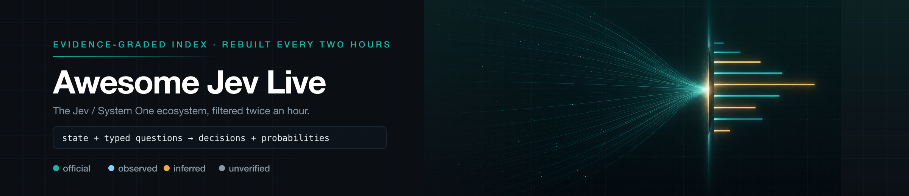

  

<h1 align="center">Awesome Jev Live</h1>

<b>Der nach Belegstufe geordnete Jev-Index, der sich alle zwei Stunden neu aufbaut.</b>

  
  
  
  
  
  

<a href="../README.md">English</a> · <a href="README.zh-CN.md">简体中文</a> · <a href="README.zh-TW.md">繁體中文</a> · <a href="README.ja.md">日本語</a> · <a href="README.ko.md">한국어</a> · <a href="README.es.md">Español</a> · <a href="README.fr.md">Français</a> · <b>Deutsch</b> · <a href="README.pt-BR.md">Português (Brasil)</a> · <a href="README.ru.md">Русский</a> · <a href="README.it.md">Italiano</a> · <a href="README.ar.md">العربية</a> · <a href="README.hi.md">हिन्दी</a> · <a href="README.tr.md">Türkçe</a> · <a href="README.vi.md">Tiếng Việt</a> · <a href="README.th.md">ไทย</a> · <a href="README.id.md">Bahasa Indonesia</a> · <a href="README.pl.md">Polski</a> · <a href="README.nl.md">Nederlands</a> · <a href="README.uk.md">Українська</a>

> [!NOTE]
> **Live-Index** · Letzte Synchronisierung: `2026-10-28T21:37:31+08:00` (UTC+8)
> · Einträge: **761** · Neu in diesem Durchlauf: **1** · Implementierungssprachen: **25**

Jeder Eintrag unten wurde von der Pipeline in diesem Repository gesammelt, gefiltert und erneut geprüft. Zahlen und Zeitstempel stammen aus den Quellen, nicht aus einer handgeschriebenen Momentaufnahme.

## 🔥 Auswahl des Moments — der Erste je Kategorie

Ein Eintrag je Kategorie, sortiert nach Evidenzgrad und Sternen, bei jeder Synchronisierung neu berechnet. Eine Rangliste, keine Empfehlung; jeder Pick verlinkt seine vollständige Karte. Projekte mit veröffentlichtem Screenshot oder einer Aufnahme werden bevorzugt, damit die Leiste visuell bleibt.

<table>
<tr>
<td width="50%" valign="top">
<b>🏛️ <a href="https://github.com/typesafe-ai/skills">typesafe-ai/skills</a></b>
⭐2840 · ✅ official
Agentenfähigkeiten für die Entwicklung mit TypeSafe&#x27;s System One API
</td>
<td width="50%" valign="top">

<b>🧰 <a href="https://github.com/john-rocky/coreai-kit">john-rocky/coreai-kit</a></b>
⭐123 · Swift · 👁️ observed
Swift SDK zum Ausführen von Chat-, Vision- und Sprachmodellen auf iPhone und dem Mac mit Apples Core AI. Modell-Download und -Caching, FoundationModels-Integration…
</td>
</tr>
<tr>
<td width="50%" valign="top">

<b>🤖 <a href="https://github.com/gargpratyush/jev-router">gargpratyush/jev-router</a></b>
⭐630 · JavaScript · 🔎 inferred
Leite in claude code mit jev-router für deine Aufgabe an das günstigste Modell weiter
</td>
<td width="50%" valign="top">

<b>🛡️ <a href="https://github.com/NandhaKishorM/laya">NandhaKishorM/laya</a></b>
⭐34523 · Python · 🔎 inferred
Nicht-autoregressive System-1-Entscheidungs-Engine. Typisierte Auswahl-, Bewertungs- und Ja/Nein-Entscheidungen über beliebigen Text in einem einzigen Forward Pass,…
</td>
</tr>
<tr>
<td width="50%" valign="top">

<b>🧪 <a href="https://github.com/Mapika/decider">Mapika/decider</a></b>
⭐1162 · Python · 👁️ observed
Eine Familie von Modellen im System One-Stil, feinabgestimmt aus Qwen3.5, entwickelt für typisierte Entscheidungen in einem Durchlauf mit kalibrierten…
</td>
<td width="50%" valign="top">

<b>🔬 <a href="https://github.com/TianyuCodings/NanoJev">TianyuCodings/NanoJev</a></b>
⭐2566 · Python · 🔎 inferred
Eine Nano-Replik von Jev: parallele Entscheidungen, dynamische Kandidaten und eine durchgängige Trainingspipeline.
</td>
</tr>
<tr>
<td width="50%" valign="top">

<b>🎮 <a href="https://github.com/superagents-lab/jev-search">superagents-lab/jev-search</a></b>
⭐547 · TypeScript · 👁️ observed
Durchsuche das Web mit TypeSafe&#x27;s Jev: Quellenauswahl, Abfrageverständnis und Relevanzranking. Erstellt mit Search1API.
</td>
<td width="50%" valign="top">
<b>📰 <a href="https://docs.typesafe.ai/model-jaggedness/jev-1.13">9 Klassen bekannter Defekte (jaggedness)</a></b>
⭐0 · ✅ official
Wörtliches Verständnis, **unzuverlässiges Zählen**, Datumsvergleiche, mehrstufige Indirektion, irrelevante Details mit großem state, adversariale Inhalte,…
</td>
</tr>
</table>

## Inhalt

- [Was ist Jev?](#was-ist-jev)
- [Wie Einträge eingestuft werden](#wie-einträge-eingestuft-werden)
- [Offizielle SDKs und Entwicklerwerkzeuge](#offizielle-sdks-und-entwicklerwerkzeuge) — **7**
- [Community-Clients, SDKs und Adapter](#community-clients-sdks-und-adapter) — **121**
- [Agent-Tooling: MCP, Hooks, Gates und Coding-Agents](#agent-tooling-mcp-hooks-gates-und-coding-agents) — **227**
- [Routing, Guardrails und Freigaben](#routing-guardrails-und-freigaben) — **60**
- [Evaluation, Kalibrierung und Benchmarks](#evaluation-kalibrierung-und-benchmarks) — **90**
- [Offene Reproduktionen, Gewichte und Architekturforschung](#offene-reproduktionen-gewichte-und-architekturforschung) — **63**
- [Anwendungen, Spiele, Robotik und interaktive Demos](#anwendungen-spiele-robotik-und-interaktive-demos) — **38**
- [Artikel, Diskussionen und verwandte Listen](#artikel-diskussionen-und-verwandte-listen) — **81**
- [Weitere Projekte](#weitere-projekte) — **74**
- [Projekte nach Implementierungssprache](#projekte-nach-implementierungssprache)

## Was ist Jev?

Jev ist das erste **System One model** von TypeSafe AI. Es schreibt keine Prosa. Es nimmt einen Zustand plus Fragen, deren Antwortraum Sie vorab festlegen, und liefert typisierte Werte mit Wahrscheinlichkeitsverteilungen zurück, auf die Ihr Code verzweigen kann.

|                        |                                                                                                                                                                                                                                                    |
| ---------------------- | -------------------------------------------------------------------------------------------------------------------------------------------------------------------------------------------------------------------------------------------------- |
| **Form**               | `state + typed questions` → `constrained answers + probabilities` → `your code`                                                                                                                                                                    |
| **Primitive**          | `Choice` (eine von ≤255 Optionen wählen), `Score` (ein Raster von 2–10), `Noul` (ein probabilistisches Ja/Nein)                                                                                                                                    |
| **Endpoint**           | `POST https://api.typesafe.ai/v1/systemone`, Modell `jev-1.13.0` / Alias `jev-latest`                                                                                                                                                              |
| **Gute Einsatzfelder** | Routing, Triage, Bewertung, Moderation, Verifikation und Gates mit niedriger Latenz in einem begrenzten Workflow                                                                                                                                   |
| **Bekannte Grenzen**   | Zählen ist unzuverlässig, mehrstufige Indirektion ist schwach, und offizielles Material nennt neun Klassen von Jaggedness. Eine schema-gültige Ausgabe ist nicht dasselbe wie eine korrekte Entscheidung — kalibrieren Sie an Ihren eigenen Daten. |

## Wie Einträge eingestuft werden

Die meisten Listen in diesem Feld behaupten, etwas aufzunehmen. Diese sagt, wie viel sie tatsächlich geprüft hat, und lässt Sie entsprechend filtern.

| Grad         | Bedeutung                                                                                                                                                                                   |
| ------------ | ------------------------------------------------------------------------------------------------------------------------------------------------------------------------------------------- |
| `official`   | Von TypeSafe AI selbst veröffentlicht.                                                                                                                                                      |
| `observed`   | Ein öffentliches Artefakt, das geöffnet und gelesen werden kann — echter Quellcode, echte Konfiguration oder eine ausdrückliche TypeSafe/Jev-Angabe im Repository-Namen oder in den Topics. |
| `inferred`   | Aufgrund eines uneindeutigen Signals plus bestätigenden Vokabulars zugeordnet, aber noch nicht Zeile für Zeile gelesen.                                                                     |
| `unverified` | Sieht verwandt aus, nichts unabhängig bestätigt. Nur zum Auffinden gelistet.                                                                                                                |

## Offizielle SDKs und Entwicklerwerkzeuge

Alles, was TypeSafe selbst veröffentlicht. Hier anfangen.

🏛️ <b><a href="https://github.com/typesafe-ai/skills">typesafe-ai/skills</a></b> · ⭐2840 · ✅ official · 4 天

##### 📝 Zusammenfassung

Agentenfähigkeiten für die Entwicklung mit TypeSafe's System One API

> 💡 Die eigenen Agent-Fähigkeiten des Anbieters. Da sie kontinuierlich aktualisiert werden, kommen sie einer Spezifikation dessen, wie TypeSafe beabsichtigt, Jev von einem Agenten steuern zu lassen, am nächsten.

##### 📌 Basisfakten

| Feld      | Wert                                      |
| --------- | ----------------------------------------- |
| Kategorie | `Offizielle SDKs und Entwicklerwerkzeuge` |
| Beleg     | `official`                                |

##### 📊 Daten

| Metrik            | Wert       |
| ----------------- | ---------- |
| Stars             | **2840**   |
| Letzter Push      | 2026-10-23 |
| Erstmals gelistet | 2026-09-18 |

🏛️ <b><a href="https://github.com/typesafe-ai/system-one-adapter-python">typesafe-ai/system-one-adapter-python</a></b> · ⭐404 · Python · ✅ official · 36 天

##### 📝 Zusammenfassung

Drop-in-Ersatz für TypeSafeClient, unterstützt durch LLM APIs

> 💡 Drop-in-Ersatz, der dieselbe Schnittstelle mit einem gewöhnlichen LLM-Provider unterstützt. Dies ist der ehrliche Weg, eine typisierte Entscheidung auf den eigenen Daten per A/B-Test mit einem Prompt zu vergleichen, bevor man sich für eine der beiden Möglichkeiten entscheidet.

🔧 Im Code verwendet: `README.md`

##### 📌 Basisfakten

| Feld      | Wert                                      |
| --------- | ----------------------------------------- |
| Kategorie | `Offizielle SDKs und Entwicklerwerkzeuge` |
| Beleg     | `official`                                |
| Sprache   | Python                                    |

##### 📊 Daten

| Metrik            | Wert       |
| ----------------- | ---------- |
| Stars             | **404**    |
| Letzter Push      | 2026-09-22 |
| Erstmals gelistet | 2026-10-23 |

🏛️ <b><a href="https://github.com/typesafe-ai/typesafe-sdk-python">typesafe-ai/typesafe-sdk-python</a></b> · ⭐303 · Python · ✅ official · 13 天

##### 📝 Zusammenfassung

Die offizielle Python-Bibliothek für TypeSafe API

> 💡 Synchrone und asynchrone Clients. Der schnellste Weg von einem API-Schlüssel zu einer typisierten Entscheidung und die Referenz, mit der Community-Clients verglichen werden.

🔧 Im Code verwendet: `README.md`

##### 📌 Basisfakten

| Feld      | Wert                                      |
| --------- | ----------------------------------------- |
| Kategorie | `Offizielle SDKs und Entwicklerwerkzeuge` |
| Beleg     | `official`                                |
| Sprache   | Python                                    |

##### 📊 Daten

| Metrik            | Wert       |
| ----------------- | ---------- |
| Stars             | **303**    |
| Letzter Push      | 2026-10-14 |
| Erstmals gelistet | 2026-10-23 |

🏛️ <b><a href="https://github.com/typesafe-ai/typesafe-sdk-js">typesafe-ai/typesafe-sdk-js</a></b> · ⭐285 · TypeScript · ✅ official · 13 天

##### 📝 Zusammenfassung

Die offizielle TypeScript/JavaScript-Bibliothek für TypeSafe API

> 💡 TypeScript-Client, bei dem der Antworttyp aus der gestellten Frage abgeleitet wird, sodass ein nicht übereinstimmender Rückgabetyp ein Kompilierungsfehler statt einer Überraschung zur Laufzeit ist.

##### 📌 Basisfakten

| Feld      | Wert                                      |
| --------- | ----------------------------------------- |
| Kategorie | `Offizielle SDKs und Entwicklerwerkzeuge` |
| Beleg     | `official`                                |
| Sprache   | TypeScript                                |

##### 📊 Daten

| Metrik            | Wert       |
| ----------------- | ---------- |
| Stars             | **285**    |
| Letzter Push      | 2026-10-14 |
| Erstmals gelistet | 2026-10-23 |

🏛️ <b><a href="https://github.com/TypeSafeAI/jev-harness">TypeSafeAI/jev-harness</a></b> · ⭐36 · TypeScript · ✅ official · 1 天

##### 📝 Zusammenfassung

Ein benutzerdefiniertes Coding-Harness für TypeSafe AI's Jev: Ein LLM macht Vorschläge, Jev beantwortet eng gefasste Fragen, Code entscheidet, und jeder Schritt hinterlässt einen Beleg.

##### 📌 Basisfakten

| Feld      | Wert                                      |
| --------- | ----------------------------------------- |
| Kategorie | `Offizielle SDKs und Entwicklerwerkzeuge` |
| Beleg     | `official`                                |
| Sprache   | TypeScript                                |

##### 📊 Daten

| Metrik            | Wert       |
| ----------------- | ---------- |
| Stars             | **36**     |
| Letzter Push      | 2026-10-27 |
| Erstmals gelistet | 2026-10-27 |

🏷 `agent-harness` · `agentic-coding` · `ai-agents` · `ai-governance` · `ai-safety` · `code-review` · `coding-agent` · `developer-tools`

🏛️ <b><a href="https://github.com/typesafe-ai/WorkflowEvals">typesafe-ai/WorkflowEvals</a></b> · ⭐21 · Python · ✅ official · 28 天

##### 📝 Zusammenfassung

Workflow-Code von evals.typesafe.ai veröffentlicht

##### 📌 Basisfakten

| Feld      | Wert                                      |
| --------- | ----------------------------------------- |
| Kategorie | `Offizielle SDKs und Entwicklerwerkzeuge` |
| Beleg     | `official`                                |
| Sprache   | Python                                    |

##### 📊 Daten

| Metrik            | Wert       |
| ----------------- | ---------- |
| Stars             | **21**     |
| Letzter Push      | 2026-09-29 |
| Erstmals gelistet | 2026-10-23 |

🏛️ <b><a href="https://github.com/typesafe-ai/typesafe-ai.github.io">typesafe-ai/typesafe-ai.github.io</a></b> · ⭐2 · HTML · ✅ official · 145 天

##### 📝 Zusammenfassung

Im Upstream wurde keine Beschreibung veröffentlicht.

##### 📌 Basisfakten

| Feld      | Wert                                      |
| --------- | ----------------------------------------- |
| Kategorie | `Offizielle SDKs und Entwicklerwerkzeuge` |
| Beleg     | `official`                                |
| Sprache   | HTML                                      |

##### 📊 Daten

| Metrik            | Wert       |
| ----------------- | ---------- |
| Stars             | **2**      |
| Letzter Push      | 2026-06-04 |
| Erstmals gelistet | 2026-10-23 |

## Community-Clients, SDKs und Adapter

Typisierte Clients für den System-One-Endpoint, in so vielen Sprachen, wie die Community bisher bearbeitet hat.

🧰 <b><a href="https://github.com/jexp/neo4jev">jexp/neo4jev</a></b> · ⭐180 · Jupyter · 👁️ observed · 40 天

##### 📝 Zusammenfassung

Typesafe.ai System One Model Jev, das einen Neo4j-Graphen durch Verwendung eines Klassifizierers über benachbarte Beziehungen durchläuft

##### 📌 Basisfakten

| Feld      | Wert                                  |
| --------- | ------------------------------------- |
| Kategorie | `Community-Clients, SDKs und Adapter` |
| Beleg     | `observed`                            |
| Sprache   | Jupyter                               |

##### 📊 Daten

| Metrik            | Wert       |
| ----------------- | ---------- |
| Stars             | **180**    |
| Letzter Push      | 2026-09-18 |
| Erstmals gelistet | 2026-10-28 |

🧰 <b><a href="https://github.com/qkal/Canny">qkal/Canny</a></b> · ⭐125 · TypeScript · 👁️ observed · 35 天

##### 📝 Zusammenfassung

Verhindert, dass KI-Coding-Agenten ohne Belege behaupten, ihre Arbeit sei erledigt. Deterministische Hooks entscheiden, TypeSafe's Jev berät. Nur-anhängbares Ledger, keine Laufzeitabhängigkeiten.

🔧 Im Code verwendet: `README.md`

##### 📌 Basisfakten

| Feld      | Wert                                  |
| --------- | ------------------------------------- |
| Kategorie | `Community-Clients, SDKs und Adapter` |
| Beleg     | `observed`                            |
| Sprache   | TypeScript                            |

##### 📊 Daten

| Metrik            | Wert       |
| ----------------- | ---------- |
| Stars             | **125**    |
| Letzter Push      | 2026-09-22 |
| Erstmals gelistet | 2026-10-28 |

🏷 `agent-hooks` · `ai-agents` · `claude-code` · `claude-code-hooks` · `codex` · `codex-cli` · `guardrails` · `jev`

🧰 <b><a href="https://github.com/john-rocky/coreai-kit">john-rocky/coreai-kit</a></b> · ⭐123 · Swift · 👁️ observed · 1 天

##### 📝 Zusammenfassung

Swift SDK zum Ausführen von Chat-, Vision- und Sprachmodellen auf iPhone und dem Mac mit Apples Core AI. Modell-Download und -Caching, FoundationModels-Integration sowie ausführbare Beispiele mit dokumentierten Anforderungen an Betriebssystem, SDK und Modelle.

🔧 Im Code verwendet: `Sources/CoreAIOps/CoreAI+SystemOne.swift`

##### 📌 Basisfakten

| Feld      | Wert                                  |
| --------- | ------------------------------------- |
| Kategorie | `Community-Clients, SDKs und Adapter` |
| Beleg     | `observed`                            |
| Sprache   | Swift                                 |

##### 📊 Daten

| Metrik            | Wert       |
| ----------------- | ---------- |
| Stars             | **123**    |
| Letzter Push      | 2026-10-27 |
| Erstmals gelistet | 2026-10-26 |

🏷 `apple` · `apple-core-ai` · `asr` · `core-ai` · `coreai` · `foundation-models` · `ios` · `ios-27`

---

<table><tr><th align="center" width="50%">🖼 Bild</th><th align="center" width="50%">🎬 Video</th></tr><tr>
<td align="center" valign="top"></td>
<td align="center" valign="top"> animierte Aufzeichnung</td>
</tr></table>

🧰 <b><a href="https://github.com/yzfly/awesome-jev-zh">yzfly/awesome-jev-zh</a></b> · ⭐87 · HTML · 👁️ observed · 0 天

##### 📝 Zusammenfassung

Jev / TypeSafe System One chinesische Auswahlliste: offizielle Materialien, SDK, beliebte Anwendungen, Agent-Tools, Open-Source-Reproduktionen und unabhängige Bewertungen, mit chinesischen Einstiegsanleitungen; täglich werden automatisch GitHub beliebte Projekte aufgenommen.

🔧 Im Code verwendet: `docs/quickstart.md`

##### 📌 Basisfakten

| Feld      | Wert                                  |
| --------- | ------------------------------------- |
| Kategorie | `Community-Clients, SDKs und Adapter` |
| Beleg     | `observed`                            |
| Sprache   | HTML                                  |

##### 📊 Daten

| Metrik            | Wert       |
| ----------------- | ---------- |
| Stars             | **87**     |
| Letzter Push      | 2026-10-28 |
| Erstmals gelistet | 2026-09-18 |

🏷 `ai-agent` · `awesome` · `awesome-list` · `chinese` · `jev` · `llm` · `structured-output` · `system-one`

🧰 <b><a href="https://github.com/obie/ruby_decision_model">obie/ruby_decision_model</a></b> · ⭐59 · Ruby · 👁️ observed · 15 天

##### 📝 Zusammenfassung

Ruby-Client für Entscheidungsmodelle wie Typesafe Jev

🔧 Im Code verwendet: `README.md`

##### 📌 Basisfakten

| Feld      | Wert                                  |
| --------- | ------------------------------------- |
| Kategorie | `Community-Clients, SDKs und Adapter` |
| Beleg     | `observed`                            |
| Sprache   | Ruby                                  |

##### 📊 Daten

| Metrik            | Wert       |
| ----------------- | ---------- |
| Stars             | **59**     |
| Letzter Push      | 2026-10-12 |
| Erstmals gelistet | 2026-10-28 |

🧰 <b><a href="https://github.com/bodepudimuneendra-netizen/laya-jev-GraphRAG">bodepudimuneendra-netizen/laya-jev-GraphRAG</a></b> · ⭐51 · Python · 👁️ observed · 29 天

##### 📝 Zusammenfassung

Ein datenbankagnostisches Agentic-GraphRAG-Framework mit austauschbaren System One-Modellen (lokales Laya / Cloud-Jev). Eine Plug-and-play-Intelligenzschicht mit einer vollständigen 4-Phasen-Pipeline, kontinuierlicher Evaluierung und benutzerdefinierter A*-Traversal für jede Graphdatenbank.

##### 📌 Basisfakten

| Feld      | Wert                                  |
| --------- | ------------------------------------- |
| Kategorie | `Community-Clients, SDKs und Adapter` |
| Beleg     | `observed`                            |
| Sprache   | Python                                |

##### 📊 Daten

| Metrik            | Wert       |
| ----------------- | ---------- |
| Stars             | **51**     |
| Letzter Push      | 2026-09-29 |
| Erstmals gelistet | 2026-10-28 |

🏷 `astar-algorithm` · `eval-harness` · `fine-tuning` · `graphdatabase` · `graprag` · `jev` · `laya` · `neo4j`

🧰 <b><a href="https://github.com/MrJev/awesome-jev">MrJev/awesome-jev</a></b> · ⭐19 · Python · 👁️ observed · 0 天

##### 📝 Zusammenfassung

Eine kuratierte Liste von Projekten, Integrationen und Ressourcen für Jev, das System One-Modell von TypeSafe AI.

##### 📌 Basisfakten

| Feld      | Wert                                  |
| --------- | ------------------------------------- |
| Kategorie | `Community-Clients, SDKs und Adapter` |
| Beleg     | `observed`                            |
| Sprache   | Python                                |

##### 📊 Daten

| Metrik            | Wert       |
| ----------------- | ---------- |
| Stars             | **19**     |
| Letzter Push      | 2026-10-28 |
| Erstmals gelistet | 2026-09-18 |

🏷 `ai-agents` · `awesome` · `awesome-list` · `jev` · `mcp` · `typesafe`

🧰 <b><a href="https://github.com/ckaraca/awesome-jev">ckaraca/awesome-jev</a></b> · ⭐17 · Python · 👁️ observed · 2 天

##### 📝 Zusammenfassung

Eine kuratierte Liste von Tools, Integrationen und Experimenten auf Basis von Jev, dem System One-Modell von TypeSafe AI für schnelle, typisierte Entscheidungen.

##### 📌 Basisfakten

| Feld      | Wert                                  |
| --------- | ------------------------------------- |
| Kategorie | `Community-Clients, SDKs und Adapter` |
| Beleg     | `observed`                            |
| Sprache   | Python                                |

##### 📊 Daten

| Metrik            | Wert       |
| ----------------- | ---------- |
| Stars             | **17**     |
| Letzter Push      | 2026-10-26 |
| Erstmals gelistet | 2026-09-19 |

🏷 `ai-agents` · `awesome` · `awesome-list` · `computer-use` · `jev` · `llm` · `system-one` · `typesafe`

🧰 <b><a href="https://github.com/Premo-Cloud/typesafe-sdk-java">Premo-Cloud/typesafe-sdk-java</a></b> · ⭐12 · Java · 👁️ observed · 6 天

##### 📝 Zusammenfassung

Community-Java-SDK für Jev, das System One-Modell von TypeSafe: typisierte Fragen hinein, typisierte Antworten mit kalibrierten Wahrscheinlichkeiten heraus. Java 17+, Spring-Boot-Starter (inoffiziell)

##### 📌 Basisfakten

| Feld      | Wert                                  |
| --------- | ------------------------------------- |
| Kategorie | `Community-Clients, SDKs und Adapter` |
| Beleg     | `observed`                            |
| Sprache   | Java                                  |

##### 📊 Daten

| Metrik            | Wert       |
| ----------------- | ---------- |
| Stars             | **12**     |
| Letzter Push      | 2026-10-21 |
| Erstmals gelistet | 2026-10-28 |

🏷 `java` · `jev` · `sdk` · `spring-boot` · `system-one` · `system-one-models` · `typesafe`

🧰 <b><a href="https://github.com/PromtEngineer/jev-harness">PromtEngineer/jev-harness</a></b> · ⭐10 · Python · 👁️ observed · 33 天

##### 📝 Zusammenfassung

Ein Pi-Agenten-Harness rund um TypeSafe's Jev (System One-Modell): Router, Kontextauswahl, Gate, Verifizierer. Getestet auf Neon-Postgres-Branches.

##### 📌 Basisfakten

| Feld      | Wert                                  |
| --------- | ------------------------------------- |
| Kategorie | `Community-Clients, SDKs und Adapter` |
| Beleg     | `observed`                            |
| Sprache   | Python                                |

##### 📊 Daten

| Metrik            | Wert       |
| ----------------- | ---------- |
| Stars             | **10**     |
| Letzter Push      | 2026-09-24 |
| Erstmals gelistet | 2026-10-28 |

🧰 <b><a href="https://github.com/clouatre-labs/decisions-judge-mcp">clouatre-labs/decisions-judge-mcp</a></b> · ⭐5 · JavaScript · 👁️ observed · 2 天

##### 📝 Zusammenfassung

Typisierte Entscheidungen für KI-Agenten als MCP-Tool: Ja/Nein-Wahrscheinlichkeit (noul), Auswahl und Bewertung in einer schnellen Anfrage. Unterstützt durch das TypeSafe-System One-Modell.

##### 📌 Basisfakten

| Feld      | Wert                                  |
| --------- | ------------------------------------- |
| Kategorie | `Community-Clients, SDKs und Adapter` |
| Beleg     | `observed`                            |
| Sprache   | JavaScript                            |

##### 📊 Daten

| Metrik            | Wert       |
| ----------------- | ---------- |
| Stars             | **5**      |
| Letzter Push      | 2026-10-26 |
| Erstmals gelistet | 2026-10-12 |

🏷 `agent` · `ai` · `cli` · `decision-making` · `decisions` · `judge` · `llm` · `mcp`

---

<table><tr><th align="center" width="50%">🖼 Bild</th><th align="center" width="50%">🎬 Video</th></tr><tr>
<td align="center" valign="top"></td>
<td align="center" valign="top"> animierte Aufzeichnung</td>
</tr></table>

🧰 <b><a href="https://github.com/xingwudao/OpenJev">xingwudao/OpenJev</a></b> · ⭐5 · Python · 👁️ observed · 40 天

##### 📝 Zusammenfassung

OpenJev: eine von Jev inspirierte unabhängige System One-Entscheidungs-API, basierend auf Konzepten von TypeSafe.ai. Choice, score- und noul-Primitiven, lokaler Mock-Server, Python und TypeScript SDKs. Echte Inferenz ist geplant; nicht mit TypeSafe AI verbunden.

##### 📌 Basisfakten

| Feld      | Wert                                  |
| --------- | ------------------------------------- |
| Kategorie | `Community-Clients, SDKs und Adapter` |
| Beleg     | `observed`                            |
| Sprache   | Python                                |

##### 📊 Daten

| Metrik            | Wert       |
| ----------------- | ---------- |
| Stars             | **5**      |
| Letzter Push      | 2026-09-18 |
| Erstmals gelistet | 2026-10-23 |

🏷 `ai-guardrails` · `classification` · `decision-api` · `jev` · `mock-server` · `openjev` · `probabilistic-inference` · `python-sdk`

🧰 <b><a href="https://github.com/elbruno/ElBruno.AI.Decisions">elbruno/ElBruno.AI.Decisions</a></b> · ⭐4 · C# · 👁️ observed · 1 天

##### 📝 Zusammenfassung

.NET 10 decision SDK: Choose, Score, and Assess with Microsoft Foundry (Microsoft-Decision-1), native local Ollama System One models, and TypeSafe AI Jev. One API, probabilities instead of paragraphs.

##### 📌 Basisfakten

| Feld      | Wert                                  |
| --------- | ------------------------------------- |
| Kategorie | `Community-Clients, SDKs und Adapter` |
| Beleg     | `observed`                            |
| Sprache   | C#                                    |

##### 📊 Daten

| Metrik            | Wert       |
| ----------------- | ---------- |
| Stars             | **4**      |
| Letzter Push      | 2026-10-26 |
| Erstmals gelistet | 2026-10-27 |

🏷 `dotnet` · `dotnet10` · `jev` · `microsoft-extensions-ai` · `nuget`

---

<table><tr><th align="center" width="50%">🖼 Bild</th><th align="center" width="50%">🎬 Video</th></tr><tr>
<td align="center" valign="top"></td>
<td align="center" valign="top">keine Medien veröffentlicht</td>
</tr></table>

🧰 <b><a href="https://github.com/Bonzokoles/36_chambers">Bonzokoles/36_chambers</a></b> · Python · 👁️ observed · 5 天

##### 📝 Zusammenfassung

Föderierte Wissensabfrage-Engine für KI-Agenten. Leitet Abfragen über eine registrierungsorientierte Orchestrierung mit TypeSafe/Jev-KI-Routing und Evidenz-Neubewertung an spezialisierte Backends (FTS5, ChromaDB, Graph) weiter. Standardmäßig schreibgeschützt und von Grund auf sicherheitsgeschützt.

##### 📌 Basisfakten

| Feld      | Wert                                  |
| --------- | ------------------------------------- |
| Kategorie | `Community-Clients, SDKs und Adapter` |
| Beleg     | `observed`                            |
| Sprache   | Python                                |

##### 📊 Daten

| Metrik            | Wert       |
| ----------------- | ---------- |
| Stars             | **0**      |
| Letzter Push      | 2026-10-22 |
| Erstmals gelistet | 2026-10-23 |

🏷 `ai-agents` · `ai-infrastructure` · `chromadb` · `embeddings` · `federated-search` · `fts5` · `information-retrieval` · `jev`

---

<table><tr><th align="center" width="50%">🖼 Bild</th><th align="center" width="50%">🎬 Video</th></tr><tr>
<td align="center" valign="top"></td>
<td align="center" valign="top">keine Medien veröffentlicht</td>
</tr></table>

Asset direkt aus dem Upstream-Repository verlinkt, da keine Lizenz zur Weiterverbreitung angegeben wurde.

🧰 <b><a href="https://github.com/OpenByteInc/QuantDinger">OpenByteInc/QuantDinger</a></b> · ⭐13230 · Python · 🔎 inferred · 0 天 · ⭐+11

##### 📝 Zusammenfassung

Open-Source-KI-Trading-Betriebssystem, Agenten-Trading und Vibe-Trading mit Jev-System One-Integration. Recherchiere, entwickle Python-Strategien, führe Backtests durch und handle per Paper-Trading oder live mit Kryptowährungen, Aktien und Devisen. Starte dein eigenes mandantenfähiges Trading-SaaS mit integrierter Benutzerverwaltung, Abrechnung, Zahlungen und Abwicklung.

##### 📌 Basisfakten

| Feld      | Wert                                  |
| --------- | ------------------------------------- |
| Kategorie | `Community-Clients, SDKs und Adapter` |
| Beleg     | `inferred`                            |
| Sprache   | Python                                |

##### 📊 Daten

| Metrik            | Wert            |
| ----------------- | --------------- |
| Stars             | **13230** (+11) |
| Letzter Push      | 2026-10-27      |
| Erstmals gelistet | 2026-09-20      |

🏷 `agent` · `backtesting` · `binance` · `crypto` · `exchange` · `finance` · `fintech` · `forex`

---

<table><tr><th align="center" width="50%">🖼 Bild</th><th align="center" width="50%">🎬 Video</th></tr><tr>
<td align="center" valign="top"></td>
<td align="center" valign="top">keine Medien veröffentlicht</td>
</tr></table>

🧰 <b><a href="https://github.com/dzhng/jevgrep">dzhng/jevgrep</a></b> · ⭐3000 · TypeScript · 🔎 inferred · 0 天 · ⭐+9

##### 📝 Zusammenfassung

Code finden, indem man fragt, was er tut. Ein CLI für Coding Agents, das Jev verwendet, um relevante Dateien und Quellkontext zu entdecken.

##### 📌 Basisfakten

| Feld      | Wert                                  |
| --------- | ------------------------------------- |
| Kategorie | `Community-Clients, SDKs und Adapter` |
| Beleg     | `inferred`                            |
| Sprache   | TypeScript                            |

##### 📊 Daten

| Metrik            | Wert          |
| ----------------- | ------------- |
| Stars             | **3000** (+9) |
| Letzter Push      | 2026-10-28    |
| Erstmals gelistet | 2026-10-28    |

🏷 `ai-sdk` · `claude-code` · `cli` · `code-search` · `codex` · `coding-agents` · `context-retrieval` · `developer-tools`

---

<table><tr><th align="center" width="50%">🖼 Bild</th><th align="center" width="50%">🎬 Video</th></tr><tr>
<td align="center" valign="top"></td>
<td align="center" valign="top">keine Medien veröffentlicht</td>
</tr></table>

🧰 <b><a href="https://github.com/supercorp-ai/supercov">supercorp-ai/supercov</a></b> · ⭐157 · Rust · 🔎 inferred · 0 天

##### 📝 Zusammenfassung

Abdeckung, Sicherheit und Codequalität für Coding-Agenten

> 💡 Bewertungen der Codequalität und Testabdeckung, als typisierte Entscheidungen statt als Prosa erzeugt, sodass das Ergebnis eine Pipeline direkt freigeben oder blockieren kann.

##### 📌 Basisfakten

| Feld      | Wert                                  |
| --------- | ------------------------------------- |
| Kategorie | `Community-Clients, SDKs und Adapter` |
| Beleg     | `inferred`                            |
| Sprache   | Rust                                  |

##### 📊 Daten

| Metrik            | Wert       |
| ----------------- | ---------- |
| Stars             | **157**    |
| Letzter Push      | 2026-10-28 |
| Erstmals gelistet | 2026-10-23 |

🏷 `agent-skills` · `claude-code` · `code-coverage` · `code-quality` · `codex` · `coding-agents` · `coverage` · `gemini-cli-extension`

---

<table><tr><th align="center" width="50%">🖼 Bild</th><th align="center" width="50%">🎬 Video</th></tr><tr>
<td align="center" valign="top"></td>
<td align="center" valign="top">keine Medien veröffentlicht</td>
</tr></table>

🧰 <b><a href="https://github.com/AboveColin/HA-Jev">AboveColin/HA-Jev</a></b> · ⭐81 · Python · 🔎 inferred · 2 天

##### 📝 Zusammenfassung

Stelle deinem Haus eine Frage und erhalte eine Zahl zurück. Home-Assistant-Integration für TypeSafe Jev: typisierte Antworten als Sensoren, vier Aktionen für Automatisierungen und ein Konversationsagent für Assist.

##### 📌 Basisfakten

| Feld      | Wert                                  |
| --------- | ------------------------------------- |
| Kategorie | `Community-Clients, SDKs und Adapter` |
| Beleg     | `inferred`                            |
| Sprache   | Python                                |

##### 📊 Daten

| Metrik            | Wert       |
| ----------------- | ---------- |
| Stars             | **81**     |
| Letzter Push      | 2026-10-26 |
| Erstmals gelistet | 2026-10-28 |

🏷 `ai` · `assist` · `conversation` · `custom-components` · `decision-model` · `hacs` · `home-assistant` · `home-automation`

---

<table><tr><th align="center" width="50%">🖼 Bild</th><th align="center" width="50%">🎬 Video</th></tr><tr>
<td align="center" valign="top"></td>
<td align="center" valign="top">keine Medien veröffentlicht</td>
</tr></table>

<b>Mehr in dieser Kategorie</b> · 103

- [frodi-karlsson/onesie](https://github.com/frodi-karlsson/onesie) - An expressive Unix-pipeable CLI for System One models like Jev.
- [GitHub30/OpenJev](https://github.com/GitHub30/OpenJev) - Open-Weight-System One-Modell (Jev-kompatibel): kalibrierte…
- [chussenot/judgment](https://github.com/chussenot/judgment) - Typisierte, kalibrierte Bewertungen aus System One-Modellen: Eine Entscheidung…
- [CMaintz/jev-dotnet](https://github.com/CMaintz/jev-dotnet) - Inoffizielles .NET SDK für das Jev System One-Modell von TypeSafe AI.
- [danieleteti/systemone-delphi](https://github.com/danieleteti/systemone-delphi) - Delphi client for System One models (Jev, tev1 and nimble on Ollama): ask typed…
- [jqueryscript/awesome-jev](https://github.com/jqueryscript/awesome-jev) - A curated list of TypeSafe Jev resources, SDKs, agents, MCP servers…
- [basi/typesafe-ai-php-client](https://github.com/basi/typesafe-ai-php-client) - PHP client for the typesafe.ai System One API (Jev).
- [CMaintz/jev-java](https://github.com/CMaintz/jev-java) - Inoffizielles Java SDK für TypeSafe AI.
- [erik-hedstrom/loadout](https://github.com/erik-hedstrom/loadout) - Wähle Modell, Skills und MCP-Server für jede Coding-Agent-Sitzung aus einer…
- [JosephHardy91/graph-composition-with-dLLMs](https://github.com/JosephHardy91/graph-composition-with-dLLMs) - A Graph-Compiled Specification RAG system built with **Dagster**, **PostgreSQL…
- [sanketmuchhala/jevgate](https://github.com/sanketmuchhala/jevgate) - Calibrated policy triage and institutional risk routing: a hybrid…
- [superagent-ai/dfip](https://github.com/superagent-ai/dfip) - Entscheidungsorientierte Inferenz auf Modal: native Clients und reproduzierbare…
- [ollaya-dev/ollaya](https://github.com/ollaya-dev/ollaya) - Jev-compatible API server for open decision models.
- [realZachi/pg-jev](https://github.com/realZachi/pg-jev) - Stelle deinen Postgres-Tabellen Fragen in natürlicher Sprache.
- [sutro-sh/jev-align](https://github.com/sutro-sh/jev-align) - Erstelle kalibrierte AI Functions aus menschlichem Feedback mit Jev und GEPA.
- [juspay/neurolink](https://github.com/juspay/neurolink) - Die Pipe-Schicht eines KI-Nervensystems — eine Schnittstelle, die…
- [aaddrick/building-with-typesafe-jev](https://github.com/aaddrick/building-with-typesafe-jev) - Inoffizieller Skill, der Coding-Agenten beibringt, mit TypeSafe AIs Jev zu…
- [keltokhy/jgrep](https://github.com/keltokhy/jgrep) - grep, aber das Muster ist eine Beschreibung.
- [Ying-Kai-Liao/jev-browser](https://github.com/Ying-Kai-Liao/jev-browser) - Browser-Automatisierung, bei der ein LLM plant und Jev (Typesafe System One)…
- [fazlerocks/jevmail](https://github.com/fazlerocks/jevmail) - Open-Source-KI-E-Mail-Triage für Gmail.
- [sharziki/semdecide](https://github.com/sharziki/semdecide) - Typisierte semantische Entscheidungen für Unix-Pipelines und CI, betrieben mit…
- [bladedevoff/stuntd](https://github.com/bladedevoff/stuntd) - Lokaler Proxy, der die typisierten LLM-Entscheidungen deiner App lernt und sie…
- [burnigtm/jev-mcp](https://github.com/burnigtm/jev-mcp) - MCP-Server, der TypeSafe Jev in Cursor, Codex und jeden MCP-Client in die…
- [jwuthri-cloud/SelfJev](https://github.com/jwuthri-cloud/SelfJev) - Self-hosted decision model (selfjev-4b) with a Jev-compatible API: Python SDK…
- [shaharia-lab/jev-cli](https://github.com/shaharia-lab/jev-cli) - Befehlszeilenwerkzeug für das Jev-Modell von TypeSafe AI.
- [dannote/jev](https://github.com/dannote/jev) - TypeSafe Jev für OTP: auf Jev von einem GenServer antworten und eine…
- [jiangkoumo/ego-decision-layer](https://github.com/jiangkoumo/ego-decision-layer) - Pluggable decision layer for the ego lite browser: one System One (Jev) call…
- [arjun988/Kev](https://github.com/arjun988/Kev) - Open-Source-System One-Entscheidungsmaschine.
- [thusinh1969/BrighTO_Router](https://github.com/thusinh1969/BrighTO_Router) - BrighTO LLM Router: free open-source, ultra-fast Rust LLM gateway/router and…
- [Ray-Hughes/jevalyn](https://github.com/Ray-Hughes/jevalyn) - Die Entscheidungsebene für deine Rails-App.
- [utk2103/jev-studio](https://github.com/utk2103/jev-studio) - if you.
- [DevLoops-ai/unified-brain](https://github.com/DevLoops-ai/unified-brain) - System One Coding Agents: Frontier-class accuracy at up to 1/18th of the…
- [saibimajdi/typesafeai-dotnet-sdk](https://github.com/saibimajdi/typesafeai-dotnet-sdk) - Community-.NET-SDK für TypeSafe AI System One API — typisierte Noul-, Choice…
- [Elue-dev/jev_elixir](https://github.com/Elue-dev/jev_elixir) - jev_elixir ist eine kleine, idiomatische Schnittstelle zum Treffen typisierter…
- [ansidium/jev-codex-bridge](https://github.com/ansidium/jev-codex-bridge) - Jev model and reasoning-effort routing for Codex Desktop and CLI.
- [jacks3tr/Jev-Desktop](https://github.com/jacks3tr/Jev-Desktop) - Jev Desktop lets AI agents use Windows applications through MCP or the command…
- [sumleo/prompt2jev](https://github.com/sumleo/prompt2jev) - Agenten-Skill und CLI, die natürliche Sprache, einen LLM-Prompt oder den Code…
- [devbackend/jevgo](https://github.com/devbackend/jevgo) - Inoffizieller Go-Client für den TypeSafe AI System One API (Jev) — typisierte…
- [haileyok/typesafe-client](https://github.com/haileyok/typesafe-client) - Inoffizielle Go- und Rust-Clients für TypeSafe AI System One API (Jev).
- [himomohi/aside-jev](https://github.com/himomohi/aside-jev) - Aside-Agenten entscheiden mit TypeSafe Jev (System One: Choice/Score/Noul).
- [chenrui333/jev-docs](https://github.com/chenrui333/jev-docs) - Von der Community gepflegte Historie von Jev / TypeSafe System One APIs, SDKs…
- [docxology/daf-jev](https://github.com/docxology/daf-jev) - daf-jev: kombinierbares Python-Toolkit für TypeSafe.
- [JimmyWesley/rlcd-gateway](https://github.com/JimmyWesley/rlcd-gateway) - Self-hosted-Gateway für LLMs und Entscheidungsmodelle.
- [Kadihx/jev-x-kit](https://github.com/Kadihx/jev-x-kit) - Offline-Entscheidungsschicht für 0 $ für Coding-Agenten…
- [zhirschtritt/typesafe-go](https://github.com/zhirschtritt/typesafe-go) - Idiomatic Go SDK für TypeSafe AI API.
- [Butochnikov/laravel-typesafe-jev](https://github.com/Butochnikov/laravel-typesafe-jev) - Inoffizielle Laravel-Integration für TypeSafe Jev AI mit typisierten Antworten…
- [coo-quack/jev-pii-checker](https://github.com/coo-quack/jev-pii-checker) - CLI, das PII in Text mit TypeSafe Jev findet: Vorhandensein, Sensitivität und…
- [freepik-company/jev-mcp](https://github.com/freepik-company/jev-mcp) - MCP server for typed decisions with Jev / System One via OpenRouter or TypeSafe.
- [Lasimeri/Mechanical-Jev](https://github.com/Lasimeri/Mechanical-Jev) - Die fragende Seite von Jev (TypeSafe System One: noul, choice, score) in Rust…
- [nshkrdotcom/system_one_sdk](https://github.com/nshkrdotcom/system_one_sdk) - Providerneutrale Elixir/BEAM-SDK für System One-Semantik: typisierte Noul…
- [PAI-CUHK/SLEEPJEV](https://github.com/PAI-CUHK/SLEEPJEV) - JEV-inspirierte typisierte Laufzeitentscheidungen über langfristiges PSG…
- [zerone-agents/jev-model-router](https://github.com/zerone-agents/jev-model-router) - Leichtgewichtiges Modellrouting für Agenten mit Kompatibilität für OpenAI und…
- [AboveColin/jevclient](https://github.com/AboveColin/jevclient) - Asynchroner Python-Client für TypeSafe Jev.
- [getmissionctrl/hs-jev](https://github.com/getmissionctrl/hs-jev) - Haskell-Client für die Entscheidungs-API von TypeSafe (System One) (Jev)…
- [MattiooFR/mcp-server-jev](https://github.com/MattiooFR/mcp-server-jev) - Typed AI decisions for Codex, Claude and any MCP client, powered by TypeSafe…
- [00200200/jev-judge](https://github.com/00200200/jev-judge) - YAML-based evaluation runner for recorded LLM outputs, with TypeSafe Jev API…
- [akiiwa-games/lark-mbti-jev](https://github.com/akiiwa-games/lark-mbti-jev) - 飞书/Lark 群聊 MBTI 实时悬浮标签 (Windows UIA Overlay) — Real-time Feishu/Lark group chat…
- [bitranox/btx-skill-jev-judge](https://github.com/bitranox/btx-skill-jev-judge) - Claude Code plugin and Python CLI: hand a judgment repeated over many items to…
- [bspiritxp/jev-cli](https://github.com/bspiritxp/jev-cli) - CLI-Client für TypeSafe Jev (System One) für strukturierte Entscheidungen: noul…
- [chayan-bit/Jev-Frame](https://github.com/chayan-bit/Jev-Frame) - Typed, auditable Jev decisions for Python agents, with an optional shared…
- [Hyper-AI-Lab/openclaw-jev](https://github.com/Hyper-AI-Lab/openclaw-jev) - Produktions-Control-Plane für OpenClaw-Agenten: Intake-Routing mit Jev…
- [JawzoD3TH/JevApi](https://github.com/JawzoD3TH/JevApi) - JevApi — MCP, Api Client Library and Test Harness for Jev.
- [MrKyaw/CognitiveMirror-Jev-MCP](https://github.com/MrKyaw/CognitiveMirror-Jev-MCP) - Cognitive middleware for personal and enterprise AI agents: 14 MCP tools and a…
- [NerdishShah/playwright-cli-jev-bakeoff](https://github.com/NerdishShah/playwright-cli-jev-bakeoff) - Vergleichstest: Playwright CLI vs. CLI+Jev vs.
- [phoenix1331/laravel-jev-moderation](https://github.com/phoenix1331/laravel-jev-moderation) - Confidence-aware content moderation for Laravel: classify any Eloquent model…
- [abirshhishirroy/mini-jev](https://github.com/abirshhishirroy/mini-jev) - A custom Jev-style decision model built from scratch on Qwen2.5-3B.
- [CMaintz/jev-tools](https://github.com/CMaintz/jev-tools) - TypeScript-Tools auf Basis von TypeSafe AI.
- [codebam/jev-guardrails](https://github.com/codebam/jev-guardrails) - Auf Jev basierende Schutzmechanismen für Agenten-Toolaufrufe: Bibliothek…
- [cwdx/chess-with-jev](https://github.com/cwdx/chess-with-jev) - Chess with Jev: every legal move&#x27;s facts worked out in code, Jev&#x27;s move as one…
- [david1gp/jev](https://github.com/david1gp/jev) - Result-based TypeSafe System One, Cloudflare Clef, and OpenAI Decisions client…
- [Dinesh-Sunny/jev-tokensaver](https://github.com/Dinesh-Sunny/jev-tokensaver) - Cut Claude Code &amp; Cowork token use with TypeSafe Jev: prune long output, find…
- [exfoca/decision-model-lab-4JEV](https://github.com/exfoca/decision-model-lab-4JEV) - DML is a reproducible harness for evaluating small, local decision models under…
- [fabric-runtime/jev-fabric](https://github.com/fabric-runtime/jev-fabric) - Native Prozess-Orchestrierung mit typisierten, expliziten Jev-Entscheidungen.
- [gmrdad82/pito-jev](https://github.com/gmrdad82/pito-jev) - A small blocking Rust client for Jev.
- [iamvazghen/jev-governor](https://github.com/iamvazghen/jev-governor) - Stop agents from running tools nobody authorised, and from claiming success on…
- [ivanblagdan/jev-cli](https://github.com/ivanblagdan/jev-cli) - Composable CLI for TypeSafe.
- [kkdev92/jev-dotnet](https://github.com/kkdev92/jev-dotnet) - An unofficial .NET 10 client for Jev, TypeSafe.
- [nothingzhl/jev-mcp](https://github.com/nothingzhl/jev-mcp) - Local MCP and CLI for versioned TypeSafe Jev judgments.
- [ogarciarevett/jev-py-sdk](https://github.com/ogarciarevett/jev-py-sdk) - Typisierte Jev-Urteile (noul / choice / score) aus TypeSafe für Python…
- [phoenix1331/laravel-jev-hotdog](https://github.com/phoenix1331/laravel-jev-hotdog) - A Laravel 13 playground that tells you whether a photo is a hot dog or not…
- [Ridlo543/jev-judge](https://github.com/Ridlo543/jev-judge) - Universal Model Context Protocol (MCP) server and CLI runner for TypeSafe Jev…
- [royalskynet/jev-gate-mcp](https://github.com/royalskynet/jev-gate-mcp) - Gesteuertes Jev-Entscheidungsgateway für GPT-, Claude- und MCP-Clients.
- [SvenKunkka/browser-use-jev-bridge](https://github.com/SvenKunkka/browser-use-jev-bridge) - Hybrid browser automation tool combining a Jev-style fast policy with Browser…
- [theroich/jev-client](https://github.com/theroich/jev-client) - CLI, TUI, MCP server and web console for the Jev (System One) API via OpenCode.
- [Yasir-Khan-7/jev-sentinel](https://github.com/Yasir-Khan-7/jev-sentinel) - Schutz vor Prompt-Injection und Tool-Call-Leitplanken für…
- [Zuexx/agent-jev-integration](https://github.com/Zuexx/agent-jev-integration) - TypeSafe Jev integrated into Claude Code: routing, escalation, guardrails, evals.
- [rokbenko/quackd](https://github.com/rokbenko/quackd) - Eine CLI für all deine Roboter. Verbinde sie, gib ihnen Befehle und lass sie…
- [StartLuxLabs/StartLux-Prism](https://github.com/StartLuxLabs/StartLux-Prism) - Fast, exact inference for StartLux-Decision models on NVIDIA GPUs: the released…
- [pithings/advocaat](https://github.com/pithings/advocaat) - Ein kleiner, typsicherer Client zum Stellen von KI-Fragen zu deinen Daten…
- [giuliosmall/pg_typesafe](https://github.com/giuliosmall/pg_typesafe) - Pre-Alpha-PostgreSQL-Erweiterung für die kategoriale Klassifizierung in…
- [zhulinchng/jevper](https://github.com/zhulinchng/jevper) - Jev-förmiger (TypeSafe System One) Klassifikations-Wrapper über…
- [schainks/system_one_client](https://github.com/schainks/system_one_client) - Elixir-Client für System One-Entscheidungsmodelle: TypeSafe Jev, Cloudflare…
- [gilljon/typesafe-ai-rs](https://github.com/gilljon/typesafe-ai-rs) - Unabhängiger asynchroner und blockierender Rust SDK für den TypeSafe AI System…
- [AutreMachine/bosco](https://github.com/AutreMachine/bosco) - Router and proxy for OpenAI compatible LLMs machines - 1 url to rule them all !
- [lirantal/discoprint](https://github.com/lirantal/discoprint) - Classify an artist.
- [Query-farm/vgi-typesafe](https://github.com/Query-farm/vgi-typesafe) - Ein VGI-Worker, der TypeSafe System One-Fragen (choice, noul, score) für…
- [y0usaf/typesafe-cli](https://github.com/y0usaf/typesafe-cli) - Stelle Jev typisierte Fragen aus der Shell: noul-, choice- und score-Antworten…
- [geilt/typesafe-cli](https://github.com/geilt/typesafe-cli) - CLI und Agenten-Skill für TypeSafe System One (Jev): typisierte Choice-, Score…
- [hardkoded/typesafe-sdk-dotnet](https://github.com/hardkoded/typesafe-sdk-dotnet) - Unofficial .NET port of the TypeSafe AI client SDK (typed questions &amp; answers).
- [iamtalha-arshad/ex_typesafe_ai](https://github.com/iamtalha-arshad/ex_typesafe_ai) - Inoffizieller Elixir-Client für TypeSafe AI API – typisierte Strukturen…
- [IKEASven69/dsh-opencli](https://github.com/IKEASven69/dsh-opencli) - 让 dsh 会办事:登录态真实浏览器 × 180 站点结构化命令 + SystemOne 亚秒决策 + 执行真实性判定 + watch 监控.
- [MIt9/laya-cli](https://github.com/MIt9/laya-cli) - Ergonomisches CLI für Laya – typisierte Entscheidungen (choice/score/noul) für…
- [phiat/typesafe-rust-sdk](https://github.com/phiat/typesafe-rust-sdk) - Unofficial Rust client for TypeSafe.

## Agent-Tooling: MCP, Hooks, Gates und Coding-Agents

Die am schnellsten wachsende Kategorie: Hooks, MCP-Server und Gates, die der nächsten Aktion eines Agenten eine typisierte Entscheidung voranstellen.

🤖 <b><a href="https://github.com/tamaratran/fast-jev-compaction">tamaratran/fast-jev-compaction</a></b> · ⭐7792 · TypeScript · 🔎 inferred · 40 天

##### 📝 Zusammenfassung

Claude-Code-Plugin, das die Kompaktierungszusammenfassung durch Jev-Entscheidungen ersetzt: Jeder Tool-Aufruf und jedes Ergebnis wird in einer schnellen Anfrage bewertet, veraltete Elemente werden verworfen oder gekürzt, und alles, was behalten wird, bleibt wortgetreu.

> 💡 Ersetzt die Kontext-Kompaktierungszusammenfassung eines Coding-Agenten durch eine typisierte Entscheidung. Ein sauberes Beispiel dafür, wie man einen einzelnen LLM-Aufruf in einer bestehenden Pipeline austauscht, anstatt die Pipeline neu zu erstellen.

##### 📌 Basisfakten

| Feld      | Wert                                                 |
| --------- | ---------------------------------------------------- |
| Kategorie | `Agent-Tooling: MCP, Hooks, Gates und Coding-Agents` |
| Beleg     | `inferred`                                           |
| Sprache   | TypeScript                                           |

##### 📊 Daten

| Metrik            | Wert       |
| ----------------- | ---------- |
| Stars             | **7792**   |
| Letzter Push      | 2026-09-18 |
| Erstmals gelistet | 2026-10-28 |

🤖 <b><a href="https://github.com/gargpratyush/jev-router">gargpratyush/jev-router</a></b> · ⭐630 · JavaScript · 🔎 inferred · 39 天 · ⭐+1

##### 📝 Zusammenfassung

Leite in claude code mit jev-router für deine Aufgabe an das günstigste Modell weiter

> 💡 Leitet jeden Durchlauf an das günstigste Modell weiter, das ihn verarbeiten kann. Der maßgebliche Anwendungsfall zur Kostensenkung für ein System One-Modell.

##### 📌 Basisfakten

| Feld      | Wert                                                 |
| --------- | ---------------------------------------------------- |
| Kategorie | `Agent-Tooling: MCP, Hooks, Gates und Coding-Agents` |
| Beleg     | `inferred`                                           |
| Sprache   | JavaScript                                           |

##### 📊 Daten

| Metrik            | Wert         |
| ----------------- | ------------ |
| Stars             | **630** (+1) |
| Letzter Push      | 2026-09-19   |
| Erstmals gelistet | 2026-10-28   |

---

<table><tr><th align="center" width="50%">🖼 Bild</th><th align="center" width="50%">🎬 Video</th></tr><tr>
<td align="center" valign="top"></td>
<td align="center" valign="top">keine Medien veröffentlicht</td>
</tr></table>

🤖 <b><a href="https://github.com/0xNatoshi/jev-codex-router">0xNatoshi/jev-codex-router</a></b> · ⭐273 · JavaScript · 🔎 inferred · 36 天

##### 📝 Zusammenfassung

Modell- und Reasoning-Routing pro Durchlauf für Codex, gesteuert durch Jev (TypeSafe System One): wählt für jeden Durchlauf das Modell, die Denktiefe und den Geschwindigkeitsmodus.

> 💡 Routing von Modell und Reasoning-Aufwand pro Durchlauf für einen Coding-Agenten, gesteuert durch typisierte Entscheidungen.

##### 📌 Basisfakten

| Feld      | Wert                                                 |
| --------- | ---------------------------------------------------- |
| Kategorie | `Agent-Tooling: MCP, Hooks, Gates und Coding-Agents` |
| Beleg     | `inferred`                                           |
| Sprache   | JavaScript                                           |

##### 📊 Daten

| Metrik            | Wert       |
| ----------------- | ---------- |
| Stars             | **273**    |
| Letzter Push      | 2026-09-22 |
| Erstmals gelistet | 2026-10-28 |

🏷 `ai` · `codex` · `jev` · `llm` · `macos` · `routing` · `typesafe`

🤖 <b><a href="https://github.com/thruwire/foreman">thruwire/foreman</a></b> · ⭐793 · Python · 👁️ observed · 13 天

##### 📝 Zusammenfassung

An agent supervisor and software factory foreman powered by decision models

🔧 Im Code verwendet: `docs/openrouter.md`

##### 📌 Basisfakten

| Feld      | Wert                                                 |
| --------- | ---------------------------------------------------- |
| Kategorie | `Agent-Tooling: MCP, Hooks, Gates und Coding-Agents` |
| Beleg     | `observed`                                           |
| Sprache   | Python                                               |

##### 📊 Daten

| Metrik            | Wert       |
| ----------------- | ---------- |
| Stars             | **793**    |
| Letzter Push      | 2026-10-15 |
| Erstmals gelistet | 2026-10-28 |

🏷 `agent-supervision` · `codex` · `jev` · `opencode` · `pi-agent` · `pi-coding-agent` · `pi-durable`

---

<table><tr><th align="center" width="50%">🖼 Bild</th><th align="center" width="50%">🎬 Video</th></tr><tr>
<td align="center" valign="top"></td>
<td align="center" valign="top">keine Medien veröffentlicht</td>
</tr></table>

🤖 <b><a href="https://github.com/strands-labs/strands-decider">strands-labs/strands-decider</a></b> · ⭐727 · Python · 👁️ observed · 1 天

##### 📝 Zusammenfassung

Ein kleines, schnelles Entscheidungsmodell oder System-1-Modell für agentische Workflows. Wähle zwischen Optionen oder bewerte auf einer Skala schneller als mit einem LLM, mit kalibrierter Konfidenz bei jeder Entscheidung.

##### 📌 Basisfakten

| Feld      | Wert                                                 |
| --------- | ---------------------------------------------------- |
| Kategorie | `Agent-Tooling: MCP, Hooks, Gates und Coding-Agents` |
| Beleg     | `observed`                                           |
| Sprache   | Python                                               |

##### 📊 Daten

| Metrik            | Wert       |
| ----------------- | ---------- |
| Stars             | **727**    |
| Letzter Push      | 2026-10-26 |
| Erstmals gelistet | 2026-10-02 |

🏷 `ai` · `machine-learning` · `natural-language-understanding` · `python` · `strands-agents` · `strands-labs` · `system-one` · `system-one-models`

🤖 <b><a href="https://github.com/AbdelStark/awesome-typesafe-jev">AbdelStark/awesome-typesafe-jev</a></b> · ⭐607 · HTML · 👁️ observed · 9 天

##### 📝 Zusammenfassung

Awesome Jev: ein quellenbasierter Feldführer zu TypeSafes System One-Modell, mit SDKs, Live-Demos, Agent-Tools und unabhängigen Bewertungen.

🔧 Im Code verwendet: `README.md`

##### 📌 Basisfakten

| Feld      | Wert                                                 |
| --------- | ---------------------------------------------------- |
| Kategorie | `Agent-Tooling: MCP, Hooks, Gates und Coding-Agents` |
| Beleg     | `observed`                                           |
| Sprache   | HTML                                                 |

##### 📊 Daten

| Metrik            | Wert       |
| ----------------- | ---------- |
| Stars             | **607**    |
| Letzter Push      | 2026-10-19 |
| Erstmals gelistet | 2026-10-28 |

🏷 `agent-skills` · `ai-agents` · `awesome` · `awesome-jev` · `awesome-list` · `awesome-lists` · `curated-list` · `developer-tools`

🤖 <b><a href="https://github.com/jkudish/jev-mcp">jkudish/jev-mcp</a></b> · ⭐555 · JavaScript · 👁️ observed · 2 天

##### 📝 Zusammenfassung

Schnelle, günstige, typisierte Bewertungen von TypeSafe's Jev-Modell als MCP-Tools.

> 💡 Ein früher Proof of Concept, der Jev über MCP bereitstellt, worüber die meisten Nicht-Python-Toolchains darauf zugreifen.

🔧 Im Code verwendet: `README.md`

##### 📌 Basisfakten

| Feld      | Wert                                                 |
| --------- | ---------------------------------------------------- |
| Kategorie | `Agent-Tooling: MCP, Hooks, Gates und Coding-Agents` |
| Beleg     | `observed`                                           |
| Sprache   | JavaScript                                           |

##### 📊 Daten

| Metrik            | Wert       |
| ----------------- | ---------- |
| Stars             | **555**    |
| Letzter Push      | 2026-10-26 |
| Erstmals gelistet | 2026-10-26 |

🤖 <b><a href="https://github.com/walidboulanouar/awesome-jev-use-cases">walidboulanouar/awesome-jev-use-cases</a></b> · ⭐462 · 👁️ observed · 31 天

##### 📝 Zusammenfassung

Awesome-Liste mit TypeSafe AI-Jev-Anwendungsfällen: 74 Demos, nach Likes sortiert, über 150 GitHub-Repos, Grenzen, Kosten und API-Beispiele. CC0

🔧 Im Code verwendet: `README.md`

##### 📌 Basisfakten

| Feld      | Wert                                                 |
| --------- | ---------------------------------------------------- |
| Kategorie | `Agent-Tooling: MCP, Hooks, Gates und Coding-Agents` |
| Beleg     | `observed`                                           |

##### 📊 Daten

| Metrik            | Wert       |
| ----------------- | ---------- |
| Stars             | **462**    |
| Letzter Push      | 2026-09-26 |
| Erstmals gelistet | 2026-10-28 |

🏷 `ai-guardrails` · `ai-router` · `awesome` · `awesome-list` · `classification` · `claude-code` · `decision-model` · `examples`

🤖 <b><a href="https://github.com/RomanSlack/jev-drone">RomanSlack/jev-drone</a></b> · ⭐289 · Python · 👁️ observed · 33 天 · ⭐+1

##### 📝 Zusammenfassung

Autonome Drohne in MuJoCo, die ausschließlich Kameradaten nutzt, mit einem kleinen Bewertungsmodell (TypeSafe Jev) im Regelkreis bei 2,5 Hz

🔧 Im Code verwendet: `tactics.py`, `tunnel_tactics.py`

##### 📌 Basisfakten

| Feld      | Wert                                                 |
| --------- | ---------------------------------------------------- |
| Kategorie | `Agent-Tooling: MCP, Hooks, Gates und Coding-Agents` |
| Beleg     | `observed`                                           |
| Sprache   | Python                                               |

##### 📊 Daten

| Metrik            | Wert         |
| ----------------- | ------------ |
| Stars             | **289** (+1) |
| Letzter Push      | 2026-09-24   |
| Erstmals gelistet | 2026-10-28   |

🏷 `autonomous-agents` · `drone` · `mujoco` · `robotics` · `typesafe`

---

<table><tr><th align="center" width="50%">🖼 Bild</th><th align="center" width="50%">🎬 Video</th></tr><tr>
<td align="center" valign="top"></td>
<td align="center" valign="top">keine Medien veröffentlicht</td>
</tr></table>

🤖 <b><a href="https://github.com/kraayenjon/awesome-jev">kraayenjon/awesome-jev</a></b> · ⭐204 · 👁️ observed · 31 天

##### 📝 Zusammenfassung

Eine kuratierte Liste von Jev-Anwendungsfällen, Projekten, SDKs und Ressourcen. Jev ist das System One-Modell von TypeSafe AI für schnelle, typisierte Entscheidungen in Software — Choice, Score und Noul mit kalibrierten Wahrscheinlichkeiten.

🔧 Im Code verwendet: `README.md`

##### 📌 Basisfakten

| Feld      | Wert                                                 |
| --------- | ---------------------------------------------------- |
| Kategorie | `Agent-Tooling: MCP, Hooks, Gates und Coding-Agents` |
| Beleg     | `observed`                                           |

##### 📊 Daten

| Metrik            | Wert       |
| ----------------- | ---------- |
| Stars             | **204**    |
| Letzter Push      | 2026-09-27 |
| Erstmals gelistet | 2026-09-19 |

🏷 `agents` · `ai` · `ai-agents` · `api` · `artificial-intelligence` · `automation` · `awesome` · `awesome-list`

🤖 <b><a href="https://github.com/valentynkit/awesome-jev-typesafe">valentynkit/awesome-jev-typesafe</a></b> · ⭐188 · JavaScript · 👁️ observed · 0 天

##### 📝 Zusammenfassung

Typisierte Entscheidungen mit TypeSafe's Jev, dem ersten System One-Modell

🔧 Im Code verwendet: `readme.md`, `README.ko.md`, `README.ja.md`, `README.zh-CN.md`

##### 📌 Basisfakten

| Feld      | Wert                                                 |
| --------- | ---------------------------------------------------- |
| Kategorie | `Agent-Tooling: MCP, Hooks, Gates und Coding-Agents` |
| Beleg     | `observed`                                           |
| Sprache   | JavaScript                                           |

##### 📊 Daten

| Metrik            | Wert       |
| ----------------- | ---------- |
| Stars             | **188**    |
| Letzter Push      | 2026-10-28 |
| Erstmals gelistet | 2026-09-19 |

🏷 `ai-agents` · `awesome` · `awesome-list` · `claude-code` · `directory` · `jev` · `llm-agents` · `system-one`

🤖 <b><a href="https://github.com/tamaratran/jev-pruner">tamaratran/jev-pruner</a></b> · ⭐165 · TypeScript · 👁️ observed · 28 天

##### 📝 Zusammenfassung

Claude-Code-Plugin: Lange Bash-Ausgaben mit TypeSafe Jev kürzen, bevor das Modell sie sieht

🔧 Im Code verwendet: `README.md`

##### 📌 Basisfakten

| Feld      | Wert                                                 |
| --------- | ---------------------------------------------------- |
| Kategorie | `Agent-Tooling: MCP, Hooks, Gates und Coding-Agents` |
| Beleg     | `observed`                                           |
| Sprache   | TypeScript                                           |

##### 📊 Daten

| Metrik            | Wert       |
| ----------------- | ---------- |
| Stars             | **165**    |
| Letzter Push      | 2026-09-30 |
| Erstmals gelistet | 2026-10-28 |

🤖 <b><a href="https://github.com/caijinchun/nanojev-arena">caijinchun/nanojev-arena</a></b> · ⭐7 · HTML · 👁️ observed · 38 天

##### 📝 Zusammenfassung

NanoJev Snake Arena: 1v4-Schlachtschiffduelle Mensch gegen KI plus Schwarm-Simulator mit 100 Agenten. Lokale Demo des Jev-System-One-Modells (Open-Source-Minireplikat).

##### 📌 Basisfakten

| Feld      | Wert                                                 |
| --------- | ---------------------------------------------------- |
| Kategorie | `Agent-Tooling: MCP, Hooks, Gates und Coding-Agents` |
| Beleg     | `observed`                                           |
| Sprache   | HTML                                                 |

##### 📊 Daten

| Metrik            | Wert       |
| ----------------- | ---------- |
| Stars             | **7**      |
| Letzter Push      | 2026-09-19 |
| Erstmals gelistet | 2026-10-27 |

---

<table><tr><th align="center" width="50%">🖼 Bild</th><th align="center" width="50%">🎬 Video</th></tr><tr>
<td align="center" valign="top"></td>
<td align="center" valign="top">keine Medien veröffentlicht</td>
</tr></table>

🤖 <b><a href="https://github.com/dfranco-projects/jev-guardbench">dfranco-projects/jev-guardbench</a></b> · ⭐3 · Python · 👁️ observed · 23 天

##### 📝 Zusammenfassung

Kann ein System One-Modell (TypeSafe Jev, Open-Source-Kev) einen LLM-als-Judge in Agenten-Leitplanken-Callbacks ersetzen?

##### 📌 Basisfakten

| Feld      | Wert                                                 |
| --------- | ---------------------------------------------------- |
| Kategorie | `Agent-Tooling: MCP, Hooks, Gates und Coding-Agents` |
| Beleg     | `observed`                                           |
| Sprache   | Python                                               |

##### 📊 Daten

| Metrik            | Wert       |
| ----------------- | ---------- |
| Stars             | **3**      |
| Letzter Push      | 2026-10-04 |
| Erstmals gelistet | 2026-10-27 |

---

<table><tr><th align="center" width="50%">🖼 Bild</th><th align="center" width="50%">🎬 Video</th></tr><tr>
<td align="center" valign="top"></td>
<td align="center" valign="top">keine Medien veröffentlicht</td>
</tr></table>

Asset direkt aus dem Upstream-Repository verlinkt, da keine Lizenz zur Weiterverbreitung angegeben wurde.

🤖 <b><a href="https://github.com/dolevhayut/resurface">dolevhayut/resurface</a></b> · TypeScript · 👁️ observed · 25 天

##### 📝 Zusammenfassung

TypeSafe JEV-Bewerberscreening: LLM erstellt die Fragen, JEV (System One-Klassifizierungsmodell) beantwortet sie für jeden Lebenslauf in Ihrem ATS mit der exakten Belegzeile. 8× schneller, 31× günstiger als ein LLM.

##### 📌 Basisfakten

| Feld      | Wert                                                 |
| --------- | ---------------------------------------------------- |
| Kategorie | `Agent-Tooling: MCP, Hooks, Gates und Coding-Agents` |
| Beleg     | `observed`                                           |
| Sprache   | TypeScript                                           |

##### 📊 Daten

| Metrik            | Wert       |
| ----------------- | ---------- |
| Stars             | **0**      |
| Letzter Push      | 2026-10-03 |
| Erstmals gelistet | 2026-10-23 |

🏷 `ai-recruiting` · `ats` · `candidate-matching` · `classification-model` · `claude` · `decision-model` · `evidence-based-hiring` · `hr-tech`

---

<table><tr><th align="center" width="50%">🖼 Bild</th><th align="center" width="50%">🎬 Video</th></tr><tr>
<td align="center" valign="top"></td>
<td align="center" valign="top"> <a href="https://raw.githubusercontent.com/dolevhayut/resurface/main/docs/launch/resurface-launch.mp4">Video öffnen</a></td>
</tr></table>

🤖 <b><a href="https://github.com/browser-use/jev-ultrafast">browser-use/jev-ultrafast</a></b> · ⭐23805 · Python · 🔎 inferred · 28 天 · ⭐+5

##### 📝 Zusammenfassung

Schnellster und günstigster Web-Agent

##### 📌 Basisfakten

| Feld      | Wert                                                 |
| --------- | ---------------------------------------------------- |
| Kategorie | `Agent-Tooling: MCP, Hooks, Gates und Coding-Agents` |
| Beleg     | `inferred`                                           |
| Sprache   | Python                                               |

##### 📊 Daten

| Metrik            | Wert           |
| ----------------- | -------------- |
| Stars             | **23805** (+5) |
| Letzter Push      | 2026-09-30     |
| Erstmals gelistet | 2026-10-28     |

---

<table><tr><th align="center" width="50%">🖼 Bild</th><th align="center" width="50%">🎬 Video</th></tr><tr>
<td align="center" valign="top"></td>
<td align="center" valign="top"> animierte Aufzeichnung · <a href="https://raw.githubusercontent.com/browser-use/jev-ultrafast/main/docs/demo.mp4">Video öffnen</a></td>
</tr></table>

🤖 <b><a href="https://github.com/YaoApp/yao">YaoApp/yao</a></b> · ⭐8202 · Go · 🔎 inferred · 9 天

##### 📝 Zusammenfassung

✨ Alle deine Agents und Workspaces an einem Ort, auf jedem Gerät, das du besitzt. Verfolge Aufgaben auf einem Board, zugänglich vom Desktop, Mobilgerät, Browser oder API. Selbst gehostet.

##### 📌 Basisfakten

| Feld      | Wert                                                 |
| --------- | ---------------------------------------------------- |
| Kategorie | `Agent-Tooling: MCP, Hooks, Gates und Coding-Agents` |
| Beleg     | `inferred`                                           |
| Sprache   | Go                                                   |

##### 📊 Daten

| Metrik            | Wert       |
| ----------------- | ---------- |
| Stars             | **8202**   |
| Letzter Push      | 2026-10-19 |
| Erstmals gelistet | 2026-10-28 |

🏷 `agent-harness` · `agent-orchestration` · `agent-skills` · `agent-workspaces` · `ai-agents` · `ai-native` · `claude-code` · `coding-agent`

---

<table><tr><th align="center" width="50%">🖼 Bild</th><th align="center" width="50%">🎬 Video</th></tr><tr>
<td align="center" valign="top"></td>
<td align="center" valign="top">keine Medien veröffentlicht</td>
</tr></table>

Asset direkt aus dem Upstream-Repository verlinkt, da keine Lizenz zur Weiterverbreitung angegeben wurde.

🤖 <b><a href="https://github.com/jev-chat/jev-chat-jarvis">jev-chat/jev-chat-jarvis</a></b> · ⭐8142 · Kotlin · 🔎 inferred · 12 天 · ⭐+1

##### 📝 Zusammenfassung

Der Chat-Entscheidungsassistent: Bevor du antwortest, liest Jev den Chat, beurteilt Absicht und Risiko und entwirft Antworten, die du mit einem Tipp ausfüllst. Du drückst auf Senden. Android · Windows · macOS · iOS | Chat-Hilfstool für Entscheidungen: erst verstehen, was die andere Person meint, dann antworten; ob gesendet wird, entscheidest du.

##### 📌 Basisfakten

| Feld      | Wert                                                 |
| --------- | ---------------------------------------------------- |
| Kategorie | `Agent-Tooling: MCP, Hooks, Gates und Coding-Agents` |
| Beleg     | `inferred`                                           |
| Sprache   | Kotlin                                               |

##### 📊 Daten

| Metrik            | Wert          |
| ----------------- | ------------- |
| Stars             | **8142** (+1) |
| Letzter Push      | 2026-10-16    |
| Erstmals gelistet | 2026-10-28    |

🏷 `accessibility-service` · `ai-assistant` · `android` · `chat-assistant` · `chat-copilot` · `llm` · `ocr` · `qq`

---

<table><tr><th align="center" width="50%">🖼 Bild</th><th align="center" width="50%">🎬 Video</th></tr><tr>
<td align="center" valign="top"></td>
<td align="center" valign="top">keine Medien veröffentlicht</td>
</tr></table>

<b>Mehr in dieser Kategorie</b> · 209

- [y0usaf/pi-jev](https://github.com/y0usaf/pi-jev) - TypeSafe Jev als Entscheidungsebene für den Pi-Coding-Agent: ein gemessenes…
- [dbreunig/building-with-jev-skill](https://github.com/dbreunig/building-with-jev-skill) - Eine Fähigkeit zum Schreiben und Verbessern von Programmen, die Jev, TypeSafe.
- [Avinash-jetwani/jevmem](https://github.com/Avinash-jetwani/jevmem) - jevmem speichert die Entscheidungen, Regeln und fehlgeschlagenen Ansätze aus…
- [GhalebDweikat/winnow](https://github.com/GhalebDweikat/winnow) - Ein kalibriertes Kontext-Sieb für Claude Code: Jedes Tool-Ergebnis wird von…
- [PerryLink/jevcore](https://github.com/PerryLink/jevcore) - TypeSafe Jev für DeepSeek Harness, das Model Context Protocol und Plain Node…
- [Nisaka520/JevIntent](https://github.com/Nisaka520/JevIntent) - WeChat (FkWeChat-Plugin): Nachricht lange gedrückt halten, um Absicht /…
- [theNetworkChuck/jev-guide](https://github.com/theNetworkChuck/jev-guide) - Companion guide for the NetworkChuck video &#x27;You need to learn Jev RIGHT NOW&#x27;…
- [Li-Evan/awesome-jev](https://github.com/Li-Evan/awesome-jev) - Die umfassendste Galerie dessen, was Menschen mit Jev, dem von TypeSafe…
- [andyrewlee/awesome-system-one](https://github.com/andyrewlee/awesome-system-one) - Eine Liste von System One-Modellen (auch Entscheidungsmodelle genannt): Jev…
- [ChenneyZhuang/laya-browser-agent](https://github.com/ChenneyZhuang/laya-browser-agent) - Lokale Open-Source-Alternative zu Jev: Browser-Agent-Entscheidungen mit Laya…
- [TrustifAI/typed_evals](https://github.com/TrustifAI/typed_evals) - Fast, typed Python framework for Jev-as-a-Judge/Decision-model evaluation for…
- [tiffygk/jev-mode](https://github.com/tiffygk/jev-mode) - Claude Code/Codex skills, evals, harnesses/context tools, and learning…
- [yohanargentina-oss/Foq](https://github.com/yohanargentina-oss/Foq) - ⚡ Foq — die KOSTENLOSE, lokale Open-Source-Alternative zu Jev.
- [mani-aiml/jev-demos](https://github.com/mani-aiml/jev-demos) - Demos mit Jev, dem TypeSafe-System One-Modell, ein Ordner pro Demo.
- [kolawong/fast-compaction-dsh](https://github.com/kolawong/fast-compaction-dsh) - Urteilsbasierte Kontextkomprimierung für DeepSeek Harness – ersetzt…
- [teilomillet/wyat](https://github.com/teilomillet/wyat) - Local decision models for Python: a small model on your machine scores the…
- [BYK/jev-mcp](https://github.com/BYK/jev-mcp) - Ein eval-first-MCP-Server für TypeSafe.
- [rajasekharponakala/jev-mcp](https://github.com/rajasekharponakala/jev-mcp) - MCP-Server, der die Jev-System One-Modelle von TypeSafe kapselt — typisierte…
- [BFLabsAI/bf-jev-deep-research](https://github.com/BFLabsAI/bf-jev-deep-research) - Agenten-Skill + wörtliche Studie über eine Jev (TypeSafe AI System One Model)…
- [api-evangelist/typesafe-ai](https://github.com/api-evangelist/typesafe-ai) - TypeSafe AI ist ein KI-Labor in San Francisco, das System One-Modelle…
- [CrowBe/weave](https://github.com/CrowBe/weave) - Agenten-Harness für das System One-Modell.
- [gorock007/jev-atlas](https://github.com/gorock007/jev-atlas) - An independent, evidence-first field guide to Jev.
- [gsaini/system-one-models-getting-started](https://github.com/gsaini/system-one-models-getting-started) - TypeSafe.
- [hendrik77/cap-decisions](https://github.com/hendrik77/cap-decisions) - Plugin for SAP CAP that adds an internal decision service for Jev-compatible…
- [izam-mohammed/decisionsmith](https://github.com/izam-mohammed/decisionsmith) - Use and fine-tune System One models (Jev, Laya) on your data, with an LLM as…
- [jms-dcksn/uipath-jev-guardrail-connector](https://github.com/jms-dcksn/uipath-jev-guardrail-connector) - UiPath-Connector nach dem Bring-your-own-Guardrail-Prinzip, unterstützt durch…
- [lucast4049/openjev](https://github.com/lucast4049/openjev) - Führe schnelle, kalibrierte, typisierte Entscheidungen auf offenen System…
- [Mainakcris7/agent-guardrail-with-jev](https://github.com/Mainakcris7/agent-guardrail-with-jev) - A practical demo of how can we leverage the power of System One Models like Jev…
- [reticlehq/reticle](https://github.com/reticlehq/reticle) - KI-Agenten können Code generieren, haben aber weiterhin Schwierigkeiten zu…
- [kerpopule/hermes-jev-skills](https://github.com/kerpopule/hermes-jev-skills) - Jev-gestütztes Modell-Routing, Speicher, Komprimierung, Skill-Auswahl sowie…
- [wy-coliney/jev-browser-use](https://github.com/wy-coliney/jev-browser-use) - 5–10-mal schnellere Browseroperationen: Jev klickt, Codex denkt nach und…
- [logicrw/awesome-jev-projects](https://github.com/logicrw/awesome-jev-projects) - Fantastisches Jev: quellengestütztes Radar für Open-Source-Ökosysteme…
- [devagrawal09/jev-review](https://github.com/devagrawal09/jev-review) - Ein stufenweiser Code-Review-Workflow und ein lokales Dashboard, erstellt mit…
- [AnotiaWang/awesome-decision-models](https://github.com/AnotiaWang/awesome-decision-models) - Eine kuratierte Liste von Entscheidungsmodellen.
- [wuyoscar/jev-skill](https://github.com/wuyoscar/jev-skill) - Eine großartige Sammlung von Jev-Anwendungsfällen, Workflows und…
- [kydlikebtc/awesome-jev](https://github.com/kydlikebtc/awesome-jev) - 1207 öffentliche Ressourcen für Jev, das System One-Entscheidungsmodell von…
- [ttlequals0/MinusPod](https://github.com/ttlequals0/MinusPod) - MinusPod ist ein selbst gehosteter Server, der Werbung entfernt, bevor du…
- [BillionsBobby/JevRouter](https://github.com/BillionsBobby/JevRouter) - Ein leichtgewichtiger, von Jev unterstützter Router für Modelle, Tools und…
- [malevrigns/agent-jev](https://github.com/malevrigns/agent-jev) - AgentJev-0.6B – ein schnelles &#x27;System One&#x27;-Entscheidungsmodell für KI-Agenten…
- [vinilana/jev-gateway](https://github.com/vinilana/jev-gateway) - Eine einfache Möglichkeit, jev mit deinem Coding-Agent für…
- [Heman10x-NGU/openJev-verdict-2.0](https://github.com/Heman10x-NGU/openJev-verdict-2.0) - Kalibrierte nicht-autoregressive Entscheidungs-Engine mit 151M Parametern, die…
- [Amal-David/awesome-jev](https://github.com/Amal-David/awesome-jev) - Jev-Demos, Projekte, SDKs und Skills, mit Quelllinks und einer kuratierten…
- [fatwang2/awesome-jev](https://github.com/fatwang2/awesome-jev) - Ein quellenbasiertes Jev-Projektverzeichnis mit einem wiederverwendbaren…
- [jmagly/aiwg](https://github.com/jmagly/aiwg) - Wiederverwendbarer Projektkontext und Spezialisten-Workflows für die KI-Tools…
- [OmniJev/OneJev](https://github.com/OmniJev/OneJev) - 🚀🚀 Ein multimodales System One-Entscheidungsmodell, das kalibrierte Antworten…
- [luobosibing2/dsh-jev-plugin](https://github.com/luobosibing2/dsh-jev-plugin) - Natives DeepSeek Harness (DSH)-Plugin, das TypeSafe Jev oder eine Decision API…
- [ThinkFlowLab/system1-agents](https://github.com/ThinkFlowLab/system1-agents) - System-1-Entscheidungsmodelle (Jev, Laya, Cua-S1) als Gehirn für Agenten…
- [Promethe-us/awesome-jev](https://github.com/Promethe-us/awesome-jev) - A source-backed Jev / System One knowledge map: projects, papers, evaluations…
- [cookiespiggy/agentic-rl](https://github.com/cookiespiggy/agentic-rl) - Agentic-RL-Tutorial für Anfänger ohne Chinesischkenntnisse (33 Kapitel): von…
- [kyegomez/open-jev](https://github.com/kyegomez/open-jev) - Eine Open-Source-Rekonstruktion der Ideen hinter TypeSafe AI.
- [UditAkhourii/quicksilver](https://github.com/UditAkhourii/quicksilver) - Claude-Code-Skill: Übergib umfangreiche Bewertungsentscheidungen an Jev.
- [Shanghua-Gao/RSI-Jev](https://github.com/Shanghua-Gao/RSI-Jev) - Modelle für typisierte Entscheidungen (noul / choice / score), trainiert durch…
- [Bodila51/grok-bot-jev](https://github.com/Bodila51/grok-bot-jev) - Verbinde TypeSafe Jev mit Grok Bot als kostengünstige Entscheidungsebene –…
- [openlayer-ai/jevals](https://github.com/openlayer-ai/jevals) - Agent-Evaluierungen und Guardrails als Jev-Entscheidungen: eine Anfrage pro…
- [initial-d/ml-quant-trading](https://github.com/initial-d/ml-quant-trading) - PyTorch ML-Quant-Forschung: 213 Faktoren, Bias-Korrektur, Portfoliooptimierung…
- [jonathanavis96/jev-kit](https://github.com/jonathanavis96/jev-kit) - Alles, was du zum Ausführen von TypeSafe.
- [yikangy873-gif/jev-desktop](https://github.com/yikangy873-gif/jev-desktop) - Auswahl von TypeSafe Jev-Aktionen innerhalb von Codex Computer Use.
- [charlesdove977/claude-x-jev](https://github.com/charlesdove977/claude-x-jev) - Schnelle, günstige, typisierte Entscheidungen für Claude Code.
- [iamaamir/system-one](https://github.com/iamaamir/system-one) - Anbieterneutrale System One-Laufzeitumgebung für TypeScript und Pi.
- [chuloontop4-code/jev-instance-review](https://github.com/chuloontop4-code/jev-instance-review) - Bester Roblox Studio Instance Reviewer 2026: typisierte Jev Kriterien und…
- [TheoOliveira/pi-jev](https://github.com/TheoOliveira/pi-jev) - Semantisches Tool-Routing und typisierte System One-Entscheidungen für den…
- [alanhuangyoo/OpenJev](https://github.com/alanhuangyoo/OpenJev) - OpenJev: quelloffene, lokale Alternative zu Jev.
- [shitianfang/jev-use](https://github.com/shitianfang/jev-use) - Claude Code- / Codex- / pi-Plugin, das Agentenschritte ohne erforderliche…
- [FrancoisChastel/jev-code](https://github.com/FrancoisChastel/jev-code) - Jev, der System One-Klassifikator von TypeSafe, als Tool in Claude Code, Codex…
- [akivet/Mica](https://github.com/akivet/Mica) - A 4B decision model: calibrated probabilities for yes/no, choice and score…
- [PyModel/jev-judge-mcp](https://github.com/PyModel/jev-judge-mcp) - Typisierte Beurteilungstools für MCP-Agenten.
- [intikhab49/open-jev-typed-decision-engine](https://github.com/intikhab49/open-jev-typed-decision-engine) - Offene Reproduktion von TypeSafe Jev: eine typisierte Entscheidungs-Engine mit…
- [everyinfra/jev-radar](https://github.com/everyinfra/jev-radar) - 📡 The most rigorously verified tracker of the Jev (TypeSafe AI System One)…
- [alexei-led/claude-router](https://github.com/alexei-led/claude-router) - Claude-Code-Plugin, das für jeden Durchlauf Modell und Aufwand auswählt…
- [jomatsu/pi-jev-auto-mode](https://github.com/jomatsu/pi-jev-auto-mode) - Von Jev (TypeSafe System One) unterstützter Automatikmodus für den…
- [AskTheWay/dsh-jev-interceptor](https://github.com/AskTheWay/dsh-jev-interceptor) - ⚡ Beurteilung jedes Tool-Aufrufs in DeepSeek Harness mit…
- [blakestone-x/jev-mcp](https://github.com/blakestone-x/jev-mcp) - MCP server for TypeSafe Jev: typed classify, score, check, match and screen for…
- [abhishek085/open-spark-jev](https://github.com/abhishek085/open-spark-jev) - Open-Source-Entscheidungsmodelle für den lokalen Einsatz, inspiriert von…
- [lawrence3699/jev-style](https://github.com/lawrence3699/jev-style) - Local classification and routing for AI agents, with calibrated probabilities.
- [NekomyaDev/nudge](https://github.com/NekomyaDev/nudge) - Eine typisierte, wiedergabefähige und budgetbewusste Programmiersprache für…
- [anandi1989/awesome-jev-usecases](https://github.com/anandi1989/awesome-jev-usecases) - Evidenzbasierter Index realer Jev-(TypeSafe AI-System One)-Anwendungsfälle…
- [Singularity-Compute/super-decider](https://github.com/Singularity-Compute/super-decider) - Decisions, not essays: a choice, a yes or no, or a score with a calibrated…
- [paramjeetn/jev-cookbook](https://github.com/paramjeetn/jev-cookbook) - Das vollständige Kochbuch für Jev von TypeSafe AI — über 120 Anwendungsfälle…
- [daftAI2026/awesome-jev](https://github.com/daftAI2026/awesome-jev) - Kuratierte TypeSafe-Jev- / System One-GitHub-Projekte, Open-Source-Alternativen…
- [iamtoomas/JevLint](https://github.com/iamtoomas/JevLint) - Konfigurierbares semantisches Linting, unterstützt durch Jev, mit…
- [caiovicentino/jev-risk-check-provider](https://github.com/caiovicentino/jev-risk-check-provider) - x402 risk-check provider: signed pre-payment verdicts — OFAC, phishing feeds…
- [zhangxaochen/dsh-jev](https://github.com/zhangxaochen/dsh-jev) - Jev-(System One-Entscheidungsmodell)-Plugin-Suite für DeepSeek Harness (dsh).
- [ajensenwaud/hermes-jev-plugin](https://github.com/ajensenwaud/hermes-jev-plugin) - TypeSafe-Jev-(System One)-Entscheidungstools für Hermes Agent: jev_check /…
- [berget-ai/guardrails-md](https://github.com/berget-ai/guardrails-md) - opencode plugin: a System One decision model judges every bash command before…
- [eugeniughelbur/jev-engineering](https://github.com/eugeniughelbur/jev-engineering) - Coding-agent tools on TypeSafe.
- [alexei-led/pi-model-router](https://github.com/alexei-led/pi-model-router) - Independent Pi extension for four-tier model routing with optional…
- [anisselbd/jev-phishing-bench](https://github.com/anisselbd/jev-phishing-bench) - Jev (TypeSafe) vs Claude Haiku 4.5 on 2,000 phishing emails: accuracy…
- [jackie-cqz/dsh-jev-plugin](https://github.com/jackie-cqz/dsh-jev-plugin) - DeepSeek Harness plugin for TypeSafe Jev: typed decisions, configurable…
- [miniLV/Jev-Auto-Router](https://github.com/miniLV/Jev-Auto-Router) - Jev Auto Router: turn-pinned model and effort routing for Codex via TypeSafe…
- [SergeyBazhmin/krasivo-jev](https://github.com/SergeyBazhmin/krasivo-jev) - Training data and models for &quot;system one&quot; classifiers: one forward pass, no…
- [vicfei/awesome-jev-prompts](https://github.com/vicfei/awesome-jev-prompts) - Question patterns, anti-patterns &amp; calibration notes for typed decision models…
- [frontierlabai/JevHub](https://github.com/frontierlabai/JevHub) - JevHub · Jev 生态热榜 把值得关注的 Jev 项目、教程和讨论，汇到一页。 自动发现 · 每日更新 · 按 Stars 排序 · 中英双语.
- [inso1337/revl](https://github.com/inso1337/revl) - Eine Sprache für sichere, universelle raumzeitliche Kombinierbarkeit…
- [Jessie-QingYu/jev-in-the-wild](https://github.com/Jessie-QingYu/jev-in-the-wild) - Praxisnahe Jev-Anwendungsfälle, Open-Source-Projekte, Benchmarks und Kritik…
- [ranjan2829/AskJev](https://github.com/ranjan2829/AskJev) - AskJev — Jev-Autopilot für jede Website plus Schutz bei irreversiblen Klicks…
- [ronitgupta138/Local-Jev](https://github.com/ronitgupta138/Local-Jev) - ⚡ 100% offline, zero-cost drop-in alternative to TypeSafe Jev System One…
- [FazalAAli/jev-robotics-demo](https://github.com/FazalAAli/jev-robotics-demo) - Jev (TypeSafe System One) im Vergleich zu Claude Opus 5 beim Steuern eines…
- [jmrenouard/MicroLLM](https://github.com/jmrenouard/MicroLLM) - Local Hybrid System-One Decision Engine.
- [lgy1027/jevshield](https://github.com/lgy1027/jevshield) - Sicherheits-Gate für KI-Agenten-Tool-Aufrufe in unter 100 ms, unterstützt durch…
- [PerryLink/laya-mcp](https://github.com/PerryLink/laya-mcp) - MCP server for Laya typed decisions (noul / choice / score): warm model…
- [reacher-z/Awesome-Jev](https://github.com/reacher-z/Awesome-Jev) - Curated Jev and System One papers, models, datasets, benchmarks and SDKs, with…
- [abhishekashokvkumar/jev-mcp-dispatcher](https://github.com/abhishekashokvkumar/jev-mcp-dispatcher) - Vollständig durch TypeSafe.
- [AI-Ascension/jev-factorio-agent](https://github.com/AI-Ascension/jev-factorio-agent) - Factorio agent in which Jev chooses goals and actions as typed questions while…
- [juanlentino/tribar-connector-for-typesafe-jev](https://github.com/juanlentino/tribar-connector-for-typesafe-jev) - Tribar Connector for TypeSafe Jev: a WordPress plugin for typed…
- [MongLong0214/jev-gate](https://github.com/MongLong0214/jev-gate) - Nicht jede Coding-Aufgabe braucht dein bestes Modell.
- [nanami-0713/dsh-jev-decide](https://github.com/nanami-0713/dsh-jev-decide) - DSH-Plugin: TypeSafe Jev (System One-Entscheidungsmodell) als Agenten-Tool…
- [simota/tenbin](https://github.com/simota/tenbin) - MCP-Server und Agenten-Skill für TypeSafe AI System One API (Jev): Eine…
- [ardana-ai/ardana](https://github.com/ardana-ai/ardana) - Run System 1 decision models locally. Pull a model by name and get calibrated…
- [deepansh-saxena/jev-guardrails](https://github.com/deepansh-saxena/jev-guardrails) - Vergleich von LLM als Richter mit TypeSafe Jev für Agenten-Schutzmaßnahmen…
- [holny/evolve-router](https://github.com/holny/evolve-router) - Stop burning premium model tokens on simple prompts. Save tokens.
- [laguagu/jev-skills](https://github.com/laguagu/jev-skills) - Practical agent skills and examples for building with Jev.
- [noetion/dsh-jev](https://github.com/noetion/dsh-jev) - DSH-Bundle, das jev_ask für TypeSafe Jev-Antworten vom Typ noul, choice und…
- [OmniJev/Flide](https://github.com/OmniJev/Flide) - 🔥🔥 Accelerating decision inference with exact state forking.
- [robokrunch/awesome-jev](https://github.com/robokrunch/awesome-jev) - Eine kuratierte Ressourcenliste für Jev — das System One-Entscheidungsmodell…
- [samtay32/jev-system-architect](https://github.com/samtay32/jev-system-architect) - Systemarchitektur-Skill für TypeSafe AI Jev/System One — fuzzy-semantische…
- [SoniaMehta14/paved-gate](https://github.com/SoniaMehta14/paved-gate) - Schnelles System-1-Eingangstor für KI-Agentenarchitekturen: typisierte…
- [supermanc417-alt/awesome-jev-hub](https://github.com/supermanc417-alt/awesome-jev-hub) - Ein kuratierter Knotenpunkt des Jev-/TypeSafe-Modellökosystems „System One“…
- [tinypi-extension/tinysubagent](https://github.com/tinypi-extension/tinysubagent) - Minimales herdr-natives Spawning von Subagenten für pi…
- [wangkuangkuang/jev-mcp-server](https://github.com/wangkuangkuang/jev-mcp-server) - MCP-Server für Jev (TypeSafe System One): die drei offiziellen Fragetypen…
- [1aifanatic/jev-uipath-coded-agent](https://github.com/1aifanatic/jev-uipath-coded-agent) - FINS-Demo: ein mit UiPath codierter Agent zur Triage von AML-Warnungen, bei der…
- [aitofy-dev/jev-awesome-skills](https://github.com/aitofy-dev/jev-awesome-skills) - Quelloffene Jev-Skills für Claude Code, Codex, Cursor und Grok.
- [cnrai/openpave-jev](https://github.com/cnrai/openpave-jev) - PAVE-Skill für nicht-autoregressive Entscheidungsmodelle.
- [darwintechlab/claude-jev](https://github.com/darwintechlab/claude-jev) - Jev System One für Claude Code — typisierte Choice/Noul/Score über TypeSafe API…
- [guanghuang/coding-router-jev](https://github.com/guanghuang/coding-router-jev) - TypeScript/Bun launcher routing Codex turns through JEV with model and…
- [jms-dcksn/jev-pii-guardrail](https://github.com/jms-dcksn/jev-pii-guardrail) - Ein UiPath-Coding-Agent mit benutzerdefinierter PII-Erkennung als…
- [majiayu000/awesome-jev](https://github.com/majiayu000/awesome-jev) - Eine kuratierte Liste von Jev / TypeSafe System One-Projekten, SDKs, Tutorials…
- [mywwave/cursor-jev](https://github.com/mywwave/cursor-jev) - Cursor-Plugin, das Subagenten mit TypeSafe Jev weiterleitet und Choice, Score…
- [rahilmavani/piedpiper-jev-buildathon](https://github.com/rahilmavani/piedpiper-jev-buildathon) - Team piedpiper: failproofai + Jev-Guardrails, die verhindern, dass der Helix IT…
- [17671454333/jev-cognitive-mcp](https://github.com/17671454333/jev-cognitive-mcp) - 3+1 Cognitive Hierarchy Toolkit &amp; Model Context Protocol (MCP) Server for…
- [1arley/jev-advisor-gateway](https://github.com/1arley/jev-advisor-gateway) - Local gateway that routes coding-agent tool decisions through Jev and can…
- [2426269/ComfyUI-Jev-Decision](https://github.com/2426269/ComfyUI-Jev-Decision) - ComfyUI semantic judgement node: Noul/Choice/Score, typed outputs, workflows…
- [Agnuxo1/JEV-ORBITA-BuildArena-S02](https://github.com/Agnuxo1/JEV-ORBITA-BuildArena-S02) - Autonomous, evidence-first engineering system for the BuildArena S02 (Besiege)…
- [AlekseiUL/jev-broker](https://github.com/AlekseiUL/jev-broker) - JEV Broker: TypeSafe JEV via OpenRouter for Hermes agents | JEV через…
- [AwesomeJev/AwesomeJev.github.io](https://github.com/AwesomeJev/AwesomeJev.github.io) - Website for reacher-z/Awesome-Jev: bilingual Jev research papers, typed…
- [bhanuprakashk90-tech/jev-agent-guardrail](https://github.com/bhanuprakashk90-tech/jev-agent-guardrail) - Ein Echtzeit-Sicherheits-Guardrail und interaktives Monitoring-Dashboard für…
- [bismawy/pi-jev-eye](https://github.com/bismawy/pi-jev-eye) - Ultra-schlanker Supervisor für Pi: Zero-Token-Regex-Guardrails…
- [charetterat/awesome-jev-essentials](https://github.com/charetterat/awesome-jev-essentials) - Die Jev-Projekte, die deine Zeit tatsächlich wert sind — ausgewählt…
- [chayan-bit/jev-harness](https://github.com/chayan-bit/jev-harness) - Attach bounded, auditable Jev advisory, shadow judgments, and threshold…
- [ctaxnagomi/instruct-jev](https://github.com/ctaxnagomi/instruct-jev) - INSTRUCT_JEV – TypeSafe AI Jev / System One-Instruktionskorpus…
- [Faizullah9181/jev-esketcher](https://github.com/Faizullah9181/jev-esketcher) - Generative Painting-Canvas, bei dem Jev, das kalibrierte Entscheidungsmodell…
- [frederico-kluser/jev-agent-skill](https://github.com/frederico-kluser/jev-agent-skill) - Typisierte Entscheidungen in Millisekunden mit Jev (System One von TypeSafe)…
- [jbatra-umeey/jev-decisionops](https://github.com/jbatra-umeey/jev-decisionops) - Sechs Jev-Entscheidungs-Workflows für agentische KI: Modellrouting…
- [JoaoClemer/jev-lab](https://github.com/JoaoClemer/jev-lab) - Der Jev (TypeSafe AI) als Echtzeit-Guardrail und als Vorbewerter von…
- [King4s/jev-skill-router](https://github.com/King4s/jev-skill-router) - Jev Skill MCP Router — sammelt Skill-Quellen, indiziert sie und lässt Jev die…
- [lijiawei255/jev-tune](https://github.com/lijiawei255/jev-tune) - Jev-inspired calibrated decision &amp; safety shell for typed PID autotuning…
- [projectalphatech/jev-mcp](https://github.com/projectalphatech/jev-mcp) - Jev typed decisions (Choice / Yes-No / Score) as one MCP server for Claude…
- [rtf6x/jev-mcp](https://github.com/rtf6x/jev-mcp) - MCP server that gives coding agents a judge: twelve jev_* tools for typed…
- [Thneoly/r2r-jev](https://github.com/Thneoly/r2r-jev) - Persistent governance for AI agents — turn Jev judgments into replayable…
- [xienda/dsh-jev-verify](https://github.com/xienda/dsh-jev-verify) - TypeSafe Jev (System One) for DeepSeek Harness: 7 tools.
- [zhuyansen/awesome-typesafe-jev](https://github.com/zhuyansen/awesome-typesafe-jev) - Open-Source-Projekte, die auf TypeSafes Jev Entscheidungsmodell aufgebaut sind…
- [zirubak/ziru-jev-codex-router](https://github.com/zirubak/ziru-jev-codex-router) - Quality-aware model and effort routing for macOS Codex Desktop — private preview.
- [abgregs/jev-skill-router](https://github.com/abgregs/jev-skill-router) - Jev-gestützter Skill-Router für Claude Code — ein Noul pro Skill, parallel in…
- [abyakod/JEV_ADK](https://github.com/abyakod/JEV_ADK) - Agent Development Kit für System-One AI: nicht-autoregressive…
- [aleksvega/jev-stack](https://github.com/aleksvega/jev-stack) - Ein Befehl (npx jev-stack), um das von Jev betriebene Agenten-Toolset zu…
- [AlienXc137/Support-Ticket-Ai-Agent-with-RAG-Guardrails-and-Jev](https://github.com/AlienXc137/Support-Ticket-Ai-Agent-with-RAG-Guardrails-and-Jev) - Ein Agent, der eingehende Anfragen von Studierenden liest…
- [ashp15205/jev-laya-system-1](https://github.com/ashp15205/jev-laya-system-1) - jev-laya-system-1: Security &amp; calibration middleware for System 1 AI models…
- [bitskc/jev-agent-kit](https://github.com/bitskc/jev-agent-kit) - Jev MCP server (Cloudflare Worker) + agent skills and guard hook for omp /…
- [bpmforbusiness/jev-agent-harness](https://github.com/bpmforbusiness/jev-agent-harness) - Leitfaden zum Jev-Agenten-Harness (TypeSafe AI System One) plus Videoanleitung…
- [cameronb-xano/jev-agent-guardrail](https://github.com/cameronb-xano/jev-agent-guardrail) - Xano-Template: Jev Agent-Tool-Call-Guardrail. Jev entscheidet, Xano setzt durch.
- [Caph-dev/pi-jev-router](https://github.com/Caph-dev/pi-jev-router) - Jev-routed two-phase virtual model for pi: plan on a strong model, implement on…
- [castorhrio/jev-pi-agent](https://github.com/castorhrio/jev-pi-agent) - Multi-agent coding workbench — hashed context injection, explainable routing…
- [Covre81/jev-router](https://github.com/Covre81/jev-router) - Local Anthropic-compatible gateway that routes Claude Code traffic across…
- [d0ng231/jev-gtw](https://github.com/d0ng231/jev-gtw) - JEV Gateway: PII/PHI guardrails for coding agents.
- [dereknex/fast-jev-compaction](https://github.com/dereknex/fast-jev-compaction) - Claude Code&amp; pi plugin that replaces the compaction summary with Jev&amp;clef…
- [edamlabs/e-jev](https://github.com/edamlabs/e-jev) - A self-hosted Jev with a pluggable decision-backend fleet — typed, calibrated…
- [forrestneo/jev-sim](https://github.com/forrestneo/jev-sim) - jev-sim: Jev-artige typisierte Entscheidungen (Choice/Noul/Score) im…
- [hdjekuue/awesome-jev](https://github.com/hdjekuue/awesome-jev) - Das sich selbst aktualisierende, dreisprachige Verzeichnis von allem, was auf…
- [HKUST-KnowComp/jev-guardrail](https://github.com/HKUST-KnowComp/jev-guardrail) - Bearbeitbare Richtlinienbäume und ein 2B-Klassifikator zur Prüfung von…
- [iamdgarcia/jev-mini-bench](https://github.com/iamdgarcia/jev-mini-bench) - Taschen-Explorer der winzigen Welle von Entscheidungsmodellen.
- [jipika/dsh-jev-grep](https://github.com/jipika/dsh-jev-grep) - Search-Flood-Adjudication-Plugin für DeepSeek Harness: ripgrep + TypeSafe Jev…
- [juanlentino/comment-analysis-for-typesafe-jev](https://github.com/juanlentino/comment-analysis-for-typesafe-jev) - Backs the WordPress AI plugin.
- [kittimzhe/dsh-jev-goal-judge](https://github.com/kittimzhe/dsh-jev-goal-judge) - Jev progress judgment between DeepSeek Harness goal rounds — one fan-out per…
- [Mfrostbutter/jev-n8n-patterns](https://github.com/Mfrostbutter/jev-n8n-patterns) - Jev-(TypeSafe System One)-Muster in n8n: PII-Prüfung, Schutzmechanismen für…
- [Mrmimee/codex-jev](https://github.com/Mrmimee/codex-jev) - JEV for Codex: structured routing, evidence-backed review, and a six-signal…
- [NeelakandanNC/jev-experiments](https://github.com/NeelakandanNC/jev-experiments) - Experimente mit Jev, dem von TypeSafe trainierten Entscheidungsmodell von RLCD.
- [nyattoh/jev-mcp](https://github.com/nyattoh/jev-mcp) - Jev-Modell-Routing als eigenständiger MCP-Server für T3 Code.
- [OpenSWE/jev-browser-use-mcp](https://github.com/OpenSWE/jev-browser-use-mcp) - A stdio MCP server that gives any coding agent Jev Ultrafast.
- [PeriodBLUE/jev-project-atlas](https://github.com/PeriodBLUE/jev-project-atlas) - A source-verified atlas of GitHub projects built with JEV / TypeSafe System One.
- [raniellimontagna/jev-guard-mcp](https://github.com/raniellimontagna/jev-guard-mcp) - A guarded MCP layer for Jev-powered browser decisions with isolated Playwright…
- [sabrina-fan/jev-review](https://github.com/sabrina-fan/jev-review) - Lokale, vorrangige Softwarequalitätsbewertung für KI-Coding-Agenten…
- [Sachin-chaurasiya/scam-checker-with-jev](https://github.com/Sachin-chaurasiya/scam-checker-with-jev) - Paste a suspicious text message. Get a straight answer and the reasons behind…
- [sebasvermeir-sys/jev-router](https://github.com/sebasvermeir-sys/jev-router) - Claude Code mod: asks TypeSafe Jev which Claude model each prompt needs and…
- [srknkrbb/jev-ecc](https://github.com/srknkrbb/jev-ecc) - Jev (TypeSafe AI System One) decision layer for ECC / Claude Code: risk gate…
- [stevenke1981/jev](https://github.com/stevenke1981/jev) - Mid-task reasoning-effort router for Codex: more thinking when stuck, less for…
- [stevenke1981/jev-sol-terra](https://github.com/stevenke1981/jev-sol-terra) - Routes each generation between GPT-6.1 Terra and Sol and picks the reasoning…
- [TechPreacher/jev_router](https://github.com/TechPreacher/jev_router) - Jev Decides, Claude Writes: A Model Router for Claude Code.
- [thejasrao262003/jev-compositional-uncertainty](https://github.com/thejasrao262003/jev-compositional-uncertainty) - Research on whether AI decision workflows can trust and combine uncertainty…
- [tmbmartell/jev-mcp](https://github.com/tmbmartell/jev-mcp) - Servidor MCP que expõe o Jev (TypeSafe System One) como ferramenta de…
- [vinaychawla-ops/jev-adk-guardrail-example](https://github.com/vinaychawla-ops/jev-adk-guardrail-example) - Jev (TypeSafe Entscheidungsmodell) als Risiko-Leitplanke innerhalb des…
- [wjintian086-star/jev-local-skill](https://github.com/wjintian086-star/jev-local-skill) - 把「判断+起草」两颗模型装进手机输入法，飞行模式下也能用。Termux + llama.cpp 起三进程本地服务.
- [xano-community/agent-guardrail-jev](https://github.com/xano-community/agent-guardrail-jev) - KI-Agent-Tool-Aufruf-Schutz für Xano: Jev (TypeSafe AI) bewertet jeden Aufruf;
- [yangzhou-chaofan/awesome-jev-prompt](https://github.com/yangzhou-chaofan/awesome-jev-prompt) - Die neuesten Top-100-Schauprojekte für jev (wird laufend aktualisiert) aus x /…
- [ZeroX-01/jev-atlas](https://github.com/ZeroX-01/jev-atlas) - Kontinuierlich aktualisierter öffentlicher Index realer TypeSafe JEV-Projekte…
- [rmalde/minecraft-agent](https://github.com/rmalde/minecraft-agent) - Astra-Planer und JEV-Controller für Minecraft mit nativer Aufzeichnung…
- [notque/vexjoy-agent](https://github.com/notque/vexjoy-agent) - VexJoy-KI-Agent mit intelligenter Jev-Weiterleitung – /do leitet Anfragen in…
- [itsmostafa/system-one-connector](https://github.com/itsmostafa/system-one-connector) - System One-MCP-Connector zur schnellen und günstigen Bewertung beliebiger…
- [BingoWon/apple-rag-mcp](https://github.com/BingoWon/apple-rag-mcp) - Apple developer docs and WWDC transcripts with RAG retrieval and Jev relevance…
- [keeltrace/hermes-nerve](https://github.com/keeltrace/hermes-nerve) - Nerve ist ein überwachendes Nervensystem für Hermes-Agenten, das typisierte…
- [everafterlabs/jes](https://github.com/everafterlabs/jes) - Open-Source-Schutzvorkehrungen für KI-Agenten, die von Entscheidungsmodellen…
- [darwintechlab/openjev](https://github.com/darwintechlab/openjev) - OpenJev: Ein Opencode-Plugin, das Entscheidungen zur Textgenerierung durch Jev…
- [Mawfyy/jevflow](https://github.com/Mawfyy/jevflow) - Probabilistische KI-Entscheidungen als zusammensetzbare Backend-Primitiven…
- [47vigen/catherd](https://github.com/47vigen/catherd) - Herds coding agents: autopilot builds from your own Claude Code session…
- [kaustav1996/reflex](https://github.com/kaustav1996/reflex) - A coding agent and personal assistant with System One reflexes (TypeSafe Jev)…
- [HiepPP/hiep-paseo-plugin](https://github.com/HiepPP/hiep-paseo-plugin) - Local Paseo plugin exposing Jev evaluations through MCP.
- [vincyberx/skejja](https://github.com/vincyberx/skejja) - Small local System One decision model (Choice, yes/no, Score) for short texts…
- [bhavikprit/instinct-ai](https://github.com/bhavikprit/instinct-ai) - ⚡ Universelle System-1-KI-Laufzeitumgebung und Dual-Brain-Gateway.
- [peculiar-ragdoll/callosum](https://github.com/peculiar-ragdoll/callosum) - System One decisions on the model you already serve: calibrated probabilities…
- [lcbkmm/laya-thalamus](https://github.com/lcbkmm/laya-thalamus) - Ein System1-Entscheidungsorchestrator für KI-Agenten.
- [patronus-protect/decision-model-guard](https://github.com/patronus-protect/decision-model-guard) - Guardrails for decision models: stop text inside the content from steering…

## Routing, Guardrails und Freigaben

Der produktionsnahe Anwendungsfall: jede Anfrage an das günstigste Modell schicken, das sie tatsächlich bewältigen kann, und das Ergebnis deterministisch prüfen.

🛡️ <b><a href="https://github.com/HarnessRouter/SystemOneHarness">HarnessRouter/SystemOneHarness</a></b> · ⭐205 · Python · 👁️ observed · 37 天

##### 📝 Zusammenfassung

Das System One-Harness für System One-Modelle. Führe Jev und andere System One-Modelle lokal oder direkt auf HarnessRouter.ai aus.

🔧 Im Code verwendet: `docs/design.md`

##### 📌 Basisfakten

| Feld      | Wert                                |
| --------- | ----------------------------------- |
| Kategorie | `Routing, Guardrails und Freigaben` |
| Beleg     | `observed`                          |
| Sprache   | Python                              |

##### 📊 Daten

| Metrik            | Wert       |
| ----------------- | ---------- |
| Stars             | **205**    |
| Letzter Push      | 2026-09-21 |
| Erstmals gelistet | 2026-10-28 |

🏷 `harness` · `harness-engineering` · `system-one-harness` · `system-one-models`

🛡️ <b><a href="https://github.com/Dicklesworthstone/skillranker">Dicklesworthstone/skillranker</a></b> · ⭐137 · Rust · 👁️ observed · 8 天

##### 📝 Zusammenfassung

Rust CLI, unterstützt von Jev von TypeSafe.ai, das Agentenfähigkeiten für den nächsten Schritt anhand des Live-Sitzungskontexts einstuft. Enthält Claude-Code-Hooks, strukturiertes JSON, Enthaltung und lokales Feedback. Erfordert einen TypeSafe-API-Schlüssel.

> 💡 Bewertet Agentenfähigkeiten mit einer typisierten Entscheidung. Ein nützliches Modell für jedes Problem nach dem Muster „Wähle aus N Kandidaten

##### 📌 Basisfakten

| Feld      | Wert                                |
| --------- | ----------------------------------- |
| Kategorie | `Routing, Guardrails und Freigaben` |
| Beleg     | `observed`                          |
| Sprache   | Rust                                |

##### 📊 Daten

| Metrik            | Wert       |
| ----------------- | ---------- |
| Stars             | **137**    |
| Letzter Push      | 2026-10-19 |
| Erstmals gelistet | 2026-10-28 |

🏷 `agent-skills` · `ai-agents` · `asupersync` · `claude-code` · `cli` · `developer-tools` · `frankentui` · `jev`

🛡️ <b><a href="https://github.com/Foadsf/jev-for-engineers">Foadsf/jev-for-engineers</a></b> · ⭐7 · Python · 👁️ observed · 41 天

##### 📝 Zusammenfassung

Eight minimal working examples of TypeSafe's Jev (a System One model) applied to mechanical and electrical engineering: CAD/CAE/CAM routing, FEM result triage, DFM screening, BOM alignment, hallucination-proof extraction. Zero dependencies.

##### 📌 Basisfakten

| Feld      | Wert                                |
| --------- | ----------------------------------- |
| Kategorie | `Routing, Guardrails und Freigaben` |
| Beleg     | `observed`                          |
| Sprache   | Python                              |

##### 📊 Daten

| Metrik            | Wert       |
| ----------------- | ---------- |
| Stars             | **7**      |
| Letzter Push      | 2026-09-16 |
| Erstmals gelistet | 2026-10-28 |

🏷 `cad` · `cae` · `calibrated-confidence` · `classification` · `jev` · `llm` · `mechanical-engineering` · `typesafe`

🛡️ <b><a href="https://github.com/Sarim-MBZUAI/awesome-jev-security">Sarim-MBZUAI/awesome-jev-security</a></b> · ⭐7 · 👁️ observed · 6 天

##### 📝 Zusammenfassung

Curated list of papers on the security, robustness, and safety of TypeSafe Jev / System One models

##### 📌 Basisfakten

| Feld      | Wert                                |
| --------- | ----------------------------------- |
| Kategorie | `Routing, Guardrails und Freigaben` |
| Beleg     | `observed`                          |

##### 📊 Daten

| Metrik            | Wert       |
| ----------------- | ---------- |
| Stars             | **7**      |
| Letzter Push      | 2026-10-22 |
| Erstmals gelistet | 2026-10-28 |

🛡️ <b><a href="https://github.com/alperenerol/jev-1.13-mini-benchmark">alperenerol/jev-1.13-mini-benchmark</a></b> · ⭐1 · Python · 👁️ observed · 28 天

##### 📝 Zusammenfassung

Kleiner Benchmark von TypeSafes strukturiertem Entscheidungsmodell jev-1.13 (OpenRouter Decisions API) zur gekennzeichneten Support-Triage: noul/choice/score, Konsistenz, Kosten, gewonnene Erkenntnisse

##### 📌 Basisfakten

| Feld      | Wert                                |
| --------- | ----------------------------------- |
| Kategorie | `Routing, Guardrails und Freigaben` |
| Beleg     | `observed`                          |
| Sprache   | Python                              |

##### 📊 Daten

| Metrik            | Wert       |
| ----------------- | ---------- |
| Stars             | **1**      |
| Letzter Push      | 2026-09-29 |
| Erstmals gelistet | 2026-10-18 |

🛡️ <b><a href="https://github.com/aosus/mirsad">aosus/mirsad</a></b> · ⭐1 · Rust · 👁️ observed · 1 天

##### 📝 Zusammenfassung

bot for matrix spam filtering using system one models.

##### 📌 Basisfakten

| Feld      | Wert                                |
| --------- | ----------------------------------- |
| Kategorie | `Routing, Guardrails und Freigaben` |
| Beleg     | `observed`                          |
| Sprache   | Rust                                |

##### 📊 Daten

| Metrik            | Wert       |
| ----------------- | ---------- |
| Stars             | **1**      |
| Letzter Push      | 2026-10-26 |
| Erstmals gelistet | 2026-10-26 |

🛡️ <b><a href="https://github.com/wjdjdakf17/jev-vs-laya">wjdjdakf17/jev-vs-laya</a></b> · TypeScript · 👁️ observed · 20 天

##### 📝 Zusammenfassung

Jev(TypeSafe AI System One Model) Studie — typisierte Entscheidungen, RLCD und confidence-gated Routing in koreanischen Notizen und TypeScript Mockups zusammengefasst

##### 📌 Basisfakten

| Feld      | Wert                                |
| --------- | ----------------------------------- |
| Kategorie | `Routing, Guardrails und Freigaben` |
| Beleg     | `observed`                          |
| Sprache   | TypeScript                          |

##### 📊 Daten

| Metrik            | Wert       |
| ----------------- | ---------- |
| Stars             | **0**      |
| Letzter Push      | 2026-10-08 |
| Erstmals gelistet | 2026-10-15 |

🏷 `ai` · `decision-model` · `jev` · `jevlike` · `llm` · `study-notes` · `system-one-model` · `typesafe`

🛡️ <b><a href="https://github.com/NandhaKishorM/laya">NandhaKishorM/laya</a></b> · ⭐34523 · Python · 🔎 inferred · 0 天 · ⭐+5

##### 📝 Zusammenfassung

Nicht-autoregressive System-1-Entscheidungs-Engine. Typisierte Auswahl-, Bewertungs- und Ja/Nein-Entscheidungen über beliebigen Text in einem einzigen Forward Pass, in über 100 Sprachen, mit einem Router, der pro Anfrage den richtigen Checkpoint auswählt.

##### 📌 Basisfakten

| Feld      | Wert                                |
| --------- | ----------------------------------- |
| Kategorie | `Routing, Guardrails und Freigaben` |
| Beleg     | `inferred`                          |
| Sprache   | Python                              |

##### 📊 Daten

| Metrik            | Wert           |
| ----------------- | -------------- |
| Stars             | **34523** (+5) |
| Letzter Push      | 2026-10-28     |
| Erstmals gelistet | 2026-09-23     |

🏷 `calibration` · `classification` · `decision-model` · `huggingface` · `jev` · `modernbert` · `multilingual` · `nlp`

---

<table><tr><th align="center" width="50%">🖼 Bild</th><th align="center" width="50%">🎬 Video</th></tr><tr>
<td align="center" valign="top"></td>
<td align="center" valign="top">keine Medien veröffentlicht</td>
</tr></table>

🛡️ <b><a href="https://github.com/slavabars/decision-cascade">slavabars/decision-cascade</a></b> · ⭐77 · Python · 🔎 inferred · 10 天

##### 📝 Zusammenfassung

Local decision engine with typed, calibrated outputs (Noul/Choice/Score): cheap→strong cascade, ECE/Brier calibration, SystemOne protocol interop. Apache-2.0.

##### 📌 Basisfakten

| Feld      | Wert                                |
| --------- | ----------------------------------- |
| Kategorie | `Routing, Guardrails und Freigaben` |
| Beleg     | `inferred`                          |
| Sprache   | Python                              |

##### 📊 Daten

| Metrik            | Wert       |
| ----------------- | ---------- |
| Stars             | **77**     |
| Letzter Push      | 2026-10-18 |
| Erstmals gelistet | 2026-10-16 |

🏷 `calibration` · `cascade` · `decision-making` · `fastapi` · `llm` · `model-routing` · `pytorch` · `systemone`

🛡️ <b><a href="https://github.com/zhangcy122/OpenJev">zhangcy122/OpenJev</a></b> · ⭐44 · Python · 🔎 inferred · 29 天

##### 📝 Zusammenfassung

Selbstentwickelnde kognitive Entscheidungsmaschine und TypeSafe-Jev-Alternative. Reflektierendes Entscheidungsrad (System 2→1: „zuerst erkunden, später verdichten“) mit 100%iger Invarianz der Optionsreihenfolge. Typisierte probabilistische API (Choice, Noul, Score) für Open LLMs, Laya (ModernBERT) und kommerzielle Jev mit kalibrierten Logprobs und adaptiven Sicherheitsvorkehrungen.

##### 📌 Basisfakten

| Feld      | Wert                                |
| --------- | ----------------------------------- |
| Kategorie | `Routing, Guardrails und Freigaben` |
| Beleg     | `inferred`                          |
| Sprache   | Python                              |

##### 📊 Daten

| Metrik            | Wert       |
| ----------------- | ---------- |
| Stars             | **44**     |
| Letzter Push      | 2026-09-29 |
| Erstmals gelistet | 2026-10-23 |

🛡️ <b><a href="https://github.com/bytelabs-oss/clash-jev">bytelabs-oss/clash-jev</a></b> · ⭐35 · Python · 🔎 inferred · 13 天

##### 📝 Zusammenfassung

Ein Clash-Royale-Bot ohne trainierte Policy: Jev (TypeSafe System One) trifft jede Entscheidung anhand des Live-Spielzustands.

##### 📌 Basisfakten

| Feld      | Wert                                |
| --------- | ----------------------------------- |
| Kategorie | `Routing, Guardrails und Freigaben` |
| Beleg     | `inferred`                          |
| Sprache   | Python                              |

##### 📊 Daten

| Metrik            | Wert       |
| ----------------- | ---------- |
| Stars             | **35**     |
| Letzter Push      | 2026-10-14 |
| Erstmals gelistet | 2026-10-26 |

🛡️ <b><a href="https://github.com/kenhuangus/jev-usecases">kenhuangus/jev-usecases</a></b> · ⭐25 · Python · 🔎 inferred · 36 天

##### 📝 Zusammenfassung

Production-TypeSafe-Jev (System One)-Use-Case-Harnesses mit entscheidungslogik, die durch Konfidenz gesteuert wird

##### 📌 Basisfakten

| Feld      | Wert                                |
| --------- | ----------------------------------- |
| Kategorie | `Routing, Guardrails und Freigaben` |
| Beleg     | `inferred`                          |
| Sprache   | Python                              |

##### 📊 Daten

| Metrik            | Wert       |
| ----------------- | ---------- |
| Stars             | **25**     |
| Letzter Push      | 2026-09-21 |
| Erstmals gelistet | 2026-10-28 |

---

<table><tr><th align="center" width="50%">🖼 Bild</th><th align="center" width="50%">🎬 Video</th></tr><tr>
<td align="center" valign="top"></td>
<td align="center" valign="top">keine Medien veröffentlicht</td>
</tr></table>

🛡️ <b><a href="https://github.com/gaborishka/jev-canvas">gaborishka/jev-canvas</a></b> · ⭐21 · JavaScript · 🔎 inferred · 39 天 · ⭐+1

##### 📝 Zusammenfassung

Zeichne auf einer tldraw-Leinwand mit deiner Stimme und einem zeigenden Finger. Jev (TypeSafe System One) bestimmt Aktion, Ziel und Ort in ~350 ms pro gesprochenem Wort.

##### 📌 Basisfakten

| Feld      | Wert                                |
| --------- | ----------------------------------- |
| Kategorie | `Routing, Guardrails und Freigaben` |
| Beleg     | `inferred`                          |
| Sprache   | JavaScript                          |

##### 📊 Daten

| Metrik            | Wert        |
| ----------------- | ----------- |
| Stars             | **21** (+1) |
| Letzter Push      | 2026-09-19  |
| Erstmals gelistet | 2026-10-28  |

🏷 `hand-tracking` · `jev` · `mediapipe` · `openrouter` · `tldraw` · `typesafe` · `voice-control` · `web-speech-api`

---

<table><tr><th align="center" width="50%">🖼 Bild</th><th align="center" width="50%">🎬 Video</th></tr><tr>
<td align="center" valign="top"></td>
<td align="center" valign="top"> animierte Aufzeichnung</td>
</tr></table>

🛡️ <b><a href="https://github.com/da-vinci-noob/pi-jev-model-router">da-vinci-noob/pi-jev-model-router</a></b> · ⭐12 · TypeScript · 🔎 inferred · 2 天

##### 📝 Zusammenfassung

Route pi prompts to task-appropriate model tiers with TypeSafe Jev typed judgments. Budget-aware, with automatic fallback.

##### 📌 Basisfakten

| Feld      | Wert                                |
| --------- | ----------------------------------- |
| Kategorie | `Routing, Guardrails und Freigaben` |
| Beleg     | `inferred`                          |
| Sprache   | TypeScript                          |

##### 📊 Daten

| Metrik            | Wert       |
| ----------------- | ---------- |
| Stars             | **12**     |
| Letzter Push      | 2026-10-25 |
| Erstmals gelistet | 2026-10-26 |

---

<table><tr><th align="center" width="50%">🖼 Bild</th><th align="center" width="50%">🎬 Video</th></tr><tr>
<td align="center" valign="top"></td>
<td align="center" valign="top">keine Medien veröffentlicht</td>
</tr></table>

🛡️ <b><a href="https://github.com/rupeshpoojary9/poorjev">rupeshpoojary9/poorjev</a></b> · ⭐11 · Python · 🔎 inferred · 37 天

##### 📝 Zusammenfassung

Lokale Open-Source-Alternative zu Jev: eine System One-Entscheidungsschicht mit nachweislich kalibrierter Konfidenz (ECE 0.170→0.071). Typisierte Entscheidungen, läuft offline, kein API-Schlüssel, keine Warteliste.

##### 📌 Basisfakten

| Feld      | Wert                                |
| --------- | ----------------------------------- |
| Kategorie | `Routing, Guardrails und Freigaben` |
| Beleg     | `inferred`                          |
| Sprache   | Python                              |

##### 📊 Daten

| Metrik            | Wert       |
| ----------------- | ---------- |
| Stars             | **11**     |
| Letzter Push      | 2026-09-21 |
| Erstmals gelistet | 2026-10-28 |

🏷 `calibration` · `classification` · `conformal-prediction` · `jev` · `jev-alternative` · `llm` · `llm-guardrails` · `local-llm`

---

<table><tr><th align="center" width="50%">🖼 Bild</th><th align="center" width="50%">🎬 Video</th></tr><tr>
<td align="center" valign="top"></td>
<td align="center" valign="top">keine Medien veröffentlicht</td>
</tr></table>

🛡️ <b><a href="https://github.com/eulogik/nirnay">eulogik/nirnay</a></b> · ⭐9 · Python · 🔎 inferred · 22 天

##### 📝 Zusammenfassung

NIRNAY 450M: kalibriertes Entscheidungsmodell mit offenen Gewichten (Apache-2.0). Banking77-Intent-Klassifikation 87,9 %, angepasster ECE 0,045. Laya-Fork plus Concept Bottleneck, Coarse-to-Fine-Pointer und RLCD. Erstellt von Eulogik.

##### 📌 Basisfakten

| Feld      | Wert                                |
| --------- | ----------------------------------- |
| Kategorie | `Routing, Guardrails und Freigaben` |
| Beleg     | `inferred`                          |
| Sprache   | Python                              |

##### 📊 Daten

| Metrik            | Wert       |
| ----------------- | ---------- |
| Stars             | **9**      |
| Letzter Push      | 2026-10-06 |
| Erstmals gelistet | 2026-10-01 |

🏷 `apache-2-0` · `banking77` · `calibration` · `concept-bottleneck` · `decision-model` · `edge-ai` · `eulogik` · `guardrails`

---

<table><tr><th align="center" width="50%">🖼 Bild</th><th align="center" width="50%">🎬 Video</th></tr><tr>
<td align="center" valign="top"></td>
<td align="center" valign="top">keine Medien veröffentlicht</td>
</tr></table>

🛡️ <b><a href="https://github.com/tomek7667/cbjev">tomek7667/cbjev</a></b> · ⭐5 · Python · 🔎 inferred · 33 天

##### 📝 Zusammenfassung

Typisierte Entscheidungen (choice/score/noul) aus einem Encoder-Durchlauf – schnellerer, besser kalibrierter Nachfolger von Laya, Jev-wire-kompatibel

##### 📌 Basisfakten

| Feld      | Wert                                |
| --------- | ----------------------------------- |
| Kategorie | `Routing, Guardrails und Freigaben` |
| Beleg     | `inferred`                          |
| Sprache   | Python                              |

##### 📊 Daten

| Metrik            | Wert       |
| ----------------- | ---------- |
| Stars             | **5**      |
| Letzter Push      | 2026-09-24 |
| Erstmals gelistet | 2026-10-23 |

🏷 `calibration` · `classification` · `decision-model` · `jev` · `laya` · `llm-guardrails` · `modernbert`

---

<table><tr><th align="center" width="50%">🖼 Bild</th><th align="center" width="50%">🎬 Video</th></tr><tr>
<td align="center" valign="top"></td>
<td align="center" valign="top">keine Medien veröffentlicht</td>
</tr></table>

🛡️ <b><a href="https://github.com/gazelle93/decision-models-under-pressure">gazelle93/decision-models-under-pressure</a></b> · ⭐4 · Python · 🔎 inferred · 8 天

##### 📝 Zusammenfassung

Eight decision models, measured as the candidate list grows, the option order changes, and the wrong answers stop being obvious.

##### 📌 Basisfakten

| Feld      | Wert                                |
| --------- | ----------------------------------- |
| Kategorie | `Routing, Guardrails und Freigaben` |
| Beleg     | `inferred`                          |
| Sprache   | Python                              |

##### 📊 Daten

| Metrik            | Wert       |
| ----------------- | ---------- |
| Stars             | **4**      |
| Letzter Push      | 2026-10-19 |
| Erstmals gelistet | 2026-10-24 |

🏷 `calibration` · `decision-models` · `intent-classification` · `jev` · `laya` · `llm` · `model-comparison` · `openrouter`

---

<table><tr><th align="center" width="50%">🖼 Bild</th><th align="center" width="50%">🎬 Video</th></tr><tr>
<td align="center" valign="top"></td>
<td align="center" valign="top">keine Medien veröffentlicht</td>
</tr></table>

Asset direkt aus dem Upstream-Repository verlinkt, da keine Lizenz zur Weiterverbreitung angegeben wurde.

<b>Mehr in dieser Kategorie</b> · 42

- [leofmarciano/groot](https://github.com/leofmarciano/groot) - 🌳 Groot 1 — open typed-decision model.
- [vynnlee/jev-mail](https://github.com/vynnlee/jev-mail) - Autonome 24/7-Zero-Inbox-Triage für Gmail, angetrieben von TypeSafe Jev System…
- [bitnovus/jev-spam-eval](https://github.com/bitnovus/jev-spam-eval) - Zero-Shot-Spamfilterung mit TypeSafe-Jev-Noul-Fragen, verglichen mit…
- [oluies/jev-vs-spacy](https://github.com/oluies/jev-vs-spacy) - spaCy vs TypeSafe Jev on English spam, support routing and Swedish routing…
- [ForestMars/Will-It-Jev](https://github.com/ForestMars/Will-It-Jev) - Ultraniedrig-latenter Prompt-Router mit vier Ebenen in Rust, der mithilfe einer…
- [hugo-alves/jev-router-playground](https://github.com/hugo-alves/jev-router-playground) - Interactive playground for testing Jev model-routing decisions against…
- [openwhat007/jev-rerank](https://github.com/openwhat007/jev-rerank) - Relevanz-Neu-Ranking für Abfrage-/Kandidatenlisten, unterstützt durch das Jev…
- [akamai-developers/jev-model-router](https://github.com/akamai-developers/jev-model-router) - A simple contextual model router build with Jev, Spin and TypeScript.
- [bit-cook/Jev-X-Blocker](https://github.com/bit-cook/Jev-X-Blocker) - Chrome 扩展：用你自己的 TypeSafe Jev API Key，高置信度隐藏 X 上的垃圾信息，如：色情、性暗示与引流帖子和评论，可一键恢复.
- [gbesse/nifi-jev](https://github.com/gbesse/nifi-jev) - Apache-NiFi-Prozessor für semantisches Routing von TypeSafe Jev mit…
- [hyspacex/jev-router](https://github.com/hyspacex/jev-router) - Route OpenAI-style chat requests to a model and reasoning effort, using…
- [SENZO-NCEKANA/jev-triage-benchmark](https://github.com/SENZO-NCEKANA/jev-triage-benchmark) - Unabhängiger Benchmark von TypeSafes Jev gegenüber GPT-4.1-mini anhand von 200…
- [aatifahmad123/jev-llm-routing](https://github.com/aatifahmad123/jev-llm-routing) - rag based chatbot where jev routes queries based on complexity to either local…
- [AbbasRana001/PolicyJEV](https://github.com/AbbasRana001/PolicyJEV) - Zero-shot TypeSafe JEV versus logistic-regression and DistilBERT baselines on…
- [CapCurious/jev-threshold-lab](https://github.com/CapCurious/jev-threshold-lab) - Fit act, review and escalate thresholds per question from labeled data with…
- [CMaintz/jev-eval](https://github.com/CMaintz/jev-eval) - Measure and calibrate TypeSafe AI.
- [CMaintz/jev-rerank](https://github.com/CMaintz/jev-rerank) - Jev-powered relevance filtering and reranking for RAG.
- [CreativeMonke/JevRouting](https://github.com/CreativeMonke/JevRouting) - Routing trough Jev for efficient dollar/token.
- [dtduc-git/jev-packs](https://github.com/dtduc-git/jev-packs) - Evidence-gated registry of Jev question packs — curated questions, golden cases…
- [freezetheflame/jev-ecosystem-research](https://github.com/freezetheflame/jev-ecosystem-research) - Jev (TypeSafe AI System One) 生态调研：开源复现规模、JevBench v1.4.2.2…
- [geekhoo/jev-provider](https://github.com/geekhoo/jev-provider) - Rust gateway for the System One / Jev decision API.
- [Haslab-dev/pandu-jev](https://github.com/Haslab-dev/pandu-jev) - Pandu ist ein Mini-Jev-Modell, inspiriert von Jev.
- [hrtaym1114-github/x-jev-gate](https://github.com/hrtaym1114-github/x-jev-gate) - X-Entwurfs-Gate, unterstützt von TypeSafe Jev (System One): strenge…
- [jasonli0226/jev-benchmark](https://github.com/jasonli0226/jev-benchmark) - Benchmark: Jev decision model (TypeSafe, via OpenRouter) vs local ML on SST-2…
- [kellystuard/jev-gmail-classifier](https://github.com/kellystuard/jev-gmail-classifier) - Google Apps Script, das Gmail-Nachrichten mit Jev, dem…
- [Khidir782/Beam-jev](https://github.com/Khidir782/Beam-jev) - Calibrated DevOps tool-router distilled from Beam-1.0-501B via RLCD.
- [Kogler7/JEV-BGR-Comparison](https://github.com/Kogler7/JEV-BGR-Comparison) - Budgeted Gain Routing (BGR) comparison: BERT, Qwen JEV and generation baselines…
- [lintaojlu/jev-router](https://github.com/lintaojlu/jev-router) - Jev screenshot next-step demo and LLM routing survey notes.
- [Loule95450/jev-free-router](https://github.com/Loule95450/jev-free-router) - Dynamischer Modell-Router pro Durchlauf auf kostenlosem OpenCode Zen plus…
- [masatoppp/07_Jev-routing-evaluation](https://github.com/masatoppp/07_Jev-routing-evaluation) - Jevを用いたLLM・Web検索・RAGのルーティング実装と、GPT-4.1-miniとの判定精度・処理速度・APIコストの比較検証.
- [mayukhg/jev-ai-chatbot](https://github.com/mayukhg/jev-ai-chatbot) - A decision engine, not a chatbot: it triages support tickets, routes work and…
- [mohameddhameem/systemone-jev](https://github.com/mohameddhameem/systemone-jev) - Typed-decision routers between a small and a large LLM, fine-tuned from nano-jev.
- [morler/pi-jev-core](https://github.com/morler/pi-jev-core) - Minimaler Jev-Bewertungskern für Pi und andere TypeScript-Apps…
- [Muradmustafayev-03/jev-recovery-router](https://github.com/Muradmustafayev-03/jev-recovery-router) - Kostenabhängiges Intent-Routing: ausgewähltes Qwen3-Glaubensmodell…
- [petercr/jev-orchestrator](https://github.com/petercr/jev-orchestrator) - Ein kleiner Node-Orchestrator, der Jev verwendet, um abhängig vom…
- [RichardoMrMu/jev-mini](https://github.com/RichardoMrMu/jev-mini) - Stelle die drei zentralen Behauptungen von Jev auf deiner eigenen GPU auf die…
- [sdogantekin/jev-orchestrator](https://github.com/sdogantekin/jev-orchestrator) - Payment Decision Lab: simulationsbasierter Test, ob Jev.
- [shivanathd/jev-playground](https://github.com/shivanathd/jev-playground) - BYOK playground for TypeSafe Jev (System One): Choice, Score, Noul examples for…
- [skhlo/jev-a2a](https://github.com/skhlo/jev-a2a) - Jev router: a prompt with an envelope and a record, across Paseo hosts.
- [Wu-love-han/ai-jev-filter](https://github.com/Wu-love-han/ai-jev-filter) - JEV 检索台 · 对话式网络信息筛选工作台：官方 /v1/systemone 协议接入、noul/score/choice…
- [sumleo/RLCDAlignBench](https://github.com/sumleo/RLCDAlignBench) - RLCDAlignBench: 44 Benchmarks zur Erkennung von Alignment-Fehlern und Code für…
- [joshhu/jevtest](https://github.com/joshhu/jevtest) - Emotionslügendetektor: Sagt der Mund „gut“, geht es einem innerlich wirklich…

## Evaluation, Kalibrierung und Benchmarks

Wie man überhaupt weiß, ob die Entscheidungen gut sind. Kalibrierung ist die offene Frage dieses Ökosystems, und diese Projekte messen sie.

🧪 <b><a href="https://github.com/Mapika/decider">Mapika/decider</a></b> · ⭐1162 · Python · 👁️ observed · 8 天

##### 📝 Zusammenfassung

Eine Familie von Modellen im System One-Stil, feinabgestimmt aus Qwen3.5, entwickelt für typisierte Entscheidungen in einem Durchlauf mit kalibrierten Wahrscheinlichkeiten.

🔧 Im Code verwendet: `docs/HISTORY.md`, `README.md`

##### 📌 Basisfakten

| Feld      | Wert                                      |
| --------- | ----------------------------------------- |
| Kategorie | `Evaluation, Kalibrierung und Benchmarks` |
| Beleg     | `observed`                                |
| Sprache   | Python                                    |

##### 📊 Daten

| Metrik            | Wert       |
| ----------------- | ---------- |
| Stars             | **1162**   |
| Letzter Push      | 2026-10-20 |
| Erstmals gelistet | 2026-10-28 |

---

<table><tr><th align="center" width="50%">🖼 Bild</th><th align="center" width="50%">🎬 Video</th></tr><tr>
<td align="center" valign="top"></td>
<td align="center" valign="top"> animierte Aufzeichnung</td>
</tr></table>

🧪 <b><a href="https://github.com/v-modal/awesome-jev-tools">v-modal/awesome-jev-tools</a></b> · ⭐749 · 👁️ observed · 2 天

##### 📝 Zusammenfassung

Eine kuratierte Liste von Tools, die für Jev entwickelt wurden – TypeSafe AIs System One-Modell für typisierte Entscheidungen.

##### 📌 Basisfakten

| Feld      | Wert                                      |
| --------- | ----------------------------------------- |
| Kategorie | `Evaluation, Kalibrierung und Benchmarks` |
| Beleg     | `observed`                                |

##### 📊 Daten

| Metrik            | Wert       |
| ----------------- | ---------- |
| Stars             | **749**    |
| Letzter Push      | 2026-10-25 |
| Erstmals gelistet | 2026-09-20 |

🏷 `awesome-ai` · `awesome-jev` · `awesome-list` · `awesome-readme` · `calibrated-probabilities` · `jev` · `jev-ai` · `jev-alternative`

🧪 <b><a href="https://github.com/OmniJev/awesome-jev-gallery">OmniJev/awesome-jev-gallery</a></b> · ⭐475 · Python · 👁️ observed · 0 天

##### 📝 Zusammenfassung

🔥🔥 Awesome Jev: Open-Source-Modelle, Projekte, Benchmarks und unabhängige Bewertungen für Jev- und System One-Modelle.

##### 📌 Basisfakten

| Feld      | Wert                                      |
| --------- | ----------------------------------------- |
| Kategorie | `Evaluation, Kalibrierung und Benchmarks` |
| Beleg     | `observed`                                |
| Sprache   | Python                                    |

##### 📊 Daten

| Metrik            | Wert       |
| ----------------- | ---------- |
| Stars             | **475**    |
| Letzter Push      | 2026-10-28 |
| Erstmals gelistet | 2026-09-20 |

🏷 `awesome` · `awesome-jev` · `awesome-list` · `calibrated-probabilities` · `calibration` · `decision-models` · `jev` · `jev-ai`

🧪 <b><a href="https://github.com/fstandhartinger/jevbench">fstandhartinger/jevbench</a></b> · ⭐318 · Python · 👁️ observed · 13 天

##### 📝 Zusammenfassung

JevBench von Benchmark Heaven: Benchmark und Bestenliste für KI-Entscheidungsmodelle, die die Genauigkeit typisierter Entscheidungen, Kalibrierung, Latenz und Kosten messen.

🔧 Im Code verwendet: `README.md`

##### 📌 Basisfakten

| Feld      | Wert                                      |
| --------- | ----------------------------------------- |
| Kategorie | `Evaluation, Kalibrierung und Benchmarks` |
| Beleg     | `observed`                                |
| Sprache   | Python                                    |

##### 📊 Daten

| Metrik            | Wert       |
| ----------------- | ---------- |
| Stars             | **318**    |
| Letzter Push      | 2026-10-15 |
| Erstmals gelistet | 2026-10-28 |

🏷 `ai-benchmark` · `benchmark-heaven` · `calibration` · `decision-models` · `decisionmodels` · `jev` · `jev-compatible` · `jevbench`

---

<table><tr><th align="center" width="50%">🖼 Bild</th><th align="center" width="50%">🎬 Video</th></tr><tr>
<td align="center" valign="top"></td>
<td align="center" valign="top">keine Medien veröffentlicht</td>
</tr></table>

🧪 <b><a href="https://github.com/cobusgreyling/Jev">cobusgreyling/Jev</a></b> · ⭐140 · Python · 👁️ observed · 13 天

##### 📝 Zusammenfassung

Inoffizielle TypeSafe Jev-Showcase — System One Entscheidungen, kein Chat.

🔧 Im Code verwendet: `README.md`

##### 📌 Basisfakten

| Feld      | Wert                                      |
| --------- | ----------------------------------------- |
| Kategorie | `Evaluation, Kalibrierung und Benchmarks` |
| Beleg     | `observed`                                |
| Sprache   | Python                                    |

##### 📊 Daten

| Metrik            | Wert       |
| ----------------- | ---------- |
| Stars             | **140**    |
| Letzter Push      | 2026-10-15 |
| Erstmals gelistet | 2026-10-26 |

🏷 `calibrated-decisions` · `jev` · `showcase` · `system-one` · `typesafe`

---

<table><tr><th align="center" width="50%">🖼 Bild</th><th align="center" width="50%">🎬 Video</th></tr><tr>
<td align="center" valign="top"></td>
<td align="center" valign="top">keine Medien veröffentlicht</td>
</tr></table>

🧪 <b><a href="https://github.com/ikermoel/open-alternative-jev">ikermoel/open-alternative-jev</a></b> · ⭐74 · Python · 👁️ observed · 33 天

##### 📝 Zusammenfassung

Open-Source-Alternative zu TypeSafe's Jev: eine System One-artige Modellebene, die typisierte, kalibrierte Entscheidungen aus jedem Open-Weights-LLM in einem Vorwärtsdurchlauf liefert (HF + vLLM), mit ehrlichen Benchmarks

##### 📌 Basisfakten

| Feld      | Wert                                      |
| --------- | ----------------------------------------- |
| Kategorie | `Evaluation, Kalibrierung und Benchmarks` |
| Beleg     | `observed`                                |
| Sprache   | Python                                    |

##### 📊 Daten

| Metrik            | Wert       |
| ----------------- | ---------- |
| Stars             | **74**     |
| Letzter Push      | 2026-09-25 |
| Erstmals gelistet | 2026-10-28 |

🏷 `calibration` · `classification` · `jev` · `jev-alternative` · `llm` · `logprobs` · `open-jev` · `open-source-jev`

🧪 <b><a href="https://github.com/hev/reranker">hev/reranker</a></b> · ⭐18 · Python · 👁️ observed · 40 天

##### 📝 Zusammenfassung

Verwende Jev (das System One-Modell von TypeSafe) als kalibrierten Reranker: ein Aufruf, bis zu 30 Dokumente, eine Wahrscheinlichkeit pro Dokument. Apache-2.0.

##### 📌 Basisfakten

| Feld      | Wert                                      |
| --------- | ----------------------------------------- |
| Kategorie | `Evaluation, Kalibrierung und Benchmarks` |
| Beleg     | `observed`                                |
| Sprache   | Python                                    |

##### 📊 Daten

| Metrik            | Wert       |
| ----------------- | ---------- |
| Stars             | **18**     |
| Letzter Push      | 2026-09-17 |
| Erstmals gelistet | 2026-10-28 |

🧪 <b><a href="https://github.com/sgyaqing/verdict">sgyaqing/verdict</a></b> · ⭐13 · Rust · 👁️ observed · 2 天

##### 📝 Zusammenfassung

A high-performance serving engine for System One decision models.

##### 📌 Basisfakten

| Feld      | Wert                                      |
| --------- | ----------------------------------------- |
| Kategorie | `Evaluation, Kalibrierung und Benchmarks` |
| Beleg     | `observed`                                |
| Sprache   | Rust                                      |

##### 📊 Daten

| Metrik            | Wert       |
| ----------------- | ---------- |
| Stars             | **13**     |
| Letzter Push      | 2026-10-26 |
| Erstmals gelistet | 2026-10-26 |

🏷 `decider` · `decision-models` · `inference` · `inference-engine` · `inference-server` · `laya` · `laya-mlx` · `model-serving`

🧪 <b><a href="https://github.com/OmniJev/awesome-jev-papers">OmniJev/awesome-jev-papers</a></b> · ⭐9 · Python · 👁️ observed · 0 天

##### 📝 Zusammenfassung

🔥🔥 Research papers on Jev, TypeSafe's System One model, and the open models built in its shape.

##### 📌 Basisfakten

| Feld      | Wert                                      |
| --------- | ----------------------------------------- |
| Kategorie | `Evaluation, Kalibrierung und Benchmarks` |
| Beleg     | `observed`                                |
| Sprache   | Python                                    |

##### 📊 Daten

| Metrik            | Wert       |
| ----------------- | ---------- |
| Stars             | **9**      |
| Letzter Push      | 2026-10-28 |
| Erstmals gelistet | 2026-09-28 |

🏷 `arxiv` · `awesome` · `awesome-list` · `calibration` · `decision-model` · `jev` · `llm` · `paper-list`

🧪 <b><a href="https://github.com/akash-kamat/system-one-gemma">akash-kamat/system-one-gemma</a></b> · ⭐7 · Python · 👁️ observed · 40 天

##### 📝 Zusammenfassung

Open-Source-Jev-artiges System One-Entscheidungsmodell. Gemma 3 270M mit Scoring-Head — schnelle, kalibrierte Entscheidungen in einem einzigen Forward Pass. Keine Textgenerierung. Inspiriert von TypeSafe.ais Jev.

##### 📌 Basisfakten

| Feld      | Wert                                      |
| --------- | ----------------------------------------- |
| Kategorie | `Evaluation, Kalibrierung und Benchmarks` |
| Beleg     | `observed`                                |
| Sprache   | Python                                    |

##### 📊 Daten

| Metrik            | Wert       |
| ----------------- | ---------- |
| Stars             | **7**      |
| Letzter Push      | 2026-09-18 |
| Erstmals gelistet | 2026-10-28 |

🏷 `calibration` · `decision-model` · `gemma` · `jev` · `lora` · `machine-learning` · `scoring-model` · `system-one`

🧪 <b><a href="https://github.com/brida-ai/reflexbench">brida-ai/reflexbench</a></b> · ⭐6 · Python · 👁️ observed · 34 天

##### 📝 Zusammenfassung

ReflexBench — offener Benchmark und Evaluierungs-Harness für System One-Modelle und typisierte Entscheidungsmaschinen

##### 📌 Basisfakten

| Feld      | Wert                                      |
| --------- | ----------------------------------------- |
| Kategorie | `Evaluation, Kalibrierung und Benchmarks` |
| Beleg     | `observed`                                |
| Sprache   | Python                                    |

##### 📊 Daten

| Metrik            | Wert       |
| ----------------- | ---------- |
| Stars             | **6**      |
| Letzter Push      | 2026-09-24 |
| Erstmals gelistet | 2026-10-23 |

🏷 `ai-benchmark` · `ai-evaluation` · `benchmark` · `calibration` · `choice` · `decision-models` · `jev` · `laya`

🧪 <b><a href="https://github.com/bydeng01/scientific-decision-eval">bydeng01/scientific-decision-eval</a></b> · ⭐4 · Python · 👁️ observed · 1 天

##### 📝 Zusammenfassung

Code and data for evaluating Jev, a System One model, on scientific decisions and how its choices affect downstream results. arXiv:2609.24965

##### 📌 Basisfakten

| Feld      | Wert                                      |
| --------- | ----------------------------------------- |
| Kategorie | `Evaluation, Kalibrierung und Benchmarks` |
| Beleg     | `observed`                                |
| Sprache   | Python                                    |

##### 📊 Daten

| Metrik            | Wert       |
| ----------------- | ---------- |
| Stars             | **4**      |
| Letzter Push      | 2026-10-26 |
| Erstmals gelistet | 2026-10-27 |

🏷 `jev` · `jev-ai` · `jev-model` · `jevbench` · `system-one` · `system-one-model` · `system-one-models`

🧪 <b><a href="https://github.com/Shauryagulati/mini-jev">Shauryagulati/mini-jev</a></b> · Jupyter · 👁️ observed · 8 天

##### 📝 Zusammenfassung

Distilling a calibrated decision model into Qwen3-1.7B: SFT vs. distillation vs. GRPO, plus deployment pitfalls. Free Colab T4.

##### 📌 Basisfakten

| Feld      | Wert                                      |
| --------- | ----------------------------------------- |
| Kategorie | `Evaluation, Kalibrierung und Benchmarks` |
| Beleg     | `observed`                                |
| Sprache   | Jupyter                                   |

##### 📊 Daten

| Metrik            | Wert       |
| ----------------- | ---------- |
| Stars             | **0**      |
| Letzter Push      | 2026-10-19 |
| Erstmals gelistet | 2026-10-27 |

---

<table><tr><th align="center" width="50%">🖼 Bild</th><th align="center" width="50%">🎬 Video</th></tr><tr>
<td align="center" valign="top"></td>
<td align="center" valign="top">keine Medien veröffentlicht</td>
</tr></table>

🧪 <b><a href="https://github.com/nokia-applied-research/AnyJev">nokia-applied-research/AnyJev</a></b> · ⭐1511 · Python · 🔎 inferred · 6 天 · ⭐+3

##### 📝 Zusammenfassung

Verwandle jedes LLM in ein Entscheidungsmodell im Stil von Jev: typisierte Entscheidungen, echte Wahrscheinlichkeiten, kein Training. (wird fortlaufend aktualisiert, alle Issues und PR-Anfragen willkommen)

##### 📌 Basisfakten

| Feld      | Wert                                      |
| --------- | ----------------------------------------- |
| Kategorie | `Evaluation, Kalibrierung und Benchmarks` |
| Beleg     | `inferred`                                |
| Sprache   | Python                                    |

##### 📊 Daten

| Metrik            | Wert          |
| ----------------- | ------------- |
| Stars             | **1511** (+3) |
| Letzter Push      | 2026-10-21    |
| Erstmals gelistet | 2026-09-22    |

🏷 `calibration` · `decision-model` · `jev` · `jev-model` · `llm` · `system-one` · `transformers` · `vllm`

---

<table><tr><th align="center" width="50%">🖼 Bild</th><th align="center" width="50%">🎬 Video</th></tr><tr>
<td align="center" valign="top"></td>
<td align="center" valign="top"> animierte Aufzeichnung</td>
</tr></table>

🧪 <b><a href="https://github.com/SimpleJev/JevAny">SimpleJev/JevAny</a></b> · ⭐122 · Python · 🔎 inferred · 0 天

##### 📝 Zusammenfassung

Open infrastructure for training, evaluating, and deploying System 1 decision models across language and multimodal backbones.

##### 📌 Basisfakten

| Feld      | Wert                                      |
| --------- | ----------------------------------------- |
| Kategorie | `Evaluation, Kalibrierung und Benchmarks` |
| Beleg     | `inferred`                                |
| Sprache   | Python                                    |

##### 📊 Daten

| Metrik            | Wert       |
| ----------------- | ---------- |
| Stars             | **122**    |
| Letzter Push      | 2026-10-28 |
| Erstmals gelistet | 2026-10-28 |

🏷 `decision-making` · `decision-model` · `jev` · `jev-ai` · `jev-model` · `lora` · `multimodal` · `reinforcement-learning`

---

<table><tr><th align="center" width="50%">🖼 Bild</th><th align="center" width="50%">🎬 Video</th></tr><tr>
<td align="center" valign="top"></td>
<td align="center" valign="top"> animierte Aufzeichnung · <a href="https://simplejev.org/JevAny/assets/media/docs/jev-agent-harness.mp4">Video öffnen</a></td>
</tr></table>

🧪 <b><a href="https://github.com/Heman10x-NGU/Verdict-open-jev">Heman10x-NGU/Verdict-open-jev</a></b> · ⭐115 · Python · 🔎 inferred · 6 天

##### 📝 Zusammenfassung

Nicht-autoregressiver Entscheidungsprozessor auf ModernBERT (151M) mit kalibrierter Unsicherheit (RLCD), TypeSafe AI-Jev-Benchmark-Audit und browserbasiertem WebGPU-Playground

##### 📌 Basisfakten

| Feld      | Wert                                      |
| --------- | ----------------------------------------- |
| Kategorie | `Evaluation, Kalibrierung und Benchmarks` |
| Beleg     | `inferred`                                |
| Sprache   | Python                                    |

##### 📊 Daten

| Metrik            | Wert       |
| ----------------- | ---------- |
| Stars             | **115**    |
| Letzter Push      | 2026-10-21 |
| Erstmals gelistet | 2026-09-18 |

🏷 `brier-score` · `calibration` · `decision-engine` · `edge-ai` · `gliclass` · `jev` · `modernbert` · `onnx`

---

<table><tr><th align="center" width="50%">🖼 Bild</th><th align="center" width="50%">🎬 Video</th></tr><tr>
<td align="center" valign="top"></td>
<td align="center" valign="top">keine Medien veröffentlicht</td>
</tr></table>

Asset direkt aus dem Upstream-Repository verlinkt, da keine Lizenz zur Weiterverbreitung angegeben wurde.

🧪 <b><a href="https://github.com/Eliot5566/JEV-Paper-Radar">Eliot5566/JEV-Paper-Radar</a></b> · ⭐37 · Python · 🔎 inferred · 0 天

##### 📝 Zusammenfassung

Lass Jev jeden neuen arXiv-Artikel jeden Morgen lesen und die wenigen hervorheben, die du lesen solltest. Interessen in einfacher Sprache, kalibrierte Wahrscheinlichkeiten, etwa 0,06 $/Tag, forken und loslegen.

##### 📌 Basisfakten

| Feld      | Wert                                      |
| --------- | ----------------------------------------- |
| Kategorie | `Evaluation, Kalibrierung und Benchmarks` |
| Beleg     | `inferred`                                |
| Sprache   | Python                                    |

##### 📊 Daten

| Metrik            | Wert       |
| ----------------- | ---------- |
| Stars             | **37**     |
| Letzter Push      | 2026-10-28 |
| Erstmals gelistet | 2026-10-19 |

🏷 `arxiv` · `biorxiv` · `github-actions` · `jev` · `literature-review` · `llm` · `paper-recommendation` · `python`

---

<table><tr><th align="center" width="50%">🖼 Bild</th><th align="center" width="50%">🎬 Video</th></tr><tr>
<td align="center" valign="top"></td>
<td align="center" valign="top">keine Medien veröffentlicht</td>
</tr></table>

🧪 <b><a href="https://github.com/ankit-aglawe/tinyjev">ankit-aglawe/tinyjev</a></b> · ⭐28 · Python · 🔎 inferred · 26 天

##### 📝 Zusammenfassung

Ein winziges jev-ähnliches Modell, das Choice-, Score- und Noul-Fragen in einem Forward Pass beantwortet und kalibrierte Wahrscheinlichkeiten zurückgibt. MLX oder PyTorch, vollständig offline, System One-kompatibel.

##### 📌 Basisfakten

| Feld      | Wert                                      |
| --------- | ----------------------------------------- |
| Kategorie | `Evaluation, Kalibrierung und Benchmarks` |
| Beleg     | `inferred`                                |
| Sprache   | Python                                    |

##### 📊 Daten

| Metrik            | Wert       |
| ----------------- | ---------- |
| Stars             | **28**     |
| Letzter Push      | 2026-10-01 |
| Erstmals gelistet | 2026-09-23 |

🏷 `decision-model` · `jev` · `jev-model` · `mlx` · `qwen3` · `small-language-models` · `system-one` · `typed-decisions`

---

<table><tr><th align="center" width="50%">🖼 Bild</th><th align="center" width="50%">🎬 Video</th></tr><tr>
<td align="center" valign="top"></td>
<td align="center" valign="top"> animierte Aufzeichnung</td>
</tr></table>

<b>Mehr in dieser Kategorie</b> · 72

- [alby13/systemone](https://github.com/alby13/systemone) - Typed, calibrated decisions for software in a single forward pass: an…
- [nick7nlp/Jev-Selection-Bias](https://github.com/nick7nlp/Jev-Selection-Bias) - Evaluation code and data for Understanding Jev-Style System One Models: Does…
- [aishwary-dongre/jev-xray](https://github.com/aishwary-dongre/jev-xray) - Entscheidungsforensik für System One-Modelle.
- [christian-taillon/telltale-systemone](https://github.com/christian-taillon/telltale-systemone) - Referenzimplementierung der Telltale-analyzer.v1-Erweiterung, die Guard-Pakete…
- [jburns24/jev-demo](https://github.com/jburns24/jev-demo) - Mit dem jev-latest-Evaluierungsmodell herumspielen.
- [patryckalves/jev-no-enem](https://github.com/patryckalves/jev-no-enem) - Reproduzierbarer Benchmark zur Bewertung von TypeSafe AI.
- [allebee/jevk5](https://github.com/allebee/jevk5) - JevK5: Open-Weights-Alternative zu TypeSafe Jev.
- [buberlo/jev-trader](https://github.com/buberlo/jev-trader) - 24/7-Market-Making-System rund um Jev-Entscheidungen (TypeSafe System One)…
- [shibing624/train-jev](https://github.com/shibing624/train-jev) - Trainiere Entscheidungsmodelle im JEV-Stil nach System 1 auf Qwen3.5 und…
- [SamratDuttaOfficial/WaterSheep](https://github.com/SamratDuttaOfficial/WaterSheep) - Ein Entscheidungsmodell, das kalibrierte Antworten auf Ja/Nein-, Auswahl…
- [keta1930/what-the-jev](https://github.com/keta1930/what-the-jev) - What can Jev actually do? Reproducible experiments and research reports…
- [Nhahan/Xevn](https://github.com/Nhahan/Xevn) - A 4B decision model built for Korean.
- [us/jev-local](https://github.com/us/jev-local) - Lokaler Jev-kompatibler Evaluierungsserver: POST /v1/systemone mit typisiertem…
- [BrendanH18/jev_fsd](https://github.com/BrendanH18/jev_fsd) - A driving simulator on real OpenStreetMap streets where TypeSafe.
- [cablehead/jev.nu](https://github.com/cablehead/jev.nu) - Nushell-Modul für das TypeSafe System One API: typisierte Entscheidungen mit…
- [wondertwins/jev-benchmark](https://github.com/wondertwins/jev-benchmark) - Benchmarks und eine Playground-Umgebung für das Jev-Modell von TypeSafe.
- [mertkayacs/jevalt](https://github.com/mertkayacs/jevalt) - Three 4B decision models for English, Turkish and German, with per-option…
- [y0usaf/jev-lm](https://github.com/y0usaf/jev-lm) - Ein wortbasiertes Sprachmodell, dessen Ausgabeschicht Jev ist: N-Gramm-Drafter…
- [Yifan-Lan/awesome-jev-robustness](https://github.com/Yifan-Lan/awesome-jev-robustness) - Tests, Kalibrierungsaudits und Untersuchungen zu Fehlermodi von Jev.
- [zamax14/Laya-Finetune](https://github.com/zamax14/Laya-Finetune) - Laya, das offene System One-Entscheidungsmodell, für jede Aufgabe mit…
- [CodyQin/zh-decision-bench](https://github.com/CodyQin/zh-decision-bench) - Erster chinesischsprachiger Kalibrierungs-Benchmark für Entscheidungsmodelle…
- [Gerry9000/awesome-jev](https://github.com/Gerry9000/awesome-jev) - Curated directory of real-world tools, interactive video teardowns, empirical…
- [mertkayacs/jevoss](https://github.com/mertkayacs/jevoss) - Evaluation tools for Jev-compatible decision models, covering accuracy…
- [mpuig/system-one](https://github.com/mpuig/system-one) - Ein quelloffenes System One-Entscheidungsmodell — Kahnemans Begriff für die…
- [AlanViollier/jev-vs-pii](https://github.com/AlanViollier/jev-vs-pii) - How good is Jev, a decision model, at finding personal information?
- [divyanshudhruv/oev](https://github.com/divyanshudhruv/oev) - An 184M-parameter monolingual decision engine delivering calibrated…
- [etsabary/jev-deterministic-benchmark](https://github.com/etsabary/jev-deterministic-benchmark) - Verhaltensbenchmark mit 1.000 Entscheidungen von Jev über 25 deterministische…
- [teyhouse/jev-secret-detection](https://github.com/teyhouse/jev-secret-detection) - Misst, wie gut das RLCD-Jev-Modell von TypeSafe echte geheime Zugangsdaten in…
- [dheeraj00001/jev-open-source](https://github.com/dheeraj00001/jev-open-source) - Open-Source, nicht-autoregressive System One-Entscheidungs-Engine für…
- [EnesDemir143/jev-laya-benchmark](https://github.com/EnesDemir143/jev-laya-benchmark) - Lokaler Benchmark zum Vergleich von TypeSafe Jev und Laya-MLX für die…
- [patelvishwa112/jev-system-one-rlcd](https://github.com/patelvishwa112/jev-system-one-rlcd) - Jev System One KI- und RLCD-Reproduktions-Engine: kalibrierte Entscheidungen…
- [113636xfh/jev-decision-head](https://github.com/113636xfh/jev-decision-head) - A lightweight Jev-style decision head, plus the Strata patches that let one…
- [agarwalastitwa027-svg/mini-jev-multimodal](https://github.com/agarwalastitwa027-svg/mini-jev-multimodal) - Kleines Bild-Text-Entscheidungsmodell: Qwen3-VL-2B + LoRA + Antwortkopf…
- [amatelic/jev](https://github.com/amatelic/jev) - Lokale KI-Entscheidungen in einer Zeile.
- [ameya-panchpor/jev-2048](https://github.com/ameya-panchpor/jev-2048) - Does a System One classifier belong in a sequential decision loop? A regret and…
- [ameya690/jev-2048](https://github.com/ameya690/jev-2048) - Does a System One classifier belong in a sequential decision loop? A regret and…
- [ankur287/jev-open-calibration](https://github.com/ankur287/jev-open-calibration) - Rebuilding Jev.
- [AntGalasso/jev-mamba](https://github.com/AntGalasso/jev-mamba) - Mamba-JEV: a Mamba-based backbone with three prediction heads for…
- [asudjianto-xml/Jev-Analysis](https://github.com/asudjianto-xml/Jev-Analysis) - Teacher Supervision, Fixed Representations and Calibration: Exact Risk…
- [betulsimsek/jev-decomposition-tr](https://github.com/betulsimsek/jev-decomposition-tr) - Does splitting a typed-decision question help? Jev vs OpenAI Decisions vs Laya…
- [cayoesn/llm-jev-engine](https://github.com/cayoesn/llm-jev-engine) - System-1 Non-Autoregressive Single-Pass Neural Decision Engine with RLCD…
- [devrecated/jev-alternative](https://github.com/devrecated/jev-alternative) - Free, open-source Jev alternative: fine-tune the open Laya decision model on…
- [dnakhoa/jev-deferred-crispification](https://github.com/dnakhoa/jev-deferred-crispification) - Positionspapier: Die Hidden-Markov- und Fuzzy-Primitiven, die in TypeSafe AI.
- [himalaya-kaushik/mini-jev](https://github.com/himalaya-kaushik/mini-jev) - Wo Entscheidungsmodelle mit einem Durchlauf scheitern: ein lokales Jev-artiges…
- [iptton-ai/dsh-jev](https://github.com/iptton-ai/dsh-jev) - TypeSafe JEV-Tool zur strukturierten Bewertung für DeepSeek Harness: Noul…
- [jsaurabh/qwen-rlcd-jev-repro](https://github.com/jsaurabh/qwen-rlcd-jev-repro) - Reproduzierbare MLX- und Colab-Experimente für Jev-ähnliche typisierte…
- [lewistouchtech/opencode-jev-safe-compact](https://github.com/lewistouchtech/opencode-jev-safe-compact) - JEV-guided context compaction for OpenCode, built on a measured finding: noul…
- [MohitSV/jev-calibration-audit](https://github.com/MohitSV/jev-calibration-audit) - Prüfung der exakten Zielwerte der von kalibrierungstrainierten…
- [n9omi/jev-calibration-audit](https://github.com/n9omi/jev-calibration-audit) - Independent calibration audit of TypeSafe AI.
- [onlyoneaman/jev-eval](https://github.com/onlyoneaman/jev-eval) - Jev von TypeSafe im Vergleich zu gpt-5.4-mini und gpt-5.6-luna auf vier…
- [open-factoryai/myJEV](https://github.com/open-factoryai/myJEV) - Verwandle jeden Zustand in strukturierte, kalibrierte Entscheidungen.
- [Poojithcodes/jev-calibration-study](https://github.com/Poojithcodes/jev-calibration-study) - Comparing Jev.
- [Rushab1/gr-jev](https://github.com/Rushab1/gr-jev) - Code for.
- [Teddy9710/jev-playground](https://github.com/Teddy9710/jev-playground) - Lokale Spielwiese für TypeSafe System One (Jev): Choice/Noul/Score-Fragen im…
- [unofficial-equivocation2029/Open-Jev](https://github.com/unofficial-equivocation2029/Open-Jev) - Sofort typisierte Entscheidungswahrscheinlichkeiten aus Kontext und Kandidaten…
- [UpHash-Network/mini-jev](https://github.com/UpHash-Network/mini-jev) - LogitTrail (ehemals Mini Jev): inspizierbare lokale typisierte Entscheidungen…
- [xiaohuiyan/awesome-jev-papers](https://github.com/xiaohuiyan/awesome-jev-papers) - Curated arXiv papers on Jev, System One and typed decision models, with…
- [yauwes/datascape-jev-rlcd-pipeline](https://github.com/yauwes/datascape-jev-rlcd-pipeline) - DATASCAPE 2026: Paketqualitätskontrolle mit Jev System…
- [Zayan-droid/Jev](https://github.com/Zayan-droid/Jev) - Calibrated single-pass decision model: typed yes/no, choice and score questions…
- [kyotofin/tax-doc-classifier](https://github.com/kyotofin/tax-doc-classifier) - Klassifizierer für Seiten von Steuerdokumenten auf Basis von…
- [mohit67890/imajev](https://github.com/mohit67890/imajev) - Offenes Jev-artiges typisiertes Entscheidungsmodell, das auch Bilder…
- [mithalouni/system-one-open](https://github.com/mithalouni/system-one-open) - Offenes Replikat von TypeSafe.
- [hotchpotch/bekko-system-one](https://github.com/hotchpotch/bekko-system-one) - Kleine System One-Entscheidungsmodelle (17M–400M) für Ja/Nein, Choice, Score…
- [genai-craft/openvons](https://github.com/genai-craft/openvons) - openvons (open-Jev): Entscheidungsschicht, die begrenzte Auswahlmöglichkeiten…
- [nomadoor/ComfyUI-TypedDecision](https://github.com/nomadoor/ComfyUI-TypedDecision) - Typisierte Entscheidungen (noul / choice / score) mit kalibrierten…
- [arnabgho/rlcd-lite](https://github.com/arnabgho/rlcd-lite) - Vereinfachtes RL für kalibrierte Entscheidungen: paralleles eingeschränktes…
- [itsoltech/basal-rs](https://github.com/itsoltech/basal-rs) - Rust inference engine for Basal models by Remek Kinas.
- [mithril-lang/typed-decisions](https://github.com/mithril-lang/typed-decisions) - Jev-geformtes typisiertes Entscheidungsmodell.
- [Mangaba-ai/brier](https://github.com/Mangaba-ai/brier) - Brier, by Mangaba AI: typed, calibrated decisions (choice/score/noul) for…
- [KanishkaGD/decision-rerank](https://github.com/KanishkaGD/decision-rerank) - Zero-shot reranking and calibration of decision models (Jev, Laya) on TREC DL…
- [shamazharikh/qwen-rlcd](https://github.com/shamazharikh/qwen-rlcd) - Jev-artiges kalibriertes Entscheidungsmodell (Choice/Score/Noul) auf…
- [Leanmcp/jevbench](https://github.com/Leanmcp/jevbench) - Open benchmark for typed decision models: Liquid D1, Jev, djev and Laya on 12…

## Offene Reproduktionen, Gewichte und Architekturforschung

Offene Gewichte, kleine Nachbauten und Architekturarbeit. Mehrere davon existieren, weil sich das Kalibrierungsverhalten nicht allein aus öffentlichem Material reproduzieren lässt.

🔬 <b><a href="https://github.com/kshetrajna12/reflex">kshetrajna12/reflex</a></b> · ⭐174 · Python · 👁️ observed · 21 天

##### 📝 Zusammenfassung

Ein kleines offenes Entscheidungsmodell: Zustand + typisierte Fragen -> kalibrierte Wahrscheinlichkeiten. Eine Jev-/System One-Neuerstellung auf Qwen3.5.

> 💡 Ein offenes Entscheidungsmodell mit derselben Schnittstelle aus Zustand und typisierter Frage. Lesenswert als Referenz für die Struktur, selbst wenn du es nie ausführst.

##### 📌 Basisfakten

| Feld      | Wert                                                       |
| --------- | ---------------------------------------------------------- |
| Kategorie | `Offene Reproduktionen, Gewichte und Architekturforschung` |
| Beleg     | `observed`                                                 |
| Sprache   | Python                                                     |

##### 📊 Daten

| Metrik            | Wert       |
| ----------------- | ---------- |
| Stars             | **174**    |
| Letzter Push      | 2026-10-06 |
| Erstmals gelistet | 2026-10-28 |

🔬 <b><a href="https://github.com/TianyuCodings/NanoJev">TianyuCodings/NanoJev</a></b> · ⭐2566 · Python · 🔎 inferred · 12 天 · ⭐+1

##### 📝 Zusammenfassung

Eine Nano-Replik von Jev: parallele Entscheidungen, dynamische Kandidaten und eine durchgängige Trainingspipeline.

> 💡 Eine kleine Replik der Struktur paralleler Entscheidungen. Nützlich, um die Architektur ohne den Hersteller-Stack zu verstehen; auf diese Weise wurden mehrere Aussagen über die Schnittstelle erstmals überprüfbar.

##### 📌 Basisfakten

| Feld      | Wert                                                       |
| --------- | ---------------------------------------------------------- |
| Kategorie | `Offene Reproduktionen, Gewichte und Architekturforschung` |
| Beleg     | `inferred`                                                 |
| Sprache   | Python                                                     |

##### 📊 Daten

| Metrik            | Wert          |
| ----------------- | ------------- |
| Stars             | **2566** (+1) |
| Letzter Push      | 2026-10-16    |
| Erstmals gelistet | 2026-10-28    |

---

<table><tr><th align="center" width="50%">🖼 Bild</th><th align="center" width="50%">🎬 Video</th></tr><tr>
<td align="center" valign="top"></td>
<td align="center" valign="top"> animierte Aufzeichnung</td>
</tr></table>

🔬 <b><a href="https://github.com/r-ms/mini-jev">r-ms/mini-jev</a></b> · ⭐60 · Python · 🔎 inferred · 40 天

##### 📝 Zusammenfassung

mini-Jev: So sieht eine typisierte Entscheidungsoberfläche im Stil von Jev auf einem eingefrorenen Qwen3-4B aus — lies die Logits des Optionsbuchstabens statt JSON zu generieren. Vorab registriertes Experiment, Ergebnisse, Lehrumgebung.

> 💡 Die nützlichste unabhängige Reproduktion zum Lesen: Sie zeigt, dass der Mechanismus zum Auslesen der Logits funktioniert, und warnt außerdem ausdrücklich davor, dass der ausgelesene Anteil keine kalibrierte Wahrscheinlichkeit ist. Diese Warnung ist der wichtigste einzelne Vorbehalt in diesem Ökosystem.

##### 📌 Basisfakten

| Feld      | Wert                                                       |
| --------- | ---------------------------------------------------------- |
| Kategorie | `Offene Reproduktionen, Gewichte und Architekturforschung` |
| Beleg     | `inferred`                                                 |
| Sprache   | Python                                                     |

##### 📊 Daten

| Metrik            | Wert       |
| ----------------- | ---------- |
| Stars             | **60**     |
| Letzter Push      | 2026-09-18 |
| Erstmals gelistet | 2026-09-18 |

---

<table><tr><th align="center" width="50%">🖼 Bild</th><th align="center" width="50%">🎬 Video</th></tr><tr>
<td align="center" valign="top"></td>
<td align="center" valign="top">keine Medien veröffentlicht</td>
</tr></table>

🔬 <b><a href="https://github.com/FBddcz/embodied-jev">FBddcz/embodied-jev</a></b> · ⭐324 · Python · 👁️ observed · 36 天

##### 📝 Zusammenfassung

EmbodiedJev: MuJoCo-Arbeitsumgebung für Roboterentscheidungen mit MiniCPM5-2B, Jev und kompatiblem Modell APIs

🔧 Im Code verwendet: `README.md`

##### 📌 Basisfakten

| Feld      | Wert                                                       |
| --------- | ---------------------------------------------------------- |
| Kategorie | `Offene Reproduktionen, Gewichte und Architekturforschung` |
| Beleg     | `observed`                                                 |
| Sprache   | Python                                                     |

##### 📊 Daten

| Metrik            | Wert       |
| ----------------- | ---------- |
| Stars             | **324**    |
| Letzter Push      | 2026-09-22 |
| Erstmals gelistet | 2026-10-28 |

---

<table><tr><th align="center" width="50%">🖼 Bild</th><th align="center" width="50%">🎬 Video</th></tr><tr>
<td align="center" valign="top"></td>
<td align="center" valign="top"> animierte Aufzeichnung · <a href="https://raw.githubusercontent.com/FBddcz/embodied-jev/main/docs/media/libero-drawer-comparison.mp4">Video öffnen</a></td>
</tr></table>

🔬 <b><a href="https://github.com/PsiACE/dohnuts">PsiACE/dohnuts</a></b> · ⭐37 · Python · 👁️ observed · 21 天

##### 📝 Zusammenfassung

Dohnuts entwickelt kleine multimodale Modelle für direkte Entscheidungen. -> System One-Modell

##### 📌 Basisfakten

| Feld      | Wert                                                       |
| --------- | ---------------------------------------------------------- |
| Kategorie | `Offene Reproduktionen, Gewichte und Architekturforschung` |
| Beleg     | `observed`                                                 |
| Sprache   | Python                                                     |

##### 📊 Daten

| Metrik            | Wert       |
| ----------------- | ---------- |
| Stars             | **37**     |
| Letzter Push      | 2026-10-06 |
| Erstmals gelistet | 2026-09-21 |

🏷 `decision-model` · `jev` · `laya` · `llm` · `lora` · `rlcd` · `system-one` · `typesafe`

---

<table><tr><th align="center" width="50%">🖼 Bild</th><th align="center" width="50%">🎬 Video</th></tr><tr>
<td align="center" valign="top"></td>
<td align="center" valign="top">keine Medien veröffentlicht</td>
</tr></table>

🔬 <b><a href="https://github.com/evan-py-chen/jev-survey">evan-py-chen/jev-survey</a></b> · ⭐1 · TeX · 👁️ observed · 1 天

##### 📝 Zusammenfassung

Eine Übersicht zu Jev: frühere Forschung, Anpassungskosten und Belege für System One-Modelle (Preprint, v0.5)

##### 📌 Basisfakten

| Feld      | Wert                                                       |
| --------- | ---------------------------------------------------------- |
| Kategorie | `Offene Reproduktionen, Gewichte und Architekturforschung` |
| Beleg     | `observed`                                                 |
| Sprache   | TeX                                                        |

##### 📊 Daten

| Metrik            | Wert       |
| ----------------- | ---------- |
| Stars             | **1**      |
| Letzter Push      | 2026-10-26 |
| Erstmals gelistet | 2026-10-27 |

🔬 <b><a href="https://github.com/Solizardking/clawd-jev-trading-machine">Solizardking/clawd-jev-trading-machine</a></b> · ⭐1 · Python · 👁️ observed · 32 天

##### 📝 Zusammenfassung

clawd-JEV-trading machine: JEV-on-Solana-Paper-Trader. TypeSafe-jev-latest-Gehirn, dynamischer Aktionsraum, CoinGecko-Regime + Supermemory-Speicher, Jupiter/DFlow-Handelsplätze. Nur Probelauf.

##### 📌 Basisfakten

| Feld      | Wert                                                       |
| --------- | ---------------------------------------------------------- |
| Kategorie | `Offene Reproduktionen, Gewichte und Architekturforschung` |
| Beleg     | `observed`                                                 |
| Sprache   | Python                                                     |

##### 📊 Daten

| Metrik            | Wert       |
| ----------------- | ---------- |
| Stars             | **1**      |
| Letzter Push      | 2026-09-25 |
| Erstmals gelistet | 2026-10-23 |

🔬 <b><a href="https://github.com/BipinRajC/Jev-api-experiments">BipinRajC/Jev-api-experiments</a></b> · Python · 👁️ observed · 9 天

##### 📝 Zusammenfassung

Empirische Experimente und API-Forschung für TypeSafes Jev System One-Modell, trainiert mit RLCD

##### 📌 Basisfakten

| Feld      | Wert                                                       |
| --------- | ---------------------------------------------------------- |
| Kategorie | `Offene Reproduktionen, Gewichte und Architekturforschung` |
| Beleg     | `observed`                                                 |
| Sprache   | Python                                                     |

##### 📊 Daten

| Metrik            | Wert       |
| ----------------- | ---------- |
| Stars             | **0**      |
| Letzter Push      | 2026-10-18 |
| Erstmals gelistet | 2026-09-22 |

🏷 `api` · `experimental` · `jev` · `rlcd` · `typesafe-ai`

🔬 <b><a href="https://huggingface.co/mradermacher/Solar-Decision-JEV-27B-GGUF">mradermacher/Solar-Decision-JEV-27B-GGUF</a></b> · model · 👁️ observed · 1 天

##### 📝 Zusammenfassung

Im Upstream wurde keine Beschreibung veröffentlicht.

##### 📌 Basisfakten

| Feld      | Wert                                                       |
| --------- | ---------------------------------------------------------- |
| Kategorie | `Offene Reproduktionen, Gewichte und Architekturforschung` |
| Beleg     | `observed`                                                 |

##### 📊 Daten

| Metrik            | Wert       |
| ----------------- | ---------- |
| Erstmals gelistet | 2026-10-27 |

🏷 `transformers` · `gguf` · `decision-model` · `system-one` · `typed-decisions` · `uncensored` · `abliterated` · `calibrated-probabilities`

🔬 <b><a href="https://huggingface.co/mradermacher/Solar-Decision-JEV-27B-V2-GGUF">mradermacher/Solar-Decision-JEV-27B-V2-GGUF</a></b> · model · 👁️ observed · 1 天

##### 📝 Zusammenfassung

Im Upstream wurde keine Beschreibung veröffentlicht.

##### 📌 Basisfakten

| Feld      | Wert                                                       |
| --------- | ---------------------------------------------------------- |
| Kategorie | `Offene Reproduktionen, Gewichte und Architekturforschung` |
| Beleg     | `observed`                                                 |

##### 📊 Daten

| Metrik            | Wert       |
| ----------------- | ---------- |
| Erstmals gelistet | 2026-10-27 |

🏷 `transformers` · `gguf` · `decision-model` · `system-one` · `typed-decisions` · `uncensored` · `abliterated` · `calibrated-probabilities`

🔬 <b><a href="https://huggingface.co/mradermacher/Solar-Decision-JEV-27B-VL-GGUF">mradermacher/Solar-Decision-JEV-27B-VL-GGUF</a></b> · model · 👁️ observed · 1 天

##### 📝 Zusammenfassung

Im Upstream wurde keine Beschreibung veröffentlicht.

##### 📌 Basisfakten

| Feld      | Wert                                                       |
| --------- | ---------------------------------------------------------- |
| Kategorie | `Offene Reproduktionen, Gewichte und Architekturforschung` |
| Beleg     | `observed`                                                 |

##### 📊 Daten

| Metrik            | Wert       |
| ----------------- | ---------- |
| Erstmals gelistet | 2026-10-27 |

🏷 `transformers` · `gguf` · `decision-model` · `system-one` · `typed-decisions` · `uncensored` · `abliterated` · `calibrated-probabilities`

🔬 <b><a href="https://huggingface.co/mradermacher/Solar-JEV-27B-GGUF">mradermacher/Solar-JEV-27B-GGUF</a></b> · model · 👁️ observed · 1 天

##### 📝 Zusammenfassung

Im Upstream wurde keine Beschreibung veröffentlicht.

##### 📌 Basisfakten

| Feld      | Wert                                                       |
| --------- | ---------------------------------------------------------- |
| Kategorie | `Offene Reproduktionen, Gewichte und Architekturforschung` |
| Beleg     | `observed`                                                 |

##### 📊 Daten

| Metrik            | Wert       |
| ----------------- | ---------- |
| Erstmals gelistet | 2026-10-27 |

🏷 `transformers` · `gguf` · `decision-model` · `system-one` · `typed-decisions` · `uncensored` · `abliterated` · `calibrated-probabilities`

🔬 <b><a href="https://github.com/TheoLeeCJ/SemIf-OpenJev">TheoLeeCJ/SemIf-OpenJev</a></b> · ⭐4895 · Python · 🔎 inferred · 34 天

##### 📝 Zusammenfassung

Semantische Ifs aus Open Models, auf einer 3090 zu Hause. Unabhängig; nicht mit Jev oder TypeSafe verbunden.

##### 📌 Basisfakten

| Feld      | Wert                                                       |
| --------- | ---------------------------------------------------------- |
| Kategorie | `Offene Reproduktionen, Gewichte und Architekturforschung` |
| Beleg     | `inferred`                                                 |
| Sprache   | Python                                                     |

##### 📊 Daten

| Metrik            | Wert       |
| ----------------- | ---------- |
| Stars             | **4895**   |
| Letzter Push      | 2026-09-23 |
| Erstmals gelistet | 2026-10-28 |

---

<table><tr><th align="center" width="50%">🖼 Bild</th><th align="center" width="50%">🎬 Video</th></tr><tr>
<td align="center" valign="top"></td>
<td align="center" valign="top"> animierte Aufzeichnung</td>
</tr></table>

🔬 <b><a href="https://github.com/mode-io/vllm-jev">mode-io/vllm-jev</a></b> · ⭐801 · Python · 🔎 inferred · 5 天 · ⭐+1

##### 📝 Zusammenfassung

Natives vLLM-Serving für Jev-Entscheidungsmodelle

##### 📌 Basisfakten

| Feld      | Wert                                                       |
| --------- | ---------------------------------------------------------- |
| Kategorie | `Offene Reproduktionen, Gewichte und Architekturforschung` |
| Beleg     | `inferred`                                                 |
| Sprache   | Python                                                     |

##### 📊 Daten

| Metrik            | Wert         |
| ----------------- | ------------ |
| Stars             | **801** (+1) |
| Letzter Push      | 2026-10-22   |
| Erstmals gelistet | 2026-10-28   |

---

<table><tr><th align="center" width="50%">🖼 Bild</th><th align="center" width="50%">🎬 Video</th></tr><tr>
<td align="center" valign="top"></td>
<td align="center" valign="top"> animierte Aufzeichnung · <a href="https://raw.githubusercontent.com/mode-io/vllm-jev/main/docs/assets/valen-video-live.mp4">Video öffnen</a></td>
</tr></table>

🔬 <b><a href="https://github.com/featherless-ai/simple-jev">featherless-ai/simple-jev</a></b> · ⭐617 · Python · 🔎 inferred · 20 天

##### 📝 Zusammenfassung

Verwandle jedes offene Modell in einen Klassifizierer-/jev-Endpunkt

##### 📌 Basisfakten

| Feld      | Wert                                                       |
| --------- | ---------------------------------------------------------- |
| Kategorie | `Offene Reproduktionen, Gewichte und Architekturforschung` |
| Beleg     | `inferred`                                                 |
| Sprache   | Python                                                     |

##### 📊 Daten

| Metrik            | Wert       |
| ----------------- | ---------- |
| Stars             | **617**    |
| Letzter Push      | 2026-10-07 |
| Erstmals gelistet | 2026-10-28 |

---

<table><tr><th align="center" width="50%">🖼 Bild</th><th align="center" width="50%">🎬 Video</th></tr><tr>
<td align="center" valign="top"></td>
<td align="center" valign="top">keine Medien veröffentlicht</td>
</tr></table>

🔬 <b><a href="https://github.com/ekzhang/openjev-sglang">ekzhang/openjev-sglang</a></b> · ⭐333 · Python · 🔎 inferred · 26 天

##### 📝 Zusammenfassung

Jev-kompatibler API-Endpunkt auf Basis offener Modelle (nur Prefill)

> 💡 Ein Jev-kompatibler Endpunkt, der offene Modelle bereitstellt, sodass die Schnittstelle ohne den gehosteten API verwendet werden kann.

##### 📌 Basisfakten

| Feld      | Wert                                                       |
| --------- | ---------------------------------------------------------- |
| Kategorie | `Offene Reproduktionen, Gewichte und Architekturforschung` |
| Beleg     | `inferred`                                                 |
| Sprache   | Python                                                     |

##### 📊 Daten

| Metrik            | Wert       |
| ----------------- | ---------- |
| Stars             | **333**    |
| Letzter Push      | 2026-10-01 |
| Erstmals gelistet | 2026-10-28 |

🏷 `jev` · `llm` · `structured-generation` · `systemone`

---

<table><tr><th align="center" width="50%">🖼 Bild</th><th align="center" width="50%">🎬 Video</th></tr><tr>
<td align="center" valign="top"></td>
<td align="center" valign="top"> animierte Aufzeichnung</td>
</tr></table>

Asset direkt aus dem Upstream-Repository verlinkt, da keine Lizenz zur Weiterverbreitung angegeben wurde.

🔬 <b><a href="https://github.com/alvarobartt/sys1">alvarobartt/sys1</a></b> · ⭐57 · Rust · 🔎 inferred · 18 天

##### 📝 Zusammenfassung

Blitzschnelle, selbst gehostete strukturierte Entscheidungen für offene Modelle mit einem zu TypeSafe AI kompatiblen API, geschrieben in Rust.

##### 📌 Basisfakten

| Feld      | Wert                                                       |
| --------- | ---------------------------------------------------------- |
| Kategorie | `Offene Reproduktionen, Gewichte und Architekturforschung` |
| Beleg     | `inferred`                                                 |
| Sprache   | Rust                                                       |

##### 📊 Daten

| Metrik            | Wert       |
| ----------------- | ---------- |
| Stars             | **57**     |
| Letzter Push      | 2026-10-10 |
| Erstmals gelistet | 2026-10-28 |

🏷 `clef` · `decision-model` · `decisions-api` · `huggingface` · `inference-server` · `jev` · `laya` · `self-hosted`

---

<table><tr><th align="center" width="50%">🖼 Bild</th><th align="center" width="50%">🎬 Video</th></tr><tr>
<td align="center" valign="top"></td>
<td align="center" valign="top">keine Medien veröffentlicht</td>
</tr></table>

🔬 <b><a href="https://github.com/amithgc/local-jev">amithgc/local-jev</a></b> · ⭐21 · Python · 🔎 inferred · 37 天

##### 📝 Zusammenfassung

Ein lokaler Offline-System One-Server, kompatibel mit TypeSafes Jev API. Er beantwortet typisierte Ja/Nein-, Kategorie- und Bewertungsfragen mit kleinen offenen Modellen.

##### 📌 Basisfakten

| Feld      | Wert                                                       |
| --------- | ---------------------------------------------------------- |
| Kategorie | `Offene Reproduktionen, Gewichte und Architekturforschung` |
| Beleg     | `inferred`                                                 |
| Sprache   | Python                                                     |

##### 📊 Daten

| Metrik            | Wert       |
| ----------------- | ---------- |
| Stars             | **21**     |
| Letzter Push      | 2026-09-21 |
| Erstmals gelistet | 2026-10-28 |

---

<table><tr><th align="center" width="50%">🖼 Bild</th><th align="center" width="50%">🎬 Video</th></tr><tr>
<td align="center" valign="top"></td>
<td align="center" valign="top">keine Medien veröffentlicht</td>
</tr></table>

<b>Mehr in dieser Kategorie</b> · 45

- [SargeDev/Solar-Decision-JEV-27B](https://huggingface.co/SargeDev/Solar-Decision-JEV-27B)
- [SargeDev/Solar-Decision-JEV-27B-GGUF](https://huggingface.co/SargeDev/Solar-Decision-JEV-27B-GGUF)
- [SargeDev/Solar-Decision-JEV-27B-V2](https://huggingface.co/SargeDev/Solar-Decision-JEV-27B-V2)
- [SargeDev/Solar-Decision-JEV-27B-V2-GGUF](https://huggingface.co/SargeDev/Solar-Decision-JEV-27B-V2-GGUF)
- [SargeDev/Solar-Decision-JEV-27B-V2-NVFP4-FP8](https://huggingface.co/SargeDev/Solar-Decision-JEV-27B-V2-NVFP4-FP8)
- [SargeDev/Solar-Decision-JEV-27B-VL](https://huggingface.co/SargeDev/Solar-Decision-JEV-27B-VL)
- [SargeDev/Solar-Decision-JEV-27B-VL-GGUF](https://huggingface.co/SargeDev/Solar-Decision-JEV-27B-VL-GGUF)
- [SargeDev/Solar-JEV-27B](https://huggingface.co/SargeDev/Solar-JEV-27B)
- [SargeDev/Solar-JEV-27B-GGUF](https://huggingface.co/SargeDev/Solar-JEV-27B-GGUF)
- [SargeDev/Solar-JEV-27B-NVFP4-FP8](https://huggingface.co/SargeDev/Solar-JEV-27B-NVFP4-FP8)
- [SargeDev/Solar-JEV-27B-R32](https://huggingface.co/SargeDev/Solar-JEV-27B-R32)
- [SargeDev/Solar-JEV-27B-R32-GGUF](https://huggingface.co/SargeDev/Solar-JEV-27B-R32-GGUF)
- [stephenlb/system-one-model](https://huggingface.co/stephenlb/system-one-model)
- [wfzyx/von](https://github.com/wfzyx/von) - Das quelloffene System One-Entscheidungsmodell.
- [hyperspaceai/jevcache](https://github.com/hyperspaceai/jevcache) - Ein Entscheidungs-Cache für TypeSafe-Jev-Klassenmodelle – Entscheidungen…
- [tomerglick57/Jevstiller](https://github.com/tomerglick57/Jevstiller) - Destilliert eine wiederholte Jev-Klassifizierungsaufgabe im laufenden Betrieb…
- [mars-tw/jev-trading-command-center](https://github.com/mars-tw/jev-trading-command-center) - Open-source paper-trading research app integrating TypeSafe Jev, animated 3D…
- [hunkim/solar-mini4-jev](https://github.com/hunkim/solar-mini4-jev)
- [whyashthakker/awesome-jev-use-cases](https://github.com/whyashthakker/awesome-jev-use-cases) - Awesome-Liste der Jev-Anwendungsfälle.
- [ljwwwiop/JEV-mini](https://github.com/ljwwwiop/JEV-mini) - JEV-mini ist ein minimales Lernprojekt zum Trainieren eines schnellen…
- [pCwOrM/werr](https://github.com/pCwOrM/werr) - Zero-memory System-1 decision engine &amp; TypeSafe Jev runtime powered by Fractal…
- [yuting-ai/minicpm5-2b-jev](https://github.com/yuting-ai/minicpm5-2b-jev) - MiniCPM5-2B-Jev: Hochgeschwindigkeits-System-1-Entscheidungsmodell…
- [Monkeypox966/arxiv-jev-digest](https://github.com/Monkeypox966/arxiv-jev-digest) - Daily arXiv screening with Jev, DeepSeek summaries, and email delivery via…
- [0utKast/Jev_AI](https://github.com/0utKast/Jev_AI) - Curso completo, cuadernos Google Colab y guía bibliográfica sobre Jev.
- [Frank-Funney/mini-jev](https://github.com/Frank-Funney/mini-jev) - Eine äußerst leichtgewichtige Engine für strukturierte Entscheidungen auf…
- [welcomeenjoy75-hue/mini-jev](https://github.com/welcomeenjoy75-hue/mini-jev) - Eine äußerst leichtgewichtige Engine für strukturierte Entscheidungen auf…
- [AbdelStark/reachy-jev](https://github.com/AbdelStark/reachy-jev) - Typisierte Jev-Entscheidungsprimitive für Reachy-Mini-Anwendungen.
- [AnilDeshpande/jev-youtube-demo](https://github.com/AnilDeshpande/jev-youtube-demo) - Jev (TypeSafe) im Vergleich zu GPT-4o-mini: Klassifizierung von…
- [Dlmily/minimind-jev-dlmily](https://github.com/Dlmily/minimind-jev-dlmily) - MiniMind Jev probability scoring page (GitHub Pages).
- [Drykeeightyeight427/jev-robot-control](https://github.com/Drykeeightyeight427/jev-robot-control) - GPT-6 Astra, GPT-4.1 mini und Jev vergleichen, die einen xArm7 in MuJoCo über…
- [emilesilvis/jev-experiment](https://github.com/emilesilvis/jev-experiment) - Reproduzierbare Klassifikationsexperimente mit Jev und GPT-4o mini…
- [gbesse/jev-minimis-watch](https://github.com/gbesse/jev-minimis-watch) - Bereitet die Prüfung der Kumulierung von De-minimis-Beihilfen anhand belegter…
- [jobakk/jev-cj-asap](https://github.com/jobakk/jev-cj-asap) - Vergleichende Bewertung von ASAP-Aufsätzen durch Jev.
- [luckberonne/mini-jev](https://github.com/luckberonne/mini-jev) - Klassifikator für Shell-Befehle mit einem Durchlauf.
- [MarwaneAit-mouloud/reachy-jev](https://github.com/MarwaneAit-mouloud/reachy-jev) - Reachy Mini contrôle les commandes : modèles de décision (Jev, OpenAI) contre…
- [u007/minicpm5-jev](https://github.com/u007/minicpm5-jev) - MiniCPM5-2B-8bit als Jev-kompatibler Dienst für typisierte Entscheidungen auf…
- [Van5hdeep/mini-jev](https://github.com/Van5hdeep/mini-jev) - Ein einfaches Modell, trainiert nach dem Vorbild von jev.
- [vicfei/minimind-jev](https://github.com/vicfei/minimind-jev) - Train your own tiny Jev (System One decision model) — v0.1: frozen Chinese…
- [wangjunxiao/MiniJev](https://github.com/wangjunxiao/MiniJev) - A lightweight and easy-to-follow implementation of Jev.
- [imikerussell/beebots](https://github.com/imikerussell/beebots) - Drei KI-Trading-Bienen auf OKX, jede Entscheidung durch Jev.
- [apiplant/laya-rs](https://github.com/apiplant/laya-rs) - Rust-Neuimplementierung von Laya, einer nicht-autoregressiven typisierten…
- [Astro-Han/decision-head-rlcd](https://github.com/Astro-Han/decision-head-rlcd) - Woher stammt die Generalisierung eines Entscheidungsmodells? RLCD auf…
- [smixs/jevchik](https://github.com/smixs/jevchik) - Telegram bot for group chats: karma for useful messages, anti-spam for…
- [vicksiyi/qwen-2.5-1b-rlcd](https://github.com/vicksiyi/qwen-2.5-1b-rlcd) - Lokale Demo für MLX-Entscheidungswahrscheinlichkeiten, abgeleitet von…
- [yangshun2005/laya-cn](https://github.com/yangshun2005/laya-cn) - \[中文化\] Mehrsprachige, nicht-autoregressive System-1-Entscheidungs-Engine.

## Anwendungen, Spiele, Robotik und interaktive Demos

Spiele, Roboter, Browser und Dashboards. Demos sind der Weg, auf dem Aussagen zu Latenz und Kosten lesbar werden.

🎮 <b><a href="https://github.com/heyjunpenn/awesome-jev">heyjunpenn/awesome-jev</a></b> · ⭐983 · Astro · 👁️ observed · 9 天

##### 📝 Zusammenfassung

A verified, community-maintained catalog of 992 open-source projects built with Jev.

🔧 Im Code verwendet: `README.md`, `CHANGELOG.md`, `README.ko.md`, `README.es.md`

##### 📌 Basisfakten

| Feld      | Wert                                                 |
| --------- | ---------------------------------------------------- |
| Kategorie | `Anwendungen, Spiele, Robotik und interaktive Demos` |
| Beleg     | `observed`                                           |
| Sprache   | Astro                                                |

##### 📊 Daten

| Metrik            | Wert       |
| ----------------- | ---------- |
| Stars             | **983**    |
| Letzter Push      | 2026-10-19 |
| Erstmals gelistet | 2026-10-28 |

🏷 `astro` · `awesome` · `awesome-jev` · `awesome-list` · `jev` · `typesafe`

🎮 <b><a href="https://github.com/superagents-lab/jev-search">superagents-lab/jev-search</a></b> · ⭐547 · TypeScript · 👁️ observed · 6 天

##### 📝 Zusammenfassung

Durchsuche das Web mit TypeSafe's Jev: Quellenauswahl, Abfrageverständnis und Relevanzranking. Erstellt mit Search1API.

🔧 Im Code verwendet: `README.md`

##### 📌 Basisfakten

| Feld      | Wert                                                 |
| --------- | ---------------------------------------------------- |
| Kategorie | `Anwendungen, Spiele, Robotik und interaktive Demos` |
| Beleg     | `observed`                                           |
| Sprache   | TypeScript                                           |

##### 📊 Daten

| Metrik            | Wert       |
| ----------------- | ---------- |
| Stars             | **547**    |
| Letzter Push      | 2026-10-21 |
| Erstmals gelistet | 2026-10-28 |

---

<table><tr><th align="center" width="50%">🖼 Bild</th><th align="center" width="50%">🎬 Video</th></tr><tr>
<td align="center" valign="top"></td>
<td align="center" valign="top">keine Medien veröffentlicht</td>
</tr></table>

🎮 <b><a href="https://github.com/MCG-NJU/VideoJev">MCG-NJU/VideoJev</a></b> · ⭐268 · Python · 👁️ observed · 10 天 · ⭐+2

##### 📝 Zusammenfassung

VideoJev: System One Model für Videoverständnis und Interaktion

##### 📌 Basisfakten

| Feld      | Wert                                                 |
| --------- | ---------------------------------------------------- |
| Kategorie | `Anwendungen, Spiele, Robotik und interaktive Demos` |
| Beleg     | `observed`                                           |
| Sprache   | Python                                               |

##### 📊 Daten

| Metrik            | Wert         |
| ----------------- | ------------ |
| Stars             | **268** (+2) |
| Letzter Push      | 2026-10-18   |
| Erstmals gelistet | 2026-10-28   |

---

<table><tr><th align="center" width="50%">🖼 Bild</th><th align="center" width="50%">🎬 Video</th></tr><tr>
<td align="center" valign="top"></td>
<td align="center" valign="top">keine Medien veröffentlicht</td>
</tr></table>

🎮 <b><a href="https://github.com/mrnugget/jev-shell-history">mrnugget/jev-shell-history</a></b> · ⭐120 · TypeScript · 👁️ observed · 40 天

##### 📝 Zusammenfassung

Zsh-Verlauf-Autovervollständigungen im Fish-Stil, sortiert nach Jev (TypeSafe)

🔧 Im Code verwendet: `README.md`

##### 📌 Basisfakten

| Feld      | Wert                                                 |
| --------- | ---------------------------------------------------- |
| Kategorie | `Anwendungen, Spiele, Robotik und interaktive Demos` |
| Beleg     | `observed`                                           |
| Sprache   | TypeScript                                           |

##### 📊 Daten

| Metrik            | Wert       |
| ----------------- | ---------- |
| Stars             | **120**    |
| Letzter Push      | 2026-09-18 |
| Erstmals gelistet | 2026-10-28 |

---

<table><tr><th align="center" width="50%">🖼 Bild</th><th align="center" width="50%">🎬 Video</th></tr><tr>
<td align="center" valign="top"></td>
<td align="center" valign="top"> animierte Aufzeichnung</td>
</tr></table>

Asset direkt aus dem Upstream-Repository verlinkt, da keine Lizenz zur Weiterverbreitung angegeben wurde.

🎮 <b><a href="https://github.com/realZachi/typesafe-adblock">realZachi/typesafe-adblock</a></b> · ⭐92 · JavaScript · 👁️ observed · 40 天

##### 📝 Zusammenfassung

🧹 Spaßprojekt: Eine Chrome-Erweiterung, die ein kleines KI-Entscheidungsmodell (TypeSafe Jev) fragt: „Ist dieses DOM-Element eine Werbung?“ und es von der Seite entfernt. BYOK, kein Backend, kein echter Werbeblocker.

🔧 Im Code verwendet: `README.md`

##### 📌 Basisfakten

| Feld      | Wert                                                 |
| --------- | ---------------------------------------------------- |
| Kategorie | `Anwendungen, Spiele, Robotik und interaktive Demos` |
| Beleg     | `observed`                                           |
| Sprache   | JavaScript                                           |

##### 📊 Daten

| Metrik            | Wert       |
| ----------------- | ---------- |
| Stars             | **92**     |
| Letzter Push      | 2026-09-17 |
| Erstmals gelistet | 2026-10-28 |

🎮 <b><a href="https://github.com/zadescoxp/Jev-Trades">zadescoxp/Jev-Trades</a></b> · ⭐53 · Python · 👁️ observed · 32 天

##### 📝 Zusammenfassung

Trading-Bot mit dem völlig neuen ersten System-One-Modell von TypeSafe AI, benannt als Jev

##### 📌 Basisfakten

| Feld      | Wert                                                 |
| --------- | ---------------------------------------------------- |
| Kategorie | `Anwendungen, Spiele, Robotik und interaktive Demos` |
| Beleg     | `observed`                                           |
| Sprache   | Python                                               |

##### 📊 Daten

| Metrik            | Wert       |
| ----------------- | ---------- |
| Stars             | **53**     |
| Letzter Push      | 2026-09-25 |
| Erstmals gelistet | 2026-10-21 |

🏷 `automated-testing` · `backtesting` · `crypto-trading-bot-latest` · `trading-bot-ai-automated`

---

<table><tr><th align="center" width="50%">🖼 Bild</th><th align="center" width="50%">🎬 Video</th></tr><tr>
<td align="center" valign="top"></td>
<td align="center" valign="top"> animierte Aufzeichnung</td>
</tr></table>

🎮 <b><a href="https://github.com/dfinke/Jev">dfinke/Jev</a></b> · ⭐11 · PowerShell · 👁️ observed · 12 天

##### 📝 Zusammenfassung

PowerShell-Entscheidungen mit dem Jev-Modell von TypeSafe AI: https://typesafe.ai/blog/introducing-system-one-models-and-jev

##### 📌 Basisfakten

| Feld      | Wert                                                 |
| --------- | ---------------------------------------------------- |
| Kategorie | `Anwendungen, Spiele, Robotik und interaktive Demos` |
| Beleg     | `observed`                                           |
| Sprache   | PowerShell                                           |

##### 📊 Daten

| Metrik            | Wert       |
| ----------------- | ---------- |
| Stars             | **11**     |
| Letzter Push      | 2026-10-16 |
| Erstmals gelistet | 2026-10-28 |

---

<table><tr><th align="center" width="50%">🖼 Bild</th><th align="center" width="50%">🎬 Video</th></tr><tr>
<td align="center" valign="top"></td>
<td align="center" valign="top">keine Medien veröffentlicht</td>
</tr></table>

🎮 <b><a href="https://github.com/chris-wozniczek/jev-voice-control">chris-wozniczek/jev-voice-control</a></b> · ⭐7 · Swift · 👁️ observed · 36 天

##### 📝 Zusammenfassung

Steuere deinen Mac per Stimme. Sprache → Jev (TypeSafe AI System One-Modell) typisierte Entscheidungen → macOS-Aktionen. Menu-bar Swift-App.

##### 📌 Basisfakten

| Feld      | Wert                                                 |
| --------- | ---------------------------------------------------- |
| Kategorie | `Anwendungen, Spiele, Robotik und interaktive Demos` |
| Beleg     | `observed`                                           |
| Sprache   | Swift                                                |

##### 📊 Daten

| Metrik            | Wert       |
| ----------------- | ---------- |
| Stars             | **7**      |
| Letzter Push      | 2026-09-21 |
| Erstmals gelistet | 2026-10-28 |

🏷 `computer-use` · `cua` · `jev` · `jev-ai` · `jev-api` · `jev-model` · `voice` · `voice-recognition`

🎮 <b><a href="https://github.com/Omrigotlieb/awesome-jev">Omrigotlieb/awesome-jev</a></b> · ⭐1 · Python · 👁️ observed · 0 天

##### 📝 Zusammenfassung

Geprüfte, screenshotreiche Awesome-Liste von Projekten auf Basis von Jev — TypeSafe AI's System One-Modell für typisierte Entscheidungen

##### 📌 Basisfakten

| Feld      | Wert                                                 |
| --------- | ---------------------------------------------------- |
| Kategorie | `Anwendungen, Spiele, Robotik und interaktive Demos` |
| Beleg     | `observed`                                           |
| Sprache   | Python                                               |

##### 📊 Daten

| Metrik            | Wert       |
| ----------------- | ---------- |
| Stars             | **1**      |
| Letzter Push      | 2026-10-28 |
| Erstmals gelistet | 2026-09-21 |

🎮 <b><a href="https://github.com/Amr-devman/systemone-robotics">Amr-devman/systemone-robotics</a></b> · 👁️ observed · 1 天

##### 📝 Zusammenfassung

Control a robotic arm using systemone models

##### 📌 Basisfakten

| Feld      | Wert                                                 |
| --------- | ---------------------------------------------------- |
| Kategorie | `Anwendungen, Spiele, Robotik und interaktive Demos` |
| Beleg     | `observed`                                           |

##### 📊 Daten

| Metrik            | Wert       |
| ----------------- | ---------- |
| Stars             | **0**      |
| Letzter Push      | 2026-10-26 |
| Erstmals gelistet | 2026-10-27 |

🎮 <b><a href="https://github.com/Anshul261/SystemOne_Demos">Anshul261/SystemOne_Demos</a></b> · Python · 👁️ observed · 0 天

##### 📝 Zusammenfassung

Using Jev/SystemOne Models to build use cases

##### 📌 Basisfakten

| Feld      | Wert                                                 |
| --------- | ---------------------------------------------------- |
| Kategorie | `Anwendungen, Spiele, Robotik und interaktive Demos` |
| Beleg     | `observed`                                           |
| Sprache   | Python                                               |

##### 📊 Daten

| Metrik            | Wert       |
| ----------------- | ---------- |
| Stars             | **0**      |
| Letzter Push      | 2026-10-28 |
| Erstmals gelistet | 2026-10-26 |

🎮 <b><a href="https://github.com/bobbylite/jev-system-one-model-primitives">bobbylite/jev-system-one-model-primitives</a></b> · TypeScript · 👁️ observed · 18 天

##### 📝 Zusammenfassung

Einfache Beispiel-App zur Demonstration primitiver Typen für System-One-Modelle wie TypeSafes neuestes Jev-Entscheidungsmodell

##### 📌 Basisfakten

| Feld      | Wert                                                 |
| --------- | ---------------------------------------------------- |
| Kategorie | `Anwendungen, Spiele, Robotik und interaktive Demos` |
| Beleg     | `observed`                                           |
| Sprache   | TypeScript                                           |

##### 📊 Daten

| Metrik            | Wert       |
| ----------------- | ---------- |
| Stars             | **0**      |
| Letzter Push      | 2026-10-09 |
| Erstmals gelistet | 2026-10-23 |

🎮 <b><a href="https://github.com/Shivam-Jha96/gsp">Shivam-Jha96/gsp</a></b> · Python · 👁️ observed · 0 天

##### 📝 Zusammenfassung

Ein KI-gestütztes Terminal zur Analyse der Makrostimmung, das Tausende aktueller globaler Finanznachrichten in Echtzeit liest und ihre Auswirkungen auf den Markt mit einem benutzerdefinierten Contrastive-LM-System-One-Modell auf einer serverlosen GPU bewertet!

##### 📌 Basisfakten

| Feld      | Wert                                                 |
| --------- | ---------------------------------------------------- |
| Kategorie | `Anwendungen, Spiele, Robotik und interaktive Demos` |
| Beleg     | `observed`                                           |
| Sprache   | Python                                               |

##### 📊 Daten

| Metrik            | Wert       |
| ----------------- | ---------- |
| Stars             | **0**      |
| Letzter Push      | 2026-10-28 |
| Erstmals gelistet | 2026-10-26 |

🏷 `artificial-intelligence-algorithms` · `finance-dashboard` · `stock-analysis` · `stock-market` · `stock-prediction`

---

<table><tr><th align="center" width="50%">🖼 Bild</th><th align="center" width="50%">🎬 Video</th></tr><tr>
<td align="center" valign="top"></td>
<td align="center" valign="top">keine Medien veröffentlicht</td>
</tr></table>

Asset direkt aus dem Upstream-Repository verlinkt, da keine Lizenz zur Weiterverbreitung angegeben wurde.

🎮 <b><a href="https://x.com/tspy/status/2100864234523685146">Xtags — X intent labeller</a></b> · @tspy · 👁️ observed · 40 天

##### 📝 Zusammenfassung

Xtags: a Chrome extension that labels each post in an X timeline with what it is trying to get from you — inducement, provocation, promotion, machine-generated, persuasion, entertainment, information — drawn as a tag plus a probability right after the timestamp. A side panel reports session counts (seen, judged, correct) and cumulative token cost. The author reports near-instant responses and usable accuracy before any tuning.

➡️ **Original project (manifoldor/xtags)** — [https://github.com/manifoldor/xtags](https://github.com/manifoldor/xtags)

> 💡 Worth reading as a latency argument rather than an accuracy one: labelling a timeline only works if the decision costs less than the scroll, which is the constraint a generative model cannot meet.

##### 📌 Basisfakten

| Feld       | Wert                                                 |
| ---------- | ---------------------------------------------------- |
| Kategorie  | `Anwendungen, Spiele, Robotik und interaktive Demos` |
| Beleg      | `observed`                                           |
| Eigentümer | [yishan](https://x.com/tspy) · @tspy                 |

##### 📊 Daten

| Metrik            | Wert       |
| ----------------- | ---------- |
| Aufrufe           | **9873**   |
| Likes             | 24         |
| Kommentare        | 11         |
| Veröffentlicht    | 2026-09-18 |
| Erstmals gelistet | 2026-09-18 |

🏷 `x`

---

<table><tr><th align="center" width="50%">🖼 Bild</th><th align="center" width="50%">🎬 Video</th></tr><tr>
<td align="center" valign="top"></td>
<td align="center" valign="top"> animierte Aufzeichnung · <a href="https://video.twimg.com/amplify_video/2100858340331200512/vid/avc1/1242x720/ex2FF5-TerVxo9xX.mp4">Video öffnen</a></td>
</tr></table>

🎮 <b><a href="https://github.com/Valen-Team/Valen">Valen-Team/Valen</a></b> · ⭐887 · Python · 🔎 inferred · 0 天

##### 📝 Zusammenfassung

Open, lightweight multimodal decision models for text, images, and video. Train and run them yourself.

##### 📌 Basisfakten

| Feld      | Wert                                                 |
| --------- | ---------------------------------------------------- |
| Kategorie | `Anwendungen, Spiele, Robotik und interaktive Demos` |
| Beleg     | `inferred`                                           |
| Sprache   | Python                                               |

##### 📊 Daten

| Metrik            | Wert       |
| ----------------- | ---------- |
| Stars             | **887**    |
| Letzter Push      | 2026-10-28 |
| Erstmals gelistet | 2026-10-19 |

🏷 `decision-model` · `jev`

---

<table><tr><th align="center" width="50%">🖼 Bild</th><th align="center" width="50%">🎬 Video</th></tr><tr>
<td align="center" valign="top"></td>
<td align="center" valign="top"> animierte Aufzeichnung</td>
</tr></table>

🎮 <b><a href="https://github.com/jkudish/jev-browser">jkudish/jev-browser</a></b> · ⭐358 · JavaScript · 🔎 inferred · 2 天 · ⭐+2

##### 📝 Zusammenfassung

Browsernutzung mit Typesafe's Jev-Modell

##### 📌 Basisfakten

| Feld      | Wert                                                 |
| --------- | ---------------------------------------------------- |
| Kategorie | `Anwendungen, Spiele, Robotik und interaktive Demos` |
| Beleg     | `inferred`                                           |
| Sprache   | JavaScript                                           |

##### 📊 Daten

| Metrik            | Wert         |
| ----------------- | ------------ |
| Stars             | **358** (+2) |
| Letzter Push      | 2026-10-26   |
| Erstmals gelistet | 2026-10-28   |

---

<table><tr><th align="center" width="50%">🖼 Bild</th><th align="center" width="50%">🎬 Video</th></tr><tr>
<td align="center" valign="top"></td>
<td align="center" valign="top"> animierte Aufzeichnung · <a href="https://raw.githubusercontent.com/jkudish/jev-browser/main/assets/github-demo.mp4">Video öffnen</a></td>
</tr></table>

🎮 <b><a href="https://github.com/hr98w/jev-visual">hr98w/jev-visual</a></b> · ⭐325 · Python · 🔎 inferred · 37 天

##### 📝 Zusammenfassung

Ein lehrreiches visuelles Inferenzexperiment ähnlich Jev auf Apple Silicon: gemeinsamer Kontext, direkte Kandidatenbewertung und lokale visuelle Demos.

##### 📌 Basisfakten

| Feld      | Wert                                                 |
| --------- | ---------------------------------------------------- |
| Kategorie | `Anwendungen, Spiele, Robotik und interaktive Demos` |
| Beleg     | `inferred`                                           |
| Sprache   | Python                                               |

##### 📊 Daten

| Metrik            | Wert       |
| ----------------- | ---------- |
| Stars             | **325**    |
| Letzter Push      | 2026-09-21 |
| Erstmals gelistet | 2026-10-28 |

---

<table><tr><th align="center" width="50%">🖼 Bild</th><th align="center" width="50%">🎬 Video</th></tr><tr>
<td align="center" valign="top"></td>
<td align="center" valign="top"> animierte Aufzeichnung · <a href="https://github.com/user-attachments/assets/c87c09d8-30d2-4392-b981-d0b5cf1879ae">Video öffnen</a></td>
</tr></table>

🎮 <b><a href="https://github.com/aowang-ai/jev-trade">aowang-ai/jev-trade</a></b> · ⭐225 · TypeScript · 🔎 inferred · 36 天

##### 📝 Zusammenfassung

Live-Jev-Trader auf Hyperliquid

##### 📌 Basisfakten

| Feld      | Wert                                                 |
| --------- | ---------------------------------------------------- |
| Kategorie | `Anwendungen, Spiele, Robotik und interaktive Demos` |
| Beleg     | `inferred`                                           |
| Sprache   | TypeScript                                           |

##### 📊 Daten

| Metrik            | Wert       |
| ----------------- | ---------- |
| Stars             | **225**    |
| Letzter Push      | 2026-09-21 |
| Erstmals gelistet | 2026-10-28 |

🏷 `hyperliquid` · `jev` · `quantitative-finance` · `typesafe`

---

<table><tr><th align="center" width="50%">🖼 Bild</th><th align="center" width="50%">🎬 Video</th></tr><tr>
<td align="center" valign="top"></td>
<td align="center" valign="top">keine Medien veröffentlicht</td>
</tr></table>

Asset direkt aus dem Upstream-Repository verlinkt, da keine Lizenz zur Weiterverbreitung angegeben wurde.

<b>Mehr in dieser Kategorie</b> · 20

- [jarrodwatts/jev-trader](https://github.com/jarrodwatts/jev-trader) - Eine KI-Handelsentscheidung pro Monad-Block. Jev auf Kuru MON-USDC.
- [droidrun/mobile-jev](https://github.com/droidrun/mobile-jev)
- [moritzkremb/jev-voice-browser](https://github.com/moritzkremb/jev-voice-browser) - Steuere einen echten Browser per Sprache.
- [kevinbadi/jev-voice](https://github.com/kevinbadi/jev-voice) - Sprich mit deinem Mac. Lokales whisper.cpp + ein Jev-Aufruf (TypeSafe) pro…
- [NanmiCoder/jev-arena](https://github.com/NanmiCoder/jev-arena) - Einführung und Praxistests des Jev-Modells: Über Choice / Score / Noul wird…
- [BudEcosystem/Bud-Decision-Studio](https://github.com/BudEcosystem/Bud-Decision-Studio) - Bud Decision Studio ist eine einfach zu bedienende plattformübergreifende…
- [buer2233/jev-ui-test](https://github.com/buer2233/jev-ui-test) - UI-Automatisierungstest-Framework, das von einem Jev-Entscheidungsmodell…
- [bilune/jev-design](https://github.com/bilune/jev-design) - Kann ein Modell ein Dashboard entwerfen? Eine Konsole, deren gesamtes…
- [emrickgarrett/OneVOneJev](https://github.com/emrickgarrett/OneVOneJev) - 1v1-Jev-Quickscope-Arena — Three.js + TypeSafe System One.
- [HsiangNianian/jev-turtle-soup](https://github.com/HsiangNianian/jev-turtle-soup) - 一个可以独自推理、邀朋友同桌，也能亲手出题的海龟汤社群——基于 decision model: jev.
- [harsha89/jev-demo](https://github.com/harsha89/jev-demo) - Vorführung der E-Mail-Klassifizierung durch TypeSafe JEV: Spam (noul)…
- [PistachioAIHQ/jev-synergy-screening](https://github.com/PistachioAIHQ/jev-synergy-screening) - Jev (TypeSafe System One) × ASReview-SYNERGY-Demo zur Abstract-Sichtung…
- [Tommylegen/jev-laya-toolkit](https://github.com/Tommylegen/jev-laya-toolkit) - Dashboard and local proxy for SystemOne decision models - Jev (TypeSafe API)…
- [dgarridou/KaLM-Jev](https://github.com/dgarridou/KaLM-Jev) - Führe effiziente lokale Choice-, Score- und Noul-Dienste mit…
- [shamoniuniu/typesafe-jev-ui](https://github.com/shamoniuniu/typesafe-jev-ui) - TypeSafe Jev 调试台，支持 Choice、Score、Noul 和批量处理.
- [BrendanH18/jev-lab](https://github.com/BrendanH18/jev-lab) - Six small apps and a workbench that show what TypeSafe.
- [j1s4nn/JevGAG](https://github.com/j1s4nn/JevGAG) - JevGAG + DDAG: a two-GPU study of adaptive temporal granularity for causal…
- [mberliner/jev-lab](https://github.com/mberliner/jev-lab) - Progressives Labor zum Erlernen und Demonstrieren von Jev, dem typisierten…
- [netcode001/jev](https://github.com/netcode001/jev) - Inoffizielles Jev-KI-Infozentrum — Zugangsleitfaden, Preise, kostenloser…
- [sorrycc/typesafe-snake](https://github.com/sorrycc/typesafe-snake) - Snake, automatisch von TypeSafes Jev-Modell gespielt: eine System One-Auswahl…

## Artikel, Diskussionen und verwandte Listen

Launch-Threads, unabhängige Artikel und die anderen kuratierten Listen in diesem Feld. Dieses Repository ist nicht das einzige, und das zu sagen ist nützlicher, als das Gegenteil zu behaupten.

📰 <b><a href="https://docs.typesafe.ai/model-jaggedness/jev-1.13">9 Klassen bekannter Defekte (jaggedness)</a></b> · ✅ official · 40 天

##### 📝 Zusammenfassung

Wörtliches Verständnis, **unzuverlässiges Zählen**, Datumsvergleiche, mehrstufige Indirektion, irrelevante Details mit großem state, adversariale Inhalte, Widersprüche zwischen Anweisung und criteria, strukturelle Invarianten, Generierung. Offizielle Empfehlung: "in atomare Fragen zerlegen und im Code kombinieren".

> 💡 **Fähigkeitsgrenzen**——dies ist die vom Anbieter selbst anerkannte Grenzliste, vollständig aufgenommen

##### 📌 Basisfakten

| Feld      | Wert                                         |
| --------- | -------------------------------------------- |
| Kategorie | `Artikel, Diskussionen und verwandte Listen` |
| Beleg     | `official`                                   |

##### 📊 Daten

| Metrik            | Wert       |
| ----------------- | ---------- |
| Erstmals gelistet | 2026-09-20 |

📰 <b><a href="https://docs.typesafe.ai/cookbooks/consistency_choice_cookbook">`consistency_choice` cookbook hat offiziell beantwortet: &quot;Wiederholte Aufrufe liefern andere Ergebnisse&quot;</a></b> · ✅ official · 40 天

##### 📝 Zusammenfassung

Dasselbe Prüf-rubric, **8 Choice × 15 Wiederholungen pro Bedingung**. TypeSafe **raw agree 90.8%** (bei 8 Aufgaben kippen 2, aber **conflicts=0** —— Kippen erfolgt nur zwischen „konkretes Label ↔ uncertain“). **Nach Hinzufügen einer abstention-Regel (mit `probabilities` top probability ≥ 0.60 verlangen, sonst `uncertain` an Menschen weiterleiten) steigt die Übereinstimmung auf 99.2%**, automatic 74.2%, **ohne zusätzliche Modellaufrufe**. Vergleich: Haiku t=0 100%, Opus 4.8 reasoning 92.5%, gpt-5.4-mini t=0 99.2%. Offizielle Erklärung: Das macht das Modell nicht deterministisch; diese Zahlen bedeuten **Wiederholbarkeit, nicht Korrektheit**; 0.60 ist eine Beispielstrategie, Produktionsschwellen müssen mit gelabelten Stichproben und Kosten bestimmt werden.

> 💡 **\[DEFINITION-CHANGE\]** B5, die Tabelle der Schlüsselzahlen, SKILL.md eiserne Regel 3 sowie Go-live-Punkt 6 und Eignungsgrenze Punkt 6 wurden zurückgeschrieben——**dieses Repository hatte "Nichtdeterminismus" zuvor als Risiko notiert, nun geändert zur offiziellen richtigen Lösung: ihn mit abstention verwalten**

##### 📌 Basisfakten

| Feld      | Wert                                         |
| --------- | -------------------------------------------- |
| Kategorie | `Artikel, Diskussionen und verwandte Listen` |
| Beleg     | `official`                                   |

##### 📊 Daten

| Metrik            | Wert       |
| ----------------- | ---------- |
| Erstmals gelistet | 2026-09-20 |

📰 <b><a href="https://docs.typesafe.ai/confidence">Offizielle Bestätigung der Semantik von confidence</a></b> · ✅ official · 40 天

##### 📝 Zusammenfassung

Offiziell wird klar gesagt, dass `confidence` eine **aus der `probabilities`-Verteilung berechnete Statistik** ist; je konzentrierter die Verteilung, desto sicherer; **Noul enthält keine confidence**; offiziell wird klar gesagt: "du bist nicht auf unsere Definition festgelegt"; Schwellen sollten "mit konservativen Werten beginnen und auf deinen eigenen Daten getestet werden".

> 💡 Stimmt mit Archers inverser Formel überein, in Definitionsdatei geschrieben

##### 📌 Basisfakten

| Feld      | Wert                                         |
| --------- | -------------------------------------------- |
| Kategorie | `Artikel, Diskussionen und verwandte Listen` |
| Beleg     | `official`                                   |

##### 📊 Daten

| Metrik            | Wert       |
| ----------------- | ---------- |
| Erstmals gelistet | 2026-09-20 |

📰 <b><a href="https://www.langchain.com/blog/building-a-harness-with-jev（2026-09-17">Offizieller LangChain-Blogbeitrag erklärt &quot;warum die agent-Guardrail-Kategorie explodiert&quot; — , Sydney Runkle &amp; Hunter Lovell）</a></b> · ✅ official

##### 📝 Zusammenfassung

*"Coding harnesses like claude, codex, cursor have shipped some kind of way to classify dangerous actions… **Up until now, this classifier step has been locked away in the closed source parts of the harness. Now that a cheap and performant classifier model exists, we can take the same pattern and adopt it to all agents!**"*; außerdem werden ein router-Beispiel (mit Jev zur Modellauswahl nach benutzerdefinierten Standards, Wahrscheinlichkeit bleibt im agent state) und *"Jev isn't a drop-in replacement for an LLM"* gegeben.

> 💡 **Erklärt das in diesem Repository beobachtete Phänomen der "Kommodifizierung von Guardrails"**——Ursache ist, dass Closed-Source-harness-Eigenschaften quelloffen gemacht wurden; in die Fragmentbibliothek §2.5 geschrieben

##### 📌 Basisfakten

| Feld      | Wert                                         |
| --------- | -------------------------------------------- |
| Kategorie | `Artikel, Diskussionen und verwandte Listen` |
| Beleg     | `official`                                   |

##### 📊 Daten

| Metrik            | Wert       |
| ----------------- | ---------- |
| Erstmals gelistet | 2026-09-20 |

📰 <b><a href="https://typesafe.ai/team">TypeSafe fügt Team-Seite hinzu + Navigation erhält neuen `Enterprise`-Einstieg (Signal für Produktisierung/Kommerzialisierung)</a></b> · ✅ official · 39 天

##### 📝 Zusammenfassung

TypeSafe fügt Team-Seite hinzu + Navigation erhält neuen `Enterprise`-Einstieg (Signal für Produktisierung/Kommerzialisierung)

> 💡 **\[DEFINITION-CHANGE\]**（Team-Fakten + Produktisierungssignal）；`01-系统定义/jev-系统定义.md` fügt **§6b/6c** hinzu；`references/README.md` Schnellfaktenkarte aktualisiert

##### 📌 Basisfakten

| Feld      | Wert                                         |
| --------- | -------------------------------------------- |
| Kategorie | `Artikel, Diskussionen und verwandte Listen` |
| Beleg     | `official`                                   |

##### 📊 Daten

| Metrik            | Wert       |
| ----------------- | ---------- |
| Erstmals gelistet | 2026-09-20 |

📰 <b><a href="https://vercel.com/changelog/typesafe-ai-jev-now-available-on-ai-gateway">Offizieller Vercel changelog kündigt an, dass Jev im AI Gateway verfügbar ist</a></b> · ✅ official

##### 📝 Zusammenfassung

Offizieller Vercel changelog kündigt an, dass Jev im AI Gateway verfügbar ist

> 💡 Fragmentbibliothek Vercel-Zeile ergänzt **AI SDK-Nutzung** (echter Zuwachs); **Tabelle der Schlüsselzahlen muss nicht geändert werden** (Zahlen bereits vorhanden) → **Definitionsänderung dieser Runde auf "nein" herabgestuft**

##### 📌 Basisfakten

| Feld      | Wert                                         |
| --------- | -------------------------------------------- |
| Kategorie | `Artikel, Diskussionen und verwandte Listen` |
| Beleg     | `official`                                   |

##### 📊 Daten

| Metrik            | Wert       |
| ----------------- | ---------- |
| Erstmals gelistet | 2026-09-20 |

📰 <b><a href="https://docs.typesafe.ai/llms.txt">18 offizielle cookbook-Praxisrezepte entdeckt und erfasst (zuvor vollständig fehlend)</a></b> · ✅ official · 40 天

##### 📝 Zusammenfassung

`llms.txt` insgesamt 111 Seiten; lokal ursprünglich 30 Seiten, nach diff entdeckt: **18 Rezepte** unter `cookbooks/` (mit ausführbarem Code, echten Datensätzen, gemessenen Zahlen). Seite für Seite abgerufen und `type: official-cookbook` frontmatter hinzugefügt.

> 💡 Neue `03-能力边界/jev-官方cookbook配方.md`-Indexseite erstellt; **das ist die Ebene "von Prinzipien bis zur Produktion"**

##### 📌 Basisfakten

| Feld      | Wert                                         |
| --------- | -------------------------------------------- |
| Kategorie | `Artikel, Diskussionen und verwandte Listen` |
| Beleg     | `official`                                   |

##### 📊 Daten

| Metrik            | Wert       |
| ----------------- | ---------- |
| Erstmals gelistet | 2026-09-20 |

📰 <b><a href="https://github.com/typesafe-ai/skills（⭐128">Offiziellen agent skill `typesafe-ai` installieren — ，MIT）</a></b> · ✅ official · 40 天

##### 📝 Zusammenfassung

`npx -y skills@latest add typesafe-ai/skills -s typesafe-ai -g -a '*' --copy -y` → installiert in `~/.agents/skills/typesafe-ai/` (einzelne Datei SKILL.md, 149 Zeilen / 10 KB, deckt 79 agent ab). Sicherheitsbewertung: Gen=Safe, Socket=0 alerts, Snyk=Low Risk. Einziger fehlgeschlagener Punkt ist Eve (unterstützt keine globale Installation, keine Auswirkung).

> 💡 Koexistiert und ergänzt unseren `jev` skill **komplementär**

##### 📌 Basisfakten

| Feld      | Wert                                         |
| --------- | -------------------------------------------- |
| Kategorie | `Artikel, Diskussionen und verwandte Listen` |
| Beleg     | `official`                                   |

##### 📊 Daten

| Metrik            | Wert       |
| ----------------- | ---------- |
| Erstmals gelistet | 2026-09-20 |

📰 <b><a href="https://docs.typesafe.ai/llms.txt`">diff der offiziellen Dokumentation erneut als wirksam verifiziert — `</a></b> · ✅ official

##### 📝 Zusammenfassung

Dieser diff-Durchlauf fand keine neuen Seiten (30 Artikel + 18 cookbook vollständig); zeigt, dass die diff-Logik des Sammlers korrekt ist.

> 💡 Als festen Schritt für jede Runde beibehalten

##### 📌 Basisfakten

| Feld      | Wert                                         |
| --------- | -------------------------------------------- |
| Kategorie | `Artikel, Diskussionen und verwandte Listen` |
| Beleg     | `official`                                   |

##### 📊 Daten

| Metrik            | Wert       |
| ----------------- | ---------- |
| Erstmals gelistet | 2026-09-20 |

📰 <b><a href="https://docs.typesafe.ai/models">Offizieller Dokumentationsindex sowie Rate-Limit-/Kontext-/Anpassungsrichtlinien vollständig verifiziert</a></b> · ✅ official · 40 天

##### 📝 Zusammenfassung

Endpunkt `POST https://api.typesafe.ai/v1/systemone`; `jev-1.13.0`, Alias `jev-latest`/`jev-preview`; 64k/Anfrage, state+maximale Frage 32k; Rate-Limit 250k tok/s, 1200 req/min und **dynamisch angepasst**; nur Texteingabe; Choice≤255, Score 2–10 Stufen; **kein fine-tune, alle Konten teilen dieselben Gewichte**; keine Kundendaten zum Training; Englisch am genauesten.

> 💡 **Architektur-/Fähigkeitsgrenzen**——in `01-系统定义/jev-系统定义.md` und `jev-能力与边界-准确定义.md` geschrieben

##### 📌 Basisfakten

| Feld      | Wert                                         |
| --------- | -------------------------------------------- |
| Kategorie | `Artikel, Diskussionen und verwandte Listen` |
| Beleg     | `official`                                   |

##### 📊 Daten

| Metrik            | Wert       |
| ----------------- | ---------- |
| Erstmals gelistet | 2026-09-20 |

📰 <b><a href="https://docs.typesafe.ai/migrating-to-v1">Offiziell fehlende Seite ergänzt: Migration zu v1 API</a></b> · ✅ official · 40 天

##### 📝 Zusammenfassung

preview-Endpunkt `/preview/evaluation` → stabile Version **`POST /v1/systemone`**; `prompts`-Array → `questions`-map; `responses`-Array → `answers`-map; Felder umbenannt **`probability`→`noul`、`chosen`→`choice`、`expectation`→`score`**; choice-Wahrscheinlichkeiten von Array zu map; **score-Wahrscheinlichkeit ist in v1 neu**; Authentifizierung unverändert.

> 💡 In `官方文档快照/migrating-to-v1.md` archiviert; dies liefert außerdem den **zweiten offiziellen Kanal zur Seitenentdeckung** (Dokumentations-Routingtabelle des offiziellen skill)

##### 📌 Basisfakten

| Feld      | Wert                                         |
| --------- | -------------------------------------------- |
| Kategorie | `Artikel, Diskussionen und verwandte Listen` |
| Beleg     | `official`                                   |

##### 📊 Daten

| Metrik            | Wert       |
| ----------------- | ---------- |
| Erstmals gelistet | 2026-09-20 |

📰 <b><a href="https://github.com/yibie/awesome-jev">yibie/awesome-jev</a></b> · ⭐2492 · Python · 👁️ observed · 0 天 · ⭐+1

##### 📝 Zusammenfassung

Eine kuratierte Liste öffentlicher Projekte, Integrationen und Diskussionen auf Basis von Jev — TypeSafe AI's System One-Modell für typisierte Entscheidungen.

##### 📌 Basisfakten

| Feld      | Wert                                         |
| --------- | -------------------------------------------- |
| Kategorie | `Artikel, Diskussionen und verwandte Listen` |
| Beleg     | `observed`                                   |
| Sprache   | Python                                       |

##### 📊 Daten

| Metrik            | Wert          |
| ----------------- | ------------- |
| Stars             | **2492** (+1) |
| Letzter Push      | 2026-10-27    |
| Erstmals gelistet | 2026-09-18    |

🏷 `awesome` · `awesome-list` · `jev` · `llm`

<b>Mehr in dieser Kategorie</b> · 69

- [cobanov/awesome-jev](https://github.com/cobanov/awesome-jev) - Eine kuratierte, quellengestützte Liste von Projekten, die mit Jev erstellt…
- [Typesafe AI raises $870M at $7.5B](https://news.ycombinator.com/item?id=50023450)
- [We’re releasing Jev 1.14.0 along with experimental features for dreamers](https://news.ycombinator.com/item?id=50095353)
- [hellogumbo/awesome-jev](https://github.com/hellogumbo/awesome-jev) - Ein Community-Verzeichnis von Projekten auf Basis von Jev, dem System…
- [Open-sourced jev architecture last year with model,paper and dataset](https://news.ycombinator.com/item?id=49736660) - Alle sprechen jetzt über die Architektur, die nicht autoregressiv ist und…
- [Show HN: Jev Cards, Can you beat a vision model at a picture quiz?](https://news.ycombinator.com/item?id=50167617) - I built a quiz game around TypeSafe&amp;#x27;s new Jev model, which has vision…
- [What Is RLCD? The Secret Behind Jev](https://news.ycombinator.com/item?id=49829625)
- [Document Review with Unsiloed and TypeSafe Jev](https://news.ycombinator.com/item?id=50068443)
- [aliaihub/awesome-jev-usecases](https://github.com/aliaihub/awesome-jev-usecases) - Auf Belegen basierende Anwendungsfälle, Muster und Anleitungen für die…
- [Ask HN: Anyone using Jev / other decision models? What for?](https://news.ycombinator.com/item?id=50072702) - Das Entscheidungsmodell &amp;#x2F; System One-Modellmuster wurde vor einem Monat…
- [Testing Jev and other decision models on search-related tasks](https://news.ycombinator.com/item?id=50109686)
- [TypeSafe started the decision-model category;OpenAI and AWS did it in 3 weeks](https://news.ycombinator.com/item?id=50003920)
- [Decision Index 0.2.1 – 70 open reproductions of TypeSafe Jev's "Decision Model"](https://news.ycombinator.com/item?id=49934879)
- [jtnkminimal/awesome-jev](https://github.com/jtnkminimal/awesome-jev) - Eine kuratierte Sammlung von Projekten, die mit Jev, dem System One-Modell von…
- [Show HN: jev-bisect – Find answers with Jev via bisection search](https://news.ycombinator.com/item?id=50010094) - ! pip install jev-bisect ! export…
- [Ask HN: Everyone was Jev-maxxing. Why not CDMs now?](https://news.ycombinator.com/item?id=50242523) - Just a few weeks ago, all that my feed had was people JEV-maxxing.
- [Ask HN: System One models for autonomous agents](https://news.ycombinator.com/item?id=50142037) - I&amp;#x27;ve seen a few impressive demos of Typesafe&amp;#x27;s new paradigm with…
- [Jeyzma is TypeSafeAI minus $850M plus Go/TinyGo/llama.cpp in the browser](https://news.ycombinator.com/item?id=50031093)
- [Building a System One Model for Prompt Injection](https://news.ycombinator.com/item?id=50165645)
- [JEV: Type Safe AI](https://news.ycombinator.com/item?id=50106296)
- [Show HN: Decide – Jev decisions in the shell, scripts, and agent skills](https://news.ycombinator.com/item?id=49878492) - Jede Software trifft Entscheidungen. Code übernimmt die deterministischen.
- [Show HN: We Beat TypeSafe Jev and Released Open-Source Decision Model](https://news.ycombinator.com/item?id=50027132)
- [Startup TypeSafe AI's Jev Model Sparks Copycats, Talk of LLM Alternatives](https://news.ycombinator.com/item?id=49951597)
- [System One models like Jev can train their own replacements](https://news.ycombinator.com/item?id=49959504)
- [Typesafe.ai Jev Open Source Alternative Qwen-2.5-1B-RLCD](https://news.ycombinator.com/item?id=49734345)
- [ozers/jevsome-projects](https://github.com/ozers/jevsome-projects) - Open-Source-Projekte, die nachweislich Jev, TypeSafe AI.
- [RadRebelSam/awesome-jev](https://github.com/RadRebelSam/awesome-jev) - Ein von einem Crawler gepflegtes Verzeichnis von Projekten auf Basis von Jev…
- [rhc98/awesome-jev](https://github.com/rhc98/awesome-jev) - Projekte auf Basis von Jev.
- [108 条声明对照：Jev 的校准并不独特（含作者自我修正）](https://truestandard.ai/blog/jev-accuracy-tested) - 108 Aussagen abgeglichen: Die Kalibrierung von Jev ist nicht einzigartig…
- [\[cellcog.ai 追踪页\]() 自称分层记录 *"claims / concedes / measured / found, dated"* → 与本库锚页设计意图一致，值得长期对照](https://cellcog.ai/blog/jev-typesafe-decision-model) - \[cellcog.ai-Trackingseite\]() bezeichnet sich als schichtweise Aufzeichnung…
- [\`calibre\`：独立标定实验证明"阈值参数不跨数据集迁移"](https://github.com/FirasSX914/calibre) - Auf zwei gelabelten Datensätzen (**Banking77** und **Web of Science**) wurde…
- [\`classifier.dev\`：建在 Jev 上的免费零样本分类服务（含 agent skill）](https://classifier.dev) - Zero-Shot-Klassifizierungsdienst HTTP **ohne API key, ohne Konto**;
- [\`clownware/bouncer\` 提供目前最硬的第三方独立标定数据](https://github.com/clownware/bouncer) - Genauigkeit/Brier/gebucketete Zuverlässigkeit für 6 Fragen: Brier…
- [\`Jev Judge vs Dimension Scores\`：分解不总是更好（含日语多语证据）](https://agentjournal.dev/blog/llm-judge-vs-feature-extraction/) - Vergleich von „eine direkte Jev-Frage pro Aufgabe“ mit „12–14…
- [\`jevcal\`：最小样本经验值 \< 约 100 条不可信；并多做两件我们没做的事](https://github.com/abhixhek/jevcal) - Konfidenzschwellen pro Frage anhand eigener gelabelter Daten anpassen → auf…
- [\`kaijia323/dsh-plugin-jev\`：DeepSeek Harness 的 Jev 插件（与本库同环境）](https://github.com/kaijia323/dsh-plugin-jev) - Jev in DSH integrieren, **das native Tool `jev_decide` registrieren**.
- [New：\[InfoWorld（2026-09-17）\]() —— 企业媒体视角，用例清单：*"which tool to invoke, which action to take next, whether a request should be approved, when a task…](https://www.infoworld.com/article/4223468/typesafe-ais-new-models-work-with-machines-not-humans.html) - Neu: \[InfoWorld (2026-09-17)\]() – Perspektive eines Unternehmensmediums…
- [OOD 校准审计："Jev 知道自己不知道吗？"](https://github.com/scienthoon/jev-ood-calibration)
- [X 上一条新描述口径](https://x.com/testingcatalog/status/2099968075861008781) - Jev wird als *„a small and customizable System One decision model“*…
- [X： \[@omarsar0\]()（Elvis Saravia, DAIR.AI）独立表述了本库的「铁律 1」](https://x.com/omarsar0/status/2099933100440494105) - *„Your AI reports 0.95 confidence. **That is not automatically a 95% chance of…
- [X：\[@heyDhavall\]() 的简洁概括（*"why make software wait for an LLM to generate paragraphs when it really just needs decisions?"*）](https://x.com/heyDhavall/status/2099926342095798783) - X: die prägnante Zusammenfassung von \[@heyDhavall\]().
- [X：拿到本库最具体的单次成本数字 — \[@moritzkremb\]()](https://x.com/moritzkremb) - *„got Jev to review my PRs. **~200x cheaper than Claude** and it answers in…
- [主 HN 帖规模](https://news.ycombinator.com/item?id=49717558) - **1862 Punkte**; die Kommentare waren überwiegend positiv.
- [先例清单：\[ibl.ai\]() 指出 CriticGPT 与 Prometheus 2 都在 2024 年就做"判断模型" → 写进优先权争议页 §4d，与 Laya 的指称分开记；本库判断 Jev 与它们的真实差异是"把判断做成带类型与概率的一等 API"](https://ibl.ai/blog/jev-judge-model-evaluation-not-generation-enterprise) - Beispielliste: \[ibl.ai\]() weist darauf hin, dass CriticGPT und Prometheus 2…
- [创始人第二段"原始初衷"（比第一段更锋利）：Diogo Almeida 经 \[Pat McGuinness Substack\]() 转引](https://patmcguinness.substack.com/p/jev-makes-fast-and-cheap-decisions) - Zweiter Abschnitt des Gründers zur „ursprünglichen Motivation“.
- [又一份"本地 vs 托管"选型实录：\[astgl.com\]()（James Cruce，09-22）—— 421M 开源模型在其 frozen replay 上胜过自制路由；他最终不选 Jev 是因为约束（数据不出本机、可控回退），并主动限定*"whether Laya beats Jev…](https://astgl.com/p/local-laya-vs-hosted-jev-typed-decisions) - Noch ein Erfahrungsbericht zur Auswahl „lokal vs.
- [发现与本库做同一件事的 agent skill：\`decision-first\`](https://github.com/harrymunro/decision-first) - *„Teach your coding agent to try Jev before it writes another regex, and to…
- [发现社区维护的完整索引 \`AbdelStark/awesome-typesafe\`（ 103）](https://github.com/AbdelStark/awesome-typesafe) - Die zuvor verstreut gesammelten Informationen zum Ökosystem zu einem…
- [四条精准告诫（已写入 IO 契约 §S8） —— \[Wavect 独立评测\]()：](https://wavect.io/blog/jev-ai-decision-model-review) - Vier präzise Warnungen (in den IO-Vertrag §S8 aufgenommen) – \.
- [新用例：上下文压缩（LiteLLM 的 TypeSafe 护栏）](https://github.com/BerriAI/litellm) - `litellm/types/proxy/guardrails/guardrail_hooks/typesafe.py` implementiert ein…
- [独立第三方与我们的术语纪律收敛：\[HarnessRouter（2026-09-20）\]()](https://harnessrouter.ai/blog/what-is-a-system-one-model) - Unabhängige Dritte und unsere Terminologiedisziplin nähern sich an…
- [生态跨过一条线：出现 Jev-HTTP-API 兼容的开源服务端](https://github.com/ekzhang/openjev-sglang（⭐**123**）) - *„A server implementing the TypeSafe/Jev HTTP API with **Qwen3.6-35B-A3B** on…
- [第 11 份独立评测：克罗地亚语零样本 vs 自己微调的 BERT（\[Senko Rašić\]()，09-22）](https://blog.senko.net/analyzing-jev-a-new-ai-model) - 11. unabhängige Evaluation: Zero-Shot auf Kroatisch vs.
- [第 12 份独立评测：注入鲁棒性系统测试《Can Jev be jailbroken?》（\[tanh.xyz\]()，14,495 次记录调用，原始记录公开）](https://tanh.xyz/research-notes/jev-prompt-manipulation) - 12. unabhängige Evaluation: systematischer Robustheitstest gegen…
- [第 9 份独立评测：\[@juanmacias《Testing TypeSafe's Jev - Legal Corpus》\]()](https://x.com/i/article/2100463318209048850) - 9. unabhängige Evaluation: \.
- [第三方 SDK 覆盖主流服务端语言：HN \`Show HN: Typesafe Java SDK (Unofficial)\`（\[item 49762324\]()）](https://news.ycombinator.com/item?id=49762324) - Zusammen mit dem bisherigen Go / Rust (×3) / Elixir / Ruby (×3) / .NET / Rails…
- [第三方深度解读补充大量可操作实测](https://flaviocopes.com/jev) - ① **0,5 von Noul bedeutet nicht „mittel“**, sondern dass das Modell nicht…
- [第三方独立实测：Classmethod / DevelopersIO](https://dev.classmethod.jp/en/articles/jev-for-llm-model-routing/) - Alle 40 Aufrufe erfolgreich, Klassifizierung 10/10 korrekt;
- [第三方独立实测：Vercel 生产集成（最重要产业证据）](https://x.com/rauchg/status/2100307962262872105) - Im standardmäßigen Auto-Modus von fx lief der Safety Reviewer ursprünglich mit…
- [财经媒体的独立表态：\[TechStock²《…Its 445× Cost Claim Is Still Self-Tested》\]()（2026-09-17）：*"…leaves the biggest performance numbers dependent on TypeSafe's…](https://ts2.tech/en/typesafe-ai-raises-40-million-for-jev-but-its-445x-cost-claim-is-still-self-tested/) - Unabhängige Einschätzung eines Finanzmediums: \.
- [闭环信号：Archer 那篇文章上了 HN —— \`Jev's Architecture Unmasked\`（\[item 49766351\]()，1pt）](https://news.ycombinator.com/item?id=49766351) - Signal für einen geschlossenen Kreislauf: Archers Artikel wurde auf HN…
- [首个上市公司级集成：\[Aurora Mobile（NASDAQ: JG）的 GPTBots.ai 集成 Jev\]()（09-22）→ *"two-layer AI architecture: one layer that thinks, one layer that…](https://markets.businessinsider.com/news/stocks/aurora-mobile-s-gptbots-ai-integrates-jev-two-layers-of-ai-one-enterprise-platform-1036563338) - Erste Integration auf Ebene eines börsennotierten Unternehmens…
- [首份关于 Jev 概率的强反证：\`jev-does-not-play-dice\`](https://github.com/KantaHayashiAI/jev-does-not-play-dice) - **Die von Jev ausgegebene Wahrscheinlichkeit spiegelt wider, wie sicher sich…
- [AppitStudio/awesome-jev](https://github.com/AppitStudio/awesome-jev) - Kuratierte Jev-Ressourcen und ausführbare Beispiele für typisierte…
- [tanxarx/awesome-jev](https://github.com/tanxarx/awesome-jev) - All things awesome related to Jev.
- [shiiivvaam/jev-hub](https://github.com/shiiivvaam/jev-hub) - Jev Hub: sofort ausführbare Jev-Beispiele und Kostendaten.
- [samTime101/Jev-emoji-reactor](https://github.com/samTime101/Jev-emoji-reactor) - Das neueste Entscheidungsmodell jev integriert, um Emojis zu klassifizieren und…
- [新的优先权主张（与 Laya 无关）：HN \`I built the Jev architecture one year ago and open-sourced it\`（2pts）→ \[r/LocalLLaMA 帖\]()；本轮只登记 URL 与主张，未读原文、不下判断，下一轮核实](https://www.reddit.com/r/LocalLLaMA/comments/1wijo3e/i_literally_built_the_jev_architecture_one_year/) - Neue Prioritätsbehauptung (unabhängig von Laya): HN `I built the Jev…
- [X 社区：发布日官方账号被钓鱼](https://commondefense.ai/blog/typesafe-x-account-phished) - @typesafeai veröffentlichte am Veröffentlichungstag um 11:17 Uhr;

## Weitere Projekte

🧩 <b><a href="https://github.com/jaredpalmer/kev">jaredpalmer/kev</a></b> · ⭐9648 · Python · 👁️ observed · 0 天 · ⭐+4

##### 📝 Zusammenfassung

Jev-artige Familie von Entscheidungsmodellen, aufgebaut auf Qwen3.5/3.8, die du selbst trainieren und ausführen kannst

🔧 Im Code verwendet: `README.md`, `docs/model-cards/kev-9b.md`, `docs/model-cards/kev-27b.md`

##### 📌 Basisfakten

| Feld      | Wert               |
| --------- | ------------------ |
| Kategorie | `Weitere Projekte` |
| Beleg     | `observed`         |
| Sprache   | Python             |

##### 📊 Daten

| Metrik            | Wert          |
| ----------------- | ------------- |
| Stars             | **9648** (+4) |
| Letzter Push      | 2026-10-27    |
| Erstmals gelistet | 2026-10-28    |

🏷 `decision-model` · `jev` · `qwen3`

---

<table><tr><th align="center" width="50%">🖼 Bild</th><th align="center" width="50%">🎬 Video</th></tr><tr>
<td align="center" valign="top"></td>
<td align="center" valign="top">keine Medien veröffentlicht</td>
</tr></table>

🧩 <b><a href="https://github.com/Contrastive-LM/CLM">Contrastive-LM/CLM</a></b> · ⭐3126 · Python · 👁️ observed · 22 天

##### 📝 Zusammenfassung

Kontrastive Sprachmodelle (CLMs) sind eine neue Klasse von System One-Modellen, die mit einem kontrastiven Lernziel trainiert werden, das Zustände und Aktionen verbindet.

##### 📌 Basisfakten

| Feld      | Wert               |
| --------- | ------------------ |
| Kategorie | `Weitere Projekte` |
| Beleg     | `observed`         |
| Sprache   | Python             |

##### 📊 Daten

| Metrik            | Wert       |
| ----------------- | ---------- |
| Stars             | **3126**   |
| Letzter Push      | 2026-10-05 |
| Erstmals gelistet | 2026-10-28 |

---

<table><tr><th align="center" width="50%">🖼 Bild</th><th align="center" width="50%">🎬 Video</th></tr><tr>
<td align="center" valign="top"></td>
<td align="center" valign="top">keine Medien veröffentlicht</td>
</tr></table>

🧩 <b><a href="https://github.com/jev-chat/jev-chat-windows">jev-chat/jev-chat-windows</a></b> · ⭐860 · Python · 👁️ observed · 30 天 · ⭐+1

##### 📝 Zusammenfassung

JevChat-Windows: Antwortassistent neben dem Chatfenster. Fenster-Screenshot + lokales Offline-OCR liest die Nachrichten der anderen Person → Jev bestimmt die Absicht → 3 Antwortvorschläge werden per Klick eingefügt, das Senden erfolgt immer manuell

🔧 Im Code verwendet: `README.md`

##### 📌 Basisfakten

| Feld      | Wert               |
| --------- | ------------------ |
| Kategorie | `Weitere Projekte` |
| Beleg     | `observed`         |
| Sprache   | Python             |

##### 📊 Daten

| Metrik            | Wert         |
| ----------------- | ------------ |
| Stars             | **860** (+1) |
| Letzter Push      | 2026-09-28   |
| Erstmals gelistet | 2026-10-28   |

🏷 `chat-assistant` · `jev` · `llm` · `local-first` · `ocr` · `privacy` · `pyqt` · `python`

---

<table><tr><th align="center" width="50%">🖼 Bild</th><th align="center" width="50%">🎬 Video</th></tr><tr>
<td align="center" valign="top"></td>
<td align="center" valign="top">keine Medien veröffentlicht</td>
</tr></table>

Asset direkt aus dem Upstream-Repository verlinkt, da keine Lizenz zur Weiterverbreitung angegeben wurde.

🧩 <b><a href="https://github.com/razorback16/openjev">razorback16/openjev</a></b> · ⭐759 · Python · 👁️ observed · 15 天 · ⭐+1

##### 📝 Zusammenfassung

Offener, mit Jev kompatibler System One-Entscheidungsserver auf DiffusionGemma

🔧 Im Code verwendet: `README.md`

##### 📌 Basisfakten

| Feld      | Wert               |
| --------- | ------------------ |
| Kategorie | `Weitere Projekte` |
| Beleg     | `observed`         |
| Sprache   | Python             |

##### 📊 Daten

| Metrik            | Wert         |
| ----------------- | ------------ |
| Stars             | **759** (+1) |
| Letzter Push      | 2026-10-13   |
| Erstmals gelistet | 2026-10-28   |

🧩 <b><a href="https://github.com/datawhalechina/jev-cookbook">datawhalechina/jev-cookbook</a></b> · ⭐539 · Jupyter · 👁️ observed · 6 天

##### 📝 Zusammenfassung

⚡ Ein Jev-Einsteiger-Tutorial für chinesische Nutzer｜Führt dich Schritt für Schritt durch alles über Jev – einfache Experimente mit Jupyter Notebook, von drei Problemprimitiven bis zu 18 Praxis-Rezepten, sprachgesteuertem Smart Home, Modellbewertung und lokalem Feintuning, um das Entwicklungsparadigma von System One-Beurteilungsmodellen umfassend zu beherrschen

🔧 Im Code verwendet: `AGENT.md`, `content/api.md`, `content/sdk/python.md`, `content/sdk/python/usage.md`

##### 📌 Basisfakten

| Feld      | Wert               |
| --------- | ------------------ |
| Kategorie | `Weitere Projekte` |
| Beleg     | `observed`         |
| Sprache   | Jupyter            |

##### 📊 Daten

| Metrik            | Wert       |
| ----------------- | ---------- |
| Stars             | **539**    |
| Letzter Push      | 2026-10-21 |
| Erstmals gelistet | 2026-10-28 |

---

<table><tr><th align="center" width="50%">🖼 Bild</th><th align="center" width="50%">🎬 Video</th></tr><tr>
<td align="center" valign="top"></td>
<td align="center" valign="top">keine Medien veröffentlicht</td>
</tr></table>

Asset direkt aus dem Upstream-Repository verlinkt, da keine Lizenz zur Weiterverbreitung angegeben wurde.

🧩 <b><a href="https://github.com/Yinsongxu/LLM2Jev">Yinsongxu/LLM2Jev</a></b> · ⭐464 · Python · 👁️ observed · 12 天

##### 📝 Zusammenfassung

Verwandle lokale Sprachmodelle in strukturierte Entscheidungsmodelle im Jev-Stil. Erhalte Ergebnisse aus Texten und Bildern allein durch Prefill – keine Token-für-Token-Dekodierung erforderlich.

🔧 Im Code verwendet: `README.md`

##### 📌 Basisfakten

| Feld      | Wert               |
| --------- | ------------------ |
| Kategorie | `Weitere Projekte` |
| Beleg     | `observed`         |
| Sprache   | Python             |

##### 📊 Daten

| Metrik            | Wert       |
| ----------------- | ---------- |
| Stars             | **464**    |
| Letzter Push      | 2026-10-16 |
| Erstmals gelistet | 2026-10-28 |

🏷 `jev` · `llm` · `mllm`

---

<table><tr><th align="center" width="50%">🖼 Bild</th><th align="center" width="50%">🎬 Video</th></tr><tr>
<td align="center" valign="top"></td>
<td align="center" valign="top"> animierte Aufzeichnung</td>
</tr></table>

🧩 <b><a href="https://github.com/dabit3/jev-experiments">dabit3/jev-experiments</a></b> · ⭐410 · TypeScript · 👁️ observed · 37 天

##### 📝 Zusammenfassung

Im Upstream wurde keine Beschreibung veröffentlicht.

🔧 Im Code verwendet: `modstream/README.md`

##### 📌 Basisfakten

| Feld      | Wert               |
| --------- | ------------------ |
| Kategorie | `Weitere Projekte` |
| Beleg     | `observed`         |
| Sprache   | TypeScript         |

##### 📊 Daten

| Metrik            | Wert       |
| ----------------- | ---------- |
| Stars             | **410**    |
| Letzter Push      | 2026-09-21 |
| Erstmals gelistet | 2026-10-28 |

🧩 <b><a href="https://github.com/logan-markewich/jeff">logan-markewich/jeff</a></b> · ⭐313 · Python · 👁️ observed · 38 天

##### 📝 Zusammenfassung

Ein selbst gehosteter, direkt einsetzbarer Ersatz für TypeSafe's jev, betrieben mit GliFormer.

🔧 Im Code verwendet: `README.md`

##### 📌 Basisfakten

| Feld      | Wert               |
| --------- | ------------------ |
| Kategorie | `Weitere Projekte` |
| Beleg     | `observed`         |
| Sprache   | Python             |

##### 📊 Daten

| Metrik            | Wert       |
| ----------------- | ---------- |
| Stars             | **313**    |
| Letzter Push      | 2026-09-20 |
| Erstmals gelistet | 2026-10-28 |

🏷 `classification` · `encoder` · `gliner` · `jev` · `typesafe`

🧩 <b><a href="https://github.com/LiQiiiii/Jeva">LiQiiiii/Jeva</a></b> · ⭐218 · Python · 👁️ observed · 10 天

##### 📝 Zusammenfassung

Jeva: System One-Modelle von Grund auf

##### 📌 Basisfakten

| Feld      | Wert               |
| --------- | ------------------ |
| Kategorie | `Weitere Projekte` |
| Beleg     | `observed`         |
| Sprache   | Python             |

##### 📊 Daten

| Metrik            | Wert       |
| ----------------- | ---------- |
| Stars             | **218**    |
| Letzter Push      | 2026-10-17 |
| Erstmals gelistet | 2026-10-28 |

---

<table><tr><th align="center" width="50%">🖼 Bild</th><th align="center" width="50%">🎬 Video</th></tr><tr>
<td align="center" valign="top"></td>
<td align="center" valign="top">keine Medien veröffentlicht</td>
</tr></table>

🧩 <b><a href="https://github.com/Futureppo/typesafe_register">Futureppo/typesafe_register</a></b> · ⭐133 · Python · 👁️ observed · 36 天

##### 📝 Zusammenfassung

typesafe.ai-Registrierungstool, extrem optimiert, unbegrenzt jev

##### 📌 Basisfakten

| Feld      | Wert               |
| --------- | ------------------ |
| Kategorie | `Weitere Projekte` |
| Beleg     | `observed`         |
| Sprache   | Python             |

##### 📊 Daten

| Metrik            | Wert       |
| ----------------- | ---------- |
| Stars             | **133**    |
| Letzter Push      | 2026-09-21 |
| Erstmals gelistet | 2026-10-28 |

---

<table><tr><th align="center" width="50%">🖼 Bild</th><th align="center" width="50%">🎬 Video</th></tr><tr>
<td align="center" valign="top"></td>
<td align="center" valign="top">keine Medien veröffentlicht</td>
</tr></table>

🧩 <b><a href="https://github.com/peterfriese/system-one-foundation-models">peterfriese/system-one-foundation-models</a></b> · ⭐123 · Swift · 👁️ observed · 19 天

##### 📝 Zusammenfassung

Eine leichtgewichtige, native Swift-6-Bridge, die TypeSafe AIs Jev System One-Entscheidungsmodell in Apples Foundation Models-Framework integriert.

🔧 Im Code verwendet: `README.md`

##### 📌 Basisfakten

| Feld      | Wert               |
| --------- | ------------------ |
| Kategorie | `Weitere Projekte` |
| Beleg     | `observed`         |
| Sprache   | Swift              |

##### 📊 Daten

| Metrik            | Wert       |
| ----------------- | ---------- |
| Stars             | **123**    |
| Letzter Push      | 2026-10-09 |
| Erstmals gelistet | 2026-10-28 |

🧩 <b><a href="https://github.com/f/jev-leftpad">f/jev-leftpad</a></b> · ⭐84 · JavaScript · 👁️ observed · 2 天

##### 📝 Zusammenfassung

Füllt Zeichenketten links mit TypeSafe AI's Jev auf. Aus Gründen.

🔧 Im Code verwendet: `README.md`

##### 📌 Basisfakten

| Feld      | Wert               |
| --------- | ------------------ |
| Kategorie | `Weitere Projekte` |
| Beleg     | `observed`         |
| Sprache   | JavaScript         |

##### 📊 Daten

| Metrik            | Wert       |
| ----------------- | ---------- |
| Stars             | **84**     |
| Letzter Push      | 2026-10-25 |
| Erstmals gelistet | 2026-10-28 |

🧩 <b><a href="https://github.com/Mushroom-Systems/lichen">Mushroom-Systems/lichen</a></b> · ⭐59 · Python · 👁️ observed · 27 天

##### 📝 Zusammenfassung

Ein lokaler, API-kompatibler Ersatz für Jev, das System One-Modell von TypeSafe

##### 📌 Basisfakten

| Feld      | Wert               |
| --------- | ------------------ |
| Kategorie | `Weitere Projekte` |
| Beleg     | `observed`         |
| Sprache   | Python             |

##### 📊 Daten

| Metrik            | Wert       |
| ----------------- | ---------- |
| Stars             | **59**     |
| Letzter Push      | 2026-09-30 |
| Erstmals gelistet | 2026-10-28 |

---

<table><tr><th align="center" width="50%">🖼 Bild</th><th align="center" width="50%">🎬 Video</th></tr><tr>
<td align="center" valign="top"></td>
<td align="center" valign="top">keine Medien veröffentlicht</td>
</tr></table>

🧩 <b><a href="https://github.com/jev-sec/jev-ids">jev-sec/jev-ids</a></b> · ⭐26 · Python · 👁️ observed · 0 天

##### 📝 Zusammenfassung

Blazing-Fast Token-Efficient Intrusion Detection System (IDS) based on TypeSafe's Jev.

##### 📌 Basisfakten

| Feld      | Wert               |
| --------- | ------------------ |
| Kategorie | `Weitere Projekte` |
| Beleg     | `observed`         |
| Sprache   | Python             |

##### 📊 Daten

| Metrik            | Wert       |
| ----------------- | ---------- |
| Stars             | **26**     |
| Letzter Push      | 2026-10-27 |
| Erstmals gelistet | 2026-10-28 |

🏷 `cybersecurity` · `intrusion-detection` · `intrusion-detection-system` · `jev` · `network-security` · `system-one-model` · `typesafe`

---

<table><tr><th align="center" width="50%">🖼 Bild</th><th align="center" width="50%">🎬 Video</th></tr><tr>
<td align="center" valign="top"></td>
<td align="center" valign="top">keine Medien veröffentlicht</td>
</tr></table>

🧩 <b><a href="https://github.com/sqliteai/blink">sqliteai/blink</a></b> · ⭐23 · C · 👁️ observed · 35 天

##### 📝 Zusammenfassung

Ein quelloffenes, leistungsstarkes System One Model für typisierte Entscheidungen in einem Durchlauf, mit einbettbarer C-Laufzeit und WebAssembly-Unterstützung.

##### 📌 Basisfakten

| Feld      | Wert               |
| --------- | ------------------ |
| Kategorie | `Weitere Projekte` |
| Beleg     | `observed`         |
| Sprache   | C                  |

##### 📊 Daten

| Metrik            | Wert       |
| ----------------- | ---------- |
| Stars             | **23**     |
| Letzter Push      | 2026-09-23 |
| Erstmals gelistet | 2026-10-28 |

---

<table><tr><th align="center" width="50%">🖼 Bild</th><th align="center" width="50%">🎬 Video</th></tr><tr>
<td align="center" valign="top"></td>
<td align="center" valign="top">keine Medien veröffentlicht</td>
</tr></table>

🧩 <b><a href="https://github.com/parth-kp/jev-mail-classifier">parth-kp/jev-mail-classifier</a></b> · ⭐21 · Python · 👁️ observed · 37 天

##### 📝 Zusammenfassung

Klassifiziere deinen Posteingang mit Jev (TypeSafes System One-Modell) – taggen, verschieben, markieren und benachrichtigen, alles konfigurationsgesteuert.

##### 📌 Basisfakten

| Feld      | Wert               |
| --------- | ------------------ |
| Kategorie | `Weitere Projekte` |
| Beleg     | `observed`         |
| Sprache   | Python             |

##### 📊 Daten

| Metrik            | Wert       |
| ----------------- | ---------- |
| Stars             | **21**     |
| Letzter Push      | 2026-09-20 |
| Erstmals gelistet | 2026-10-28 |

---

<table><tr><th align="center" width="50%">🖼 Bild</th><th align="center" width="50%">🎬 Video</th></tr><tr>
<td align="center" valign="top"></td>
<td align="center" valign="top">keine Medien veröffentlicht</td>
</tr></table>

🧩 <b><a href="https://github.com/factbag/factbag">factbag/factbag</a></b> · ⭐1 · TypeScript · 👁️ observed · 1 天

##### 📝 Zusammenfassung

Combine narrow judgments from System One models with explicit rules in a knowledgebase.

##### 📌 Basisfakten

| Feld      | Wert               |
| --------- | ------------------ |
| Kategorie | `Weitere Projekte` |
| Beleg     | `observed`         |
| Sprache   | TypeScript         |

##### 📊 Daten

| Metrik            | Wert       |
| ----------------- | ---------- |
| Stars             | **1**      |
| Letzter Push      | 2026-10-26 |
| Erstmals gelistet | 2026-10-26 |

🏷 `explainability` · `jev` · `knowledge-base` · `logic` · `npm-package` · `provenance` · `rules-engine` · `system-one`

---

<table><tr><th align="center" width="50%">🖼 Bild</th><th align="center" width="50%">🎬 Video</th></tr><tr>
<td align="center" valign="top"></td>
<td align="center" valign="top">keine Medien veröffentlicht</td>
</tr></table>

🧩 <b><a href="https://github.com/szia-ai/jev-on-durians">szia-ai/jev-on-durians</a></b> · Python · 👁️ observed · 1 天

##### 📝 Zusammenfassung

Testing system one models on a durian data set (slightly useful)

##### 📌 Basisfakten

| Feld      | Wert               |
| --------- | ------------------ |
| Kategorie | `Weitere Projekte` |
| Beleg     | `observed`         |
| Sprache   | Python             |

##### 📊 Daten

| Metrik            | Wert       |
| ----------------- | ---------- |
| Stars             | **0**      |
| Letzter Push      | 2026-10-26 |
| Erstmals gelistet | 2026-10-24 |

---

<table><tr><th align="center" width="50%">🖼 Bild</th><th align="center" width="50%">🎬 Video</th></tr><tr>
<td align="center" valign="top"></td>
<td align="center" valign="top">keine Medien veröffentlicht</td>
</tr></table>

<b>Mehr in dieser Kategorie</b> · 56

- [madxmike/gallant](https://github.com/madxmike/gallant) - Gallant is a customizable linter built to utilize Decision Models.
- [SoundBlaster/SwiftJev](https://github.com/SoundBlaster/SwiftJev) - Swift-Framework für den Zugriff auf das Jev-System One-Modell von TypeSafe.ai.
- [codaaiteam/jev-ai](https://github.com/codaaiteam/jev-ai) - Jev AI quickstart &amp; FAQ — TypeSafe AI.
- [soderlind/ai-provider-for-jev](https://github.com/soderlind/ai-provider-for-jev) - Verbinde WordPress mit TypeSafe.
- [Engid/question-kit](https://github.com/Engid/question-kit) - Tool kits for building with System-One models.
- [AriniRSM/Jev-experiments](https://github.com/AriniRSM/Jev-experiments) - Hands-on practice and experiment with TypeSafe AI.
- [DevItaliya22/jev-chess](https://github.com/DevItaliya22/jev-chess) - Jev.
- [g-stavrakis/Jev_System_One_Model](https://github.com/g-stavrakis/Jev_System_One_Model)
- [jakob-lilliemarck/komply](https://github.com/jakob-lilliemarck/komply) - Use SystemOne models to check compliance with architectural rules.
- [leejisabella/system_one_explanability](https://github.com/leejisabella/system_one_explanability) - Exploring model misalignment, System One model information availability, and…
- [prashu-asp/Systemonemodels](https://github.com/prashu-asp/Systemonemodels)
- [sadikurSenpai/Learning-System-One-model](https://github.com/sadikurSenpai/Learning-System-One-model)
- [unbraind/pm-jev](https://github.com/unbraind/pm-jev) - Typisierte, lokal ausgerichtete Entscheidungen für pm-Elemente mit Jev-artigen…
- [shcherbak-ai/contextgem](https://github.com/shcherbak-ai/contextgem) - Extract structured data and insights from documents using LLMs and decision…
- [TypeLLM/TypeLLM](https://github.com/TypeLLM/TypeLLM) - TypeLLM: LLMs mit typsicherer Generierung.
- [feder-cr/jev](https://github.com/feder-cr/jev) - jevos: eine Open-Source-Alternative zu Jev und Microsoft-Decision-1.
- [AgriciDaniel/jev-seo](https://github.com/AgriciDaniel/jev-seo) - Live-SEO-Audit für jede Website anhand einer Homepage-URL, bewertet anhand von…
- [Sac-Y/Jev-cu](https://github.com/Sac-Y/Jev-cu)
- [TianyuCodings/JevHarness](https://github.com/TianyuCodings/JevHarness) - Von LLM erstellte aufgabenspezifische Jev-Testgerüste mit optionaler…
- [shengjidaguai-china/goutoujunshi-jev-chat](https://github.com/shengjidaguai-china/goutoujunshi-jev-chat) - 狗头军师 Chat: Mac 微信-Screenreader, Beziehungsanalyse und schwebendes Fenster für…
- [jev-chat/jev-chat-jarvis-mac](https://github.com/jev-chat/jev-chat-jarvis-mac) - Assistent als schwebendes Chatfenster (macOS): Bildschirmwahrnehmung + lokales…
- [Zefan-Cai/Open-Jev](https://github.com/Zefan-Cai/Open-Jev)
- [1Panel-dev/laya-server](https://github.com/1Panel-dev/laya-server) - Ein selbst gehosteter API- und Web-Client für Layas strukturierte…
- [Abhinavexists/lev](https://github.com/Abhinavexists/lev) - Ein offenes System One-Entscheidungsmodell.
- [2951461586/Jev-Register-Tool](https://github.com/2951461586/Jev-Register-Tool) - TypeSafe（Jev / System One）Antrag → Bestätigungs-E-Mail → Genehmigung →…
- [Jev-Engineering/cookbook](https://github.com/Jev-Engineering/cookbook) - Sechzig Notebook-Rezepte für typisierte Entscheidungen mit Jev: Choice-, Noul…
- [I-You-Dream/jev-from-scratch](https://github.com/I-You-Dream/jev-from-scratch) - 从零开源复刻 Jev（System One）决策模型范式，基于 Qwen 基座训练，支持 Choice / Noul 原语，包含推理、微调、ECE…
- [yijunyu/jev-rs](https://github.com/yijunyu/jev-rs) - System One-Beurteilungen (noul/choice/score) von jedem LLM in einem Prefill…
- [nvkudva/ollajev](https://github.com/nvkudva/ollajev) - Führe System One-Entscheidungsmodelle von Hugging Face lokal hinter dem Jev /…
- [manifoldor/xtags](https://github.com/manifoldor/xtags) - Auf der X-Timeline wird für jeden Beitrag markiert, wozu er dich bringen…
- [usail-hkust/JevLight](https://github.com/usail-hkust/JevLight) - Jev-powered traffic signal control on CityFlow with structured phase and…
- [rawwerks/one-system](https://github.com/rawwerks/one-system) - Nutze lokale und gehostete Klassifikatoren alias Entscheidungsmodelle alias…
- [botassembly/thinkthen](https://github.com/botassembly/thinkthen) - ThinkThen: Code, der weiß, was du meinst.
- [comoc/jev-minesweeper](https://github.com/comoc/jev-minesweeper) - Demo, bei der TypeSafe Jev (System One) Minesweeper im Browser lösen soll.
- [XingQiPan/rwkv-jev](https://github.com/XingQiPan/rwkv-jev) - Jev-artige Zero-Generation-Entscheidungsmaschine auf Basis von RWKV-7 (g1k-1b)…
- [Lasimeri/Intel-Phi-Jev](https://github.com/Lasimeri/Intel-Phi-Jev) - XKEYSCORE für Jev: TypeSafe System One-Urteile (noul/choice/score), lokal…
- [sergiecode/jev-test-si-o-no](https://github.com/sergiecode/jev-test-si-o-no) - Noul -&gt; Primitiv, um festzustellen, ob es ja oder nein ist.
- [TanayPadar/gpt-vs-jev](https://github.com/TanayPadar/gpt-vs-jev) - Vergleiche von GPT generierte Sprache mit strukturierten…
- [cfu288/jev-vs-ml-classifiers](https://github.com/cfu288/jev-vs-ml-classifiers) - Wie gut ist das neueste JEV-Modell im Vergleich zu klassischen…
- [COMMAND-LABS/welcome-to-jev](https://github.com/COMMAND-LABS/welcome-to-jev) - Crash Course on TypeSafe AI.
- [criguex/playwright-jev](https://github.com/criguex/playwright-jev) - Semantic assertions for Playwright Test powered by Jev (TypeSafe AI): toMean…
- [dnhkng/rys-jev](https://github.com/dnhkng/rys-jev) - Layer-duplicated StartLux-Decision v1.1 27B Instant (RYS 41-49, alpha 1.25)…
- [LiLittleCat/jev-playlist-classify](https://github.com/LiLittleCat/jev-playlist-classify) - Klassifiziere große Wiedergabelisten anhand der Song-Sprache mit dem neuesten…
- [shohei81/jev-tos-checker](https://github.com/shohei81/jev-tos-checker) - Chrome extension that flags terms-of-service clauses that may work against you…
- [xiaotian1171/jev-trolley-switch](https://github.com/xiaotian1171/jev-trolley-switch) - Interactive Trolley Problem decision lab powered by Pollinations POST…
- [receptron/laya](https://github.com/receptron/laya) - Führe Laya, das Open-Source-Jev-kompatible System-1-Entscheidungsmodell, von…
- [Rizzo-AI-Academy/rizzo-flow](https://github.com/Rizzo-AI-Academy/rizzo-flow) - Der offene, lokale Ansatz für Jev: typisierte Entscheidungen aus einem LLM…
- [jerryjliu/docjev](https://github.com/jerryjliu/docjev) - Ein sehr schneller Dokumentenklassifizierer/-splitter mit Jev.
- [PostHog/jeeves](https://github.com/PostHog/jeeves) - Jeeves – Reasoning verbessert Jev-ähnliche Entscheidungsmodelle.
- [codejunkie99/keel](https://github.com/codejunkie99/keel) - Local-first-macOS-Coding-Arbeitsbereich mit lokalem Laya und optionaler…
- [iapp-technology/openthai-systemone](https://github.com/iapp-technology/openthai-systemone) - OpenThai-SystemOne: offenes Thai + English System One-Entscheidungsmodell…
- [hawkymisc/typed-decision-bert](https://github.com/hawkymisc/typed-decision-bert) - Inoffizieller PoC: Eine BERT-ähnliche Encoder-Entscheidungsmaschine hinter…
- [InterfazeAI/lev](https://github.com/InterfazeAI/lev) - Ein offenes System One-Entscheidungsmodell.
- [epergaboni/jevseo](https://github.com/epergaboni/jevseo) - Typisierte SEO-, AEO- und GEO-Bewertungen, angetrieben von Jev, einem System…
- [Shristi1611/systemone-testbed](https://github.com/Shristi1611/systemone-testbed) - A security test environment for Jev-compatible decision models.
- [Temikus/lgtm](https://github.com/Temikus/lgtm) - Score pull requests with System One decision models.

## Projekte nach Implementierungssprache

Das Ökosystem konzentriert sich auf Python und TypeScript, doch typisierte Clients tauchen weiterhin in anderen Sprachen auf. Diese Tabelle wird aus den Einträgen selbst erzeugt.

| Sprache    | Einträge | Beispiele                                                                                                |
| ---------- | -------- | -------------------------------------------------------------------------------------------------------- |
| Python     | 327      | `typesafe-ai/system-one-adapter-python`, `typesafe-ai/typesafe-sdk-python`, `typesafe-ai/WorkflowEvals`  |
| TypeScript | 123      | `typesafe-ai/typesafe-sdk-js`, `TypeSafeAI/jev-harness`, `qkal/Canny`                                    |
| JavaScript | 62       | `clouatre-labs/decisions-judge-mcp`, `Ying-Kai-Liao/jev-browser`, `jiangkoumo/ego-decision-layer`        |
| Rust       | 30       | `chussenot/judgment`, `ollaya-dev/ollaya`, `supercorp-ai/supercov`                                       |
| HTML       | 24       | `typesafe-ai/typesafe-ai.github.io`, `yzfly/awesome-jev-zh`, `AbdelStark/awesome-typesafe-jev`           |
| Go         | 12       | `frodi-karlsson/onesie`, `devbackend/jevgo`, `JimmyWesley/rlcd-gateway`                                  |
| Jupyter    | 12       | `jexp/neo4jev`, `GitHub30/OpenJev`, `Mainakcris7/agent-guardrail-with-jev`                               |
| PHP        | 7        | `basi/typesafe-ai-php-client`, `Butochnikov/laravel-typesafe-jev`, `phoenix1331/laravel-jev-moderation`  |
| C#         | 6        | `elbruno/ElBruno.AI.Decisions`, `CMaintz/jev-dotnet`, `saibimajdi/typesafeai-dotnet-sdk`                 |
| Elixir     | 5        | `dannote/jev`, `Elue-dev/jev_elixir`, `nshkrdotcom/system_one_sdk`                                       |
| Java       | 5        | `Premo-Cloud/typesafe-sdk-java`, `CMaintz/jev-java`, `Nisaka520/JevIntent`                               |
| TeX        | 5        | `Kogler7/JEV-BGR-Comparison`, `asudjianto-xml/Jev-Analysis`, `dnakhoa/jev-deferred-crispification`       |
| Swift      | 4        | `john-rocky/coreai-kit`, `chris-wozniczek/jev-voice-control`, `peterfriese/system-one-foundation-models` |
| C          | 3        | `giuliosmall/pg_typesafe`, `lijiawei255/jev-tune`, `sqliteai/blink`                                      |
| CSS        | 2        | `yangzhou-chaofan/awesome-jev-prompt`, `Dlmily/minimind-jev-dlmily`                                      |
| PowerShell | 2        | `BFLabsAI/bf-jev-deep-research`, `dfinke/Jev`                                                            |
| Ruby       | 2        | `obie/ruby_decision_model`, `Ray-Hughes/jevalyn`                                                         |
| XS         | 2        | `cameronb-xano/jev-agent-guardrail`, `xano-community/agent-guardrail-jev`                                |
| Astro      | 1        | `heyjunpenn/awesome-jev`                                                                                 |
| C++        | 1        | `feder-cr/jev`                                                                                           |
| Haskell    | 1        | `getmissionctrl/hs-jev`                                                                                  |
| Kotlin     | 1        | `jev-chat/jev-chat-jarvis`                                                                               |
| Nushell    | 1        | `cablehead/jev.nu`                                                                                       |
| Pascal     | 1        | `danieleteti/systemone-delphi`                                                                           |
| Shell      | 1        | `realZachi/pg-jev`                                                                                       |

Nur Einträge, die eine Sprache angeben, werden gezählt. Infrastruktur-, Dokumentations- und Diskussionseinträge sind von dieser Tabelle ausgenommen.

## Mitwirken

Korrekturen sind willkommen und der schnellste Weg, diese Liste zu verbessern. Öffnen Sie ein Issue oder einen Pull Request, wenn ein Eintrag falsch einsortiert oder falsch eingestuft ist oder wenn ein Projekt zu Unrecht als Namenskollision ausgeschlossen wurde — gerade in dieser letzten Kategorie liegen automatisierte Filter am häufigsten falsch. Ergänzungen gelingen am besten, indem Sie eine Quelle in `scripts/collect.py` hinzufügen, statt das README zu bearbeiten, denn das README wird bei jedem Durchlauf neu erzeugt.

---

Unabhängiges Community-Projekt. Nicht mit TypeSafe AI verbunden, von ihr unterstützt oder geprüft. Produktverhalten, Preise, Limits und Modell-Aliase ändern sich ohne Ankündigung; prüfen Sie alles Tragende anhand der offiziellen Dokumentation. Assets bleiben Eigentum ihrer Upstream-Projekte und werden nur wiedergegeben, wo eine Lizenz es erlaubt.

Erzeugt von · 2026-10-28T21:37:31+08:00
