

  

<h1 align="center">Awesome Jev Live</h1>

<b>Der nach Belegstufe geordnete Jev-Index, der sich alle zwei Stunden neu aufbaut.</b>

  
  
  
  
  
  

<a href="../README.md">English</a> · <a href="README.zh-CN.md">简体中文</a> · <a href="README.zh-TW.md">繁體中文</a> · <a href="README.ja.md">日本語</a> · <a href="README.ko.md">한국어</a> · <a href="README.es.md">Español</a> · <a href="README.fr.md">Français</a> · <b>Deutsch</b> · <a href="README.pt-BR.md">Português (Brasil)</a> · <a href="README.ru.md">Русский</a> · <a href="README.it.md">Italiano</a> · <a href="README.ar.md">العربية</a> · <a href="README.hi.md">हिन्दी</a> · <a href="README.tr.md">Türkçe</a> · <a href="README.vi.md">Tiếng Việt</a> · <a href="README.th.md">ไทย</a> · <a href="README.id.md">Bahasa Indonesia</a> · <a href="README.pl.md">Polski</a> · <a href="README.nl.md">Nederlands</a> · <a href="README.uk.md">Українська</a>

> [!NOTE]
> **Live-Index** · Letzte Synchronisierung: `2026-11-06T00:18:18+08:00` (UTC+8)
> · Einträge: **705** · Neu in diesem Durchlauf: **24** · Implementierungssprachen: **26**

Jeder Eintrag unten wurde von der Pipeline in diesem Repository gesammelt, gefiltert und erneut geprüft. Zahlen und Zeitstempel stammen aus den Quellen, nicht aus einer handgeschriebenen Momentaufnahme.

## 🔥 Auswahl des Moments — der Erste je Kategorie

Ein Eintrag je Kategorie, sortiert nach Evidenzgrad und Sternen, bei jeder Synchronisierung neu berechnet. Eine Rangliste, keine Empfehlung; jeder Pick verlinkt seine vollständige Karte. Projekte mit veröffentlichtem Screenshot oder einer Aufnahme werden bevorzugt, damit die Leiste visuell bleibt.

<table>
<tr>
<td width="50%" valign="top">
<b>🏛️ <a href="https://github.com/typesafe-ai/skills">typesafe-ai/skills</a></b>
⭐2877 · ✅ official
Agentenfähigkeiten für die Entwicklung mit TypeSafe&#x27;s System One API
</td>
<td width="50%" valign="top">

<b>🧰 <a href="https://github.com/john-rocky/coreai-kit">john-rocky/coreai-kit</a></b>
⭐123 · Swift · 👁️ observed
Swift SDK zum Ausführen von Chat-, Vision- und Sprachmodellen auf iPhone und dem Mac mit Apples Core AI. Modell-Download und -Caching, FoundationModels-Integration…
</td>
</tr>
<tr>
<td width="50%" valign="top">

<b>🤖 <a href="https://github.com/Bodila51/grok-bot-jev">Bodila51/grok-bot-jev</a></b>
⭐130 · Python · 👁️ observed
Verbinde TypeSafe Jev mit Grok Bot als kostengünstige Entscheidungsebene – Nutzungsgrenzen, Skill-Vorlage, Beispiele
</td>
<td width="50%" valign="top">

<b>🛡️ <a href="https://github.com/dharmeshgurnani/CodeOtter">dharmeshgurnani/CodeOtter</a></b>
⭐3 · JavaScript · 👁️ observed
Autonome, selbst gehostete KI-Code-Reviews, kalibrierte Bewertungsanzeigen und Merge-Gates von jedem Open Model.
</td>
</tr>
<tr>
<td width="50%" valign="top">

<b>🧪 <a href="https://github.com/Mapika/decider">Mapika/decider</a></b>
⭐1077 · Python · 👁️ observed
Eine Familie von Modellen im System One-Stil, feinabgestimmt aus Qwen3.5, entwickelt für typisierte Entscheidungen in einem Durchlauf mit kalibrierten…
</td>
<td width="50%" valign="top">

<b>🔬 <a href="https://github.com/r-ms/mini-jev">r-ms/mini-jev</a></b>
⭐61 · Python · 🔎 inferred
mini-Jev: So sieht eine typisierte Entscheidungsoberfläche im Stil von Jev auf einem eingefrorenen Qwen3-4B aus — lies die Logits des Optionsbuchstabens statt JSON zu…
</td>
</tr>
<tr>
<td width="50%" valign="top">

<b>🎮 <a href="https://github.com/superagents-lab/jev-search">superagents-lab/jev-search</a></b>
⭐553 · TypeScript · 👁️ observed
Durchsuche das Web mit TypeSafe&#x27;s Jev: Quellenauswahl, Abfrageverständnis und Relevanzranking. Erstellt mit Search1API.
</td>
<td width="50%" valign="top">
<b>📰 <a href="https://docs.typesafe.ai/model-jaggedness/jev-1.13">9 Klassen bekannter Defekte (jaggedness)</a></b>
⭐0 · ✅ official
Wörtliches Verständnis, **unzuverlässiges Zählen**, Datumsvergleiche, mehrstufige Indirektion, irrelevante Details mit großem state, adversariale Inhalte,…
</td>
</tr>
</table>

## Inhalt

- [Was ist Jev?](#was-ist-jev)
- [Wie Einträge eingestuft werden](#wie-einträge-eingestuft-werden)
- [Offizielle SDKs und Entwicklerwerkzeuge](#offizielle-sdks-und-entwicklerwerkzeuge) — **8**
- [Community-Clients, SDKs und Adapter](#community-clients-sdks-und-adapter) — **126**
- [Agent-Tooling: MCP, Hooks, Gates und Coding-Agents](#agent-tooling-mcp-hooks-gates-und-coding-agents) — **203**
- [Routing, Guardrails und Freigaben](#routing-guardrails-und-freigaben) — **56**
- [Evaluation, Kalibrierung und Benchmarks](#evaluation-kalibrierung-und-benchmarks) — **86**
- [Offene Reproduktionen, Gewichte und Architekturforschung](#offene-reproduktionen-gewichte-und-architekturforschung) — **52**
- [Anwendungen, Spiele, Robotik und interaktive Demos](#anwendungen-spiele-robotik-und-interaktive-demos) — **37**
- [Artikel, Diskussionen und verwandte Listen](#artikel-diskussionen-und-verwandte-listen) — **80**
- [Weitere Projekte](#weitere-projekte) — **57**
- [Projekte nach Implementierungssprache](#projekte-nach-implementierungssprache)

## Was ist Jev?

Jev ist das erste **System One model** von TypeSafe AI. Es schreibt keine Prosa. Es nimmt einen Zustand plus Fragen, deren Antwortraum Sie vorab festlegen, und liefert typisierte Werte mit Wahrscheinlichkeitsverteilungen zurück, auf die Ihr Code verzweigen kann.

|                        |                                                                                                                                                                                                                                                    |
| ---------------------- | -------------------------------------------------------------------------------------------------------------------------------------------------------------------------------------------------------------------------------------------------- |
| **Form**               | `state + typed questions` → `constrained answers + probabilities` → `your code`                                                                                                                                                                    |
| **Primitive**          | `Choice` (eine von ≤255 Optionen wählen), `Score` (ein Raster von 2–10), `Noul` (ein probabilistisches Ja/Nein)                                                                                                                                    |
| **Endpoint**           | `POST https://api.typesafe.ai/v1/systemone`, Modell `jev-1.13.0` / Alias `jev-latest`                                                                                                                                                              |
| **Gute Einsatzfelder** | Routing, Triage, Bewertung, Moderation, Verifikation und Gates mit niedriger Latenz in einem begrenzten Workflow                                                                                                                                   |
| **Bekannte Grenzen**   | Zählen ist unzuverlässig, mehrstufige Indirektion ist schwach, und offizielles Material nennt neun Klassen von Jaggedness. Eine schema-gültige Ausgabe ist nicht dasselbe wie eine korrekte Entscheidung — kalibrieren Sie an Ihren eigenen Daten. |

## Wie Einträge eingestuft werden

Die meisten Listen in diesem Feld behaupten, etwas aufzunehmen. Diese sagt, wie viel sie tatsächlich geprüft hat, und lässt Sie entsprechend filtern.

| Grad         | Bedeutung                                                                                                                                                                                   |
| ------------ | ------------------------------------------------------------------------------------------------------------------------------------------------------------------------------------------- |
| `official`   | Von TypeSafe AI selbst veröffentlicht.                                                                                                                                                      |
| `observed`   | Ein öffentliches Artefakt, das geöffnet und gelesen werden kann — echter Quellcode, echte Konfiguration oder eine ausdrückliche TypeSafe/Jev-Angabe im Repository-Namen oder in den Topics. |
| `inferred`   | Aufgrund eines uneindeutigen Signals plus bestätigenden Vokabulars zugeordnet, aber noch nicht Zeile für Zeile gelesen.                                                                     |
| `unverified` | Sieht verwandt aus, nichts unabhängig bestätigt. Nur zum Auffinden gelistet.                                                                                                                |

## Offizielle SDKs und Entwicklerwerkzeuge

Alles, was TypeSafe selbst veröffentlicht. Hier anfangen.

🏛️ <b><a href="https://github.com/typesafe-ai/skills">typesafe-ai/skills</a></b> · ⭐2877 · ✅ official · 12 天 · ⭐+1

##### 📝 Zusammenfassung

Agentenfähigkeiten für die Entwicklung mit TypeSafe's System One API

> 💡 Die eigenen Agent-Fähigkeiten des Anbieters. Da sie kontinuierlich aktualisiert werden, kommen sie einer Spezifikation dessen, wie TypeSafe beabsichtigt, Jev von einem Agenten steuern zu lassen, am nächsten.

##### 📌 Basisfakten

| Feld      | Wert                                      |
| --------- | ----------------------------------------- |
| Kategorie | `Offizielle SDKs und Entwicklerwerkzeuge` |
| Beleg     | `official`                                |

##### 📊 Daten

| Metrik            | Wert          |
| ----------------- | ------------- |
| Stars             | **2877** (+1) |
| Letzter Push      | 2026-10-23    |
| Erstmals gelistet | 2026-09-18    |

🏛️ <b><a href="https://github.com/typesafe-ai/system-one-adapter-python">typesafe-ai/system-one-adapter-python</a></b> · ⭐407 · Python · ✅ official · 44 天

##### 📝 Zusammenfassung

Drop-in-Ersatz für TypeSafeClient, unterstützt durch LLM APIs

> 💡 Drop-in-Ersatz, der dieselbe Schnittstelle mit einem gewöhnlichen LLM-Provider unterstützt. Dies ist der ehrliche Weg, eine typisierte Entscheidung auf den eigenen Daten per A/B-Test mit einem Prompt zu vergleichen, bevor man sich für eine der beiden Möglichkeiten entscheidet.

🔧 Im Code verwendet: `README.md`

##### 📌 Basisfakten

| Feld      | Wert                                      |
| --------- | ----------------------------------------- |
| Kategorie | `Offizielle SDKs und Entwicklerwerkzeuge` |
| Beleg     | `official`                                |
| Sprache   | Python                                    |

##### 📊 Daten

| Metrik            | Wert       |
| ----------------- | ---------- |
| Stars             | **407**    |
| Letzter Push      | 2026-09-22 |
| Erstmals gelistet | 2026-10-23 |

🏛️ <b><a href="https://github.com/typesafe-ai/typesafe-sdk-python">typesafe-ai/typesafe-sdk-python</a></b> · ⭐308 · Python · ✅ official · 21 天

##### 📝 Zusammenfassung

Die offizielle Python-Bibliothek für TypeSafe API

> 💡 Synchrone und asynchrone Clients. Der schnellste Weg von einem API-Schlüssel zu einer typisierten Entscheidung und die Referenz, mit der Community-Clients verglichen werden.

🔧 Im Code verwendet: `README.md`

##### 📌 Basisfakten

| Feld      | Wert                                      |
| --------- | ----------------------------------------- |
| Kategorie | `Offizielle SDKs und Entwicklerwerkzeuge` |
| Beleg     | `official`                                |
| Sprache   | Python                                    |

##### 📊 Daten

| Metrik            | Wert       |
| ----------------- | ---------- |
| Stars             | **308**    |
| Letzter Push      | 2026-10-14 |
| Erstmals gelistet | 2026-10-23 |

🏛️ <b><a href="https://github.com/typesafe-ai/typesafe-sdk-js">typesafe-ai/typesafe-sdk-js</a></b> · ⭐284 · TypeScript · ✅ official · 21 天

##### 📝 Zusammenfassung

Die offizielle TypeScript/JavaScript-Bibliothek für TypeSafe API

> 💡 TypeScript-Client, bei dem der Antworttyp aus der gestellten Frage abgeleitet wird, sodass ein nicht übereinstimmender Rückgabetyp ein Kompilierungsfehler statt einer Überraschung zur Laufzeit ist.

##### 📌 Basisfakten

| Feld      | Wert                                      |
| --------- | ----------------------------------------- |
| Kategorie | `Offizielle SDKs und Entwicklerwerkzeuge` |
| Beleg     | `official`                                |
| Sprache   | TypeScript                                |

##### 📊 Daten

| Metrik            | Wert       |
| ----------------- | ---------- |
| Stars             | **284**    |
| Letzter Push      | 2026-10-14 |
| Erstmals gelistet | 2026-10-23 |

🏛️ <b><a href="https://github.com/TypeSafeAI/jev-harness">TypeSafeAI/jev-harness</a></b> · ⭐38 · TypeScript · ✅ official · 2 天

##### 📝 Zusammenfassung

Ein benutzerdefiniertes Coding-Harness für TypeSafe AI's Jev: Ein LLM macht Vorschläge, Jev beantwortet eng gefasste Fragen, Code entscheidet, und jeder Schritt hinterlässt einen Beleg.

##### 📌 Basisfakten

| Feld      | Wert                                      |
| --------- | ----------------------------------------- |
| Kategorie | `Offizielle SDKs und Entwicklerwerkzeuge` |
| Beleg     | `official`                                |
| Sprache   | TypeScript                                |

##### 📊 Daten

| Metrik            | Wert       |
| ----------------- | ---------- |
| Stars             | **38**     |
| Letzter Push      | 2026-11-03 |
| Erstmals gelistet | 2026-11-03 |

🏷 `agent-harness` · `agentic-coding` · `ai-agents` · `ai-governance` · `ai-safety` · `code-review` · `coding-agent` · `developer-tools`

🏛️ <b><a href="https://github.com/typesafe-ai/WorkflowEvals">typesafe-ai/WorkflowEvals</a></b> · ⭐21 · Python · ✅ official · 36 天

##### 📝 Zusammenfassung

Workflow-Code von evals.typesafe.ai veröffentlicht

##### 📌 Basisfakten

| Feld      | Wert                                      |
| --------- | ----------------------------------------- |
| Kategorie | `Offizielle SDKs und Entwicklerwerkzeuge` |
| Beleg     | `official`                                |
| Sprache   | Python                                    |

##### 📊 Daten

| Metrik            | Wert       |
| ----------------- | ---------- |
| Stars             | **21**     |
| Letzter Push      | 2026-09-29 |
| Erstmals gelistet | 2026-10-23 |

🏛️ <b><a href="https://github.com/typesafe-ai/typesafe-ai.github.io">typesafe-ai/typesafe-ai.github.io</a></b> · ⭐2 · HTML · ✅ official · 154 天

##### 📝 Zusammenfassung

Im Upstream wurde keine Beschreibung veröffentlicht.

##### 📌 Basisfakten

| Feld      | Wert                                      |
| --------- | ----------------------------------------- |
| Kategorie | `Offizielle SDKs und Entwicklerwerkzeuge` |
| Beleg     | `official`                                |
| Sprache   | HTML                                      |

##### 📊 Daten

| Metrik            | Wert       |
| ----------------- | ---------- |
| Stars             | **2**      |
| Letzter Push      | 2026-06-04 |
| Erstmals gelistet | 2026-10-23 |

🏛️ <b><a href="https://github.com/laurentkempe/TypeSafeJevPlayground">laurentkempe/TypeSafeJevPlayground</a></b> · ⭐8 · C# · 🔎 inferred · 1 天 · **NEW**

##### 📝 Zusammenfassung

TypeSafe Jev Playground - idiomatic .NET port of typesafe-ai/typesafe-sdk-js v0.7.0

##### 📌 Basisfakten

| Feld      | Wert                                      |
| --------- | ----------------------------------------- |
| Kategorie | `Offizielle SDKs und Entwicklerwerkzeuge` |
| Beleg     | `inferred`                                |
| Sprache   | C#                                        |

##### 📊 Daten

| Metrik            | Wert       |
| ----------------- | ---------- |
| Stars             | **8**      |
| Letzter Push      | 2026-11-03 |
| Erstmals gelistet | 2026-11-05 |

🏷 `ai` · `csharp` · `dotnet` · `jev` · `jev-model` · `typesafe` · `typesafe-ai`

## Community-Clients, SDKs und Adapter

Typisierte Clients für den System-One-Endpoint, in so vielen Sprachen, wie die Community bisher bearbeitet hat.

🧰 <b><a href="https://github.com/jexp/neo4jev">jexp/neo4jev</a></b> · ⭐181 · Jupyter · 👁️ observed · 48 天 · ⭐-1

##### 📝 Zusammenfassung

Typesafe.ai System One Model Jev, das einen Neo4j-Graphen durch Verwendung eines Klassifizierers über benachbarte Beziehungen durchläuft

##### 📌 Basisfakten

| Feld      | Wert                                  |
| --------- | ------------------------------------- |
| Kategorie | `Community-Clients, SDKs und Adapter` |
| Beleg     | `observed`                            |
| Sprache   | Jupyter                               |

##### 📊 Daten

| Metrik            | Wert         |
| ----------------- | ------------ |
| Stars             | **181** (-1) |
| Letzter Push      | 2026-09-18   |
| Erstmals gelistet | 2026-10-28   |

🧰 <b><a href="https://github.com/keltokhy/jgrep">keltokhy/jgrep</a></b> · ⭐140 · Python · 👁️ observed · 19 天

##### 📝 Zusammenfassung

grep, aber das Muster ist eine Beschreibung. Filtert Zeilen nach ihrer Bedeutung mit dem Jev-Entscheidungsmodell von TypeSafe: etwa 200 ms und ein Tausendstel Cent pro Zeile.

🔧 Im Code verwendet: `README.md`

##### 📌 Basisfakten

| Feld      | Wert                                  |
| --------- | ------------------------------------- |
| Kategorie | `Community-Clients, SDKs und Adapter` |
| Beleg     | `observed`                            |
| Sprache   | Python                                |

##### 📊 Daten

| Metrik            | Wert       |
| ----------------- | ---------- |
| Stars             | **140**    |
| Letzter Push      | 2026-10-17 |
| Erstmals gelistet | 2026-10-29 |

🏷 `cli` · `grep` · `jev` · `openrouter` · `semantic-search` · `typesafe`

🧰 <b><a href="https://github.com/qkal/Canny">qkal/Canny</a></b> · ⭐132 · TypeScript · 👁️ observed · 43 天 · ⭐-1

##### 📝 Zusammenfassung

Verhindert, dass KI-Coding-Agenten ohne Belege behaupten, ihre Arbeit sei erledigt. Deterministische Hooks entscheiden, TypeSafe's Jev berät. Nur-anhängbares Ledger, keine Laufzeitabhängigkeiten.

🔧 Im Code verwendet: `README.md`

##### 📌 Basisfakten

| Feld      | Wert                                  |
| --------- | ------------------------------------- |
| Kategorie | `Community-Clients, SDKs und Adapter` |
| Beleg     | `observed`                            |
| Sprache   | TypeScript                            |

##### 📊 Daten

| Metrik            | Wert         |
| ----------------- | ------------ |
| Stars             | **132** (-1) |
| Letzter Push      | 2026-09-22   |
| Erstmals gelistet | 2026-10-29   |

🏷 `agent-hooks` · `ai-agents` · `claude-code` · `claude-code-hooks` · `codex` · `codex-cli` · `guardrails` · `jev`

🧰 <b><a href="https://github.com/john-rocky/coreai-kit">john-rocky/coreai-kit</a></b> · ⭐123 · Swift · 👁️ observed · 0 天

##### 📝 Zusammenfassung

Swift SDK zum Ausführen von Chat-, Vision- und Sprachmodellen auf iPhone und dem Mac mit Apples Core AI. Modell-Download und -Caching, FoundationModels-Integration sowie ausführbare Beispiele mit dokumentierten Anforderungen an Betriebssystem, SDK und Modelle.

🔧 Im Code verwendet: `Sources/CoreAIOps/CoreAI+SystemOne.swift`

##### 📌 Basisfakten

| Feld      | Wert                                  |
| --------- | ------------------------------------- |
| Kategorie | `Community-Clients, SDKs und Adapter` |
| Beleg     | `observed`                            |
| Sprache   | Swift                                 |

##### 📊 Daten

| Metrik            | Wert       |
| ----------------- | ---------- |
| Stars             | **123**    |
| Letzter Push      | 2026-11-05 |
| Erstmals gelistet | 2026-10-26 |

🏷 `apple` · `apple-core-ai` · `asr` · `core-ai` · `coreai` · `foundation-models` · `ios` · `ios-27`

---

<table><tr><th align="center" width="50%">🖼 Bild</th><th align="center" width="50%">🎬 Video</th></tr><tr>
<td align="center" valign="top"></td>
<td align="center" valign="top"> animierte Aufzeichnung</td>
</tr></table>

🧰 <b><a href="https://github.com/yzfly/awesome-jev-zh">yzfly/awesome-jev-zh</a></b> · ⭐89 · HTML · 👁️ observed · 0 天

##### 📝 Zusammenfassung

Jev / TypeSafe System One chinesische Auswahlliste: offizielle Materialien, SDK, beliebte Anwendungen, Agent-Tools, Open-Source-Reproduktionen und unabhängige Bewertungen, mit chinesischen Einstiegsanleitungen; täglich werden automatisch GitHub beliebte Projekte aufgenommen.

🔧 Im Code verwendet: `docs/quickstart.md`

##### 📌 Basisfakten

| Feld      | Wert                                  |
| --------- | ------------------------------------- |
| Kategorie | `Community-Clients, SDKs und Adapter` |
| Beleg     | `observed`                            |
| Sprache   | HTML                                  |

##### 📊 Daten

| Metrik            | Wert       |
| ----------------- | ---------- |
| Stars             | **89**     |
| Letzter Push      | 2026-11-05 |
| Erstmals gelistet | 2026-09-18 |

🏷 `ai-agent` · `awesome` · `awesome-list` · `chinese` · `jev` · `llm` · `structured-output` · `system-one`

🧰 <b><a href="https://github.com/obie/ruby_decision_model">obie/ruby_decision_model</a></b> · ⭐58 · Ruby · 👁️ observed · 23 天

##### 📝 Zusammenfassung

Ruby-Client für Entscheidungsmodelle wie Typesafe Jev

🔧 Im Code verwendet: `README.md`

##### 📌 Basisfakten

| Feld      | Wert                                  |
| --------- | ------------------------------------- |
| Kategorie | `Community-Clients, SDKs und Adapter` |
| Beleg     | `observed`                            |
| Sprache   | Ruby                                  |

##### 📊 Daten

| Metrik            | Wert       |
| ----------------- | ---------- |
| Stars             | **58**     |
| Letzter Push      | 2026-10-12 |
| Erstmals gelistet | 2026-10-29 |

🧰 <b><a href="https://github.com/bodepudimuneendra-netizen/ConsciousDB">bodepudimuneendra-netizen/ConsciousDB</a></b> · ⭐54 · Python · 👁️ observed · 3 天

##### 📝 Zusammenfassung

Ein datenbankagnostisches Agentic-GraphRAG-Framework mit austauschbaren System One-Modellen (lokales Laya / Cloud-Jev). Eine Plug-and-play-Intelligenzschicht mit einer vollständigen 4-Phasen-Pipeline, kontinuierlicher Evaluierung und benutzerdefinierter A*-Traversal für jede Graphdatenbank.

##### 📌 Basisfakten

| Feld      | Wert                                  |
| --------- | ------------------------------------- |
| Kategorie | `Community-Clients, SDKs und Adapter` |
| Beleg     | `observed`                            |
| Sprache   | Python                                |

##### 📊 Daten

| Metrik            | Wert       |
| ----------------- | ---------- |
| Stars             | **54**     |
| Letzter Push      | 2026-11-02 |
| Erstmals gelistet | 2026-11-02 |

🏷 `astar-algorithm` · `eval-harness` · `fine-tuning` · `graphdatabase` · `graprag` · `jev` · `laya` · `neo4j`

🧰 <b><a href="https://github.com/MrJev/awesome-jev">MrJev/awesome-jev</a></b> · ⭐19 · Python · 👁️ observed · 0 天 · ⭐-1

##### 📝 Zusammenfassung

Eine kuratierte Liste von Projekten, Integrationen und Ressourcen für Jev, das System One-Modell von TypeSafe AI.

##### 📌 Basisfakten

| Feld      | Wert                                  |
| --------- | ------------------------------------- |
| Kategorie | `Community-Clients, SDKs und Adapter` |
| Beleg     | `observed`                            |
| Sprache   | Python                                |

##### 📊 Daten

| Metrik            | Wert        |
| ----------------- | ----------- |
| Stars             | **19** (-1) |
| Letzter Push      | 2026-11-05  |
| Erstmals gelistet | 2026-09-18  |

🏷 `ai-agents` · `awesome` · `awesome-list` · `jev` · `mcp` · `typesafe`

🧰 <b><a href="https://github.com/ckaraca/awesome-jev">ckaraca/awesome-jev</a></b> · ⭐17 · Python · 👁️ observed · 3 天

##### 📝 Zusammenfassung

Eine kuratierte Liste von Tools, Integrationen und Experimenten auf Basis von Jev, dem System One-Modell von TypeSafe AI für schnelle, typisierte Entscheidungen.

##### 📌 Basisfakten

| Feld      | Wert                                  |
| --------- | ------------------------------------- |
| Kategorie | `Community-Clients, SDKs und Adapter` |
| Beleg     | `observed`                            |
| Sprache   | Python                                |

##### 📊 Daten

| Metrik            | Wert       |
| ----------------- | ---------- |
| Stars             | **17**     |
| Letzter Push      | 2026-11-02 |
| Erstmals gelistet | 2026-09-19 |

🏷 `ai-agents` · `awesome` · `awesome-list` · `computer-use` · `jev` · `llm` · `system-one` · `typesafe`

🧰 <b><a href="https://github.com/Premo-Cloud/typesafe-sdk-java">Premo-Cloud/typesafe-sdk-java</a></b> · ⭐12 · Java · 👁️ observed · 14 天

##### 📝 Zusammenfassung

Community-Java-SDK für Jev, das System One-Modell von TypeSafe: typisierte Fragen hinein, typisierte Antworten mit kalibrierten Wahrscheinlichkeiten heraus. Java 17+, Spring-Boot-Starter (inoffiziell)

##### 📌 Basisfakten

| Feld      | Wert                                  |
| --------- | ------------------------------------- |
| Kategorie | `Community-Clients, SDKs und Adapter` |
| Beleg     | `observed`                            |
| Sprache   | Java                                  |

##### 📊 Daten

| Metrik            | Wert       |
| ----------------- | ---------- |
| Stars             | **12**     |
| Letzter Push      | 2026-10-21 |
| Erstmals gelistet | 2026-10-28 |

🏷 `java` · `jev` · `sdk` · `spring-boot` · `system-one` · `system-one-models` · `typesafe`

🧰 <b><a href="https://github.com/PromtEngineer/jev-harness">PromtEngineer/jev-harness</a></b> · ⭐9 · Python · 👁️ observed · 41 天 · ⭐-1

##### 📝 Zusammenfassung

Ein Pi-Agenten-Harness rund um TypeSafe's Jev (System One-Modell): Router, Kontextauswahl, Gate, Verifizierer. Getestet auf Neon-Postgres-Branches.

##### 📌 Basisfakten

| Feld      | Wert                                  |
| --------- | ------------------------------------- |
| Kategorie | `Community-Clients, SDKs und Adapter` |
| Beleg     | `observed`                            |
| Sprache   | Python                                |

##### 📊 Daten

| Metrik            | Wert       |
| ----------------- | ---------- |
| Stars             | **9** (-1) |
| Letzter Push      | 2026-09-24 |
| Erstmals gelistet | 2026-10-28 |

🧰 <b><a href="https://github.com/clouatre-labs/decisions-judge-mcp">clouatre-labs/decisions-judge-mcp</a></b> · ⭐5 · JavaScript · 👁️ observed · 3 天

##### 📝 Zusammenfassung

Typisierte Entscheidungen für KI-Agenten als MCP-Tool: Ja/Nein-Wahrscheinlichkeit (noul), Auswahl und Bewertung in einer schnellen Anfrage. Unterstützt durch das TypeSafe-System One-Modell.

##### 📌 Basisfakten

| Feld      | Wert                                  |
| --------- | ------------------------------------- |
| Kategorie | `Community-Clients, SDKs und Adapter` |
| Beleg     | `observed`                            |
| Sprache   | JavaScript                            |

##### 📊 Daten

| Metrik            | Wert       |
| ----------------- | ---------- |
| Stars             | **5**      |
| Letzter Push      | 2026-11-02 |
| Erstmals gelistet | 2026-10-12 |

🏷 `agent` · `ai` · `cli` · `decision-making` · `decisions` · `judge` · `llm` · `mcp`

---

<table><tr><th align="center" width="50%">🖼 Bild</th><th align="center" width="50%">🎬 Video</th></tr><tr>
<td align="center" valign="top"></td>
<td align="center" valign="top"> animierte Aufzeichnung</td>
</tr></table>

🧰 <b><a href="https://github.com/elbruno/ElBruno.AI.Decisions">elbruno/ElBruno.AI.Decisions</a></b> · ⭐5 · C# · 👁️ observed · 2 天

##### 📝 Zusammenfassung

.NET 10 decision SDK: Choose, Score, and Assess with Microsoft Foundry (Microsoft-Decision-1), native local Ollama System One models, and TypeSafe AI Jev. One API, probabilities instead of paragraphs.

##### 📌 Basisfakten

| Feld      | Wert                                  |
| --------- | ------------------------------------- |
| Kategorie | `Community-Clients, SDKs und Adapter` |
| Beleg     | `observed`                            |
| Sprache   | C#                                    |

##### 📊 Daten

| Metrik            | Wert       |
| ----------------- | ---------- |
| Stars             | **5**      |
| Letzter Push      | 2026-11-03 |
| Erstmals gelistet | 2026-11-03 |

🏷 `dotnet` · `dotnet10` · `jev` · `microsoft-extensions-ai` · `nuget`

---

<table><tr><th align="center" width="50%">🖼 Bild</th><th align="center" width="50%">🎬 Video</th></tr><tr>
<td align="center" valign="top"></td>
<td align="center" valign="top">keine Medien veröffentlicht</td>
</tr></table>

🧰 <b><a href="https://github.com/avalonreset/legends-jev">avalonreset/legends-jev</a></b> · ⭐3 · Python · 👁️ observed · 1 天

##### 📝 Zusammenfassung

Optical character recognition (OCR), storefront signage verification, bounding-box grounding, and typed computer-use decision CLI powered by TypeSafe Jev 1.14.

##### 📌 Basisfakten

| Feld      | Wert                                  |
| --------- | ------------------------------------- |
| Kategorie | `Community-Clients, SDKs und Adapter` |
| Beleg     | `observed`                            |
| Sprache   | Python                                |

##### 📊 Daten

| Metrik            | Wert       |
| ----------------- | ---------- |
| Stars             | **3**      |
| Letzter Push      | 2026-11-04 |
| Erstmals gelistet | 2026-11-04 |

🏷 `bounding-box` · `browser-agent` · `claude-code` · `codex` · `computer-use` · `cto-legends` · `decision-model` · `image-text-extraction`

---

<table><tr><th align="center" width="50%">🖼 Bild</th><th align="center" width="50%">🎬 Video</th></tr><tr>
<td align="center" valign="top"></td>
<td align="center" valign="top">keine Medien veröffentlicht</td>
</tr></table>

🧰 <b><a href="https://github.com/Bonzokoles/36_chambers">Bonzokoles/36_chambers</a></b> · Python · 👁️ observed · 13 天

##### 📝 Zusammenfassung

Föderierte Wissensabfrage-Engine für KI-Agenten. Leitet Abfragen über eine registrierungsorientierte Orchestrierung mit TypeSafe/Jev-KI-Routing und Evidenz-Neubewertung an spezialisierte Backends (FTS5, ChromaDB, Graph) weiter. Standardmäßig schreibgeschützt und von Grund auf sicherheitsgeschützt.

##### 📌 Basisfakten

| Feld      | Wert                                  |
| --------- | ------------------------------------- |
| Kategorie | `Community-Clients, SDKs und Adapter` |
| Beleg     | `observed`                            |
| Sprache   | Python                                |

##### 📊 Daten

| Metrik            | Wert       |
| ----------------- | ---------- |
| Stars             | **0**      |
| Letzter Push      | 2026-10-22 |
| Erstmals gelistet | 2026-10-23 |

🏷 `ai-agents` · `ai-infrastructure` · `chromadb` · `embeddings` · `federated-search` · `fts5` · `information-retrieval` · `jev`

---

<table><tr><th align="center" width="50%">🖼 Bild</th><th align="center" width="50%">🎬 Video</th></tr><tr>
<td align="center" valign="top"></td>
<td align="center" valign="top">keine Medien veröffentlicht</td>
</tr></table>

Asset direkt aus dem Upstream-Repository verlinkt, da keine Lizenz zur Weiterverbreitung angegeben wurde.

🧰 <b><a href="https://github.com/OpenByteInc/QuantDinger">OpenByteInc/QuantDinger</a></b> · ⭐13542 · Python · 🔎 inferred · 0 天 · ⭐+12

##### 📝 Zusammenfassung

Open-Source-KI-Trading-Betriebssystem, Agenten-Trading und Vibe-Trading mit Jev-System One-Integration. Recherchiere, entwickle Python-Strategien, führe Backtests durch und handle per Paper-Trading oder live mit Kryptowährungen, Aktien und Devisen. Starte dein eigenes mandantenfähiges Trading-SaaS mit integrierter Benutzerverwaltung, Abrechnung, Zahlungen und Abwicklung.

##### 📌 Basisfakten

| Feld      | Wert                                  |
| --------- | ------------------------------------- |
| Kategorie | `Community-Clients, SDKs und Adapter` |
| Beleg     | `inferred`                            |
| Sprache   | Python                                |

##### 📊 Daten

| Metrik            | Wert            |
| ----------------- | --------------- |
| Stars             | **13542** (+12) |
| Letzter Push      | 2026-11-05      |
| Erstmals gelistet | 2026-09-20      |

🏷 `agent` · `backtesting` · `binance` · `crypto` · `exchange` · `finance` · `fintech` · `forex`

---

<table><tr><th align="center" width="50%">🖼 Bild</th><th align="center" width="50%">🎬 Video</th></tr><tr>
<td align="center" valign="top"></td>
<td align="center" valign="top">keine Medien veröffentlicht</td>
</tr></table>

🧰 <b><a href="https://github.com/socai-io/jev-social">socai-io/jev-social</a></b> · ⭐198 · JavaScript · 🔎 inferred · 3 天 · ⭐+1

##### 📝 Zusammenfassung

Open-Source, Local-First-Social-Media-Recherche-Agent für Instagram, TikTok und LinkedIn. Jev leitet schreibgeschützte Schritte weiter; socai CLI erfasst zitierte Browserbelege.

##### 📌 Basisfakten

| Feld      | Wert                                  |
| --------- | ------------------------------------- |
| Kategorie | `Community-Clients, SDKs und Adapter` |
| Beleg     | `inferred`                            |
| Sprache   | JavaScript                            |

##### 📊 Daten

| Metrik            | Wert         |
| ----------------- | ------------ |
| Stars             | **198** (+1) |
| Letzter Push      | 2026-11-01   |
| Erstmals gelistet | 2026-11-02   |

🏷 `agent-skills` · `ai-agents` · `browser-agent` · `browser-automation` · `decision-model` · `deep-research` · `instagram` · `jev`

---

<table><tr><th align="center" width="50%">🖼 Bild</th><th align="center" width="50%">🎬 Video</th></tr><tr>
<td align="center" valign="top"></td>
<td align="center" valign="top"> animierte Aufzeichnung</td>
</tr></table>

🧰 <b><a href="https://github.com/supercorp-ai/supercov">supercorp-ai/supercov</a></b> · ⭐159 · Rust · 🔎 inferred · 0 天

##### 📝 Zusammenfassung

Abdeckung, Sicherheit und Codequalität für Coding-Agenten

> 💡 Bewertungen der Codequalität und Testabdeckung, als typisierte Entscheidungen statt als Prosa erzeugt, sodass das Ergebnis eine Pipeline direkt freigeben oder blockieren kann.

##### 📌 Basisfakten

| Feld      | Wert                                  |
| --------- | ------------------------------------- |
| Kategorie | `Community-Clients, SDKs und Adapter` |
| Beleg     | `inferred`                            |
| Sprache   | Rust                                  |

##### 📊 Daten

| Metrik            | Wert       |
| ----------------- | ---------- |
| Stars             | **159**    |
| Letzter Push      | 2026-11-05 |
| Erstmals gelistet | 2026-10-23 |

🏷 `agent-skills` · `claude-code` · `code-coverage` · `code-quality` · `codex` · `coding-agents` · `coverage` · `gemini-cli-extension`

---

<table><tr><th align="center" width="50%">🖼 Bild</th><th align="center" width="50%">🎬 Video</th></tr><tr>
<td align="center" valign="top"></td>
<td align="center" valign="top">keine Medien veröffentlicht</td>
</tr></table>

🧰 <b><a href="https://github.com/AkashPriyadarshii/jev-seo">AkashPriyadarshii/jev-seo</a></b> · ⭐97 · Rust · 🔎 inferred · 0 天

##### 📝 Zusammenfassung

Free Rust SEO and GEO toolkit powered by TypeSafe Jev: 58-rule audits, site crawls, AI citation checks, rank drift, CI gates, 15-tool MCP. Zero cost.

##### 📌 Basisfakten

| Feld      | Wert                                  |
| --------- | ------------------------------------- |
| Kategorie | `Community-Clients, SDKs und Adapter` |
| Beleg     | `inferred`                            |
| Sprache   | Rust                                  |

##### 📊 Daten

| Metrik            | Wert       |
| ----------------- | ---------- |
| Stars             | **97**     |
| Letzter Push      | 2026-11-05 |
| Erstmals gelistet | 2026-11-05 |

🏷 `ahrefs-alternative` · `answer-engine-optimization` · `claude-code` · `cli` · `coding-agents` · `generative-engine-optimization` · `geo` · `jev`

---

<table><tr><th align="center" width="50%">🖼 Bild</th><th align="center" width="50%">🎬 Video</th></tr><tr>
<td align="center" valign="top"></td>
<td align="center" valign="top">keine Medien veröffentlicht</td>
</tr></table>

🧰 <b><a href="https://github.com/AboveColin/HA-Jev">AboveColin/HA-Jev</a></b> · ⭐86 · Python · 🔎 inferred · 10 天 · ⭐+1

##### 📝 Zusammenfassung

Stelle deinem Haus eine Frage und erhalte eine Zahl zurück. Home-Assistant-Integration für TypeSafe Jev: typisierte Antworten als Sensoren, vier Aktionen für Automatisierungen und ein Konversationsagent für Assist.

##### 📌 Basisfakten

| Feld      | Wert                                  |
| --------- | ------------------------------------- |
| Kategorie | `Community-Clients, SDKs und Adapter` |
| Beleg     | `inferred`                            |
| Sprache   | Python                                |

##### 📊 Daten

| Metrik            | Wert        |
| ----------------- | ----------- |
| Stars             | **86** (+1) |
| Letzter Push      | 2026-10-26  |
| Erstmals gelistet | 2026-10-29  |

🏷 `ai` · `assist` · `conversation` · `custom-components` · `decision-model` · `hacs` · `home-assistant` · `home-automation`

---

<table><tr><th align="center" width="50%">🖼 Bild</th><th align="center" width="50%">🎬 Video</th></tr><tr>
<td align="center" valign="top">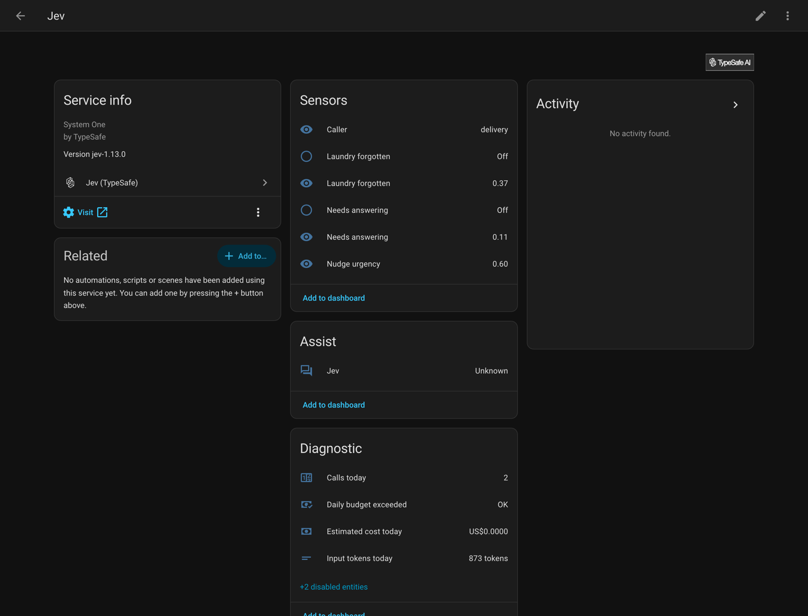</td>
<td align="center" valign="top">keine Medien veröffentlicht</td>
</tr></table>

🧰 <b><a href="https://github.com/bladedevoff/stuntd">bladedevoff/stuntd</a></b> · ⭐74 · Python · 🔎 inferred · 25 天

##### 📝 Zusammenfassung

Lokaler Proxy, der die typisierten LLM-Entscheidungen deiner App lernt und sie mit einem Laya-Head beantwortet. Kompatibel mit Jev und OpenAI.

##### 📌 Basisfakten

| Feld      | Wert                                  |
| --------- | ------------------------------------- |
| Kategorie | `Community-Clients, SDKs und Adapter` |
| Beleg     | `inferred`                            |
| Sprache   | Python                                |

##### 📊 Daten

| Metrik            | Wert       |
| ----------------- | ---------- |
| Stars             | **74**     |
| Letzter Push      | 2026-10-11 |
| Erstmals gelistet | 2026-10-29 |

🏷 `claude-code` · `distillation` · `jev` · `laya` · `llm` · `llm-proxy` · `local-inference` · `openai-compatible`

---

<table><tr><th align="center" width="50%">🖼 Bild</th><th align="center" width="50%">🎬 Video</th></tr><tr>
<td align="center" valign="top">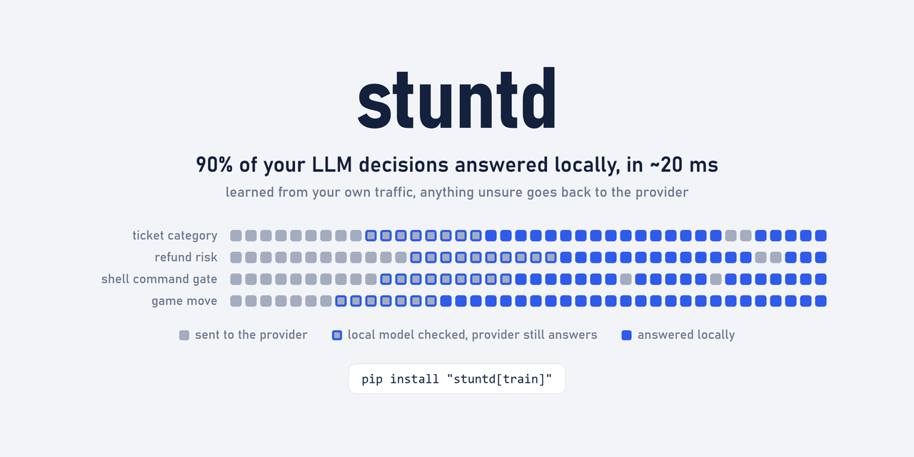</td>
<td align="center" valign="top">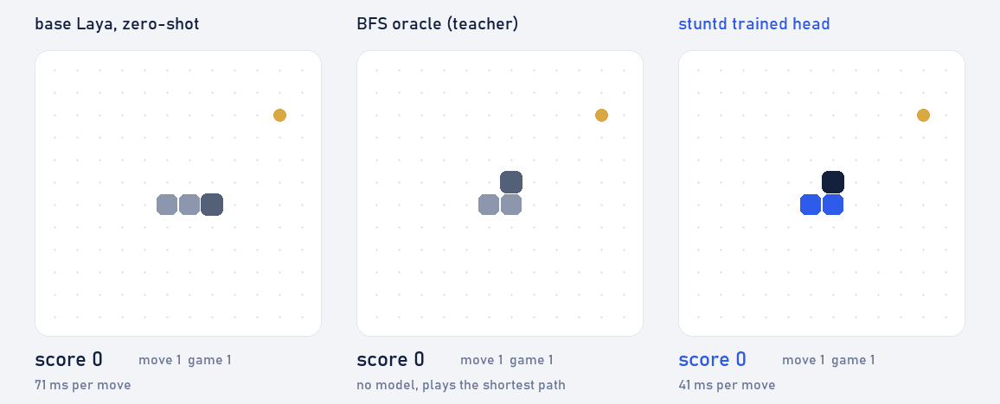 animierte Aufzeichnung</td>
</tr></table>

🧰 <b><a href="https://github.com/mlimarenko/IronRAG">mlimarenko/IronRAG</a></b> · ⭐50 · Rust · 🔎 inferred · 2 天

##### 📝 Zusammenfassung

One-click knowledge system for documents, internal bots, and AI agents

##### 📌 Basisfakten

| Feld      | Wert                                  |
| --------- | ------------------------------------- |
| Kategorie | `Community-Clients, SDKs und Adapter` |
| Beleg     | `inferred`                            |
| Sprache   | Rust                                  |

##### 📊 Daten

| Metrik            | Wert       |
| ----------------- | ---------- |
| Stars             | **50**     |
| Letzter Push      | 2026-11-03 |
| Erstmals gelistet | 2026-11-03 |

🏷 `ai` · `ai-memory` · `deepseek` · `docker` · `graph` · `graph-rag` · `hermes` · `hermes-agent`

---

<table><tr><th align="center" width="50%">🖼 Bild</th><th align="center" width="50%">🎬 Video</th></tr><tr>
<td align="center" valign="top">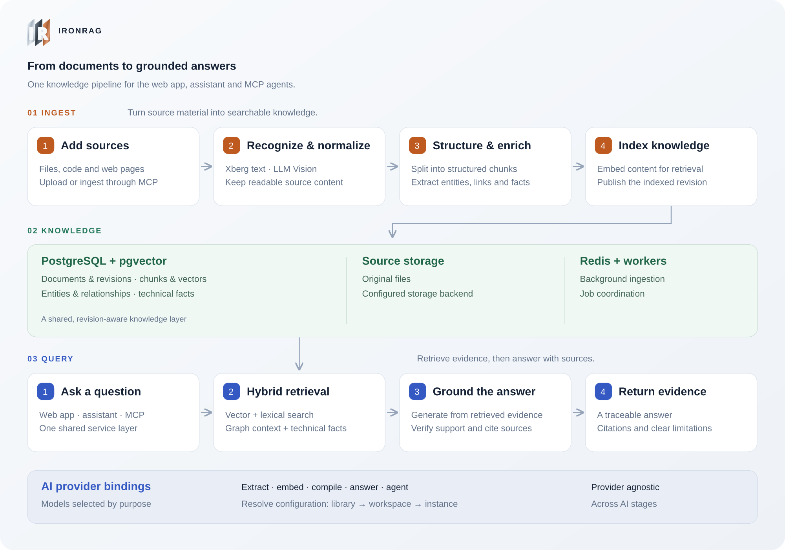</td>
<td align="center" valign="top">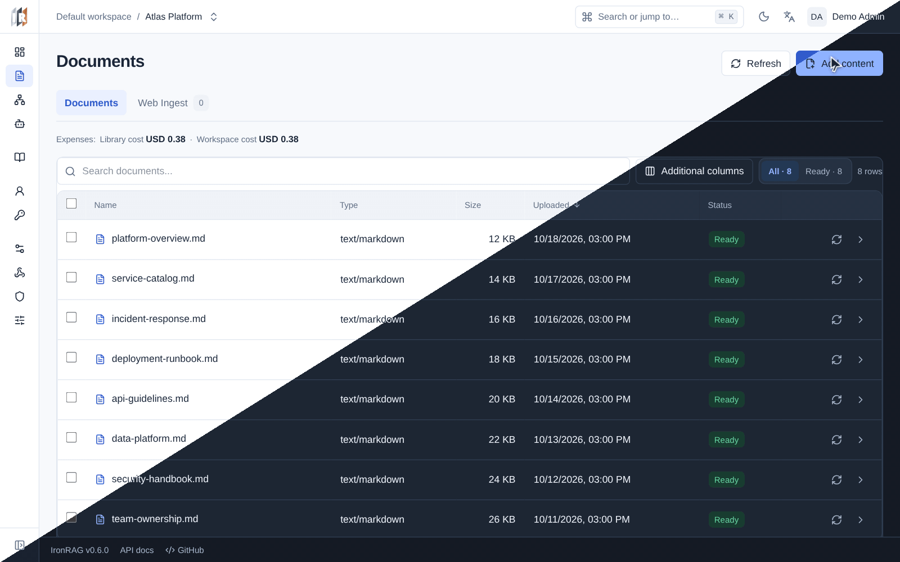 animierte Aufzeichnung</td>
</tr></table>

<b>Mehr in dieser Kategorie</b> · 104

- [frodi-karlsson/onesie](https://github.com/frodi-karlsson/onesie) - An expressive Unix-pipeable CLI for System One models like Jev.
- [chussenot/judgment](https://github.com/chussenot/judgment) - Typisierte, kalibrierte Bewertungen aus System One-Modellen: Eine Entscheidung…
- [CMaintz/jev-dotnet](https://github.com/CMaintz/jev-dotnet) - Inoffizielles .NET SDK für das Jev System One-Modell von TypeSafe AI.
- [danieleteti/systemone-delphi](https://github.com/danieleteti/systemone-delphi) - Delphi client for System One models (Jev, tev1 and nimble on Ollama): ask typed…
- [erik-hedstrom/loadout](https://github.com/erik-hedstrom/loadout) - Wähle Modell, Skills und MCP-Server für jede Coding-Agent-Sitzung aus einer…
- [jqueryscript/awesome-jev](https://github.com/jqueryscript/awesome-jev) - A curated list of TypeSafe Jev resources, SDKs, agents, MCP servers…
- [basi/typesafe-ai-php-client](https://github.com/basi/typesafe-ai-php-client) - PHP client for the typesafe.ai System One API (Jev).
- [CMaintz/jev-java](https://github.com/CMaintz/jev-java) - Inoffizielles Java SDK für TypeSafe AI.
- [gajaguar/typesafe-cli](https://github.com/gajaguar/typesafe-cli) - Unofficial command-line interface for TypeSafe AI System One models, on…
- [JosephHardy91/graph-composition-with-dLLMs](https://github.com/JosephHardy91/graph-composition-with-dLLMs) - A Graph-Compiled Specification RAG system built with **Dagster**, **PostgreSQL…
- [sanketmuchhala/jevgate](https://github.com/sanketmuchhala/jevgate) - Calibrated policy triage and institutional risk routing: a hybrid…
- [ollaya-dev/ollaya](https://github.com/ollaya-dev/ollaya) - Jev-compatible API server for open decision models.
- [realZachi/pg-jev](https://github.com/realZachi/pg-jev) - Stelle deinen Postgres-Tabellen Fragen in natürlicher Sprache.
- [sutro-sh/jev-align](https://github.com/sutro-sh/jev-align) - Erstelle kalibrierte AI Functions aus menschlichem Feedback mit Jev und GEPA.
- [juspay/neurolink](https://github.com/juspay/neurolink) - Die Pipe-Schicht eines KI-Nervensystems — eine Schnittstelle, die…
- [aaddrick/building-with-typesafe-jev](https://github.com/aaddrick/building-with-typesafe-jev) - Inoffizieller Skill, der Coding-Agenten beibringt, mit TypeSafe AIs Jev zu…
- [Ying-Kai-Liao/jev-browser](https://github.com/Ying-Kai-Liao/jev-browser) - Browser-Automatisierung, bei der ein LLM plant und Jev (Typesafe System One)…
- [AkashPriyadarshii/jev-curate](https://github.com/AkashPriyadarshii/jev-curate) - High-throughput synthetic and pretraining dataset sifter for TypeSafe Jev.
- [fazlerocks/jevmail](https://github.com/fazlerocks/jevmail) - Open-Source-KI-E-Mail-Triage für Gmail.
- [sharziki/semdecide](https://github.com/sharziki/semdecide) - Typisierte semantische Entscheidungen für Unix-Pipelines und CI, betrieben mit…
- [burnigtm/jev-mcp](https://github.com/burnigtm/jev-mcp) - MCP-Server, der TypeSafe Jev in Cursor, Codex und jeden MCP-Client in die…
- [shaharia-lab/jev-cli](https://github.com/shaharia-lab/jev-cli) - Befehlszeilenwerkzeug für das Jev-Modell von TypeSafe AI.
- [AkashPriyadarshii/jev-superpowers](https://github.com/AkashPriyadarshii/jev-superpowers) - Systematic software development framework for AI coding agents upgraded with…
- [dannote/jev](https://github.com/dannote/jev) - TypeSafe Jev für OTP: auf Jev von einem GenServer antworten und eine…
- [DevLoops-ai/unified-brain](https://github.com/DevLoops-ai/unified-brain) - System One Coding Agents: code-level answers at the same score as Claude Fable…
- [jwuthri-cloud/SelfJev](https://github.com/jwuthri-cloud/SelfJev) - Self-hosted decision model (selfjev-4b) with a Jev-compatible API: Python SDK…
- [jiangkoumo/ego-decision-layer](https://github.com/jiangkoumo/ego-decision-layer) - Pluggable decision layer for the ego lite browser: one System One (Jev) call…
- [myc0576/SmartMoney-Cub](https://github.com/myc0576/SmartMoney-Cub) - Read-only trading journal and review harness: Jev typed judgments, agent…
- [thusinh1969/BrighTO_Router](https://github.com/thusinh1969/BrighTO_Router) - BrighTO LLM Router: free open-source, ultra-fast Rust LLM gateway/router and…
- [Ray-Hughes/jevalyn](https://github.com/Ray-Hughes/jevalyn) - Die Entscheidungsebene für deine Rails-App.
- [dirien/jev-router](https://github.com/dirien/jev-router) - Pass-through model router for Claude Code and Codex CLI that picks a model tier…
- [nouli-ai/nouli](https://github.com/nouli-ai/nouli) - A ledger-backed decision network that records AI decisions and connects them to…
- [tontoko/jev-browser](https://github.com/tontoko/jev-browser) - Ein geerdeter Jev/Playwright-Kern: typisiertes SDK, persistentes CLI und…
- [saibimajdi/typesafeai-dotnet-sdk](https://github.com/saibimajdi/typesafeai-dotnet-sdk) - Community-.NET-SDK für TypeSafe AI System One API — typisierte Noul-, Choice…
- [Elue-dev/jev_elixir](https://github.com/Elue-dev/jev_elixir) - jev_elixir ist eine kleine, idiomatische Schnittstelle zum Treffen typisierter…
- [devbackend/jevgo](https://github.com/devbackend/jevgo) - Inoffizieller Go-Client für den TypeSafe AI System One API (Jev) — typisierte…
- [haileyok/typesafe-client](https://github.com/haileyok/typesafe-client) - Inoffizielle Go- und Rust-Clients für TypeSafe AI System One API (Jev).
- [himomohi/aside-jev](https://github.com/himomohi/aside-jev) - Aside-Agenten entscheiden mit TypeSafe Jev (System One: Choice/Score/Noul).
- [chenrui333/jev-docs](https://github.com/chenrui333/jev-docs) - Von der Community gepflegte Historie von Jev / TypeSafe System One APIs, SDKs…
- [docxology/daf-jev](https://github.com/docxology/daf-jev) - daf-jev: kombinierbares Python-Toolkit für TypeSafe.
- [sanamhub/typesafe-dotnet](https://github.com/sanamhub/typesafe-dotnet) - Unofficial .NET client for the TypeSafe AI System One API.
- [illescasDaniel/jev-mem](https://github.com/illescasDaniel/jev-mem) - Long-term memory for AI agents driven by Jev (System One) decisions: no…
- [JimmyWesley/rlcd-gateway](https://github.com/JimmyWesley/rlcd-gateway) - Self-hosted-Gateway für LLMs und Entscheidungsmodelle.
- [vibefilter/filament](https://github.com/vibefilter/filament) - Filter Filament tables with a plain-English statement.
- [zhirschtritt/typesafe-go](https://github.com/zhirschtritt/typesafe-go) - Idiomatic Go SDK für TypeSafe AI API.
- [AIAnytime/Jev-Router](https://github.com/AIAnytime/Jev-Router) - Decision-first, OpenAI-compatible AI router powered by Jev typed decisions.
- [akiiwa-games/AgentCompass](https://github.com/akiiwa-games/AgentCompass) - Deterministic multi-agent task router &amp; subscription quota scheduler for Claude…
- [Butochnikov/laravel-typesafe-jev](https://github.com/Butochnikov/laravel-typesafe-jev) - Inoffizielle Laravel-Integration für TypeSafe Jev AI mit typisierten Antworten…
- [coo-quack/jev-pii-checker](https://github.com/coo-quack/jev-pii-checker) - CLI, das PII in Text mit TypeSafe Jev findet: Vorhandensein, Sensitivität und…
- [zerone-agents/jev-model-router](https://github.com/zerone-agents/jev-model-router) - Leichtgewichtiges Modellrouting für Agenten mit Kompatibilität für OpenAI und…
- [AboveColin/jevclient](https://github.com/AboveColin/jevclient) - Asynchroner Python-Client für TypeSafe Jev.
- [dsaad68/fuzzy-jev](https://github.com/dsaad68/fuzzy-jev) - A client for OpenRouter&#x27;s decision models, TypeSafe&#x27;s Jev by default: typed…
- [maxtrezzi/jev4s](https://github.com/maxtrezzi/jev4s) - Typed Scala client for Jev (TypeSafe AI): typed questions, typed answers…
- [minorun365/jev-cloud-quiz](https://github.com/minorun365/jev-cloud-quiz) - 三大クラウドの機能名を、TypeSafe AI の System One モデル Jev が確率つきで判定するデモ.
- [MrKyaw/CognitiveMirror-Jev-MCP](https://github.com/MrKyaw/CognitiveMirror-Jev-MCP) - Cognitive middleware for personal and enterprise AI agents: 14 MCP tools and a…
- [NerdishShah/playwright-cli-jev-bakeoff](https://github.com/NerdishShah/playwright-cli-jev-bakeoff) - Vergleichstest: Playwright CLI vs. CLI+Jev vs.
- [amidabuddha/jev-decision-mcp](https://github.com/amidabuddha/jev-decision-mcp) - Local MCP server for TypeSafe Jev typed decisions, with Codex integration.
- [apixly-ai/jev-filter](https://github.com/apixly-ai/jev-filter) - Typed semantic filtering for AI agents: turn retrieved records, code and logs…
- [bojansandhaus/dsh-jev-mcp](https://github.com/bojansandhaus/dsh-jev-mcp) - TypeSafe Jev decision tools for DeepSeek Harness: dependency-free client…
- [exfoca/decision-model-lab-4JEV](https://github.com/exfoca/decision-model-lab-4JEV) - DML is a reproducible harness for evaluating small, local decision models under…
- [Hyper-AI-Lab/openclaw-jev](https://github.com/Hyper-AI-Lab/openclaw-jev) - Produktions-Control-Plane für OpenClaw-Agenten: Intake-Routing mit Jev…
- [swami8791/jev-judge-mcp](https://github.com/swami8791/jev-judge-mcp) - Owner-private ChatGPT integration for TypeSafe Jev structured evaluations.
- [abirshhishirroy/mini-jev](https://github.com/abirshhishirroy/mini-jev) - A custom Jev-style decision model built from scratch on Qwen2.5-3B.
- [CMaintz/jev-tools](https://github.com/CMaintz/jev-tools) - TypeScript-Tools auf Basis von TypeSafe AI.
- [codebam/jev-guardrails](https://github.com/codebam/jev-guardrails) - Auf Jev basierende Schutzmechanismen für Agenten-Toolaufrufe: Bibliothek…
- [cwdx/chess-with-jev](https://github.com/cwdx/chess-with-jev) - Chess with Jev: every legal move&#x27;s facts worked out in code, Jev&#x27;s move as one…
- [Errr0rr404/jev-trader](https://github.com/Errr0rr404/jev-trader) - Local CLI and web desk. Robinhood Agentic MCP is the tape. TypeSafe Jev votes.
- [fan56/dsh-jev-core](https://github.com/fan56/dsh-jev-core) - Shared TypeSafe Jev decision-model client for the dsh ecosystem: strict…
- [HappyHackingSpace/jev](https://github.com/HappyHackingSpace/jev) - Go SDK, CLI, MCP server and agent skill for TypeSafe.
- [ivanblagdan/jev-cli](https://github.com/ivanblagdan/jev-cli) - Composable CLI for TypeSafe.
- [mrodgersjs-web/jev-route](https://github.com/mrodgersjs-web/jev-route) - Deterministic routing-policy CLI in Rust: task and candidates in, choice +…
- [Murat-Selim/jev_doc_router](https://github.com/Murat-Selim/jev_doc_router) - Spring Boot PDF question-answering assistant with RAG/CAG routing and…
- [offneves/jev-pr-reviewer](https://github.com/offneves/jev-pr-reviewer) - A local CLI to analyze Pull Request / Merge Request diffs, obtain structured…
- [ogarciarevett/jev-py-sdk](https://github.com/ogarciarevett/jev-py-sdk) - Typisierte Jev-Urteile (noul / choice / score) aus TypeSafe für Python…
- [phoenix1331/laravel-jev-hotdog](https://github.com/phoenix1331/laravel-jev-hotdog) - A Laravel 13 playground that tells you whether a photo is a hot dog or not…
- [pyck-ai/jev-cli](https://github.com/pyck-ai/jev-cli) - Jev.
- [Ridlo543/jev-judge](https://github.com/Ridlo543/jev-judge) - Universal Model Context Protocol (MCP) server and CLI runner for TypeSafe Jev…
- [royalskynet/jev-gate-mcp](https://github.com/royalskynet/jev-gate-mcp) - Gesteuertes Jev-Entscheidungsgateway für GPT-, Claude- und MCP-Clients.
- [shetautnetjer/jev-cli](https://github.com/shetautnetjer/jev-cli) - Clean-room CLI for TypeSafe System One / Jev Decision Contracts, search, and…
- [sunjongos/jev-typesafe-gatekeeper](https://github.com/sunjongos/jev-typesafe-gatekeeper) - World-Class Pure System 1 AI Decision &amp; 90/10 Hybrid Gatekeeper Skill powered…
- [SykkoAtHome/MCP_Typesafe_JEV](https://github.com/SykkoAtHome/MCP_Typesafe_JEV) - Domain-agnostic MCP server for TypeSafe Jev (System One) evaluation engine…
- [VianneyMI/python-jev](https://github.com/VianneyMI/python-jev) - Unofficial typed Python SDK for TypeSafe.
- [vilinski/jev](https://github.com/vilinski/jev) - CLI für System One-Entscheidungsmodelle: typisierte Fragen hinein, kalibrierte…
- [Yasir-Khan-7/jev-sentinel](https://github.com/Yasir-Khan-7/jev-sentinel) - Schutz vor Prompt-Injection und Tool-Call-Leitplanken für…
- [Zuexx/agent-jev-integration](https://github.com/Zuexx/agent-jev-integration) - TypeSafe Jev integrated into Claude Code: routing, escalation, guardrails, evals.
- [StartLuxLabs/StartLux-Prism](https://github.com/StartLuxLabs/StartLux-Prism) - Fast, exact inference for StartLux-Decision models on NVIDIA GPUs: the released…
- [rokbenko/quackd](https://github.com/rokbenko/quackd) - Eine CLI für all deine Roboter. Verbinde sie, gib ihnen Befehle und lass sie…
- [MiaoWuNYA/rikkahub-sillytavern-android](https://github.com/MiaoWuNYA/rikkahub-sillytavern-android) - 安卓AI聊天端:开箱即聊，无损导入酒馆卡，缓存强省用量，手机操控，专属RP模式，防空回，主动信息，前端卡支持，高定制主题，QQbot，AI群聊，插件系统，强兼容…
- [pithings/advocaat](https://github.com/pithings/advocaat) - Ein kleiner, typsicherer Client zum Stellen von KI-Fragen zu deinen Daten…
- [giuliosmall/pg_typesafe](https://github.com/giuliosmall/pg_typesafe) - Pre-Alpha-PostgreSQL-Erweiterung für die kategoriale Klassifizierung in…
- [Brainwires/jevwire](https://github.com/Brainwires/jevwire) - Jev decision layer for agents: MCP server, embeddable DecisionModel library…
- [zhulinchng/jevper](https://github.com/zhulinchng/jevper) - Jev-förmiger (TypeSafe System One) Klassifikations-Wrapper über…
- [schainks/system_one_client](https://github.com/schainks/system_one_client) - Elixir-Client für System One-Entscheidungsmodelle: TypeSafe Jev, Cloudflare…
- [gilljon/typesafe-ai-rs](https://github.com/gilljon/typesafe-ai-rs) - Unabhängiger asynchroner und blockierender Rust SDK für den TypeSafe AI System…
- [AutreMachine/bosco](https://github.com/AutreMachine/bosco) - Router and proxy for OpenAI compatible LLMs machines - 1 url to rule them all !
- [cipherTing/sael](https://github.com/cipherTing/sael) - Go-Client für die TypeSafe System One API (Jev) — das erste Stück von sael…
- [IKEASven69/dsh-opencli](https://github.com/IKEASven69/dsh-opencli) - 让 dsh 会办事:登录态真实浏览器 × 180 站点结构化命令 + SystemOne 亚秒决策 + 执行真实性判定 + watch 监控.
- [zcoder-run/rust-sysone](https://github.com/zcoder-run/rust-sysone) - System One TypeSafe AI Rust Client (unofficial).
- [fini/warped-sys1-lab](https://github.com/fini/warped-sys1-lab) - Jev (TypeSafe System One) experiment lab: SvelteKit workbench and CLI.
- [lirantal/discoprint](https://github.com/lirantal/discoprint) - Classify an artist.
- [y0usaf/typesafe-cli](https://github.com/y0usaf/typesafe-cli) - Stelle Jev typisierte Fragen aus der Shell: noul-, choice- und score-Antworten…
- [KratosLee-6/open-source-model-deploy](https://github.com/KratosLee-6/open-source-model-deploy) - 开源大模型部署可行性鉴别工具 · 168 个开源模型动态评估（含 12 个 JEV/System One 决策模型）· 硬件自动检测 ·…
- [MarcelRoozekrans/Minos.NET](https://github.com/MarcelRoozekrans/Minos.NET) - Typed, source-generated decision questions for .NET: one IDecisionClient for…
- [phiat/typesafe-rust-sdk](https://github.com/phiat/typesafe-rust-sdk) - Unofficial Rust client for TypeSafe.

## Agent-Tooling: MCP, Hooks, Gates und Coding-Agents

Die am schnellsten wachsende Kategorie: Hooks, MCP-Server und Gates, die der nächsten Aktion eines Agenten eine typisierte Entscheidung voranstellen.

🤖 <b><a href="https://github.com/0xNatoshi/jev-codex-router">0xNatoshi/jev-codex-router</a></b> · ⭐273 · JavaScript · 🔎 inferred · 44 天

##### 📝 Zusammenfassung

Modell- und Reasoning-Routing pro Durchlauf für Codex, gesteuert durch Jev (TypeSafe System One): wählt für jeden Durchlauf das Modell, die Denktiefe und den Geschwindigkeitsmodus.

> 💡 Routing von Modell und Reasoning-Aufwand pro Durchlauf für einen Coding-Agenten, gesteuert durch typisierte Entscheidungen.

##### 📌 Basisfakten

| Feld      | Wert                                                 |
| --------- | ---------------------------------------------------- |
| Kategorie | `Agent-Tooling: MCP, Hooks, Gates und Coding-Agents` |
| Beleg     | `inferred`                                           |
| Sprache   | JavaScript                                           |

##### 📊 Daten

| Metrik            | Wert       |
| ----------------- | ---------- |
| Stars             | **273**    |
| Letzter Push      | 2026-09-22 |
| Erstmals gelistet | 2026-10-28 |

🏷 `ai` · `codex` · `jev` · `llm` · `macos` · `routing` · `typesafe`

🤖 <b><a href="https://github.com/strands-labs/strands-decider">strands-labs/strands-decider</a></b> · ⭐763 · Python · 👁️ observed · 0 天 · ⭐+1

##### 📝 Zusammenfassung

Ein kleines, schnelles Entscheidungsmodell oder System-1-Modell für agentische Workflows. Wähle zwischen Optionen oder bewerte auf einer Skala schneller als mit einem LLM, mit kalibrierter Konfidenz bei jeder Entscheidung.

##### 📌 Basisfakten

| Feld      | Wert                                                 |
| --------- | ---------------------------------------------------- |
| Kategorie | `Agent-Tooling: MCP, Hooks, Gates und Coding-Agents` |
| Beleg     | `observed`                                           |
| Sprache   | Python                                               |

##### 📊 Daten

| Metrik            | Wert         |
| ----------------- | ------------ |
| Stars             | **763** (+1) |
| Letzter Push      | 2026-11-04   |
| Erstmals gelistet | 2026-10-02   |

🏷 `ai` · `machine-learning` · `natural-language-understanding` · `python` · `strands-agents` · `strands-labs` · `system-one` · `system-one-models`

🤖 <b><a href="https://github.com/AbdelStark/awesome-typesafe-jev">AbdelStark/awesome-typesafe-jev</a></b> · ⭐614 · HTML · 👁️ observed · 3 天 · ⭐-1

##### 📝 Zusammenfassung

Awesome Jev: ein quellenbasierter Feldführer zu TypeSafes System One-Modell, mit SDKs, Live-Demos, Agent-Tools und unabhängigen Bewertungen.

🔧 Im Code verwendet: `README.md`

##### 📌 Basisfakten

| Feld      | Wert                                                 |
| --------- | ---------------------------------------------------- |
| Kategorie | `Agent-Tooling: MCP, Hooks, Gates und Coding-Agents` |
| Beleg     | `observed`                                           |
| Sprache   | HTML                                                 |

##### 📊 Daten

| Metrik            | Wert         |
| ----------------- | ------------ |
| Stars             | **614** (-1) |
| Letzter Push      | 2026-11-01   |
| Erstmals gelistet | 2026-10-28   |

🏷 `agent-skills` · `ai-agents` · `awesome` · `awesome-jev` · `awesome-list` · `awesome-lists` · `curated-list` · `developer-tools`

🤖 <b><a href="https://github.com/jkudish/jev-mcp">jkudish/jev-mcp</a></b> · ⭐572 · JavaScript · 👁️ observed · 6 天 · ⭐+2

##### 📝 Zusammenfassung

Schnelle, günstige, typisierte Bewertungen von TypeSafe's Jev-Modell als MCP-Tools.

> 💡 Ein früher Proof of Concept, der Jev über MCP bereitstellt, worüber die meisten Nicht-Python-Toolchains darauf zugreifen.

🔧 Im Code verwendet: `README.md`

##### 📌 Basisfakten

| Feld      | Wert                                                 |
| --------- | ---------------------------------------------------- |
| Kategorie | `Agent-Tooling: MCP, Hooks, Gates und Coding-Agents` |
| Beleg     | `observed`                                           |
| Sprache   | JavaScript                                           |

##### 📊 Daten

| Metrik            | Wert         |
| ----------------- | ------------ |
| Stars             | **572** (+2) |
| Letzter Push      | 2026-10-30   |
| Erstmals gelistet | 2026-10-26   |

🤖 <b><a href="https://github.com/walidboulanouar/awesome-jev-use-cases">walidboulanouar/awesome-jev-use-cases</a></b> · ⭐481 · 👁️ observed · 39 天

##### 📝 Zusammenfassung

Awesome-Liste mit TypeSafe AI-Jev-Anwendungsfällen: 74 Demos, nach Likes sortiert, über 150 GitHub-Repos, Grenzen, Kosten und API-Beispiele. CC0

🔧 Im Code verwendet: `README.md`

##### 📌 Basisfakten

| Feld      | Wert                                                 |
| --------- | ---------------------------------------------------- |
| Kategorie | `Agent-Tooling: MCP, Hooks, Gates und Coding-Agents` |
| Beleg     | `observed`                                           |

##### 📊 Daten

| Metrik            | Wert       |
| ----------------- | ---------- |
| Stars             | **481**    |
| Letzter Push      | 2026-09-26 |
| Erstmals gelistet | 2026-10-29 |

🏷 `ai-guardrails` · `ai-router` · `awesome` · `awesome-list` · `classification` · `claude-code` · `decision-model` · `examples`

🤖 <b><a href="https://github.com/kraayenjon/awesome-jev">kraayenjon/awesome-jev</a></b> · ⭐203 · 👁️ observed · 39 天 · ⭐-1

##### 📝 Zusammenfassung

Eine kuratierte Liste von Jev-Anwendungsfällen, Projekten, SDKs und Ressourcen. Jev ist das System One-Modell von TypeSafe AI für schnelle, typisierte Entscheidungen in Software — Choice, Score und Noul mit kalibrierten Wahrscheinlichkeiten.

🔧 Im Code verwendet: `README.md`

##### 📌 Basisfakten

| Feld      | Wert                                                 |
| --------- | ---------------------------------------------------- |
| Kategorie | `Agent-Tooling: MCP, Hooks, Gates und Coding-Agents` |
| Beleg     | `observed`                                           |

##### 📊 Daten

| Metrik            | Wert         |
| ----------------- | ------------ |
| Stars             | **203** (-1) |
| Letzter Push      | 2026-09-27   |
| Erstmals gelistet | 2026-09-19   |

🏷 `agents` · `ai` · `ai-agents` · `api` · `artificial-intelligence` · `automation` · `awesome` · `awesome-list`

🤖 <b><a href="https://github.com/valentynkit/awesome-jev-typesafe">valentynkit/awesome-jev-typesafe</a></b> · ⭐187 · JavaScript · 👁️ observed · 0 天 · ⭐-1

##### 📝 Zusammenfassung

Typisierte Entscheidungen mit TypeSafe's Jev, dem ersten System One-Modell

🔧 Im Code verwendet: `readme.md`, `README.ko.md`, `README.ja.md`, `README.zh-CN.md`

##### 📌 Basisfakten

| Feld      | Wert                                                 |
| --------- | ---------------------------------------------------- |
| Kategorie | `Agent-Tooling: MCP, Hooks, Gates und Coding-Agents` |
| Beleg     | `observed`                                           |
| Sprache   | JavaScript                                           |

##### 📊 Daten

| Metrik            | Wert         |
| ----------------- | ------------ |
| Stars             | **187** (-1) |
| Letzter Push      | 2026-11-05   |
| Erstmals gelistet | 2026-09-19   |

🏷 `ai-agents` · `awesome` · `awesome-list` · `claude-code` · `directory` · `jev` · `llm-agents` · `system-one`

🤖 <b><a href="https://github.com/tamaratran/jev-pruner">tamaratran/jev-pruner</a></b> · ⭐167 · TypeScript · 👁️ observed · 36 天

##### 📝 Zusammenfassung

Claude-Code-Plugin: Lange Bash-Ausgaben mit TypeSafe Jev kürzen, bevor das Modell sie sieht

🔧 Im Code verwendet: `README.md`

##### 📌 Basisfakten

| Feld      | Wert                                                 |
| --------- | ---------------------------------------------------- |
| Kategorie | `Agent-Tooling: MCP, Hooks, Gates und Coding-Agents` |
| Beleg     | `observed`                                           |
| Sprache   | TypeScript                                           |

##### 📊 Daten

| Metrik            | Wert       |
| ----------------- | ---------- |
| Stars             | **167**    |
| Letzter Push      | 2026-09-30 |
| Erstmals gelistet | 2026-10-29 |

🤖 <b><a href="https://github.com/dbreunig/building-with-jev-skill">dbreunig/building-with-jev-skill</a></b> · ⭐166 · 👁️ observed · 6 天

##### 📝 Zusammenfassung

Eine Fähigkeit zum Schreiben und Verbessern von Programmen, die Jev, TypeSafe's System One-Modell, aufrufen

> 💡 Eine Fähigkeit zum Schreiben von Programmen, die Jev aufrufen, statt eines Programms, das Jev aufruft. Der Unterschied ist wichtig: Sie kodiert die Designregeln, nicht eine einzelne Implementierung davon.

##### 📌 Basisfakten

| Feld      | Wert                                                 |
| --------- | ---------------------------------------------------- |
| Kategorie | `Agent-Tooling: MCP, Hooks, Gates und Coding-Agents` |
| Beleg     | `observed`                                           |

##### 📊 Daten

| Metrik            | Wert       |
| ----------------- | ---------- |
| Stars             | **166**    |
| Letzter Push      | 2026-10-29 |
| Erstmals gelistet | 2026-10-28 |

🤖 <b><a href="https://github.com/y0usaf/pi-jev">y0usaf/pi-jev</a></b> · ⭐163 · TypeScript · 👁️ observed · 5 天 · ⭐-5

##### 📝 Zusammenfassung

TypeSafe Jev als Entscheidungsebene für den Pi-Coding-Agent: ein gemessenes Tool-Call-Gate plus jev_ask für typisierte, kalibrierte Antworten

🔧 Im Code verwendet: `README.md`

##### 📌 Basisfakten

| Feld      | Wert                                                 |
| --------- | ---------------------------------------------------- |
| Kategorie | `Agent-Tooling: MCP, Hooks, Gates und Coding-Agents` |
| Beleg     | `observed`                                           |
| Sprache   | TypeScript                                           |

##### 📊 Daten

| Metrik            | Wert         |
| ----------------- | ------------ |
| Stars             | **163** (-5) |
| Letzter Push      | 2026-10-31   |
| Erstmals gelistet | 2026-10-29   |

🏷 `guardrails` · `jev` · `pi-extension` · `pi-package` · `typesafe`

🤖 <b><a href="https://github.com/Avinash-jetwani/jevmem">Avinash-jetwani/jevmem</a></b> · ⭐140 · TypeScript · 👁️ observed · 5 天

##### 📝 Zusammenfassung

jevmem speichert die Entscheidungen, Regeln und fehlgeschlagenen Ansätze aus deinen Claude Code-Chats in JEVMEM.md in deinem Repo und bringt die relevanten in der nächsten Sitzung zurück.

🔧 Im Code verwendet: `PRIVACY.md`, `plugin/README.md`

##### 📌 Basisfakten

| Feld      | Wert                                                 |
| --------- | ---------------------------------------------------- |
| Kategorie | `Agent-Tooling: MCP, Hooks, Gates und Coding-Agents` |
| Beleg     | `observed`                                           |
| Sprache   | TypeScript                                           |

##### 📊 Daten

| Metrik            | Wert       |
| ----------------- | ---------- |
| Stars             | **140**    |
| Letzter Push      | 2026-10-30 |
| Erstmals gelistet | 2026-10-29 |

🏷 `agent-memory` · `ai-memory` · `claude` · `claude-code` · `claude-code-hooks` · `claude-code-plugin` · `claude-code-plugins` · `claude-code-plugins-marketplace`

🤖 <b><a href="https://github.com/Bodila51/grok-bot-jev">Bodila51/grok-bot-jev</a></b> · ⭐130 · Python · 👁️ observed · 37 天

##### 📝 Zusammenfassung

Verbinde TypeSafe Jev mit Grok Bot als kostengünstige Entscheidungsebene – Nutzungsgrenzen, Skill-Vorlage, Beispiele

🔧 Im Code verwendet: `src/jev_client.py`

##### 📌 Basisfakten

| Feld      | Wert                                                 |
| --------- | ---------------------------------------------------- |
| Kategorie | `Agent-Tooling: MCP, Hooks, Gates und Coding-Agents` |
| Beleg     | `observed`                                           |
| Sprache   | Python                                               |

##### 📊 Daten

| Metrik            | Wert       |
| ----------------- | ---------- |
| Stars             | **130**    |
| Letzter Push      | 2026-09-28 |
| Erstmals gelistet | 2026-10-29 |

🏷 `cursor` · `decision-layer` · `grok-bot` · `jev` · `python` · `typesafe`

---

<table><tr><th align="center" width="50%">🖼 Bild</th><th align="center" width="50%">🎬 Video</th></tr><tr>
<td align="center" valign="top"></td>
<td align="center" valign="top">keine Medien veröffentlicht</td>
</tr></table>

🤖 <b><a href="https://github.com/KikeVen/zerikai_memory">KikeVen/zerikai_memory</a></b> · ⭐36 · Python · 👁️ observed · 1 天

##### 📝 Zusammenfassung

A standalone local-only Python MCP server that gives any IDE persistent, workspace-isolated memory. works with any IDE supporting MCP servers

🔧 Im Code verwendet: `jev/client.py`

##### 📌 Basisfakten

| Feld      | Wert                                                 |
| --------- | ---------------------------------------------------- |
| Kategorie | `Agent-Tooling: MCP, Hooks, Gates und Coding-Agents` |
| Beleg     | `observed`                                           |
| Sprache   | Python                                               |

##### 📊 Daten

| Metrik            | Wert       |
| ----------------- | ---------- |
| Stars             | **36**     |
| Letzter Push      | 2026-11-04 |
| Erstmals gelistet | 2026-11-04 |

🏷 `ai` · `ai-tools` · `chromadb` · `deepseek-v4-pro` · `jev` · `judgment` · `lexical` · `mcp`

---

<table><tr><th align="center" width="50%">🖼 Bild</th><th align="center" width="50%">🎬 Video</th></tr><tr>
<td align="center" valign="top">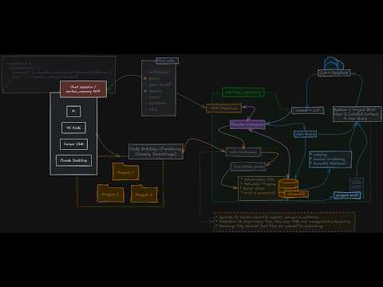</td>
<td align="center" valign="top"> <a href="https://img.youtube.com/vi/sk8x-nbF0Cs/0.jpg">Ansehen auf img.youtube.com</a> · die Wiedergabe öffnet auf der Host-Seite; GitHub kann sie nicht direkt einbetten</td>
</tr></table>

🤖 <b><a href="https://github.com/caijinchun/nanojev-arena">caijinchun/nanojev-arena</a></b> · ⭐7 · HTML · 👁️ observed · 46 天

##### 📝 Zusammenfassung

NanoJev Snake Arena: 1v4-Schlachtschiffduelle Mensch gegen KI plus Schwarm-Simulator mit 100 Agenten. Lokale Demo des Jev-System-One-Modells (Open-Source-Minireplikat).

##### 📌 Basisfakten

| Feld      | Wert                                                 |
| --------- | ---------------------------------------------------- |
| Kategorie | `Agent-Tooling: MCP, Hooks, Gates und Coding-Agents` |
| Beleg     | `observed`                                           |
| Sprache   | HTML                                                 |

##### 📊 Daten

| Metrik            | Wert       |
| ----------------- | ---------- |
| Stars             | **7**      |
| Letzter Push      | 2026-09-19 |
| Erstmals gelistet | 2026-11-01 |

---

<table><tr><th align="center" width="50%">🖼 Bild</th><th align="center" width="50%">🎬 Video</th></tr><tr>
<td align="center" valign="top"></td>
<td align="center" valign="top">keine Medien veröffentlicht</td>
</tr></table>

🤖 <b><a href="https://github.com/dfranco-projects/jev-guardbench">dfranco-projects/jev-guardbench</a></b> · ⭐3 · Python · 👁️ observed · 31 天

##### 📝 Zusammenfassung

Kann ein System One-Modell (TypeSafe Jev, Open-Source-Kev) einen LLM-als-Judge in Agenten-Leitplanken-Callbacks ersetzen?

##### 📌 Basisfakten

| Feld      | Wert                                                 |
| --------- | ---------------------------------------------------- |
| Kategorie | `Agent-Tooling: MCP, Hooks, Gates und Coding-Agents` |
| Beleg     | `observed`                                           |
| Sprache   | Python                                               |

##### 📊 Daten

| Metrik            | Wert       |
| ----------------- | ---------- |
| Stars             | **3**      |
| Letzter Push      | 2026-10-04 |
| Erstmals gelistet | 2026-11-04 |

---

<table><tr><th align="center" width="50%">🖼 Bild</th><th align="center" width="50%">🎬 Video</th></tr><tr>
<td align="center" valign="top"></td>
<td align="center" valign="top">keine Medien veröffentlicht</td>
</tr></table>

Asset direkt aus dem Upstream-Repository verlinkt, da keine Lizenz zur Weiterverbreitung angegeben wurde.

🤖 <b><a href="https://github.com/dolevhayut/resurface">dolevhayut/resurface</a></b> · TypeScript · 👁️ observed · 33 天

##### 📝 Zusammenfassung

TypeSafe JEV-Bewerberscreening: LLM erstellt die Fragen, JEV (System One-Klassifizierungsmodell) beantwortet sie für jeden Lebenslauf in Ihrem ATS mit der exakten Belegzeile. 8× schneller, 31× günstiger als ein LLM.

##### 📌 Basisfakten

| Feld      | Wert                                                 |
| --------- | ---------------------------------------------------- |
| Kategorie | `Agent-Tooling: MCP, Hooks, Gates und Coding-Agents` |
| Beleg     | `observed`                                           |
| Sprache   | TypeScript                                           |

##### 📊 Daten

| Metrik            | Wert       |
| ----------------- | ---------- |
| Stars             | **0**      |
| Letzter Push      | 2026-10-03 |
| Erstmals gelistet | 2026-11-01 |

🏷 `ai-recruiting` · `ats` · `candidate-matching` · `classification-model` · `claude` · `decision-model` · `evidence-based-hiring` · `hr-tech`

---

<table><tr><th align="center" width="50%">🖼 Bild</th><th align="center" width="50%">🎬 Video</th></tr><tr>
<td align="center" valign="top"></td>
<td align="center" valign="top"> <a href="https://raw.githubusercontent.com/dolevhayut/resurface/main/docs/launch/resurface-launch.mp4">Video öffnen</a></td>
</tr></table>

🤖 <b><a href="https://github.com/kerpopule/hermes-jev-skills">kerpopule/hermes-jev-skills</a></b> · ⭐1299 · Python · 🔎 inferred · 6 天 · ⭐+1

##### 📝 Zusammenfassung

Jev-gestütztes Modell-Routing, Speicher, Komprimierung, Skill-Auswahl sowie Computer- und Browser-Nutzung für Hermes-Agenten (auch Claude Code und Codex)

##### 📌 Basisfakten

| Feld      | Wert                                                 |
| --------- | ---------------------------------------------------- |
| Kategorie | `Agent-Tooling: MCP, Hooks, Gates und Coding-Agents` |
| Beleg     | `inferred`                                           |
| Sprache   | Python                                               |

##### 📊 Daten

| Metrik            | Wert          |
| ----------------- | ------------- |
| Stars             | **1299** (+1) |
| Letzter Push      | 2026-10-29    |
| Erstmals gelistet | 2026-09-19    |

---

<table><tr><th align="center" width="50%">🖼 Bild</th><th align="center" width="50%">🎬 Video</th></tr><tr>
<td align="center" valign="top">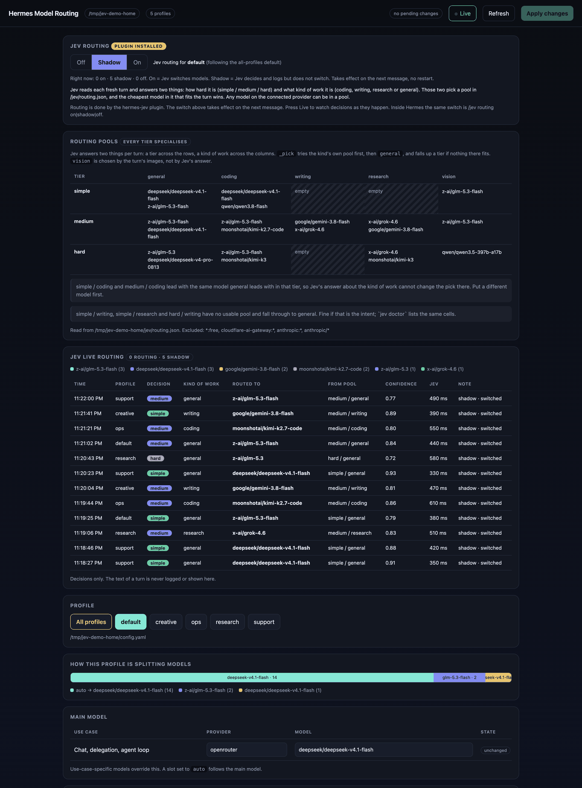</td>
<td align="center" valign="top">keine Medien veröffentlicht</td>
</tr></table>

🤖 <b><a href="https://github.com/reticlehq/reticle">reticlehq/reticle</a></b> · ⭐1245 · TypeScript · 🔎 inferred · 0 天 · ⭐-66

##### 📝 Zusammenfassung

KI-Agenten können Code generieren, haben aber weiterhin Schwierigkeiten zu verstehen, was sie erstellen. Reticle bringt eine Jev-artige, maschinen native Laufzeitwahrnehmung in Web- und Desktop-Anwendungen.

##### 📌 Basisfakten

| Feld      | Wert                                                 |
| --------- | ---------------------------------------------------- |
| Kategorie | `Agent-Tooling: MCP, Hooks, Gates und Coding-Agents` |
| Beleg     | `inferred`                                           |
| Sprache   | TypeScript                                           |

##### 📊 Daten

| Metrik            | Wert           |
| ----------------- | -------------- |
| Stars             | **1245** (-66) |
| Letzter Push      | 2026-11-05     |
| Erstmals gelistet | 2026-10-26     |

🏷 `agent-skill` · `agent-skills` · `agent-testing` · `agent-verification` · `ai-testing-tool` · `automated-testing` · `claude-code` · `claude-skills`

---

<table><tr><th align="center" width="50%">🖼 Bild</th><th align="center" width="50%">🎬 Video</th></tr><tr>
<td align="center" valign="top"></td>
<td align="center" valign="top"> animierte Aufzeichnung</td>
</tr></table>

Asset direkt aus dem Upstream-Repository verlinkt, da keine Lizenz zur Weiterverbreitung angegeben wurde.

🤖 <b><a href="https://github.com/devagrawal09/jev-review">devagrawal09/jev-review</a></b> · ⭐696 · TypeScript · 🔎 inferred · 49 天 · ⭐-1

##### 📝 Zusammenfassung

Ein stufenweiser Code-Review-Workflow und ein lokales Dashboard, erstellt mit TypeSafe Jev.

##### 📌 Basisfakten

| Feld      | Wert                                                 |
| --------- | ---------------------------------------------------- |
| Kategorie | `Agent-Tooling: MCP, Hooks, Gates und Coding-Agents` |
| Beleg     | `inferred`                                           |
| Sprache   | TypeScript                                           |

##### 📊 Daten

| Metrik            | Wert         |
| ----------------- | ------------ |
| Stars             | **696** (-1) |
| Letzter Push      | 2026-09-17   |
| Erstmals gelistet | 2026-10-29   |

🏷 `ai` · `code-review` · `jev` · `typesafe-ai` · `typescript`

---

<table><tr><th align="center" width="50%">🖼 Bild</th><th align="center" width="50%">🎬 Video</th></tr><tr>
<td align="center" valign="top">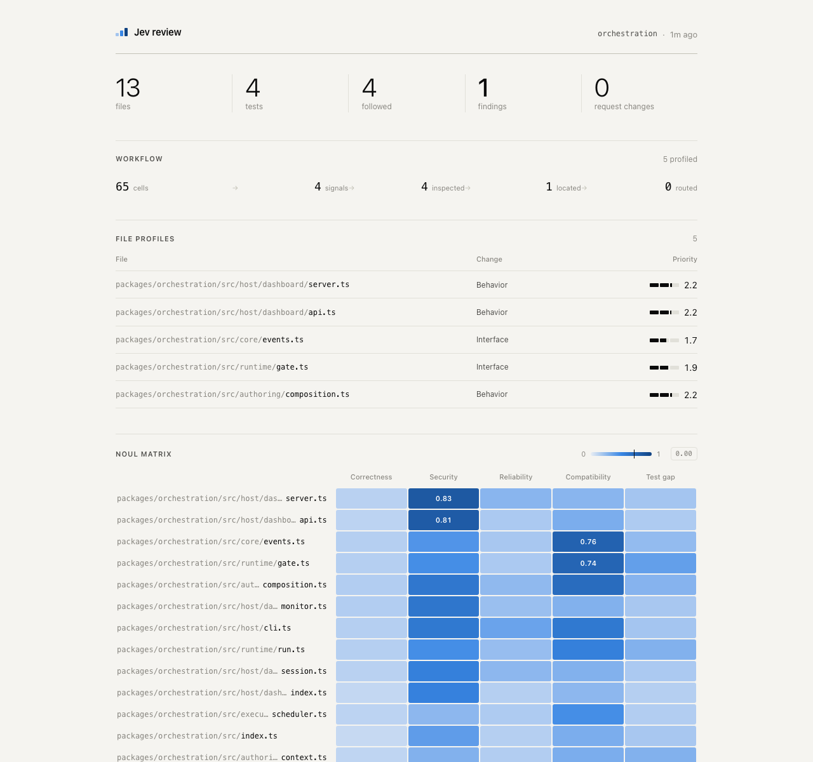</td>
<td align="center" valign="top">keine Medien veröffentlicht</td>
</tr></table>

🤖 <b><a href="https://github.com/ttlequals0/MinusPod">ttlequals0/MinusPod</a></b> · ⭐533 · Python · 🔎 inferred · 0 天 · ⭐+1

##### 📝 Zusammenfassung

MinusPod ist ein selbst gehosteter Server, der Werbung entfernt, bevor du überhaupt auf Wiedergabe drückst.

##### 📌 Basisfakten

| Feld      | Wert                                                 |
| --------- | ---------------------------------------------------- |
| Kategorie | `Agent-Tooling: MCP, Hooks, Gates und Coding-Agents` |
| Beleg     | `inferred`                                           |
| Sprache   | Python                                               |

##### 📊 Daten

| Metrik            | Wert         |
| ----------------- | ------------ |
| Stars             | **533** (+1) |
| Letzter Push      | 2026-11-04   |
| Erstmals gelistet | 2026-10-12   |

🏷 `ad-remover` · `ai` · `claude` · `jev` · `llm` · `media` · `nvidia` · `ollama`

---

<table><tr><th align="center" width="50%">🖼 Bild</th><th align="center" width="50%">🎬 Video</th></tr><tr>
<td align="center" valign="top">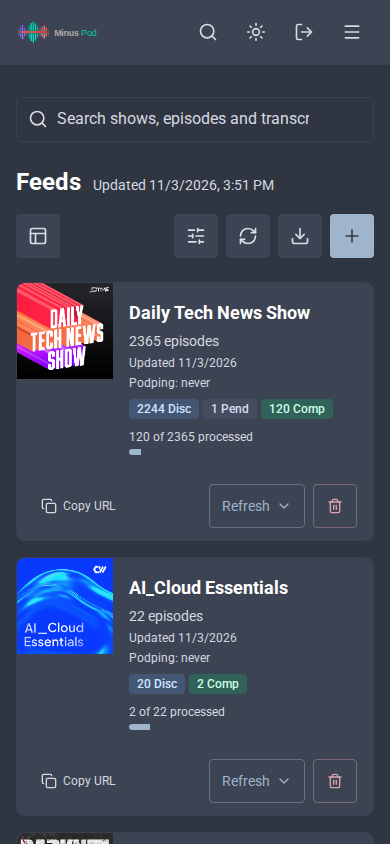</td>
<td align="center" valign="top">keine Medien veröffentlicht</td>
</tr></table>

🤖 <b><a href="https://github.com/malevrigns/agent-jev">malevrigns/agent-jev</a></b> · ⭐396 · Python · 🔎 inferred · 6 天 · ⭐-2

##### 📝 Zusammenfassung

AgentJev-0.6B – ein schnelles 'System One'-Entscheidungsmodell für KI-Agenten: Beliebige unstrukturierte Zustände (Diffs, Traces, Logs) und strukturierte Fragen eingeben und in einem einzigen Vorwärtsdurchlauf von etwa 50 ms kalibrierte Wahrscheinlichkeitsverteilungen zurückerhalten. Keine Dekodierung von Ausgabetoken.

##### 📌 Basisfakten

| Feld      | Wert                                                 |
| --------- | ---------------------------------------------------- |
| Kategorie | `Agent-Tooling: MCP, Hooks, Gates und Coding-Agents` |
| Beleg     | `inferred`                                           |
| Sprache   | Python                                               |

##### 📊 Daten

| Metrik            | Wert         |
| ----------------- | ------------ |
| Stars             | **396** (-2) |
| Letzter Push      | 2026-10-30   |
| Erstmals gelistet | 2026-10-28   |

🏷 `ai` · `ai-agents` · `ai-tools` · `jev` · `jev-model`

---

<table><tr><th align="center" width="50%">🖼 Bild</th><th align="center" width="50%">🎬 Video</th></tr><tr>
<td align="center" valign="top">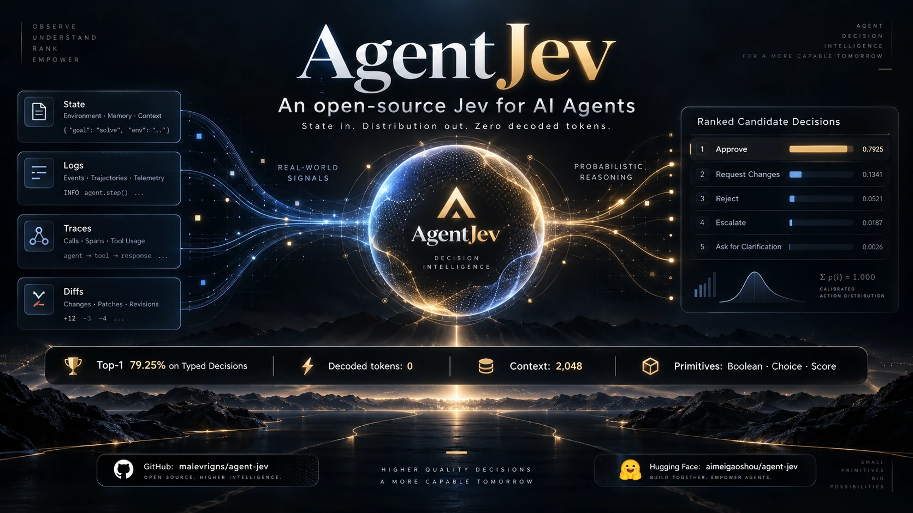</td>
<td align="center" valign="top">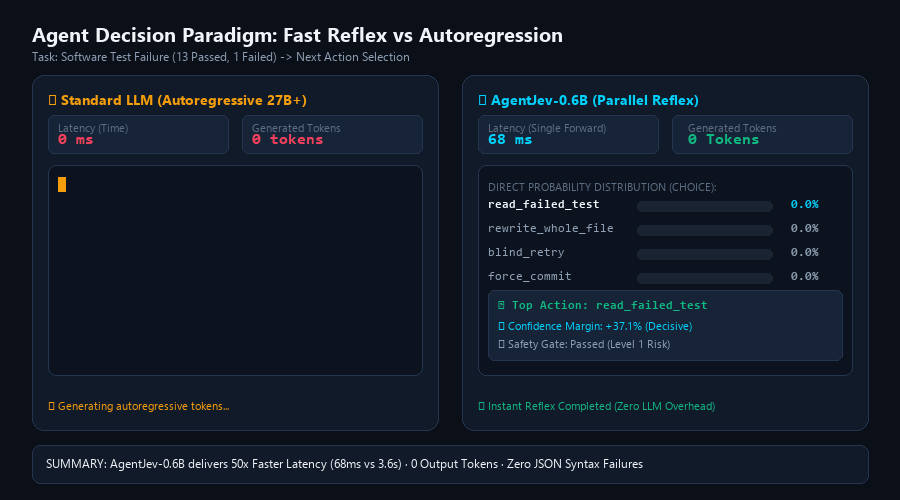 animierte Aufzeichnung</td>
</tr></table>

🤖 <b><a href="https://github.com/Heman10x-NGU/openJev-verdict-2.0">Heman10x-NGU/openJev-verdict-2.0</a></b> · ⭐304 · Python · 🔎 inferred · 14 天 · ⭐-1

##### 📝 Zusammenfassung

Kalibrierte nicht-autoregressive Entscheidungs-Engine mit 151M Parametern, die TypeSafe Jev und Laya auf LocalLLaMA/typed-decisions schlägt (77,10 % Genauigkeit, 0,0636 Brier, 0,0144 ECE)

##### 📌 Basisfakten

| Feld      | Wert                                                 |
| --------- | ---------------------------------------------------- |
| Kategorie | `Agent-Tooling: MCP, Hooks, Gates und Coding-Agents` |
| Beleg     | `inferred`                                           |
| Sprache   | Python                                               |

##### 📊 Daten

| Metrik            | Wert         |
| ----------------- | ------------ |
| Stars             | **304** (-1) |
| Letzter Push      | 2026-10-21   |
| Erstmals gelistet | 2026-09-19   |

🏷 `agentic-ai` · `brier-score` · `calibration` · `decision-engine` · `deep-learning` · `encoder` · `jev` · `machine-learning`

---

<table><tr><th align="center" width="50%">🖼 Bild</th><th align="center" width="50%">🎬 Video</th></tr><tr>
<td align="center" valign="top"></td>
<td align="center" valign="top">keine Medien veröffentlicht</td>
</tr></table>

Asset direkt aus dem Upstream-Repository verlinkt, da keine Lizenz zur Weiterverbreitung angegeben wurde.

<b>Mehr in dieser Kategorie</b> · 181

- [GhalebDweikat/winnow](https://github.com/GhalebDweikat/winnow) - Ein kalibriertes Kontext-Sieb für Claude Code: Jedes Tool-Ergebnis wird von…
- [Nisaka520/JevIntent](https://github.com/Nisaka520/JevIntent) - WeChat (FkWeChat-Plugin): Nachricht lange gedrückt halten, um Absicht /…
- [andyrewlee/awesome-system-one](https://github.com/andyrewlee/awesome-system-one) - Eine Liste von System One-Modellen (auch Entscheidungsmodelle genannt): Jev…
- [Li-Evan/awesome-jev](https://github.com/Li-Evan/awesome-jev) - Die umfassendste Galerie dessen, was Menschen mit Jev, dem von TypeSafe…
- [ChenneyZhuang/laya-browser-agent](https://github.com/ChenneyZhuang/laya-browser-agent) - Lokale Open-Source-Alternative zu Jev: Browser-Agent-Entscheidungen mit Laya…
- [TrustifAI/typed_evals](https://github.com/TrustifAI/typed_evals) - Fast, typed Python framework for Jev-as-a-Judge/Decision-model evaluation for…
- [tiffygk/jev-mode](https://github.com/tiffygk/jev-mode) - Claude Code/Codex skills, evals, harnesses/context tools, and learning…
- [yohanargentina-oss/Foq](https://github.com/yohanargentina-oss/Foq) - ⚡ Foq — die KOSTENLOSE, lokale Open-Source-Alternative zu Jev.
- [mani-aiml/jev-demos](https://github.com/mani-aiml/jev-demos) - Demos mit Jev, dem TypeSafe-System One-Modell, ein Ordner pro Demo.
- [kolawong/fast-compaction-dsh](https://github.com/kolawong/fast-compaction-dsh) - Urteilsbasierte Kontextkomprimierung für DeepSeek Harness – ersetzt…
- [BFLabsAI/bf-jev-deep-research](https://github.com/BFLabsAI/bf-jev-deep-research) - Agenten-Skill + wörtliche Studie über eine Jev (TypeSafe AI System One Model)…
- [Mainakcris7/agent-guardrail-with-jev](https://github.com/Mainakcris7/agent-guardrail-with-jev) - A practical demo of how can we leverage the power of System One Models like Jev…
- [QuaanNguyen/xor](https://github.com/QuaanNguyen/xor) - plugin for OpenCode harness - blocks tool calls outside of scope using a…
- [andrevandal/pi-classifier-tools-skills](https://github.com/andrevandal/pi-classifier-tools-skills) - An extension for pi and Oh My Pi (omp) that classifies each incoming prompt…
- [apex-ronin/DecaFleet-OS](https://github.com/apex-ronin/DecaFleet-OS) - Sovereign 10-Bot Operational Execution Platform &amp; Jev-AI (jev-latest) System…
- [api-evangelist/typesafe-ai](https://github.com/api-evangelist/typesafe-ai) - TypeSafe AI ist ein KI-Labor in San Francisco, das System One-Modelle…
- [CrowBe/weave](https://github.com/CrowBe/weave) - Agenten-Harness für das System One-Modell.
- [gorock007/jev-atlas](https://github.com/gorock007/jev-atlas) - An independent, evidence-first field guide to Jev.
- [gsaini/system-one-models-getting-started](https://github.com/gsaini/system-one-models-getting-started) - TypeSafe.
- [izam-mohammed/decisionsmith](https://github.com/izam-mohammed/decisionsmith) - Use and fine-tune System One models (Jev, Laya) on your data, with an LLM as…
- [JiaWeiXie/jev-enhanced-plugin](https://github.com/JiaWeiXie/jev-enhanced-plugin) - A Claude Code plugin that takes skills already in use and adds one thing to…
- [jms-dcksn/uipath-jev-guardrail-connector](https://github.com/jms-dcksn/uipath-jev-guardrail-connector) - UiPath-Connector nach dem Bring-your-own-Guardrail-Prinzip, unterstützt durch…
- [lucast4049/openjev](https://github.com/lucast4049/openjev) - Führe schnelle, kalibrierte, typisierte Entscheidungen auf offenen System…
- [logicrw/awesome-jev-projects](https://github.com/logicrw/awesome-jev-projects) - Fantastisches Jev: quellengestütztes Radar für Open-Source-Ökosysteme…
- [AnotiaWang/awesome-decision-models](https://github.com/AnotiaWang/awesome-decision-models) - Eine kuratierte Liste von Entscheidungsmodellen.
- [kydlikebtc/awesome-jev](https://github.com/kydlikebtc/awesome-jev) - Launch what you built on Jev, TypeSafe AI.
- [RomanSlack/jev-drone](https://github.com/RomanSlack/jev-drone) - Autonome Drohne in MuJoCo, die ausschließlich Kameradaten nutzt, mit einem…
- [Amal-David/awesome-jev](https://github.com/Amal-David/awesome-jev) - Jev-Demos, Projekte, SDKs und Skills, mit Quelllinks und einer kuratierten…
- [fatwang2/awesome-jev](https://github.com/fatwang2/awesome-jev) - Ein quellenbasiertes Jev-Projektverzeichnis mit einem wiederverwendbaren…
- [OmniJev/OneJev](https://github.com/OmniJev/OneJev) - 🚀🚀 Ein multimodales System One-Entscheidungsmodell, das kalibrierte Antworten…
- [jmagly/aiwg](https://github.com/jmagly/aiwg) - Wiederverwendbarer Projektkontext und Spezialisten-Workflows für die KI-Tools…
- [luobosibing2/dsh-jev-plugin](https://github.com/luobosibing2/dsh-jev-plugin) - Natives DeepSeek Harness (DSH)-Plugin, das TypeSafe Jev oder eine Decision API…
- [ThinkFlowLab/system1-agents](https://github.com/ThinkFlowLab/system1-agents) - System-1-Entscheidungsmodelle (Jev, Laya, Cua-S1) als Gehirn für Agenten…
- [cookiespiggy/agentic-rl](https://github.com/cookiespiggy/agentic-rl) - Agentic-RL-Tutorial für Anfänger ohne Chinesischkenntnisse (33 Kapitel): von…
- [UditAkhourii/quicksilver](https://github.com/UditAkhourii/quicksilver) - Claude-Code-Skill: Übergib umfangreiche Bewertungsentscheidungen an Jev.
- [kyegomez/open-jev](https://github.com/kyegomez/open-jev) - Eine Open-Source-Rekonstruktion der Ideen hinter TypeSafe AI.
- [Shanghua-Gao/RSI-Jev](https://github.com/Shanghua-Gao/RSI-Jev) - Modelle für typisierte Entscheidungen (noul / choice / score), trainiert durch…
- [openlayer-ai/jevals](https://github.com/openlayer-ai/jevals) - Agent-Evaluierungen und Guardrails als Jev-Entscheidungen: eine Anfrage pro…
- [initial-d/ml-quant-trading](https://github.com/initial-d/ml-quant-trading) - PyTorch ML-Quant-Forschung: 213 Faktoren, Bias-Korrektur, Portfoliooptimierung…
- [PerryLink/jevcore](https://github.com/PerryLink/jevcore) - TypeSafe Jev für DeepSeek Harness, das Model Context Protocol und Plain Node…
- [jonathanavis96/jev-kit](https://github.com/jonathanavis96/jev-kit) - Alles, was du zum Ausführen von TypeSafe.
- [charlesdove977/claude-x-jev](https://github.com/charlesdove977/claude-x-jev) - Schnelle, günstige, typisierte Entscheidungen für Claude Code.
- [akivet/Mica](https://github.com/akivet/Mica) - A 4B decision model: calibrated probabilities for yes/no, choice and score…
- [yikangy873-gif/jev-desktop](https://github.com/yikangy873-gif/jev-desktop) - Auswahl von TypeSafe Jev-Aktionen innerhalb von Codex Computer Use.
- [iamaamir/system-one](https://github.com/iamaamir/system-one) - Anbieterneutrale System One-Laufzeitumgebung für TypeScript und Pi.
- [TheoOliveira/pi-jev](https://github.com/TheoOliveira/pi-jev) - Semantisches Tool-Routing und typisierte System One-Entscheidungen für den…
- [alanhuangyoo/OpenJev](https://github.com/alanhuangyoo/OpenJev) - OpenJev: quelloffene, lokale Alternative zu Jev.
- [chuloontop4-code/jev-instance-review](https://github.com/chuloontop4-code/jev-instance-review) - Bester Roblox Studio Instance Reviewer 2026: typisierte Jev Kriterien und…
- [shitianfang/jev-use](https://github.com/shitianfang/jev-use) - Claude Code- / Codex- / pi-Plugin, das Agentenschritte ohne erforderliche…
- [lawrence3699/jev-style](https://github.com/lawrence3699/jev-style) - JevStyle: local decision models for AI agents.
- [FrancoisChastel/jev-code](https://github.com/FrancoisChastel/jev-code) - Jev, der System One-Klassifikator von TypeSafe, als Tool in Claude Code, Codex…
- [alexei-led/claude-router](https://github.com/alexei-led/claude-router) - Claude-Code-Plugin, das für jeden Durchlauf Modell und Aufwand auswählt…
- [everyinfra/jev-radar](https://github.com/everyinfra/jev-radar) - 📡 The most rigorously verified tracker of the Jev (TypeSafe AI System One)…
- [AskTheWay/dsh-jev-interceptor](https://github.com/AskTheWay/dsh-jev-interceptor) - ⚡ Beurteilung jedes Tool-Aufrufs in DeepSeek Harness mit…
- [jomatsu/pi-jev-auto-mode](https://github.com/jomatsu/pi-jev-auto-mode) - Von Jev (TypeSafe System One) unterstützter Automatikmodus für den…
- [abhishek085/open-spark-jev](https://github.com/abhishek085/open-spark-jev) - Open-Source-Entscheidungsmodelle für den lokalen Einsatz, inspiriert von…
- [NekomyaDev/nudge](https://github.com/NekomyaDev/nudge) - Eine typisierte, wiedergabefähige und budgetbewusste Programmiersprache für…
- [anandi1989/awesome-jev-usecases](https://github.com/anandi1989/awesome-jev-usecases) - Evidenzbasierter Index realer Jev-(TypeSafe AI-System One)-Anwendungsfälle…
- [Singularity-Compute/super-decider](https://github.com/Singularity-Compute/super-decider) - Decisions, not essays: a choice, a yes or no, or a score with a calibrated…
- [paramjeetn/jev-cookbook](https://github.com/paramjeetn/jev-cookbook) - Das vollständige Kochbuch für Jev von TypeSafe AI — über 120 Anwendungsfälle…
- [1arley/jev-advisor-gateway](https://github.com/1arley/jev-advisor-gateway) - Local gateway that routes coding-agent tool decisions through Jev and can…
- [muxso/Shepherd](https://github.com/muxso/Shepherd) - Shepherd is an end-to-end AI Software Engineering platform that supervises the…
- [sunyasheng/JevGPT](https://github.com/sunyasheng/JevGPT) - JevGPT: Schnell und langsam denken in der autonomen Forschung.
- [daftAI2026/awesome-jev](https://github.com/daftAI2026/awesome-jev) - Kuratierte TypeSafe-Jev- / System One-GitHub-Projekte, Open-Source-Alternativen…
- [vicfei/awesome-jev-prompts](https://github.com/vicfei/awesome-jev-prompts) - Question patterns, anti-patterns &amp; calibration notes for typed decision models…
- [ajensenwaud/hermes-jev-plugin](https://github.com/ajensenwaud/hermes-jev-plugin) - TypeSafe-Jev-(System One)-Entscheidungstools für Hermes Agent: jev_check /…
- [caiovicentino/jev-risk-check-provider](https://github.com/caiovicentino/jev-risk-check-provider) - x402 risk-check provider: signed pre-payment verdicts — OFAC, phishing feeds…
- [mas-bandwidth/nova-sprint](https://github.com/mas-bandwidth/nova-sprint) - Coordinate AI sprints across different models, harnesses and machines.
- [zhangxaochen/dsh-jev](https://github.com/zhangxaochen/dsh-jev) - Jev-(System One-Entscheidungsmodell)-Plugin-Suite für DeepSeek Harness (dsh).
- [ronitgupta138/Local-Jev](https://github.com/ronitgupta138/Local-Jev) - ⚡ 100% offline, zero-cost drop-in alternative to TypeSafe Jev System One…
- [alexei-led/pi-model-router](https://github.com/alexei-led/pi-model-router) - Independent Pi extension for four-tier model routing with optional…
- [anisselbd/jev-phishing-bench](https://github.com/anisselbd/jev-phishing-bench) - Jev (TypeSafe) vs Claude Haiku 4.5 on 2,000 phishing emails: accuracy…
- [SergeyBazhmin/krasivo-jev](https://github.com/SergeyBazhmin/krasivo-jev) - Training data and models for &quot;system one&quot; classifiers: one forward pass, no…
- [frontierlabai/JevHub](https://github.com/frontierlabai/JevHub) - JevHub · Jev 生态热榜 把值得关注的 Jev 项目、教程和讨论，汇到一页。 自动发现 · 每日更新 · 按 Stars 排序 · 中英双语.
- [inso1337/revl](https://github.com/inso1337/revl) - Eine Sprache für sichere, universelle raumzeitliche Kombinierbarkeit…
- [Jessie-QingYu/jev-in-the-wild](https://github.com/Jessie-QingYu/jev-in-the-wild) - Praxisnahe Jev-Anwendungsfälle, Open-Source-Projekte, Benchmarks und Kritik…
- [jmrenouard/MicroLLM](https://github.com/jmrenouard/MicroLLM) - Local Hybrid System-One Decision Engine.
- [ranjan2829/AskJev](https://github.com/ranjan2829/AskJev) - AskJev — Jev-Autopilot für jede Website plus Schutz bei irreversiblen Klicks…
- [Civalski/claujev](https://github.com/Civalski/claujev) - Jev (TypeSafe AI) as a second pair of eyes for Claude Code: request triage…
- [coderexpert123/jev-browser-wingman](https://github.com/coderexpert123/jev-browser-wingman) - Browser automation where TypeSafe.
- [FazalAAli/jev-robotics-demo](https://github.com/FazalAAli/jev-robotics-demo) - Jev (TypeSafe System One) im Vergleich zu Claude Opus 5 beim Steuern eines…
- [legostin/jev-mcp](https://github.com/legostin/jev-mcp) - MCP server that lets Claude Code, Codex &amp; AI agents drive a real Chrome browser…
- [reacher-z/Awesome-Jev](https://github.com/reacher-z/Awesome-Jev) - Curated Jev and System One papers, models, datasets, benchmarks and SDKs, with…
- [7starsseeker/dsh-fact-check](https://github.com/7starsseeker/dsh-fact-check) - Fact-checking skill for DeepSeek Harness: multi-source verification against the…
- [8itlab/reflex-computer-use](https://github.com/8itlab/reflex-computer-use) - Computer use MCP server for Claude Code, Codex and other AI agents.
- [agentscope-ai/HarnessJevBench](https://github.com/agentscope-ai/HarnessJevBench) - Benchmarking Jev-style models at agent harness decision points.
- [King4s/Jev-AI-Skill](https://github.com/King4s/Jev-AI-Skill) - One AI skill + MCP server for Claude Code, Codex and Hermes: Jev (TypeSafe)…
- [MongLong0214/jev-gate](https://github.com/MongLong0214/jev-gate) - Nicht jede Coding-Aufgabe braucht dein bestes Modell.
- [nanami-0713/dsh-jev-decide](https://github.com/nanami-0713/dsh-jev-decide) - DSH-Plugin: TypeSafe Jev (System One-Entscheidungsmodell) als Agenten-Tool…
- [simota/tenbin](https://github.com/simota/tenbin) - MCP-Server und Agenten-Skill für TypeSafe AI System One API (Jev): Eine…
- [supermanc417-alt/awesome-jev-hub](https://github.com/supermanc417-alt/awesome-jev-hub) - Ein kuratierter Knotenpunkt des Jev-/TypeSafe-Modellökosystems „System One“…
- [ardana-ai/ardana](https://github.com/ardana-ai/ardana) - Run System 1 decision models locally. Pull a model by name and get calibrated…
- [deepansh-saxena/jev-guardrails](https://github.com/deepansh-saxena/jev-guardrails) - Vergleich von LLM als Richter mit TypeSafe Jev für Agenten-Schutzmaßnahmen…
- [gordan-code/dsh-jev-advisor](https://github.com/gordan-code/dsh-jev-advisor) - Jev (TypeSafe System One) gibt dem Menschen eine zweite Meinung, nicht dem…
- [holny/evolve-router](https://github.com/holny/evolve-router) - Stop burning premium model tokens on simple prompts. Save tokens.
- [robokrunch/awesome-jev](https://github.com/robokrunch/awesome-jev) - Eine kuratierte Ressourcenliste für Jev — das System One-Entscheidungsmodell…
- [SoniaMehta14/paved-gate](https://github.com/SoniaMehta14/paved-gate) - Schnelles System-1-Eingangstor für KI-Agentenarchitekturen: typisierte…
- [tinypi-extension/tinysubagent](https://github.com/tinypi-extension/tinysubagent) - Minimales herdr-natives Spawning von Subagenten für pi…
- [guanghuang/coding-router-jev](https://github.com/guanghuang/coding-router-jev) - TypeScript/Bun launcher routing Codex turns through JEV with model and…
- [jms-dcksn/jev-pii-guardrail](https://github.com/jms-dcksn/jev-pii-guardrail) - Ein UiPath-Coding-Agent mit benutzerdefinierter PII-Erkennung als…
- [rahilmavani/piedpiper-jev-buildathon](https://github.com/rahilmavani/piedpiper-jev-buildathon) - Team piedpiper: failproofai + Jev-Guardrails, die verhindern, dass der Helix IT…
- [173787247/dsh-wsl-jev](https://github.com/173787247/dsh-wsl-jev) - DeepSeek Harness WSL plugin: TypeSafe Jev / OpenRouter System One.
- [17671454333/jev-cognitive-mcp](https://github.com/17671454333/jev-cognitive-mcp) - 3+1 Cognitive Hierarchy Toolkit &amp; Model Context Protocol (MCP) Server for…
- [2426269/ComfyUI-Jev-Decision](https://github.com/2426269/ComfyUI-Jev-Decision) - ComfyUI semantic judgement node: Noul/Choice/Score, typed outputs, workflows…
- [a742987/JevLens](https://github.com/a742987/JevLens) - Jev decision visualisation and debugging panel for coding agents.
- [bhanuprakashk90-tech/jev-agent-guardrail](https://github.com/bhanuprakashk90-tech/jev-agent-guardrail) - Ein Echtzeit-Sicherheits-Guardrail und interaktives Monitoring-Dashboard für…
- [bismawy/pi-jev-eye](https://github.com/bismawy/pi-jev-eye) - Ultra-schlanker Supervisor für Pi: Zero-Token-Regex-Guardrails…
- [charetterat/awesome-jev-essentials](https://github.com/charetterat/awesome-jev-essentials) - Die Jev-Projekte, die deine Zeit tatsächlich wert sind — ausgewählt…
- [d0ng231/jev-gtw](https://github.com/d0ng231/jev-gtw) - JEV Gateway: PII/PHI guardrails for coding agents.
- [DarkisuSu/Jev-Claude-Router](https://github.com/DarkisuSu/Jev-Claude-Router) - Ein von Jev betriebenes Modell-Routing- und Skill-Auswahl-MOD für Claude.
- [edamlabs/e-jev](https://github.com/edamlabs/e-jev) - A self-hosted Jev with a pluggable decision-backend fleet — typed, calibrated…
- [eshitakundu/jev-flow](https://github.com/eshitakundu/jev-flow) - Support-triage inbox where an LLM answers typed questions and a deterministic…
- [Faizullah9181/jev-esketcher](https://github.com/Faizullah9181/jev-esketcher) - Generative Painting-Canvas, bei dem Jev, das kalibrierte Entscheidungsmodell…
- [frederico-kluser/jev-agent-skill](https://github.com/frederico-kluser/jev-agent-skill) - Typisierte Entscheidungen in Millisekunden mit Jev (System One von TypeSafe)…
- [hectorj2f/jev-router](https://github.com/hectorj2f/jev-router) - Route Claude Code subagents to the right Anthropic model per task, using…
- [jbatra-umeey/jev-decisionops](https://github.com/jbatra-umeey/jev-decisionops) - Sechs Jev-Entscheidungs-Workflows für agentische KI: Modellrouting…
- [JoaoClemer/jev-lab](https://github.com/JoaoClemer/jev-lab) - Der Jev (TypeSafe AI) als Echtzeit-Guardrail und als Vorbewerter von…
- [keiffff/jev-kit](https://github.com/keiffff/jev-kit) - Jev toolkit for building fast, testable AI decision points for agent…
- [kitoutou999/firefox-jev-mcp](https://github.com/kitoutou999/firefox-jev-mcp) - Serveur MCP pour piloter Firefox avec Claude : Jev (TypeSafe) choisit les…
- [lijiawei255/jev-tune](https://github.com/lijiawei255/jev-tune) - Jev-inspired calibrated decision &amp; safety shell for typed PID autotuning…
- [majiayu000/awesome-jev](https://github.com/majiayu000/awesome-jev) - Eine kuratierte Liste von Jev / TypeSafe System One-Projekten, SDKs, Tutorials…
- [Thneoly/r2r-jev](https://github.com/Thneoly/r2r-jev) - Persistent governance for AI agents — turn Jev judgments into replayable…
- [zhuyansen/awesome-typesafe-jev](https://github.com/zhuyansen/awesome-typesafe-jev) - Open-Source-Projekte, die auf TypeSafes Jev Entscheidungsmodell aufgebaut sind…
- [01Joseph-Hwang10/pi-jev-router-pro](https://github.com/01Joseph-Hwang10/pi-jev-router-pro) - Single-surface TypeSafe Jev model router for the Pi coding agent: one virtual…
- [abyakod/JEV_ADK](https://github.com/abyakod/JEV_ADK) - Agent Development Kit für System-One AI: nicht-autoregressive…
- [aleksvega/jev-stack](https://github.com/aleksvega/jev-stack) - Ein Befehl (npx jev-stack), um das von Jev betriebene Agenten-Toolset zu…
- [AlienXc137/Support-Ticket-Ai-Agent-with-RAG-Guardrails-and-Jev](https://github.com/AlienXc137/Support-Ticket-Ai-Agent-with-RAG-Guardrails-and-Jev) - Ein Agent, der eingehende Anfragen von Studierenden liest…
- [antirepas/GoGoJevMCP](https://github.com/antirepas/GoGoJevMCP) - This is a small side project where I built an MCP server with a collection of…
- [ashp15205/jev-laya-system-1](https://github.com/ashp15205/jev-laya-system-1) - jev-laya-system-1: Security &amp; calibration middleware for System 1 AI models…
- [bpmforbusiness/jev-agent-harness](https://github.com/bpmforbusiness/jev-agent-harness) - Leitfaden zum Jev-Agenten-Harness (TypeSafe AI System One) plus Videoanleitung…
- [cameronb-xano/jev-agent-guardrail](https://github.com/cameronb-xano/jev-agent-guardrail) - Xano-Template: Jev Agent-Tool-Call-Guardrail. Jev entscheidet, Xano setzt durch.
- [Caph-dev/pi-jev-router](https://github.com/Caph-dev/pi-jev-router) - Jev-routed two-phase virtual model for pi: plan on a strong model, implement on…
- [castorhrio/jev-pi-agent](https://github.com/castorhrio/jev-pi-agent) - Multi-agent coding workbench — hashed context injection, explainable routing…
- [chaoguang668/dsh-jev-screen](https://github.com/chaoguang668/dsh-jev-screen) - Jev-powered semantic pre-screening for local files in DeepSeek Harness: code…
- [Covre81/jev-router](https://github.com/Covre81/jev-router) - Local Anthropic-compatible gateway that routes Claude Code traffic across…
- [davidpobi/JevTown](https://github.com/davidpobi/JevTown) - An Interactive Collection Of AI Game Worlds Where Typesafe Jev Agents Choose…
- [eduardo-xyz/jev-browser-mcp](https://github.com/eduardo-xyz/jev-browser-mcp) - MCP tool exposing TypeSafe.
- [forrestneo/jev-sim](https://github.com/forrestneo/jev-sim) - jev-sim: Jev-artige typisierte Entscheidungen (Choice/Noul/Score) im…
- [GilBar2/jev-orchestration](https://github.com/GilBar2/jev-orchestration) - Route coding tasks between Claude Code, Codex and Hermes: pattern, model and…
- [HangChi/JevRouter](https://github.com/HangChi/JevRouter) - 让 LLM 理解任务、让 Jev 做带概率的路由决策、再由显式策略控制执行的 Agent 运行时：Jev 决定下一步，策略引擎决定能不能执行.
- [hdjekuue/awesome-jev](https://github.com/hdjekuue/awesome-jev) - Das sich selbst aktualisierende, dreisprachige Verzeichnis von allem, was auf…
- [HKUST-KnowComp/jev-guardrail](https://github.com/HKUST-KnowComp/jev-guardrail) - Bearbeitbare Richtlinienbäume und ein 2B-Klassifikator zur Prüfung von…
- [hojeongna/jev-agent-memory](https://github.com/hojeongna/jev-agent-memory) - No vector DB. A fast decision model routes and picks your agent.
- [iamdgarcia/jev-mini-bench](https://github.com/iamdgarcia/jev-mini-bench) - Taschen-Explorer der winzigen Welle von Entscheidungsmodellen.
- [jipika/dsh-jev-grep](https://github.com/jipika/dsh-jev-grep) - Search-Flood-Adjudication-Plugin für DeepSeek Harness: ripgrep + TypeSafe Jev…
- [kevinyin9/next-steps-jev](https://github.com/kevinyin9/next-steps-jev) - Suggested next steps for Claude Code, scored by how much each one helps your…
- [kkwelfare/jev-route-screening-public](https://github.com/kkwelfare/jev-route-screening-public) - Experimentelles Hermes-Agent-Plugin für begrenzte Jev-Prüfpunkte und beratende…
- [liyifan2004/obsidian-jev-inbox-router](https://github.com/liyifan2004/obsidian-jev-inbox-router) - Obsidian plugin: route incoming notes to the right folder using JEV.
- [Mfrostbutter/jev-n8n-patterns](https://github.com/Mfrostbutter/jev-n8n-patterns) - Jev-(TypeSafe System One)-Muster in n8n: PII-Prüfung, Schutzmechanismen für…
- [MichelePolo/jev-mcp](https://github.com/MichelePolo/jev-mcp) - MCP-Server, der Jev-artige System One-Entscheidungsmodelle.
- [miketropi/pi-jev-model-manager](https://github.com/miketropi/pi-jev-model-manager) - Pi coding agent extension: Jev-powered model routing with a native TUI model…
- [mxttbennett/jev-relay](https://github.com/mxttbennett/jev-relay) - Per-task Jev routing for Claude Code and Codex: inline, subagent or sibling…
- [PeriodBLUE/jev-project-atlas](https://github.com/PeriodBLUE/jev-project-atlas) - A source-verified atlas of GitHub projects built with JEV / TypeSafe System One.
- [QuesoMan/jev-router](https://github.com/QuesoMan/jev-router) - Claude Code mod: routes every turn, subagent and ultracode workflow agent to a…
- [royalskynet/jev-gate-lite](https://github.com/royalskynet/jev-gate-lite) - Jev Gate without the local Laya lane: MCP judgment tools, tool-output pruning…
- [Sandesh-S-Dalvi/playwright-jev-testing-refactored](https://github.com/Sandesh-S-Dalvi/playwright-jev-testing-refactored) - Goal-driven Playwright E2E testing where TypeSafe Jev (System One) decides the…
- [shahshahdab/fastcampus-jev](https://github.com/shahshahdab/fastcampus-jev) - Learn to gate tool calls, guardrails, and risky actions with Jev judgment plus…
- [skylence-org/claudecode-jev-marketplace](https://github.com/skylence-org/claudecode-jev-marketplace) - TypeSafe Jev (System One) wired into Claude Code: a decision primitive for…
- [thejasrao262003/jev-compositional-uncertainty](https://github.com/thejasrao262003/jev-compositional-uncertainty) - Research on whether AI decision workflows can trust and combine uncertainty…
- [tmbmartell/jev-mcp](https://github.com/tmbmartell/jev-mcp) - Servidor MCP que expõe o Jev (TypeSafe System One) como ferramenta de…
- [veermshah/jev-calibration-lab](https://github.com/veermshah/jev-calibration-lab) - Independent calibration benchmark for System One decision models (TypeSafe Jev)…
- [vinaychawla-ops/jev-adk-guardrail-example](https://github.com/vinaychawla-ops/jev-adk-guardrail-example) - Jev (TypeSafe Entscheidungsmodell) als Risiko-Leitplanke innerhalb des…
- [WaynezProg/jev-kit](https://github.com/WaynezProg/jev-kit) - Source-bound evidence checks and bounded Jev judgments for coding agents via…
- [wendyeq/dsh-jev-router](https://github.com/wendyeq/dsh-jev-router) - Optional session-pinned Jev routing plugin for DeepSeek Harness.
- [Wrenik/jev-toolkit](https://github.com/Wrenik/jev-toolkit) - Experiment: a judgement model (TypeSafe Jev) next to Claude.
- [xano-community/agent-guardrail-jev](https://github.com/xano-community/agent-guardrail-jev) - KI-Agent-Tool-Aufruf-Schutz für Xano: Jev (TypeSafe AI) bewertet jeden Aufruf;
- [xiaoyaner0201/hermes-jev-thread-status](https://github.com/xiaoyaner0201/hermes-jev-thread-status) - Jev-powered Discord thread status titles for Hermes Agent: \[Running\] →…
- [yangzhou-chaofan/awesome-jev-prompt](https://github.com/yangzhou-chaofan/awesome-jev-prompt) - Die neuesten Top-100-Schauprojekte für jev (wird laufend aktualisiert) aus x /…
- [Yomiamy/jev-mobile-mcp](https://github.com/Yomiamy/jev-mobile-mcp) - ein mcp von jev decision und ocr-Erkennung für Gerätetests.
- [ZeroX-01/jev-atlas](https://github.com/ZeroX-01/jev-atlas) - Kontinuierlich aktualisierter öffentlicher Index realer TypeSafe JEV-Projekte…
- [notque/vexjoy-agent](https://github.com/notque/vexjoy-agent) - VexJoy-KI-Agent mit intelligenter Jev-Weiterleitung – /do leitet Anfragen in…
- [itsmostafa/system-one-connector](https://github.com/itsmostafa/system-one-connector) - System One-MCP-Connector zur schnellen und günstigen Bewertung beliebiger…
- [keeltrace/hermes-nerve](https://github.com/keeltrace/hermes-nerve) - Nerve ist ein überwachendes Nervensystem für Hermes-Agenten, das typisierte…
- [everafterlabs/jes](https://github.com/everafterlabs/jes) - Open-Source-Schutzvorkehrungen für KI-Agenten, die von Entscheidungsmodellen…
- [darwintechlab/openjev](https://github.com/darwintechlab/openjev) - OpenJev: Ein Opencode-Plugin, das Entscheidungen zur Textgenerierung durch Jev…
- [47vigen/catherd](https://github.com/47vigen/catherd) - Herds coding agents: autopilot builds from your own Claude Code session…
- [tamnd/kime](https://github.com/tamnd/kime) - Typed decisions over text in milliseconds.
- [kaustav1996/reflex](https://github.com/kaustav1996/reflex) - A coding agent and personal assistant with System One reflexes (TypeSafe Jev)…
- [laxtiz/opencode-vllm-sr-auth](https://github.com/laxtiz/opencode-vllm-sr-auth) - vLLM-SR Decision — System One decision models (choice/noul/score/box) for…
- [patronus-protect/decision-model-guard](https://github.com/patronus-protect/decision-model-guard) - Guardrails for decision models: stop text inside the content from steering…
- [chaosxingxc-orion/nga](https://github.com/chaosxingxc-orion/nga) - NGA (Next Generation Agent) on openJiuwen: Jev-like decision models, S1 + S2…

## Routing, Guardrails und Freigaben

Der produktionsnahe Anwendungsfall: jede Anfrage an das günstigste Modell schicken, das sie tatsächlich bewältigen kann, und das Ergebnis deterministisch prüfen.

🛡️ <b><a href="https://github.com/HarnessRouter/SystemOneHarness">HarnessRouter/SystemOneHarness</a></b> · ⭐206 · Python · 👁️ observed · 45 天

##### 📝 Zusammenfassung

Das System One-Harness für System One-Modelle. Führe Jev und andere System One-Modelle lokal oder direkt auf HarnessRouter.ai aus.

🔧 Im Code verwendet: `docs/design.md`

##### 📌 Basisfakten

| Feld      | Wert                                |
| --------- | ----------------------------------- |
| Kategorie | `Routing, Guardrails und Freigaben` |
| Beleg     | `observed`                          |
| Sprache   | Python                              |

##### 📊 Daten

| Metrik            | Wert       |
| ----------------- | ---------- |
| Stars             | **206**    |
| Letzter Push      | 2026-09-21 |
| Erstmals gelistet | 2026-10-28 |

🏷 `harness` · `harness-engineering` · `system-one-harness` · `system-one-models`

🛡️ <b><a href="https://github.com/Dicklesworthstone/skillranker">Dicklesworthstone/skillranker</a></b> · ⭐139 · Rust · 👁️ observed · 16 天

##### 📝 Zusammenfassung

Rust CLI, unterstützt von Jev von TypeSafe.ai, das Agentenfähigkeiten für den nächsten Schritt anhand des Live-Sitzungskontexts einstuft. Enthält Claude-Code-Hooks, strukturiertes JSON, Enthaltung und lokales Feedback. Erfordert einen TypeSafe-API-Schlüssel.

> 💡 Bewertet Agentenfähigkeiten mit einer typisierten Entscheidung. Ein nützliches Modell für jedes Problem nach dem Muster „Wähle aus N Kandidaten

🔧 Im Code verwendet: `README.md`

##### 📌 Basisfakten

| Feld      | Wert                                |
| --------- | ----------------------------------- |
| Kategorie | `Routing, Guardrails und Freigaben` |
| Beleg     | `observed`                          |
| Sprache   | Rust                                |

##### 📊 Daten

| Metrik            | Wert       |
| ----------------- | ---------- |
| Stars             | **139**    |
| Letzter Push      | 2026-10-19 |
| Erstmals gelistet | 2026-10-29 |

🏷 `agent-skills` · `ai-agents` · `asupersync` · `claude-code` · `cli` · `developer-tools` · `frankentui` · `jev`

🛡️ <b><a href="https://github.com/Sarim-MBZUAI/awesome-jev-security">Sarim-MBZUAI/awesome-jev-security</a></b> · ⭐7 · 👁️ observed · 14 天

##### 📝 Zusammenfassung

Curated list of papers on the security, robustness, and safety of TypeSafe Jev / System One models

##### 📌 Basisfakten

| Feld      | Wert                                |
| --------- | ----------------------------------- |
| Kategorie | `Routing, Guardrails und Freigaben` |
| Beleg     | `observed`                          |

##### 📊 Daten

| Metrik            | Wert       |
| ----------------- | ---------- |
| Stars             | **7**      |
| Letzter Push      | 2026-10-22 |
| Erstmals gelistet | 2026-10-28 |

🛡️ <b><a href="https://github.com/dharmeshgurnani/CodeOtter">dharmeshgurnani/CodeOtter</a></b> · ⭐3 · JavaScript · 👁️ observed · 0 天

##### 📝 Zusammenfassung

Autonome, selbst gehostete KI-Code-Reviews, kalibrierte Bewertungsanzeigen und Merge-Gates von jedem Open Model.

##### 📌 Basisfakten

| Feld      | Wert                                |
| --------- | ----------------------------------- |
| Kategorie | `Routing, Guardrails und Freigaben` |
| Beleg     | `observed`                          |
| Sprache   | JavaScript                          |

##### 📊 Daten

| Metrik            | Wert       |
| ----------------- | ---------- |
| Stars             | **3**      |
| Letzter Push      | 2026-11-05 |
| Erstmals gelistet | 2026-11-01 |

🏷 `ai-code-review` · `code-review` · `coderabbit` · `developer-tools` · `devops` · `forgejo` · `gguf` · `gitea`

---

<table><tr><th align="center" width="50%">🖼 Bild</th><th align="center" width="50%">🎬 Video</th></tr><tr>
<td align="center" valign="top"></td>
<td align="center" valign="top">keine Medien veröffentlicht</td>
</tr></table>

🛡️ <b><a href="https://github.com/baldellimtt/systemone-lab">baldellimtt/systemone-lab</a></b> · ⭐2 · HTML · 👁️ observed · 3 天

##### 📝 Zusammenfassung

Hands-on System One decision lab: Jev-compatible Noul/Choice/Score over local open-weight Laya, with playground UI, routing/eval examples, and CI smoke tests.

##### 📌 Basisfakten

| Feld      | Wert                                |
| --------- | ----------------------------------- |
| Kategorie | `Routing, Guardrails und Freigaben` |
| Beleg     | `observed`                          |
| Sprache   | HTML                                |

##### 📊 Daten

| Metrik            | Wert       |
| ----------------- | ---------- |
| Stars             | **2**      |
| Letzter Push      | 2026-11-02 |
| Erstmals gelistet | 2026-11-02 |

🏷 `calibrated-probabilities` · `jev` · `laya` · `system-one-models` · `typed-decisions` · `typesafe`

---

<table><tr><th align="center" width="50%">🖼 Bild</th><th align="center" width="50%">🎬 Video</th></tr><tr>
<td align="center" valign="top"></td>
<td align="center" valign="top">keine Medien veröffentlicht</td>
</tr></table>

🛡️ <b><a href="https://github.com/alperenerol/jev-1.13-mini-benchmark">alperenerol/jev-1.13-mini-benchmark</a></b> · ⭐1 · Python · 👁️ observed · 37 天

##### 📝 Zusammenfassung

Kleiner Benchmark von TypeSafes strukturiertem Entscheidungsmodell jev-1.13 (OpenRouter Decisions API) zur gekennzeichneten Support-Triage: noul/choice/score, Konsistenz, Kosten, gewonnene Erkenntnisse

##### 📌 Basisfakten

| Feld      | Wert                                |
| --------- | ----------------------------------- |
| Kategorie | `Routing, Guardrails und Freigaben` |
| Beleg     | `observed`                          |
| Sprache   | Python                              |

##### 📊 Daten

| Metrik            | Wert       |
| ----------------- | ---------- |
| Stars             | **1**      |
| Letzter Push      | 2026-09-29 |
| Erstmals gelistet | 2026-11-01 |

🛡️ <b><a href="https://github.com/aosus/mirsad">aosus/mirsad</a></b> · ⭐1 · Rust · 👁️ observed · 2 天

##### 📝 Zusammenfassung

bot for matrix spam filtering using system one models.

##### 📌 Basisfakten

| Feld      | Wert                                |
| --------- | ----------------------------------- |
| Kategorie | `Routing, Guardrails und Freigaben` |
| Beleg     | `observed`                          |
| Sprache   | Rust                                |

##### 📊 Daten

| Metrik            | Wert       |
| ----------------- | ---------- |
| Stars             | **1**      |
| Letzter Push      | 2026-11-03 |
| Erstmals gelistet | 2026-11-03 |

🛡️ <b><a href="https://github.com/Dominion-Academy/System-One-Models">Dominion-Academy/System-One-Models</a></b> · Python · 👁️ observed · 0 天

##### 📝 Zusammenfassung

Code for a course on System One models (Jev, Kev, Laya): LLMs that answer with a choice and a probability instead of free text. Build a support-ticket triage service with Choice, Score and Noul questions, check whether the confidence can be trusted, set thresholds, and run it in production.

##### 📌 Basisfakten

| Feld      | Wert                                |
| --------- | ----------------------------------- |
| Kategorie | `Routing, Guardrails und Freigaben` |
| Beleg     | `observed`                          |
| Sprache   | Python                              |

##### 📊 Daten

| Metrik            | Wert       |
| ----------------- | ---------- |
| Stars             | **0**      |
| Letzter Push      | 2026-11-05 |
| Erstmals gelistet | 2026-11-04 |

🏷 `calibration` · `jev` · `kev` · `laya` · `python` · `system-design` · `system-one` · `system-one-models`

🛡️ <b><a href="https://github.com/nani-stack/gmail-auto-cleanup">nani-stack/gmail-auto-cleanup</a></b> · Python · 👁️ observed · 3 天

##### 📝 Zusammenfassung

Triage your Gmail inbox with a System One model (Jev or Laya): typed yes/no judgements, probabilities, and reversible actions.

##### 📌 Basisfakten

| Feld      | Wert                                |
| --------- | ----------------------------------- |
| Kategorie | `Routing, Guardrails und Freigaben` |
| Beleg     | `observed`                          |
| Sprache   | Python                              |

##### 📊 Daten

| Metrik            | Wert       |
| ----------------- | ---------- |
| Stars             | **0**      |
| Letzter Push      | 2026-11-02 |
| Erstmals gelistet | 2026-11-02 |

🏷 `ai` · `automation` · `email` · `email-classification` · `gmail` · `inbox-zero` · `jev` · `laya`

🛡️ <b><a href="https://github.com/NandhaKishorM/laya">NandhaKishorM/laya</a></b> · ⭐35052 · Python · 🔎 inferred · 0 天 · ⭐+31

##### 📝 Zusammenfassung

Nicht-autoregressive System-1-Entscheidungs-Engine. Typisierte Auswahl-, Bewertungs- und Ja/Nein-Entscheidungen über beliebigen Text in einem einzigen Forward Pass, in über 100 Sprachen, mit einem Router, der pro Anfrage den richtigen Checkpoint auswählt.

##### 📌 Basisfakten

| Feld      | Wert                                |
| --------- | ----------------------------------- |
| Kategorie | `Routing, Guardrails und Freigaben` |
| Beleg     | `inferred`                          |
| Sprache   | Python                              |

##### 📊 Daten

| Metrik            | Wert            |
| ----------------- | --------------- |
| Stars             | **35052** (+31) |
| Letzter Push      | 2026-11-05      |
| Erstmals gelistet | 2026-09-23      |

🏷 `calibration` · `classification` · `decision-model` · `huggingface` · `jev` · `modernbert` · `multilingual` · `nlp`

---

<table><tr><th align="center" width="50%">🖼 Bild</th><th align="center" width="50%">🎬 Video</th></tr><tr>
<td align="center" valign="top"></td>
<td align="center" valign="top">keine Medien veröffentlicht</td>
</tr></table>

🛡️ <b><a href="https://github.com/slavabars/decision-cascade">slavabars/decision-cascade</a></b> · ⭐77 · Python · 🔎 inferred · 7 天 · ⭐-1

##### 📝 Zusammenfassung

Local decision engine with typed, calibrated outputs (Noul/Choice/Score): cheap→strong cascade, ECE/Brier calibration, SystemOne protocol interop. Apache-2.0.

##### 📌 Basisfakten

| Feld      | Wert                                |
| --------- | ----------------------------------- |
| Kategorie | `Routing, Guardrails und Freigaben` |
| Beleg     | `inferred`                          |
| Sprache   | Python                              |

##### 📊 Daten

| Metrik            | Wert        |
| ----------------- | ----------- |
| Stars             | **77** (-1) |
| Letzter Push      | 2026-10-29  |
| Erstmals gelistet | 2026-10-16  |

🏷 `calibration` · `cascade` · `decision-making` · `fastapi` · `llm` · `model-routing` · `pytorch` · `systemone`

🛡️ <b><a href="https://github.com/bytelabs-oss/clash-jev">bytelabs-oss/clash-jev</a></b> · ⭐35 · Python · 🔎 inferred · 21 天

##### 📝 Zusammenfassung

Ein Clash-Royale-Bot ohne trainierte Policy: Jev (TypeSafe System One) trifft jede Entscheidung anhand des Live-Spielzustands.

##### 📌 Basisfakten

| Feld      | Wert                                |
| --------- | ----------------------------------- |
| Kategorie | `Routing, Guardrails und Freigaben` |
| Beleg     | `inferred`                          |
| Sprache   | Python                              |

##### 📊 Daten

| Metrik            | Wert       |
| ----------------- | ---------- |
| Stars             | **35**     |
| Letzter Push      | 2026-10-14 |
| Erstmals gelistet | 2026-10-26 |

🛡️ <b><a href="https://github.com/kenhuangus/jev-usecases">kenhuangus/jev-usecases</a></b> · ⭐27 · Python · 🔎 inferred · 45 天

##### 📝 Zusammenfassung

Production-TypeSafe-Jev (System One)-Use-Case-Harnesses mit entscheidungslogik, die durch Konfidenz gesteuert wird

##### 📌 Basisfakten

| Feld      | Wert                                |
| --------- | ----------------------------------- |
| Kategorie | `Routing, Guardrails und Freigaben` |
| Beleg     | `inferred`                          |
| Sprache   | Python                              |

##### 📊 Daten

| Metrik            | Wert       |
| ----------------- | ---------- |
| Stars             | **27**     |
| Letzter Push      | 2026-09-21 |
| Erstmals gelistet | 2026-10-28 |

---

<table><tr><th align="center" width="50%">🖼 Bild</th><th align="center" width="50%">🎬 Video</th></tr><tr>
<td align="center" valign="top"></td>
<td align="center" valign="top">keine Medien veröffentlicht</td>
</tr></table>

🛡️ <b><a href="https://github.com/gaborishka/jev-canvas">gaborishka/jev-canvas</a></b> · ⭐22 · JavaScript · 🔎 inferred · 47 天

##### 📝 Zusammenfassung

Zeichne auf einer tldraw-Leinwand mit deiner Stimme und einem zeigenden Finger. Jev (TypeSafe System One) bestimmt Aktion, Ziel und Ort in ~350 ms pro gesprochenem Wort.

##### 📌 Basisfakten

| Feld      | Wert                                |
| --------- | ----------------------------------- |
| Kategorie | `Routing, Guardrails und Freigaben` |
| Beleg     | `inferred`                          |
| Sprache   | JavaScript                          |

##### 📊 Daten

| Metrik            | Wert       |
| ----------------- | ---------- |
| Stars             | **22**     |
| Letzter Push      | 2026-09-19 |
| Erstmals gelistet | 2026-10-28 |

🏷 `hand-tracking` · `jev` · `mediapipe` · `openrouter` · `tldraw` · `typesafe` · `voice-control` · `web-speech-api`

---

<table><tr><th align="center" width="50%">🖼 Bild</th><th align="center" width="50%">🎬 Video</th></tr><tr>
<td align="center" valign="top"></td>
<td align="center" valign="top"> animierte Aufzeichnung</td>
</tr></table>

🛡️ <b><a href="https://github.com/rupeshpoojary9/poorjev">rupeshpoojary9/poorjev</a></b> · ⭐11 · Python · 🔎 inferred · 45 天

##### 📝 Zusammenfassung

Lokale Open-Source-Alternative zu Jev: eine System One-Entscheidungsschicht mit nachweislich kalibrierter Konfidenz (ECE 0.170→0.071). Typisierte Entscheidungen, läuft offline, kein API-Schlüssel, keine Warteliste.

##### 📌 Basisfakten

| Feld      | Wert                                |
| --------- | ----------------------------------- |
| Kategorie | `Routing, Guardrails und Freigaben` |
| Beleg     | `inferred`                          |
| Sprache   | Python                              |

##### 📊 Daten

| Metrik            | Wert       |
| ----------------- | ---------- |
| Stars             | **11**     |
| Letzter Push      | 2026-09-21 |
| Erstmals gelistet | 2026-10-28 |

🏷 `calibration` · `classification` · `conformal-prediction` · `jev` · `jev-alternative` · `llm` · `llm-guardrails` · `local-llm`

---

<table><tr><th align="center" width="50%">🖼 Bild</th><th align="center" width="50%">🎬 Video</th></tr><tr>
<td align="center" valign="top"></td>
<td align="center" valign="top">keine Medien veröffentlicht</td>
</tr></table>

🛡️ <b><a href="https://github.com/eulogik/nirnay">eulogik/nirnay</a></b> · ⭐10 · Python · 🔎 inferred · 30 天

##### 📝 Zusammenfassung

NIRNAY 450M: kalibriertes Entscheidungsmodell mit offenen Gewichten (Apache-2.0). Banking77-Intent-Klassifikation 87,9 %, angepasster ECE 0,045. Laya-Fork plus Concept Bottleneck, Coarse-to-Fine-Pointer und RLCD. Erstellt von Eulogik.

##### 📌 Basisfakten

| Feld      | Wert                                |
| --------- | ----------------------------------- |
| Kategorie | `Routing, Guardrails und Freigaben` |
| Beleg     | `inferred`                          |
| Sprache   | Python                              |

##### 📊 Daten

| Metrik            | Wert       |
| ----------------- | ---------- |
| Stars             | **10**     |
| Letzter Push      | 2026-10-06 |
| Erstmals gelistet | 2026-10-01 |

🏷 `apache-2-0` · `banking77` · `calibration` · `concept-bottleneck` · `decision-model` · `edge-ai` · `eulogik` · `guardrails`

---

<table><tr><th align="center" width="50%">🖼 Bild</th><th align="center" width="50%">🎬 Video</th></tr><tr>
<td align="center" valign="top"></td>
<td align="center" valign="top">keine Medien veröffentlicht</td>
</tr></table>

🛡️ <b><a href="https://github.com/gazelle93/decision-models-under-pressure">gazelle93/decision-models-under-pressure</a></b> · ⭐4 · Python · 🔎 inferred · 16 天

##### 📝 Zusammenfassung

Eight decision models, measured as the candidate list grows, the option order changes, and the wrong answers stop being obvious.

##### 📌 Basisfakten

| Feld      | Wert                                |
| --------- | ----------------------------------- |
| Kategorie | `Routing, Guardrails und Freigaben` |
| Beleg     | `inferred`                          |
| Sprache   | Python                              |

##### 📊 Daten

| Metrik            | Wert       |
| ----------------- | ---------- |
| Stars             | **4**      |
| Letzter Push      | 2026-10-19 |
| Erstmals gelistet | 2026-11-04 |

🏷 `calibration` · `decision-models` · `intent-classification` · `jev` · `laya` · `llm` · `model-comparison` · `openrouter`

---

<table><tr><th align="center" width="50%">🖼 Bild</th><th align="center" width="50%">🎬 Video</th></tr><tr>
<td align="center" valign="top"></td>
<td align="center" valign="top">keine Medien veröffentlicht</td>
</tr></table>

Asset direkt aus dem Upstream-Repository verlinkt, da keine Lizenz zur Weiterverbreitung angegeben wurde.

🛡️ <b><a href="https://github.com/ForestMars/Will-It-Jev">ForestMars/Will-It-Jev</a></b> · ⭐3 · Rust · 🔎 inferred · 0 天

##### 📝 Zusammenfassung

Ultra-low-latency, 6-tier prompt router in Rust to triage traffic between Jev decision heads and generative LLMs

##### 📌 Basisfakten

| Feld      | Wert                                |
| --------- | ----------------------------------- |
| Kategorie | `Routing, Guardrails und Freigaben` |
| Beleg     | `inferred`                          |
| Sprache   | Rust                                |

##### 📊 Daten

| Metrik            | Wert       |
| ----------------- | ---------- |
| Stars             | **3**      |
| Letzter Push      | 2026-11-05 |
| Erstmals gelistet | 2026-11-02 |

---

<table><tr><th align="center" width="50%">🖼 Bild</th><th align="center" width="50%">🎬 Video</th></tr><tr>
<td align="center" valign="top"></td>
<td align="center" valign="top">keine Medien veröffentlicht</td>
</tr></table>

Asset direkt aus dem Upstream-Repository verlinkt, da keine Lizenz zur Weiterverbreitung angegeben wurde.

🛡️ <b><a href="https://github.com/SENZO-NCEKANA/jev-triage-benchmark">SENZO-NCEKANA/jev-triage-benchmark</a></b> · ⭐1 · Python · 🔎 inferred · 42 天

##### 📝 Zusammenfassung

Unabhängiger Benchmark von TypeSafes Jev gegenüber GPT-4.1-mini anhand von 200 gekennzeichneten Anfragen. Ergebnis: Ein kalibrierter Konfidenzwert zeigt Ihnen, wann Sie einen Menschen fragen sollten, nicht wann Sie ein größeres Modell fragen sollten.

##### 📌 Basisfakten

| Feld      | Wert                                |
| --------- | ----------------------------------- |
| Kategorie | `Routing, Guardrails und Freigaben` |
| Beleg     | `inferred`                          |
| Sprache   | Python                              |

##### 📊 Daten

| Metrik            | Wert       |
| ----------------- | ---------- |
| Stars             | **1**      |
| Letzter Push      | 2026-09-24 |
| Erstmals gelistet | 2026-11-01 |

---

<table><tr><th align="center" width="50%">🖼 Bild</th><th align="center" width="50%">🎬 Video</th></tr><tr>
<td align="center" valign="top">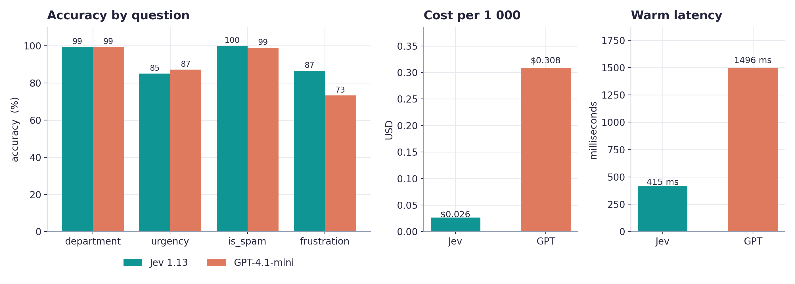</td>
<td align="center" valign="top">keine Medien veröffentlicht</td>
</tr></table>

🛡️ <b><a href="https://github.com/CapCurious/jev-threshold-lab">CapCurious/jev-threshold-lab</a></b> · Python · 🔎 inferred · 18 天

##### 📝 Zusammenfassung

Fit act, review and escalate thresholds per question from labeled data with Jev; checks calibration. Stdlib Python.

##### 📌 Basisfakten

| Feld      | Wert                                |
| --------- | ----------------------------------- |
| Kategorie | `Routing, Guardrails und Freigaben` |
| Beleg     | `inferred`                          |
| Sprache   | Python                              |

##### 📊 Daten

| Metrik            | Wert       |
| ----------------- | ---------- |
| Stars             | **0**      |
| Letzter Push      | 2026-10-18 |
| Erstmals gelistet | 2026-11-04 |

🏷 `calibration` · `decision-model` · `jev` · `python` · `thresholds` · `typesafe`

---

<table><tr><th align="center" width="50%">🖼 Bild</th><th align="center" width="50%">🎬 Video</th></tr><tr>
<td align="center" valign="top"></td>
<td align="center" valign="top"> animierte Aufzeichnung</td>
</tr></table>

🛡️ <b><a href="https://github.com/elcann7/jev-issue-triage">elcann7/jev-issue-triage</a></b> · JavaScript · 🔎 inferred · 1 天

##### 📝 Zusammenfassung

GitHub Action that labels and prioritizes new issues with TypeSafe's Jev model. Jev judges, code decides.

##### 📌 Basisfakten

| Feld      | Wert                                |
| --------- | ----------------------------------- |
| Kategorie | `Routing, Guardrails und Freigaben` |
| Beleg     | `inferred`                          |
| Sprache   | JavaScript                          |

##### 📊 Daten

| Metrik            | Wert       |
| ----------------- | ---------- |
| Stars             | **0**      |
| Letzter Push      | 2026-11-03 |
| Erstmals gelistet | 2026-11-04 |

🏷 `developer-tools` · `github-action` · `issue-triage` · `jev` · `nodejs` · `typesafe`

---

<table><tr><th align="center" width="50%">🖼 Bild</th><th align="center" width="50%">🎬 Video</th></tr><tr>
<td align="center" valign="top"></td>
<td align="center" valign="top">keine Medien veröffentlicht</td>
</tr></table>

🛡️ <b><a href="https://github.com/Haslab-dev/pandu-jev">Haslab-dev/pandu-jev</a></b> · Python · 🔎 inferred · 18 天

##### 📝 Zusammenfassung

Pandu ist ein Mini-Jev-Modell, inspiriert von Jev. Kleine Richtlinienmodelle für schnelle, lokale und unsicherheitsbewusste Entscheidungen in KI-Umgebungen mit geschlossenem Regelkreis.

##### 📌 Basisfakten

| Feld      | Wert                                |
| --------- | ----------------------------------- |
| Kategorie | `Routing, Guardrails und Freigaben` |
| Beleg     | `inferred`                          |
| Sprache   | Python                              |

##### 📊 Daten

| Metrik            | Wert       |
| ----------------- | ---------- |
| Stars             | **0**      |
| Letzter Push      | 2026-10-18 |
| Erstmals gelistet | 2026-11-01 |

---

<table><tr><th align="center" width="50%">🖼 Bild</th><th align="center" width="50%">🎬 Video</th></tr><tr>
<td align="center" valign="top"></td>
<td align="center" valign="top">keine Medien veröffentlicht</td>
</tr></table>

Asset direkt aus dem Upstream-Repository verlinkt, da keine Lizenz zur Weiterverbreitung angegeben wurde.

<b>Mehr in dieser Kategorie</b> · 34

- [leofmarciano/groot](https://github.com/leofmarciano/groot) - 🌳 Groot 1 is a open typed-decision model, with a pure Bend engine.
- [vynnlee/jev-mail](https://github.com/vynnlee/jev-mail) - Autonome 24/7-Zero-Inbox-Triage für Gmail, angetrieben von TypeSafe Jev System…
- [hyspacex/jev-router](https://github.com/hyspacex/jev-router) - Route OpenAI-style chat requests to a model and reasoning effort, using…
- [amyrmahdy/decima](https://github.com/amyrmahdy/decima) - Small local judges and guards for LLM apps: calibrated decisions…
- [Davidasx/pi-typesafe-approve](https://github.com/Davidasx/pi-typesafe-approve) - Pi extension: auto-approve routine Bash commands with a System One (Jev)…
- [mcgalleg/grokbot-jev-jobs](https://github.com/mcgalleg/grokbot-jev-jobs) - Scores public job postings against my resume using TypeSafe.
- [adityavsb/narrative-audit-jev](https://github.com/adityavsb/narrative-audit-jev) - OpenRouter benchmark harness: same decision task for rule baselines and pinned…
- [ahmed35636/jev-triage](https://github.com/ahmed35636/jev-triage) - Windows event classification and confidence-aware review routing with TypeSafe…
- [budityw23/fhir_jev](https://github.com/budityw23/fhir_jev) - Typed AI decision layer for FHIR R4 data using TypeSafe AI.
- [dirnbauer/typo3-webcon-jev](https://github.com/dirnbauer/typo3-webcon-jev) - Typed decisions from TypeSafe AI.
- [dtduc-git/jev-packs](https://github.com/dtduc-git/jev-packs) - Evidence-gated registry of Jev question packs — curated questions, golden cases…
- [freezetheflame/jev-ecosystem-research](https://github.com/freezetheflame/jev-ecosystem-research) - Jev (TypeSafe AI System One) 生态调研：开源复现规模、JevBench v1.4.2.2…
- [hrtaym1114-github/x-jev-gate](https://github.com/hrtaym1114-github/x-jev-gate) - X-Entwurfs-Gate, unterstützt von TypeSafe Jev (System One): strenge…
- [jasonli0226/jev-benchmark](https://github.com/jasonli0226/jev-benchmark) - Benchmark: Jev decision model (TypeSafe, via OpenRouter) vs local ML on SST-2…
- [Joshita-s/ticket-triage-jev](https://github.com/Joshita-s/ticket-triage-jev) - Automated customer ticket triage engine in Python built with TypeSafe Jev…
- [kellystuard/jev-gmail-classifier](https://github.com/kellystuard/jev-gmail-classifier) - Google Apps Script, das Gmail-Nachrichten mit Jev, dem…
- [Khidir782/Beam-jev](https://github.com/Khidir782/Beam-jev) - Calibrated DevOps tool-router distilled from Beam-1.0-501B via RLCD.
- [Loule95450/jev-free-router](https://github.com/Loule95450/jev-free-router) - Dynamischer Modell-Router pro Durchlauf auf kostenlosem OpenCode Zen plus…
- [Madheshvivekanandan/jev-vs-cosine](https://github.com/Madheshvivekanandan/jev-vs-cosine) - Do you need TypeSafe.
- [masatoppp/07_Jev-routing-evaluation](https://github.com/masatoppp/07_Jev-routing-evaluation) - Jevを用いたLLM・Web検索・RAGのルーティング実装と、GPT-4.1-miniとの判定精度・処理速度・APIコストの比較検証.
- [mgd34msu/goodvibes-jev](https://github.com/mgd34msu/goodvibes-jev) - Die Goodvibes-Plattform mit Jev, das für Guardrails, Sicherheit usw.
- [mohameddhameem/systemone-jev](https://github.com/mohameddhameem/systemone-jev) - Typed-decision routers between a small and a large LLM, fine-tuned from nano-jev.
- [morler/pi-jev-core](https://github.com/morler/pi-jev-core) - Minimaler Jev-Bewertungskern für Pi und andere TypeScript-Apps…
- [Muradmustafayev-03/jev-recovery-router](https://github.com/Muradmustafayev-03/jev-recovery-router) - Kostenabhängiges Intent-Routing: ausgewähltes Qwen3-Glaubensmodell…
- [petercr/jev-orchestrator](https://github.com/petercr/jev-orchestrator) - Ein kleiner Node-Orchestrator, der Jev verwendet, um abhängig vom…
- [ragman53/pi-jev-orchestrator](https://github.com/ragman53/pi-jev-orchestrator) - Cache-aware Jev model orchestration for Pi with sticky routing and safe…
- [rajkundalia/expense-approval-using-jev](https://github.com/rajkundalia/expense-approval-using-jev) - A local-first employee expense reimbursement demo exploring Jev.
- [RichardoMrMu/jev-mini](https://github.com/RichardoMrMu/jev-mini) - Stelle die drei zentralen Behauptungen von Jev auf deiner eigenen GPU auf die…
- [shivanathd/jev-playground](https://github.com/shivanathd/jev-playground) - BYOK playground for TypeSafe Jev (System One): Choice, Score, Noul examples for…
- [stivelcn/jev-route-releases](https://github.com/stivelcn/jev-route-releases) - JEV Router macOS downloads and release notes. Source code is private.
- [THEROCKSSS/awesome-jev](https://github.com/THEROCKSSS/awesome-jev) - Zusammengeführter, deduplizierter, täglich aktualisierter Katalog von Jev /…
- [willirath/2026_jev-box-demo](https://github.com/willirath/2026_jev-box-demo) - Hotdog / not hotdog demo with TypeSafe Jev (noul + box) via OpenRouter.
- [Wu-love-han/ai-jev-filter](https://github.com/Wu-love-han/ai-jev-filter) - JEV 检索台 · 对话式网络信息筛选工作台：官方 /v1/systemone 协议接入、noul/score/choice…
- [sumleo/RLCDAlignBench](https://github.com/sumleo/RLCDAlignBench) - RLCDAlignBench: 44 Benchmarks zur Erkennung von Alignment-Fehlern und Code für…

## Evaluation, Kalibrierung und Benchmarks

Wie man überhaupt weiß, ob die Entscheidungen gut sind. Kalibrierung ist die offene Frage dieses Ökosystems, und diese Projekte messen sie.

🧪 <b><a href="https://github.com/Mapika/decider">Mapika/decider</a></b> · ⭐1077 · Python · 👁️ observed · 16 天 · ⭐-93

##### 📝 Zusammenfassung

Eine Familie von Modellen im System One-Stil, feinabgestimmt aus Qwen3.5, entwickelt für typisierte Entscheidungen in einem Durchlauf mit kalibrierten Wahrscheinlichkeiten.

🔧 Im Code verwendet: `docs/HISTORY.md`, `README.md`

##### 📌 Basisfakten

| Feld      | Wert                                      |
| --------- | ----------------------------------------- |
| Kategorie | `Evaluation, Kalibrierung und Benchmarks` |
| Beleg     | `observed`                                |
| Sprache   | Python                                    |

##### 📊 Daten

| Metrik            | Wert           |
| ----------------- | -------------- |
| Stars             | **1077** (-93) |
| Letzter Push      | 2026-10-20     |
| Erstmals gelistet | 2026-10-28     |

---

<table><tr><th align="center" width="50%">🖼 Bild</th><th align="center" width="50%">🎬 Video</th></tr><tr>
<td align="center" valign="top"></td>
<td align="center" valign="top"> animierte Aufzeichnung</td>
</tr></table>

🧪 <b><a href="https://github.com/v-modal/awesome-jev-tools">v-modal/awesome-jev-tools</a></b> · ⭐748 · 👁️ observed · 2 天 · ⭐-6

##### 📝 Zusammenfassung

Eine kuratierte Liste von Tools, die für Jev entwickelt wurden – TypeSafe AIs System One-Modell für typisierte Entscheidungen.

##### 📌 Basisfakten

| Feld      | Wert                                      |
| --------- | ----------------------------------------- |
| Kategorie | `Evaluation, Kalibrierung und Benchmarks` |
| Beleg     | `observed`                                |

##### 📊 Daten

| Metrik            | Wert         |
| ----------------- | ------------ |
| Stars             | **748** (-6) |
| Letzter Push      | 2026-11-03   |
| Erstmals gelistet | 2026-09-20   |

🏷 `awesome-ai` · `awesome-jev` · `awesome-list` · `awesome-readme` · `calibrated-probabilities` · `jev` · `jev-ai` · `jev-alternative`

🧪 <b><a href="https://github.com/OmniJev/awesome-jev-gallery">OmniJev/awesome-jev-gallery</a></b> · ⭐480 · Python · 👁️ observed · 0 天 · ⭐-1

##### 📝 Zusammenfassung

🔥🔥 Awesome Jev: Open-Source-Modelle, Projekte, Benchmarks und unabhängige Bewertungen für Jev- und System One-Modelle.

##### 📌 Basisfakten

| Feld      | Wert                                      |
| --------- | ----------------------------------------- |
| Kategorie | `Evaluation, Kalibrierung und Benchmarks` |
| Beleg     | `observed`                                |
| Sprache   | Python                                    |

##### 📊 Daten

| Metrik            | Wert         |
| ----------------- | ------------ |
| Stars             | **480** (-1) |
| Letzter Push      | 2026-11-05   |
| Erstmals gelistet | 2026-09-20   |

🏷 `awesome` · `awesome-jev` · `awesome-list` · `calibrated-probabilities` · `calibration` · `decision-models` · `jev` · `jev-ai`

🧪 <b><a href="https://github.com/cobusgreyling/Jev">cobusgreyling/Jev</a></b> · ⭐140 · Python · 👁️ observed · 21 天

##### 📝 Zusammenfassung

Inoffizielle TypeSafe Jev-Showcase — System One Entscheidungen, kein Chat.

🔧 Im Code verwendet: `README.md`

##### 📌 Basisfakten

| Feld      | Wert                                      |
| --------- | ----------------------------------------- |
| Kategorie | `Evaluation, Kalibrierung und Benchmarks` |
| Beleg     | `observed`                                |
| Sprache   | Python                                    |

##### 📊 Daten

| Metrik            | Wert       |
| ----------------- | ---------- |
| Stars             | **140**    |
| Letzter Push      | 2026-10-15 |
| Erstmals gelistet | 2026-10-26 |

🏷 `calibrated-decisions` · `jev` · `showcase` · `system-one` · `typesafe`

---

<table><tr><th align="center" width="50%">🖼 Bild</th><th align="center" width="50%">🎬 Video</th></tr><tr>
<td align="center" valign="top"></td>
<td align="center" valign="top">keine Medien veröffentlicht</td>
</tr></table>

🧪 <b><a href="https://github.com/ikermoel/open-alternative-jev">ikermoel/open-alternative-jev</a></b> · ⭐76 · Python · 👁️ observed · 41 天

##### 📝 Zusammenfassung

Open-Source-Alternative zu TypeSafe's Jev: eine System One-artige Modellebene, die typisierte, kalibrierte Entscheidungen aus jedem Open-Weights-LLM in einem Vorwärtsdurchlauf liefert (HF + vLLM), mit ehrlichen Benchmarks

##### 📌 Basisfakten

| Feld      | Wert                                      |
| --------- | ----------------------------------------- |
| Kategorie | `Evaluation, Kalibrierung und Benchmarks` |
| Beleg     | `observed`                                |
| Sprache   | Python                                    |

##### 📊 Daten

| Metrik            | Wert       |
| ----------------- | ---------- |
| Stars             | **76**     |
| Letzter Push      | 2026-09-25 |
| Erstmals gelistet | 2026-10-28 |

🏷 `calibration` · `classification` · `jev` · `jev-alternative` · `llm` · `logprobs` · `open-jev` · `open-source-jev`

🧪 <b><a href="https://github.com/hev/reranker">hev/reranker</a></b> · ⭐19 · Python · 👁️ observed · 48 天

##### 📝 Zusammenfassung

Verwende Jev (das System One-Modell von TypeSafe) als kalibrierten Reranker: ein Aufruf, bis zu 30 Dokumente, eine Wahrscheinlichkeit pro Dokument. Apache-2.0.

##### 📌 Basisfakten

| Feld      | Wert                                      |
| --------- | ----------------------------------------- |
| Kategorie | `Evaluation, Kalibrierung und Benchmarks` |
| Beleg     | `observed`                                |
| Sprache   | Python                                    |

##### 📊 Daten

| Metrik            | Wert       |
| ----------------- | ---------- |
| Stars             | **19**     |
| Letzter Push      | 2026-09-17 |
| Erstmals gelistet | 2026-10-28 |

🧪 <b><a href="https://github.com/OmniJev/awesome-jev-papers">OmniJev/awesome-jev-papers</a></b> · ⭐12 · Python · 👁️ observed · 0 天

##### 📝 Zusammenfassung

🔥🔥 Research papers on Jev, TypeSafe's System One model, and the open models built in its shape.

##### 📌 Basisfakten

| Feld      | Wert                                      |
| --------- | ----------------------------------------- |
| Kategorie | `Evaluation, Kalibrierung und Benchmarks` |
| Beleg     | `observed`                                |
| Sprache   | Python                                    |

##### 📊 Daten

| Metrik            | Wert       |
| ----------------- | ---------- |
| Stars             | **12**     |
| Letzter Push      | 2026-11-05 |
| Erstmals gelistet | 2026-09-28 |

🏷 `arxiv` · `awesome` · `awesome-list` · `calibration` · `decision-model` · `jev` · `llm` · `paper-list`

🧪 <b><a href="https://github.com/akash-kamat/system-one-gemma">akash-kamat/system-one-gemma</a></b> · ⭐7 · Python · 👁️ observed · 48 天

##### 📝 Zusammenfassung

Open-Source-Jev-artiges System One-Entscheidungsmodell. Gemma 3 270M mit Scoring-Head — schnelle, kalibrierte Entscheidungen in einem einzigen Forward Pass. Keine Textgenerierung. Inspiriert von TypeSafe.ais Jev.

##### 📌 Basisfakten

| Feld      | Wert                                      |
| --------- | ----------------------------------------- |
| Kategorie | `Evaluation, Kalibrierung und Benchmarks` |
| Beleg     | `observed`                                |
| Sprache   | Python                                    |

##### 📊 Daten

| Metrik            | Wert       |
| ----------------- | ---------- |
| Stars             | **7**      |
| Letzter Push      | 2026-09-18 |
| Erstmals gelistet | 2026-10-28 |

🏷 `calibration` · `decision-model` · `gemma` · `jev` · `lora` · `machine-learning` · `scoring-model` · `system-one`

🧪 <b><a href="https://github.com/debuffjp/decidekit">debuffjp/decidekit</a></b> · ⭐6 · TypeScript · 👁️ observed · 3 天

##### 📝 Zusammenfassung

A System One model in the browser: typed, calibrated text decisions on the user's device. Learns from an LLM when it isn't sure.

##### 📌 Basisfakten

| Feld      | Wert                                      |
| --------- | ----------------------------------------- |
| Kategorie | `Evaluation, Kalibrierung und Benchmarks` |
| Beleg     | `observed`                                |
| Sprache   | TypeScript                                |

##### 📊 Daten

| Metrik            | Wert       |
| ----------------- | ---------- |
| Stars             | **6**      |
| Letzter Push      | 2026-11-02 |
| Erstmals gelistet | 2026-11-02 |

🏷 `classification` · `decision-model` · `llm` · `system-one` · `typescript`

🧪 <b><a href="https://github.com/bydeng01/scientific-decision-eval">bydeng01/scientific-decision-eval</a></b> · ⭐4 · HTML · 👁️ observed · 1 天

##### 📝 Zusammenfassung

Code and data for evaluating Jev, a System One model, on scientific decisions and how its choices affect downstream results. arXiv:2609.24965

##### 📌 Basisfakten

| Feld      | Wert                                      |
| --------- | ----------------------------------------- |
| Kategorie | `Evaluation, Kalibrierung und Benchmarks` |
| Beleg     | `observed`                                |
| Sprache   | HTML                                      |

##### 📊 Daten

| Metrik            | Wert       |
| ----------------- | ---------- |
| Stars             | **4**      |
| Letzter Push      | 2026-11-04 |
| Erstmals gelistet | 2026-10-27 |

🏷 `jev` · `jev-ai` · `jev-model` · `jevbench` · `system-one` · `system-one-model` · `system-one-models`

🧪 <b><a href="https://github.com/alby13/systemone">alby13/systemone</a></b> · ⭐1 · Python · 👁️ observed · 10 天

##### 📝 Zusammenfassung

Typed, calibrated decisions for software in a single forward pass: an independent implementation of the System One model architecture.

##### 📌 Basisfakten

| Feld      | Wert                                      |
| --------- | ----------------------------------------- |
| Kategorie | `Evaluation, Kalibrierung und Benchmarks` |
| Beleg     | `observed`                                |
| Sprache   | Python                                    |

##### 📊 Daten

| Metrik            | Wert       |
| ----------------- | ---------- |
| Stars             | **1**      |
| Letzter Push      | 2026-10-25 |
| Erstmals gelistet | 2026-10-26 |

🧪 <b><a href="https://github.com/aishwary-dongre/jev-xray">aishwary-dongre/jev-xray</a></b> · Python · 👁️ observed · 0 天 · **NEW**

##### 📝 Zusammenfassung

Entscheidungsforensik für System One-Modelle. Jev gibt eine kalibrierte Wahrscheinlichkeit zurück und kann sie nicht erklären — jev-xray misst per Ablation, welcher Teil der Eingabe sie verursacht hat.

##### 📌 Basisfakten

| Feld      | Wert                                      |
| --------- | ----------------------------------------- |
| Kategorie | `Evaluation, Kalibrierung und Benchmarks` |
| Beleg     | `observed`                                |
| Sprache   | Python                                    |

##### 📊 Daten

| Metrik            | Wert       |
| ----------------- | ---------- |
| Stars             | **0**      |
| Letzter Push      | 2026-11-05 |
| Erstmals gelistet | 2026-11-05 |

🧪 <b><a href="https://github.com/Shauryagulati/mini-jev">Shauryagulati/mini-jev</a></b> · Jupyter · 👁️ observed · 16 天

##### 📝 Zusammenfassung

Distilling a calibrated decision model into Qwen3-1.7B: SFT vs. distillation vs. GRPO, plus deployment pitfalls. Free Colab T4.

##### 📌 Basisfakten

| Feld      | Wert                                      |
| --------- | ----------------------------------------- |
| Kategorie | `Evaluation, Kalibrierung und Benchmarks` |
| Beleg     | `observed`                                |
| Sprache   | Jupyter                                   |

##### 📊 Daten

| Metrik            | Wert       |
| ----------------- | ---------- |
| Stars             | **0**      |
| Letzter Push      | 2026-10-19 |
| Erstmals gelistet | 2026-11-01 |

---

<table><tr><th align="center" width="50%">🖼 Bild</th><th align="center" width="50%">🎬 Video</th></tr><tr>
<td align="center" valign="top"></td>
<td align="center" valign="top">keine Medien veröffentlicht</td>
</tr></table>

🧪 <b><a href="https://github.com/nokia-applied-research/AnyJev">nokia-applied-research/AnyJev</a></b> · ⭐1586 · Python · 🔎 inferred · 14 天 · ⭐+2

##### 📝 Zusammenfassung

Verwandle jedes LLM in ein Entscheidungsmodell im Stil von Jev: typisierte Entscheidungen, echte Wahrscheinlichkeiten, kein Training. (wird fortlaufend aktualisiert, alle Issues und PR-Anfragen willkommen)

##### 📌 Basisfakten

| Feld      | Wert                                      |
| --------- | ----------------------------------------- |
| Kategorie | `Evaluation, Kalibrierung und Benchmarks` |
| Beleg     | `inferred`                                |
| Sprache   | Python                                    |

##### 📊 Daten

| Metrik            | Wert          |
| ----------------- | ------------- |
| Stars             | **1586** (+2) |
| Letzter Push      | 2026-10-21    |
| Erstmals gelistet | 2026-09-22    |

🏷 `calibration` · `decision-model` · `jev` · `jev-model` · `llm` · `system-one` · `transformers` · `vllm`

---

<table><tr><th align="center" width="50%">🖼 Bild</th><th align="center" width="50%">🎬 Video</th></tr><tr>
<td align="center" valign="top"></td>
<td align="center" valign="top"> animierte Aufzeichnung</td>
</tr></table>

🧪 <b><a href="https://github.com/allebee/jevk5">allebee/jevk5</a></b> · ⭐160 · Python · 🔎 inferred · 38 天

##### 📝 Zusammenfassung

JevK5: Open-Weights-Alternative zu TypeSafe Jev. Typisierte Entscheidungen mit Wahrscheinlichkeiten in einem Forward-Pass; Apache-2.0-Gewichte und -Code.

##### 📌 Basisfakten

| Feld      | Wert                                      |
| --------- | ----------------------------------------- |
| Kategorie | `Evaluation, Kalibrierung und Benchmarks` |
| Beleg     | `inferred`                                |
| Sprache   | Python                                    |

##### 📊 Daten

| Metrik            | Wert       |
| ----------------- | ---------- |
| Stars             | **160**    |
| Letzter Push      | 2026-09-28 |
| Erstmals gelistet | 2026-10-29 |

🏷 `calibration` · `decision-model` · `jev` · `jev-alternative` · `jevbench` · `lora` · `qwen` · `system-one`

---

<table><tr><th align="center" width="50%">🖼 Bild</th><th align="center" width="50%">🎬 Video</th></tr><tr>
<td align="center" valign="top"></td>
<td align="center" valign="top"> animierte Aufzeichnung · <a href="https://raw.githubusercontent.com/allebee/jevk5/main/docs/demo/jevk5-nvidia-demo.mp4">Video öffnen</a></td>
</tr></table>

🧪 <b><a href="https://github.com/Heman10x-NGU/Verdict-open-jev">Heman10x-NGU/Verdict-open-jev</a></b> · ⭐115 · Python · 🔎 inferred · 14 天

##### 📝 Zusammenfassung

Nicht-autoregressiver Entscheidungsprozessor auf ModernBERT (151M) mit kalibrierter Unsicherheit (RLCD), TypeSafe AI-Jev-Benchmark-Audit und browserbasiertem WebGPU-Playground

##### 📌 Basisfakten

| Feld      | Wert                                      |
| --------- | ----------------------------------------- |
| Kategorie | `Evaluation, Kalibrierung und Benchmarks` |
| Beleg     | `inferred`                                |
| Sprache   | Python                                    |

##### 📊 Daten

| Metrik            | Wert       |
| ----------------- | ---------- |
| Stars             | **115**    |
| Letzter Push      | 2026-10-21 |
| Erstmals gelistet | 2026-09-18 |

🏷 `brier-score` · `calibration` · `decision-engine` · `edge-ai` · `gliclass` · `jev` · `modernbert` · `onnx`

---

<table><tr><th align="center" width="50%">🖼 Bild</th><th align="center" width="50%">🎬 Video</th></tr><tr>
<td align="center" valign="top"></td>
<td align="center" valign="top">keine Medien veröffentlicht</td>
</tr></table>

Asset direkt aus dem Upstream-Repository verlinkt, da keine Lizenz zur Weiterverbreitung angegeben wurde.

🧪 <b><a href="https://github.com/manjunathshiva/opendecider">manjunathshiva/opendecider</a></b> · ⭐38 · Python · 🔎 inferred · 1 天

##### 📝 Zusammenfassung

Open, calibrated System 1 decision models: typed choice / score / yes-no answers with a probability for every option. 400M to 80B; CPU, NVIDIA, Apple Silicon, LM Studio, Ollama and vLLM.

##### 📌 Basisfakten

| Feld      | Wert                                      |
| --------- | ----------------------------------------- |
| Kategorie | `Evaluation, Kalibrierung und Benchmarks` |
| Beleg     | `inferred`                                |
| Sprache   | Python                                    |

##### 📊 Daten

| Metrik            | Wert       |
| ----------------- | ---------- |
| Stars             | **38**     |
| Letzter Push      | 2026-11-04 |
| Erstmals gelistet | 2026-11-04 |

🏷 `apple-silicon` · `calibration` · `classification` · `decision-model` · `gguf` · `huggingface` · `llm` · `mlx`

---

<table><tr><th align="center" width="50%">🖼 Bild</th><th align="center" width="50%">🎬 Video</th></tr><tr>
<td align="center" valign="top"></td>
<td align="center" valign="top">keine Medien veröffentlicht</td>
</tr></table>

🧪 <b><a href="https://github.com/Eliot5566/JEV-Paper-Radar">Eliot5566/JEV-Paper-Radar</a></b> · ⭐37 · Python · 🔎 inferred · 0 天

##### 📝 Zusammenfassung

Lass Jev jeden neuen arXiv-Artikel jeden Morgen lesen und die wenigen hervorheben, die du lesen solltest. Interessen in einfacher Sprache, kalibrierte Wahrscheinlichkeiten, etwa 0,06 $/Tag, forken und loslegen.

##### 📌 Basisfakten

| Feld      | Wert                                      |
| --------- | ----------------------------------------- |
| Kategorie | `Evaluation, Kalibrierung und Benchmarks` |
| Beleg     | `inferred`                                |
| Sprache   | Python                                    |

##### 📊 Daten

| Metrik            | Wert       |
| ----------------- | ---------- |
| Stars             | **37**     |
| Letzter Push      | 2026-11-05 |
| Erstmals gelistet | 2026-10-19 |

🏷 `arxiv` · `biorxiv` · `github-actions` · `jev` · `literature-review` · `llm` · `paper-recommendation` · `python`

---

<table><tr><th align="center" width="50%">🖼 Bild</th><th align="center" width="50%">🎬 Video</th></tr><tr>
<td align="center" valign="top"></td>
<td align="center" valign="top">keine Medien veröffentlicht</td>
</tr></table>

🧪 <b><a href="https://github.com/ankit-aglawe/tinyjev">ankit-aglawe/tinyjev</a></b> · ⭐29 · Python · 🔎 inferred · 34 天

##### 📝 Zusammenfassung

Ein winziges jev-ähnliches Modell, das Choice-, Score- und Noul-Fragen in einem Forward Pass beantwortet und kalibrierte Wahrscheinlichkeiten zurückgibt. MLX oder PyTorch, vollständig offline, System One-kompatibel.

##### 📌 Basisfakten

| Feld      | Wert                                      |
| --------- | ----------------------------------------- |
| Kategorie | `Evaluation, Kalibrierung und Benchmarks` |
| Beleg     | `inferred`                                |
| Sprache   | Python                                    |

##### 📊 Daten

| Metrik            | Wert       |
| ----------------- | ---------- |
| Stars             | **29**     |
| Letzter Push      | 2026-10-01 |
| Erstmals gelistet | 2026-09-23 |

🏷 `decision-model` · `jev` · `jev-model` · `mlx` · `qwen3` · `small-language-models` · `system-one` · `typed-decisions`

---

<table><tr><th align="center" width="50%">🖼 Bild</th><th align="center" width="50%">🎬 Video</th></tr><tr>
<td align="center" valign="top"></td>
<td align="center" valign="top"> animierte Aufzeichnung</td>
</tr></table>

🧪 <b><a href="https://github.com/shibing624/train-jev">shibing624/train-jev</a></b> · ⭐19 · Python · 🔎 inferred · 13 天

##### 📝 Zusammenfassung

Trainiere Entscheidungsmodelle im JEV-Stil nach System 1 auf Qwen3.5 und Qwen3.8-27B: 24-Slot-Entscheidungskopf, KL-Destillation, Kalibrierung und Bereitstellung. Trainiere Entscheidungsmodelle im JEV-Stil nach System 1 auf Qwen.

##### 📌 Basisfakten

| Feld      | Wert                                      |
| --------- | ----------------------------------------- |
| Kategorie | `Evaluation, Kalibrierung und Benchmarks` |
| Beleg     | `inferred`                                |
| Sprache   | Python                                    |

##### 📊 Daten

| Metrik            | Wert       |
| ----------------- | ---------- |
| Stars             | **19**     |
| Letzter Push      | 2026-10-23 |
| Erstmals gelistet | 2026-11-04 |

🏷 `calibration` · `decision-model` · `distillation` · `fine-tuning` · `llm` · `lora` · `nlp` · `pytorch`

---

<table><tr><th align="center" width="50%">🖼 Bild</th><th align="center" width="50%">🎬 Video</th></tr><tr>
<td align="center" valign="top"></td>
<td align="center" valign="top">keine Medien veröffentlicht</td>
</tr></table>

🧪 <b><a href="https://github.com/BrendanH18/jev_fsd">BrendanH18/jev_fsd</a></b> · ⭐11 · JavaScript · 🔎 inferred · 0 天

##### 📝 Zusammenfassung

A driving simulator on real OpenStreetMap streets where TypeSafe's Jev model drives the car, with a decision inspector and a benchmark.

##### 📌 Basisfakten

| Feld      | Wert                                      |
| --------- | ----------------------------------------- |
| Kategorie | `Evaluation, Kalibrierung und Benchmarks` |
| Beleg     | `inferred`                                |
| Sprache   | JavaScript                                |

##### 📊 Daten

| Metrik            | Wert       |
| ----------------- | ---------- |
| Stars             | **11**     |
| Letzter Push      | 2026-11-05 |
| Erstmals gelistet | 2026-10-23 |

🏷 `ai` · `benchmark` · `driving-simulator` · `javascript` · `jev` · `openstreetmap` · `python` · `self-driving`

---

<table><tr><th align="center" width="50%">🖼 Bild</th><th align="center" width="50%">🎬 Video</th></tr><tr>
<td align="center" valign="top"></td>
<td align="center" valign="top"> animierte Aufzeichnung</td>
</tr></table>

🧪 <b><a href="https://github.com/wondertwins/jev-benchmark">wondertwins/jev-benchmark</a></b> · ⭐8 · Python · 🔎 inferred · 49 天

##### 📝 Zusammenfassung

Benchmarks und eine Playground-Umgebung für das Jev-Modell von TypeSafe (System One): Schach und die Frage, mit wem der Spieler spricht, für Sprache-zu-Text-Spiel-NPCs

##### 📌 Basisfakten

| Feld      | Wert                                      |
| --------- | ----------------------------------------- |
| Kategorie | `Evaluation, Kalibrierung und Benchmarks` |
| Beleg     | `inferred`                                |
| Sprache   | Python                                    |

##### 📊 Daten

| Metrik            | Wert       |
| ----------------- | ---------- |
| Stars             | **8**      |
| Letzter Push      | 2026-09-16 |
| Erstmals gelistet | 2026-10-28 |

---

<table><tr><th align="center" width="50%">🖼 Bild</th><th align="center" width="50%">🎬 Video</th></tr><tr>
<td align="center" valign="top">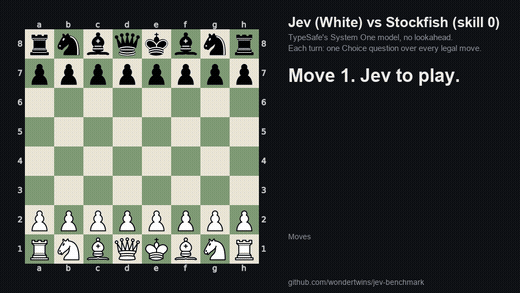</td>
<td align="center" valign="top">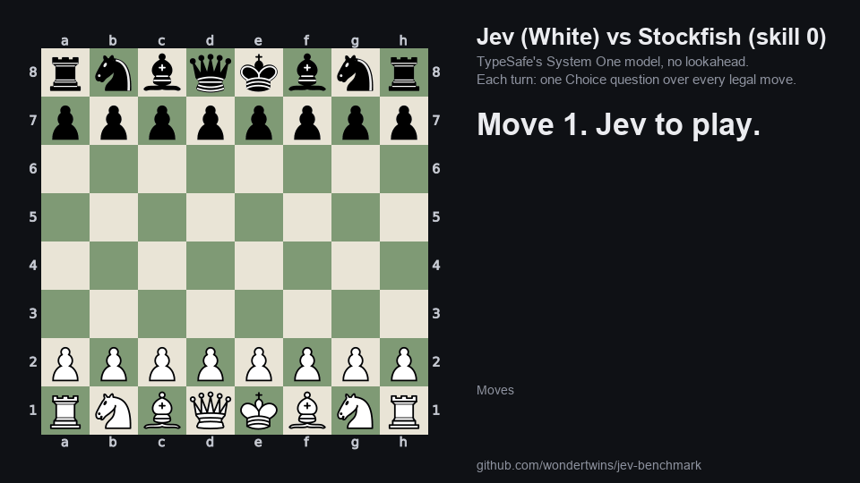 animierte Aufzeichnung</td>
</tr></table>

<b>Mehr in dieser Kategorie</b> · 64

- [alexrose13/measuring-ee-open-system-one-models](https://github.com/alexrose13/measuring-ee-open-system-one-models) - Measuring Exploration and Exploitation in Organizational Text with Open System…
- [BILLKISHORE/opensysone](https://github.com/BILLKISHORE/opensysone) - Open System One model for Apple Silicon: typed decisions with calibrated…
- [christian-taillon/telltale-systemone](https://github.com/christian-taillon/telltale-systemone) - Referenzimplementierung der Telltale-analyzer.v1-Erweiterung, die Guard-Pakete…
- [jburns24/jev-demo](https://github.com/jburns24/jev-demo) - Mit dem jev-latest-Evaluierungsmodell herumspielen.
- [Lucasrrafael/system-one-model-fine-tuning](https://github.com/Lucasrrafael/system-one-model-fine-tuning) - Fine-tuning pipeline for Laya and clef (9B/27B) decision models on ordinal…
- [mahirmalik030/Jev-vs-LLMs](https://github.com/mahirmalik030/Jev-vs-LLMs) - A comparative study of Jev 1.13 and Large Language Models (LLMs) for phishing…
- [patryckalves/jev-no-enem](https://github.com/patryckalves/jev-no-enem) - Reproduzierbarer Benchmark zur Bewertung von TypeSafe AI.
- [Saviskar/schema-mapping-bench](https://github.com/Saviskar/schema-mapping-bench) - Benchmarking lightweight and open-source LLMs and system one models on…
- [buberlo/jev-trader](https://github.com/buberlo/jev-trader) - 24/7-Market-Making-System rund um Jev-Entscheidungen (TypeSafe System One)…
- [SamratDuttaOfficial/WaterSheep](https://github.com/SamratDuttaOfficial/WaterSheep) - Ein Entscheidungsmodell, das kalibrierte Antworten auf Ja/Nein-, Auswahl…
- [Nhahan/Xevn](https://github.com/Nhahan/Xevn) - A 4B decision model built for Korean.
- [cablehead/jev.nu](https://github.com/cablehead/jev.nu) - Nushell-Modul für das TypeSafe System One API: typisierte Entscheidungen mit…
- [mertkayacs/jevalt](https://github.com/mertkayacs/jevalt) - Three 4B decision models for English, Turkish and German, with per-option…
- [Yifan-Lan/awesome-jev-robustness](https://github.com/Yifan-Lan/awesome-jev-robustness) - Tests, Kalibrierungsaudits und Untersuchungen zu Fehlermodi von Jev.
- [zamax14/Laya-Finetune](https://github.com/zamax14/Laya-Finetune) - Laya, das offene System One-Entscheidungsmodell, für jede Aufgabe mit…
- [tak-bro/local-jev-bench](https://github.com/tak-bro/local-jev-bench) - Lokale Entscheidungsmodelle im Jev-Stil System One auf Apple-Silicon-Macs…
- [CodyQin/zh-decision-bench](https://github.com/CodyQin/zh-decision-bench) - Erster chinesischsprachiger Kalibrierungs-Benchmark für Entscheidungsmodelle…
- [mertkayacs/jevoss](https://github.com/mertkayacs/jevoss) - Evaluation tools for Jev-compatible decision models, covering accuracy…
- [AlanViollier/jev-vs-pii](https://github.com/AlanViollier/jev-vs-pii) - How good is Jev, a decision model, at finding personal information?
- [divyanshudhruv/oev](https://github.com/divyanshudhruv/oev) - An 184M-parameter monolingual decision engine delivering calibrated…
- [etsabary/jev-deterministic-benchmark](https://github.com/etsabary/jev-deterministic-benchmark) - Verhaltensbenchmark mit 1.000 Entscheidungen von Jev über 25 deterministische…
- [Nefelim584/JEV_Judge](https://github.com/Nefelim584/JEV_Judge) - jev-lite: a ModernBERT-based typed decision model (Bool / Choice / Score) with…
- [teyhouse/jev-secret-detection](https://github.com/teyhouse/jev-secret-detection) - Misst, wie gut das RLCD-Jev-Modell von TypeSafe echte geheime Zugangsdaten in…
- [CosmoIknosLab/EarthJev](https://github.com/CosmoIknosLab/EarthJev) - EarthJev: calibrated, non-generative answers to natural-language questions…
- [EnesDemir143/jev-laya-benchmark](https://github.com/EnesDemir143/jev-laya-benchmark) - Lokaler Benchmark zum Vergleich von TypeSafe Jev und Laya-MLX für die…
- [lewistouchtech/opencode-jev-safe-compact](https://github.com/lewistouchtech/opencode-jev-safe-compact) - JEV-guided context compaction for OpenCode, built on a measured finding: noul…
- [patelvishwa112/jev-system-one-rlcd](https://github.com/patelvishwa112/jev-system-one-rlcd) - Jev System One KI- und RLCD-Reproduktions-Engine: kalibrierte Entscheidungen…
- [Rushab1/gr-jev](https://github.com/Rushab1/gr-jev) - Code for.
- [vortezwohl/JevNER](https://github.com/vortezwohl/JevNER) - Zero-shot multilingual named entity recognition (NER) powered by TypeSafe…
- [113636xfh/jev-decision-head](https://github.com/113636xfh/jev-decision-head) - A lightweight Jev-style decision head, plus the Strata patches that let one…
- [acbharath14/ollama-jev-decision-demo](https://github.com/acbharath14/ollama-jev-decision-demo) - Decision models via Ollama (Jev /v1/systemone): ask typed questions — choice…
- [agarwalastitwa027-svg/mini-jev-multimodal](https://github.com/agarwalastitwa027-svg/mini-jev-multimodal) - Kleines Bild-Text-Entscheidungsmodell: Qwen3-VL-2B + LoRA + Antwortkopf…
- [amatelic/jev](https://github.com/amatelic/jev) - Lokale KI-Entscheidungen in einer Zeile.
- [ameya-panchpor/jev-2048](https://github.com/ameya-panchpor/jev-2048) - Does a System One classifier belong in a sequential decision loop? A regret and…
- [ameya690/jev-2048](https://github.com/ameya690/jev-2048) - Does a System One classifier belong in a sequential decision loop? A regret and…
- [ankur287/jev-open-calibration](https://github.com/ankur287/jev-open-calibration) - Rebuilding Jev.
- [beskvladimir-create/ru-jev](https://github.com/beskvladimir-create/ru-jev) - Ru-Jev: an open Russian typed-decision model.
- [betulsimsek/jev-decomposition-tr](https://github.com/betulsimsek/jev-decomposition-tr) - Does splitting a typed-decision question help? Jev vs OpenAI Decisions vs Laya…
- [cayoesn/llm-jev-engine](https://github.com/cayoesn/llm-jev-engine) - System-1 Non-Autoregressive Single-Pass Neural Decision Engine with RLCD…
- [devrecated/jev-alternative](https://github.com/devrecated/jev-alternative) - Free, open-source Jev alternative: fine-tune the open Laya decision model on…
- [dnakhoa/jev-deferred-crispification](https://github.com/dnakhoa/jev-deferred-crispification) - Positionspapier: Die Hidden-Markov- und Fuzzy-Primitiven, die in TypeSafe AI.
- [himalaya-kaushik/mini-jev](https://github.com/himalaya-kaushik/mini-jev) - Wo Entscheidungsmodelle mit einem Durchlauf scheitern: ein lokales Jev-artiges…
- [Holovkat/jev-mark](https://github.com/Holovkat/jev-mark) - Benchmarking Local LLM.
- [j2launay/jev-decision-models-xai](https://github.com/j2launay/jev-decision-models-xai) - Jev-style “System 1” decision models replace autoregressive text generation…
- [jsaurabh/qwen-rlcd-jev-repro](https://github.com/jsaurabh/qwen-rlcd-jev-repro) - Reproduzierbare MLX- und Colab-Experimente für Jev-ähnliche typisierte…
- [n9omi/jev-calibration-audit](https://github.com/n9omi/jev-calibration-audit) - Independent calibration audit of TypeSafe AI.
- [Nijal-AI/jev-lab](https://github.com/Nijal-AI/jev-lab) - Atelier web pour mettre à l.
- [onlyoneaman/jev-eval](https://github.com/onlyoneaman/jev-eval) - Jev von TypeSafe im Vergleich zu gpt-5.4-mini und gpt-5.6-luna auf vier…
- [open-factoryai/myJEV](https://github.com/open-factoryai/myJEV) - Verwandle jeden Zustand in strukturierte, kalibrierte Entscheidungen.
- [Poojithcodes/jev-calibration-study](https://github.com/Poojithcodes/jev-calibration-study) - Comparing Jev.
- [Teddy9710/jev-playground](https://github.com/Teddy9710/jev-playground) - Lokale Spielwiese für TypeSafe System One (Jev): Choice/Noul/Score-Fragen im…
- [unofficial-equivocation2029/Open-Jev](https://github.com/unofficial-equivocation2029/Open-Jev) - Sofort typisierte Entscheidungswahrscheinlichkeiten aus Kontext und Kandidaten…
- [UpHash-Network/mini-jev](https://github.com/UpHash-Network/mini-jev) - LogitTrail (ehemals Mini Jev): inspizierbare lokale typisierte Entscheidungen…
- [xiaohuiyan/awesome-jev-papers](https://github.com/xiaohuiyan/awesome-jev-papers) - Curated arXiv papers on Jev, System One and typed decision models, with…
- [yauwes/datascape-jev-rlcd-pipeline](https://github.com/yauwes/datascape-jev-rlcd-pipeline) - DATASCAPE 2026: Paketqualitätskontrolle mit Jev System…
- [Zayan-droid/Jev](https://github.com/Zayan-droid/Jev) - Calibrated single-pass decision model: typed yes/no, choice and score questions…
- [hotchpotch/bekko-system-one](https://github.com/hotchpotch/bekko-system-one) - Kleine System One-Entscheidungsmodelle (17M–400M) für Ja/Nein, Choice, Score…
- [mithalouni/system-one-open](https://github.com/mithalouni/system-one-open) - Offenes Replikat von TypeSafe.
- [genai-craft/openvons](https://github.com/genai-craft/openvons) - openvons (open-Jev): Entscheidungsschicht, die begrenzte Auswahlmöglichkeiten…
- [arnabgho/rlcd-lite](https://github.com/arnabgho/rlcd-lite) - Vereinfachtes RL für kalibrierte Entscheidungen: paralleles eingeschränktes…
- [nomadoor/ComfyUI-TypedDecision](https://github.com/nomadoor/ComfyUI-TypedDecision) - Typisierte Entscheidungen (noul / choice / score) mit kalibrierten…
- [Mangaba-ai/brier](https://github.com/Mangaba-ai/brier) - Brier, by Mangaba AI: typed, calibrated decisions (choice/score/noul) for…
- [KanishkaGD/decision-rerank](https://github.com/KanishkaGD/decision-rerank) - Zero-shot reranking and calibration of decision models (Jev, Laya) on TREC DL…
- [shamazharikh/qwen-rlcd](https://github.com/shamazharikh/qwen-rlcd) - Jev-artiges kalibriertes Entscheidungsmodell (Choice/Score/Noul) auf…

## Offene Reproduktionen, Gewichte und Architekturforschung

Offene Gewichte, kleine Nachbauten und Architekturarbeit. Mehrere davon existieren, weil sich das Kalibrierungsverhalten nicht allein aus öffentlichem Material reproduzieren lässt.

🔬 <b><a href="https://github.com/kshetrajna12/reflex">kshetrajna12/reflex</a></b> · ⭐172 · Python · 👁️ observed · 29 天

##### 📝 Zusammenfassung

Ein kleines offenes Entscheidungsmodell: Zustand + typisierte Fragen -> kalibrierte Wahrscheinlichkeiten. Eine Jev-/System One-Neuerstellung auf Qwen3.5.

> 💡 Ein offenes Entscheidungsmodell mit derselben Schnittstelle aus Zustand und typisierter Frage. Lesenswert als Referenz für die Struktur, selbst wenn du es nie ausführst.

##### 📌 Basisfakten

| Feld      | Wert                                                       |
| --------- | ---------------------------------------------------------- |
| Kategorie | `Offene Reproduktionen, Gewichte und Architekturforschung` |
| Beleg     | `observed`                                                 |
| Sprache   | Python                                                     |

##### 📊 Daten

| Metrik            | Wert       |
| ----------------- | ---------- |
| Stars             | **172**    |
| Letzter Push      | 2026-10-06 |
| Erstmals gelistet | 2026-10-28 |

🔬 <b><a href="https://github.com/r-ms/mini-jev">r-ms/mini-jev</a></b> · ⭐61 · Python · 🔎 inferred · 48 天

##### 📝 Zusammenfassung

mini-Jev: So sieht eine typisierte Entscheidungsoberfläche im Stil von Jev auf einem eingefrorenen Qwen3-4B aus — lies die Logits des Optionsbuchstabens statt JSON zu generieren. Vorab registriertes Experiment, Ergebnisse, Lehrumgebung.

> 💡 Die nützlichste unabhängige Reproduktion zum Lesen: Sie zeigt, dass der Mechanismus zum Auslesen der Logits funktioniert, und warnt außerdem ausdrücklich davor, dass der ausgelesene Anteil keine kalibrierte Wahrscheinlichkeit ist. Diese Warnung ist der wichtigste einzelne Vorbehalt in diesem Ökosystem.

##### 📌 Basisfakten

| Feld      | Wert                                                       |
| --------- | ---------------------------------------------------------- |
| Kategorie | `Offene Reproduktionen, Gewichte und Architekturforschung` |
| Beleg     | `inferred`                                                 |
| Sprache   | Python                                                     |

##### 📊 Daten

| Metrik            | Wert       |
| ----------------- | ---------- |
| Stars             | **61**     |
| Letzter Push      | 2026-09-18 |
| Erstmals gelistet | 2026-09-18 |

---

<table><tr><th align="center" width="50%">🖼 Bild</th><th align="center" width="50%">🎬 Video</th></tr><tr>
<td align="center" valign="top"></td>
<td align="center" valign="top">keine Medien veröffentlicht</td>
</tr></table>

🔬 <b><a href="https://github.com/alvarobartt/sys1">alvarobartt/sys1</a></b> · ⭐59 · Rust · 👁️ observed · 0 天

##### 📝 Zusammenfassung

Blitzschnelle, selbst gehostete strukturierte Entscheidungen für offene Modelle mit einem zu TypeSafe AI kompatiblen API, geschrieben in Rust.

🔧 Im Code verwendet: `README.md`

##### 📌 Basisfakten

| Feld      | Wert                                                       |
| --------- | ---------------------------------------------------------- |
| Kategorie | `Offene Reproduktionen, Gewichte und Architekturforschung` |
| Beleg     | `observed`                                                 |
| Sprache   | Rust                                                       |

##### 📊 Daten

| Metrik            | Wert       |
| ----------------- | ---------- |
| Stars             | **59**     |
| Letzter Push      | 2026-11-05 |
| Erstmals gelistet | 2026-10-29 |

🏷 `clef` · `decision-model` · `decisions-api` · `huggingface` · `inference-server` · `jev` · `laya` · `self-hosted`

---

<table><tr><th align="center" width="50%">🖼 Bild</th><th align="center" width="50%">🎬 Video</th></tr><tr>
<td align="center" valign="top"></td>
<td align="center" valign="top">keine Medien veröffentlicht</td>
</tr></table>

🔬 <b><a href="https://github.com/PsiACE/dohnuts">PsiACE/dohnuts</a></b> · ⭐38 · Python · 👁️ observed · 30 天

##### 📝 Zusammenfassung

Dohnuts entwickelt kleine multimodale Modelle für direkte Entscheidungen. -> System One-Modell

##### 📌 Basisfakten

| Feld      | Wert                                                       |
| --------- | ---------------------------------------------------------- |
| Kategorie | `Offene Reproduktionen, Gewichte und Architekturforschung` |
| Beleg     | `observed`                                                 |
| Sprache   | Python                                                     |

##### 📊 Daten

| Metrik            | Wert       |
| ----------------- | ---------- |
| Stars             | **38**     |
| Letzter Push      | 2026-10-06 |
| Erstmals gelistet | 2026-09-21 |

🏷 `decision-model` · `jev` · `laya` · `llm` · `lora` · `rlcd` · `system-one` · `typesafe`

---

<table><tr><th align="center" width="50%">🖼 Bild</th><th align="center" width="50%">🎬 Video</th></tr><tr>
<td align="center" valign="top"></td>
<td align="center" valign="top">keine Medien veröffentlicht</td>
</tr></table>

🔬 <b><a href="https://github.com/Endgame-Labs/understudy">Endgame-Labs/understudy</a></b> · ⭐6 · Rust · 👁️ observed · 2 天

##### 📝 Zusammenfassung

A drop-in, CPU-only proxy for System One models (Jev, Rune, Clef). It learns each repeated question from the lead, then answers it itself.

##### 📌 Basisfakten

| Feld      | Wert                                                       |
| --------- | ---------------------------------------------------------- |
| Kategorie | `Offene Reproduktionen, Gewichte und Architekturforschung` |
| Beleg     | `observed`                                                 |
| Sprache   | Rust                                                       |

##### 📊 Daten

| Metrik            | Wert       |
| ----------------- | ---------- |
| Stars             | **6**      |
| Letzter Push      | 2026-11-02 |
| Erstmals gelistet | 2026-11-03 |

🏷 `classification` · `cpu-inference` · `decision-model` · `distillation` · `llm` · `proxy` · `rust`

🔬 <b><a href="https://github.com/themusebook/clawd-jev-trading-machine">themusebook/clawd-jev-trading-machine</a></b> · ⭐1 · Python · 👁️ observed · 40 天

##### 📝 Zusammenfassung

clawd-JEV-trading machine: JEV-on-Solana-Paper-Trader. TypeSafe-jev-latest-Gehirn, dynamischer Aktionsraum, CoinGecko-Regime + Supermemory-Speicher, Jupiter/DFlow-Handelsplätze. Nur Probelauf.

##### 📌 Basisfakten

| Feld      | Wert                                                       |
| --------- | ---------------------------------------------------------- |
| Kategorie | `Offene Reproduktionen, Gewichte und Architekturforschung` |
| Beleg     | `observed`                                                 |
| Sprache   | Python                                                     |

##### 📊 Daten

| Metrik            | Wert       |
| ----------------- | ---------- |
| Stars             | **1**      |
| Letzter Push      | 2026-09-25 |
| Erstmals gelistet | 2026-11-01 |

🔬 <b><a href="https://github.com/BipinRajC/Jev-api-experiments">BipinRajC/Jev-api-experiments</a></b> · Python · 👁️ observed · 17 天

##### 📝 Zusammenfassung

Empirische Experimente und API-Forschung für TypeSafes Jev System One-Modell, trainiert mit RLCD

##### 📌 Basisfakten

| Feld      | Wert                                                       |
| --------- | ---------------------------------------------------------- |
| Kategorie | `Offene Reproduktionen, Gewichte und Architekturforschung` |
| Beleg     | `observed`                                                 |
| Sprache   | Python                                                     |

##### 📊 Daten

| Metrik            | Wert       |
| ----------------- | ---------- |
| Stars             | **0**      |
| Letzter Push      | 2026-10-18 |
| Erstmals gelistet | 2026-09-22 |

🏷 `api` · `experimental` · `jev` · `rlcd` · `typesafe-ai`

🔬 <b><a href="https://huggingface.co/lysandre/JEV-27B-VL">lysandre/JEV-27B-VL</a></b> · model · 👁️ observed · 3 天

##### 📝 Zusammenfassung

Im Upstream wurde keine Beschreibung veröffentlicht.

##### 📌 Basisfakten

| Feld      | Wert                                                       |
| --------- | ---------------------------------------------------------- |
| Kategorie | `Offene Reproduktionen, Gewichte und Architekturforschung` |
| Beleg     | `observed`                                                 |

##### 📊 Daten

| Metrik            | Wert       |
| ----------------- | ---------- |
| Erstmals gelistet | 2026-11-02 |

🏷 `transformers` · `safetensors` · `qwen3_5` · `image-text-to-text` · `jev` · `system-one` · `system-two` · `typed-decisions`

🔬 <b><a href="https://huggingface.co/mradermacher/JEV-27B-VL-GGUF">mradermacher/JEV-27B-VL-GGUF</a></b> · model · 👁️ observed · 1 天

##### 📝 Zusammenfassung

Im Upstream wurde keine Beschreibung veröffentlicht.

##### 📌 Basisfakten

| Feld      | Wert                                                       |
| --------- | ---------------------------------------------------------- |
| Kategorie | `Offene Reproduktionen, Gewichte und Architekturforschung` |
| Beleg     | `observed`                                                 |

##### 📊 Daten

| Metrik            | Wert       |
| ----------------- | ---------- |
| Erstmals gelistet | 2026-11-04 |

🏷 `transformers` · `gguf` · `jev` · `system-one` · `system-two` · `typed-decisions` · `decision-model` · `calibrated-probabilities`

🔬 <b><a href="https://huggingface.co/stephenlb/system-one-model">stephenlb/system-one-model</a></b> · model · 👁️ observed · 34 天

##### 📝 Zusammenfassung

Im Upstream wurde keine Beschreibung veröffentlicht.

##### 📌 Basisfakten

| Feld      | Wert                                                       |
| --------- | ---------------------------------------------------------- |
| Kategorie | `Offene Reproduktionen, Gewichte und Architekturforschung` |
| Beleg     | `observed`                                                 |

##### 📊 Daten

| Metrik            | Wert       |
| ----------------- | ---------- |
| Erstmals gelistet | 2026-10-05 |

🏷 `transformers` · `safetensors` · `truetype_system_one` · `feature-extraction` · `custom_code` · `gemma4` · `typed-decisions` · `text-classification`

🔬 <b><a href="https://github.com/TheoLeeCJ/SemIf-OpenJev">TheoLeeCJ/SemIf-OpenJev</a></b> · ⭐4930 · Python · 🔎 inferred · 42 天 · ⭐+1

##### 📝 Zusammenfassung

Semantische Ifs aus Open Models, auf einer 3090 zu Hause. Unabhängig; nicht mit Jev oder TypeSafe verbunden.

##### 📌 Basisfakten

| Feld      | Wert                                                       |
| --------- | ---------------------------------------------------------- |
| Kategorie | `Offene Reproduktionen, Gewichte und Architekturforschung` |
| Beleg     | `inferred`                                                 |
| Sprache   | Python                                                     |

##### 📊 Daten

| Metrik            | Wert          |
| ----------------- | ------------- |
| Stars             | **4930** (+1) |
| Letzter Push      | 2026-09-23    |
| Erstmals gelistet | 2026-10-29    |

---

<table><tr><th align="center" width="50%">🖼 Bild</th><th align="center" width="50%">🎬 Video</th></tr><tr>
<td align="center" valign="top"></td>
<td align="center" valign="top"> animierte Aufzeichnung</td>
</tr></table>

🔬 <b><a href="https://github.com/wfzyx/von">wfzyx/von</a></b> · ⭐921 · Python · 🔎 inferred · 16 天 · ⭐-1

##### 📝 Zusammenfassung

Das quelloffene System One-Entscheidungsmodell. Unter 15 ms, nicht autoregressiv, lokale direkt einsetzbare Alternative zu TypeSafe Jev.

##### 📌 Basisfakten

| Feld      | Wert                                                       |
| --------- | ---------------------------------------------------------- |
| Kategorie | `Offene Reproduktionen, Gewichte und Architekturforschung` |
| Beleg     | `inferred`                                                 |
| Sprache   | Python                                                     |

##### 📊 Daten

| Metrik            | Wert         |
| ----------------- | ------------ |
| Stars             | **921** (-1) |
| Letzter Push      | 2026-10-19   |
| Erstmals gelistet | 2026-09-19   |

🏷 `decision-model` · `jev` · `machine-learning` · `python` · `rlcd` · `system-one` · `typesafe`

---

<table><tr><th align="center" width="50%">🖼 Bild</th><th align="center" width="50%">🎬 Video</th></tr><tr>
<td align="center" valign="top">keine Medien veröffentlicht</td>
<td align="center" valign="top"> animierte Aufzeichnung</td>
</tr></table>

🔬 <b><a href="https://github.com/tomerglick57/Jevstiller">tomerglick57/Jevstiller</a></b> · ⭐72 · Python · 🔎 inferred · 4 天

##### 📝 Zusammenfassung

Destilliert eine wiederholte Jev-Klassifizierungsaufgabe im laufenden Betrieb in ein lokales Modell — gleiche Antworten, deine Hardware.

##### 📌 Basisfakten

| Feld      | Wert                                                       |
| --------- | ---------------------------------------------------------- |
| Kategorie | `Offene Reproduktionen, Gewichte und Architekturforschung` |
| Beleg     | `inferred`                                                 |
| Sprache   | Python                                                     |

##### 📊 Daten

| Metrik            | Wert       |
| ----------------- | ---------- |
| Stars             | **72**     |
| Letzter Push      | 2026-11-01 |
| Erstmals gelistet | 2026-10-29 |

🏷 `classification` · `distillation` · `jev` · `knowledge-distillation` · `llm` · `mlops` · `model-cascade` · `python`

---

<table><tr><th align="center" width="50%">🖼 Bild</th><th align="center" width="50%">🎬 Video</th></tr><tr>
<td align="center" valign="top"></td>
<td align="center" valign="top"> animierte Aufzeichnung</td>
</tr></table>

🔬 <b><a href="https://github.com/amithgc/local-jev">amithgc/local-jev</a></b> · ⭐24 · Python · 🔎 inferred · 45 天

##### 📝 Zusammenfassung

Ein lokaler Offline-System One-Server, kompatibel mit TypeSafes Jev API. Er beantwortet typisierte Ja/Nein-, Kategorie- und Bewertungsfragen mit kleinen offenen Modellen.

##### 📌 Basisfakten

| Feld      | Wert                                                       |
| --------- | ---------------------------------------------------------- |
| Kategorie | `Offene Reproduktionen, Gewichte und Architekturforschung` |
| Beleg     | `inferred`                                                 |
| Sprache   | Python                                                     |

##### 📊 Daten

| Metrik            | Wert       |
| ----------------- | ---------- |
| Stars             | **24**     |
| Letzter Push      | 2026-09-21 |
| Erstmals gelistet | 2026-10-28 |

---

<table><tr><th align="center" width="50%">🖼 Bild</th><th align="center" width="50%">🎬 Video</th></tr><tr>
<td align="center" valign="top"></td>
<td align="center" valign="top">keine Medien veröffentlicht</td>
</tr></table>

🔬 <b><a href="https://github.com/OpenLAIR/lev">OpenLAIR/lev</a></b> · ⭐24 · Python · 🔎 inferred · 17 天 · ⭐-1

##### 📝 Zusammenfassung

Lev: Thinking Fast and Deep with Looped Decision Models. One checkpoint, multiple depths: System 1.5 decision models that think in loops, not tokens.

##### 📌 Basisfakten

| Feld      | Wert                                                       |
| --------- | ---------------------------------------------------------- |
| Kategorie | `Offene Reproduktionen, Gewichte und Architekturforschung` |
| Beleg     | `inferred`                                                 |
| Sprache   | Python                                                     |

##### 📊 Daten

| Metrik            | Wert        |
| ----------------- | ----------- |
| Stars             | **24** (-1) |
| Letzter Push      | 2026-10-19  |
| Erstmals gelistet | 2026-11-03  |

🏷 `adaptive-computation` · `adaptive-depth` · `decision-models` · `early-exit` · `huggingface` · `jev` · `jev-api` · `jev-model`

---

<table><tr><th align="center" width="50%">🖼 Bild</th><th align="center" width="50%">🎬 Video</th></tr><tr>
<td align="center" valign="top">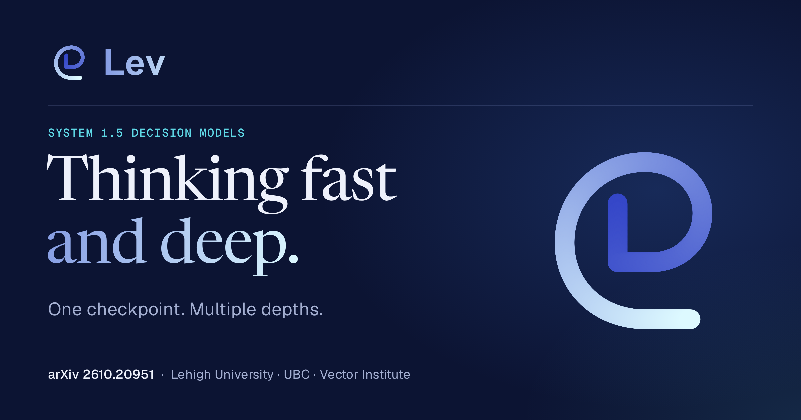</td>
<td align="center" valign="top">keine Medien veröffentlicht</td>
</tr></table>

🔬 <b><a href="https://github.com/skydiving94/klint">skydiving94/klint</a></b> · ⭐5 · Python · 🔎 inferred · 0 天

##### 📝 Zusammenfassung

Deklarativer semantischer Linter und architektonischer Code-Auditor für lokale Open-Weight-kev- und entfernte System One-Modelle (/v1/systemone).

##### 📌 Basisfakten

| Feld      | Wert                                                       |
| --------- | ---------------------------------------------------------- |
| Kategorie | `Offene Reproduktionen, Gewichte und Architekturforschung` |
| Beleg     | `inferred`                                                 |
| Sprache   | Python                                                     |

##### 📊 Daten

| Metrik            | Wert       |
| ----------------- | ---------- |
| Stars             | **5**      |
| Letzter Push      | 2026-11-04 |
| Erstmals gelistet | 2026-11-02 |

🏷 `ast` · `code-audit` · `kev` · `linter` · `python` · `react` · `software-architecture` · `static-analysis`

---

<table><tr><th align="center" width="50%">🖼 Bild</th><th align="center" width="50%">🎬 Video</th></tr><tr>
<td align="center" valign="top">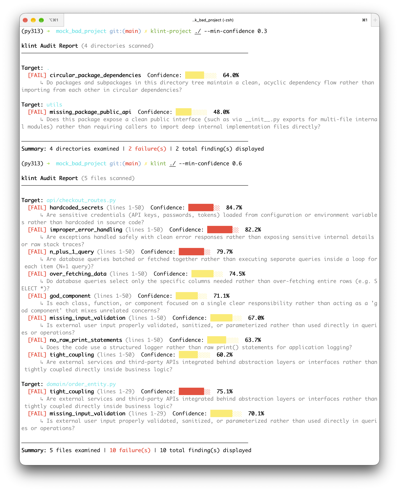</td>
<td align="center" valign="top">keine Medien veröffentlicht</td>
</tr></table>

🔬 <b><a href="https://github.com/lawrence3699/Jev-Style-0.8B-Decision-v3-MLX">lawrence3699/Jev-Style-0.8B-Decision-v3-MLX</a></b> · Python · 🔎 inferred · 0 天

##### 📝 Zusammenfassung

GitHub mirror of the chaoliangUNSW/Jev-Style-0.8B-Decision-v3-MLX Hugging Face model

##### 📌 Basisfakten

| Feld      | Wert                                                       |
| --------- | ---------------------------------------------------------- |
| Kategorie | `Offene Reproduktionen, Gewichte und Architekturforschung` |
| Beleg     | `inferred`                                                 |
| Sprache   | Python                                                     |

##### 📊 Daten

| Metrik            | Wert       |
| ----------------- | ---------- |
| Stars             | **0**      |
| Letzter Push      | 2026-11-04 |
| Erstmals gelistet | 2026-11-05 |

🏷 `decision-model` · `huggingface-mirror` · `jev-style`

---

<table><tr><th align="center" width="50%">🖼 Bild</th><th align="center" width="50%">🎬 Video</th></tr><tr>
<td align="center" valign="top">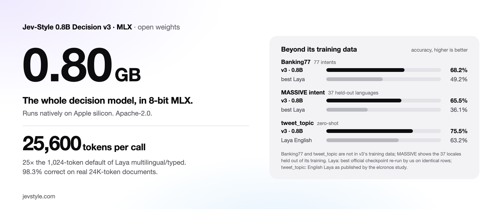</td>
<td align="center" valign="top">keine Medien veröffentlicht</td>
</tr></table>

🔬 <b><a href="https://github.com/lawrence3699/Jev-Style-2B-Decision-v3-MLX">lawrence3699/Jev-Style-2B-Decision-v3-MLX</a></b> · Python · 🔎 inferred · 0 天

##### 📝 Zusammenfassung

GitHub mirror of the chaoliangUNSW/Jev-Style-2B-Decision-v3-MLX Hugging Face model

##### 📌 Basisfakten

| Feld      | Wert                                                       |
| --------- | ---------------------------------------------------------- |
| Kategorie | `Offene Reproduktionen, Gewichte und Architekturforschung` |
| Beleg     | `inferred`                                                 |
| Sprache   | Python                                                     |

##### 📊 Daten

| Metrik            | Wert       |
| ----------------- | ---------- |
| Stars             | **0**      |
| Letzter Push      | 2026-11-04 |
| Erstmals gelistet | 2026-11-05 |

🏷 `decision-model` · `huggingface-mirror` · `jev-style`

---

<table><tr><th align="center" width="50%">🖼 Bild</th><th align="center" width="50%">🎬 Video</th></tr><tr>
<td align="center" valign="top">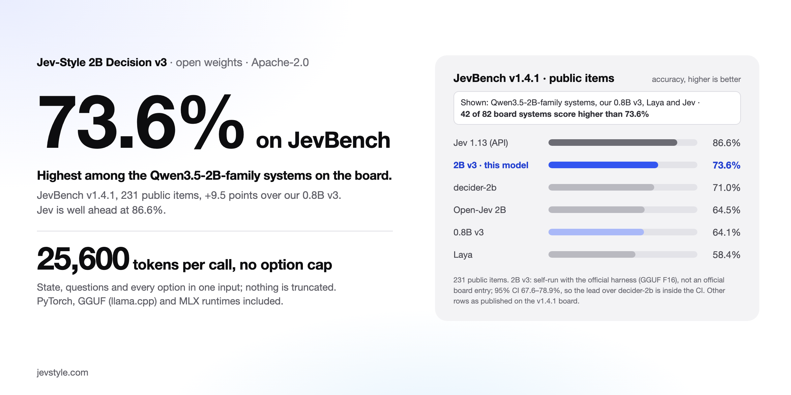</td>
<td align="center" valign="top">keine Medien veröffentlicht</td>
</tr></table>

🔬 <b><a href="https://github.com/lawrence3699/Jev-Style-Qwen3.5-2B-Decision-MLX-bf16">lawrence3699/Jev-Style-Qwen3.5-2B-Decision-MLX-bf16</a></b> · Python · 🔎 inferred · 0 天

##### 📝 Zusammenfassung

GitHub mirror of the chaoliangUNSW/Jev-Style-Qwen3.5-2B-Decision-MLX-bf16 Hugging Face model

##### 📌 Basisfakten

| Feld      | Wert                                                       |
| --------- | ---------------------------------------------------------- |
| Kategorie | `Offene Reproduktionen, Gewichte und Architekturforschung` |
| Beleg     | `inferred`                                                 |
| Sprache   | Python                                                     |

##### 📊 Daten

| Metrik            | Wert       |
| ----------------- | ---------- |
| Stars             | **0**      |
| Letzter Push      | 2026-11-04 |
| Erstmals gelistet | 2026-11-05 |

🏷 `decision-model` · `huggingface-mirror` · `jev-style`

---

<table><tr><th align="center" width="50%">🖼 Bild</th><th align="center" width="50%">🎬 Video</th></tr><tr>
<td align="center" valign="top"></td>
<td align="center" valign="top">keine Medien veröffentlicht</td>
</tr></table>

Asset direkt aus dem Upstream-Repository verlinkt, da keine Lizenz zur Weiterverbreitung angegeben wurde.

🔬 <b><a href="https://github.com/lawrence3699/Jev-Style-Qwen3.5-2B-Decision-v2-MLX-bf16">lawrence3699/Jev-Style-Qwen3.5-2B-Decision-v2-MLX-bf16</a></b> · Python · 🔎 inferred · 0 天

##### 📝 Zusammenfassung

GitHub mirror of the chaoliangUNSW/Jev-Style-Qwen3.5-2B-Decision-v2-MLX-bf16 Hugging Face model

##### 📌 Basisfakten

| Feld      | Wert                                                       |
| --------- | ---------------------------------------------------------- |
| Kategorie | `Offene Reproduktionen, Gewichte und Architekturforschung` |
| Beleg     | `inferred`                                                 |
| Sprache   | Python                                                     |

##### 📊 Daten

| Metrik            | Wert       |
| ----------------- | ---------- |
| Stars             | **0**      |
| Letzter Push      | 2026-11-04 |
| Erstmals gelistet | 2026-11-05 |

🏷 `decision-model` · `huggingface-mirror` · `jev-style`

---

<table><tr><th align="center" width="50%">🖼 Bild</th><th align="center" width="50%">🎬 Video</th></tr><tr>
<td align="center" valign="top">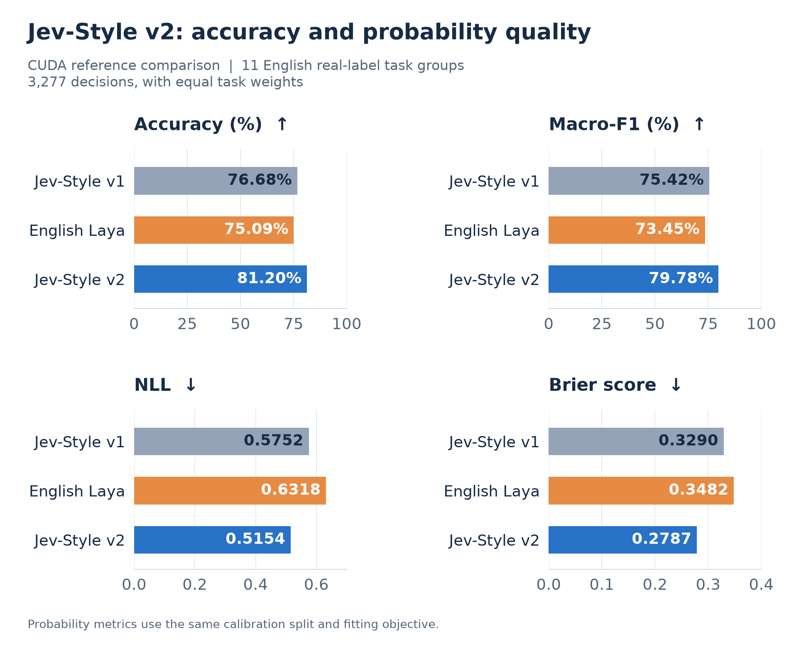</td>
<td align="center" valign="top">keine Medien veröffentlicht</td>
</tr></table>

🔬 <b><a href="https://github.com/MarwaneAit-mouloud/reachy-jev">MarwaneAit-mouloud/reachy-jev</a></b> · Python · 🔎 inferred · 16 天

##### 📝 Zusammenfassung

Reachy Mini contrôle les commandes : modèles de décision (Jev, OpenAI) contre LLM génératif, latence et coût mesurés sur le robot.

##### 📌 Basisfakten

| Feld      | Wert                                                       |
| --------- | ---------------------------------------------------------- |
| Kategorie | `Offene Reproduktionen, Gewichte und Architekturforschung` |
| Beleg     | `inferred`                                                 |
| Sprache   | Python                                                     |

##### 📊 Daten

| Metrik            | Wert       |
| ----------------- | ---------- |
| Stars             | **0**      |
| Letzter Push      | 2026-10-19 |
| Erstmals gelistet | 2026-11-01 |

---

<table><tr><th align="center" width="50%">🖼 Bild</th><th align="center" width="50%">🎬 Video</th></tr><tr>
<td align="center" valign="top"></td>
<td align="center" valign="top">keine Medien veröffentlicht</td>
</tr></table>

Asset direkt aus dem Upstream-Repository verlinkt, da keine Lizenz zur Weiterverbreitung angegeben wurde.

🔬 <b><a href="https://github.com/imikerussell/beebots">imikerussell/beebots</a></b> · ⭐335 · TypeScript · ❓ unverified · 0 天 · ⭐-1

##### 📝 Zusammenfassung

Drei KI-Trading-Bienen auf OKX, jede Entscheidung durch Jev. Standardmäßig Paper Trading. Keine Finanzberatung.

##### 📌 Basisfakten

| Feld      | Wert                                                       |
| --------- | ---------------------------------------------------------- |
| Kategorie | `Offene Reproduktionen, Gewichte und Architekturforschung` |
| Beleg     | `unverified`                                               |
| Sprache   | TypeScript                                                 |

##### 📊 Daten

| Metrik            | Wert         |
| ----------------- | ------------ |
| Stars             | **335** (-1) |
| Letzter Push      | 2026-11-05   |
| Erstmals gelistet | 2026-10-29   |

---

<table><tr><th align="center" width="50%">🖼 Bild</th><th align="center" width="50%">🎬 Video</th></tr><tr>
<td align="center" valign="top">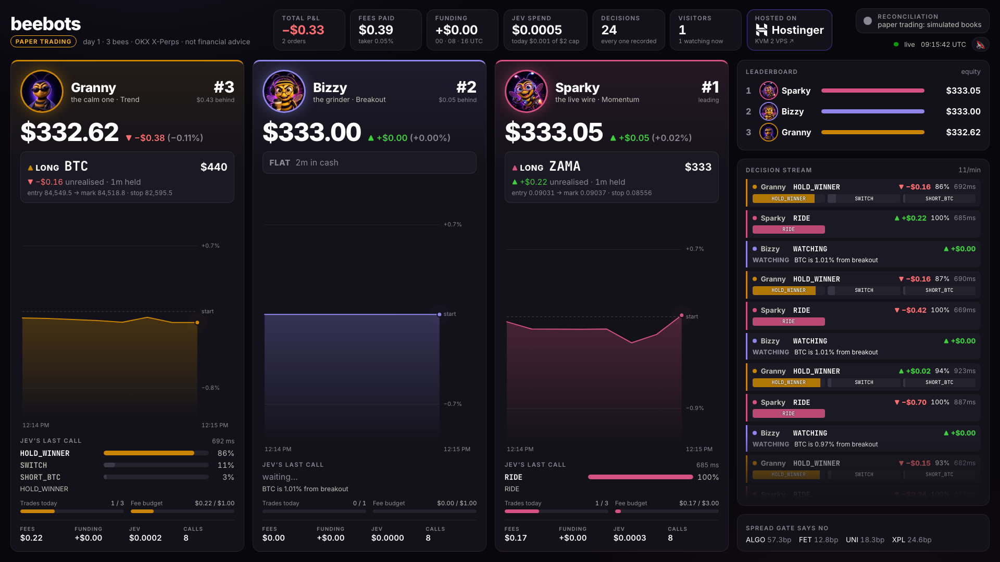</td>
<td align="center" valign="top"> <a href="https://youtu.be/bp_u9Gzp1OU">Ansehen auf youtu.be</a> · die Wiedergabe öffnet auf der Host-Seite; GitHub kann sie nicht direkt einbetten</td>
</tr></table>

<b>Mehr in dieser Kategorie</b> · 30

- [hyperspaceai/jevcache](https://github.com/hyperspaceai/jevcache) - Ein Entscheidungs-Cache für TypeSafe-Jev-Klassenmodelle – Entscheidungen…
- [mars-tw/jev-trading-command-center](https://github.com/mars-tw/jev-trading-command-center) - Open-source paper-trading research app integrating TypeSafe Jev, animated 3D…
- [mattt/AnyDecisionModel](https://github.com/mattt/AnyDecisionModel) - A Swift package for typed decisions from language models.
- [hunkim/solar-mini4-jev](https://github.com/hunkim/solar-mini4-jev)
- [whyashthakker/awesome-jev-use-cases](https://github.com/whyashthakker/awesome-jev-use-cases) - Awesome-Liste der Jev-Anwendungsfälle.
- [ljwwwiop/JEV-mini](https://github.com/ljwwwiop/JEV-mini) - JEV-mini ist ein minimales Lernprojekt zum Trainieren eines schnellen…
- [pCwOrM/werr](https://github.com/pCwOrM/werr) - Zero-memory System-1 decision engine &amp; TypeSafe Jev runtime powered by…
- [yuting-ai/minicpm5-2b-jev](https://github.com/yuting-ai/minicpm5-2b-jev) - MiniCPM5-2B-Jev: Hochgeschwindigkeits-System-1-Entscheidungsmodell…
- [0utKast/Jev_AI](https://github.com/0utKast/Jev_AI) - Curso completo, cuadernos Google Colab y guía bibliográfica sobre Jev.
- [Frank-Funney/mini-jev](https://github.com/Frank-Funney/mini-jev) - Eine äußerst leichtgewichtige Engine für strukturierte Entscheidungen auf…
- [welcomeenjoy75-hue/mini-jev](https://github.com/welcomeenjoy75-hue/mini-jev) - Eine äußerst leichtgewichtige Engine für strukturierte Entscheidungen auf…
- [AbdelStark/reachy-jev](https://github.com/AbdelStark/reachy-jev) - Typisierte Jev-Entscheidungsprimitive für Reachy-Mini-Anwendungen.
- [AnilDeshpande/jev-youtube-demo](https://github.com/AnilDeshpande/jev-youtube-demo) - Jev (TypeSafe) im Vergleich zu GPT-4o-mini: Klassifizierung von…
- [Dlmily/minimind-jev-dlmily](https://github.com/Dlmily/minimind-jev-dlmily) - MiniMind Jev probability scoring page (GitHub Pages).
- [Drykeeightyeight427/jev-robot-control](https://github.com/Drykeeightyeight427/jev-robot-control) - GPT-6 Astra, GPT-4.1 mini und Jev vergleichen, die einen xArm7 in MuJoCo über…
- [emilesilvis/jev-experiment](https://github.com/emilesilvis/jev-experiment) - Reproduzierbare Klassifikationsexperimente mit Jev und GPT-4o mini…
- [gbesse/jev-minimis-watch](https://github.com/gbesse/jev-minimis-watch) - Bereitet die Prüfung der Kumulierung von De-minimis-Beihilfen anhand belegter…
- [jobakk/jev-cj-asap](https://github.com/jobakk/jev-cj-asap) - Vergleichende Bewertung von ASAP-Aufsätzen durch Jev.
- [lawrence3699/Jev-Style-2B-Decision-v4-MLX](https://github.com/lawrence3699/Jev-Style-2B-Decision-v4-MLX) - GitHub mirror of the chaoliangUNSW/Jev-Style-2B-Decision-v4-MLX Hugging Face…
- [luckberonne/mini-jev](https://github.com/luckberonne/mini-jev) - Klassifikator für Shell-Befehle mit einem Durchlauf.
- [u007/minicpm5-jev](https://github.com/u007/minicpm5-jev) - MiniCPM5-2B-8bit als Jev-kompatibler Dienst für typisierte Entscheidungen auf…
- [Van5hdeep/mini-jev](https://github.com/Van5hdeep/mini-jev) - Ein einfaches Modell, trainiert nach dem Vorbild von jev.
- [vicfei/minimind-jev](https://github.com/vicfei/minimind-jev) - Train your own tiny Jev (System One decision model) — v0.1: frozen Chinese…
- [wangjunxiao/MiniJev](https://github.com/wangjunxiao/MiniJev) - A lightweight and easy-to-follow implementation of Jev.
- [yo4e/JevPip](https://github.com/yo4e/JevPip) - GMOのFX/BTC市場データに対応したローカル市場研究ターミナル。ライブチャート、ペーパートレード、バックテスト、安全監督、TypeSafe Jev連携.
- [apiplant/laya-rs](https://github.com/apiplant/laya-rs) - Rust-Neuimplementierung von Laya, einer nicht-autoregressiven typisierten…
- [Astro-Han/decision-head-rlcd](https://github.com/Astro-Han/decision-head-rlcd) - Woher stammt die Generalisierung eines Entscheidungsmodells? RLCD auf…
- [smixs/jevchik](https://github.com/smixs/jevchik) - Telegram bot for group chats: karma for useful messages, anti-spam for…
- [vicksiyi/qwen-2.5-1b-rlcd](https://github.com/vicksiyi/qwen-2.5-1b-rlcd) - Lokale Demo für MLX-Entscheidungswahrscheinlichkeiten, abgeleitet von…
- [yangshun2005/laya-cn](https://github.com/yangshun2005/laya-cn) - \[中文化\] Mehrsprachige, nicht-autoregressive System-1-Entscheidungs-Engine.

## Anwendungen, Spiele, Robotik und interaktive Demos

Spiele, Roboter, Browser und Dashboards. Demos sind der Weg, auf dem Aussagen zu Latenz und Kosten lesbar werden.

🎮 <b><a href="https://github.com/heyjunpenn/awesome-jev">heyjunpenn/awesome-jev</a></b> · ⭐1056 · Astro · 👁️ observed · 17 天 · ⭐+1

##### 📝 Zusammenfassung

A verified, community-maintained catalog of 992 open-source projects built with Jev.

🔧 Im Code verwendet: `README.md`, `CHANGELOG.md`, `README.ko.md`, `README.es.md`

##### 📌 Basisfakten

| Feld      | Wert                                                 |
| --------- | ---------------------------------------------------- |
| Kategorie | `Anwendungen, Spiele, Robotik und interaktive Demos` |
| Beleg     | `observed`                                           |
| Sprache   | Astro                                                |

##### 📊 Daten

| Metrik            | Wert          |
| ----------------- | ------------- |
| Stars             | **1056** (+1) |
| Letzter Push      | 2026-10-19    |
| Erstmals gelistet | 2026-10-29    |

🏷 `astro` · `awesome` · `awesome-jev` · `awesome-list` · `jev` · `typesafe`

🎮 <b><a href="https://github.com/superagents-lab/jev-search">superagents-lab/jev-search</a></b> · ⭐553 · TypeScript · 👁️ observed · 14 天 · ⭐+1

##### 📝 Zusammenfassung

Durchsuche das Web mit TypeSafe's Jev: Quellenauswahl, Abfrageverständnis und Relevanzranking. Erstellt mit Search1API.

🔧 Im Code verwendet: `README.md`

##### 📌 Basisfakten

| Feld      | Wert                                                 |
| --------- | ---------------------------------------------------- |
| Kategorie | `Anwendungen, Spiele, Robotik und interaktive Demos` |
| Beleg     | `observed`                                           |
| Sprache   | TypeScript                                           |

##### 📊 Daten

| Metrik            | Wert         |
| ----------------- | ------------ |
| Stars             | **553** (+1) |
| Letzter Push      | 2026-10-21   |
| Erstmals gelistet | 2026-10-29   |

---

<table><tr><th align="center" width="50%">🖼 Bild</th><th align="center" width="50%">🎬 Video</th></tr><tr>
<td align="center" valign="top"></td>
<td align="center" valign="top">keine Medien veröffentlicht</td>
</tr></table>

🎮 <b><a href="https://github.com/MCG-NJU/VideoJev">MCG-NJU/VideoJev</a></b> · ⭐293 · Python · 👁️ observed · 18 天 · ⭐+3

##### 📝 Zusammenfassung

VideoJev: System One Model für Videoverständnis und Interaktion

##### 📌 Basisfakten

| Feld      | Wert                                                 |
| --------- | ---------------------------------------------------- |
| Kategorie | `Anwendungen, Spiele, Robotik und interaktive Demos` |
| Beleg     | `observed`                                           |
| Sprache   | Python                                               |

##### 📊 Daten

| Metrik            | Wert         |
| ----------------- | ------------ |
| Stars             | **293** (+3) |
| Letzter Push      | 2026-10-18   |
| Erstmals gelistet | 2026-10-28   |

---

<table><tr><th align="center" width="50%">🖼 Bild</th><th align="center" width="50%">🎬 Video</th></tr><tr>
<td align="center" valign="top"></td>
<td align="center" valign="top">keine Medien veröffentlicht</td>
</tr></table>

🎮 <b><a href="https://github.com/mrnugget/jev-shell-history">mrnugget/jev-shell-history</a></b> · ⭐119 · TypeScript · 👁️ observed · 48 天

##### 📝 Zusammenfassung

Zsh-Verlauf-Autovervollständigungen im Fish-Stil, sortiert nach Jev (TypeSafe)

🔧 Im Code verwendet: `README.md`

##### 📌 Basisfakten

| Feld      | Wert                                                 |
| --------- | ---------------------------------------------------- |
| Kategorie | `Anwendungen, Spiele, Robotik und interaktive Demos` |
| Beleg     | `observed`                                           |
| Sprache   | TypeScript                                           |

##### 📊 Daten

| Metrik            | Wert       |
| ----------------- | ---------- |
| Stars             | **119**    |
| Letzter Push      | 2026-09-18 |
| Erstmals gelistet | 2026-10-29 |

---

<table><tr><th align="center" width="50%">🖼 Bild</th><th align="center" width="50%">🎬 Video</th></tr><tr>
<td align="center" valign="top"></td>
<td align="center" valign="top"> animierte Aufzeichnung</td>
</tr></table>

Asset direkt aus dem Upstream-Repository verlinkt, da keine Lizenz zur Weiterverbreitung angegeben wurde.

🎮 <b><a href="https://github.com/realZachi/typesafe-adblock">realZachi/typesafe-adblock</a></b> · ⭐94 · JavaScript · 👁️ observed · 48 天

##### 📝 Zusammenfassung

🧹 Spaßprojekt: Eine Chrome-Erweiterung, die ein kleines KI-Entscheidungsmodell (TypeSafe Jev) fragt: „Ist dieses DOM-Element eine Werbung?“ und es von der Seite entfernt. BYOK, kein Backend, kein echter Werbeblocker.

🔧 Im Code verwendet: `README.md`

##### 📌 Basisfakten

| Feld      | Wert                                                 |
| --------- | ---------------------------------------------------- |
| Kategorie | `Anwendungen, Spiele, Robotik und interaktive Demos` |
| Beleg     | `observed`                                           |
| Sprache   | JavaScript                                           |

##### 📊 Daten

| Metrik            | Wert       |
| ----------------- | ---------- |
| Stars             | **94**     |
| Letzter Push      | 2026-09-17 |
| Erstmals gelistet | 2026-10-29 |

🎮 <b><a href="https://github.com/zadescoxp/Jev-Trades">zadescoxp/Jev-Trades</a></b> · ⭐58 · Python · 👁️ observed · 40 天 · ⭐-1

##### 📝 Zusammenfassung

Trading-Bot mit dem völlig neuen ersten System-One-Modell von TypeSafe AI, benannt als Jev

##### 📌 Basisfakten

| Feld      | Wert                                                 |
| --------- | ---------------------------------------------------- |
| Kategorie | `Anwendungen, Spiele, Robotik und interaktive Demos` |
| Beleg     | `observed`                                           |
| Sprache   | Python                                               |

##### 📊 Daten

| Metrik            | Wert        |
| ----------------- | ----------- |
| Stars             | **58** (-1) |
| Letzter Push      | 2026-09-25  |
| Erstmals gelistet | 2026-10-21  |

🏷 `automated-testing` · `backtesting` · `crypto-trading-bot-latest` · `trading-bot-ai-automated`

---

<table><tr><th align="center" width="50%">🖼 Bild</th><th align="center" width="50%">🎬 Video</th></tr><tr>
<td align="center" valign="top"></td>
<td align="center" valign="top"> animierte Aufzeichnung</td>
</tr></table>

🎮 <b><a href="https://github.com/dfinke/Jev">dfinke/Jev</a></b> · ⭐11 · PowerShell · 👁️ observed · 20 天

##### 📝 Zusammenfassung

PowerShell-Entscheidungen mit dem Jev-Modell von TypeSafe AI: https://typesafe.ai/blog/introducing-system-one-models-and-jev

##### 📌 Basisfakten

| Feld      | Wert                                                 |
| --------- | ---------------------------------------------------- |
| Kategorie | `Anwendungen, Spiele, Robotik und interaktive Demos` |
| Beleg     | `observed`                                           |
| Sprache   | PowerShell                                           |

##### 📊 Daten

| Metrik            | Wert       |
| ----------------- | ---------- |
| Stars             | **11**     |
| Letzter Push      | 2026-10-16 |
| Erstmals gelistet | 2026-10-28 |

---

<table><tr><th align="center" width="50%">🖼 Bild</th><th align="center" width="50%">🎬 Video</th></tr><tr>
<td align="center" valign="top"></td>
<td align="center" valign="top">keine Medien veröffentlicht</td>
</tr></table>

🎮 <b><a href="https://github.com/chris-wozniczek/jev-voice-control">chris-wozniczek/jev-voice-control</a></b> · ⭐7 · Swift · 👁️ observed · 44 天

##### 📝 Zusammenfassung

Steuere deinen Mac per Stimme. Sprache → Jev (TypeSafe AI System One-Modell) typisierte Entscheidungen → macOS-Aktionen. Menu-bar Swift-App.

##### 📌 Basisfakten

| Feld      | Wert                                                 |
| --------- | ---------------------------------------------------- |
| Kategorie | `Anwendungen, Spiele, Robotik und interaktive Demos` |
| Beleg     | `observed`                                           |
| Sprache   | Swift                                                |

##### 📊 Daten

| Metrik            | Wert       |
| ----------------- | ---------- |
| Stars             | **7**      |
| Letzter Push      | 2026-09-21 |
| Erstmals gelistet | 2026-10-28 |

🏷 `computer-use` · `cua` · `jev` · `jev-ai` · `jev-api` · `jev-model` · `voice` · `voice-recognition`

🎮 <b><a href="https://github.com/dulin20240919-dot/jev">dulin20240919-dot/jev</a></b> · ⭐1 · 👁️ observed · 0 天 · **NEW**

##### 📝 Zusammenfassung

本项目是对 **jev 模型** 的调用尝试，基于 `search_jev使用文档.md`（内部使用文档）与 `jev官方文档.md`（来自 https://docs.typesafe.ai 的官方文档）整理而成

##### 📌 Basisfakten

| Feld      | Wert                                                 |
| --------- | ---------------------------------------------------- |
| Kategorie | `Anwendungen, Spiele, Robotik und interaktive Demos` |
| Beleg     | `observed`                                           |

##### 📊 Daten

| Metrik            | Wert       |
| ----------------- | ---------- |
| Stars             | **1**      |
| Letzter Push      | 2026-11-05 |
| Erstmals gelistet | 2026-11-05 |

🎮 <b><a href="https://github.com/Omrigotlieb/awesome-jev">Omrigotlieb/awesome-jev</a></b> · ⭐1 · Python · 👁️ observed · 0 天

##### 📝 Zusammenfassung

Geprüfte, screenshotreiche Awesome-Liste von Projekten auf Basis von Jev — TypeSafe AI's System One-Modell für typisierte Entscheidungen

##### 📌 Basisfakten

| Feld      | Wert                                                 |
| --------- | ---------------------------------------------------- |
| Kategorie | `Anwendungen, Spiele, Robotik und interaktive Demos` |
| Beleg     | `observed`                                           |
| Sprache   | Python                                               |

##### 📊 Daten

| Metrik            | Wert       |
| ----------------- | ---------- |
| Stars             | **1**      |
| Letzter Push      | 2026-11-05 |
| Erstmals gelistet | 2026-09-21 |

🎮 <b><a href="https://github.com/Amr-devman/systemone-robotics">Amr-devman/systemone-robotics</a></b> · 👁️ observed · 10 天

##### 📝 Zusammenfassung

Control a robotic arm using systemone models

##### 📌 Basisfakten

| Feld      | Wert                                                 |
| --------- | ---------------------------------------------------- |
| Kategorie | `Anwendungen, Spiele, Robotik und interaktive Demos` |
| Beleg     | `observed`                                           |

##### 📊 Daten

| Metrik            | Wert       |
| ----------------- | ---------- |
| Stars             | **0**      |
| Letzter Push      | 2026-10-26 |
| Erstmals gelistet | 2026-10-27 |

🎮 <b><a href="https://github.com/Anshul261/SystemOne_Demos">Anshul261/SystemOne_Demos</a></b> · Python · 👁️ observed · 7 天

##### 📝 Zusammenfassung

Using Jev/SystemOne Models to build use cases

##### 📌 Basisfakten

| Feld      | Wert                                                 |
| --------- | ---------------------------------------------------- |
| Kategorie | `Anwendungen, Spiele, Robotik und interaktive Demos` |
| Beleg     | `observed`                                           |
| Sprache   | Python                                               |

##### 📊 Daten

| Metrik            | Wert       |
| ----------------- | ---------- |
| Stars             | **0**      |
| Letzter Push      | 2026-10-29 |
| Erstmals gelistet | 2026-10-26 |

🎮 <b><a href="https://github.com/Shivam-Jha96/gsp">Shivam-Jha96/gsp</a></b> · Python · 👁️ observed · 1 天

##### 📝 Zusammenfassung

Ein KI-gestütztes Terminal zur Analyse der Makrostimmung, das Tausende aktueller globaler Finanznachrichten in Echtzeit liest und ihre Auswirkungen auf den Markt mit einem benutzerdefinierten Contrastive-LM-System-One-Modell auf einer serverlosen GPU bewertet!

##### 📌 Basisfakten

| Feld      | Wert                                                 |
| --------- | ---------------------------------------------------- |
| Kategorie | `Anwendungen, Spiele, Robotik und interaktive Demos` |
| Beleg     | `observed`                                           |
| Sprache   | Python                                               |

##### 📊 Daten

| Metrik            | Wert       |
| ----------------- | ---------- |
| Stars             | **0**      |
| Letzter Push      | 2026-11-04 |
| Erstmals gelistet | 2026-10-26 |

🏷 `artificial-intelligence-algorithms` · `finance-dashboard` · `stock-analysis` · `stock-market` · `stock-prediction`

---

<table><tr><th align="center" width="50%">🖼 Bild</th><th align="center" width="50%">🎬 Video</th></tr><tr>
<td align="center" valign="top"></td>
<td align="center" valign="top">keine Medien veröffentlicht</td>
</tr></table>

Asset direkt aus dem Upstream-Repository verlinkt, da keine Lizenz zur Weiterverbreitung angegeben wurde.

🎮 <b><a href="https://x.com/tspy/status/2100864234523685146">Xtags — X intent labeller</a></b> · @tspy · 👁️ observed · 48 天

##### 📝 Zusammenfassung

Xtags: a Chrome extension that labels each post in an X timeline with what it is trying to get from you — inducement, provocation, promotion, machine-generated, persuasion, entertainment, information — drawn as a tag plus a probability right after the timestamp. A side panel reports session counts (seen, judged, correct) and cumulative token cost. The author reports near-instant responses and usable accuracy before any tuning.

➡️ **Original project (manifoldor/xtags)** — [https://github.com/manifoldor/xtags](https://github.com/manifoldor/xtags)

> 💡 Worth reading as a latency argument rather than an accuracy one: labelling a timeline only works if the decision costs less than the scroll, which is the constraint a generative model cannot meet.

##### 📌 Basisfakten

| Feld       | Wert                                                 |
| ---------- | ---------------------------------------------------- |
| Kategorie  | `Anwendungen, Spiele, Robotik und interaktive Demos` |
| Beleg      | `observed`                                           |
| Eigentümer | [yishan](https://x.com/tspy) · @tspy                 |

##### 📊 Daten

| Metrik            | Wert       |
| ----------------- | ---------- |
| Aufrufe           | **9873**   |
| Likes             | 24         |
| Kommentare        | 11         |
| Veröffentlicht    | 2026-09-18 |
| Erstmals gelistet | 2026-09-18 |

🏷 `x`

---

<table><tr><th align="center" width="50%">🖼 Bild</th><th align="center" width="50%">🎬 Video</th></tr><tr>
<td align="center" valign="top"></td>
<td align="center" valign="top"> animierte Aufzeichnung · <a href="https://video.twimg.com/amplify_video/2100858340331200512/vid/avc1/1242x720/ex2FF5-TerVxo9xX.mp4">Video öffnen</a></td>
</tr></table>

🎮 <b><a href="https://github.com/Valen-Team/Valen">Valen-Team/Valen</a></b> · ⭐901 · Python · 🔎 inferred · 1 天 · ⭐+1

##### 📝 Zusammenfassung

Open, lightweight multimodal decision models for text, images, and video. Train and run them yourself.

##### 📌 Basisfakten

| Feld      | Wert                                                 |
| --------- | ---------------------------------------------------- |
| Kategorie | `Anwendungen, Spiele, Robotik und interaktive Demos` |
| Beleg     | `inferred`                                           |
| Sprache   | Python                                               |

##### 📊 Daten

| Metrik            | Wert         |
| ----------------- | ------------ |
| Stars             | **901** (+1) |
| Letzter Push      | 2026-11-04   |
| Erstmals gelistet | 2026-10-29   |

🏷 `decision-model` · `jev` · `system-one` · `typed-decisions`

---

<table><tr><th align="center" width="50%">🖼 Bild</th><th align="center" width="50%">🎬 Video</th></tr><tr>
<td align="center" valign="top"></td>
<td align="center" valign="top"> animierte Aufzeichnung</td>
</tr></table>

🎮 <b><a href="https://github.com/jkudish/jev-browser">jkudish/jev-browser</a></b> · ⭐367 · JavaScript · 🔎 inferred · 6 天

##### 📝 Zusammenfassung

Browsernutzung mit Typesafe's Jev-Modell

##### 📌 Basisfakten

| Feld      | Wert                                                 |
| --------- | ---------------------------------------------------- |
| Kategorie | `Anwendungen, Spiele, Robotik und interaktive Demos` |
| Beleg     | `inferred`                                           |
| Sprache   | JavaScript                                           |

##### 📊 Daten

| Metrik            | Wert       |
| ----------------- | ---------- |
| Stars             | **367**    |
| Letzter Push      | 2026-10-30 |
| Erstmals gelistet | 2026-10-29 |

---

<table><tr><th align="center" width="50%">🖼 Bild</th><th align="center" width="50%">🎬 Video</th></tr><tr>
<td align="center" valign="top"></td>
<td align="center" valign="top"> animierte Aufzeichnung · <a href="https://raw.githubusercontent.com/jkudish/jev-browser/main/assets/github-demo.mp4">Video öffnen</a></td>
</tr></table>

🎮 <b><a href="https://github.com/aowang-ai/jev-trade">aowang-ai/jev-trade</a></b> · ⭐225 · TypeScript · 🔎 inferred · 45 天

##### 📝 Zusammenfassung

Live-Jev-Trader auf Hyperliquid

##### 📌 Basisfakten

| Feld      | Wert                                                 |
| --------- | ---------------------------------------------------- |
| Kategorie | `Anwendungen, Spiele, Robotik und interaktive Demos` |
| Beleg     | `inferred`                                           |
| Sprache   | TypeScript                                           |

##### 📊 Daten

| Metrik            | Wert       |
| ----------------- | ---------- |
| Stars             | **225**    |
| Letzter Push      | 2026-09-21 |
| Erstmals gelistet | 2026-10-29 |

🏷 `hyperliquid` · `jev` · `quantitative-finance` · `typesafe`

---

<table><tr><th align="center" width="50%">🖼 Bild</th><th align="center" width="50%">🎬 Video</th></tr><tr>
<td align="center" valign="top"></td>
<td align="center" valign="top">keine Medien veröffentlicht</td>
</tr></table>

Asset direkt aus dem Upstream-Repository verlinkt, da keine Lizenz zur Weiterverbreitung angegeben wurde.

🎮 <b><a href="https://github.com/BudEcosystem/Bud-Decision-Studio">BudEcosystem/Bud-Decision-Studio</a></b> · ⭐86 · HTML · 🔎 inferred · 27 天 · ⭐-24

##### 📝 Zusammenfassung

Bud Decision Studio ist eine einfach zu bedienende plattformübergreifende Desktopanwendung und ein Bereitstellungssystem für Modelle wie Jev lokal.

##### 📌 Basisfakten

| Feld      | Wert                                                 |
| --------- | ---------------------------------------------------- |
| Kategorie | `Anwendungen, Spiele, Robotik und interaktive Demos` |
| Beleg     | `inferred`                                           |
| Sprache   | HTML                                                 |

##### 📊 Daten

| Metrik            | Wert         |
| ----------------- | ------------ |
| Stars             | **86** (-24) |
| Letzter Push      | 2026-10-09   |
| Erstmals gelistet | 2026-10-29   |

🏷 `decision-models` · `desktop-app` · `jev` · `laya` · `local-ai` · `pytorch` · `system-one` · `tauri`

---

<table><tr><th align="center" width="50%">🖼 Bild</th><th align="center" width="50%">🎬 Video</th></tr><tr>
<td align="center" valign="top"></td>
<td align="center" valign="top"> <a href="https://raw.githubusercontent.com/BudEcosystem/Bud-Decision-Studio/main/docs/media/demo.mp4">Video öffnen</a></td>
</tr></table>

Asset direkt aus dem Upstream-Repository verlinkt, da keine Lizenz zur Weiterverbreitung angegeben wurde.

🎮 <b><a href="https://github.com/wizicer/jev_info_site">wizicer/jev_info_site</a></b> · ⭐3 · Astro · 🔎 inferred · 2 天

##### 📝 Zusammenfassung

Community index of tools, models, and real-world use cases built on Jev.

##### 📌 Basisfakten

| Feld      | Wert                                                 |
| --------- | ---------------------------------------------------- |
| Kategorie | `Anwendungen, Spiele, Robotik und interaktive Demos` |
| Beleg     | `inferred`                                           |
| Sprache   | Astro                                                |

##### 📊 Daten

| Metrik            | Wert       |
| ----------------- | ---------- |
| Stars             | **3**      |
| Letzter Push      | 2026-11-03 |
| Erstmals gelistet | 2026-11-04 |

🏷 `awesome` · `jev` · `jev-ai` · `typesafe-ai`

---

<table><tr><th align="center" width="50%">🖼 Bild</th><th align="center" width="50%">🎬 Video</th></tr><tr>
<td align="center" valign="top"></td>
<td align="center" valign="top">keine Medien veröffentlicht</td>
</tr></table>

Asset direkt aus dem Upstream-Repository verlinkt, da keine Lizenz zur Weiterverbreitung angegeben wurde.

🎮 <b><a href="https://github.com/BrendanH18/jev-lab">BrendanH18/jev-lab</a></b> · Python · 🔎 inferred · 0 天

##### 📝 Zusammenfassung

Six small apps and a workbench that show what TypeSafe's Jev (System One) model can do

##### 📌 Basisfakten

| Feld      | Wert                                                 |
| --------- | ---------------------------------------------------- |
| Kategorie | `Anwendungen, Spiele, Robotik und interaktive Demos` |
| Beleg     | `inferred`                                           |
| Sprache   | Python                                               |

##### 📊 Daten

| Metrik            | Wert       |
| ----------------- | ---------- |
| Stars             | **0**      |
| Letzter Push      | 2026-11-04 |
| Erstmals gelistet | 2026-10-24 |

🏷 `ai` · `demo` · `jev` · `typesafe`

---

<table><tr><th align="center" width="50%">🖼 Bild</th><th align="center" width="50%">🎬 Video</th></tr><tr>
<td align="center" valign="top">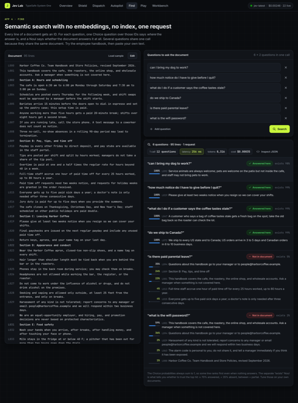</td>
<td align="center" valign="top">keine Medien veröffentlicht</td>
</tr></table>

🎮 <b><a href="https://github.com/charles-forsyth/jev-decision-wall">charles-forsyth/jev-decision-wall</a></b> · JavaScript · 🔎 inferred · 0 天

##### 📝 Zusammenfassung

Type anything. 200 yes/no AI judgments light up as a live heatmap in ~200 ms, from one parallel call to TypeSafe Jev. Zero deps, bring your own key.

##### 📌 Basisfakten

| Feld      | Wert                                                 |
| --------- | ---------------------------------------------------- |
| Kategorie | `Anwendungen, Spiele, Robotik und interaktive Demos` |
| Beleg     | `inferred`                                           |
| Sprache   | JavaScript                                           |

##### 📊 Daten

| Metrik            | Wert       |
| ----------------- | ---------- |
| Stars             | **0**      |
| Letzter Push      | 2026-11-05 |
| Erstmals gelistet | 2026-11-02 |

🏷 `ai` · `classification` · `demo` · `heatmap` · `jev` · `llm` · `nodejs` · `parallel`

---

<table><tr><th align="center" width="50%">🖼 Bild</th><th align="center" width="50%">🎬 Video</th></tr><tr>
<td align="center" valign="top"></td>
<td align="center" valign="top">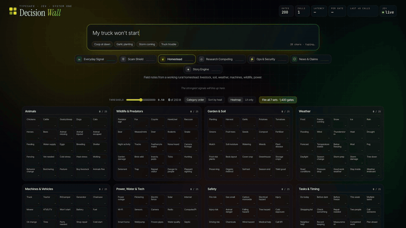 animierte Aufzeichnung</td>
</tr></table>

<b>Mehr in dieser Kategorie</b> · 16

- [bobbylite/jev-system-one-model-primitives](https://github.com/bobbylite/jev-system-one-model-primitives) - Einfache Beispiel-App zur Demonstration primitiver Typen für System-One-Modelle…
- [maxlbchung/system-one-harness](https://github.com/maxlbchung/system-one-harness) - A computer use harness for system one models.
- [moritzkremb/jev-voice-browser](https://github.com/moritzkremb/jev-voice-browser) - Steuere einen echten Browser per Sprache.
- [kevinbadi/jev-voice](https://github.com/kevinbadi/jev-voice) - Sprich mit deinem Mac. Lokales whisper.cpp + ein Jev-Aufruf (TypeSafe) pro…
- [buer2233/jev-ui-test](https://github.com/buer2233/jev-ui-test) - UI-Automatisierungstest-Framework, das von einem Jev-Entscheidungsmodell…
- [bilune/jev-design](https://github.com/bilune/jev-design) - Kann ein Modell ein Dashboard entwerfen? Eine Konsole, deren gesamtes…
- [emrickgarrett/OneVOneJev](https://github.com/emrickgarrett/OneVOneJev) - 1v1-Jev-Quickscope-Arena — Three.js + TypeSafe System One.
- [Tommylegen/jev-laya-toolkit](https://github.com/Tommylegen/jev-laya-toolkit) - Dashboard and local proxy for SystemOne decision models - Jev (TypeSafe API)…
- [dgarridou/KaLM-Jev](https://github.com/dgarridou/KaLM-Jev) - Führe effiziente lokale Choice-, Score- und Noul-Dienste mit…
- [arkulinskis/jev-buddy](https://github.com/arkulinskis/jev-buddy) - Jev Buddy: the developer guide to Jev, the AI decision model.
- [liangkingjin/jev-demo](https://github.com/liangkingjin/jev-demo) - Jev（TypeSafe System One）判定模型演示：Choice / Noul / Score 三原语 + 三档阈值分流，离线可跑.
- [m407/jev-grep](https://github.com/m407/jev-grep) - Semantic search for log and code fragments using Jev.
- [mberliner/jev-lab](https://github.com/mberliner/jev-lab) - Progressives Labor zum Erlernen und Demonstrieren von Jev, dem typisierten…
- [Sandesh-S-Dalvi/playwright-jev-demo](https://github.com/Sandesh-S-Dalvi/playwright-jev-demo) - Playwright + TypeSafe Jev (System One) decision-map demo for semantic test…
- [taiki00wo/jev-playground](https://github.com/taiki00wo/jev-playground) - TypeSafe AI の Jev で、飲食店の売上低下の原因を判定してみる作業場所.
- [sorrycc/typesafe-snake](https://github.com/sorrycc/typesafe-snake) - Snake, automatisch von TypeSafes Jev-Modell gespielt: eine System One-Auswahl…

## Artikel, Diskussionen und verwandte Listen

Launch-Threads, unabhängige Artikel und die anderen kuratierten Listen in diesem Feld. Dieses Repository ist nicht das einzige, und das zu sagen ist nützlicher, als das Gegenteil zu behaupten.

📰 <b><a href="https://docs.typesafe.ai/model-jaggedness/jev-1.13">9 Klassen bekannter Defekte (jaggedness)</a></b> · ✅ official · 49 天

##### 📝 Zusammenfassung

Wörtliches Verständnis, **unzuverlässiges Zählen**, Datumsvergleiche, mehrstufige Indirektion, irrelevante Details mit großem state, adversariale Inhalte, Widersprüche zwischen Anweisung und criteria, strukturelle Invarianten, Generierung. Offizielle Empfehlung: "in atomare Fragen zerlegen und im Code kombinieren".

> 💡 **Fähigkeitsgrenzen**——dies ist die vom Anbieter selbst anerkannte Grenzliste, vollständig aufgenommen

##### 📌 Basisfakten

| Feld      | Wert                                         |
| --------- | -------------------------------------------- |
| Kategorie | `Artikel, Diskussionen und verwandte Listen` |
| Beleg     | `official`                                   |

##### 📊 Daten

| Metrik            | Wert       |
| ----------------- | ---------- |
| Erstmals gelistet | 2026-09-20 |

📰 <b><a href="https://docs.typesafe.ai/cookbooks/consistency_choice_cookbook">`consistency_choice` cookbook hat offiziell beantwortet: &quot;Wiederholte Aufrufe liefern andere Ergebnisse&quot;</a></b> · ✅ official · 49 天

##### 📝 Zusammenfassung

Dasselbe Prüf-rubric, **8 Choice × 15 Wiederholungen pro Bedingung**. TypeSafe **raw agree 90.8%** (bei 8 Aufgaben kippen 2, aber **conflicts=0** —— Kippen erfolgt nur zwischen „konkretes Label ↔ uncertain“). **Nach Hinzufügen einer abstention-Regel (mit `probabilities` top probability ≥ 0.60 verlangen, sonst `uncertain` an Menschen weiterleiten) steigt die Übereinstimmung auf 99.2%**, automatic 74.2%, **ohne zusätzliche Modellaufrufe**. Vergleich: Haiku t=0 100%, Opus 4.8 reasoning 92.5%, gpt-5.4-mini t=0 99.2%. Offizielle Erklärung: Das macht das Modell nicht deterministisch; diese Zahlen bedeuten **Wiederholbarkeit, nicht Korrektheit**; 0.60 ist eine Beispielstrategie, Produktionsschwellen müssen mit gelabelten Stichproben und Kosten bestimmt werden.

> 💡 **\[DEFINITION-CHANGE\]** B5, die Tabelle der Schlüsselzahlen, SKILL.md eiserne Regel 3 sowie Go-live-Punkt 6 und Eignungsgrenze Punkt 6 wurden zurückgeschrieben——**dieses Repository hatte "Nichtdeterminismus" zuvor als Risiko notiert, nun geändert zur offiziellen richtigen Lösung: ihn mit abstention verwalten**

##### 📌 Basisfakten

| Feld      | Wert                                         |
| --------- | -------------------------------------------- |
| Kategorie | `Artikel, Diskussionen und verwandte Listen` |
| Beleg     | `official`                                   |

##### 📊 Daten

| Metrik            | Wert       |
| ----------------- | ---------- |
| Erstmals gelistet | 2026-09-20 |

📰 <b><a href="https://docs.typesafe.ai/confidence">Offizielle Bestätigung der Semantik von confidence</a></b> · ✅ official · 49 天

##### 📝 Zusammenfassung

Offiziell wird klar gesagt, dass `confidence` eine **aus der `probabilities`-Verteilung berechnete Statistik** ist; je konzentrierter die Verteilung, desto sicherer; **Noul enthält keine confidence**; offiziell wird klar gesagt: "du bist nicht auf unsere Definition festgelegt"; Schwellen sollten "mit konservativen Werten beginnen und auf deinen eigenen Daten getestet werden".

> 💡 Stimmt mit Archers inverser Formel überein, in Definitionsdatei geschrieben

##### 📌 Basisfakten

| Feld      | Wert                                         |
| --------- | -------------------------------------------- |
| Kategorie | `Artikel, Diskussionen und verwandte Listen` |
| Beleg     | `official`                                   |

##### 📊 Daten

| Metrik            | Wert       |
| ----------------- | ---------- |
| Erstmals gelistet | 2026-09-20 |

📰 <b><a href="https://www.langchain.com/blog/building-a-harness-with-jev（2026-09-17">Offizieller LangChain-Blogbeitrag erklärt &quot;warum die agent-Guardrail-Kategorie explodiert&quot; — , Sydney Runkle &amp; Hunter Lovell）</a></b> · ✅ official

##### 📝 Zusammenfassung

*"Coding harnesses like claude, codex, cursor have shipped some kind of way to classify dangerous actions… **Up until now, this classifier step has been locked away in the closed source parts of the harness. Now that a cheap and performant classifier model exists, we can take the same pattern and adopt it to all agents!**"*; außerdem werden ein router-Beispiel (mit Jev zur Modellauswahl nach benutzerdefinierten Standards, Wahrscheinlichkeit bleibt im agent state) und *"Jev isn't a drop-in replacement for an LLM"* gegeben.

> 💡 **Erklärt das in diesem Repository beobachtete Phänomen der "Kommodifizierung von Guardrails"**——Ursache ist, dass Closed-Source-harness-Eigenschaften quelloffen gemacht wurden; in die Fragmentbibliothek §2.5 geschrieben

##### 📌 Basisfakten

| Feld      | Wert                                         |
| --------- | -------------------------------------------- |
| Kategorie | `Artikel, Diskussionen und verwandte Listen` |
| Beleg     | `official`                                   |

##### 📊 Daten

| Metrik            | Wert       |
| ----------------- | ---------- |
| Erstmals gelistet | 2026-09-20 |

📰 <b><a href="https://typesafe.ai/team">TypeSafe fügt Team-Seite hinzu + Navigation erhält neuen `Enterprise`-Einstieg (Signal für Produktisierung/Kommerzialisierung)</a></b> · ✅ official · 48 天

##### 📝 Zusammenfassung

TypeSafe fügt Team-Seite hinzu + Navigation erhält neuen `Enterprise`-Einstieg (Signal für Produktisierung/Kommerzialisierung)

> 💡 **\[DEFINITION-CHANGE\]**（Team-Fakten + Produktisierungssignal）；`01-系统定义/jev-系统定义.md` fügt **§6b/6c** hinzu；`references/README.md` Schnellfaktenkarte aktualisiert

##### 📌 Basisfakten

| Feld      | Wert                                         |
| --------- | -------------------------------------------- |
| Kategorie | `Artikel, Diskussionen und verwandte Listen` |
| Beleg     | `official`                                   |

##### 📊 Daten

| Metrik            | Wert       |
| ----------------- | ---------- |
| Erstmals gelistet | 2026-09-20 |

📰 <b><a href="https://vercel.com/changelog/typesafe-ai-jev-now-available-on-ai-gateway">Offizieller Vercel changelog kündigt an, dass Jev im AI Gateway verfügbar ist</a></b> · ✅ official

##### 📝 Zusammenfassung

Offizieller Vercel changelog kündigt an, dass Jev im AI Gateway verfügbar ist

> 💡 Fragmentbibliothek Vercel-Zeile ergänzt **AI SDK-Nutzung** (echter Zuwachs); **Tabelle der Schlüsselzahlen muss nicht geändert werden** (Zahlen bereits vorhanden) → **Definitionsänderung dieser Runde auf "nein" herabgestuft**

##### 📌 Basisfakten

| Feld      | Wert                                         |
| --------- | -------------------------------------------- |
| Kategorie | `Artikel, Diskussionen und verwandte Listen` |
| Beleg     | `official`                                   |

##### 📊 Daten

| Metrik            | Wert       |
| ----------------- | ---------- |
| Erstmals gelistet | 2026-09-20 |

📰 <b><a href="https://docs.typesafe.ai/llms.txt">18 offizielle cookbook-Praxisrezepte entdeckt und erfasst (zuvor vollständig fehlend)</a></b> · ✅ official · 49 天

##### 📝 Zusammenfassung

`llms.txt` insgesamt 111 Seiten; lokal ursprünglich 30 Seiten, nach diff entdeckt: **18 Rezepte** unter `cookbooks/` (mit ausführbarem Code, echten Datensätzen, gemessenen Zahlen). Seite für Seite abgerufen und `type: official-cookbook` frontmatter hinzugefügt.

> 💡 Neue `03-能力边界/jev-官方cookbook配方.md`-Indexseite erstellt; **das ist die Ebene "von Prinzipien bis zur Produktion"**

##### 📌 Basisfakten

| Feld      | Wert                                         |
| --------- | -------------------------------------------- |
| Kategorie | `Artikel, Diskussionen und verwandte Listen` |
| Beleg     | `official`                                   |

##### 📊 Daten

| Metrik            | Wert       |
| ----------------- | ---------- |
| Erstmals gelistet | 2026-09-20 |

📰 <b><a href="https://github.com/typesafe-ai/skills（⭐128">Offiziellen agent skill `typesafe-ai` installieren — ，MIT）</a></b> · ✅ official · 49 天

##### 📝 Zusammenfassung

`npx -y skills@latest add typesafe-ai/skills -s typesafe-ai -g -a '*' --copy -y` → installiert in `~/.agents/skills/typesafe-ai/` (einzelne Datei SKILL.md, 149 Zeilen / 10 KB, deckt 79 agent ab). Sicherheitsbewertung: Gen=Safe, Socket=0 alerts, Snyk=Low Risk. Einziger fehlgeschlagener Punkt ist Eve (unterstützt keine globale Installation, keine Auswirkung).

> 💡 Koexistiert und ergänzt unseren `jev` skill **komplementär**

##### 📌 Basisfakten

| Feld      | Wert                                         |
| --------- | -------------------------------------------- |
| Kategorie | `Artikel, Diskussionen und verwandte Listen` |
| Beleg     | `official`                                   |

##### 📊 Daten

| Metrik            | Wert       |
| ----------------- | ---------- |
| Erstmals gelistet | 2026-09-20 |

📰 <b><a href="https://docs.typesafe.ai/llms.txt`">diff der offiziellen Dokumentation erneut als wirksam verifiziert — `</a></b> · ✅ official

##### 📝 Zusammenfassung

Dieser diff-Durchlauf fand keine neuen Seiten (30 Artikel + 18 cookbook vollständig); zeigt, dass die diff-Logik des Sammlers korrekt ist.

> 💡 Als festen Schritt für jede Runde beibehalten

##### 📌 Basisfakten

| Feld      | Wert                                         |
| --------- | -------------------------------------------- |
| Kategorie | `Artikel, Diskussionen und verwandte Listen` |
| Beleg     | `official`                                   |

##### 📊 Daten

| Metrik            | Wert       |
| ----------------- | ---------- |
| Erstmals gelistet | 2026-09-20 |

📰 <b><a href="https://docs.typesafe.ai/models">Offizieller Dokumentationsindex sowie Rate-Limit-/Kontext-/Anpassungsrichtlinien vollständig verifiziert</a></b> · ✅ official · 49 天

##### 📝 Zusammenfassung

Endpunkt `POST https://api.typesafe.ai/v1/systemone`; `jev-1.13.0`, Alias `jev-latest`/`jev-preview`; 64k/Anfrage, state+maximale Frage 32k; Rate-Limit 250k tok/s, 1200 req/min und **dynamisch angepasst**; nur Texteingabe; Choice≤255, Score 2–10 Stufen; **kein fine-tune, alle Konten teilen dieselben Gewichte**; keine Kundendaten zum Training; Englisch am genauesten.

> 💡 **Architektur-/Fähigkeitsgrenzen**——in `01-系统定义/jev-系统定义.md` und `jev-能力与边界-准确定义.md` geschrieben

##### 📌 Basisfakten

| Feld      | Wert                                         |
| --------- | -------------------------------------------- |
| Kategorie | `Artikel, Diskussionen und verwandte Listen` |
| Beleg     | `official`                                   |

##### 📊 Daten

| Metrik            | Wert       |
| ----------------- | ---------- |
| Erstmals gelistet | 2026-09-20 |

📰 <b><a href="https://docs.typesafe.ai/migrating-to-v1">Offiziell fehlende Seite ergänzt: Migration zu v1 API</a></b> · ✅ official · 49 天

##### 📝 Zusammenfassung

preview-Endpunkt `/preview/evaluation` → stabile Version **`POST /v1/systemone`**; `prompts`-Array → `questions`-map; `responses`-Array → `answers`-map; Felder umbenannt **`probability`→`noul`、`chosen`→`choice`、`expectation`→`score`**; choice-Wahrscheinlichkeiten von Array zu map; **score-Wahrscheinlichkeit ist in v1 neu**; Authentifizierung unverändert.

> 💡 In `官方文档快照/migrating-to-v1.md` archiviert; dies liefert außerdem den **zweiten offiziellen Kanal zur Seitenentdeckung** (Dokumentations-Routingtabelle des offiziellen skill)

##### 📌 Basisfakten

| Feld      | Wert                                         |
| --------- | -------------------------------------------- |
| Kategorie | `Artikel, Diskussionen und verwandte Listen` |
| Beleg     | `official`                                   |

##### 📊 Daten

| Metrik            | Wert       |
| ----------------- | ---------- |
| Erstmals gelistet | 2026-09-20 |

📰 <b><a href="https://github.com/yibie/awesome-jev">yibie/awesome-jev</a></b> · ⭐2542 · Python · 👁️ observed · 5 天 · ⭐+3

##### 📝 Zusammenfassung

Eine kuratierte Liste öffentlicher Projekte, Integrationen und Diskussionen auf Basis von Jev — TypeSafe AI's System One-Modell für typisierte Entscheidungen.

##### 📌 Basisfakten

| Feld      | Wert                                         |
| --------- | -------------------------------------------- |
| Kategorie | `Artikel, Diskussionen und verwandte Listen` |
| Beleg     | `observed`                                   |
| Sprache   | Python                                       |

##### 📊 Daten

| Metrik            | Wert          |
| ----------------- | ------------- |
| Stars             | **2542** (+3) |
| Letzter Push      | 2026-10-31    |
| Erstmals gelistet | 2026-09-18    |

🏷 `awesome` · `awesome-list` · `jev` · `llm`

<b>Mehr in dieser Kategorie</b> · 68

- [cobanov/awesome-jev](https://github.com/cobanov/awesome-jev) - Eine kuratierte, quellengestützte Liste von Projekten, die mit Jev erstellt…
- [Typesafe AI raises $870M at $7.5B](https://news.ycombinator.com/item?id=50023450)
- [We’re releasing Jev 1.14.0 along with experimental features for dreamers](https://news.ycombinator.com/item?id=50095353)
- [hellogumbo/awesome-jev](https://github.com/hellogumbo/awesome-jev) - Ein Community-Verzeichnis von Projekten auf Basis von Jev, dem System…
- [Open-sourced jev architecture last year with model,paper and dataset](https://news.ycombinator.com/item?id=49736660) - Alle sprechen jetzt über die Architektur, die nicht autoregressiv ist und…
- [Show HN: Jev Cards, Can you beat a vision model at a picture quiz?](https://news.ycombinator.com/item?id=50167617) - I built a quiz game around TypeSafe&amp;#x27;s new Jev model, which has vision…
- [What Is RLCD? The Secret Behind Jev](https://news.ycombinator.com/item?id=49829625)
- [Document Review with Unsiloed and TypeSafe Jev](https://news.ycombinator.com/item?id=50068443)
- [aliaihub/awesome-jev-usecases](https://github.com/aliaihub/awesome-jev-usecases) - Auf Belegen basierende Anwendungsfälle, Muster und Anleitungen für die…
- [TypeSafe started the decision-model category;OpenAI and AWS did it in 3 weeks](https://news.ycombinator.com/item?id=50003920)
- [jtnkminimal/awesome-jev](https://github.com/jtnkminimal/awesome-jev) - Eine kuratierte Sammlung von Projekten, die mit Jev, dem System One-Modell von…
- [Show HN: Fastbrowse, Browser agent that picks clicks with a System One model](https://news.ycombinator.com/item?id=50311029) - Hi HN, I&amp;#x27;m Furqan founder of Nebula.
- [Show HN: jev-bisect – Find answers with Jev via bisection search](https://news.ycombinator.com/item?id=50010094) - ! pip install jev-bisect ! export…
- [Show HN: Nouli – A multi-turn decision graph harness for System One models](https://news.ycombinator.com/item?id=50288442) - I&amp;#x27;ve been fine tuning my own decision models lately and I&amp;#x27;ve been…
- [Ask HN: Everyone was Jev-maxxing. Why not CDMs now?](https://news.ycombinator.com/item?id=50242523) - Just a few weeks ago, all that my feed had was people JEV-maxxing.
- [Ask HN: System One models for autonomous agents](https://news.ycombinator.com/item?id=50142037) - I&amp;#x27;ve seen a few impressive demos of Typesafe&amp;#x27;s new paradigm with…
- [Jeyzma is TypeSafeAI minus $850M plus Go/TinyGo/llama.cpp in the browser](https://news.ycombinator.com/item?id=50031093)
- [Building a System One Model for Prompt Injection](https://news.ycombinator.com/item?id=50165645)
- [JEV: Type Safe AI](https://news.ycombinator.com/item?id=50106296)
- [Show HN: Decide – Jev decisions in the shell, scripts, and agent skills](https://news.ycombinator.com/item?id=49878492) - Jede Software trifft Entscheidungen. Code übernimmt die deterministischen.
- [Show HN: We Beat TypeSafe Jev and Released Open-Source Decision Model](https://news.ycombinator.com/item?id=50027132)
- [The Hitchhiker's Guide to System One Models](https://news.ycombinator.com/item?id=50301027)
- [Typesafe.ai Jev Open Source Alternative Qwen-2.5-1B-RLCD](https://news.ycombinator.com/item?id=49734345)
- [ozers/jevsome-projects](https://github.com/ozers/jevsome-projects) - Open-Source-Projekte, die nachweislich Jev, TypeSafe AI.
- [RadRebelSam/awesome-jev](https://github.com/RadRebelSam/awesome-jev) - Ein von einem Crawler gepflegtes Verzeichnis von Projekten auf Basis von Jev…
- [rhc98/awesome-jev](https://github.com/rhc98/awesome-jev) - Projekte auf Basis von Jev.
- [108 条声明对照：Jev 的校准并不独特（含作者自我修正）](https://truestandard.ai/blog/jev-accuracy-tested) - 108 Aussagen abgeglichen: Die Kalibrierung von Jev ist nicht einzigartig…
- [\[cellcog.ai 追踪页\]() 自称分层记录 *"claims / concedes / measured / found, dated"* → 与本库锚页设计意图一致，值得长期对照](https://cellcog.ai/blog/jev-typesafe-decision-model) - \[cellcog.ai-Trackingseite\]() bezeichnet sich als schichtweise Aufzeichnung…
- [\`browser-use/jev-ultrafast\`（ 2946）：决策层与生成层分离的标杆](https://github.com/browser-use/jev-ultrafast) - 把页面压成**带编号的元素表**；操作集固定.
- [\`calibre\`：独立标定实验证明"阈值参数不跨数据集迁移"](https://github.com/FirasSX914/calibre) - Auf zwei gelabelten Datensätzen (**Banking77** und **Web of Science**) wurde…
- [\`classifier.dev\`：建在 Jev 上的免费零样本分类服务（含 agent skill）](https://classifier.dev) - Zero-Shot-Klassifizierungsdienst HTTP **ohne API key, ohne Konto**;
- [\`clownware/bouncer\` 提供目前最硬的第三方独立标定数据](https://github.com/clownware/bouncer) - Genauigkeit/Brier/gebucketete Zuverlässigkeit für 6 Fragen: Brier…
- [\`jarrodwatts/jev-trader\`（ 600）：实时交易里的延迟与单次成本](https://github.com/jarrodwatts/jev-trader) - 每个 Monad 区块（~300ms）一次 buy/sell/hold 决策；实测 `latencyMs: 81`、**`jevUsd…
- [\`Jev Judge vs Dimension Scores\`：分解不总是更好（含日语多语证据）](https://agentjournal.dev/blog/llm-judge-vs-feature-extraction/) - Vergleich von „eine direkte Jev-Frage pro Aufgabe“ mit „12–14…
- [\`jevcal\`：最小样本经验值 \< 约 100 条不可信；并多做两件我们没做的事](https://github.com/abhixhek/jevcal) - Konfidenzschwellen pro Frage anhand eigener gelabelter Daten anpassen → auf…
- [\`kaijia323/dsh-plugin-jev\`：DeepSeek Harness 的 Jev 插件（与本库同环境）](https://github.com/kaijia323/dsh-plugin-jev) - Jev in DSH integrieren, **das native Tool `jev_decide` registrieren**.
- [corolin/vibrato](https://github.com/corolin/vibrato) - Ein vollständiges System One-Modell für Emotionen – Emotionserkennung als…
- [New：\[InfoWorld（2026-09-17）\]() —— 企业媒体视角，用例清单：*"which tool to invoke, which action to take next, whether a request should be approved, when a task…](https://www.infoworld.com/article/4223468/typesafe-ais-new-models-work-with-machines-not-humans.html) - Neu: \[InfoWorld (2026-09-17)\]() – Perspektive eines Unternehmensmediums…
- [OOD 校准审计："Jev 知道自己不知道吗？"](https://github.com/scienthoon/jev-ood-calibration)
- [X 上一条新描述口径](https://x.com/testingcatalog/status/2099968075861008781) - Jev wird als *„a small and customizable System One decision model“*…
- [X： \[@omarsar0\]()（Elvis Saravia, DAIR.AI）独立表述了本库的「铁律 1」](https://x.com/omarsar0/status/2099933100440494105) - *„Your AI reports 0.95 confidence. **That is not automatically a 95% chance of…
- [X：\[@heyDhavall\]() 的简洁概括（*"why make software wait for an LLM to generate paragraphs when it really just needs decisions?"*）](https://x.com/heyDhavall/status/2099926342095798783) - X: die prägnante Zusammenfassung von \[@heyDhavall\]().
- [X：拿到本库最具体的单次成本数字 — \[@moritzkremb\]()](https://x.com/moritzkremb) - *„got Jev to review my PRs. **~200x cheaper than Claude** and it answers in…
- [主 HN 帖规模](https://news.ycombinator.com/item?id=49717558) - **1862 Punkte**; die Kommentare waren überwiegend positiv.
- [先例清单：\[ibl.ai\]() 指出 CriticGPT 与 Prometheus 2 都在 2024 年就做"判断模型" → 写进优先权争议页 §4d，与 Laya 的指称分开记；本库判断 Jev 与它们的真实差异是"把判断做成带类型与概率的一等 API"](https://ibl.ai/blog/jev-judge-model-evaluation-not-generation-enterprise) - Beispielliste: \[ibl.ai\]() weist darauf hin, dass CriticGPT und Prometheus 2…
- [创始人第二段"原始初衷"（比第一段更锋利）：Diogo Almeida 经 \[Pat McGuinness Substack\]() 转引](https://patmcguinness.substack.com/p/jev-makes-fast-and-cheap-decisions) - Zweiter Abschnitt des Gründers zur „ursprünglichen Motivation“.
- [又一份"本地 vs 托管"选型实录：\[astgl.com\]()（James Cruce，09-22）—— 421M 开源模型在其 frozen replay 上胜过自制路由；他最终不选 Jev 是因为约束（数据不出本机、可控回退），并主动限定*"whether Laya beats Jev…](https://astgl.com/p/local-laya-vs-hosted-jev-typed-decisions) - Noch ein Erfahrungsbericht zur Auswahl „lokal vs.
- [发现与本库做同一件事的 agent skill：\`decision-first\`](https://github.com/harrymunro/decision-first) - *„Teach your coding agent to try Jev before it writes another regex, and to…
- [发现社区维护的完整索引 \`AbdelStark/awesome-typesafe\`（ 103）](https://github.com/AbdelStark/awesome-typesafe) - Die zuvor verstreut gesammelten Informationen zum Ökosystem zu einem…
- [四条精准告诫（已写入 IO 契约 §S8） —— \[Wavect 独立评测\]()：](https://wavect.io/blog/jev-ai-decision-model-review) - Vier präzise Warnungen (in den IO-Vertrag §S8 aufgenommen) – \.
- [新用例：上下文压缩（LiteLLM 的 TypeSafe 护栏）](https://github.com/BerriAI/litellm) - `litellm/types/proxy/guardrails/guardrail_hooks/typesafe.py` implementiert ein…
- [独立第三方与我们的术语纪律收敛：\[HarnessRouter（2026-09-20）\]()](https://harnessrouter.ai/blog/what-is-a-system-one-model) - Unabhängige Dritte und unsere Terminologiedisziplin nähern sich an…
- [生态跨过一条线：出现 Jev-HTTP-API 兼容的开源服务端](https://github.com/ekzhang/openjev-sglang（⭐**123**）) - *„A server implementing the TypeSafe/Jev HTTP API with **Qwen3.6-35B-A3B** on…
- [第 11 份独立评测：克罗地亚语零样本 vs 自己微调的 BERT（\[Senko Rašić\]()，09-22）](https://blog.senko.net/analyzing-jev-a-new-ai-model) - 11. unabhängige Evaluation: Zero-Shot auf Kroatisch vs.
- [第 12 份独立评测：注入鲁棒性系统测试《Can Jev be jailbroken?》（\[tanh.xyz\]()，14,495 次记录调用，原始记录公开）](https://tanh.xyz/research-notes/jev-prompt-manipulation) - 12. unabhängige Evaluation: systematischer Robustheitstest gegen…
- [第 9 份独立评测：\[@juanmacias《Testing TypeSafe's Jev - Legal Corpus》\]()](https://x.com/i/article/2100463318209048850) - 9. unabhängige Evaluation: \.
- [第三方 SDK 覆盖主流服务端语言：HN \`Show HN: Typesafe Java SDK (Unofficial)\`（\[item 49762324\]()）](https://news.ycombinator.com/item?id=49762324) - Zusammen mit dem bisherigen Go / Rust (×3) / Elixir / Ruby (×3) / .NET / Rails…
- [第三方深度解读补充大量可操作实测](https://flaviocopes.com/jev) - ① **0,5 von Noul bedeutet nicht „mittel“**, sondern dass das Modell nicht…
- [第三方独立实测：Classmethod / DevelopersIO](https://dev.classmethod.jp/en/articles/jev-for-llm-model-routing/) - Alle 40 Aufrufe erfolgreich, Klassifizierung 10/10 korrekt;
- [第三方独立实测：Vercel 生产集成（最重要产业证据）](https://x.com/rauchg/status/2100307962262872105) - Im standardmäßigen Auto-Modus von fx lief der Safety Reviewer ursprünglich mit…
- [财经媒体的独立表态：\[TechStock²《…Its 445× Cost Claim Is Still Self-Tested》\]()（2026-09-17）：*"…leaves the biggest performance numbers dependent on TypeSafe's…](https://ts2.tech/en/typesafe-ai-raises-40-million-for-jev-but-its-445x-cost-claim-is-still-self-tested/) - Unabhängige Einschätzung eines Finanzmediums: \.
- [闭环信号：Archer 那篇文章上了 HN —— \`Jev's Architecture Unmasked\`（\[item 49766351\]()，1pt）](https://news.ycombinator.com/item?id=49766351) - Signal für einen geschlossenen Kreislauf: Archers Artikel wurde auf HN…
- [首个上市公司级集成：\[Aurora Mobile（NASDAQ: JG）的 GPTBots.ai 集成 Jev\]()（09-22）→ *"two-layer AI architecture: one layer that thinks, one layer that…](https://markets.businessinsider.com/news/stocks/aurora-mobile-s-gptbots-ai-integrates-jev-two-layers-of-ai-one-enterprise-platform-1036563338) - Erste Integration auf Ebene eines börsennotierten Unternehmens…
- [首份关于 Jev 概率的强反证：\`jev-does-not-play-dice\`](https://github.com/KantaHayashiAI/jev-does-not-play-dice) - **Die von Jev ausgegebene Wahrscheinlichkeit spiegelt wider, wie sicher sich…
- [AppitStudio/awesome-jev](https://github.com/AppitStudio/awesome-jev) - Kuratierte Jev-Ressourcen und ausführbare Beispiele für typisierte…
- [samTime101/Jev-emoji-reactor](https://github.com/samTime101/Jev-emoji-reactor) - Das neueste Entscheidungsmodell jev integriert, um Emojis zu klassifizieren und…
- [新的优先权主张（与 Laya 无关）：HN \`I built the Jev architecture one year ago and open-sourced it\`（2pts）→ \[r/LocalLLaMA 帖\]()；本轮只登记 URL 与主张，未读原文、不下判断，下一轮核实](https://www.reddit.com/r/LocalLLaMA/comments/1wijo3e/i_literally_built_the_jev_architecture_one_year/) - Neue Prioritätsbehauptung (unabhängig von Laya): HN `I built the Jev…
- [X 社区：发布日官方账号被钓鱼](https://commondefense.ai/blog/typesafe-x-account-phished) - @typesafeai veröffentlichte am Veröffentlichungstag um 11:17 Uhr;

## Weitere Projekte

🧩 <b><a href="https://github.com/Contrastive-LM/CLM">Contrastive-LM/CLM</a></b> · ⭐3164 · Python · 👁️ observed · 30 天 · ⭐+4

##### 📝 Zusammenfassung

Kontrastive Sprachmodelle (CLMs) sind eine neue Klasse von System One-Modellen, die mit einem kontrastiven Lernziel trainiert werden, das Zustände und Aktionen verbindet.

##### 📌 Basisfakten

| Feld      | Wert               |
| --------- | ------------------ |
| Kategorie | `Weitere Projekte` |
| Beleg     | `observed`         |
| Sprache   | Python             |

##### 📊 Daten

| Metrik            | Wert          |
| ----------------- | ------------- |
| Stars             | **3164** (+4) |
| Letzter Push      | 2026-10-05    |
| Erstmals gelistet | 2026-10-28    |

---

<table><tr><th align="center" width="50%">🖼 Bild</th><th align="center" width="50%">🎬 Video</th></tr><tr>
<td align="center" valign="top"></td>
<td align="center" valign="top">keine Medien veröffentlicht</td>
</tr></table>

🧩 <b><a href="https://github.com/logan-markewich/jeff">logan-markewich/jeff</a></b> · ⭐312 · Python · 👁️ observed · 46 天

##### 📝 Zusammenfassung

Ein selbst gehosteter, direkt einsetzbarer Ersatz für TypeSafe's jev, betrieben mit GliFormer.

🔧 Im Code verwendet: `README.md`

##### 📌 Basisfakten

| Feld      | Wert               |
| --------- | ------------------ |
| Kategorie | `Weitere Projekte` |
| Beleg     | `observed`         |
| Sprache   | Python             |

##### 📊 Daten

| Metrik            | Wert       |
| ----------------- | ---------- |
| Stars             | **312**    |
| Letzter Push      | 2026-09-20 |
| Erstmals gelistet | 2026-10-29 |

🏷 `classification` · `encoder` · `gliner` · `jev` · `typesafe`

🧩 <b><a href="https://github.com/LiQiiiii/Jeva">LiQiiiii/Jeva</a></b> · ⭐229 · Python · 👁️ observed · 19 天 · ⭐+1

##### 📝 Zusammenfassung

Jeva: System One-Modelle von Grund auf

##### 📌 Basisfakten

| Feld      | Wert               |
| --------- | ------------------ |
| Kategorie | `Weitere Projekte` |
| Beleg     | `observed`         |
| Sprache   | Python             |

##### 📊 Daten

| Metrik            | Wert         |
| ----------------- | ------------ |
| Stars             | **229** (+1) |
| Letzter Push      | 2026-10-17   |
| Erstmals gelistet | 2026-10-28   |

---

<table><tr><th align="center" width="50%">🖼 Bild</th><th align="center" width="50%">🎬 Video</th></tr><tr>
<td align="center" valign="top"></td>
<td align="center" valign="top">keine Medien veröffentlicht</td>
</tr></table>

🧩 <b><a href="https://github.com/brainstormity/Jev-X-Sentiment-Analysis">brainstormity/Jev-X-Sentiment-Analysis</a></b> · ⭐228 · Python · 👁️ observed · 15 天 · ⭐+1

##### 📝 Zusammenfassung

An on-demand crypto market intelligence and decision-support terminal powered by TypeSafe AI's System One model

##### 📌 Basisfakten

| Feld      | Wert               |
| --------- | ------------------ |
| Kategorie | `Weitere Projekte` |
| Beleg     | `observed`         |
| Sprache   | Python             |

##### 📊 Daten

| Metrik            | Wert         |
| ----------------- | ------------ |
| Stars             | **228** (+1) |
| Letzter Push      | 2026-10-21   |
| Erstmals gelistet | 2026-10-29   |

---

<table><tr><th align="center" width="50%">🖼 Bild</th><th align="center" width="50%">🎬 Video</th></tr><tr>
<td align="center" valign="top"></td>
<td align="center" valign="top">keine Medien veröffentlicht</td>
</tr></table>

🧩 <b><a href="https://github.com/Futureppo/typesafe_register">Futureppo/typesafe_register</a></b> · ⭐132 · Python · 👁️ observed · 44 天

##### 📝 Zusammenfassung

typesafe.ai-Registrierungstool, extrem optimiert, unbegrenzt jev

##### 📌 Basisfakten

| Feld      | Wert               |
| --------- | ------------------ |
| Kategorie | `Weitere Projekte` |
| Beleg     | `observed`         |
| Sprache   | Python             |

##### 📊 Daten

| Metrik            | Wert       |
| ----------------- | ---------- |
| Stars             | **132**    |
| Letzter Push      | 2026-09-21 |
| Erstmals gelistet | 2026-10-29 |

---

<table><tr><th align="center" width="50%">🖼 Bild</th><th align="center" width="50%">🎬 Video</th></tr><tr>
<td align="center" valign="top"></td>
<td align="center" valign="top">keine Medien veröffentlicht</td>
</tr></table>

🧩 <b><a href="https://github.com/peterfriese/system-one-foundation-models">peterfriese/system-one-foundation-models</a></b> · ⭐124 · Swift · 👁️ observed · 27 天

##### 📝 Zusammenfassung

Eine leichtgewichtige, native Swift-6-Bridge, die TypeSafe AIs Jev System One-Entscheidungsmodell in Apples Foundation Models-Framework integriert.

🔧 Im Code verwendet: `README.md`

##### 📌 Basisfakten

| Feld      | Wert               |
| --------- | ------------------ |
| Kategorie | `Weitere Projekte` |
| Beleg     | `observed`         |
| Sprache   | Swift              |

##### 📊 Daten

| Metrik            | Wert       |
| ----------------- | ---------- |
| Stars             | **124**    |
| Letzter Push      | 2026-10-09 |
| Erstmals gelistet | 2026-10-28 |

🧩 <b><a href="https://github.com/f/jev-leftpad">f/jev-leftpad</a></b> · ⭐85 · JavaScript · 👁️ observed · 10 天

##### 📝 Zusammenfassung

Füllt Zeichenketten links mit TypeSafe AI's Jev auf. Aus Gründen.

🔧 Im Code verwendet: `README.md`

##### 📌 Basisfakten

| Feld      | Wert               |
| --------- | ------------------ |
| Kategorie | `Weitere Projekte` |
| Beleg     | `observed`         |
| Sprache   | JavaScript         |

##### 📊 Daten

| Metrik            | Wert       |
| ----------------- | ---------- |
| Stars             | **85**     |
| Letzter Push      | 2026-10-25 |
| Erstmals gelistet | 2026-10-29 |

🧩 <b><a href="https://github.com/Mushroom-Systems/lichen-v1">Mushroom-Systems/lichen-v1</a></b> · ⭐59 · Python · 👁️ observed · 35 天

##### 📝 Zusammenfassung

Ein lokaler, API-kompatibler Ersatz für Jev, das System One-Modell von TypeSafe

##### 📌 Basisfakten

| Feld      | Wert               |
| --------- | ------------------ |
| Kategorie | `Weitere Projekte` |
| Beleg     | `observed`         |
| Sprache   | Python             |

##### 📊 Daten

| Metrik            | Wert       |
| ----------------- | ---------- |
| Stars             | **59**     |
| Letzter Push      | 2026-09-30 |
| Erstmals gelistet | 2026-11-03 |

---

<table><tr><th align="center" width="50%">🖼 Bild</th><th align="center" width="50%">🎬 Video</th></tr><tr>
<td align="center" valign="top"></td>
<td align="center" valign="top">keine Medien veröffentlicht</td>
</tr></table>

🧩 <b><a href="https://github.com/jev-sec/jev-ids">jev-sec/jev-ids</a></b> · ⭐31 · Python · 👁️ observed · 2 天 · ⭐+1

##### 📝 Zusammenfassung

Blazing-Fast Token-Efficient Intrusion Detection System (IDS) based on TypeSafe's Jev.

##### 📌 Basisfakten

| Feld      | Wert               |
| --------- | ------------------ |
| Kategorie | `Weitere Projekte` |
| Beleg     | `observed`         |
| Sprache   | Python             |

##### 📊 Daten

| Metrik            | Wert        |
| ----------------- | ----------- |
| Stars             | **31** (+1) |
| Letzter Push      | 2026-11-03  |
| Erstmals gelistet | 2026-11-03  |

🏷 `cybersecurity` · `intrusion-detection` · `intrusion-detection-system` · `jev` · `network-security` · `system-one-model` · `typesafe`

---

<table><tr><th align="center" width="50%">🖼 Bild</th><th align="center" width="50%">🎬 Video</th></tr><tr>
<td align="center" valign="top"></td>
<td align="center" valign="top">keine Medien veröffentlicht</td>
</tr></table>

🧩 <b><a href="https://github.com/parth-kp/jev-mail-classifier">parth-kp/jev-mail-classifier</a></b> · ⭐23 · Python · 👁️ observed · 45 天

##### 📝 Zusammenfassung

Klassifiziere deinen Posteingang mit Jev (TypeSafes System One-Modell) – taggen, verschieben, markieren und benachrichtigen, alles konfigurationsgesteuert.

##### 📌 Basisfakten

| Feld      | Wert               |
| --------- | ------------------ |
| Kategorie | `Weitere Projekte` |
| Beleg     | `observed`         |
| Sprache   | Python             |

##### 📊 Daten

| Metrik            | Wert       |
| ----------------- | ---------- |
| Stars             | **23**     |
| Letzter Push      | 2026-09-20 |
| Erstmals gelistet | 2026-10-28 |

---

<table><tr><th align="center" width="50%">🖼 Bild</th><th align="center" width="50%">🎬 Video</th></tr><tr>
<td align="center" valign="top"></td>
<td align="center" valign="top">keine Medien veröffentlicht</td>
</tr></table>

🧩 <b><a href="https://github.com/talmago/fast_gliner">talmago/fast_gliner</a></b> · ⭐15 · Rust · 👁️ observed · 3 天

##### 📝 Zusammenfassung

Fast ONNX inference for GLiNER, GLiClass, GLiFormer, and System One — Python API, Rust runtime, CPU/GPU

##### 📌 Basisfakten

| Feld      | Wert               |
| --------- | ------------------ |
| Kategorie | `Weitere Projekte` |
| Beleg     | `observed`         |
| Sprache   | Rust               |

##### 📊 Daten

| Metrik            | Wert       |
| ----------------- | ---------- |
| Stars             | **15**     |
| Letzter Push      | 2026-11-02 |
| Erstmals gelistet | 2026-11-01 |

🏷 `entity-extraction` · `gliclass` · `gliformer` · `gliner` · `gliner2` · `huggingface` · `information-extraction` · `jev`

🧩 <b><a href="https://github.com/DreamBlooms/dohnuts.cpp">DreamBlooms/dohnuts.cpp</a></b> · ⭐12 · C++ · 👁️ observed · 1 天

##### 📝 Zusammenfassung

Dieselben Entscheidungen, auf der CPU. System One-Modell, das auf deinem Personal Computer ausgeführt werden kann.

##### 📌 Basisfakten

| Feld      | Wert               |
| --------- | ------------------ |
| Kategorie | `Weitere Projekte` |
| Beleg     | `observed`         |
| Sprache   | C++                |

##### 📊 Daten

| Metrik            | Wert       |
| ----------------- | ---------- |
| Stars             | **12**     |
| Letzter Push      | 2026-11-04 |
| Erstmals gelistet | 2026-11-04 |

🏷 `decider` · `dohnuts` · `jev` · `kev` · `laya` · `llama-cpp` · `system-one` · `system-one-model`

🧩 <b><a href="https://github.com/Yibo-Wen/Pev">Yibo-Wen/Pev</a></b> · ⭐3 · Python · 👁️ observed · 0 天 · ⭐+2

##### 📝 Zusammenfassung

A System One Model for Protein Evolution

##### 📌 Basisfakten

| Feld      | Wert               |
| --------- | ------------------ |
| Kategorie | `Weitere Projekte` |
| Beleg     | `observed`         |
| Sprache   | Python             |

##### 📊 Daten

| Metrik            | Wert       |
| ----------------- | ---------- |
| Stars             | **3** (+2) |
| Letzter Push      | 2026-11-05 |
| Erstmals gelistet | 2026-11-05 |

---

<table><tr><th align="center" width="50%">🖼 Bild</th><th align="center" width="50%">🎬 Video</th></tr><tr>
<td align="center" valign="top"></td>
<td align="center" valign="top"> animierte Aufzeichnung</td>
</tr></table>

Asset direkt aus dem Upstream-Repository verlinkt, da keine Lizenz zur Weiterverbreitung angegeben wurde.

🧩 <b><a href="https://github.com/factbag/factbag">factbag/factbag</a></b> · ⭐1 · TypeScript · 👁️ observed · 3 天

##### 📝 Zusammenfassung

Combine narrow judgments from System One models with explicit rules in a knowledgebase.

##### 📌 Basisfakten

| Feld      | Wert               |
| --------- | ------------------ |
| Kategorie | `Weitere Projekte` |
| Beleg     | `observed`         |
| Sprache   | TypeScript         |

##### 📊 Daten

| Metrik            | Wert       |
| ----------------- | ---------- |
| Stars             | **1**      |
| Letzter Push      | 2026-11-02 |
| Erstmals gelistet | 2026-10-26 |

🏷 `explainability` · `jev` · `knowledge-base` · `logic` · `npm-package` · `provenance` · `rules-engine` · `system-one`

---

<table><tr><th align="center" width="50%">🖼 Bild</th><th align="center" width="50%">🎬 Video</th></tr><tr>
<td align="center" valign="top"></td>
<td align="center" valign="top">keine Medien veröffentlicht</td>
</tr></table>

🧩 <b><a href="https://github.com/amadzai/think-fast-jev">amadzai/think-fast-jev</a></b> · Python · 👁️ observed · 0 天

##### 📝 Zusammenfassung

System One models vs an LLM at the decision steps of answering crypto market questions

##### 📌 Basisfakten

| Feld      | Wert               |
| --------- | ------------------ |
| Kategorie | `Weitere Projekte` |
| Beleg     | `observed`         |
| Sprache   | Python             |

##### 📊 Daten

| Metrik            | Wert       |
| ----------------- | ---------- |
| Stars             | **0**      |
| Letzter Push      | 2026-11-05 |
| Erstmals gelistet | 2026-10-30 |

🏷 `jev` · `kev`

---

<table><tr><th align="center" width="50%">🖼 Bild</th><th align="center" width="50%">🎬 Video</th></tr><tr>
<td align="center" valign="top"></td>
<td align="center" valign="top">keine Medien veröffentlicht</td>
</tr></table>

Asset direkt aus dem Upstream-Repository verlinkt, da keine Lizenz zur Weiterverbreitung angegeben wurde.

🧩 <b><a href="https://github.com/1Panel-dev/laya-server">1Panel-dev/laya-server</a></b> · ⭐110 · Python · 🔎 inferred · 26 天

##### 📝 Zusammenfassung

Ein selbst gehosteter API- und Web-Client für Layas strukturierte Entscheidungsmodelle, kompatibel mit dem Format TypeSafe Jev API.

##### 📌 Basisfakten

| Feld      | Wert               |
| --------- | ------------------ |
| Kategorie | `Weitere Projekte` |
| Beleg     | `inferred`         |
| Sprache   | Python             |

##### 📊 Daten

| Metrik            | Wert       |
| ----------------- | ---------- |
| Stars             | **110**    |
| Letzter Push      | 2026-10-10 |
| Erstmals gelistet | 2026-10-29 |

🏷 `decision-model` · `jev` · `jev-ai` · `jev-api` · `laya` · `typesafe`

---

<table><tr><th align="center" width="50%">🖼 Bild</th><th align="center" width="50%">🎬 Video</th></tr><tr>
<td align="center" valign="top">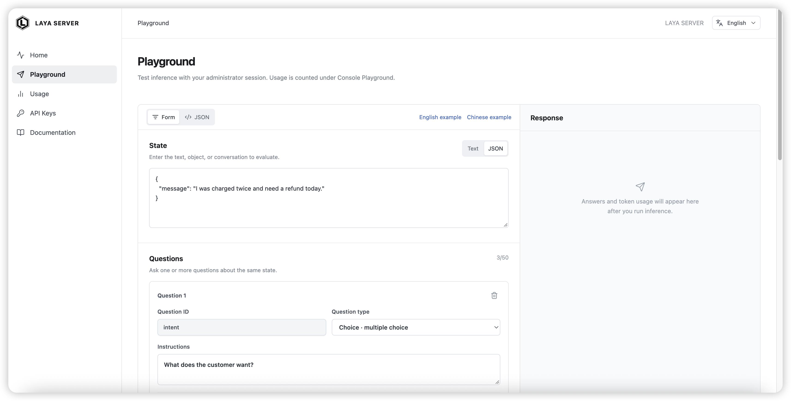</td>
<td align="center" valign="top">keine Medien veröffentlicht</td>
</tr></table>

🧩 <b><a href="https://github.com/Abhinavexists/lev">Abhinavexists/lev</a></b> · ⭐59 · Python · 🔎 inferred · 21 天

##### 📝 Zusammenfassung

Ein offenes System One-Entscheidungsmodell

##### 📌 Basisfakten

| Feld      | Wert               |
| --------- | ------------------ |
| Kategorie | `Weitere Projekte` |
| Beleg     | `inferred`         |
| Sprache   | Python             |

##### 📊 Daten

| Metrik            | Wert       |
| ----------------- | ---------- |
| Stars             | **59**     |
| Letzter Push      | 2026-10-15 |
| Erstmals gelistet | 2026-10-28 |

🏷 `jev` · `modal` · `qwen`

---

<table><tr><th align="center" width="50%">🖼 Bild</th><th align="center" width="50%">🎬 Video</th></tr><tr>
<td align="center" valign="top">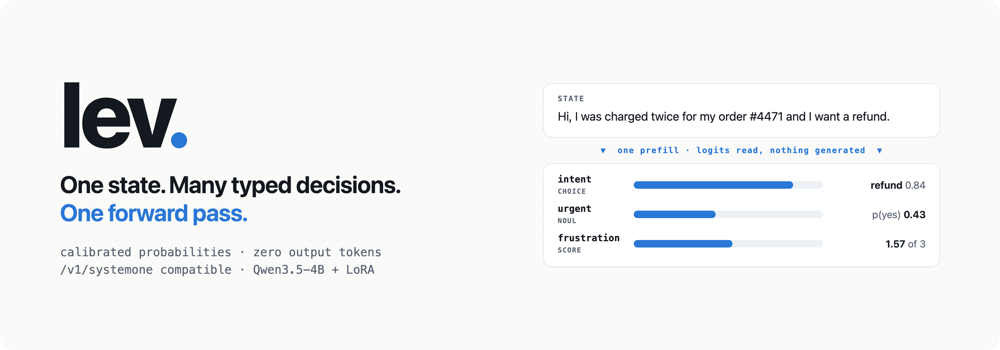</td>
<td align="center" valign="top">keine Medien veröffentlicht</td>
</tr></table>

🧩 <b><a href="https://github.com/Jev-Engineering/cookbook">Jev-Engineering/cookbook</a></b> · ⭐30 · Jupyter · 🔎 inferred · 2 天

##### 📝 Zusammenfassung

Sechzig Notebook-Rezepte für typisierte Entscheidungen mit Jev: Choice-, Noul- und Score-Muster von der ersten Klassifizierung bis zur Regelung mit geschlossenem Kreislauf

##### 📌 Basisfakten

| Feld      | Wert               |
| --------- | ------------------ |
| Kategorie | `Weitere Projekte` |
| Beleg     | `inferred`         |
| Sprache   | Jupyter            |

##### 📊 Daten

| Metrik            | Wert       |
| ----------------- | ---------- |
| Stars             | **30**     |
| Letzter Push      | 2026-11-03 |
| Erstmals gelistet | 2026-10-09 |

🏷 `cookbook` · `jev` · `jupyter-notebook` · `python` · `system-one` · `tutorials` · `typed-decisions` · `typesafe`

---

<table><tr><th align="center" width="50%">🖼 Bild</th><th align="center" width="50%">🎬 Video</th></tr><tr>
<td align="center" valign="top">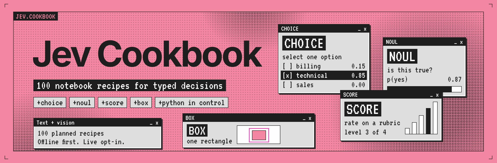</td>
<td align="center" valign="top">keine Medien veröffentlicht</td>
</tr></table>

🧩 <b><a href="https://github.com/nvkudva/ollajev">nvkudva/ollajev</a></b> · ⭐18 · Python · 🔎 inferred · 0 天

##### 📝 Zusammenfassung

Führe System One-Entscheidungsmodelle von Hugging Face lokal hinter dem Jev / System One API aus, im Ollama-Stil

##### 📌 Basisfakten

| Feld      | Wert               |
| --------- | ------------------ |
| Kategorie | `Weitere Projekte` |
| Beleg     | `inferred`         |
| Sprache   | Python             |

##### 📊 Daten

| Metrik            | Wert       |
| ----------------- | ---------- |
| Stars             | **18**     |
| Letzter Push      | 2026-11-05 |
| Erstmals gelistet | 2026-10-28 |

🏷 `decision-model` · `huggingface` · `jev` · `llama-cpp` · `local-llm` · `system-one` · `typesafe`

---

<table><tr><th align="center" width="50%">🖼 Bild</th><th align="center" width="50%">🎬 Video</th></tr><tr>
<td align="center" valign="top"></td>
<td align="center" valign="top">keine Medien veröffentlicht</td>
</tr></table>

🧩 <b><a href="https://github.com/manifoldor/xtags">manifoldor/xtags</a></b> · ⭐11 · HTML · 🔎 inferred · 20 天

##### 📝 Zusammenfassung

Auf der X-Timeline wird für jeden Beitrag markiert, wozu er dich bringen möchte. Die Entscheidung stammt von Jev, einem Modell, das nur Wahrscheinlichkeiten zurückgibt und keinen Text erzeugt.

##### 📌 Basisfakten

| Feld      | Wert               |
| --------- | ------------------ |
| Kategorie | `Weitere Projekte` |
| Beleg     | `inferred`         |
| Sprache   | HTML               |

##### 📊 Daten

| Metrik            | Wert       |
| ----------------- | ---------- |
| Stars             | **11**     |
| Letzter Push      | 2026-10-16 |
| Erstmals gelistet | 2026-10-26 |

🏷 `ai` · `chrome-extension` · `jev` · `typesafe` · `userscript` · `x-twitter`

---

<table><tr><th align="center" width="50%">🖼 Bild</th><th align="center" width="50%">🎬 Video</th></tr><tr>
<td align="center" valign="top"></td>
<td align="center" valign="top">keine Medien veröffentlicht</td>
</tr></table>

🧩 <b><a href="https://github.com/lawrence3699/Jev-Style-0.8B-Decision-v3-GGUF">lawrence3699/Jev-Style-0.8B-Decision-v3-GGUF</a></b> · ⭐1 · Python · 🔎 inferred · 0 天

##### 📝 Zusammenfassung

GitHub mirror of the chaoliangUNSW/Jev-Style-0.8B-Decision-v3-GGUF Hugging Face model

##### 📌 Basisfakten

| Feld      | Wert               |
| --------- | ------------------ |
| Kategorie | `Weitere Projekte` |
| Beleg     | `inferred`         |
| Sprache   | Python             |

##### 📊 Daten

| Metrik            | Wert       |
| ----------------- | ---------- |
| Stars             | **1**      |
| Letzter Push      | 2026-11-04 |
| Erstmals gelistet | 2026-11-05 |

🏷 `decision-model` · `huggingface-mirror` · `jev-style`

---

<table><tr><th align="center" width="50%">🖼 Bild</th><th align="center" width="50%">🎬 Video</th></tr><tr>
<td align="center" valign="top">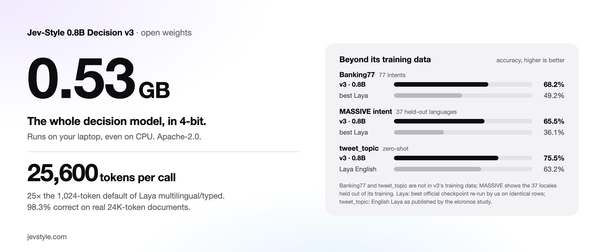</td>
<td align="center" valign="top">keine Medien veröffentlicht</td>
</tr></table>

🧩 <b><a href="https://github.com/lawrence3699/Jev-Style-0.8B-Decision-v3">lawrence3699/Jev-Style-0.8B-Decision-v3</a></b> · Python · 🔎 inferred · 0 天

##### 📝 Zusammenfassung

GitHub mirror of the chaoliangUNSW/Jev-Style-0.8B-Decision-v3 Hugging Face model

##### 📌 Basisfakten

| Feld      | Wert               |
| --------- | ------------------ |
| Kategorie | `Weitere Projekte` |
| Beleg     | `inferred`         |
| Sprache   | Python             |

##### 📊 Daten

| Metrik            | Wert       |
| ----------------- | ---------- |
| Stars             | **0**      |
| Letzter Push      | 2026-11-04 |
| Erstmals gelistet | 2026-11-05 |

🏷 `decision-model` · `huggingface-mirror` · `jev-style`

---

<table><tr><th align="center" width="50%">🖼 Bild</th><th align="center" width="50%">🎬 Video</th></tr><tr>
<td align="center" valign="top"></td>
<td align="center" valign="top">keine Medien veröffentlicht</td>
</tr></table>

<b>Mehr in dieser Kategorie</b> · 35

- [SoundBlaster/SwiftJev](https://github.com/SoundBlaster/SwiftJev) - Swift-Framework für den Zugriff auf das Jev-System One-Modell von TypeSafe.ai.
- [codaaiteam/jev-ai](https://github.com/codaaiteam/jev-ai) - Jev AI quickstart &amp; FAQ — TypeSafe AI.
- [Shristi1611/systemone-testbed](https://github.com/Shristi1611/systemone-testbed) - A security test environment for Jev-compatible decision models.
- [DreamBlooms/ifReflex.cpp](https://github.com/DreamBlooms/ifReflex.cpp) - Jedes LLM kann auf deinem Personal Computer als SystemOne-Entscheidungsmodell…
- [DevItaliya22/jev-chess](https://github.com/DevItaliya22/jev-chess) - Jev.
- [FrancescoDesiderato/Devfest_SystemOneModel](https://github.com/FrancescoDesiderato/Devfest_SystemOneModel) - Repository of Code for GDG DevFest 2026 Talk about &quot;System One Models&quot;.
- [jakob-lilliemarck/komply](https://github.com/jakob-lilliemarck/komply) - Use SystemOne models to check compliance with architectural rules.
- [justintout/systemone](https://github.com/justintout/systemone) - Ein inoffizielles Go-Modul zur Interaktion mit Jev und anderen System…
- [leejisabella/system_one_explanability](https://github.com/leejisabella/system_one_explanability) - Exploring model misalignment, System One model information availability, and…
- [prashu-asp/Systemonemodels](https://github.com/prashu-asp/Systemonemodels)
- [TomatenMarc/Sycophancy-System-One-Models](https://github.com/TomatenMarc/Sycophancy-System-One-Models)
- [unbraind/pm-jev](https://github.com/unbraind/pm-jev) - Typisierte, lokal ausgerichtete Entscheidungen für pm-Elemente mit Jev-artigen…
- [wang-erica/system-one-sft](https://github.com/wang-erica/system-one-sft) - Supervised fine tuning of System One models for image classification.
- [I-You-Dream/jev-from-scratch](https://github.com/I-You-Dream/jev-from-scratch) - 从零开源复刻 Jev（System One）决策模型范式，基于 Qwen 基座训练，支持 Choice / Noul 原语，包含推理、微调、ECE…
- [2951461586/Jev-Register-Tool](https://github.com/2951461586/Jev-Register-Tool) - TypeSafe（Jev / System One）Antrag → Bestätigungs-E-Mail → Genehmigung →…
- [rawwerks/one-system](https://github.com/rawwerks/one-system) - Nutze lokale und gehostete Klassifikatoren alias Entscheidungsmodelle alias…
- [botassembly/thinkthen](https://github.com/botassembly/thinkthen) - ThinkThen: Code, der weiß, was du meinst.
- [comoc/jev-minesweeper](https://github.com/comoc/jev-minesweeper) - Demo, bei der TypeSafe Jev (System One) Minesweeper im Browser lösen soll.
- [Shearerbeard/jev-driver](https://github.com/Shearerbeard/jev-driver) - Typed Rust driver for TypeSafe AI.
- [Arohtea/jev-readout](https://github.com/Arohtea/jev-readout) - 把一段内容交给 TypeSafe AI 的 Jev 模型，得到带概率分布的结构化判断.
- [cfu288/jev-vs-ml-classifiers](https://github.com/cfu288/jev-vs-ml-classifiers) - Wie gut ist das neueste JEV-Modell im Vergleich zu klassischen…
- [JeromyJSmith/jev-first-hour-desk](https://github.com/JeromyJSmith/jev-first-hour-desk) - Jev First-Hour Desk: marimo backtest + Jev decisions (static export).
- [lawrence3699/Jev-Style-2B-Decision-v3](https://github.com/lawrence3699/Jev-Style-2B-Decision-v3) - GitHub mirror of the chaoliangUNSW/Jev-Style-2B-Decision-v3 Hugging Face model.
- [lawrence3699/Jev-Style-2B-Decision-v3-GGUF](https://github.com/lawrence3699/Jev-Style-2B-Decision-v3-GGUF) - GitHub mirror of the chaoliangUNSW/Jev-Style-2B-Decision-v3-GGUF Hugging Face…
- [lawrence3699/Jev-Style-2B-Decision-v4](https://github.com/lawrence3699/Jev-Style-2B-Decision-v4) - GitHub mirror of the chaoliangUNSW/Jev-Style-2B-Decision-v4 Hugging Face model.
- [lawrence3699/Jev-Style-2B-Decision-v4-GGUF](https://github.com/lawrence3699/Jev-Style-2B-Decision-v4-GGUF) - GitHub mirror of the chaoliangUNSW/Jev-Style-2B-Decision-v4-GGUF Hugging Face…
- [lawrence3699/Jev-Style-Qwen3.5-2B-Decision-GGUF](https://github.com/lawrence3699/Jev-Style-Qwen3.5-2B-Decision-GGUF) - GitHub mirror of the chaoliangUNSW/Jev-Style-Qwen3.5-2B-Decision-GGUF Hugging…
- [lawrence3699/Jev-Style-Qwen3.5-2B-Decision-v2](https://github.com/lawrence3699/Jev-Style-Qwen3.5-2B-Decision-v2) - GitHub mirror of the chaoliangUNSW/Jev-Style-Qwen3.5-2B-Decision-v2 Hugging…
- [lawrence3699/Jev-Style-Qwen3.5-2B-Decision-v2-GGUF](https://github.com/lawrence3699/Jev-Style-Qwen3.5-2B-Decision-v2-GGUF) - GitHub mirror of the chaoliangUNSW/Jev-Style-Qwen3.5-2B-Decision-v2-GGUF…
- [lawrence3699/MacJev-0.8B-Decision-Data](https://github.com/lawrence3699/MacJev-0.8B-Decision-Data) - GitHub mirror of the chaoliangUNSW/MacJev-0.8B-Decision-Data Hugging Face…
- [LiLittleCat/jev-playlist-classify](https://github.com/LiLittleCat/jev-playlist-classify) - Klassifiziere große Wiedergabelisten anhand der Song-Sprache mit dem neuesten…
- [xiaotian1171/jev-trolley-switch](https://github.com/xiaotian1171/jev-trolley-switch) - Interactive Trolley Problem decision lab powered by Pollinations POST…
- [iapp-technology/openthai-systemone](https://github.com/iapp-technology/openthai-systemone) - OpenThai-SystemOne: offenes Thai + English System One-Entscheidungsmodell…
- [InterfazeAI/lev](https://github.com/InterfazeAI/lev) - Ein offenes System One-Entscheidungsmodell.
- [epergaboni/jevseo](https://github.com/epergaboni/jevseo) - Typisierte SEO-, AEO- und GEO-Bewertungen, angetrieben von Jev, einem System…

## Projekte nach Implementierungssprache

Das Ökosystem konzentriert sich auf Python und TypeScript, doch typisierte Clients tauchen weiterhin in anderen Sprachen auf. Diese Tabelle wird aus den Einträgen selbst erzeugt.

| Sprache    | Einträge | Beispiele                                                                                               |
| ---------- | -------- | ------------------------------------------------------------------------------------------------------- |
| Python     | 305      | `typesafe-ai/system-one-adapter-python`, `typesafe-ai/typesafe-sdk-python`, `typesafe-ai/WorkflowEvals` |
| TypeScript | 106      | `typesafe-ai/typesafe-sdk-js`, `TypeSafeAI/jev-harness`, `qkal/Canny`                                   |
| JavaScript | 61       | `clouatre-labs/decisions-judge-mcp`, `socai-io/jev-social`, `Ying-Kai-Liao/jev-browser`                 |
| Rust       | 34       | `chussenot/judgment`, `ollaya-dev/ollaya`, `supercorp-ai/supercov`                                      |
| HTML       | 26       | `typesafe-ai/typesafe-ai.github.io`, `yzfly/awesome-jev-zh`, `AkashPriyadarshii/jev-superpowers`        |
| Go         | 13       | `frodi-karlsson/onesie`, `devbackend/jevgo`, `JimmyWesley/rlcd-gateway`                                 |
| Jupyter    | 10       | `jexp/neo4jev`, `Mainakcris7/agent-guardrail-with-jev`, `SergeyBazhmin/krasivo-jev`                     |
| C#         | 6        | `laurentkempe/TypeSafeJevPlayground`, `elbruno/ElBruno.AI.Decisions`, `CMaintz/jev-dotnet`              |
| Java       | 5        | `Premo-Cloud/typesafe-sdk-java`, `CMaintz/jev-java`, `Murat-Selim/jev_doc_router`                       |
| PHP        | 5        | `basi/typesafe-ai-php-client`, `vibefilter/filament`, `Butochnikov/laravel-typesafe-jev`                |
| Swift      | 5        | `john-rocky/coreai-kit`, `mattt/AnyDecisionModel`, `chris-wozniczek/jev-voice-control`                  |
| Elixir     | 3        | `dannote/jev`, `Elue-dev/jev_elixir`, `schainks/system_one_client`                                      |
| Astro      | 2        | `heyjunpenn/awesome-jev`, `wizicer/jev_info_site`                                                       |
| C          | 2        | `giuliosmall/pg_typesafe`, `lijiawei255/jev-tune`                                                       |
| C++        | 2        | `DreamBlooms/dohnuts.cpp`, `DreamBlooms/ifReflex.cpp`                                                   |
| CSS        | 2        | `yangzhou-chaofan/awesome-jev-prompt`, `Dlmily/minimind-jev-dlmily`                                     |
| PowerShell | 2        | `BFLabsAI/bf-jev-deep-research`, `dfinke/Jev`                                                           |
| Ruby       | 2        | `obie/ruby_decision_model`, `Ray-Hughes/jevalyn`                                                        |
| Shell      | 2        | `realZachi/pg-jev`, `skylence-org/claudecode-jev-marketplace`                                           |
| TeX        | 2        | `dnakhoa/jev-deferred-crispification`, `xiaohuiyan/awesome-jev-papers`                                  |
| XS         | 2        | `cameronb-xano/jev-agent-guardrail`, `xano-community/agent-guardrail-jev`                               |
| Kotlin     | 1        | `MiaoWuNYA/rikkahub-sillytavern-android`                                                                |
| Nushell    | 1        | `cablehead/jev.nu`                                                                                      |
| Pascal     | 1        | `danieleteti/systemone-delphi`                                                                          |
| Scala      | 1        | `maxtrezzi/jev4s`                                                                                       |
| Svelte     | 1        | `fini/warped-sys1-lab`                                                                                  |

Nur Einträge, die eine Sprache angeben, werden gezählt. Infrastruktur-, Dokumentations- und Diskussionseinträge sind von dieser Tabelle ausgenommen.

## Mitwirken

Korrekturen sind willkommen und der schnellste Weg, diese Liste zu verbessern. Öffnen Sie ein Issue oder einen Pull Request, wenn ein Eintrag falsch einsortiert oder falsch eingestuft ist oder wenn ein Projekt zu Unrecht als Namenskollision ausgeschlossen wurde — gerade in dieser letzten Kategorie liegen automatisierte Filter am häufigsten falsch. Ergänzungen gelingen am besten, indem Sie eine Quelle in `scripts/collect.py` hinzufügen, statt das README zu bearbeiten, denn das README wird bei jedem Durchlauf neu erzeugt.

---

Unabhängiges Community-Projekt. Nicht mit TypeSafe AI verbunden, von ihr unterstützt oder geprüft. Produktverhalten, Preise, Limits und Modell-Aliase ändern sich ohne Ankündigung; prüfen Sie alles Tragende anhand der offiziellen Dokumentation. Assets bleiben Eigentum ihrer Upstream-Projekte und werden nur wiedergegeben, wo eine Lizenz es erlaubt.

Erzeugt von · 2026-11-06T00:18:18+08:00
