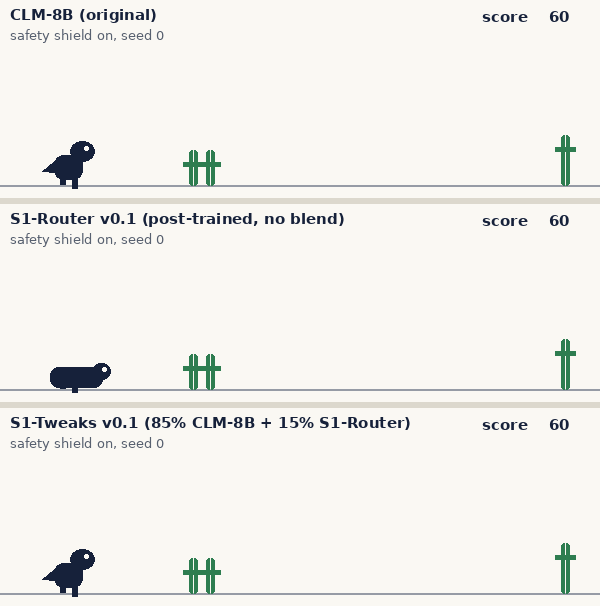
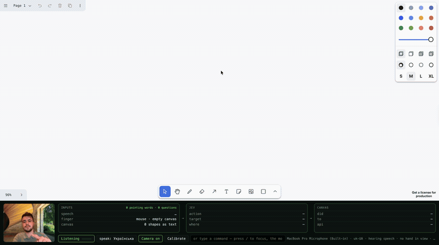
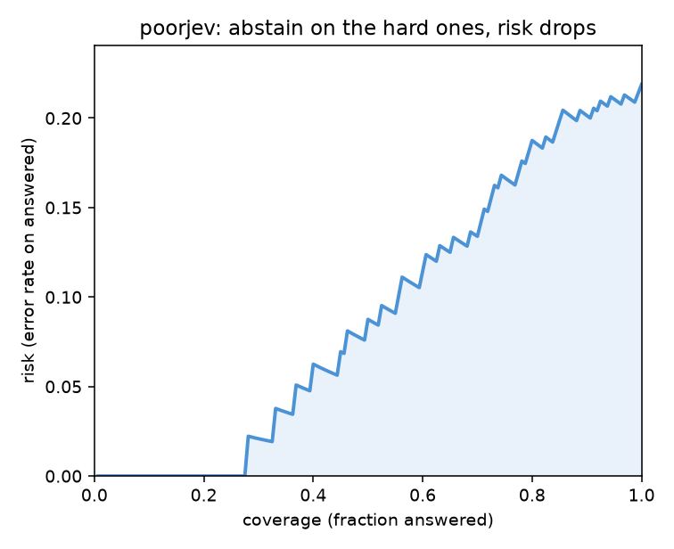
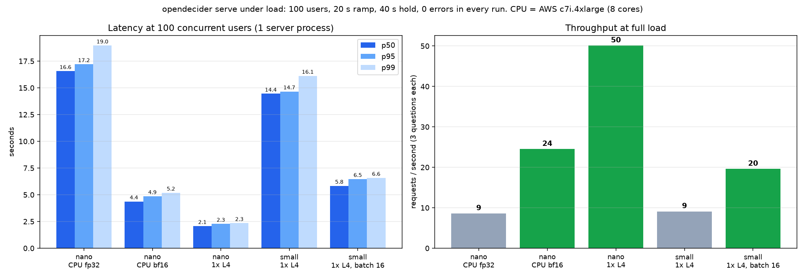
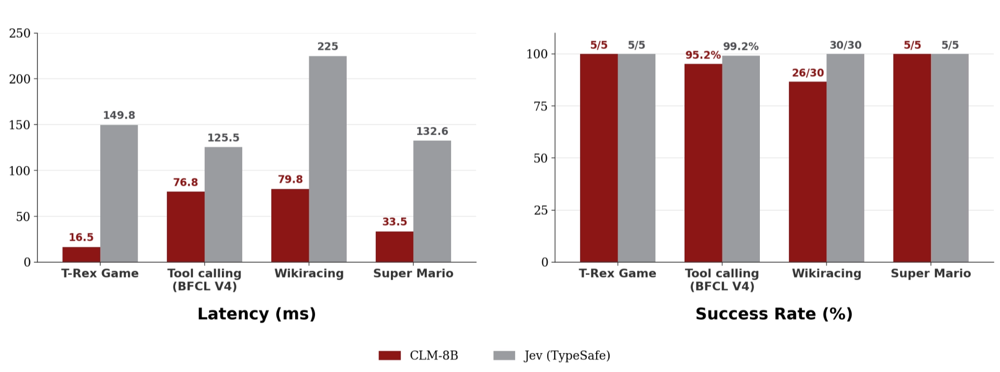

  

<h1 align="center">Awesome Jev Live</h1>

<b>El índice Jev clasificado por evidencia que se reconstruye cada dos horas.</b>

  
  
  
  
  
  

<a href="../README.md">English</a> · <a href="README.zh-CN.md">简体中文</a> · <a href="README.zh-TW.md">繁體中文</a> · <a href="README.ja.md">日本語</a> · <a href="README.ko.md">한국어</a> · <b>Español</b> · <a href="README.fr.md">Français</a> · <a href="README.de.md">Deutsch</a> · <a href="README.pt-BR.md">Português (Brasil)</a> · <a href="README.ru.md">Русский</a> · <a href="README.it.md">Italiano</a> · <a href="README.ar.md">العربية</a> · <a href="README.hi.md">हिन्दी</a> · <a href="README.tr.md">Türkçe</a> · <a href="README.vi.md">Tiếng Việt</a> · <a href="README.th.md">ไทย</a> · <a href="README.id.md">Bahasa Indonesia</a> · <a href="README.pl.md">Polski</a> · <a href="README.nl.md">Nederlands</a> · <a href="README.uk.md">Українська</a>

> [!NOTE]
> **Índice en vivo** · Última sincronización: `2026-11-26T01:51:51+08:00` (UTC+8)
> · Entradas: **779** · Nuevas en este ciclo: **2** · Lenguajes de implementación: **26**

Cada entrada de abajo fue recolectada, filtrada y verificada de nuevo por el pipeline de este repositorio. Los números y las marcas de tiempo provienen de las fuentes, no de una instantánea escrita a mano.

## 🔥 Selección del momento — el primero de cada categoría

Una entrada por categoría, ordenada por grado de evidencia y estrellas, recalculada en cada sincronización. Es un ranking, no una recomendación; cada selección enlaza con su ficha completa. Se prefieren los proyectos que publicaron una captura o una grabación, para que la franja siga siendo visual.

<table>
<tr>
<td width="50%" valign="top">
<b>🏛️ <a href="https://github.com/typesafe-ai/skills">typesafe-ai/skills</a></b>
⭐2920 · ✅ official
Habilidades de agente para crear con los System One API de TypeSafe
</td>
<td width="50%" valign="top">

<b>🧰 <a href="https://github.com/clouatre-labs/decisions-judge-mcp">clouatre-labs/decisions-judge-mcp</a></b>
⭐5 · JavaScript · 👁️ observed
Decisiones tipadas para agentes de IA como herramienta MCP: probabilidad de sí/no (noul), elección y puntuación en una única solicitud rápida. Respaldado por el…
</td>
</tr>
<tr>
<td width="50%" valign="top">

<b>🤖 <a href="https://github.com/gargpratyush/jev-router">gargpratyush/jev-router</a></b>
⭐676 · JavaScript · 🔎 inferred
Dirige la tarea al modelo más barato en claude code usando jev-router
</td>
<td width="50%" valign="top">

<b>🛡️ <a href="https://github.com/dharmeshgurnani/codeotter">dharmeshgurnani/codeotter</a></b>
⭐6 · TypeScript · 👁️ observed
Revisiones de código con IA autónomas y autoalojadas, medidores de puntuación calibrados y puertas de merge desde cualquier modelo abierto.
</td>
</tr>
<tr>
<td width="50%" valign="top">

<b>🧪 <a href="https://github.com/Mapika/decider">Mapika/decider</a></b>
⭐1035 · Python · 👁️ observed
Una familia de modelos de estilo System One ajustados a partir de Qwen3.5, diseñados para decisiones tipadas de una sola pasada con probabilidades calibradas.
</td>
<td width="50%" valign="top">

<b>🔬 <a href="https://github.com/r-ms/mini-jev">r-ms/mini-jev</a></b>
⭐65 · Python · 🔎 inferred
mini-Jev: así es como se ve una interfaz de decisión tipada al estilo de Jev sobre un Qwen3-4B congelado: lee los logits de la letra de la opción en lugar de generar…
</td>
</tr>
<tr>
<td width="50%" valign="top">

<b>🎮 <a href="https://github.com/MCG-NJU/VideoJev">MCG-NJU/VideoJev</a></b>
⭐318 · Python · 👁️ observed
VideoJev: System One Model para la comprensión e interacción de vídeo
</td>
<td width="50%" valign="top">
<b>📰 <a href="https://docs.typesafe.ai/model-jaggedness/jev-1.13">9 clases de defectos conocidos (jaggedness)</a></b>
⭐0 · ✅ official
Comprensión literal, **conteo no fiable**, comparación de fechas, indirección multinivel, state grande con detalles irrelevantes, contenido adversarial, contradicción…
</td>
</tr>
</table>

## Contenido

- [¿Qué es Jev?](#qué-es-jev)
- [Cómo se clasifican las entradas](#cómo-se-clasifican-las-entradas)
- [SDK oficiales y herramientas para desarrolladores](#sdk-oficiales-y-herramientas-para-desarrolladores) — **7**
- [Clientes, SDK y adaptadores de la comunidad](#clientes-sdk-y-adaptadores-de-la-comunidad) — **140**
- [Herramientas para agentes: MCP, hooks, gates y agentes de programación](#herramientas-para-agentes-mcp-hooks-gates-y-agentes-de-programación) — **245**
- [Enrutamiento, guardarraíles y aprobaciones](#enrutamiento-guardarraíles-y-aprobaciones) — **58**
- [Evaluación, calibración y benchmarks](#evaluación-calibración-y-benchmarks) — **84**
- [Reproducciones abiertas, pesos e investigación de arquitectura](#reproducciones-abiertas-pesos-e-investigación-de-arquitectura) — **55**
- [Aplicaciones, juegos, robótica y demos interactivas](#aplicaciones-juegos-robótica-y-demos-interactivas) — **45**
- [Artículos, discusiones y listas hermanas](#artículos-discusiones-y-listas-hermanas) — **72**
- [Otros proyectos](#otros-proyectos) — **73**
- [Proyectos por lenguaje de implementación](#proyectos-por-lenguaje-de-implementación)

## ¿Qué es Jev?

Jev es el primer **System One model** de TypeSafe AI. No escribe prosa. Recibe un estado más preguntas cuyo espacio de respuesta defines de antemano, y devuelve valores tipados con distribuciones de probabilidad sobre las que tu código puede ramificar.

|                       |                                                                                                                                                                                                                                         |
| --------------------- | --------------------------------------------------------------------------------------------------------------------------------------------------------------------------------------------------------------------------------------- |
| **Forma**             | `state + typed questions` → `constrained answers + probabilities` → `your code`                                                                                                                                                         |
| **Primitivas**        | `Choice` (elegir una entre ≤255 opciones), `Score` (una rúbrica de 2–10), `Noul` (un sí/no probabilístico)                                                                                                                              |
| **Endpoint**          | `POST https://api.typesafe.ai/v1/systemone`, modelo `jev-1.13.0` / alias `jev-latest`                                                                                                                                                   |
| **Encaja bien en**    | enrutamiento, triaje, puntuación, moderación, verificación y gates de baja latencia dentro de un flujo acotado                                                                                                                          |
| **Límites conocidos** | el conteo no es fiable, la indirección de varios niveles es débil, y el material oficial nombra nueve clases de jaggedness. Una salida válida según el esquema no es lo mismo que una decisión correcta: calibra con tus propios datos. |

## Cómo se clasifican las entradas

La mayoría de las listas de este espacio afirman la inclusión. Esta dice cuánto verificó realmente y luego te deja filtrar en consecuencia.

| Grado        | Qué significa                                                                                                                                                              |
| ------------ | -------------------------------------------------------------------------------------------------------------------------------------------------------------------------- |
| `official`   | Publicado por la propia TypeSafe AI.                                                                                                                                       |
| `observed`   | Un artefacto público que puede abrirse y leerse: código real, configuración real o una declaración explícita de TypeSafe/Jev en el nombre o en los topics del repositorio. |
| `inferred`   | Detectado por una señal ambigua junto con vocabulario corroborador, pero aún no leído línea por línea.                                                                     |
| `unverified` | Parece relacionado, nada confirmado de forma independiente. Se incluye solo para descubrimiento.                                                                           |

## SDK oficiales y herramientas para desarrolladores

Todo lo que publica TypeSafe. Empieza aquí.

🏛️ <b><a href="https://github.com/typesafe-ai/skills">typesafe-ai/skills</a></b> · ⭐2920 · ✅ official · 32 天 · ⭐+1

##### 📝 Resumen

Habilidades de agente para crear con los System One API de TypeSafe

> 💡 Las propias habilidades de agente del proveedor. Como se actualiza continuamente, es lo más parecido a una especificación de cómo TypeSafe pretende que Jev se controle desde un agente.

##### 📌 Datos básicos

| Campo     | Valor                                               |
| --------- | --------------------------------------------------- |
| Categoría | `SDK oficiales y herramientas para desarrolladores` |
| Evidencia | `official`                                          |

##### 📊 Datos

| Métrica           | Valor         |
| ----------------- | ------------- |
| Estrellas         | **2920** (+1) |
| Último push       | 2026-10-23    |
| Primera aparición | 2026-09-18    |

🏛️ <b><a href="https://github.com/typesafe-ai/system-one-adapter-python">typesafe-ai/system-one-adapter-python</a></b> · ⭐410 · Python · ✅ official · 10 天

##### 📝 Resumen

Reemplazo directo de TypeSafeClient respaldado por LLM APIs

> 💡 Reemplazo directo que respalda la misma interfaz con un proveedor LLM ordinario. Esta es la forma honesta de probar A/B una decisión tipada frente a un prompt, con tus propios datos, antes de comprometerte con cualquiera de las dos opciones.

🔧 Usado en código: `README.md`

##### 📌 Datos básicos

| Campo     | Valor                                               |
| --------- | --------------------------------------------------- |
| Categoría | `SDK oficiales y herramientas para desarrolladores` |
| Evidencia | `official`                                          |
| Lenguaje  | Python                                              |

##### 📊 Datos

| Métrica           | Valor      |
| ----------------- | ---------- |
| Estrellas         | **410**    |
| Último push       | 2026-11-15 |
| Primera aparición | 2026-10-23 |

🏛️ <b><a href="https://github.com/typesafe-ai/typesafe-sdk-python">typesafe-ai/typesafe-sdk-python</a></b> · ⭐317 · Python · ✅ official · 0 天

##### 📝 Resumen

La biblioteca oficial de Python para TypeSafe API

> 💡 Clientes síncronos y asíncronos. La ruta más rápida desde una clave de API hasta una decisión tipada, y la referencia con la que se comparan los clientes de la comunidad.

##### 📌 Datos básicos

| Campo     | Valor                                               |
| --------- | --------------------------------------------------- |
| Categoría | `SDK oficiales y herramientas para desarrolladores` |
| Evidencia | `official`                                          |
| Lenguaje  | Python                                              |

##### 📊 Datos

| Métrica           | Valor      |
| ----------------- | ---------- |
| Estrellas         | **317**    |
| Último push       | 2026-11-25 |
| Primera aparición | 2026-10-23 |

🏛️ <b><a href="https://github.com/typesafe-ai/typesafe-sdk-js">typesafe-ai/typesafe-sdk-js</a></b> · ⭐288 · TypeScript · ✅ official · 14 天

##### 📝 Resumen

La biblioteca oficial de TypeScript/JavaScript para TypeSafe API

> 💡 Cliente de TypeScript en el que el tipo de respuesta se infiere de la pregunta que hiciste, de modo que un tipo de retorno incompatible es un error de compilación en lugar de una sorpresa en tiempo de ejecución.

##### 📌 Datos básicos

| Campo     | Valor                                               |
| --------- | --------------------------------------------------- |
| Categoría | `SDK oficiales y herramientas para desarrolladores` |
| Evidencia | `official`                                          |
| Lenguaje  | TypeScript                                          |

##### 📊 Datos

| Métrica           | Valor      |
| ----------------- | ---------- |
| Estrellas         | **288**    |
| Último push       | 2026-11-11 |
| Primera aparición | 2026-10-23 |

🏛️ <b><a href="https://github.com/TypeSafeAI/jev-harness">TypeSafeAI/jev-harness</a></b> · ⭐42 · TypeScript · ✅ official · 8 天

##### 📝 Resumen

A custom coding harness for TypeSafe AI's Jev: an LLM proposes, Jev answers narrow questions, code decides, every step leaves a receipt.

##### 📌 Datos básicos

| Campo     | Valor                                               |
| --------- | --------------------------------------------------- |
| Categoría | `SDK oficiales y herramientas para desarrolladores` |
| Evidencia | `official`                                          |
| Lenguaje  | TypeScript                                          |

##### 📊 Datos

| Métrica           | Valor      |
| ----------------- | ---------- |
| Estrellas         | **42**     |
| Último push       | 2026-11-17 |
| Primera aparición | 2026-11-18 |

🏷 `agent-harness` · `agentic-coding` · `ai-agents` · `ai-governance` · `ai-safety` · `code-review` · `coding-agent` · `developer-tools`

🏛️ <b><a href="https://github.com/typesafe-ai/WorkflowEvals">typesafe-ai/WorkflowEvals</a></b> · ⭐22 · Python · ✅ official · 11 天

##### 📝 Resumen

Código de flujo de trabajo de evals.typesafe.ai publicado

##### 📌 Datos básicos

| Campo     | Valor                                               |
| --------- | --------------------------------------------------- |
| Categoría | `SDK oficiales y herramientas para desarrolladores` |
| Evidencia | `official`                                          |
| Lenguaje  | Python                                              |

##### 📊 Datos

| Métrica           | Valor      |
| ----------------- | ---------- |
| Estrellas         | **22**     |
| Último push       | 2026-11-14 |
| Primera aparición | 2026-10-23 |

🏛️ <b><a href="https://github.com/typesafe-ai/typesafe-ai.github.io">typesafe-ai/typesafe-ai.github.io</a></b> · ⭐2 · HTML · ✅ official · 174 天

##### 📝 Resumen

No se publicó ninguna descripción en el repositorio de origen.

##### 📌 Datos básicos

| Campo     | Valor                                               |
| --------- | --------------------------------------------------- |
| Categoría | `SDK oficiales y herramientas para desarrolladores` |
| Evidencia | `official`                                          |
| Lenguaje  | HTML                                                |

##### 📊 Datos

| Métrica           | Valor      |
| ----------------- | ---------- |
| Estrellas         | **2**      |
| Último push       | 2026-06-04 |
| Primera aparición | 2026-10-23 |

## Clientes, SDK y adaptadores de la comunidad

Clientes tipados para el endpoint System One, en tantos lenguajes como la comunidad haya alcanzado a cubrir.

🧰 <b><a href="https://github.com/realZachi/pg-jev">realZachi/pg-jev</a></b> · ⭐1316 · Shell · 👁️ observed · 50 天

##### 📝 Resumen

Haz preguntas a tus tablas de Postgres en lenguaje natural. Una extensión de PostgreSQL impulsada por Jev de TypeSafe.

🔧 Usado en código: `README.md`

##### 📌 Datos básicos

| Campo     | Valor                                         |
| --------- | --------------------------------------------- |
| Categoría | `Clientes, SDK y adaptadores de la comunidad` |
| Evidencia | `observed`                                    |
| Lenguaje  | Shell                                         |

##### 📊 Datos

| Métrica           | Valor      |
| ----------------- | ---------- |
| Estrellas         | **1316**   |
| Último push       | 2026-10-06 |
| Primera aparición | 2026-10-29 |

🧰 <b><a href="https://github.com/jexp/neo4jev">jexp/neo4jev</a></b> · ⭐190 · Jupyter · 👁️ observed · 68 天

##### 📝 Resumen

System One Model Jev de Typesafe.ai que recorre un grafo Neo4j utilizando un clasificador sobre relaciones vecinas

##### 📌 Datos básicos

| Campo     | Valor                                         |
| --------- | --------------------------------------------- |
| Categoría | `Clientes, SDK y adaptadores de la comunidad` |
| Evidencia | `observed`                                    |
| Lenguaje  | Jupyter                                       |

##### 📊 Datos

| Métrica           | Valor      |
| ----------------- | ---------- |
| Estrellas         | **190**    |
| Último push       | 2026-09-18 |
| Primera aparición | 2026-10-28 |

🧰 <b><a href="https://github.com/keltokhy/jgrep">keltokhy/jgrep</a></b> · ⭐141 · Python · 👁️ observed · 39 天

##### 📝 Resumen

grep, pero el patrón es una descripción. Filtra líneas por significado con el modelo de decisiones Jev de TypeSafe: ~200 ms y una milésima de céntimo por línea.

🔧 Usado en código: `README.md`

##### 📌 Datos básicos

| Campo     | Valor                                         |
| --------- | --------------------------------------------- |
| Categoría | `Clientes, SDK y adaptadores de la comunidad` |
| Evidencia | `observed`                                    |
| Lenguaje  | Python                                        |

##### 📊 Datos

| Métrica           | Valor      |
| ----------------- | ---------- |
| Estrellas         | **141**    |
| Último push       | 2026-10-17 |
| Primera aparición | 2026-10-29 |

🏷 `cli` · `grep` · `jev` · `openrouter` · `semantic-search` · `typesafe`

🧰 <b><a href="https://github.com/qkal/Canny">qkal/Canny</a></b> · ⭐136 · TypeScript · 👁️ observed · 12 天

##### 📝 Resumen

Impide que los agentes de programación de IA afirmen que el trabajo está terminado sin pruebas. Los hooks deterministas deciden y Jev de TypeSafe asesora. Registro de solo adición, cero dependencias en tiempo de ejecución.

🔧 Usado en código: `README.md`

##### 📌 Datos básicos

| Campo     | Valor                                         |
| --------- | --------------------------------------------- |
| Categoría | `Clientes, SDK y adaptadores de la comunidad` |
| Evidencia | `observed`                                    |
| Lenguaje  | TypeScript                                    |

##### 📊 Datos

| Métrica           | Valor      |
| ----------------- | ---------- |
| Estrellas         | **136**    |
| Último push       | 2026-11-13 |
| Primera aparición | 2026-10-29 |

🏷 `agent-hooks` · `ai-agents` · `claude-code` · `claude-code-hooks` · `codex` · `codex-cli` · `guardrails` · `jev`

🧰 <b><a href="https://github.com/AkashPriyadarshii/jev-curate">AkashPriyadarshii/jev-curate</a></b> · ⭐116 · Rust · 👁️ observed · 14 天

##### 📝 Resumen

High-throughput synthetic and pretraining dataset sifter for TypeSafe Jev. Rust streaming core, Parquet and JSONL I/O, typed Choice/Score/Noul judgments, speculative fan-out, 24.0 rows/sec measured.

🔧 Usado en código: `AGENTS.md`, `site/llms.txt`, `docs/DESIGN.md`

##### 📌 Datos básicos

| Campo     | Valor                                         |
| --------- | --------------------------------------------- |
| Categoría | `Clientes, SDK y adaptadores de la comunidad` |
| Evidencia | `observed`                                    |
| Lenguaje  | Rust                                          |

##### 📊 Datos

| Métrica           | Valor      |
| ----------------- | ---------- |
| Estrellas         | **116**    |
| Último push       | 2026-11-11 |
| Primera aparición | 2026-11-05 |

🏷 `arrow` · `cli` · `data-cleaning` · `data-engineering` · `dataset-curation` · `eval-harness` · `fine-tuning` · `jev`

🧰 <b><a href="https://github.com/yzfly/awesome-jev-zh">yzfly/awesome-jev-zh</a></b> · ⭐97 · HTML · 👁️ observed · 0 天

##### 📝 Resumen

Lista seleccionada en chino de Jev / TypeSafe System One: materiales oficiales, SDK, aplicaciones populares, herramientas de Agent, réplicas de código abierto y evaluaciones independientes, con guías de inicio en chino; incorpora automáticamente cada día proyectos populares de GitHub.

🔧 Usado en código: `docs/quickstart.md`

##### 📌 Datos básicos

| Campo     | Valor                                         |
| --------- | --------------------------------------------- |
| Categoría | `Clientes, SDK y adaptadores de la comunidad` |
| Evidencia | `observed`                                    |
| Lenguaje  | HTML                                          |

##### 📊 Datos

| Métrica           | Valor      |
| ----------------- | ---------- |
| Estrellas         | **97**     |
| Último push       | 2026-11-25 |
| Primera aparición | 2026-09-18 |

🏷 `ai-agent` · `awesome` · `awesome-list` · `chinese` · `jev` · `llm` · `structured-output` · `system-one`

🧰 <b><a href="https://github.com/obie/ruby_decision_model">obie/ruby_decision_model</a></b> · ⭐61 · Ruby · 👁️ observed · 44 天

##### 📝 Resumen

Cliente Ruby para modelos de decisiones como Typesafe Jev

🔧 Usado en código: `README.md`

##### 📌 Datos básicos

| Campo     | Valor                                         |
| --------- | --------------------------------------------- |
| Categoría | `Clientes, SDK y adaptadores de la comunidad` |
| Evidencia | `observed`                                    |
| Lenguaje  | Ruby                                          |

##### 📊 Datos

| Métrica           | Valor      |
| ----------------- | ---------- |
| Estrellas         | **61**     |
| Último push       | 2026-10-12 |
| Primera aparición | 2026-10-29 |

🧰 <b><a href="https://github.com/bodepudimuneendra-netizen/ConsciousDB">bodepudimuneendra-netizen/ConsciousDB</a></b> · ⭐56 · Python · 👁️ observed · 23 天

##### 📝 Resumen

Un framework Agentic GraphRAG independiente de la base de datos que utiliza modelos System One intercambiables (Laya local / Jev en la nube). Una capa de inteligencia plug-and-play con una canalización completa de 4 fases, evaluación continua y recorrido A* personalizado para cualquier base de datos de grafos.

##### 📌 Datos básicos

| Campo     | Valor                                         |
| --------- | --------------------------------------------- |
| Categoría | `Clientes, SDK y adaptadores de la comunidad` |
| Evidencia | `observed`                                    |
| Lenguaje  | Python                                        |

##### 📊 Datos

| Métrica           | Valor      |
| ----------------- | ---------- |
| Estrellas         | **56**     |
| Último push       | 2026-11-02 |
| Primera aparición | 2026-11-20 |

🏷 `astar-algorithm` · `eval-harness` · `fine-tuning` · `graphdatabase` · `graprag` · `jev` · `laya` · `neo4j`

🧰 <b><a href="https://github.com/AkashPriyadarshii/jev-superpowers">AkashPriyadarshii/jev-superpowers</a></b> · ⭐40 · HTML · 👁️ observed · 48 天

##### 📝 Resumen

Systematic software development framework for AI coding agents upgraded with TypeSafe Jev System One typed decisions

🔧 Usado en código: `CLAUDE.md`

##### 📌 Datos básicos

| Campo     | Valor                                         |
| --------- | --------------------------------------------- |
| Categoría | `Clientes, SDK y adaptadores de la comunidad` |
| Evidencia | `observed`                                    |
| Lenguaje  | HTML                                          |

##### 📊 Datos

| Métrica           | Valor      |
| ----------------- | ---------- |
| Estrellas         | **40**     |
| Último push       | 2026-10-08 |
| Primera aparición | 2026-11-05 |

🏷 `agentic-skills` · `ai-agents` · `antigravity` · `claude-code` · `codex` · `coding-agents` · `cursor` · `developer-tools`

🧰 <b><a href="https://github.com/MrJev/awesome-jev">MrJev/awesome-jev</a></b> · ⭐21 · Python · 👁️ observed · 0 天

##### 📝 Resumen

Lista seleccionada de proyectos, integraciones y recursos para Jev, el modelo System One de TypeSafe AI.

##### 📌 Datos básicos

| Campo     | Valor                                         |
| --------- | --------------------------------------------- |
| Categoría | `Clientes, SDK y adaptadores de la comunidad` |
| Evidencia | `observed`                                    |
| Lenguaje  | Python                                        |

##### 📊 Datos

| Métrica           | Valor      |
| ----------------- | ---------- |
| Estrellas         | **21**     |
| Último push       | 2026-11-25 |
| Primera aparición | 2026-09-18 |

🏷 `ai-agents` · `awesome` · `awesome-list` · `jev` · `mcp` · `typesafe`

🧰 <b><a href="https://github.com/ckaraca/awesome-jev">ckaraca/awesome-jev</a></b> · ⭐18 · Python · 👁️ observed · 2 天

##### 📝 Resumen

Una lista seleccionada de herramientas, integraciones y experimentos construidos sobre Jev, el modelo System One de TypeSafe AI para decisiones rápidas y tipadas.

##### 📌 Datos básicos

| Campo     | Valor                                         |
| --------- | --------------------------------------------- |
| Categoría | `Clientes, SDK y adaptadores de la comunidad` |
| Evidencia | `observed`                                    |
| Lenguaje  | Python                                        |

##### 📊 Datos

| Métrica           | Valor      |
| ----------------- | ---------- |
| Estrellas         | **18**     |
| Último push       | 2026-11-23 |
| Primera aparición | 2026-09-19 |

🏷 `ai-agents` · `awesome` · `awesome-list` · `computer-use` · `jev` · `llm` · `system-one` · `typesafe`

🧰 <b><a href="https://github.com/Premo-Cloud/typesafe-sdk-java">Premo-Cloud/typesafe-sdk-java</a></b> · ⭐12 · Java · 👁️ observed · 34 天

##### 📝 Resumen

Java SDK comunitario para Jev, el modelo System One de TypeSafe: preguntas tipadas de entrada y respuestas tipadas con probabilidades calibradas de salida. Java 17+, starter de Spring Boot (no oficial)

##### 📌 Datos básicos

| Campo     | Valor                                         |
| --------- | --------------------------------------------- |
| Categoría | `Clientes, SDK y adaptadores de la comunidad` |
| Evidencia | `observed`                                    |
| Lenguaje  | Java                                          |

##### 📊 Datos

| Métrica           | Valor      |
| ----------------- | ---------- |
| Estrellas         | **12**     |
| Último push       | 2026-10-21 |
| Primera aparición | 2026-10-28 |

🏷 `java` · `jev` · `sdk` · `spring-boot` · `system-one` · `system-one-models` · `typesafe`

🧰 <b><a href="https://github.com/clouatre-labs/decisions-judge-mcp">clouatre-labs/decisions-judge-mcp</a></b> · ⭐5 · JavaScript · 👁️ observed · 0 天

##### 📝 Resumen

Decisiones tipadas para agentes de IA como herramienta MCP: probabilidad de sí/no (noul), elección y puntuación en una única solicitud rápida. Respaldado por el modelo TypeSafe System One.

##### 📌 Datos básicos

| Campo     | Valor                                         |
| --------- | --------------------------------------------- |
| Categoría | `Clientes, SDK y adaptadores de la comunidad` |
| Evidencia | `observed`                                    |
| Lenguaje  | JavaScript                                    |

##### 📊 Datos

| Métrica           | Valor      |
| ----------------- | ---------- |
| Estrellas         | **5**      |
| Último push       | 2026-11-25 |
| Primera aparición | 2026-10-12 |

🏷 `agent` · `ai` · `cli` · `decision-making` · `decisions` · `judge` · `llm` · `mcp`

---

<table><tr><th align="center" width="50%">🖼 Imagen</th><th align="center" width="50%">🎬 Vídeo</th></tr><tr>
<td align="center" valign="top"></td>
<td align="center" valign="top"> grabación animada</td>
</tr></table>

🧰 <b><a href="https://github.com/elbruno/ElBruno.AI.Decisions">elbruno/ElBruno.AI.Decisions</a></b> · ⭐5 · C# · 👁️ observed · 6 天

##### 📝 Resumen

.NET 10 decision SDK: Choose, Score, and Assess with Microsoft Foundry (Microsoft-Decision-1), native local Ollama System One models, and TypeSafe AI Jev. One API, probabilities instead of paragraphs.

##### 📌 Datos básicos

| Campo     | Valor                                         |
| --------- | --------------------------------------------- |
| Categoría | `Clientes, SDK y adaptadores de la comunidad` |
| Evidencia | `observed`                                    |
| Lenguaje  | C#                                            |

##### 📊 Datos

| Métrica           | Valor      |
| ----------------- | ---------- |
| Estrellas         | **5**      |
| Último push       | 2026-11-19 |
| Primera aparición | 2026-11-18 |

🏷 `dotnet` · `dotnet10` · `jev` · `microsoft-extensions-ai` · `nuget`

---

<table><tr><th align="center" width="50%">🖼 Imagen</th><th align="center" width="50%">🎬 Vídeo</th></tr><tr>
<td align="center" valign="top"></td>
<td align="center" valign="top">sin medios publicados</td>
</tr></table>

🧰 <b><a href="https://github.com/agent-ix/sapho">agent-ix/sapho</a></b> · ⭐2 · Rust · 👁️ observed · 2 天

##### 📝 Resumen

Compound decisions with System One models like Jev: ask small questions, combine the answers with rules you write in a decision graph. Rust library and CLI.

##### 📌 Datos básicos

| Campo     | Valor                                         |
| --------- | --------------------------------------------- |
| Categoría | `Clientes, SDK y adaptadores de la comunidad` |
| Evidencia | `observed`                                    |
| Lenguaje  | Rust                                          |

##### 📊 Datos

| Métrica           | Valor      |
| ----------------- | ---------- |
| Estrellas         | **2**      |
| Último push       | 2026-11-23 |
| Primera aparición | 2026-11-23 |

🏷 `ai` · `cli` · `clm` · `code-review` · `dag` · `decision-engine` · `decision-graph` · `fuzzy-logic`

---

<table><tr><th align="center" width="50%">🖼 Imagen</th><th align="center" width="50%">🎬 Vídeo</th></tr><tr>
<td align="center" valign="top"></td>
<td align="center" valign="top">sin medios publicados</td>
</tr></table>

🧰 <b><a href="https://github.com/Bonzokoles/36_chambers">Bonzokoles/36_chambers</a></b> · Python · 👁️ observed · 33 天

##### 📝 Resumen

Motor federado de recuperación de conocimiento para agentes de AI. Enruta consultas entre backends especializados (FTS5, ChromaDB, graph) mediante un orquestador registry-first con enrutamiento de AI TypeSafe/Jev y reordenamiento de evidencia. Solo lectura por defecto, protegido por seguridad por diseño.

##### 📌 Datos básicos

| Campo     | Valor                                         |
| --------- | --------------------------------------------- |
| Categoría | `Clientes, SDK y adaptadores de la comunidad` |
| Evidencia | `observed`                                    |
| Lenguaje  | Python                                        |

##### 📊 Datos

| Métrica           | Valor      |
| ----------------- | ---------- |
| Estrellas         | **0**      |
| Último push       | 2026-10-22 |
| Primera aparición | 2026-11-24 |

🏷 `ai-agents` · `ai-infrastructure` · `chromadb` · `embeddings` · `federated-search` · `fts5` · `information-retrieval` · `jev`

---

<table><tr><th align="center" width="50%">🖼 Imagen</th><th align="center" width="50%">🎬 Vídeo</th></tr><tr>
<td align="center" valign="top"></td>
<td align="center" valign="top">sin medios publicados</td>
</tr></table>

Recurso enlazado directamente desde el repositorio de origen porque no se declaró ninguna licencia que permita su redistribución.

🧰 <b><a href="https://github.com/rbalch/ouija">rbalch/ouija</a></b> · Rust · 👁️ observed · 1 天

##### 📝 Resumen

CLI tool for interacting with system one models from command line.

##### 📌 Datos básicos

| Campo     | Valor                                         |
| --------- | --------------------------------------------- |
| Categoría | `Clientes, SDK y adaptadores de la comunidad` |
| Evidencia | `observed`                                    |
| Lenguaje  | Rust                                          |

##### 📊 Datos

| Métrica           | Valor      |
| ----------------- | ---------- |
| Estrellas         | **0**      |
| Último push       | 2026-11-23 |
| Primera aparición | 2026-11-24 |

---

<table><tr><th align="center" width="50%">🖼 Imagen</th><th align="center" width="50%">🎬 Vídeo</th></tr><tr>
<td align="center" valign="top"></td>
<td align="center" valign="top">sin medios publicados</td>
</tr></table>

🧰 <b><a href="https://github.com/dzhng/jevgrep">dzhng/jevgrep</a></b> · ⭐3268 · TypeScript · 🔎 inferred · 12 天

##### 📝 Resumen

Encuentra código preguntando qué hace. Un CLI para agentes de codificación que usa Jev para descubrir archivos relevantes y contexto del código fuente.

##### 📌 Datos básicos

| Campo     | Valor                                         |
| --------- | --------------------------------------------- |
| Categoría | `Clientes, SDK y adaptadores de la comunidad` |
| Evidencia | `inferred`                                    |
| Lenguaje  | TypeScript                                    |

##### 📊 Datos

| Métrica           | Valor      |
| ----------------- | ---------- |
| Estrellas         | **3268**   |
| Último push       | 2026-11-12 |
| Primera aparición | 2026-11-07 |

🏷 `ai-sdk` · `claude-code` · `cli` · `code-search` · `codex` · `coding-agents` · `context-retrieval` · `developer-tools`

---

<table><tr><th align="center" width="50%">🖼 Imagen</th><th align="center" width="50%">🎬 Vídeo</th></tr><tr>
<td align="center" valign="top"></td>
<td align="center" valign="top">sin medios publicados</td>
</tr></table>

<b>Más en esta categoría</b> · 122

- [PromtEngineer/jev-harness](https://github.com/PromtEngineer/jev-harness) - Arnés de agente Pi construido en torno a TypeSafe.
- [Sur-Cai/macos-computer-use-kit](https://github.com/Sur-Cai/macos-computer-use-kit) - AX-first computer use for AI agents on macOS with optional Jev.
- [xingwudao/OpenJev](https://github.com/xingwudao/OpenJev) - OpenJev: una System One de decisiones API independiente e inspirada en Jev…
- [danieleteti/systemone-delphi](https://github.com/danieleteti/systemone-delphi) - Delphi client for System One models (Jev, tev1 and nimble on Ollama): ask typed…
- [chussenot/judgment](https://github.com/chussenot/judgment) - Juicios tipados y calibrados de modelos System One: una decisión escrita como…
- [GitHub30/OpenJev](https://github.com/GitHub30/OpenJev) - Modelo System One de pesos abiertos (compatible con Jev): decisiones calibradas…
- [CMaintz/jev-dotnet](https://github.com/CMaintz/jev-dotnet) - SDK no oficial para .NET del modelo System One Jev de TypeSafe AI.
- [erik-hedstrom/loadout](https://github.com/erik-hedstrom/loadout) - Elige el modelo, las habilidades y los servidores MCP para cada sesión del…
- [jqueryscript/awesome-jev](https://github.com/jqueryscript/awesome-jev) - A curated list of TypeSafe Jev resources, SDKs, agents, MCP servers…
- [andyrossa/ai-search-copilot](https://github.com/andyrossa/ai-search-copilot) - Lista seleccionada de proyectos, integraciones y recursos para Jev, el modelo…
- [basi/typesafe-ai-php-client](https://github.com/basi/typesafe-ai-php-client) - PHP client for the typesafe.ai System One API (Jev).
- [CMaintz/jev-java](https://github.com/CMaintz/jev-java) - Java SDK no oficial para el modelo Jev System One de TypeSafe AI.
- [gajaguar/typesafe-cli](https://github.com/gajaguar/typesafe-cli) - Unofficial command-line interface for TypeSafe AI System One models, on…
- [JosephHardy91/graph-composition-with-dLLMs](https://github.com/JosephHardy91/graph-composition-with-dLLMs) - A Graph-Compiled Specification RAG system built with **Dagster**, **PostgreSQL…
- [romain-cll/reflex-rag](https://github.com/romain-cll/reflex-rag) - A retrieval loop judged by a system-one model (Jev) instead of an LLM.
- [sanketmuchhala/jevgate](https://github.com/sanketmuchhala/jevgate) - Calibrated policy triage and institutional risk routing: a hybrid…
- [ollaya-dev/ollaya](https://github.com/ollaya-dev/ollaya) - Jev-compatible API server for open decision models.
- [sutro-sh/jev-align](https://github.com/sutro-sh/jev-align) - Crea Functions de IA calibradas a partir de comentarios humanos usando Jev y…
- [supercorp-ai/supercov](https://github.com/supercorp-ai/supercov) - Coverage for coding agents.
- [juspay/neurolink](https://github.com/juspay/neurolink) - La capa de tuberías de un sistema nervioso de AI: una interfaz que conecta…
- [aaddrick/building-with-typesafe-jev](https://github.com/aaddrick/building-with-typesafe-jev) - Habilidad no oficial que enseña a los agentes de programación a construir con…
- [Ying-Kai-Liao/jev-browser](https://github.com/Ying-Kai-Liao/jev-browser) - Automatización del navegador en la que un LLM planifica y Jev.
- [fazlerocks/jevmail](https://github.com/fazlerocks/jevmail) - Clasificación de correo electrónico de IA de código abierto para Gmail.
- [AkashPriyadarshii/jev-seo](https://github.com/AkashPriyadarshii/jev-seo) - Free Rust SEO and GEO toolkit powered by TypeSafe Jev: 58-rule audits, site…
- [AboveColin/HA-Jev](https://github.com/AboveColin/HA-Jev) - Hazle una pregunta a tu casa y recibe un número.
- [sharziki/semdecide](https://github.com/sharziki/semdecide) - Decisiones semánticas tipadas para pipelines de Unix y CI, impulsadas por…
- [bladedevoff/stuntd](https://github.com/bladedevoff/stuntd) - Proxy local que aprende las decisiones tipadas de LLM de tu app y las responde…
- [burnigtm/jev-mcp](https://github.com/burnigtm/jev-mcp) - Servidor MCP que incorpora TypeSafe Jev al ciclo de programación en Cursor…
- [Eliot5566/JEV-Paper-Radar](https://github.com/Eliot5566/JEV-Paper-Radar) - Turn research interests or paper links into a ranked reading list in Claude.
- [shaharia-lab/jev-cli](https://github.com/shaharia-lab/jev-cli) - Herramienta de línea de comandos para el modelo Jev de TypeSafe AI.
- [dannote/jev](https://github.com/dannote/jev) - TypeSafe Jev para OTP: responde a Jev desde un GenServer y haz pattern matching…
- [DevLoops-ai/unified-brain](https://github.com/DevLoops-ai/unified-brain) - System One coding agents: code-level answers in about 10secs for under 2 cents.
- [jwuthri-cloud/SelfJev](https://github.com/jwuthri-cloud/SelfJev) - Self-hosted decision model (selfjev-4b) with a Jev-compatible API: Python SDK…
- [jiangkoumo/ego-decision-layer](https://github.com/jiangkoumo/ego-decision-layer) - Pluggable decision layer for the ego lite browser: one System One (Jev) call…
- [thusinh1969/BrighTO_Router](https://github.com/thusinh1969/BrighTO_Router) - BrighTO LLM Router: free open-source, ultra-fast Rust LLM gateway/router and…
- [tumf/jev-cli](https://github.com/tumf/jev-cli) - Small dependency-free CLI for TypeSafe Jev.
- [arjun988/Kev](https://github.com/arjun988/Kev) - Motor de decisiones System One de código abierto.
- [Ray-Hughes/jevalyn](https://github.com/Ray-Hughes/jevalyn) - La capa de decisiones para tu aplicación Rails.
- [CheshiAI/Cheshi](https://github.com/CheshiAI/Cheshi) - Jev-powered conversation memory: find past sessions and revisit decisions with…
- [nouli-ai/nouli](https://github.com/nouli-ai/nouli) - Decision Agent Engine.
- [pambrose/jev4k](https://github.com/pambrose/jev4k) - A Kotlin Multiplatform DSL and client for TypeSafe.
- [saibimajdi/typesafeai-dotnet-sdk](https://github.com/saibimajdi/typesafeai-dotnet-sdk) - SDK comunitario de .NET para API System One TypeSafe AI: preguntas tipadas de…
- [Elue-dev/jev_elixir](https://github.com/Elue-dev/jev_elixir) - jev_elixir es una interfaz pequeña e idiomática para tomar decisiones tipadas…
- [himomohi/aside-jev](https://github.com/himomohi/aside-jev) - Los agentes de Aside deciden con TypeSafe Jev (System One: Choice/Score/Noul).
- [rcarmo/go-system-one](https://github.com/rcarmo/go-system-one) - when a gopher met Jev.
- [haileyok/typesafe-client](https://github.com/haileyok/typesafe-client) - Clientes no oficiales de Go y Rust para TypeSafe AI System One API (Jev).
- [replynodes/jev-web-analyzer](https://github.com/replynodes/jev-web-analyzer) - See what Jev thinks about your SaaS website — powered by ReplyNodes web context…
- [sumleo/prompt2jev](https://github.com/sumleo/prompt2jev) - Habilidad de agente y CLI que convierten lenguaje natural, un prompt LLM o el…
- [AIAnytime/Jev-Router](https://github.com/AIAnytime/Jev-Router) - Decision-first, OpenAI-compatible AI router powered by Jev typed decisions.
- [chenrui333/jev-docs](https://github.com/chenrui333/jev-docs) - Historial mantenido por la comunidad de Jev / TypeSafe System One APIs, SDKs…
- [devbackend/jevgo](https://github.com/devbackend/jevgo) - Cliente no oficial de Go para el TypeSafe AI System One API (Jev) — preguntas…
- [docxology/daf-jev](https://github.com/docxology/daf-jev) - daf-jev: kit de herramientas Python componible para la decisión API de Jev…
- [kataras/jev](https://github.com/kataras/jev) - A Go client for the TypeSafe AI.
- [akiiwa-games/AgentCompass-Router](https://github.com/akiiwa-games/AgentCompass-Router) - Multi-agent task router &amp; subscription quota scheduler for Claude Code, Codex…
- [Kadihx/jev-x-kit](https://github.com/Kadihx/jev-x-kit) - Capa de decisiones sin conexión y con coste de 0 $ para agentes de…
- [Jev-Engineering/TypeWright](https://github.com/Jev-Engineering/TypeWright) - Declara una decisión, compila preguntas Jev tipadas, mídelas y envía un…
- [brida-ai/sdk](https://github.com/brida-ai/sdk) - Official TypeScript SDK for the Brida platform.
- [docwilde/doxa](https://github.com/docwilde/doxa) - ΔΟΞΑ is a Rust multi-agent terminal for Claude, Codex, Gemini via Google…
- [illescasDaniel/jev-mem](https://github.com/illescasDaniel/jev-mem) - Long-term memory for AI agents driven by Jev (System One) decisions: no…
- [JimmyWesley/rlcd-gateway](https://github.com/JimmyWesley/rlcd-gateway) - Gateway autoalojado para LLMs y modelos de decisión.
- [PAI-CUHK/SLEEPJEV](https://github.com/PAI-CUHK/SLEEPJEV) - Decisiones tipadas de runtime inspiradas en JEV sobre PSG de horizonte largo…
- [robertn702/reasoning-router](https://github.com/robertn702/reasoning-router) - Per-step reasoning effort for coding agents, picked by a classifier, without…
- [zhirschtritt/typesafe-go](https://github.com/zhirschtritt/typesafe-go) - Go SDK idiomático para TypeSafe AI API.
- [AboveColin/jevclient](https://github.com/AboveColin/jevclient) - Cliente asíncrono Python para TypeSafe Jev.
- [Butochnikov/laravel-typesafe-jev](https://github.com/Butochnikov/laravel-typesafe-jev) - Integración no oficial de Laravel para TypeSafe Jev AI con respuestas tipadas…
- [coo-quack/jev-pii-checker](https://github.com/coo-quack/jev-pii-checker) - CLI que encuentra PII en texto con TypeSafe Jev: presencia, sensibilidad y…
- [frodi-karlsson/onesie](https://github.com/frodi-karlsson/onesie) - Gate scripts and CI on fast, calibrated System One judgments like Jev: a score…
- [Lasimeri/Mechanical-Jev](https://github.com/Lasimeri/Mechanical-Jev) - La parte que pregunta de Jev (TypeSafe System One: noul, choice, score) en…
- [nshkrdotcom/system_one_sdk](https://github.com/nshkrdotcom/system_one_sdk) - Elixir/BEAM SDK independiente del proveedor para la semántica de System One…
- [X32Studio/Argus](https://github.com/X32Studio/Argus) - Universal persistent deep-exploration &amp; decision-intelligence engine — rare…
- [zerone-agents/jev-model-router](https://github.com/zerone-agents/jev-model-router) - Enrutamiento ligero de modelos para agentes, con compatibilidad con OpenAI y…
- [abhisheksharma001/jev-skill](https://github.com/abhisheksharma001/jev-skill) - Agent skill for TypeSafe AI.
- [dsaad68/fuzzy-jev](https://github.com/dsaad68/fuzzy-jev) - A client for OpenRouter&#x27;s decision models, TypeSafe&#x27;s Jev by default: typed…
- [getmissionctrl/hs-jev](https://github.com/getmissionctrl/hs-jev) - Cliente Haskell para la API de decisiones System One (Jev) de TypeSafe…
- [JawzoD3TH/JevApi](https://github.com/JawzoD3TH/JevApi) - JevApi — MCP, Api Client Library and Test Harness for Jev.
- [minorun365/jev-cloud-quiz](https://github.com/minorun365/jev-cloud-quiz) - 三大クラウドの機能名を、TypeSafe AI の System One モデル Jev が確率つきで判定するデモ.
- [NerdishShah/playwright-cli-jev-bakeoff](https://github.com/NerdishShah/playwright-cli-jev-bakeoff) - Comparativa: Playwright CLI frente a CLI+Jev frente a Playwright MCP.
- [Afloat16/jev-mcp](https://github.com/Afloat16/jev-mcp) - TypeSafe AI Jev MCP server for bounded probabilistic decisions: four read-only…
- [AkashPriyadarshii/jev-stars](https://github.com/AkashPriyadarshii/jev-stars) - Local-first GitHub stars memory for AI coding agents: Rust CLI turning 1243…
- [Howardyh/gemini-codex-jev](https://github.com/Howardyh/gemini-codex-jev) - Antigravity plugin bridging Gemini thinking, TypeSafe Jev System-1 calibrated…
- [Hyper-AI-Lab/openclaw-jev](https://github.com/Hyper-AI-Lab/openclaw-jev) - Plano de control de producción para agentes OpenClaw: enrutamiento de entrada…
- [Ki-Seki/jev-heuristic-adapter](https://github.com/Ki-Seki/jev-heuristic-adapter) - Compile fixed decision tasks into reusable heuristic programs.
- [milojarow/jev-skills](https://github.com/milojarow/jev-skills) - Jev (TypeSafe System One) skill and CLI for coding agents: when to use typed…
- [MrKyaw/CognitiveMirror-Jev-MCP](https://github.com/MrKyaw/CognitiveMirror-Jev-MCP) - Cognitive middleware for personal and enterprise AI agents: 14 MCP tools and a…
- [Talya1412/jev-harness](https://github.com/Talya1412/jev-harness) - TypeSafe Jev (System One) integrations for OMP, MCP, Claude Code, and Pi…
- [Wrenik/Jev-toolkit-Compiler](https://github.com/Wrenik/Jev-toolkit-Compiler) - Context log, search and a compact/clear advisor for Claude Code.
- [abirshhishirroy/mini-jev](https://github.com/abirshhishirroy/mini-jev) - A custom Jev-style decision model built from scratch on Qwen2.5-3B.
- [AsgardMuninn/jev-norma](https://github.com/AsgardMuninn/jev-norma) - Triaje normativo LatAm con Jev (System One) como puerta de control: normaliza…
- [bruno-olivaes/jev-ai-qa-observability-suite](https://github.com/bruno-olivaes/jev-ai-qa-observability-suite) - AI QA &amp; Observability showcase: JEV System-1 typed…
- [CMaintz/jev-tools](https://github.com/CMaintz/jev-tools) - Herramientas TypeScript creadas sobre Jev de TypeSafe AI: una barrera de…
- [codebam/jev-guardrails](https://github.com/codebam/jev-guardrails) - Barreras de seguridad respaldadas por Jev para llamadas a herramientas de…
- [gupolicarpo/jev-graphify](https://github.com/gupolicarpo/jev-graphify) - MCP server that gives coding agents the right file, memory or skill for a…
- [kkdev92/jev-dotnet](https://github.com/kkdev92/jev-dotnet) - An unofficial .NET 10 client for Jev, TypeSafe.
- [mdimamhosen/jev](https://github.com/mdimamhosen/jev) - One endpoint for every model, one CLI for every MCP.
- [ogarciarevett/jev-py-sdk](https://github.com/ogarciarevett/jev-py-sdk) - Juicios Jev tipados (noul / choice / score) de TypeSafe para Python…
- [royalskynet/jev-gate-mcp](https://github.com/royalskynet/jev-gate-mcp) - Pasarela de decisiones gobernada de Jev para clientes GPT, Claude y MCP.
- [sunjongos/jev-typesafe-gatekeeper](https://github.com/sunjongos/jev-typesafe-gatekeeper) - World-Class Pure System 1 AI Decision &amp; 90/10 Hybrid Gatekeeper Skill powered…
- [sususu98/pi-jev-navigator](https://github.com/sususu98/pi-jev-navigator) - Ultra-low-token System One context navigation and precision SOP dispatch engine…
- [SykkoAtHome/MCP_Typesafe_JEV](https://github.com/SykkoAtHome/MCP_Typesafe_JEV) - Domain-agnostic MCP server for TypeSafe Jev (System One) evaluation engine…
- [VianneyMI/python-jev](https://github.com/VianneyMI/python-jev) - Unofficial typed Python SDK for TypeSafe.
- [xiaocongyu66/llama.cpp-jev-adapter](https://github.com/xiaocongyu66/llama.cpp-jev-adapter) - Native llama.cpp support for JoyFox JEV decision models.
- [Yasir-Khan-7/jev-sentinel](https://github.com/Yasir-Khan-7/jev-sentinel) - Protección contra inyección de prompts y barreras de seguridad para llamadas a…
- [BingoWon/apple-rag-mcp](https://github.com/BingoWon/apple-rag-mcp) - Apple developer knowledge for AI agents via MCP or CLI.
- [pithings/advocaat](https://github.com/pithings/advocaat) - Cliente pequeño y seguro en cuanto a tipos para hacer preguntas a la IA sobre…
- [zhulinchng/jevper](https://github.com/zhulinchng/jevper) - Wrapper de clasificación con forma de Jev (TypeSafe System One) sobre clientes…
- [getcustomaise/customaise-mcp](https://github.com/getcustomaise/customaise-mcp) - MCP server and CLI that connect AI agents.
- [schainks/system_one_client](https://github.com/schainks/system_one_client) - Cliente Elixir para modelos de decisiones System One: TypeSafe Jev, Cloudflare…
- [VBS2004/jevcut](https://github.com/VBS2004/jevcut) - Auto-clipper that turns long videos (podcasts, talks, essays, comedy) into…
- [IKEASven69/dsh-opencli](https://github.com/IKEASven69/dsh-opencli) - 让 dsh 会办事:登录态真实浏览器 × 180 站点结构化命令 + SystemOne 亚秒决策 + 执行真实性判定 + watch 监控.
- [AutreMachine/bosco](https://github.com/AutreMachine/bosco) - Router and proxy for OpenAI compatible LLMs machines - 1 url to rule them all !
- [Query-farm/vgi-typesafe](https://github.com/Query-farm/vgi-typesafe) - Worker VGI que expone preguntas TypeSafe System One (choice, noul, score) a…
- [iamtalha-arshad/ex_typesafe_ai](https://github.com/iamtalha-arshad/ex_typesafe_ai) - Cliente no oficial de Elixir para TypeSafe AI API: estructuras tipadas, HTTP…
- [lirantal/discoprint](https://github.com/lirantal/discoprint) - Classify an artist.
- [y0usaf/typesafe-cli](https://github.com/y0usaf/typesafe-cli) - Haz preguntas tipadas Jev desde la shell: respuestas noul, choice y score como…
- [DavidObando/Cider](https://github.com/DavidObando/Cider) - A low-level System One decision model library for .NET.
- [geilt/typesafe-cli](https://github.com/geilt/typesafe-cli) - CLI y habilidad de agente para TypeSafe System One (Jev): juicios tipados…
- [hardkoded/typesafe-sdk-dotnet](https://github.com/hardkoded/typesafe-sdk-dotnet) - Unofficial .NET port of the TypeSafe AI client SDK (typed questions &amp; answers).
- [KratosLee-6/open-source-model-deploy](https://github.com/KratosLee-6/open-source-model-deploy) - 开源大模型部署可行性鉴别工具 · 168 个开源模型动态评估（含 12 个 JEV/System One 决策模型）· 硬件自动检测 ·…
- [MarcelRoozekrans/Minos.NET](https://github.com/MarcelRoozekrans/Minos.NET) - Typed, source-generated decision questions for .NET: one IDecisionClient for…
- [MIt9/laya-cli](https://github.com/MIt9/laya-cli) - CLI ergonómico para Laya: decisiones tipadas (choice/score/noul) para humanos y…
- [phiat/typesafe-rust-sdk](https://github.com/phiat/typesafe-rust-sdk) - Unofficial Rust client for TypeSafe.
- [Ridlo543/systemone-judge](https://github.com/Ridlo543/systemone-judge) - Universal Model Context Protocol (MCP) server and CLI runner for TypeSafe Jev…

## Herramientas para agentes: MCP, hooks, gates y agentes de programación

La categoría de más rápido crecimiento: hooks, servidores MCP y gates que colocan una decisión tipada delante de la siguiente acción de un agente.

🤖 <b><a href="https://github.com/tamaratran/fast-jev-compaction">tamaratran/fast-jev-compaction</a></b> · ⭐8023 · TypeScript · 🔎 inferred · 68 天

##### 📝 Resumen

Plugin de Claude Code que reemplaza el resumen de compactación por decisiones de Jev: cada llamada a herramienta y resultado recibe una puntuación en una única solicitud rápida, los obsoletos se descartan o truncan, y todo lo que se conserva permanece literalmente igual.

> 💡 Reemplaza el resumen de compactación del contexto de un agente de programación por una decisión tipada. Un ejemplo claro de sustituir una llamada de LLM en una canalización existente en lugar de reconstruirla.

##### 📌 Datos básicos

| Campo     | Valor                                                                    |
| --------- | ------------------------------------------------------------------------ |
| Categoría | `Herramientas para agentes: MCP, hooks, gates y agentes de programación` |
| Evidencia | `inferred`                                                               |
| Lenguaje  | TypeScript                                                               |

##### 📊 Datos

| Métrica           | Valor      |
| ----------------- | ---------- |
| Estrellas         | **8023**   |
| Último push       | 2026-09-18 |
| Primera aparición | 2026-11-08 |

🤖 <b><a href="https://github.com/gargpratyush/jev-router">gargpratyush/jev-router</a></b> · ⭐676 · JavaScript · 🔎 inferred · 67 天

##### 📝 Resumen

Dirige la tarea al modelo más barato en claude code usando jev-router

> 💡 Dirige cada turno al modelo más barato que pueda gestionarlo. El caso de uso canónico para reducir costes con un modelo de System One.

##### 📌 Datos básicos

| Campo     | Valor                                                                    |
| --------- | ------------------------------------------------------------------------ |
| Categoría | `Herramientas para agentes: MCP, hooks, gates y agentes de programación` |
| Evidencia | `inferred`                                                               |
| Lenguaje  | JavaScript                                                               |

##### 📊 Datos

| Métrica           | Valor      |
| ----------------- | ---------- |
| Estrellas         | **676**    |
| Último push       | 2026-09-19 |
| Primera aparición | 2026-11-08 |

---

<table><tr><th align="center" width="50%">🖼 Imagen</th><th align="center" width="50%">🎬 Vídeo</th></tr><tr>
<td align="center" valign="top"></td>
<td align="center" valign="top">sin medios publicados</td>
</tr></table>

🤖 <b><a href="https://github.com/0xNatoshi/jev-codex-router">0xNatoshi/jev-codex-router</a></b> · ⭐275 · JavaScript · 🔎 inferred · 64 天

##### 📝 Resumen

Enrutamiento por turno del modelo y el razonamiento para Codex, impulsado por Jev (TypeSafe System One): elige el modelo, la profundidad de pensamiento y el modo de velocidad en cada turno.

> 💡 Enrutamiento por turno del modelo y el esfuerzo de razonamiento para un agente de programación, impulsado por decisiones tipadas.

##### 📌 Datos básicos

| Campo     | Valor                                                                    |
| --------- | ------------------------------------------------------------------------ |
| Categoría | `Herramientas para agentes: MCP, hooks, gates y agentes de programación` |
| Evidencia | `inferred`                                                               |
| Lenguaje  | JavaScript                                                               |

##### 📊 Datos

| Métrica           | Valor      |
| ----------------- | ---------- |
| Estrellas         | **275**    |
| Último push       | 2026-09-22 |
| Primera aparición | 2026-10-28 |

🏷 `ai` · `codex` · `jev` · `llm` · `macos` · `routing` · `typesafe`

🤖 <b><a href="https://github.com/strands-labs/strands-decider">strands-labs/strands-decider</a></b> · ⭐1292 · Python · 👁️ observed · 0 天

##### 📝 Resumen

Un modelo de decisiones pequeño y rápido, o un modelo System 1, para flujos de trabajo agénticos. Elige entre opciones o puntúa en una escala más rápido que un LLM, con una confianza calibrada en cada decisión.

##### 📌 Datos básicos

| Campo     | Valor                                                                    |
| --------- | ------------------------------------------------------------------------ |
| Categoría | `Herramientas para agentes: MCP, hooks, gates y agentes de programación` |
| Evidencia | `observed`                                                               |
| Lenguaje  | Python                                                                   |

##### 📊 Datos

| Métrica           | Valor      |
| ----------------- | ---------- |
| Estrellas         | **1292**   |
| Último push       | 2026-11-25 |
| Primera aparición | 2026-10-02 |

🏷 `ai` · `machine-learning` · `natural-language-understanding` · `python` · `strands-agents` · `strands-labs` · `system-one` · `system-one-models`

---

<table><tr><th align="center" width="50%">🖼 Imagen</th><th align="center" width="50%">🎬 Vídeo</th></tr><tr>
<td align="center" valign="top"></td>
<td align="center" valign="top">sin medios publicados</td>
</tr></table>

🤖 <b><a href="https://github.com/thruwire/foreman">thruwire/foreman</a></b> · ⭐836 · Python · 👁️ observed · 41 天

##### 📝 Resumen

An agent supervisor and software factory foreman powered by decision models

🔧 Usado en código: `docs/openrouter.md`

##### 📌 Datos básicos

| Campo     | Valor                                                                    |
| --------- | ------------------------------------------------------------------------ |
| Categoría | `Herramientas para agentes: MCP, hooks, gates y agentes de programación` |
| Evidencia | `observed`                                                               |
| Lenguaje  | Python                                                                   |

##### 📊 Datos

| Métrica           | Valor      |
| ----------------- | ---------- |
| Estrellas         | **836**    |
| Último push       | 2026-10-15 |
| Primera aparición | 2026-11-08 |

🏷 `agent-supervision` · `codex` · `jev` · `opencode` · `pi-agent` · `pi-coding-agent` · `pi-durable`

---

<table><tr><th align="center" width="50%">🖼 Imagen</th><th align="center" width="50%">🎬 Vídeo</th></tr><tr>
<td align="center" valign="top"></td>
<td align="center" valign="top">sin medios publicados</td>
</tr></table>

🤖 <b><a href="https://github.com/AbdelStark/awesome-typesafe-jev">AbdelStark/awesome-typesafe-jev</a></b> · ⭐620 · HTML · 👁️ observed · 23 天

##### 📝 Resumen

Awesome Jev: una guía de campo respaldada por fuentes sobre el modelo System One de TypeSafe, con SDKs, demos en vivo, herramientas para agentes y evaluaciones independientes.

🔧 Usado en código: `README.md`

##### 📌 Datos básicos

| Campo     | Valor                                                                    |
| --------- | ------------------------------------------------------------------------ |
| Categoría | `Herramientas para agentes: MCP, hooks, gates y agentes de programación` |
| Evidencia | `observed`                                                               |
| Lenguaje  | HTML                                                                     |

##### 📊 Datos

| Métrica           | Valor      |
| ----------------- | ---------- |
| Estrellas         | **620**    |
| Último push       | 2026-11-01 |
| Primera aparición | 2026-10-28 |

🏷 `agent-skills` · `ai-agents` · `awesome` · `awesome-jev` · `awesome-list` · `awesome-lists` · `curated-list` · `developer-tools`

🤖 <b><a href="https://github.com/walidboulanouar/awesome-jev-use-cases">walidboulanouar/awesome-jev-use-cases</a></b> · ⭐499 · 👁️ observed · 59 天

##### 📝 Resumen

Lista increíble de casos de uso de TypeSafe AI Jev: 74 demostraciones clasificadas por «me gusta», más de 150 repositorios de GitHub, límites, costes y ejemplos de API. CC0

🔧 Usado en código: `README.md`

##### 📌 Datos básicos

| Campo     | Valor                                                                    |
| --------- | ------------------------------------------------------------------------ |
| Categoría | `Herramientas para agentes: MCP, hooks, gates y agentes de programación` |
| Evidencia | `observed`                                                               |

##### 📊 Datos

| Métrica           | Valor      |
| ----------------- | ---------- |
| Estrellas         | **499**    |
| Último push       | 2026-09-26 |
| Primera aparición | 2026-10-29 |

🏷 `ai-guardrails` · `ai-router` · `awesome` · `awesome-list` · `classification` · `claude-code` · `decision-model` · `examples`

🤖 <b><a href="https://github.com/RomanSlack/jev-drone">RomanSlack/jev-drone</a></b> · ⭐305 · Python · 👁️ observed · 61 天

##### 📝 Resumen

Dron autónomo que solo usa la cámara en MuJoCo, con un pequeño modelo de juicio (TypeSafe Jev) en el circuito a 2.5 Hz

🔧 Usado en código: `tactics.py`, `tunnel_tactics.py`

##### 📌 Datos básicos

| Campo     | Valor                                                                    |
| --------- | ------------------------------------------------------------------------ |
| Categoría | `Herramientas para agentes: MCP, hooks, gates y agentes de programación` |
| Evidencia | `observed`                                                               |
| Lenguaje  | Python                                                                   |

##### 📊 Datos

| Métrica           | Valor      |
| ----------------- | ---------- |
| Estrellas         | **305**    |
| Último push       | 2026-09-24 |
| Primera aparición | 2026-10-29 |

🏷 `autonomous-agents` · `drone` · `mujoco` · `robotics` · `typesafe`

---

<table><tr><th align="center" width="50%">🖼 Imagen</th><th align="center" width="50%">🎬 Vídeo</th></tr><tr>
<td align="center" valign="top"></td>
<td align="center" valign="top">sin medios publicados</td>
</tr></table>

🤖 <b><a href="https://github.com/Amal-David/awesome-jev">Amal-David/awesome-jev</a></b> · ⭐249 · Python · 👁️ observed · 0 天

##### 📝 Resumen

Demos, proyectos, Jev y habilidades de SDKs, con enlaces a las fuentes y una galería seleccionada en X.

🔧 Usado en código: `templates/README.md`

##### 📌 Datos básicos

| Campo     | Valor                                                                    |
| --------- | ------------------------------------------------------------------------ |
| Categoría | `Herramientas para agentes: MCP, hooks, gates y agentes de programación` |
| Evidencia | `observed`                                                               |
| Lenguaje  | Python                                                                   |

##### 📊 Datos

| Métrica           | Valor      |
| ----------------- | ---------- |
| Estrellas         | **249**    |
| Último push       | 2026-11-25 |
| Primera aparición | 2026-09-27 |

🏷 `agent-skills` · `awesome-ai` · `awesome-list` · `browser-use` · `claude-code` · `codex` · `coding-agent` · `computer-use`

🤖 <b><a href="https://github.com/kraayenjon/awesome-jev">kraayenjon/awesome-jev</a></b> · ⭐209 · 👁️ observed · 59 天

##### 📝 Resumen

Una lista seleccionada de casos de uso, proyectos, SDKs y recursos de Jev. Jev es el modelo System One de TypeSafe AI para decisiones rápidas y tipadas en software: Choice, Score y Noul con probabilidades calibradas.

🔧 Usado en código: `README.md`

##### 📌 Datos básicos

| Campo     | Valor                                                                    |
| --------- | ------------------------------------------------------------------------ |
| Categoría | `Herramientas para agentes: MCP, hooks, gates y agentes de programación` |
| Evidencia | `observed`                                                               |

##### 📊 Datos

| Métrica           | Valor      |
| ----------------- | ---------- |
| Estrellas         | **209**    |
| Último push       | 2026-09-27 |
| Primera aparición | 2026-09-19 |

🏷 `agents` · `ai` · `ai-agents` · `api` · `artificial-intelligence` · `automation` · `awesome` · `awesome-list`

🤖 <b><a href="https://github.com/valentynkit/awesome-jev-typesafe">valentynkit/awesome-jev-typesafe</a></b> · ⭐190 · JavaScript · 👁️ observed · 0 天

##### 📝 Resumen

Decisiones tipadas con el Jev de TypeSafe, el primer modelo System One

🔧 Usado en código: `readme.md`, `README.ko.md`, `README.ja.md`, `README.zh-CN.md`

##### 📌 Datos básicos

| Campo     | Valor                                                                    |
| --------- | ------------------------------------------------------------------------ |
| Categoría | `Herramientas para agentes: MCP, hooks, gates y agentes de programación` |
| Evidencia | `observed`                                                               |
| Lenguaje  | JavaScript                                                               |

##### 📊 Datos

| Métrica           | Valor      |
| ----------------- | ---------- |
| Estrellas         | **190**    |
| Último push       | 2026-11-25 |
| Primera aparición | 2026-09-19 |

🏷 `ai-agents` · `awesome` · `awesome-list` · `claude-code` · `directory` · `jev` · `llm-agents` · `system-one`

🤖 <b><a href="https://github.com/tamaratran/jev-pruner">tamaratran/jev-pruner</a></b> · ⭐170 · TypeScript · 👁️ observed · 56 天

##### 📝 Resumen

Plugin de Claude Code: recorta la salida larga de Bash con TypeSafe Jev antes de que el modelo la vea

🔧 Usado en código: `README.md`

##### 📌 Datos básicos

| Campo     | Valor                                                                    |
| --------- | ------------------------------------------------------------------------ |
| Categoría | `Herramientas para agentes: MCP, hooks, gates y agentes de programación` |
| Evidencia | `observed`                                                               |
| Lenguaje  | TypeScript                                                               |

##### 📊 Datos

| Métrica           | Valor      |
| ----------------- | ---------- |
| Estrellas         | **170**    |
| Último push       | 2026-09-30 |
| Primera aparición | 2026-10-29 |

🤖 <b><a href="https://github.com/abhishekswe/agent-fastpath">abhishekswe/agent-fastpath</a></b> · ⭐8 · TypeScript · 👁️ observed · 1 天

##### 📝 Resumen

Jev MCP server: a decision layer for coding agents, built on TypeSafe Jev (System One model). Ship gates, risk checks, file triage that keeps files out of context, and a safe headless browser, with calibrated confidence. For Claude Code, Codex, Cursor.

##### 📌 Datos básicos

| Campo     | Valor                                                                    |
| --------- | ------------------------------------------------------------------------ |
| Categoría | `Herramientas para agentes: MCP, hooks, gates y agentes de programación` |
| Evidencia | `observed`                                                               |
| Lenguaje  | TypeScript                                                               |

##### 📊 Datos

| Métrica           | Valor      |
| ----------------- | ---------- |
| Estrellas         | **8**      |
| Último push       | 2026-11-24 |
| Primera aparición | 2026-11-25 |

🏷 `agentic-ai` · `ai-agents` · `browser-automation` · `claude-code` · `codex` · `coding-agent` · `context-engineering` · `cursor`

---

<table><tr><th align="center" width="50%">🖼 Imagen</th><th align="center" width="50%">🎬 Vídeo</th></tr><tr>
<td align="center" valign="top"></td>
<td align="center" valign="top">sin medios publicados</td>
</tr></table>

🤖 <b><a href="https://github.com/caijinchun/nanojev-arena">caijinchun/nanojev-arena</a></b> · ⭐7 · HTML · 👁️ observed · 67 天

##### 📝 Resumen

NanoJev Snake Arena: acorazado 1v4 entre humanos e IA + simulador de enjambre de 100 agentes. Demostración local del modelo Jev System-One (mini réplica de código abierto).

##### 📌 Datos básicos

| Campo     | Valor                                                                    |
| --------- | ------------------------------------------------------------------------ |
| Categoría | `Herramientas para agentes: MCP, hooks, gates y agentes de programación` |
| Evidencia | `observed`                                                               |
| Lenguaje  | HTML                                                                     |

##### 📊 Datos

| Métrica           | Valor      |
| ----------------- | ---------- |
| Estrellas         | **7**      |
| Último push       | 2026-09-19 |
| Primera aparición | 2026-11-24 |

---

<table><tr><th align="center" width="50%">🖼 Imagen</th><th align="center" width="50%">🎬 Vídeo</th></tr><tr>
<td align="center" valign="top"></td>
<td align="center" valign="top">sin medios publicados</td>
</tr></table>

🤖 <b><a href="https://github.com/dfranco-projects/jev-guardbench">dfranco-projects/jev-guardbench</a></b> · ⭐3 · Python · 👁️ observed · 52 天

##### 📝 Resumen

¿Puede un modelo System One (TypeSafe Jev, Kev de código abierto) sustituir a un LLM como juez en las devoluciones de llamada de las barreras de seguridad de agentes?

##### 📌 Datos básicos

| Campo     | Valor                                                                    |
| --------- | ------------------------------------------------------------------------ |
| Categoría | `Herramientas para agentes: MCP, hooks, gates y agentes de programación` |
| Evidencia | `observed`                                                               |
| Lenguaje  | Python                                                                   |

##### 📊 Datos

| Métrica           | Valor      |
| ----------------- | ---------- |
| Estrellas         | **3**      |
| Último push       | 2026-10-04 |
| Primera aparición | 2026-11-04 |

---

<table><tr><th align="center" width="50%">🖼 Imagen</th><th align="center" width="50%">🎬 Vídeo</th></tr><tr>
<td align="center" valign="top"></td>
<td align="center" valign="top">sin medios publicados</td>
</tr></table>

Recurso enlazado directamente desde el repositorio de origen porque no se declaró ninguna licencia que permita su redistribución.

🤖 <b><a href="https://github.com/dolevhayut/resurface">dolevhayut/resurface</a></b> · ⭐1 · TypeScript · 👁️ observed · 53 天

##### 📝 Resumen

Selección de currículos JEV de TypeSafe: LLM escribe las preguntas y JEV (modelo de clasificación System One) las responde para cada currículo de tu ATS con la línea exacta de evidencia. 8 veces más rápido y 31 veces más barato que un LLM.

##### 📌 Datos básicos

| Campo     | Valor                                                                    |
| --------- | ------------------------------------------------------------------------ |
| Categoría | `Herramientas para agentes: MCP, hooks, gates y agentes de programación` |
| Evidencia | `observed`                                                               |
| Lenguaje  | TypeScript                                                               |

##### 📊 Datos

| Métrica           | Valor      |
| ----------------- | ---------- |
| Estrellas         | **1**      |
| Último push       | 2026-10-03 |
| Primera aparición | 2026-11-24 |

🏷 `ai-recruiting` · `ats` · `candidate-matching` · `classification-model` · `claude` · `decision-model` · `evidence-based-hiring` · `hr-tech`

---

<table><tr><th align="center" width="50%">🖼 Imagen</th><th align="center" width="50%">🎬 Vídeo</th></tr><tr>
<td align="center" valign="top"></td>
<td align="center" valign="top"> <a href="https://raw.githubusercontent.com/dolevhayut/resurface/main/docs/launch/resurface-launch.mp4">Abrir vídeo</a></td>
</tr></table>

🤖 <b><a href="https://github.com/light-cheng/Light-Decision-MCP">light-cheng/Light-Decision-MCP</a></b> · ⭐1 · JavaScript · 👁️ observed · 4 天

##### 📝 Resumen

Multi-backend Decision MCP & Magpie plugin for System One models (Gemini Decision, Jev, Perplexity, OpenRouter & local models) with local fallback & setup wizard. | 支持多云端与本地决策模型的 MCP 与 Magpie 插件，内置熔断降级、后台管理与硬件推荐向导。

##### 📌 Datos básicos

| Campo     | Valor                                                                    |
| --------- | ------------------------------------------------------------------------ |
| Categoría | `Herramientas para agentes: MCP, hooks, gates y agentes de programación` |
| Evidencia | `observed`                                                               |
| Lenguaje  | JavaScript                                                               |

##### 📊 Datos

| Métrica           | Valor      |
| ----------------- | ---------- |
| Estrellas         | **1**      |
| Último push       | 2026-11-20 |
| Primera aparición | 2026-11-20 |

🏷 `decision-model` · `gemini-decision` · `local-ai` · `magpie` · `magpie-plugin` · `mcp` · `system-one`

---

<table><tr><th align="center" width="50%">🖼 Imagen</th><th align="center" width="50%">🎬 Vídeo</th></tr><tr>
<td align="center" valign="top"></td>
<td align="center" valign="top">sin medios publicados</td>
</tr></table>

🤖 <b><a href="https://github.com/samstealth/system-one-model-tweaks">samstealth/system-one-model-tweaks</a></b> · Python · 👁️ observed · 1 天

##### 📝 Resumen

Five measured upgrades to CLM-8B, an open System One decision model: better tool choice and routing, a faster quantized backbone, smaller heads, and what failed along the way.

##### 📌 Datos básicos

| Campo     | Valor                                                                    |
| --------- | ------------------------------------------------------------------------ |
| Categoría | `Herramientas para agentes: MCP, hooks, gates y agentes de programación` |
| Evidencia | `observed`                                                               |
| Lenguaje  | Python                                                                   |

##### 📊 Datos

| Métrica           | Valor      |
| ----------------- | ---------- |
| Estrellas         | **0**      |
| Último push       | 2026-11-24 |
| Primera aparición | 2026-11-22 |

🏷 `contrastive-learning` · `decision-model` · `embeddings` · `intent-routing` · `llm-agents` · `matryoshka` · `model-merging` · `pytorch`

---

<table><tr><th align="center" width="50%">🖼 Imagen</th><th align="center" width="50%">🎬 Vídeo</th></tr><tr>
<td align="center" valign="top"></td>
<td align="center" valign="top"> grabación animada</td>
</tr></table>

<b>Más en esta categoría</b> · 227

- [dbreunig/building-with-jev-skill](https://github.com/dbreunig/building-with-jev-skill) - Una habilidad para escribir y mejorar programas que llaman a Jev, el modelo de…
- [Avinash-jetwani/jevmem](https://github.com/Avinash-jetwani/jevmem) - Shared project rules and memory for AI coding agents.
- [openlayer-ai/jevals](https://github.com/openlayer-ai/jevals) - Evaluaciones y salvaguardas de agentes como decisiones Jev: una solicitud por…
- [GhalebDweikat/winnow](https://github.com/GhalebDweikat/winnow) - Un filtro calibrado de contexto para Claude Code: cada resultado de herramienta…
- [andyrewlee/awesome-system-one](https://github.com/andyrewlee/awesome-system-one) - Una lista de modelos System One (también llamados modelos de decisión): Jev, el…
- [Nisaka520/JevIntent](https://github.com/Nisaka520/JevIntent) - 微信（plugin FkWeChat）: mantén pulsado un mensaje para analizar la intención, la…
- [Li-Evan/awesome-jev](https://github.com/Li-Evan/awesome-jev) - La galería más completa de lo que la gente construye con Jev, el modelo System…
- [ChenneyZhuang/laya-browser-agent](https://github.com/ChenneyZhuang/laya-browser-agent) - Alternativa local y de código abierto a Jev: decisiones de agente de navegador…
- [TrustifAI/typed_evals](https://github.com/TrustifAI/typed_evals) - Fast, typed Python framework for Jev-as-a-Judge/Decision-model evaluation for…
- [tiffygk/jev-mode](https://github.com/tiffygk/jev-mode) - Claude Code/Codex skills, evals, harnesses/context tools, and learning…
- [yohanargentina-oss/Foq](https://github.com/yohanargentina-oss/Foq) - ⚡ Foq — la alternativa GRATUITA, local y de código abierto a Jev.
- [mani-aiml/jev-demos](https://github.com/mani-aiml/jev-demos) - Demos con Jev, el modelo System One de TypeSafe, una carpeta por demo.
- [brida-ai/reflex](https://github.com/brida-ai/reflex) - Open schemas, recipes, templates, examples and agent tooling for Brida Reflex.
- [BYK/jev-mcp](https://github.com/BYK/jev-mcp) - Un servidor MCP centrado en la evaluación para TypeSafe Jev, un modelo System…
- [kolawong/fast-compaction-dsh](https://github.com/kolawong/fast-compaction-dsh) - Compactación de contexto basada en veredictos para DeepSeek Harness: sustituye…
- [LHCWN/arkui-sem](https://github.com/LHCWN/arkui-sem) - Linter semántico de ArkUI para agentes de programación: detecta errores de…
- [rajasekharponakala/jev-mcp](https://github.com/rajasekharponakala/jev-mcp) - Servidor MCP que encapsula los modelos Jev System One de TypeSafe —juicios…
- [BFLabsAI/bf-jev-deep-research](https://github.com/BFLabsAI/bf-jev-deep-research) - Habilidad de agente + estudio literal sobre un Jev.
- [JiaWeiXie/jev-enhanced-plugin](https://github.com/JiaWeiXie/jev-enhanced-plugin) - A Claude Code plugin that takes skills already in use and adds one thing to…
- [Mainakcris7/agent-guardrail-with-jev](https://github.com/Mainakcris7/agent-guardrail-with-jev) - A practical demo of how can we leverage the power of System One Models like Jev…
- [systemonemodels/noulxp](https://github.com/systemonemodels/noulxp) - NoulXP (antes OpenDXP): el estándar abierto para modelos System One.
- [Abjcodes/SystemOne-Model-Router](https://github.com/Abjcodes/SystemOne-Model-Router) - Jev based model router for codex.
- [BargLabs/jev-judge-calibration](https://github.com/BargLabs/jev-judge-calibration) - Preregistered calibration test of TypeSafe Jev 1.13 as a judge of agent…
- [izam-mohammed/decisionsmith](https://github.com/izam-mohammed/decisionsmith) - Use and fine-tune System One models (Jev, Laya) on your data, with an LLM as…
- [jms-dcksn/uipath-jev-guardrail-connector](https://github.com/jms-dcksn/uipath-jev-guardrail-connector) - Conector de UiPath con tu propio guardarraíl, respaldado por el modelo TypeSafe…
- [jonra/atlas-jev](https://github.com/jonra/atlas-jev) - Build a security-specialised, Jev-compatible System One model from open weights…
- [knowlet/agentworld-web-simulator](https://github.com/knowlet/agentworld-web-simulator) - An entire internet — search, pages &amp; links — hallucinated on the fly by the…
- [lucast4049/openjev](https://github.com/lucast4049/openjev) - Ejecuta decisiones rápidas, calibradas y tipadas sobre modelos System One…
- [Meirdrarel/mcp-systemone](https://github.com/Meirdrarel/mcp-systemone) - MCP server giving coding agents quick judgment tools.
- [nosial/FederationJevGuard](https://github.com/nosial/FederationJevGuard) - A FederationLib plugin that reviews reports, evidence and entities with a…
- [SebastianDrako/SOMe-Agents](https://github.com/SebastianDrako/SOMe-Agents) - System One Model Agents (SOMe Agents).
- [vurihuang/magpie-plugin-openai-decisions](https://github.com/vurihuang/magpie-plugin-openai-decisions) - OpenAI.
- [browser-use/jev-ultrafast](https://github.com/browser-use/jev-ultrafast) - Agente web más rápido y barato.
- [jev-chat/jev-chat-jarvis](https://github.com/jev-chat/jev-chat-jarvis) - El asistente de decisión para chat: antes de que respondas, Jev lee el chat…
- [YaoApp/yao](https://github.com/YaoApp/yao) - ✨ Todos tus agentes y espacios de trabajo en un solo lugar, en todos los…
- [kerpopule/hermes-jev-skills](https://github.com/kerpopule/hermes-jev-skills) - Enrutamiento de modelos, memoria, compactación, selección de skills y uso del…
- [reticlehq/reticle](https://github.com/reticlehq/reticle) - Los agentes de IA pueden generar código, pero todavía tienen dificultades para…
- [wy-coliney/jev-browser-use](https://github.com/wy-coliney/jev-browser-use) - Operaciones del navegador entre 5 y 10 veces más rápidas: Jev hace clic, Codex…
- [logicrw/awesome-jev-projects](https://github.com/logicrw/awesome-jev-projects) - Jev increíble: radar del ecosistema de código abierto respaldado por fuentes…
- [AnotiaWang/awesome-decision-models](https://github.com/AnotiaWang/awesome-decision-models) - Una lista seleccionada de modelos de decisión.
- [devagrawal09/jev-review](https://github.com/devagrawal09/jev-review) - Un flujo de revisión de código por etapas y un panel local creados con TypeSafe…
- [wuyoscar/jev-skill](https://github.com/wuyoscar/jev-skill) - Una colección increíble de casos de uso, flujos de trabajo y habilidades de…
- [kydlikebtc/awesome-jev](https://github.com/kydlikebtc/awesome-jev) - Launch what you built on Jev, TypeSafe AI.
- [jkudish/jev-mcp](https://github.com/jkudish/jev-mcp) - Evaluaciones rápidas, económicas y tipadas del modelo de Jev de TypeSafe, como…
- [OmniJev/Flide](https://github.com/OmniJev/Flide) - 🔥🔥 The extremely fast inference engine for decision model.
- [ttlequals0/MinusPod](https://github.com/ttlequals0/MinusPod) - MinusPod es un servidor autoalojado que elimina los anuncios antes de que…
- [BillionsBobby/JevRouter](https://github.com/BillionsBobby/JevRouter) - Un enrutador ligero impulsado por Jev para modelos, herramientas y subagentes.
- [qbeka/jev-job-search](https://github.com/qbeka/jev-job-search) - Find software internships and new-grad jobs, fill the application forms, check…
- [malevrigns/agent-jev](https://github.com/malevrigns/agent-jev) - AgentJev-0.6B - un modelo de decisión rápido de &#x27;System One&#x27; para agentes de…
- [vinilana/jev-gateway](https://github.com/vinilana/jev-gateway) - Una forma fácil de usar jev con tu agente de codificación para el razonamiento…
- [Heman10x-NGU/openJev-verdict-2.0](https://github.com/Heman10x-NGU/openJev-verdict-2.0) - Motor de decisiones no autorregresivo calibrado de 151M que supera a TypeSafe…
- [OmniJev/OneJev](https://github.com/OmniJev/OneJev) - 🚀🚀 Un modelo de decisión System One multimodal que da respuestas calibradas a…
- [fatwang2/awesome-jev](https://github.com/fatwang2/awesome-jev) - Un directorio de proyectos Jev respaldado por fuentes, con un flujo de revisión…
- [jmagly/aiwg](https://github.com/jmagly/aiwg) - Contexto de proyecto reutilizable y flujos de trabajo especializados para las…
- [luobosibing2/dsh-jev-plugin](https://github.com/luobosibing2/dsh-jev-plugin) - Plugin nativo DeepSeek Harness (DSH) que integra TypeSafe Jev o una API de…
- [ThinkFlowLab/system1-agents](https://github.com/ThinkFlowLab/system1-agents) - Modelos de decisión System 1 (Jev, Laya, Cua-S1) como cerebro para agentes: uso…
- [y0usaf/pi-jev](https://github.com/y0usaf/pi-jev) - TypeSafe Jev como capa de decisiones para el agente de programación Pi: una…
- [kyegomez/open-jev](https://github.com/kyegomez/open-jev) - Reconstrucción de código abierto y desde primeros principios de las ideas…
- [cookiespiggy/agentic-rl](https://github.com/cookiespiggy/agentic-rl) - Tutorial de Agentic RL en chino desde cero (33 capítulos): desde los conceptos…
- [Shanghua-Gao/RSI-Jev](https://github.com/Shanghua-Gao/RSI-Jev) - Modelos de decisiones tipadas (noul / choice / score) entrenados mediante un…
- [native-bond-lab/Jev-Interaction](https://github.com/native-bond-lab/Jev-Interaction) - System-One-controlled full-duplex voice interaction: turn-taking as…
- [UditAkhourii/quicksilver](https://github.com/UditAkhourii/quicksilver) - Habilidad de Claude Code: delega las decisiones masivas a Jev.
- [lawrence3699/jev-style](https://github.com/lawrence3699/jev-style) - JevStyle: local decision models for AI agents.
- [initial-d/ml-quant-trading](https://github.com/initial-d/ml-quant-trading) - Investigación cuantitativa de ML con PyTorch: 213 factores, corrección de…
- [PerryLink/jevcore](https://github.com/PerryLink/jevcore) - TypeSafe Jev para DeepSeek Harness, el Model Context Protocol y Node básico…
- [angel291592/Intent-Router](https://github.com/angel291592/Intent-Router) - Compilador de intenciones para agentes de IA: convierte solicitudes vagas en…
- [onlyreadai/onlyread](https://github.com/onlyreadai/onlyread) - Make AI browser agents read-only: a Chrome extension that refuses writes.
- [charlesdove977/claude-x-jev](https://github.com/charlesdove977/claude-x-jev) - Decisiones rápidas, económicas y tipadas para Claude Code.
- [jonathanavis96/jev-kit](https://github.com/jonathanavis96/jev-kit) - Todo lo necesario para ejecutar Jev de TypeSafe con Claude Code: protección de…
- [shitianfang/jev-use](https://github.com/shitianfang/jev-use) - Plugin de Claude Code / Codex / pi que entrega a Jev los pasos del agente que…
- [akivet/Mica](https://github.com/akivet/Mica) - A 4B decision model: calibrated probabilities for yes/no, choice and score…
- [yikangy873-gif/jev-desktop](https://github.com/yikangy873-gif/jev-desktop) - Selección de acciones TypeSafe Jev dentro de Codex Computer Use.
- [iamaamir/system-one](https://github.com/iamaamir/system-one) - Runtime System One neutral respecto al proveedor para TypeScript y Pi.
- [TheoOliveira/pi-jev](https://github.com/TheoOliveira/pi-jev) - Enrutamiento semántico de herramientas y decisiones tipadas de System One para…
- [alanhuangyoo/OpenJev](https://github.com/alanhuangyoo/OpenJev) - OpenJev: alternativa local de código abierto a Jev.
- [chuloontop4-code/jev-instance-review](https://github.com/chuloontop4-code/jev-instance-review) - Mejor revisor de instancias de Roblox Studio 2026: criterios tipados de Jev y…
- [FrancoisChastel/jev-code](https://github.com/FrancoisChastel/jev-code) - Jev, el clasificador de TypeSafe para System One, como herramienta dentro de…
- [alexei-led/claude-router](https://github.com/alexei-led/claude-router) - Plugin de código Claude que elige el modelo y el esfuerzo para cada turno…
- [intikhab49/open-jev-typed-decision-engine](https://github.com/intikhab49/open-jev-typed-decision-engine) - Reproducción abierta de TypeSafe Jev: un motor de decisión tipada de 150M…
- [PyModel/jev-judge-mcp](https://github.com/PyModel/jev-judge-mcp) - Herramientas de juicio tipadas para agentes MCP.
- [everyinfra/jev-radar](https://github.com/everyinfra/jev-radar) - 📡 The most rigorously verified tracker of the Jev (TypeSafe AI System One)…
- [AskTheWay/dsh-jev-interceptor](https://github.com/AskTheWay/dsh-jev-interceptor) - ⚡ Juicio System-1 en milisegundos para cada llamada de herramienta en DeepSeek…
- [jomatsu/pi-jev-auto-mode](https://github.com/jomatsu/pi-jev-auto-mode) - Modo automático respaldado por Jev (TypeSafe System One) para el agente de…
- [abhishek085/open-spark-jev](https://github.com/abhishek085/open-spark-jev) - Modelos de decisión locales y de código abierto inspirados en el Jev y System…
- [anandi1989/awesome-jev-usecases](https://github.com/anandi1989/awesome-jev-usecases) - Índice de Jev del mundo real respaldado por evidencias.
- [Singularity-Compute/super-decider](https://github.com/Singularity-Compute/super-decider) - Decisions, not essays: a choice, a yes or no, or a score with a calibrated…
- [erkamyaman/jev-enforce](https://github.com/erkamyaman/jev-enforce) - 📏 Claude Code plugin that makes Claude follow your AGENTS.md: every reply and…
- [green-dalii/pi-shift-router](https://github.com/green-dalii/pi-shift-router) - Enrutamiento de modelos por turno para el agente de programación Pi: un juez…
- [paramjeetn/jev-cookbook](https://github.com/paramjeetn/jev-cookbook) - El recetario completo para Jev de TypeSafe AI: más de 120 casos de uso, 10…
- [iamtoomas/JevLint](https://github.com/iamtoomas/JevLint) - Linting semántico configurable basado en Jev, con juicios NOUL a nivel de…
- [vicfei/awesome-jev-prompts](https://github.com/vicfei/awesome-jev-prompts) - Question patterns, engine selection &amp; ecosystem tracking for typed decision…
- [ajensenwaud/hermes-jev-plugin](https://github.com/ajensenwaud/hermes-jev-plugin) - Herramientas de decisión TypeSafe Jev (System One) para Hermes Agent: jev_check…
- [daftAI2026/awesome-jev](https://github.com/daftAI2026/awesome-jev) - Proyectos seleccionados de TypeSafe Jev / System One GitHub, alternativas de…
- [zhangxaochen/dsh-jev](https://github.com/zhangxaochen/dsh-jev) - Suite de plugins de Jev (modelo de decisiones System One) para DeepSeek Harness…
- [alexei-led/pi-model-router](https://github.com/alexei-led/pi-model-router) - Independent Pi extension for four-tier model routing with optional…
- [anisselbd/jev-phishing-bench](https://github.com/anisselbd/jev-phishing-bench) - Jev (TypeSafe) vs Claude Haiku 4.5 on 2,000 phishing emails: accuracy…
- [ronitgupta138/Local-Jev](https://github.com/ronitgupta138/Local-Jev) - ⚡ 100% offline, zero-cost drop-in alternative to TypeSafe Jev System One…
- [win4r/jev-security-scan](https://github.com/win4r/jev-security-scan) - 使用 TypeSafe Jev 审查 Skill 与 MCP 可疑行为 | Review Agent Skills and MCP code with…
- [assistant-ui/jevia](https://github.com/assistant-ui/jevia) - outcome-aware &amp; adaptive model routing for coding agents with deterministic…
- [jmrenouard/MicroLLM](https://github.com/jmrenouard/MicroLLM) - Local Hybrid System-One Decision Engine.
- [SergeyBazhmin/krasivo-jev](https://github.com/SergeyBazhmin/krasivo-jev) - Training data and models for &quot;system one&quot; classifiers: one forward pass, no…
- [the-sof/home-assistant-typesafe-conversation-agent](https://github.com/the-sof/home-assistant-typesafe-conversation-agent) - Home Assistant voice agent powered by a System One decision model.
- [AlphaPerseii3000/jev-effort-router](https://github.com/AlphaPerseii3000/jev-effort-router) - Per-turn model AND reasoning-effort routing for Hermes Agent on Ollama:Cloud…
- [frontierlabai/JevHub](https://github.com/frontierlabai/JevHub) - JevHub · Jev 生态热榜 把值得关注的 Jev 项目、教程和讨论，汇到一页。 自动发现 · 每日更新 · 按 Stars 排序 · 中英双语.
- [inso1337/revl](https://github.com/inso1337/revl) - Un lenguaje para la composabilidad espaciotemporal segura y universal…
- [Jessie-QingYu/jev-in-the-wild](https://github.com/Jessie-QingYu/jev-in-the-wild) - Casos de uso reales de Jev, proyectos de código abierto, benchmarks y críticas…
- [Civalski/claujev](https://github.com/Civalski/claujev) - Jev (TypeSafe AI) as a second pair of eyes for Claude Code: request triage…
- [FazalAAli/jev-robotics-demo](https://github.com/FazalAAli/jev-robotics-demo) - Jev (TypeSafe System One) frente a Claude Opus 5 controlando un brazo robótico…
- [PerryLink/laya-mcp](https://github.com/PerryLink/laya-mcp) - MCP server for Laya typed decisions (noul / choice / score): warm model…
- [ranjan2829/AskJev](https://github.com/ranjan2829/AskJev) - AskJev — piloto automático de Jev para cualquier sitio web + protección ante…
- [reacher-z/Awesome-Jev](https://github.com/reacher-z/Awesome-Jev) - Curated Jev and System One papers, models, datasets, benchmarks and SDKs, with…
- [7starsseeker/dsh-fact-check](https://github.com/7starsseeker/dsh-fact-check) - Fact-checking skill for DeepSeek Harness: multi-source verification against the…
- [atvari-eu/opencode-decisions](https://github.com/atvari-eu/opencode-decisions) - OpenCode plugin for decision models (System One, Jev): automatic decisions…
- [lgy1027/jevshield](https://github.com/lgy1027/jevshield) - Barrera de seguridad de menos de 100 ms para llamadas de herramientas de…
- [bobuk/pi-jewter](https://github.com/bobuk/pi-jewter) - Role- and tier-aware model routing for the Pi coding agent, powered by Jev.
- [simota/tenbin](https://github.com/simota/tenbin) - Servidor MCP y habilidad de agente para TypeSafe AI System One API (Jev)…
- [abhishekashokvkumar/jev-mcp-dispatcher](https://github.com/abhishekashokvkumar/jev-mcp-dispatcher) - Despachador de herramientas en lenguaje natural impulsado completamente por…
- [aitofy-dev/jev-awesome-skills](https://github.com/aitofy-dev/jev-awesome-skills) - Habilidades de Jev de código abierto para Claude Code, Codex, Cursor y Grok.
- [MongLong0214/jev-gate](https://github.com/MongLong0214/jev-gate) - No todas las tareas de programación necesitan tu mejor modelo.
- [nanami-0713/dsh-jev-decide](https://github.com/nanami-0713/dsh-jev-decide) - Plugin DSH: registra TypeSafe Jev (modelo de decisión System One) como…
- [supermanc417-alt/awesome-jev-hub](https://github.com/supermanc417-alt/awesome-jev-hub) - Centro seleccionado del ecosistema de modelos «System One» de Jev / TypeSafe…
- [7starsseeker/dsh-jev-guard](https://github.com/7starsseeker/dsh-jev-guard) - DeepSeek Harness (DSH) 执行前安全阀门:bash/pwsh 真正执行前先经静态规则 + TypeSafe Jev 语义判定,破坏性操作按…
- [deepansh-saxena/jev-guardrails](https://github.com/deepansh-saxena/jev-guardrails) - Comparación de LLM como juez frente a TypeSafe Jev para guardrails de agentes…
- [kierandotai/jev-scout](https://github.com/kierandotai/jev-scout) - Jev-scored observable web research for MCP agents — every query, result, and…
- [mywwave/cursor-jev](https://github.com/mywwave/cursor-jev) - Complemento Cursor que enruta subagentes con TypeSafe Jev y expone Choice…
- [noetion/dsh-jev](https://github.com/noetion/dsh-jev) - Paquete DSH que registra jev_ask para respuestas TypeSafe Jev noul, choice y…
- [psygreg/agent-reflex](https://github.com/psygreg/agent-reflex) - Coding agent workflow optimization and safeguarding using decision models…
- [samtay32/jev-system-architect](https://github.com/samtay32/jev-system-architect) - Habilidad de arquitectura de sistemas para TypeSafe AI Jev/System One…
- [snjrusmn/jev-humanizer](https://github.com/snjrusmn/jev-humanizer) - Антислоп скилл для AI-агентов: Jev от TypeSafe находит признаки нейросети в…
- [SoniaMehta14/paved-gate](https://github.com/SoniaMehta14/paved-gate) - Puerta de ingestión rápida de System 1 para arquitecturas de agentes de IA…
- [tinypi-extension/tinysubagent](https://github.com/tinypi-extension/tinysubagent) - Minimal herdr-native and Rex subagent spawning for pi — markdown agent roles…
- [vahidkaargar/jade-decision-governance](https://github.com/vahidkaargar/jade-decision-governance) - Adaptive decision governance for AI agents using TypeSafe Jev: journaled…
- [wangkuangkuang/jev-mcp-server](https://github.com/wangkuangkuang/jev-mcp-server) - Servidor MCP para Jev (TypeSafe System One): los tres tipos oficiales de…
- [1aifanatic/jev-uipath-coded-agent](https://github.com/1aifanatic/jev-uipath-coded-agent) - Demostración de FINS: un agente programado en UiPath para la clasificación de…
- [cnrai/openpave-jev](https://github.com/cnrai/openpave-jev) - Habilidad PAVE para modelos de decisión no autorregresivos.
- [darwintechlab/claude-jev](https://github.com/darwintechlab/claude-jev) - Jev System One para Claude Code —Choice/Noul/Score tipados mediante TypeSafe…
- [guanghuang/coding-router-jev](https://github.com/guanghuang/coding-router-jev) - TypeScript/Bun launcher routing Codex turns through JEV with model and…
- [hdjekuue/awesome-jev](https://github.com/hdjekuue/awesome-jev) - El directorio trilingüe que se actualiza automáticamente con todo lo creado…
- [jms-dcksn/jev-pii-guardrail](https://github.com/jms-dcksn/jev-pii-guardrail) - Un agente codificado de UiPath con un guardarraíl personalizado de detección de…
- [MojoAI-King/jev-paper-trader](https://github.com/MojoAI-King/jev-paper-trader) - Trading simulado en mercados reales de Polymarket y Kalshi con 100.000 $…
- [rahilmavani/piedpiper-jev-buildathon](https://github.com/rahilmavani/piedpiper-jev-buildathon) - Equipo piedpiper: failproofai + controles de Jev que evitan que el agente Helix…
- [zhuyansen/awesome-typesafe-jev](https://github.com/zhuyansen/awesome-typesafe-jev) - Proyectos de código abierto construidos sobre el modelo de decisión Jev de…
- [173787247/dsh-wsl-jev](https://github.com/173787247/dsh-wsl-jev) - DeepSeek Harness WSL plugin: TypeSafe Jev / OpenRouter System One.
- [17671454333/jev-cognitive-mcp](https://github.com/17671454333/jev-cognitive-mcp) - 3+1 Cognitive Hierarchy Toolkit &amp; Model Context Protocol (MCP) Server for…
- [bhanuprakashk90-tech/jev-agent-guardrail](https://github.com/bhanuprakashk90-tech/jev-agent-guardrail) - Un control de seguridad en tiempo real y un panel de monitorización interactivo…
- [bismawy/pi-jev-eye](https://github.com/bismawy/pi-jev-eye) - Supervisor ultraligero para Pi: controles regex sin tokens, seguimiento de…
- [bitskc/honest-jev](https://github.com/bitskc/honest-jev) - A cheap decider for AI agents: command guard, done-claim verification…
- [bpmforbusiness/jev-agent-harness](https://github.com/bpmforbusiness/jev-agent-harness) - Guía del arnés de agentes de Jev (TypeSafe AI System One) + manual en vídeo…
- [celolopes/jev-dev-harness](https://github.com/celolopes/jev-dev-harness) - Open-source developer harness and runtime safety toolkit for AI coding agents…
- [charetterat/awesome-jev-essentials](https://github.com/charetterat/awesome-jev-essentials) - Los proyectos de Jev que realmente merecen tu tiempo: seleccionados, comparados…
- [d0ng231/jev-gtw](https://github.com/d0ng231/jev-gtw) - JEV Gateway: PII/PHI guardrails for coding agents.
- [DarkisuSu/Jev-Claude-Router](https://github.com/DarkisuSu/Jev-Claude-Router) - A Jev-powered model routing and skill selection MOD for Claude.
- [edamlabs/e-jev](https://github.com/edamlabs/e-jev) - A self-hosted Jev with a catalog of decision backends — typed, calibrated…
- [Faizullah9181/jev-esketcher](https://github.com/Faizullah9181/jev-esketcher) - Lienzo de pintura generativa donde Jev, el modelo de decisión calibrado de…
- [fivetaku/golla-jev](https://github.com/fivetaku/golla-jev) - 골라제브 — find the pick-one moments in your work and hand them to Jev.
- [frederico-kluser/jev-agent-skill](https://github.com/frederico-kluser/jev-agent-skill) - Decisiones tipadas en milisegundos con Jev (System One de TypeSafe) mediante…
- [jbatra-umeey/jev-decisionops](https://github.com/jbatra-umeey/jev-decisionops) - Seis flujos de trabajo de decisión Jev para IA agéntica: enrutamiento de…
- [JoaoClemer/jev-lab](https://github.com/JoaoClemer/jev-lab) - El Jev (TypeSafe AI) como control en tiempo real y como preevaluador de agentes…
- [lijiawei255/jev-tune](https://github.com/lijiawei255/jev-tune) - Jev-inspired calibrated decision &amp; safety shell for typed PID autotuning…
- [masseater/cc-jev-teacher](https://github.com/masseater/cc-jev-teacher) - Claude Code plugin: TypeSafe-judged hooks that make Claude finish the job…
- [MichelePolo/jev-mcp](https://github.com/MichelePolo/jev-mcp) - Servidor MCP que expone modelos de decisión System One al estilo Jev.
- [putraridho/jev-switch](https://github.com/putraridho/jev-switch) - Jev-gated Claude router: Sonnet by default, Opus for hard and security work.
- [rgryta/jev-mcp](https://github.com/rgryta/jev-mcp) - MCP server over TypeSafe.
- [zachshallbetter/claude-jev](https://github.com/zachshallbetter/claude-jev) - Jev (TypeSafe System One) como plugin de Claude Code: decisiones tipadas para…
- [01Joseph-Hwang10/pi-jev-router-pro](https://github.com/01Joseph-Hwang10/pi-jev-router-pro) - Single-surface TypeSafe Jev model router for the Pi coding agent: one virtual…
- [7hemas7er/jev-hooks](https://github.com/7hemas7er/jev-hooks) - Claude Code commit reviewer driven by Jev-style typed decisions, with a…
- [aayushhzz/jev-lite](https://github.com/aayushhzz/jev-lite) - Jev Lite: a small local decision API for agents, with typed choice, score, and…
- [abyakod/JEV_ADK](https://github.com/abyakod/JEV_ADK) - Kit de desarrollo de agentes para System-One AI: canalizaciones de decisiones…
- [alejandroparis17/router-jev](https://github.com/alejandroparis17/router-jev) - Claude Code hook and skill that routes each task to the model best suited to…
- [aleksvega/jev-stack](https://github.com/aleksvega/jev-stack) - Un comando (npx jev-stack) para instalar el conjunto de herramientas de agente…
- [AlienXc137/Support-Ticket-Ai-Agent-with-RAG-Guardrails-and-Jev](https://github.com/AlienXc137/Support-Ticket-Ai-Agent-with-RAG-Guardrails-and-Jev) - Un agente que lee las consultas entrantes de estudiantes.
- [Antony-12s/hermes-jev-quota-routing](https://github.com/Antony-12s/hermes-jev-quota-routing) - TypeSafe Jev picks the model for Hermes Agent (main chat + subagents) with a…
- [cameronb-xano/jev-agent-guardrail](https://github.com/cameronb-xano/jev-agent-guardrail) - Plantilla de Xano: barrera de seguridad para llamadas a herramientas del agente…
- [Covre81/jev-router](https://github.com/Covre81/jev-router) - Local Anthropic-compatible gateway that routes Claude Code traffic across…
- [danekkalivoda/jev-skill](https://github.com/danekkalivoda/jev-skill) - Agent skill: route subagent tasks to the cheapest capable model via TypeSafe Jev.
- [danieljohnmorris/omp-jev-router](https://github.com/danieljohnmorris/omp-jev-router) - MOVED to https://github.com/danieljohnmorris/omp-plugins (plugins/jev-router).
- [danielmaciejpytel/jev-lanepilot](https://github.com/danielmaciejpytel/jev-lanepilot) - Bounded Jev routing for Codex and Claude Code, with explicit policies, one…
- [duketopceo/jev-compact](https://github.com/duketopceo/jev-compact) - Context compaction for agent harnesses: a decision model scores transcript…
- [dylanfesta/RSS-Sci-Jev-Reader](https://github.com/dylanfesta/RSS-Sci-Jev-Reader) - \[Alpha / Untested\] Multi-platform Tauri v2 scientific journal RSS reader and…
- [eduardo-xyz/jev-browser-mcp](https://github.com/eduardo-xyz/jev-browser-mcp) - MCP tool exposing TypeSafe.
- [fortemate/dicechess-bot-jev](https://github.com/fortemate/dicechess-bot-jev) - Experimental Dice Chess webhook bot powered by TypeSafe Jev, with adaptive…
- [gkrtjd99/Jev_Orchestration](https://github.com/gkrtjd99/Jev_Orchestration) - Hooks for Claude Code and Codex that pick a model/effort profile and route…
- [gusiqbal/claude-model-jev](https://github.com/gusiqbal/claude-model-jev) - JEV-style typed decision system for selecting the optimal Claude model.
- [HKUST-KnowComp/jev-guardrail](https://github.com/HKUST-KnowComp/jev-guardrail) - Árboles de políticas editables y un clasificador 2B para revisar solicitudes y…
- [iamdgarcia/jev-mini-bench](https://github.com/iamdgarcia/jev-mini-bench) - Explorador de bolsillo de la pequeña ola de modelos de decisión.
- [jbowensii/jev-mcp-unraid](https://github.com/jbowensii/jev-mcp-unraid) - Containerized TypeSafe Jev judgment MCP server (stdio-&gt;HTTP via mcp-proxy) for…
- [kevinyin9/next-steps-jev](https://github.com/kevinyin9/next-steps-jev) - Suggested next steps for Claude Code, scored by how much each one helps your…
- [Mfrostbutter/jev-n8n-patterns](https://github.com/Mfrostbutter/jev-n8n-patterns) - Patrones de Jev (TypeSafe System One) en n8n: filtrado de PII, barreras de…
- [mjvmsteixeira/jev-browser-mcp](https://github.com/mjvmsteixeira/jev-browser-mcp) - Agente de browser para o Claude Code: jev-ultrafast + Jev (TypeSafe) com…
- [MohammedFayeez123/jev-agent](https://github.com/MohammedFayeez123/jev-agent) - JEV — Intelligent Voice-to-Action Browser Automation Agent.
- [MohammedFayeez123/jev-browser-agent](https://github.com/MohammedFayeez123/jev-browser-agent) - JEV — AI Voice-to-Action Browser Agent, a fourth-year software engineering…
- [Mohith26/jev-calibration-audit](https://github.com/Mohith26/jev-calibration-audit) - Independent calibration and selective-agreement audit of Jev vs eight LLMs on…
- [mxttbennett/jev-relayer](https://github.com/mxttbennett/jev-relayer) - Per-task Jev routing for Claude Code and Codex: inline, subagent or sibling…
- [PeriodBLUE/jev-project-atlas](https://github.com/PeriodBLUE/jev-project-atlas) - A source-verified atlas of GitHub projects built with JEV / TypeSafe System One.
- [phoem/jev-router](https://github.com/phoem/jev-router) - Claude Code mod that asks TypeSafe.
- [raniellimontagna/jev-guard-mcp](https://github.com/raniellimontagna/jev-guard-mcp) - A guarded MCP layer for Jev-powered browser decisions with isolated Playwright…
- [roger-yu-ds/jev-tool-selection](https://github.com/roger-yu-ds/jev-tool-selection) - Measuring AI tool selection on real MCP servers: Jev vs LLMs.
- [Sandesh-S-Dalvi/playwright-jev-testing-refactored](https://github.com/Sandesh-S-Dalvi/playwright-jev-testing-refactored) - Goal-driven Playwright E2E testing where TypeSafe Jev (System One) decides the…
- [shahshahdab/fastcampus-jev](https://github.com/shahshahdab/fastcampus-jev) - Learn to gate tool calls, guardrails, and risky actions with Jev judgment plus…
- [siso-os/jev-agent-skills](https://github.com/siso-os/jev-agent-skills) - Una segunda opinión conservadora para tu agente: intención, finalización…
- [skylence-org/claudecode-jev-marketplace](https://github.com/skylence-org/claudecode-jev-marketplace) - TypeSafe Jev (System One) wired into Claude Code: a decision primitive for…
- [StarDust0083-GP03/jev-router-for-pi](https://github.com/StarDust0083-GP03/jev-router-for-pi) - Tiered virtual model router for the Pi coding agent: one classifier score per…
- [thejasrao262003/jev-compositional-uncertainty](https://github.com/thejasrao262003/jev-compositional-uncertainty) - Research on whether AI decision workflows can trust and combine uncertainty…
- [ttdua/pi-jev-pilot](https://github.com/ttdua/pi-jev-pilot) - Pi extension that lets Jev, TypeSafe.
- [undowhai113/jev-codeguard](https://github.com/undowhai113/jev-codeguard) - Command firewall, AST security auditor &amp; zero-token git diff verifier for AI…
- [veermshah/jev-calibration-lab](https://github.com/veermshah/jev-calibration-lab) - Independent calibration benchmark for System One decision models (TypeSafe Jev)…
- [vinaychawla-ops/jev-adk-guardrail-example](https://github.com/vinaychawla-ops/jev-adk-guardrail-example) - Jev (modelo de decisión de TypeSafe) como barrera de seguridad de riesgos…
- [vishalanton16/jev-spotlight](https://github.com/vishalanton16/jev-spotlight) - Handwritten explanations, highlights, and connected arrows on live web pages.
- [xano-community/agent-guardrail-jev](https://github.com/xano-community/agent-guardrail-jev) - Mecanismo de protección de llamadas a herramientas de agentes de IA para Xano…
- [yangzhou-chaofan/awesome-jev-prompt](https://github.com/yangzhou-chaofan/awesome-jev-prompt) - Los 100 mejores showcases más recientes de jev (se actualizan continuamente) de…
- [ZeroX-01/jev-atlas](https://github.com/ZeroX-01/jev-atlas) - Índice público actualizado continuamente de proyectos JEV reales de TypeSafe…
- [rmalde/minecraft-agent](https://github.com/rmalde/minecraft-agent) - Planificador Astra y controlador JEV para Minecraft, con grabación nativa…
- [notque/vexjoy-agent](https://github.com/notque/vexjoy-agent) - Agente de IA VexJoy con enrutamiento inteligente de Jev: /do dirige las…
- [itsmostafa/system-one-connector](https://github.com/itsmostafa/system-one-connector) - Conector System One MCP para evaluar cualquier cosa de forma rápida y barata.
- [keeltrace/hermes-nerve](https://github.com/keeltrace/hermes-nerve) - Nerve es un sistema nervioso supervisor para agentes Hermes que añade…
- [gogoymh/git-ontology-agent](https://github.com/gogoymh/git-ontology-agent) - Talk to your agent mid-task: every request is a git branch, an ontology decides…
- [everafterlabs/jes](https://github.com/everafterlabs/jes) - Barreras de protección de código abierto para agentes de IA impulsados por…
- [Mawfyy/jevflow](https://github.com/Mawfyy/jevflow) - Decisiones probabilísticas de IA como primitivas componibles de backend…
- [darwintechlab/openjev](https://github.com/darwintechlab/openjev) - OpenJev: un plugin de Opencode que reemplaza las decisiones de generación de…
- [romanmeclazcke/codex-sift](https://github.com/romanmeclazcke/codex-sift) - Route each Codex turn to the cheapest model that can handle it, judged by…
- [tamnd/kime](https://github.com/tamnd/kime) - Typed decisions over text in milliseconds.
- [laxtiz/opencode-vllm-sr-auth](https://github.com/laxtiz/opencode-vllm-sr-auth) - vLLM-SR System Duo — System One decision models (choice/noul/score/box/span)…
- [patronus-protect/decision-model-guard](https://github.com/patronus-protect/decision-model-guard) - Guardrails for decision models: stop text inside the content from steering…
- [atostivint/hermes-adaptive-effort](https://github.com/atostivint/hermes-adaptive-effort) - Hermes Agent plugin that uses a System One decision model to set the reasoning…
- [bhavikprit/instinct-ai](https://github.com/bhavikprit/instinct-ai) - ⚡ Runtime universal de IA System-1 y gateway de doble cerebro.
- [2skr1996-cloud/kira-ai-plugin-multi-decision](https://github.com/2skr1996-cloud/kira-ai-plugin-multi-decision) - KiraAI 插件：多样化聊天决策（含 JEV）+ 上下文窗口 + 记录页（Beta 测试版）.
- [lcbkmm/laya-thalamus](https://github.com/lcbkmm/laya-thalamus) - Un orquestador de decisiones System1 para agentes de IA.

## Enrutamiento, guardarraíles y aprobaciones

El caso de uso con forma de producción: enviar cada petición al modelo más barato que realmente pueda resolverla y mantener una comprobación determinista sobre el resultado.

🛡️ <b><a href="https://github.com/HarnessRouter/SystemOneHarness">HarnessRouter/SystemOneHarness</a></b> · ⭐212 · Python · 👁️ observed · 0 天

##### 📝 Resumen

El arnés de System One para modelos System One. Ejecuta Jev y otros modelos System One localmente o directamente en HarnessRouter.ai.

##### 📌 Datos básicos

| Campo     | Valor                                        |
| --------- | -------------------------------------------- |
| Categoría | `Enrutamiento, guardarraíles y aprobaciones` |
| Evidencia | `observed`                                   |
| Lenguaje  | Python                                       |

##### 📊 Datos

| Métrica           | Valor      |
| ----------------- | ---------- |
| Estrellas         | **212**    |
| Último push       | 2026-11-24 |
| Primera aparición | 2026-11-20 |

🏷 `harness` · `harness-engineering` · `system-one-harness` · `system-one-models`

🛡️ <b><a href="https://github.com/Dicklesworthstone/skillranker">Dicklesworthstone/skillranker</a></b> · ⭐149 · Rust · 👁️ observed · 36 天

##### 📝 Resumen

Rust CLI impulsado por Jev de TypeSafe.ai que clasifica las habilidades del agente para el siguiente paso usando el contexto de la sesión en vivo. Incluye ganchos de Claude Code, JSON estructurado, abstención y retroalimentación local. Requiere una clave de TypeSafe API.

> 💡 Clasifica las habilidades de los agentes con una decisión tipada. Un modelo útil para cualquier problema de «elegir entre N candidatos» que antes era un prompt.

🔧 Usado en código: `README.md`

##### 📌 Datos básicos

| Campo     | Valor                                        |
| --------- | -------------------------------------------- |
| Categoría | `Enrutamiento, guardarraíles y aprobaciones` |
| Evidencia | `observed`                                   |
| Lenguaje  | Rust                                         |

##### 📊 Datos

| Métrica           | Valor      |
| ----------------- | ---------- |
| Estrellas         | **149**    |
| Último push       | 2026-10-19 |
| Primera aparición | 2026-10-29 |

🏷 `agent-skills` · `ai-agents` · `asupersync` · `claude-code` · `cli` · `developer-tools` · `frankentui` · `jev`

🛡️ <b><a href="https://github.com/Sarim-MBZUAI/awesome-jev-security">Sarim-MBZUAI/awesome-jev-security</a></b> · ⭐10 · 👁️ observed · 3 天

##### 📝 Resumen

Curated list of papers on the security, robustness, and safety of TypeSafe Jev / System One models

##### 📌 Datos básicos

| Campo     | Valor                                        |
| --------- | -------------------------------------------- |
| Categoría | `Enrutamiento, guardarraíles y aprobaciones` |
| Evidencia | `observed`                                   |

##### 📊 Datos

| Métrica           | Valor      |
| ----------------- | ---------- |
| Estrellas         | **10**     |
| Último push       | 2026-11-22 |
| Primera aparición | 2026-11-10 |

🛡️ <b><a href="https://github.com/dharmeshgurnani/codeotter">dharmeshgurnani/codeotter</a></b> · ⭐6 · TypeScript · 👁️ observed · 2 天

##### 📝 Resumen

Revisiones de código con IA autónomas y autoalojadas, medidores de puntuación calibrados y puertas de merge desde cualquier modelo abierto.

##### 📌 Datos básicos

| Campo     | Valor                                        |
| --------- | -------------------------------------------- |
| Categoría | `Enrutamiento, guardarraíles y aprobaciones` |
| Evidencia | `observed`                                   |
| Lenguaje  | TypeScript                                   |

##### 📊 Datos

| Métrica           | Valor      |
| ----------------- | ---------- |
| Estrellas         | **6**      |
| Último push       | 2026-11-23 |
| Primera aparición | 2026-11-11 |

🏷 `ai-code-review` · `code-review` · `coderabbit` · `coderabbit-alternative` · `developer-tools` · `devops` · `forgejo` · `gguf`

---

<table><tr><th align="center" width="50%">🖼 Imagen</th><th align="center" width="50%">🎬 Vídeo</th></tr><tr>
<td align="center" valign="top"></td>
<td align="center" valign="top">sin medios publicados</td>
</tr></table>

🛡️ <b><a href="https://github.com/baldellimtt/systemone-lab">baldellimtt/systemone-lab</a></b> · ⭐2 · HTML · 👁️ observed · 23 天

##### 📝 Resumen

Hands-on System One decision lab: Jev-compatible Noul/Choice/Score over local open-weight Laya, with playground UI, routing/eval examples, and CI smoke tests.

##### 📌 Datos básicos

| Campo     | Valor                                        |
| --------- | -------------------------------------------- |
| Categoría | `Enrutamiento, guardarraíles y aprobaciones` |
| Evidencia | `observed`                                   |
| Lenguaje  | HTML                                         |

##### 📊 Datos

| Métrica           | Valor      |
| ----------------- | ---------- |
| Estrellas         | **2**      |
| Último push       | 2026-11-02 |
| Primera aparición | 2026-11-02 |

🏷 `calibrated-probabilities` · `jev` · `laya` · `system-one-models` · `typed-decisions` · `typesafe`

---

<table><tr><th align="center" width="50%">🖼 Imagen</th><th align="center" width="50%">🎬 Vídeo</th></tr><tr>
<td align="center" valign="top"></td>
<td align="center" valign="top">sin medios publicados</td>
</tr></table>

🛡️ <b><a href="https://github.com/alperenerol/jev-1.13-mini-benchmark">alperenerol/jev-1.13-mini-benchmark</a></b> · ⭐1 · Python · 👁️ observed · 57 天

##### 📝 Resumen

Mini benchmark del modelo de decisiones estructuradas jev-1.13 de TypeSafe (OpenRouter Decisions API) sobre triaje de soporte etiquetado: noul/choice/score, coherencia, coste y lecciones aprendidas

##### 📌 Datos básicos

| Campo     | Valor                                        |
| --------- | -------------------------------------------- |
| Categoría | `Enrutamiento, guardarraíles y aprobaciones` |
| Evidencia | `observed`                                   |
| Lenguaje  | Python                                       |

##### 📊 Datos

| Métrica           | Valor      |
| ----------------- | ---------- |
| Estrellas         | **1**      |
| Último push       | 2026-09-29 |
| Primera aparición | 2026-11-24 |

🛡️ <b><a href="https://github.com/Dominion-Academy/System-One-Models">Dominion-Academy/System-One-Models</a></b> · ⭐1 · Python · 👁️ observed · 4 天

##### 📝 Resumen

Code for a course on System One models (Jev, Kev, Laya): LLMs that answer with a choice and a probability instead of free text. Build a support-ticket triage service with Choice, Score and Noul questions, check whether the confidence can be trusted, set thresholds, and run it in production.

##### 📌 Datos básicos

| Campo     | Valor                                        |
| --------- | -------------------------------------------- |
| Categoría | `Enrutamiento, guardarraíles y aprobaciones` |
| Evidencia | `observed`                                   |
| Lenguaje  | Python                                       |

##### 📊 Datos

| Métrica           | Valor      |
| ----------------- | ---------- |
| Estrellas         | **1**      |
| Último push       | 2026-11-21 |
| Primera aparición | 2026-11-04 |

🏷 `calibration` · `jev` · `kev` · `laya` · `python` · `system-design` · `system-one` · `system-one-models`

---

<table><tr><th align="center" width="50%">🖼 Imagen</th><th align="center" width="50%">🎬 Vídeo</th></tr><tr>
<td align="center" valign="top"></td>
<td align="center" valign="top">sin medios publicados</td>
</tr></table>

Recurso enlazado directamente desde el repositorio de origen porque no se declaró ninguna licencia que permita su redistribución.

🛡️ <b><a href="https://github.com/mgd34msu/goodvibes">mgd34msu/goodvibes</a></b> · TypeScript · 👁️ observed · 1 天

##### 📝 Resumen

The Goodvibes platform with integrated System One model support. The decision model for guardrails, safety, etc. is now driven by models like Jev/Clef/Laya and is less reliant on HITL.

##### 📌 Datos básicos

| Campo     | Valor                                        |
| --------- | -------------------------------------------- |
| Categoría | `Enrutamiento, guardarraíles y aprobaciones` |
| Evidencia | `observed`                                   |
| Lenguaje  | TypeScript                                   |

##### 📊 Datos

| Métrica           | Valor      |
| ----------------- | ---------- |
| Estrellas         | **0**      |
| Último push       | 2026-11-24 |
| Primera aparición | 2026-11-09 |

🛡️ <b><a href="https://github.com/nani-stack/gmail-auto-cleanup">nani-stack/gmail-auto-cleanup</a></b> · Python · 👁️ observed · 7 天

##### 📝 Resumen

Triage your Gmail inbox with a System One model (Jev or Laya): typed yes/no judgements, probabilities, and reversible actions.

##### 📌 Datos básicos

| Campo     | Valor                                        |
| --------- | -------------------------------------------- |
| Categoría | `Enrutamiento, guardarraíles y aprobaciones` |
| Evidencia | `observed`                                   |
| Lenguaje  | Python                                       |

##### 📊 Datos

| Métrica           | Valor      |
| ----------------- | ---------- |
| Estrellas         | **0**      |
| Último push       | 2026-11-17 |
| Primera aparición | 2026-11-17 |

🏷 `ai` · `automation` · `email` · `email-classification` · `gmail` · `inbox-zero` · `jev` · `laya`

🛡️ <b><a href="https://github.com/soh-arch/percentile-ranked-triage">soh-arch/percentile-ranked-triage</a></b> · Python · 👁️ observed · 1 天

##### 📝 Resumen

System One model で大量の案件を優先度順に並べ、緊急性を色で伝える仕組み（percentile-ranked triage）

##### 📌 Datos básicos

| Campo     | Valor                                        |
| --------- | -------------------------------------------- |
| Categoría | `Enrutamiento, guardarraíles y aprobaciones` |
| Evidencia | `observed`                                   |
| Lenguaje  | Python                                       |

##### 📊 Datos

| Métrica           | Valor      |
| ----------------- | ---------- |
| Estrellas         | **0**      |
| Último push       | 2026-11-23 |
| Primera aparición | 2026-11-24 |

---

<table><tr><th align="center" width="50%">🖼 Imagen</th><th align="center" width="50%">🎬 Vídeo</th></tr><tr>
<td align="center" valign="top"></td>
<td align="center" valign="top"> grabación animada</td>
</tr></table>

Recurso enlazado directamente desde el repositorio de origen porque no se declaró ninguna licencia que permita su redistribución.

🛡️ <b><a href="https://github.com/NandhaKishorM/laya">NandhaKishorM/laya</a></b> · ⭐35956 · Python · 🔎 inferred · 0 天 · ⭐+1

##### 📝 Resumen

Motor de decisiones System 1 no autorregresivo. Decisiones tipadas de elección, puntuación y sí/no sobre cualquier texto en una sola pasada hacia adelante, en más de 100 idiomas, con un router que elige el checkpoint adecuado para cada solicitud.

##### 📌 Datos básicos

| Campo     | Valor                                        |
| --------- | -------------------------------------------- |
| Categoría | `Enrutamiento, guardarraíles y aprobaciones` |
| Evidencia | `inferred`                                   |
| Lenguaje  | Python                                       |

##### 📊 Datos

| Métrica           | Valor          |
| ----------------- | -------------- |
| Estrellas         | **35956** (+1) |
| Último push       | 2026-11-25     |
| Primera aparición | 2026-09-23     |

🏷 `calibration` · `classification` · `decision-model` · `huggingface` · `jev` · `modernbert` · `multilingual` · `nlp`

---

<table><tr><th align="center" width="50%">🖼 Imagen</th><th align="center" width="50%">🎬 Vídeo</th></tr><tr>
<td align="center" valign="top"></td>
<td align="center" valign="top">sin medios publicados</td>
</tr></table>

🛡️ <b><a href="https://github.com/zhangcy122/OpenJev">zhangcy122/OpenJev</a></b> · ⭐46 · Python · 🔎 inferred · 57 天

##### 📝 Resumen

Motor cognitivo de decisiones autoevolutivo y alternativa a TypeSafe Jev. Bucle de decisión deliberativo («explorar primero, cristalizar después», Sistema 2→1) con invariancia del orden de opciones del 100 %. API probabilístico tipado (Choice, Noul, Score) para Open LLMs, Laya (ModernBERT) y Jev comerciales, con logprobs calibrados y protecciones de seguridad adaptativas.

##### 📌 Datos básicos

| Campo     | Valor                                        |
| --------- | -------------------------------------------- |
| Categoría | `Enrutamiento, guardarraíles y aprobaciones` |
| Evidencia | `inferred`                                   |
| Lenguaje  | Python                                       |

##### 📊 Datos

| Métrica           | Valor      |
| ----------------- | ---------- |
| Estrellas         | **46**     |
| Último push       | 2026-09-29 |
| Primera aparición | 2026-11-21 |

🛡️ <b><a href="https://github.com/gaborishka/jev-canvas">gaborishka/jev-canvas</a></b> · ⭐24 · JavaScript · 🔎 inferred · 67 天

##### 📝 Resumen

Dibuja en un lienzo de tldraw con tu voz y un dedo señalador. Jev (TypeSafe System One) decide la acción, el objetivo y el lugar en ~350 ms por palabra hablada.

##### 📌 Datos básicos

| Campo     | Valor                                        |
| --------- | -------------------------------------------- |
| Categoría | `Enrutamiento, guardarraíles y aprobaciones` |
| Evidencia | `inferred`                                   |
| Lenguaje  | JavaScript                                   |

##### 📊 Datos

| Métrica           | Valor      |
| ----------------- | ---------- |
| Estrellas         | **24**     |
| Último push       | 2026-09-19 |
| Primera aparición | 2026-10-28 |

🏷 `hand-tracking` · `jev` · `mediapipe` · `openrouter` · `tldraw` · `typesafe` · `voice-control` · `web-speech-api`

---

<table><tr><th align="center" width="50%">🖼 Imagen</th><th align="center" width="50%">🎬 Vídeo</th></tr><tr>
<td align="center" valign="top"></td>
<td align="center" valign="top"> grabación animada</td>
</tr></table>

🛡️ <b><a href="https://github.com/slavabars/decision-cascade">slavabars/decision-cascade</a></b> · ⭐24 · Python · 🔎 inferred · 4 天

##### 📝 Resumen

Local decision engine with typed, calibrated outputs (Noul/Choice/Score): cheap→strong cascade, ECE/Brier calibration, SystemOne protocol interop. Apache-2.0.

##### 📌 Datos básicos

| Campo     | Valor                                        |
| --------- | -------------------------------------------- |
| Categoría | `Enrutamiento, guardarraíles y aprobaciones` |
| Evidencia | `inferred`                                   |
| Lenguaje  | Python                                       |

##### 📊 Datos

| Métrica           | Valor      |
| ----------------- | ---------- |
| Estrellas         | **24**     |
| Último push       | 2026-11-20 |
| Primera aparición | 2026-10-16 |

🏷 `calibration` · `cascade` · `decision-making` · `fastapi` · `huggingface` · `llm` · `model-routing` · `pytorch`

---

<table><tr><th align="center" width="50%">🖼 Imagen</th><th align="center" width="50%">🎬 Vídeo</th></tr><tr>
<td align="center" valign="top"></td>
<td align="center" valign="top"> grabación animada</td>
</tr></table>

🛡️ <b><a href="https://github.com/da-vinci-noob/pi-jev-model-router">da-vinci-noob/pi-jev-model-router</a></b> · ⭐15 · TypeScript · 🔎 inferred · 0 天

##### 📝 Resumen

Route pi prompts to task-appropriate model tiers with TypeSafe Jev typed judgments. Budget-aware, with automatic fallback.

##### 📌 Datos básicos

| Campo     | Valor                                        |
| --------- | -------------------------------------------- |
| Categoría | `Enrutamiento, guardarraíles y aprobaciones` |
| Evidencia | `inferred`                                   |
| Lenguaje  | TypeScript                                   |

##### 📊 Datos

| Métrica           | Valor      |
| ----------------- | ---------- |
| Estrellas         | **15**     |
| Último push       | 2026-11-25 |
| Primera aparición | 2026-11-21 |

---

<table><tr><th align="center" width="50%">🖼 Imagen</th><th align="center" width="50%">🎬 Vídeo</th></tr><tr>
<td align="center" valign="top"></td>
<td align="center" valign="top">sin medios publicados</td>
</tr></table>

🛡️ <b><a href="https://github.com/rupeshpoojary9/poorjev">rupeshpoojary9/poorjev</a></b> · ⭐11 · Python · 🔎 inferred · 65 天

##### 📝 Resumen

Alternativa Jev local y de código abierto: una capa de decisión System One con confianza calibrada de forma demostrable (ECE 0.170→0.071). Decisiones tipadas, funciona sin conexión, sin clave de API, sin lista de espera.

##### 📌 Datos básicos

| Campo     | Valor                                        |
| --------- | -------------------------------------------- |
| Categoría | `Enrutamiento, guardarraíles y aprobaciones` |
| Evidencia | `inferred`                                   |
| Lenguaje  | Python                                       |

##### 📊 Datos

| Métrica           | Valor      |
| ----------------- | ---------- |
| Estrellas         | **11**     |
| Último push       | 2026-09-21 |
| Primera aparición | 2026-10-28 |

🏷 `calibration` · `classification` · `conformal-prediction` · `jev` · `jev-alternative` · `llm` · `llm-guardrails` · `local-llm`

---

<table><tr><th align="center" width="50%">🖼 Imagen</th><th align="center" width="50%">🎬 Vídeo</th></tr><tr>
<td align="center" valign="top"></td>
<td align="center" valign="top">sin medios publicados</td>
</tr></table>

🛡️ <b><a href="https://github.com/eulogik/nirnay">eulogik/nirnay</a></b> · ⭐10 · Python · 🔎 inferred · 9 天

##### 📝 Resumen

NIRNAY 450M: modelo de decisión calibrado de pesos abiertos (Apache-2.0). Clasificación de intenciones Banking77 87.9%, ECE ajustado 0.045. Fork de Laya más cuello de botella conceptual, puntero de grueso a fino y RLCD. Creado por Eulogik.

##### 📌 Datos básicos

| Campo     | Valor                                        |
| --------- | -------------------------------------------- |
| Categoría | `Enrutamiento, guardarraíles y aprobaciones` |
| Evidencia | `inferred`                                   |
| Lenguaje  | Python                                       |

##### 📊 Datos

| Métrica           | Valor      |
| ----------------- | ---------- |
| Estrellas         | **10**     |
| Último push       | 2026-11-16 |
| Primera aparición | 2026-10-01 |

🏷 `apache-2-0` · `banking77` · `calibration` · `concept-bottleneck` · `decision-model` · `edge-ai` · `eulogik` · `guardrails`

---

<table><tr><th align="center" width="50%">🖼 Imagen</th><th align="center" width="50%">🎬 Vídeo</th></tr><tr>
<td align="center" valign="top"></td>
<td align="center" valign="top">sin medios publicados</td>
</tr></table>

🛡️ <b><a href="https://github.com/tomek7667/cbjev">tomek7667/cbjev</a></b> · ⭐6 · Python · 🔎 inferred · 61 天

##### 📝 Resumen

Decisiones tipadas (choice/score/noul) a partir de un solo paso del codificador: sucesor más rápido y mejor calibrado de Laya, compatible a nivel de protocolo con Jev

##### 📌 Datos básicos

| Campo     | Valor                                        |
| --------- | -------------------------------------------- |
| Categoría | `Enrutamiento, guardarraíles y aprobaciones` |
| Evidencia | `inferred`                                   |
| Lenguaje  | Python                                       |

##### 📊 Datos

| Métrica           | Valor      |
| ----------------- | ---------- |
| Estrellas         | **6**      |
| Último push       | 2026-09-24 |
| Primera aparición | 2026-11-21 |

🏷 `calibration` · `classification` · `decision-model` · `jev` · `laya` · `llm-guardrails` · `modernbert`

---

<table><tr><th align="center" width="50%">🖼 Imagen</th><th align="center" width="50%">🎬 Vídeo</th></tr><tr>
<td align="center" valign="top"></td>
<td align="center" valign="top">sin medios publicados</td>
</tr></table>

<b>Más en esta categoría</b> · 40

- [bytelabs-oss/clash-jev](https://github.com/bytelabs-oss/clash-jev) - Un bot de Clash Royale sin una política entrenada: Jev (TypeSafe System One)…
- [vynnlee/jev-mail](https://github.com/vynnlee/jev-mail) - Triaje autónomo 24/7 de bandeja de entrada cero para Gmail, impulsado por…
- [hyspacex/jev-router](https://github.com/hyspacex/jev-router) - Route OpenAI-style chat requests to a model and reasoning effort, using…
- [Dino-Kupinic/blackrose](https://github.com/Dino-Kupinic/blackrose) - The decision layer for LLM apps.
- [bitnovus/jev-spam-eval](https://github.com/bitnovus/jev-spam-eval) - Filtrado de spam zero-shot con preguntas TypeSafe Jev Noul, comparado con…
- [bloosiee/jev-rag-toolbox](https://github.com/bloosiee/jev-rag-toolbox) - Know when to stop retrieving and which searches to run.
- [duyet/aidr](https://github.com/duyet/aidr) - Automated AI News ranking and summary by Jev/LLM powered by AnyRouter.
- [oluies/jev-vs-spacy](https://github.com/oluies/jev-vs-spacy) - spaCy vs TypeSafe Jev on English spam, support routing and Swedish routing…
- [openwhat007/jev-rerank](https://github.com/openwhat007/jev-rerank) - Reordenación por relevancia para listas de consultas/candidatos, impulsada por…
- [danvega/jev-comment-moderation](https://github.com/danvega/jev-comment-moderation) - Comment moderation with the Spring AI 2.1 Decision API and TypeSafe Jev.
- [sdogantekin/jev-orchestrator](https://github.com/sdogantekin/jev-orchestrator) - Laboratorio de decisiones de pagos: prueba solo de simulación para comprobar si…
- [SENZO-NCEKANA/jev-triage-benchmark](https://github.com/SENZO-NCEKANA/jev-triage-benchmark) - Benchmark independiente de TypeSafe.
- [adityavsb/narrative-audit-jev](https://github.com/adityavsb/narrative-audit-jev) - OpenRouter benchmark harness: same decision task for rule baselines and pinned…
- [amarpai/flight-logs-non-generative-decision-using-jev](https://github.com/amarpai/flight-logs-non-generative-decision-using-jev) - Demo of using Jev to classify aircraft maintenance logs and flag potential…
- [Arwin-K/jev-llm-gateway](https://github.com/Arwin-K/jev-llm-gateway) - a cost-aware LLM gateway with three-tier model routing, optional verification…
- [cnYanqing/mini-jev-moderation](https://github.com/cnYanqing/mini-jev-moderation) - Mini-Jev image moderation v6: inference code, evaluation report, and Hugging…
- [devgomesai/jev-python](https://github.com/devgomesai/jev-python) - Get structured answers instead of generated text examples using a decision…
- [freezetheflame/jev-ecosystem-research](https://github.com/freezetheflame/jev-ecosystem-research) - Jev (TypeSafe AI System One) 生态调研：开源复现规模、JevBench v1.4.2.2…
- [Haslab-dev/pandu-jev](https://github.com/Haslab-dev/pandu-jev) - Pandu es un modelo mini Jev, inspirado en Jev.
- [hrtaym1114-github/x-jev-gate](https://github.com/hrtaym1114-github/x-jev-gate) - Puerta de borradores de X impulsada por TypeSafe Jev (System One)…
- [jakucermak/pi-jev-router](https://github.com/jakucermak/pi-jev-router) - Opt-in adaptive model routing and assignment scoring for Pi.
- [jangsik1986-bot/jev-sim](https://github.com/jangsik1986-bot/jev-sim) - Daily JEV topic-router pipeline simulation (mobile 9:16) for GitHub Pages.
- [kellystuard/jev-gmail-classifier](https://github.com/kellystuard/jev-gmail-classifier) - Google Apps Script que clasifica mensajes de Gmail con Jev, el modelo de IA de…
- [KemalG-u/jev-demo](https://github.com/KemalG-u/jev-demo) - Next.js demo UI of a decision lab (routing, risk, priority) with fixed example…
- [Khidir782/Beam-jev](https://github.com/Khidir782/Beam-jev) - Calibrated DevOps tool-router distilled from Beam-1.0-501B via RLCD.
- [LuisFX/jev-lead-qualifier](https://github.com/LuisFX/jev-lead-qualifier) - First Read: qualify every inbound lead against an editable ICP with Jev.
- [masatoppp/07_Jev-routing-evaluation](https://github.com/masatoppp/07_Jev-routing-evaluation) - Jevを用いたLLM・Web検索・RAGのルーティング実装と、GPT-4.1-miniとの判定精度・処理速度・APIコストの比較検証.
- [mr-kittureddy/AI_Ticket_Routing_JEV](https://github.com/mr-kittureddy/AI_Ticket_Routing_JEV) - Using JEV AI built a Support ticket routing and solution generation with Gemini…
- [Muradmustafayev-03/jev-recovery-router](https://github.com/Muradmustafayev-03/jev-recovery-router) - Enrutamiento de intenciones condicionado por el coste: modelo de creencias…
- [pedrovgo/jev-flashcards-api](https://github.com/pedrovgo/jev-flashcards-api) - A REST API for creating decks and flashcards, and reviewing answers with spaced…
- [PerseoAgencyAutomations/n8n-nodes-jev-gate](https://github.com/PerseoAgencyAutomations/n8n-nodes-jev-gate) - Nó da comunidade do n8n para o Jev (TypeSafe), com portão de confiança: segue…
- [petercr/jev-orchestrator](https://github.com/petercr/jev-orchestrator) - Un mini orquestador de nodos que utiliza Jev para gestionar el enrutamiento a…
- [rajkundalia/expense-approval-using-jev](https://github.com/rajkundalia/expense-approval-using-jev) - A local-first employee expense reimbursement demo exploring Jev.
- [RichardoMrMu/jev-mini](https://github.com/RichardoMrMu/jev-mini) - Pon a prueba las tres afirmaciones principales de Jev en tu propia GPU.
- [SarathChandraBellam/jev-vs-llm-ticket-router](https://github.com/SarathChandraBellam/jev-vs-llm-ticket-router) - Benchmark: TypeSafe Jev vs traditional LLM on support-ticket routing accuracy…
- [smg1024/jev-router](https://github.com/smg1024/jev-router) - Pi extension: jev/auto virtual model that routes tasks to a physical model and…
- [THEROCKSSS/awesome-jev](https://github.com/THEROCKSSS/awesome-jev) - Catálogo combinado, sin duplicados y actualizado a diario, de proyectos Jev /…
- [willirath/2026_jev-box-demo](https://github.com/willirath/2026_jev-box-demo) - Hotdog / not hotdog demo with TypeSafe Jev (noul + box) via OpenRouter.
- [Wu-love-han/ai-jev-filter](https://github.com/Wu-love-han/ai-jev-filter) - JEV 检索台 · 对话式网络信息筛选工作台：官方 /v1/systemone 协议接入、noul/score/choice…
- [sumleo/RLCDAlignBench](https://github.com/sumleo/RLCDAlignBench) - RLCDAlignBench: 44 benchmarks de detección de fallos de alineación y código…

## Evaluación, calibración y benchmarks

Cómo sabe cualquiera si las decisiones son buenas. La calibración es la cuestión abierta de este ecosistema, y estos son los proyectos que la miden.

🧪 <b><a href="https://github.com/Mapika/decider">Mapika/decider</a></b> · ⭐1035 · Python · 👁️ observed · 36 天

##### 📝 Resumen

Una familia de modelos de estilo System One ajustados a partir de Qwen3.5, diseñados para decisiones tipadas de una sola pasada con probabilidades calibradas.

🔧 Usado en código: `docs/HISTORY.md`, `README.md`

##### 📌 Datos básicos

| Campo     | Valor                                  |
| --------- | -------------------------------------- |
| Categoría | `Evaluación, calibración y benchmarks` |
| Evidencia | `observed`                             |
| Lenguaje  | Python                                 |

##### 📊 Datos

| Métrica           | Valor      |
| ----------------- | ---------- |
| Estrellas         | **1035**   |
| Último push       | 2026-10-20 |
| Primera aparición | 2026-11-20 |

---

<table><tr><th align="center" width="50%">🖼 Imagen</th><th align="center" width="50%">🎬 Vídeo</th></tr><tr>
<td align="center" valign="top"></td>
<td align="center" valign="top"> grabación animada</td>
</tr></table>

🧪 <b><a href="https://github.com/v-modal/awesome-jev-tools">v-modal/awesome-jev-tools</a></b> · ⭐538 · 👁️ observed · 10 天

##### 📝 Resumen

Una lista seleccionada de herramientas creadas para Jev — el modelo de System One de TypeSafe AI para decisiones tipadas.

##### 📌 Datos básicos

| Campo     | Valor                                  |
| --------- | -------------------------------------- |
| Categoría | `Evaluación, calibración y benchmarks` |
| Evidencia | `observed`                             |

##### 📊 Datos

| Métrica           | Valor      |
| ----------------- | ---------- |
| Estrellas         | **538**    |
| Último push       | 2026-11-15 |
| Primera aparición | 2026-09-20 |

🏷 `awesome-ai` · `awesome-jev` · `awesome-list` · `awesome-readme` · `calibrated-probabilities` · `jev` · `jev-ai` · `jev-alternative`

🧪 <b><a href="https://github.com/OmniJev/awesome-jev-gallery">OmniJev/awesome-jev-gallery</a></b> · ⭐494 · Python · 👁️ observed · 0 天

##### 📝 Resumen

🔥🔥 Awesome Jev: modelos, proyectos, benchmarks y evaluaciones independientes de código abierto para modelos Jev y System One.

##### 📌 Datos básicos

| Campo     | Valor                                  |
| --------- | -------------------------------------- |
| Categoría | `Evaluación, calibración y benchmarks` |
| Evidencia | `observed`                             |
| Lenguaje  | Python                                 |

##### 📊 Datos

| Métrica           | Valor      |
| ----------------- | ---------- |
| Estrellas         | **494**    |
| Último push       | 2026-11-25 |
| Primera aparición | 2026-09-20 |

🏷 `awesome` · `awesome-jev` · `awesome-list` · `calibrated-probabilities` · `calibration` · `decision-models` · `jev` · `jev-ai`

🧪 <b><a href="https://github.com/fstandhartinger/jevbench">fstandhartinger/jevbench</a></b> · ⭐352 · Python · 👁️ observed · 41 天

##### 📝 Resumen

JevBench de Benchmark Heaven: benchmark y clasificación para modelos de decisiones de IA, que mide la precisión de decisiones tipadas, la calibración, la latencia y el coste.

🔧 Usado en código: `README.md`

##### 📌 Datos básicos

| Campo     | Valor                                  |
| --------- | -------------------------------------- |
| Categoría | `Evaluación, calibración y benchmarks` |
| Evidencia | `observed`                             |
| Lenguaje  | Python                                 |

##### 📊 Datos

| Métrica           | Valor      |
| ----------------- | ---------- |
| Estrellas         | **352**    |
| Último push       | 2026-10-15 |
| Primera aparición | 2026-11-08 |

🏷 `ai-benchmark` · `benchmark-heaven` · `calibration` · `decision-models` · `decisionmodels` · `jev` · `jev-compatible` · `jevbench`

---

<table><tr><th align="center" width="50%">🖼 Imagen</th><th align="center" width="50%">🎬 Vídeo</th></tr><tr>
<td align="center" valign="top"></td>
<td align="center" valign="top">sin medios publicados</td>
</tr></table>

🧪 <b><a href="https://github.com/cobusgreyling/Jev">cobusgreyling/Jev</a></b> · ⭐141 · Python · 👁️ observed · 41 天

##### 📝 Resumen

Muestra no oficial de TypeSafe Jev: System One decisiones, no chat.

🔧 Usado en código: `README.md`

##### 📌 Datos básicos

| Campo     | Valor                                  |
| --------- | -------------------------------------- |
| Categoría | `Evaluación, calibración y benchmarks` |
| Evidencia | `observed`                             |
| Lenguaje  | Python                                 |

##### 📊 Datos

| Métrica           | Valor      |
| ----------------- | ---------- |
| Estrellas         | **141**    |
| Último push       | 2026-10-15 |
| Primera aparición | 2026-10-26 |

🏷 `calibrated-decisions` · `jev` · `showcase` · `system-one` · `typesafe`

---

<table><tr><th align="center" width="50%">🖼 Imagen</th><th align="center" width="50%">🎬 Vídeo</th></tr><tr>
<td align="center" valign="top"></td>
<td align="center" valign="top">sin medios publicados</td>
</tr></table>

🧪 <b><a href="https://github.com/ikermoel/open-alternative-jev">ikermoel/open-alternative-jev</a></b> · ⭐82 · Python · 👁️ observed · 61 天

##### 📝 Resumen

Alternativa de código abierto a Jev de TypeSafe: una capa de modelo al estilo System One que proporciona decisiones tipadas y calibradas desde cualquier LLM de pesos abiertos en una sola pasada hacia delante (HF + vLLM), con benchmarks honestos

##### 📌 Datos básicos

| Campo     | Valor                                  |
| --------- | -------------------------------------- |
| Categoría | `Evaluación, calibración y benchmarks` |
| Evidencia | `observed`                             |
| Lenguaje  | Python                                 |

##### 📊 Datos

| Métrica           | Valor      |
| ----------------- | ---------- |
| Estrellas         | **82**     |
| Último push       | 2026-09-25 |
| Primera aparición | 2026-10-28 |

🏷 `calibration` · `classification` · `jev` · `jev-alternative` · `llm` · `logprobs` · `open-jev` · `open-source-jev`

🧪 <b><a href="https://github.com/hev/reranker">hev/reranker</a></b> · ⭐20 · Jupyter · 👁️ observed · 9 天

##### 📝 Resumen

Usa Jev (el modelo System One de TypeSafe) como reranker calibrado: una llamada, hasta 30 documentos y una probabilidad por documento. Apache-2.0.

##### 📌 Datos básicos

| Campo     | Valor                                  |
| --------- | -------------------------------------- |
| Categoría | `Evaluación, calibración y benchmarks` |
| Evidencia | `observed`                             |
| Lenguaje  | Jupyter                                |

##### 📊 Datos

| Métrica           | Valor      |
| ----------------- | ---------- |
| Estrellas         | **20**     |
| Último push       | 2026-11-15 |
| Primera aparición | 2026-10-28 |

🧪 <b><a href="https://github.com/OmniJev/awesome-jev-papers">OmniJev/awesome-jev-papers</a></b> · ⭐13 · Python · 👁️ observed · 0 天

##### 📝 Resumen

🔥🔥 Research papers on Jev, TypeSafe's System One model, and the open models built in its shape.

##### 📌 Datos básicos

| Campo     | Valor                                  |
| --------- | -------------------------------------- |
| Categoría | `Evaluación, calibración y benchmarks` |
| Evidencia | `observed`                             |
| Lenguaje  | Python                                 |

##### 📊 Datos

| Métrica           | Valor      |
| ----------------- | ---------- |
| Estrellas         | **13**     |
| Último push       | 2026-11-25 |
| Primera aparición | 2026-09-28 |

🏷 `arxiv` · `awesome` · `awesome-list` · `calibration` · `decision-model` · `jev` · `llm` · `paper-list`

🧪 <b><a href="https://github.com/akash-kamat/system-one-gemma">akash-kamat/system-one-gemma</a></b> · ⭐9 · Python · 👁️ observed · 68 天

##### 📝 Resumen

Modelo de decisiones de código abierto al estilo Jev System One. Gemma 3 270M con una cabeza de puntuación: decisiones rápidas y calibradas en una sola pasada hacia delante. Sin generación de texto. Inspirado en Jev de TypeSafe.ai.

##### 📌 Datos básicos

| Campo     | Valor                                  |
| --------- | -------------------------------------- |
| Categoría | `Evaluación, calibración y benchmarks` |
| Evidencia | `observed`                             |
| Lenguaje  | Python                                 |

##### 📊 Datos

| Métrica           | Valor      |
| ----------------- | ---------- |
| Estrellas         | **9**      |
| Último push       | 2026-09-18 |
| Primera aparición | 2026-11-16 |

🏷 `calibration` · `decision-model` · `gemma` · `jev` · `lora` · `machine-learning` · `scoring-model` · `system-one`

🧪 <b><a href="https://github.com/brida-ai/reflexbench">brida-ai/reflexbench</a></b> · ⭐7 · Python · 👁️ observed · 2 天

##### 📝 Resumen

ReflexBench: benchmark abierto y arnés de evaluación para modelos System One y motores de decisiones tipadas

##### 📌 Datos básicos

| Campo     | Valor                                  |
| --------- | -------------------------------------- |
| Categoría | `Evaluación, calibración y benchmarks` |
| Evidencia | `observed`                             |
| Lenguaje  | Python                                 |

##### 📊 Datos

| Métrica           | Valor      |
| ----------------- | ---------- |
| Estrellas         | **7**      |
| Último push       | 2026-11-22 |
| Primera aparición | 2026-11-21 |

🏷 `ai-benchmark` · `ai-evaluation` · `benchmark` · `calibration` · `choice` · `decision-models` · `jev` · `laya`

🧪 <b><a href="https://github.com/EventumAI/jev-builds">EventumAI/jev-builds</a></b> · ⭐1 · 👁️ observed · 0 天

##### 📝 Resumen

Decision model builds: Jev, TypeSafe's System One model, measured against a baseline by engineers who build with Eventum.

##### 📌 Datos básicos

| Campo     | Valor                                  |
| --------- | -------------------------------------- |
| Categoría | `Evaluación, calibración y benchmarks` |
| Evidencia | `observed`                             |

##### 📊 Datos

| Métrica           | Valor      |
| ----------------- | ---------- |
| Estrellas         | **1**      |
| Último push       | 2026-11-25 |
| Primera aparición | 2026-11-24 |

🏷 `decision-models` · `evaluation` · `jev` · `system-one` · `typesafe`

🧪 <b><a href="https://github.com/jburns24/jev-demo">jburns24/jev-demo</a></b> · 👁️ observed · 67 天

##### 📝 Resumen

probando el modelo de evaluación jev-latest

##### 📌 Datos básicos

| Campo     | Valor                                  |
| --------- | -------------------------------------- |
| Categoría | `Evaluación, calibración y benchmarks` |
| Evidencia | `observed`                             |

##### 📊 Datos

| Métrica           | Valor      |
| ----------------- | ---------- |
| Estrellas         | **0**      |
| Último push       | 2026-09-19 |
| Primera aparición | 2026-11-24 |

🧪 <b><a href="https://github.com/Shauryagulati/mini-jev">Shauryagulati/mini-jev</a></b> · Jupyter · 👁️ observed · 37 天

##### 📝 Resumen

Distilling a calibrated decision model into Qwen3-1.7B: SFT vs. distillation vs. GRPO, plus deployment pitfalls. Free Colab T4.

##### 📌 Datos básicos

| Campo     | Valor                                  |
| --------- | -------------------------------------- |
| Categoría | `Evaluación, calibración y benchmarks` |
| Evidencia | `observed`                             |
| Lenguaje  | Jupyter                                |

##### 📊 Datos

| Métrica           | Valor      |
| ----------------- | ---------- |
| Estrellas         | **0**      |
| Último push       | 2026-10-19 |
| Primera aparición | 2026-11-24 |

---

<table><tr><th align="center" width="50%">🖼 Imagen</th><th align="center" width="50%">🎬 Vídeo</th></tr><tr>
<td align="center" valign="top"></td>
<td align="center" valign="top">sin medios publicados</td>
</tr></table>

🧪 <b><a href="https://github.com/nokia-applied-research/AnyJev">nokia-applied-research/AnyJev</a></b> · ⭐1652 · Python · 🔎 inferred · 34 天 · ⭐+2

##### 📝 Resumen

Convierte cualquier LLM en un modelo de decisiones al estilo de Jev: decisiones tipadas, probabilidades reales y sin entrenamiento. (seguimos actualizándolo, se agradece cualquier incidencia y solicitud de PR)

##### 📌 Datos básicos

| Campo     | Valor                                  |
| --------- | -------------------------------------- |
| Categoría | `Evaluación, calibración y benchmarks` |
| Evidencia | `inferred`                             |
| Lenguaje  | Python                                 |

##### 📊 Datos

| Métrica           | Valor         |
| ----------------- | ------------- |
| Estrellas         | **1652** (+2) |
| Último push       | 2026-10-21    |
| Primera aparición | 2026-09-22    |

🏷 `calibration` · `decision-model` · `jev` · `jev-model` · `llm` · `system-one` · `transformers` · `vllm`

---

<table><tr><th align="center" width="50%">🖼 Imagen</th><th align="center" width="50%">🎬 Vídeo</th></tr><tr>
<td align="center" valign="top"></td>
<td align="center" valign="top"> grabación animada</td>
</tr></table>

🧪 <b><a href="https://github.com/allebee/jevk5">allebee/jevk5</a></b> · ⭐169 · Python · 🔎 inferred · 58 天

##### 📝 Resumen

JevK5: alternativa de pesos abiertos a TypeSafe Jev. Decisiones tipadas con probabilidades en una sola pasada hacia delante; pesos y código de Apache-2.0.

##### 📌 Datos básicos

| Campo     | Valor                                  |
| --------- | -------------------------------------- |
| Categoría | `Evaluación, calibración y benchmarks` |
| Evidencia | `inferred`                             |
| Lenguaje  | Python                                 |

##### 📊 Datos

| Métrica           | Valor      |
| ----------------- | ---------- |
| Estrellas         | **169**    |
| Último push       | 2026-09-28 |
| Primera aparición | 2026-10-29 |

🏷 `calibration` · `decision-model` · `jev` · `jev-alternative` · `jevbench` · `lora` · `qwen` · `system-one`

---

<table><tr><th align="center" width="50%">🖼 Imagen</th><th align="center" width="50%">🎬 Vídeo</th></tr><tr>
<td align="center" valign="top"></td>
<td align="center" valign="top"> grabación animada · <a href="https://raw.githubusercontent.com/allebee/jevk5/main/docs/demo/jevk5-nvidia-demo.mp4">Abrir vídeo</a></td>
</tr></table>

🧪 <b><a href="https://github.com/SimpleJev/JevAny">SimpleJev/JevAny</a></b> · ⭐144 · Python · 🔎 inferred · 0 天

##### 📝 Resumen

Open infrastructure for training, evaluating, and deploying System 1 decision models across language and multimodal backbones.

##### 📌 Datos básicos

| Campo     | Valor                                  |
| --------- | -------------------------------------- |
| Categoría | `Evaluación, calibración y benchmarks` |
| Evidencia | `inferred`                             |
| Lenguaje  | Python                                 |

##### 📊 Datos

| Métrica           | Valor      |
| ----------------- | ---------- |
| Estrellas         | **144**    |
| Último push       | 2026-11-25 |
| Primera aparición | 2026-11-24 |

🏷 `decision-making` · `decision-model` · `jev` · `jev-ai` · `jev-model` · `lora` · `multimodal` · `reinforcement-learning`

---

<table><tr><th align="center" width="50%">🖼 Imagen</th><th align="center" width="50%">🎬 Vídeo</th></tr><tr>
<td align="center" valign="top"></td>
<td align="center" valign="top"> grabación animada · <a href="https://simplejev.org/JevAny/assets/media/docs/jev-agent-harness.mp4">Abrir vídeo</a></td>
</tr></table>

🧪 <b><a href="https://github.com/Heman10x-NGU/Verdict-open-jev">Heman10x-NGU/Verdict-open-jev</a></b> · ⭐119 · Python · 🔎 inferred · 34 天

##### 📝 Resumen

Motor de decisiones no autoregresivo basado en ModernBERT (151M), con incertidumbre calibrada (RLCD), auditoría de benchmarks de TypeSafe AI Jev y entorno de pruebas WebGPU en el navegador

##### 📌 Datos básicos

| Campo     | Valor                                  |
| --------- | -------------------------------------- |
| Categoría | `Evaluación, calibración y benchmarks` |
| Evidencia | `inferred`                             |
| Lenguaje  | Python                                 |

##### 📊 Datos

| Métrica           | Valor      |
| ----------------- | ---------- |
| Estrellas         | **119**    |
| Último push       | 2026-10-21 |
| Primera aparición | 2026-09-18 |

🏷 `brier-score` · `calibration` · `decision-engine` · `edge-ai` · `gliclass` · `jev` · `modernbert` · `onnx`

---

<table><tr><th align="center" width="50%">🖼 Imagen</th><th align="center" width="50%">🎬 Vídeo</th></tr><tr>
<td align="center" valign="top"></td>
<td align="center" valign="top">sin medios publicados</td>
</tr></table>

Recurso enlazado directamente desde el repositorio de origen porque no se declaró ninguna licencia que permita su redistribución.

🧪 <b><a href="https://github.com/manjunathshiva/opendecider">manjunathshiva/opendecider</a></b> · ⭐42 · Python · 🔎 inferred · 0 天

##### 📝 Resumen

Open, calibrated System 1 decision models: typed choice / score / yes-no answers with a probability for every option. 400M to 80B; CPU, NVIDIA, Apple Silicon, LM Studio, Ollama and vLLM.

##### 📌 Datos básicos

| Campo     | Valor                                  |
| --------- | -------------------------------------- |
| Categoría | `Evaluación, calibración y benchmarks` |
| Evidencia | `inferred`                             |
| Lenguaje  | Python                                 |

##### 📊 Datos

| Métrica           | Valor      |
| ----------------- | ---------- |
| Estrellas         | **42**     |
| Último push       | 2026-11-25 |
| Primera aparición | 2026-11-23 |

🏷 `apple-silicon` · `calibration` · `classification` · `decision-model` · `gguf` · `huggingface` · `llm` · `mlx`

---

<table><tr><th align="center" width="50%">🖼 Imagen</th><th align="center" width="50%">🎬 Vídeo</th></tr><tr>
<td align="center" valign="top"></td>
<td align="center" valign="top">sin medios publicados</td>
</tr></table>

<b>Más en esta categoría</b> · 66

- [mahirmalik030/Jev-vs-LLMs](https://github.com/mahirmalik030/Jev-vs-LLMs) - A comparative study of Jev 1.13 and Large Language Models (LLMs) for phishing…
- [patryckalves/jev-no-enem](https://github.com/patryckalves/jev-no-enem) - Benchmark reproducible que evalúa el Jev de TypeSafe AI (paradigma System One)…
- [vikawork/decision-models-calibration](https://github.com/vikawork/decision-models-calibration) - Decision APIs measured: Jev 1.14, gpt-6-luna Decisions and Gemini Decision 1 on…
- [buberlo/jev-trader](https://github.com/buberlo/jev-trader) - Sistema de creación de mercado 24/7 en torno a decisiones de Jev.
- [ankit-aglawe/tinyjev](https://github.com/ankit-aglawe/tinyjev) - Un modelo diminuto similar a jev que responde preguntas de Choice, Score y Noul…
- [shibing624/train-jev](https://github.com/shibing624/train-jev) - Entrena modelos de decisión System 1 al estilo JEV en Qwen3.5 y Qwen3.8-27B…
- [Enntity/sparkscore](https://github.com/Enntity/sparkscore) - Typed, calibrated decisions on one NVIDIA DGX Spark: d3-ultra 27B NVFP4 on…
- [SamratDuttaOfficial/WaterSheep](https://github.com/SamratDuttaOfficial/WaterSheep) - Un modelo de decisión que devuelve respuestas calibradas a preguntas de sí/no…
- [BrendanH18/jev_fsd](https://github.com/BrendanH18/jev_fsd) - A driving test for AI models, on real Canadian streets, that you can also take…
- [Nhahan/Xevn](https://github.com/Nhahan/Xevn) - A 4B decision model built for Korean.
- [us/jev-local](https://github.com/us/jev-local) - Servidor de evaluación local compatible con Jev: POST /v1/systemone con…
- [Algorythm-Canada/OpenJevSwift](https://github.com/Algorythm-Canada/OpenJevSwift) - Native Swift implementation of OpenJev, the Jev-compatible typed-decision…
- [mertkayacs/jevalt](https://github.com/mertkayacs/jevalt) - Three 4B decision models for English, Turkish and German, with per-option…
- [cablehead/jev.nu](https://github.com/cablehead/jev.nu) - Módulo de Nushell para TypeSafe System One API: decisiones tipadas con…
- [umstek/zero-shot-ie-bench](https://github.com/umstek/zero-shot-ie-bench) - Zero-shot IE, classification, NER &amp; reranking benchmark — 88 models across 39…
- [Yifan-Lan/awesome-jev-robustness](https://github.com/Yifan-Lan/awesome-jev-robustness) - Pruebas, auditorías de calibración y estudios de modos de fallo de Jev…
- [y0usaf/jev-lm](https://github.com/y0usaf/jev-lm) - Modelo de lenguaje a nivel de palabra cuya capa de salida es Jev: borrador…
- [zamax14/Laya-Finetune](https://github.com/zamax14/Laya-Finetune) - Ajusta Laya, el modelo de decisiones abierto System One, para cualquier tarea…
- [instax-dutta/sysone-bench](https://github.com/instax-dutta/sysone-bench) - Primer punto de referencia independiente y directo de modelos de decisión…
- [mertkayacs/jevoss](https://github.com/mertkayacs/jevoss) - Evaluation tools for Jev-compatible decision models, covering accuracy…
- [CodyQin/zh-decision-bench](https://github.com/CodyQin/zh-decision-bench) - Primer benchmark de calibración en chino para modelos de decisión de la clase…
- [mpuig/system-one](https://github.com/mpuig/system-one) - Un modelo de decisiones System One de código abierto —el término de Kahneman…
- [tak-bro/local-jev-bench](https://github.com/tak-bro/local-jev-bench) - Modelos de decisión locales de estilo Jev-System One en Mac con Apple Silicon…
- [CosmoIknosLab/EarthJev](https://github.com/CosmoIknosLab/EarthJev) - EarthJev: calibrated, non-generative answers to natural-language questions…
- [etsabary/jev-deterministic-benchmark](https://github.com/etsabary/jev-deterministic-benchmark) - Benchmark conductual de 1.000 decisiones de Jev en 25 familias de razonamiento…
- [jacquescogal/viva-recall](https://github.com/jacquescogal/viva-recall) - Flashcards you answer in your own words, marked by a decision model (Jev) you…
- [Rushab1/gr-jev](https://github.com/Rushab1/gr-jev) - Code for.
- [teyhouse/jev-secret-detection](https://github.com/teyhouse/jev-secret-detection) - Mide en qué medida el modelo RLCD-Jev de TypeSafe detecta credenciales secretas…
- [beskvladimir-create/ru-jev](https://github.com/beskvladimir-create/ru-jev) - Ru-Jev: an open Russian typed-decision model.
- [dengzhe-hou/EEGJev](https://github.com/dengzhe-hou/EEGJev) - System One EEG decision model and EEGJev-Bench for multi-task EEG question…
- [EnesDemir143/jev-laya-benchmark](https://github.com/EnesDemir143/jev-laya-benchmark) - Benchmark local que compara TypeSafe Jev y Laya-MLX para la clasificación…
- [lewistouchtech/opencode-jev-safe-compact](https://github.com/lewistouchtech/opencode-jev-safe-compact) - JEV-guided context compaction for OpenCode, built on a measured finding: noul…
- [marchexe/jev-evaluation-lab](https://github.com/marchexe/jev-evaluation-lab) - A web app using TypeSafe Jev to classify AI systems by use case, personal data…
- [xiaohuiyan/awesome-jev-papers](https://github.com/xiaohuiyan/awesome-jev-papers) - Curated arXiv papers on Jev, System One and typed decision models, with…
- [aaaldo/opencode-jev](https://github.com/aaaldo/opencode-jev) - Standalone OpenClaw decision provider for OpenCode Jev models, returning typed…
- [agarwalastitwa027-svg/mini-jev-multimodal](https://github.com/agarwalastitwa027-svg/mini-jev-multimodal) - Pequeño modelo de decisiones de imagen y texto: Qwen3-VL-2B + LoRA + cabeza de…
- [ankur287/jev-open-calibration](https://github.com/ankur287/jev-open-calibration) - Rebuilding Jev.
- [ArsalanKaleem/sindhi-JEV](https://github.com/ArsalanKaleem/sindhi-JEV) - A small (7M-parameter) checker for Sindhi OCR: given a scanned word or line and…
- [betulsimsek/jev-decomposition-tr](https://github.com/betulsimsek/jev-decomposition-tr) - Does splitting a typed-decision question help? Jev vs OpenAI Decisions vs Laya…
- [cayoesn/llm-jev-engine](https://github.com/cayoesn/llm-jev-engine) - System-1 Non-Autoregressive Single-Pass Neural Decision Engine with RLCD…
- [Chetax/jev-ecommerce-reviews](https://github.com/Chetax/jev-ecommerce-reviews) - E-commerce review classification with TypeSafe.
- [dnakhoa/jev-deferred-crispification](https://github.com/dnakhoa/jev-deferred-crispification) - Artículo de posición: los elementos primitivos ocultos de Markov y difusos que…
- [himalaya-kaushik/mini-jev](https://github.com/himalaya-kaushik/mini-jev) - Dónde fallan los modelos de decisión de una sola pasada: un modelo local de…
- [Holovkat/jev-mark](https://github.com/Holovkat/jev-mark) - Benchmarking Local LLM.
- [KemalG-u/jev-teknik-arastirma](https://github.com/KemalG-u/jev-teknik-arastirma) - Independent, source-linked research on using Jev.
- [n9omi/jev-calibration-audit](https://github.com/n9omi/jev-calibration-audit) - Independent calibration audit of TypeSafe AI.
- [Nijal-AI/jev-lab](https://github.com/Nijal-AI/jev-lab) - Atelier web pour mettre à l.
- [omnaiduu/jev](https://github.com/omnaiduu/jev) - Gemma 4 E4B + one LoRA per dataset picks an answer with an honest confidence %.
- [onlyoneaman/jev-eval](https://github.com/onlyoneaman/jev-eval) - TypeSafe de Jev frente a gpt-5.4-mini y gpt-5.6-luna en cuatro conjuntos…
- [open-factoryai/myJEV](https://github.com/open-factoryai/myJEV) - Convierte cualquier estado en decisiones estructuradas y calibradas.
- [Poojithcodes/jev-calibration-study](https://github.com/Poojithcodes/jev-calibration-study) - Comparing Jev.
- [unofficial-equivocation2029/Open-Jev](https://github.com/unofficial-equivocation2029/Open-Jev) - Obtén al instante probabilidades de decisiones tipadas a partir del contexto y…
- [UpHash-Network/mini-jev](https://github.com/UpHash-Network/mini-jev) - LogitTrail (anteriormente Mini Jev): decisiones tipadas locales…
- [Zayan-droid/Jev](https://github.com/Zayan-droid/Jev) - Calibrated single-pass decision model: typed yes/no, choice and score questions…
- [taeold/djev-run](https://github.com/taeold/djev-run) - Serve the experimental DiffusionGemma-Jev diffusion model on Cloud Run GPUs…
- [kyotofin/tax-doc-classifier](https://github.com/kyotofin/tax-doc-classifier) - Clasificador de páginas de documentos fiscales basado en decisiones de Jev.
- [mohit67890/imajev](https://github.com/mohit67890/imajev) - Modelo abierto de decisiones tipadas estilo Jev que también acepta imágenes…
- [hotchpotch/bekko-system-one](https://github.com/hotchpotch/bekko-system-one) - Pequeños modelos de decisión System One (17M–400M) para Sí/No, Choice, Score y…
- [mithalouni/system-one-open](https://github.com/mithalouni/system-one-open) - Réplica de código abierto de Jev de TypeSafe: decisiones tipadas y calibradas…
- [genai-craft/openvons](https://github.com/genai-craft/openvons) - openvons (open-Jev): capa de decisión que responde probabilísticamente a…
- [nibzard/decision-model-benchmark](https://github.com/nibzard/decision-model-benchmark) - Benchmark independiente y reproducible: un modelo de decisión (jev), ocho LLMs…
- [arnabgho/rlcd-lite](https://github.com/arnabgho/rlcd-lite) - RL simplificado para decisiones calibradas: decodificación JSON restringida y…
- [nomadoor/ComfyUI-TypedDecision](https://github.com/nomadoor/ComfyUI-TypedDecision) - Decisiones tipadas (noul / choice / score) con probabilidades calibradas en…
- [mithril-lang/typed-decisions](https://github.com/mithril-lang/typed-decisions) - Modelo de decisiones tipadas con forma de Jev.
- [Mangaba-ai/brier](https://github.com/Mangaba-ai/brier) - Brier, by Mangaba AI: typed, calibrated decisions (choice/score/noul) for…
- [shamazharikh/qwen-rlcd](https://github.com/shamazharikh/qwen-rlcd) - Modelo de decisiones calibradas al estilo de Jev (Choice/Score/Noul) sobre…

## Reproducciones abiertas, pesos e investigación de arquitectura

Pesos abiertos, réplicas pequeñas y trabajo de arquitectura. Varios de estos existen porque el comportamiento de calibración no es reproducible solo a partir del material público.

🔬 <b><a href="https://github.com/kshetrajna12/reflex">kshetrajna12/reflex</a></b> · ⭐175 · Python · 👁️ observed · 49 天

##### 📝 Resumen

Un pequeño modelo de decisión abierto: estado + preguntas tipadas -> probabilidades calibradas. Una recreación de Jev / System One en Qwen3.5.

> 💡 Un modelo de decisión abierto con la misma interfaz de estado más pregunta tipada. Merece la pena leerlo como referencia de estructura aunque nunca lo ejecutes.

##### 📌 Datos básicos

| Campo     | Valor                                                            |
| --------- | ---------------------------------------------------------------- |
| Categoría | `Reproducciones abiertas, pesos e investigación de arquitectura` |
| Evidencia | `observed`                                                       |
| Lenguaje  | Python                                                           |

##### 📊 Datos

| Métrica           | Valor      |
| ----------------- | ---------- |
| Estrellas         | **175**    |
| Último push       | 2026-10-06 |
| Primera aparición | 2026-11-20 |

🔬 <b><a href="https://github.com/TianyuCodings/NanoJev">TianyuCodings/NanoJev</a></b> · ⭐2603 · Python · 🔎 inferred · 40 天

##### 📝 Resumen

Una réplica pequeña de Jev: decisiones paralelas, candidatos dinámicos y una canalización de entrenamiento integral.

> 💡 Una réplica pequeña de la estructura de decisiones paralelas. Útil para leer la arquitectura sin la pila del proveedor, y así fue como varias afirmaciones sobre la interfaz pudieron comprobarse por primera vez.

##### 📌 Datos básicos

| Campo     | Valor                                                            |
| --------- | ---------------------------------------------------------------- |
| Categoría | `Reproducciones abiertas, pesos e investigación de arquitectura` |
| Evidencia | `inferred`                                                       |
| Lenguaje  | Python                                                           |

##### 📊 Datos

| Métrica           | Valor      |
| ----------------- | ---------- |
| Estrellas         | **2603**   |
| Último push       | 2026-10-16 |
| Primera aparición | 2026-11-08 |

---

<table><tr><th align="center" width="50%">🖼 Imagen</th><th align="center" width="50%">🎬 Vídeo</th></tr><tr>
<td align="center" valign="top">sin medios publicados</td>
<td align="center" valign="top"> grabación animada</td>
</tr></table>

🔬 <b><a href="https://github.com/r-ms/mini-jev">r-ms/mini-jev</a></b> · ⭐65 · Python · 🔎 inferred · 68 天

##### 📝 Resumen

mini-Jev: así es como se ve una interfaz de decisión tipada al estilo de Jev sobre un Qwen3-4B congelado: lee los logits de la letra de la opción en lugar de generar JSON. Experimento preregistrado, resultados y banco de pruebas didáctico.

> 💡 La reproducción independiente más útil para leer: muestra el mecanismo de lectura de logits en funcionamiento y también advierte explícitamente que la proporción que extrae no es una probabilidad calibrada. Esa advertencia es la salvedad más importante de todo este ecosistema.

##### 📌 Datos básicos

| Campo     | Valor                                                            |
| --------- | ---------------------------------------------------------------- |
| Categoría | `Reproducciones abiertas, pesos e investigación de arquitectura` |
| Evidencia | `inferred`                                                       |
| Lenguaje  | Python                                                           |

##### 📊 Datos

| Métrica           | Valor      |
| ----------------- | ---------- |
| Estrellas         | **65**     |
| Último push       | 2026-09-18 |
| Primera aparición | 2026-09-18 |

---

<table><tr><th align="center" width="50%">🖼 Imagen</th><th align="center" width="50%">🎬 Vídeo</th></tr><tr>
<td align="center" valign="top"></td>
<td align="center" valign="top">sin medios publicados</td>
</tr></table>

🔬 <b><a href="https://github.com/FBddcz/embodied-jev">FBddcz/embodied-jev</a></b> · ⭐342 · Python · 👁️ observed · 64 天

##### 📝 Resumen

EmbodiedJev: banco de trabajo de decisiones robóticas MuJoCo con MiniCPM5-2B, Jev y un modelo APIs compatible

🔧 Usado en código: `README.md`

##### 📌 Datos básicos

| Campo     | Valor                                                            |
| --------- | ---------------------------------------------------------------- |
| Categoría | `Reproducciones abiertas, pesos e investigación de arquitectura` |
| Evidencia | `observed`                                                       |
| Lenguaje  | Python                                                           |

##### 📊 Datos

| Métrica           | Valor      |
| ----------------- | ---------- |
| Estrellas         | **342**    |
| Último push       | 2026-09-22 |
| Primera aparición | 2026-11-08 |

---

<table><tr><th align="center" width="50%">🖼 Imagen</th><th align="center" width="50%">🎬 Vídeo</th></tr><tr>
<td align="center" valign="top"></td>
<td align="center" valign="top"> grabación animada · <a href="https://raw.githubusercontent.com/FBddcz/embodied-jev/main/docs/media/libero-drawer-comparison.mp4">Abrir vídeo</a></td>
</tr></table>

🔬 <b><a href="https://github.com/alvarobartt/sys1">alvarobartt/sys1</a></b> · ⭐62 · Rust · 👁️ observed · 17 天

##### 📝 Resumen

Decisiones estructuradas ultrarrápidas y autoalojadas para modelos abiertos con un API compatible con TypeSafe AI, escrito en Rust.

🔧 Usado en código: `README.md`

##### 📌 Datos básicos

| Campo     | Valor                                                            |
| --------- | ---------------------------------------------------------------- |
| Categoría | `Reproducciones abiertas, pesos e investigación de arquitectura` |
| Evidencia | `observed`                                                       |
| Lenguaje  | Rust                                                             |

##### 📊 Datos

| Métrica           | Valor      |
| ----------------- | ---------- |
| Estrellas         | **62**     |
| Último push       | 2026-11-08 |
| Primera aparición | 2026-10-29 |

🏷 `clef` · `decision-model` · `decisions-api` · `huggingface` · `inference-server` · `jev` · `laya` · `self-hosted`

---

<table><tr><th align="center" width="50%">🖼 Imagen</th><th align="center" width="50%">🎬 Vídeo</th></tr><tr>
<td align="center" valign="top"></td>
<td align="center" valign="top">sin medios publicados</td>
</tr></table>

🔬 <b><a href="https://github.com/PsiACE/dohnuts">PsiACE/dohnuts</a></b> · ⭐40 · Python · 👁️ observed · 50 天

##### 📝 Resumen

Dohnuts construye pequeños modelos multimodales para decisiones directas. -> System One modelo

##### 📌 Datos básicos

| Campo     | Valor                                                            |
| --------- | ---------------------------------------------------------------- |
| Categoría | `Reproducciones abiertas, pesos e investigación de arquitectura` |
| Evidencia | `observed`                                                       |
| Lenguaje  | Python                                                           |

##### 📊 Datos

| Métrica           | Valor      |
| ----------------- | ---------- |
| Estrellas         | **40**     |
| Último push       | 2026-10-06 |
| Primera aparición | 2026-09-21 |

🏷 `decision-model` · `jev` · `laya` · `llm` · `lora` · `rlcd` · `system-one` · `typesafe`

---

<table><tr><th align="center" width="50%">🖼 Imagen</th><th align="center" width="50%">🎬 Vídeo</th></tr><tr>
<td align="center" valign="top"></td>
<td align="center" valign="top">sin medios publicados</td>
</tr></table>

🔬 <b><a href="https://github.com/evan-py-chen/jev-survey">evan-py-chen/jev-survey</a></b> · ⭐1 · TeX · 👁️ observed · 3 天

##### 📝 Resumen

Un estudio sobre Jev: investigación previa, costos de adaptación y evidencia de modelos System One (preprint, v0.5)

##### 📌 Datos básicos

| Campo     | Valor                                                            |
| --------- | ---------------------------------------------------------------- |
| Categoría | `Reproducciones abiertas, pesos e investigación de arquitectura` |
| Evidencia | `observed`                                                       |
| Lenguaje  | TeX                                                              |

##### 📊 Datos

| Métrica           | Valor      |
| ----------------- | ---------- |
| Estrellas         | **1**      |
| Último push       | 2026-11-21 |
| Primera aparición | 2026-11-22 |

🔬 <b><a href="https://github.com/themusebook/clawd-jev-trading-machine">themusebook/clawd-jev-trading-machine</a></b> · ⭐1 · Python · 👁️ observed · 60 天

##### 📝 Resumen

clawd-JEV-trading machine: operador de trading de prueba JEV-on-Solana. Cerebro TypeSafe jev-latest, espacio de acciones dinámico, régimen de CoinGecko + memoria de Supermemory, mercados de Jupiter/DFlow. Solo simulación.

##### 📌 Datos básicos

| Campo     | Valor                                                            |
| --------- | ---------------------------------------------------------------- |
| Categoría | `Reproducciones abiertas, pesos e investigación de arquitectura` |
| Evidencia | `observed`                                                       |
| Lenguaje  | Python                                                           |

##### 📊 Datos

| Métrica           | Valor      |
| ----------------- | ---------- |
| Estrellas         | **1**      |
| Último push       | 2026-09-25 |
| Primera aparición | 2026-11-24 |

🔬 <b><a href="https://github.com/BipinRajC/Jev-api-experiments">BipinRajC/Jev-api-experiments</a></b> · Python · 👁️ observed · 37 天

##### 📝 Resumen

Experimentos empíricos e investigación de API para el modelo System One Jev de TypeSafe, entrenado mediante RLCD

##### 📌 Datos básicos

| Campo     | Valor                                                            |
| --------- | ---------------------------------------------------------------- |
| Categoría | `Reproducciones abiertas, pesos e investigación de arquitectura` |
| Evidencia | `observed`                                                       |
| Lenguaje  | Python                                                           |

##### 📊 Datos

| Métrica           | Valor      |
| ----------------- | ---------- |
| Estrellas         | **0**      |
| Último push       | 2026-10-18 |
| Primera aparición | 2026-09-22 |

🏷 `api` · `experimental` · `jev` · `rlcd` · `typesafe-ai`

🔬 <b><a href="https://github.com/dexmac221/system-switch">dexmac221/system-switch</a></b> · Python · 👁️ observed · 0 天

##### 📝 Resumen

When should a fast decision model stop and think? Code and data of the System Switch paper (Doom, System One models, vision reasoner)

##### 📌 Datos básicos

| Campo     | Valor                                                            |
| --------- | ---------------------------------------------------------------- |
| Categoría | `Reproducciones abiertas, pesos e investigación de arquitectura` |
| Evidencia | `observed`                                                       |
| Lenguaje  | Python                                                           |

##### 📊 Datos

| Métrica           | Valor      |
| ----------------- | ---------- |
| Estrellas         | **0**      |
| Último push       | 2026-11-25 |
| Primera aparición | 2026-11-25 |

🔬 <b><a href="https://huggingface.co/haibin16/xjyh-jev-1.3">haibin16/xjyh-jev-1.3</a></b> · model · 👁️ observed · 0 天

##### 📝 Resumen

No se publicó ninguna descripción en el repositorio de origen.

##### 📌 Datos básicos

| Campo     | Valor                                                            |
| --------- | ---------------------------------------------------------------- |
| Categoría | `Reproducciones abiertas, pesos e investigación de arquitectura` |
| Evidencia | `observed`                                                       |

##### 📊 Datos

| Métrica           | Valor      |
| ----------------- | ---------- |
| Primera aparición | 2026-11-25 |

🏷 `safetensors` · `qwen3_5_text` · `region:us`

🔬 <b><a href="https://github.com/Manishekhar001/mini-clm">Manishekhar001/mini-clm</a></b> · Python · 👁️ observed · 2 天

##### 📝 Resumen

It is system one model, where it acts as a zero shot classification model.

##### 📌 Datos básicos

| Campo     | Valor                                                            |
| --------- | ---------------------------------------------------------------- |
| Categoría | `Reproducciones abiertas, pesos e investigación de arquitectura` |
| Evidencia | `observed`                                                       |
| Lenguaje  | Python                                                           |

##### 📊 Datos

| Métrica           | Valor      |
| ----------------- | ---------- |
| Estrellas         | **0**      |
| Último push       | 2026-11-23 |
| Primera aparición | 2026-11-18 |

🔬 <b><a href="https://github.com/mizorewww/laya-mlx">mizorewww/laya-mlx</a></b> · ⭐7125 · Python · 🔎 inferred · 0 天

##### 📝 Resumen

Native MLX runtime for Laya typed decision models — 7–14 ms short decisions on M3 Max. No text generation, PyTorch, or cloud API.

##### 📌 Datos básicos

| Campo     | Valor                                                            |
| --------- | ---------------------------------------------------------------- |
| Categoría | `Reproducciones abiertas, pesos e investigación de arquitectura` |
| Evidencia | `inferred`                                                       |
| Lenguaje  | Python                                                           |

##### 📊 Datos

| Métrica           | Valor      |
| ----------------- | ---------- |
| Estrellas         | **7125**   |
| Último push       | 2026-11-25 |
| Primera aparición | 2026-11-16 |

🏷 `apple-silicon` · `decision-model` · `inference` · `laya` · `local-ai` · `machine-learning` · `mlx` · `modernbert`

---

<table><tr><th align="center" width="50%">🖼 Imagen</th><th align="center" width="50%">🎬 Vídeo</th></tr><tr>
<td align="center" valign="top"></td>
<td align="center" valign="top"> grabación animada</td>
</tr></table>

🔬 <b><a href="https://github.com/TheoLeeCJ/SemIf-OpenJev">TheoLeeCJ/SemIf-OpenJev</a></b> · ⭐4982 · Python · 🔎 inferred · 62 天 · ⭐+1

##### 📝 Resumen

Semántica de ifs a partir de modelos abiertos, en una 3090 doméstica. Independiente; no está afiliado a Jev ni a TypeSafe.

##### 📌 Datos básicos

| Campo     | Valor                                                            |
| --------- | ---------------------------------------------------------------- |
| Categoría | `Reproducciones abiertas, pesos e investigación de arquitectura` |
| Evidencia | `inferred`                                                       |
| Lenguaje  | Python                                                           |

##### 📊 Datos

| Métrica           | Valor         |
| ----------------- | ------------- |
| Estrellas         | **4982** (+1) |
| Último push       | 2026-09-23    |
| Primera aparición | 2026-10-29    |

---

<table><tr><th align="center" width="50%">🖼 Imagen</th><th align="center" width="50%">🎬 Vídeo</th></tr><tr>
<td align="center" valign="top"></td>
<td align="center" valign="top"> grabación animada</td>
</tr></table>

🔬 <b><a href="https://github.com/mode-io/vllm-jev">mode-io/vllm-jev</a></b> · ⭐957 · Python · 🔎 inferred · 1 天

##### 📝 Resumen

Servicio nativo de vLLM para modelos de decisión Jev

##### 📌 Datos básicos

| Campo     | Valor                                                            |
| --------- | ---------------------------------------------------------------- |
| Categoría | `Reproducciones abiertas, pesos e investigación de arquitectura` |
| Evidencia | `inferred`                                                       |
| Lenguaje  | Python                                                           |

##### 📊 Datos

| Métrica           | Valor      |
| ----------------- | ---------- |
| Estrellas         | **957**    |
| Último push       | 2026-11-24 |
| Primera aparición | 2026-11-08 |

---

<table><tr><th align="center" width="50%">🖼 Imagen</th><th align="center" width="50%">🎬 Vídeo</th></tr><tr>
<td align="center" valign="top"></td>
<td align="center" valign="top"> grabación animada · <a href="https://raw.githubusercontent.com/mode-io/vllm-jev/main/docs/assets/valen-video-live.mp4">Abrir vídeo</a></td>
</tr></table>

🔬 <b><a href="https://github.com/Valen-Team/Valen">Valen-Team/Valen</a></b> · ⭐938 · Python · 🔎 inferred · 10 天

##### 📝 Resumen

Open multimodal decision models, 0.8B to 27B, for text, images and video. Decide with probabilities over your own candidates and locate with bounding boxes, in place of generated text. Free API, ONNX, GGUF, vLLM and SGLang; fine-tuning code included.

##### 📌 Datos básicos

| Campo     | Valor                                                            |
| --------- | ---------------------------------------------------------------- |
| Categoría | `Reproducciones abiertas, pesos e investigación de arquitectura` |
| Evidencia | `inferred`                                                       |
| Lenguaje  | Python                                                           |

##### 📊 Datos

| Métrica           | Valor      |
| ----------------- | ---------- |
| Estrellas         | **938**    |
| Último push       | 2026-11-15 |
| Primera aparición | 2026-10-29 |

🏷 `decision-model` · `fine-tuning` · `gguf` · `jev` · `multimodal` · `onnx` · `structured-output` · `system-one`

---

<table><tr><th align="center" width="50%">🖼 Imagen</th><th align="center" width="50%">🎬 Vídeo</th></tr><tr>
<td align="center" valign="top"></td>
<td align="center" valign="top"> grabación animada</td>
</tr></table>

🔬 <b><a href="https://github.com/featherless-ai/simple-jev">featherless-ai/simple-jev</a></b> · ⭐661 · Python · 🔎 inferred · 14 天

##### 📝 Resumen

Convierte cualquier modelo abierto en un endpoint de clasificación/jev

##### 📌 Datos básicos

| Campo     | Valor                                                            |
| --------- | ---------------------------------------------------------------- |
| Categoría | `Reproducciones abiertas, pesos e investigación de arquitectura` |
| Evidencia | `inferred`                                                       |
| Lenguaje  | Python                                                           |

##### 📊 Datos

| Métrica           | Valor      |
| ----------------- | ---------- |
| Estrellas         | **661**    |
| Último push       | 2026-11-11 |
| Primera aparición | 2026-11-08 |

---

<table><tr><th align="center" width="50%">🖼 Imagen</th><th align="center" width="50%">🎬 Vídeo</th></tr><tr>
<td align="center" valign="top"></td>
<td align="center" valign="top">sin medios publicados</td>
</tr></table>

🔬 <b><a href="https://github.com/tomerglick57/Jevstiller">tomerglick57/Jevstiller</a></b> · ⭐85 · Python · 🔎 inferred · 14 天

##### 📝 Resumen

Destila una tarea repetida de clasificación de Jev en un modelo local, sobre la marcha — las mismas respuestas, tu hardware.

##### 📌 Datos básicos

| Campo     | Valor                                                            |
| --------- | ---------------------------------------------------------------- |
| Categoría | `Reproducciones abiertas, pesos e investigación de arquitectura` |
| Evidencia | `inferred`                                                       |
| Lenguaje  | Python                                                           |

##### 📊 Datos

| Métrica           | Valor      |
| ----------------- | ---------- |
| Estrellas         | **85**     |
| Último push       | 2026-11-11 |
| Primera aparición | 2026-10-29 |

🏷 `classification` · `distillation` · `jev` · `knowledge-distillation` · `llm` · `mlops` · `model-cascade` · `python`

---

<table><tr><th align="center" width="50%">🖼 Imagen</th><th align="center" width="50%">🎬 Vídeo</th></tr><tr>
<td align="center" valign="top"></td>
<td align="center" valign="top"> grabación animada</td>
</tr></table>

<b>Más en esta categoría</b> · 37

- [wfzyx/von](https://github.com/wfzyx/von) - El modelo de decisiones System One de código abierto.
- [ekzhang/openjev-sglang](https://github.com/ekzhang/openjev-sglang) - Endpoint compatible con Jev API basado en modelos abiertos (solo prellenado).
- [hyperspaceai/jevcache](https://github.com/hyperspaceai/jevcache) - Una caché de decisiones para modelos de clase TypeSafe Jev: memoriza decisiones…
- [mars-tw/jev-trading-command-center](https://github.com/mars-tw/jev-trading-command-center) - Open-source paper-trading research app integrating TypeSafe Jev, animated 3D…
- [mattt/AnyDecisionModel](https://github.com/mattt/AnyDecisionModel) - A Swift package for typed decisions from language models.
- [hunkim/solar-mini4-jev](https://github.com/hunkim/solar-mini4-jev)
- [amithgc/local-jev](https://github.com/amithgc/local-jev) - Un servidor System One local y sin conexión compatible con Jev API de TypeSafe.
- [OpenLAIR/lev](https://github.com/OpenLAIR/lev) - Lev: Thinking Fast and Deep with Looped Decision Models.
- [Joe-rq/ReJev](https://github.com/Joe-rq/ReJev) - Jev-style decision-model training reproduction on MiniCPM5-2B.
- [whyashthakker/awesome-jev-use-cases](https://github.com/whyashthakker/awesome-jev-use-cases) - Lista impresionante de casos de uso de Jev.
- [ljwwwiop/JEV-mini](https://github.com/ljwwwiop/JEV-mini) - JEV-mini es un proyecto de aprendizaje minimalista para entrenar un modelo…
- [pCwOrM/werr](https://github.com/pCwOrM/werr) - Zero-memory System-1 decision engine &amp; TypeSafe Jev runtime powered by…
- [deep-diver/mini-jev](https://github.com/deep-diver/mini-jev)
- [skydiving94/klint](https://github.com/skydiving94/klint) - Linter semántico declarativo y auditor de arquitectura de código para kev local…
- [yuting-ai/minicpm5-2b-jev](https://github.com/yuting-ai/minicpm5-2b-jev) - MiniCPM5-2B-Jev: modelo de decisiones System 1 de alta velocidad…
- [Frank-Funney/mini-jev](https://github.com/Frank-Funney/mini-jev) - Un motor de decisiones estructuradas superligero para dispositivos…
- [welcomeenjoy75-hue/mini-jev](https://github.com/welcomeenjoy75-hue/mini-jev) - Un motor de decisiones estructuradas superligero para dispositivos perimetrales.
- [AbdelStark/reachy-jev](https://github.com/AbdelStark/reachy-jev) - Primitivas de decisión tipadas Jev para aplicaciones Reachy Mini.
- [AnilDeshpande/jev-youtube-demo](https://github.com/AnilDeshpande/jev-youtube-demo) - Jev (TypeSafe) frente a GPT-4o-mini: clasificación de comentarios de YouTube…
- [Dlmily/minimind-jev-dlmily](https://github.com/Dlmily/minimind-jev-dlmily) - MiniMind Jev probability scoring page (GitHub Pages).
- [Drykeeightyeight427/jev-robot-control](https://github.com/Drykeeightyeight427/jev-robot-control) - Compara GPT-6 Astra, GPT-4.1 mini y Jev controlando un xArm7 en MuJoCo mediante…
- [emilesilvis/jev-experiment](https://github.com/emilesilvis/jev-experiment) - Experimentos reproducibles de clasificación de Jev y GPT-4o mini, resultados e…
- [gbesse/jev-minimis-watch](https://github.com/gbesse/jev-minimis-watch) - Prepara la revisión de la acumulación de ayudas de minimis a partir de…
- [jobakk/jev-cj-asap](https://github.com/jobakk/jev-cj-asap) - Comparación del juicio sobre ensayos ASAP de Jev.
- [luckberonne/mini-jev](https://github.com/luckberonne/mini-jev) - Clasificador de comandos de shell de una sola pasada.
- [MarwaneAit-mouloud/reachy-jev](https://github.com/MarwaneAit-mouloud/reachy-jev) - Reachy Mini contrôle les commandes : modèles de décision (Jev, OpenAI) contre…
- [u007/minicpm5-jev](https://github.com/u007/minicpm5-jev) - MiniCPM5-2B-8bit como servicio de decisiones tipadas compatible con Jev en…
- [Van5hdeep/mini-jev](https://github.com/Van5hdeep/mini-jev) - un modelo sencillo entrenado a partir de la inspiración de jev.
- [vicfei/minimind-jev](https://github.com/vicfei/minimind-jev) - Train your own tiny Jev (System One decision model) — v0.1: frozen Chinese…
- [wangjunxiao/MiniJev](https://github.com/wangjunxiao/MiniJev) - A lightweight and easy-to-follow implementation of Jev.
- [imikerussell/beebots](https://github.com/imikerussell/beebots) - Tres abejas de trading con IA en OKX, cada decisión a cargo de Jev.
- [apiplant/laya-rs](https://github.com/apiplant/laya-rs) - Reimplementación en Rust de Laya, un motor de decisiones tipadas no…
- [Astro-Han/decision-head-rlcd](https://github.com/Astro-Han/decision-head-rlcd) - ¿De dónde proviene la generalización de un modelo de decisión? RLCD sobre…
- [smixs/jevchik](https://github.com/smixs/jevchik) - Telegram bot for group chats: karma for useful messages, anti-spam for…
- [vicksiyi/qwen-2.5-1b-rlcd](https://github.com/vicksiyi/qwen-2.5-1b-rlcd) - Demostración local de probabilidades de decisión MLX derivada de…
- [internet-projects/glide-mlx](https://github.com/internet-projects/glide-mlx) - GLiDE.
- [yangshun2005/laya-cn](https://github.com/yangshun2005/laya-cn) - \[中文化\] Motor de decisiones System 1 multilingüe y no autorregresivo.

## Aplicaciones, juegos, robótica y demos interactivas

Juegos, robots, navegadores y paneles. Las demos son la forma de hacer legibles las afirmaciones sobre latencia y coste.

🎮 <b><a href="https://github.com/heyjunpenn/awesome-jev">heyjunpenn/awesome-jev</a></b> · ⭐1105 · Astro · 👁️ observed · 13 天

##### 📝 Resumen

A verified, community-maintained catalog of 997 open-source projects built with Jev.

🔧 Usado en código: `README.md`, `CHANGELOG.md`, `README.ko.md`, `README.es.md`

##### 📌 Datos básicos

| Campo     | Valor                                                 |
| --------- | ----------------------------------------------------- |
| Categoría | `Aplicaciones, juegos, robótica y demos interactivas` |
| Evidencia | `observed`                                            |
| Lenguaje  | Astro                                                 |

##### 📊 Datos

| Métrica           | Valor      |
| ----------------- | ---------- |
| Estrellas         | **1105**   |
| Último push       | 2026-11-12 |
| Primera aparición | 2026-10-29 |

🏷 `astro` · `awesome` · `awesome-jev` · `awesome-list` · `jev` · `typesafe`

🎮 <b><a href="https://github.com/droidrun/mobile-jev">droidrun/mobile-jev</a></b> · ⭐477 · JavaScript · 👁️ observed · 69 天

##### 📝 Resumen

No se publicó ninguna descripción en el repositorio de origen.

🔧 Usado en código: `README.md`

##### 📌 Datos básicos

| Campo     | Valor                                                 |
| --------- | ----------------------------------------------------- |
| Categoría | `Aplicaciones, juegos, robótica y demos interactivas` |
| Evidencia | `observed`                                            |
| Lenguaje  | JavaScript                                            |

##### 📊 Datos

| Métrica           | Valor      |
| ----------------- | ---------- |
| Estrellas         | **477**    |
| Último push       | 2026-09-17 |
| Primera aparición | 2026-11-08 |

🎮 <b><a href="https://github.com/MCG-NJU/VideoJev">MCG-NJU/VideoJev</a></b> · ⭐318 · Python · 👁️ observed · 38 天

##### 📝 Resumen

VideoJev: System One Model para la comprensión e interacción de vídeo

##### 📌 Datos básicos

| Campo     | Valor                                                 |
| --------- | ----------------------------------------------------- |
| Categoría | `Aplicaciones, juegos, robótica y demos interactivas` |
| Evidencia | `observed`                                            |
| Lenguaje  | Python                                                |

##### 📊 Datos

| Métrica           | Valor      |
| ----------------- | ---------- |
| Estrellas         | **318**    |
| Último push       | 2026-10-18 |
| Primera aparición | 2026-11-20 |

---

<table><tr><th align="center" width="50%">🖼 Imagen</th><th align="center" width="50%">🎬 Vídeo</th></tr><tr>
<td align="center" valign="top"></td>
<td align="center" valign="top">sin medios publicados</td>
</tr></table>

🎮 <b><a href="https://github.com/mrnugget/jev-shell-history">mrnugget/jev-shell-history</a></b> · ⭐121 · TypeScript · 👁️ observed · 68 天

##### 📝 Resumen

Sugerencias automáticas del historial de zsh al estilo de Fish, clasificadas por Jev (TypeSafe)

🔧 Usado en código: `README.md`

##### 📌 Datos básicos

| Campo     | Valor                                                 |
| --------- | ----------------------------------------------------- |
| Categoría | `Aplicaciones, juegos, robótica y demos interactivas` |
| Evidencia | `observed`                                            |
| Lenguaje  | TypeScript                                            |

##### 📊 Datos

| Métrica           | Valor      |
| ----------------- | ---------- |
| Estrellas         | **121**    |
| Último push       | 2026-09-18 |
| Primera aparición | 2026-10-29 |

---

<table><tr><th align="center" width="50%">🖼 Imagen</th><th align="center" width="50%">🎬 Vídeo</th></tr><tr>
<td align="center" valign="top"></td>
<td align="center" valign="top"> grabación animada</td>
</tr></table>

Recurso enlazado directamente desde el repositorio de origen porque no se declaró ninguna licencia que permita su redistribución.

🎮 <b><a href="https://github.com/realZachi/typesafe-adblock">realZachi/typesafe-adblock</a></b> · ⭐97 · JavaScript · 👁️ observed · 69 天

##### 📝 Resumen

🧹 Proyecto divertido: una extensión de Chrome que pregunta a un pequeño modelo de decisiones de IA (TypeSafe Jev) «¿este elemento DOM es un anuncio?» y lo elimina de la página. BYOK, sin backend, no es un bloqueador de anuncios real.

🔧 Usado en código: `README.md`

##### 📌 Datos básicos

| Campo     | Valor                                                 |
| --------- | ----------------------------------------------------- |
| Categoría | `Aplicaciones, juegos, robótica y demos interactivas` |
| Evidencia | `observed`                                            |
| Lenguaje  | JavaScript                                            |

##### 📊 Datos

| Métrica           | Valor      |
| ----------------- | ---------- |
| Estrellas         | **97**     |
| Último push       | 2026-09-17 |
| Primera aparición | 2026-10-29 |

🎮 <b><a href="https://github.com/zadescoxp/Jev-Trades">zadescoxp/Jev-Trades</a></b> · ⭐80 · Python · 👁️ observed · 60 天

##### 📝 Resumen

Bot de trading con el primer modelo del sistema de TypeSafe AI, completamente nuevo, llamado Jev

##### 📌 Datos básicos

| Campo     | Valor                                                 |
| --------- | ----------------------------------------------------- |
| Categoría | `Aplicaciones, juegos, robótica y demos interactivas` |
| Evidencia | `observed`                                            |
| Lenguaje  | Python                                                |

##### 📊 Datos

| Métrica           | Valor      |
| ----------------- | ---------- |
| Estrellas         | **80**     |
| Último push       | 2026-09-25 |
| Primera aparición | 2026-10-21 |

🏷 `automated-testing` · `backtesting` · `crypto-trading-bot-latest` · `trading-bot-ai-automated`

---

<table><tr><th align="center" width="50%">🖼 Imagen</th><th align="center" width="50%">🎬 Vídeo</th></tr><tr>
<td align="center" valign="top"></td>
<td align="center" valign="top"> grabación animada</td>
</tr></table>

🎮 <b><a href="https://github.com/dfinke/Jev">dfinke/Jev</a></b> · ⭐12 · PowerShell · 👁️ observed · 40 天

##### 📝 Resumen

Decisiones de PowerShell con TypeSafe AI, cuyo modelo es Jev: https://typesafe.ai/blog/introducing-system-one-models-and-jev

##### 📌 Datos básicos

| Campo     | Valor                                                 |
| --------- | ----------------------------------------------------- |
| Categoría | `Aplicaciones, juegos, robótica y demos interactivas` |
| Evidencia | `observed`                                            |
| Lenguaje  | PowerShell                                            |

##### 📊 Datos

| Métrica           | Valor      |
| ----------------- | ---------- |
| Estrellas         | **12**     |
| Último push       | 2026-10-16 |
| Primera aparición | 2026-10-28 |

---

<table><tr><th align="center" width="50%">🖼 Imagen</th><th align="center" width="50%">🎬 Vídeo</th></tr><tr>
<td align="center" valign="top"></td>
<td align="center" valign="top">sin medios publicados</td>
</tr></table>

🎮 <b><a href="https://github.com/southleft/component-charades">southleft/component-charades</a></b> · ⭐2 · TypeScript · 👁️ observed · 8 天

##### 📝 Resumen

A Taboo-style parlour game for design systems, refereed by Jev (TypeSafe System One model)

##### 📌 Datos básicos

| Campo     | Valor                                                 |
| --------- | ----------------------------------------------------- |
| Categoría | `Aplicaciones, juegos, robótica y demos interactivas` |
| Evidencia | `observed`                                            |
| Lenguaje  | TypeScript                                            |

##### 📊 Datos

| Métrica           | Valor      |
| ----------------- | ---------- |
| Estrellas         | **2**      |
| Último push       | 2026-11-17 |
| Primera aparición | 2026-11-19 |

🏷 `design-systems` · `game` · `jev` · `nextjs` · `typesafe`

---

<table><tr><th align="center" width="50%">🖼 Imagen</th><th align="center" width="50%">🎬 Vídeo</th></tr><tr>
<td align="center" valign="top"></td>
<td align="center" valign="top">sin medios publicados</td>
</tr></table>

Recurso enlazado directamente desde el repositorio de origen porque no se declaró ninguna licencia que permita su redistribución.

🎮 <b><a href="https://github.com/Omrigotlieb/awesome-jev">Omrigotlieb/awesome-jev</a></b> · ⭐1 · Python · 👁️ observed · 0 天

##### 📝 Resumen

Lista awesome verificada y rica en capturas de pantalla de proyectos creados sobre Jev — el modelo System One de TypeSafe AI para decisiones tipadas

##### 📌 Datos básicos

| Campo     | Valor                                                 |
| --------- | ----------------------------------------------------- |
| Categoría | `Aplicaciones, juegos, robótica y demos interactivas` |
| Evidencia | `observed`                                            |
| Lenguaje  | Python                                                |

##### 📊 Datos

| Métrica           | Valor      |
| ----------------- | ---------- |
| Estrellas         | **1**      |
| Último push       | 2026-11-25 |
| Primera aparición | 2026-09-21 |

🎮 <b><a href="https://github.com/productowner-ro/games">productowner-ro/games</a></b> · ⭐1 · JavaScript · 👁️ observed · 0 天

##### 📝 Resumen

Browser games where Jev, the TypeSafe System One model, makes the decisions of the players.

##### 📌 Datos básicos

| Campo     | Valor                                                 |
| --------- | ----------------------------------------------------- |
| Categoría | `Aplicaciones, juegos, robótica y demos interactivas` |
| Evidencia | `observed`                                            |
| Lenguaje  | JavaScript                                            |

##### 📊 Datos

| Métrica           | Valor      |
| ----------------- | ---------- |
| Estrellas         | **1**      |
| Último push       | 2026-11-24 |
| Primera aparición | 2026-11-25 |

🎮 <b><a href="https://github.com/bobbylite/jev-system-one-model-primitives">bobbylite/jev-system-one-model-primitives</a></b> · TypeScript · 👁️ observed · 47 天

##### 📝 Resumen

App de ejemplo básica para demostrar tipos primitivos para modelos de sistema uno como el último modelo de decisión Jev de TypeSafe

##### 📌 Datos básicos

| Campo     | Valor                                                 |
| --------- | ----------------------------------------------------- |
| Categoría | `Aplicaciones, juegos, robótica y demos interactivas` |
| Evidencia | `observed`                                            |
| Lenguaje  | TypeScript                                            |

##### 📊 Datos

| Métrica           | Valor      |
| ----------------- | ---------- |
| Estrellas         | **0**      |
| Último push       | 2026-10-09 |
| Primera aparición | 2026-11-24 |

🎮 <b><a href="https://github.com/chussenot/bryx">chussenot/bryx</a></b> · Rust · 👁️ observed · 8 天

##### 📝 Resumen

A single-player Brick game in Rust, rendered natively with wgpu. The game can play itself. With the typesafe feature, a TypeSafe System One model (through the judgment crate)

##### 📌 Datos básicos

| Campo     | Valor                                                 |
| --------- | ----------------------------------------------------- |
| Categoría | `Aplicaciones, juegos, robótica y demos interactivas` |
| Evidencia | `observed`                                            |
| Lenguaje  | Rust                                                  |

##### 📊 Datos

| Métrica           | Valor      |
| ----------------- | ---------- |
| Estrellas         | **0**      |
| Último push       | 2026-11-17 |
| Primera aparición | 2026-11-10 |

---

<table><tr><th align="center" width="50%">🖼 Imagen</th><th align="center" width="50%">🎬 Vídeo</th></tr><tr>
<td align="center" valign="top"></td>
<td align="center" valign="top">sin medios publicados</td>
</tr></table>

🎮 <b><a href="https://github.com/Shivam-Jha96/gsp">Shivam-Jha96/gsp</a></b> · Python · 👁️ observed · 0 天

##### 📝 Resumen

Un terminal de análisis del sentimiento macroeconómico impulsado por IA que lee en tiempo real miles de noticias financieras globales de última hora y puntúa su impacto en el mercado mediante un modelo personalizado Contrastive-LM System-One en una GPU sin servidor.

##### 📌 Datos básicos

| Campo     | Valor                                                 |
| --------- | ----------------------------------------------------- |
| Categoría | `Aplicaciones, juegos, robótica y demos interactivas` |
| Evidencia | `observed`                                            |
| Lenguaje  | Python                                                |

##### 📊 Datos

| Métrica           | Valor      |
| ----------------- | ---------- |
| Estrellas         | **0**      |
| Último push       | 2026-11-25 |
| Primera aparición | 2026-11-18 |

🏷 `artificial-intelligence-algorithms` · `finance-dashboard` · `stock-analysis` · `stock-market` · `stock-prediction`

---

<table><tr><th align="center" width="50%">🖼 Imagen</th><th align="center" width="50%">🎬 Vídeo</th></tr><tr>
<td align="center" valign="top"></td>
<td align="center" valign="top">sin medios publicados</td>
</tr></table>

Recurso enlazado directamente desde el repositorio de origen porque no se declaró ninguna licencia que permita su redistribución.

🎮 <b><a href="https://x.com/tspy/status/2100864234523685146">Xtags — X intent labeller</a></b> · @tspy · 👁️ observed · 68 天

##### 📝 Resumen

Xtags: a Chrome extension that labels each post in an X timeline with what it is trying to get from you — inducement, provocation, promotion, machine-generated, persuasion, entertainment, information — drawn as a tag plus a probability right after the timestamp. A side panel reports session counts (seen, judged, correct) and cumulative token cost. The author reports near-instant responses and usable accuracy before any tuning.

➡️ **Original project (manifoldor/xtags)** — [https://github.com/manifoldor/xtags](https://github.com/manifoldor/xtags)

> 💡 Worth reading as a latency argument rather than an accuracy one: labelling a timeline only works if the decision costs less than the scroll, which is the constraint a generative model cannot meet.

##### 📌 Datos básicos

| Campo       | Valor                                                 |
| ----------- | ----------------------------------------------------- |
| Categoría   | `Aplicaciones, juegos, robótica y demos interactivas` |
| Evidencia   | `observed`                                            |
| Propietario | [yishan](https://x.com/tspy) · @tspy                  |

##### 📊 Datos

| Métrica           | Valor      |
| ----------------- | ---------- |
| Vistas            | **9873**   |
| Me gusta          | 24         |
| Comentarios       | 11         |
| Publicado         | 2026-09-18 |
| Primera aparición | 2026-09-18 |

🏷 `x`

---

<table><tr><th align="center" width="50%">🖼 Imagen</th><th align="center" width="50%">🎬 Vídeo</th></tr><tr>
<td align="center" valign="top"></td>
<td align="center" valign="top"> grabación animada · <a href="https://video.twimg.com/amplify_video/2100858340331200512/vid/avc1/1242x720/ex2FF5-TerVxo9xX.mp4">Abrir vídeo</a></td>
</tr></table>

🎮 <b><a href="https://github.com/superagents-lab/jev-search">superagents-lab/jev-search</a></b> · ⭐562 · TypeScript · 🔎 inferred · 18 天

##### 📝 Resumen

Busca en la web con Jev de TypeSafe: selección de fuentes, comprensión de consultas y clasificación de relevancia. Creado con Search1API.

##### 📌 Datos básicos

| Campo     | Valor                                                 |
| --------- | ----------------------------------------------------- |
| Categoría | `Aplicaciones, juegos, robótica y demos interactivas` |
| Evidencia | `inferred`                                            |
| Lenguaje  | TypeScript                                            |

##### 📊 Datos

| Métrica           | Valor      |
| ----------------- | ---------- |
| Estrellas         | **562**    |
| Último push       | 2026-11-07 |
| Primera aparición | 2026-10-29 |

---

<table><tr><th align="center" width="50%">🖼 Imagen</th><th align="center" width="50%">🎬 Vídeo</th></tr><tr>
<td align="center" valign="top"></td>
<td align="center" valign="top">sin medios publicados</td>
</tr></table>

🎮 <b><a href="https://github.com/jkudish/jev-browser">jkudish/jev-browser</a></b> · ⭐377 · JavaScript · 🔎 inferred · 8 天

##### 📝 Resumen

Uso del navegador mediante el modelo Jev de Typesafe

##### 📌 Datos básicos

| Campo     | Valor                                                 |
| --------- | ----------------------------------------------------- |
| Categoría | `Aplicaciones, juegos, robótica y demos interactivas` |
| Evidencia | `inferred`                                            |
| Lenguaje  | JavaScript                                            |

##### 📊 Datos

| Métrica           | Valor      |
| ----------------- | ---------- |
| Estrellas         | **377**    |
| Último push       | 2026-11-17 |
| Primera aparición | 2026-10-29 |

---

<table><tr><th align="center" width="50%">🖼 Imagen</th><th align="center" width="50%">🎬 Vídeo</th></tr><tr>
<td align="center" valign="top"></td>
<td align="center" valign="top"> grabación animada · <a href="https://raw.githubusercontent.com/jkudish/jev-browser/main/assets/github-demo.mp4">Abrir vídeo</a></td>
</tr></table>

🎮 <b><a href="https://github.com/hr98w/jev-visual">hr98w/jev-visual</a></b> · ⭐334 · Python · 🔎 inferred · 65 天

##### 📝 Resumen

Un experimento visual educativo de inferencia similar a Jev en Apple Silicon: contexto compartido, puntuación directa de candidatos y demostraciones visuales locales.

##### 📌 Datos básicos

| Campo     | Valor                                                 |
| --------- | ----------------------------------------------------- |
| Categoría | `Aplicaciones, juegos, robótica y demos interactivas` |
| Evidencia | `inferred`                                            |
| Lenguaje  | Python                                                |

##### 📊 Datos

| Métrica           | Valor      |
| ----------------- | ---------- |
| Estrellas         | **334**    |
| Último push       | 2026-09-21 |
| Primera aparición | 2026-11-08 |

---

<table><tr><th align="center" width="50%">🖼 Imagen</th><th align="center" width="50%">🎬 Vídeo</th></tr><tr>
<td align="center" valign="top"></td>
<td align="center" valign="top"> grabación animada · <a href="https://github.com/user-attachments/assets/c87c09d8-30d2-4392-b981-d0b5cf1879ae">Abrir vídeo</a></td>
</tr></table>

🎮 <b><a href="https://github.com/aowang-ai/jev-trade">aowang-ai/jev-trade</a></b> · ⭐228 · TypeScript · 🔎 inferred · 13 天

##### 📝 Resumen

Trader de Jev en directo en Hyperliquid

##### 📌 Datos básicos

| Campo     | Valor                                                 |
| --------- | ----------------------------------------------------- |
| Categoría | `Aplicaciones, juegos, robótica y demos interactivas` |
| Evidencia | `inferred`                                            |
| Lenguaje  | TypeScript                                            |

##### 📊 Datos

| Métrica           | Valor      |
| ----------------- | ---------- |
| Estrellas         | **228**    |
| Último push       | 2026-11-12 |
| Primera aparición | 2026-10-29 |

🏷 `hyperliquid` · `jev` · `quantitative-finance` · `typesafe`

---

<table><tr><th align="center" width="50%">🖼 Imagen</th><th align="center" width="50%">🎬 Vídeo</th></tr><tr>
<td align="center" valign="top"></td>
<td align="center" valign="top">sin medios publicados</td>
</tr></table>

Recurso enlazado directamente desde el repositorio de origen porque no se declaró ninguna licencia que permita su redistribución.

<b>Más en esta categoría</b> · 27

- [jarrodwatts/jev-trader](https://github.com/jarrodwatts/jev-trader) - Una decisión de trading de IA por cada bloque de Monad. Jev en Kuru MON-USDC.
- [moritzkremb/jev-voice-browser](https://github.com/moritzkremb/jev-voice-browser) - Controla un navegador real por voz. Jev (TypeSafe System One) decide la…
- [kevinbadi/jev-voice](https://github.com/kevinbadi/jev-voice) - Habla con tu Mac. whisper.cpp local + una llamada de Jev (TypeSafe) por comando…
- [NanmiCoder/jev-arena](https://github.com/NanmiCoder/jev-arena) - Introducción y pruebas prácticas del modelo Jev: convierte lenguaje natural en…
- [BudEcosystem/Bud-Decision-Studio](https://github.com/BudEcosystem/Bud-Decision-Studio) - Bud Decision studio es una aplicación de escritorio multiplataforma y un…
- [buer2233/jev-ui-test](https://github.com/buer2233/jev-ui-test) - Framework de pruebas de automatización de UI impulsado por el modelo de…
- [bilune/jev-design](https://github.com/bilune/jev-design) - ¿Puede un modelo diseñar un panel de control? Una consola cuyo sistema de…
- [emrickgarrett/OneVOneJev](https://github.com/emrickgarrett/OneVOneJev) - Arena quickscope 1 contra 1 de Jev — Three.js + TypeSafe System One.
- [andletenkov/decisium](https://github.com/andletenkov/decisium) - Semantic UI testing with decision models.
- [codelivin/jev-laya-toolkit](https://github.com/codelivin/jev-laya-toolkit) - Dashboard and local proxy for SystemOne decision models - Jev (TypeSafe API)…
- [wizicer/jev_info_site](https://github.com/wizicer/jev_info_site) - Community index of tools, models, and real-world use cases built on Jev.
- [dgarridou/KaLM-Jev](https://github.com/dgarridou/KaLM-Jev) - Ejecuta servicios locales eficientes Choice, Score y Noul con…
- [harsha89/jev-demo](https://github.com/harsha89/jev-demo) - Demostración de TypeSafe JEV que clasifica correos electrónicos: spam (noul)…
- [PistachioAIHQ/jev-synergy-screening](https://github.com/PistachioAIHQ/jev-synergy-screening) - Demostración de cribado de resúmenes de Jev (TypeSafe System One) × ASReview…
- [Tatuck/jev-boe-demo](https://github.com/Tatuck/jev-boe-demo) - Daily demo applying TypeSafe&#x27;s Jev model to Spain&#x27;s official gazette (BOE).
- [BrendanH18/jev-lab](https://github.com/BrendanH18/jev-lab) - Six small apps and a workbench that show what TypeSafe.
- [arkulinskis/jev-buddy](https://github.com/arkulinskis/jev-buddy) - Jev Buddy: the developer guide to Jev, the AI decision model.
- [bbrainfuckk/qorx-jev-source-check](https://github.com/bbrainfuckk/qorx-jev-source-check) - A local Qorx + Jev source evidence exercise with two pinned FastAPI excerpts…
- [g33ky00/jev-decisions-app](https://github.com/g33ky00/jev-decisions-app) - A web app where Jev makes decisions and the app acts on them via…
- [huntsman95/PowerJev](https://github.com/huntsman95/PowerJev) - Powershell Module to interact with /v1/systemone AI Decision Endpoints.
- [krishnakanthb13/JEV-testing](https://github.com/krishnakanthb13/JEV-testing) - PWA test console for Jev (TypeSafe System One) structured-decision primitives…
- [liangkingjin/jev-demo](https://github.com/liangkingjin/jev-demo) - Jev（TypeSafe System One）判定模型演示：Choice / Noul / Score 三原语 + 三档阈值分流，离线可跑.
- [netcode001/jev](https://github.com/netcode001/jev) - Centro de información no oficial sobre IA de Jev — guía de acceso, precios y…
- [neurogabo/jev-arena](https://github.com/neurogabo/jev-arena) - Run a Pokémon Champions battle arena locally with Jev, TypeSafe, and Pokémon…
- [rszilagyi101/llm-vs-jev](https://github.com/rszilagyi101/llm-vs-jev) - Local LLM vs Jev-style decisions (classroom demo).
- [Santiago-j-s/jev-proxy](https://github.com/Santiago-j-s/jev-proxy) - Local observability proxy and playground for TypeSafe Jev.
- [sorrycc/typesafe-snake](https://github.com/sorrycc/typesafe-snake) - Snake jugado automáticamente por el modelo Jev de TypeSafe: una elección de…

## Artículos, discusiones y listas hermanas

Hilos de lanzamiento, artículos independientes y las otras listas curadas de este espacio. Este repositorio no es el único, y decirlo es más útil que fingir lo contrario.

📰 <b><a href="https://docs.typesafe.ai/model-jaggedness/jev-1.13">9 clases de defectos conocidos (jaggedness)</a></b> · ✅ official · 69 天

##### 📝 Resumen

Comprensión literal, **conteo no fiable**, comparación de fechas, indirección multinivel, state grande con detalles irrelevantes, contenido adversarial, contradicción entre instrucciones y criteria, invariantes estructurales, generación. La recomendación oficial es "dividir en preguntas atómicas y combinarlas en código".

> 💡 **Límites de capacidad**: esta es la lista de límites reconocidos por el proveedor, incluida íntegramente

##### 📌 Datos básicos

| Campo     | Valor                                      |
| --------- | ------------------------------------------ |
| Categoría | `Artículos, discusiones y listas hermanas` |
| Evidencia | `official`                                 |

##### 📊 Datos

| Métrica           | Valor      |
| ----------------- | ---------- |
| Primera aparición | 2026-11-13 |

📰 <b><a href="https://docs.typesafe.ai/cookbooks/consistency_choice_cookbook">El cookbook de `consistency_choice` respondió oficialmente que &quot;los resultados de llamadas repetidas pueden cambiar&quot;</a></b> · ✅ official · 69 天

##### 📝 Resumen

La misma rubric de revisión, **8 Choice × 15 repeticiones por condición**. TypeSafe **raw agree 90.8%** (2 de 8 preguntas se invirtieron, pero **conflicts=0**: las inversiones solo ocurren entre «etiqueta concreta ↔ uncertain»). **Al añadir una regla de abstention (usar `probabilities` para exigir top probability ≥ 0.60; de lo contrario `uncertain` pasa a revisión humana), la concordancia sube a 99.2%**, automatic 74.2%, **sin aumentar las llamadas al modelo**. Comparación: Haiku t=0 100%, Opus 4.8 reasoning 92.5%, gpt-5.4-mini t=0 99.2%. Declaración oficial: esto no hace que el modelo sea determinista; estas cifras son **repetibilidad, no corrección**; 0.60 es una estrategia de ejemplo, el umbral de producción debe definirse con muestras etiquetadas y costes.

> 💡 **\[DEFINITION-CHANGE\]** Se reescribieron B5, la tabla de cifras clave, la regla férrea 3 de SKILL.md y el punto 6 de lanzamiento, y el punto 6 de límites de aplicabilidad: **este repositorio antes registraba la "no determinismo" como riesgo; ahora lo cambia a la solución oficial correcta: gestionarlo con abstention**

##### 📌 Datos básicos

| Campo     | Valor                                      |
| --------- | ------------------------------------------ |
| Categoría | `Artículos, discusiones y listas hermanas` |
| Evidencia | `official`                                 |

##### 📊 Datos

| Métrica           | Valor      |
| ----------------- | ---------- |
| Primera aparición | 2026-11-13 |

📰 <b><a href="https://docs.typesafe.ai/confidence">Confirmación de la semántica oficial de confidence</a></b> · ✅ official · 69 天

##### 📝 Resumen

Oficialmente se dice claramente que `confidence` es **una estadística calculada a partir de la distribución de `probabilities`**; cuanto más concentrada la distribución, mayor la certeza; **Noul no incluye confidence**; oficialmente se dice claramente que "no estás atrapado en nuestra definición"; el umbral debe "empezar con un valor conservador y medirse con tus propios datos".

> 💡 Coherente con la fórmula inversa de Archer, escrito en el archivo de definiciones

##### 📌 Datos básicos

| Campo     | Valor                                      |
| --------- | ------------------------------------------ |
| Categoría | `Artículos, discusiones y listas hermanas` |
| Evidencia | `official`                                 |

##### 📊 Datos

| Métrica           | Valor      |
| ----------------- | ---------- |
| Primera aparición | 2026-11-13 |

📰 <b><a href="https://www.langchain.com/blog/building-a-harness-with-jev（2026-09-17">La publicación oficial del blog de LangChain explica &quot;por qué explotó la categoría de guardrails para agent&quot; — , Sydney Runkle &amp; Hunter Lovell）</a></b> · ✅ official

##### 📝 Resumen

*"Coding harnesses como claude, codex, cursor han lanzado algún tipo de forma de clasificar acciones peligrosas… **Hasta ahora, este paso de clasificador ha estado encerrado en las partes de código cerrado del harness. Ahora que existe un modelo clasificador barato y eficaz, podemos tomar el mismo patrón y adoptarlo en todos los agentes!**"*; y da un ejemplo de router (usar Jev para elegir modelo según criterios personalizados, con la probabilidad conservada en el agent state) y *"Jev isn't a drop-in replacement for an LLM"*.

> 💡 **Explica el fenómeno de "comoditización de los guardrails" observado por este repositorio**: la causa es que una característica de harness de código cerrado se ha abierto; incorporado a la biblioteca de fragmentos §2.5

##### 📌 Datos básicos

| Campo     | Valor                                      |
| --------- | ------------------------------------------ |
| Categoría | `Artículos, discusiones y listas hermanas` |
| Evidencia | `official`                                 |

##### 📊 Datos

| Métrica           | Valor      |
| ----------------- | ---------- |
| Primera aparición | 2026-11-13 |

📰 <b><a href="https://typesafe.ai/team">TypeSafe añade nueva página Team + la navegación añade entrada `Enterprise` (señal de productización/comercialización)</a></b> · ✅ official · 68 天

##### 📝 Resumen

TypeSafe añade nueva página Team + la navegación añade entrada `Enterprise` (señal de productización/comercialización)

> 💡 **\[DEFINITION-CHANGE\]** (hechos del equipo + señal de productización); `01-系统定义/jev-系统定义.md` añade **§6b/6c**; `references/README.md` actualiza la tarjeta de datos rápidos

##### 📌 Datos básicos

| Campo     | Valor                                      |
| --------- | ------------------------------------------ |
| Categoría | `Artículos, discusiones y listas hermanas` |
| Evidencia | `official`                                 |

##### 📊 Datos

| Métrica           | Valor      |
| ----------------- | ---------- |
| Primera aparición | 2026-11-13 |

📰 <b><a href="https://vercel.com/changelog/typesafe-ai-jev-now-available-on-ai-gateway">El changelog oficial de Vercel anuncia que Jev llega a AI Gateway</a></b> · ✅ official

##### 📝 Resumen

El changelog oficial de Vercel anuncia que Jev llega a AI Gateway

> 💡 La fila Vercel de la biblioteca de fragmentos añade **uso de AI SDK** (incremento real); **no hace falta cambiar la tabla de cifras clave** (las cifras ya estaban) → **el cambio de nivel definición de esta ronda se degrada a "no"**

##### 📌 Datos básicos

| Campo     | Valor                                      |
| --------- | ------------------------------------------ |
| Categoría | `Artículos, discusiones y listas hermanas` |
| Evidencia | `official`                                 |

##### 📊 Datos

| Métrica           | Valor      |
| ----------------- | ---------- |
| Primera aparición | 2026-11-13 |

📰 <b><a href="https://docs.typesafe.ai/llms.txt">Descubiertas y capturadas 18 recetas prácticas del cookbook oficial (antes faltaban por completo)</a></b> · ✅ official · 69 天

##### 📝 Resumen

`llms.txt` 111 páginas en todo el sitio; localmente ya había 30 páginas, y tras el diff se encontraron **18 recetas** bajo `cookbooks/` (con código ejecutable, conjuntos de datos reales y cifras medidas). Se extrajeron una por una y se añadió frontmatter `type: official-cookbook`.

> 💡 Nueva página de índice `03-能力边界/jev-官方cookbook配方.md` creada; **esta es la capa de "pasar de los principios a producción"**

##### 📌 Datos básicos

| Campo     | Valor                                      |
| --------- | ------------------------------------------ |
| Categoría | `Artículos, discusiones y listas hermanas` |
| Evidencia | `official`                                 |

##### 📊 Datos

| Métrica           | Valor      |
| ----------------- | ---------- |
| Primera aparición | 2026-11-13 |

📰 <b><a href="https://github.com/typesafe-ai/skills（⭐128">Instalar el agent skill oficial `typesafe-ai` — ,MIT）</a></b> · ✅ official · 69 天

##### 📝 Resumen

`npx -y skills@latest add typesafe-ai/skills -s typesafe-ai -g -a '*' --copy -y` → instalación en `~/.agents/skills/typesafe-ai/` (SKILL.md de archivo único, 149 líneas / 10 KB, cubre 79 agent). Evaluación de seguridad: Gen=Safe, Socket=0 alerts, Snyk=Low Risk. El único elemento fallido es Eve (no admite instalación global, sin impacto).

> 💡 Coexiste y se complementa con nuestra skill `jev`

##### 📌 Datos básicos

| Campo     | Valor                                      |
| --------- | ------------------------------------------ |
| Categoría | `Artículos, discusiones y listas hermanas` |
| Evidencia | `official`                                 |

##### 📊 Datos

| Métrica           | Valor      |
| ----------------- | ---------- |
| Primera aparición | 2026-11-13 |

📰 <b><a href="https://docs.typesafe.ai/llms.txt`">El diff de la documentación oficial vuelve a validarse como correcto — `</a></b> · ✅ official

##### 📝 Resumen

En el diff de esta ronda no se encontraron páginas nuevas (las 30 páginas + 18 recetas cookbook ya están completas); esto indica que la lógica de diff del recopilador es correcta.

> 💡 Conservarlo como paso fijo de cada ronda

##### 📌 Datos básicos

| Campo     | Valor                                      |
| --------- | ------------------------------------------ |
| Categoría | `Artículos, discusiones y listas hermanas` |
| Evidencia | `official`                                 |

##### 📊 Datos

| Métrica           | Valor      |
| ----------------- | ---------- |
| Primera aparición | 2026-11-13 |

📰 <b><a href="https://docs.typesafe.ai/models">Se verificaron por completo el índice de documentación oficial y las políticas de limitación de velocidad/contexto/personalización</a></b> · ✅ official · 69 天

##### 📝 Resumen

Endpoint `POST https://api.typesafe.ai/v1/systemone`; `jev-1.13.0`, alias `jev-latest`/`jev-preview`; 64k/solicitud, state+pregunta máxima de 32k; límite de velocidad de 250k tok/s, 1200 req/min y **ajuste dinámico**; solo entradas de texto; Choice≤255, Score en 2–10 niveles; **sin fine-tune, todas las cuentas comparten el mismo conjunto de pesos**; no se entrena con datos de clientes; mayor precisión en inglés.

> 💡 **Límites de arquitectura/capacidad** — escribir en `01-系统定义/jev-系统定义.md` y `jev-能力与边界-准确定义.md`

##### 📌 Datos básicos

| Campo     | Valor                                      |
| --------- | ------------------------------------------ |
| Categoría | `Artículos, discusiones y listas hermanas` |
| Evidencia | `official`                                 |

##### 📊 Datos

| Métrica           | Valor      |
| ----------------- | ---------- |
| Primera aparición | 2026-11-13 |

📰 <b><a href="https://docs.typesafe.ai/migrating-to-v1">Completar las páginas oficiales que faltaban: migración a v1 API</a></b> · ✅ official · 69 天

##### 📝 Resumen

Endpoint preview `/preview/evaluation` → versión estable **`POST /v1/systemone`**; matriz `prompts` → map `questions`; matriz `responses` → map `answers`; cambio de nombres de campos **`probability`→`noul`, `chosen`→`choice`, `expectation`→`score`**; la probabilidad de choice pasa de matriz a map; **la probabilidad de score se añade en v1**; la autenticación no cambia.

> 💡 Incorporado al índice `官方文档快照/migrating-to-v1.md`; esto también proporciona el **segundo canal oficial para descubrir páginas** (la tabla de rutas de documentación del skill oficial)

##### 📌 Datos básicos

| Campo     | Valor                                      |
| --------- | ------------------------------------------ |
| Categoría | `Artículos, discusiones y listas hermanas` |
| Evidencia | `official`                                 |

##### 📊 Datos

| Métrica           | Valor      |
| ----------------- | ---------- |
| Primera aparición | 2026-11-13 |

📰 <b><a href="https://github.com/yibie/awesome-jev">yibie/awesome-jev</a></b> · ⭐2639 · Python · 👁️ observed · 0 天 · ⭐+1

##### 📝 Resumen

Una lista seleccionada de proyectos públicos, integraciones y debates creados sobre Jev — el modelo de System One de TypeSafe AI para decisiones tipadas.

##### 📌 Datos básicos

| Campo     | Valor                                      |
| --------- | ------------------------------------------ |
| Categoría | `Artículos, discusiones y listas hermanas` |
| Evidencia | `observed`                                 |
| Lenguaje  | Python                                     |

##### 📊 Datos

| Métrica           | Valor         |
| ----------------- | ------------- |
| Estrellas         | **2639** (+1) |
| Último push       | 2026-11-25    |
| Primera aparición | 2026-09-18    |

🏷 `awesome` · `awesome-list` · `jev` · `llm`

<b>Más en esta categoría</b> · 60

- [cobanov/awesome-jev](https://github.com/cobanov/awesome-jev) - Una lista seleccionada y respaldada por fuentes de proyectos creados con Jev…
- [hellogumbo/awesome-jev](https://github.com/hellogumbo/awesome-jev) - Un directorio comunitario de proyectos creados sobre Jev, el modelo System One…
- [Open-sourced jev architecture last year with model,paper and dataset](https://news.ycombinator.com/item?id=49736660) - Ahora todo el mundo habla de la arquitectura que no es autorregresiva y realiza…
- [Show HN: Jev Cards, Can you beat a vision model at a picture quiz?](https://news.ycombinator.com/item?id=50167617) - I built a quiz game around TypeSafe&amp;#x27;s new Jev model, which has vision…
- [What Is RLCD? The Secret Behind Jev](https://news.ycombinator.com/item?id=49829625)
- [aliaihub/awesome-jev-usecases](https://github.com/aliaihub/awesome-jev-usecases) - Casos de uso, patrones y orientación respaldados por evidencias para crear con…
- [Anil-matcha/awesome-jev-by-typesafe](https://github.com/Anil-matcha/awesome-jev-by-typesafe) - Casos de uso, patrones, prompts y código inicial respaldados por evidencias…
- [Show HN: Fastbrowse, Browser agent that picks clicks with a System One model](https://news.ycombinator.com/item?id=50311029) - Hi HN, I&amp;#x27;m Furqan founder of Nebula.
- [jtnkminimal/awesome-jev](https://github.com/jtnkminimal/awesome-jev) - Proyectos curados creados con Jev, el modelo System One de TypeSafe.
- [Show HN: Nouli – A multi-turn decision graph harness for System One models](https://news.ycombinator.com/item?id=50288442) - I&amp;#x27;ve been fine tuning my own decision models lately and I&amp;#x27;ve been…
- [Ask HN: Everyone was Jev-maxxing. Why not CDMs now?](https://news.ycombinator.com/item?id=50242523) - Just a few weeks ago, all that my feed had was people JEV-maxxing.
- [Ask HN: System One models for autonomous agents](https://news.ycombinator.com/item?id=50142037) - I&amp;#x27;ve seen a few impressive demos of Typesafe&amp;#x27;s new paradigm with…
- [Jack and Jill Cut Candidate Screening Costs by 88% with Jev](https://news.ycombinator.com/item?id=50450433)
- [Cutting LLM Token Costs with Currents News API and TypeSafe Jev Pre-Filtering](https://news.ycombinator.com/item?id=50450911)
- [RadRebelSam/awesome-jev](https://github.com/RadRebelSam/awesome-jev) - Un directorio mantenido por crawler de proyectos creados sobre Jev, el modelo…
- [Show HN: Decide – Jev decisions in the shell, scripts, and agent skills](https://news.ycombinator.com/item?id=49878492) - Todo el software toma decisiones. El código gestiona las deterministas.
- [Strands Decider v2: open, calibrated system one models](https://news.ycombinator.com/item?id=50643915)
- [The Hitchhiker's Guide to System One Models](https://news.ycombinator.com/item?id=50301027)
- [Typesafe.ai Jev Open Source Alternative Qwen-2.5-1B-RLCD](https://news.ycombinator.com/item?id=49734345)
- [ozers/jevsome-projects](https://github.com/ozers/jevsome-projects) - Proyectos open-source que llaman de forma demostrable a Jev, el modelo System…
- [rhc98/awesome-jev](https://github.com/rhc98/awesome-jev) - Proyectos creados sobre Jev (el modelo System One de TypeSafe AI), curados por…
- [108 条声明对照：Jev 的校准并不独特（含作者自我修正）](https://truestandard.ai/blog/jev-accuracy-tested) - Comparación de 108 afirmaciones: la calibración de Jev no es única.
- [\[cellcog.ai 追踪页\]() 自称分层记录 *"claims / concedes / measured / found, dated"* → 与本库锚页设计意图一致，值得长期对照](https://cellcog.ai/blog/jev-typesafe-decision-model) - La \[página de seguimiento de cellcog.ai\]() afirma mantener registros…
- [\`calibre\`：独立标定实验证明"阈值参数不跨数据集迁移"](https://github.com/FirasSX914/calibre) - Medición independiente de la calibración de Jev en dos conjuntos de datos…
- [\`classifier.dev\`：建在 Jev 上的免费零样本分类服务（含 agent skill）](https://classifier.dev) - Servicio de clasificación zero-shot HTTP **sin clave de API, sin cuenta**;
- [\`clownware/bouncer\` 提供目前最硬的第三方独立标定数据](https://github.com/clownware/bouncer) - Precisión/Brier/fiabilidad por intervalos para 6 preguntas: Brier…
- [\`Jev Judge vs Dimension Scores\`：分解不总是更好（含日语多语证据）](https://agentjournal.dev/blog/llm-judge-vs-feature-extraction/) - Comparación en tres tareas de clasificación entre «una pregunta directa Jev por…
- [\`jevcal\`：最小样本经验值 \< 约 100 条不可信；并多做两件我们没做的事](https://github.com/abhixhek/jevcal) - Ajustar umbrales de confianza por pregunta en datos propios etiquetados →…
- [\`kaijia323/dsh-plugin-jev\`：DeepSeek Harness 的 Jev 插件（与本库同环境）](https://github.com/kaijia323/dsh-plugin-jev) - Integrar Jev en DSH, **registrar la herramienta nativa `jev_decide`**.
- [New：\[InfoWorld（2026-09-17）\]() —— 企业媒体视角，用例清单：*"which tool to invoke, which action to take next, whether a request should be approved, when a task…](https://www.infoworld.com/article/4223468/typesafe-ais-new-models-work-with-machines-not-humans.html) - Nuevo: \[InfoWorld（2026-09-17）\]() — perspectiva de medios empresariales, lista…
- [OOD 校准审计："Jev 知道自己不知道吗？"](https://github.com/scienthoon/jev-ood-calibration)
- [X 上一条新描述口径](https://x.com/testingcatalog/status/2099968075861008781) - Describe Jev como *&quot;a small and customizable System One decision model&quot;* y…
- [X： \[@omarsar0\]()（Elvis Saravia, DAIR.AI）独立表述了本库的「铁律 1」](https://x.com/omarsar0/status/2099933100440494105) - *.
- [X：\[@heyDhavall\]() 的简洁概括（*"why make software wait for an LLM to generate paragraphs when it really just needs decisions?"*）](https://x.com/heyDhavall/status/2099926342095798783) - X: el resumen conciso de \[@heyDhavall\]().
- [X：拿到本库最具体的单次成本数字 — \[@moritzkremb\]()](https://x.com/moritzkremb) - *.
- [主 HN 帖规模](https://news.ycombinator.com/item?id=49717558) - **1862 puntos**; los comentarios fueron mayoritariamente positivos.
- [先例清单：\[ibl.ai\]() 指出 CriticGPT 与 Prometheus 2 都在 2024 年就做"判断模型" → 写进优先权争议页 §4d，与 Laya 的指称分开记；本库判断 Jev 与它们的真实差异是"把判断做成带类型与概率的一等 API"](https://ibl.ai/blog/jev-judge-model-evaluation-not-generation-enterprise) - Lista de precedentes: \[ibl.ai\]() señala que CriticGPT y Prometheus 2 ya…
- [创始人第二段"原始初衷"（比第一段更锋利）：Diogo Almeida 经 \[Pat McGuinness Substack\]() 转引](https://patmcguinness.substack.com/p/jev-makes-fast-and-cheap-decisions) - Segundo párrafo del fundador sobre la «intención original».
- [又一份"本地 vs 托管"选型实录：\[astgl.com\]()（James Cruce，09-22）—— 421M 开源模型在其 frozen replay 上胜过自制路由；他最终不选 Jev 是因为约束（数据不出本机、可控回退），并主动限定*"whether Laya beats Jev…](https://astgl.com/p/local-laya-vs-hosted-jev-typed-decisions) - Otro registro de selección &quot;local vs alojado&quot;: \[astgl.com\]().
- [发现与本库做同一件事的 agent skill：\`decision-first\`](https://github.com/harrymunro/decision-first) - *.
- [发现社区维护的完整索引 \`AbdelStark/awesome-typesafe\`（ 103）](https://github.com/AbdelStark/awesome-typesafe) - Completamos el mapa del ecosistema a partir de lo que antes habíamos recopilado…
- [四条精准告诫（已写入 IO 契约 §S8） —— \[Wavect 独立评测\]()：](https://wavect.io/blog/jev-ai-decision-model-review) - Cuatro advertencias precisas (ya escritas en el contrato de E/S §S8)…
- [新用例：上下文压缩（LiteLLM 的 TypeSafe 护栏）](https://github.com/BerriAI/litellm) - `litellm/types/proxy/guardrails/guardrail_hooks/typesafe.py` implementó una…
- [独立第三方与我们的术语纪律收敛：\[HarnessRouter（2026-09-20）\]()](https://harnessrouter.ai/blog/what-is-a-system-one-model) - Convergencia entre terceros independientes y nuestra disciplina terminológica…
- [生态跨过一条线：出现 Jev-HTTP-API 兼容的开源服务端](https://github.com/ekzhang/openjev-sglang（⭐**123**）) - *.
- [第 11 份独立评测：克罗地亚语零样本 vs 自己微调的 BERT（\[Senko Rašić\]()，09-22）](https://blog.senko.net/analyzing-jev-a-new-ai-model) - Undécima evaluación independiente: cero ejemplos en croata frente a BERT…
- [第 12 份独立评测：注入鲁棒性系统测试《Can Jev be jailbroken?》（\[tanh.xyz\]()，14,495 次记录调用，原始记录公开）](https://tanh.xyz/research-notes/jev-prompt-manipulation) - Duodécima evaluación independiente: prueba sistemática de robustez ante…
- [第 9 份独立评测：\[@juanmacias《Testing TypeSafe's Jev - Legal Corpus》\]()](https://x.com/i/article/2100463318209048850) - Novena evaluación independiente: \.
- [第三方 SDK 覆盖主流服务端语言：HN \`Show HN: Typesafe Java SDK (Unofficial)\`（\[item 49762324\]()）](https://news.ycombinator.com/item?id=49762324) - Sumando los anteriores Go / Rust (×3) / Elixir / Ruby (×3) / .NET / Rails, el…
- [第三方深度解读补充大量可操作实测](https://flaviocopes.com/jev) - ① El 0.5 de **Noul no equivale a &quot;medio&quot;**: significa que el modelo no puede…
- [第三方独立实测：Classmethod / DevelopersIO](https://dev.classmethod.jp/en/articles/jev-for-llm-model-routing/) - 40 llamadas, todas exitosas, y clasificación correcta en 10/10;
- [第三方独立实测：Vercel 生产集成（最重要产业证据）](https://x.com/rauchg/status/2100307962262872105) - El revisor de seguridad de la ejecución original de fx en modo auto usaba GPT…
- [财经媒体的独立表态：\[TechStock²《…Its 445× Cost Claim Is Still Self-Tested》\]()（2026-09-17）：*"…leaves the biggest performance numbers dependent on TypeSafe's…](https://ts2.tech/en/typesafe-ai-raises-40-million-for-jev-but-its-445x-cost-claim-is-still-self-tested/) - Declaración independiente de un medio financiero: \.
- [闭环信号：Archer 那篇文章上了 HN —— \`Jev's Architecture Unmasked\`（\[item 49766351\]()，1pt）](https://news.ycombinator.com/item?id=49766351) - Señal de circuito cerrado: el artículo de Archer llegó a HN — `Jev.
- [首个上市公司级集成：\[Aurora Mobile（NASDAQ: JG）的 GPTBots.ai 集成 Jev\]()（09-22）→ *"two-layer AI architecture: one layer that thinks, one layer that…](https://markets.businessinsider.com/news/stocks/aurora-mobile-s-gptbots-ai-integrates-jev-two-layers-of-ai-one-enterprise-platform-1036563338) - Primera integración a nivel de empresa cotizada: \.
- [首份关于 Jev 概率的强反证：\`jev-does-not-play-dice\`](https://github.com/KantaHayashiAI/jev-does-not-play-dice) - **La probabilidad reportada por Jev refleja «cuánta certeza tiene el modelo»…
- [AppitStudio/awesome-jev](https://github.com/AppitStudio/awesome-jev) - Recursos seleccionados de Jev y ejemplos ejecutables para decisiones de IA…
- [samTime101/Jev-emoji-reactor](https://github.com/samTime101/Jev-emoji-reactor) - Modelo de toma de decisiones más reciente integrado jev para clasificar emojis…
- [新的优先权主张（与 Laya 无关）：HN \`I built the Jev architecture one year ago and open-sourced it\`（2pts）→ \[r/LocalLLaMA 帖\]()；本轮只登记 URL 与主张，未读原文、不下判断，下一轮核实](https://www.reddit.com/r/LocalLLaMA/comments/1wijo3e/i_literally_built_the_jev_architecture_one_year/) - Nueva reivindicación de prioridad (no relacionada con Laya): HN `I built the…
- [X 社区：发布日官方账号被钓鱼](https://commondefense.ai/blog/typesafe-x-account-phished) - @typesafeai publicó a las 11:17am del día del lanzamiento;

## Otros proyectos

🧩 <b><a href="https://github.com/Contrastive-LM/CLM">Contrastive-LM/CLM</a></b> · ⭐3217 · Python · 👁️ observed · 50 天

##### 📝 Resumen

Los Modelos de Lenguaje Contrastivos (CLMs) son una nueva clase de modelo System One entrenado con un objetivo de aprendizaje contrastivo que conecta estados y acciones.

##### 📌 Datos básicos

| Campo     | Valor             |
| --------- | ----------------- |
| Categoría | `Otros proyectos` |
| Evidencia | `observed`        |
| Lenguaje  | Python            |

##### 📊 Datos

| Métrica           | Valor      |
| ----------------- | ---------- |
| Estrellas         | **3217**   |
| Último push       | 2026-10-05 |
| Primera aparición | 2026-11-20 |

---

<table><tr><th align="center" width="50%">🖼 Imagen</th><th align="center" width="50%">🎬 Vídeo</th></tr><tr>
<td align="center" valign="top"></td>
<td align="center" valign="top">sin medios publicados</td>
</tr></table>

🧩 <b><a href="https://github.com/feder-cr/jev">feder-cr/jev</a></b> · ⭐964 · C++ · 👁️ observed · 38 天 · ⭐+1

##### 📝 Resumen

jevos: una alternativa de código abierto a Jev y Microsoft-Decision-1. Decisiones de sí/no, elecciones y puntuaciones con probabilidades, en la CPU de tu portátil.

🔧 Usado en código: `README.md`

##### 📌 Datos básicos

| Campo     | Valor             |
| --------- | ----------------- |
| Categoría | `Otros proyectos` |
| Evidencia | `observed`        |
| Lenguaje  | C++               |

##### 📊 Datos

| Métrica           | Valor        |
| ----------------- | ------------ |
| Estrellas         | **964** (+1) |
| Último push       | 2026-10-18   |
| Primera aparición | 2026-11-08   |

🏷 `ai` · `classification` · `cpu-inference` · `decision-model` · `edge-ai` · `gguf` · `jev` · `jev-alternative`

---

<table><tr><th align="center" width="50%">🖼 Imagen</th><th align="center" width="50%">🎬 Vídeo</th></tr><tr>
<td align="center" valign="top"></td>
<td align="center" valign="top"> grabación animada</td>
</tr></table>

🧩 <b><a href="https://github.com/jev-chat/jev-chat-windows">jev-chat/jev-chat-windows</a></b> · ⭐901 · Python · 👁️ observed · 58 天

##### 📝 Resumen

JevChat-Windows: asistencia para responder junto a la ventana de chat. Captura de la ventana + OCR local sin conexión para leer los mensajes de la otra persona → Jev determina la intención → 3 respuestas candidatas que se introducen con un toque; el envío siempre es manual

🔧 Usado en código: `README.md`, `jev.spec`, `core/providers.py`

##### 📌 Datos básicos

| Campo     | Valor             |
| --------- | ----------------- |
| Categoría | `Otros proyectos` |
| Evidencia | `observed`        |
| Lenguaje  | Python            |

##### 📊 Datos

| Métrica           | Valor      |
| ----------------- | ---------- |
| Estrellas         | **901**    |
| Último push       | 2026-09-28 |
| Primera aparición | 2026-11-08 |

🏷 `chat-assistant` · `jev` · `llm` · `local-first` · `ocr` · `privacy` · `pyqt` · `python`

---

<table><tr><th align="center" width="50%">🖼 Imagen</th><th align="center" width="50%">🎬 Vídeo</th></tr><tr>
<td align="center" valign="top"></td>
<td align="center" valign="top">sin medios publicados</td>
</tr></table>

Recurso enlazado directamente desde el repositorio de origen porque no se declaró ninguna licencia que permita su redistribución.

🧩 <b><a href="https://github.com/datawhalechina/jev-cookbook">datawhalechina/jev-cookbook</a></b> · ⭐692 · Jupyter · 👁️ observed · 26 天

##### 📝 Resumen

⚡ Tutorial de introducción a Jev adecuado para usuarios chinos｜Te guía paso a paso para entender todo sobre Jev: experimentos sencillos con Jupyter Notebook, desde tres primitivas de problemas hasta 18 recetas prácticas, hogar inteligente por voz, evaluación de modelos y ajuste fino local, para dominar por completo el paradigma de desarrollo de modelos de juicio System One

🔧 Usado en código: `AGENT.md`, `content/sdk/python.md`, `content/sdk/python/usage.md`, `content/models.md`

##### 📌 Datos básicos

| Campo     | Valor             |
| --------- | ----------------- |
| Categoría | `Otros proyectos` |
| Evidencia | `observed`        |
| Lenguaje  | Jupyter           |

##### 📊 Datos

| Métrica           | Valor      |
| ----------------- | ---------- |
| Estrellas         | **692**    |
| Último push       | 2026-10-30 |
| Primera aparición | 2026-11-08 |

---

<table><tr><th align="center" width="50%">🖼 Imagen</th><th align="center" width="50%">🎬 Vídeo</th></tr><tr>
<td align="center" valign="top"></td>
<td align="center" valign="top">sin medios publicados</td>
</tr></table>

Recurso enlazado directamente desde el repositorio de origen porque no se declaró ninguna licencia que permita su redistribución.

🧩 <b><a href="https://github.com/logan-markewich/jeff">logan-markewich/jeff</a></b> · ⭐320 · Python · 👁️ observed · 66 天

##### 📝 Resumen

Un reemplazo directo autoalojado para jev de TypeSafe, impulsado por GliFormer.

🔧 Usado en código: `README.md`

##### 📌 Datos básicos

| Campo     | Valor             |
| --------- | ----------------- |
| Categoría | `Otros proyectos` |
| Evidencia | `observed`        |
| Lenguaje  | Python            |

##### 📊 Datos

| Métrica           | Valor      |
| ----------------- | ---------- |
| Estrellas         | **320**    |
| Último push       | 2026-09-20 |
| Primera aparición | 2026-10-29 |

🏷 `classification` · `encoder` · `gliner` · `jev` · `typesafe`

🧩 <b><a href="https://github.com/brianbell-x/codehygiene">brianbell-x/codehygiene</a></b> · ⭐303 · Python · 👁️ observed · 5 天

##### 📝 Resumen

A tiny system one model for code readability and hygiene.

##### 📌 Datos básicos

| Campo     | Valor             |
| --------- | ----------------- |
| Categoría | `Otros proyectos` |
| Evidencia | `observed`        |
| Lenguaje  | Python            |

##### 📊 Datos

| Métrica           | Valor      |
| ----------------- | ---------- |
| Estrellas         | **303**    |
| Último push       | 2026-11-20 |
| Primera aparición | 2026-11-15 |

🧩 <b><a href="https://github.com/brainstormity/Jev-X-Sentiment-Analysis">brainstormity/Jev-X-Sentiment-Analysis</a></b> · ⭐235 · Python · 👁️ observed · 35 天

##### 📝 Resumen

An on-demand crypto market intelligence and decision-support terminal powered by TypeSafe AI's System One model

##### 📌 Datos básicos

| Campo     | Valor             |
| --------- | ----------------- |
| Categoría | `Otros proyectos` |
| Evidencia | `observed`        |
| Lenguaje  | Python            |

##### 📊 Datos

| Métrica           | Valor      |
| ----------------- | ---------- |
| Estrellas         | **235**    |
| Último push       | 2026-10-21 |
| Primera aparición | 2026-10-29 |

---

<table><tr><th align="center" width="50%">🖼 Imagen</th><th align="center" width="50%">🎬 Vídeo</th></tr><tr>
<td align="center" valign="top"></td>
<td align="center" valign="top">sin medios publicados</td>
</tr></table>

🧩 <b><a href="https://github.com/LiQiiiii/Jeva">LiQiiiii/Jeva</a></b> · ⭐234 · Python · 👁️ observed · 39 天

##### 📝 Resumen

Jeva: System One Models from First Principles

##### 📌 Datos básicos

| Campo     | Valor             |
| --------- | ----------------- |
| Categoría | `Otros proyectos` |
| Evidencia | `observed`        |
| Lenguaje  | Python            |

##### 📊 Datos

| Métrica           | Valor      |
| ----------------- | ---------- |
| Estrellas         | **234**    |
| Último push       | 2026-10-17 |
| Primera aparición | 2026-11-20 |

---

<table><tr><th align="center" width="50%">🖼 Imagen</th><th align="center" width="50%">🎬 Vídeo</th></tr><tr>
<td align="center" valign="top"></td>
<td align="center" valign="top">sin medios publicados</td>
</tr></table>

🧩 <b><a href="https://github.com/Carol-lyh/Jeveration">Carol-lyh/Jeveration</a></b> · ⭐168 · Python · 👁️ observed · 2 天

##### 📝 Resumen

\[arXiv\] Jeveration: System One Models Now Generate. https://arxiv.org/abs/2611.24738

##### 📌 Datos básicos

| Campo     | Valor             |
| --------- | ----------------- |
| Categoría | `Otros proyectos` |
| Evidencia | `observed`        |
| Lenguaje  | Python            |

##### 📊 Datos

| Métrica           | Valor      |
| ----------------- | ---------- |
| Estrellas         | **168**    |
| Último push       | 2026-11-23 |
| Primera aparición | 2026-11-19 |

🏷 `dense-prediction` · `image-generation` · `image-to-image` · `pytorch` · `text-to-image` · `vision-language-model`

---

<table><tr><th align="center" width="50%">🖼 Imagen</th><th align="center" width="50%">🎬 Vídeo</th></tr><tr>
<td align="center" valign="top"></td>
<td align="center" valign="top">sin medios publicados</td>
</tr></table>

🧩 <b><a href="https://github.com/Futureppo/typesafe_register">Futureppo/typesafe_register</a></b> · ⭐132 · Python · 👁️ observed · 64 天

##### 📝 Resumen

Registrador de typesafe.ai, optimización extrema, jev ilimitado

##### 📌 Datos básicos

| Campo     | Valor             |
| --------- | ----------------- |
| Categoría | `Otros proyectos` |
| Evidencia | `observed`        |
| Lenguaje  | Python            |

##### 📊 Datos

| Métrica           | Valor      |
| ----------------- | ---------- |
| Estrellas         | **132**    |
| Último push       | 2026-09-21 |
| Primera aparición | 2026-10-29 |

---

<table><tr><th align="center" width="50%">🖼 Imagen</th><th align="center" width="50%">🎬 Vídeo</th></tr><tr>
<td align="center" valign="top"></td>
<td align="center" valign="top">sin medios publicados</td>
</tr></table>

🧩 <b><a href="https://github.com/peterfriese/system-one-foundation-models">peterfriese/system-one-foundation-models</a></b> · ⭐129 · Swift · 👁️ observed · 11 天

##### 📝 Resumen

Un puente Swift 6 ligero y nativo que integra el modelo de decisión Jev System One de TypeSafe AI en el framework Foundation Models de Apple.

🔧 Usado en código: `README.md`

##### 📌 Datos básicos

| Campo     | Valor             |
| --------- | ----------------- |
| Categoría | `Otros proyectos` |
| Evidencia | `observed`        |
| Lenguaje  | Swift             |

##### 📊 Datos

| Métrica           | Valor      |
| ----------------- | ---------- |
| Estrellas         | **129**    |
| Último push       | 2026-11-13 |
| Primera aparición | 2026-10-28 |

🧩 <b><a href="https://github.com/f/jev-leftpad">f/jev-leftpad</a></b> · ⭐84 · JavaScript · 👁️ observed · 30 天

##### 📝 Resumen

Añade relleno a la izquierda de cadenas con Jev de TypeSafe AI. Por alguna razón.

🔧 Usado en código: `README.md`

##### 📌 Datos básicos

| Campo     | Valor             |
| --------- | ----------------- |
| Categoría | `Otros proyectos` |
| Evidencia | `observed`        |
| Lenguaje  | JavaScript        |

##### 📊 Datos

| Métrica           | Valor      |
| ----------------- | ---------- |
| Estrellas         | **84**     |
| Último push       | 2026-10-25 |
| Primera aparición | 2026-10-29 |

🧩 <b><a href="https://github.com/Mushroom-Systems/lichen-v1">Mushroom-Systems/lichen-v1</a></b> · ⭐59 · Python · 👁️ observed · 55 天

##### 📝 Resumen

Un reemplazo local y compatible con API para el modelo System One de Jev, TypeSafe

##### 📌 Datos básicos

| Campo     | Valor             |
| --------- | ----------------- |
| Categoría | `Otros proyectos` |
| Evidencia | `observed`        |
| Lenguaje  | Python            |

##### 📊 Datos

| Métrica           | Valor      |
| ----------------- | ---------- |
| Estrellas         | **59**     |
| Último push       | 2026-09-30 |
| Primera aparición | 2026-11-03 |

---

<table><tr><th align="center" width="50%">🖼 Imagen</th><th align="center" width="50%">🎬 Vídeo</th></tr><tr>
<td align="center" valign="top"></td>
<td align="center" valign="top">sin medios publicados</td>
</tr></table>

🧩 <b><a href="https://github.com/parth-kp/jev-mail-classifier">parth-kp/jev-mail-classifier</a></b> · ⭐25 · Python · 👁️ observed · 65 天

##### 📝 Resumen

Clasifica tu bandeja de entrada con Jev (el modelo System One de TypeSafe): etiqueta, mueve, marca y notifica, todo controlado mediante configuración.

##### 📌 Datos básicos

| Campo     | Valor             |
| --------- | ----------------- |
| Categoría | `Otros proyectos` |
| Evidencia | `observed`        |
| Lenguaje  | Python            |

##### 📊 Datos

| Métrica           | Valor      |
| ----------------- | ---------- |
| Estrellas         | **25**     |
| Último push       | 2026-09-20 |
| Primera aparición | 2026-10-28 |

🏷 `classifier` · `email` · `python` · `textual` · `typesafe`

---

<table><tr><th align="center" width="50%">🖼 Imagen</th><th align="center" width="50%">🎬 Vídeo</th></tr><tr>
<td align="center" valign="top"></td>
<td align="center" valign="top">sin medios publicados</td>
</tr></table>

🧩 <b><a href="https://github.com/factbag/factbag">factbag/factbag</a></b> · ⭐2 · TypeScript · 👁️ observed · 2 天

##### 📝 Resumen

Combine narrow judgments from System One models with explicit rules in a knowledgebase.

##### 📌 Datos básicos

| Campo     | Valor             |
| --------- | ----------------- |
| Categoría | `Otros proyectos` |
| Evidencia | `observed`        |
| Lenguaje  | TypeScript        |

##### 📊 Datos

| Métrica           | Valor      |
| ----------------- | ---------- |
| Estrellas         | **2**      |
| Último push       | 2026-11-23 |
| Primera aparición | 2026-11-09 |

🏷 `explainability` · `jev` · `knowledge-base` · `logic` · `npm-package` · `provenance` · `rules-engine` · `system-one`

---

<table><tr><th align="center" width="50%">🖼 Imagen</th><th align="center" width="50%">🎬 Vídeo</th></tr><tr>
<td align="center" valign="top"></td>
<td align="center" valign="top">sin medios publicados</td>
</tr></table>

🧩 <b><a href="https://github.com/godatadriven/laya-vs-jev-on-open-food-facts-dataset">godatadriven/laya-vs-jev-on-open-food-facts-dataset</a></b> · ⭐1 · Jupyter · 👁️ observed · 7 天

##### 📝 Resumen

2026-10-30 Innovation day project: Laya and Jev

##### 📌 Datos básicos

| Campo     | Valor             |
| --------- | ----------------- |
| Categoría | `Otros proyectos` |
| Evidencia | `observed`        |
| Lenguaje  | Jupyter           |

##### 📊 Datos

| Métrica           | Valor      |
| ----------------- | ---------- |
| Estrellas         | **1**      |
| Último push       | 2026-11-18 |
| Primera aparición | 2026-11-18 |

🏷 `decision-model` · `jev` · `jev-ai` · `laya` · `open-food-facts` · `system-one` · `system-one-models`

---

<table><tr><th align="center" width="50%">🖼 Imagen</th><th align="center" width="50%">🎬 Vídeo</th></tr><tr>
<td align="center" valign="top"></td>
<td align="center" valign="top">sin medios publicados</td>
</tr></table>

Recurso enlazado directamente desde el repositorio de origen porque no se declaró ninguna licencia que permita su redistribución.

🧩 <b><a href="https://github.com/TomatenMarc/Sycophancy-System-One-Models">TomatenMarc/Sycophancy-System-One-Models</a></b> · Jupyter · 👁️ observed · 0 天

##### 📝 Resumen

No se publicó ninguna descripción en el repositorio de origen.

##### 📌 Datos básicos

| Campo     | Valor             |
| --------- | ----------------- |
| Categoría | `Otros proyectos` |
| Evidencia | `observed`        |
| Lenguaje  | Jupyter           |

##### 📊 Datos

| Métrica           | Valor      |
| ----------------- | ---------- |
| Estrellas         | **0**      |
| Último push       | 2026-11-25 |
| Primera aparición | 2026-11-25 |

---

<table><tr><th align="center" width="50%">🖼 Imagen</th><th align="center" width="50%">🎬 Vídeo</th></tr><tr>
<td align="center" valign="top"></td>
<td align="center" valign="top">sin medios publicados</td>
</tr></table>

Recurso enlazado directamente desde el repositorio de origen porque no se declaró ninguna licencia que permita su redistribución.

🧩 <b><a href="https://github.com/jaredpalmer/kev">jaredpalmer/kev</a></b> · ⭐10114 · Python · 🔎 inferred · 0 天 · ⭐+3

##### 📝 Resumen

Familia de modelos de decisión similares a Jev, construidos sobre Qwen3.5/3.8 que puedes entrenar y ejecutar por tu cuenta

##### 📌 Datos básicos

| Campo     | Valor             |
| --------- | ----------------- |
| Categoría | `Otros proyectos` |
| Evidencia | `inferred`        |
| Lenguaje  | Python            |

##### 📊 Datos

| Métrica           | Valor          |
| ----------------- | -------------- |
| Estrellas         | **10114** (+3) |
| Último push       | 2026-11-25     |
| Primera aparición | 2026-11-08     |

🏷 `decision-model` · `jev` · `qwen3`

---

<table><tr><th align="center" width="50%">🖼 Imagen</th><th align="center" width="50%">🎬 Vídeo</th></tr><tr>
<td align="center" valign="top"></td>
<td align="center" valign="top">sin medios publicados</td>
</tr></table>

<b>Más en esta categoría</b> · 55

- [madxmike/gallant](https://github.com/madxmike/gallant) - Gallant is a customizable linter built to utilize Decision Models.
- [SoundBlaster/SwiftJev](https://github.com/SoundBlaster/SwiftJev) - Framework de Swift para acceder al modelo Jev System One de TypeSafe.ai.
- [codaaiteam/jev-ai](https://github.com/codaaiteam/jev-ai) - Jev AI quickstart &amp; FAQ — TypeSafe AI.
- [soderlind/ai-provider-for-jev](https://github.com/soderlind/ai-provider-for-jev) - Conecta WordPress al modelo System One Jev de TypeSafe para obtener decisiones…
- [DreamBlooms/ifReflex.cpp](https://github.com/DreamBlooms/ifReflex.cpp) - Cualquier LLM puede servir como modelo de decisión SystemOne en tu ordenador…
- [turenlabs/lisa](https://github.com/turenlabs/lisa) - LISA: Leak, Injection &amp; Simplicity Auditor.
- [bhhoang/soma](https://github.com/bhhoang/soma) - System One Model Alpha.
- [cookkie03/any-class](https://github.com/cookkie03/any-class) - Zero-token local decision engine for classifying Telegram Saved Messages with…
- [jmschnei/n4c-decision-broker](https://github.com/jmschnei/n4c-decision-broker) - Confidence-governed decision broker over local Ollama System One models…
- [suraj-phanindra/jev-position-audit](https://github.com/suraj-phanindra/jev-position-audit) - Registered audit of position and format sensitivity in the Jev 1.13 decision…
- [unbraind/pm-jev](https://github.com/unbraind/pm-jev) - Decisiones tipadas y locales por defecto para elementos de pm con modelos…
- [shcherbak-ai/contextgem](https://github.com/shcherbak-ai/contextgem) - Extract structured data and insights from documents using LLMs and decision…
- [AgriciDaniel/jev-seo](https://github.com/AgriciDaniel/jev-seo) - Auditoría SEO en vivo para cualquier sitio web a partir de una URL de página de…
- [TypeLLM/TypeLLM](https://github.com/TypeLLM/TypeLLM) - TypeLLM: LLMs con generación con seguridad de tipos.
- [Sac-Y/Jev-cu](https://github.com/Sac-Y/Jev-cu)
- [TianyuCodings/JevHarness](https://github.com/TianyuCodings/JevHarness) - Arneses LLM-creados específicos para tareas de Jev, con reflexión opcional de…
- [jev-chat/jev-chat-jarvis-mac](https://github.com/jev-chat/jev-chat-jarvis-mac) - Asistente de ventana flotante para chats (macOS): percepción de pantalla +…
- [Yinsongxu/LLM2Jev](https://github.com/Yinsongxu/LLM2Jev) - Convierte modelos de lenguaje locales en modelos de decisión estructurados al…
- [Zefan-Cai/Open-Jev](https://github.com/Zefan-Cai/Open-Jev)
- [dabit3/jev-experiments](https://github.com/dabit3/jev-experiments)
- [zfkarl/MedJev](https://github.com/zfkarl/MedJev) - MedJev: A System One Vision-Language Decision Model for Fast and Effective…
- [1Panel-dev/laya-server](https://github.com/1Panel-dev/laya-server) - Un API autoalojado y una interfaz web para los modelos de decisiones…
- [HITsz-TMG/JevEmbed](https://github.com/HITsz-TMG/JevEmbed) - Meet JevEmbed — turn embeddings into decisions.
- [Abhinavexists/lev](https://github.com/Abhinavexists/lev) - Un modelo de decisión abierto System One.
- [Jev-Engineering/cookbook](https://github.com/Jev-Engineering/cookbook) - Sesenta recetas de notebooks para decisiones tipadas con Jev: patrones de…
- [2951461586/Jev-Register-Tool](https://github.com/2951461586/Jev-Register-Tool) - Herramienta de flujo completo para solicitud de TypeSafe（Jev / System One） →…
- [I-You-Dream/jev-from-scratch](https://github.com/I-You-Dream/jev-from-scratch) - 从零开源复刻 Jev（System One）决策模型范式，基于 Qwen 基座训练，支持 Choice / Noul 原语，包含推理、微调、ECE…
- [yijunyu/jev-rs](https://github.com/yijunyu/jev-rs) - Juicios System One (noul/choice/score) de cualquier LLM en un solo prefill: un…
- [nvkudva/ollajev](https://github.com/nvkudva/ollajev) - Ejecuta modelos de decisión System One de Hugging Face localmente detrás de Jev…
- [manifoldor/xtags](https://github.com/manifoldor/xtags) - En la cronología de X, etiqueta cada publicación con lo que intenta hacerte…
- [comoc/jev-minesweeper](https://github.com/comoc/jev-minesweeper) - Demo que hace que TypeSafe Jev (System One) resuelva el Buscaminas en el…
- [rawwerks/one-system](https://github.com/rawwerks/one-system) - Usa clasificadores locales y alojados, también llamados modelos de decisión…
- [XingQiPan/rwkv-jev](https://github.com/XingQiPan/rwkv-jev) - Motor de decisiones de generación cero al estilo de Jev, basado en RWKV-7…
- [FMXExpress/JevBan](https://github.com/FMXExpress/JevBan) - Jev scans your web logs for URL probing and bans them.
- [int-wc/src-guard-jev](https://github.com/int-wc/src-guard-jev) - Mitmproxy-based egress guard for AI-driven pentest: blocks state-changing…
- [schalkneethling/jev-lint](https://github.com/schalkneethling/jev-lint) - An experiment with semantic code linting using Jev from TypeSafe AI.
- [StillOSdev/jev-verify](https://github.com/StillOSdev/jev-verify) - Check whether a published Jev output was actually produced by Jev.
- [atoyangeor/jev-rubric-judge](https://github.com/atoyangeor/jev-rubric-judge) - Jev answers yes/no rubric questions first, a person answers only the unsure…
- [cfu288/jev-vs-ml-classifiers](https://github.com/cfu288/jev-vs-ml-classifiers) - ¿Qué tal funciona el modelo JEV más reciente frente a los modelos clásicos de…
- [ga-ven/jev-chat-windows-patch-v0.1.12](https://github.com/ga-ven/jev-chat-windows-patch-v0.1.12) - JevChat-Windows v0.1.12 的判断模型自定义来源补丁：给「判断 · Jev」加自定义 OpenAI 兼容 / TypeSafe…
- [Lasimeri/XKS_Jev-like_Model_Base](https://github.com/Lasimeri/XKS_Jev-like_Model_Base) - Jev-like typed judgments (noul / choice / score) from a local LLM.
- [LiLittleCat/jev-playlist-classify](https://github.com/LiLittleCat/jev-playlist-classify) - Clasifica grandes listas de reproducción por idioma de las canciones con el…
- [PineappleBingo/jev-radar](https://github.com/PineappleBingo/jev-radar) - TypeSafe Jev 오픈소스 구현을 매일 모아 한국어로 정리하는 레이더 (radar-index/1).
- [receptron/laya](https://github.com/receptron/laya) - Ejecuta Laya, el modelo de decisión System-1 de código abierto compatible con…
- [Rizzo-AI-Academy/rizzo-flow](https://github.com/Rizzo-AI-Academy/rizzo-flow) - La versión abierta y local de Jev: decisiones tipadas de un LLM, sin generar un…
- [razorback16/openjev](https://github.com/razorback16/openjev) - Servidor de decisiones abierto y compatible con Jev System One basado en…
- [jerryjliu/docjev](https://github.com/jerryjliu/docjev) - Clasificador/divisor de documentos muy rápido que utiliza Jev.
- [PostHog/jeeves](https://github.com/PostHog/jeeves) - Jeeves – El razonamiento mejora los modelos de decisión tipo Jev.
- [codejunkie99/keel](https://github.com/codejunkie99/keel) - Espacio de trabajo de programación macOS con prioridad local, con Laya local y…
- [iapp-technology/openthai-systemone](https://github.com/iapp-technology/openthai-systemone) - OpenThai-SystemOne: modelo de decisión abierto System One en tailandés + inglés…
- [spring-ai-community/spring-ai-typesafe](https://github.com/spring-ai-community/spring-ai-typesafe) - Archived: moved to Spring AI and Spring AI Decision Extensions.
- [hawkymisc/typed-decision-bert](https://github.com/hawkymisc/typed-decision-bert) - PoC no oficial: un motor de decisiones con codificador al estilo BERT detrás de…
- [InterfazeAI/lev](https://github.com/InterfazeAI/lev) - Un modelo de decisión abierto System One.
- [epergaboni/jevseo](https://github.com/epergaboni/jevseo) - Juicios SEO, AEO y GEO tipados impulsados por Jev, un modelo de decisión System…
- [Temikus/lgtm](https://github.com/Temikus/lgtm) - Score pull requests with System One decision models.

## Proyectos por lenguaje de implementación

El ecosistema se concentra en Python y TypeScript, pero no dejan de aparecer clientes tipados en otros lenguajes. Esta tabla se genera a partir de las propias entradas.

| Lenguaje   | Entradas | Ejemplos                                                                                                |
| ---------- | -------- | ------------------------------------------------------------------------------------------------------- |
| Python     | 342      | `typesafe-ai/system-one-adapter-python`, `typesafe-ai/typesafe-sdk-python`, `typesafe-ai/WorkflowEvals` |
| TypeScript | 136      | `typesafe-ai/typesafe-sdk-js`, `TypeSafeAI/jev-harness`, `qkal/Canny`                                   |
| JavaScript | 70       | `clouatre-labs/decisions-judge-mcp`, `Ying-Kai-Liao/jev-browser`, `jiangkoumo/ego-decision-layer`       |
| Rust       | 29       | `AkashPriyadarshii/jev-curate`, `agent-ix/sapho`, `chussenot/judgment`                                  |
| HTML       | 26       | `typesafe-ai/typesafe-ai.github.io`, `yzfly/awesome-jev-zh`, `AkashPriyadarshii/jev-superpowers`        |
| Jupyter    | 15       | `jexp/neo4jev`, `GitHub30/OpenJev`, `Query-farm/vgi-typesafe`                                           |
| Go         | 11       | `rcarmo/go-system-one`, `devbackend/jevgo`, `kataras/jev`                                               |
| C#         | 8        | `elbruno/ElBruno.AI.Decisions`, `CMaintz/jev-dotnet`, `saibimajdi/typesafeai-dotnet-sdk`                |
| Java       | 7        | `Premo-Cloud/typesafe-sdk-java`, `CMaintz/jev-java`, `Nisaka520/JevIntent`                              |
| Elixir     | 5        | `dannote/jev`, `Elue-dev/jev_elixir`, `nshkrdotcom/system_one_sdk`                                      |
| PHP        | 4        | `basi/typesafe-ai-php-client`, `Butochnikov/laravel-typesafe-jev`, `nosial/FederationJevGuard`          |
| Swift      | 4        | `Algorythm-Canada/OpenJevSwift`, `mattt/AnyDecisionModel`, `peterfriese/system-one-foundation-models`   |
| C++        | 3        | `xiaocongyu66/llama.cpp-jev-adapter`, `feder-cr/jev`, `DreamBlooms/ifReflex.cpp`                        |
| PowerShell | 3        | `BFLabsAI/bf-jev-deep-research`, `dfinke/Jev`, `huntsman95/PowerJev`                                    |
| Shell      | 3        | `realZachi/pg-jev`, `milojarow/jev-skills`, `skylence-org/claudecode-jev-marketplace`                   |
| TeX        | 3        | `xiaohuiyan/awesome-jev-papers`, `dnakhoa/jev-deferred-crispification`, `evan-py-chen/jev-survey`       |
| Astro      | 2        | `heyjunpenn/awesome-jev`, `wizicer/jev_info_site`                                                       |
| C          | 2        | `CheshiAI/Cheshi`, `lijiawei255/jev-tune`                                                               |
| CSS        | 2        | `yangzhou-chaofan/awesome-jev-prompt`, `Dlmily/minimind-jev-dlmily`                                     |
| Kotlin     | 2        | `pambrose/jev4k`, `jev-chat/jev-chat-jarvis`                                                            |
| Pascal     | 2        | `danieleteti/systemone-delphi`, `FMXExpress/JevBan`                                                     |
| Ruby       | 2        | `obie/ruby_decision_model`, `Ray-Hughes/jevalyn`                                                        |
| XS         | 2        | `cameronb-xano/jev-agent-guardrail`, `xano-community/agent-guardrail-jev`                               |
| Dockerfile | 1        | `jbowensii/jev-mcp-unraid`                                                                              |
| Haskell    | 1        | `getmissionctrl/hs-jev`                                                                                 |
| Nushell    | 1        | `cablehead/jev.nu`                                                                                      |

Solo se cuentan las entradas que declaran un lenguaje. Las entradas de infraestructura, documentación y discusión quedan excluidas de esta tabla.

## Contribuir

Las correcciones son bienvenidas y son la vía más rápida para mejorar esta lista. Abre un issue o un pull request si una entrada está mal clasificada, mal calificada, o si un proyecto ha sido excluido por error como colisión de nombre; esa última categoría es donde los filtros automáticos tienen más probabilidades de equivocarse. Lo mejor es proponer añadidos añadiendo una fuente a `scripts/collect.py` en lugar de editar el README, porque el README se regenera en cada ciclo.

---

Proyecto comunitario independiente. No está afiliado a TypeSafe AI, ni respaldado ni revisado por ella. El comportamiento del producto, los precios, los límites y los alias de modelos cambian sin previo aviso; verifica cualquier elemento crítico contra la documentación oficial. Los recursos siguen siendo propiedad de sus proyectos de origen y solo se reproducen cuando una licencia lo permite.

Generado por · 2026-11-26T01:51:51+08:00
