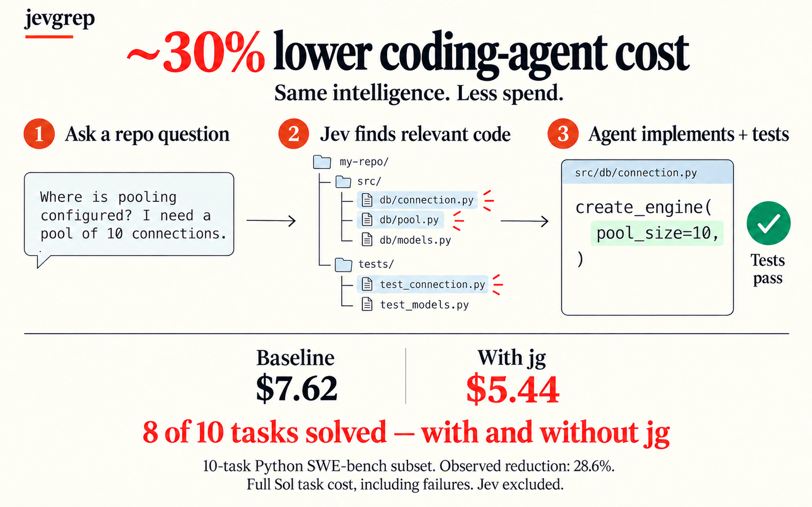

  

<h1 align="center">Awesome Jev Live</h1>

<b>L'index Jev classé par niveau de preuve, reconstruit toutes les deux heures.</b>

  
  
  
  
  
  

<a href="../README.md">English</a> · <a href="README.zh-CN.md">简体中文</a> · <a href="README.zh-TW.md">繁體中文</a> · <a href="README.ja.md">日本語</a> · <a href="README.ko.md">한국어</a> · <a href="README.es.md">Español</a> · <b>Français</b> · <a href="README.de.md">Deutsch</a> · <a href="README.pt-BR.md">Português (Brasil)</a> · <a href="README.ru.md">Русский</a> · <a href="README.it.md">Italiano</a> · <a href="README.ar.md">العربية</a> · <a href="README.hi.md">हिन्दी</a> · <a href="README.tr.md">Türkçe</a> · <a href="README.vi.md">Tiếng Việt</a> · <a href="README.th.md">ไทย</a> · <a href="README.id.md">Bahasa Indonesia</a> · <a href="README.pl.md">Polski</a> · <a href="README.nl.md">Nederlands</a> · <a href="README.uk.md">Українська</a>

> [!NOTE]
> **Index en direct** · Dernière synchronisation: `2026-11-10T07:53:53+08:00` (UTC+8)
> · Entrées: **818** · Nouvelles ce cycle: **38** · Langages d'implémentation: **26**

Chaque entrée ci-dessous a été collectée, filtrée et revérifiée par le pipeline de ce dépôt. Les chiffres et les horodatages proviennent des sources, non d'un instantané rédigé à la main.

## 🔥 Sélection du moment — le premier de chaque catégorie

Une entrée par catégorie, classée par niveau de preuve et par étoiles, recalculée à chaque synchronisation. Un classement, pas une recommandation ; chaque sélection renvoie à sa fiche complète. Les projets ayant publié une capture ou un enregistrement sont préférés, pour que cette bande reste visuelle.

<table>
<tr>
<td width="50%" valign="top">
<b>🏛️ <a href="https://github.com/typesafe-ai/skills">typesafe-ai/skills</a></b>
⭐2891 · ✅ official
Compétences d’agent pour construire avec les System One API de TypeSafe
</td>
<td width="50%" valign="top">

<b>🧰 <a href="https://github.com/john-rocky/coreai-kit">john-rocky/coreai-kit</a></b>
⭐124 · Swift · 👁️ observed
Swift SDK for running chat, vision and speech models on iPhone and Mac with Apple&#x27;s Core AI. Model download and caching, FoundationModels integration, and runnable…
</td>
</tr>
<tr>
<td width="50%" valign="top">

<b>🤖 <a href="https://github.com/gargpratyush/jev-router">gargpratyush/jev-router</a></b>
⭐661 · JavaScript · 🔎 inferred
Acheminez votre tâche vers le modèle le moins cher de claude code avec jev-router
</td>
<td width="50%" valign="top">

<b>🛡️ <a href="https://github.com/dharmeshgurnani/CodeOtter">dharmeshgurnani/CodeOtter</a></b>
⭐3 · TypeScript · 👁️ observed
Autonomous, self-hosted AI code reviews, calibrated scoring gauges, and merge gates from any open model.
</td>
</tr>
<tr>
<td width="50%" valign="top">

<b>🧪 <a href="https://github.com/Mapika/decider">Mapika/decider</a></b>
⭐1046 · Python · 👁️ observed
Une famille de modèles de style System One affinés à partir de Qwen3.5, conçus pour des décisions typées en une seule passe avec des probabilités calibrées.
</td>
<td width="50%" valign="top">

<b>🔬 <a href="https://github.com/r-ms/mini-jev">r-ms/mini-jev</a></b>
⭐64 · Python · 🔎 inferred
mini-Jev : à quoi ressemble une interface de décision typée de style Jev sur un Qwen3-4B figé — lire les logits de la lettre de l&#x27;option au lieu de générer JSON.…
</td>
</tr>
<tr>
<td width="50%" valign="top">

<b>🎮 <a href="https://github.com/MCG-NJU/VideoJev">MCG-NJU/VideoJev</a></b>
⭐301 · Python · 👁️ observed
VideoJev : System One Model pour la compréhension et l’interaction vidéo
</td>
<td width="50%" valign="top">

<b>📰 <a href="https://github.com/imrishit98/jev.aitools.fyi">imrishit98/jev.aitools.fyi</a></b>
⭐2 · TypeScript · 🔎 inferred
Jev is all the rage right now and this directory lists all things Jev! Docs, SDKs, and the full tool map one click away.
</td>
</tr>
</table>

## Sommaire

- [Qu'est-ce que Jev ?](#quest-ce-que-jev)
- [Comment les entrées sont classées](#comment-les-entrées-sont-classées)
- [SDK officiels et outils de développement](#sdk-officiels-et-outils-de-développement) — **6**
- [Clients, SDK et adaptateurs communautaires](#clients-sdk-et-adaptateurs-communautaires) — **140**
- [Outillage d'agents : MCP, hooks, portes de contrôle et agents de codage](#outillage-dagents--mcp-hooks-portes-de-contrôle-et-agents-de-codage) — **256**
- [Routage, garde-fous et approbations](#routage-garde-fous-et-approbations) — **61**
- [Évaluation, calibration et benchmarks](#évaluation-calibration-et-benchmarks) — **91**
- [Reproductions ouvertes, poids et recherche sur l'architecture](#reproductions-ouvertes-poids-et-recherche-sur-larchitecture) — **52**
- [Applications, jeux, robotique et démos interactives](#applications-jeux-robotique-et-démos-interactives) — **50**
- [Articles, discussions et listes sœurs](#articles-discussions-et-listes-sœurs) — **80**
- [Autres projets](#autres-projets) — **82**
- [Projets par langage d'implémentation](#projets-par-langage-dimplémentation)

## Qu&#x27;est-ce que Jev ?

Jev est le premier **System One model** de TypeSafe AI. Il ne rédige pas de prose. Il prend un état plus des questions dont vous définissez à l'avance l'espace de réponse, et renvoie des valeurs typées avec des distributions de probabilité sur lesquelles votre code peut brancher.

|                       |                                                                                                                                                                                                                                                      |
| --------------------- | ---------------------------------------------------------------------------------------------------------------------------------------------------------------------------------------------------------------------------------------------------- |
| **Forme **            | `state + typed questions` → `constrained answers + probabilities` → `your code`                                                                                                                                                                      |
| **Primitives **       | `Choice` (choisir une option parmi ≤255), `Score` (une grille de 2 à 10), `Noul` (un oui/non probabiliste)                                                                                                                                           |
| **Endpoint **         | `POST https://api.typesafe.ai/v1/systemone`, modèle `jev-1.13.0` / alias `jev-latest`                                                                                                                                                                |
| **Bons cas d'usage ** | routage, triage, notation, modération, vérification et portes de contrôle à faible latence dans un flux borné                                                                                                                                        |
| **Limites connues **  | le comptage n'est pas fiable, l'indirection à plusieurs niveaux est faible, et les documents officiels nomment neuf classes de jaggedness. Une sortie valide au regard du schéma n'est pas une décision correcte : calibrez sur vos propres données. |

## Comment les entrées sont classées

La plupart des listes de ce domaine affirment l'inclusion. Celle-ci dit ce qu'elle a réellement vérifié, puis vous laisse filtrer en conséquence.

| Grade        | Signification                                                                                                                                                        |
| ------------ | -------------------------------------------------------------------------------------------------------------------------------------------------------------------- |
| `official`   | Publié par TypeSafe AI elle-même.                                                                                                                                    |
| `observed`   | Un artefact public qui peut être ouvert et lu — du vrai code, une vraie configuration, ou une déclaration explicite TypeSafe/Jev dans le nom ou les topics du dépôt. |
| `inferred`   | Détecté sur un signal ambigu complété par un vocabulaire corroborant, mais pas encore lu ligne à ligne.                                                              |
| `unverified` | Semble lié, rien de confirmé indépendamment. Répertorié à seule fin de découverte.                                                                                   |

## SDK officiels et outils de développement

Tout ce que publie TypeSafe. Commencez ici.

🏛️ <b><a href="https://github.com/typesafe-ai/skills">typesafe-ai/skills</a></b> · ⭐2891 · ✅ official · 17 天 · ⭐+2

##### 📝 Résumé

Compétences d’agent pour construire avec les System One API de TypeSafe

> 💡 Les propres compétences d’agent du fournisseur. Comme elles sont mises à jour en continu, c’est ce qui se rapproche le plus d’une spécification de la manière dont TypeSafe entend piloter Jev depuis un agent.

##### 📌 Faits de base

| Champ     | Valeur                                     |
| --------- | ------------------------------------------ |
| Catégorie | `SDK officiels et outils de développement` |
| Preuve    | `official`                                 |

##### 📊 Données

| Métrique            | Valeur        |
| ------------------- | ------------- |
| Étoiles             | **2891** (+2) |
| Dernier push        | 2026-10-23    |
| Première apparition | 2026-09-18    |

🏛️ <b><a href="https://github.com/typesafe-ai/system-one-adapter-python">typesafe-ai/system-one-adapter-python</a></b> · ⭐410 · Python · ✅ official · 48 天 · ⭐+1

##### 📝 Résumé

Remplacement immédiat de TypeSafeClient reposant sur LLM APIs

> 💡 Remplacement immédiat qui repose sur le même protocole avec un fournisseur LLM ordinaire. C'est la manière honnête de comparer A/B une décision typée à un prompt, sur vos propres données, avant de vous engager pour l'une ou l'autre.

🔧 Utilisé dans du code: `README.md`

##### 📌 Faits de base

| Champ     | Valeur                                     |
| --------- | ------------------------------------------ |
| Catégorie | `SDK officiels et outils de développement` |
| Preuve    | `official`                                 |
| Langage   | Python                                     |

##### 📊 Données

| Métrique            | Valeur       |
| ------------------- | ------------ |
| Étoiles             | **410** (+1) |
| Dernier push        | 2026-09-22   |
| Première apparition | 2026-10-23   |

🏛️ <b><a href="https://github.com/typesafe-ai/typesafe-sdk-python">typesafe-ai/typesafe-sdk-python</a></b> · ⭐311 · Python · ✅ official · 26 天

##### 📝 Résumé

La bibliothèque officielle Python pour TypeSafe API

> 💡 Clients synchrones et asynchrones. Le chemin le plus rapide entre une clé API et une décision typée, ainsi que la référence à laquelle les clients communautaires sont comparés.

🔧 Utilisé dans du code: `README.md`

##### 📌 Faits de base

| Champ     | Valeur                                     |
| --------- | ------------------------------------------ |
| Catégorie | `SDK officiels et outils de développement` |
| Preuve    | `official`                                 |
| Langage   | Python                                     |

##### 📊 Données

| Métrique            | Valeur     |
| ------------------- | ---------- |
| Étoiles             | **311**    |
| Dernier push        | 2026-10-14 |
| Première apparition | 2026-10-23 |

🏛️ <b><a href="https://github.com/typesafe-ai/typesafe-sdk-js">typesafe-ai/typesafe-sdk-js</a></b> · ⭐285 · TypeScript · ✅ official · 26 天

##### 📝 Résumé

La bibliothèque officielle TypeScript/JavaScript pour TypeSafe API

> 💡 Client TypeScript dont le type de réponse est déduit de la question posée : un type de retour incompatible devient ainsi une erreur de compilation plutôt qu'une surprise à l'exécution.

##### 📌 Faits de base

| Champ     | Valeur                                     |
| --------- | ------------------------------------------ |
| Catégorie | `SDK officiels et outils de développement` |
| Preuve    | `official`                                 |
| Langage   | TypeScript                                 |

##### 📊 Données

| Métrique            | Valeur     |
| ------------------- | ---------- |
| Étoiles             | **285**    |
| Dernier push        | 2026-10-14 |
| Première apparition | 2026-10-23 |

🏛️ <b><a href="https://github.com/typesafe-ai/WorkflowEvals">typesafe-ai/WorkflowEvals</a></b> · ⭐21 · Python · ✅ official · 41 天

##### 📝 Résumé

Code de workflow evals.typesafe.ai publié

##### 📌 Faits de base

| Champ     | Valeur                                     |
| --------- | ------------------------------------------ |
| Catégorie | `SDK officiels et outils de développement` |
| Preuve    | `official`                                 |
| Langage   | Python                                     |

##### 📊 Données

| Métrique            | Valeur     |
| ------------------- | ---------- |
| Étoiles             | **21**     |
| Dernier push        | 2026-09-29 |
| Première apparition | 2026-10-23 |

🏛️ <b><a href="https://github.com/typesafe-ai/typesafe-ai.github.io">typesafe-ai/typesafe-ai.github.io</a></b> · ⭐2 · HTML · ✅ official · 158 天

##### 📝 Résumé

Aucune description n'a été publiée en amont.

##### 📌 Faits de base

| Champ     | Valeur                                     |
| --------- | ------------------------------------------ |
| Catégorie | `SDK officiels et outils de développement` |
| Preuve    | `official`                                 |
| Langage   | HTML                                       |

##### 📊 Données

| Métrique            | Valeur     |
| ------------------- | ---------- |
| Étoiles             | **2**      |
| Dernier push        | 2026-06-04 |
| Première apparition | 2026-10-23 |

## Clients, SDK et adaptateurs communautaires

Des clients typés pour l'endpoint System One, dans autant de langages que la communauté a eu le temps d'en traiter.

🧰 <b><a href="https://github.com/jexp/neo4jev">jexp/neo4jev</a></b> · ⭐182 · Jupyter · 👁️ observed · 52 天

##### 📝 Résumé

System One Model de Typesafe.ai Jev parcourant un graphe Neo4j à l'aide d'un classifieur appliqué aux relations voisines

##### 📌 Faits de base

| Champ     | Valeur                                       |
| --------- | -------------------------------------------- |
| Catégorie | `Clients, SDK et adaptateurs communautaires` |
| Preuve    | `observed`                                   |
| Langage   | Jupyter                                      |

##### 📊 Données

| Métrique            | Valeur     |
| ------------------- | ---------- |
| Étoiles             | **182**    |
| Dernier push        | 2026-09-18 |
| Première apparition | 2026-10-28 |

🧰 <b><a href="https://github.com/keltokhy/jgrep">keltokhy/jgrep</a></b> · ⭐141 · Python · 👁️ observed · 23 天 · ⭐+1

##### 📝 Résumé

grep, mais le motif est une description. Filtre les lignes par signification avec le modèle de décision Jev de TypeSafe : environ 200 ms et un millième de centime par ligne.

🔧 Utilisé dans du code: `README.md`

##### 📌 Faits de base

| Champ     | Valeur                                       |
| --------- | -------------------------------------------- |
| Catégorie | `Clients, SDK et adaptateurs communautaires` |
| Preuve    | `observed`                                   |
| Langage   | Python                                       |

##### 📊 Données

| Métrique            | Valeur       |
| ------------------- | ------------ |
| Étoiles             | **141** (+1) |
| Dernier push        | 2026-10-17   |
| Première apparition | 2026-10-29   |

🏷 `cli` · `grep` · `jev` · `openrouter` · `semantic-search` · `typesafe`

🧰 <b><a href="https://github.com/qkal/Canny">qkal/Canny</a></b> · ⭐134 · TypeScript · 👁️ observed · 48 天

##### 📝 Résumé

Empêche les agents de programmation IA d'affirmer qu'une tâche est terminée sans preuve. Des hooks déterministes décident, TypeSafe conseille avec son Jev. Registre en ajout uniquement, aucune dépendance à l'exécution.

🔧 Utilisé dans du code: `README.md`

##### 📌 Faits de base

| Champ     | Valeur                                       |
| --------- | -------------------------------------------- |
| Catégorie | `Clients, SDK et adaptateurs communautaires` |
| Preuve    | `observed`                                   |
| Langage   | TypeScript                                   |

##### 📊 Données

| Métrique            | Valeur     |
| ------------------- | ---------- |
| Étoiles             | **134**    |
| Dernier push        | 2026-09-22 |
| Première apparition | 2026-10-29 |

🏷 `agent-hooks` · `ai-agents` · `claude-code` · `claude-code-hooks` · `codex` · `codex-cli` · `guardrails` · `jev`

🧰 <b><a href="https://github.com/john-rocky/coreai-kit">john-rocky/coreai-kit</a></b> · ⭐124 · Swift · 👁️ observed · 4 天

##### 📝 Résumé

Swift SDK for running chat, vision and speech models on iPhone and Mac with Apple's Core AI. Model download and caching, FoundationModels integration, and runnable examples with documented OS, SDK and model requirements.

🔧 Utilisé dans du code: `Sources/CoreAIOps/CoreAI+SystemOne.swift`

##### 📌 Faits de base

| Champ     | Valeur                                       |
| --------- | -------------------------------------------- |
| Catégorie | `Clients, SDK et adaptateurs communautaires` |
| Preuve    | `observed`                                   |
| Langage   | Swift                                        |

##### 📊 Données

| Métrique            | Valeur     |
| ------------------- | ---------- |
| Étoiles             | **124**    |
| Dernier push        | 2026-11-05 |
| Première apparition | 2026-10-26 |

🏷 `apple` · `apple-core-ai` · `asr` · `core-ai` · `coreai` · `foundation-models` · `ios` · `ios-27`

---

<table><tr><th align="center" width="50%">🖼 Image</th><th align="center" width="50%">🎬 Vidéo</th></tr><tr>
<td align="center" valign="top"></td>
<td align="center" valign="top"> enregistrement animé</td>
</tr></table>

🧰 <b><a href="https://github.com/yzfly/awesome-jev-zh">yzfly/awesome-jev-zh</a></b> · ⭐92 · HTML · 👁️ observed · 0 天

##### 📝 Résumé

Liste sélectionnée en chinois de Jev / TypeSafe System One : ressources officielles, SDK, applications populaires, outils Agent, reproductions open source et évaluations indépendantes, avec un guide de prise en main en chinois ; ajout automatique quotidien des projets populaires GitHub.

🔧 Utilisé dans du code: `docs/quickstart.md`

##### 📌 Faits de base

| Champ     | Valeur                                       |
| --------- | -------------------------------------------- |
| Catégorie | `Clients, SDK et adaptateurs communautaires` |
| Preuve    | `observed`                                   |
| Langage   | HTML                                         |

##### 📊 Données

| Métrique            | Valeur     |
| ------------------- | ---------- |
| Étoiles             | **92**     |
| Dernier push        | 2026-11-09 |
| Première apparition | 2026-09-18 |

🏷 `ai-agent` · `awesome` · `awesome-list` · `chinese` · `jev` · `llm` · `structured-output` · `system-one`

🧰 <b><a href="https://github.com/obie/ruby_decision_model">obie/ruby_decision_model</a></b> · ⭐58 · Ruby · 👁️ observed · 28 天

##### 📝 Résumé

Client Ruby pour des modèles de décision tels que Typesafe Jev

🔧 Utilisé dans du code: `README.md`

##### 📌 Faits de base

| Champ     | Valeur                                       |
| --------- | -------------------------------------------- |
| Catégorie | `Clients, SDK et adaptateurs communautaires` |
| Preuve    | `observed`                                   |
| Langage   | Ruby                                         |

##### 📊 Données

| Métrique            | Valeur     |
| ------------------- | ---------- |
| Étoiles             | **58**     |
| Dernier push        | 2026-10-12 |
| Première apparition | 2026-10-29 |

🧰 <b><a href="https://github.com/bodepudimuneendra-netizen/ConsciousDB">bodepudimuneendra-netizen/ConsciousDB</a></b> · ⭐54 · Python · 👁️ observed · 7 天

##### 📝 Résumé

Un framework Agentic GraphRAG indépendant de la base de données utilisant des modèles System One interchangeables (Laya local / Jev cloud). Une couche d’intelligence prête à l’emploi comprenant un pipeline complet en 4 phases, une évaluation continue et un parcours A* personnalisé pour toute base de données graphe.

##### 📌 Faits de base

| Champ     | Valeur                                       |
| --------- | -------------------------------------------- |
| Catégorie | `Clients, SDK et adaptateurs communautaires` |
| Preuve    | `observed`                                   |
| Langage   | Python                                       |

##### 📊 Données

| Métrique            | Valeur     |
| ------------------- | ---------- |
| Étoiles             | **54**     |
| Dernier push        | 2026-11-02 |
| Première apparition | 2026-11-02 |

🏷 `astar-algorithm` · `eval-harness` · `fine-tuning` · `graphdatabase` · `graprag` · `jev` · `laya` · `neo4j`

🧰 <b><a href="https://github.com/shaharia-lab/jev-cli">shaharia-lab/jev-cli</a></b> · ⭐45 · Rust · 👁️ observed · 0 天

##### 📝 Résumé

Command-line tool for TypeSafe AI's Jev model. Ask yes/no, multiple-choice and rubric questions about any text and get calibrated probabilities back. Answers become exit codes for shells and CI, JSON for scripts, and MCP tools for AI agents.

🔧 Utilisé dans du code: `README.md`

##### 📌 Faits de base

| Champ     | Valeur                                       |
| --------- | -------------------------------------------- |
| Catégorie | `Clients, SDK et adaptateurs communautaires` |
| Preuve    | `observed`                                   |
| Langage   | Rust                                         |

##### 📊 Données

| Métrique            | Valeur     |
| ------------------- | ---------- |
| Étoiles             | **45**     |
| Dernier push        | 2026-11-09 |
| Première apparition | 2026-11-07 |

🏷 `ai-agents` · `classification` · `cli` · `command-line-tool` · `devtools` · `jev` · `llm` · `mcp`

---

<table><tr><th align="center" width="50%">🖼 Image</th><th align="center" width="50%">🎬 Vidéo</th></tr><tr>
<td align="center" valign="top"></td>
<td align="center" valign="top"> enregistrement animé</td>
</tr></table>

🧰 <b><a href="https://github.com/MrJev/awesome-jev">MrJev/awesome-jev</a></b> · ⭐21 · Python · 👁️ observed · 0 天

##### 📝 Résumé

Une liste sélectionnée de projets, intégrations et ressources pour Jev, le modèle System One de TypeSafe AI.

##### 📌 Faits de base

| Champ     | Valeur                                       |
| --------- | -------------------------------------------- |
| Catégorie | `Clients, SDK et adaptateurs communautaires` |
| Preuve    | `observed`                                   |
| Langage   | Python                                       |

##### 📊 Données

| Métrique            | Valeur     |
| ------------------- | ---------- |
| Étoiles             | **21**     |
| Dernier push        | 2026-11-09 |
| Première apparition | 2026-09-18 |

🏷 `ai-agents` · `awesome` · `awesome-list` · `jev` · `mcp` · `typesafe`

🧰 <b><a href="https://github.com/ckaraca/awesome-jev">ckaraca/awesome-jev</a></b> · ⭐18 · Python · 👁️ observed · 0 天

##### 📝 Résumé

Une liste organisée d’outils, d’intégrations et d’expériences construits sur Jev, le modèle System One de TypeSafe AI pour des décisions rapides et typées.

##### 📌 Faits de base

| Champ     | Valeur                                       |
| --------- | -------------------------------------------- |
| Catégorie | `Clients, SDK et adaptateurs communautaires` |
| Preuve    | `observed`                                   |
| Langage   | Python                                       |

##### 📊 Données

| Métrique            | Valeur     |
| ------------------- | ---------- |
| Étoiles             | **18**     |
| Dernier push        | 2026-11-09 |
| Première apparition | 2026-09-19 |

🏷 `ai-agents` · `awesome` · `awesome-list` · `computer-use` · `jev` · `llm` · `system-one` · `typesafe`

🧰 <b><a href="https://github.com/Premo-Cloud/typesafe-sdk-java">Premo-Cloud/typesafe-sdk-java</a></b> · ⭐12 · Java · 👁️ observed · 19 天

##### 📝 Résumé

Java SDK communautaire pour Jev, modèle System One de TypeSafe : questions typées en entrée, réponses typées avec probabilités calibrées en sortie. Java 17+, starter Spring Boot (non officiel)

##### 📌 Faits de base

| Champ     | Valeur                                       |
| --------- | -------------------------------------------- |
| Catégorie | `Clients, SDK et adaptateurs communautaires` |
| Preuve    | `observed`                                   |
| Langage   | Java                                         |

##### 📊 Données

| Métrique            | Valeur     |
| ------------------- | ---------- |
| Étoiles             | **12**     |
| Dernier push        | 2026-10-21 |
| Première apparition | 2026-10-28 |

🏷 `java` · `jev` · `sdk` · `spring-boot` · `system-one` · `system-one-models` · `typesafe`

🧰 <b><a href="https://github.com/PromtEngineer/jev-harness">PromtEngineer/jev-harness</a></b> · ⭐9 · Python · 👁️ observed · 46 天

##### 📝 Résumé

Un harnais d’agent Pi construit autour de TypeSafe's Jev (modèle System One) : routeur, sélecteur de contexte, garde et vérificateur. Testé sur les branches Neon Postgres.

##### 📌 Faits de base

| Champ     | Valeur                                       |
| --------- | -------------------------------------------- |
| Catégorie | `Clients, SDK et adaptateurs communautaires` |
| Preuve    | `observed`                                   |
| Langage   | Python                                       |

##### 📊 Données

| Métrique            | Valeur     |
| ------------------- | ---------- |
| Étoiles             | **9**      |
| Dernier push        | 2026-09-24 |
| Première apparition | 2026-10-28 |

🧰 <b><a href="https://github.com/clouatre-labs/decisions-judge-mcp">clouatre-labs/decisions-judge-mcp</a></b> · ⭐5 · JavaScript · 👁️ observed · 0 天

##### 📝 Résumé

Décisions typées pour les agents IA comme outil MCP : probabilité oui/non (noul), choix et score en une seule requête rapide. Repose sur le modèle TypeSafe System One.

##### 📌 Faits de base

| Champ     | Valeur                                       |
| --------- | -------------------------------------------- |
| Catégorie | `Clients, SDK et adaptateurs communautaires` |
| Preuve    | `observed`                                   |
| Langage   | JavaScript                                   |

##### 📊 Données

| Métrique            | Valeur     |
| ------------------- | ---------- |
| Étoiles             | **5**      |
| Dernier push        | 2026-11-09 |
| Première apparition | 2026-10-12 |

🏷 `agent` · `ai` · `cli` · `decision-making` · `decisions` · `judge` · `llm` · `mcp`

---

<table><tr><th align="center" width="50%">🖼 Image</th><th align="center" width="50%">🎬 Vidéo</th></tr><tr>
<td align="center" valign="top"></td>
<td align="center" valign="top"> enregistrement animé</td>
</tr></table>

🧰 <b><a href="https://github.com/elbruno/ElBruno.AI.Decisions">elbruno/ElBruno.AI.Decisions</a></b> · ⭐5 · C# · 👁️ observed · 6 天

##### 📝 Résumé

.NET 10 decision SDK: Choose, Score, and Assess with Microsoft Foundry (Microsoft-Decision-1), native local Ollama System One models, and TypeSafe AI Jev. One API, probabilities instead of paragraphs.

##### 📌 Faits de base

| Champ     | Valeur                                       |
| --------- | -------------------------------------------- |
| Catégorie | `Clients, SDK et adaptateurs communautaires` |
| Preuve    | `observed`                                   |
| Langage   | C#                                           |

##### 📊 Données

| Métrique            | Valeur     |
| ------------------- | ---------- |
| Étoiles             | **5**      |
| Dernier push        | 2026-11-03 |
| Première apparition | 2026-11-09 |

🏷 `dotnet` · `dotnet10` · `jev` · `microsoft-extensions-ai` · `nuget`

---

<table><tr><th align="center" width="50%">🖼 Image</th><th align="center" width="50%">🎬 Vidéo</th></tr><tr>
<td align="center" valign="top"></td>
<td align="center" valign="top">aucun média publié</td>
</tr></table>

🧰 <b><a href="https://github.com/moeinheidari7829/Kev-Bio">moeinheidari7829/Kev-Bio</a></b> · ⭐5 · Python · 👁️ observed · 2 天

##### 📝 Résumé

Official code for "Every Pixel Is an Option: A System One Model for Medical Ultrasound Biometry" (arXiv 2611.03360)

##### 📌 Faits de base

| Champ     | Valeur                                       |
| --------- | -------------------------------------------- |
| Catégorie | `Clients, SDK et adaptateurs communautaires` |
| Preuve    | `observed`                                   |
| Langage   | Python                                       |

##### 📊 Données

| Métrique            | Valeur     |
| ------------------- | ---------- |
| Étoiles             | **5**      |
| Dernier push        | 2026-11-07 |
| Première apparition | 2026-11-07 |

🏷 `biometry` · `echocardiography` · `jev` · `jev-ai` · `kev` · `medical-imaging` · `system-one` · `ultrasound`

---

<table><tr><th align="center" width="50%">🖼 Image</th><th align="center" width="50%">🎬 Vidéo</th></tr><tr>
<td align="center" valign="top"></td>
<td align="center" valign="top">aucun média publié</td>
</tr></table>

Ressource liée directement depuis le dépôt en amont, faute de licence de redistribution déclarée.

🧰 <b><a href="https://github.com/Bonzokoles/36_chambers">Bonzokoles/36_chambers</a></b> · Python · 👁️ observed · 17 天

##### 📝 Résumé

Moteur fédéré de récupération des connaissances pour les agents IA. Achemine les requêtes entre des backends spécialisés (FTS5, ChromaDB, graphe) via un orchestrateur privilégiant le registre, avec routage IA TypeSafe/Jev et reclassement des éléments probants. En lecture seule par défaut, conçu avec des contrôles de sécurité.

##### 📌 Faits de base

| Champ     | Valeur                                       |
| --------- | -------------------------------------------- |
| Catégorie | `Clients, SDK et adaptateurs communautaires` |
| Preuve    | `observed`                                   |
| Langage   | Python                                       |

##### 📊 Données

| Métrique            | Valeur     |
| ------------------- | ---------- |
| Étoiles             | **0**      |
| Dernier push        | 2026-10-22 |
| Première apparition | 2026-10-23 |

🏷 `ai-agents` · `ai-infrastructure` · `chromadb` · `embeddings` · `federated-search` · `fts5` · `information-retrieval` · `jev`

---

<table><tr><th align="center" width="50%">🖼 Image</th><th align="center" width="50%">🎬 Vidéo</th></tr><tr>
<td align="center" valign="top"></td>
<td align="center" valign="top">aucun média publié</td>
</tr></table>

Ressource liée directement depuis le dépôt en amont, faute de licence de redistribution déclarée.

🧰 <b><a href="https://github.com/dzhng/jevgrep">dzhng/jevgrep</a></b> · ⭐3203 · TypeScript · 🔎 inferred · 1 天 · ⭐-1

##### 📝 Résumé

Trouvez du code en demandant ce qu’il fait. Un CLI pour agents de codage qui utilise Jev pour découvrir les fichiers pertinents et le contexte source.

##### 📌 Faits de base

| Champ     | Valeur                                       |
| --------- | -------------------------------------------- |
| Catégorie | `Clients, SDK et adaptateurs communautaires` |
| Preuve    | `inferred`                                   |
| Langage   | TypeScript                                   |

##### 📊 Données

| Métrique            | Valeur        |
| ------------------- | ------------- |
| Étoiles             | **3203** (-1) |
| Dernier push        | 2026-11-08    |
| Première apparition | 2026-11-07    |

🏷 `ai-sdk` · `claude-code` · `cli` · `code-search` · `codex` · `coding-agents` · `context-retrieval` · `developer-tools`

---

<table><tr><th align="center" width="50%">🖼 Image</th><th align="center" width="50%">🎬 Vidéo</th></tr><tr>
<td align="center" valign="top"></td>
<td align="center" valign="top">aucun média publié</td>
</tr></table>

🧰 <b><a href="https://github.com/socai-io/jev-social">socai-io/jev-social</a></b> · ⭐209 · JavaScript · 🔎 inferred · 1 天 · ⭐+1

##### 📝 Résumé

Agent de recherche open-source, local-first, sur les réseaux sociaux pour Instagram, TikTok et LinkedIn. Jev achemine les étapes en lecture seule ; socai CLI capture les preuves de navigateur citées.

##### 📌 Faits de base

| Champ     | Valeur                                       |
| --------- | -------------------------------------------- |
| Catégorie | `Clients, SDK et adaptateurs communautaires` |
| Preuve    | `inferred`                                   |
| Langage   | JavaScript                                   |

##### 📊 Données

| Métrique            | Valeur       |
| ------------------- | ------------ |
| Étoiles             | **209** (+1) |
| Dernier push        | 2026-11-08   |
| Première apparition | 2026-11-02   |

🏷 `agent-skills` · `ai-agents` · `browser-agent` · `browser-automation` · `decision-model` · `deep-research` · `instagram` · `jev`

---

<table><tr><th align="center" width="50%">🖼 Image</th><th align="center" width="50%">🎬 Vidéo</th></tr><tr>
<td align="center" valign="top"></td>
<td align="center" valign="top">aucun média publié</td>
</tr></table>

<b>Plus dans cette catégorie</b> · 122

- [sumleo/prompt2jev](https://github.com/sumleo/prompt2jev) - Compétence d.
- [Sur-Cai/macos-computer-use-kit](https://github.com/Sur-Cai/macos-computer-use-kit) - AX-first computer use for AI agents on macOS with optional Jev.
- [xingwudao/OpenJev](https://github.com/xingwudao/OpenJev) - OpenJev : une System One de décision API indépendante, inspirée de Jev, fondée…
- [GitHub30/OpenJev](https://github.com/GitHub30/OpenJev) - Modèle System One à poids ouverts (compatible Jev) : décisions noul / choice /…
- [ziyu/system-one-sdk](https://github.com/ziyu/system-one-sdk) - Unified interface wrapper for system one models.
- [chez-shanpu/typesafeai-go](https://github.com/chez-shanpu/typesafeai-go) - Go SDK for TypeSafe AI API https://docs.typesafe.ai/api.
- [chussenot/judgment](https://github.com/chussenot/judgment) - Jugements typés et calibrés issus de modèles System One : une décision écrite…
- [CMaintz/jev-dotnet](https://github.com/CMaintz/jev-dotnet) - SDK .NET non officiel pour le modèle Jev System One de TypeSafe AI.
- [danieleteti/systemone-delphi](https://github.com/danieleteti/systemone-delphi) - Delphi client for System One models (Jev, tev1 and nimble on Ollama): ask typed…
- [erik-hedstrom/loadout](https://github.com/erik-hedstrom/loadout) - Choisissez le modèle, les compétences et les serveurs MCP pour chaque session…
- [jqueryscript/awesome-jev](https://github.com/jqueryscript/awesome-jev) - A curated list of TypeSafe Jev resources, SDKs, agents, MCP servers…
- [basi/typesafe-ai-php-client](https://github.com/basi/typesafe-ai-php-client) - PHP client for the typesafe.ai System One API (Jev).
- [CMaintz/jev-java](https://github.com/CMaintz/jev-java) - Java SDK non officiel pour le modèle System One Jev de TypeSafe AI.
- [cogcloud-ai/cog-typesafe](https://github.com/cogcloud-ai/cog-typesafe) - TypeSafe.
- [gajaguar/typesafe-cli](https://github.com/gajaguar/typesafe-cli) - Unofficial command-line interface for TypeSafe AI System One models, on…
- [JosephHardy91/graph-composition-with-dLLMs](https://github.com/JosephHardy91/graph-composition-with-dLLMs) - A Graph-Compiled Specification RAG system built with **Dagster**, **PostgreSQL…
- [sanketmuchhala/jevgate](https://github.com/sanketmuchhala/jevgate) - Calibrated policy triage and institutional risk routing: a hybrid…
- [semperos/typesafe-sdk-gleam](https://github.com/semperos/typesafe-sdk-gleam) - Typesafe.ai (Jev) SDK client in Gleam.
- [wawan93/gojev](https://github.com/wawan93/gojev) - golang implementation of typesafe.ai SDK.
- [ollaya-dev/ollaya](https://github.com/ollaya-dev/ollaya) - Jev-compatible API server for open decision models.
- [realZachi/pg-jev](https://github.com/realZachi/pg-jev) - Posez des questions en langage naturel à vos tables Postgres.
- [juspay/neurolink](https://github.com/juspay/neurolink) - La couche de tuyauterie d.
- [supercorp-ai/supercov](https://github.com/supercorp-ai/supercov) - Couverture, sécurité et qualité du code pour les agents de programmation.
- [aaddrick/building-with-typesafe-jev](https://github.com/aaddrick/building-with-typesafe-jev) - Compétence non officielle qui apprend aux agents de codage à construire avec le…
- [Ying-Kai-Liao/jev-browser](https://github.com/Ying-Kai-Liao/jev-browser) - Automatisation de navigateur où un LLM planifie et Jev (System One Typesafe)…
- [AkashPriyadarshii/jev-curate](https://github.com/AkashPriyadarshii/jev-curate) - High-throughput synthetic and pretraining dataset sifter for TypeSafe Jev.
- [fazlerocks/jevmail](https://github.com/fazlerocks/jevmail) - Triage open source des e-mails par IA pour Gmail.
- [AkashPriyadarshii/jev-seo](https://github.com/AkashPriyadarshii/jev-seo) - Free Rust SEO and GEO toolkit powered by TypeSafe Jev: 58-rule audits, site…
- [AboveColin/HA-Jev](https://github.com/AboveColin/HA-Jev) - Posez une question à votre maison et obtenez un nombre en retour.
- [sharziki/semdecide](https://github.com/sharziki/semdecide) - Décisions sémantiques typées pour les pipelines Unix et la CI, propulsées par…
- [bladedevoff/stuntd](https://github.com/bladedevoff/stuntd) - Proxy local qui apprend les décisions LLM typées de votre application et y…
- [burnigtm/jev-mcp](https://github.com/burnigtm/jev-mcp) - Serveur MCP qui intègre TypeSafe Jev dans la boucle de codage dans Cursor…
- [AkashPriyadarshii/jev-superpowers](https://github.com/AkashPriyadarshii/jev-superpowers) - Systematic software development framework for AI coding agents upgraded with…
- [dannote/jev](https://github.com/dannote/jev) - TypeSafe Jev pour OTP : répondre à Jev depuis un GenServer et effectuer un…
- [jwuthri-cloud/SelfJev](https://github.com/jwuthri-cloud/SelfJev) - Self-hosted decision model (selfjev-4b) with a Jev-compatible API: Python SDK…
- [DevLoops-ai/unified-brain](https://github.com/DevLoops-ai/unified-brain) - System One coding agents: code-level answers at the score of a Claude Fable 5.1…
- [jiangkoumo/ego-decision-layer](https://github.com/jiangkoumo/ego-decision-layer) - Pluggable decision layer for the ego lite browser: one System One (Jev) call…
- [agencyenterprise/jev-recipes](https://github.com/agencyenterprise/jev-recipes) - 248 small Jev decisions for JavaScript and TypeScript: route, rerank, gate…
- [Nasrallah-AL/jev-cli](https://github.com/Nasrallah-AL/jev-cli) - Command-line tool for TypeSafe.
- [thusinh1969/BrighTO_Router](https://github.com/thusinh1969/BrighTO_Router) - BrighTO LLM Router: free open-source, ultra-fast Rust LLM gateway/router and…
- [arjun988/Kev](https://github.com/arjun988/Kev) - Moteur de décision System One open source.
- [Ray-Hughes/jevalyn](https://github.com/Ray-Hughes/jevalyn) - La couche de décision pour votre application Rails.
- [d-date/swift-jev](https://github.com/d-date/swift-jev) - A Swift client for TypeSafe AI.
- [nouli-ai/nouli](https://github.com/nouli-ai/nouli) - A ledger-backed decision network that records AI decisions and connects them to…
- [saibimajdi/typesafeai-dotnet-sdk](https://github.com/saibimajdi/typesafeai-dotnet-sdk) - SDK .NET communautaire pour le System One API TypeSafe AI — questions typées de…
- [Elue-dev/jev_elixir](https://github.com/Elue-dev/jev_elixir) - jev_elixir est une petite interface idiomatique pour prendre des décisions…
- [arcships/android-use](https://github.com/arcships/android-use) - Android control for Dim Agent and local MCP clients, with a live screen, native…
- [haileyok/typesafe-client](https://github.com/haileyok/typesafe-client) - Clients Go et Rust non officiels pour TypeSafe AI System One API (Jev).
- [chenrui333/jev-docs](https://github.com/chenrui333/jev-docs) - Historique maintenu par la communauté de Jev / TypeSafe System One APIs, SDKs…
- [devbackend/jevgo](https://github.com/devbackend/jevgo) - Client Go non officiel pour le TypeSafe AI System One API (Jev) — questions…
- [himomohi/aside-jev](https://github.com/himomohi/aside-jev) - Les agents Aside prennent leurs décisions avec TypeSafe Jev.
- [TraxSharp/Trax](https://github.com/TraxSharp/Trax) - one description of your app, for the whole team.
- [docxology/daf-jev](https://github.com/docxology/daf-jev) - daf-jev : boîte à outils Python composable pour la décision API de Jev.
- [Kadihx/jev-x-kit](https://github.com/Kadihx/jev-x-kit) - Couche de décision hors ligne à 0 $ pour les agents de programmation…
- [AIAnytime/Jev-Router](https://github.com/AIAnytime/Jev-Router) - Decision-first, OpenAI-compatible AI router powered by Jev typed decisions.
- [akiiwa-games/AgentCompass](https://github.com/akiiwa-games/AgentCompass) - Deterministic multi-agent task router &amp; subscription quota scheduler for Claude…
- [JimmyWesley/rlcd-gateway](https://github.com/JimmyWesley/rlcd-gateway) - Passerelle auto-hébergée pour LLMs et les modèles de décision.
- [zhirschtritt/typesafe-go](https://github.com/zhirschtritt/typesafe-go) - Go SDK idiomatique pour TypeSafe AI API.
- [brightshore/jev-net](https://github.com/brightshore/jev-net) - A lightweight .NET client for the TypeSafe AI API (System One / Jev).
- [Butochnikov/laravel-typesafe-jev](https://github.com/Butochnikov/laravel-typesafe-jev) - Intégration Laravel non officielle pour TypeSafe Jev AI avec réponses typées…
- [coo-quack/jev-pii-checker](https://github.com/coo-quack/jev-pii-checker) - CLI qui détecte les données personnelles identifiables (PII) dans le texte avec…
- [frodi-karlsson/onesie](https://github.com/frodi-karlsson/onesie) - Gate scripts and CI on fast, calibrated System One judgments like Jev: a score…
- [Lasimeri/Mechanical-Jev](https://github.com/Lasimeri/Mechanical-Jev) - Le côté demandeur de Jev (TypeSafe System One : noul, choice, score) dans Rust…
- [nshkrdotcom/system_one_sdk](https://github.com/nshkrdotcom/system_one_sdk) - Elixir/BEAM SDK indépendant du fournisseur pour la sémantique System One…
- [PAI-CUHK/SLEEPJEV](https://github.com/PAI-CUHK/SLEEPJEV) - Décisions d.
- [zchee/decision-model-sdk-rust](https://github.com/zchee/decision-model-sdk-rust) - Async Rust SDK for decision models served through the System One API, with an…
- [zerone-agents/jev-model-router](https://github.com/zerone-agents/jev-model-router) - Routage de modèles léger pour agents, avec compatibilité OpenAI et Anthropic…
- [AboveColin/jevclient](https://github.com/AboveColin/jevclient) - Client Python asynchrone pour TypeSafe Jev.
- [dsaad68/fuzzy-jev](https://github.com/dsaad68/fuzzy-jev) - A client for OpenRouter&#x27;s decision models, TypeSafe&#x27;s Jev by default: typed…
- [getmissionctrl/hs-jev](https://github.com/getmissionctrl/hs-jev) - Client Haskell pour la décision API de TypeSafe System One (Jev)…
- [NerdishShah/playwright-cli-jev-bakeoff](https://github.com/NerdishShah/playwright-cli-jev-bakeoff) - Comparatif : Playwright CLI contre CLI+Jev contre Playwright MCP.
- [apixly-ai/jev-filter](https://github.com/apixly-ai/jev-filter) - Typed semantic filtering for AI agents: turn retrieved records, code and logs…
- [exfoca/decision-model-lab-4JEV](https://github.com/exfoca/decision-model-lab-4JEV) - DML is a reproducible harness for evaluating small, local decision models under…
- [Hyper-AI-Lab/openclaw-jev](https://github.com/Hyper-AI-Lab/openclaw-jev) - Plan de contrôle de production pour agents OpenClaw : routage de l.
- [MrKyaw/CognitiveMirror-Jev-MCP](https://github.com/MrKyaw/CognitiveMirror-Jev-MCP) - Cognitive middleware for personal and enterprise AI agents: 14 MCP tools and a…
- [Talya1412/jev-harness](https://github.com/Talya1412/jev-harness) - TypeSafe Jev (System One) integrations for OMP, MCP, Claude Code, and Pi…
- [abirshhishirroy/mini-jev](https://github.com/abirshhishirroy/mini-jev) - A custom Jev-style decision model built from scratch on Qwen2.5-3B.
- [CMaintz/jev-tools](https://github.com/CMaintz/jev-tools) - Outils TypeScript construits sur le Jev de TypeSafe AI : une garde-fou pour les…
- [codebam/jev-guardrails](https://github.com/codebam/jev-guardrails) - Garde-fous adossés à Jev pour les appels d.
- [HappyHackingSpace/jev](https://github.com/HappyHackingSpace/jev) - Go SDK, CLI, MCP server and agent skill for TypeSafe.
- [heiwa4126/jev-bun1](https://github.com/heiwa4126/jev-bun1) - TypeSafe の Jev を TypeScript SDK で使ってみる最初の 1 歩.
- [heiwa4126/jev-node1](https://github.com/heiwa4126/jev-node1) - Bun で @typesafe-ai/sdk 0.7.0 を使うとエラーになるので、一時的に pnpm と node でやる版.
- [ivanblagdan/jev-cli](https://github.com/ivanblagdan/jev-cli) - Composable CLI for TypeSafe.
- [jeppevammenkristensen/jev-runner](https://github.com/jeppevammenkristensen/jev-runner) - Code for querying Jev based on dotnet sdk 11 and C# 15.
- [kkdev92/jev-dotnet](https://github.com/kkdev92/jev-dotnet) - An unofficial .NET 10 client for Jev, TypeSafe.
- [ksilyanov/jev-php](https://github.com/ksilyanov/jev-php) - Minimal PHP client for TypeSafe Jev (via Cloudflare Workers AI), with Laravel…
- [mattbran87/jev-daemon](https://github.com/mattbran87/jev-daemon) - jev: a per-user daemon and CLI that hold TypeSafe keys and send checked…
- [mdimamhosen/jev](https://github.com/mdimamhosen/jev) - One endpoint for every model, one CLI for every MCP.
- [Mike-Animal-Counseling/laya-jev-lab](https://github.com/Mike-Animal-Counseling/laya-jev-lab) - Drop SaaS ticket classification into your helpdesk.
- [ogarciarevett/jev-py-sdk](https://github.com/ogarciarevett/jev-py-sdk) - Jugements Jev typés (noul / choice / score) provenant de TypeSafe pour Python…
- [phoenix1331/laravel-jev-hotdog](https://github.com/phoenix1331/laravel-jev-hotdog) - A Laravel 13 playground that tells you whether a photo is a hot dog or not…
- [pyck-ai/jev-cli](https://github.com/pyck-ai/jev-cli) - Jev.
- [royalskynet/jev-gate-mcp](https://github.com/royalskynet/jev-gate-mcp) - Governed Jev decision gateway for GPT, Claude, and MCP clients.
- [shetautnetjer/jev-cli](https://github.com/shetautnetjer/jev-cli) - Clean-room CLI for TypeSafe System One / Jev Decision Contracts, search, and…
- [sunjongos/jev-typesafe-gatekeeper](https://github.com/sunjongos/jev-typesafe-gatekeeper) - World-Class Pure System 1 AI Decision &amp; 90/10 Hybrid Gatekeeper Skill powered…
- [sususu98/pi-jev-navigator](https://github.com/sususu98/pi-jev-navigator) - Ultra-low-token System One context navigation and precision SOP dispatch engine…
- [VianneyMI/python-jev](https://github.com/VianneyMI/python-jev) - Unofficial typed Python SDK for TypeSafe.
- [vilinski/jev](https://github.com/vilinski/jev) - CLI pour les modèles de décision System One : questions typées en entrée…
- [Wrenik/Jev-toolkit-Compiler](https://github.com/Wrenik/Jev-toolkit-Compiler) - Context log, search and a compact/clear advisor for Claude Code.
- [Yasir-Khan-7/jev-sentinel](https://github.com/Yasir-Khan-7/jev-sentinel) - Protection contre l.
- [Zuexx/agent-jev-integration](https://github.com/Zuexx/agent-jev-integration) - TypeSafe Jev integrated into Claude Code: routing, escalation, guardrails, evals.
- [StartLuxLabs/StartLux-Prism](https://github.com/StartLuxLabs/StartLux-Prism) - Fast, exact inference for StartLux-Decision models on NVIDIA GPUs: the released…
- [rokbenko/quackd](https://github.com/rokbenko/quackd) - Un CLI pour tous vos robots. Connectez-les, commandez-les et laissez-les…
- [MiaoWuNYA/rikkahub-sillytavern-android](https://github.com/MiaoWuNYA/rikkahub-sillytavern-android) - 安卓AI聊天端:开箱即聊，无损导入酒馆卡，缓存强省用量，手机操控，专属RP模式，防空回，主动信息，前端卡支持，高定制主题，QQbot，AI群聊，插件系统，强兼容…
- [pithings/advocaat](https://github.com/pithings/advocaat) - Un petit client à typage sûr pour poser des questions à une IA sur vos données…
- [Brainwires/jevwire](https://github.com/Brainwires/jevwire) - Jev decision layer for agents: MCP server, embeddable DecisionModel library…
- [zhulinchng/jevper](https://github.com/zhulinchng/jevper) - Wrapper de classification en forme de Jev (TypeSafe System One) autour de…
- [schainks/system_one_client](https://github.com/schainks/system_one_client) - Client Elixir pour les modèles de décision System One : TypeSafe Jev…
- [gilljon/typesafe-ai-rs](https://github.com/gilljon/typesafe-ai-rs) - Rust SDK indépendant asynchrone et bloquant pour le TypeSafe AI System One API.
- [IKEASven69/dsh-opencli](https://github.com/IKEASven69/dsh-opencli) - 让 dsh 会办事:登录态真实浏览器 × 180 站点结构化命令 + SystemOne 亚秒决策 + 执行真实性判定 + watch 监控.
- [AutreMachine/bosco](https://github.com/AutreMachine/bosco) - Router and proxy for OpenAI compatible LLMs machines - 1 url to rule them all !
- [cipherTing/sael](https://github.com/cipherTing/sael) - Go client for the TypeSafe System One API (Jev) — the first piece of sael, a…
- [Query-farm/vgi-typesafe](https://github.com/Query-farm/vgi-typesafe) - Worker VGI exposant des questions TypeSafe System One (choice, noul, score) à…
- [lirantal/discoprint](https://github.com/lirantal/discoprint) - Classify an artist.
- [mmornati/system-one-router](https://github.com/mmornati/system-one-router) - A fast System One decision model (Jev or local Laya) picks which LLM answers…
- [y0usaf/typesafe-cli](https://github.com/y0usaf/typesafe-cli) - Posez des questions typées Jev depuis le shell : réponses noul, choice et score…
- [geilt/typesafe-cli](https://github.com/geilt/typesafe-cli) - CLI et compétence d.
- [iamtalha-arshad/ex_typesafe_ai](https://github.com/iamtalha-arshad/ex_typesafe_ai) - Client Elixir non officiel pour TypeSafe AI API — structures typées, HTTP fondé…
- [KratosLee-6/open-source-model-deploy](https://github.com/KratosLee-6/open-source-model-deploy) - 开源大模型部署可行性鉴别工具 · 168 个开源模型动态评估（含 12 个 JEV/System One 决策模型）· 硬件自动检测 ·…
- [MarcelRoozekrans/Minos.NET](https://github.com/MarcelRoozekrans/Minos.NET) - Typed, source-generated decision questions for .NET: one IDecisionClient for…
- [MIt9/laya-cli](https://github.com/MIt9/laya-cli) - CLI ergonomique pour Laya — décisions typées (choice/score/noul) pour les…
- [phiat/typesafe-rust-sdk](https://github.com/phiat/typesafe-rust-sdk) - Unofficial Rust client for TypeSafe.

## Outillage d&#x27;agents : MCP, hooks, portes de contrôle et agents de codage

La catégorie qui croît le plus vite : des hooks, des serveurs MCP et des portes de contrôle qui placent une décision typée devant la prochaine action d'un agent.

🤖 <b><a href="https://github.com/tamaratran/fast-jev-compaction">tamaratran/fast-jev-compaction</a></b> · ⭐7934 · TypeScript · 🔎 inferred · 52 天 · ⭐+9

##### 📝 Résumé

Plugin de code Claude qui remplace le résumé de compaction par Jev décisions : chaque appel d’outil et chaque résultat est évalué en une seule requête rapide, les éléments obsolètes sont supprimés ou tronqués, et tout ce qui est conservé reste verbatim.

> 💡 Remplace le résumé de compaction du contexte d’un agent de codage par une décision typée. Un exemple clair de remplacement d’un appel LLM dans un pipeline existant plutôt que de reconstruire le pipeline.

##### 📌 Faits de base

| Champ     | Valeur                                                                         |
| --------- | ------------------------------------------------------------------------------ |
| Catégorie | `Outillage d&#x27;agents : MCP, hooks, portes de contrôle et agents de codage` |
| Preuve    | `inferred`                                                                     |
| Langage   | TypeScript                                                                     |

##### 📊 Données

| Métrique            | Valeur        |
| ------------------- | ------------- |
| Étoiles             | **7934** (+9) |
| Dernier push        | 2026-09-18    |
| Première apparition | 2026-11-08    |

🤖 <b><a href="https://github.com/gargpratyush/jev-router">gargpratyush/jev-router</a></b> · ⭐661 · JavaScript · 🔎 inferred · 51 天 · ⭐+2

##### 📝 Résumé

Acheminez votre tâche vers le modèle le moins cher de claude code avec jev-router

> 💡 Achemine chaque tour vers le modèle le moins cher capable de le gérer. Le cas d’utilisation canonique de réduction des coûts pour un modèle System One.

##### 📌 Faits de base

| Champ     | Valeur                                                                         |
| --------- | ------------------------------------------------------------------------------ |
| Catégorie | `Outillage d&#x27;agents : MCP, hooks, portes de contrôle et agents de codage` |
| Preuve    | `inferred`                                                                     |
| Langage   | JavaScript                                                                     |

##### 📊 Données

| Métrique            | Valeur       |
| ------------------- | ------------ |
| Étoiles             | **661** (+2) |
| Dernier push        | 2026-09-19   |
| Première apparition | 2026-11-08   |

---

<table><tr><th align="center" width="50%">🖼 Image</th><th align="center" width="50%">🎬 Vidéo</th></tr><tr>
<td align="center" valign="top"></td>
<td align="center" valign="top">aucun média publié</td>
</tr></table>

🤖 <b><a href="https://github.com/0xNatoshi/jev-codex-router">0xNatoshi/jev-codex-router</a></b> · ⭐275 · JavaScript · 🔎 inferred · 48 天

##### 📝 Résumé

Routage par tour du modèle et du raisonnement pour Codex, piloté par Jev (TypeSafe System One) : choisit le modèle, la profondeur de réflexion et le mode de rapidité à chaque tour.

> 💡 Routage par tour du modèle et de l'effort de raisonnement pour un agent de programmation, piloté par des décisions typées.

##### 📌 Faits de base

| Champ     | Valeur                                                                         |
| --------- | ------------------------------------------------------------------------------ |
| Catégorie | `Outillage d&#x27;agents : MCP, hooks, portes de contrôle et agents de codage` |
| Preuve    | `inferred`                                                                     |
| Langage   | JavaScript                                                                     |

##### 📊 Données

| Métrique            | Valeur     |
| ------------------- | ---------- |
| Étoiles             | **275**    |
| Dernier push        | 2026-09-22 |
| Première apparition | 2026-10-28 |

🏷 `ai` · `codex` · `jev` · `llm` · `macos` · `routing` · `typesafe`

🤖 <b><a href="https://github.com/thruwire/foreman">thruwire/foreman</a></b> · ⭐820 · Python · 👁️ observed · 25 天 · ⭐+1

##### 📝 Résumé

An agent supervisor and software factory foreman powered by decision models

🔧 Utilisé dans du code: `docs/openrouter.md`

##### 📌 Faits de base

| Champ     | Valeur                                                                         |
| --------- | ------------------------------------------------------------------------------ |
| Catégorie | `Outillage d&#x27;agents : MCP, hooks, portes de contrôle et agents de codage` |
| Preuve    | `observed`                                                                     |
| Langage   | Python                                                                         |

##### 📊 Données

| Métrique            | Valeur       |
| ------------------- | ------------ |
| Étoiles             | **820** (+1) |
| Dernier push        | 2026-10-15   |
| Première apparition | 2026-11-08   |

🏷 `agent-supervision` · `codex` · `jev` · `opencode` · `pi-agent` · `pi-coding-agent` · `pi-durable`

---

<table><tr><th align="center" width="50%">🖼 Image</th><th align="center" width="50%">🎬 Vidéo</th></tr><tr>
<td align="center" valign="top"></td>
<td align="center" valign="top">aucun média publié</td>
</tr></table>

🤖 <b><a href="https://github.com/strands-labs/strands-decider">strands-labs/strands-decider</a></b> · ⭐773 · Python · 👁️ observed · 0 天 · ⭐+5

##### 📝 Résumé

Un modèle de décision petit et rapide, ou modèle System 1, pour les flux de travail agentiques. Choisissez entre des options ou attribuez une note sur une échelle plus rapidement qu’un LLM, avec un niveau de confiance calibré pour chaque décision.

##### 📌 Faits de base

| Champ     | Valeur                                                                         |
| --------- | ------------------------------------------------------------------------------ |
| Catégorie | `Outillage d&#x27;agents : MCP, hooks, portes de contrôle et agents de codage` |
| Preuve    | `observed`                                                                     |
| Langage   | Python                                                                         |

##### 📊 Données

| Métrique            | Valeur       |
| ------------------- | ------------ |
| Étoiles             | **773** (+5) |
| Dernier push        | 2026-11-09   |
| Première apparition | 2026-10-02   |

🏷 `ai` · `machine-learning` · `natural-language-understanding` · `python` · `strands-agents` · `strands-labs` · `system-one` · `system-one-models`

🤖 <b><a href="https://github.com/AbdelStark/awesome-typesafe-jev">AbdelStark/awesome-typesafe-jev</a></b> · ⭐616 · HTML · 👁️ observed · 8 天 · ⭐+1

##### 📝 Résumé

Awesome Jev : un guide pratique étayé par des sources sur le modèle System One de TypeSafe, avec SDKs, des démos en direct, des outils d’agent et des évaluations indépendantes.

🔧 Utilisé dans du code: `README.md`

##### 📌 Faits de base

| Champ     | Valeur                                                                         |
| --------- | ------------------------------------------------------------------------------ |
| Catégorie | `Outillage d&#x27;agents : MCP, hooks, portes de contrôle et agents de codage` |
| Preuve    | `observed`                                                                     |
| Langage   | HTML                                                                           |

##### 📊 Données

| Métrique            | Valeur       |
| ------------------- | ------------ |
| Étoiles             | **616** (+1) |
| Dernier push        | 2026-11-01   |
| Première apparition | 2026-10-28   |

🏷 `agent-skills` · `ai-agents` · `awesome` · `awesome-jev` · `awesome-list` · `awesome-lists` · `curated-list` · `developer-tools`

🤖 <b><a href="https://github.com/jkudish/jev-mcp">jkudish/jev-mcp</a></b> · ⭐576 · JavaScript · 👁️ observed · 10 天 · ⭐+1

##### 📝 Résumé

Jugements rapides, peu coûteux et typés du modèle Jev de TypeSafe, sous forme d’outils MCP.

> 💡 Une première preuve de concept exposant Jev via MCP, ce qui est la manière dont la plupart des chaînes d’outils non-Python y accèdent.

🔧 Utilisé dans du code: `README.md`

##### 📌 Faits de base

| Champ     | Valeur                                                                         |
| --------- | ------------------------------------------------------------------------------ |
| Catégorie | `Outillage d&#x27;agents : MCP, hooks, portes de contrôle et agents de codage` |
| Preuve    | `observed`                                                                     |
| Langage   | JavaScript                                                                     |

##### 📊 Données

| Métrique            | Valeur       |
| ------------------- | ------------ |
| Étoiles             | **576** (+1) |
| Dernier push        | 2026-10-30   |
| Première apparition | 2026-10-26   |

🤖 <b><a href="https://github.com/walidboulanouar/awesome-jev-use-cases">walidboulanouar/awesome-jev-use-cases</a></b> · ⭐490 · 👁️ observed · 44 天 · ⭐+2

##### 📝 Résumé

Liste géniale de cas d’utilisation de TypeSafe AI Jev : 74 démonstrations classées par mentions « J’aime », plus de 150 dépôts GitHub, limites, coûts et exemples API. CC0

🔧 Utilisé dans du code: `README.md`

##### 📌 Faits de base

| Champ     | Valeur                                                                         |
| --------- | ------------------------------------------------------------------------------ |
| Catégorie | `Outillage d&#x27;agents : MCP, hooks, portes de contrôle et agents de codage` |
| Preuve    | `observed`                                                                     |

##### 📊 Données

| Métrique            | Valeur       |
| ------------------- | ------------ |
| Étoiles             | **490** (+2) |
| Dernier push        | 2026-09-26   |
| Première apparition | 2026-10-29   |

🏷 `ai-guardrails` · `ai-router` · `awesome` · `awesome-list` · `classification` · `claude-code` · `decision-model` · `examples`

🤖 <b><a href="https://github.com/kraayenjon/awesome-jev">kraayenjon/awesome-jev</a></b> · ⭐206 · 👁️ observed · 43 天

##### 📝 Résumé

Une liste organisée de cas d’utilisation, de projets, de SDKs et de ressources pour Jev. Jev est le modèle System One de TypeSafe AI pour des décisions rapides et typées dans les logiciels — Choice, Score et Noul avec des probabilités calibrées.

🔧 Utilisé dans du code: `README.md`

##### 📌 Faits de base

| Champ     | Valeur                                                                         |
| --------- | ------------------------------------------------------------------------------ |
| Catégorie | `Outillage d&#x27;agents : MCP, hooks, portes de contrôle et agents de codage` |
| Preuve    | `observed`                                                                     |

##### 📊 Données

| Métrique            | Valeur     |
| ------------------- | ---------- |
| Étoiles             | **206**    |
| Dernier push        | 2026-09-27 |
| Première apparition | 2026-09-19 |

🏷 `agents` · `ai` · `ai-agents` · `api` · `artificial-intelligence` · `automation` · `awesome` · `awesome-list`

🤖 <b><a href="https://github.com/valentynkit/awesome-jev-typesafe">valentynkit/awesome-jev-typesafe</a></b> · ⭐190 · JavaScript · 👁️ observed · 0 天

##### 📝 Résumé

Décisions typées avec le Jev de TypeSafe, le premier modèle System One

🔧 Utilisé dans du code: `readme.md`, `README.ko.md`, `README.ja.md`, `README.zh-CN.md`

##### 📌 Faits de base

| Champ     | Valeur                                                                         |
| --------- | ------------------------------------------------------------------------------ |
| Catégorie | `Outillage d&#x27;agents : MCP, hooks, portes de contrôle et agents de codage` |
| Preuve    | `observed`                                                                     |
| Langage   | JavaScript                                                                     |

##### 📊 Données

| Métrique            | Valeur     |
| ------------------- | ---------- |
| Étoiles             | **190**    |
| Dernier push        | 2026-11-09 |
| Première apparition | 2026-09-19 |

🏷 `ai-agents` · `awesome` · `awesome-list` · `claude-code` · `directory` · `jev` · `llm-agents` · `system-one`

🤖 <b><a href="https://github.com/dbreunig/building-with-jev-skill">dbreunig/building-with-jev-skill</a></b> · ⭐167 · 👁️ observed · 11 天

##### 📝 Résumé

Une compétence pour écrire et améliorer des programmes qui appellent Jev, le modèle System One de TypeSafe

> 💡 Une compétence pour écrire des programmes qui appellent Jev, plutôt qu’un programme qui appelle Jev. La distinction est importante : elle encode les règles de conception, et non une seule implémentation de celles-ci.

##### 📌 Faits de base

| Champ     | Valeur                                                                         |
| --------- | ------------------------------------------------------------------------------ |
| Catégorie | `Outillage d&#x27;agents : MCP, hooks, portes de contrôle et agents de codage` |
| Preuve    | `observed`                                                                     |

##### 📊 Données

| Métrique            | Valeur     |
| ------------------- | ---------- |
| Étoiles             | **167**    |
| Dernier push        | 2026-10-29 |
| Première apparition | 2026-10-28 |

🤖 <b><a href="https://github.com/y0usaf/pi-jev">y0usaf/pi-jev</a></b> · ⭐164 · TypeScript · 👁️ observed · 9 天 · ⭐+1

##### 📝 Résumé

TypeSafe Jev comme couche de décision pour l'agent de programmation Pi : une passerelle mesurée pour les appels d'outils, plus jev_ask pour des réponses typées et calibrées

🔧 Utilisé dans du code: `README.md`

##### 📌 Faits de base

| Champ     | Valeur                                                                         |
| --------- | ------------------------------------------------------------------------------ |
| Catégorie | `Outillage d&#x27;agents : MCP, hooks, portes de contrôle et agents de codage` |
| Preuve    | `observed`                                                                     |
| Langage   | TypeScript                                                                     |

##### 📊 Données

| Métrique            | Valeur       |
| ------------------- | ------------ |
| Étoiles             | **164** (+1) |
| Dernier push        | 2026-10-31   |
| Première apparition | 2026-10-29   |

🏷 `guardrails` · `jev` · `pi-extension` · `pi-package` · `typesafe`

🤖 <b><a href="https://github.com/Bodila51/grok-bot-jev">Bodila51/grok-bot-jev</a></b> · ⭐133 · Python · 👁️ observed · 42 天

##### 📝 Résumé

Connectez TypeSafe Jev à Grok Bot comme couche de décision économique : contrôles d'utilisation, modèle de compétence, exemples

🔧 Utilisé dans du code: `src/jev_client.py`

##### 📌 Faits de base

| Champ     | Valeur                                                                         |
| --------- | ------------------------------------------------------------------------------ |
| Catégorie | `Outillage d&#x27;agents : MCP, hooks, portes de contrôle et agents de codage` |
| Preuve    | `observed`                                                                     |
| Langage   | Python                                                                         |

##### 📊 Données

| Métrique            | Valeur     |
| ------------------- | ---------- |
| Étoiles             | **133**    |
| Dernier push        | 2026-09-28 |
| Première apparition | 2026-10-29 |

🏷 `cursor` · `decision-layer` · `grok-bot` · `jev` · `python` · `typesafe`

---

<table><tr><th align="center" width="50%">🖼 Image</th><th align="center" width="50%">🎬 Vidéo</th></tr><tr>
<td align="center" valign="top"></td>
<td align="center" valign="top">aucun média publié</td>
</tr></table>

🤖 <b><a href="https://github.com/caijinchun/nanojev-arena">caijinchun/nanojev-arena</a></b> · ⭐7 · HTML · 👁️ observed · 51 天

##### 📝 Résumé

Arène NanoJev Snake : bataille navale 1v4 humain contre IA + simulateur d'essaim de 100 agents. Démonstration locale du modèle Jev System-One (mini-réplique open source).

##### 📌 Faits de base

| Champ     | Valeur                                                                         |
| --------- | ------------------------------------------------------------------------------ |
| Catégorie | `Outillage d&#x27;agents : MCP, hooks, portes de contrôle et agents de codage` |
| Preuve    | `observed`                                                                     |
| Langage   | HTML                                                                           |

##### 📊 Données

| Métrique            | Valeur     |
| ------------------- | ---------- |
| Étoiles             | **7**      |
| Dernier push        | 2026-09-19 |
| Première apparition | 2026-11-01 |

---

<table><tr><th align="center" width="50%">🖼 Image</th><th align="center" width="50%">🎬 Vidéo</th></tr><tr>
<td align="center" valign="top"></td>
<td align="center" valign="top">aucun média publié</td>
</tr></table>

🤖 <b><a href="https://github.com/dfranco-projects/jev-guardbench">dfranco-projects/jev-guardbench</a></b> · ⭐3 · Python · 👁️ observed · 36 天

##### 📝 Résumé

Un modèle System One (TypeSafe Jev, Kev open-source) peut-il remplacer un LLM-as-judge dans les callbacks de garde-fous d’agent ?

##### 📌 Faits de base

| Champ     | Valeur                                                                         |
| --------- | ------------------------------------------------------------------------------ |
| Catégorie | `Outillage d&#x27;agents : MCP, hooks, portes de contrôle et agents de codage` |
| Preuve    | `observed`                                                                     |
| Langage   | Python                                                                         |

##### 📊 Données

| Métrique            | Valeur     |
| ------------------- | ---------- |
| Étoiles             | **3**      |
| Dernier push        | 2026-10-04 |
| Première apparition | 2026-11-04 |

---

<table><tr><th align="center" width="50%">🖼 Image</th><th align="center" width="50%">🎬 Vidéo</th></tr><tr>
<td align="center" valign="top"></td>
<td align="center" valign="top">aucun média publié</td>
</tr></table>

Ressource liée directement depuis le dépôt en amont, faute de licence de redistribution déclarée.

🤖 <b><a href="https://github.com/dolevhayut/resurface">dolevhayut/resurface</a></b> · TypeScript · 👁️ observed · 37 天

##### 📝 Résumé

Sélection de CV JEV TypeSafe : LLM rédige les questions, JEV (modèle de classification System One) y répond pour chaque CV de votre ATS avec la ligne de preuve exacte. 8× plus rapide et 31× moins cher qu'un LLM.

##### 📌 Faits de base

| Champ     | Valeur                                                                         |
| --------- | ------------------------------------------------------------------------------ |
| Catégorie | `Outillage d&#x27;agents : MCP, hooks, portes de contrôle et agents de codage` |
| Preuve    | `observed`                                                                     |
| Langage   | TypeScript                                                                     |

##### 📊 Données

| Métrique            | Valeur     |
| ------------------- | ---------- |
| Étoiles             | **0**      |
| Dernier push        | 2026-10-03 |
| Première apparition | 2026-11-01 |

🏷 `ai-recruiting` · `ats` · `candidate-matching` · `classification-model` · `claude` · `decision-model` · `evidence-based-hiring` · `hr-tech`

---

<table><tr><th align="center" width="50%">🖼 Image</th><th align="center" width="50%">🎬 Vidéo</th></tr><tr>
<td align="center" valign="top"></td>
<td align="center" valign="top"> <a href="https://raw.githubusercontent.com/dolevhayut/resurface/main/docs/launch/resurface-launch.mp4">Ouvrir la vidéo</a></td>
</tr></table>

🤖 <b><a href="https://github.com/kaivalpatel6350/jev-docs-agent">kaivalpatel6350/jev-docs-agent</a></b> · Python · 👁️ observed · 0 天 · **NEW**

##### 📝 Résumé

Goal-driven AI agent that records walkthrough videos of any web app and writes the user guide. Powered by Jev (TypeSafe AI) + Playwright, driven from Claude Desktop via MCP. Open-source alternative to Supademo/Scribe and manual testing.

##### 📌 Faits de base

| Champ     | Valeur                                                                         |
| --------- | ------------------------------------------------------------------------------ |
| Catégorie | `Outillage d&#x27;agents : MCP, hooks, portes de contrôle et agents de codage` |
| Preuve    | `observed`                                                                     |
| Langage   | Python                                                                         |

##### 📊 Données

| Métrique            | Valeur     |
| ------------------- | ---------- |
| Étoiles             | **0**      |
| Dernier push        | 2026-11-09 |
| Première apparition | 2026-11-10 |

🏷 `ai-agent` · `arcade-alternative` · `browser-automation` · `claude-desktop` · `documentation-generator` · `e2e-testing` · `interactive-demo` · `jev`

---

<table><tr><th align="center" width="50%">🖼 Image</th><th align="center" width="50%">🎬 Vidéo</th></tr><tr>
<td align="center" valign="top"></td>
<td align="center" valign="top"> enregistrement animé</td>
</tr></table>

🤖 <b><a href="https://github.com/browser-use/jev-ultrafast">browser-use/jev-ultrafast</a></b> · ⭐24311 · Python · 🔎 inferred · 6 天 · ⭐+14

##### 📝 Résumé

Agent web le plus rapide et le moins cher

##### 📌 Faits de base

| Champ     | Valeur                                                                         |
| --------- | ------------------------------------------------------------------------------ |
| Catégorie | `Outillage d&#x27;agents : MCP, hooks, portes de contrôle et agents de codage` |
| Preuve    | `inferred`                                                                     |
| Langage   | Python                                                                         |

##### 📊 Données

| Métrique            | Valeur          |
| ------------------- | --------------- |
| Étoiles             | **24311** (+14) |
| Dernier push        | 2026-11-03      |
| Première apparition | 2026-11-08      |

---

<table><tr><th align="center" width="50%">🖼 Image</th><th align="center" width="50%">🎬 Vidéo</th></tr><tr>
<td align="center" valign="top"></td>
<td align="center" valign="top"> enregistrement animé · <a href="https://raw.githubusercontent.com/browser-use/jev-ultrafast/main/docs/demo.mp4">Ouvrir la vidéo</a></td>
</tr></table>

<b>Plus dans cette catégorie</b> · 238

- [Avinash-jetwani/jevmem](https://github.com/Avinash-jetwani/jevmem) - jevmem enregistre les décisions, règles et approches infructueuses de vos…
- [openlayer-ai/jevals](https://github.com/openlayer-ai/jevals) - Évaluations et garde-fous d.
- [GhalebDweikat/winnow](https://github.com/GhalebDweikat/winnow) - Un tamis de contexte calibré pour Claude Code : chaque résultat d.
- [Nisaka520/JevIntent](https://github.com/Nisaka520/JevIntent) - 微信（插件 FkWeChat）：appuyez longuement sur un message pour analyser l.
- [andyrewlee/awesome-system-one](https://github.com/andyrewlee/awesome-system-one) - Une liste de modèles System One (également appelés modèles de décision) : Jev…
- [KikeVen/zerikai_memory](https://github.com/KikeVen/zerikai_memory) - A standalone local-only Python MCP server that gives any IDE persistent…
- [Li-Evan/awesome-jev](https://github.com/Li-Evan/awesome-jev) - La galerie la plus complète de ce que les gens construisent avec Jev, le modèle…
- [ChenneyZhuang/laya-browser-agent](https://github.com/ChenneyZhuang/laya-browser-agent) - Alternative Jev locale et open source : décisions d.
- [TrustifAI/typed_evals](https://github.com/TrustifAI/typed_evals) - Fast, typed Python framework for Jev-as-a-Judge/Decision-model evaluation for…
- [tiffygk/jev-mode](https://github.com/tiffygk/jev-mode) - Claude Code/Codex skills, evals, harnesses/context tools, and learning…
- [darwintechlab/openjev](https://github.com/darwintechlab/openjev) - OpenJev : un plugin Opencode qui remplace les décisions de génération de texte…
- [yohanargentina-oss/Foq](https://github.com/yohanargentina-oss/Foq) - ⚡ Foq — l.
- [mani-aiml/jev-demos](https://github.com/mani-aiml/jev-demos) - Démos avec Jev, le modèle System One de TypeSafe, un dossier par démo.
- [solvi-ai/solvi](https://github.com/solvi-ai/solvi) - A runtime where decision models propose and your code decides: typed questions…
- [kolawong/fast-compaction-dsh](https://github.com/kolawong/fast-compaction-dsh) - Compaction du contexte fondée sur des verdicts pour DeepSeek Harness — remplace…
- [BYK/jev-mcp](https://github.com/BYK/jev-mcp) - Un serveur MCP privilégiant l.
- [LHCWN/arkui-sem](https://github.com/LHCWN/arkui-sem) - Semantic ArkUI linter for coding agents: catches state and lifecycle bugs that…
- [rajasekharponakala/jev-mcp](https://github.com/rajasekharponakala/jev-mcp) - Serveur MCP encapsulant les modèles Jev System One de TypeSafe — jugements…
- [BFLabsAI/bf-jev-deep-research](https://github.com/BFLabsAI/bf-jev-deep-research) - Agent Skill + étude verbatim sur Jev (TypeSafe AI System One Model)…
- [Mainakcris7/agent-guardrail-with-jev](https://github.com/Mainakcris7/agent-guardrail-with-jev) - A practical demo of how can we leverage the power of System One Models like Jev…
- [systemonemodels/noulxp](https://github.com/systemonemodels/noulxp) - NoulXP (anciennement OpenDXP) : le standard ouvert pour les modèles System One.
- [apex-ronin/DecaFleet-OS](https://github.com/apex-ronin/DecaFleet-OS) - Sovereign 10-Bot Operational Execution Platform &amp; Jev-AI (jev-latest) System…
- [api-evangelist/typesafe-ai](https://github.com/api-evangelist/typesafe-ai) - TypeSafe AI est un laboratoire d.
- [CrowBe/weave](https://github.com/CrowBe/weave) - Harness d.
- [gsaini/system-one-models-getting-started](https://github.com/gsaini/system-one-models-getting-started) - TypeSafe.
- [jms-dcksn/uipath-jev-guardrail-connector](https://github.com/jms-dcksn/uipath-jev-guardrail-connector) - Connecteur UiPath avec votre propre garde-fou, propulsé par le modèle TypeSafe…
- [lucast4049/openjev](https://github.com/lucast4049/openjev) - Exécutez des décisions rapides, calibrées et typées sur des modèles System One…
- [nosial/FederationJevGuard](https://github.com/nosial/FederationJevGuard) - A FederationLib plugin that reviews reports, evidence and entities with a…
- [STAIxBWLB/agent-decide](https://github.com/STAIxBWLB/agent-decide) - Decision layer for the agent family: typed decisions and model routing over…
- [jev-chat/jev-chat-jarvis](https://github.com/jev-chat/jev-chat-jarvis) - L.
- [YaoApp/yao](https://github.com/YaoApp/yao) - ✨ Tous vos agents et espaces de travail au même endroit, sur tous vos…
- [kerpopule/hermes-jev-skills](https://github.com/kerpopule/hermes-jev-skills) - Routage de modèles, mémoire, compaction, sélection de compétences, utilisation…
- [reticlehq/reticle](https://github.com/reticlehq/reticle) - Les agents IA peuvent générer du code, mais ont toujours du mal à comprendre ce…
- [wy-coliney/jev-browser-use](https://github.com/wy-coliney/jev-browser-use) - Opérations dans le navigateur 5 à 10 fois plus rapides : Jev clique, Codex…
- [logicrw/awesome-jev-projects](https://github.com/logicrw/awesome-jev-projects) - Jev génial : radar de l.
- [devagrawal09/jev-review](https://github.com/devagrawal09/jev-review) - Un workflow de revue de code par étapes et un tableau de bord local construits…
- [AnotiaWang/awesome-decision-models](https://github.com/AnotiaWang/awesome-decision-models) - Une liste organisée de modèles de décision.
- [wuyoscar/jev-skill](https://github.com/wuyoscar/jev-skill) - Une superbe collection de cas d.
- [kydlikebtc/awesome-jev](https://github.com/kydlikebtc/awesome-jev) - Launch what you built on Jev, TypeSafe AI.
- [ttlequals0/MinusPod](https://github.com/ttlequals0/MinusPod) - MinusPod est un serveur auto-hébergé qui supprime les publicités avant même que…
- [BillionsBobby/JevRouter](https://github.com/BillionsBobby/JevRouter) - Un routeur léger propulsé par Jev pour les modèles, les outils et les…
- [malevrigns/agent-jev](https://github.com/malevrigns/agent-jev) - AgentJev-0.6B — un modèle de décision « System One » rapide pour les agents…
- [qbeka/jev-job-search](https://github.com/qbeka/jev-job-search) - Find software internships and new-grad jobs, fill the application forms, check…
- [vinilana/jev-gateway](https://github.com/vinilana/jev-gateway) - Un moyen simple d.
- [Heman10x-NGU/openJev-verdict-2.0](https://github.com/Heman10x-NGU/openJev-verdict-2.0) - Moteur de décision non autorégressif calibré de 151M de paramètres, surpassant…
- [RomanSlack/jev-drone](https://github.com/RomanSlack/jev-drone) - Drone autonome utilisant uniquement sa caméra dans MuJoCo, avec un petit modèle…
- [OmniJev/Flide](https://github.com/OmniJev/Flide) - 🔥🔥 The extremely fast inference engine for decision model.
- [OmniJev/OneJev](https://github.com/OmniJev/OneJev) - 🚀🚀 Un modèle de décision System One multimodal qui donne des réponses calibrées…
- [Amal-David/awesome-jev](https://github.com/Amal-David/awesome-jev) - Jev démonstrations, projets, SDKs et compétences, avec des liens vers les…
- [fatwang2/awesome-jev](https://github.com/fatwang2/awesome-jev) - Un répertoire de projets Jev étayé par des sources, avec un workflow de revue…
- [jmagly/aiwg](https://github.com/jmagly/aiwg) - Contexte de projet réutilisable et workflows spécialisés pour les outils d.
- [luobosibing2/dsh-jev-plugin](https://github.com/luobosibing2/dsh-jev-plugin) - Plugin Native DeepSeek Harness (DSH) intégrant TypeSafe Jev ou une API de…
- [ThinkFlowLab/system1-agents](https://github.com/ThinkFlowLab/system1-agents) - Modèles de décision System 1 (Jev, Laya, Cua-S1) servant de cerveau aux agents…
- [tamaratran/jev-pruner](https://github.com/tamaratran/jev-pruner) - Plugin Claude Code : raccourcit la sortie Bash volumineuse avec TypeSafe Jev…
- [Promethe-us/awesome-jev](https://github.com/Promethe-us/awesome-jev) - A source-backed Jev / System One knowledge map: projects, papers, evaluations…
- [cookiespiggy/agentic-rl](https://github.com/cookiespiggy/agentic-rl) - Tutoriel Agentic RL en chinois pour débutants complets (33 chapitres) : des…
- [kyegomez/open-jev](https://github.com/kyegomez/open-jev) - Une reconstruction open source, fondée sur les premiers principes, des idées…
- [UditAkhourii/quicksilver](https://github.com/UditAkhourii/quicksilver) - Compétence Claude Code : déléguez les décisions en masse à Jev.
- [Shanghua-Gao/RSI-Jev](https://github.com/Shanghua-Gao/RSI-Jev) - Modèles de décision typés (noul / choice / score) entraînés par une boucle…
- [lawrence3699/jev-style](https://github.com/lawrence3699/jev-style) - JevStyle: local decision models for AI agents.
- [PerryLink/jevcore](https://github.com/PerryLink/jevcore) - TypeSafe Jev pour DeepSeek Harness, le Model Context Protocol et Node standard…
- [angel291592/Intent-Router](https://github.com/angel291592/Intent-Router) - Compilateur d.
- [charlesdove977/claude-x-jev](https://github.com/charlesdove977/claude-x-jev) - Décisions rapides, économiques et typées pour Claude Code.
- [jonathanavis96/jev-kit](https://github.com/jonathanavis96/jev-kit) - Tout ce dont vous avez besoin pour exécuter le Jev de TypeSafe avec Claude Code…
- [akivet/Mica](https://github.com/akivet/Mica) - A 4B decision model: calibrated probabilities for yes/no, choice and score…
- [yikangy873-gif/jev-desktop](https://github.com/yikangy873-gif/jev-desktop) - Sélection d.
- [iamaamir/system-one](https://github.com/iamaamir/system-one) - Runtime System One neutre vis-à-vis des fournisseurs pour TypeScript et Pi.
- [TheoOliveira/pi-jev](https://github.com/TheoOliveira/pi-jev) - Routage sémantique des outils et décisions System One typées pour l.
- [alanhuangyoo/OpenJev](https://github.com/alanhuangyoo/OpenJev) - OpenJev : alternative locale open-source à Jev.
- [chuloontop4-code/jev-instance-review](https://github.com/chuloontop4-code/jev-instance-review) - Meilleur évaluateur d.
- [shitianfang/jev-use](https://github.com/shitianfang/jev-use) - Plugin Claude Code / Codex / pi qui transmet à Jev.
- [FrancoisChastel/jev-code](https://github.com/FrancoisChastel/jev-code) - Jev, le classifieur TypeSafe de type System One, comme outil dans Claude Code…
- [DeepAleph/jevreel](https://github.com/DeepAleph/jevreel) - A zero-embedding approach to video intelligence, using Jev: contact sheets +…
- [intikhab49/open-jev-typed-decision-engine](https://github.com/intikhab49/open-jev-typed-decision-engine) - Reproduction ouverte de TypeSafe Jev : un moteur de décision typée de 150M…
- [everyinfra/jev-radar](https://github.com/everyinfra/jev-radar) - 📡 The most rigorously verified tracker of the Jev (TypeSafe AI System One)…
- [onlyreadai/onlyread](https://github.com/onlyreadai/onlyread) - Make AI browser agents read-only: a Chrome extension that refuses writes.
- [AskTheWay/dsh-jev-interceptor](https://github.com/AskTheWay/dsh-jev-interceptor) - ⚡ Jugement System-1 en quelques millisecondes pour chaque appel d.
- [jomatsu/pi-jev-auto-mode](https://github.com/jomatsu/pi-jev-auto-mode) - Mode automatique basé sur Jev (TypeSafe System One) pour l.
- [abhishek085/open-spark-jev](https://github.com/abhishek085/open-spark-jev) - Modèles de décision open-source et locaux inspirés de Jev et System One de…
- [sunyasheng/JevGPT](https://github.com/sunyasheng/JevGPT) - JevGPT: Thinking Fast and Slow in Autonomous Research.
- [mas-bandwidth/nova-sprint](https://github.com/mas-bandwidth/nova-sprint) - Coordinate AI sprints across different models, harnesses and machines.
- [NekomyaDev/nudge](https://github.com/NekomyaDev/nudge) - Un langage de programmation typé, rejouable et sensible au budget pour les…
- [anandi1989/awesome-jev-usecases](https://github.com/anandi1989/awesome-jev-usecases) - Index étayé par des preuves de cas d.
- [ckorhonen/jev-lint](https://github.com/ckorhonen/jev-lint) - A fuzzy linter for coding agents. It checks the code your agent writes against…
- [Singularity-Compute/super-decider](https://github.com/Singularity-Compute/super-decider) - Decisions, not essays: a choice, a yes or no, or a score with a calibrated…
- [paramjeetn/jev-cookbook](https://github.com/paramjeetn/jev-cookbook) - Le livre de recettes complet pour Jev par TypeSafe AI — plus de 120 cas…
- [iamtoomas/JevLint](https://github.com/iamtoomas/JevLint) - Linting sémantique configurable propulsé par Jev, avec jugements NOUL au niveau…
- [muxso/Shepherd](https://github.com/muxso/Shepherd) - Shepherd is an end-to-end AI Software Engineering platform that supervises the…
- [1arley/jev-advisor-gateway](https://github.com/1arley/jev-advisor-gateway) - Local gateway that routes coding-agent tool decisions through Jev and can…
- [ajensenwaud/hermes-jev-plugin](https://github.com/ajensenwaud/hermes-jev-plugin) - Outils de décision TypeSafe Jev (System One) pour Hermes Agent : jev_check /…
- [daftAI2026/awesome-jev](https://github.com/daftAI2026/awesome-jev) - Projets TypeSafe Jev / System One GitHub sélectionnés, alternatives open source…
- [vicfei/awesome-jev-prompts](https://github.com/vicfei/awesome-jev-prompts) - Question patterns, anti-patterns &amp; calibration notes for typed decision models…
- [caiovicentino/jev-risk-check-provider](https://github.com/caiovicentino/jev-risk-check-provider) - x402 risk-check provider: signed pre-payment verdicts — OFAC, phishing feeds…
- [erkamyaman/jev-enforce](https://github.com/erkamyaman/jev-enforce) - 📏 Claude Code plugin that makes Claude follow your AGENTS.md: every reply and…
- [zhangxaochen/dsh-jev](https://github.com/zhangxaochen/dsh-jev) - Suite de plugins Jev (modèle de décision System One) pour DeepSeek Harness (dsh).
- [assistant-ui/jevia](https://github.com/assistant-ui/jevia) - outcome-aware &amp; adaptive model routing for coding agents with deterministic…
- [ronitgupta138/Local-Jev](https://github.com/ronitgupta138/Local-Jev) - ⚡ 100% offline, zero-cost drop-in alternative to TypeSafe Jev System One…
- [alexei-led/pi-model-router](https://github.com/alexei-led/pi-model-router) - Independent Pi extension for four-tier model routing with optional…
- [anisselbd/jev-phishing-bench](https://github.com/anisselbd/jev-phishing-bench) - Jev (TypeSafe) vs Claude Haiku 4.5 on 2,000 phishing emails: accuracy…
- [Jessie-QingYu/jev-in-the-wild](https://github.com/Jessie-QingYu/jev-in-the-wild) - Cas d.
- [SergeyBazhmin/krasivo-jev](https://github.com/SergeyBazhmin/krasivo-jev) - Training data and models for &quot;system one&quot; classifiers: one forward pass, no…
- [allenporter/home-assistant-laya](https://github.com/allenporter/home-assistant-laya) - Conversation agent based on Laya, a multilingual, non-autoregressive System 1…
- [frontierlabai/JevHub](https://github.com/frontierlabai/JevHub) - JevHub · Jev 生态热榜 把值得关注的 Jev 项目、教程和讨论，汇到一页。 自动发现 · 每日更新 · 按 Stars 排序 · 中英双语.
- [inso1337/revl](https://github.com/inso1337/revl) - Un langage pour une composabilité spatiotemporelle sûre et universelle…
- [jmrenouard/MicroLLM](https://github.com/jmrenouard/MicroLLM) - Local Hybrid System-One Decision Engine.
- [ranjan2829/AskJev](https://github.com/ranjan2829/AskJev) - AskJev — pilote automatique Jev pour n.
- [FazalAAli/jev-robotics-demo](https://github.com/FazalAAli/jev-robotics-demo) - Jev (TypeSafe System One) contre Claude Opus 5 pilotant un bras robotique…
- [reacher-z/Awesome-Jev](https://github.com/reacher-z/Awesome-Jev) - Curated Jev and System One papers, models, datasets, benchmarks and SDKs, with…
- [PenDraga/paperless-jev](https://github.com/PenDraga/paperless-jev) - Classifies the Paperless-ngx inbox with TypeSafe Jev or a local model (Ollama)…
- [7starsseeker/dsh-fact-check](https://github.com/7starsseeker/dsh-fact-check) - Fact-checking skill for DeepSeek Harness: multi-source verification against the…
- [lgy1027/jevshield](https://github.com/lgy1027/jevshield) - Barrière de sécurité de moins de 100 ms pour les appels d.
- [PerryLink/laya-mcp](https://github.com/PerryLink/laya-mcp) - MCP server for Laya typed decisions (noul / choice / score): warm model…
- [raydocs/egolite-jev](https://github.com/raydocs/egolite-jev) - npx skills add raydocs/ego-verified-actions — bounded ego-lite clicks with…
- [8itlab/reflex-computer-use](https://github.com/8itlab/reflex-computer-use) - Computer use MCP server for Claude Code, Codex and other AI agents.
- [abhishekashokvkumar/jev-mcp-dispatcher](https://github.com/abhishekashokvkumar/jev-mcp-dispatcher) - Répartiteur d.
- [aitofy-dev/jev-awesome-skills](https://github.com/aitofy-dev/jev-awesome-skills) - Compétences Jev open source pour Claude Code, Codex, Cursor et Grok.
- [MongLong0214/jev-gate](https://github.com/MongLong0214/jev-gate) - Toutes les tâches de codage n.
- [nanami-0713/dsh-jev-decide](https://github.com/nanami-0713/dsh-jev-decide) - Extension DSH : enregistrer TypeSafe Jev (modèle de décision System One) comme…
- [robokrunch/awesome-jev](https://github.com/robokrunch/awesome-jev) - Liste sélectionnée de ressources pour Jev — le modèle de décision System One de…
- [simota/tenbin](https://github.com/simota/tenbin) - Serveur MCP et compétence d.
- [supermanc417-alt/awesome-jev-hub](https://github.com/supermanc417-alt/awesome-jev-hub) - A curated hub of the Jev / TypeSafe &quot;System One&quot; model ecosystem — concepts, 51…
- [ardana-ai/ardana](https://github.com/ardana-ai/ardana) - Run System 1 decision models locally. Pull a model by name and get calibrated…
- [deepansh-saxena/jev-guardrails](https://github.com/deepansh-saxena/jev-guardrails) - Comparaison de LLM-as-judge à TypeSafe Jev pour les garde-fous des agents…
- [gordan-code/dsh-jev-advisor](https://github.com/gordan-code/dsh-jev-advisor) - Jev (TypeSafe System One) gives the human a second opinion, not the agent.
- [holny/evolve-router](https://github.com/holny/evolve-router) - Stop burning premium model tokens on simple prompts. Save tokens.
- [laguagu/jev-skills](https://github.com/laguagu/jev-skills) - Practical agent skills and examples for building with Jev.
- [MojoAI-King/jev-paper-trader](https://github.com/MojoAI-King/jev-paper-trader) - Paper trading real Polymarket and Kalshi markets with a fake $100k: can Jev +…
- [mywwave/cursor-jev](https://github.com/mywwave/cursor-jev) - Plugin Cursor qui route les sous-agents avec TypeSafe Jev et expose Choice…
- [noetion/dsh-jev](https://github.com/noetion/dsh-jev) - Bundle DSH qui enregistre jev_ask pour les réponses noul, choice et score de…
- [samtay32/jev-system-architect](https://github.com/samtay32/jev-system-architect) - Compétence d.
- [tinypi-extension/tinysubagent](https://github.com/tinypi-extension/tinysubagent) - Minimal herdr-native subagent spawning for pi — markdown agent roles, model…
- [wangkuangkuang/jev-mcp-server](https://github.com/wangkuangkuang/jev-mcp-server) - Serveur MCP pour Jev (TypeSafe System One) : les trois types officiels de…
- [1aifanatic/jev-uipath-coded-agent](https://github.com/1aifanatic/jev-uipath-coded-agent) - Démonstration FINS : un agent codé UiPath pour le triage des alertes AML, où…
- [cnrai/openpave-jev](https://github.com/cnrai/openpave-jev) - Compétence PAVE pour les modèles de décision non autorégressifs.
- [darwintechlab/claude-jev](https://github.com/darwintechlab/claude-jev) - Jev System One pour Claude Code — Choice/Noul/Score typés via TypeSafe API en…
- [flaviomartil/herdr-jev](https://github.com/flaviomartil/herdr-jev) - Jev-driven multi-model triage and Triad orchestration plugin for Herdr and…
- [guanghuang/coding-router-jev](https://github.com/guanghuang/coding-router-jev) - TypeScript/Bun launcher routing Codex turns through JEV with model and…
- [jmflorent/dsh-swarm-jev](https://github.com/jmflorent/dsh-swarm-jev) - A swarm kit for DeepSeek Harness: role personas, a self-hosted System One…
- [jms-dcksn/jev-pii-guardrail](https://github.com/jms-dcksn/jev-pii-guardrail) - Un agent codé UiPath avec un garde-fou personnalisé de détection des…
- [rahilmavani/piedpiper-jev-buildathon](https://github.com/rahilmavani/piedpiper-jev-buildathon) - Équipe piedpiper : failproofai + garde-fous Jev qui empêchent l.
- [173787247/dsh-wsl-jev](https://github.com/173787247/dsh-wsl-jev) - DeepSeek Harness WSL plugin: TypeSafe Jev / OpenRouter System One.
- [17671454333/jev-cognitive-mcp](https://github.com/17671454333/jev-cognitive-mcp) - 3+1 Cognitive Hierarchy Toolkit &amp; Model Context Protocol (MCP) Server for…
- [2426269/ComfyUI-Jev-Decision](https://github.com/2426269/ComfyUI-Jev-Decision) - ComfyUI semantic judgement node: Noul/Choice/Score, typed outputs, workflows…
- [7starsseeker/dsh-jev-guard](https://github.com/7starsseeker/dsh-jev-guard) - DeepSeek Harness (DSH) 执行前安全阀门:bash/pwsh 真正执行前先经静态规则 + TypeSafe Jev 语义判定,破坏性操作按…
- [Agnuxo1/JEV-ORBITA-BuildArena-S02](https://github.com/Agnuxo1/JEV-ORBITA-BuildArena-S02) - Autonomous, evidence-first engineering system for the BuildArena S02 (Besiege)…
- [AlekseiUL/jev-broker](https://github.com/AlekseiUL/jev-broker) - JEV Broker: TypeSafe JEV via OpenRouter for Hermes agents | JEV через…
- [bhanuprakashk90-tech/jev-agent-guardrail](https://github.com/bhanuprakashk90-tech/jev-agent-guardrail) - Un garde-fou de sécurité en temps réel et un tableau de bord de surveillance…
- [bismawy/pi-jev-eye](https://github.com/bismawy/pi-jev-eye) - Superviseur ultraléger pour Pi : garde-fous regex zéro token, suivi de…
- [charetterat/awesome-jev-essentials](https://github.com/charetterat/awesome-jev-essentials) - Les projets Jev qui valent vraiment votre temps — sélectionnés, comparés…
- [d0ng231/jev-gtw](https://github.com/d0ng231/jev-gtw) - JEV Gateway: PII/PHI guardrails for coding agents.
- [DarkisuSu/Jev-Claude-Router](https://github.com/DarkisuSu/Jev-Claude-Router) - A Jev-powered model routing and skill selection MOD for Claude.
- [edamlabs/e-jev](https://github.com/edamlabs/e-jev) - A self-hosted Jev with a pluggable decision-backend fleet — typed, calibrated…
- [eshitakundu/jev-flow](https://github.com/eshitakundu/jev-flow) - Support-triage inbox where an LLM answers typed questions and a deterministic…
- [Faizullah9181/jev-esketcher](https://github.com/Faizullah9181/jev-esketcher) - Toile de peinture générative où Jev, le modèle de décision calibré de TypeSafe…
- [frederico-kluser/jev-agent-skill](https://github.com/frederico-kluser/jev-agent-skill) - Décisions typées en quelques millisecondes avec Jev (System One de TypeSafe)…
- [hectorj2f/jev-router](https://github.com/hectorj2f/jev-router) - Route Claude Code subagents to the right Anthropic model per task, using…
- [jbatra-umeey/jev-decisionops](https://github.com/jbatra-umeey/jev-decisionops) - Six workflows de décision Jev pour l.
- [Jessie-jzn/jev-ai-organizer](https://github.com/Jessie-jzn/jev-ai-organizer) - A local file organizer that sorts files by type and archives photos, videos…
- [JoaoClemer/jev-lab](https://github.com/JoaoClemer/jev-lab) - Le Jev (TypeSafe AI) comme garde-fou en temps réel et comme pré-évaluateur…
- [keiffff/jev-kit](https://github.com/keiffff/jev-kit) - Jev toolkit for building fast, testable AI decision points for agent…
- [kitoutou999/firefox-jev-mcp](https://github.com/kitoutou999/firefox-jev-mcp) - Serveur MCP pour piloter Firefox avec Claude : Jev (TypeSafe) choisit les…
- [lijiawei255/jev-tune](https://github.com/lijiawei255/jev-tune) - Jev-inspired calibrated decision &amp; safety shell for typed PID autotuning…
- [majiayu000/awesome-jev](https://github.com/majiayu000/awesome-jev) - Une liste sélectionnée de projets Jev / TypeSafe System One, SDKs, de tutoriels…
- [masseater/cc-jev-teacher](https://github.com/masseater/cc-jev-teacher) - Claude Code plugin: TypeSafe-judged hooks that make Claude finish the job…
- [olivier-motium/jev-doom](https://github.com/olivier-motium/jev-doom) - Watch Jev play Freedoom in a local dashboard.
- [roma-vibe/jev-governor](https://github.com/roma-vibe/jev-governor) - Mod Claude Code : routage modèle/effort guidé par Jev, compaction de contexte…
- [thiago-lage/jev-claud](https://github.com/thiago-lage/jev-claud) - Decisões tipadas para o código (TypeSafe Jev) e texto livre para pessoas (LLM).
- [Thneoly/r2r-jev](https://github.com/Thneoly/r2r-jev) - Persistent governance for AI agents — turn Jev judgments into replayable…
- [twilso24/jev_router](https://github.com/twilso24/jev_router) - Standalone TypeSafe Jev-based auto-routing for Agent Zero.
- [xlennart/dsh-auto-review-jev](https://github.com/xlennart/dsh-auto-review-jev) - DeepSeek Harness 审批守护者：权限请求先由审查模型裁决。内置 System One 决策 API 后端.
- [zhuyansen/awesome-typesafe-jev](https://github.com/zhuyansen/awesome-typesafe-jev) - Projets open-source construits sur le modèle de décision Jev de TypeSafe…
- [01Joseph-Hwang10/pi-jev-router-pro](https://github.com/01Joseph-Hwang10/pi-jev-router-pro) - Single-surface TypeSafe Jev model router for the Pi coding agent: one virtual…
- [abyakod/JEV_ADK](https://github.com/abyakod/JEV_ADK) - Agent Development Kit pour System-One AI : pipelines de décision non…
- [alejandroparis17/router-jev](https://github.com/alejandroparis17/router-jev) - Claude Code hook and skill that routes each task to the model best suited to…
- [aleksvega/jev-stack](https://github.com/aleksvega/jev-stack) - Une commande (npx jev-stack) pour installer l.
- [AlienXc137/Support-Ticket-Ai-Agent-with-RAG-Guardrails-and-Jev](https://github.com/AlienXc137/Support-Ticket-Ai-Agent-with-RAG-Guardrails-and-Jev) - Un agent qui lit les demandes entrantes d.
- [antirepas/GoGoJevMCP](https://github.com/antirepas/GoGoJevMCP) - This is a small side project where I built an MCP server with a collection of…
- [bpmforbusiness/jev-agent-harness](https://github.com/bpmforbusiness/jev-agent-harness) - Guide du harnais d.
- [cameronb-xano/jev-agent-guardrail](https://github.com/cameronb-xano/jev-agent-guardrail) - Modèle Xano : garde-fou d&#x27;appel d&#x27;outils pour agent Jev.
- [castorhrio/jev-pi-agent](https://github.com/castorhrio/jev-pi-agent) - Multi-agent coding workbench — hashed context injection, explainable routing…
- [chaoguang668/dsh-jev-screen](https://github.com/chaoguang668/dsh-jev-screen) - Jev-powered semantic pre-screening for local files in DeepSeek Harness: code…
- [Covre81/jev-router](https://github.com/Covre81/jev-router) - Local Anthropic-compatible gateway that routes Claude Code traffic across…
- [davidpobi/JevTown](https://github.com/davidpobi/JevTown) - An Interactive Collection Of AI Game Worlds Where Typesafe Jev Agents Choose…
- [duketopceo/jev-compact](https://github.com/duketopceo/jev-compact) - Context compaction for agent harnesses: a decision model scores transcript…
- [eduardo-xyz/jev-browser-mcp](https://github.com/eduardo-xyz/jev-browser-mcp) - MCP tool exposing TypeSafe.
- [fortemate/dicechess-bot-jev](https://github.com/fortemate/dicechess-bot-jev) - Experimental Dice Chess webhook bot powered by TypeSafe Jev, with adaptive…
- [Fosterwerks-hq2/fosterwerks-jev-bench](https://github.com/Fosterwerks-hq2/fosterwerks-jev-bench) - Fast typed classifier (TypeSafe Jev) first, Claude for the uncertain rest: a…
- [gbesse/jev-proxy](https://github.com/gbesse/jev-proxy) - Policy firewall for MCP tool calls with one-time human approvals and JSONL…
- [GilBar2/jev-orchestration](https://github.com/GilBar2/jev-orchestration) - Route coding tasks between Claude Code, Codex and Hermes: pattern, model and…
- [hdjekuue/awesome-jev](https://github.com/hdjekuue/awesome-jev) - L.
- [HKUST-KnowComp/jev-guardrail](https://github.com/HKUST-KnowComp/jev-guardrail) - Arbres de politiques modifiables et classificateur 2B pour la revue des…
- [iamdgarcia/jev-mini-bench](https://github.com/iamdgarcia/jev-mini-bench) - Explorateur de poche de la vague des minuscules modèles de décision.
- [j-ctang/claude-code-jev-prune](https://github.com/j-ctang/claude-code-jev-prune) - Jev Prune for Claude Code: lossless context pruning, compaction and filtering.
- [jipika/dsh-jev-grep](https://github.com/jipika/dsh-jev-grep) - Plugin d.
- [kofanlabs/jev-browser-chrome](https://github.com/kofanlabs/jev-browser-chrome) - Fast Jev browser agent for existing signed-in Chrome tabs via a local extension…
- [leedonwoo2827-ship-it/jev-revision-agent](https://github.com/leedonwoo2827-ship-it/jev-revision-agent) - JEV 개정 에이전트: 개정 법령·기본서를 반영한 현재판 수정 권고안 자동 작성 (Codex OAuth).
- [liyifan2004/obsidian-jev-inbox-router](https://github.com/liyifan2004/obsidian-jev-inbox-router) - Obsidian plugin: route incoming notes to the right folder using JEV.
- [martinrogersabol-dot/paperclip-plugin-jev-lokalni](https://github.com/martinrogersabol-dot/paperclip-plugin-jev-lokalni) - Local Paperclip plugin: issue triage and browser decisions against local Ornith…
- [Mfrostbutter/jev-n8n-patterns](https://github.com/Mfrostbutter/jev-n8n-patterns) - Motifs Jev (TypeSafe System One) dans n8n : filtrage des informations…
- [MichelePolo/jev-mcp](https://github.com/MichelePolo/jev-mcp) - Serveur MCP exposant des modèles de décision System One de style Jev.
- [miketropi/pi-jev-model-manager](https://github.com/miketropi/pi-jev-model-manager) - Pi coding agent extension: Jev-powered model routing with a native TUI model…
- [Mohith26/jev-calibration-audit](https://github.com/Mohith26/jev-calibration-audit) - Independent calibration and selective-agreement audit of Jev vs eight LLMs on…
- [mommocmoc/jev-usage-router](https://github.com/mommocmoc/jev-usage-router) - 5-action decision router and circuit breaker pattern to prevent agent token…
- [mxttbennett/jev-relayer](https://github.com/mxttbennett/jev-relayer) - Per-task Jev routing for Claude Code and Codex: inline, subagent or sibling…
- [PeriodBLUE/jev-project-atlas](https://github.com/PeriodBLUE/jev-project-atlas) - A source-verified atlas of GitHub projects built with JEV / TypeSafe System One.
- [royalskynet/jev-gate-lite](https://github.com/royalskynet/jev-gate-lite) - Jev Gate without the local Laya lane: MCP judgment tools, tool-output pruning…
- [Sandesh-S-Dalvi/playwright-jev-testing-refactored](https://github.com/Sandesh-S-Dalvi/playwright-jev-testing-refactored) - Goal-driven Playwright E2E testing where TypeSafe Jev (System One) decides the…
- [shahshahdab/fastcampus-jev](https://github.com/shahshahdab/fastcampus-jev) - Learn to gate tool calls, guardrails, and risky actions with Jev judgment plus…
- [taifoon-io/jev](https://github.com/taifoon-io/jev) - Grade an AI agent&#x27;s job with TypeSafe&#x27;s Jev: did it do the work as the task…
- [thejasrao262003/jev-compositional-uncertainty](https://github.com/thejasrao262003/jev-compositional-uncertainty) - Research on whether AI decision workflows can trust and combine uncertainty…
- [tmbmartell/jev-mcp](https://github.com/tmbmartell/jev-mcp) - Servidor MCP que expõe o Jev (TypeSafe System One) como ferramenta de…
- [ttdua/pi-jev-pilot](https://github.com/ttdua/pi-jev-pilot) - Pi extension that lets Jev, TypeSafe.
- [veermshah/jev-calibration-lab](https://github.com/veermshah/jev-calibration-lab) - Independent calibration benchmark for System One decision models (TypeSafe Jev)…
- [vhsgreed/jev-tier-router](https://github.com/vhsgreed/jev-tier-router) - Hermes Agent plugin: per-turn Haiku/Opus routing on the Claude subscription…
- [vinaychawla-ops/jev-adk-guardrail-example](https://github.com/vinaychawla-ops/jev-adk-guardrail-example) - Jev (modèle de décision TypeSafe) comme garde-fou de risque dans le…
- [wendyeq/dsh-jev-router](https://github.com/wendyeq/dsh-jev-router) - Optional session-pinned Jev routing plugin for DeepSeek Harness.
- [Wrenik/jev-toolkit](https://github.com/Wrenik/jev-toolkit) - Experiment: a judgement model (TypeSafe Jev) next to Claude.
- [Wrenik/Jev-toolkit-usage](https://github.com/Wrenik/Jev-toolkit-usage) - Judge interface, offline fake judge and a model/effort router for Claude Code…
- [xano-community/agent-guardrail-jev](https://github.com/xano-community/agent-guardrail-jev) - Garde-fou d.
- [xiaoyaner0201/hermes-jev-thread-status](https://github.com/xiaoyaner0201/hermes-jev-thread-status) - Jev-powered Discord thread status titles for Hermes Agent: \[Running\] →…
- [xvlihao11/windows-mcp-jev-automation](https://github.com/xvlihao11/windows-mcp-jev-automation) - Windows-MCP × Jev：钉钉日报原生定时发送工作流、版本监听、富文本剪贴板和安全去重.
- [yangzhou-chaofan/awesome-jev-prompt](https://github.com/yangzhou-chaofan/awesome-jev-prompt) - Dernières sélections des 100 meilleures présentations pour jev.
- [Yomiamy/jev-mobile-mcp](https://github.com/Yomiamy/jev-mobile-mcp) - a mcp by jev decision and ocr detection for device testing.
- [ZeroX-01/jev-atlas](https://github.com/ZeroX-01/jev-atlas) - Index public continuellement mis à jour de vrais projets TypeSafe JEV, vidéos…
- [rmalde/minecraft-agent](https://github.com/rmalde/minecraft-agent) - Planificateur Astra et contrôleur JEV pour Minecraft, avec enregistrement…
- [notque/vexjoy-agent](https://github.com/notque/vexjoy-agent) - Agent IA VexJoy avec routage intelligent Jev — /do achemine les requêtes en…
- [itsmostafa/system-one-connector](https://github.com/itsmostafa/system-one-connector) - Connecteur System One MCP pour évaluer n.
- [keeltrace/hermes-nerve](https://github.com/keeltrace/hermes-nerve) - Nerve est un système nerveux de supervision pour les agents Hermes, qui ajoute…
- [everafterlabs/jes](https://github.com/everafterlabs/jes) - Garde-fous open source pour les agents IA alimentés par des modèles de décision…
- [Mawfyy/jevflow](https://github.com/Mawfyy/jevflow) - Décisions d.
- [tamnd/kime](https://github.com/tamnd/kime) - Typed decisions over text in milliseconds.
- [kaustav1996/reflex](https://github.com/kaustav1996/reflex) - A coding agent and personal assistant with System One reflexes (TypeSafe Jev)…
- [laxtiz/opencode-vllm-sr-auth](https://github.com/laxtiz/opencode-vllm-sr-auth) - vLLM-SR System Duo — System One decision models (choice/noul/score/box/span)…
- [bhavikprit/instinct-ai](https://github.com/bhavikprit/instinct-ai) - ⚡ Runtime d.
- [patronus-protect/decision-model-guard](https://github.com/patronus-protect/decision-model-guard) - Guardrails for decision models: stop text inside the content from steering…
- [tearoom1/uniform-spam-words](https://github.com/tearoom1/uniform-spam-words) - Spam guard for Kirby Uniform forms. Weighted word lists and link counting catch…
- [2skr1996-cloud/kira-ai-plugin-multi-decision](https://github.com/2skr1996-cloud/kira-ai-plugin-multi-decision) - KiraAI 插件：多样化聊天决策（含 JEV）+ 上下文窗口 + 记录页（Beta 测试版）.
- [lcbkmm/laya-thalamus](https://github.com/lcbkmm/laya-thalamus) - Orchestrateur de décisions System1 pour les agents IA.

## Routage, garde-fous et approbations

Le cas d'usage de forme production : envoyer chaque requête au modèle le moins cher qui peut réellement la traiter, et garder un contrôle déterministe sur le résultat.

🛡️ <b><a href="https://github.com/HarnessRouter/SystemOneHarness">HarnessRouter/SystemOneHarness</a></b> · ⭐207 · Python · 👁️ observed · 49 天

##### 📝 Résumé

Le harness System One pour les modèles System One. Exécutez Jev et d’autres modèles System One localement ou directement sur HarnessRouter.ai.

🔧 Utilisé dans du code: `docs/design.md`

##### 📌 Faits de base

| Champ     | Valeur                                |
| --------- | ------------------------------------- |
| Catégorie | `Routage, garde-fous et approbations` |
| Preuve    | `observed`                            |
| Langage   | Python                                |

##### 📊 Données

| Métrique            | Valeur     |
| ------------------- | ---------- |
| Étoiles             | **207**    |
| Dernier push        | 2026-09-21 |
| Première apparition | 2026-10-28 |

🏷 `harness` · `harness-engineering` · `system-one-harness` · `system-one-models`

🛡️ <b><a href="https://github.com/Dicklesworthstone/skillranker">Dicklesworthstone/skillranker</a></b> · ⭐140 · Rust · 👁️ observed · 21 天

##### 📝 Résumé

Rust CLI alimenté par Jev de TypeSafe.ai, qui classe les compétences d’agent pour l’étape suivante à l’aide du contexte de session en direct. Inclut des hooks Claude Code, des JSON structurés, l’abstention et un retour local. Nécessite une clé TypeSafe API.

> 💡 Classe les compétences des agents avec une décision typée. Un modèle utile pour tout problème de type « choisir parmi N candidats » qui était auparavant traité par un prompt.

🔧 Utilisé dans du code: `README.md`

##### 📌 Faits de base

| Champ     | Valeur                                |
| --------- | ------------------------------------- |
| Catégorie | `Routage, garde-fous et approbations` |
| Preuve    | `observed`                            |
| Langage   | Rust                                  |

##### 📊 Données

| Métrique            | Valeur     |
| ------------------- | ---------- |
| Étoiles             | **140**    |
| Dernier push        | 2026-10-19 |
| Première apparition | 2026-10-29 |

🏷 `agent-skills` · `ai-agents` · `asupersync` · `claude-code` · `cli` · `developer-tools` · `frankentui` · `jev`

🛡️ <b><a href="https://github.com/Sarim-MBZUAI/awesome-jev-security">Sarim-MBZUAI/awesome-jev-security</a></b> · ⭐7 · 👁️ observed · 0 天 · **NEW**

##### 📝 Résumé

Curated list of papers on the security, robustness, and safety of TypeSafe Jev / System One models

##### 📌 Faits de base

| Champ     | Valeur                                |
| --------- | ------------------------------------- |
| Catégorie | `Routage, garde-fous et approbations` |
| Preuve    | `observed`                            |

##### 📊 Données

| Métrique            | Valeur     |
| ------------------- | ---------- |
| Étoiles             | **7**      |
| Dernier push        | 2026-11-09 |
| Première apparition | 2026-11-10 |

🛡️ <b><a href="https://github.com/dharmeshgurnani/CodeOtter">dharmeshgurnani/CodeOtter</a></b> · ⭐3 · TypeScript · 👁️ observed · 1 天

##### 📝 Résumé

Autonomous, self-hosted AI code reviews, calibrated scoring gauges, and merge gates from any open model.

##### 📌 Faits de base

| Champ     | Valeur                                |
| --------- | ------------------------------------- |
| Catégorie | `Routage, garde-fous et approbations` |
| Preuve    | `observed`                            |
| Langage   | TypeScript                            |

##### 📊 Données

| Métrique            | Valeur     |
| ------------------- | ---------- |
| Étoiles             | **3**      |
| Dernier push        | 2026-11-08 |
| Première apparition | 2026-11-01 |

🏷 `ai-code-review` · `code-review` · `coderabbit` · `developer-tools` · `devops` · `forgejo` · `gguf` · `gitea`

---

<table><tr><th align="center" width="50%">🖼 Image</th><th align="center" width="50%">🎬 Vidéo</th></tr><tr>
<td align="center" valign="top"></td>
<td align="center" valign="top">aucun média publié</td>
</tr></table>

🛡️ <b><a href="https://github.com/baldellimtt/systemone-lab">baldellimtt/systemone-lab</a></b> · ⭐2 · HTML · 👁️ observed · 7 天

##### 📝 Résumé

Hands-on System One decision lab: Jev-compatible Noul/Choice/Score over local open-weight Laya, with playground UI, routing/eval examples, and CI smoke tests.

##### 📌 Faits de base

| Champ     | Valeur                                |
| --------- | ------------------------------------- |
| Catégorie | `Routage, garde-fous et approbations` |
| Preuve    | `observed`                            |
| Langage   | HTML                                  |

##### 📊 Données

| Métrique            | Valeur     |
| ------------------- | ---------- |
| Étoiles             | **2**      |
| Dernier push        | 2026-11-02 |
| Première apparition | 2026-11-02 |

🏷 `calibrated-probabilities` · `jev` · `laya` · `system-one-models` · `typed-decisions` · `typesafe`

---

<table><tr><th align="center" width="50%">🖼 Image</th><th align="center" width="50%">🎬 Vidéo</th></tr><tr>
<td align="center" valign="top"></td>
<td align="center" valign="top">aucun média publié</td>
</tr></table>

🛡️ <b><a href="https://github.com/alperenerol/jev-1.13-mini-benchmark">alperenerol/jev-1.13-mini-benchmark</a></b> · ⭐1 · Python · 👁️ observed · 41 天

##### 📝 Résumé

Mini-benchmark du modèle de décision structuré jev-1.13 de TypeSafe (OpenRouter Decisions API) sur un triage de demandes d'assistance annoté : noul/choice/score, cohérence, coût, enseignements tirés

##### 📌 Faits de base

| Champ     | Valeur                                |
| --------- | ------------------------------------- |
| Catégorie | `Routage, garde-fous et approbations` |
| Preuve    | `observed`                            |
| Langage   | Python                                |

##### 📊 Données

| Métrique            | Valeur     |
| ------------------- | ---------- |
| Étoiles             | **1**      |
| Dernier push        | 2026-09-29 |
| Première apparition | 2026-11-01 |

🛡️ <b><a href="https://github.com/2nd1st/Jevsus">2nd1st/Jevsus</a></b> · Python · 👁️ observed · 2 天

##### 📝 Résumé

What Jev answers when the only options are true and false. 3,539 statements put to TypeSafe's System One model, one subject swapped at a time — open dataset, runner and every raw response.

##### 📌 Faits de base

| Champ     | Valeur                                |
| --------- | ------------------------------------- |
| Catégorie | `Routage, garde-fous et approbations` |
| Preuve    | `observed`                            |
| Langage   | Python                                |

##### 📊 Données

| Métrique            | Valeur     |
| ------------------- | ---------- |
| Étoiles             | **0**      |
| Dernier push        | 2026-11-07 |
| Première apparition | 2026-11-08 |

🏷 `ai-evaluation` · `ai-safety` · `benchmark` · `dataset` · `jev` · `llm` · `open-data` · `typesafe`

🛡️ <b><a href="https://github.com/Dominion-Academy/System-One-Models">Dominion-Academy/System-One-Models</a></b> · Python · 👁️ observed · 4 天

##### 📝 Résumé

Code for a course on System One models (Jev, Kev, Laya): LLMs that answer with a choice and a probability instead of free text. Build a support-ticket triage service with Choice, Score and Noul questions, check whether the confidence can be trusted, set thresholds, and run it in production.

##### 📌 Faits de base

| Champ     | Valeur                                |
| --------- | ------------------------------------- |
| Catégorie | `Routage, garde-fous et approbations` |
| Preuve    | `observed`                            |
| Langage   | Python                                |

##### 📊 Données

| Métrique            | Valeur     |
| ------------------- | ---------- |
| Étoiles             | **0**      |
| Dernier push        | 2026-11-05 |
| Première apparition | 2026-11-04 |

🏷 `calibration` · `jev` · `kev` · `laya` · `python` · `system-design` · `system-one` · `system-one-models`

🛡️ <b><a href="https://github.com/legido-ai/jev-harness">legido-ai/jev-harness</a></b> · Python · 👁️ observed · 0 天

##### 📝 Résumé

Decision harness for System One models: typed questions, calibrated confidence, confidence-routed cascade, audit ledger and eval bands.

##### 📌 Faits de base

| Champ     | Valeur                                |
| --------- | ------------------------------------- |
| Catégorie | `Routage, garde-fous et approbations` |
| Preuve    | `observed`                            |
| Langage   | Python                                |

##### 📊 Données

| Métrique            | Valeur     |
| ------------------- | ---------- |
| Étoiles             | **0**      |
| Dernier push        | 2026-11-09 |
| Première apparition | 2026-11-09 |

🛡️ <b><a href="https://github.com/mgd34msu/goodvibes">mgd34msu/goodvibes</a></b> · TypeScript · 👁️ observed · 0 天

##### 📝 Résumé

The Goodvibes platform with integrated System One model support. The decision model for guardrails, safety, etc. is now driven by models like Jev/Clef/Laya and is less reliant on HITL.

##### 📌 Faits de base

| Champ     | Valeur                                |
| --------- | ------------------------------------- |
| Catégorie | `Routage, garde-fous et approbations` |
| Preuve    | `observed`                            |
| Langage   | TypeScript                            |

##### 📊 Données

| Métrique            | Valeur     |
| ------------------- | ---------- |
| Étoiles             | **0**      |
| Dernier push        | 2026-11-09 |
| Première apparition | 2026-11-09 |

🛡️ <b><a href="https://github.com/nani-stack/gmail-auto-cleanup">nani-stack/gmail-auto-cleanup</a></b> · Python · 👁️ observed · 7 天

##### 📝 Résumé

Triage your Gmail inbox with a System One model (Jev or Laya): typed yes/no judgements, probabilities, and reversible actions.

##### 📌 Faits de base

| Champ     | Valeur                                |
| --------- | ------------------------------------- |
| Catégorie | `Routage, garde-fous et approbations` |
| Preuve    | `observed`                            |
| Langage   | Python                                |

##### 📊 Données

| Métrique            | Valeur     |
| ------------------- | ---------- |
| Étoiles             | **0**      |
| Dernier push        | 2026-11-02 |
| Première apparition | 2026-11-02 |

🏷 `ai` · `automation` · `email` · `email-classification` · `gmail` · `inbox-zero` · `jev` · `laya`

🛡️ <b><a href="https://github.com/NandhaKishorM/laya">NandhaKishorM/laya</a></b> · ⭐35291 · Python · 🔎 inferred · 0 天 · ⭐+28

##### 📝 Résumé

Moteur de décision Système 1 non autorégressif. Décisions typées de choix, de score et oui/non sur n’importe quel texte en une seule passe avant, dans plus de 100 langues, avec un routeur qui choisit le bon checkpoint pour chaque requête.

##### 📌 Faits de base

| Champ     | Valeur                                |
| --------- | ------------------------------------- |
| Catégorie | `Routage, garde-fous et approbations` |
| Preuve    | `inferred`                            |
| Langage   | Python                                |

##### 📊 Données

| Métrique            | Valeur          |
| ------------------- | --------------- |
| Étoiles             | **35291** (+28) |
| Dernier push        | 2026-11-09      |
| Première apparition | 2026-09-23      |

🏷 `calibration` · `classification` · `decision-model` · `huggingface` · `jev` · `modernbert` · `multilingual` · `nlp`

---

<table><tr><th align="center" width="50%">🖼 Image</th><th align="center" width="50%">🎬 Vidéo</th></tr><tr>
<td align="center" valign="top"></td>
<td align="center" valign="top">aucun média publié</td>
</tr></table>

🛡️ <b><a href="https://github.com/kenhuangus/jev-usecases">kenhuangus/jev-usecases</a></b> · ⭐27 · Python · 🔎 inferred · 49 天

##### 📝 Résumé

Harnais de cas d’utilisation TypeSafe Jev (System One) en production avec logique de décision à seuil de confiance

##### 📌 Faits de base

| Champ     | Valeur                                |
| --------- | ------------------------------------- |
| Catégorie | `Routage, garde-fous et approbations` |
| Preuve    | `inferred`                            |
| Langage   | Python                                |

##### 📊 Données

| Métrique            | Valeur     |
| ------------------- | ---------- |
| Étoiles             | **27**     |
| Dernier push        | 2026-09-21 |
| Première apparition | 2026-10-28 |

---

<table><tr><th align="center" width="50%">🖼 Image</th><th align="center" width="50%">🎬 Vidéo</th></tr><tr>
<td align="center" valign="top"></td>
<td align="center" valign="top">aucun média publié</td>
</tr></table>

🛡️ <b><a href="https://github.com/gaborishka/jev-canvas">gaborishka/jev-canvas</a></b> · ⭐23 · JavaScript · 🔎 inferred · 51 天 · ⭐+1

##### 📝 Résumé

Dessinez sur un canevas tldraw avec votre voix et un doigt pointé. Jev (TypeSafe System One) décide de l’action, de la cible et de l’emplacement en ~350 ms par mot prononcé.

##### 📌 Faits de base

| Champ     | Valeur                                |
| --------- | ------------------------------------- |
| Catégorie | `Routage, garde-fous et approbations` |
| Preuve    | `inferred`                            |
| Langage   | JavaScript                            |

##### 📊 Données

| Métrique            | Valeur      |
| ------------------- | ----------- |
| Étoiles             | **23** (+1) |
| Dernier push        | 2026-09-19  |
| Première apparition | 2026-10-28  |

🏷 `hand-tracking` · `jev` · `mediapipe` · `openrouter` · `tldraw` · `typesafe` · `voice-control` · `web-speech-api`

---

<table><tr><th align="center" width="50%">🖼 Image</th><th align="center" width="50%">🎬 Vidéo</th></tr><tr>
<td align="center" valign="top"></td>
<td align="center" valign="top"> enregistrement animé</td>
</tr></table>

🛡️ <b><a href="https://github.com/rupeshpoojary9/poorjev">rupeshpoojary9/poorjev</a></b> · ⭐11 · Python · 🔎 inferred · 49 天

##### 📝 Résumé

Alternative Jev locale et open-source : une couche de décision System One avec une confiance calibrée de manière prouvable (ECE 0.170→0.071). Décisions typées, fonctionne hors ligne, aucune clé API, aucune liste d’attente.

##### 📌 Faits de base

| Champ     | Valeur                                |
| --------- | ------------------------------------- |
| Catégorie | `Routage, garde-fous et approbations` |
| Preuve    | `inferred`                            |
| Langage   | Python                                |

##### 📊 Données

| Métrique            | Valeur     |
| ------------------- | ---------- |
| Étoiles             | **11**     |
| Dernier push        | 2026-09-21 |
| Première apparition | 2026-10-28 |

🏷 `calibration` · `classification` · `conformal-prediction` · `jev` · `jev-alternative` · `llm` · `llm-guardrails` · `local-llm`

---

<table><tr><th align="center" width="50%">🖼 Image</th><th align="center" width="50%">🎬 Vidéo</th></tr><tr>
<td align="center" valign="top"></td>
<td align="center" valign="top">aucun média publié</td>
</tr></table>

🛡️ <b><a href="https://github.com/eulogik/nirnay">eulogik/nirnay</a></b> · ⭐10 · Python · 🔎 inferred · 34 天

##### 📝 Résumé

NIRNAY 450M : modèle de décision calibré à poids ouverts (Apache-2.0). Classification des intentions de Banking77 à 87,9 %, ECE ajustée de 0,045. Fork de Laya avec goulot d’étranglement conceptuel, pointeur du grossier au fin et RLCD. Créé par Eulogik.

##### 📌 Faits de base

| Champ     | Valeur                                |
| --------- | ------------------------------------- |
| Catégorie | `Routage, garde-fous et approbations` |
| Preuve    | `inferred`                            |
| Langage   | Python                                |

##### 📊 Données

| Métrique            | Valeur     |
| ------------------- | ---------- |
| Étoiles             | **10**     |
| Dernier push        | 2026-10-06 |
| Première apparition | 2026-10-01 |

🏷 `apache-2-0` · `banking77` · `calibration` · `concept-bottleneck` · `decision-model` · `edge-ai` · `eulogik` · `guardrails`

---

<table><tr><th align="center" width="50%">🖼 Image</th><th align="center" width="50%">🎬 Vidéo</th></tr><tr>
<td align="center" valign="top"></td>
<td align="center" valign="top">aucun média publié</td>
</tr></table>

🛡️ <b><a href="https://github.com/tomek7667/cbjev">tomek7667/cbjev</a></b> · ⭐5 · Python · 🔎 inferred · 46 天

##### 📝 Résumé

Décisions typées (choice/score/noul) à partir d'un seul passage de l'encodeur — successeur de Laya plus rapide et mieux calibré, compatible avec le protocole Jev

##### 📌 Faits de base

| Champ     | Valeur                                |
| --------- | ------------------------------------- |
| Catégorie | `Routage, garde-fous et approbations` |
| Preuve    | `inferred`                            |
| Langage   | Python                                |

##### 📊 Données

| Métrique            | Valeur     |
| ------------------- | ---------- |
| Étoiles             | **5**      |
| Dernier push        | 2026-09-24 |
| Première apparition | 2026-11-08 |

🏷 `calibration` · `classification` · `decision-model` · `jev` · `laya` · `llm-guardrails` · `modernbert`

---

<table><tr><th align="center" width="50%">🖼 Image</th><th align="center" width="50%">🎬 Vidéo</th></tr><tr>
<td align="center" valign="top"></td>
<td align="center" valign="top">aucun média publié</td>
</tr></table>

🛡️ <b><a href="https://github.com/gazelle93/decision-models-under-pressure">gazelle93/decision-models-under-pressure</a></b> · ⭐4 · Python · 🔎 inferred · 21 天

##### 📝 Résumé

Eight decision models, measured as the candidate list grows, the option order changes, and the wrong answers stop being obvious.

##### 📌 Faits de base

| Champ     | Valeur                                |
| --------- | ------------------------------------- |
| Catégorie | `Routage, garde-fous et approbations` |
| Preuve    | `inferred`                            |
| Langage   | Python                                |

##### 📊 Données

| Métrique            | Valeur     |
| ------------------- | ---------- |
| Étoiles             | **4**      |
| Dernier push        | 2026-10-19 |
| Première apparition | 2026-11-04 |

🏷 `calibration` · `decision-models` · `intent-classification` · `jev` · `laya` · `llm` · `model-comparison` · `openrouter`

---

<table><tr><th align="center" width="50%">🖼 Image</th><th align="center" width="50%">🎬 Vidéo</th></tr><tr>
<td align="center" valign="top"></td>
<td align="center" valign="top">aucun média publié</td>
</tr></table>

Ressource liée directement depuis le dépôt en amont, faute de licence de redistribution déclarée.

<b>Plus dans cette catégorie</b> · 43

- [slavabars/decision-cascade](https://github.com/slavabars/decision-cascade) - Local decision engine with typed, calibrated outputs (Noul/Choice/Score)…
- [zhangcy122/OpenJev](https://github.com/zhangcy122/OpenJev) - Moteur de décision cognitif auto-évolutif et alternative TypeSafe Jev.
- [bytelabs-oss/clash-jev](https://github.com/bytelabs-oss/clash-jev) - Un bot Clash Royale sans politique entraînée : Jev (TypeSafe System One) prend…
- [backmeupplz/jev_antispam_bot](https://github.com/backmeupplz/jev_antispam_bot) - @jev_antispam_bot: free, open-source anti-spam bot for Telegram groups that…
- [vynnlee/jev-mail](https://github.com/vynnlee/jev-mail) - Triage autonome Zero-Inbox 24 h/24, 7 j/7 pour Gmail, propulsé par TypeSafe Jev…
- [leofmarciano/groot](https://github.com/leofmarciano/groot) - 🌳 Groot 1 is a open typed-decision model, with a pure Bend engine.
- [hyspacex/jev-router](https://github.com/hyspacex/jev-router) - Route OpenAI-style chat requests to a model and reasoning effort, using…
- [bitnovus/jev-spam-eval](https://github.com/bitnovus/jev-spam-eval) - Filtrage antispam zero-shot avec les questions TypeSafe Jev Noul, comparé aux…
- [Davidasx/pi-typesafe-approve](https://github.com/Davidasx/pi-typesafe-approve) - Pi extension: auto-approve routine Bash commands with a System One (Jev)…
- [j1s4nn/jev-adaptive-granularity-WM](https://github.com/j1s4nn/jev-adaptive-granularity-WM) - Official code, locked protocols, and audit artifacts for.
- [duyet/aidr](https://github.com/duyet/aidr) - Automated AI News ranking and summary by Jev/LLM powered by AnyRouter.
- [ForestMars/Will-It-Jev](https://github.com/ForestMars/Will-It-Jev) - Ultra-low-latency, 6-tier prompt router in Rust to triage traffic between Jev…
- [openwhat007/jev-rerank](https://github.com/openwhat007/jev-rerank) - Réordonnancement de pertinence pour les listes de requêtes/candidats, propulsé…
- [SENZO-NCEKANA/jev-triage-benchmark](https://github.com/SENZO-NCEKANA/jev-triage-benchmark) - Benchmark indépendant de Jev de TypeSafe par rapport à GPT-4.1-mini sur 200…
- [abreuferr/firewall_jev](https://github.com/abreuferr/firewall_jev) - análise do log de firewall utilizando o jev ai para a tomada de decisão.
- [adityavsb/narrative-audit-jev](https://github.com/adityavsb/narrative-audit-jev) - OpenRouter benchmark harness: same decision task for rule baselines and pinned…
- [Arwin-K/jev-llm-gateway](https://github.com/Arwin-K/jev-llm-gateway) - a cost-aware LLM gateway with three-tier model routing, optional verification…
- [devgomesai/jev-python](https://github.com/devgomesai/jev-python) - Get structured answers instead of generated text examples using a decision…
- [dirnbauer/typo3-webcon-jev](https://github.com/dirnbauer/typo3-webcon-jev) - Typed decisions from TypeSafe AI.
- [freezetheflame/jev-ecosystem-research](https://github.com/freezetheflame/jev-ecosystem-research) - Jev (TypeSafe AI System One) 生态调研：开源复现规模、JevBench v1.4.2.2…
- [gautam0222/JEV_DataQualityGate](https://github.com/gautam0222/JEV_DataQualityGate) - An explainable Python data-quality gate for retail batches, combining…
- [Haslab-dev/pandu-jev](https://github.com/Haslab-dev/pandu-jev) - Pandu est un modèle Jev mini, inspiré de Jev.
- [hrtaym1114-github/x-jev-gate](https://github.com/hrtaym1114-github/x-jev-gate) - Barrière de brouillons X propulsée par TypeSafe Jev (System One)…
- [jasonli0226/jev-benchmark](https://github.com/jasonli0226/jev-benchmark) - Benchmark: Jev decision model (TypeSafe, via OpenRouter) vs local ML on SST-2…
- [Joshita-s/ticket-triage-jev](https://github.com/Joshita-s/ticket-triage-jev) - Automated customer ticket triage engine in Python built with TypeSafe Jev…
- [kellystuard/jev-gmail-classifier](https://github.com/kellystuard/jev-gmail-classifier) - Google Apps Script qui classe les messages Gmail avec Jev, le modèle d.
- [Khidir782/Beam-jev](https://github.com/Khidir782/Beam-jev) - Calibrated DevOps tool-router distilled from Beam-1.0-501B via RLCD.
- [Loule95450/jev-free-router](https://github.com/Loule95450/jev-free-router) - Routeur dynamique de modèle par tour sur OpenCode Zen gratuit + modèles Go…
- [masatoppp/07_Jev-routing-evaluation](https://github.com/masatoppp/07_Jev-routing-evaluation) - Jevを用いたLLM・Web検索・RAGのルーティング実装と、GPT-4.1-miniとの判定精度・処理速度・APIコストの比較検証.
- [MinjaeKIM753/jev-llmcall](https://github.com/MinjaeKIM753/jev-llmcall) - Pick one model from an allowlist with TypeSafe Jev and a local price policy.
- [morler/pi-jev-core](https://github.com/morler/pi-jev-core) - Cœur de jugement Jev minimal pour Pi et autres applications TypeScript…
- [Muradmustafayev-03/jev-recovery-router](https://github.com/Muradmustafayev-03/jev-recovery-router) - Routage des intentions conditionné par le coût : modèle de croyance Qwen3…
- [petercr/jev-orchestrator](https://github.com/petercr/jev-orchestrator) - Un mini orchestrateur de nœuds qui utilise Jev pour gérer le routage vers…
- [ragman53/pi-jev-orchestrator](https://github.com/ragman53/pi-jev-orchestrator) - Cache-aware Jev model orchestration for Pi with sticky routing and safe…
- [rajkundalia/expense-approval-using-jev](https://github.com/rajkundalia/expense-approval-using-jev) - A local-first employee expense reimbursement demo exploring Jev.
- [RichardoMrMu/jev-mini](https://github.com/RichardoMrMu/jev-mini) - Mettez à l.
- [shivanathd/jev-playground](https://github.com/shivanathd/jev-playground) - BYOK playground for TypeSafe Jev (System One): Choice, Score, Noul examples for…
- [stivelcn/jev-route-releases](https://github.com/stivelcn/jev-route-releases) - JEV Router macOS downloads and release notes. Source code is private.
- [THEROCKSSS/awesome-jev](https://github.com/THEROCKSSS/awesome-jev) - Merged, deduplicated, daily-updated catalog of Jev / TypeSafe System One…
- [tunacetinkaya/Jev-AI](https://github.com/tunacetinkaya/Jev-AI) - Google Form cevaplarını JEV (TypeSafe System One) ile canlı analiz eden…
- [willirath/2026_jev-box-demo](https://github.com/willirath/2026_jev-box-demo) - Hotdog / not hotdog demo with TypeSafe Jev (noul + box) via OpenRouter.
- [Wu-love-han/ai-jev-filter](https://github.com/Wu-love-han/ai-jev-filter) - JEV 检索台 · 对话式网络信息筛选工作台：官方 /v1/systemone 协议接入、noul/score/choice…
- [sumleo/RLCDAlignBench](https://github.com/sumleo/RLCDAlignBench) - RLCDAlignBench : 44 benchmarks de détection des échecs d.

## Évaluation, calibration et benchmarks

Comment savoir si les décisions sont bonnes. La calibration est la question ouverte de cet écosystème, et voici les projets qui la mesurent.

🧪 <b><a href="https://github.com/Mapika/decider">Mapika/decider</a></b> · ⭐1046 · Python · 👁️ observed · 20 天 · ⭐+2

##### 📝 Résumé

Une famille de modèles de style System One affinés à partir de Qwen3.5, conçus pour des décisions typées en une seule passe avec des probabilités calibrées.

🔧 Utilisé dans du code: `README.md`

##### 📌 Faits de base

| Champ     | Valeur                                  |
| --------- | --------------------------------------- |
| Catégorie | `Évaluation, calibration et benchmarks` |
| Preuve    | `observed`                              |
| Langage   | Python                                  |

##### 📊 Données

| Métrique            | Valeur        |
| ------------------- | ------------- |
| Étoiles             | **1046** (+2) |
| Dernier push        | 2026-10-20    |
| Première apparition | 2026-10-28    |

---

<table><tr><th align="center" width="50%">🖼 Image</th><th align="center" width="50%">🎬 Vidéo</th></tr><tr>
<td align="center" valign="top"></td>
<td align="center" valign="top"> enregistrement animé</td>
</tr></table>

🧪 <b><a href="https://github.com/v-modal/awesome-jev-tools">v-modal/awesome-jev-tools</a></b> · ⭐733 · 👁️ observed · 0 天

##### 📝 Résumé

Une liste organisée d’outils conçus pour Jev — le modèle System One de TypeSafe AI pour les décisions typées.

##### 📌 Faits de base

| Champ     | Valeur                                  |
| --------- | --------------------------------------- |
| Catégorie | `Évaluation, calibration et benchmarks` |
| Preuve    | `observed`                              |

##### 📊 Données

| Métrique            | Valeur     |
| ------------------- | ---------- |
| Étoiles             | **733**    |
| Dernier push        | 2026-11-09 |
| Première apparition | 2026-09-20 |

🏷 `awesome-ai` · `awesome-jev` · `awesome-list` · `awesome-readme` · `calibrated-probabilities` · `jev` · `jev-ai` · `jev-alternative`

🧪 <b><a href="https://github.com/OmniJev/awesome-jev-gallery">OmniJev/awesome-jev-gallery</a></b> · ⭐487 · Python · 👁️ observed · 0 天 · ⭐+1

##### 📝 Résumé

🔥🔥 Awesome Jev : modèles open-source, projets, benchmarks et évaluations indépendantes pour les modèles Jev et System One.

##### 📌 Faits de base

| Champ     | Valeur                                  |
| --------- | --------------------------------------- |
| Catégorie | `Évaluation, calibration et benchmarks` |
| Preuve    | `observed`                              |
| Langage   | Python                                  |

##### 📊 Données

| Métrique            | Valeur       |
| ------------------- | ------------ |
| Étoiles             | **487** (+1) |
| Dernier push        | 2026-11-09   |
| Première apparition | 2026-09-20   |

🏷 `awesome` · `awesome-jev` · `awesome-list` · `calibrated-probabilities` · `calibration` · `decision-models` · `jev` · `jev-ai`

🧪 <b><a href="https://github.com/fstandhartinger/jevbench">fstandhartinger/jevbench</a></b> · ⭐338 · Python · 👁️ observed · 25 天

##### 📝 Résumé

JevBench par Benchmark Heaven : benchmark et classement pour les modèles de décision IA, mesurant la précision des décisions typées, la calibration, la latence et le coût.

🔧 Utilisé dans du code: `README.md`

##### 📌 Faits de base

| Champ     | Valeur                                  |
| --------- | --------------------------------------- |
| Catégorie | `Évaluation, calibration et benchmarks` |
| Preuve    | `observed`                              |
| Langage   | Python                                  |

##### 📊 Données

| Métrique            | Valeur     |
| ------------------- | ---------- |
| Étoiles             | **338**    |
| Dernier push        | 2026-10-15 |
| Première apparition | 2026-11-08 |

🏷 `ai-benchmark` · `benchmark-heaven` · `calibration` · `decision-models` · `decisionmodels` · `jev` · `jev-compatible` · `jevbench`

---

<table><tr><th align="center" width="50%">🖼 Image</th><th align="center" width="50%">🎬 Vidéo</th></tr><tr>
<td align="center" valign="top"></td>
<td align="center" valign="top">aucun média publié</td>
</tr></table>

🧪 <b><a href="https://github.com/cobusgreyling/Jev">cobusgreyling/Jev</a></b> · ⭐141 · Python · 👁️ observed · 25 天

##### 📝 Résumé

Présentation non officielle de TypeSafe Jev — System One décisions, pas de chat.

🔧 Utilisé dans du code: `README.md`

##### 📌 Faits de base

| Champ     | Valeur                                  |
| --------- | --------------------------------------- |
| Catégorie | `Évaluation, calibration et benchmarks` |
| Preuve    | `observed`                              |
| Langage   | Python                                  |

##### 📊 Données

| Métrique            | Valeur     |
| ------------------- | ---------- |
| Étoiles             | **141**    |
| Dernier push        | 2026-10-15 |
| Première apparition | 2026-10-26 |

🏷 `calibrated-decisions` · `jev` · `showcase` · `system-one` · `typesafe`

---

<table><tr><th align="center" width="50%">🖼 Image</th><th align="center" width="50%">🎬 Vidéo</th></tr><tr>
<td align="center" valign="top"></td>
<td align="center" valign="top">aucun média publié</td>
</tr></table>

🧪 <b><a href="https://github.com/ikermoel/open-alternative-jev">ikermoel/open-alternative-jev</a></b> · ⭐80 · Python · 👁️ observed · 45 天 · ⭐+1

##### 📝 Résumé

Alternative open source au Jev de TypeSafe : une couche de modèle de style System One qui fournit des décisions typées et calibrées à partir de n’importe quel LLM à poids ouverts en un seul passage avant (HF + vLLM), avec des benchmarks honnêtes

##### 📌 Faits de base

| Champ     | Valeur                                  |
| --------- | --------------------------------------- |
| Catégorie | `Évaluation, calibration et benchmarks` |
| Preuve    | `observed`                              |
| Langage   | Python                                  |

##### 📊 Données

| Métrique            | Valeur      |
| ------------------- | ----------- |
| Étoiles             | **80** (+1) |
| Dernier push        | 2026-09-25  |
| Première apparition | 2026-10-28  |

🏷 `calibration` · `classification` · `jev` · `jev-alternative` · `llm` · `logprobs` · `open-jev` · `open-source-jev`

🧪 <b><a href="https://github.com/hev/reranker">hev/reranker</a></b> · ⭐20 · Python · 👁️ observed · 53 天

##### 📝 Résumé

Utilisez Jev (le modèle System One de TypeSafe) comme reranker calibré : un appel, jusqu’à 30 documents, une probabilité par document. Apache-2.0.

##### 📌 Faits de base

| Champ     | Valeur                                  |
| --------- | --------------------------------------- |
| Catégorie | `Évaluation, calibration et benchmarks` |
| Preuve    | `observed`                              |
| Langage   | Python                                  |

##### 📊 Données

| Métrique            | Valeur     |
| ------------------- | ---------- |
| Étoiles             | **20**     |
| Dernier push        | 2026-09-17 |
| Première apparition | 2026-10-28 |

🧪 <b><a href="https://github.com/VizuaraAI/system-one-from-scratch">VizuaraAI/system-one-from-scratch</a></b> · ⭐19 · Python · 👁️ observed · 3 天

##### 📝 Résumé

Rebuild of CLM-8B, an open System One model, for a live workshop: training pipeline, measured results and playable demos

##### 📌 Faits de base

| Champ     | Valeur                                  |
| --------- | --------------------------------------- |
| Catégorie | `Évaluation, calibration et benchmarks` |
| Preuve    | `observed`                              |
| Langage   | Python                                  |

##### 📊 Données

| Métrique            | Valeur     |
| ------------------- | ---------- |
| Étoiles             | **19**     |
| Dernier push        | 2026-11-06 |
| Première apparition | 2026-11-07 |

🧪 <b><a href="https://github.com/OmniJev/awesome-jev-papers">OmniJev/awesome-jev-papers</a></b> · ⭐12 · Python · 👁️ observed · 0 天

##### 📝 Résumé

🔥🔥 Research papers on Jev, TypeSafe's System One model, and the open models built in its shape.

##### 📌 Faits de base

| Champ     | Valeur                                  |
| --------- | --------------------------------------- |
| Catégorie | `Évaluation, calibration et benchmarks` |
| Preuve    | `observed`                              |
| Langage   | Python                                  |

##### 📊 Données

| Métrique            | Valeur     |
| ------------------- | ---------- |
| Étoiles             | **12**     |
| Dernier push        | 2026-11-09 |
| Première apparition | 2026-09-28 |

🏷 `arxiv` · `awesome` · `awesome-list` · `calibration` · `decision-model` · `jev` · `llm` · `paper-list`

🧪 <b><a href="https://github.com/akash-kamat/system-one-gemma">akash-kamat/system-one-gemma</a></b> · ⭐7 · Python · 👁️ observed · 52 天

##### 📝 Résumé

Modèle de décision open source de style Jev System One. Gemma 3 270M avec une tête de scoring — décisions rapides et calibrées en un seul passage avant. Aucune génération de texte. Inspiré de TypeSafe.ai et de son Jev.

##### 📌 Faits de base

| Champ     | Valeur                                  |
| --------- | --------------------------------------- |
| Catégorie | `Évaluation, calibration et benchmarks` |
| Preuve    | `observed`                              |
| Langage   | Python                                  |

##### 📊 Données

| Métrique            | Valeur     |
| ------------------- | ---------- |
| Étoiles             | **7**      |
| Dernier push        | 2026-09-18 |
| Première apparition | 2026-10-28 |

🏷 `calibration` · `decision-model` · `gemma` · `jev` · `lora` · `machine-learning` · `scoring-model` · `system-one`

🧪 <b><a href="https://github.com/brida-ai/reflexbench">brida-ai/reflexbench</a></b> · ⭐7 · Python · 👁️ observed · 46 天

##### 📝 Résumé

ReflexBench — benchmark ouvert et harnais d'évaluation pour les modèles System One et les moteurs de décision typée

##### 📌 Faits de base

| Champ     | Valeur                                  |
| --------- | --------------------------------------- |
| Catégorie | `Évaluation, calibration et benchmarks` |
| Preuve    | `observed`                              |
| Langage   | Python                                  |

##### 📊 Données

| Métrique            | Valeur     |
| ------------------- | ---------- |
| Étoiles             | **7**      |
| Dernier push        | 2026-09-24 |
| Première apparition | 2026-11-08 |

🏷 `ai-benchmark` · `ai-evaluation` · `benchmark` · `calibration` · `choice` · `decision-models` · `jev` · `laya`

🧪 <b><a href="https://github.com/bydeng01/scientific-decision-eval">bydeng01/scientific-decision-eval</a></b> · ⭐4 · HTML · 👁️ observed · 5 天

##### 📝 Résumé

Code and data for evaluating Jev, a System One model, on scientific decisions and how its choices affect downstream results. arXiv:2609.24965

##### 📌 Faits de base

| Champ     | Valeur                                  |
| --------- | --------------------------------------- |
| Catégorie | `Évaluation, calibration et benchmarks` |
| Preuve    | `observed`                              |
| Langage   | HTML                                    |

##### 📊 Données

| Métrique            | Valeur     |
| ------------------- | ---------- |
| Étoiles             | **4**      |
| Dernier push        | 2026-11-04 |
| Première apparition | 2026-10-27 |

🏷 `jev` · `jev-ai` · `jev-model` · `jevbench` · `system-one` · `system-one-model` · `system-one-models`

🧪 <b><a href="https://github.com/Shauryagulati/mini-jev">Shauryagulati/mini-jev</a></b> · Jupyter · 👁️ observed · 21 天

##### 📝 Résumé

Distilling a calibrated decision model into Qwen3-1.7B: SFT vs. distillation vs. GRPO, plus deployment pitfalls. Free Colab T4.

##### 📌 Faits de base

| Champ     | Valeur                                  |
| --------- | --------------------------------------- |
| Catégorie | `Évaluation, calibration et benchmarks` |
| Preuve    | `observed`                              |
| Langage   | Jupyter                                 |

##### 📊 Données

| Métrique            | Valeur     |
| ------------------- | ---------- |
| Étoiles             | **0**      |
| Dernier push        | 2026-10-19 |
| Première apparition | 2026-11-01 |

---

<table><tr><th align="center" width="50%">🖼 Image</th><th align="center" width="50%">🎬 Vidéo</th></tr><tr>
<td align="center" valign="top"></td>
<td align="center" valign="top">aucun média publié</td>
</tr></table>

🧪 <b><a href="https://github.com/nokia-applied-research/AnyJev">nokia-applied-research/AnyJev</a></b> · ⭐1598 · Python · 🔎 inferred · 19 天

##### 📝 Résumé

Transformez n’importe quel LLM en modèle de décision de style Jev : décisions typées, probabilités réelles, sans entraînement. (mises à jour continues, tout signalement et toute demande de PR sont les bienvenus)

##### 📌 Faits de base

| Champ     | Valeur                                  |
| --------- | --------------------------------------- |
| Catégorie | `Évaluation, calibration et benchmarks` |
| Preuve    | `inferred`                              |
| Langage   | Python                                  |

##### 📊 Données

| Métrique            | Valeur     |
| ------------------- | ---------- |
| Étoiles             | **1598**   |
| Dernier push        | 2026-10-21 |
| Première apparition | 2026-09-22 |

🏷 `calibration` · `decision-model` · `jev` · `jev-model` · `llm` · `system-one` · `transformers` · `vllm`

---

<table><tr><th align="center" width="50%">🖼 Image</th><th align="center" width="50%">🎬 Vidéo</th></tr><tr>
<td align="center" valign="top"></td>
<td align="center" valign="top"> enregistrement animé</td>
</tr></table>

🧪 <b><a href="https://github.com/allebee/jevk5">allebee/jevk5</a></b> · ⭐167 · Python · 🔎 inferred · 42 天

##### 📝 Résumé

JevK5 : alternative à poids ouverts à TypeSafe Jev. Décisions typées avec probabilités en un seul passage avant ; poids et code Apache-2.0.

##### 📌 Faits de base

| Champ     | Valeur                                  |
| --------- | --------------------------------------- |
| Catégorie | `Évaluation, calibration et benchmarks` |
| Preuve    | `inferred`                              |
| Langage   | Python                                  |

##### 📊 Données

| Métrique            | Valeur     |
| ------------------- | ---------- |
| Étoiles             | **167**    |
| Dernier push        | 2026-09-28 |
| Première apparition | 2026-10-29 |

🏷 `calibration` · `decision-model` · `jev` · `jev-alternative` · `jevbench` · `lora` · `qwen` · `system-one`

---

<table><tr><th align="center" width="50%">🖼 Image</th><th align="center" width="50%">🎬 Vidéo</th></tr><tr>
<td align="center" valign="top"></td>
<td align="center" valign="top"> enregistrement animé · <a href="https://raw.githubusercontent.com/allebee/jevk5/main/docs/demo/jevk5-nvidia-demo.mp4">Ouvrir la vidéo</a></td>
</tr></table>

🧪 <b><a href="https://github.com/Heman10x-NGU/Verdict-open-jev">Heman10x-NGU/Verdict-open-jev</a></b> · ⭐118 · Python · 🔎 inferred · 19 天

##### 📝 Résumé

Moteur de décision non autorégressif basé sur ModernBERT (151M), avec incertitude calibrée (RLCD), audit de benchmark TypeSafe AI Jev et environnement WebGPU dans le navigateur

##### 📌 Faits de base

| Champ     | Valeur                                  |
| --------- | --------------------------------------- |
| Catégorie | `Évaluation, calibration et benchmarks` |
| Preuve    | `inferred`                              |
| Langage   | Python                                  |

##### 📊 Données

| Métrique            | Valeur     |
| ------------------- | ---------- |
| Étoiles             | **118**    |
| Dernier push        | 2026-10-21 |
| Première apparition | 2026-09-18 |

🏷 `brier-score` · `calibration` · `decision-engine` · `edge-ai` · `gliclass` · `jev` · `modernbert` · `onnx`

---

<table><tr><th align="center" width="50%">🖼 Image</th><th align="center" width="50%">🎬 Vidéo</th></tr><tr>
<td align="center" valign="top"></td>
<td align="center" valign="top">aucun média publié</td>
</tr></table>

Ressource liée directement depuis le dépôt en amont, faute de licence de redistribution déclarée.

🧪 <b><a href="https://github.com/Eliot5566/JEV-Paper-Radar">Eliot5566/JEV-Paper-Radar</a></b> · ⭐41 · Python · 🔎 inferred · 0 天 · ⭐+1

##### 📝 Résumé

Laissez Jev lire chaque nouveau papier arXiv chaque matin et faire remonter les quelques-uns que vous devriez lire. Centres d’intérêt en anglais simple, probabilités calibrées, ~$0.06/jour, fork et c’est parti.

##### 📌 Faits de base

| Champ     | Valeur                                  |
| --------- | --------------------------------------- |
| Catégorie | `Évaluation, calibration et benchmarks` |
| Preuve    | `inferred`                              |
| Langage   | Python                                  |

##### 📊 Données

| Métrique            | Valeur      |
| ------------------- | ----------- |
| Étoiles             | **41** (+1) |
| Dernier push        | 2026-11-09  |
| Première apparition | 2026-10-19  |

🏷 `arxiv` · `biorxiv` · `github-actions` · `jev` · `literature-review` · `llm` · `paper-recommendation` · `python`

---

<table><tr><th align="center" width="50%">🖼 Image</th><th align="center" width="50%">🎬 Vidéo</th></tr><tr>
<td align="center" valign="top"></td>
<td align="center" valign="top">aucun média publié</td>
</tr></table>

🧪 <b><a href="https://github.com/manjunathshiva/opendecider">manjunathshiva/opendecider</a></b> · ⭐39 · Python · 🔎 inferred · 5 天

##### 📝 Résumé

Open, calibrated System 1 decision models: typed choice / score / yes-no answers with a probability for every option. 400M to 80B; CPU, NVIDIA, Apple Silicon, LM Studio, Ollama and vLLM.

##### 📌 Faits de base

| Champ     | Valeur                                  |
| --------- | --------------------------------------- |
| Catégorie | `Évaluation, calibration et benchmarks` |
| Preuve    | `inferred`                              |
| Langage   | Python                                  |

##### 📊 Données

| Métrique            | Valeur     |
| ------------------- | ---------- |
| Étoiles             | **39**     |
| Dernier push        | 2026-11-04 |
| Première apparition | 2026-11-04 |

🏷 `apple-silicon` · `calibration` · `classification` · `decision-model` · `gguf` · `huggingface` · `llm` · `mlx`

---

<table><tr><th align="center" width="50%">🖼 Image</th><th align="center" width="50%">🎬 Vidéo</th></tr><tr>
<td align="center" valign="top"></td>
<td align="center" valign="top">aucun média publié</td>
</tr></table>

<b>Plus dans cette catégorie</b> · 73

- [jburns24/jev-demo](https://github.com/jburns24/jev-demo) - expérimentation avec le modèle d.
- [mahirmalik030/Jev-vs-LLMs](https://github.com/mahirmalik030/Jev-vs-LLMs) - A comparative study of Jev 1.13 and Large Language Models (LLMs) for phishing…
- [patryckalves/jev-no-enem](https://github.com/patryckalves/jev-no-enem) - Benchmark reproductible évaluant Jev de TypeSafe AI (paradigme System One) sur…
- [shifanthottoli/System-One-Model---CLM](https://github.com/shifanthottoli/System-One-Model---CLM) - Independent reproduction of CLM-8B, an open System One model.
- [buberlo/jev-trader](https://github.com/buberlo/jev-trader) - Système de tenue de marché 24 h/24, 7 j/7 autour des décisions Jev.
- [ankit-aglawe/tinyjev](https://github.com/ankit-aglawe/tinyjev) - Un petit modèle de type jev qui répond aux questions Choice, Score et Noul en…
- [shibing624/train-jev](https://github.com/shibing624/train-jev) - Entraînez des modèles de décision System 1 de type JEV sur Qwen3.5 et…
- [SamratDuttaOfficial/WaterSheep](https://github.com/SamratDuttaOfficial/WaterSheep) - Un modèle de décision qui renvoie des réponses calibrées aux questions oui/non…
- [Nhahan/Xevn](https://github.com/Nhahan/Xevn) - A 4B decision model built for Korean.
- [BrendanH18/jev_fsd](https://github.com/BrendanH18/jev_fsd) - A driving simulator on real OpenStreetMap streets where TypeSafe.
- [us/jev-local](https://github.com/us/jev-local) - Serveur d.
- [cablehead/jev.nu](https://github.com/cablehead/jev.nu) - Module Nushell pour le TypeSafe System One API : décisions typées avec…
- [mertkayacs/jevalt](https://github.com/mertkayacs/jevalt) - Three 4B decision models for English, Turkish and German, with per-option…
- [wondertwins/jev-benchmark](https://github.com/wondertwins/jev-benchmark) - Benchmarks et environnement d.
- [Yifan-Lan/awesome-jev-robustness](https://github.com/Yifan-Lan/awesome-jev-robustness) - Tests, audits de calibration et études des modes d.
- [ZhangYiqun018/jev-dimabsa](https://github.com/ZhangYiqun018/jev-dimabsa) - TypeSafe Jev (System One) sur DimABSA, SemEval-2026 Task 3 Track A, les trois…
- [Enntity/sparkscore](https://github.com/Enntity/sparkscore) - Typed, calibrated decisions on one NVIDIA DGX Spark: d3-ultra 27B NVFP4 on…
- [y0usaf/jev-lm](https://github.com/y0usaf/jev-lm) - Modèle de langage au niveau des mots dont la couche de sortie est Jev…
- [zamax14/Laya-Finetune](https://github.com/zamax14/Laya-Finetune) - Ajustez Laya, le modèle de décision System One open source, pour toute tâche de…
- [mertkayacs/jevoss](https://github.com/mertkayacs/jevoss) - Evaluation tools for Jev-compatible decision models, covering accuracy…
- [CodyQin/zh-decision-bench](https://github.com/CodyQin/zh-decision-bench) - Premier benchmark d.
- [mpuig/system-one](https://github.com/mpuig/system-one) - Modèle de décision System One open source — terme de Kahneman désignant la…
- [AlanViollier/jev-vs-pii](https://github.com/AlanViollier/jev-vs-pii) - How good is Jev, a decision model, at finding personal information?
- [CosmoIknosLab/EarthJev](https://github.com/CosmoIknosLab/EarthJev) - EarthJev: calibrated, non-generative answers to natural-language questions…
- [etsabary/jev-deterministic-benchmark](https://github.com/etsabary/jev-deterministic-benchmark) - Benchmark comportemental de Jev portant sur 1 000 décisions et 25 familles de…
- [Rushab1/gr-jev](https://github.com/Rushab1/gr-jev) - Code for.
- [Nefelim584/JEV_Judge](https://github.com/Nefelim584/JEV_Judge) - jev-lite: a ModernBERT-based typed decision model (Bool / Choice / Score) with…
- [teyhouse/jev-secret-detection](https://github.com/teyhouse/jev-secret-detection) - Mesure la capacité du modèle RLCD-Jev de TypeSafe à repérer de véritables…
- [vortezwohl/JevNER](https://github.com/vortezwohl/JevNER) - Zero-shot multilingual named entity recognition (NER) powered by TypeSafe…
- [EnesDemir143/jev-laya-benchmark](https://github.com/EnesDemir143/jev-laya-benchmark) - Benchmark local comparant TypeSafe Jev et Laya-MLX pour la classification…
- [jonathanj321/jev-testing-ground](https://github.com/jonathanj321/jev-testing-ground) - A lightweight Python harness for evaluating Jev.
- [lewistouchtech/opencode-jev-safe-compact](https://github.com/lewistouchtech/opencode-jev-safe-compact) - JEV-guided context compaction for OpenCode, built on a measured finding: noul…
- [marchexe/jev-evaluation-lab](https://github.com/marchexe/jev-evaluation-lab) - A web app using TypeSafe Jev to classify AI systems by use case, personal data…
- [113636xfh/jev-decision-head](https://github.com/113636xfh/jev-decision-head) - A lightweight Jev-style decision head, plus the Strata patches that let one…
- [acbharath14/ollama-jev-decision-demo](https://github.com/acbharath14/ollama-jev-decision-demo) - Decision models via Ollama (Jev /v1/systemone): ask typed questions — choice…
- [agarwalastitwa027-svg/mini-jev-multimodal](https://github.com/agarwalastitwa027-svg/mini-jev-multimodal) - Petit modèle de décision image+texte : Qwen3-VL-2B + LoRA + tête de réponse…
- [amatelic/jev](https://github.com/amatelic/jev) - Décisions IA locales en une ligne. Choix/noul/score étalonnés à partir de…
- [ameya-panchpor/jev-2048](https://github.com/ameya-panchpor/jev-2048) - Does a System One classifier belong in a sequential decision loop? A regret and…
- [ameya690/jev-2048](https://github.com/ameya690/jev-2048) - Does a System One classifier belong in a sequential decision loop? A regret and…
- [ankur287/jev-open-calibration](https://github.com/ankur287/jev-open-calibration) - Rebuilding Jev.
- [beskvladimir-create/ru-jev](https://github.com/beskvladimir-create/ru-jev) - Ru-Jev: an open Russian typed-decision model.
- [betulsimsek/jev-decomposition-tr](https://github.com/betulsimsek/jev-decomposition-tr) - Does splitting a typed-decision question help? Jev vs OpenAI Decisions vs Laya…
- [cayoesn/llm-jev-engine](https://github.com/cayoesn/llm-jev-engine) - System-1 Non-Autoregressive Single-Pass Neural Decision Engine with RLCD…
- [Chetax/jev-ecommerce-reviews](https://github.com/Chetax/jev-ecommerce-reviews) - E-commerce review classification with TypeSafe.
- [devrecated/jev-alternative](https://github.com/devrecated/jev-alternative) - Free, open-source Jev alternative: fine-tune the open Laya decision model on…
- [dnakhoa/jev-deferred-crispification](https://github.com/dnakhoa/jev-deferred-crispification) - Document de position : les primitives de Hidden-Markov et de logique floue…
- [himalaya-kaushik/mini-jev](https://github.com/himalaya-kaushik/mini-jev) - Là où les modèles de décision en un seul passage échouent : un modèle local de…
- [j2launay/jev-decision-models-xai](https://github.com/j2launay/jev-decision-models-xai) - Jev-style “System 1” decision models replace autoregressive text generation…
- [n9omi/jev-calibration-audit](https://github.com/n9omi/jev-calibration-audit) - Independent calibration audit of TypeSafe AI.
- [Nijal-AI/jev-lab](https://github.com/Nijal-AI/jev-lab) - Atelier web pour mettre à l.
- [onlyoneaman/jev-eval](https://github.com/onlyoneaman/jev-eval) - TypeSafe.
- [open-factoryai/myJEV](https://github.com/open-factoryai/myJEV) - Transformez n.
- [Poojithcodes/jev-calibration-study](https://github.com/Poojithcodes/jev-calibration-study) - Comparing Jev.
- [soraaa013-ops/jev-eval-lab](https://github.com/soraaa013-ops/jev-eval-lab) - Reproducible evaluation of Jev, typed decision models, and LLM judges.
- [Teddy9710/jev-playground](https://github.com/Teddy9710/jev-playground) - Environnement local de TypeSafe System One (Jev) : composez des questions…
- [unofficial-equivocation2029/Open-Jev](https://github.com/unofficial-equivocation2029/Open-Jev) - Obtenez instantanément des probabilités de décision typées à partir du contexte…
- [UpHash-Network/mini-jev](https://github.com/UpHash-Network/mini-jev) - LogitTrail (anciennement Mini Jev) : décisions locales typées et inspectables…
- [xiaohuiyan/awesome-jev-papers](https://github.com/xiaohuiyan/awesome-jev-papers) - Curated arXiv papers on Jev, System One and typed decision models, with…
- [Zayan-droid/Jev](https://github.com/Zayan-droid/Jev) - Calibrated single-pass decision model: typed yes/no, choice and score questions…
- [taeold/djev-run](https://github.com/taeold/djev-run) - Serve the experimental DiffusionGemma-Jev diffusion model on Cloud Run GPUs…
- [kyotofin/tax-doc-classifier](https://github.com/kyotofin/tax-doc-classifier) - Classificateur de pages de documents fiscaux basé sur des décisions Jev.
- [mohit67890/imajev](https://github.com/mohit67890/imajev) - Modèle de décision typée ouvert de style Jev qui prend également des images…
- [hotchpotch/bekko-system-one](https://github.com/hotchpotch/bekko-system-one) - Petits modèles de décision System One (17M–400M) pour Oui/Non, Choice, Score et…
- [mithalouni/system-one-open](https://github.com/mithalouni/system-one-open) - Réplique open source du Jev de TypeSafe : décisions typées et calibrées en un…
- [genai-craft/openvons](https://github.com/genai-craft/openvons) - openvons (open-Jev): 有限選択肢に確率で答える判断層 — テキスト / 画像 / 日本語音声コマンド.
- [arnabgho/rlcd-lite](https://github.com/arnabgho/rlcd-lite) - RL simplifié pour des décisions calibrées : décodage JSON contraint en…
- [nomadoor/ComfyUI-TypedDecision](https://github.com/nomadoor/ComfyUI-TypedDecision) - Décisions typées (noul / choice / score) avec probabilités calibrées dans…
- [mithril-lang/typed-decisions](https://github.com/mithril-lang/typed-decisions) - Modèle de décision typée de forme Jev.
- [Mangaba-ai/brier](https://github.com/Mangaba-ai/brier) - Brier, by Mangaba AI: typed, calibrated decisions (choice/score/noul) for…
- [KanishkaGD/decision-rerank](https://github.com/KanishkaGD/decision-rerank) - Zero-shot reranking and calibration of decision models (Jev, Laya) on TREC DL…
- [shamazharikh/qwen-rlcd](https://github.com/shamazharikh/qwen-rlcd) - Modèle de décision calibrée de style Jev (Choice/Score/Noul) sur Qwen3.5-0.8B.
- [chaosxingxc-orion/nga](https://github.com/chaosxingxc-orion/nga) - Jev-class decision-model research: task definitions, data, reproducible model…
- [edgelesssys/privatemode-decisions-benchmark](https://github.com/edgelesssys/privatemode-decisions-benchmark) - Benchmarking Jev/Laya/GLM-5.3 Flash for System One-like tasks.

## Reproductions ouvertes, poids et recherche sur l&#x27;architecture

Poids ouverts, petites répliques et travail d'architecture. Plusieurs d'entre eux existent parce que le comportement de calibration n'est pas reproductible à partir des seuls documents publics.

🔬 <b><a href="https://github.com/kshetrajna12/reflex">kshetrajna12/reflex</a></b> · ⭐173 · Python · 👁️ observed · 34 天

##### 📝 Résumé

Un petit modèle de décision ouvert : état + questions typées -> probabilités calibrées. Une recréation Jev / System One sur Qwen3.5.

> 💡 Un modèle de décision ouvert doté de la même interface état-plus-question-typée. À lire comme référence de structure, même si vous ne l’exécutez jamais.

##### 📌 Faits de base

| Champ     | Valeur                                                               |
| --------- | -------------------------------------------------------------------- |
| Catégorie | `Reproductions ouvertes, poids et recherche sur l&#x27;architecture` |
| Preuve    | `observed`                                                           |
| Langage   | Python                                                               |

##### 📊 Données

| Métrique            | Valeur     |
| ------------------- | ---------- |
| Étoiles             | **173**    |
| Dernier push        | 2026-10-06 |
| Première apparition | 2026-10-28 |

🔬 <b><a href="https://github.com/TianyuCodings/NanoJev">TianyuCodings/NanoJev</a></b> · ⭐2587 · Python · 🔎 inferred · 24 天 · ⭐+1

##### 📝 Résumé

Une nano-réplique de Jev : décisions parallèles, candidats dynamiques et pipeline d’entraînement de bout en bout.

> 💡 Une petite réplique de la structure de décision parallèle. Utile pour comprendre l’architecture sans la pile du fournisseur ; c’est ainsi que plusieurs affirmations concernant l’interface ont d’abord pu être vérifiées.

##### 📌 Faits de base

| Champ     | Valeur                                                               |
| --------- | -------------------------------------------------------------------- |
| Catégorie | `Reproductions ouvertes, poids et recherche sur l&#x27;architecture` |
| Preuve    | `inferred`                                                           |
| Langage   | Python                                                               |

##### 📊 Données

| Métrique            | Valeur        |
| ------------------- | ------------- |
| Étoiles             | **2587** (+1) |
| Dernier push        | 2026-10-16    |
| Première apparition | 2026-11-08    |

---

<table><tr><th align="center" width="50%">🖼 Image</th><th align="center" width="50%">🎬 Vidéo</th></tr><tr>
<td align="center" valign="top">aucun média publié</td>
<td align="center" valign="top"> enregistrement animé</td>
</tr></table>

🔬 <b><a href="https://github.com/r-ms/mini-jev">r-ms/mini-jev</a></b> · ⭐64 · Python · 🔎 inferred · 52 天

##### 📝 Résumé

mini-Jev : à quoi ressemble une interface de décision typée de style Jev sur un Qwen3-4B figé — lire les logits de la lettre de l'option au lieu de générer JSON. Expérience préenregistrée, résultats et banc pédagogique.

> 💡 La reproduction indépendante la plus utile à consulter : elle montre le fonctionnement du mécanisme de lecture des logits et avertit également explicitement que la proportion obtenue n'est pas une probabilité calibrée. Cet avertissement est la réserve la plus importante de tout cet écosystème.

##### 📌 Faits de base

| Champ     | Valeur                                                               |
| --------- | -------------------------------------------------------------------- |
| Catégorie | `Reproductions ouvertes, poids et recherche sur l&#x27;architecture` |
| Preuve    | `inferred`                                                           |
| Langage   | Python                                                               |

##### 📊 Données

| Métrique            | Valeur     |
| ------------------- | ---------- |
| Étoiles             | **64**     |
| Dernier push        | 2026-09-18 |
| Première apparition | 2026-09-18 |

---

<table><tr><th align="center" width="50%">🖼 Image</th><th align="center" width="50%">🎬 Vidéo</th></tr><tr>
<td align="center" valign="top"></td>
<td align="center" valign="top">aucun média publié</td>
</tr></table>

🔬 <b><a href="https://github.com/FBddcz/embodied-jev">FBddcz/embodied-jev</a></b> · ⭐336 · Python · 👁️ observed · 48 天

##### 📝 Résumé

EmbodiedJev : atelier de décision robotique MuJoCo avec MiniCPM5-2B, Jev et le modèle APIs compatible

🔧 Utilisé dans du code: `README.md`

##### 📌 Faits de base

| Champ     | Valeur                                                               |
| --------- | -------------------------------------------------------------------- |
| Catégorie | `Reproductions ouvertes, poids et recherche sur l&#x27;architecture` |
| Preuve    | `observed`                                                           |
| Langage   | Python                                                               |

##### 📊 Données

| Métrique            | Valeur     |
| ------------------- | ---------- |
| Étoiles             | **336**    |
| Dernier push        | 2026-09-22 |
| Première apparition | 2026-11-08 |

---

<table><tr><th align="center" width="50%">🖼 Image</th><th align="center" width="50%">🎬 Vidéo</th></tr><tr>
<td align="center" valign="top"></td>
<td align="center" valign="top"> enregistrement animé · <a href="https://raw.githubusercontent.com/FBddcz/embodied-jev/main/docs/media/libero-drawer-comparison.mp4">Ouvrir la vidéo</a></td>
</tr></table>

🔬 <b><a href="https://github.com/alvarobartt/sys1">alvarobartt/sys1</a></b> · ⭐62 · Rust · 👁️ observed · 1 天 · ⭐+1

##### 📝 Résumé

Prise de décisions structurées ultrarapide et auto-hébergée pour les modèles ouverts avec un API compatible TypeSafe AI, écrite en Rust.

🔧 Utilisé dans du code: `README.md`

##### 📌 Faits de base

| Champ     | Valeur                                                               |
| --------- | -------------------------------------------------------------------- |
| Catégorie | `Reproductions ouvertes, poids et recherche sur l&#x27;architecture` |
| Preuve    | `observed`                                                           |
| Langage   | Rust                                                                 |

##### 📊 Données

| Métrique            | Valeur      |
| ------------------- | ----------- |
| Étoiles             | **62** (+1) |
| Dernier push        | 2026-11-08  |
| Première apparition | 2026-10-29  |

🏷 `clef` · `decision-model` · `decisions-api` · `huggingface` · `inference-server` · `jev` · `laya` · `self-hosted`

---

<table><tr><th align="center" width="50%">🖼 Image</th><th align="center" width="50%">🎬 Vidéo</th></tr><tr>
<td align="center" valign="top"></td>
<td align="center" valign="top">aucun média publié</td>
</tr></table>

🔬 <b><a href="https://github.com/PsiACE/dohnuts">PsiACE/dohnuts</a></b> · ⭐39 · Python · 👁️ observed · 34 天

##### 📝 Résumé

Dohnuts construit de petits modèles multimodaux pour des décisions directes. -> modèle System One

##### 📌 Faits de base

| Champ     | Valeur                                                               |
| --------- | -------------------------------------------------------------------- |
| Catégorie | `Reproductions ouvertes, poids et recherche sur l&#x27;architecture` |
| Preuve    | `observed`                                                           |
| Langage   | Python                                                               |

##### 📊 Données

| Métrique            | Valeur     |
| ------------------- | ---------- |
| Étoiles             | **39**     |
| Dernier push        | 2026-10-06 |
| Première apparition | 2026-09-21 |

🏷 `decision-model` · `jev` · `laya` · `llm` · `lora` · `rlcd` · `system-one` · `typesafe`

---

<table><tr><th align="center" width="50%">🖼 Image</th><th align="center" width="50%">🎬 Vidéo</th></tr><tr>
<td align="center" valign="top"></td>
<td align="center" valign="top">aucun média publié</td>
</tr></table>

🔬 <b><a href="https://github.com/Endgame-Labs/understudy">Endgame-Labs/understudy</a></b> · ⭐7 · Rust · 👁️ observed · 2 天

##### 📝 Résumé

A drop-in, CPU-only proxy for System One models (Jev, Rune, Clef). It learns each repeated question from the lead, then answers it itself.

##### 📌 Faits de base

| Champ     | Valeur                                                               |
| --------- | -------------------------------------------------------------------- |
| Catégorie | `Reproductions ouvertes, poids et recherche sur l&#x27;architecture` |
| Preuve    | `observed`                                                           |
| Langage   | Rust                                                                 |

##### 📊 Données

| Métrique            | Valeur     |
| ------------------- | ---------- |
| Étoiles             | **7**      |
| Dernier push        | 2026-11-07 |
| Première apparition | 2026-11-03 |

🏷 `classification` · `cpu-inference` · `decision-model` · `distillation` · `llm` · `proxy` · `rust`

🔬 <b><a href="https://github.com/themusebook/clawd-jev-trading-machine">themusebook/clawd-jev-trading-machine</a></b> · ⭐1 · Python · 👁️ observed · 45 天

##### 📝 Résumé

Machine de trading clawd-JEV : trader papier JEV-on-Solana. Cerveau TypeSafe jev-latest, espace d'actions dynamique, régime CoinGecko + mémoire Supermemory, plateformes Jupiter/DFlow. Exécution à blanc uniquement.

##### 📌 Faits de base

| Champ     | Valeur                                                               |
| --------- | -------------------------------------------------------------------- |
| Catégorie | `Reproductions ouvertes, poids et recherche sur l&#x27;architecture` |
| Preuve    | `observed`                                                           |
| Langage   | Python                                                               |

##### 📊 Données

| Métrique            | Valeur     |
| ------------------- | ---------- |
| Étoiles             | **1**      |
| Dernier push        | 2026-09-25 |
| Première apparition | 2026-11-01 |

🔬 <b><a href="https://github.com/BipinRajC/Jev-api-experiments">BipinRajC/Jev-api-experiments</a></b> · Python · 👁️ observed · 22 天

##### 📝 Résumé

Expériences empiriques et recherche API pour le modèle Jev System One de TypeSafe, entraîné avec RLCD

##### 📌 Faits de base

| Champ     | Valeur                                                               |
| --------- | -------------------------------------------------------------------- |
| Catégorie | `Reproductions ouvertes, poids et recherche sur l&#x27;architecture` |
| Preuve    | `observed`                                                           |
| Langage   | Python                                                               |

##### 📊 Données

| Métrique            | Valeur     |
| ------------------- | ---------- |
| Étoiles             | **0**      |
| Dernier push        | 2026-10-18 |
| Première apparition | 2026-09-22 |

🏷 `api` · `experimental` · `jev` · `rlcd` · `typesafe-ai`

🔬 <b><a href="https://huggingface.co/lysandre/JEV-27B-VL">lysandre/JEV-27B-VL</a></b> · model · 👁️ observed · 7 天

##### 📝 Résumé

Aucune description n'a été publiée en amont.

##### 📌 Faits de base

| Champ     | Valeur                                                               |
| --------- | -------------------------------------------------------------------- |
| Catégorie | `Reproductions ouvertes, poids et recherche sur l&#x27;architecture` |
| Preuve    | `observed`                                                           |

##### 📊 Données

| Métrique            | Valeur     |
| ------------------- | ---------- |
| Première apparition | 2026-11-02 |

🏷 `transformers` · `safetensors` · `qwen3_5` · `image-text-to-text` · `jev` · `system-one` · `system-two` · `typed-decisions`

🔬 <b><a href="https://huggingface.co/mradermacher/JEV-27B-VL-GGUF">mradermacher/JEV-27B-VL-GGUF</a></b> · model · 👁️ observed · 6 天

##### 📝 Résumé

Aucune description n'a été publiée en amont.

##### 📌 Faits de base

| Champ     | Valeur                                                               |
| --------- | -------------------------------------------------------------------- |
| Catégorie | `Reproductions ouvertes, poids et recherche sur l&#x27;architecture` |
| Preuve    | `observed`                                                           |

##### 📊 Données

| Métrique            | Valeur     |
| ------------------- | ---------- |
| Première apparition | 2026-11-04 |

🏷 `transformers` · `gguf` · `jev` · `system-one` · `system-two` · `typed-decisions` · `decision-model` · `calibrated-probabilities`

🔬 <b><a href="https://huggingface.co/stephenlb/system-one-model">stephenlb/system-one-model</a></b> · model · 👁️ observed · 38 天

##### 📝 Résumé

Aucune description n'a été publiée en amont.

##### 📌 Faits de base

| Champ     | Valeur                                                               |
| --------- | -------------------------------------------------------------------- |
| Catégorie | `Reproductions ouvertes, poids et recherche sur l&#x27;architecture` |
| Preuve    | `observed`                                                           |

##### 📊 Données

| Métrique            | Valeur     |
| ------------------- | ---------- |
| Première apparition | 2026-10-05 |

🏷 `transformers` · `safetensors` · `truetype_system_one` · `feature-extraction` · `custom_code` · `gemma4` · `typed-decisions` · `text-classification`

🔬 <b><a href="https://github.com/TheoLeeCJ/SemIf-OpenJev">TheoLeeCJ/SemIf-OpenJev</a></b> · ⭐4941 · Python · 🔎 inferred · 47 天

##### 📝 Résumé

Des ifs sémantiques issus de modèles ouverts, sur une 3090 à la maison. Indépendant ; non affilié à Jev ni à TypeSafe.

##### 📌 Faits de base

| Champ     | Valeur                                                               |
| --------- | -------------------------------------------------------------------- |
| Catégorie | `Reproductions ouvertes, poids et recherche sur l&#x27;architecture` |
| Preuve    | `inferred`                                                           |
| Langage   | Python                                                               |

##### 📊 Données

| Métrique            | Valeur     |
| ------------------- | ---------- |
| Étoiles             | **4941**   |
| Dernier push        | 2026-09-23 |
| Première apparition | 2026-10-29 |

---

<table><tr><th align="center" width="50%">🖼 Image</th><th align="center" width="50%">🎬 Vidéo</th></tr><tr>
<td align="center" valign="top"></td>
<td align="center" valign="top"> enregistrement animé</td>
</tr></table>

🔬 <b><a href="https://github.com/mode-io/vllm-jev">mode-io/vllm-jev</a></b> · ⭐950 · Python · 🔎 inferred · 18 天

##### 📝 Résumé

Service natif de vLLM pour les modèles de décision Jev

##### 📌 Faits de base

| Champ     | Valeur                                                               |
| --------- | -------------------------------------------------------------------- |
| Catégorie | `Reproductions ouvertes, poids et recherche sur l&#x27;architecture` |
| Preuve    | `inferred`                                                           |
| Langage   | Python                                                               |

##### 📊 Données

| Métrique            | Valeur     |
| ------------------- | ---------- |
| Étoiles             | **950**    |
| Dernier push        | 2026-10-22 |
| Première apparition | 2026-11-08 |

---

<table><tr><th align="center" width="50%">🖼 Image</th><th align="center" width="50%">🎬 Vidéo</th></tr><tr>
<td align="center" valign="top"></td>
<td align="center" valign="top"> enregistrement animé · <a href="https://raw.githubusercontent.com/mode-io/vllm-jev/main/docs/assets/valen-video-live.mp4">Ouvrir la vidéo</a></td>
</tr></table>

🔬 <b><a href="https://github.com/featherless-ai/simple-jev">featherless-ai/simple-jev</a></b> · ⭐649 · Python · 🔎 inferred · 33 天 · ⭐+1

##### 📝 Résumé

Transformez n’importe quel modèle ouvert en point de terminaison de classification/jev

##### 📌 Faits de base

| Champ     | Valeur                                                               |
| --------- | -------------------------------------------------------------------- |
| Catégorie | `Reproductions ouvertes, poids et recherche sur l&#x27;architecture` |
| Preuve    | `inferred`                                                           |
| Langage   | Python                                                               |

##### 📊 Données

| Métrique            | Valeur       |
| ------------------- | ------------ |
| Étoiles             | **649** (+1) |
| Dernier push        | 2026-10-07   |
| Première apparition | 2026-11-08   |

---

<table><tr><th align="center" width="50%">🖼 Image</th><th align="center" width="50%">🎬 Vidéo</th></tr><tr>
<td align="center" valign="top"></td>
<td align="center" valign="top">aucun média publié</td>
</tr></table>

🔬 <b><a href="https://github.com/tomerglick57/Jevstiller">tomerglick57/Jevstiller</a></b> · ⭐78 · Python · 🔎 inferred · 8 天

##### 📝 Résumé

Distillez une tâche répétée de classification Jev en un modèle local, à la volée — mêmes réponses, votre matériel.

##### 📌 Faits de base

| Champ     | Valeur                                                               |
| --------- | -------------------------------------------------------------------- |
| Catégorie | `Reproductions ouvertes, poids et recherche sur l&#x27;architecture` |
| Preuve    | `inferred`                                                           |
| Langage   | Python                                                               |

##### 📊 Données

| Métrique            | Valeur     |
| ------------------- | ---------- |
| Étoiles             | **78**     |
| Dernier push        | 2026-11-01 |
| Première apparition | 2026-10-29 |

🏷 `classification` · `distillation` · `jev` · `knowledge-distillation` · `llm` · `mlops` · `model-cascade` · `python`

---

<table><tr><th align="center" width="50%">🖼 Image</th><th align="center" width="50%">🎬 Vidéo</th></tr><tr>
<td align="center" valign="top"></td>
<td align="center" valign="top"> enregistrement animé</td>
</tr></table>

🔬 <b><a href="https://github.com/Xiaooolong/vev">Xiaooolong/vev</a></b> · ⭐29 · Python · 🔎 inferred · 3 天

##### 📝 Résumé

Jev-like decision models that can also see images — open weights on Qwen3.5, run on your own GPU

##### 📌 Faits de base

| Champ     | Valeur                                                               |
| --------- | -------------------------------------------------------------------- |
| Catégorie | `Reproductions ouvertes, poids et recherche sur l&#x27;architecture` |
| Preuve    | `inferred`                                                           |
| Langage   | Python                                                               |

##### 📊 Données

| Métrique            | Valeur     |
| ------------------- | ---------- |
| Étoiles             | **29**     |
| Dernier push        | 2026-11-06 |
| Première apparition | 2026-11-06 |

🏷 `classification` · `decision-model` · `jev` · `judgment-model` · `systemone` · `typesafe-jev` · `vision-jev` · `vision-language-model`

---

<table><tr><th align="center" width="50%">🖼 Image</th><th align="center" width="50%">🎬 Vidéo</th></tr><tr>
<td align="center" valign="top"></td>
<td align="center" valign="top">aucun média publié</td>
</tr></table>

🔬 <b><a href="https://github.com/amithgc/local-jev">amithgc/local-jev</a></b> · ⭐27 · Python · 🔎 inferred · 49 天

##### 📝 Résumé

Un serveur System One local et hors ligne compatible avec Jev API de TypeSafe. Il répond à des questions typées oui/non, de catégorie et de score avec de petits modèles ouverts.

##### 📌 Faits de base

| Champ     | Valeur                                                               |
| --------- | -------------------------------------------------------------------- |
| Catégorie | `Reproductions ouvertes, poids et recherche sur l&#x27;architecture` |
| Preuve    | `inferred`                                                           |
| Langage   | Python                                                               |

##### 📊 Données

| Métrique            | Valeur     |
| ------------------- | ---------- |
| Étoiles             | **27**     |
| Dernier push        | 2026-09-21 |
| Première apparition | 2026-10-28 |

---

<table><tr><th align="center" width="50%">🖼 Image</th><th align="center" width="50%">🎬 Vidéo</th></tr><tr>
<td align="center" valign="top"></td>
<td align="center" valign="top">aucun média publié</td>
</tr></table>

<b>Plus dans cette catégorie</b> · 34

- [wfzyx/von](https://github.com/wfzyx/von) - Le modèle de décision System One open source.
- [ekzhang/openjev-sglang](https://github.com/ekzhang/openjev-sglang) - Point de terminaison API compatible avec Jev, basé sur des modèles ouverts…
- [hyperspaceai/jevcache](https://github.com/hyperspaceai/jevcache) - Un cache de décisions pour les modèles de classe TypeSafe Jev — mémorisez les…
- [mars-tw/jev-trading-command-center](https://github.com/mars-tw/jev-trading-command-center) - Open-source paper-trading research app integrating TypeSafe Jev, animated 3D…
- [hunkim/solar-mini4-jev](https://github.com/hunkim/solar-mini4-jev)
- [OpenLAIR/lev](https://github.com/OpenLAIR/lev) - Lev: Thinking Fast and Deep with Looped Decision Models.
- [whyashthakker/awesome-jev-use-cases](https://github.com/whyashthakker/awesome-jev-use-cases) - Liste géniale des cas d.
- [ljwwwiop/JEV-mini](https://github.com/ljwwwiop/JEV-mini) - JEV-mini est un projet d.
- [pCwOrM/werr](https://github.com/pCwOrM/werr) - Zero-memory System-1 decision engine &amp; TypeSafe Jev runtime powered by…
- [skydiving94/klint](https://github.com/skydiving94/klint) - Linter sémantique déclaratif et auditeur architectural du code pour kev local à…
- [yuting-ai/minicpm5-2b-jev](https://github.com/yuting-ai/minicpm5-2b-jev) - MiniCPM5-2B-Jev : modèle de décision System 1 haute vitesse.
- [0utKast/Jev_AI](https://github.com/0utKast/Jev_AI) - Curso completo, cuadernos Google Colab y guía bibliográfica sobre Jev.
- [Frank-Funney/mini-jev](https://github.com/Frank-Funney/mini-jev) - Un moteur de décision structurée ultraléger pour les appareils edge.
- [gisbi-kim/jev-mnist-tutorial](https://github.com/gisbi-kim/jev-mnist-tutorial) - MNIST decision model experiment notes: Unsloth, Qwen3.5 LoRA, decision head…
- [welcomeenjoy75-hue/mini-jev](https://github.com/welcomeenjoy75-hue/mini-jev) - Un moteur de décision structurée ultraléger pour les appareils edge.
- [AbdelStark/reachy-jev](https://github.com/AbdelStark/reachy-jev) - Primitives de décision typées Jev pour les applications Reachy Mini.
- [AnilDeshpande/jev-youtube-demo](https://github.com/AnilDeshpande/jev-youtube-demo) - Jev (TypeSafe) face à GPT-4o-mini : classification de commentaires YouTube avec…
- [Dlmily/minimind-jev-dlmily](https://github.com/Dlmily/minimind-jev-dlmily) - MiniMind Jev probability scoring page (GitHub Pages).
- [Drykeeightyeight427/jev-robot-control](https://github.com/Drykeeightyeight427/jev-robot-control) - Comparez GPT-6 Astra, GPT-4.1 mini et Jev contrôlant un xArm7 dans MuJoCo via…
- [emilesilvis/jev-experiment](https://github.com/emilesilvis/jev-experiment) - Expériences de classification reproductibles de Jev et GPT-4o mini, résultats…
- [gbesse/jev-minimis-watch](https://github.com/gbesse/jev-minimis-watch) - Prépare la revue des cumuls d.
- [jobakk/jev-cj-asap](https://github.com/jobakk/jev-cj-asap) - Évaluation comparative d.
- [luckberonne/mini-jev](https://github.com/luckberonne/mini-jev) - Classificateur de commandes shell en un seul passage.
- [MarwaneAit-mouloud/reachy-jev](https://github.com/MarwaneAit-mouloud/reachy-jev) - Reachy Mini contrôle les commandes : modèles de décision (Jev, OpenAI) contre…
- [u007/minicpm5-jev](https://github.com/u007/minicpm5-jev) - MiniCPM5-2B-8bit comme service de décisions typées compatible avec Jev sur…
- [Van5hdeep/mini-jev](https://github.com/Van5hdeep/mini-jev) - un modèle simple entraîné en s.
- [vicfei/minimind-jev](https://github.com/vicfei/minimind-jev) - Train your own tiny Jev (System One decision model) — v0.1: frozen Chinese…
- [wangjunxiao/MiniJev](https://github.com/wangjunxiao/MiniJev) - A lightweight and easy-to-follow implementation of Jev.
- [imikerussell/beebots](https://github.com/imikerussell/beebots) - Trois abeilles de trading IA sur OKX, chaque décision par Jev.
- [apiplant/laya-rs](https://github.com/apiplant/laya-rs) - Réimplémentation Rust de Laya, un moteur de décision typée non autorégressif…
- [Astro-Han/decision-head-rlcd](https://github.com/Astro-Han/decision-head-rlcd) - D&#x27;où vient la généralisation d&#x27;un modèle de décision ? RLCD sur Qwen3.5-4B…
- [smixs/jevchik](https://github.com/smixs/jevchik) - Telegram bot for group chats: karma for useful messages, anti-spam for…
- [vicksiyi/qwen-2.5-1b-rlcd](https://github.com/vicksiyi/qwen-2.5-1b-rlcd) - Démonstration locale de probabilités de décision MLX dérivée de…
- [yangshun2005/laya-cn](https://github.com/yangshun2005/laya-cn) - \[中文化\] Moteur de décision System 1 multilingue et non autorégressif.

## Applications, jeux, robotique et démos interactives

Jeux, robots, navigateurs et tableaux de bord. Les démos sont ce qui rend lisibles les affirmations sur la latence et le coût.

🎮 <b><a href="https://github.com/heyjunpenn/awesome-jev">heyjunpenn/awesome-jev</a></b> · ⭐1065 · Astro · 👁️ observed · 21 天 · ⭐+2

##### 📝 Résumé

A verified, community-maintained catalog of 992 open-source projects built with Jev.

🔧 Utilisé dans du code: `README.md`, `CHANGELOG.md`, `README.ko.md`, `README.es.md`

##### 📌 Faits de base

| Champ     | Valeur                                                |
| --------- | ----------------------------------------------------- |
| Catégorie | `Applications, jeux, robotique et démos interactives` |
| Preuve    | `observed`                                            |
| Langage   | Astro                                                 |

##### 📊 Données

| Métrique            | Valeur        |
| ------------------- | ------------- |
| Étoiles             | **1065** (+2) |
| Dernier push        | 2026-10-19    |
| Première apparition | 2026-10-29    |

🏷 `astro` · `awesome` · `awesome-jev` · `awesome-list` · `jev` · `typesafe`

🎮 <b><a href="https://github.com/MCG-NJU/VideoJev">MCG-NJU/VideoJev</a></b> · ⭐301 · Python · 👁️ observed · 22 天 · ⭐+2

##### 📝 Résumé

VideoJev : System One Model pour la compréhension et l’interaction vidéo

##### 📌 Faits de base

| Champ     | Valeur                                                |
| --------- | ----------------------------------------------------- |
| Catégorie | `Applications, jeux, robotique et démos interactives` |
| Preuve    | `observed`                                            |
| Langage   | Python                                                |

##### 📊 Données

| Métrique            | Valeur       |
| ------------------- | ------------ |
| Étoiles             | **301** (+2) |
| Dernier push        | 2026-10-18   |
| Première apparition | 2026-10-28   |

---

<table><tr><th align="center" width="50%">🖼 Image</th><th align="center" width="50%">🎬 Vidéo</th></tr><tr>
<td align="center" valign="top"></td>
<td align="center" valign="top">aucun média publié</td>
</tr></table>

🎮 <b><a href="https://github.com/mrnugget/jev-shell-history">mrnugget/jev-shell-history</a></b> · ⭐120 · TypeScript · 👁️ observed · 52 天

##### 📝 Résumé

Suggestions automatiques d'historique zsh de style Fish, classées par Jev (TypeSafe)

🔧 Utilisé dans du code: `README.md`

##### 📌 Faits de base

| Champ     | Valeur                                                |
| --------- | ----------------------------------------------------- |
| Catégorie | `Applications, jeux, robotique et démos interactives` |
| Preuve    | `observed`                                            |
| Langage   | TypeScript                                            |

##### 📊 Données

| Métrique            | Valeur     |
| ------------------- | ---------- |
| Étoiles             | **120**    |
| Dernier push        | 2026-09-18 |
| Première apparition | 2026-10-29 |

---

<table><tr><th align="center" width="50%">🖼 Image</th><th align="center" width="50%">🎬 Vidéo</th></tr><tr>
<td align="center" valign="top"></td>
<td align="center" valign="top"> enregistrement animé</td>
</tr></table>

Ressource liée directement depuis le dépôt en amont, faute de licence de redistribution déclarée.

🎮 <b><a href="https://github.com/realZachi/typesafe-adblock">realZachi/typesafe-adblock</a></b> · ⭐96 · JavaScript · 👁️ observed · 53 天 · ⭐+1

##### 📝 Résumé

🧹 Projet ludique : une extension Chrome qui demande à un petit modèle de décision IA (TypeSafe Jev) « cet élément DOM est-il une publicité ? » et le retire de la page. BYOK, aucun backend, pas un véritable bloqueur de publicités.

🔧 Utilisé dans du code: `README.md`

##### 📌 Faits de base

| Champ     | Valeur                                                |
| --------- | ----------------------------------------------------- |
| Catégorie | `Applications, jeux, robotique et démos interactives` |
| Preuve    | `observed`                                            |
| Langage   | JavaScript                                            |

##### 📊 Données

| Métrique            | Valeur      |
| ------------------- | ----------- |
| Étoiles             | **96** (+1) |
| Dernier push        | 2026-09-17  |
| Première apparition | 2026-10-29  |

🎮 <b><a href="https://github.com/zadescoxp/Jev-Trades">zadescoxp/Jev-Trades</a></b> · ⭐65 · Python · 👁️ observed · 45 天 · ⭐+2

##### 📝 Résumé

Bot de trading avec le tout nouveau premier modèle système de TypeSafe AI, nommé Jev

##### 📌 Faits de base

| Champ     | Valeur                                                |
| --------- | ----------------------------------------------------- |
| Catégorie | `Applications, jeux, robotique et démos interactives` |
| Preuve    | `observed`                                            |
| Langage   | Python                                                |

##### 📊 Données

| Métrique            | Valeur      |
| ------------------- | ----------- |
| Étoiles             | **65** (+2) |
| Dernier push        | 2026-09-25  |
| Première apparition | 2026-10-21  |

🏷 `automated-testing` · `backtesting` · `crypto-trading-bot-latest` · `trading-bot-ai-automated`

---

<table><tr><th align="center" width="50%">🖼 Image</th><th align="center" width="50%">🎬 Vidéo</th></tr><tr>
<td align="center" valign="top"></td>
<td align="center" valign="top"> enregistrement animé</td>
</tr></table>

🎮 <b><a href="https://github.com/dfinke/Jev">dfinke/Jev</a></b> · ⭐11 · PowerShell · 👁️ observed · 24 天

##### 📝 Résumé

Décisions PowerShell avec le modèle de TypeSafe AI, Jev : https://typesafe.ai/blog/introducing-system-one-models-and-jev

##### 📌 Faits de base

| Champ     | Valeur                                                |
| --------- | ----------------------------------------------------- |
| Catégorie | `Applications, jeux, robotique et démos interactives` |
| Preuve    | `observed`                                            |
| Langage   | PowerShell                                            |

##### 📊 Données

| Métrique            | Valeur     |
| ------------------- | ---------- |
| Étoiles             | **11**     |
| Dernier push        | 2026-10-16 |
| Première apparition | 2026-10-28 |

---

<table><tr><th align="center" width="50%">🖼 Image</th><th align="center" width="50%">🎬 Vidéo</th></tr><tr>
<td align="center" valign="top"></td>
<td align="center" valign="top">aucun média publié</td>
</tr></table>

🎮 <b><a href="https://github.com/chris-wozniczek/jev-voice-control">chris-wozniczek/jev-voice-control</a></b> · ⭐7 · Swift · 👁️ observed · 49 天

##### 📝 Résumé

Contrôlez votre Mac à la voix. Parole → décisions saisies par Jev (modèle System One TypeSafe AI) → actions macOS. Application Swift dans la barre des menus.

##### 📌 Faits de base

| Champ     | Valeur                                                |
| --------- | ----------------------------------------------------- |
| Catégorie | `Applications, jeux, robotique et démos interactives` |
| Preuve    | `observed`                                            |
| Langage   | Swift                                                 |

##### 📊 Données

| Métrique            | Valeur     |
| ------------------- | ---------- |
| Étoiles             | **7**      |
| Dernier push        | 2026-09-21 |
| Première apparition | 2026-10-28 |

🏷 `computer-use` · `cua` · `jev` · `jev-ai` · `jev-api` · `jev-model` · `voice` · `voice-recognition`

🎮 <b><a href="https://github.com/Omrigotlieb/awesome-jev">Omrigotlieb/awesome-jev</a></b> · ⭐1 · Python · 👁️ observed · 0 天

##### 📝 Résumé

Liste awesome vérifiée et riche en captures d’écran de projets construits sur Jev — le modèle System One de TypeSafe AI pour les décisions typées

##### 📌 Faits de base

| Champ     | Valeur                                                |
| --------- | ----------------------------------------------------- |
| Catégorie | `Applications, jeux, robotique et démos interactives` |
| Preuve    | `observed`                                            |
| Langage   | Python                                                |

##### 📊 Données

| Métrique            | Valeur     |
| ------------------- | ---------- |
| Étoiles             | **1**      |
| Dernier push        | 2026-11-09 |
| Première apparition | 2026-09-21 |

🎮 <b><a href="https://github.com/Amr-devman/systemone-robotics">Amr-devman/systemone-robotics</a></b> · 👁️ observed · 14 天

##### 📝 Résumé

Control a robotic arm using systemone models

##### 📌 Faits de base

| Champ     | Valeur                                                |
| --------- | ----------------------------------------------------- |
| Catégorie | `Applications, jeux, robotique et démos interactives` |
| Preuve    | `observed`                                            |

##### 📊 Données

| Métrique            | Valeur     |
| ------------------- | ---------- |
| Étoiles             | **0**      |
| Dernier push        | 2026-10-26 |
| Première apparition | 2026-10-27 |

🎮 <b><a href="https://github.com/Anshul261/SystemOne_Demos">Anshul261/SystemOne_Demos</a></b> · Python · 👁️ observed · 11 天

##### 📝 Résumé

Using Jev/SystemOne Models to build use cases

##### 📌 Faits de base

| Champ     | Valeur                                                |
| --------- | ----------------------------------------------------- |
| Catégorie | `Applications, jeux, robotique et démos interactives` |
| Preuve    | `observed`                                            |
| Langage   | Python                                                |

##### 📊 Données

| Métrique            | Valeur     |
| ------------------- | ---------- |
| Étoiles             | **0**      |
| Dernier push        | 2026-10-29 |
| Première apparition | 2026-10-26 |

🎮 <b><a href="https://github.com/bobbylite/jev-system-one-model-primitives">bobbylite/jev-system-one-model-primitives</a></b> · TypeScript · 👁️ observed · 31 天

##### 📝 Résumé

Application d’exemple de base pour illustrer les types primitifs des modèles system one, tels que le dernier modèle de décision Jev de TypeSafe

##### 📌 Faits de base

| Champ     | Valeur                                                |
| --------- | ----------------------------------------------------- |
| Catégorie | `Applications, jeux, robotique et démos interactives` |
| Preuve    | `observed`                                            |
| Langage   | TypeScript                                            |

##### 📊 Données

| Métrique            | Valeur     |
| ------------------- | ---------- |
| Étoiles             | **0**      |
| Dernier push        | 2026-10-09 |
| Première apparition | 2026-11-01 |

🎮 <b><a href="https://github.com/chussenot/bryx">chussenot/bryx</a></b> · Rust · 👁️ observed · 0 天 · **NEW**

##### 📝 Résumé

A single-player Brick game in Rust, rendered natively with wgpu. The game can play itself. With the typesafe feature, a TypeSafe System One model (through the judgment crate)

##### 📌 Faits de base

| Champ     | Valeur                                                |
| --------- | ----------------------------------------------------- |
| Catégorie | `Applications, jeux, robotique et démos interactives` |
| Preuve    | `observed`                                            |
| Langage   | Rust                                                  |

##### 📊 Données

| Métrique            | Valeur     |
| ------------------- | ---------- |
| Étoiles             | **0**      |
| Dernier push        | 2026-11-09 |
| Première apparition | 2026-11-10 |

---

<table><tr><th align="center" width="50%">🖼 Image</th><th align="center" width="50%">🎬 Vidéo</th></tr><tr>
<td align="center" valign="top"></td>
<td align="center" valign="top">aucun média publié</td>
</tr></table>

🎮 <b><a href="https://github.com/Shivam-Jha96/gsp">Shivam-Jha96/gsp</a></b> · Python · 👁️ observed · 1 天

##### 📝 Résumé

Un terminal d’analyse du sentiment macroéconomique piloté par l’IA qui lit en temps réel des milliers d’événements d’actualité financière mondiale de dernière minute et évalue leur impact sur les marchés à l’aide d’un modèle Contrastive-LM System-One personnalisé sur un GPU serverless !

##### 📌 Faits de base

| Champ     | Valeur                                                |
| --------- | ----------------------------------------------------- |
| Catégorie | `Applications, jeux, robotique et démos interactives` |
| Preuve    | `observed`                                            |
| Langage   | Python                                                |

##### 📊 Données

| Métrique            | Valeur     |
| ------------------- | ---------- |
| Étoiles             | **0**      |
| Dernier push        | 2026-11-08 |
| Première apparition | 2026-11-07 |

🏷 `artificial-intelligence-algorithms` · `finance-dashboard` · `stock-analysis` · `stock-market` · `stock-prediction`

---

<table><tr><th align="center" width="50%">🖼 Image</th><th align="center" width="50%">🎬 Vidéo</th></tr><tr>
<td align="center" valign="top"></td>
<td align="center" valign="top">aucun média publié</td>
</tr></table>

Ressource liée directement depuis le dépôt en amont, faute de licence de redistribution déclarée.

🎮 <b><a href="https://x.com/tspy/status/2100864234523685146">Xtags — X intent labeller</a></b> · @tspy · 👁️ observed · 52 天

##### 📝 Résumé

Xtags: a Chrome extension that labels each post in an X timeline with what it is trying to get from you — inducement, provocation, promotion, machine-generated, persuasion, entertainment, information — drawn as a tag plus a probability right after the timestamp. A side panel reports session counts (seen, judged, correct) and cumulative token cost. The author reports near-instant responses and usable accuracy before any tuning.

➡️ **Original project (manifoldor/xtags)** — [https://github.com/manifoldor/xtags](https://github.com/manifoldor/xtags)

> 💡 Worth reading as a latency argument rather than an accuracy one: labelling a timeline only works if the decision costs less than the scroll, which is the constraint a generative model cannot meet.

##### 📌 Faits de base

| Champ        | Valeur                                                |
| ------------ | ----------------------------------------------------- |
| Catégorie    | `Applications, jeux, robotique et démos interactives` |
| Preuve       | `observed`                                            |
| Propriétaire | [yishan](https://x.com/tspy) · @tspy                  |

##### 📊 Données

| Métrique            | Valeur     |
| ------------------- | ---------- |
| Vues                | **9873**   |
| J'aime              | 24         |
| Commentaires        | 11         |
| Publié              | 2026-09-18 |
| Première apparition | 2026-09-18 |

🏷 `x`

---

<table><tr><th align="center" width="50%">🖼 Image</th><th align="center" width="50%">🎬 Vidéo</th></tr><tr>
<td align="center" valign="top"></td>
<td align="center" valign="top"> enregistrement animé · <a href="https://video.twimg.com/amplify_video/2100858340331200512/vid/avc1/1242x720/ex2FF5-TerVxo9xX.mp4">Ouvrir la vidéo</a></td>
</tr></table>

🎮 <b><a href="https://github.com/Valen-Team/Valen">Valen-Team/Valen</a></b> · ⭐906 · Python · 🔎 inferred · 0 天 · ⭐+2

##### 📝 Résumé

Open, lightweight multimodal decision models for text, images, and video. Train and run them yourself.

##### 📌 Faits de base

| Champ     | Valeur                                                |
| --------- | ----------------------------------------------------- |
| Catégorie | `Applications, jeux, robotique et démos interactives` |
| Preuve    | `inferred`                                            |
| Langage   | Python                                                |

##### 📊 Données

| Métrique            | Valeur       |
| ------------------- | ------------ |
| Étoiles             | **906** (+2) |
| Dernier push        | 2026-11-09   |
| Première apparition | 2026-10-29   |

🏷 `decision-model` · `jev` · `system-one` · `typed-decisions`

---

<table><tr><th align="center" width="50%">🖼 Image</th><th align="center" width="50%">🎬 Vidéo</th></tr><tr>
<td align="center" valign="top"></td>
<td align="center" valign="top"> enregistrement animé</td>
</tr></table>

🎮 <b><a href="https://github.com/superagents-lab/jev-search">superagents-lab/jev-search</a></b> · ⭐557 · TypeScript · 🔎 inferred · 2 天

##### 📝 Résumé

Recherchez sur le Web avec Jev de TypeSafe : sélection des sources, compréhension des requêtes et classement par pertinence. Créé avec Search1API.

##### 📌 Faits de base

| Champ     | Valeur                                                |
| --------- | ----------------------------------------------------- |
| Catégorie | `Applications, jeux, robotique et démos interactives` |
| Preuve    | `inferred`                                            |
| Langage   | TypeScript                                            |

##### 📊 Données

| Métrique            | Valeur     |
| ------------------- | ---------- |
| Étoiles             | **557**    |
| Dernier push        | 2026-11-07 |
| Première apparition | 2026-10-29 |

---

<table><tr><th align="center" width="50%">🖼 Image</th><th align="center" width="50%">🎬 Vidéo</th></tr><tr>
<td align="center" valign="top"></td>
<td align="center" valign="top">aucun média publié</td>
</tr></table>

🎮 <b><a href="https://github.com/jkudish/jev-browser">jkudish/jev-browser</a></b> · ⭐368 · JavaScript · 🔎 inferred · 2 天

##### 📝 Résumé

Utilisation du navigateur avec le modèle Jev de Typesafe

##### 📌 Faits de base

| Champ     | Valeur                                                |
| --------- | ----------------------------------------------------- |
| Catégorie | `Applications, jeux, robotique et démos interactives` |
| Preuve    | `inferred`                                            |
| Langage   | JavaScript                                            |

##### 📊 Données

| Métrique            | Valeur     |
| ------------------- | ---------- |
| Étoiles             | **368**    |
| Dernier push        | 2026-11-06 |
| Première apparition | 2026-10-29 |

---

<table><tr><th align="center" width="50%">🖼 Image</th><th align="center" width="50%">🎬 Vidéo</th></tr><tr>
<td align="center" valign="top"></td>
<td align="center" valign="top"> enregistrement animé · <a href="https://raw.githubusercontent.com/jkudish/jev-browser/main/assets/github-demo.mp4">Ouvrir la vidéo</a></td>
</tr></table>

🎮 <b><a href="https://github.com/hr98w/jev-visual">hr98w/jev-visual</a></b> · ⭐328 · Python · 🔎 inferred · 49 天

##### 📝 Résumé

Une expérience éducative d’inférence visuelle semblable à Jev sur Apple Silicon : contexte partagé, évaluation directe des candidats et démonstrations visuelles locales.

##### 📌 Faits de base

| Champ     | Valeur                                                |
| --------- | ----------------------------------------------------- |
| Catégorie | `Applications, jeux, robotique et démos interactives` |
| Preuve    | `inferred`                                            |
| Langage   | Python                                                |

##### 📊 Données

| Métrique            | Valeur     |
| ------------------- | ---------- |
| Étoiles             | **328**    |
| Dernier push        | 2026-09-21 |
| Première apparition | 2026-11-08 |

---

<table><tr><th align="center" width="50%">🖼 Image</th><th align="center" width="50%">🎬 Vidéo</th></tr><tr>
<td align="center" valign="top"></td>
<td align="center" valign="top"> enregistrement animé · <a href="https://github.com/user-attachments/assets/c87c09d8-30d2-4392-b981-d0b5cf1879ae">Ouvrir la vidéo</a></td>
</tr></table>

<b>Plus dans cette catégorie</b> · 32

- [matsuikentaro1/jev-title-abstract-screening](https://github.com/matsuikentaro1/jev-title-abstract-screening) - Title and abstract screening for systematic reviews with Jev, a System One model.
- [jarrodwatts/jev-trader](https://github.com/jarrodwatts/jev-trader) - Une décision de trading IA à chaque bloc Monad. Jev sur Kuru MON-USDC.
- [droidrun/mobile-jev](https://github.com/droidrun/mobile-jev)
- [moritzkremb/jev-voice-browser](https://github.com/moritzkremb/jev-voice-browser) - Contrôlez un véritable navigateur à la voix.
- [aowang-ai/jev-trade](https://github.com/aowang-ai/jev-trade) - Trader Jev en temps réel sur Hyperliquid.
- [kevinbadi/jev-voice](https://github.com/kevinbadi/jev-voice) - Parlez à votre Mac. whisper.cpp local + un appel Jev (TypeSafe) par commande +…
- [NanmiCoder/jev-arena](https://github.com/NanmiCoder/jev-arena) - Présentation et tests pratiques du modèle Jev : conversion du langage naturel…
- [BudEcosystem/Bud-Decision-Studio](https://github.com/BudEcosystem/Bud-Decision-Studio) - Bud Decision studio est une application de bureau multiplateforme et un système…
- [buer2233/jev-ui-test](https://github.com/buer2233/jev-ui-test) - Cadre de test d.
- [bilune/jev-design](https://github.com/bilune/jev-design) - Un modèle peut-il concevoir un tableau de bord ? Une console dont tout le…
- [emrickgarrett/OneVOneJev](https://github.com/emrickgarrett/OneVOneJev) - Arène quickscope 1v1 Jev — Three.js + TypeSafe System One.
- [justinhe16/trade-jev](https://github.com/justinhe16/trade-jev) - Backtest Jev (TypeSafe) as a BUY/SELL/HOLD trader on NQ L10 order-book data.
- [andletenkov/decisium](https://github.com/andletenkov/decisium) - Semantic UI testing with decision models.
- [Tommylegen/jev-laya-toolkit](https://github.com/Tommylegen/jev-laya-toolkit) - Dashboard and local proxy for SystemOne decision models - Jev (TypeSafe API)…
- [wizicer/jev_info_site](https://github.com/wizicer/jev_info_site) - Community index of tools, models, and real-world use cases built on Jev.
- [dgarridou/KaLM-Jev](https://github.com/dgarridou/KaLM-Jev) - Exécutez des services locaux Choice, Score et Noul efficaces avec…
- [harsha89/jev-demo](https://github.com/harsha89/jev-demo) - Démonstration de TypeSafe classant des e-mails avec JEV : spam (noul)…
- [PistachioAIHQ/jev-synergy-screening](https://github.com/PistachioAIHQ/jev-synergy-screening) - Démonstration de filtrage d.
- [Tatuck/jev-boe-demo](https://github.com/Tatuck/jev-boe-demo) - Daily demo applying TypeSafe&#x27;s Jev model to Spain&#x27;s official gazette (BOE).
- [lalitsonawane/jev-snake](https://github.com/lalitsonawane/jev-snake) - Snake autoplay powered by TypeSafe Jev (System One).
- [arkulinskis/jev-buddy](https://github.com/arkulinskis/jev-buddy) - Jev Buddy: the developer guide to Jev, the AI decision model.
- [BrendanH18/jev-lab](https://github.com/BrendanH18/jev-lab) - Six small apps and a workbench that show what TypeSafe.
- [charles-forsyth/jev-decision-wall](https://github.com/charles-forsyth/jev-decision-wall) - Type anything. 200 yes/no AI judgments light up as a live heatmap in ~200 ms…
- [chyiiiiiiiiiiii/jev-wingman](https://github.com/chyiiiiiiiiiiii/jev-wingman) - Reply suggestions for Slack, Discord, LINE, Telegram, Messenger, Instagram and…
- [krishnakanthb13/JEV-testing](https://github.com/krishnakanthb13/JEV-testing) - PWA test console for Jev (TypeSafe System One) structured-decision primitives…
- [liangkingjin/jev-demo](https://github.com/liangkingjin/jev-demo) - Jev（TypeSafe System One）判定模型演示：Choice / Noul / Score 三原语 + 三档阈值分流，离线可跑.
- [mberliner/jev-lab](https://github.com/mberliner/jev-lab) - Laboratoire progressif pour apprendre et démontrer Jev, le modèle de décision…
- [netcode001/jev](https://github.com/netcode001/jev) - Centre d&#x27;information non officiel sur l&#x27;IA Jev — guide d.
- [neurogabo/jev-arena](https://github.com/neurogabo/jev-arena) - Run a Pokémon Champions battle arena locally with Jev, TypeSafe, and Pokémon…
- [Sandesh-S-Dalvi/playwright-jev-demo](https://github.com/Sandesh-S-Dalvi/playwright-jev-demo) - Playwright + TypeSafe Jev (System One) decision-map demo for semantic test…
- [VamsiKrishnaCommits/jev-voice](https://github.com/VamsiKrishnaCommits/jev-voice) - When I saw how low Jev.
- [sorrycc/typesafe-snake](https://github.com/sorrycc/typesafe-snake) - Snake joué automatiquement par le modèle Jev de TypeSafe : un choix System One…

## Articles, discussions et listes sœurs

Fils de lancement, articles indépendants et les autres listes sélectionnées de ce domaine. Ce dépôt n'est pas le seul, et le dire est plus utile que prétendre le contraire.

📰 <b><a href="https://docs.typesafe.ai/model-jaggedness/jev-1.13">9 catégories de défauts connus (jaggedness)</a></b> · ✅ official · 53 天

##### 📝 Résumé

Compréhension littérale, **comptage peu fiable**, comparaison de dates, indirection à plusieurs niveaux, grand état contenant des détails non pertinents, contenu adversarial, contradiction entre instructions et critères, invariants structurels, génération. La recommandation officielle est de « décomposer en problèmes atomiques et de les combiner dans le code ».

> 💡 **Limites de capacité** — il s’agit de la liste complète des limites reconnues par le fournisseur

##### 📌 Faits de base

| Champ     | Valeur                                  |
| --------- | --------------------------------------- |
| Catégorie | `Articles, discussions et listes sœurs` |
| Preuve    | `official`                              |

##### 📊 Données

| Métrique            | Valeur     |
| ------------------- | ---------- |
| Première apparition | 2026-09-20 |

📰 <b><a href="https://docs.typesafe.ai/cookbooks/consistency_choice_cookbook">Le cookbook de `consistency_choice` répond officiellement à la question « les résultats changent-ils en cas d’appels répétés ? »</a></b> · ✅ official · 53 天

##### 📝 Résumé

Même rubric d’évaluation, **8 Choice × 15 répétitions par condition**. TypeSafe **raw agree à 90,8 %** (2 questions sur 8 ont changé, mais **conflicts=0** — les changements se produisent uniquement entre « étiquette précise » et « uncertain »). **Après l’ajout d’une règle d’abstention (utiliser `probabilities` pour exiger une probabilité supérieure ou égale à 0,60 pour le meilleur choix, sinon `uncertain` transmet à un humain), le taux d’accord monte à 99,2 %**, automatique à 74,2 %, **sans augmenter le nombre d’appels au modèle**. Comparaison : Haiku t=0 à 100 %, Opus 4.8 reasoning à 92,5 %, gpt-5.4-mini t=0 à 99,2 %. Déclaration officielle : cela ne rend pas le modèle certain ; ces chiffres mesurent la **répétabilité, pas la justesse** ; 0,60 est une stratégie d’exemple, le seuil de production doit être déterminé à partir d’échantillons annotés et des coûts.

> 💡 **\[DEFINITION-CHANGE\]** Réécriture de B5, du tableau des chiffres clés, de la règle 3 de SKILL.md, du 6e élément de mise en production et du 6e élément des limites d’applicabilité — **auparavant, cette bibliothèque consignait la « non-détermination » comme un risque ; elle adopte désormais la réponse officielle correcte : la gérer au moyen de l’abstention**

##### 📌 Faits de base

| Champ     | Valeur                                  |
| --------- | --------------------------------------- |
| Catégorie | `Articles, discussions et listes sœurs` |
| Preuve    | `official`                              |

##### 📊 Données

| Métrique            | Valeur     |
| ------------------- | ---------- |
| Première apparition | 2026-09-20 |

📰 <b><a href="https://docs.typesafe.ai/confidence">Confirmation de la sémantique officielle de confidence</a></b> · ✅ official · 53 天

##### 📝 Résumé

La documentation officielle indique clairement que `confidence` est une **statistique calculée à partir de la distribution `probabilities`**, et que plus la distribution est concentrée, plus le résultat est certain ; **Noul n’est pas accompagné d’un niveau de confiance** ; elle précise également que « vous n’êtes pas enfermé dans nos définitions » ; le seuil doit « commencer par une valeur prudente et être testé sur vos propres données ».

> 💡 Conforme à la formule inverse d’Archer, inscrite dans le fichier de définition

##### 📌 Faits de base

| Champ     | Valeur                                  |
| --------- | --------------------------------------- |
| Catégorie | `Articles, discussions et listes sœurs` |
| Preuve    | `official`                              |

##### 📊 Données

| Métrique            | Valeur     |
| ------------------- | ---------- |
| Première apparition | 2026-09-20 |

📰 <b><a href="https://www.langchain.com/blog/building-a-harness-with-jev（2026-09-17">Un article officiel du blog LangChain explique « pourquoi la catégorie des garde-fous pour agents connaît une explosion » — Sydney Runkle &amp; Hunter Lovell)</a></b> · ✅ official

##### 📝 Résumé

*« Les harnais de programmation comme claude, codex et cursor ont intégré une forme de classification des actions dangereuses… **Jusqu’à présent, cette étape de classification était enfermée dans les parties à code source fermé du harnais. Maintenant qu’il existe un modèle de classification peu coûteux et performant, nous pouvons reprendre le même schéma et l’adopter pour tous les agents !** »* ; fournit également un exemple de routeur (utilisant Jev pour sélectionner un modèle selon des critères personnalisés, les probabilités étant conservées dans l’état de l’agent) ainsi que *« Jev n’est pas un remplacement direct d’un LLM »*.

> 💡 **Explique le phénomène de « commercialisation des garde-fous » observé dans cette bibliothèque** — il est dû à l’ouverture du code source de fonctionnalités auparavant propres aux harnais fermés ; déjà ajouté à la bibliothèque de fragments §2.5

##### 📌 Faits de base

| Champ     | Valeur                                  |
| --------- | --------------------------------------- |
| Catégorie | `Articles, discussions et listes sœurs` |
| Preuve    | `official`                              |

##### 📊 Données

| Métrique            | Valeur     |
| ------------------- | ---------- |
| Première apparition | 2026-09-20 |

📰 <b><a href="https://typesafe.ai/team">TypeSafe ajoute une page Team + la navigation ajoute une entrée `Enterprise` (signal de productisation/commercialisation)</a></b> · ✅ official · 52 天

##### 📝 Résumé

TypeSafe ajoute une page Team + la navigation ajoute une entrée `Enterprise` (signal de productisation/commercialisation)

> 💡 **\[CHANGEMENT-DE-DÉFINITION\]**（faits d’équipe + signaux de mise en produit）；`01-系统定义/jev-系统定义.md` ajoute **§6b/6c**；mise à jour de la fiche de faits rapide `references/README.md`

##### 📌 Faits de base

| Champ     | Valeur                                  |
| --------- | --------------------------------------- |
| Catégorie | `Articles, discussions et listes sœurs` |
| Preuve    | `official`                              |

##### 📊 Données

| Métrique            | Valeur     |
| ------------------- | ---------- |
| Première apparition | 2026-09-20 |

📰 <b><a href="https://vercel.com/changelog/typesafe-ai-jev-now-available-on-ai-gateway">Le changelog officiel de Vercel annonce l’arrivée de Jev sur AI Gateway</a></b> · ✅ official

##### 📝 Résumé

Le changelog officiel de Vercel annonce l’arrivée de Jev sur AI Gateway

> 💡 La bibliothèque d’extraits complète la ligne Vercel avec **l’usage de AI SDK**（véritable incrément）；**le tableau des chiffres clés ne nécessite aucune modification**（les chiffres existent déjà）→ **le changement de niveau définition de ce cycle est rétrogradé à "non"**

##### 📌 Faits de base

| Champ     | Valeur                                  |
| --------- | --------------------------------------- |
| Catégorie | `Articles, discussions et listes sœurs` |
| Preuve    | `official`                              |

##### 📊 Données

| Métrique            | Valeur     |
| ------------------- | ---------- |
| Première apparition | 2026-09-20 |

📰 <b><a href="https://docs.typesafe.ai/llms.txt">Découverte et récupération de 18 recettes pratiques du cookbook officiel（auparavant totalement manquantes）</a></b> · ✅ official · 53 天

##### 📝 Résumé

`llms.txt` compte 111 pages sur tout le site ; il y avait localement 30 pages, et après diff, **18 recettes** ont été trouvées sous `cookbooks/`（avec code exécutable, vrais jeux de données, chiffres mesurés）. Récupération une par une et ajout du frontmatter `type: official-cookbook`.

> 💡 Nouvelle page d’index `03-能力边界/jev-官方cookbook配方.md` ; **c’est la couche qui va "des principes à la production"**

##### 📌 Faits de base

| Champ     | Valeur                                  |
| --------- | --------------------------------------- |
| Catégorie | `Articles, discussions et listes sœurs` |
| Preuve    | `official`                              |

##### 📊 Données

| Métrique            | Valeur     |
| ------------------- | ---------- |
| Première apparition | 2026-09-20 |

📰 <b><a href="https://github.com/typesafe-ai/skills（⭐128">Installation du skill agent officiel `typesafe-ai` — ，MIT）</a></b> · ✅ official · 53 天

##### 📝 Résumé

`npx -y skills@latest add typesafe-ai/skills -s typesafe-ai -g -a '*' --copy -y` → installation dans `~/.agents/skills/typesafe-ai/`（fichier unique SKILL.md, 149 lignes / 10 KB, couvre 79 agents）. Évaluation de sécurité : Gen=Safe, Socket=0 alerts, Snyk=Low Risk. Le seul échec est Eve（ne prend pas en charge l’installation globale, sans impact）.

> 💡 Coexiste et complète notre skill `jev`

##### 📌 Faits de base

| Champ     | Valeur                                  |
| --------- | --------------------------------------- |
| Catégorie | `Articles, discussions et listes sœurs` |
| Preuve    | `official`                              |

##### 📊 Données

| Métrique            | Valeur     |
| ------------------- | ---------- |
| Première apparition | 2026-09-20 |

📰 <b><a href="https://docs.typesafe.ai/llms.txt`">Le diff de la documentation officielle est à nouveau validé comme efficace — `</a></b> · ✅ official

##### 📝 Résumé

Aucune nouvelle page trouvée dans le diff de ce cycle（30 articles + 18 cookbook sont complets）；cela indique que la logique de diff du collecteur est correcte.

> 💡 Conserver comme étape fixe à chaque cycle

##### 📌 Faits de base

| Champ     | Valeur                                  |
| --------- | --------------------------------------- |
| Catégorie | `Articles, discussions et listes sœurs` |
| Preuve    | `official`                              |

##### 📊 Données

| Métrique            | Valeur     |
| ------------------- | ---------- |
| Première apparition | 2026-09-20 |

📰 <b><a href="https://docs.typesafe.ai/models">Index de la documentation officielle et politiques de limitation de débit/contexte/personnalisation entièrement vérifiés</a></b> · ✅ official · 53 天

##### 📝 Résumé

Point de terminaison `POST https://api.typesafe.ai/v1/systemone`；`jev-1.13.0`, alias `jev-latest`/`jev-preview`；64k/requête, state+question la plus longue 32k；limitation de débit 250k tok/s, 1200 req/min et **ajustement dynamique**；entrée texte uniquement；Choice≤255, Score 2–10 niveaux；**pas de fine-tune, tous les comptes partagent le même ensemble de poids**；les données client ne sont pas utilisées pour l’entraînement；meilleure précision en anglais.

> 💡 **Architecture/limites de capacité**——écrit dans `01-系统定义/jev-系统定义.md` et `jev-能力与边界-准确定义.md`

##### 📌 Faits de base

| Champ     | Valeur                                  |
| --------- | --------------------------------------- |
| Catégorie | `Articles, discussions et listes sœurs` |
| Preuve    | `official`                              |

##### 📊 Données

| Métrique            | Valeur     |
| ------------------- | ---------- |
| Première apparition | 2026-09-20 |

📰 <b><a href="https://docs.typesafe.ai/migrating-to-v1">Compléter les pages officielles manquantes : migration vers v1 API</a></b> · ✅ official · 53 天

##### 📝 Résumé

Point de terminaison preview `/preview/evaluation` → version stable **`POST /v1/systemone`**；tableau `prompts` → map `questions`；tableau `responses` → map `answers`；champs renommés **`probability`→`noul`、`chosen`→`choice`、`expectation`→`score`**；la probabilité choice passe d’un tableau à une map；**la probabilité score est nouvelle en v1**；authentification inchangée.

> 💡 Classé dans `官方文档快照/migrating-to-v1.md`；cela fournit aussi **un deuxième canal officiel de découverte de pages**（la table de routage de documentation du skill officiel）

##### 📌 Faits de base

| Champ     | Valeur                                  |
| --------- | --------------------------------------- |
| Catégorie | `Articles, discussions et listes sœurs` |
| Preuve    | `official`                              |

##### 📊 Données

| Métrique            | Valeur     |
| ------------------- | ---------- |
| Première apparition | 2026-09-20 |

📰 <b><a href="https://github.com/yibie/awesome-jev">yibie/awesome-jev</a></b> · ⭐2564 · Python · 👁️ observed · 0 天 · ⭐+3

##### 📝 Résumé

Une liste organisée de projets publics, d’intégrations et de discussions construits sur Jev — le modèle System One de TypeSafe AI pour les décisions typées.

##### 📌 Faits de base

| Champ     | Valeur                                  |
| --------- | --------------------------------------- |
| Catégorie | `Articles, discussions et listes sœurs` |
| Preuve    | `observed`                              |
| Langage   | Python                                  |

##### 📊 Données

| Métrique            | Valeur        |
| ------------------- | ------------- |
| Étoiles             | **2564** (+3) |
| Dernier push        | 2026-11-09    |
| Première apparition | 2026-09-18    |

🏷 `awesome` · `awesome-list` · `jev` · `llm`

📰 <b><a href="https://github.com/imrishit98/jev.aitools.fyi">imrishit98/jev.aitools.fyi</a></b> · ⭐2 · TypeScript · 🔎 inferred · 0 天 · **NEW**

##### 📝 Résumé

Jev is all the rage right now and this directory lists all things Jev! Docs, SDKs, and the full tool map one click away.

##### 📌 Faits de base

| Champ     | Valeur                                  |
| --------- | --------------------------------------- |
| Catégorie | `Articles, discussions et listes sœurs` |
| Preuve    | `inferred`                              |
| Langage   | TypeScript                              |

##### 📊 Données

| Métrique            | Valeur     |
| ------------------- | ---------- |
| Étoiles             | **2**      |
| Dernier push        | 2026-11-09 |
| Première apparition | 2026-11-10 |

---

<table><tr><th align="center" width="50%">🖼 Image</th><th align="center" width="50%">🎬 Vidéo</th></tr><tr>
<td align="center" valign="top"></td>
<td align="center" valign="top">aucun média publié</td>
</tr></table>

<b>Plus dans cette catégorie</b> · 67

- [cobanov/awesome-jev](https://github.com/cobanov/awesome-jev) - Une liste organisée et étayée par des sources de projets construits avec Jev…
- [Typesafe AI raises $870M at $7.5B](https://news.ycombinator.com/item?id=50023450)
- [We’re releasing Jev 1.14.0 along with experimental features for dreamers](https://news.ycombinator.com/item?id=50095353)
- [hellogumbo/awesome-jev](https://github.com/hellogumbo/awesome-jev) - Un répertoire communautaire de projets conçus avec Jev, le modèle System One de…
- [Open-sourced jev architecture last year with model,paper and dataset](https://news.ycombinator.com/item?id=49736660) - Tout le monde parle maintenant de l.
- [Show HN: Jev Cards, Can you beat a vision model at a picture quiz?](https://news.ycombinator.com/item?id=50167617) - I built a quiz game around TypeSafe&amp;#x27;s new Jev model, which has vision…
- [What Is RLCD? The Secret Behind Jev](https://news.ycombinator.com/item?id=49829625)
- [Document Review with Unsiloed and TypeSafe Jev](https://news.ycombinator.com/item?id=50068443)
- [aliaihub/awesome-jev-usecases](https://github.com/aliaihub/awesome-jev-usecases) - Cas d.
- [Show HN: Fastbrowse, Browser agent that picks clicks with a System One model](https://news.ycombinator.com/item?id=50311029) - Hi HN, I&amp;#x27;m Furqan founder of Nebula.
- [Testing Jev and other decision models on search-related tasks](https://news.ycombinator.com/item?id=50109686)
- [TypeSafe started the decision-model category;OpenAI and AWS did it in 3 weeks](https://news.ycombinator.com/item?id=50003920)
- [jtnkminimal/awesome-jev](https://github.com/jtnkminimal/awesome-jev) - A curated projects built with Jev, TypeSafe.
- [Show HN: jev-bisect – Find answers with Jev via bisection search](https://news.ycombinator.com/item?id=50010094) - ! pip install jev-bisect ! export…
- [Show HN: Nouli – A multi-turn decision graph harness for System One models](https://news.ycombinator.com/item?id=50288442) - I&amp;#x27;ve been fine tuning my own decision models lately and I&amp;#x27;ve been…
- [Ask HN: Everyone was Jev-maxxing. Why not CDMs now?](https://news.ycombinator.com/item?id=50242523) - Just a few weeks ago, all that my feed had was people JEV-maxxing.
- [Ask HN: System One models for autonomous agents](https://news.ycombinator.com/item?id=50142037) - I&amp;#x27;ve seen a few impressive demos of Typesafe&amp;#x27;s new paradigm with…
- [Jeyzma is TypeSafeAI minus $850M plus Go/TinyGo/llama.cpp in the browser](https://news.ycombinator.com/item?id=50031093)
- [Building a System One Model for Prompt Injection](https://news.ycombinator.com/item?id=50165645)
- [JEV: Type Safe AI](https://news.ycombinator.com/item?id=50106296)
- [RadRebelSam/awesome-jev](https://github.com/RadRebelSam/awesome-jev) - Répertoire maintenu par un crawler de projets construits sur Jev, le modèle…
- [Show HN: Decide – Jev decisions in the shell, scripts, and agent skills](https://news.ycombinator.com/item?id=49878492) - Tous les logiciels prennent des décisions.
- [Show HN: We Beat TypeSafe Jev and Released Open-Source Decision Model](https://news.ycombinator.com/item?id=50027132)
- [The Hitchhiker's Guide to System One Models](https://news.ycombinator.com/item?id=50301027)
- [Typesafe.ai Jev Open Source Alternative Qwen-2.5-1B-RLCD](https://news.ycombinator.com/item?id=49734345)
- [ozers/jevsome-projects](https://github.com/ozers/jevsome-projects) - Projets open source qui appellent de manière vérifiable Jev, le modèle System…
- [rhc98/awesome-jev](https://github.com/rhc98/awesome-jev) - Projets construits sur Jev (modèle System One de TypeSafe AI), sélectionnés par…
- [108 条声明对照：Jev 的校准并不独特（含作者自我修正）](https://truestandard.ai/blog/jev-accuracy-tested) - Comparaison de 108 affirmations : le calibrage de Jev n.
- [\[cellcog.ai 追踪页\]() 自称分层记录 *"claims / concedes / measured / found, dated"* → 与本库锚页设计意图一致，值得长期对照](https://cellcog.ai/blog/jev-typesafe-decision-model) - La \[page de suivi de cellcog.ai\]() affirme conserver des enregistrements…
- [\`calibre\`：独立标定实验证明"阈值参数不跨数据集迁移"](https://github.com/FirasSX914/calibre) - Mesure indépendante du calibrage de Jev sur deux jeux de données étiquetés…
- [\`classifier.dev\`：建在 Jev 上的免费零样本分类服务（含 agent skill）](https://classifier.dev) - Service de classification zero-shot HTTP **sans clé API, sans compte** ;
- [\`clownware/bouncer\` 提供目前最硬的第三方独立标定数据](https://github.com/clownware/bouncer) - Précision/Brier/fiabilité par compartiment pour 6 questions : Brier…
- [\`Jev Judge vs Dimension Scores\`：分解不总是更好（含日语多语证据）](https://agentjournal.dev/blog/llm-judge-vs-feature-extraction/) - Comparaison, sur trois tâches de classification, entre **« une question Jev…
- [\`jevcal\`：最小样本经验值 \< 约 100 条不可信；并多做两件我们没做的事](https://github.com/abhixhek/jevcal) - Ajustement d.
- [\`kaijia323/dsh-plugin-jev\`：DeepSeek Harness 的 Jev 插件（与本库同环境）](https://github.com/kaijia323/dsh-plugin-jev) - Intégrer Jev à DSH, **enregistrer l.
- [New：\[InfoWorld（2026-09-17）\]() —— 企业媒体视角，用例清单：*"which tool to invoke, which action to take next, whether a request should be approved, when a task…](https://www.infoworld.com/article/4223468/typesafe-ais-new-models-work-with-machines-not-humans.html) - Nouveau : \[InfoWorld (2026-09-17)\]() — point de vue des médias d.
- [OOD 校准审计："Jev 知道自己不知道吗？"](https://github.com/scienthoon/jev-ood-calibration)
- [RonVeen/Introducing-Jev](https://github.com/RonVeen/Introducing-Jev) - Source code my Jev releated blog post…
- [X 上一条新描述口径](https://x.com/testingcatalog/status/2099968075861008781) - Décrire Jev comme *&quot;a small and customizable System One decision model&quot;*, et…
- [X： \[@omarsar0\]()（Elvis Saravia, DAIR.AI）独立表述了本库的「铁律 1」](https://x.com/omarsar0/status/2099933100440494105) - *.
- [X：\[@heyDhavall\]() 的简洁概括（*"why make software wait for an LLM to generate paragraphs when it really just needs decisions?"*）](https://x.com/heyDhavall/status/2099926342095798783) - X : résumé concis de \[@heyDhavall\]().
- [X：拿到本库最具体的单次成本数字 — \[@moritzkremb\]()](https://x.com/moritzkremb) - *.
- [主 HN 帖规模](https://news.ycombinator.com/item?id=49717558) - **1862 points** ; commentaires majoritairement positifs.
- [先例清单：\[ibl.ai\]() 指出 CriticGPT 与 Prometheus 2 都在 2024 年就做"判断模型" → 写进优先权争议页 §4d，与 Laya 的指称分开记；本库判断 Jev 与它们的真实差异是"把判断做成带类型与概率的一等 API"](https://ibl.ai/blog/jev-judge-model-evaluation-not-generation-enterprise) - Liste des précédents : \[ibl.ai\]() indique que CriticGPT et Prometheus 2…
- [创始人第二段"原始初衷"（比第一段更锋利）：Diogo Almeida 经 \[Pat McGuinness Substack\]() 转引](https://patmcguinness.substack.com/p/jev-makes-fast-and-cheap-decisions) - Deuxième paragraphe du fondateur sur « l.
- [又一份"本地 vs 托管"选型实录：\[astgl.com\]()（James Cruce，09-22）—— 421M 开源模型在其 frozen replay 上胜过自制路由；他最终不选 Jev 是因为约束（数据不出本机、可控回退），并主动限定*"whether Laya beats Jev…](https://astgl.com/p/local-laya-vs-hosted-jev-typed-decisions) - Un autre compte rendu de choix « local vs hébergé » : \[astgl.com\]().
- [发现与本库做同一件事的 agent skill：\`decision-first\`](https://github.com/harrymunro/decision-first) - *.
- [发现社区维护的完整索引 \`AbdelStark/awesome-typesafe\`（ 103）](https://github.com/AbdelStark/awesome-typesafe) - Compléter la collecte auparavant dispersée de l.
- [四条精准告诫（已写入 IO 契约 §S8） —— \[Wavect 独立评测\]()：](https://wavect.io/blog/jev-ai-decision-model-review) - Quatre mises en garde précises (déjà inscrites dans le contrat IO §S8)…
- [新用例：上下文压缩（LiteLLM 的 TypeSafe 护栏）](https://github.com/BerriAI/litellm) - `litellm/types/proxy/guardrails/guardrail_hooks/typesafe.py` a implémenté un…
- [独立第三方与我们的术语纪律收敛：\[HarnessRouter（2026-09-20）\]()](https://harnessrouter.ai/blog/what-is-a-system-one-model) - Convergence entre un tiers indépendant et notre discipline terminologique…
- [生态跨过一条线：出现 Jev-HTTP-API 兼容的开源服务端](https://github.com/ekzhang/openjev-sglang（⭐**123**）) - *.
- [第 11 份独立评测：克罗地亚语零样本 vs 自己微调的 BERT（\[Senko Rašić\]()，09-22）](https://blog.senko.net/analyzing-jev-a-new-ai-model) - 11e évaluation indépendante : zéro-shot en croate comparé à un BERT affiné sur…
- [第 12 份独立评测：注入鲁棒性系统测试《Can Jev be jailbroken?》（\[tanh.xyz\]()，14,495 次记录调用，原始记录公开）](https://tanh.xyz/research-notes/jev-prompt-manipulation) - 12e évaluation indépendante : test systématique de robustesse aux injections, «…
- [第 9 份独立评测：\[@juanmacias《Testing TypeSafe's Jev - Legal Corpus》\]()](https://x.com/i/article/2100463318209048850) - 9e évaluation indépendante : \.
- [第三方 SDK 覆盖主流服务端语言：HN \`Show HN: Typesafe Java SDK (Unofficial)\`（\[item 49762324\]()）](https://news.ycombinator.com/item?id=49762324) - Ajouter les précédents Go / Rust (×3) / Elixir / Ruby (×3) / .NET / Rails ;
- [第三方深度解读补充大量可操作实测](https://flaviocopes.com/jev) - ① **Le 0.5 de Noul ne signifie pas « moyen »**, mais que le modèle n.
- [第三方独立实测：Classmethod / DevelopersIO](https://dev.classmethod.jp/en/articles/jev-for-llm-model-routing/) - 40 appels tous réussis, 10/10 classifications correctes ;
- [第三方独立实测：Vercel 生产集成（最重要产业证据）](https://x.com/rauchg/status/2100307962262872105) - Le safety reviewer original du mode auto par défaut de fx utilisait GPT Luna ;
- [财经媒体的独立表态：\[TechStock²《…Its 445× Cost Claim Is Still Self-Tested》\]()（2026-09-17）：*"…leaves the biggest performance numbers dependent on TypeSafe's…](https://ts2.tech/en/typesafe-ai-raises-40-million-for-jev-but-its-445x-cost-claim-is-still-self-tested/) - Position indépendante d.
- [闭环信号：Archer 那篇文章上了 HN —— \`Jev's Architecture Unmasked\`（\[item 49766351\]()，1pt）](https://news.ycombinator.com/item?id=49766351) - Signal de boucle fermée : l.
- [首个上市公司级集成：\[Aurora Mobile（NASDAQ: JG）的 GPTBots.ai 集成 Jev\]()（09-22）→ *"two-layer AI architecture: one layer that thinks, one layer that…](https://markets.businessinsider.com/news/stocks/aurora-mobile-s-gptbots-ai-integrates-jev-two-layers-of-ai-one-enterprise-platform-1036563338) - Première intégration au niveau d.
- [首份关于 Jev 概率的强反证：\`jev-does-not-play-dice\`](https://github.com/KantaHayashiAI/jev-does-not-play-dice) - **Les probabilités rapportées par Jev reflètent « le degré de certitude du…
- [AppitStudio/awesome-jev](https://github.com/AppitStudio/awesome-jev) - Ressources Jev organisées et exemples exécutables pour les décisions IA typées.
- [samTime101/Jev-emoji-reactor](https://github.com/samTime101/Jev-emoji-reactor) - intégration du dernier modèle de prise de décision jev pour classer les emojis…
- [新的优先权主张（与 Laya 无关）：HN \`I built the Jev architecture one year ago and open-sourced it\`（2pts）→ \[r/LocalLLaMA 帖\]()；本轮只登记 URL 与主张，未读原文、不下判断，下一轮核实](https://www.reddit.com/r/LocalLLaMA/comments/1wijo3e/i_literally_built_the_jev_architecture_one_year/) - Nouvelle revendication de priorité (sans rapport avec Laya) : HN `I built the…
- [X 社区：发布日官方账号被钓鱼](https://commondefense.ai/blog/typesafe-x-account-phished) - Après la publication de @typesafeai le jour du lancement à 11:17am, le CEO a…

## Autres projets

🧩 <b><a href="https://github.com/Contrastive-LM/CLM">Contrastive-LM/CLM</a></b> · ⭐3184 · Python · 👁️ observed · 35 天 · ⭐+4

##### 📝 Résumé

Les modèles de langage contrastifs (CLMs) sont une nouvelle classe de modèle System One entraînée avec un objectif d’apprentissage contrastif qui relie états et actions.

##### 📌 Faits de base

| Champ     | Valeur           |
| --------- | ---------------- |
| Catégorie | `Autres projets` |
| Preuve    | `observed`       |
| Langage   | Python           |

##### 📊 Données

| Métrique            | Valeur        |
| ------------------- | ------------- |
| Étoiles             | **3184** (+4) |
| Dernier push        | 2026-10-05    |
| Première apparition | 2026-10-28    |

---

<table><tr><th align="center" width="50%">🖼 Image</th><th align="center" width="50%">🎬 Vidéo</th></tr><tr>
<td align="center" valign="top"></td>
<td align="center" valign="top">aucun média publié</td>
</tr></table>

🧩 <b><a href="https://github.com/feder-cr/jev">feder-cr/jev</a></b> · ⭐954 · C++ · 👁️ observed · 22 天 · ⭐+1

##### 📝 Résumé

jevos : une alternative open source à Jev et à Microsoft-Decision-1. Décisions oui/non, choix et scores avec probabilités, sur le processeur de votre ordinateur portable.

🔧 Utilisé dans du code: `README.md`

##### 📌 Faits de base

| Champ     | Valeur           |
| --------- | ---------------- |
| Catégorie | `Autres projets` |
| Preuve    | `observed`       |
| Langage   | C++              |

##### 📊 Données

| Métrique            | Valeur       |
| ------------------- | ------------ |
| Étoiles             | **954** (+1) |
| Dernier push        | 2026-10-18   |
| Première apparition | 2026-11-08   |

🏷 `ai` · `classification` · `cpu-inference` · `decision-model` · `edge-ai` · `gguf` · `jev` · `jev-alternative`

---

<table><tr><th align="center" width="50%">🖼 Image</th><th align="center" width="50%">🎬 Vidéo</th></tr><tr>
<td align="center" valign="top"></td>
<td align="center" valign="top"> enregistrement animé</td>
</tr></table>

🧩 <b><a href="https://github.com/jev-chat/jev-chat-windows">jev-chat/jev-chat-windows</a></b> · ⭐880 · Python · 👁️ observed · 42 天 · ⭐+1

##### 📝 Résumé

JevChat-Windows : assistant de réponse affiché à côté de la fenêtre de discussion. Capture de la fenêtre + OCR local hors ligne pour lire les messages → Jev pour déterminer l’intention → 3 réponses candidates insérées d’un clic ; l’envoi reste toujours manuel

🔧 Utilisé dans du code: `README.md`

##### 📌 Faits de base

| Champ     | Valeur           |
| --------- | ---------------- |
| Catégorie | `Autres projets` |
| Preuve    | `observed`       |
| Langage   | Python           |

##### 📊 Données

| Métrique            | Valeur       |
| ------------------- | ------------ |
| Étoiles             | **880** (+1) |
| Dernier push        | 2026-09-28   |
| Première apparition | 2026-11-08   |

🏷 `chat-assistant` · `jev` · `llm` · `local-first` · `ocr` · `privacy` · `pyqt` · `python`

---

<table><tr><th align="center" width="50%">🖼 Image</th><th align="center" width="50%">🎬 Vidéo</th></tr><tr>
<td align="center" valign="top"></td>
<td align="center" valign="top">aucun média publié</td>
</tr></table>

Ressource liée directement depuis le dépôt en amont, faute de licence de redistribution déclarée.

🧩 <b><a href="https://github.com/datawhalechina/jev-cookbook">datawhalechina/jev-cookbook</a></b> · ⭐629 · Jupyter · 👁️ observed · 10 天

##### 📝 Résumé

⚡ Tutoriel d’initiation à Jev adapté aux débutants chinois｜Vous guide pas à pas pour tout comprendre sur Jev — expérimentation facile avec Jupyter Notebook, des trois primitives de problèmes à 18 recettes pratiques, maison connectée vocale, évaluation de modèles et fine-tuning local, pour maîtriser pleinement le paradigme de développement des modèles de jugement System One

🔧 Utilisé dans du code: `AGENT.md`, `content/api.md`, `content/sdk/python.md`, `content/sdk/python/usage.md`

##### 📌 Faits de base

| Champ     | Valeur           |
| --------- | ---------------- |
| Catégorie | `Autres projets` |
| Preuve    | `observed`       |
| Langage   | Jupyter          |

##### 📊 Données

| Métrique            | Valeur     |
| ------------------- | ---------- |
| Étoiles             | **629**    |
| Dernier push        | 2026-10-30 |
| Première apparition | 2026-11-08 |

---

<table><tr><th align="center" width="50%">🖼 Image</th><th align="center" width="50%">🎬 Vidéo</th></tr><tr>
<td align="center" valign="top"></td>
<td align="center" valign="top">aucun média publié</td>
</tr></table>

Ressource liée directement depuis le dépôt en amont, faute de licence de redistribution déclarée.

🧩 <b><a href="https://github.com/Yinsongxu/LLM2Jev">Yinsongxu/LLM2Jev</a></b> · ⭐484 · Python · 👁️ observed · 24 天

##### 📝 Résumé

Transformez les modèles de langage locaux en modèles de décision structurés de type Jev. Obtenez des résultats à partir de textes et d’images avec le seul préremplissage — aucun décodage jeton par jeton requis.

🔧 Utilisé dans du code: `README.md`

##### 📌 Faits de base

| Champ     | Valeur           |
| --------- | ---------------- |
| Catégorie | `Autres projets` |
| Preuve    | `observed`       |
| Langage   | Python           |

##### 📊 Données

| Métrique            | Valeur     |
| ------------------- | ---------- |
| Étoiles             | **484**    |
| Dernier push        | 2026-10-16 |
| Première apparition | 2026-11-08 |

🏷 `jev` · `llm` · `mllm`

---

<table><tr><th align="center" width="50%">🖼 Image</th><th align="center" width="50%">🎬 Vidéo</th></tr><tr>
<td align="center" valign="top"></td>
<td align="center" valign="top"> enregistrement animé</td>
</tr></table>

🧩 <b><a href="https://github.com/logan-markewich/jeff">logan-markewich/jeff</a></b> · ⭐318 · Python · 👁️ observed · 50 天 · ⭐+2

##### 📝 Résumé

Un remplacement direct auto-hébergé du jev de TypeSafe, propulsé par GliFormer.

🔧 Utilisé dans du code: `README.md`

##### 📌 Faits de base

| Champ     | Valeur           |
| --------- | ---------------- |
| Catégorie | `Autres projets` |
| Preuve    | `observed`       |
| Langage   | Python           |

##### 📊 Données

| Métrique            | Valeur       |
| ------------------- | ------------ |
| Étoiles             | **318** (+2) |
| Dernier push        | 2026-09-20   |
| Première apparition | 2026-10-29   |

🏷 `classification` · `encoder` · `gliner` · `jev` · `typesafe`

🧩 <b><a href="https://github.com/brainstormity/Jev-X-Sentiment-Analysis">brainstormity/Jev-X-Sentiment-Analysis</a></b> · ⭐231 · Python · 👁️ observed · 19 天

##### 📝 Résumé

An on-demand crypto market intelligence and decision-support terminal powered by TypeSafe AI's System One model

##### 📌 Faits de base

| Champ     | Valeur           |
| --------- | ---------------- |
| Catégorie | `Autres projets` |
| Preuve    | `observed`       |
| Langage   | Python           |

##### 📊 Données

| Métrique            | Valeur     |
| ------------------- | ---------- |
| Étoiles             | **231**    |
| Dernier push        | 2026-10-21 |
| Première apparition | 2026-10-29 |

---

<table><tr><th align="center" width="50%">🖼 Image</th><th align="center" width="50%">🎬 Vidéo</th></tr><tr>
<td align="center" valign="top"></td>
<td align="center" valign="top">aucun média publié</td>
</tr></table>

🧩 <b><a href="https://github.com/LiQiiiii/Jeva">LiQiiiii/Jeva</a></b> · ⭐231 · Python · 👁️ observed · 23 天

##### 📝 Résumé

Jeva: System One Models from First Principles

##### 📌 Faits de base

| Champ     | Valeur           |
| --------- | ---------------- |
| Catégorie | `Autres projets` |
| Preuve    | `observed`       |
| Langage   | Python           |

##### 📊 Données

| Métrique            | Valeur     |
| ------------------- | ---------- |
| Étoiles             | **231**    |
| Dernier push        | 2026-10-17 |
| Première apparition | 2026-10-28 |

---

<table><tr><th align="center" width="50%">🖼 Image</th><th align="center" width="50%">🎬 Vidéo</th></tr><tr>
<td align="center" valign="top"></td>
<td align="center" valign="top">aucun média publié</td>
</tr></table>

🧩 <b><a href="https://github.com/Futureppo/typesafe_register">Futureppo/typesafe_register</a></b> · ⭐133 · Python · 👁️ observed · 49 天

##### 📝 Résumé

Outil d'enregistrement typesafe.ai, optimisation poussée, jev illimité

##### 📌 Faits de base

| Champ     | Valeur           |
| --------- | ---------------- |
| Catégorie | `Autres projets` |
| Preuve    | `observed`       |
| Langage   | Python           |

##### 📊 Données

| Métrique            | Valeur     |
| ------------------- | ---------- |
| Étoiles             | **133**    |
| Dernier push        | 2026-09-21 |
| Première apparition | 2026-10-29 |

---

<table><tr><th align="center" width="50%">🖼 Image</th><th align="center" width="50%">🎬 Vidéo</th></tr><tr>
<td align="center" valign="top"></td>
<td align="center" valign="top">aucun média publié</td>
</tr></table>

🧩 <b><a href="https://github.com/peterfriese/system-one-foundation-models">peterfriese/system-one-foundation-models</a></b> · ⭐126 · Swift · 👁️ observed · 31 天 · ⭐+1

##### 📝 Résumé

Un pont Swift 6 léger et natif intégrant le modèle de décision Jev System One de TypeSafe AI dans le framework Foundation Models d'Apple.

🔧 Utilisé dans du code: `README.md`

##### 📌 Faits de base

| Champ     | Valeur           |
| --------- | ---------------- |
| Catégorie | `Autres projets` |
| Preuve    | `observed`       |
| Langage   | Swift            |

##### 📊 Données

| Métrique            | Valeur       |
| ------------------- | ------------ |
| Étoiles             | **126** (+1) |
| Dernier push        | 2026-10-09   |
| Première apparition | 2026-10-28   |

🧩 <b><a href="https://github.com/f/jev-leftpad">f/jev-leftpad</a></b> · ⭐85 · JavaScript · 👁️ observed · 15 天

##### 📝 Résumé

Ajoute un remplissage à gauche aux chaînes avec le Jev de TypeSafe AI. Pour des raisons.

🔧 Utilisé dans du code: `README.md`

##### 📌 Faits de base

| Champ     | Valeur           |
| --------- | ---------------- |
| Catégorie | `Autres projets` |
| Preuve    | `observed`       |
| Langage   | JavaScript       |

##### 📊 Données

| Métrique            | Valeur     |
| ------------------- | ---------- |
| Étoiles             | **85**     |
| Dernier push        | 2026-10-25 |
| Première apparition | 2026-10-29 |

🧩 <b><a href="https://github.com/Mushroom-Systems/lichen-v1">Mushroom-Systems/lichen-v1</a></b> · ⭐59 · Python · 👁️ observed · 40 天

##### 📝 Résumé

Remplacement local compatible avec API pour Jev, le modèle System One de TypeSafe

##### 📌 Faits de base

| Champ     | Valeur           |
| --------- | ---------------- |
| Catégorie | `Autres projets` |
| Preuve    | `observed`       |
| Langage   | Python           |

##### 📊 Données

| Métrique            | Valeur     |
| ------------------- | ---------- |
| Étoiles             | **59**     |
| Dernier push        | 2026-09-30 |
| Première apparition | 2026-11-03 |

---

<table><tr><th align="center" width="50%">🖼 Image</th><th align="center" width="50%">🎬 Vidéo</th></tr><tr>
<td align="center" valign="top"></td>
<td align="center" valign="top">aucun média publié</td>
</tr></table>

🧩 <b><a href="https://github.com/parth-kp/jev-mail-classifier">parth-kp/jev-mail-classifier</a></b> · ⭐24 · Python · 👁️ observed · 50 天

##### 📝 Résumé

Classez votre boîte de réception avec Jev (le modèle System One de TypeSafe) — étiquetez, déplacez, signalez et notifiez, le tout piloté par la configuration.

##### 📌 Faits de base

| Champ     | Valeur           |
| --------- | ---------------- |
| Catégorie | `Autres projets` |
| Preuve    | `observed`       |
| Langage   | Python           |

##### 📊 Données

| Métrique            | Valeur     |
| ------------------- | ---------- |
| Étoiles             | **24**     |
| Dernier push        | 2026-09-20 |
| Première apparition | 2026-10-28 |

🏷 `classifier` · `email` · `python` · `textual` · `typesafe`

---

<table><tr><th align="center" width="50%">🖼 Image</th><th align="center" width="50%">🎬 Vidéo</th></tr><tr>
<td align="center" valign="top"></td>
<td align="center" valign="top">aucun média publié</td>
</tr></table>

🧩 <b><a href="https://github.com/factbag/factbag">factbag/factbag</a></b> · ⭐1 · TypeScript · 👁️ observed · 1 天

##### 📝 Résumé

Combine narrow judgments from System One models with explicit rules in a knowledgebase.

##### 📌 Faits de base

| Champ     | Valeur           |
| --------- | ---------------- |
| Catégorie | `Autres projets` |
| Preuve    | `observed`       |
| Langage   | TypeScript       |

##### 📊 Données

| Métrique            | Valeur     |
| ------------------- | ---------- |
| Étoiles             | **1**      |
| Dernier push        | 2026-11-08 |
| Première apparition | 2026-11-09 |

🏷 `explainability` · `jev` · `knowledge-base` · `logic` · `npm-package` · `provenance` · `rules-engine` · `system-one`

---

<table><tr><th align="center" width="50%">🖼 Image</th><th align="center" width="50%">🎬 Vidéo</th></tr><tr>
<td align="center" valign="top"></td>
<td align="center" valign="top">aucun média publié</td>
</tr></table>

🧩 <b><a href="https://github.com/amadzai/think-fast-jev">amadzai/think-fast-jev</a></b> · Python · 👁️ observed · 1 天

##### 📝 Résumé

System One models vs an LLM at the decision steps of answering crypto market questions

##### 📌 Faits de base

| Champ     | Valeur           |
| --------- | ---------------- |
| Catégorie | `Autres projets` |
| Preuve    | `observed`       |
| Langage   | Python           |

##### 📊 Données

| Métrique            | Valeur     |
| ------------------- | ---------- |
| Étoiles             | **0**      |
| Dernier push        | 2026-11-08 |
| Première apparition | 2026-10-30 |

🏷 `jev` · `kev`

---

<table><tr><th align="center" width="50%">🖼 Image</th><th align="center" width="50%">🎬 Vidéo</th></tr><tr>
<td align="center" valign="top"></td>
<td align="center" valign="top">aucun média publié</td>
</tr></table>

Ressource liée directement depuis le dépôt en amont, faute de licence de redistribution déclarée.

🧩 <b><a href="https://github.com/jaredpalmer/kev">jaredpalmer/kev</a></b> · ⭐9916 · Python · 🔎 inferred · 6 天 · ⭐+10

##### 📝 Résumé

Famille de modèles de décision de type Jev, construits sur Qwen3.5/3.8, que vous pouvez entraîner et exécuter vous-même

##### 📌 Faits de base

| Champ     | Valeur           |
| --------- | ---------------- |
| Catégorie | `Autres projets` |
| Preuve    | `inferred`       |
| Langage   | Python           |

##### 📊 Données

| Métrique            | Valeur         |
| ------------------- | -------------- |
| Étoiles             | **9916** (+10) |
| Dernier push        | 2026-11-03     |
| Première apparition | 2026-11-08     |

🏷 `decision-model` · `jev` · `qwen3`

---

<table><tr><th align="center" width="50%">🖼 Image</th><th align="center" width="50%">🎬 Vidéo</th></tr><tr>
<td align="center" valign="top"></td>
<td align="center" valign="top">aucun média publié</td>
</tr></table>

🧩 <b><a href="https://github.com/TypeLLM/TypeLLM">TypeLLM/TypeLLM</a></b> · ⭐981 · Python · 🔎 inferred · 15 天

##### 📝 Résumé

TypeLLM : LLMs avec génération type-safe

##### 📌 Faits de base

| Champ     | Valeur           |
| --------- | ---------------- |
| Catégorie | `Autres projets` |
| Preuve    | `inferred`       |
| Langage   | Python           |

##### 📊 Données

| Métrique            | Valeur     |
| ------------------- | ---------- |
| Étoiles             | **981**    |
| Dernier push        | 2026-10-25 |
| Première apparition | 2026-11-08 |

🏷 `ai` · `jev` · `llms` · `types`

---

<table><tr><th align="center" width="50%">🖼 Image</th><th align="center" width="50%">🎬 Vidéo</th></tr><tr>
<td align="center" valign="top"></td>
<td align="center" valign="top">aucun média publié</td>
</tr></table>

🧩 <b><a href="https://github.com/AgriciDaniel/jev-seo">AgriciDaniel/jev-seo</a></b> · ⭐763 · Python · 🔎 inferred · 48 天 · ⭐+1

##### 📝 Résumé

Audit SEO en direct de n’importe quel site web à partir d’une seule URL de page d’accueil, évalué par Jev. Rapports PDF, XLSX et Markdown.

##### 📌 Faits de base

| Champ     | Valeur           |
| --------- | ---------------- |
| Catégorie | `Autres projets` |
| Preuve    | `inferred`       |
| Langage   | Python           |

##### 📊 Données

| Métrique            | Valeur       |
| ------------------- | ------------ |
| Étoiles             | **763** (+1) |
| Dernier push        | 2026-09-22   |
| Première apparition | 2026-11-08   |

---

<table><tr><th align="center" width="50%">🖼 Image</th><th align="center" width="50%">🎬 Vidéo</th></tr><tr>
<td align="center" valign="top"></td>
<td align="center" valign="top">aucun média publié</td>
</tr></table>

<b>Plus dans cette catégorie</b> · 64

- [hawkymisc/typed-decision-bert](https://github.com/hawkymisc/typed-decision-bert) - PoC non officiel : moteur de décision à encodeur de type BERT derrière un HTTP…
- [DreamBlooms/dohnuts.cpp](https://github.com/DreamBlooms/dohnuts.cpp) - The same decisions, on CPU. System One model that can run on your Personal…
- [SoundBlaster/SwiftJev](https://github.com/SoundBlaster/SwiftJev) - Framework Swift pour accéder au modèle System One Jev par TypeSafe.ai.
- [codaaiteam/jev-ai](https://github.com/codaaiteam/jev-ai) - Jev AI quickstart &amp; FAQ — TypeSafe AI.
- [soderlind/ai-provider-for-jev](https://github.com/soderlind/ai-provider-for-jev) - Connectez WordPress au modèle Jev System One de TypeSafe pour des décisions…
- [Shristi1611/systemone-testbed](https://github.com/Shristi1611/systemone-testbed) - A security test environment for Jev-compatible decision models.
- [DreamBlooms/ifReflex.cpp](https://github.com/DreamBlooms/ifReflex.cpp) - Tout LLM peut servir de modèle de décision SystemOne sur votre Personal…
- [turenlabs/lisa](https://github.com/turenlabs/lisa) - LISA: Leak, Injection &amp; Simplicity Auditor.
- [bghira/clef-spam-detection](https://github.com/bghira/clef-spam-detection) - Experiment using the System One model Clef to detect spam vs ham.
- [DevItaliya22/jev-chess](https://github.com/DevItaliya22/jev-chess) - Jev.
- [FrancescoDesiderato/Devfest_SystemOneModel](https://github.com/FrancescoDesiderato/Devfest_SystemOneModel) - Repository of Code for GDG DevFest 2026 Talk about &quot;System One Models&quot;.
- [frontendmeta/system-one-modes](https://github.com/frontendmeta/system-one-modes) - Building system one model entirely from scratch.
- [justintout/systemone](https://github.com/justintout/systemone) - Un module Go non officiel pour interagir avec Jev et d.
- [oneryalcin/hunch](https://github.com/oneryalcin/hunch) - dbt for judgments: declarative, tested, versioned semantic decisions powered by…
- [opensystemoneorg/opensystemone](https://github.com/opensystemoneorg/opensystemone) - An open specification for System One model APIs.
- [prashu-asp/Systemonemodels](https://github.com/prashu-asp/Systemonemodels)
- [TomatenMarc/Sycophancy-System-One-Models](https://github.com/TomatenMarc/Sycophancy-System-One-Models)
- [unbraind/pm-jev](https://github.com/unbraind/pm-jev) - Décisions typées et locales par défaut pour les éléments pm avec des modèles…
- [wang-erica/system-one-sft](https://github.com/wang-erica/system-one-sft) - Supervised fine tuning of System One models for image classification.
- [shcherbak-ai/contextgem](https://github.com/shcherbak-ai/contextgem) - Extract structured data and insights from documents using LLMs and decision…
- [Sac-Y/Jev-cu](https://github.com/Sac-Y/Jev-cu)
- [shengjidaguai-china/goutoujunshi-jev-chat](https://github.com/shengjidaguai-china/goutoujunshi-jev-chat) - Chat du stratège : lecture d.
- [TianyuCodings/JevHarness](https://github.com/TianyuCodings/JevHarness) - Des bancs LLM conçus pour des tâches spécifiques, de type Jev, avec réflexion…
- [jev-chat/jev-chat-jarvis-mac](https://github.com/jev-chat/jev-chat-jarvis-mac) - Assistant en fenêtre flottante pour les discussions (macOS) : perception de…
- [Zefan-Cai/Open-Jev](https://github.com/Zefan-Cai/Open-Jev)
- [dabit3/jev-experiments](https://github.com/dabit3/jev-experiments)
- [1Panel-dev/laya-server](https://github.com/1Panel-dev/laya-server) - Un API auto-hébergé et une interface web pour les modèles de décision…
- [Abhinavexists/lev](https://github.com/Abhinavexists/lev) - Un modèle de décision System One ouvert.
- [2951461586/Jev-Register-Tool](https://github.com/2951461586/Jev-Register-Tool) - Outil de bout en bout pour TypeSafe（Jev / System One） : demande → e-mail de…
- [I-You-Dream/jev-from-scratch](https://github.com/I-You-Dream/jev-from-scratch) - 从零开源复刻 Jev（System One）决策模型范式，基于 Qwen 基座训练，支持 Choice / Noul 原语，包含推理、微调、ECE…
- [Jev-Engineering/cookbook](https://github.com/Jev-Engineering/cookbook) - Soixante recettes de notebooks pour les décisions typées avec Jev : modèles…
- [yijunyu/jev-rs](https://github.com/yijunyu/jev-rs) - Jugements System One (noul/choice/score) depuis n.
- [nvkudva/ollajev](https://github.com/nvkudva/ollajev) - Exécutez localement les modèles de décision System One de Hugging Face derrière…
- [manifoldor/xtags](https://github.com/manifoldor/xtags) - Sur la timeline de X, indique pour chaque publication ce qu.
- [rawwerks/one-system](https://github.com/rawwerks/one-system) - Utilisez des classificateurs locaux et hébergés, autrement dit des modèles de…
- [botassembly/thinkthen](https://github.com/botassembly/thinkthen) - ThinkThen : du code qui sait ce que vous voulez dire.
- [comoc/jev-minesweeper](https://github.com/comoc/jev-minesweeper) - Démo qui fait résoudre le Démineur dans le navigateur par TypeSafe Jev.
- [endomorphosis/JevOps](https://github.com/endomorphosis/JevOps)
- [mandu5/jevcompat](https://github.com/mandu5/jevcompat) - A testable spec and conformance suite for Jev-compatible (TypeSafe System One)…
- [XingQiPan/rwkv-jev](https://github.com/XingQiPan/rwkv-jev) - Moteur de décision sans génération de type Jev, fondé sur RWKV-7 (g1k-1b)…
- [Shearerbeard/jev-driver](https://github.com/Shearerbeard/jev-driver) - Typed Rust driver for TypeSafe AI.
- [chenxianfu1378817/jev-shortcuts-config](https://github.com/chenxianfu1378817/jev-shortcuts-config) - Remote configuration for JEV iOS Shortcuts.
- [sergiecode/jev-test-si-o-no](https://github.com/sergiecode/jev-test-si-o-no) - Noul -&gt; Primitiva para saber si es si o no.
- [TuoZhang0902/JEVLab](https://github.com/TuoZhang0902/JEVLab) - Exploring latent-space predictive learning and multi-step reasoning…
- [AdilAabideen/MedJev](https://github.com/AdilAabideen/MedJev) - My Implementation of making a Generalised Medical Decision Model.
- [binary-husky/qwen-jev-rsi](https://github.com/binary-husky/qwen-jev-rsi) - System One RSI for True Realtime Control.
- [cfu288/jev-vs-ml-classifiers](https://github.com/cfu288/jev-vs-ml-classifiers) - Quelle est la performance du dernier modèle JEV face aux modèles classiques de…
- [engkimo/scikit-jev](https://github.com/engkimo/scikit-jev) - Probability-preserving scikit-learn estimators for TypeSafe System One and Jev.
- [Gabriel-Abi-Acl/jev-study](https://github.com/Gabriel-Abi-Acl/jev-study) - Estudo do modelo de decisão tipada Jev (TypeSafe AI): capacidades, calibração e…
- [Herrscherd/herrscher-jev-compactor](https://github.com/Herrscherd/herrscher-jev-compactor) - Jev compaction stage for herrscher: prunes stale tool calls from the backend…
- [LiLittleCat/jev-playlist-classify](https://github.com/LiLittleCat/jev-playlist-classify) - Classifiez de grandes playlists par langue des chansons avec le dernier modèle…
- [mission-control-panel/jev-tic-tac-toe](https://github.com/mission-control-panel/jev-tic-tac-toe) - React Tic-Tac-Toe powered by TypeSafe Jev System One decisions.
- [pausanchez/jev-workbench](https://github.com/pausanchez/jev-workbench) - Draft, edit, export and run TypeSafe Jev questions over a dataset.
- [PineappleBingo/jev-radar](https://github.com/PineappleBingo/jev-radar) - TypeSafe Jev 오픈소스 구현을 매일 모아 한국어로 정리하는 레이더 (radar-index/1).
- [samimaliks/GPT-live-with-JEV](https://github.com/samimaliks/GPT-live-with-JEV) - We combine GPT-live with full duplex model,.
- [receptron/laya](https://github.com/receptron/laya) - Exécutez Laya, le modèle de décision System-1 open-source compatible avec Jev…
- [Rizzo-AI-Academy/rizzo-flow](https://github.com/Rizzo-AI-Academy/rizzo-flow) - L.
- [razorback16/openjev](https://github.com/razorback16/openjev) - Serveur de décision ouvert et compatible avec Jev System One basé sur…
- [jerryjliu/docjev](https://github.com/jerryjliu/docjev) - Un classificateur/séparateur de documents très rapide utilisant Jev.
- [PostHog/jeeves](https://github.com/PostHog/jeeves) - Jeeves – Le raisonnement améliore les modèles de décision de type Jev.
- [codejunkie99/keel](https://github.com/codejunkie99/keel) - Espace de travail de codage macOS privilégiant le local, avec Laya en local et…
- [iapp-technology/openthai-systemone](https://github.com/iapp-technology/openthai-systemone) - OpenThai-SystemOne : modèle de décision System One ouvert thaï + anglais.
- [InterfazeAI/lev](https://github.com/InterfazeAI/lev) - Un modèle de décision System One ouvert.
- [epergaboni/jevseo](https://github.com/epergaboni/jevseo) - Jugements SEO, AEO et GEO typés alimentés par Jev, un modèle de décision System…

## Projets par langage d&#x27;implémentation

L'écosystème se concentre sur Python et TypeScript, mais des clients typés continuent d'apparaître dans d'autres langages. Ce tableau est généré à partir des entrées elles-mêmes.

| Langage    | Entrées | Exemples                                                                                                |
| ---------- | ------- | ------------------------------------------------------------------------------------------------------- |
| Python     | 362     | `typesafe-ai/system-one-adapter-python`, `typesafe-ai/typesafe-sdk-python`, `typesafe-ai/WorkflowEvals` |
| TypeScript | 133     | `typesafe-ai/typesafe-sdk-js`, `qkal/Canny`, `erik-hedstrom/loadout`                                    |
| JavaScript | 69      | `clouatre-labs/decisions-judge-mcp`, `ziyu/system-one-sdk`, `socai-io/jev-social`                       |
| Rust       | 34      | `shaharia-lab/jev-cli`, `chussenot/judgment`, `ollaya-dev/ollaya`                                       |
| HTML       | 31      | `typesafe-ai/typesafe-ai.github.io`, `yzfly/awesome-jev-zh`, `AkashPriyadarshii/jev-superpowers`        |
| Go         | 18      | `chez-shanpu/typesafeai-go`, `wawan93/gojev`, `devbackend/jevgo`                                        |
| Jupyter    | 12      | `jexp/neo4jev`, `GitHub30/OpenJev`, `Mainakcris7/agent-guardrail-with-jev`                              |
| C#         | 8       | `elbruno/ElBruno.AI.Decisions`, `CMaintz/jev-dotnet`, `saibimajdi/typesafeai-dotnet-sdk`                |
| PHP        | 8       | `basi/typesafe-ai-php-client`, `Butochnikov/laravel-typesafe-jev`, `ksilyanov/jev-php`                  |
| Swift      | 6       | `john-rocky/coreai-kit`, `d-date/swift-jev`, `chris-wozniczek/jev-voice-control`                        |
| Elixir     | 5       | `dannote/jev`, `Elue-dev/jev_elixir`, `nshkrdotcom/system_one_sdk`                                      |
| Java       | 5       | `Premo-Cloud/typesafe-sdk-java`, `CMaintz/jev-java`, `Nisaka520/JevIntent`                              |
| C++        | 3       | `feder-cr/jev`, `DreamBlooms/dohnuts.cpp`, `DreamBlooms/ifReflex.cpp`                                   |
| Astro      | 2       | `heyjunpenn/awesome-jev`, `wizicer/jev_info_site`                                                       |
| CSS        | 2       | `yangzhou-chaofan/awesome-jev-prompt`, `Dlmily/minimind-jev-dlmily`                                     |
| Kotlin     | 2       | `MiaoWuNYA/rikkahub-sillytavern-android`, `jev-chat/jev-chat-jarvis`                                    |
| PowerShell | 2       | `BFLabsAI/bf-jev-deep-research`, `dfinke/Jev`                                                           |
| Ruby       | 2       | `obie/ruby_decision_model`, `Ray-Hughes/jevalyn`                                                        |
| TeX        | 2       | `dnakhoa/jev-deferred-crispification`, `xiaohuiyan/awesome-jev-papers`                                  |
| XS         | 2       | `cameronb-xano/jev-agent-guardrail`, `xano-community/agent-guardrail-jev`                               |
| C          | 1       | `lijiawei255/jev-tune`                                                                                  |
| Gleam      | 1       | `semperos/typesafe-sdk-gleam`                                                                           |
| Haskell    | 1       | `getmissionctrl/hs-jev`                                                                                 |
| Nushell    | 1       | `cablehead/jev.nu`                                                                                      |
| Pascal     | 1       | `danieleteti/systemone-delphi`                                                                          |
| Shell      | 1       | `realZachi/pg-jev`                                                                                      |

Seules les entrées qui déclarent un langage sont comptées. Les entrées d'infrastructure, de documentation et de discussion sont exclues de ce tableau.

## Contribuer

Les corrections sont bienvenues et constituent le moyen le plus rapide d'améliorer cette liste. Ouvrez une issue ou une pull request si une entrée est mal classée, mal notée, ou si un projet a été exclu à tort comme collision de nom — cette dernière catégorie est celle où les filtres automatiques se trompent le plus volontiers. Les ajouts se font de préférence en ajoutant une source à `scripts/collect.py` plutôt qu'en modifiant le README, car le README est régénéré à chaque cycle.

---

Projet communautaire indépendant. Non affilié à TypeSafe AI, ni approuvé, ni relu par elle. Le comportement du produit, les tarifs, les limites et les alias de modèles changent sans préavis ; vérifiez tout élément déterminant dans la documentation officielle. Les ressources restent la propriété de leurs projets d'origine et ne sont reproduites que lorsqu'une licence le permet.

Généré par · 2026-11-10T07:53:53+08:00
