

  

<h1 align="center">Awesome Jev Live</h1>

<b>Indeks Jev bertingkat bukti yang membangun ulang dirinya setiap dua jam.</b>

  
  
  
  
  
  

<a href="../README.md">English</a> · <a href="README.zh-CN.md">简体中文</a> · <a href="README.zh-TW.md">繁體中文</a> · <a href="README.ja.md">日本語</a> · <a href="README.ko.md">한국어</a> · <a href="README.es.md">Español</a> · <a href="README.fr.md">Français</a> · <a href="README.de.md">Deutsch</a> · <a href="README.pt-BR.md">Português (Brasil)</a> · <a href="README.ru.md">Русский</a> · <a href="README.it.md">Italiano</a> · <a href="README.ar.md">العربية</a> · <a href="README.hi.md">हिन्दी</a> · <a href="README.tr.md">Türkçe</a> · <a href="README.vi.md">Tiếng Việt</a> · <a href="README.th.md">ไทย</a> · <b>Bahasa Indonesia</b> · <a href="README.pl.md">Polski</a> · <a href="README.nl.md">Nederlands</a> · <a href="README.uk.md">Українська</a>

> [!NOTE]
> **Indeks langsung** · Sinkronisasi terakhir: `2026-11-17T22:19:43+08:00` (UTC+8)
> · Entri: **830** · Baru pada siklus ini: **5** · Bahasa implementasi: **25**

Setiap entri di bawah ini dikumpulkan, disaring, dan diperiksa ulang oleh pipeline di repositori ini. Angka dan stempel waktu berasal dari sumbernya, bukan dari cuplikan yang ditulis tangan.

## 🔥 Pilihan saat ini — peringkat pertama tiap kategori

Satu entri per kategori, diurutkan berdasarkan tingkat bukti dan bintang, dihitung ulang setiap sinkronisasi. Ini peringkat, bukan rekomendasi; setiap pilihan menaut ke kartu lengkapnya di bawah. Proyek yang telah menerbitkan tangkapan layar atau rekaman lebih diutamakan agar bagian ini tetap visual.

<table>
<tr>
<td width="50%" valign="top">
<b>🏛️ <a href="https://github.com/typesafe-ai/skills">typesafe-ai/skills</a></b>
⭐2905 · ✅ official
Keahlian agen untuk membangun dengan TypeSafe System One API
</td>
<td width="50%" valign="top">

<b>🧰 <a href="https://github.com/john-rocky/coreai-kit">john-rocky/coreai-kit</a></b>
⭐126 · Swift · 👁️ observed
Swift SDK untuk menjalankan model chat, vision, dan speech di iPhone dan Mac dengan Core AI Apple. Pengunduhan dan caching model, integrasi FoundationModels, serta…
</td>
</tr>
<tr>
<td width="50%" valign="top">

<b>🤖 <a href="https://github.com/gargpratyush/jev-router">gargpratyush/jev-router</a></b>
⭐670 · JavaScript · 🔎 inferred
Arahkan ke model termurah di claude code untuk tugas Anda menggunakan jev-router
</td>
<td width="50%" valign="top">

<b>🛡️ <a href="https://github.com/dharmeshgurnani/codeotter">dharmeshgurnani/codeotter</a></b>
⭐3 · TypeScript · 👁️ observed
Tinjauan kode AI otonom dan di-host sendiri, pengukur skor terkalibrasi, serta gerbang merge dari model terbuka apa pun.
</td>
</tr>
<tr>
<td width="50%" valign="top">

<b>🧪 <a href="https://github.com/Mapika/decider">Mapika/decider</a></b>
⭐1055 · Python · 👁️ observed
Keluarga model bergaya System One yang di-fine-tune dari Qwen3.5, dirancang untuk keputusan bertipe satu lintasan dengan probabilitas terkalibrasi.
</td>
<td width="50%" valign="top">
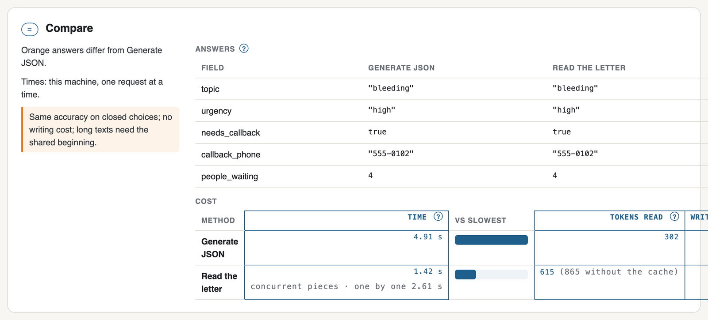
<b>🔬 <a href="https://github.com/r-ms/mini-jev">r-ms/mini-jev</a></b>
⭐64 · Python · 🔎 inferred
mini-Jev: seperti apa antarmuka keputusan bertipe bergaya Jev pada Qwen3-4B yang dibekukan — baca logit huruf opsi alih-alih menghasilkan JSON. Eksperimen yang telah…
</td>
</tr>
<tr>
<td width="50%" valign="top">

<b>🎮 <a href="https://github.com/MCG-NJU/VideoJev">MCG-NJU/VideoJev</a></b>
⭐311 · Python · 👁️ observed
VideoJev: System One Model untuk Pemahaman dan Interaksi Video
</td>
<td width="50%" valign="top">
<b>📰 <a href="https://docs.typesafe.ai/model-jaggedness/jev-1.13">9 jenis cacat yang diketahui (jaggedness)</a></b>
⭐0 · ✅ official
Pemahaman literal, **penghitungan tidak andal**, perbandingan tanggal, indireksi bertingkat, state besar dengan detail tidak relevan, konten adversarial, instruksi…
</td>
</tr>
</table>

## Daftar isi

- [Apa itu Jev?](#apa-itu-jev)
- [Cara entri dinilai](#cara-entri-dinilai)
- [SDK resmi dan alat pengembang](#sdk-resmi-dan-alat-pengembang) — **6**
- [Klien, SDK, dan adapter komunitas](#klien-sdk-dan-adapter-komunitas) — **141**
- [Perkakas agen: MCP, hook, gate, dan agen pengkodean](#perkakas-agen-mcp-hook-gate-dan-agen-pengkodean) — **256**
- [Perutean, guardrail, dan persetujuan](#perutean-guardrail-dan-persetujuan) — **64**
- [Evaluasi, kalibrasi, dan benchmark](#evaluasi-kalibrasi-dan-benchmark) — **88**
- [Reproduksi terbuka, bobot, dan riset arsitektur](#reproduksi-terbuka-bobot-dan-riset-arsitektur) — **68**
- [Aplikasi, game, robotika, dan demo interaktif](#aplikasi-game-robotika-dan-demo-interaktif) — **45**
- [Tulisan, diskusi, dan daftar sejenis](#tulisan-diskusi-dan-daftar-sejenis) — **75**
- [Proyek lain](#proyek-lain) — **87**
- [Proyek menurut bahasa implementasi](#proyek-menurut-bahasa-implementasi)

## Apa itu Jev?

Jev adalah **System One model** pertama dari TypeSafe AI. Ia tidak menulis prosa. Ia menerima sebuah state plus pertanyaan yang ruang jawabannya Anda tentukan sebelumnya, lalu mengembalikan nilai bertipe dengan distribusi probabilitas yang dapat dicabang oleh kode Anda.

|                            |                                                                                                                                                                                                                                       |
| -------------------------- | ------------------------------------------------------------------------------------------------------------------------------------------------------------------------------------------------------------------------------------- |
| **Bentuk**                 | `state + typed questions` → `constrained answers + probabilities` → `your code`                                                                                                                                                       |
| **Primitif**               | `Choice` (pilih satu dari ≤255 opsi), `Score` (rubrik 2–10), `Noul` (ya/tidak yang probabilistik)                                                                                                                                     |
| **Endpoint**               | `POST https://api.typesafe.ai/v1/systemone`, model `jev-1.13.0` / alias `jev-latest`                                                                                                                                                  |
| **Cocok untuk**            | perutean, triase, penilaian, moderasi, verifikasi, dan gate berlatensi rendah di dalam alur kerja yang terbatas                                                                                                                       |
| **Batasan yang diketahui** | penghitungan tidak dapat diandalkan, indireksi bertingkat lemah, dan materi resmi menyebut sembilan kelas ketidakteraturan. Keluaran yang valid secara skema bukan berarti keputusan yang benar — kalibrasi dengan data Anda sendiri. |

## Cara entri dinilai

Sebagian besar daftar di bidang ini mengklaim telah memuatnya. Daftar ini menyatakan seberapa banyak yang benar-benar diverifikasi, lalu membiarkan Anda menyaring sesuai itu.

| Tingkat      | Artinya                                                                                                                                                          |
| ------------ | ---------------------------------------------------------------------------------------------------------------------------------------------------------------- |
| `official`   | Diterbitkan oleh TypeSafe AI sendiri.                                                                                                                            |
| `observed`   | Artefak publik yang dapat dibuka dan dibaca — kode sumber nyata, konfigurasi nyata, atau pernyataan TypeSafe/Jev yang eksplisit pada nama atau topik repositori. |
| `inferred`   | Cocok berdasarkan sinyal ambigu ditambah kosakata pendukung, tetapi belum dibaca baris demi baris.                                                               |
| `unverified` | Tampak terkait, tidak ada yang dikonfirmasi secara independen. Didaftarkan hanya untuk penemuan.                                                                 |

## SDK resmi dan alat pengembang

Semua yang diterbitkan TypeSafe sendiri. Mulai dari sini.

🏛️ <b><a href="https://github.com/typesafe-ai/skills">typesafe-ai/skills</a></b> · ⭐2905 · ✅ official · 24 天

##### 📝 Ringkasan

Keahlian agen untuk membangun dengan TypeSafe System One API

> 💡 Keahlian agen milik vendor itu sendiri. Karena terus diperbarui, ini adalah hal yang paling mendekati spesifikasi tentang bagaimana TypeSafe ingin Jev dikendalikan dari agen.

##### 📌 Fakta dasar

| Bidang   | Nilai                           |
| -------- | ------------------------------- |
| Kategori | `SDK resmi dan alat pengembang` |
| Bukti    | `official`                      |

##### 📊 Data

| Metrik            | Nilai      |
| ----------------- | ---------- |
| Bintang           | **2905**   |
| Push terakhir     | 2026-10-23 |
| Pertama terdaftar | 2026-09-18 |

🏛️ <b><a href="https://github.com/typesafe-ai/system-one-adapter-python">typesafe-ai/system-one-adapter-python</a></b> · ⭐410 · Python · ✅ official · 2 天

##### 📝 Ringkasan

Pengganti TypeSafeClient drop-in yang didukung oleh LLM APIs

> 💡 Pengganti drop-in yang mendukung antarmuka yang sama dengan penyedia LLM biasa. Ini adalah cara jujur untuk melakukan A/B keputusan bertipe terhadap prompt, pada data Anda sendiri, sebelum berkomitmen pada salah satunya.

🔧 Ditemukan dipakai dalam kode: `README.md`

##### 📌 Fakta dasar

| Bidang   | Nilai                           |
| -------- | ------------------------------- |
| Kategori | `SDK resmi dan alat pengembang` |
| Bukti    | `official`                      |
| Bahasa   | Python                          |

##### 📊 Data

| Metrik            | Nilai      |
| ----------------- | ---------- |
| Bintang           | **410**    |
| Push terakhir     | 2026-11-15 |
| Pertama terdaftar | 2026-10-23 |

🏛️ <b><a href="https://github.com/typesafe-ai/typesafe-sdk-python">typesafe-ai/typesafe-sdk-python</a></b> · ⭐315 · Python · ✅ official · 6 天

##### 📝 Ringkasan

Pustaka Python resmi untuk TypeSafe API

> 💡 Klien sinkron dan asinkron. Jalur tercepat dari kunci API ke keputusan bertipe, dan referensi yang menjadi pembanding klien komunitas.

🔧 Ditemukan dipakai dalam kode: `README.md`

##### 📌 Fakta dasar

| Bidang   | Nilai                           |
| -------- | ------------------------------- |
| Kategori | `SDK resmi dan alat pengembang` |
| Bukti    | `official`                      |
| Bahasa   | Python                          |

##### 📊 Data

| Metrik            | Nilai      |
| ----------------- | ---------- |
| Bintang           | **315**    |
| Push terakhir     | 2026-11-11 |
| Pertama terdaftar | 2026-10-23 |

🏛️ <b><a href="https://github.com/typesafe-ai/typesafe-sdk-js">typesafe-ai/typesafe-sdk-js</a></b> · ⭐287 · TypeScript · ✅ official · 6 天

##### 📝 Ringkasan

Pustaka TypeScript/JavaScript resmi untuk TypeSafe API

> 💡 Klien TypeScript di mana tipe jawaban disimpulkan dari pertanyaan yang Anda ajukan, sehingga tipe kembalian yang tidak cocok menjadi kesalahan kompilasi alih-alih kejutan saat runtime.

##### 📌 Fakta dasar

| Bidang   | Nilai                           |
| -------- | ------------------------------- |
| Kategori | `SDK resmi dan alat pengembang` |
| Bukti    | `official`                      |
| Bahasa   | TypeScript                      |

##### 📊 Data

| Metrik            | Nilai      |
| ----------------- | ---------- |
| Bintang           | **287**    |
| Push terakhir     | 2026-11-11 |
| Pertama terdaftar | 2026-10-23 |

🏛️ <b><a href="https://github.com/typesafe-ai/WorkflowEvals">typesafe-ai/WorkflowEvals</a></b> · ⭐21 · Python · ✅ official · 3 天

##### 📝 Ringkasan

kode workflow evals.typesafe.ai dipublikasikan

##### 📌 Fakta dasar

| Bidang   | Nilai                           |
| -------- | ------------------------------- |
| Kategori | `SDK resmi dan alat pengembang` |
| Bukti    | `official`                      |
| Bahasa   | Python                          |

##### 📊 Data

| Metrik            | Nilai      |
| ----------------- | ---------- |
| Bintang           | **21**     |
| Push terakhir     | 2026-11-14 |
| Pertama terdaftar | 2026-10-23 |

🏛️ <b><a href="https://github.com/typesafe-ai/typesafe-ai.github.io">typesafe-ai/typesafe-ai.github.io</a></b> · ⭐2 · HTML · ✅ official · 165 天

##### 📝 Ringkasan

Tidak ada deskripsi hulu yang dipublikasikan.

##### 📌 Fakta dasar

| Bidang   | Nilai                           |
| -------- | ------------------------------- |
| Kategori | `SDK resmi dan alat pengembang` |
| Bukti    | `official`                      |
| Bahasa   | HTML                            |

##### 📊 Data

| Metrik            | Nilai      |
| ----------------- | ---------- |
| Bintang           | **2**      |
| Push terakhir     | 2026-06-04 |
| Pertama terdaftar | 2026-10-23 |

## Klien, SDK, dan adapter komunitas

Klien bertipe untuk endpoint System One, dalam sebanyak mungkin bahasa yang sempat dikerjakan komunitas.

🧰 <b><a href="https://github.com/ollaya-dev/ollaya">ollaya-dev/ollaya</a></b> · ⭐1470 · Rust · 👁️ observed · 6 天 · ⭐+1

##### 📝 Ringkasan

Jev-compatible API server for open decision models. Ollama for decision models: pull and serve 29 model families (Laya, pplx-decider, Clef, Winnow, coba...) locally or self-hosted behind /v1/systemone. The TypeSafe SDK works unchanged: set its base URL and pick an open model. CLI, desktop app, Docker, MCP server, public bench.

🔧 Ditemukan dipakai dalam kode: `README.md`, `docs/api.md`

##### 📌 Fakta dasar

| Bidang   | Nilai                               |
| -------- | ----------------------------------- |
| Kategori | `Klien, SDK, dan adapter komunitas` |
| Bukti    | `observed`                          |
| Bahasa   | Rust                                |

##### 📊 Data

| Metrik            | Nilai         |
| ----------------- | ------------- |
| Bintang           | **1470** (+1) |
| Push terakhir     | 2026-11-10    |
| Pertama terdaftar | 2026-09-25    |

🏷 `calibration` · `decision-model` · `decision-models` · `inference-server` · `jev` · `jev-alternative` · `jev-compatible` · `laya`

🧰 <b><a href="https://github.com/realZachi/pg-jev">realZachi/pg-jev</a></b> · ⭐1313 · Shell · 👁️ observed · 42 天

##### 📝 Ringkasan

Ajukan pertanyaan kepada tabel Postgres Anda dalam bahasa biasa. Ekstensi PostgreSQL yang didukung oleh Jev milik TypeSafe.

🔧 Ditemukan dipakai dalam kode: `README.md`

##### 📌 Fakta dasar

| Bidang   | Nilai                               |
| -------- | ----------------------------------- |
| Kategori | `Klien, SDK, dan adapter komunitas` |
| Bukti    | `observed`                          |
| Bahasa   | Shell                               |

##### 📊 Data

| Metrik            | Nilai      |
| ----------------- | ---------- |
| Bintang           | **1313**   |
| Push terakhir     | 2026-10-06 |
| Pertama terdaftar | 2026-10-29 |

🧰 <b><a href="https://github.com/jexp/neo4jev">jexp/neo4jev</a></b> · ⭐189 · Jupyter · 👁️ observed · 60 天

##### 📝 Ringkasan

System One Model Typesafe.ai Jev yang menavigasi graf Neo4j dengan menggunakan pengklasifikasi pada hubungan tetangga

##### 📌 Fakta dasar

| Bidang   | Nilai                               |
| -------- | ----------------------------------- |
| Kategori | `Klien, SDK, dan adapter komunitas` |
| Bukti    | `observed`                          |
| Bahasa   | Jupyter                             |

##### 📊 Data

| Metrik            | Nilai      |
| ----------------- | ---------- |
| Bintang           | **189**    |
| Push terakhir     | 2026-09-18 |
| Pertama terdaftar | 2026-10-28 |

🧰 <b><a href="https://github.com/john-rocky/coreai-kit">john-rocky/coreai-kit</a></b> · ⭐126 · Swift · 👁️ observed · 1 天

##### 📝 Ringkasan

Swift SDK untuk menjalankan model chat, vision, dan speech di iPhone dan Mac dengan Core AI Apple. Pengunduhan dan caching model, integrasi FoundationModels, serta contoh yang dapat dijalankan dengan persyaratan OS, SDK, dan model yang terdokumentasi.

🔧 Ditemukan dipakai dalam kode: `Sources/CoreAIOps/CoreAI+SystemOne.swift`

##### 📌 Fakta dasar

| Bidang   | Nilai                               |
| -------- | ----------------------------------- |
| Kategori | `Klien, SDK, dan adapter komunitas` |
| Bukti    | `observed`                          |
| Bahasa   | Swift                               |

##### 📊 Data

| Metrik            | Nilai      |
| ----------------- | ---------- |
| Bintang           | **126**    |
| Push terakhir     | 2026-11-16 |
| Pertama terdaftar | 2026-10-26 |

🏷 `apple` · `apple-core-ai` · `asr` · `core-ai` · `coreai` · `foundation-models` · `ios` · `ios-27`

---

<table><tr><th align="center" width="50%">🖼 Gambar</th><th align="center" width="50%">🎬 Video</th></tr><tr>
<td align="center" valign="top"></td>
<td align="center" valign="top"> rekaman bergerak</td>
</tr></table>

🧰 <b><a href="https://github.com/AkashPriyadarshii/jev-curate">AkashPriyadarshii/jev-curate</a></b> · ⭐112 · Rust · 👁️ observed · 6 天

##### 📝 Ringkasan

High-throughput synthetic and pretraining dataset sifter for TypeSafe Jev. Rust streaming core, Parquet and JSONL I/O, typed Choice/Score/Noul judgments, speculative fan-out, 24.0 rows/sec measured.

🔧 Ditemukan dipakai dalam kode: `AGENTS.md`, `site/llms.txt`, `docs/DESIGN.md`

##### 📌 Fakta dasar

| Bidang   | Nilai                               |
| -------- | ----------------------------------- |
| Kategori | `Klien, SDK, dan adapter komunitas` |
| Bukti    | `observed`                          |
| Bahasa   | Rust                                |

##### 📊 Data

| Metrik            | Nilai      |
| ----------------- | ---------- |
| Bintang           | **112**    |
| Push terakhir     | 2026-11-11 |
| Pertama terdaftar | 2026-11-05 |

🏷 `arrow` · `cli` · `data-cleaning` · `data-engineering` · `dataset-curation` · `eval-harness` · `fine-tuning` · `jev`

🧰 <b><a href="https://github.com/obie/ruby_decision_model">obie/ruby_decision_model</a></b> · ⭐60 · Ruby · 👁️ observed · 35 天

##### 📝 Ringkasan

Klien Ruby untuk model keputusan seperti Typesafe Jev

🔧 Ditemukan dipakai dalam kode: `README.md`

##### 📌 Fakta dasar

| Bidang   | Nilai                               |
| -------- | ----------------------------------- |
| Kategori | `Klien, SDK, dan adapter komunitas` |
| Bukti    | `observed`                          |
| Bahasa   | Ruby                                |

##### 📊 Data

| Metrik            | Nilai      |
| ----------------- | ---------- |
| Bintang           | **60**     |
| Push terakhir     | 2026-10-12 |
| Pertama terdaftar | 2026-10-29 |

🧰 <b><a href="https://github.com/bodepudimuneendra-netizen/ConsciousDB">bodepudimuneendra-netizen/ConsciousDB</a></b> · ⭐56 · Python · 👁️ observed · 15 天

##### 📝 Ringkasan

Kerangka Agentic GraphRAG yang tidak bergantung pada basis data, menggunakan model System One yang dapat dipertukarkan (Laya lokal / Jev cloud). Lapisan kecerdasan plug-and-play yang dilengkapi pipeline 4 fase lengkap, evaluasi berkelanjutan, dan traversal A* khusus untuk basis data graf apa pun.

##### 📌 Fakta dasar

| Bidang   | Nilai                               |
| -------- | ----------------------------------- |
| Kategori | `Klien, SDK, dan adapter komunitas` |
| Bukti    | `observed`                          |
| Bahasa   | Python                              |

##### 📊 Data

| Metrik            | Nilai      |
| ----------------- | ---------- |
| Bintang           | **56**     |
| Push terakhir     | 2026-11-02 |
| Pertama terdaftar | 2026-11-02 |

🏷 `astar-algorithm` · `eval-harness` · `fine-tuning` · `graphdatabase` · `graprag` · `jev` · `laya` · `neo4j`

🧰 <b><a href="https://github.com/AkashPriyadarshii/jev-superpowers">AkashPriyadarshii/jev-superpowers</a></b> · ⭐39 · HTML · 👁️ observed · 40 天

##### 📝 Ringkasan

Systematic software development framework for AI coding agents upgraded with TypeSafe Jev System One typed decisions

🔧 Ditemukan dipakai dalam kode: `CLAUDE.md`

##### 📌 Fakta dasar

| Bidang   | Nilai                               |
| -------- | ----------------------------------- |
| Kategori | `Klien, SDK, dan adapter komunitas` |
| Bukti    | `observed`                          |
| Bahasa   | HTML                                |

##### 📊 Data

| Metrik            | Nilai      |
| ----------------- | ---------- |
| Bintang           | **39**     |
| Push terakhir     | 2026-10-08 |
| Pertama terdaftar | 2026-11-05 |

🏷 `agentic-skills` · `ai-agents` · `antigravity` · `claude-code` · `codex` · `coding-agents` · `cursor` · `developer-tools`

🧰 <b><a href="https://github.com/MrJev/awesome-jev">MrJev/awesome-jev</a></b> · ⭐21 · Python · 👁️ observed · 0 天

##### 📝 Ringkasan

Daftar pilihan proyek, integrasi, dan sumber daya untuk System One milik TypeSafe AI, Jev.

##### 📌 Fakta dasar

| Bidang   | Nilai                               |
| -------- | ----------------------------------- |
| Kategori | `Klien, SDK, dan adapter komunitas` |
| Bukti    | `observed`                          |
| Bahasa   | Python                              |

##### 📊 Data

| Metrik            | Nilai      |
| ----------------- | ---------- |
| Bintang           | **21**     |
| Push terakhir     | 2026-11-17 |
| Pertama terdaftar | 2026-09-18 |

🏷 `ai-agents` · `awesome` · `awesome-list` · `jev` · `mcp` · `typesafe`

🧰 <b><a href="https://github.com/ckaraca/awesome-jev">ckaraca/awesome-jev</a></b> · ⭐18 · Python · 👁️ observed · 1 天

##### 📝 Ringkasan

Daftar terkurasi alat, integrasi, dan eksperimen yang dibangun di atas Jev, model System One milik TypeSafe AI untuk keputusan cepat dan bertipe.

##### 📌 Fakta dasar

| Bidang   | Nilai                               |
| -------- | ----------------------------------- |
| Kategori | `Klien, SDK, dan adapter komunitas` |
| Bukti    | `observed`                          |
| Bahasa   | Python                              |

##### 📊 Data

| Metrik            | Nilai      |
| ----------------- | ---------- |
| Bintang           | **18**     |
| Push terakhir     | 2026-11-16 |
| Pertama terdaftar | 2026-09-19 |

🏷 `ai-agents` · `awesome` · `awesome-list` · `computer-use` · `jev` · `llm` · `system-one` · `typesafe`

🧰 <b><a href="https://github.com/Premo-Cloud/typesafe-sdk-java">Premo-Cloud/typesafe-sdk-java</a></b> · ⭐12 · Java · 👁️ observed · 26 天

##### 📝 Ringkasan

Java SDK komunitas untuk Jev, model System One milik TypeSafe: pertanyaan bertipe masuk, jawaban bertipe dengan probabilitas terkalibrasi keluar. Java 17+, Spring Boot starter (tidak resmi)

##### 📌 Fakta dasar

| Bidang   | Nilai                               |
| -------- | ----------------------------------- |
| Kategori | `Klien, SDK, dan adapter komunitas` |
| Bukti    | `observed`                          |
| Bahasa   | Java                                |

##### 📊 Data

| Metrik            | Nilai      |
| ----------------- | ---------- |
| Bintang           | **12**     |
| Push terakhir     | 2026-10-21 |
| Pertama terdaftar | 2026-10-28 |

🏷 `java` · `jev` · `sdk` · `spring-boot` · `system-one` · `system-one-models` · `typesafe`

🧰 <b><a href="https://github.com/PromtEngineer/jev-harness">PromtEngineer/jev-harness</a></b> · ⭐9 · Python · 👁️ observed · 53 天

##### 📝 Ringkasan

Harness agen Pi yang dibangun di sekitar TypeSafe Jev (model System One): router, pemilih konteks, gate, verifier. Diuji pada cabang Neon Postgres.

##### 📌 Fakta dasar

| Bidang   | Nilai                               |
| -------- | ----------------------------------- |
| Kategori | `Klien, SDK, dan adapter komunitas` |
| Bukti    | `observed`                          |
| Bahasa   | Python                              |

##### 📊 Data

| Metrik            | Nilai      |
| ----------------- | ---------- |
| Bintang           | **9**      |
| Push terakhir     | 2026-09-24 |
| Pertama terdaftar | 2026-10-28 |

🧰 <b><a href="https://github.com/clouatre-labs/decisions-judge-mcp">clouatre-labs/decisions-judge-mcp</a></b> · ⭐5 · JavaScript · 👁️ observed · 0 天

##### 📝 Ringkasan

Keputusan bertipe untuk agen AI sebagai alat MCP: probabilitas ya/tidak (noul), pilihan, dan skor dalam satu permintaan cepat. Didukung oleh model System One TypeSafe.

##### 📌 Fakta dasar

| Bidang   | Nilai                               |
| -------- | ----------------------------------- |
| Kategori | `Klien, SDK, dan adapter komunitas` |
| Bukti    | `observed`                          |
| Bahasa   | JavaScript                          |

##### 📊 Data

| Metrik            | Nilai      |
| ----------------- | ---------- |
| Bintang           | **5**      |
| Push terakhir     | 2026-11-17 |
| Pertama terdaftar | 2026-10-12 |

🏷 `agent` · `ai` · `cli` · `decision-making` · `decisions` · `judge` · `llm` · `mcp`

---

<table><tr><th align="center" width="50%">🖼 Gambar</th><th align="center" width="50%">🎬 Video</th></tr><tr>
<td align="center" valign="top"></td>
<td align="center" valign="top"> rekaman bergerak</td>
</tr></table>

🧰 <b><a href="https://github.com/Bonzokoles/36_chambers">Bonzokoles/36_chambers</a></b> · Python · 👁️ observed · 25 天

##### 📝 Ringkasan

Mesin pengambilan pengetahuan terfederasi untuk agen AI. Merutekan kueri ke berbagai backend khusus (FTS5, ChromaDB, graf) melalui orkestrator yang mengutamakan registri dengan perutean AI TypeSafe/Jev dan pengurutan ulang bukti. Hanya-baca secara bawaan, dirancang dengan keamanan sebagai pengendali.

##### 📌 Fakta dasar

| Bidang   | Nilai                               |
| -------- | ----------------------------------- |
| Kategori | `Klien, SDK, dan adapter komunitas` |
| Bukti    | `observed`                          |
| Bahasa   | Python                              |

##### 📊 Data

| Metrik            | Nilai      |
| ----------------- | ---------- |
| Bintang           | **0**      |
| Push terakhir     | 2026-10-22 |
| Pertama terdaftar | 2026-10-23 |

🏷 `ai-agents` · `ai-infrastructure` · `chromadb` · `embeddings` · `federated-search` · `fts5` · `information-retrieval` · `jev`

---

<table><tr><th align="center" width="50%">🖼 Gambar</th><th align="center" width="50%">🎬 Video</th></tr><tr>
<td align="center" valign="top"></td>
<td align="center" valign="top">tidak ada media yang dipublikasikan</td>
</tr></table>

Aset ditautkan langsung dari repositori hulu karena tidak ada lisensi redistribusi yang dinyatakan.

🧰 <b><a href="https://github.com/dzhng/jevgrep">dzhng/jevgrep</a></b> · ⭐3241 · TypeScript · 🔎 inferred · 4 天

##### 📝 Ringkasan

Temukan kode dengan menanyakan apa fungsinya. Sebuah CLI untuk agen pengodean yang menggunakan Jev untuk menemukan berkas dan konteks sumber yang relevan.

##### 📌 Fakta dasar

| Bidang   | Nilai                               |
| -------- | ----------------------------------- |
| Kategori | `Klien, SDK, dan adapter komunitas` |
| Bukti    | `inferred`                          |
| Bahasa   | TypeScript                          |

##### 📊 Data

| Metrik            | Nilai      |
| ----------------- | ---------- |
| Bintang           | **3241**   |
| Push terakhir     | 2026-11-12 |
| Pertama terdaftar | 2026-11-07 |

🏷 `ai-sdk` · `claude-code` · `cli` · `code-search` · `codex` · `coding-agents` · `context-retrieval` · `developer-tools`

---

<table><tr><th align="center" width="50%">🖼 Gambar</th><th align="center" width="50%">🎬 Video</th></tr><tr>
<td align="center" valign="top"></td>
<td align="center" valign="top">tidak ada media yang dipublikasikan</td>
</tr></table>

🧰 <b><a href="https://github.com/supercorp-ai/supercov">supercorp-ai/supercov</a></b> · ⭐166 · Rust · 🔎 inferred · 4 天

##### 📝 Ringkasan

Cakupan, keamanan, dan kualitas kode untuk agen pengkodean

> 💡 Putusan kualitas kode dan cakupan yang dihasilkan sebagai keputusan bertipe alih-alih prosa, sehingga hasilnya dapat langsung menjadi gate pipeline.

##### 📌 Fakta dasar

| Bidang   | Nilai                               |
| -------- | ----------------------------------- |
| Kategori | `Klien, SDK, dan adapter komunitas` |
| Bukti    | `inferred`                          |
| Bahasa   | Rust                                |

##### 📊 Data

| Metrik            | Nilai      |
| ----------------- | ---------- |
| Bintang           | **166**    |
| Push terakhir     | 2026-11-13 |
| Pertama terdaftar | 2026-10-23 |

🏷 `agent-skills` · `claude-code` · `code-coverage` · `code-quality` · `codex` · `coding-agents` · `coverage` · `gemini-cli-extension`

---

<table><tr><th align="center" width="50%">🖼 Gambar</th><th align="center" width="50%">🎬 Video</th></tr><tr>
<td align="center" valign="top"></td>
<td align="center" valign="top">tidak ada media yang dipublikasikan</td>
</tr></table>

🧰 <b><a href="https://github.com/AkashPriyadarshii/jev-seo">AkashPriyadarshii/jev-seo</a></b> · ⭐104 · Rust · 🔎 inferred · 6 天

##### 📝 Ringkasan

Free Rust SEO and GEO toolkit powered by TypeSafe Jev: 58-rule audits, site crawls, AI citation checks, rank drift, CI gates, 15-tool MCP. Zero cost.

##### 📌 Fakta dasar

| Bidang   | Nilai                               |
| -------- | ----------------------------------- |
| Kategori | `Klien, SDK, dan adapter komunitas` |
| Bukti    | `inferred`                          |
| Bahasa   | Rust                                |

##### 📊 Data

| Metrik            | Nilai      |
| ----------------- | ---------- |
| Bintang           | **104**    |
| Push terakhir     | 2026-11-11 |
| Pertama terdaftar | 2026-11-05 |

🏷 `ahrefs-alternative` · `answer-engine-optimization` · `claude-code` · `cli` · `coding-agents` · `generative-engine-optimization` · `geo` · `jev`

---

<table><tr><th align="center" width="50%">🖼 Gambar</th><th align="center" width="50%">🎬 Video</th></tr><tr>
<td align="center" valign="top"></td>
<td align="center" valign="top">tidak ada media yang dipublikasikan</td>
</tr></table>

🧰 <b><a href="https://github.com/AboveColin/HA-Jev">AboveColin/HA-Jev</a></b> · ⭐89 · Python · 🔎 inferred · 4 天

##### 📝 Ringkasan

Ajukan pertanyaan kepada rumah Anda dan dapatkan angka sebagai jawaban. Integrasi Home Assistant untuk TypeSafe Jev: jawaban bertipe sebagai sensor, empat tindakan untuk otomasi, dan agen percakapan untuk Assist.

##### 📌 Fakta dasar

| Bidang   | Nilai                               |
| -------- | ----------------------------------- |
| Kategori | `Klien, SDK, dan adapter komunitas` |
| Bukti    | `inferred`                          |
| Bahasa   | Python                              |

##### 📊 Data

| Metrik            | Nilai      |
| ----------------- | ---------- |
| Bintang           | **89**     |
| Push terakhir     | 2026-11-12 |
| Pertama terdaftar | 2026-10-29 |

🏷 `ai` · `assist` · `conversation` · `custom-components` · `decision-model` · `hacs` · `home-assistant` · `home-automation`

---

<table><tr><th align="center" width="50%">🖼 Gambar</th><th align="center" width="50%">🎬 Video</th></tr><tr>
<td align="center" valign="top">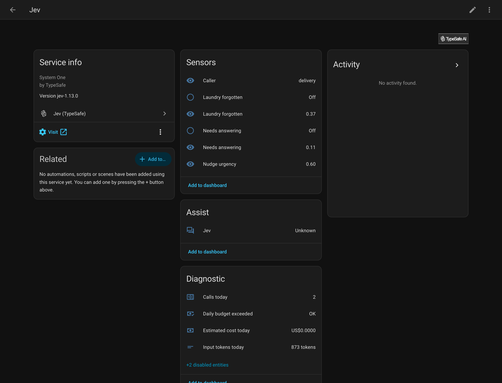</td>
<td align="center" valign="top">tidak ada media yang dipublikasikan</td>
</tr></table>

<b>Lainnya di kategori ini</b> · 123

- [Sur-Cai/macos-computer-use-kit](https://github.com/Sur-Cai/macos-computer-use-kit) - AX-first computer use for AI agents on macOS with optional Jev.
- [xingwudao/OpenJev](https://github.com/xingwudao/OpenJev) - OpenJev: Jev independen yang terinspirasi System One keputusan API berdasarkan…
- [danieleteti/systemone-delphi](https://github.com/danieleteti/systemone-delphi) - Delphi client for System One models (Jev, tev1 and nimble on Ollama): ask typed…
- [GitHub30/OpenJev](https://github.com/GitHub30/OpenJev) - Model System One berbobot terbuka (kompatibel dengan Jev): keputusan noul /…
- [chussenot/judgment](https://github.com/chussenot/judgment) - Penilaian bertipe dan terkalibrasi dari model System One: keputusan yang…
- [CMaintz/jev-dotnet](https://github.com/CMaintz/jev-dotnet) - SDK .NET tidak resmi untuk model Jev System One milik TypeSafe AI.
- [erik-hedstrom/loadout](https://github.com/erik-hedstrom/loadout) - Pilih model, skill, dan server MCP untuk setiap sesi agen coding dari pustaka…
- [jqueryscript/awesome-jev](https://github.com/jqueryscript/awesome-jev) - A curated list of TypeSafe Jev resources, SDKs, agents, MCP servers…
- [chrismarchant/jev-router](https://github.com/chrismarchant/jev-router) - Agent- and harness-agnostic router that offloads parallel-workstream decisions…
- [CMaintz/jev-java](https://github.com/CMaintz/jev-java) - Java SDK tidak resmi untuk model Jev System One milik TypeSafe AI.
- [cogcloud-ai/cog-typesafe](https://github.com/cogcloud-ai/cog-typesafe) - TypeSafe.
- [JosephHardy91/graph-composition-with-dLLMs](https://github.com/JosephHardy91/graph-composition-with-dLLMs) - A Graph-Compiled Specification RAG system built with **Dagster**, **PostgreSQL…
- [sanketmuchhala/jevgate](https://github.com/sanketmuchhala/jevgate) - Calibrated policy triage and institutional risk routing: a hybrid…
- [juspay/neurolink](https://github.com/juspay/neurolink) - Lapisan pipa dari sistem saraf AI — satu antarmuka yang menghubungkan neuron…
- [aaddrick/building-with-typesafe-jev](https://github.com/aaddrick/building-with-typesafe-jev) - Keahlian tidak resmi yang mengajarkan agen pengodean untuk membangun dengan…
- [keltokhy/jgrep](https://github.com/keltokhy/jgrep) - grep, tetapi polanya adalah deskripsi.
- [Ying-Kai-Liao/jev-browser](https://github.com/Ying-Kai-Liao/jev-browser) - Otomasi browser ketika LLM merencanakan dan Jev (System One Typesafe)…
- [qkal/Canny](https://github.com/qkal/Canny) - Mencegah agen coding AI mengklaim pekerjaan selesai tanpa bukti.
- [fazlerocks/jevmail](https://github.com/fazlerocks/jevmail) - Triase email AI sumber terbuka untuk Gmail.
- [yzfly/awesome-jev-zh](https://github.com/yzfly/awesome-jev-zh) - Daftar pilihan Jev / TypeSafe System One dalam bahasa Tionghoa: materi resmi…
- [sharziki/semdecide](https://github.com/sharziki/semdecide) - Keputusan semantik bertipe untuk pipeline Unix dan CI, didukung oleh TypeSafe…
- [bladedevoff/stuntd](https://github.com/bladedevoff/stuntd) - Proksi lokal yang mempelajari keputusan LLM bertipe dari aplikasi Anda dan…
- [burnigtm/jev-mcp](https://github.com/burnigtm/jev-mcp) - Server MCP yang menempatkan TypeSafe Jev dalam loop coding di Cursor, Codex…
- [mlimarenko/IronRAG](https://github.com/mlimarenko/IronRAG) - One-click knowledge system for documents, internal bots, and AI agents.
- [shaharia-lab/jev-cli](https://github.com/shaharia-lab/jev-cli) - Alat baris perintah untuk model Jev milik TypeSafe AI.
- [Eliot5566/JEV-Paper-Radar](https://github.com/Eliot5566/JEV-Paper-Radar) - Turn research interests or paper links into a ranked reading list in Claude.
- [dannote/jev](https://github.com/dannote/jev) - TypeSafe Jev untuk OTP: balas ke Jev dari GenServer dan lakukan pattern match…
- [DevLoops-ai/unified-brain](https://github.com/DevLoops-ai/unified-brain) - System One coding agents: code-level answers in about 10secs for under 2 cents.
- [jwuthri-cloud/SelfJev](https://github.com/jwuthri-cloud/SelfJev) - Self-hosted decision model (selfjev-4b) with a Jev-compatible API: Python SDK…
- [win4r/jev-skill-suggester](https://github.com/win4r/jev-skill-suggester) - 用 TypeSafe Jev 推荐已安装 Skill / Bounded installed-skill recommendations with…
- [jiangkoumo/ego-decision-layer](https://github.com/jiangkoumo/ego-decision-layer) - Pluggable decision layer for the ego lite browser: one System One (Jev) call…
- [thusinh1969/BrighTO_Router](https://github.com/thusinh1969/BrighTO_Router) - BrighTO LLM Router: free open-source, ultra-fast Rust LLM gateway/router and…
- [arjun988/Kev](https://github.com/arjun988/Kev) - Mesin keputusan System One open-source.
- [Ray-Hughes/jevalyn](https://github.com/Ray-Hughes/jevalyn) - Lapisan pengambilan keputusan untuk aplikasi Rails Anda.
- [CheshiAI/Cheshi](https://github.com/CheshiAI/Cheshi) - Jev-powered conversation memory: find past sessions and revisit decisions with…
- [nouli-ai/nouli](https://github.com/nouli-ai/nouli) - Decision Agent Engine.
- [utk2103/jev-studio](https://github.com/utk2103/jev-studio) - if you.
- [tontoko/jev-browser](https://github.com/tontoko/jev-browser) - Satu inti Jev/Playwright yang ter-grounding: SDK bertipe, CLI persisten, dan…
- [saibimajdi/typesafeai-dotnet-sdk](https://github.com/saibimajdi/typesafeai-dotnet-sdk) - SDK .NET komunitas untuk TypeSafe AI System One API — pertanyaan noul, pilihan…
- [Elue-dev/jev_elixir](https://github.com/Elue-dev/jev_elixir) - jev_elixir adalah antarmuka kecil dan idiomatis untuk membuat keputusan bertipe…
- [arcships/android-use](https://github.com/arcships/android-use) - Android control for Dim Agent and local MCP clients, with a live screen, native…
- [himomohi/aside-jev](https://github.com/himomohi/aside-jev) - Agen Aside memutuskan dengan TypeSafe Jev (System One: Choice/Score/Noul).
- [rcarmo/go-system-one](https://github.com/rcarmo/go-system-one) - when a gopher met Jev.
- [haileyok/typesafe-client](https://github.com/haileyok/typesafe-client) - Klien Go dan Rust tidak resmi untuk TypeSafe AI System One API (Jev).
- [sumleo/prompt2jev](https://github.com/sumleo/prompt2jev) - Skill agen dan CLI yang mengubah bahasa alami, prompt LLM, atau kode yang…
- [AIAnytime/Jev-Router](https://github.com/AIAnytime/Jev-Router) - Decision-first, OpenAI-compatible AI router powered by Jev typed decisions.
- [chenrui333/jev-docs](https://github.com/chenrui333/jev-docs) - Riwayat Jev / TypeSafe System One APIs yang dikelola komunitas, SDKs, panduan…
- [devbackend/jevgo](https://github.com/devbackend/jevgo) - Klien Go tidak resmi untuk TypeSafe AI System One API (Jev) — masukkan…
- [docxology/daf-jev](https://github.com/docxology/daf-jev) - daf-jev: toolkit Python yang dapat disusun untuk Jev milik TypeSafe.
- [TraxSharp/Trax](https://github.com/TraxSharp/Trax) - one description of your app, for the whole team.
- [Jev-Engineering/TypeWright](https://github.com/Jev-Engineering/TypeWright) - Deklarasikan sebuah keputusan, kompilasi pertanyaan Jev bertipe, ukur, dan…
- [Kadihx/jev-x-kit](https://github.com/Kadihx/jev-x-kit) - Lapisan keputusan offline $0 untuk agen pengkodean: primitif Choice/Score/Noul…
- [akiiwa-games/AgentCompass](https://github.com/akiiwa-games/AgentCompass) - Deterministic multi-agent task router &amp; subscription quota scheduler for Claude…
- [Agnuxo1/Universal-Cognitive-Architecture-JEV-v2](https://github.com/Agnuxo1/Universal-Cognitive-Architecture-JEV-v2) - Executable cognitive architecture: validated graph context, deterministic…
- [docwilde/doxa](https://github.com/docwilde/doxa) - ΔΟΞΑ: Rust multi-agent terminal for Claude, Codex, GLM and DeepSeek, with…
- [elanthus/news-briefing](https://github.com/elanthus/news-briefing) - Deterministic controls for LLM output in a daily news briefing.
- [illescasDaniel/jev-mem](https://github.com/illescasDaniel/jev-mem) - Long-term memory for AI agents driven by Jev (System One) decisions: no…
- [JimmyWesley/rlcd-gateway](https://github.com/JimmyWesley/rlcd-gateway) - Gateway self-hosted untuk LLMs dan model keputusan.
- [PAI-CUHK/SLEEPJEV](https://github.com/PAI-CUHK/SLEEPJEV) - Keputusan runtime bertipe yang terinspirasi JEV atas PSG jangka panjang…
- [robertn702/reasoning-router](https://github.com/robertn702/reasoning-router) - Per-step reasoning effort for coding agents, picked by a classifier, without…
- [shinpr/jev-reranker](https://github.com/shinpr/jev-reranker) - Rerank, filter, and compress JSON search results with TypeSafe AI.
- [zhirschtritt/typesafe-go](https://github.com/zhirschtritt/typesafe-go) - Go SDK idiomatis untuk TypeSafe AI API.
- [AboveColin/jevclient](https://github.com/AboveColin/jevclient) - Klien Python asinkron untuk TypeSafe Jev.
- [Butochnikov/laravel-typesafe-jev](https://github.com/Butochnikov/laravel-typesafe-jev) - Integrasi Laravel tidak resmi untuk TypeSafe Jev AI dengan respons bertipe…
- [coo-quack/jev-pii-checker](https://github.com/coo-quack/jev-pii-checker) - CLI yang menemukan PII dalam teks dengan TypeSafe Jev: keberadaan…
- [freepik-company/jev-mcp](https://github.com/freepik-company/jev-mcp) - MCP server for typed decisions with Jev / System One via OpenRouter or TypeSafe.
- [frodi-karlsson/onesie](https://github.com/frodi-karlsson/onesie) - Gate scripts and CI on fast, calibrated System One judgments like Jev: a score…
- [Lasimeri/Mechanical-Jev](https://github.com/Lasimeri/Mechanical-Jev) - Sisi pengajuan pertanyaan dari Jev (TypeSafe System One: noul, choice, score)…
- [nshkrdotcom/system_one_sdk](https://github.com/nshkrdotcom/system_one_sdk) - Elixir/BEAM SDK yang netral penyedia untuk semantik System One: keputusan Noul…
- [zerone-agents/jev-model-router](https://github.com/zerone-agents/jev-model-router) - Perutean model ringan untuk agen, dengan kompatibilitas OpenAI dan Anthropic…
- [abhisheksharma001/jev-skill](https://github.com/abhisheksharma001/jev-skill) - Agent skill for TypeSafe AI.
- [dsaad68/fuzzy-jev](https://github.com/dsaad68/fuzzy-jev) - A client for OpenRouter&#x27;s decision models, TypeSafe&#x27;s Jev by default: typed…
- [getmissionctrl/hs-jev](https://github.com/getmissionctrl/hs-jev) - Klien Haskell untuk API keputusan System One (Jev) milik TypeSafe…
- [NerdishShah/playwright-cli-jev-bakeoff](https://github.com/NerdishShah/playwright-cli-jev-bakeoff) - Bake-off: Playwright CLI vs CLI+Jev vs Playwright MCP.
- [bitranox/btx-skill-jev-judge](https://github.com/bitranox/btx-skill-jev-judge) - Claude Code plugin and Python CLI: hand a judgment repeated over many items to…
- [exfoca/decision-model-lab-4JEV](https://github.com/exfoca/decision-model-lab-4JEV) - DML is a reproducible harness for evaluating small, local decision models under…
- [Hyper-AI-Lab/openclaw-jev](https://github.com/Hyper-AI-Lab/openclaw-jev) - Control plane produksi untuk agen OpenClaw: routing intake dengan Jev…
- [MrKyaw/CognitiveMirror-Jev-MCP](https://github.com/MrKyaw/CognitiveMirror-Jev-MCP) - Cognitive middleware for personal and enterprise AI agents: 14 MCP tools and a…
- [Talya1412/jev-harness](https://github.com/Talya1412/jev-harness) - TypeSafe Jev (System One) integrations for OMP, MCP, Claude Code, and Pi…
- [vijaycinn/el-jev](https://github.com/vijaycinn/el-jev) - High-speed System One decision sidecar &amp; Copilot CLI pre-turn hook powered by…
- [abirshhishirroy/mini-jev](https://github.com/abirshhishirroy/mini-jev) - A custom Jev-style decision model built from scratch on Qwen2.5-3B.
- [AKASHSOMAN/Jev-LangGraph-Decision-Agent](https://github.com/AKASHSOMAN/Jev-LangGraph-Decision-Agent) - A minimal demo showing how to use Jev (System One) as a decision engine inside…
- [arthurcolle/jev-pivot-lab](https://github.com/arthurcolle/jev-pivot-lab) - Jev-routed sub-executor: answers a prompt on the cheapest model and reasoning…
- [AsgardMuninn/jev-norma](https://github.com/AsgardMuninn/jev-norma) - Triase normatif LatAm dengan Jev (System One) sebagai gerbang: menormalkan…
- [bariskisir/JevSharp](https://github.com/bariskisir/JevSharp) - .NET 10 SDK for Jev decisions through TypeSafe, OpenRouter, Vercel AI Gateway…
- [CMaintz/jev-tools](https://github.com/CMaintz/jev-tools) - Tool TypeScript yang dibangun di atas Jev milik TypeSafe AI: guardrail…
- [codebam/jev-guardrails](https://github.com/codebam/jev-guardrails) - Guardrail yang didukung Jev untuk pemanggilan tool agen: pustaka, hook native…
- [gupolicarpo/jev-graphify](https://github.com/gupolicarpo/jev-graphify) - MCP server that gives coding agents the right file, memory or skill for a…
- [heiwa4126/jev-node1](https://github.com/heiwa4126/jev-node1) - Bun で @typesafe-ai/sdk 0.7.0 を使うとエラーになるので、一時的に pnpm と node でやる版.
- [HillPhelmuth/JevDotNet](https://github.com/HillPhelmuth/JevDotNet) - c# SDK for &quot;System One&quot; decisions models like Jev.
- [ivanblagdan/jev-cli](https://github.com/ivanblagdan/jev-cli) - Composable CLI for TypeSafe.
- [jfmdev/chatbot-jev-gemini](https://github.com/jfmdev/chatbot-jev-gemini) - A simple AI-first support bot built with TypeSafe&#x27;s Jev and Google&#x27;s Gemini API.
- [kkdev92/jev-dotnet](https://github.com/kkdev92/jev-dotnet) - An unofficial .NET 10 client for Jev, TypeSafe.
- [MrGKanev/lets-make-jev](https://github.com/MrGKanev/lets-make-jev) - Jev tests a simple idea: when an LLM only needs to choose a category, score the…
- [ogarciarevett/jev-py-sdk](https://github.com/ogarciarevett/jev-py-sdk) - Penilaian Jev bertipe (noul / choice / score) dari TypeSafe untuk Python…
- [phoenix1331/laravel-jev-hotdog](https://github.com/phoenix1331/laravel-jev-hotdog) - A Laravel 13 playground that tells you whether a photo is a hot dog or not…
- [revoirb612/codex-jev-router](https://github.com/revoirb612/codex-jev-router) - A small local-first task router for TypeSafe Jev and Codex CLI.
- [royalskynet/jev-gate-mcp](https://github.com/royalskynet/jev-gate-mcp) - Gerbang keputusan Jev yang diatur untuk klien GPT, Claude, dan MCP.
- [shetautnetjer/jev-cli](https://github.com/shetautnetjer/jev-cli) - Clean-room CLI for TypeSafe System One / Jev Decision Contracts, search, and…
- [sunjongos/jev-typesafe-gatekeeper](https://github.com/sunjongos/jev-typesafe-gatekeeper) - World-Class Pure System 1 AI Decision &amp; 90/10 Hybrid Gatekeeper Skill powered…
- [sususu98/pi-jev-navigator](https://github.com/sususu98/pi-jev-navigator) - Ultra-low-token System One context navigation and precision SOP dispatch engine…
- [SykkoAtHome/MCP_Typesafe_JEV](https://github.com/SykkoAtHome/MCP_Typesafe_JEV) - Domain-agnostic MCP server for TypeSafe Jev (System One) evaluation engine…
- [VianneyMI/python-jev](https://github.com/VianneyMI/python-jev) - Unofficial typed Python SDK for TypeSafe.
- [vincentlauriat/MailClassification.jev](https://github.com/vincentlauriat/MailClassification.jev) - Semantic classification of Outlook, Gmail and IMAP mailboxes with Jev…
- [Yasir-Khan-7/jev-sentinel](https://github.com/Yasir-Khan-7/jev-sentinel) - Perlindungan injeksi prompt &amp; pagar pengaman pemanggilan alat untuk agen AI…
- [Zuexx/agent-jev-integration](https://github.com/Zuexx/agent-jev-integration) - TypeSafe Jev integrated into Claude Code: routing, escalation, guardrails, evals.
- [MiaoWuNYA/rikkahub-sillytavern-android](https://github.com/MiaoWuNYA/rikkahub-sillytavern-android) - 安卓AI聊天端:开箱即聊，无损导入酒馆卡，专属RP模式，高定制主题，创造模式，RAG记忆，缓存强省用量，防空回，主动信息，前端卡支持，QQbot，AI群聊，插件…
- [pithings/advocaat](https://github.com/pithings/advocaat) - Klien kecil dan aman tipe untuk mengajukan pertanyaan AI tentang data Anda…
- [Brainwires/jevwire](https://github.com/Brainwires/jevwire) - Jev decision layer for agents: MCP server, embeddable DecisionModel library…
- [zhulinchng/jevper](https://github.com/zhulinchng/jevper) - Pembungkus klasifikasi berbentuk Jev (TypeSafe System One) di atas klien mirip…
- [schainks/system_one_client](https://github.com/schainks/system_one_client) - Klien Elixir untuk model keputusan System One: TypeSafe Jev, Cloudflare Clef…
- [gilljon/typesafe-ai-rs](https://github.com/gilljon/typesafe-ai-rs) - Rust SDK asinkron dan blocking independen untuk TypeSafe AI System One API.
- [IKEASven69/dsh-opencli](https://github.com/IKEASven69/dsh-opencli) - 让 dsh 会办事:登录态真实浏览器 × 180 站点结构化命令 + SystemOne 亚秒决策 + 执行真实性判定 + watch 监控.
- [Query-farm/vgi-typesafe](https://github.com/Query-farm/vgi-typesafe) - Worker VGI yang mengekspos pertanyaan TypeSafe System One (choice, noul, score)…
- [iamtalha-arshad/ex_typesafe_ai](https://github.com/iamtalha-arshad/ex_typesafe_ai) - Klien Elixir tidak resmi untuk TypeSafe AI API — struct bertipe, HTTP berbasis…
- [lirantal/discoprint](https://github.com/lirantal/discoprint) - Classify an artist.
- [y0usaf/typesafe-cli](https://github.com/y0usaf/typesafe-cli) - Ajukan pertanyaan bertipe Jev dari shell: jawaban noul, choice, dan score…
- [geilt/typesafe-cli](https://github.com/geilt/typesafe-cli) - CLI dan skill agen untuk TypeSafe System One (Jev): penilaian Choice, Score…
- [hardkoded/typesafe-sdk-dotnet](https://github.com/hardkoded/typesafe-sdk-dotnet) - Unofficial .NET port of the TypeSafe AI client SDK (typed questions &amp; answers).
- [KratosLee-6/open-source-model-deploy](https://github.com/KratosLee-6/open-source-model-deploy) - 开源大模型部署可行性鉴别工具 · 168 个开源模型动态评估（含 12 个 JEV/System One 决策模型）· 硬件自动检测 ·…
- [MarcelRoozekrans/Minos.NET](https://github.com/MarcelRoozekrans/Minos.NET) - Typed, source-generated decision questions for .NET: one IDecisionClient for…
- [MIt9/laya-cli](https://github.com/MIt9/laya-cli) - CLI ergonomis untuk Laya — keputusan bertipe (choice/score/noul) untuk Humans &amp;…
- [phiat/typesafe-rust-sdk](https://github.com/phiat/typesafe-rust-sdk) - Unofficial Rust client for TypeSafe.

## Perkakas agen: MCP, hook, gate, dan agen pengkodean

Kategori dengan pertumbuhan tercepat: hook, server MCP, dan gate yang menempatkan keputusan bertipe di depan tindakan berikutnya sebuah agen.

🤖 <b><a href="https://github.com/tamaratran/fast-jev-compaction">tamaratran/fast-jev-compaction</a></b> · ⭐7990 · TypeScript · 👁️ observed · 60 天 · ⭐+1

##### 📝 Ringkasan

Plugin Code Claude yang menggantikan ringkasan pemadatan dengan keputusan Jev: setiap pemanggilan alat dan hasil diberi skor dalam satu permintaan cepat, yang sudah usang dibuang atau dipotong, dan semua yang dipertahankan tetap verbatim.

> 💡 Menggantikan ringkasan pemadatan konteks agen coding dengan keputusan bertipe. Contoh bersih tentang mengganti satu pemanggilan LLM dalam pipeline yang sudah ada, alih-alih membangun ulang pipeline tersebut.

🔧 Ditemukan dipakai dalam kode: `README.md`

##### 📌 Fakta dasar

| Bidang   | Nilai                                                 |
| -------- | ----------------------------------------------------- |
| Kategori | `Perkakas agen: MCP, hook, gate, dan agen pengkodean` |
| Bukti    | `observed`                                            |
| Bahasa   | TypeScript                                            |

##### 📊 Data

| Metrik            | Nilai         |
| ----------------- | ------------- |
| Bintang           | **7990** (+1) |
| Push terakhir     | 2026-09-18    |
| Pertama terdaftar | 2026-11-08    |

🤖 <b><a href="https://github.com/gargpratyush/jev-router">gargpratyush/jev-router</a></b> · ⭐670 · JavaScript · 🔎 inferred · 59 天

##### 📝 Ringkasan

Arahkan ke model termurah di claude code untuk tugas Anda menggunakan jev-router

> 💡 Mengarahkan setiap giliran ke model termurah yang mampu menanganinya. Kasus penggunaan pengurangan biaya yang paling umum untuk model System One.

##### 📌 Fakta dasar

| Bidang   | Nilai                                                 |
| -------- | ----------------------------------------------------- |
| Kategori | `Perkakas agen: MCP, hook, gate, dan agen pengkodean` |
| Bukti    | `inferred`                                            |
| Bahasa   | JavaScript                                            |

##### 📊 Data

| Metrik            | Nilai      |
| ----------------- | ---------- |
| Bintang           | **670**    |
| Push terakhir     | 2026-09-19 |
| Pertama terdaftar | 2026-11-08 |

---

<table><tr><th align="center" width="50%">🖼 Gambar</th><th align="center" width="50%">🎬 Video</th></tr><tr>
<td align="center" valign="top"></td>
<td align="center" valign="top">tidak ada media yang dipublikasikan</td>
</tr></table>

🤖 <b><a href="https://github.com/0xNatoshi/jev-codex-router">0xNatoshi/jev-codex-router</a></b> · ⭐275 · JavaScript · 🔎 inferred · 56 天

##### 📝 Ringkasan

Perutean model dan penalaran per giliran untuk Codex, digerakkan oleh Jev (TypeSafe System One): memilih model, kedalaman berpikir, dan mode kecepatan untuk setiap giliran.

> 💡 Perutean model dan upaya penalaran per giliran untuk agen coding, digerakkan oleh keputusan bertipe.

##### 📌 Fakta dasar

| Bidang   | Nilai                                                 |
| -------- | ----------------------------------------------------- |
| Kategori | `Perkakas agen: MCP, hook, gate, dan agen pengkodean` |
| Bukti    | `inferred`                                            |
| Bahasa   | JavaScript                                            |

##### 📊 Data

| Metrik            | Nilai      |
| ----------------- | ---------- |
| Bintang           | **275**    |
| Push terakhir     | 2026-09-22 |
| Pertama terdaftar | 2026-10-28 |

🏷 `ai` · `codex` · `jev` · `llm` · `macos` · `routing` · `typesafe`

🤖 <b><a href="https://github.com/strands-labs/strands-decider">strands-labs/strands-decider</a></b> · ⭐1214 · Python · 👁️ observed · 0 天 · ⭐+2

##### 📝 Ringkasan

Model keputusan kecil dan cepat, atau model sistem satu, untuk alur kerja agentik. Pilih di antara opsi atau beri nilai pada skala lebih cepat daripada LLM, dengan keyakinan terkalibrasi pada setiap keputusan.

##### 📌 Fakta dasar

| Bidang   | Nilai                                                 |
| -------- | ----------------------------------------------------- |
| Kategori | `Perkakas agen: MCP, hook, gate, dan agen pengkodean` |
| Bukti    | `observed`                                            |
| Bahasa   | Python                                                |

##### 📊 Data

| Metrik            | Nilai         |
| ----------------- | ------------- |
| Bintang           | **1214** (+2) |
| Push terakhir     | 2026-11-17    |
| Pertama terdaftar | 2026-10-02    |

🏷 `ai` · `machine-learning` · `natural-language-understanding` · `python` · `strands-agents` · `strands-labs` · `system-one` · `system-one-models`

🤖 <b><a href="https://github.com/thruwire/foreman">thruwire/foreman</a></b> · ⭐827 · Python · 👁️ observed · 33 天

##### 📝 Ringkasan

An agent supervisor and software factory foreman powered by decision models

🔧 Ditemukan dipakai dalam kode: `docs/openrouter.md`

##### 📌 Fakta dasar

| Bidang   | Nilai                                                 |
| -------- | ----------------------------------------------------- |
| Kategori | `Perkakas agen: MCP, hook, gate, dan agen pengkodean` |
| Bukti    | `observed`                                            |
| Bahasa   | Python                                                |

##### 📊 Data

| Metrik            | Nilai      |
| ----------------- | ---------- |
| Bintang           | **827**    |
| Push terakhir     | 2026-10-15 |
| Pertama terdaftar | 2026-11-08 |

🏷 `agent-supervision` · `codex` · `jev` · `opencode` · `pi-agent` · `pi-coding-agent` · `pi-durable`

---

<table><tr><th align="center" width="50%">🖼 Gambar</th><th align="center" width="50%">🎬 Video</th></tr><tr>
<td align="center" valign="top"></td>
<td align="center" valign="top">tidak ada media yang dipublikasikan</td>
</tr></table>

🤖 <b><a href="https://github.com/AnotiaWang/awesome-decision-models">AnotiaWang/awesome-decision-models</a></b> · ⭐718 · Python · 👁️ observed · 4 天

##### 📝 Ringkasan

Daftar pilihan model keputusan (System One / model keputusan bertipe): model yang di-host APIs, model open-weight, runtime, SDKs, aplikasi, tolok ukur, dan makalah.

🔧 Ditemukan dipakai dalam kode: `README.md`, `README_zh.md`

##### 📌 Fakta dasar

| Bidang   | Nilai                                                 |
| -------- | ----------------------------------------------------- |
| Kategori | `Perkakas agen: MCP, hook, gate, dan agen pengkodean` |
| Bukti    | `observed`                                            |
| Bahasa   | Python                                                |

##### 📊 Data

| Metrik            | Nilai      |
| ----------------- | ---------- |
| Bintang           | **718**    |
| Push terakhir     | 2026-11-13 |
| Pertama terdaftar | 2026-10-02 |

🏷 `ai-agents` · `awesome` · `awesome-list` · `decision-models` · `jev` · `llm` · `system-one` · `typed-decisions`

🤖 <b><a href="https://github.com/AbdelStark/awesome-typesafe-jev">AbdelStark/awesome-typesafe-jev</a></b> · ⭐618 · HTML · 👁️ observed · 15 天

##### 📝 Ringkasan

Awesome Jev: panduan lapangan berbasis sumber untuk model System One milik TypeSafe, dengan SDKs, demo langsung, alat agen, dan evaluasi independen.

🔧 Ditemukan dipakai dalam kode: `README.md`

##### 📌 Fakta dasar

| Bidang   | Nilai                                                 |
| -------- | ----------------------------------------------------- |
| Kategori | `Perkakas agen: MCP, hook, gate, dan agen pengkodean` |
| Bukti    | `observed`                                            |
| Bahasa   | HTML                                                  |

##### 📊 Data

| Metrik            | Nilai      |
| ----------------- | ---------- |
| Bintang           | **618**    |
| Push terakhir     | 2026-11-01 |
| Pertama terdaftar | 2026-10-28 |

🏷 `agent-skills` · `ai-agents` · `awesome` · `awesome-jev` · `awesome-list` · `awesome-lists` · `curated-list` · `developer-tools`

🤖 <b><a href="https://github.com/jkudish/jev-mcp">jkudish/jev-mcp</a></b> · ⭐583 · JavaScript · 👁️ observed · 3 天 · ⭐+1

##### 📝 Ringkasan

Penilaian cepat, murah, dan bertipe dari model Jev milik TypeSafe, sebagai alat MCP.

> 💡 Bukti konsep awal untuk mengekspos Jev melalui MCP, yang merupakan cara sebagian besar toolchain non-Python mengaksesnya.

🔧 Ditemukan dipakai dalam kode: `README.md`

##### 📌 Fakta dasar

| Bidang   | Nilai                                                 |
| -------- | ----------------------------------------------------- |
| Kategori | `Perkakas agen: MCP, hook, gate, dan agen pengkodean` |
| Bukti    | `observed`                                            |
| Bahasa   | JavaScript                                            |

##### 📊 Data

| Metrik            | Nilai        |
| ----------------- | ------------ |
| Bintang           | **583** (+1) |
| Push terakhir     | 2026-11-14   |
| Pertama terdaftar | 2026-10-26   |

🤖 <b><a href="https://github.com/walidboulanouar/awesome-jev-use-cases">walidboulanouar/awesome-jev-use-cases</a></b> · ⭐495 · 👁️ observed · 51 天

##### 📝 Ringkasan

Daftar unggulan kasus penggunaan TypeSafe AI Jev: 74 demo yang diurutkan berdasarkan jumlah suka, lebih dari 150 repositori GitHub, batasan, biaya, dan contoh API. CC0

🔧 Ditemukan dipakai dalam kode: `README.md`

##### 📌 Fakta dasar

| Bidang   | Nilai                                                 |
| -------- | ----------------------------------------------------- |
| Kategori | `Perkakas agen: MCP, hook, gate, dan agen pengkodean` |
| Bukti    | `observed`                                            |

##### 📊 Data

| Metrik            | Nilai      |
| ----------------- | ---------- |
| Bintang           | **495**    |
| Push terakhir     | 2026-09-26 |
| Pertama terdaftar | 2026-10-29 |

🏷 `ai-guardrails` · `ai-router` · `awesome` · `awesome-list` · `classification` · `claude-code` · `decision-model` · `examples`

🤖 <b><a href="https://github.com/RomanSlack/jev-drone">RomanSlack/jev-drone</a></b> · ⭐300 · Python · 👁️ observed · 53 天

##### 📝 Ringkasan

Drone otonom yang hanya menggunakan kamera di MuJoCo dengan model penilaian kecil (TypeSafe Jev) dalam loop pada 2,5 Hz

🔧 Ditemukan dipakai dalam kode: `tactics.py`, `tunnel_tactics.py`

##### 📌 Fakta dasar

| Bidang   | Nilai                                                 |
| -------- | ----------------------------------------------------- |
| Kategori | `Perkakas agen: MCP, hook, gate, dan agen pengkodean` |
| Bukti    | `observed`                                            |
| Bahasa   | Python                                                |

##### 📊 Data

| Metrik            | Nilai      |
| ----------------- | ---------- |
| Bintang           | **300**    |
| Push terakhir     | 2026-09-24 |
| Pertama terdaftar | 2026-10-29 |

🏷 `autonomous-agents` · `drone` · `mujoco` · `robotics` · `typesafe`

---

<table><tr><th align="center" width="50%">🖼 Gambar</th><th align="center" width="50%">🎬 Video</th></tr><tr>
<td align="center" valign="top"></td>
<td align="center" valign="top">tidak ada media yang dipublikasikan</td>
</tr></table>

🤖 <b><a href="https://github.com/kraayenjon/awesome-jev">kraayenjon/awesome-jev</a></b> · ⭐207 · 👁️ observed · 51 天

##### 📝 Ringkasan

Daftar terkurasi kasus penggunaan, proyek, SDKs, dan sumber daya Jev. Jev adalah model System One milik TypeSafe AI untuk keputusan cepat dan bertipe dalam perangkat lunak — Choice, Score, dan Noul dengan probabilitas terkalibrasi.

🔧 Ditemukan dipakai dalam kode: `README.md`

##### 📌 Fakta dasar

| Bidang   | Nilai                                                 |
| -------- | ----------------------------------------------------- |
| Kategori | `Perkakas agen: MCP, hook, gate, dan agen pengkodean` |
| Bukti    | `observed`                                            |

##### 📊 Data

| Metrik            | Nilai      |
| ----------------- | ---------- |
| Bintang           | **207**    |
| Push terakhir     | 2026-09-27 |
| Pertama terdaftar | 2026-09-19 |

🏷 `agents` · `ai` · `ai-agents` · `api` · `artificial-intelligence` · `automation` · `awesome` · `awesome-list`

🤖 <b><a href="https://github.com/valentynkit/awesome-jev-typesafe">valentynkit/awesome-jev-typesafe</a></b> · ⭐190 · JavaScript · 👁️ observed · 0 天

##### 📝 Ringkasan

Keputusan bertipe dengan TypeSafe Jev, model System One pertama

🔧 Ditemukan dipakai dalam kode: `readme.md`, `README.ko.md`, `README.ja.md`, `README.zh-CN.md`

##### 📌 Fakta dasar

| Bidang   | Nilai                                                 |
| -------- | ----------------------------------------------------- |
| Kategori | `Perkakas agen: MCP, hook, gate, dan agen pengkodean` |
| Bukti    | `observed`                                            |
| Bahasa   | JavaScript                                            |

##### 📊 Data

| Metrik            | Nilai      |
| ----------------- | ---------- |
| Bintang           | **190**    |
| Push terakhir     | 2026-11-16 |
| Pertama terdaftar | 2026-09-19 |

🏷 `ai-agents` · `awesome` · `awesome-list` · `claude-code` · `directory` · `jev` · `llm-agents` · `system-one`

🤖 <b><a href="https://github.com/caijinchun/nanojev-arena">caijinchun/nanojev-arena</a></b> · ⭐7 · HTML · 👁️ observed · 58 天

##### 📝 Ringkasan

Arena NanoJev Snake: pertempuran kapal perang manusia-vs-AI 1v4 + simulator kawanan 100 agen. Demo lokal model Jev System-One (replika mini sumber terbuka).

##### 📌 Fakta dasar

| Bidang   | Nilai                                                 |
| -------- | ----------------------------------------------------- |
| Kategori | `Perkakas agen: MCP, hook, gate, dan agen pengkodean` |
| Bukti    | `observed`                                            |
| Bahasa   | HTML                                                  |

##### 📊 Data

| Metrik            | Nilai      |
| ----------------- | ---------- |
| Bintang           | **7**      |
| Push terakhir     | 2026-09-19 |
| Pertama terdaftar | 2026-11-01 |

---

<table><tr><th align="center" width="50%">🖼 Gambar</th><th align="center" width="50%">🎬 Video</th></tr><tr>
<td align="center" valign="top">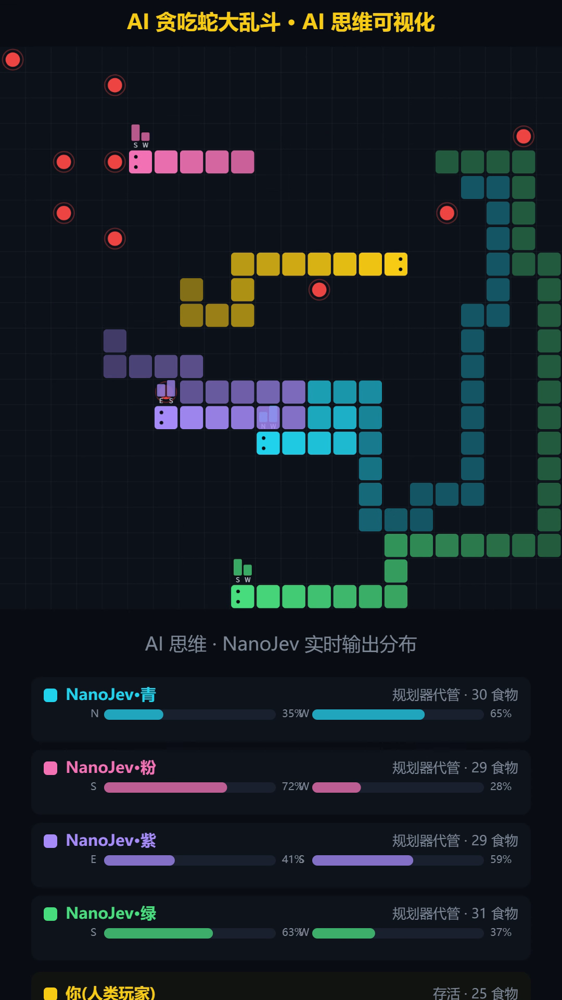</td>
<td align="center" valign="top">tidak ada media yang dipublikasikan</td>
</tr></table>

🤖 <b><a href="https://github.com/dfranco-projects/jev-guardbench">dfranco-projects/jev-guardbench</a></b> · ⭐3 · Python · 👁️ observed · 43 天

##### 📝 Ringkasan

Bisakah model System One (TypeSafe Jev, Kev sumber terbuka) menggantikan LLM-as-judge dalam callback pagar pengaman agen?

##### 📌 Fakta dasar

| Bidang   | Nilai                                                 |
| -------- | ----------------------------------------------------- |
| Kategori | `Perkakas agen: MCP, hook, gate, dan agen pengkodean` |
| Bukti    | `observed`                                            |
| Bahasa   | Python                                                |

##### 📊 Data

| Metrik            | Nilai      |
| ----------------- | ---------- |
| Bintang           | **3**      |
| Push terakhir     | 2026-10-04 |
| Pertama terdaftar | 2026-11-04 |

---

<table><tr><th align="center" width="50%">🖼 Gambar</th><th align="center" width="50%">🎬 Video</th></tr><tr>
<td align="center" valign="top"></td>
<td align="center" valign="top">tidak ada media yang dipublikasikan</td>
</tr></table>

Aset ditautkan langsung dari repositori hulu karena tidak ada lisensi redistribusi yang dinyatakan.

🤖 <b><a href="https://github.com/hypler-dev/LNSAT">hypler-dev/LNSAT</a></b> · ⭐1 · TypeScript · 👁️ observed · 0 天

##### 📝 Ringkasan

Building a CPU-first System One engine for evidence-bound review, with a Gateway for policy, human approval, bounded execution, and durable receipts. Pre-release source.

##### 📌 Fakta dasar

| Bidang   | Nilai                                                 |
| -------- | ----------------------------------------------------- |
| Kategori | `Perkakas agen: MCP, hook, gate, dan agen pengkodean` |
| Bukti    | `observed`                                            |
| Bahasa   | TypeScript                                            |

##### 📊 Data

| Metrik            | Nilai      |
| ----------------- | ---------- |
| Bintang           | **1**      |
| Push terakhir     | 2026-11-16 |
| Pertama terdaftar | 2026-11-16 |

🏷 `access-control` · `agent-security` · `agentic-ai` · `ai-agents` · `ai-governance` · `ai-security` · `audit-trail` · `authorization`

---

<table><tr><th align="center" width="50%">🖼 Gambar</th><th align="center" width="50%">🎬 Video</th></tr><tr>
<td align="center" valign="top"></td>
<td align="center" valign="top">tidak ada media yang dipublikasikan</td>
</tr></table>

🤖 <b><a href="https://github.com/dolevhayut/resurface">dolevhayut/resurface</a></b> · TypeScript · 👁️ observed · 45 天

##### 📝 Ringkasan

Penyaringan resume JEV TypeSafe: LLM menulis pertanyaan, JEV (model klasifikasi System One) menjawabnya untuk setiap resume di ATS Anda dengan baris bukti yang tepat. 8× lebih cepat, 31× lebih murah daripada LLM.

##### 📌 Fakta dasar

| Bidang   | Nilai                                                 |
| -------- | ----------------------------------------------------- |
| Kategori | `Perkakas agen: MCP, hook, gate, dan agen pengkodean` |
| Bukti    | `observed`                                            |
| Bahasa   | TypeScript                                            |

##### 📊 Data

| Metrik            | Nilai      |
| ----------------- | ---------- |
| Bintang           | **0**      |
| Push terakhir     | 2026-10-03 |
| Pertama terdaftar | 2026-11-01 |

🏷 `ai-recruiting` · `ats` · `candidate-matching` · `classification-model` · `claude` · `decision-model` · `evidence-based-hiring` · `hr-tech`

---

<table><tr><th align="center" width="50%">🖼 Gambar</th><th align="center" width="50%">🎬 Video</th></tr><tr>
<td align="center" valign="top"></td>
<td align="center" valign="top"> <a href="https://raw.githubusercontent.com/dolevhayut/resurface/main/docs/launch/resurface-launch.mp4">Buka video</a></td>
</tr></table>

🤖 <b><a href="https://github.com/kaivalpatel6350/jev-docs-agent">kaivalpatel6350/jev-docs-agent</a></b> · Python · 👁️ observed · 7 天

##### 📝 Ringkasan

Goal-driven AI agent that records walkthrough videos of any web app and writes the user guide. Powered by Jev (TypeSafe AI) + Playwright, driven from Claude Desktop via MCP. Open-source alternative to Supademo/Scribe and manual testing.

##### 📌 Fakta dasar

| Bidang   | Nilai                                                 |
| -------- | ----------------------------------------------------- |
| Kategori | `Perkakas agen: MCP, hook, gate, dan agen pengkodean` |
| Bukti    | `observed`                                            |
| Bahasa   | Python                                                |

##### 📊 Data

| Metrik            | Nilai      |
| ----------------- | ---------- |
| Bintang           | **0**      |
| Push terakhir     | 2026-11-09 |
| Pertama terdaftar | 2026-11-10 |

🏷 `ai-agent` · `arcade-alternative` · `browser-automation` · `claude-desktop` · `documentation-generator` · `e2e-testing` · `interactive-demo` · `jev`

---

<table><tr><th align="center" width="50%">🖼 Gambar</th><th align="center" width="50%">🎬 Video</th></tr><tr>
<td align="center" valign="top">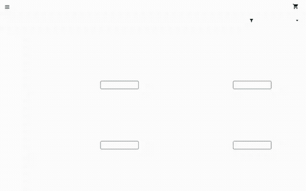</td>
<td align="center" valign="top">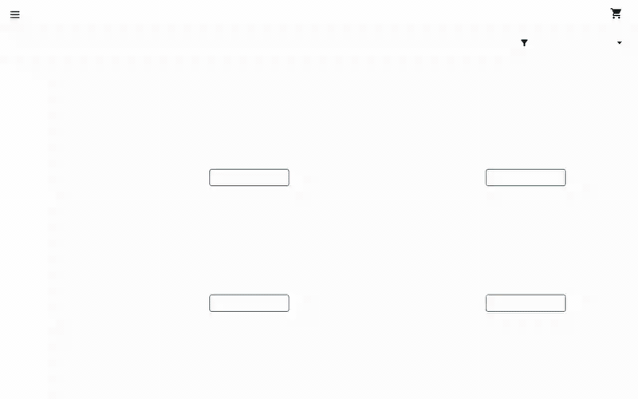 rekaman bergerak</td>
</tr></table>

🤖 <b><a href="https://github.com/browser-use/jev-ultrafast">browser-use/jev-ultrafast</a></b> · ⭐24562 · Python · 🔎 inferred · 6 天 · ⭐+1

##### 📝 Ringkasan

Agen web tercepat dan termurah

##### 📌 Fakta dasar

| Bidang   | Nilai                                                 |
| -------- | ----------------------------------------------------- |
| Kategori | `Perkakas agen: MCP, hook, gate, dan agen pengkodean` |
| Bukti    | `inferred`                                            |
| Bahasa   | Python                                                |

##### 📊 Data

| Metrik            | Nilai          |
| ----------------- | -------------- |
| Bintang           | **24562** (+1) |
| Push terakhir     | 2026-11-11     |
| Pertama terdaftar | 2026-11-08     |

---

<table><tr><th align="center" width="50%">🖼 Gambar</th><th align="center" width="50%">🎬 Video</th></tr><tr>
<td align="center" valign="top">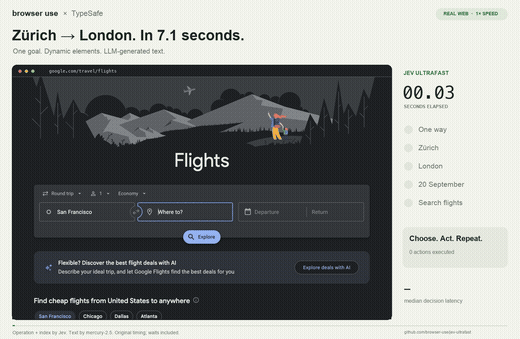</td>
<td align="center" valign="top"> rekaman bergerak · <a href="https://raw.githubusercontent.com/browser-use/jev-ultrafast/main/docs/demo.mp4">Buka video</a></td>
</tr></table>

<b>Lainnya di kategori ini</b> · 238

- [dbreunig/building-with-jev-skill](https://github.com/dbreunig/building-with-jev-skill) - Keahlian untuk menulis dan menyempurnakan program yang memanggil Jev, model…
- [tamaratran/jev-pruner](https://github.com/tamaratran/jev-pruner) - Plugin Claude Code: memangkas keluaran Bash yang panjang dengan TypeSafe Jev…
- [Avinash-jetwani/jevmem](https://github.com/Avinash-jetwani/jevmem) - Shared project rules and memory for AI coding agents.
- [openlayer-ai/jevals](https://github.com/openlayer-ai/jevals) - Evals dan guardrail agen sebagai keputusan Jev: satu permintaan per trace…
- [GhalebDweikat/winnow](https://github.com/GhalebDweikat/winnow) - Penyaring konteks terkalibrasi untuk Claude Code: setiap hasil alat dinilai…
- [PerryLink/jevcore](https://github.com/PerryLink/jevcore) - TypeSafe Jev untuk DeepSeek Harness, Model Context Protocol, dan Node biasa…
- [Nisaka520/JevIntent](https://github.com/Nisaka520/JevIntent) - WeChat (plugin FkWeChat): tekan lama pesan untuk menganalisis maksud / emosi /…
- [andyrewlee/awesome-system-one](https://github.com/andyrewlee/awesome-system-one) - Daftar model System One (juga disebut model keputusan): Jev, yang pertama…
- [Li-Evan/awesome-jev](https://github.com/Li-Evan/awesome-jev) - Galeri paling lengkap tentang apa yang dibangun orang dengan Jev, model System…
- [ChenneyZhuang/laya-browser-agent](https://github.com/ChenneyZhuang/laya-browser-agent) - Alternatif Jev lokal dan open-source: keputusan agen browser dengan Laya.
- [TrustifAI/typed_evals](https://github.com/TrustifAI/typed_evals) - Fast, typed Python framework for Jev-as-a-Judge/Decision-model evaluation for…
- [tiffygk/jev-mode](https://github.com/tiffygk/jev-mode) - Claude Code/Codex skills, evals, harnesses/context tools, and learning…
- [yohanargentina-oss/Foq](https://github.com/yohanargentina-oss/Foq) - ⚡ Foq — alternatif GRATIS, lokal, open-source untuk Jev.
- [mani-aiml/jev-demos](https://github.com/mani-aiml/jev-demos) - Demo dengan Jev, model System One milik TypeSafe, satu folder per demo.
- [BYK/jev-mcp](https://github.com/BYK/jev-mcp) - Server MCP yang mengutamakan eval untuk Jev milik TypeSafe, sebuah model System…
- [kolawong/fast-compaction-dsh](https://github.com/kolawong/fast-compaction-dsh) - Kompaksi konteks berbasis putusan untuk DeepSeek Harness — menggantikan…
- [LHCWN/arkui-sem](https://github.com/LHCWN/arkui-sem) - Linter ArkUI semantik untuk agen coding: menemukan bug status dan siklus hidup…
- [rajasekharponakala/jev-mcp](https://github.com/rajasekharponakala/jev-mcp) - Server MCP yang membungkus model Jev System One milik TypeSafe — penilaian…
- [BFLabsAI/bf-jev-deep-research](https://github.com/BFLabsAI/bf-jev-deep-research) - Keahlian Agen + studi verbatim tentang Jev (TypeSafe AI System One Model)…
- [lewisyang3/LEO](https://github.com/lewisyang3/LEO) - A cost-tiered AI pipeline pairing System One model Jev and Claude Haiku to…
- [Mainakcris7/agent-guardrail-with-jev](https://github.com/Mainakcris7/agent-guardrail-with-jev) - A practical demo of how can we leverage the power of System One Models like Jev…
- [systemonemodels/noulxp](https://github.com/systemonemodels/noulxp) - NoulXP (sebelumnya OpenDXP): standar terbuka untuk model System One.
- [Abjcodes/SystemOne-Model-Router](https://github.com/Abjcodes/SystemOne-Model-Router) - Jev based model router for codex.
- [api-evangelist/typesafe-ai](https://github.com/api-evangelist/typesafe-ai) - TypeSafe AI adalah lab AI San Francisco yang membangun model System One — kelas…
- [CrowBe/weave](https://github.com/CrowBe/weave) - Harness Agen untuk model System One.
- [ferrousaurus/system-one-mcp](https://github.com/ferrousaurus/system-one-mcp) - An MCP server that allows Agents to interact with System One models such as Jev.
- [gorock007/jev-atlas](https://github.com/gorock007/jev-atlas) - An independent, evidence-first field guide to Jev.
- [gsaini/system-one-models-getting-started](https://github.com/gsaini/system-one-models-getting-started) - TypeSafe.
- [izam-mohammed/decisionsmith](https://github.com/izam-mohammed/decisionsmith) - Use and fine-tune System One models (Jev, Laya) on your data, with an LLM as…
- [jms-dcksn/uipath-jev-guardrail-connector](https://github.com/jms-dcksn/uipath-jev-guardrail-connector) - Konektor bring-your-own-guardrail UiPath yang didukung model TypeSafe Jev…
- [lucast4049/openjev](https://github.com/lucast4049/openjev) - Jalankan keputusan cepat, terkalibrasi, dan bertipe pada model System One…
- [Meirdrarel/mcp-systemone](https://github.com/Meirdrarel/mcp-systemone) - MCP server giving coding agents quick judgment tools.
- [nosial/FederationJevGuard](https://github.com/nosial/FederationJevGuard) - A FederationLib plugin that reviews reports, evidence and entities with a…
- [Rams901/amira-brightwater-ai-suite](https://github.com/Rams901/amira-brightwater-ai-suite) - Amira AI Engineer Challenge Suite — Hybrid System-One (TypeSafe Jev 1.14) +…
- [jev-chat/jev-chat-jarvis](https://github.com/jev-chat/jev-chat-jarvis) - Asisten keputusan chat: sebelum Anda membalas, Jev membaca chat, menilai niat…
- [YaoApp/yao](https://github.com/YaoApp/yao) - ✨ Semua agen dan ruang kerja Anda di satu tempat, di setiap perangkat yang Anda…
- [kerpopule/hermes-jev-skills](https://github.com/kerpopule/hermes-jev-skills) - Perutean model yang didukung Jev, memori, pemadatan, pemilihan keahlian…
- [reticlehq/reticle](https://github.com/reticlehq/reticle) - Agen AI dapat menghasilkan kode, tetapi masih kesulitan memahami apa yang…
- [wy-coliney/jev-browser-use](https://github.com/wy-coliney/jev-browser-use) - Operasi browser 5–10x lebih cepat: Jev mengeklik, Codex berpikir dan…
- [logicrw/awesome-jev-projects](https://github.com/logicrw/awesome-jev-projects) - Jev keren: radar ekosistem open-source berbasis sumber, penemuan proyek dengan…
- [devagrawal09/jev-review](https://github.com/devagrawal09/jev-review) - Alur kerja tinjauan kode bertahap dan dasbor lokal yang dibangun dengan…
- [wuyoscar/jev-skill](https://github.com/wuyoscar/jev-skill) - Koleksi luar biasa berisi kasus penggunaan, alur kerja, dan keterampilan agen…
- [kydlikebtc/awesome-jev](https://github.com/kydlikebtc/awesome-jev) - Launch what you built on Jev, TypeSafe AI.
- [ttlequals0/MinusPod](https://github.com/ttlequals0/MinusPod) - MinusPod adalah server yang di-host sendiri dan menghapus iklan sebelum Anda…
- [OmniJev/Flide](https://github.com/OmniJev/Flide) - 🔥🔥 The extremely fast inference engine for decision model.
- [BillionsBobby/JevRouter](https://github.com/BillionsBobby/JevRouter) - Router ringan yang didukung Jev untuk model, alat, dan subagen.
- [qbeka/jev-job-search](https://github.com/qbeka/jev-job-search) - Find software internships and new-grad jobs, fill the application forms, check…
- [malevrigns/agent-jev](https://github.com/malevrigns/agent-jev) - AgentJev-0.6B - model keputusan &#x27;System One&#x27; yang cepat untuk Agen AI: berikan…
- [vinilana/jev-gateway](https://github.com/vinilana/jev-gateway) - Cara mudah menggunakan jev dengan agen coding Anda untuk penalaran pemanggilan…
- [Heman10x-NGU/openJev-verdict-2.0](https://github.com/Heman10x-NGU/openJev-verdict-2.0) - Decision Engine Non-Autoregressive 151M terkalibrasi yang mengungguli TypeSafe…
- [OmniJev/OneJev](https://github.com/OmniJev/OneJev) - 🚀🚀 Model keputusan System One multimodal yang memberikan jawaban terkalibrasi…
- [Amal-David/awesome-jev](https://github.com/Amal-David/awesome-jev) - Demo Jev, proyek, SDKs, dan keahlian, dengan tautan sumber dan galeri X pilihan.
- [fatwang2/awesome-jev](https://github.com/fatwang2/awesome-jev) - Direktori proyek Jev berbasis sumber dengan alur kerja tinjauan yang hanya…
- [jmagly/aiwg](https://github.com/jmagly/aiwg) - Konteks proyek dan alur kerja spesialis yang dapat digunakan kembali untuk alat…
- [luobosibing2/dsh-jev-plugin](https://github.com/luobosibing2/dsh-jev-plugin) - Plugin Native DeepSeek Harness (DSH) yang mengintegrasikan TypeSafe Jev atau…
- [ThinkFlowLab/system1-agents](https://github.com/ThinkFlowLab/system1-agents) - Model keputusan System 1 (Jev, Laya, Cua-S1) sebagai otak untuk agen…
- [y0usaf/pi-jev](https://github.com/y0usaf/pi-jev) - TypeSafe Jev sebagai lapisan keputusan untuk agen coding Pi: gerbang…
- [kyegomez/open-jev](https://github.com/kyegomez/open-jev) - Rekonstruksi sumber terbuka dari prinsip pertama atas gagasan di balik TypeSafe…
- [Promethe-us/awesome-jev](https://github.com/Promethe-us/awesome-jev) - A source-backed Jev / System One knowledge map: projects, papers, evaluations…
- [cookiespiggy/agentic-rl](https://github.com/cookiespiggy/agentic-rl) - Tutorial Agentic RL berbahasa Mandarin dari dasar (33 bab): dari konsep hingga…
- [UditAkhourii/quicksilver](https://github.com/UditAkhourii/quicksilver) - Skill Claude Code: serahkan penilaian massal kepada Jev.
- [Shanghua-Gao/RSI-Jev](https://github.com/Shanghua-Gao/RSI-Jev) - Model keputusan bertipe (noul / choice / score) yang dilatih oleh loop agen AI…
- [lawrence3699/jev-style](https://github.com/lawrence3699/jev-style) - JevStyle: local decision models for AI agents.
- [Bodila51/grok-bot-jev](https://github.com/Bodila51/grok-bot-jev) - Hubungkan TypeSafe Jev ke Grok Bot sebagai lapisan keputusan murah - gerbang…
- [charlesdove977/claude-x-jev](https://github.com/charlesdove977/claude-x-jev) - Keputusan bertipe yang cepat dan murah untuk Claude Code.
- [jonathanavis96/jev-kit](https://github.com/jonathanavis96/jev-kit) - Semua yang Anda perlukan untuk menjalankan TypeSafe Jev dengan Claude Code…
- [akivet/Mica](https://github.com/akivet/Mica) - A 4B decision model: calibrated probabilities for yes/no, choice and score…
- [shitianfang/jev-use](https://github.com/shitianfang/jev-use) - Plugin Claude Code / Codex / pi yang menyerahkan langkah agen yang tidak…
- [yikangy873-gif/jev-desktop](https://github.com/yikangy873-gif/jev-desktop) - Pemilihan tindakan TypeSafe Jev di dalam Codex Computer Use.
- [iamaamir/system-one](https://github.com/iamaamir/system-one) - Runtime yang netral terhadap provider untuk TypeScript dan Pi dengan System One.
- [TheoOliveira/pi-jev](https://github.com/TheoOliveira/pi-jev) - Perutean alat semantik dan keputusan System One bertipe untuk agen coding Pi…
- [alanhuangyoo/OpenJev](https://github.com/alanhuangyoo/OpenJev) - OpenJev: alternatif lokal open-source untuk Jev.
- [chuloontop4-code/jev-instance-review](https://github.com/chuloontop4-code/jev-instance-review) - Peninjau Instance Roblox Studio Terbaik 2026: Kriteria Jev Bertipe dan Kutipan…
- [FrancoisChastel/jev-code](https://github.com/FrancoisChastel/jev-code) - Jev, pengklasifikasi milik TypeSafe bernama System One, sebagai alat di dalam…
- [native-bond-lab/Jev-Interaction](https://github.com/native-bond-lab/Jev-Interaction) - System-One-controlled full-duplex voice interaction: turn-taking as…
- [intikhab49/open-jev-typed-decision-engine](https://github.com/intikhab49/open-jev-typed-decision-engine) - Reproduksi terbuka dari TypeSafe Jev: mesin keputusan bertipe 150M…
- [alexei-led/claude-router](https://github.com/alexei-led/claude-router) - Plugin Claude Code yang memilih model dan effort untuk setiap giliran.
- [everyinfra/jev-radar](https://github.com/everyinfra/jev-radar) - 📡 The most rigorously verified tracker of the Jev (TypeSafe AI System One)…
- [jomatsu/pi-jev-auto-mode](https://github.com/jomatsu/pi-jev-auto-mode) - Mode otomatis yang didukung Jev (TypeSafe System One) untuk agen coding Pi…
- [AskTheWay/dsh-jev-interceptor](https://github.com/AskTheWay/dsh-jev-interceptor) - ⚡ Penilaian System-1 dalam hitungan milidetik untuk setiap pemanggilan alat di…
- [abhishek085/open-spark-jev](https://github.com/abhishek085/open-spark-jev) - Model keputusan lokal sumber terbuka yang terinspirasi oleh Jev milik TypeSafe…
- [mas-bandwidth/nova-sprint](https://github.com/mas-bandwidth/nova-sprint) - Coordinate AI sprints across different models, harnesses and machines.
- [anandi1989/awesome-jev-usecases](https://github.com/anandi1989/awesome-jev-usecases) - Indeks berbasis bukti dari kasus penggunaan Jev (TypeSafe AI System One) dunia…
- [Singularity-Compute/super-decider](https://github.com/Singularity-Compute/super-decider) - Decisions, not essays: a choice, a yes or no, or a score with a calibrated…
- [paramjeetn/jev-cookbook](https://github.com/paramjeetn/jev-cookbook) - Buku resep lengkap untuk Jev oleh TypeSafe AI — lebih dari 120 kasus…
- [green-dalii/pi-shift-router](https://github.com/green-dalii/pi-shift-router) - Perutean model per giliran untuk agen coding Pi: juri kecil memilih tier murah…
- [iamtoomas/JevLint](https://github.com/iamtoomas/JevLint) - Linting semantik yang dapat dikonfigurasi dan didukung oleh Jev, dengan…
- [jerryfane/omp-jev-compaction](https://github.com/jerryfane/omp-jev-compaction) - Drop stale tool output from your omp agent.
- [erkamyaman/jev-enforce](https://github.com/erkamyaman/jev-enforce) - 📏 Claude Code plugin that makes Claude follow your AGENTS.md: every reply and…
- [vicfei/awesome-jev-prompts](https://github.com/vicfei/awesome-jev-prompts) - Question patterns, anti-patterns &amp; calibration notes for typed decision models…
- [ajensenwaud/hermes-jev-plugin](https://github.com/ajensenwaud/hermes-jev-plugin) - Alat keputusan TypeSafe Jev (System One) untuk Hermes Agent: jev_check /…
- [backant-io/jevelry](https://github.com/backant-io/jevelry) - Use Jev everywhere to make &amp; track decisions.
- [daftAI2026/awesome-jev](https://github.com/daftAI2026/awesome-jev) - Proyek TypeSafe Jev / System One GitHub pilihan, alternatif sumber terbuka, dan…
- [ismaildasci/claude-referee](https://github.com/ismaildasci/claude-referee) - Bukti lebih penting daripada kefasihan.
- [win4r/pi-jev-router](https://github.com/win4r/pi-jev-router) - Task-boundary model routing for Pi Coding Agent, powered by TypeSafe Jev.
- [zhangxaochen/dsh-jev](https://github.com/zhangxaochen/dsh-jev) - Suite plugin Jev (model keputusan System One) untuk DeepSeek Harness (dsh).
- [alexei-led/pi-model-router](https://github.com/alexei-led/pi-model-router) - Independent Pi extension for four-tier model routing with optional…
- [ronitgupta138/Local-Jev](https://github.com/ronitgupta138/Local-Jev) - ⚡ 100% offline, zero-cost drop-in alternative to TypeSafe Jev System One…
- [win4r/jev-security-scan](https://github.com/win4r/jev-security-scan) - 使用 TypeSafe Jev 审查 Skill 与 MCP 可疑行为 | Review Agent Skills and MCP code with…
- [anisselbd/jev-phishing-bench](https://github.com/anisselbd/jev-phishing-bench) - Jev (TypeSafe) vs Claude Haiku 4.5 on 2,000 phishing emails: accuracy…
- [Jessie-QingYu/jev-in-the-wild](https://github.com/Jessie-QingYu/jev-in-the-wild) - Kasus penggunaan Jev di dunia nyata, proyek sumber terbuka, benchmark, dan…
- [SergeyBazhmin/krasivo-jev](https://github.com/SergeyBazhmin/krasivo-jev) - Training data and models for &quot;system one&quot; classifiers: one forward pass, no…
- [allenporter/home-assistant-laya](https://github.com/allenporter/home-assistant-laya) - Conversation agent based on Laya, a multilingual, non-autoregressive System 1…
- [frontierlabai/JevHub](https://github.com/frontierlabai/JevHub) - JevHub · Jev 生态热榜 把值得关注的 Jev 项目、教程和讨论，汇到一页。 自动发现 · 每日更新 · 按 Stars 排序 · 中英双语.
- [inso1337/revl](https://github.com/inso1337/revl) - Bahasa untuk komposabilitas spatiotemporal yang aman dan universal.
- [AlphaPerseii3000/jev-effort-router](https://github.com/AlphaPerseii3000/jev-effort-router) - Perutean model DAN upaya penalaran per giliran untuk Hermes Agent di…
- [FazalAAli/jev-robotics-demo](https://github.com/FazalAAli/jev-robotics-demo) - Jev (TypeSafe System One) vs Claude Opus 5 menggerakkan lengan robot…
- [jmrenouard/MicroLLM](https://github.com/jmrenouard/MicroLLM) - Local Hybrid System-One Decision Engine.
- [ranjan2829/AskJev](https://github.com/ranjan2829/AskJev) - AskJev — autopilot Jev untuk situs web apa pun + perlindungan pada klik yang…
- [reacher-z/Awesome-Jev](https://github.com/reacher-z/Awesome-Jev) - Curated Jev and System One papers, models, datasets, benchmarks and SDKs, with…
- [ZJU-OmniAI/Awesome-Jev](https://github.com/ZJU-OmniAI/Awesome-Jev) - A curated survey of Jev: model foundations, agent applications, and embodied…
- [7starsseeker/dsh-fact-check](https://github.com/7starsseeker/dsh-fact-check) - Fact-checking skill for DeepSeek Harness: multi-source verification against the…
- [lgy1027/jevshield](https://github.com/lgy1027/jevshield) - Gate keamanan sub-100ms untuk panggilan tool agen AI, didukung oleh model…
- [PerryLink/laya-mcp](https://github.com/PerryLink/laya-mcp) - MCP server for Laya typed decisions (noul / choice / score): warm model…
- [8itlab/reflex-computer-use](https://github.com/8itlab/reflex-computer-use) - Computer use MCP server for Claude Code, Codex and other AI agents.
- [abhishekashokvkumar/jev-mcp-dispatcher](https://github.com/abhishekashokvkumar/jev-mcp-dispatcher) - Dispatcher tool MCP bahasa alami yang sepenuhnya didukung oleh Jev milik…
- [aitofy-dev/jev-awesome-skills](https://github.com/aitofy-dev/jev-awesome-skills) - Skill Jev sumber terbuka untuk Claude Code, Codex, Cursor, dan Grok.
- [laguagu/jev-skills](https://github.com/laguagu/jev-skills) - Practical agent skills and examples for building with Jev.
- [MongLong0214/jev-gate](https://github.com/MongLong0214/jev-gate) - Tidak setiap tugas coding membutuhkan model terbaik Anda.
- [nanami-0713/dsh-jev-decide](https://github.com/nanami-0713/dsh-jev-decide) - Plugin DSH: daftarkan TypeSafe Jev (model keputusan System One) sebagai alat…
- [simota/tenbin](https://github.com/simota/tenbin) - Server MCP dan skill agen untuk TypeSafe AI System One API (Jev): uraikan…
- [supermanc417-alt/awesome-jev-hub](https://github.com/supermanc417-alt/awesome-jev-hub) - Pusat terkurasi ekosistem model &quot;System One&quot; Jev / TypeSafe — konsep, 51 proyek…
- [deepansh-saxena/jev-guardrails](https://github.com/deepansh-saxena/jev-guardrails) - Membandingkan LLM-as-judge dengan TypeSafe Jev untuk guardrail agen: aturan…
- [mhiqrambg/systemone-decision-mcp](https://github.com/mhiqrambg/systemone-decision-mcp) - Adaptive tool and skill routing for AI Agents.
- [MojoAI-King/jev-paper-trader](https://github.com/MojoAI-King/jev-paper-trader) - Perdagangan kertas di pasar Polymarket dan Kalshi nyata dengan $100 ribu palsu…
- [mywwave/cursor-jev](https://github.com/mywwave/cursor-jev) - Plugin Cursor yang merutekan subagen dengan TypeSafe Jev dan mengekspos Choice…
- [noetion/dsh-jev](https://github.com/noetion/dsh-jev) - Bundel DSH yang mendaftarkan jev_ask untuk jawaban noul, choice, dan score…
- [psyb0t/decidealot](https://github.com/psyb0t/decidealot) - Make the call. Run local Laya, Von, CLM or hosted Jev for typed classification…
- [samtay32/jev-system-architect](https://github.com/samtay32/jev-system-architect) - Skill arsitektur sistem untuk TypeSafe AI Jev/System One — temukan penilaian…
- [SoniaMehta14/paved-gate](https://github.com/SoniaMehta14/paved-gate) - Gerbang ingestion System 1 yang cepat untuk arsitektur agen AI: keamanan…
- [tinypi-extension/tinysubagent](https://github.com/tinypi-extension/tinysubagent) - Pemunculan subagen herdr-native minimal untuk pi — peran agen markdown, profil…
- [wangkuangkuang/jev-mcp-server](https://github.com/wangkuangkuang/jev-mcp-server) - Server MCP untuk Jev (TypeSafe System One): tiga jenis pertanyaan resmi…
- [1aifanatic/jev-uipath-coded-agent](https://github.com/1aifanatic/jev-uipath-coded-agent) - Demo FINS: agen berkode UiPath untuk triase peringatan AML, dengan setiap…
- [cnrai/openpave-jev](https://github.com/cnrai/openpave-jev) - Skill PAVE untuk model keputusan non-autoregresif (Jev / Laya / TypeSafe)…
- [darwintechlab/claude-jev](https://github.com/darwintechlab/claude-jev) - Jev System One untuk Claude Code — Choice/Noul/Score bertipe melalui TypeSafe…
- [jms-dcksn/jev-pii-guardrail](https://github.com/jms-dcksn/jev-pii-guardrail) - Agen berkode UiPath dengan guardrail deteksi PII khusus pada batas LLM…
- [rahilmavani/piedpiper-jev-buildathon](https://github.com/rahilmavani/piedpiper-jev-buildathon) - Tim piedpiper: failproofai + pagar pengaman Jev yang mencegah agen Helix IT…
- [thiago-lage/jev-claud](https://github.com/thiago-lage/jev-claud) - Decisões tipadas para o código (TypeSafe Jev) e texto livre para pessoas (LLM).
- [zhuyansen/awesome-typesafe-jev](https://github.com/zhuyansen/awesome-typesafe-jev) - Proyek open-source yang dibangun di atas model keputusan TypeSafe Jev: replika…
- [173787247/dsh-wsl-jev](https://github.com/173787247/dsh-wsl-jev) - DeepSeek Harness WSL plugin: TypeSafe Jev / OpenRouter System One.
- [17671454333/jev-cognitive-mcp](https://github.com/17671454333/jev-cognitive-mcp) - 3+1 Cognitive Hierarchy Toolkit &amp; Model Context Protocol (MCP) Server for…
- [a742987/JevLens](https://github.com/a742987/JevLens) - Jev decision visualisation and debugging panel for coding agents.
- [Agnuxo1/JEV-ORBITA-BuildArena-S02](https://github.com/Agnuxo1/JEV-ORBITA-BuildArena-S02) - Autonomous, evidence-first engineering system for the BuildArena S02 (Besiege)…
- [AlekseiUL/jev-broker](https://github.com/AlekseiUL/jev-broker) - JEV Broker: TypeSafe JEV via OpenRouter for Hermes agents | JEV через…
- [bhanuprakashk90-tech/jev-agent-guardrail](https://github.com/bhanuprakashk90-tech/jev-agent-guardrail) - Pagar pengaman keselamatan waktu nyata dan dasbor pemantauan interaktif untuk…
- [bismawy/pi-jev-eye](https://github.com/bismawy/pi-jev-eye) - Supervisor ultra-ringkas untuk Pi: pagar pengaman regex tanpa token, pelacakan…
- [celolopes/jev-dev-harness](https://github.com/celolopes/jev-dev-harness) - Open-source developer harness and runtime safety toolkit for AI coding agents…
- [charetterat/awesome-jev-essentials](https://github.com/charetterat/awesome-jev-essentials) - Proyek Jev yang benar-benar layak Anda gunakan — dipilih, dibandingkan, dan…
- [d0ng231/jev-gtw](https://github.com/d0ng231/jev-gtw) - JEV Gateway: PII/PHI guardrails for coding agents.
- [davidpobi/JevTown](https://github.com/davidpobi/JevTown) - An Interactive Collection Of AI Game Worlds Where Typesafe Jev Agents Choose…
- [edamlabs/e-jev](https://github.com/edamlabs/e-jev) - A self-hosted Jev with a catalog of decision backends — typed, calibrated…
- [eshitakundu/jev-flow](https://github.com/eshitakundu/jev-flow) - Support-triage inbox where an LLM answers typed questions and a deterministic…
- [Faizullah9181/jev-esketcher](https://github.com/Faizullah9181/jev-esketcher) - Kanvas lukisan generatif tempat Jev, model keputusan terkalibrasi milik…
- [fivetaku/golla-jev](https://github.com/fivetaku/golla-jev) - 골라제브 — find the pick-one moments in your work and hand them to Jev.
- [frederico-kluser/jev-agent-skill](https://github.com/frederico-kluser/jev-agent-skill) - Keputusan bertipe dalam hitungan milidetik dengan Jev.
- [hdjekuue/awesome-jev](https://github.com/hdjekuue/awesome-jev) - Direktori trilingual yang memperbarui dirinya sendiri, berisi semua yang…
- [HimuroSenalyc/Jev-Fog](https://github.com/HimuroSenalyc/Jev-Fog)
- [jbatra-umeey/jev-decisionops](https://github.com/jbatra-umeey/jev-decisionops) - Enam alur kerja keputusan Jev untuk AI agentic: perutean model, guardrail…
- [JoaoClemer/jev-lab](https://github.com/JoaoClemer/jev-lab) - O Jev (TypeSafe AI) sebagai pagar pengaman waktu nyata dan pra-penilai agen…
- [kittimzhe/dsh-jev-goal-judge](https://github.com/kittimzhe/dsh-jev-goal-judge) - Jev progress judgment between DeepSeek Harness goal rounds — one fan-out per…
- [lijiawei255/jev-tune](https://github.com/lijiawei255/jev-tune) - Jev-inspired calibrated decision &amp; safety shell for typed PID autotuning…
- [masseater/cc-jev-teacher](https://github.com/masseater/cc-jev-teacher) - Claude Code plugin: TypeSafe-judged hooks that make Claude finish the job…
- [MichelePolo/jev-mcp](https://github.com/MichelePolo/jev-mcp) - Server MCP yang mengekspos model keputusan Jev-style System One.
- [pablozr/JevGuard](https://github.com/pablozr/JevGuard) - Semantic policy engine for AI coding agents.
- [QI-seven33/dsh-jev-mode](https://github.com/QI-seven33/dsh-jev-mode) - Optional JEV decision mode for DeepSeek Harness Desktop: deterministic reads…
- [roma-vibe/jev-governor](https://github.com/roma-vibe/jev-governor) - Mod Claude Code: routing model/upaya yang dipandu Jev, kompaksi konteks…
- [xlennart/dsh-auto-review-jev](https://github.com/xlennart/dsh-auto-review-jev) - DeepSeek Harness 审批守护者：权限请求先由审查模型裁决。内置 System One 决策 API 后端.
- [zachshallbetter/claude-jev](https://github.com/zachshallbetter/claude-jev) - Jev (TypeSafe System One) sebagai plugin Code Claude: keputusan bertipe untuk…
- [abyakod/JEV_ADK](https://github.com/abyakod/JEV_ADK) - Kit Pengembangan Agen untuk System-One AI: pipeline keputusan non-autoregresif…
- [alejandroparis17/router-jev](https://github.com/alejandroparis17/router-jev) - Claude Code hook and skill that routes each task to the model best suited to…
- [aleksvega/jev-stack](https://github.com/aleksvega/jev-stack) - Satu perintah (npx jev-stack) untuk memasang perangkat alat agen bertenaga Jev…
- [AlienXc137/Support-Ticket-Ai-Agent-with-RAG-Guardrails-and-Jev](https://github.com/AlienXc137/Support-Ticket-Ai-Agent-with-RAG-Guardrails-and-Jev) - Agen yang membaca kueri siswa masuk (email/WhatsApp/teks formulir)…
- [Antony-12s/hermes-jev-quota-routing](https://github.com/Antony-12s/hermes-jev-quota-routing) - TypeSafe Jev picks the model for Hermes Agent (main chat + subagents) with a…
- [availableservices/jev-router](https://github.com/availableservices/jev-router) - Arahkan ke model termurah di claude code untuk tugas Anda menggunakan jev-router.
- [avi720/jev-chromium-use](https://github.com/avi720/jev-chromium-use) - Browser automation where a small decision model (TypeSafe Jev), not a frontier…
- [bitskc/honest-jev](https://github.com/bitskc/honest-jev) - A cheap decider for AI agents: command guard, done-claim verification…
- [bpmforbusiness/jev-agent-harness](https://github.com/bpmforbusiness/jev-agent-harness) - Panduan harness agen Jev (TypeSafe AI System One) + manual video — dari pos…
- [cameronb-xano/jev-agent-guardrail](https://github.com/cameronb-xano/jev-agent-guardrail) - Template Xano: guardrail tool-call agen Jev. Jev memutuskan, Xano menegakkan.
- [ddzelal/jev-router-shield](https://github.com/ddzelal/jev-router-shield) - Let Jev pick the Claude model and effort per message in Claude Code, without…
- [eduardo-xyz/jev-browser-mcp](https://github.com/eduardo-xyz/jev-browser-mcp) - MCP tool exposing TypeSafe.
- [fortemate/dicechess-bot-jev](https://github.com/fortemate/dicechess-bot-jev) - Experimental Dice Chess webhook bot powered by TypeSafe Jev, with adaptive…
- [gbesse/jev-proxy](https://github.com/gbesse/jev-proxy) - Policy firewall for MCP tool calls with one-time human approvals and JSONL…
- [HKUST-KnowComp/jev-guardrail](https://github.com/HKUST-KnowComp/jev-guardrail) - Pohon kebijakan yang dapat diedit dan pengklasifikasi 2B untuk peninjauan…
- [iamdgarcia/jev-mini-bench](https://github.com/iamdgarcia/jev-mini-bench) - Penjelajah saku gelombang model keputusan kecil.
- [jackchen13755/dsh-jev-kit](https://github.com/jackchen13755/dsh-jev-kit) - Jev decision toolkit for DeepSeek Harness: 22 named typed judgments.
- [jipika/dsh-jev-grep](https://github.com/jipika/dsh-jev-grep) - Plugin adjudikasi search-flood untuk DeepSeek Harness: ripgrep + penilaian…
- [kallurayaankit/jev-flight-agent](https://github.com/kallurayaankit/jev-flight-agent) - Browser-use agent that finds flights with Jev (TypeSafe AI).
- [kevinyin9/next-steps-jev](https://github.com/kevinyin9/next-steps-jev) - Suggested next steps for Claude Code, scored by how much each one helps your…
- [kkwelfare/jev-route-screening-public](https://github.com/kkwelfare/jev-route-screening-public) - Plugin Hermes Agent eksperimental untuk checkpoint Jev terbatas dan penyaringan…
- [kofanlabs/jev-browser-chrome](https://github.com/kofanlabs/jev-browser-chrome) - Fast Jev browser agent for existing signed-in Chrome tabs via a local extension…
- [liyifan2004/obsidian-jev-inbox-router](https://github.com/liyifan2004/obsidian-jev-inbox-router) - Obsidian plugin: route incoming notes to the right folder using JEV.
- [Mfrostbutter/jev-n8n-patterns](https://github.com/Mfrostbutter/jev-n8n-patterns) - Pola Jev (TypeSafe System One) di n8n: penyaringan PII, guardrail agen dan agen…
- [mjvmsteixeira/jev-browser-mcp](https://github.com/mjvmsteixeira/jev-browser-mcp) - Agente de browser para o Claude Code: jev-ultrafast + Jev (TypeSafe) com…
- [Mohith26/jev-calibration-audit](https://github.com/Mohith26/jev-calibration-audit) - Independent calibration and selective-agreement audit of Jev vs eight LLMs on…
- [Mrmimee/codex-jev](https://github.com/Mrmimee/codex-jev) - JEV for Codex: structured routing, evidence-backed review, and a six-signal…
- [mxttbennett/jev-relayer](https://github.com/mxttbennett/jev-relayer) - Per-task Jev routing for Claude Code and Codex: inline, subagent or sibling…
- [nagyist/open-jev-review](https://github.com/nagyist/open-jev-review) - Alur kerja tinjauan kode bertahap dan dasbor lokal yang dibangun dengan…
- [PeriodBLUE/jev-project-atlas](https://github.com/PeriodBLUE/jev-project-atlas) - A source-verified atlas of GitHub projects built with JEV / TypeSafe System One.
- [phoem/jev-router](https://github.com/phoem/jev-router) - Claude Code mod that asks TypeSafe.
- [putraridho/jev-switch](https://github.com/putraridho/jev-switch) - Jev-gated Claude router: Sonnet by default, Opus for hard and security work.
- [raj8525/universal-jev](https://github.com/raj8525/universal-jev) - Plugin Runtime TypeSafe Jev Universal &amp; Server MCP untuk Agen Coding.
- [raniellimontagna/jev-guard-mcp](https://github.com/raniellimontagna/jev-guard-mcp) - A guarded MCP layer for Jev-powered browser decisions with isolated Playwright…
- [RaulLazaro/dsh-jev-plugin](https://github.com/RaulLazaro/dsh-jev-plugin) - DEPRECATED - no longer maintained. ASK Jev typed questions from DeepSeek…
- [rgryta/jev-mcp](https://github.com/rgryta/jev-mcp) - MCP server over TypeSafe.
- [royalskynet/jev-gate-lite](https://github.com/royalskynet/jev-gate-lite) - Jev Gate without the local Laya lane: MCP judgment tools, tool-output pruning…
- [shahshahdab/fastcampus-jev](https://github.com/shahshahdab/fastcampus-jev) - Learn to gate tool calls, guardrails, and risky actions with Jev judgment plus…
- [Shijiuwei/fast-jev-compaction-sync](https://github.com/Shijiuwei/fast-jev-compaction-sync) - Claude Code plugin that replaces the compaction summary with Jev decisions…
- [sir-ad/codex-jev-task-router](https://github.com/sir-ad/codex-jev-task-router) - Model, reasoning effort, skill, and bounded worker routing for Codex with…
- [skylence-org/claudecode-jev-marketplace](https://github.com/skylence-org/claudecode-jev-marketplace) - TypeSafe Jev (System One) wired into Claude Code: a decision primitive for…
- [taifoon-io/jev](https://github.com/taifoon-io/jev) - Nilai pekerjaan agen AI dengan Jev milik TypeSafe: apakah ia melakukan…
- [thejasrao262003/jev-compositional-uncertainty](https://github.com/thejasrao262003/jev-compositional-uncertainty) - Research on whether AI decision workflows can trust and combine uncertainty…
- [tmbmartell/jev-mcp](https://github.com/tmbmartell/jev-mcp) - Servidor MCP que expõe o Jev (TypeSafe System One) como ferramenta de…
- [ttdua/pi-jev-pilot](https://github.com/ttdua/pi-jev-pilot) - Pi extension that lets Jev, TypeSafe.
- [undowhai113/jev-codeguard](https://github.com/undowhai113/jev-codeguard) - Command firewall, AST security auditor &amp; zero-token git diff verifier for AI…
- [veermshah/jev-calibration-lab](https://github.com/veermshah/jev-calibration-lab) - Independent calibration benchmark for System One decision models (TypeSafe Jev)…
- [vinaychawla-ops/jev-adk-guardrail-example](https://github.com/vinaychawla-ops/jev-adk-guardrail-example) - Jev (model keputusan TypeSafe) sebagai pelindung risiko di dalam…
- [xano-community/agent-guardrail-jev](https://github.com/xano-community/agent-guardrail-jev) - Guardrail pemanggilan alat agen AI untuk Xano: Jev (TypeSafe AI) menilai setiap…
- [yangzhou-chaofan/awesome-jev-prompt](https://github.com/yangzhou-chaofan/awesome-jev-prompt) - 100 showcase teratas terbaru untuk jev (terus diperbarui) dari x / github /…
- [ZeroX-01/jev-atlas](https://github.com/ZeroX-01/jev-atlas) - Indeks publik yang terus diperbarui berisi proyek, video, artikel, dan demo…
- [rmalde/minecraft-agent](https://github.com/rmalde/minecraft-agent) - Planner Astra dan controller JEV untuk Minecraft, dengan perekaman native, rute…
- [notque/vexjoy-agent](https://github.com/notque/vexjoy-agent) - Agen AI VexJoy dengan Perutean Cerdas Jev - /do merutekan permintaan berbahasa…
- [itsmostafa/system-one-connector](https://github.com/itsmostafa/system-one-connector) - Konektor System One MCP untuk mengevaluasi apa pun dengan cepat dan murah.
- [BingoWon/apple-rag-mcp](https://github.com/BingoWon/apple-rag-mcp) - Apple developer docs and WWDC transcripts with RAG retrieval and Jev relevance…
- [keeltrace/hermes-nerve](https://github.com/keeltrace/hermes-nerve) - Nerve adalah sistem saraf pengawas untuk agen Hermes, menambahkan keputusan…
- [everafterlabs/jes](https://github.com/everafterlabs/jes) - Guardrail sumber terbuka untuk agen AI yang didukung oleh model keputusan…
- [darwintechlab/openjev](https://github.com/darwintechlab/openjev) - OpenJev: Plugin Opencode yang menggantikan keputusan pembuatan teks dengan Jev…
- [Mawfyy/jevflow](https://github.com/Mawfyy/jevflow) - Keputusan AI probabilistik sebagai primitif backend yang dapat dikomposisi…
- [tamnd/kime](https://github.com/tamnd/kime) - Typed decisions over text in milliseconds.
- [laxtiz/opencode-vllm-sr-auth](https://github.com/laxtiz/opencode-vllm-sr-auth) - vLLM-SR System Duo — System One decision models (choice/noul/score/box/span)…
- [aiden-guan/courtvision](https://github.com/aiden-guan/courtvision) - Real-time basketball computer vision, live stats, TypeSafe Jev decision layer…
- [atostivint/hermes-adaptive-effort](https://github.com/atostivint/hermes-adaptive-effort) - Hermes Agent plugin that sets the reasoning effort of each request with a…
- [bhavikprit/instinct-ai](https://github.com/bhavikprit/instinct-ai) - ⚡ Runtime AI System-1 Universal &amp; Gateway Dual-Brain.
- [jangtrinh/design-os-generative-ui](https://github.com/jangtrinh/design-os-generative-ui) - Mesin UI Generatif Real-Time di bawah 50 ms yang didukung oleh Laya-MLX dan…
- [Jimuelle07/eclipse-near](https://github.com/Jimuelle07/eclipse-near) - Eclipse: a payment firewall for AI agents on NEAR.
- [patronus-protect/decision-model-guard](https://github.com/patronus-protect/decision-model-guard) - Guardrails for decision models: stop text inside the content from steering…
- [tearoom1/uniform-spam-words](https://github.com/tearoom1/uniform-spam-words) - Spam guard for Kirby Uniform forms. Weighted word lists and link counting catch…
- [2skr1996-cloud/kira-ai-plugin-multi-decision](https://github.com/2skr1996-cloud/kira-ai-plugin-multi-decision) - KiraAI 插件：多样化聊天决策（含 JEV）+ 上下文窗口 + 记录页（Beta 测试版）.
- [lcbkmm/laya-thalamus](https://github.com/lcbkmm/laya-thalamus) - Orkestrator keputusan System1 untuk agen AI.

## Perutean, guardrail, dan persetujuan

Kasus penggunaan bergaya produksi — kirim setiap permintaan ke model termurah yang benar-benar mampu menanganinya, dan jaga pemeriksaan deterministik atas hasilnya.

🛡️ <b><a href="https://github.com/HarnessRouter/SystemOneHarness">HarnessRouter/SystemOneHarness</a></b> · ⭐208 · Python · 👁️ observed · 57 天

##### 📝 Ringkasan

Harness System One untuk model System One. Jalankan Jev dan model System One lainnya secara lokal atau langsung di HarnessRouter.ai.

##### 📌 Fakta dasar

| Bidang   | Nilai                                  |
| -------- | -------------------------------------- |
| Kategori | `Perutean, guardrail, dan persetujuan` |
| Bukti    | `observed`                             |
| Bahasa   | Python                                 |

##### 📊 Data

| Metrik            | Nilai      |
| ----------------- | ---------- |
| Bintang           | **208**    |
| Push terakhir     | 2026-09-21 |
| Pertama terdaftar | 2026-10-28 |

🏷 `harness` · `harness-engineering` · `system-one-harness` · `system-one-models`

🛡️ <b><a href="https://github.com/Dicklesworthstone/skillranker">Dicklesworthstone/skillranker</a></b> · ⭐142 · Rust · 👁️ observed · 28 天

##### 📝 Ringkasan

Rust CLI yang didukung oleh Jev dari TypeSafe.ai, yang memeringkat keahlian agen untuk langkah berikutnya menggunakan konteks sesi langsung. Mencakup hook Code Claude, JSON terstruktur, abstensi, dan umpan balik lokal. Memerlukan kunci TypeSafe API.

> 💡 Memeringkat keterampilan agen dengan keputusan bertipe. Model yang berguna untuk masalah apa pun dengan pola 'memilih di antara N kandidat' yang sebelumnya ditangani dengan prompt.

##### 📌 Fakta dasar

| Bidang   | Nilai                                  |
| -------- | -------------------------------------- |
| Kategori | `Perutean, guardrail, dan persetujuan` |
| Bukti    | `observed`                             |
| Bahasa   | Rust                                   |

##### 📊 Data

| Metrik            | Nilai      |
| ----------------- | ---------- |
| Bintang           | **142**    |
| Push terakhir     | 2026-10-19 |
| Pertama terdaftar | 2026-10-29 |

🏷 `agent-skills` · `ai-agents` · `asupersync` · `claude-code` · `cli` · `developer-tools` · `frankentui` · `jev`

🛡️ <b><a href="https://github.com/Sarim-MBZUAI/awesome-jev-security">Sarim-MBZUAI/awesome-jev-security</a></b> · ⭐8 · 👁️ observed · 2 天

##### 📝 Ringkasan

Curated list of papers on the security, robustness, and safety of TypeSafe Jev / System One models

##### 📌 Fakta dasar

| Bidang   | Nilai                                  |
| -------- | -------------------------------------- |
| Kategori | `Perutean, guardrail, dan persetujuan` |
| Bukti    | `observed`                             |

##### 📊 Data

| Metrik            | Nilai      |
| ----------------- | ---------- |
| Bintang           | **8**      |
| Push terakhir     | 2026-11-15 |
| Pertama terdaftar | 2026-11-10 |

🛡️ <b><a href="https://github.com/dharmeshgurnani/codeotter">dharmeshgurnani/codeotter</a></b> · ⭐3 · TypeScript · 👁️ observed · 0 天

##### 📝 Ringkasan

Tinjauan kode AI otonom dan di-host sendiri, pengukur skor terkalibrasi, serta gerbang merge dari model terbuka apa pun.

##### 📌 Fakta dasar

| Bidang   | Nilai                                  |
| -------- | -------------------------------------- |
| Kategori | `Perutean, guardrail, dan persetujuan` |
| Bukti    | `observed`                             |
| Bahasa   | TypeScript                             |

##### 📊 Data

| Metrik            | Nilai      |
| ----------------- | ---------- |
| Bintang           | **3**      |
| Push terakhir     | 2026-11-17 |
| Pertama terdaftar | 2026-11-11 |

🏷 `ai-code-review` · `code-review` · `coderabbit` · `developer-tools` · `devops` · `forgejo` · `gguf` · `gitea`

---

<table><tr><th align="center" width="50%">🖼 Gambar</th><th align="center" width="50%">🎬 Video</th></tr><tr>
<td align="center" valign="top"></td>
<td align="center" valign="top">tidak ada media yang dipublikasikan</td>
</tr></table>

🛡️ <b><a href="https://github.com/baldellimtt/systemone-lab">baldellimtt/systemone-lab</a></b> · ⭐2 · HTML · 👁️ observed · 15 天

##### 📝 Ringkasan

Hands-on System One decision lab: Jev-compatible Noul/Choice/Score over local open-weight Laya, with playground UI, routing/eval examples, and CI smoke tests.

##### 📌 Fakta dasar

| Bidang   | Nilai                                  |
| -------- | -------------------------------------- |
| Kategori | `Perutean, guardrail, dan persetujuan` |
| Bukti    | `observed`                             |
| Bahasa   | HTML                                   |

##### 📊 Data

| Metrik            | Nilai      |
| ----------------- | ---------- |
| Bintang           | **2**      |
| Push terakhir     | 2026-11-02 |
| Pertama terdaftar | 2026-11-02 |

🏷 `calibrated-probabilities` · `jev` · `laya` · `system-one-models` · `typed-decisions` · `typesafe`

---

<table><tr><th align="center" width="50%">🖼 Gambar</th><th align="center" width="50%">🎬 Video</th></tr><tr>
<td align="center" valign="top"></td>
<td align="center" valign="top">tidak ada media yang dipublikasikan</td>
</tr></table>

🛡️ <b><a href="https://github.com/alperenerol/jev-1.13-mini-benchmark">alperenerol/jev-1.13-mini-benchmark</a></b> · ⭐1 · Python · 👁️ observed · 48 天

##### 📝 Ringkasan

Benchmark mini model keputusan terstruktur jev-1.13 milik TypeSafe (OpenRouter Decisions API) pada triase dukungan berlabel: noul/choice/score, konsistensi, biaya, dan pelajaran yang didapat

##### 📌 Fakta dasar

| Bidang   | Nilai                                  |
| -------- | -------------------------------------- |
| Kategori | `Perutean, guardrail, dan persetujuan` |
| Bukti    | `observed`                             |
| Bahasa   | Python                                 |

##### 📊 Data

| Metrik            | Nilai      |
| ----------------- | ---------- |
| Bintang           | **1**      |
| Push terakhir     | 2026-09-29 |
| Pertama terdaftar | 2026-11-01 |

🛡️ <b><a href="https://github.com/aosus/mirsad">aosus/mirsad</a></b> · ⭐1 · Rust · 👁️ observed · 0 天

##### 📝 Ringkasan

bot for matrix spam filtering using system one models.

##### 📌 Fakta dasar

| Bidang   | Nilai                                  |
| -------- | -------------------------------------- |
| Kategori | `Perutean, guardrail, dan persetujuan` |
| Bukti    | `observed`                             |
| Bahasa   | Rust                                   |

##### 📊 Data

| Metrik            | Nilai      |
| ----------------- | ---------- |
| Bintang           | **1**      |
| Push terakhir     | 2026-11-16 |
| Pertama terdaftar | 2026-11-17 |

🛡️ <b><a href="https://github.com/Dominion-Academy/System-One-Models">Dominion-Academy/System-One-Models</a></b> · ⭐1 · Python · 👁️ observed · 7 天

##### 📝 Ringkasan

Code for a course on System One models (Jev, Kev, Laya): LLMs that answer with a choice and a probability instead of free text. Build a support-ticket triage service with Choice, Score and Noul questions, check whether the confidence can be trusted, set thresholds, and run it in production.

##### 📌 Fakta dasar

| Bidang   | Nilai                                  |
| -------- | -------------------------------------- |
| Kategori | `Perutean, guardrail, dan persetujuan` |
| Bukti    | `observed`                             |
| Bahasa   | Python                                 |

##### 📊 Data

| Metrik            | Nilai      |
| ----------------- | ---------- |
| Bintang           | **1**      |
| Push terakhir     | 2026-11-10 |
| Pertama terdaftar | 2026-11-04 |

🏷 `calibration` · `jev` · `kev` · `laya` · `python` · `system-design` · `system-one` · `system-one-models`

---

<table><tr><th align="center" width="50%">🖼 Gambar</th><th align="center" width="50%">🎬 Video</th></tr><tr>
<td align="center" valign="top"></td>
<td align="center" valign="top">tidak ada media yang dipublikasikan</td>
</tr></table>

Aset ditautkan langsung dari repositori hulu karena tidak ada lisensi redistribusi yang dinyatakan.

🛡️ <b><a href="https://github.com/chialab/system-one-italian-tests">chialab/system-one-italian-tests</a></b> · Python · 👁️ observed · 1 天

##### 📝 Ringkasan

A suite to test System One AI models against italian inputs

##### 📌 Fakta dasar

| Bidang   | Nilai                                  |
| -------- | -------------------------------------- |
| Kategori | `Perutean, guardrail, dan persetujuan` |
| Bukti    | `observed`                             |
| Bahasa   | Python                                 |

##### 📊 Data

| Metrik            | Nilai      |
| ----------------- | ---------- |
| Bintang           | **0**      |
| Push terakhir     | 2026-11-16 |
| Pertama terdaftar | 2026-11-16 |

🏷 `escalation` · `italian` · `jev` · `system-one` · `system-one-models`

🛡️ <b><a href="https://github.com/mgd34msu/goodvibes">mgd34msu/goodvibes</a></b> · TypeScript · 👁️ observed · 3 天

##### 📝 Ringkasan

The Goodvibes platform with integrated System One model support. The decision model for guardrails, safety, etc. is now driven by models like Jev/Clef/Laya and is less reliant on HITL.

##### 📌 Fakta dasar

| Bidang   | Nilai                                  |
| -------- | -------------------------------------- |
| Kategori | `Perutean, guardrail, dan persetujuan` |
| Bukti    | `observed`                             |
| Bahasa   | TypeScript                             |

##### 📊 Data

| Metrik            | Nilai      |
| ----------------- | ---------- |
| Bintang           | **0**      |
| Push terakhir     | 2026-11-13 |
| Pertama terdaftar | 2026-11-09 |

🛡️ <b><a href="https://github.com/nani-stack/gmail-auto-cleanup">nani-stack/gmail-auto-cleanup</a></b> · Python · 👁️ observed · 0 天

##### 📝 Ringkasan

Triage your Gmail inbox with a System One model (Jev or Laya): typed yes/no judgements, probabilities, and reversible actions.

##### 📌 Fakta dasar

| Bidang   | Nilai                                  |
| -------- | -------------------------------------- |
| Kategori | `Perutean, guardrail, dan persetujuan` |
| Bukti    | `observed`                             |
| Bahasa   | Python                                 |

##### 📊 Data

| Metrik            | Nilai      |
| ----------------- | ---------- |
| Bintang           | **0**      |
| Push terakhir     | 2026-11-16 |
| Pertama terdaftar | 2026-11-17 |

🏷 `ai` · `automation` · `email` · `email-classification` · `gmail` · `inbox-zero` · `jev` · `laya`

🛡️ <b><a href="https://github.com/NandhaKishorM/laya">NandhaKishorM/laya</a></b> · ⭐35631 · Python · 🔎 inferred · 1 天 · ⭐+2

##### 📝 Ringkasan

Mesin keputusan Sistem 1 non-autoregresif. Pilihan bertipe, skor, dan keputusan ya/tidak atas teks apa pun dalam satu lintasan maju, dalam lebih dari 100 bahasa, dengan router yang memilih checkpoint yang tepat untuk setiap permintaan.

##### 📌 Fakta dasar

| Bidang   | Nilai                                  |
| -------- | -------------------------------------- |
| Kategori | `Perutean, guardrail, dan persetujuan` |
| Bukti    | `inferred`                             |
| Bahasa   | Python                                 |

##### 📊 Data

| Metrik            | Nilai          |
| ----------------- | -------------- |
| Bintang           | **35631** (+2) |
| Push terakhir     | 2026-11-16     |
| Pertama terdaftar | 2026-09-23     |

🏷 `calibration` · `classification` · `decision-model` · `huggingface` · `jev` · `modernbert` · `multilingual` · `nlp`

---

<table><tr><th align="center" width="50%">🖼 Gambar</th><th align="center" width="50%">🎬 Video</th></tr><tr>
<td align="center" valign="top"></td>
<td align="center" valign="top">tidak ada media yang dipublikasikan</td>
</tr></table>

🛡️ <b><a href="https://github.com/slavabars/decision-cascade">slavabars/decision-cascade</a></b> · ⭐80 · Python · 🔎 inferred · 3 天 · ⭐+2

##### 📝 Ringkasan

Local decision engine with typed, calibrated outputs (Noul/Choice/Score): cheap→strong cascade, ECE/Brier calibration, SystemOne protocol interop. Apache-2.0.

##### 📌 Fakta dasar

| Bidang   | Nilai                                  |
| -------- | -------------------------------------- |
| Kategori | `Perutean, guardrail, dan persetujuan` |
| Bukti    | `inferred`                             |
| Bahasa   | Python                                 |

##### 📊 Data

| Metrik            | Nilai       |
| ----------------- | ----------- |
| Bintang           | **80** (+2) |
| Push terakhir     | 2026-11-14  |
| Pertama terdaftar | 2026-10-16  |

🏷 `calibration` · `cascade` · `decision-making` · `fastapi` · `llm` · `model-routing` · `pytorch` · `systemone`

---

<table><tr><th align="center" width="50%">🖼 Gambar</th><th align="center" width="50%">🎬 Video</th></tr><tr>
<td align="center" valign="top"></td>
<td align="center" valign="top"> rekaman bergerak</td>
</tr></table>

🛡️ <b><a href="https://github.com/gaborishka/jev-canvas">gaborishka/jev-canvas</a></b> · ⭐24 · JavaScript · 🔎 inferred · 59 天

##### 📝 Ringkasan

Gambar di kanvas tldraw dengan suara dan jari yang menunjuk. Jev (TypeSafe System One) menentukan tindakan, target, dan tempat dalam ~350 ms per kata yang diucapkan.

##### 📌 Fakta dasar

| Bidang   | Nilai                                  |
| -------- | -------------------------------------- |
| Kategori | `Perutean, guardrail, dan persetujuan` |
| Bukti    | `inferred`                             |
| Bahasa   | JavaScript                             |

##### 📊 Data

| Metrik            | Nilai      |
| ----------------- | ---------- |
| Bintang           | **24**     |
| Push terakhir     | 2026-09-19 |
| Pertama terdaftar | 2026-10-28 |

🏷 `hand-tracking` · `jev` · `mediapipe` · `openrouter` · `tldraw` · `typesafe` · `voice-control` · `web-speech-api`

---

<table><tr><th align="center" width="50%">🖼 Gambar</th><th align="center" width="50%">🎬 Video</th></tr><tr>
<td align="center" valign="top"></td>
<td align="center" valign="top"> rekaman bergerak</td>
</tr></table>

🛡️ <b><a href="https://github.com/rupeshpoojary9/poorjev">rupeshpoojary9/poorjev</a></b> · ⭐11 · Python · 🔎 inferred · 57 天

##### 📝 Ringkasan

Alternatif Jev lokal dan open-source: lapisan keputusan System One dengan keyakinan terkalibrasi yang dapat dibuktikan (ECE 0.170→0.071). Keputusan bertipe, berjalan offline, tanpa kunci API, tanpa waitlist.

##### 📌 Fakta dasar

| Bidang   | Nilai                                  |
| -------- | -------------------------------------- |
| Kategori | `Perutean, guardrail, dan persetujuan` |
| Bukti    | `inferred`                             |
| Bahasa   | Python                                 |

##### 📊 Data

| Metrik            | Nilai      |
| ----------------- | ---------- |
| Bintang           | **11**     |
| Push terakhir     | 2026-09-21 |
| Pertama terdaftar | 2026-10-28 |

🏷 `calibration` · `classification` · `conformal-prediction` · `jev` · `jev-alternative` · `llm` · `llm-guardrails` · `local-llm`

---

<table><tr><th align="center" width="50%">🖼 Gambar</th><th align="center" width="50%">🎬 Video</th></tr><tr>
<td align="center" valign="top"></td>
<td align="center" valign="top">tidak ada media yang dipublikasikan</td>
</tr></table>

🛡️ <b><a href="https://github.com/eulogik/nirnay">eulogik/nirnay</a></b> · ⭐10 · Python · 🔎 inferred · 1 天

##### 📝 Ringkasan

NIRNAY 450M: model keputusan terkalibrasi berbobot terbuka (Apache-2.0). Klasifikasi intent Banking77 87,9%, ECE terpasang 0,045. Fork Laya ditambah concept bottleneck, pointer coarse-to-fine, dan RLCD. Dibangun oleh Eulogik.

##### 📌 Fakta dasar

| Bidang   | Nilai                                  |
| -------- | -------------------------------------- |
| Kategori | `Perutean, guardrail, dan persetujuan` |
| Bukti    | `inferred`                             |
| Bahasa   | Python                                 |

##### 📊 Data

| Metrik            | Nilai      |
| ----------------- | ---------- |
| Bintang           | **10**     |
| Push terakhir     | 2026-11-16 |
| Pertama terdaftar | 2026-10-01 |

🏷 `apache-2-0` · `banking77` · `calibration` · `concept-bottleneck` · `decision-model` · `edge-ai` · `eulogik` · `guardrails`

---

<table><tr><th align="center" width="50%">🖼 Gambar</th><th align="center" width="50%">🎬 Video</th></tr><tr>
<td align="center" valign="top"></td>
<td align="center" valign="top">tidak ada media yang dipublikasikan</td>
</tr></table>

🛡️ <b><a href="https://github.com/tomek7667/cbjev">tomek7667/cbjev</a></b> · ⭐5 · Python · 🔎 inferred · 53 天

##### 📝 Ringkasan

Keputusan bertipe (choice/score/noul) dari satu pass encoder - penerus Laya yang lebih cepat dan lebih terkalibrasi, kompatibel wire dengan Jev

##### 📌 Fakta dasar

| Bidang   | Nilai                                  |
| -------- | -------------------------------------- |
| Kategori | `Perutean, guardrail, dan persetujuan` |
| Bukti    | `inferred`                             |
| Bahasa   | Python                                 |

##### 📊 Data

| Metrik            | Nilai      |
| ----------------- | ---------- |
| Bintang           | **5**      |
| Push terakhir     | 2026-09-24 |
| Pertama terdaftar | 2026-11-08 |

🏷 `calibration` · `classification` · `decision-model` · `jev` · `laya` · `llm-guardrails` · `modernbert`

---

<table><tr><th align="center" width="50%">🖼 Gambar</th><th align="center" width="50%">🎬 Video</th></tr><tr>
<td align="center" valign="top"></td>
<td align="center" valign="top">tidak ada media yang dipublikasikan</td>
</tr></table>

🛡️ <b><a href="https://github.com/alexzomai/slop-block">alexzomai/slop-block</a></b> · ⭐3 · TypeScript · 🔎 inferred · 2 天

##### 📝 Ringkasan

Chrome extension that filters your YouTube feed by plain-language smart tags. An AI decision model (TypeSafe Jev, your own key) decides what to show.

##### 📌 Fakta dasar

| Bidang   | Nilai                                  |
| -------- | -------------------------------------- |
| Kategori | `Perutean, guardrail, dan persetujuan` |
| Bukti    | `inferred`                             |
| Bahasa   | TypeScript                             |

##### 📊 Data

| Metrik            | Nilai      |
| ----------------- | ---------- |
| Bintang           | **3**      |
| Push terakhir     | 2026-11-15 |
| Pertama terdaftar | 2026-11-15 |

🏷 `chrome-extension` · `content-filter` · `jev-ai` · `youtube`

---

<table><tr><th align="center" width="50%">🖼 Gambar</th><th align="center" width="50%">🎬 Video</th></tr><tr>
<td align="center" valign="top">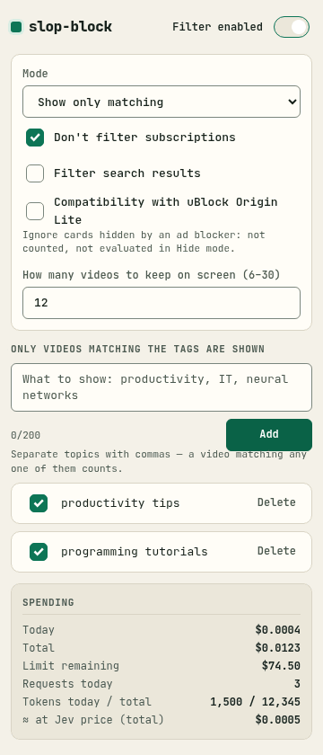</td>
<td align="center" valign="top">tidak ada media yang dipublikasikan</td>
</tr></table>

<b>Lainnya di kategori ini</b> · 46

- [yusukebe/hono-jev-router](https://github.com/yusukebe/hono-jev-router) - Route HTTP requests by meaning. A semantic router for Hono powered by Jev.
- [zhangcy122/OpenJev](https://github.com/zhangcy122/OpenJev) - Mesin keputusan kognitif yang berevolusi sendiri &amp; alternatif TypeSafe Jev.
- [bytelabs-oss/clash-jev](https://github.com/bytelabs-oss/clash-jev) - Bot Clash Royale tanpa kebijakan terlatih: Jev (TypeSafe System One) membuat…
- [vynnlee/jev-mail](https://github.com/vynnlee/jev-mail) - Triase Zero-Inbox otonom 24/7 untuk Gmail yang didukung oleh TypeSafe Jev…
- [leofmarciano/groot](https://github.com/leofmarciano/groot) - 🌳 Groot 1 is a open typed-decision model, with a pure Bend engine.
- [Dino-Kupinic/blackrose](https://github.com/Dino-Kupinic/blackrose) - The decision layer for LLM apps.
- [ItsOdeLeo/MLX-Direct-Decider](https://github.com/ItsOdeLeo/MLX-Direct-Decider) - Training-free decision engine for existing MLX models on Apple Silicon.
- [bitnovus/jev-spam-eval](https://github.com/bitnovus/jev-spam-eval) - Penyaringan spam zero-shot dengan pertanyaan TypeSafe Jev Noul, dibandingkan…
- [duyet/aidr](https://github.com/duyet/aidr) - Automated AI News ranking and summary by Jev/LLM powered by AnyRouter.
- [ForestMars/Will-It-Jev](https://github.com/ForestMars/Will-It-Jev) - Ultra-low-latency, 6-tier prompt router in Rust to triage traffic between Jev…
- [openwhat007/jev-rerank](https://github.com/openwhat007/jev-rerank) - Pemeringkatan ulang relevansi untuk daftar kueri/kandidat, didukung oleh…
- [danvega/jev-feedback-triage](https://github.com/danvega/jev-feedback-triage) - Triage customer feedback with the Spring AI 2.1 Decision API and TypeSafe Jev.
- [Dias8777/mdlt-jev-slm](https://github.com/Dias8777/mdlt-jev-slm) - MDLT (AITU): TypeSafe Jev vs an LLM, and a LoRA fine-tuned Qwen3-0.6B ticket…
- [SENZO-NCEKANA/jev-triage-benchmark](https://github.com/SENZO-NCEKANA/jev-triage-benchmark) - Benchmark independen Jev milik TypeSafe terhadap GPT-4.1-mini pada 200…
- [adityavsb/narrative-audit-jev](https://github.com/adityavsb/narrative-audit-jev) - OpenRouter benchmark harness: same decision task for rule baselines and pinned…
- [Arwin-K/jev-llm-gateway](https://github.com/Arwin-K/jev-llm-gateway) - a cost-aware LLM gateway with three-tier model routing, optional verification…
- [bondiano/dsh-jev-planning](https://github.com/bondiano/dsh-jev-planning) - Staged planning through the Jev judge for DeepSeek Harness: requirements…
- [cnYanqing/mini-jev-moderation](https://github.com/cnYanqing/mini-jev-moderation) - Mini-Jev image moderation v6: inference code, evaluation report, and Hugging…
- [devgomesai/jev-python](https://github.com/devgomesai/jev-python) - Get structured answers instead of generated text examples using a decision…
- [dosorio79/jev_test](https://github.com/dosorio79/jev_test) - Offline-first multilingual CX sentiment routing benchmark.
- [EilinLux/gemini-decisions-and-jev-lab](https://github.com/EilinLux/gemini-decisions-and-jev-lab) - Python + uv test suite for Google.
- [freezetheflame/jev-ecosystem-research](https://github.com/freezetheflame/jev-ecosystem-research) - Jev (TypeSafe AI System One) 生态调研：开源复现规模、JevBench v1.4.2.2…
- [gcipolla1402/jev-smart-router](https://github.com/gcipolla1402/jev-smart-router) - Intelligent routing system powered by JEV / TypeSafe.
- [Haslab-dev/pandu-jev](https://github.com/Haslab-dev/pandu-jev) - Pandu adalah model mini Jev, terinspirasi oleh Jev.
- [hrtaym1114-github/x-jev-gate](https://github.com/hrtaym1114-github/x-jev-gate) - Gate draf X yang didukung oleh TypeSafe Jev (System One): pemeriksaan secret…
- [jasonli0226/jev-benchmark](https://github.com/jasonli0226/jev-benchmark) - Benchmark: Jev decision model (TypeSafe, via OpenRouter) vs local ML on SST-2…
- [kellystuard/jev-gmail-classifier](https://github.com/kellystuard/jev-gmail-classifier) - Google Apps Script yang mengklasifikasikan pesan Gmail dengan Jev, model AI…
- [Khidir782/Beam-jev](https://github.com/Khidir782/Beam-jev) - Calibrated DevOps tool-router distilled from Beam-1.0-501B via RLCD.
- [klara406/jev-dns-filter](https://github.com/klara406/jev-dns-filter) - Design notes: using TypeSafe Jev to classify DNS queries into a dynamic…
- [lijinyi949341-sudo/JevSearch-public](https://github.com/lijinyi949341-sudo/JevSearch-public) - JevSearch: progressive evidence routing for long visual document QA.
- [mani-bellan/jev-apps](https://github.com/mani-bellan/jev-apps) - Pipeline failure triage and a customer support router built on TypeSafe AI.
- [masatoppp/07_Jev-routing-evaluation](https://github.com/masatoppp/07_Jev-routing-evaluation) - Jevを用いたLLM・Web検索・RAGのルーティング実装と、GPT-4.1-miniとの判定精度・処理速度・APIコストの比較検証.
- [morler/pi-jev-core](https://github.com/morler/pi-jev-core) - Inti penilaian Jev minimal untuk Pi dan aplikasi TypeScript lainnya…
- [Muradmustafayev-03/jev-recovery-router](https://github.com/Muradmustafayev-03/jev-recovery-router) - Perutean niat yang dikondisikan biaya: model keyakinan Qwen3 yang dipilih…
- [petercr/jev-orchestrator](https://github.com/petercr/jev-orchestrator) - Orkestrator node mini yang menggunakan Jev untuk menangani perutean ke berbagai…
- [rajkundalia/expense-approval-using-jev](https://github.com/rajkundalia/expense-approval-using-jev) - A local-first employee expense reimbursement demo exploring Jev.
- [RichardoMrMu/jev-mini](https://github.com/RichardoMrMu/jev-mini) - Uji tiga klaim utama Jev pada GPU Anda sendiri.
- [sdogantekin/jev-orchestrator](https://github.com/sdogantekin/jev-orchestrator) - Payment Decision Lab: pengujian khusus simulasi untuk mengetahui apakah Jev…
- [shivanathd/jev-playground](https://github.com/shivanathd/jev-playground) - BYOK playground for TypeSafe Jev (System One): Choice, Score, Noul examples for…
- [stormchen-cpu/JevVTNFS](https://github.com/stormchen-cpu/JevVTNFS) - Vulnerability Triage and Noise Filtering System.
- [sunilmehta-si/jev-inference-router](https://github.com/sunilmehta-si/jev-inference-router) - Observable TypeSafe Jev decision routing with local Apple Silicon LLM…
- [THEROCKSSS/awesome-jev](https://github.com/THEROCKSSS/awesome-jev) - Katalog Jev / TypeSafe System One proyek yang digabungkan, dideduplikasi, dan…
- [tunacetinkaya/Jev-AI](https://github.com/tunacetinkaya/Jev-AI) - Google Form cevaplarını JEV (TypeSafe System One) ile canlı analiz eden…
- [willirath/2026_jev-box-demo](https://github.com/willirath/2026_jev-box-demo) - Hotdog / not hotdog demo with TypeSafe Jev (noul + box) via OpenRouter.
- [Wu-love-han/ai-jev-filter](https://github.com/Wu-love-han/ai-jev-filter) - JEV 检索台 · 对话式网络信息筛选工作台：官方 /v1/systemone 协议接入、noul/score/choice…
- [sumleo/RLCDAlignBench](https://github.com/sumleo/RLCDAlignBench) - RLCDAlignBench: 44 benchmark deteksi kegagalan penyelarasan dan kode untuk…

## Evaluasi, kalibrasi, dan benchmark

Bagaimana orang tahu keputusannya cukup baik? Kalibrasi adalah pertanyaan terbuka di ekosistem ini, dan inilah proyek-proyek yang mengukurnya.

🧪 <b><a href="https://github.com/Mapika/decider">Mapika/decider</a></b> · ⭐1055 · Python · 👁️ observed · 28 天

##### 📝 Ringkasan

Keluarga model bergaya System One yang di-fine-tune dari Qwen3.5, dirancang untuk keputusan bertipe satu lintasan dengan probabilitas terkalibrasi.

🔧 Ditemukan dipakai dalam kode: `docs/HISTORY.md`, `README.md`

##### 📌 Fakta dasar

| Bidang   | Nilai                                |
| -------- | ------------------------------------ |
| Kategori | `Evaluasi, kalibrasi, dan benchmark` |
| Bukti    | `observed`                           |
| Bahasa   | Python                               |

##### 📊 Data

| Metrik            | Nilai      |
| ----------------- | ---------- |
| Bintang           | **1055**   |
| Push terakhir     | 2026-10-20 |
| Pertama terdaftar | 2026-10-28 |

---

<table><tr><th align="center" width="50%">🖼 Gambar</th><th align="center" width="50%">🎬 Video</th></tr><tr>
<td align="center" valign="top"></td>
<td align="center" valign="top"> rekaman bergerak</td>
</tr></table>

🧪 <b><a href="https://github.com/v-modal/awesome-jev-tools">v-modal/awesome-jev-tools</a></b> · ⭐763 · 👁️ observed · 1 天

##### 📝 Ringkasan

Daftar terkurasi alat yang dibuat untuk Jev — model System One milik TypeSafe AI untuk keputusan bertipe.

##### 📌 Fakta dasar

| Bidang   | Nilai                                |
| -------- | ------------------------------------ |
| Kategori | `Evaluasi, kalibrasi, dan benchmark` |
| Bukti    | `observed`                           |

##### 📊 Data

| Metrik            | Nilai      |
| ----------------- | ---------- |
| Bintang           | **763**    |
| Push terakhir     | 2026-11-15 |
| Pertama terdaftar | 2026-09-20 |

🏷 `awesome-ai` · `awesome-jev` · `awesome-list` · `awesome-readme` · `calibrated-probabilities` · `jev` · `jev-ai` · `jev-alternative`

🧪 <b><a href="https://github.com/OmniJev/awesome-jev-gallery">OmniJev/awesome-jev-gallery</a></b> · ⭐494 · Python · 👁️ observed · 0 天

##### 📝 Ringkasan

🔥🔥 Awesome Jev: model, proyek, benchmark, dan evaluasi independen open-source untuk model Jev dan System One.

##### 📌 Fakta dasar

| Bidang   | Nilai                                |
| -------- | ------------------------------------ |
| Kategori | `Evaluasi, kalibrasi, dan benchmark` |
| Bukti    | `observed`                           |
| Bahasa   | Python                               |

##### 📊 Data

| Metrik            | Nilai      |
| ----------------- | ---------- |
| Bintang           | **494**    |
| Push terakhir     | 2026-11-17 |
| Pertama terdaftar | 2026-09-20 |

🏷 `awesome` · `awesome-jev` · `awesome-list` · `calibrated-probabilities` · `calibration` · `decision-models` · `jev` · `jev-ai`

🧪 <b><a href="https://github.com/fstandhartinger/jevbench">fstandhartinger/jevbench</a></b> · ⭐347 · Python · 👁️ observed · 33 天 · ⭐+1

##### 📝 Ringkasan

JevBench oleh Benchmark Heaven: benchmark dan papan peringkat untuk model keputusan AI, yang mengukur akurasi keputusan bertipe, kalibrasi, latensi, dan biaya.

🔧 Ditemukan dipakai dalam kode: `README.md`

##### 📌 Fakta dasar

| Bidang   | Nilai                                |
| -------- | ------------------------------------ |
| Kategori | `Evaluasi, kalibrasi, dan benchmark` |
| Bukti    | `observed`                           |
| Bahasa   | Python                               |

##### 📊 Data

| Metrik            | Nilai        |
| ----------------- | ------------ |
| Bintang           | **347** (+1) |
| Push terakhir     | 2026-10-15   |
| Pertama terdaftar | 2026-11-08   |

🏷 `ai-benchmark` · `benchmark-heaven` · `calibration` · `decision-models` · `decisionmodels` · `jev` · `jev-compatible` · `jevbench`

---

<table><tr><th align="center" width="50%">🖼 Gambar</th><th align="center" width="50%">🎬 Video</th></tr><tr>
<td align="center" valign="top"></td>
<td align="center" valign="top">tidak ada media yang dipublikasikan</td>
</tr></table>

🧪 <b><a href="https://github.com/cobusgreyling/Jev">cobusgreyling/Jev</a></b> · ⭐141 · Python · 👁️ observed · 33 天

##### 📝 Ringkasan

Showcase TypeSafe Jev tidak resmi — keputusan System One, bukan obrolan.

🔧 Ditemukan dipakai dalam kode: `README.md`

##### 📌 Fakta dasar

| Bidang   | Nilai                                |
| -------- | ------------------------------------ |
| Kategori | `Evaluasi, kalibrasi, dan benchmark` |
| Bukti    | `observed`                           |
| Bahasa   | Python                               |

##### 📊 Data

| Metrik            | Nilai      |
| ----------------- | ---------- |
| Bintang           | **141**    |
| Push terakhir     | 2026-10-15 |
| Pertama terdaftar | 2026-10-26 |

🏷 `calibrated-decisions` · `jev` · `showcase` · `system-one` · `typesafe`

---

<table><tr><th align="center" width="50%">🖼 Gambar</th><th align="center" width="50%">🎬 Video</th></tr><tr>
<td align="center" valign="top"></td>
<td align="center" valign="top">tidak ada media yang dipublikasikan</td>
</tr></table>

🧪 <b><a href="https://github.com/ikermoel/open-alternative-jev">ikermoel/open-alternative-jev</a></b> · ⭐80 · Python · 👁️ observed · 53 天

##### 📝 Ringkasan

Alternatif sumber terbuka untuk Jev milik TypeSafe: lapisan model bergaya System One yang memberikan keputusan bertipe dan terkalibrasi dari LLM berbobot terbuka apa pun dalam satu lintasan maju (HF + vLLM), dengan tolok ukur yang jujur

##### 📌 Fakta dasar

| Bidang   | Nilai                                |
| -------- | ------------------------------------ |
| Kategori | `Evaluasi, kalibrasi, dan benchmark` |
| Bukti    | `observed`                           |
| Bahasa   | Python                               |

##### 📊 Data

| Metrik            | Nilai      |
| ----------------- | ---------- |
| Bintang           | **80**     |
| Push terakhir     | 2026-09-25 |
| Pertama terdaftar | 2026-10-28 |

🏷 `calibration` · `classification` · `jev` · `jev-alternative` · `llm` · `logprobs` · `open-jev` · `open-source-jev`

🧪 <b><a href="https://github.com/hev/reranker">hev/reranker</a></b> · ⭐20 · Jupyter · 👁️ observed · 1 天

##### 📝 Ringkasan

Gunakan Jev (model System One milik TypeSafe) sebagai reranker terkalibrasi: satu pemanggilan, hingga 30 dokumen, satu probabilitas per dokumen. Apache-2.0.

##### 📌 Fakta dasar

| Bidang   | Nilai                                |
| -------- | ------------------------------------ |
| Kategori | `Evaluasi, kalibrasi, dan benchmark` |
| Bukti    | `observed`                           |
| Bahasa   | Jupyter                              |

##### 📊 Data

| Metrik            | Nilai      |
| ----------------- | ---------- |
| Bintang           | **20**     |
| Push terakhir     | 2026-11-15 |
| Pertama terdaftar | 2026-10-28 |

🧪 <b><a href="https://github.com/sgyaqing/verdict">sgyaqing/verdict</a></b> · ⭐13 · Rust · 👁️ observed · 7 天

##### 📝 Ringkasan

A high-performance serving engine for System One decision models.

##### 📌 Fakta dasar

| Bidang   | Nilai                                |
| -------- | ------------------------------------ |
| Kategori | `Evaluasi, kalibrasi, dan benchmark` |
| Bukti    | `observed`                           |
| Bahasa   | Rust                                 |

##### 📊 Data

| Metrik            | Nilai      |
| ----------------- | ---------- |
| Bintang           | **13**     |
| Push terakhir     | 2026-11-10 |
| Pertama terdaftar | 2026-11-11 |

🏷 `decider` · `decision-models` · `inference` · `inference-engine` · `inference-server` · `laya` · `laya-mlx` · `model-serving`

🧪 <b><a href="https://github.com/OmniJev/awesome-jev-papers">OmniJev/awesome-jev-papers</a></b> · ⭐12 · Python · 👁️ observed · 0 天

##### 📝 Ringkasan

🔥🔥 Research papers on Jev, TypeSafe's System One model, and the open models built in its shape.

##### 📌 Fakta dasar

| Bidang   | Nilai                                |
| -------- | ------------------------------------ |
| Kategori | `Evaluasi, kalibrasi, dan benchmark` |
| Bukti    | `observed`                           |
| Bahasa   | Python                               |

##### 📊 Data

| Metrik            | Nilai      |
| ----------------- | ---------- |
| Bintang           | **12**     |
| Push terakhir     | 2026-11-17 |
| Pertama terdaftar | 2026-09-28 |

🏷 `arxiv` · `awesome` · `awesome-list` · `calibration` · `decision-model` · `jev` · `llm` · `paper-list`

🧪 <b><a href="https://github.com/akash-kamat/system-one-gemma">akash-kamat/system-one-gemma</a></b> · ⭐7 · Python · 👁️ observed · 60 天

##### 📝 Ringkasan

Model keputusan bergaya Jev System One sumber terbuka. Gemma 3 270M dengan kepala penskoran — keputusan cepat dan terkalibrasi dalam satu lintasan maju. Tanpa pembuatan teks. Terinspirasi oleh Jev milik TypeSafe.ai.

##### 📌 Fakta dasar

| Bidang   | Nilai                                |
| -------- | ------------------------------------ |
| Kategori | `Evaluasi, kalibrasi, dan benchmark` |
| Bukti    | `observed`                           |
| Bahasa   | Python                               |

##### 📊 Data

| Metrik            | Nilai      |
| ----------------- | ---------- |
| Bintang           | **7**      |
| Push terakhir     | 2026-09-18 |
| Pertama terdaftar | 2026-11-16 |

🏷 `calibration` · `decision-model` · `gemma` · `jev` · `lora` · `machine-learning` · `scoring-model` · `system-one`

🧪 <b><a href="https://github.com/brida-ai/reflexbench">brida-ai/reflexbench</a></b> · ⭐7 · Python · 👁️ observed · 54 天

##### 📝 Ringkasan

ReflexBench — benchmark terbuka dan harness evaluasi untuk model System One dan mesin keputusan bertipe

##### 📌 Fakta dasar

| Bidang   | Nilai                                |
| -------- | ------------------------------------ |
| Kategori | `Evaluasi, kalibrasi, dan benchmark` |
| Bukti    | `observed`                           |
| Bahasa   | Python                               |

##### 📊 Data

| Metrik            | Nilai      |
| ----------------- | ---------- |
| Bintang           | **7**      |
| Push terakhir     | 2026-09-24 |
| Pertama terdaftar | 2026-11-08 |

🏷 `ai-benchmark` · `ai-evaluation` · `benchmark` · `calibration` · `choice` · `decision-models` · `jev` · `laya`

🧪 <b><a href="https://github.com/jburns24/jev-demo">jburns24/jev-demo</a></b> · 👁️ observed · 59 天

##### 📝 Ringkasan

bereksperimen dengan model evaluasi jev-latest

##### 📌 Fakta dasar

| Bidang   | Nilai                                |
| -------- | ------------------------------------ |
| Kategori | `Evaluasi, kalibrasi, dan benchmark` |
| Bukti    | `observed`                           |

##### 📊 Data

| Metrik            | Nilai      |
| ----------------- | ---------- |
| Bintang           | **0**      |
| Push terakhir     | 2026-09-19 |
| Pertama terdaftar | 2026-11-01 |

🧪 <b><a href="https://github.com/Shauryagulati/mini-jev">Shauryagulati/mini-jev</a></b> · Jupyter · 👁️ observed · 28 天

##### 📝 Ringkasan

Distilling a calibrated decision model into Qwen3-1.7B: SFT vs. distillation vs. GRPO, plus deployment pitfalls. Free Colab T4.

##### 📌 Fakta dasar

| Bidang   | Nilai                                |
| -------- | ------------------------------------ |
| Kategori | `Evaluasi, kalibrasi, dan benchmark` |
| Bukti    | `observed`                           |
| Bahasa   | Jupyter                              |

##### 📊 Data

| Metrik            | Nilai      |
| ----------------- | ---------- |
| Bintang           | **0**      |
| Push terakhir     | 2026-10-19 |
| Pertama terdaftar | 2026-11-01 |

---

<table><tr><th align="center" width="50%">🖼 Gambar</th><th align="center" width="50%">🎬 Video</th></tr><tr>
<td align="center" valign="top"></td>
<td align="center" valign="top">tidak ada media yang dipublikasikan</td>
</tr></table>

🧪 <b><a href="https://github.com/nokia-applied-research/AnyJev">nokia-applied-research/AnyJev</a></b> · ⭐1619 · Python · 🔎 inferred · 26 天 · ⭐+1

##### 📝 Ringkasan

Ubah LLM apa pun menjadi model keputusan bergaya Jev: keputusan bertipe, probabilitas nyata, tanpa pelatihan. (terus diperbarui, menerima setiap masalah dan permintaan PR)

##### 📌 Fakta dasar

| Bidang   | Nilai                                |
| -------- | ------------------------------------ |
| Kategori | `Evaluasi, kalibrasi, dan benchmark` |
| Bukti    | `inferred`                           |
| Bahasa   | Python                               |

##### 📊 Data

| Metrik            | Nilai         |
| ----------------- | ------------- |
| Bintang           | **1619** (+1) |
| Push terakhir     | 2026-10-21    |
| Pertama terdaftar | 2026-09-22    |

🏷 `calibration` · `decision-model` · `jev` · `jev-model` · `llm` · `system-one` · `transformers` · `vllm`

---

<table><tr><th align="center" width="50%">🖼 Gambar</th><th align="center" width="50%">🎬 Video</th></tr><tr>
<td align="center" valign="top"></td>
<td align="center" valign="top"> rekaman bergerak</td>
</tr></table>

🧪 <b><a href="https://github.com/allebee/jevk5">allebee/jevk5</a></b> · ⭐169 · Python · 🔎 inferred · 50 天

##### 📝 Ringkasan

JevK5: alternatif berbobot terbuka untuk TypeSafe Jev. Keputusan bertipe dengan probabilitas dalam satu forward pass; bobot dan kode Apache-2.0.

##### 📌 Fakta dasar

| Bidang   | Nilai                                |
| -------- | ------------------------------------ |
| Kategori | `Evaluasi, kalibrasi, dan benchmark` |
| Bukti    | `inferred`                           |
| Bahasa   | Python                               |

##### 📊 Data

| Metrik            | Nilai      |
| ----------------- | ---------- |
| Bintang           | **169**    |
| Push terakhir     | 2026-09-28 |
| Pertama terdaftar | 2026-10-29 |

🏷 `calibration` · `decision-model` · `jev` · `jev-alternative` · `jevbench` · `lora` · `qwen` · `system-one`

---

<table><tr><th align="center" width="50%">🖼 Gambar</th><th align="center" width="50%">🎬 Video</th></tr><tr>
<td align="center" valign="top"></td>
<td align="center" valign="top">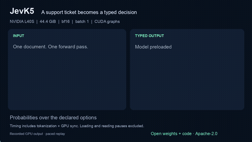 rekaman bergerak · <a href="https://raw.githubusercontent.com/allebee/jevk5/main/docs/demo/jevk5-nvidia-demo.mp4">Buka video</a></td>
</tr></table>

🧪 <b><a href="https://github.com/SimpleJev/JevAny">SimpleJev/JevAny</a></b> · ⭐138 · Python · 🔎 inferred · 0 天

##### 📝 Ringkasan

Open infrastructure for training, evaluating, and deploying System 1 decision models across language and multimodal backbones.

##### 📌 Fakta dasar

| Bidang   | Nilai                                |
| -------- | ------------------------------------ |
| Kategori | `Evaluasi, kalibrasi, dan benchmark` |
| Bukti    | `inferred`                           |
| Bahasa   | Python                               |

##### 📊 Data

| Metrik            | Nilai      |
| ----------------- | ---------- |
| Bintang           | **138**    |
| Push terakhir     | 2026-11-16 |
| Pertama terdaftar | 2026-11-17 |

🏷 `decision-making` · `decision-model` · `jev` · `jev-ai` · `jev-model` · `lora` · `multimodal` · `reinforcement-learning`

---

<table><tr><th align="center" width="50%">🖼 Gambar</th><th align="center" width="50%">🎬 Video</th></tr><tr>
<td align="center" valign="top"></td>
<td align="center" valign="top"> rekaman bergerak · <a href="https://simplejev.org/JevAny/assets/media/docs/jev-agent-harness.mp4">Buka video</a></td>
</tr></table>

🧪 <b><a href="https://github.com/Heman10x-NGU/Verdict-open-jev">Heman10x-NGU/Verdict-open-jev</a></b> · ⭐118 · Python · 🔎 inferred · 26 天

##### 📝 Ringkasan

Mesin keputusan non-autoregresif pada ModernBERT (151M) dengan ketidakpastian terkalibrasi (RLCD), audit tolok ukur TypeSafe AI Jev, dan playground WebGPU di peramban

##### 📌 Fakta dasar

| Bidang   | Nilai                                |
| -------- | ------------------------------------ |
| Kategori | `Evaluasi, kalibrasi, dan benchmark` |
| Bukti    | `inferred`                           |
| Bahasa   | Python                               |

##### 📊 Data

| Metrik            | Nilai      |
| ----------------- | ---------- |
| Bintang           | **118**    |
| Push terakhir     | 2026-10-21 |
| Pertama terdaftar | 2026-09-18 |

🏷 `brier-score` · `calibration` · `decision-engine` · `edge-ai` · `gliclass` · `jev` · `modernbert` · `onnx`

---

<table><tr><th align="center" width="50%">🖼 Gambar</th><th align="center" width="50%">🎬 Video</th></tr><tr>
<td align="center" valign="top"></td>
<td align="center" valign="top">tidak ada media yang dipublikasikan</td>
</tr></table>

Aset ditautkan langsung dari repositori hulu karena tidak ada lisensi redistribusi yang dinyatakan.

🧪 <b><a href="https://github.com/ankit-aglawe/tinyjev">ankit-aglawe/tinyjev</a></b> · ⭐29 · Python · 🔎 inferred · 46 天

##### 📝 Ringkasan

Model kecil mirip jev yang menjawab pertanyaan Choice, Score, dan Noul dalam satu lintasan maju serta mengembalikan probabilitas terkalibrasi. MLX atau PyTorch, sepenuhnya luring, kompatibel dengan System One.

##### 📌 Fakta dasar

| Bidang   | Nilai                                |
| -------- | ------------------------------------ |
| Kategori | `Evaluasi, kalibrasi, dan benchmark` |
| Bukti    | `inferred`                           |
| Bahasa   | Python                               |

##### 📊 Data

| Metrik            | Nilai      |
| ----------------- | ---------- |
| Bintang           | **29**     |
| Push terakhir     | 2026-10-01 |
| Pertama terdaftar | 2026-09-23 |

🏷 `decision-model` · `jev` · `jev-model` · `mlx` · `qwen3` · `small-language-models` · `system-one` · `typed-decisions`

---

<table><tr><th align="center" width="50%">🖼 Gambar</th><th align="center" width="50%">🎬 Video</th></tr><tr>
<td align="center" valign="top"></td>
<td align="center" valign="top"> rekaman bergerak</td>
</tr></table>

<b>Lainnya di kategori ini</b> · 70

- [mahirmalik030/Jev-vs-LLMs](https://github.com/mahirmalik030/Jev-vs-LLMs) - A comparative study of Jev 1.13 and Large Language Models (LLMs) for phishing…
- [patryckalves/jev-no-enem](https://github.com/patryckalves/jev-no-enem) - Benchmark yang dapat direproduksi untuk mengevaluasi Jev milik TypeSafe AI…
- [vikawork/decision-models-calibration](https://github.com/vikawork/decision-models-calibration) - Decision APIs measured: Jev 1.14, gpt-6-luna Decisions and Gemini Decision 1 on…
- [buberlo/jev-trader](https://github.com/buberlo/jev-trader) - Sistem pembuatan pasar 24/7 di sekitar keputusan Jev (TypeSafe System One)…
- [shibing624/train-jev](https://github.com/shibing624/train-jev) - Melatih model keputusan System 1 bergaya JEV pada Qwen3.5 dan Qwen3.8-27B…
- [SamratDuttaOfficial/WaterSheep](https://github.com/SamratDuttaOfficial/WaterSheep) - Model keputusan yang mengembalikan jawaban terkalibrasi untuk pertanyaan…
- [BrendanH18/jev_fsd](https://github.com/BrendanH18/jev_fsd) - A driving test for AI models, on real Canadian streets, that you can also take…
- [Enntity/sparkscore](https://github.com/Enntity/sparkscore) - Typed, calibrated decisions on one NVIDIA DGX Spark: d3-ultra 27B NVFP4 on…
- [Nhahan/Xevn](https://github.com/Nhahan/Xevn) - A 4B decision model built for Korean.
- [us/jev-local](https://github.com/us/jev-local) - Server evaluasi lokal yang kompatibel dengan Jev: POST /v1/systemone dengan…
- [mertkayacs/jevalt](https://github.com/mertkayacs/jevalt) - Three 4B decision models for English, Turkish and German, with per-option…
- [cablehead/jev.nu](https://github.com/cablehead/jev.nu) - Modul Nushell untuk TypeSafe System One API: keputusan bertipe dengan…
- [wondertwins/jev-benchmark](https://github.com/wondertwins/jev-benchmark) - Benchmark dan playground untuk model Jev milik TypeSafe (System One): catur…
- [Yifan-Lan/awesome-jev-robustness](https://github.com/Yifan-Lan/awesome-jev-robustness) - Pengujian, audit kalibrasi, dan studi mode kegagalan Jev (TypeSafe System One)…
- [ZhangYiqun018/jev-dimabsa](https://github.com/ZhangYiqun018/jev-dimabsa) - TypeSafe Jev (System One) pada DimABSA, SemEval-2026 Task 3 Track A, ketiga…
- [y0usaf/jev-lm](https://github.com/y0usaf/jev-lm) - Model bahasa tingkat kata yang lapisan outputnya adalah Jev: penyusun n-gram…
- [zamax14/Laya-Finetune](https://github.com/zamax14/Laya-Finetune) - Fine-tune Laya, model keputusan System One terbuka, untuk tugas keputusan…
- [mertkayacs/jevoss](https://github.com/mertkayacs/jevoss) - Evaluation tools for Jev-compatible decision models, covering accuracy…
- [tak-bro/local-jev-bench](https://github.com/tak-bro/local-jev-bench) - Model keputusan lokal bergaya Jev System One di Mac Apple Silicon: AnyJev, Kev…
- [CodyQin/zh-decision-bench](https://github.com/CodyQin/zh-decision-bench) - Tolok ukur kalibrasi berbahasa Mandarin pertama untuk model keputusan.
- [mpuig/system-one](https://github.com/mpuig/system-one) - Model keputusan System One sumber terbuka — istilah Kahneman untuk kemampuan…
- [AlanViollier/jev-vs-pii](https://github.com/AlanViollier/jev-vs-pii) - How good is Jev, a decision model, at finding personal information?
- [CosmoIknosLab/EarthJev](https://github.com/CosmoIknosLab/EarthJev) - EarthJev: calibrated, non-generative answers to natural-language questions…
- [etsabary/jev-deterministic-benchmark](https://github.com/etsabary/jev-deterministic-benchmark) - Tolok ukur perilaku 1.000 keputusan dari Jev di 25 keluarga penalaran…
- [Rushab1/gr-jev](https://github.com/Rushab1/gr-jev) - Code for.
- [Nefelim584/JEV_Judge](https://github.com/Nefelim584/JEV_Judge) - jev-lite: a ModernBERT-based typed decision model (Bool / Choice / Score) with…
- [teyhouse/jev-secret-detection](https://github.com/teyhouse/jev-secret-detection) - Mengukur seberapa baik model RLCD-Jev milik TypeSafe menemukan kredensial…
- [beskvladimir-create/ru-jev](https://github.com/beskvladimir-create/ru-jev) - Ru-Jev: an open Russian typed-decision model.
- [EnesDemir143/jev-laya-benchmark](https://github.com/EnesDemir143/jev-laya-benchmark) - Tolok ukur lokal yang membandingkan TypeSafe Jev dan Laya-MLX untuk klasifikasi…
- [lewistouchtech/opencode-jev-safe-compact](https://github.com/lewistouchtech/opencode-jev-safe-compact) - JEV-guided context compaction for OpenCode, built on a measured finding: noul…
- [ZZKeepCurious/jev-system-one-survey](https://github.com/ZZKeepCurious/jev-system-one-survey) - System One 决策模型（Jev）技术调研：形态、机制、实现谱系与选型 · Technical survey of System One /…
- [113636xfh/jev-decision-head](https://github.com/113636xfh/jev-decision-head) - A lightweight Jev-style decision head, plus the Strata patches that let one…
- [agarwalastitwa027-svg/mini-jev-multimodal](https://github.com/agarwalastitwa027-svg/mini-jev-multimodal) - Model keputusan gambar+teks kecil: Qwen3-VL-2B + LoRA + answer head memberi…
- [amatelic/jev](https://github.com/amatelic/jev) - Keputusan AI lokal satu baris. Pilihan/noul/score terkalibrasi dari model…
- [ankur287/jev-open-calibration](https://github.com/ankur287/jev-open-calibration) - Rebuilding Jev.
- [betulsimsek/jev-decomposition-tr](https://github.com/betulsimsek/jev-decomposition-tr) - Does splitting a typed-decision question help? Jev vs OpenAI Decisions vs Laya…
- [cayoesn/llm-jev-engine](https://github.com/cayoesn/llm-jev-engine) - System-1 Non-Autoregressive Single-Pass Neural Decision Engine with RLCD…
- [chenyuwang166-oss/metask-jev-rain-12B-trained](https://github.com/chenyuwang166-oss/metask-jev-rain-12B-trained) - MeTask 12B structured decision service: judgments and option probabilities…
- [chenyuwang166-oss/metask-jev-rain-31B-trained](https://github.com/chenyuwang166-oss/metask-jev-rain-31B-trained) - MeTask 31B structured decision service with weights for private deployment.
- [chenyuwang166-oss/metask-jev-rain-4B](https://github.com/chenyuwang166-oss/metask-jev-rain-4B) - MeTask 4B structured decision service.
- [Chetax/jev-ecommerce-reviews](https://github.com/Chetax/jev-ecommerce-reviews) - E-commerce review classification with TypeSafe.
- [dnakhoa/jev-deferred-crispification](https://github.com/dnakhoa/jev-deferred-crispification) - Makalah posisi: primitif Hidden-Markov dan fuzzy yang hilang dari model…
- [himalaya-kaushik/mini-jev](https://github.com/himalaya-kaushik/mini-jev) - Di mana model keputusan satu lintasan mengalami kegagalan: model bergaya Jev…
- [Holovkat/jev-mark](https://github.com/Holovkat/jev-mark) - Benchmarking Local LLM.
- [humandebri/IC-OpenJev](https://github.com/humandebri/IC-OpenJev) - IC-Verdict: Rust model canister on ICP.
- [n9omi/jev-calibration-audit](https://github.com/n9omi/jev-calibration-audit) - Independent calibration audit of TypeSafe AI.
- [Nijal-AI/jev-lab](https://github.com/Nijal-AI/jev-lab) - Atelier web pour mettre à l.
- [onlyoneaman/jev-eval](https://github.com/onlyoneaman/jev-eval) - TypeSafe.
- [open-factoryai/myJEV](https://github.com/open-factoryai/myJEV) - Ubah keadaan apa pun menjadi keputusan terstruktur dan terkalibrasi.
- [Poojithcodes/jev-calibration-study](https://github.com/Poojithcodes/jev-calibration-study) - Comparing Jev.
- [pramodklal/JEV](https://github.com/pramodklal/JEV) - Fast, type-safe AI decision model by TypeSafe AI.
- [rmax-ai/jev-vs-clef](https://github.com/rmax-ai/jev-vs-clef) - Head-to-head stress comparison of Jev (TypeSafe System One) vs Cloudflare Clef…
- [soraaa013-ops/jev-eval-lab](https://github.com/soraaa013-ops/jev-eval-lab) - Reproducible evaluation of Jev, typed decision models, and LLM judges.
- [Teddy9710/jev-playground](https://github.com/Teddy9710/jev-playground) - Playground lokal untuk TypeSafe System One (Jev): susun pertanyaan…
- [unofficial-equivocation2029/Open-Jev](https://github.com/unofficial-equivocation2029/Open-Jev) - Dapatkan probabilitas keputusan bertipe dari konteks dan kandidat secara…
- [UpHash-Network/mini-jev](https://github.com/UpHash-Network/mini-jev) - LogitTrail (sebelumnya Mini Jev): keputusan bertipe lokal yang dapat diperiksa…
- [xiaohuiyan/awesome-jev-papers](https://github.com/xiaohuiyan/awesome-jev-papers) - Curated arXiv papers on Jev, System One and typed decision models, with…
- [Zayan-droid/Jev](https://github.com/Zayan-droid/Jev) - Calibrated single-pass decision model: typed yes/no, choice and score questions…
- [taeold/djev-run](https://github.com/taeold/djev-run) - Serve the experimental DiffusionGemma-Jev diffusion model on Cloud Run GPUs…
- [kyotofin/tax-doc-classifier](https://github.com/kyotofin/tax-doc-classifier) - Pengklasifikasi halaman dokumen pajak yang dibangun berdasarkan keputusan Jev.
- [mohit67890/imajev](https://github.com/mohit67890/imajev) - Model keputusan bertipe bergaya Jev yang terbuka dan juga menerima gambar: foto…
- [hotchpotch/bekko-system-one](https://github.com/hotchpotch/bekko-system-one) - Model keputusan System One kecil (17M–400M) untuk Ya/Tidak, Choice, Score, dan…
- [mithalouni/system-one-open](https://github.com/mithalouni/system-one-open) - Replika terbuka TypeSafe Jev: keputusan terkalibrasi dan bertipe dalam satu…
- [genai-craft/openvons](https://github.com/genai-craft/openvons) - openvons (open-Jev): lapisan keputusan yang menjawab pilihan terbatas…
- [arnabgho/rlcd-lite](https://github.com/arnabgho/rlcd-lite) - RL yang disederhanakan untuk Keputusan Terkalibrasi: decoding JSON terbatas…
- [nomadoor/ComfyUI-TypedDecision](https://github.com/nomadoor/ComfyUI-TypedDecision) - Keputusan bertipe (noul / choice / score) dengan probabilitas terkalibrasi di…
- [mithril-lang/typed-decisions](https://github.com/mithril-lang/typed-decisions) - Model keputusan bertipe berbentuk Jev.
- [Mangaba-ai/brier](https://github.com/Mangaba-ai/brier) - Brier, by Mangaba AI: typed, calibrated decisions (choice/score/noul) for…
- [KanishkaGD/decision-rerank](https://github.com/KanishkaGD/decision-rerank) - Zero-shot reranking and calibration of decision models (Jev, Laya) on TREC DL…
- [shamazharikh/qwen-rlcd](https://github.com/shamazharikh/qwen-rlcd) - Model keputusan terkalibrasi bergaya Jev (Choice/Score/Noul) pada Qwen3.5-0.8B.

## Reproduksi terbuka, bobot, dan riset arsitektur

Bobot terbuka, replika kecil, dan kerja arsitektur. Beberapa di antaranya ada karena perilaku kalibrasi tidak dapat direproduksi hanya dari materi publik.

🔬 <b><a href="https://github.com/kshetrajna12/reflex">kshetrajna12/reflex</a></b> · ⭐175 · Python · 👁️ observed · 41 天

##### 📝 Ringkasan

Model keputusan terbuka kecil: state + pertanyaan bertipe -> probabilitas terkalibrasi. Rekreasi Jev / System One pada Qwen3.5.

> 💡 Model keputusan terbuka dengan antarmuka state-plus-pertanyaan-bertipe yang sama. Layak dibaca sebagai referensi bentuk meskipun Anda tidak pernah menjalankannya.

##### 📌 Fakta dasar

| Bidang   | Nilai                                             |
| -------- | ------------------------------------------------- |
| Kategori | `Reproduksi terbuka, bobot, dan riset arsitektur` |
| Bukti    | `observed`                                        |
| Bahasa   | Python                                            |

##### 📊 Data

| Metrik            | Nilai      |
| ----------------- | ---------- |
| Bintang           | **175**    |
| Push terakhir     | 2026-10-06 |
| Pertama terdaftar | 2026-10-28 |

🔬 <b><a href="https://github.com/TianyuCodings/NanoJev">TianyuCodings/NanoJev</a></b> · ⭐2600 · Python · 🔎 inferred · 32 天

##### 📝 Ringkasan

Replika nano dari Jev: keputusan paralel, kandidat dinamis, dan pipeline pelatihan end-to-end.

> 💡 Replika kecil dari bentuk keputusan paralel. Berguna untuk membaca arsitekturnya tanpa tumpukan vendor, dan dari sinilah beberapa klaim tentang antarmuka tersebut pertama kali dapat diperiksa.

##### 📌 Fakta dasar

| Bidang   | Nilai                                             |
| -------- | ------------------------------------------------- |
| Kategori | `Reproduksi terbuka, bobot, dan riset arsitektur` |
| Bukti    | `inferred`                                        |
| Bahasa   | Python                                            |

##### 📊 Data

| Metrik            | Nilai      |
| ----------------- | ---------- |
| Bintang           | **2600**   |
| Push terakhir     | 2026-10-16 |
| Pertama terdaftar | 2026-11-08 |

---

<table><tr><th align="center" width="50%">🖼 Gambar</th><th align="center" width="50%">🎬 Video</th></tr><tr>
<td align="center" valign="top">tidak ada media yang dipublikasikan</td>
<td align="center" valign="top"> rekaman bergerak</td>
</tr></table>

🔬 <b><a href="https://github.com/r-ms/mini-jev">r-ms/mini-jev</a></b> · ⭐64 · Python · 🔎 inferred · 60 天

##### 📝 Ringkasan

mini-Jev: seperti apa antarmuka keputusan bertipe bergaya Jev pada Qwen3-4B yang dibekukan — baca logit huruf opsi alih-alih menghasilkan JSON. Eksperimen yang telah didaftarkan sebelumnya, hasil, dan perangkat pengajaran.

> 💡 Reproduksi independen paling berguna untuk dibaca: ini menunjukkan mekanisme pembacaan logit berfungsi, dan juga secara eksplisit memperingatkan bahwa proporsi yang dibacanya bukan probabilitas terkalibrasi. Peringatan itu adalah catatan kehati-hatian terpenting dalam ekosistem ini.

##### 📌 Fakta dasar

| Bidang   | Nilai                                             |
| -------- | ------------------------------------------------- |
| Kategori | `Reproduksi terbuka, bobot, dan riset arsitektur` |
| Bukti    | `inferred`                                        |
| Bahasa   | Python                                            |

##### 📊 Data

| Metrik            | Nilai      |
| ----------------- | ---------- |
| Bintang           | **64**     |
| Push terakhir     | 2026-09-18 |
| Pertama terdaftar | 2026-09-18 |

---

<table><tr><th align="center" width="50%">🖼 Gambar</th><th align="center" width="50%">🎬 Video</th></tr><tr>
<td align="center" valign="top"></td>
<td align="center" valign="top">tidak ada media yang dipublikasikan</td>
</tr></table>

🔬 <b><a href="https://github.com/FBddcz/embodied-jev">FBddcz/embodied-jev</a></b> · ⭐342 · Python · 👁️ observed · 56 天

##### 📝 Ringkasan

EmbodiedJev: meja kerja keputusan robot MuJoCo dengan MiniCPM5-2B, Jev dan model APIs yang kompatibel

🔧 Ditemukan dipakai dalam kode: `README.md`

##### 📌 Fakta dasar

| Bidang   | Nilai                                             |
| -------- | ------------------------------------------------- |
| Kategori | `Reproduksi terbuka, bobot, dan riset arsitektur` |
| Bukti    | `observed`                                        |
| Bahasa   | Python                                            |

##### 📊 Data

| Metrik            | Nilai      |
| ----------------- | ---------- |
| Bintang           | **342**    |
| Push terakhir     | 2026-09-22 |
| Pertama terdaftar | 2026-11-08 |

---

<table><tr><th align="center" width="50%">🖼 Gambar</th><th align="center" width="50%">🎬 Video</th></tr><tr>
<td align="center" valign="top"></td>
<td align="center" valign="top"> rekaman bergerak · <a href="https://raw.githubusercontent.com/FBddcz/embodied-jev/main/docs/media/libero-drawer-comparison.mp4">Buka video</a></td>
</tr></table>

🔬 <b><a href="https://github.com/imikerussell/beebots">imikerussell/beebots</a></b> · ⭐341 · TypeScript · 👁️ observed · 12 天

##### 📝 Ringkasan

Tiga lebah perdagangan AI di OKX, setiap keputusan oleh Jev. Perdagangan kertas secara default. Bukan nasihat keuangan.

🔧 Ditemukan dipakai dalam kode: `docs/LINKS.md`

##### 📌 Fakta dasar

| Bidang   | Nilai                                             |
| -------- | ------------------------------------------------- |
| Kategori | `Reproduksi terbuka, bobot, dan riset arsitektur` |
| Bukti    | `observed`                                        |
| Bahasa   | TypeScript                                        |

##### 📊 Data

| Metrik            | Nilai      |
| ----------------- | ---------- |
| Bintang           | **341**    |
| Push terakhir     | 2026-11-05 |
| Pertama terdaftar | 2026-11-08 |

---

<table><tr><th align="center" width="50%">🖼 Gambar</th><th align="center" width="50%">🎬 Video</th></tr><tr>
<td align="center" valign="top"></td>
<td align="center" valign="top"> <a href="https://youtu.be/bp_u9Gzp1OU">Tonton di youtu.be</a> · pemutaran terbuka di situs sumber; GitHub tidak dapat menyematkannya secara inline</td>
</tr></table>

🔬 <b><a href="https://github.com/PsiACE/dohnuts">PsiACE/dohnuts</a></b> · ⭐40 · Python · 👁️ observed · 41 天

##### 📝 Ringkasan

Dohnuts membangun model multimodal kecil untuk keputusan langsung. -> System One model

##### 📌 Fakta dasar

| Bidang   | Nilai                                             |
| -------- | ------------------------------------------------- |
| Kategori | `Reproduksi terbuka, bobot, dan riset arsitektur` |
| Bukti    | `observed`                                        |
| Bahasa   | Python                                            |

##### 📊 Data

| Metrik            | Nilai      |
| ----------------- | ---------- |
| Bintang           | **40**     |
| Push terakhir     | 2026-10-06 |
| Pertama terdaftar | 2026-09-21 |

🏷 `decision-model` · `jev` · `laya` · `llm` · `lora` · `rlcd` · `system-one` · `typesafe`

---

<table><tr><th align="center" width="50%">🖼 Gambar</th><th align="center" width="50%">🎬 Video</th></tr><tr>
<td align="center" valign="top"></td>
<td align="center" valign="top">tidak ada media yang dipublikasikan</td>
</tr></table>

🔬 <b><a href="https://github.com/themusebook/clawd-jev-trading-machine">themusebook/clawd-jev-trading-machine</a></b> · ⭐1 · Python · 👁️ observed · 52 天

##### 📝 Ringkasan

mesin perdagangan clawd-JEV: pedagang simulasi JEV-on-Solana. Otak TypeSafe jev-latest, ruang tindakan dinamis, rezim CoinGecko + memori Supermemory, venue Jupiter/DFlow. Hanya uji coba kering.

##### 📌 Fakta dasar

| Bidang   | Nilai                                             |
| -------- | ------------------------------------------------- |
| Kategori | `Reproduksi terbuka, bobot, dan riset arsitektur` |
| Bukti    | `observed`                                        |
| Bahasa   | Python                                            |

##### 📊 Data

| Metrik            | Nilai      |
| ----------------- | ---------- |
| Bintang           | **1**      |
| Push terakhir     | 2026-09-25 |
| Pertama terdaftar | 2026-11-01 |

🔬 <b><a href="https://huggingface.co/adambuttrick/ror-set-point-retriever-e5-base-openalex-jev-distill">adambuttrick/ror-set-point-retriever-e5-base-openalex-jev-distill</a></b> · model · 👁️ observed · 8 天

##### 📝 Ringkasan

Tidak ada deskripsi hulu yang dipublikasikan.

##### 📌 Fakta dasar

| Bidang   | Nilai                                             |
| -------- | ------------------------------------------------- |
| Kategori | `Reproduksi terbuka, bobot, dan riset arsitektur` |
| Bukti    | `observed`                                        |

##### 📊 Data

| Metrik            | Nilai      |
| ----------------- | ---------- |
| Pertama terdaftar | 2026-11-11 |

🏷 `sentence-transformers` · `safetensors` · `xlm-roberta` · `ror` · `affiliations` · `entity-linking` · `retrieval` · `sentence-similarity`

🔬 <b><a href="https://huggingface.co/adambuttrick/ror-set-point-set-model-mmbert-base-openalex-jev-distill">adambuttrick/ror-set-point-set-model-mmbert-base-openalex-jev-distill</a></b> · model · 👁️ observed · 8 天

##### 📝 Ringkasan

Tidak ada deskripsi hulu yang dipublikasikan.

##### 📌 Fakta dasar

| Bidang   | Nilai                                             |
| -------- | ------------------------------------------------- |
| Kategori | `Reproduksi terbuka, bobot, dan riset arsitektur` |
| Bukti    | `observed`                                        |

##### 📊 Data

| Metrik            | Nilai      |
| ----------------- | ---------- |
| Pertama terdaftar | 2026-11-11 |

🏷 `transformers` · `safetensors` · `modernbert` · `feature-extraction` · `ror` · `affiliations` · `entity-linking` · `cross-encoder`

🔬 <b><a href="https://github.com/BipinRajC/Jev-api-experiments">BipinRajC/Jev-api-experiments</a></b> · Python · 👁️ observed · 29 天

##### 📝 Ringkasan

Eksperimen empiris dan riset API untuk model System One Jev milik TypeSafe yang dilatih menggunakan RLCD

##### 📌 Fakta dasar

| Bidang   | Nilai                                             |
| -------- | ------------------------------------------------- |
| Kategori | `Reproduksi terbuka, bobot, dan riset arsitektur` |
| Bukti    | `observed`                                        |
| Bahasa   | Python                                            |

##### 📊 Data

| Metrik            | Nilai      |
| ----------------- | ---------- |
| Bintang           | **0**      |
| Push terakhir     | 2026-10-18 |
| Pertama terdaftar | 2026-09-22 |

🏷 `api` · `experimental` · `jev` · `rlcd` · `typesafe-ai`

🔬 <b><a href="https://huggingface.co/haohan84/v-jev1.4">haohan84/v-jev1.4</a></b> · model · 👁️ observed · 5 天

##### 📝 Ringkasan

Tidak ada deskripsi hulu yang dipublikasikan.

##### 📌 Fakta dasar

| Bidang   | Nilai                                             |
| -------- | ------------------------------------------------- |
| Kategori | `Reproduksi terbuka, bobot, dan riset arsitektur` |
| Bukti    | `observed`                                        |

##### 📊 Data

| Metrik            | Nilai      |
| ----------------- | ---------- |
| Pertama terdaftar | 2026-11-12 |

🏷 `transformers` · `safetensors` · `v-jev` · `jev` · `systemone` · `decision-model` · `information-extraction` · `vision`

🔬 <b><a href="https://huggingface.co/mradermacher/JEV-9B-GGUF">mradermacher/JEV-9B-GGUF</a></b> · model · 👁️ observed · 3 天

##### 📝 Ringkasan

Tidak ada deskripsi hulu yang dipublikasikan.

##### 📌 Fakta dasar

| Bidang   | Nilai                                             |
| -------- | ------------------------------------------------- |
| Kategori | `Reproduksi terbuka, bobot, dan riset arsitektur` |
| Bukti    | `observed`                                        |

##### 📊 Data

| Metrik            | Nilai      |
| ----------------- | ---------- |
| Pertama terdaftar | 2026-11-14 |

🏷 `transformers` · `gguf` · `system-one` · `system-two` · `blocks-of-experts` · `typed-decisions` · `decision-model` · `calibrated-probabilities`

🔬 <b><a href="https://github.com/mizorewww/laya-mlx">mizorewww/laya-mlx</a></b> · ⭐7108 · Python · 🔎 inferred · 0 天 · ⭐+1

##### 📝 Ringkasan

Native MLX runtime for Laya typed decision models — 7–14 ms short decisions on M3 Max. No text generation, PyTorch, or cloud API.

##### 📌 Fakta dasar

| Bidang   | Nilai                                             |
| -------- | ------------------------------------------------- |
| Kategori | `Reproduksi terbuka, bobot, dan riset arsitektur` |
| Bukti    | `inferred`                                        |
| Bahasa   | Python                                            |

##### 📊 Data

| Metrik            | Nilai         |
| ----------------- | ------------- |
| Bintang           | **7108** (+1) |
| Push terakhir     | 2026-11-17    |
| Pertama terdaftar | 2026-11-16    |

🏷 `apple-silicon` · `decision-model` · `inference` · `laya` · `local-ai` · `machine-learning` · `mlx` · `modernbert`

---

<table><tr><th align="center" width="50%">🖼 Gambar</th><th align="center" width="50%">🎬 Video</th></tr><tr>
<td align="center" valign="top"></td>
<td align="center" valign="top"> rekaman bergerak</td>
</tr></table>

🔬 <b><a href="https://github.com/TheoLeeCJ/SemIf-OpenJev">TheoLeeCJ/SemIf-OpenJev</a></b> · ⭐4963 · Python · 🔎 inferred · 54 天

##### 📝 Ringkasan

If semantik dari model terbuka, di 3090 di rumah. Independen; tidak berafiliasi dengan Jev atau TypeSafe.

##### 📌 Fakta dasar

| Bidang   | Nilai                                             |
| -------- | ------------------------------------------------- |
| Kategori | `Reproduksi terbuka, bobot, dan riset arsitektur` |
| Bukti    | `inferred`                                        |
| Bahasa   | Python                                            |

##### 📊 Data

| Metrik            | Nilai      |
| ----------------- | ---------- |
| Bintang           | **4963**   |
| Push terakhir     | 2026-09-23 |
| Pertama terdaftar | 2026-10-29 |

---

<table><tr><th align="center" width="50%">🖼 Gambar</th><th align="center" width="50%">🎬 Video</th></tr><tr>
<td align="center" valign="top"></td>
<td align="center" valign="top"> rekaman bergerak</td>
</tr></table>

🔬 <b><a href="https://github.com/mode-io/vllm-jev">mode-io/vllm-jev</a></b> · ⭐954 · Python · 🔎 inferred · 25 天

##### 📝 Ringkasan

Penyajian native vLLM untuk model keputusan Jev

##### 📌 Fakta dasar

| Bidang   | Nilai                                             |
| -------- | ------------------------------------------------- |
| Kategori | `Reproduksi terbuka, bobot, dan riset arsitektur` |
| Bukti    | `inferred`                                        |
| Bahasa   | Python                                            |

##### 📊 Data

| Metrik            | Nilai      |
| ----------------- | ---------- |
| Bintang           | **954**    |
| Push terakhir     | 2026-10-22 |
| Pertama terdaftar | 2026-11-08 |

---

<table><tr><th align="center" width="50%">🖼 Gambar</th><th align="center" width="50%">🎬 Video</th></tr><tr>
<td align="center" valign="top"></td>
<td align="center" valign="top">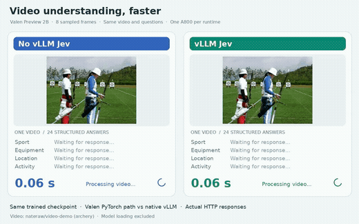 rekaman bergerak · <a href="https://raw.githubusercontent.com/mode-io/vllm-jev/main/docs/assets/valen-video-live.mp4">Buka video</a></td>
</tr></table>

🔬 <b><a href="https://github.com/Valen-Team/Valen">Valen-Team/Valen</a></b> · ⭐922 · Python · 🔎 inferred · 1 天

##### 📝 Ringkasan

Open multimodal decision models, 0.8B to 27B, for text, images and video. Decide with probabilities over your own candidates and locate with bounding boxes, in place of generated text. Free API, ONNX, GGUF, vLLM and SGLang; fine-tuning code included.

##### 📌 Fakta dasar

| Bidang   | Nilai                                             |
| -------- | ------------------------------------------------- |
| Kategori | `Reproduksi terbuka, bobot, dan riset arsitektur` |
| Bukti    | `inferred`                                        |
| Bahasa   | Python                                            |

##### 📊 Data

| Metrik            | Nilai      |
| ----------------- | ---------- |
| Bintang           | **922**    |
| Push terakhir     | 2026-11-15 |
| Pertama terdaftar | 2026-10-29 |

🏷 `decision-model` · `fine-tuning` · `gguf` · `jev` · `multimodal` · `onnx` · `structured-output` · `system-one`

---

<table><tr><th align="center" width="50%">🖼 Gambar</th><th align="center" width="50%">🎬 Video</th></tr><tr>
<td align="center" valign="top"></td>
<td align="center" valign="top"> rekaman bergerak</td>
</tr></table>

🔬 <b><a href="https://github.com/featherless-ai/simple-jev">featherless-ai/simple-jev</a></b> · ⭐659 · Python · 🔎 inferred · 5 天

##### 📝 Ringkasan

Ubah model terbuka apa pun menjadi endpoint pengklasifikasi/jev

##### 📌 Fakta dasar

| Bidang   | Nilai                                             |
| -------- | ------------------------------------------------- |
| Kategori | `Reproduksi terbuka, bobot, dan riset arsitektur` |
| Bukti    | `inferred`                                        |
| Bahasa   | Python                                            |

##### 📊 Data

| Metrik            | Nilai      |
| ----------------- | ---------- |
| Bintang           | **659**    |
| Push terakhir     | 2026-11-11 |
| Pertama terdaftar | 2026-11-08 |

---

<table><tr><th align="center" width="50%">🖼 Gambar</th><th align="center" width="50%">🎬 Video</th></tr><tr>
<td align="center" valign="top"></td>
<td align="center" valign="top">tidak ada media yang dipublikasikan</td>
</tr></table>

🔬 <b><a href="https://github.com/tomerglick57/Jevstiller">tomerglick57/Jevstiller</a></b> · ⭐81 · Python · 🔎 inferred · 6 天

##### 📝 Ringkasan

Suling tugas klasifikasi Jev yang berulang menjadi model lokal, secara langsung — jawaban yang sama, perangkat keras Anda.

##### 📌 Fakta dasar

| Bidang   | Nilai                                             |
| -------- | ------------------------------------------------- |
| Kategori | `Reproduksi terbuka, bobot, dan riset arsitektur` |
| Bukti    | `inferred`                                        |
| Bahasa   | Python                                            |

##### 📊 Data

| Metrik            | Nilai      |
| ----------------- | ---------- |
| Bintang           | **81**     |
| Push terakhir     | 2026-11-11 |
| Pertama terdaftar | 2026-10-29 |

🏷 `classification` · `distillation` · `jev` · `knowledge-distillation` · `llm` · `mlops` · `model-cascade` · `python`

---

<table><tr><th align="center" width="50%">🖼 Gambar</th><th align="center" width="50%">🎬 Video</th></tr><tr>
<td align="center" valign="top"></td>
<td align="center" valign="top"> rekaman bergerak</td>
</tr></table>

<b>Lainnya di kategori ini</b> · 50

- [nithiljn/System-One-Models](https://github.com/nithiljn/System-One-Models) - A beginner friendly guide and code examples for Google.
- [SargeDev/Solar-Decision-JEV-27B](https://huggingface.co/SargeDev/Solar-Decision-JEV-27B)
- [SargeDev/Solar-Decision-JEV-27B-GGUF](https://huggingface.co/SargeDev/Solar-Decision-JEV-27B-GGUF)
- [SargeDev/Solar-Decision-JEV-27B-V3](https://huggingface.co/SargeDev/Solar-Decision-JEV-27B-V3)
- [SargeDev/Solar-Decision-JEV-27B-V3-GGUF](https://huggingface.co/SargeDev/Solar-Decision-JEV-27B-V3-GGUF)
- [SargeDev/Solar-Decision-JEV-27B-V3-NVFP4-FP8](https://huggingface.co/SargeDev/Solar-Decision-JEV-27B-V3-NVFP4-FP8)
- [SargeDev/Solar-JEV-27B](https://huggingface.co/SargeDev/Solar-JEV-27B)
- [SargeDev/Solar-JEV-27B-GGUF](https://huggingface.co/SargeDev/Solar-JEV-27B-GGUF)
- [social-jev/social-jev-1.7B-preview](https://huggingface.co/social-jev/social-jev-1.7B-preview)
- [stephenlb/system-one-model](https://huggingface.co/stephenlb/system-one-model)
- [wfzyx/von](https://github.com/wfzyx/von) - Model keputusan System One sumber terbuka.
- [ekzhang/openjev-sglang](https://github.com/ekzhang/openjev-sglang) - Endpoint API yang kompatibel dengan Jev, berbasis model terbuka (hanya prefill).
- [hyperspaceai/jevcache](https://github.com/hyperspaceai/jevcache) - Cache keputusan untuk model kelas TypeSafe Jev — memoize keputusan agar…
- [mars-tw/jev-trading-command-center](https://github.com/mars-tw/jev-trading-command-center) - Open-source paper-trading research app integrating TypeSafe Jev, animated 3D…
- [alvarobartt/sys1](https://github.com/alvarobartt/sys1) - TypeSafe AI terstruktur yang sangat cepat dan di-host sendiri untuk model…
- [mattt/AnyDecisionModel](https://github.com/mattt/AnyDecisionModel) - A Swift package for typed decisions from language models.
- [hunkim/solar-mini4-jev](https://github.com/hunkim/solar-mini4-jev)
- [Xiaooolong/vev](https://github.com/Xiaooolong/vev) - Jev-like decision models that can also see images — open weights on Qwen3.5…
- [amithgc/local-jev](https://github.com/amithgc/local-jev) - Server System One lokal dan offline yang kompatibel dengan Jev API milik…
- [OpenLAIR/lev](https://github.com/OpenLAIR/lev) - Lev: Thinking Fast and Deep with Looped Decision Models.
- [whyashthakker/awesome-jev-use-cases](https://github.com/whyashthakker/awesome-jev-use-cases) - Daftar Awesome tentang kasus penggunaan Jev.
- [dongtsi/awesome-trustworthy-jev](https://github.com/dongtsi/awesome-trustworthy-jev) - Jev+Security Resources | Jev+安全相关论文资料集合: Papers, projects, and other resources…
- [ljwwwiop/JEV-mini](https://github.com/ljwwwiop/JEV-mini) - JEV-mini adalah proyek pembelajaran minimal untuk melatih model pengambilan…
- [pCwOrM/werr](https://github.com/pCwOrM/werr) - Zero-memory System-1 decision engine &amp; TypeSafe Jev runtime powered by…
- [deep-diver/mini-jev](https://github.com/deep-diver/mini-jev)
- [skydiving94/klint](https://github.com/skydiving94/klint) - Linter semantik deklaratif dan auditor kode arsitektural untuk kev berbobot…
- [yuting-ai/minicpm5-2b-jev](https://github.com/yuting-ai/minicpm5-2b-jev) - MiniCPM5-2B-Jev: Model Keputusan System 1 Berkecepatan Tinggi.
- [AnkitNayak-dev/QJev-1.5B](https://github.com/AnkitNayak-dev/QJev-1.5B) - QJev-1.5B (Qwen2.5-1.5B JEV Decision Model) is an open-weights, high-speed…
- [Frank-Funney/mini-jev](https://github.com/Frank-Funney/mini-jev) - Mesin keputusan terstruktur yang sangat ringan untuk perangkat edge.
- [welcomeenjoy75-hue/mini-jev](https://github.com/welcomeenjoy75-hue/mini-jev) - Mesin keputusan terstruktur yang sangat ringan untuk perangkat edge.
- [AbdelStark/reachy-jev](https://github.com/AbdelStark/reachy-jev) - Primitif keputusan bertipe Jev untuk aplikasi Reachy Mini.
- [AnilDeshpande/jev-youtube-demo](https://github.com/AnilDeshpande/jev-youtube-demo) - Jev (TypeSafe) vs GPT-4o-mini: mengklasifikasikan komentar YouTube dengan…
- [bwanyu1/diffusion-jev-qwen3-vl](https://github.com/bwanyu1/diffusion-jev-qwen3-vl) - Diffusion-Jev: Qwen3-VL-4B converted into a discrete diffusion language model…
- [Dlmily/minimind-jev-dlmily](https://github.com/Dlmily/minimind-jev-dlmily) - MiniMind Jev probability scoring page (GitHub Pages).
- [Drykeeightyeight427/jev-robot-control](https://github.com/Drykeeightyeight427/jev-robot-control) - Bandingkan GPT-6 Astra, GPT-4.1 mini, dan Jev yang mengendalikan xArm7 di…
- [emilesilvis/jev-experiment](https://github.com/emilesilvis/jev-experiment) - Eksperimen klasifikasi Jev dan GPT-4o mini yang dapat direproduksi, temuan, dan…
- [gbesse/jev-minimis-watch](https://github.com/gbesse/jev-minimis-watch) - Siapkan peninjauan akumulasi bantuan de minimis berdasarkan elemen-elemen…
- [jobakk/jev-cj-asap](https://github.com/jobakk/jev-cj-asap) - Penilaian komparatif esai ASAP oleh Jev (API model keputusan), gpt-oss-20b, dan…
- [luckberonne/mini-jev](https://github.com/luckberonne/mini-jev) - Pengklasifikasi perintah shell satu lintasan.
- [MarwaneAit-mouloud/reachy-jev](https://github.com/MarwaneAit-mouloud/reachy-jev) - Reachy Mini contrôle les commandes : modèles de décision (Jev, OpenAI) contre…
- [RevanthM/lean-jev-bridge](https://github.com/RevanthM/lean-jev-bridge) - Matha Labs research: TypeSafe-shaped probabilistic proposals with a…
- [u007/minicpm5-jev](https://github.com/u007/minicpm5-jev) - MiniCPM5-2B-8bit sebagai layanan keputusan bertipe yang kompatibel dengan Jev…
- [Van5hdeep/mini-jev](https://github.com/Van5hdeep/mini-jev) - model sederhana yang dilatih berdasarkan inspirasi dari jev.
- [vicfei/minimind-jev](https://github.com/vicfei/minimind-jev) - Train your own tiny Jev (System One decision model) — v0.1: frozen Chinese…
- [wangjunxiao/MiniJev](https://github.com/wangjunxiao/MiniJev) - A lightweight and easy-to-follow implementation of Jev.
- [apiplant/laya-rs](https://github.com/apiplant/laya-rs) - Implementasi ulang Rust dari Laya, mesin keputusan bertipe non-autoregresif di…
- [Astro-Han/decision-head-rlcd](https://github.com/Astro-Han/decision-head-rlcd) - Dari mana generalisasi model keputusan berasal? RLCD pada Qwen3.5-4B, set yang…
- [smixs/jevchik](https://github.com/smixs/jevchik) - Telegram bot for group chats: karma for useful messages, anti-spam for…
- [vicksiyi/qwen-2.5-1b-rlcd](https://github.com/vicksiyi/qwen-2.5-1b-rlcd) - Demo probabilitas keputusan MLX lokal yang diturunkan dari…
- [yangshun2005/laya-cn](https://github.com/yangshun2005/laya-cn) - \[中文化\] Mesin keputusan System 1 multibahasa dan non-autoregresif.

## Aplikasi, game, robotika, dan demo interaktif

Game, robot, peramban, dan dasbor. Demo adalah cara klaim soal latensi dan biaya menjadi mudah dibaca.

🎮 <b><a href="https://github.com/jarrodwatts/jev-trader">jarrodwatts/jev-trader</a></b> · ⭐3139 · TypeScript · 👁️ observed · 35 天 · ⭐+1

##### 📝 Ringkasan

Satu keputusan perdagangan AI setiap blok Monad. Jev di Kuru MON-USDC.

🔧 Ditemukan dipakai dalam kode: `SPEC.md`

##### 📌 Fakta dasar

| Bidang   | Nilai                                           |
| -------- | ----------------------------------------------- |
| Kategori | `Aplikasi, game, robotika, dan demo interaktif` |
| Bukti    | `observed`                                      |
| Bahasa   | TypeScript                                      |

##### 📊 Data

| Metrik            | Nilai         |
| ----------------- | ------------- |
| Bintang           | **3139** (+1) |
| Push terakhir     | 2026-10-13    |
| Pertama terdaftar | 2026-11-08    |

🎮 <b><a href="https://github.com/heyjunpenn/awesome-jev">heyjunpenn/awesome-jev</a></b> · ⭐1078 · Astro · 👁️ observed · 5 天

##### 📝 Ringkasan

A verified, community-maintained catalog of 997 open-source projects built with Jev.

🔧 Ditemukan dipakai dalam kode: `README.md`, `CHANGELOG.md`, `README.ko.md`, `README.es.md`

##### 📌 Fakta dasar

| Bidang   | Nilai                                           |
| -------- | ----------------------------------------------- |
| Kategori | `Aplikasi, game, robotika, dan demo interaktif` |
| Bukti    | `observed`                                      |
| Bahasa   | Astro                                           |

##### 📊 Data

| Metrik            | Nilai      |
| ----------------- | ---------- |
| Bintang           | **1078**   |
| Push terakhir     | 2026-11-12 |
| Pertama terdaftar | 2026-10-29 |

🏷 `astro` · `awesome` · `awesome-jev` · `awesome-list` · `jev` · `typesafe`

🎮 <b><a href="https://github.com/droidrun/mobile-jev">droidrun/mobile-jev</a></b> · ⭐471 · JavaScript · 👁️ observed · 61 天

##### 📝 Ringkasan

Tidak ada deskripsi hulu yang dipublikasikan.

🔧 Ditemukan dipakai dalam kode: `README.md`

##### 📌 Fakta dasar

| Bidang   | Nilai                                           |
| -------- | ----------------------------------------------- |
| Kategori | `Aplikasi, game, robotika, dan demo interaktif` |
| Bukti    | `observed`                                      |
| Bahasa   | JavaScript                                      |

##### 📊 Data

| Metrik            | Nilai      |
| ----------------- | ---------- |
| Bintang           | **471**    |
| Push terakhir     | 2026-09-17 |
| Pertama terdaftar | 2026-11-08 |

🎮 <b><a href="https://github.com/MCG-NJU/VideoJev">MCG-NJU/VideoJev</a></b> · ⭐311 · Python · 👁️ observed · 30 天

##### 📝 Ringkasan

VideoJev: System One Model untuk Pemahaman dan Interaksi Video

##### 📌 Fakta dasar

| Bidang   | Nilai                                           |
| -------- | ----------------------------------------------- |
| Kategori | `Aplikasi, game, robotika, dan demo interaktif` |
| Bukti    | `observed`                                      |
| Bahasa   | Python                                          |

##### 📊 Data

| Metrik            | Nilai      |
| ----------------- | ---------- |
| Bintang           | **311**    |
| Push terakhir     | 2026-10-18 |
| Pertama terdaftar | 2026-10-28 |

---

<table><tr><th align="center" width="50%">🖼 Gambar</th><th align="center" width="50%">🎬 Video</th></tr><tr>
<td align="center" valign="top"></td>
<td align="center" valign="top">tidak ada media yang dipublikasikan</td>
</tr></table>

🎮 <b><a href="https://github.com/mrnugget/jev-shell-history">mrnugget/jev-shell-history</a></b> · ⭐121 · TypeScript · 👁️ observed · 60 天

##### 📝 Ringkasan

Saran otomatis riwayat zsh bergaya Fish yang diurutkan berdasarkan Jev (TypeSafe)

🔧 Ditemukan dipakai dalam kode: `README.md`

##### 📌 Fakta dasar

| Bidang   | Nilai                                           |
| -------- | ----------------------------------------------- |
| Kategori | `Aplikasi, game, robotika, dan demo interaktif` |
| Bukti    | `observed`                                      |
| Bahasa   | TypeScript                                      |

##### 📊 Data

| Metrik            | Nilai      |
| ----------------- | ---------- |
| Bintang           | **121**    |
| Push terakhir     | 2026-09-18 |
| Pertama terdaftar | 2026-10-29 |

---

<table><tr><th align="center" width="50%">🖼 Gambar</th><th align="center" width="50%">🎬 Video</th></tr><tr>
<td align="center" valign="top"></td>
<td align="center" valign="top"> rekaman bergerak</td>
</tr></table>

Aset ditautkan langsung dari repositori hulu karena tidak ada lisensi redistribusi yang dinyatakan.

🎮 <b><a href="https://github.com/realZachi/typesafe-adblock">realZachi/typesafe-adblock</a></b> · ⭐97 · JavaScript · 👁️ observed · 60 天

##### 📝 Ringkasan

🧹 Proyek seru: ekstensi Chrome yang menanyakan kepada model keputusan AI kecil (TypeSafe Jev) "apakah elemen DOM ini iklan?" lalu menghapusnya dari halaman. BYOK, tanpa backend, bukan pemblokir iklan sungguhan.

🔧 Ditemukan dipakai dalam kode: `README.md`

##### 📌 Fakta dasar

| Bidang   | Nilai                                           |
| -------- | ----------------------------------------------- |
| Kategori | `Aplikasi, game, robotika, dan demo interaktif` |
| Bukti    | `observed`                                      |
| Bahasa   | JavaScript                                      |

##### 📊 Data

| Metrik            | Nilai      |
| ----------------- | ---------- |
| Bintang           | **97**     |
| Push terakhir     | 2026-09-17 |
| Pertama terdaftar | 2026-10-29 |

🎮 <b><a href="https://github.com/zadescoxp/Jev-Trades">zadescoxp/Jev-Trades</a></b> · ⭐73 · Python · 👁️ observed · 52 天

##### 📝 Ringkasan

Bot trading dengan model system one pertama milik TypeSafe AI yang benar-benar baru bernama Jev

##### 📌 Fakta dasar

| Bidang   | Nilai                                           |
| -------- | ----------------------------------------------- |
| Kategori | `Aplikasi, game, robotika, dan demo interaktif` |
| Bukti    | `observed`                                      |
| Bahasa   | Python                                          |

##### 📊 Data

| Metrik            | Nilai      |
| ----------------- | ---------- |
| Bintang           | **73**     |
| Push terakhir     | 2026-09-25 |
| Pertama terdaftar | 2026-10-21 |

🏷 `automated-testing` · `backtesting` · `crypto-trading-bot-latest` · `trading-bot-ai-automated`

---

<table><tr><th align="center" width="50%">🖼 Gambar</th><th align="center" width="50%">🎬 Video</th></tr><tr>
<td align="center" valign="top">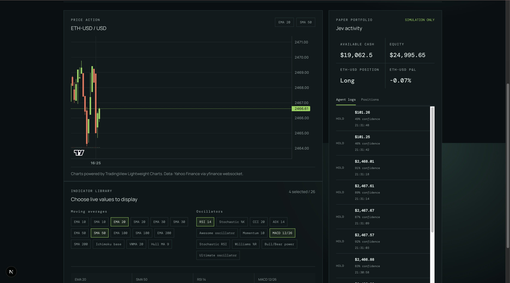</td>
<td align="center" valign="top"> rekaman bergerak</td>
</tr></table>

🎮 <b><a href="https://github.com/dfinke/Jev">dfinke/Jev</a></b> · ⭐11 · PowerShell · 👁️ observed · 32 天

##### 📝 Ringkasan

Keputusan PowerShell dengan model TypeSafe AI milik Jev: https://typesafe.ai/blog/introducing-system-one-models-and-jev

##### 📌 Fakta dasar

| Bidang   | Nilai                                           |
| -------- | ----------------------------------------------- |
| Kategori | `Aplikasi, game, robotika, dan demo interaktif` |
| Bukti    | `observed`                                      |
| Bahasa   | PowerShell                                      |

##### 📊 Data

| Metrik            | Nilai      |
| ----------------- | ---------- |
| Bintang           | **11**     |
| Push terakhir     | 2026-10-16 |
| Pertama terdaftar | 2026-10-28 |

---

<table><tr><th align="center" width="50%">🖼 Gambar</th><th align="center" width="50%">🎬 Video</th></tr><tr>
<td align="center" valign="top"></td>
<td align="center" valign="top">tidak ada media yang dipublikasikan</td>
</tr></table>

🎮 <b><a href="https://github.com/raptatinha/twr-jev-nov2026">raptatinha/twr-jev-nov2026</a></b> · ⭐3 · HTML · 👁️ observed · 3 天

##### 📝 Ringkasan

Building with Jev and System One models: workshop demos (Playwright + DemoQA)

##### 📌 Fakta dasar

| Bidang   | Nilai                                           |
| -------- | ----------------------------------------------- |
| Kategori | `Aplikasi, game, robotika, dan demo interaktif` |
| Bukti    | `observed`                                      |
| Bahasa   | HTML                                            |

##### 📊 Data

| Metrik            | Nilai      |
| ----------------- | ---------- |
| Bintang           | **3**      |
| Push terakhir     | 2026-11-13 |
| Pertama terdaftar | 2026-11-14 |

🎮 <b><a href="https://github.com/Omrigotlieb/awesome-jev">Omrigotlieb/awesome-jev</a></b> · ⭐1 · Python · 👁️ observed · 0 天

##### 📝 Ringkasan

Daftar luar biasa terverifikasi dan kaya tangkapan layar berisi proyek yang dibangun di atas Jev — model System One milik TypeSafe AI untuk keputusan bertipe

##### 📌 Fakta dasar

| Bidang   | Nilai                                           |
| -------- | ----------------------------------------------- |
| Kategori | `Aplikasi, game, robotika, dan demo interaktif` |
| Bukti    | `observed`                                      |
| Bahasa   | Python                                          |

##### 📊 Data

| Metrik            | Nilai      |
| ----------------- | ---------- |
| Bintang           | **1**      |
| Push terakhir     | 2026-11-17 |
| Pertama terdaftar | 2026-09-21 |

🎮 <b><a href="https://github.com/bobbylite/jev-system-one-model-primitives">bobbylite/jev-system-one-model-primitives</a></b> · TypeScript · 👁️ observed · 38 天

##### 📝 Ringkasan

Aplikasi contoh dasar untuk mendemonstrasikan tipe primitif untuk model system one seperti model keputusan Jev terbaru milik TypeSafe

##### 📌 Fakta dasar

| Bidang   | Nilai                                           |
| -------- | ----------------------------------------------- |
| Kategori | `Aplikasi, game, robotika, dan demo interaktif` |
| Bukti    | `observed`                                      |
| Bahasa   | TypeScript                                      |

##### 📊 Data

| Metrik            | Nilai      |
| ----------------- | ---------- |
| Bintang           | **0**      |
| Push terakhir     | 2026-10-09 |
| Pertama terdaftar | 2026-11-01 |

🎮 <b><a href="https://github.com/chussenot/bryx">chussenot/bryx</a></b> · Rust · 👁️ observed · 0 天

##### 📝 Ringkasan

A single-player Brick game in Rust, rendered natively with wgpu. The game can play itself. With the typesafe feature, a TypeSafe System One model (through the judgment crate)

##### 📌 Fakta dasar

| Bidang   | Nilai                                           |
| -------- | ----------------------------------------------- |
| Kategori | `Aplikasi, game, robotika, dan demo interaktif` |
| Bukti    | `observed`                                      |
| Bahasa   | Rust                                            |

##### 📊 Data

| Metrik            | Nilai      |
| ----------------- | ---------- |
| Bintang           | **0**      |
| Push terakhir     | 2026-11-17 |
| Pertama terdaftar | 2026-11-10 |

---

<table><tr><th align="center" width="50%">🖼 Gambar</th><th align="center" width="50%">🎬 Video</th></tr><tr>
<td align="center" valign="top"></td>
<td align="center" valign="top">tidak ada media yang dipublikasikan</td>
</tr></table>

🎮 <b><a href="https://x.com/tspy/status/2100864234523685146">Xtags — X intent labeller</a></b> · @tspy · 👁️ observed · 60 天

##### 📝 Ringkasan

Xtags: a Chrome extension that labels each post in an X timeline with what it is trying to get from you — inducement, provocation, promotion, machine-generated, persuasion, entertainment, information — drawn as a tag plus a probability right after the timestamp. A side panel reports session counts (seen, judged, correct) and cumulative token cost. The author reports near-instant responses and usable accuracy before any tuning.

➡️ **Original project (manifoldor/xtags)** — [https://github.com/manifoldor/xtags](https://github.com/manifoldor/xtags)

> 💡 Worth reading as a latency argument rather than an accuracy one: labelling a timeline only works if the decision costs less than the scroll, which is the constraint a generative model cannot meet.

##### 📌 Fakta dasar

| Bidang   | Nilai                                           |
| -------- | ----------------------------------------------- |
| Kategori | `Aplikasi, game, robotika, dan demo interaktif` |
| Bukti    | `observed`                                      |
| Pemilik  | [yishan](https://x.com/tspy) · @tspy            |

##### 📊 Data

| Metrik            | Nilai      |
| ----------------- | ---------- |
| Tayangan          | **9873**   |
| Suka              | 24         |
| Komentar          | 11         |
| Diposting         | 2026-09-18 |
| Pertama terdaftar | 2026-09-18 |

🏷 `x`

---

<table><tr><th align="center" width="50%">🖼 Gambar</th><th align="center" width="50%">🎬 Video</th></tr><tr>
<td align="center" valign="top"></td>
<td align="center" valign="top"> rekaman bergerak · <a href="https://video.twimg.com/amplify_video/2100858340331200512/vid/avc1/1242x720/ex2FF5-TerVxo9xX.mp4">Buka video</a></td>
</tr></table>

🎮 <b><a href="https://github.com/superagents-lab/jev-search">superagents-lab/jev-search</a></b> · ⭐562 · TypeScript · 🔎 inferred · 9 天

##### 📝 Ringkasan

Cari di web dengan Jev milik TypeSafe: pemilihan sumber, pemahaman kueri, dan pemeringkatan relevansi. Dibangun dengan Search1API.

##### 📌 Fakta dasar

| Bidang   | Nilai                                           |
| -------- | ----------------------------------------------- |
| Kategori | `Aplikasi, game, robotika, dan demo interaktif` |
| Bukti    | `inferred`                                      |
| Bahasa   | TypeScript                                      |

##### 📊 Data

| Metrik            | Nilai      |
| ----------------- | ---------- |
| Bintang           | **562**    |
| Push terakhir     | 2026-11-07 |
| Pertama terdaftar | 2026-10-29 |

---

<table><tr><th align="center" width="50%">🖼 Gambar</th><th align="center" width="50%">🎬 Video</th></tr><tr>
<td align="center" valign="top"></td>
<td align="center" valign="top">tidak ada media yang dipublikasikan</td>
</tr></table>

🎮 <b><a href="https://github.com/jkudish/jev-browser">jkudish/jev-browser</a></b> · ⭐373 · JavaScript · 🔎 inferred · 3 天 · ⭐+1

##### 📝 Ringkasan

Penggunaan browser menggunakan model Jev milik Typesafe

##### 📌 Fakta dasar

| Bidang   | Nilai                                           |
| -------- | ----------------------------------------------- |
| Kategori | `Aplikasi, game, robotika, dan demo interaktif` |
| Bukti    | `inferred`                                      |
| Bahasa   | JavaScript                                      |

##### 📊 Data

| Metrik            | Nilai        |
| ----------------- | ------------ |
| Bintang           | **373** (+1) |
| Push terakhir     | 2026-11-14   |
| Pertama terdaftar | 2026-10-29   |

---

<table><tr><th align="center" width="50%">🖼 Gambar</th><th align="center" width="50%">🎬 Video</th></tr><tr>
<td align="center" valign="top"></td>
<td align="center" valign="top"> rekaman bergerak · <a href="https://raw.githubusercontent.com/jkudish/jev-browser/main/assets/github-demo.mp4">Buka video</a></td>
</tr></table>

🎮 <b><a href="https://github.com/hr98w/jev-visual">hr98w/jev-visual</a></b> · ⭐332 · Python · 🔎 inferred · 57 天

##### 📝 Ringkasan

Eksperimen inferensi visual edukatif yang mirip Jev di Apple Silicon: konteks bersama, penilaian kandidat langsung, dan demo visual lokal.

##### 📌 Fakta dasar

| Bidang   | Nilai                                           |
| -------- | ----------------------------------------------- |
| Kategori | `Aplikasi, game, robotika, dan demo interaktif` |
| Bukti    | `inferred`                                      |
| Bahasa   | Python                                          |

##### 📊 Data

| Metrik            | Nilai      |
| ----------------- | ---------- |
| Bintang           | **332**    |
| Push terakhir     | 2026-09-21 |
| Pertama terdaftar | 2026-11-08 |

---

<table><tr><th align="center" width="50%">🖼 Gambar</th><th align="center" width="50%">🎬 Video</th></tr><tr>
<td align="center" valign="top"></td>
<td align="center" valign="top"> rekaman bergerak · <a href="https://github.com/user-attachments/assets/c87c09d8-30d2-4392-b981-d0b5cf1879ae">Buka video</a></td>
</tr></table>

🎮 <b><a href="https://github.com/aowang-ai/jev-trade">aowang-ai/jev-trade</a></b> · ⭐227 · TypeScript · 🔎 inferred · 5 天

##### 📝 Ringkasan

Trader Jev langsung di Hyperliquid

##### 📌 Fakta dasar

| Bidang   | Nilai                                           |
| -------- | ----------------------------------------------- |
| Kategori | `Aplikasi, game, robotika, dan demo interaktif` |
| Bukti    | `inferred`                                      |
| Bahasa   | TypeScript                                      |

##### 📊 Data

| Metrik            | Nilai      |
| ----------------- | ---------- |
| Bintang           | **227**    |
| Push terakhir     | 2026-11-12 |
| Pertama terdaftar | 2026-10-29 |

🏷 `hyperliquid` · `jev` · `quantitative-finance` · `typesafe`

---

<table><tr><th align="center" width="50%">🖼 Gambar</th><th align="center" width="50%">🎬 Video</th></tr><tr>
<td align="center" valign="top"></td>
<td align="center" valign="top">tidak ada media yang dipublikasikan</td>
</tr></table>

Aset ditautkan langsung dari repositori hulu karena tidak ada lisensi redistribusi yang dinyatakan.

🎮 <b><a href="https://github.com/NanmiCoder/jev-arena">NanmiCoder/jev-arena</a></b> · ⭐125 · JavaScript · 🔎 inferred · 57 天

##### 📝 Ringkasan

Pengenalan dan pengujian nyata model Jev: mengubah bahasa alami menjadi penilaian bertipe dan probabilitas melalui Choice / Score / Noul, untuk klasifikasi, pemberian skor, dan perutean; mendukung perbandingan dengan model seperti DeepSeek untuk pelabelan komentar, kecepatan, dan hasil, termasuk impor CSV/Excel, pemutaran ulang kecepatan asli, dan laporan offline.

##### 📌 Fakta dasar

| Bidang   | Nilai                                           |
| -------- | ----------------------------------------------- |
| Kategori | `Aplikasi, game, robotika, dan demo interaktif` |
| Bukti    | `inferred`                                      |
| Bahasa   | JavaScript                                      |

##### 📊 Data

| Metrik            | Nilai      |
| ----------------- | ---------- |
| Bintang           | **125**    |
| Push terakhir     | 2026-09-20 |
| Pertama terdaftar | 2026-11-08 |

---

<table><tr><th align="center" width="50%">🖼 Gambar</th><th align="center" width="50%">🎬 Video</th></tr><tr>
<td align="center" valign="top"></td>
<td align="center" valign="top">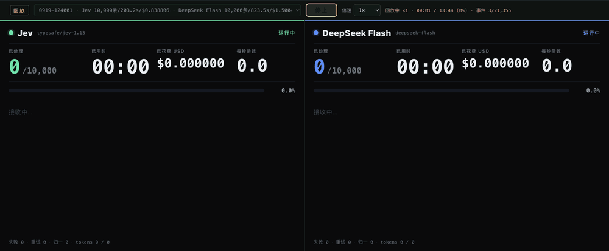 rekaman bergerak</td>
</tr></table>

<b>Lainnya di kategori ini</b> · 27

- [maxlbchung/system-one-harness](https://github.com/maxlbchung/system-one-harness) - A computer use harness for system one models.
- [moritzkremb/jev-voice-browser](https://github.com/moritzkremb/jev-voice-browser) - Kendalikan browser nyata dengan suara.
- [kevinbadi/jev-voice](https://github.com/kevinbadi/jev-voice) - Berbicara dengan Mac Anda. whisper.cpp lokal + satu panggilan Jev (TypeSafe)…
- [BudEcosystem/Bud-Decision-Studio](https://github.com/BudEcosystem/Bud-Decision-Studio) - Bud Decision studio adalah aplikasi desktop lintas platform dan sistem…
- [buer2233/jev-ui-test](https://github.com/buer2233/jev-ui-test) - Framework pengujian otomasi UI yang digerakkan oleh model keputusan Jev: tidak…
- [bilune/jev-design](https://github.com/bilune/jev-design) - Bisakah sebuah model merancang dasbor? Sebuah konsol yang seluruh sistem…
- [emrickgarrett/OneVOneJev](https://github.com/emrickgarrett/OneVOneJev) - Arena quickscope Jev 1v1 — Three.js + TypeSafe System One.
- [andletenkov/decisium](https://github.com/andletenkov/decisium) - Semantic UI testing with decision models.
- [codelivin/jev-laya-toolkit](https://github.com/codelivin/jev-laya-toolkit) - Dashboard and local proxy for SystemOne decision models - Jev (TypeSafe API)…
- [wizicer/jev_info_site](https://github.com/wizicer/jev_info_site) - Community index of tools, models, and real-world use cases built on Jev.
- [dgarridou/KaLM-Jev](https://github.com/dgarridou/KaLM-Jev) - Jalankan layanan Choice, Score, dan Noul lokal yang efisien dengan…
- [harsha89/jev-demo](https://github.com/harsha89/jev-demo) - Demo TypeSafe yang mengklasifikasikan email menggunakan JEV: spam (noul)…
- [PistachioAIHQ/jev-synergy-screening](https://github.com/PistachioAIHQ/jev-synergy-screening) - Demo penyaringan abstrak Jev (TypeSafe System One) × ASReview SYNERGY…
- [Tatuck/jev-boe-demo](https://github.com/Tatuck/jev-boe-demo) - Daily demo applying TypeSafe&#x27;s Jev model to Spain&#x27;s official gazette (BOE).
- [lalitsonawane/jev-snake](https://github.com/lalitsonawane/jev-snake) - Snake autoplay powered by TypeSafe Jev (System One).
- [ajbmachon/jev-navigator](https://github.com/ajbmachon/jev-navigator) - Find code with small, typed Jev judgments: a code index, closed yes/no and pick…
- [aray03/emerald-jev](https://github.com/aray03/emerald-jev) - A bot powered by JEV to play Pokemon Emerald.
- [arkulinskis/jev-buddy](https://github.com/arkulinskis/jev-buddy) - Jev Buddy: the developer guide to Jev, the AI decision model.
- [BrendanH18/jev-lab](https://github.com/BrendanH18/jev-lab) - Six small apps and a workbench that show what TypeSafe.
- [civilnetwork-dev/MagniJev-wasm](https://github.com/civilnetwork-dev/MagniJev-wasm) - Run open-weight Jev-style decision models in the browser.
- [huntsman95/PowerJev](https://github.com/huntsman95/PowerJev) - Powershell Module to interact with /v1/systemone AI Decision Endpoints.
- [krishnakanthb13/JEV-testing](https://github.com/krishnakanthb13/JEV-testing) - PWA test console for Jev (TypeSafe System One) structured-decision primitives…
- [liangkingjin/jev-demo](https://github.com/liangkingjin/jev-demo) - Jev（TypeSafe System One）判定模型演示：Choice / Noul / Score 三原语 + 三档阈值分流，离线可跑.
- [lucaslenglet/JevPlayground](https://github.com/lucaslenglet/JevPlayground) - A local playground for a Jev model.
- [mberliner/jev-lab](https://github.com/mberliner/jev-lab) - Laboratorium progresif untuk mempelajari dan mendemonstrasikan Jev, model…
- [neurogabo/jev-arena](https://github.com/neurogabo/jev-arena) - Run a Pokémon Champions battle arena locally with Jev, TypeSafe, and Pokémon…
- [sorrycc/typesafe-snake](https://github.com/sorrycc/typesafe-snake) - Snake yang diputar otomatis oleh model Jev milik TypeSafe: satu pilihan System…

## Tulisan, diskusi, dan daftar sejenis

Utas peluncuran, tulisan independen, dan daftar terkurasi lain di bidang ini. Repositori ini bukan satu-satunya, dan mengatakan itu lebih berguna daripada berpura-pura sebaliknya.

📰 <b><a href="https://docs.typesafe.ai/model-jaggedness/jev-1.13">9 jenis cacat yang diketahui (jaggedness)</a></b> · ✅ official · 60 天

##### 📝 Ringkasan

Pemahaman literal, **penghitungan tidak andal**, perbandingan tanggal, indireksi bertingkat, state besar dengan detail tidak relevan, konten adversarial, instruksi yang bertentangan dengan criteria, invarian struktural, dan generasi. Rekomendasi resmi: "pecah menjadi masalah atomik lalu gabungkan di dalam kode".

> 💡 **Batas kemampuan**—ini adalah daftar batas yang diakui sendiri oleh vendor, telah dicatat secara lengkap

##### 📌 Fakta dasar

| Bidang   | Nilai                                  |
| -------- | -------------------------------------- |
| Kategori | `Tulisan, diskusi, dan daftar sejenis` |
| Bukti    | `official`                             |

##### 📊 Data

| Metrik            | Nilai      |
| ----------------- | ---------- |
| Pertama terdaftar | 2026-11-13 |

📰 <b><a href="https://docs.typesafe.ai/cookbooks/consistency_choice_cookbook">`consistency_choice` cookbook secara resmi menjawab &quot;hasil pemanggilan berulang akan berubah&quot;</a></b> · ✅ official · 60 天

##### 📝 Ringkasan

Rubrik audit yang sama, **8 Choice × ulangi setiap kondisi 15 kali**. TypeSafe **raw agree 90.8%** (2 dari 8 pertanyaan berbalik, tetapi **conflicts=0**—pembalikan hanya terjadi antara «label spesifik ↔ uncertain»). **Setelah menambahkan aturan abstention (gunakan `probabilities` untuk meminta top probability ≥ 0.60, jika tidak `uncertain` dialihkan ke pemeriksaan manual), tingkat kesepakatan naik menjadi 99.2%**, automatic 74.2%, **tanpa menambah pemanggilan model**. Pembanding: Haiku t=0 100%, Opus 4.8 reasoning 92.5%, gpt-5.4-mini t=0 99.2%. Pernyataan resmi: ini tidak membuat model menjadi pasti; angka-angka ini adalah **reproduktibilitas, bukan kebenaran**; 0.60 adalah strategi contoh, ambang produksi harus ditentukan menggunakan sampel berlabel dan biaya.

> 💡 **\[DEFINITION-CHANGE\]** Memperbarui B5, tabel angka kunci, aturan 3 SKILL.md dan butir peluncuran ke-6, serta batas penerapan ke-6—**sebelumnya repositori ini mencatat "ketidakdeterministikan" sebagai risiko, kini diubah menjadi jawaban resmi: kelola dengan abstention**

##### 📌 Fakta dasar

| Bidang   | Nilai                                  |
| -------- | -------------------------------------- |
| Kategori | `Tulisan, diskusi, dan daftar sejenis` |
| Bukti    | `official`                             |

##### 📊 Data

| Metrik            | Nilai      |
| ----------------- | ---------- |
| Pertama terdaftar | 2026-11-13 |

📰 <b><a href="https://docs.typesafe.ai/confidence">Konfirmasi semantik resmi confidence</a></b> · ✅ official · 60 天

##### 📝 Ringkasan

Pihak resmi menyatakan dengan jelas bahwa `confidence` adalah **statistik yang dihitung dari distribusi `probabilities`**, dan semakin terkonsentrasi distribusinya, semakin pasti hasilnya; **Noul tidak menyertakan confidence**; pihak resmi juga menyatakan "Anda tidak terikat pada definisi kami"; ambang harus "dimulai dari nilai konservatif dan diuji pada data Anda sendiri".

> 💡 Konsisten dengan rumus inversi Archer, ditulis ke dalam berkas definisi

##### 📌 Fakta dasar

| Bidang   | Nilai                                  |
| -------- | -------------------------------------- |
| Kategori | `Tulisan, diskusi, dan daftar sejenis` |
| Bukti    | `official`                             |

##### 📊 Data

| Metrik            | Nilai      |
| ----------------- | ---------- |
| Pertama terdaftar | 2026-11-13 |

📰 <b><a href="https://www.langchain.com/blog/building-a-harness-with-jev（2026-09-17">Posting blog resmi LangChain menjelaskan &quot;mengapa kategori pengamanan agent meledak&quot;—oleh Sydney Runkle &amp; Hunter Lovell</a></b> · ✅ official

##### 📝 Ringkasan

*"Coding harnesses like claude, codex, cursor have shipped some kind of way to classify dangerous actions… **Up until now, this classifier step has been locked away in the closed source parts of the harness. Now that a cheap and performant classifier model exists, we can take the same pattern and adopt it to all agents!**"*; juga memberikan contoh router (menggunakan Jev untuk memilih model berdasarkan kriteria khusus, dengan probabilitas disimpan di agent state) serta *"Jev isn't a drop-in replacement for an LLM"*.

> 💡 **Menjelaskan fenomena "pengamanan agent menjadi komoditas" yang diamati repositori ini**—karena fitur harness closed-source dijadikan open source; telah ditulis ke pustaka cuplikan §2.5

##### 📌 Fakta dasar

| Bidang   | Nilai                                  |
| -------- | -------------------------------------- |
| Kategori | `Tulisan, diskusi, dan daftar sejenis` |
| Bukti    | `official`                             |

##### 📊 Data

| Metrik            | Nilai      |
| ----------------- | ---------- |
| Pertama terdaftar | 2026-11-13 |

📰 <b><a href="https://typesafe.ai/team">TypeSafe menambahkan halaman Team + navigasi menambahkan entri `Enterprise` (sinyal productisasi/komersialisasi)</a></b> · ✅ official · 59 天

##### 📝 Ringkasan

TypeSafe menambahkan halaman Team + navigasi menambahkan entri `Enterprise` (sinyal productisasi/komersialisasi)

> 💡 **\[DEFINITION-CHANGE\]** (fakta tim + sinyal productisasi); `01-系统定义/jev-系统定义.md` menambahkan **§6b/6c**; kartu fakta singkat `references/README.md` diperbarui

##### 📌 Fakta dasar

| Bidang   | Nilai                                  |
| -------- | -------------------------------------- |
| Kategori | `Tulisan, diskusi, dan daftar sejenis` |
| Bukti    | `official`                             |

##### 📊 Data

| Metrik            | Nilai      |
| ----------------- | ---------- |
| Pertama terdaftar | 2026-11-13 |

📰 <b><a href="https://vercel.com/changelog/typesafe-ai-jev-now-available-on-ai-gateway">Changelog resmi Vercel mengumumkan Jev tersedia di AI Gateway</a></b> · ✅ official

##### 📝 Ringkasan

Changelog resmi Vercel mengumumkan Jev tersedia di AI Gateway

> 💡 Baris Vercel di pustaka cuplikan dilengkapi dengan **cara penggunaan AI SDK** (penambahan yang benar-benar baru); **tabel angka kunci tidak perlu diubah** (angka sudah ada) → **perubahan tingkat definisi pada putaran ini diturunkan menjadi "tidak"**

##### 📌 Fakta dasar

| Bidang   | Nilai                                  |
| -------- | -------------------------------------- |
| Kategori | `Tulisan, diskusi, dan daftar sejenis` |
| Bukti    | `official`                             |

##### 📊 Data

| Metrik            | Nilai      |
| ----------------- | ---------- |
| Pertama terdaftar | 2026-11-13 |

📰 <b><a href="https://docs.typesafe.ai/llms.txt">Menemukan dan mengambil 18 resep praktik resmi dari cookbook (sebelumnya sama sekali tidak ada)</a></b> · ✅ official · 60 天

##### 📝 Ringkasan

`llms.txt` memiliki 111 halaman di seluruh situs; sebelumnya tersedia 30 halaman lokal, dan setelah diff ditemukan **18 resep** di bawah `cookbooks/` (berisi kode yang dapat dijalankan, dataset nyata, dan angka hasil pengukuran). Setiap halaman diambil lalu ditambahkan `type: official-cookbook` frontmatter.

> 💡 Membuat halaman indeks `03-能力边界/jev-官方cookbook配方.md` baru; **inilah lapisan "dari prinsip menuju produksi"**

##### 📌 Fakta dasar

| Bidang   | Nilai                                  |
| -------- | -------------------------------------- |
| Kategori | `Tulisan, diskusi, dan daftar sejenis` |
| Bukti    | `official`                             |

##### 📊 Data

| Metrik            | Nilai      |
| ----------------- | ---------- |
| Pertama terdaftar | 2026-11-13 |

📰 <b><a href="https://github.com/typesafe-ai/skills（⭐128">Memasang skill agent resmi `typesafe-ai`—oleh MIT</a></b> · ✅ official · 60 天

##### 📝 Ringkasan

`npx -y skills@latest add typesafe-ai/skills -s typesafe-ai -g -a '*' --copy -y` → dipasang ke `~/.agents/skills/typesafe-ai/` (SKILL.md satu berkas, 149 baris / 10 KB, mencakup 79 agent). Evaluasi keamanan: Gen=Safe, Socket=0 alerts, Snyk=Low Risk. Satu-satunya item yang gagal adalah Eve (tidak mendukung instalasi global, tanpa dampak).

> 💡 **Hidup berdampingan dan saling melengkapi** dengan skill `jev` kami

##### 📌 Fakta dasar

| Bidang   | Nilai                                  |
| -------- | -------------------------------------- |
| Kategori | `Tulisan, diskusi, dan daftar sejenis` |
| Bukti    | `official`                             |

##### 📊 Data

| Metrik            | Nilai      |
| ----------------- | ---------- |
| Pertama terdaftar | 2026-11-13 |

📰 <b><a href="https://docs.typesafe.ai/llms.txt`">Diff dokumentasi resmi kembali terbukti efektif—`</a></b> · ✅ official

##### 📝 Ringkasan

Diff putaran ini tidak menemukan halaman baru (30 halaman + 18 cookbook sudah lengkap); ini menunjukkan logika diff pengumpul sudah benar.

> 💡 Dipertahankan sebagai langkah tetap setiap putaran

##### 📌 Fakta dasar

| Bidang   | Nilai                                  |
| -------- | -------------------------------------- |
| Kategori | `Tulisan, diskusi, dan daftar sejenis` |
| Bukti    | `official`                             |

##### 📊 Data

| Metrik            | Nilai      |
| ----------------- | ---------- |
| Pertama terdaftar | 2026-11-13 |

📰 <b><a href="https://docs.typesafe.ai/models">Indeks dokumentasi resmi serta kebijakan pembatasan laju/konteks/kustomisasi semuanya telah diverifikasi</a></b> · ✅ official · 60 天

##### 📝 Ringkasan

Endpoint `POST https://api.typesafe.ai/v1/systemone`; `jev-1.13.0`, alias `jev-latest`/`jev-preview`; 64k per permintaan, state+pertanyaan terpanjang 32k; pembatasan laju 250k tok/s, 1200 req/min dan **disesuaikan secara dinamis**; hanya input teks; Choice≤255, Score 2–10 tingkat; **tidak fine-tune, semua akun menggunakan bobot yang sama**; tidak melatih dengan data pelanggan; paling akurat dalam bahasa Inggris.

> 💡 **Batas arsitektur/kemampuan**—ditulis ke dalam `01-系统定义/jev-系统定义.md` dan `jev-能力与边界-准确定义.md`

##### 📌 Fakta dasar

| Bidang   | Nilai                                  |
| -------- | -------------------------------------- |
| Kategori | `Tulisan, diskusi, dan daftar sejenis` |
| Bukti    | `official`                             |

##### 📊 Data

| Metrik            | Nilai      |
| ----------------- | ---------- |
| Pertama terdaftar | 2026-11-13 |

📰 <b><a href="https://docs.typesafe.ai/migrating-to-v1">Melengkapi halaman resmi yang hilang: migrasi ke v1 API</a></b> · ✅ official · 60 天

##### 📝 Ringkasan

Endpoint preview `/preview/evaluation` → versi stabil **`POST /v1/systemone`**; array `prompts` → map `questions`; array `responses` → map `answers`; nama bidang diubah **`probability`→`noul`, `chosen`→`choice`, `expectation`→`score`**; probabilitas choice berubah dari array menjadi map; **probabilitas score baru ditambahkan di v1**; autentikasi tidak berubah.

> 💡 Dicatat sebagai `官方文档快照/migrating-to-v1.md`; ini juga menyediakan **saluran penemuan halaman resmi kedua** (tabel rute dokumentasi skill resmi)

##### 📌 Fakta dasar

| Bidang   | Nilai                                  |
| -------- | -------------------------------------- |
| Kategori | `Tulisan, diskusi, dan daftar sejenis` |
| Bukti    | `official`                             |

##### 📊 Data

| Metrik            | Nilai      |
| ----------------- | ---------- |
| Pertama terdaftar | 2026-11-13 |

📰 <b><a href="https://github.com/yibie/awesome-jev">yibie/awesome-jev</a></b> · ⭐2604 · Python · 👁️ observed · 0 天 · ⭐+1

##### 📝 Ringkasan

Daftar terkurasi berisi proyek publik, integrasi, dan diskusi yang dibangun di atas Jev — model System One milik TypeSafe AI untuk keputusan bertipe.

##### 📌 Fakta dasar

| Bidang   | Nilai                                  |
| -------- | -------------------------------------- |
| Kategori | `Tulisan, diskusi, dan daftar sejenis` |
| Bukti    | `observed`                             |
| Bahasa   | Python                                 |

##### 📊 Data

| Metrik            | Nilai         |
| ----------------- | ------------- |
| Bintang           | **2604** (+1) |
| Push terakhir     | 2026-11-17    |
| Pertama terdaftar | 2026-09-18    |

🏷 `awesome` · `awesome-list` · `jev` · `llm`

<b>Lainnya di kategori ini</b> · 63

- [cobanov/awesome-jev](https://github.com/cobanov/awesome-jev) - Daftar terkurasi berbasis sumber berisi proyek yang dibangun dengan Jev, model…
- [We’re releasing Jev 1.14.0 along with experimental features for dreamers](https://news.ycombinator.com/item?id=50095353)
- [hellogumbo/awesome-jev](https://github.com/hellogumbo/awesome-jev) - Direktori komunitas berisi proyek yang dibangun di atas Jev, model System One…
- [Open-sourced jev architecture last year with model,paper and dataset](https://news.ycombinator.com/item?id=49736660) - Semua orang sekarang membicarakan arsitektur yang&amp;#x27;tidak autoregresif dan…
- [Show HN: Jev Cards, Can you beat a vision model at a picture quiz?](https://news.ycombinator.com/item?id=50167617) - I built a quiz game around TypeSafe&amp;#x27;s new Jev model, which has vision…
- [What Is RLCD? The Secret Behind Jev](https://news.ycombinator.com/item?id=49829625)
- [Document Review with Unsiloed and TypeSafe Jev](https://news.ycombinator.com/item?id=50068443)
- [aliaihub/awesome-jev-usecases](https://github.com/aliaihub/awesome-jev-usecases) - Kasus penggunaan, pola, dan panduan berbasis bukti untuk membangun dengan…
- [Show HN: Fastbrowse, Browser agent that picks clicks with a System One model](https://news.ycombinator.com/item?id=50311029) - Hi HN, I&amp;#x27;m Furqan founder of Nebula.
- [jtnkminimal/awesome-jev](https://github.com/jtnkminimal/awesome-jev) - Kumpulan proyek terkurasi yang dibuat dengan Jev, model System One milik…
- [Show HN: Nouli – A multi-turn decision graph harness for System One models](https://news.ycombinator.com/item?id=50288442) - I&amp;#x27;ve been fine tuning my own decision models lately and I&amp;#x27;ve been…
- [Ask HN: Everyone was Jev-maxxing. Why not CDMs now?](https://news.ycombinator.com/item?id=50242523) - Just a few weeks ago, all that my feed had was people JEV-maxxing.
- [Ask HN: System One models for autonomous agents](https://news.ycombinator.com/item?id=50142037) - I&amp;#x27;ve seen a few impressive demos of Typesafe&amp;#x27;s new paradigm with…
- [Jack and Jill Cut Candidate Screening Costs by 88% with Jev](https://news.ycombinator.com/item?id=50450433)
- [Cutting LLM Token Costs with Currents News API and TypeSafe Jev Pre-Filtering](https://news.ycombinator.com/item?id=50450911)
- [JEV: Type Safe AI](https://news.ycombinator.com/item?id=50106296)
- [RadRebelSam/awesome-jev](https://github.com/RadRebelSam/awesome-jev) - Direktori proyek yang dibangun di atas Jev, model System One milik TypeSafe AI…
- [Show HN: Decide – Jev decisions in the shell, scripts, and agent skills](https://news.ycombinator.com/item?id=49878492) - Semua perangkat lunak membuat keputusan.
- [The Hitchhiker's Guide to System One Models](https://news.ycombinator.com/item?id=50301027)
- [Typesafe.ai Jev Open Source Alternative Qwen-2.5-1B-RLCD](https://news.ycombinator.com/item?id=49734345)
- [ozers/jevsome-projects](https://github.com/ozers/jevsome-projects) - Proyek sumber terbuka yang dapat dibuktikan memanggil Jev, model System One…
- [rhc98/awesome-jev](https://github.com/rhc98/awesome-jev) - Proyek yang dibangun di atas Jev (model System One milik TypeSafe AI), dikurasi…
- [108 条声明对照：Jev 的校准并不独特（含作者自我修正）](https://truestandard.ai/blog/jev-accuracy-tested) - Perbandingan 108 pernyataan: kalibrasi Jev tidak unik.
- [\[cellcog.ai 追踪页\]() 自称分层记录 *"claims / concedes / measured / found, dated"* → 与本库锚页设计意图一致，值得长期对照](https://cellcog.ai/blog/jev-typesafe-decision-model) - \[Halaman pelacakan cellcog.ai\]() mengklaim pencatatan berlapis *.
- [\`calibre\`：独立标定实验证明"阈值参数不跨数据集迁移"](https://github.com/FirasSX914/calibre) - Mengukur kalibrasi Jev secara independen pada dua dataset berlabel…
- [\`classifier.dev\`：建在 Jev 上的免费零样本分类服务（含 agent skill）](https://classifier.dev) - Layanan klasifikasi zero-shot **tanpa API key dan tanpa akun** HTTP;
- [\`clownware/bouncer\` 提供目前最硬的第三方独立标定数据](https://github.com/clownware/bouncer) - Akurasi/Brier/reliabilitas berbasis bucket untuk 6 pertanyaan: Brier…
- [\`Jev Judge vs Dimension Scores\`：分解不总是更好（含日语多语证据）](https://agentjournal.dev/blog/llm-judge-vs-feature-extraction/) - Membandingkan &quot;satu pertanyaan langsung Jev untuk setiap tugas klasifikasi&quot;…
- [\`jevcal\`：最小样本经验值 \< 约 100 条不可信；并多做两件我们没做的事](https://github.com/abhixhek/jevcal) - Menyesuaikan ambang keyakinan per pertanyaan pada data berlabel milik sendiri →…
- [\`kaijia323/dsh-plugin-jev\`：DeepSeek Harness 的 Jev 插件（与本库同环境）](https://github.com/kaijia323/dsh-plugin-jev) - Menghubungkan Jev ke DSH, **mendaftarkan alat native `jev_decide`**.
- [New：\[InfoWorld（2026-09-17）\]() —— 企业媒体视角，用例清单：*"which tool to invoke, which action to take next, whether a request should be approved, when a task…](https://www.infoworld.com/article/4223468/typesafe-ais-new-models-work-with-machines-not-humans.html) - Baru: \[InfoWorld (2026-09-17)\]() —— sudut pandang media perusahaan, daftar…
- [OOD 校准审计："Jev 知道自己不知道吗？"](https://github.com/scienthoon/jev-ood-calibration)
- [X 上一条新描述口径](https://x.com/testingcatalog/status/2099968075861008781) - Mendeskripsikan Jev sebagai *.
- [X： \[@omarsar0\]()（Elvis Saravia, DAIR.AI）独立表述了本库的「铁律 1」](https://x.com/omarsar0/status/2099933100440494105) - *.
- [X：\[@heyDhavall\]() 的简洁概括（*"why make software wait for an LLM to generate paragraphs when it really just needs decisions?"*）](https://x.com/heyDhavall/status/2099926342095798783) - X: ringkasan singkat dari \[@heyDhavall\]().
- [X：拿到本库最具体的单次成本数字 — \[@moritzkremb\]()](https://x.com/moritzkremb) - *.
- [主 HN 帖规模](https://news.ycombinator.com/item?id=49717558) - **1862 poin**; komentar umumnya positif (demo doom keren, sikap baik), dengan…
- [先例清单：\[ibl.ai\]() 指出 CriticGPT 与 Prometheus 2 都在 2024 年就做"判断模型" → 写进优先权争议页 §4d，与 Laya 的指称分开记；本库判断 Jev 与它们的真实差异是"把判断做成带类型与概率的一等 API"](https://ibl.ai/blog/jev-judge-model-evaluation-not-generation-enterprise) - Daftar preseden: \[ibl.ai\]() menunjukkan bahwa CriticGPT dan Prometheus 2…
- [创始人第二段"原始初衷"（比第一段更锋利）：Diogo Almeida 经 \[Pat McGuinness Substack\]() 转引](https://patmcguinness.substack.com/p/jev-makes-fast-and-cheap-decisions) - Paragraf kedua pendiri tentang &quot;niat awal&quot;.
- [又一份"本地 vs 托管"选型实录：\[astgl.com\]()（James Cruce，09-22）—— 421M 开源模型在其 frozen replay 上胜过自制路由；他最终不选 Jev 是因为约束（数据不出本机、可控回退），并主动限定*"whether Laya beats Jev…](https://astgl.com/p/local-laya-vs-hosted-jev-typed-decisions) - Catatan lain tentang pemilihan &quot;lokal vs terkelola&quot;: \[astgl.com\]().
- [发现与本库做同一件事的 agent skill：\`decision-first\`](https://github.com/harrymunro/decision-first) - *.
- [发现社区维护的完整索引 \`AbdelStark/awesome-typesafe\`（ 103）](https://github.com/AbdelStark/awesome-typesafe) - Melengkapi ekosistem yang sebelumnya kami kumpulkan secara terpisah menjadi…
- [四条精准告诫（已写入 IO 契约 §S8） —— \[Wavect 独立评测\]()：](https://wavect.io/blog/jev-ai-decision-model-review) - Empat peringatan yang sangat tepat (telah ditulis ke kontrak IO §S8)…
- [新用例：上下文压缩（LiteLLM 的 TypeSafe 护栏）](https://github.com/BerriAI/litellm) - `litellm/types/proxy/guardrails/guardrail_hooks/typesafe.py`…
- [独立第三方与我们的术语纪律收敛：\[HarnessRouter（2026-09-20）\]()](https://harnessrouter.ai/blog/what-is-a-system-one-model) - Pihak ketiga independen dan disiplin terminologi kami bertemu: \.
- [生态跨过一条线：出现 Jev-HTTP-API 兼容的开源服务端](https://github.com/ekzhang/openjev-sglang（⭐**123**）) - *.
- [第 11 份独立评测：克罗地亚语零样本 vs 自己微调的 BERT（\[Senko Rašić\]()，09-22）](https://blog.senko.net/analyzing-jev-a-new-ai-model) - Evaluasi independen ke-11: zero-shot bahasa Kroasia vs BERT yang disesuaikan…
- [第 12 份独立评测：注入鲁棒性系统测试《Can Jev be jailbroken?》（\[tanh.xyz\]()，14,495 次记录调用，原始记录公开）](https://tanh.xyz/research-notes/jev-prompt-manipulation) - Evaluasi independen ke-12: pengujian sistem ketahanan terhadap injeksi 《Can Jev…
- [第 9 份独立评测：\[@juanmacias《Testing TypeSafe's Jev - Legal Corpus》\]()](https://x.com/i/article/2100463318209048850) - Evaluasi independen ke-9: \.
- [第三方 SDK 覆盖主流服务端语言：HN \`Show HN: Typesafe Java SDK (Unofficial)\`（\[item 49762324\]()）](https://news.ycombinator.com/item?id=49762324) - Ditambah Go / Rust（×3）/ Elixir / Ruby（×3）/ .NET / Rails sebelumnya，**SDK pihak…
- [第三方深度解读补充大量可操作实测](https://flaviocopes.com/jev) - ① **0,5 dari Noul tidak sama dengan &quot;sedang&quot;**，artinya model tidak dapat…
- [第三方独立实测：Classmethod / DevelopersIO](https://dev.classmethod.jp/en/articles/jev-for-llm-model-routing/) - 40 panggilan semuanya berhasil、klasifikasi 10/10 benar；median **0,643–0,674…
- [第三方独立实测：Vercel 生产集成（最重要产业证据）](https://x.com/rauchg/status/2100307962262872105) - Safety reviewer dalam mode auto default fx awalnya menjalankan GPT Luna，setelah…
- [财经媒体的独立表态：\[TechStock²《…Its 445× Cost Claim Is Still Self-Tested》\]()（2026-09-17）：*"…leaves the biggest performance numbers dependent on TypeSafe's…](https://ts2.tech/en/typesafe-ai-raises-40-million-for-jev-but-its-445x-cost-claim-is-still-self-tested/) - Pernyataan independen media keuangan：\.
- [闭环信号：Archer 那篇文章上了 HN —— \`Jev's Architecture Unmasked\`（\[item 49766351\]()，1pt）](https://news.ycombinator.com/item?id=49766351) - Sinyal loop tertutup：artikel Archer masuk HN —— `Jev.
- [首个上市公司级集成：\[Aurora Mobile（NASDAQ: JG）的 GPTBots.ai 集成 Jev\]()（09-22）→ *"two-layer AI architecture: one layer that thinks, one layer that…](https://markets.businessinsider.com/news/stocks/aurora-mobile-s-gptbots-ai-integrates-jev-two-layers-of-ai-one-enterprise-platform-1036563338) - Integrasi tingkat perusahaan terbuka pertama：\.
- [首份关于 Jev 概率的强反证：\`jev-does-not-play-dice\`](https://github.com/KantaHayashiAI/jev-does-not-play-dice) - **Probabilitas yang dilaporkan Jev mencerminkan &quot;seberapa yakin model&quot;, bukan…
- [AppitStudio/awesome-jev](https://github.com/AppitStudio/awesome-jev) - Sumber daya Jev pilihan dan contoh yang dapat dijalankan untuk keputusan AI…
- [onlyoasis/awesome-jev-cases](https://github.com/onlyoasis/awesome-jev-cases) - Source-linked Jev use cases, open-source projects, and official cookbooks.
- [shiiivvaam/jev-hub](https://github.com/shiiivvaam/jev-hub) - Jev Hub: ready-to-run Jev examples and cost data.
- [samTime101/Jev-emoji-reactor](https://github.com/samTime101/Jev-emoji-reactor) - mengintegrasikan model pengambilan keputusan terbaru jev untuk…
- [新的优先权主张（与 Laya 无关）：HN \`I built the Jev architecture one year ago and open-sourced it\`（2pts）→ \[r/LocalLLaMA 帖\]()；本轮只登记 URL 与主张，未读原文、不下判断，下一轮核实](https://www.reddit.com/r/LocalLLaMA/comments/1wijo3e/i_literally_built_the_jev_architecture_one_year/) - Klaim prioritas baru（tidak terkait dengan Laya）：HN `I built the Jev…
- [X 社区：发布日官方账号被钓鱼](https://commondefense.ai/blog/typesafe-x-account-phished) - @typesafeai menerbitkan setelah peluncuran pada pukul 11:17am，dilaporkan dicuri…

## Proyek lain

🧩 <b><a href="https://github.com/Contrastive-LM/CLM">Contrastive-LM/CLM</a></b> · ⭐3208 · Python · 👁️ observed · 42 天

##### 📝 Ringkasan

Contrastive Language Models (CLMs) adalah kelas baru model System One yang dilatih dengan tujuan pembelajaran kontrastif yang menghubungkan keadaan dan tindakan.

##### 📌 Fakta dasar

| Bidang   | Nilai         |
| -------- | ------------- |
| Kategori | `Proyek lain` |
| Bukti    | `observed`    |
| Bahasa   | Python        |

##### 📊 Data

| Metrik            | Nilai      |
| ----------------- | ---------- |
| Bintang           | **3208**   |
| Push terakhir     | 2026-10-05 |
| Pertama terdaftar | 2026-10-28 |

---

<table><tr><th align="center" width="50%">🖼 Gambar</th><th align="center" width="50%">🎬 Video</th></tr><tr>
<td align="center" valign="top"></td>
<td align="center" valign="top">tidak ada media yang dipublikasikan</td>
</tr></table>

🧩 <b><a href="https://github.com/shcherbak-ai/contextgem">shcherbak-ai/contextgem</a></b> · ⭐2091 · Python · 👁️ observed · 8 天

##### 📝 Ringkasan

Extract structured data and insights from documents using LLMs and decision models

🔧 Ditemukan dipakai dalam kode: `README.md`

##### 📌 Fakta dasar

| Bidang   | Nilai         |
| -------- | ------------- |
| Kategori | `Proyek lain` |
| Bukti    | `observed`    |
| Bahasa   | Python        |

##### 📊 Data

| Metrik            | Nilai      |
| ----------------- | ---------- |
| Bintang           | **2091**   |
| Push terakhir     | 2026-11-09 |
| Pertama terdaftar | 2026-11-08 |

🏷 `ai` · `data-extraction` · `decision-models` · `document-ai` · `document-intelligence` · `document-processing` · `generative-ai` · `information-extraction`

🧩 <b><a href="https://github.com/jev-chat/jev-chat-windows">jev-chat/jev-chat-windows</a></b> · ⭐892 · Python · 👁️ observed · 50 天

##### 📝 Ringkasan

JevChat-Windows: bantuan balasan yang ditempatkan di samping jendela obrolan. Tangkapan layar jendela + OCR lokal luring membaca pesan lawan bicara → Jev menentukan maksud → 3 balasan kandidat diisi dengan satu klik, pengiriman selalu manual

🔧 Ditemukan dipakai dalam kode: `README.md`, `jev.spec`, `core/providers.py`

##### 📌 Fakta dasar

| Bidang   | Nilai         |
| -------- | ------------- |
| Kategori | `Proyek lain` |
| Bukti    | `observed`    |
| Bahasa   | Python        |

##### 📊 Data

| Metrik            | Nilai      |
| ----------------- | ---------- |
| Bintang           | **892**    |
| Push terakhir     | 2026-09-28 |
| Pertama terdaftar | 2026-11-08 |

🏷 `chat-assistant` · `jev` · `llm` · `local-first` · `ocr` · `privacy` · `pyqt` · `python`

---

<table><tr><th align="center" width="50%">🖼 Gambar</th><th align="center" width="50%">🎬 Video</th></tr><tr>
<td align="center" valign="top"></td>
<td align="center" valign="top">tidak ada media yang dipublikasikan</td>
</tr></table>

Aset ditautkan langsung dari repositori hulu karena tidak ada lisensi redistribusi yang dinyatakan.

🧩 <b><a href="https://github.com/razorback16/openjev">razorback16/openjev</a></b> · ⭐792 · Python · 👁️ observed · 35 天

##### 📝 Ringkasan

Server keputusan System One yang terbuka dan kompatibel dengan Jev di DiffusionGemma

🔧 Ditemukan dipakai dalam kode: `README.md`

##### 📌 Fakta dasar

| Bidang   | Nilai         |
| -------- | ------------- |
| Kategori | `Proyek lain` |
| Bukti    | `observed`    |
| Bahasa   | Python        |

##### 📊 Data

| Metrik            | Nilai      |
| ----------------- | ---------- |
| Bintang           | **792**    |
| Push terakhir     | 2026-10-13 |
| Pertama terdaftar | 2026-11-08 |

🧩 <b><a href="https://github.com/datawhalechina/jev-cookbook">datawhalechina/jev-cookbook</a></b> · ⭐669 · Jupyter · 👁️ observed · 18 天 · ⭐+1

##### 📝 Ringkasan

⚡ Tutorial pemula Jev yang cocok untuk pengguna Tiongkok｜Langkah demi langkah memahami segala hal tentang Jev—bereksperimen dengan mudah menggunakan Jupyter Notebook, mulai dari tiga primitif masalah hingga 18 resep praktis, rumah pintar berbasis suara, evaluasi model, dan fine-tuning lokal, untuk menguasai sepenuhnya paradigma pengembangan model penilaian System One

🔧 Ditemukan dipakai dalam kode: `AGENT.md`, `content/sdk/python.md`, `content/sdk/python/usage.md`, `content/models.md`

##### 📌 Fakta dasar

| Bidang   | Nilai         |
| -------- | ------------- |
| Kategori | `Proyek lain` |
| Bukti    | `observed`    |
| Bahasa   | Jupyter       |

##### 📊 Data

| Metrik            | Nilai        |
| ----------------- | ------------ |
| Bintang           | **669** (+1) |
| Push terakhir     | 2026-10-30   |
| Pertama terdaftar | 2026-11-08   |

---

<table><tr><th align="center" width="50%">🖼 Gambar</th><th align="center" width="50%">🎬 Video</th></tr><tr>
<td align="center" valign="top"></td>
<td align="center" valign="top">tidak ada media yang dipublikasikan</td>
</tr></table>

Aset ditautkan langsung dari repositori hulu karena tidak ada lisensi redistribusi yang dinyatakan.

🧩 <b><a href="https://github.com/logan-markewich/jeff">logan-markewich/jeff</a></b> · ⭐319 · Python · 👁️ observed · 58 天

##### 📝 Ringkasan

Pengganti drop-in yang di-host sendiri untuk jev milik TypeSafe, didukung oleh GliFormer.

🔧 Ditemukan dipakai dalam kode: `README.md`

##### 📌 Fakta dasar

| Bidang   | Nilai         |
| -------- | ------------- |
| Kategori | `Proyek lain` |
| Bukti    | `observed`    |
| Bahasa   | Python        |

##### 📊 Data

| Metrik            | Nilai      |
| ----------------- | ---------- |
| Bintang           | **319**    |
| Push terakhir     | 2026-09-20 |
| Pertama terdaftar | 2026-10-29 |

🏷 `classification` · `encoder` · `gliner` · `jev` · `typesafe`

🧩 <b><a href="https://github.com/LiQiiiii/Jeva">LiQiiiii/Jeva</a></b> · ⭐234 · Python · 👁️ observed · 30 天

##### 📝 Ringkasan

Jeva: Model System One dari Prinsip Pertama

##### 📌 Fakta dasar

| Bidang   | Nilai         |
| -------- | ------------- |
| Kategori | `Proyek lain` |
| Bukti    | `observed`    |
| Bahasa   | Python        |

##### 📊 Data

| Metrik            | Nilai      |
| ----------------- | ---------- |
| Bintang           | **234**    |
| Push terakhir     | 2026-10-17 |
| Pertama terdaftar | 2026-10-28 |

---

<table><tr><th align="center" width="50%">🖼 Gambar</th><th align="center" width="50%">🎬 Video</th></tr><tr>
<td align="center" valign="top"></td>
<td align="center" valign="top">tidak ada media yang dipublikasikan</td>
</tr></table>

🧩 <b><a href="https://github.com/brainstormity/Jev-X-Sentiment-Analysis">brainstormity/Jev-X-Sentiment-Analysis</a></b> · ⭐232 · Python · 👁️ observed · 27 天

##### 📝 Ringkasan

An on-demand crypto market intelligence and decision-support terminal powered by TypeSafe AI's System One model

##### 📌 Fakta dasar

| Bidang   | Nilai         |
| -------- | ------------- |
| Kategori | `Proyek lain` |
| Bukti    | `observed`    |
| Bahasa   | Python        |

##### 📊 Data

| Metrik            | Nilai      |
| ----------------- | ---------- |
| Bintang           | **232**    |
| Push terakhir     | 2026-10-21 |
| Pertama terdaftar | 2026-10-29 |

---

<table><tr><th align="center" width="50%">🖼 Gambar</th><th align="center" width="50%">🎬 Video</th></tr><tr>
<td align="center" valign="top"></td>
<td align="center" valign="top">tidak ada media yang dipublikasikan</td>
</tr></table>

🧩 <b><a href="https://github.com/brianbell-x/codehygiene">brianbell-x/codehygiene</a></b> · ⭐185 · Python · 👁️ observed · 0 天 · ⭐+9

##### 📝 Ringkasan

A tiny system one model for code readability and hygiene.

##### 📌 Fakta dasar

| Bidang   | Nilai         |
| -------- | ------------- |
| Kategori | `Proyek lain` |
| Bukti    | `observed`    |
| Bahasa   | Python        |

##### 📊 Data

| Metrik            | Nilai        |
| ----------------- | ------------ |
| Bintang           | **185** (+9) |
| Push terakhir     | 2026-11-16   |
| Pertama terdaftar | 2026-11-15   |

🧩 <b><a href="https://github.com/Futureppo/typesafe_register">Futureppo/typesafe_register</a></b> · ⭐133 · Python · 👁️ observed · 56 天

##### 📝 Ringkasan

Pendaftar typesafe.ai, dioptimalkan secara ekstrem, jev tanpa batas

##### 📌 Fakta dasar

| Bidang   | Nilai         |
| -------- | ------------- |
| Kategori | `Proyek lain` |
| Bukti    | `observed`    |
| Bahasa   | Python        |

##### 📊 Data

| Metrik            | Nilai      |
| ----------------- | ---------- |
| Bintang           | **133**    |
| Push terakhir     | 2026-09-21 |
| Pertama terdaftar | 2026-10-29 |

---

<table><tr><th align="center" width="50%">🖼 Gambar</th><th align="center" width="50%">🎬 Video</th></tr><tr>
<td align="center" valign="top"></td>
<td align="center" valign="top">tidak ada media yang dipublikasikan</td>
</tr></table>

🧩 <b><a href="https://github.com/f/jev-leftpad">f/jev-leftpad</a></b> · ⭐85 · JavaScript · 👁️ observed · 22 天

##### 📝 Ringkasan

Menambahkan left-pad pada string dengan TypeSafe AI Jev. Entah mengapa.

🔧 Ditemukan dipakai dalam kode: `README.md`

##### 📌 Fakta dasar

| Bidang   | Nilai         |
| -------- | ------------- |
| Kategori | `Proyek lain` |
| Bukti    | `observed`    |
| Bahasa   | JavaScript    |

##### 📊 Data

| Metrik            | Nilai      |
| ----------------- | ---------- |
| Bintang           | **85**     |
| Push terakhir     | 2026-10-25 |
| Pertama terdaftar | 2026-10-29 |

🧩 <b><a href="https://github.com/Mushroom-Systems/lichen-v1">Mushroom-Systems/lichen-v1</a></b> · ⭐59 · Python · 👁️ observed · 47 天

##### 📝 Ringkasan

Pengganti lokal yang kompatibel dengan API untuk Jev, model System One milik TypeSafe

##### 📌 Fakta dasar

| Bidang   | Nilai         |
| -------- | ------------- |
| Kategori | `Proyek lain` |
| Bukti    | `observed`    |
| Bahasa   | Python        |

##### 📊 Data

| Metrik            | Nilai      |
| ----------------- | ---------- |
| Bintang           | **59**     |
| Push terakhir     | 2026-09-30 |
| Pertama terdaftar | 2026-11-03 |

---

<table><tr><th align="center" width="50%">🖼 Gambar</th><th align="center" width="50%">🎬 Video</th></tr><tr>
<td align="center" valign="top"></td>
<td align="center" valign="top">tidak ada media yang dipublikasikan</td>
</tr></table>

🧩 <b><a href="https://github.com/parth-kp/jev-mail-classifier">parth-kp/jev-mail-classifier</a></b> · ⭐25 · Python · 👁️ observed · 57 天

##### 📝 Ringkasan

Klasifikasikan inbox Anda dengan Jev (model System One milik TypeSafe) — beri tag, pindahkan, tandai, dan beri notifikasi, semuanya digerakkan oleh konfigurasi.

##### 📌 Fakta dasar

| Bidang   | Nilai         |
| -------- | ------------- |
| Kategori | `Proyek lain` |
| Bukti    | `observed`    |
| Bahasa   | Python        |

##### 📊 Data

| Metrik            | Nilai      |
| ----------------- | ---------- |
| Bintang           | **25**     |
| Push terakhir     | 2026-09-20 |
| Pertama terdaftar | 2026-10-28 |

🏷 `classifier` · `email` · `python` · `textual` · `typesafe`

---

<table><tr><th align="center" width="50%">🖼 Gambar</th><th align="center" width="50%">🎬 Video</th></tr><tr>
<td align="center" valign="top">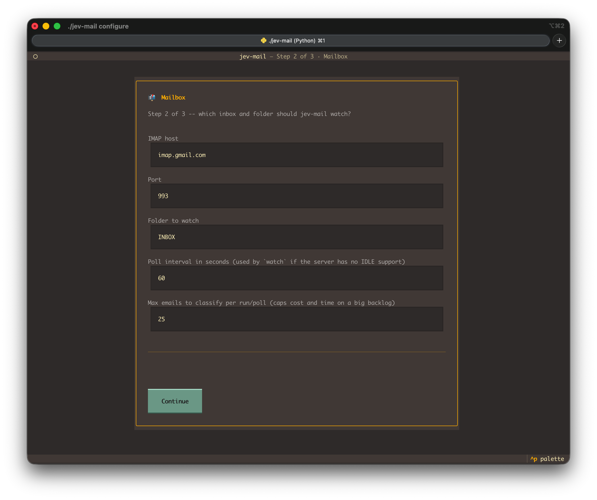</td>
<td align="center" valign="top">tidak ada media yang dipublikasikan</td>
</tr></table>

🧩 <b><a href="https://github.com/DreamBlooms/Jev-AutoLaya">DreamBlooms/Jev-AutoLaya</a></b> · ⭐2 · Python · 👁️ observed · 0 天

##### 📝 Ringkasan

One-stop automated decision modeling solution, build your own fine-tuned Laya model in under 30 minutes. | 一站式自动化领域决策模型构建方案，在 30 分钟内构建您自己的 Laya 微调模型

##### 📌 Fakta dasar

| Bidang   | Nilai         |
| -------- | ------------- |
| Kategori | `Proyek lain` |
| Bukti    | `observed`    |
| Bahasa   | Python        |

##### 📊 Data

| Metrik            | Nilai      |
| ----------------- | ---------- |
| Bintang           | **2**      |
| Push terakhir     | 2026-11-16 |
| Pertama terdaftar | 2026-11-16 |

🏷 `decision-model` · `jev` · `jev-alternative` · `jev-compatible` · `laya` · `system-one` · `system-one-model`

---

<table><tr><th align="center" width="50%">🖼 Gambar</th><th align="center" width="50%">🎬 Video</th></tr><tr>
<td align="center" valign="top"></td>
<td align="center" valign="top">tidak ada media yang dipublikasikan</td>
</tr></table>

🧩 <b><a href="https://github.com/factbag/factbag">factbag/factbag</a></b> · ⭐1 · TypeScript · 👁️ observed · 0 天

##### 📝 Ringkasan

Combine narrow judgments from System One models with explicit rules in a knowledgebase.

##### 📌 Fakta dasar

| Bidang   | Nilai         |
| -------- | ------------- |
| Kategori | `Proyek lain` |
| Bukti    | `observed`    |
| Bahasa   | TypeScript    |

##### 📊 Data

| Metrik            | Nilai      |
| ----------------- | ---------- |
| Bintang           | **1**      |
| Push terakhir     | 2026-11-17 |
| Pertama terdaftar | 2026-11-09 |

🏷 `explainability` · `jev` · `knowledge-base` · `logic` · `npm-package` · `provenance` · `rules-engine` · `system-one`

---

<table><tr><th align="center" width="50%">🖼 Gambar</th><th align="center" width="50%">🎬 Video</th></tr><tr>
<td align="center" valign="top"></td>
<td align="center" valign="top">tidak ada media yang dipublikasikan</td>
</tr></table>

🧩 <b><a href="https://github.com/jaredpalmer/kev">jaredpalmer/kev</a></b> · ⭐10034 · Python · 🔎 inferred · 2 天 · ⭐+2

##### 📝 Ringkasan

Keluarga model keputusan mirip Jev yang dibangun di atas Qwen3.5/3.8 yang dapat Anda latih dan jalankan sendiri

##### 📌 Fakta dasar

| Bidang   | Nilai         |
| -------- | ------------- |
| Kategori | `Proyek lain` |
| Bukti    | `inferred`    |
| Bahasa   | Python        |

##### 📊 Data

| Metrik            | Nilai          |
| ----------------- | -------------- |
| Bintang           | **10034** (+2) |
| Push terakhir     | 2026-11-15     |
| Pertama terdaftar | 2026-11-08     |

🏷 `decision-model` · `jev` · `qwen3`

---

<table><tr><th align="center" width="50%">🖼 Gambar</th><th align="center" width="50%">🎬 Video</th></tr><tr>
<td align="center" valign="top"></td>
<td align="center" valign="top">tidak ada media yang dipublikasikan</td>
</tr></table>

🧩 <b><a href="https://github.com/TypeLLM/TypeLLM">TypeLLM/TypeLLM</a></b> · ⭐982 · Python · 🔎 inferred · 23 天

##### 📝 Ringkasan

TypeLLM: LLMs dengan generasi yang aman terhadap tipe

##### 📌 Fakta dasar

| Bidang   | Nilai         |
| -------- | ------------- |
| Kategori | `Proyek lain` |
| Bukti    | `inferred`    |
| Bahasa   | Python        |

##### 📊 Data

| Metrik            | Nilai      |
| ----------------- | ---------- |
| Bintang           | **982**    |
| Push terakhir     | 2026-10-25 |
| Pertama terdaftar | 2026-11-08 |

🏷 `ai` · `jev` · `llms` · `types`

---

<table><tr><th align="center" width="50%">🖼 Gambar</th><th align="center" width="50%">🎬 Video</th></tr><tr>
<td align="center" valign="top">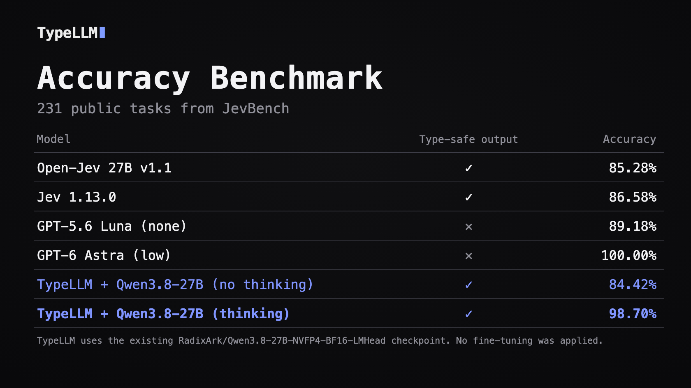</td>
<td align="center" valign="top">tidak ada media yang dipublikasikan</td>
</tr></table>

🧩 <b><a href="https://github.com/AgriciDaniel/jev-seo">AgriciDaniel/jev-seo</a></b> · ⭐978 · Python · 🔎 inferred · 56 天 · ⭐+6

##### 📝 Ringkasan

Audit SEO langsung untuk situs web apa pun dari satu URL beranda, dinilai oleh Jev. Laporan PDF, XLSX, dan Markdown.

##### 📌 Fakta dasar

| Bidang   | Nilai         |
| -------- | ------------- |
| Kategori | `Proyek lain` |
| Bukti    | `inferred`    |
| Bahasa   | Python        |

##### 📊 Data

| Metrik            | Nilai        |
| ----------------- | ------------ |
| Bintang           | **978** (+6) |
| Push terakhir     | 2026-09-22   |
| Pertama terdaftar | 2026-11-08   |

---

<table><tr><th align="center" width="50%">🖼 Gambar</th><th align="center" width="50%">🎬 Video</th></tr><tr>
<td align="center" valign="top">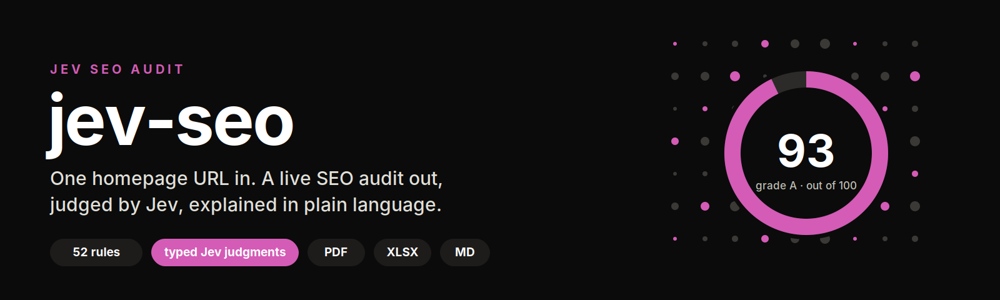</td>
<td align="center" valign="top">tidak ada media yang dipublikasikan</td>
</tr></table>

<b>Lainnya di kategori ini</b> · 69

- [DreamBlooms/dohnuts.cpp](https://github.com/DreamBlooms/dohnuts.cpp) - Keputusan yang sama, pada CPU. Model System One yang dapat dijalankan di…
- [SoundBlaster/SwiftJev](https://github.com/SoundBlaster/SwiftJev) - Framework Swift untuk mengakses model Jev System One oleh TypeSafe.ai.
- [codaaiteam/jev-ai](https://github.com/codaaiteam/jev-ai) - Jev AI quickstart &amp; FAQ — TypeSafe AI.
- [soderlind/ai-provider-for-jev](https://github.com/soderlind/ai-provider-for-jev) - Hubungkan WordPress ke model System One Jev milik TypeSafe untuk keputusan…
- [pavanjava/system-one-model-from-scratch](https://github.com/pavanjava/system-one-model-from-scratch)
- [DreamBlooms/ifReflex.cpp](https://github.com/DreamBlooms/ifReflex.cpp) - Apa pun LLM dapat berfungsi sebagai model keputusan SystemOne di Komputer…
- [gaon12/sysone_trans](https://github.com/gaon12/sysone_trans) - Is it possible system one model to translate?
- [breadn03/system_one_gtav](https://github.com/breadn03/system_one_gtav) - Improving GTA V using System One Models.
- [DevItaliya22/jev-chess](https://github.com/DevItaliya22/jev-chess) - Jev.
- [jmschnei/n4c-decision-broker](https://github.com/jmschnei/n4c-decision-broker) - Confidence-governed decision broker over local Ollama System One models…
- [oneryalcin/hunch](https://github.com/oneryalcin/hunch) - dbt for judgments: declarative, tested, versioned semantic decisions powered by…
- [scholarly360/Microsoft-Decision-1-on-Microsoft-Foundry](https://github.com/scholarly360/Microsoft-Decision-1-on-Microsoft-Foundry) - Microsoft Decision-1 System One Model on Microsoft Foundry.
- [SodaZheng/system-one-model](https://github.com/SodaZheng/system-one-model)
- [unbraind/pm-jev](https://github.com/unbraind/pm-jev) - Keputusan bertipe dan mengutamakan lokal untuk item pm dengan model System One…
- [feder-cr/jev](https://github.com/feder-cr/jev) - jevos: alternatif sumber terbuka untuk Jev dan Microsoft-Decision-1.
- [shengjidaguai-china/goutoujunshi-jev-chat](https://github.com/shengjidaguai-china/goutoujunshi-jev-chat) - 狗头军师 Chat: pembacaan layar WeChat di Mac, analisis hubungan, dan jendela…
- [Sac-Y/Jev-cu](https://github.com/Sac-Y/Jev-cu)
- [TianyuCodings/JevHarness](https://github.com/TianyuCodings/JevHarness) - Harness LLM-buatan Jev khusus tugas dengan refleksi imbalan lintasan penuh…
- [jev-chat/jev-chat-jarvis-mac](https://github.com/jev-chat/jev-chat-jarvis-mac) - Asisten jendela mengambang untuk obrolan (macOS): persepsi layar + model kecil…
- [Yinsongxu/LLM2Jev](https://github.com/Yinsongxu/LLM2Jev) - Ubah model bahasa lokal menjadi model keputusan terstruktur bergaya Jev.
- [Zefan-Cai/Open-Jev](https://github.com/Zefan-Cai/Open-Jev)
- [dabit3/jev-experiments](https://github.com/dabit3/jev-experiments)
- [1Panel-dev/laya-server](https://github.com/1Panel-dev/laya-server) - API yang di-host sendiri dan antarmuka web untuk model keputusan terstruktur…
- [Abhinavexists/lev](https://github.com/Abhinavexists/lev) - Model keputusan System One terbuka.
- [2951461586/Jev-Register-Tool](https://github.com/2951461586/Jev-Register-Tool) - Alat rantai lengkap untuk pengajuan TypeSafe（Jev / System One） → konfirmasi…
- [I-You-Dream/jev-from-scratch](https://github.com/I-You-Dream/jev-from-scratch) - 从零开源复刻 Jev（System One）决策模型范式，基于 Qwen 基座训练，支持 Choice / Noul 原语，包含推理、微调、ECE…
- [Jev-Engineering/cookbook](https://github.com/Jev-Engineering/cookbook) - Enam puluh resep notebook untuk keputusan bertipe dengan Jev: pola Choice…
- [yijunyu/jev-rs](https://github.com/yijunyu/jev-rs) - Penilaian System One (noul/choice/score) dari LLM apa pun dalam satu prefill…
- [nvkudva/ollajev](https://github.com/nvkudva/ollajev) - Jalankan model keputusan System One dari Hugging Face secara lokal di belakang…
- [Kevthetech143/super-jev](https://github.com/Kevthetech143/super-jev) - A small, extensible decision-to-action harness for TypeSafe Jev.
- [manifoldor/xtags](https://github.com/manifoldor/xtags) - Pada linimasa X, tandai untuk setiap postingan apa yang ingin ia membuat Anda…
- [botassembly/thinkthen](https://github.com/botassembly/thinkthen) - ThinkThen: kode yang memahami maksud Anda.
- [rawwerks/one-system](https://github.com/rawwerks/one-system) - Gunakan classifier lokal dan yang di-host, alias model keputusan, alias model…
- [comoc/jev-minesweeper](https://github.com/comoc/jev-minesweeper) - Demo yang membuat TypeSafe Jev (System One) menyelesaikan Minesweeper di browser.
- [XingQiPan/rwkv-jev](https://github.com/XingQiPan/rwkv-jev) - Mesin keputusan zero-generation bergaya Jev berbasis RWKV-7 (g1k-1b): membaca…
- [yamadashy/jev-labeler-action](https://github.com/yamadashy/jev-labeler-action) - Zero-config AI issue labeling with TypeSafe.
- [zfkarl/MedJev](https://github.com/zfkarl/MedJev) - MedJev: A System One Vision-Language Decision Model for Fast and Effective…
- [scalefreegan/jev-ants](https://github.com/scalefreegan/jev-ants) - Ants that form your picture, one Jev decision at a time.
- [binary-husky/qwen-jev-rsi](https://github.com/binary-husky/qwen-jev-rsi) - System One RSI for True Realtime Control.
- [boxxxie/jev_dsl](https://github.com/boxxxie/jev_dsl) - Compile-time contract DSL, two-tier content-addressed cache, and execution…
- [cfu288/jev-vs-ml-classifiers](https://github.com/cfu288/jev-vs-ml-classifiers) - Seberapa baik model JEV terbaru dibandingkan dengan model pengklasifikasi ML…
- [comchatx/cx-jev-tidy](https://github.com/comchatx/cx-jev-tidy) - Lets cx clear old step results, but keep every word written.
- [coredweller/MonsterJevActionalizer](https://github.com/coredweller/MonsterJevActionalizer) - Dungeons and Dragons (D&amp;D) Monster decision maker given certain parameters and…
- [demirfahrieren-png/jev-canli-sonuclar](https://github.com/demirfahrieren-png/jev-canli-sonuclar) - Jev canlı sanal işlem sonuçları (sunucu her gün günceller; gerçek emir yok).
- [engkimo/scikit-jev](https://github.com/engkimo/scikit-jev) - Probability-preserving scikit-learn estimators for TypeSafe System One and Jev.
- [GitHubxyhhhh/jev-lab-support](https://github.com/GitHubxyhhhh/jev-lab-support) - Public support and privacy pages for Jev Lab by XYH.
- [jadeforrest/jev-utilities](https://github.com/jadeforrest/jev-utilities) - Small helpers for categorizing data with TypeSafe.
- [keyanwu256-eng/Jev-Korean-Sentiment-Analysis](https://github.com/keyanwu256-eng/Jev-Korean-Sentiment-Analysis) - Jev를 활용한 한국어 혼합 감성 리뷰 분류 및 판단 기준 비교 프로젝트.
- [lawsirlawsir-png/jev-holdem](https://github.com/lawsirlawsir-png/jev-holdem) - Heads-up no-limit Texas hold.
- [LiLittleCat/jev-playlist-classify](https://github.com/LiLittleCat/jev-playlist-classify) - Klasifikasikan playlist besar berdasarkan bahasa lagu dengan model Jev terbaru…
- [mission-control-panel/jev-tic-tac-toe](https://github.com/mission-control-panel/jev-tic-tac-toe) - React Tic-Tac-Toe powered by TypeSafe Jev System One decisions.
- [mwmw7/typesafe-jev-handson](https://github.com/mwmw7/typesafe-jev-handson) - 공군 AI 교육용 TypeSafe Jev 핸즈온: 레이더에 뭔가 잡혔다! 전투기를 띄워야 할까?
- [nextking12/jev-job-ranker](https://github.com/nextking12/jev-job-ranker) - Config-driven Jev (TypeSafe) job ranker template: rank N postings against one…
- [nwang783/jev-sigma-bench](https://github.com/nwang783/jev-sigma-bench) - Preliminary experiment: can the Jev decision model stand in for Sigma rules on…
- [O8pen/jev-atlas](https://github.com/O8pen/jev-atlas) - Jev Atlas: a wiki-style atlas of everything built with Jev and other decision…
- [PineappleBingo/jev-radar](https://github.com/PineappleBingo/jev-radar) - TypeSafe Jev 오픈소스 구현을 매일 모아 한국어로 정리하는 레이더 (radar-index/1).
- [Shijiuwei/apex-jev-chat-jarvis](https://github.com/Shijiuwei/apex-jev-chat-jarvis) - The chat decision assistant: before you reply, Jev reads the chat, judges…
- [receptron/laya](https://github.com/receptron/laya) - Jalankan Laya, model keputusan System-1 sumber terbuka yang kompatibel dengan…
- [Rizzo-AI-Academy/rizzo-flow](https://github.com/Rizzo-AI-Academy/rizzo-flow) - Pendekatan terbuka dan lokal untuk Jev: keputusan bertipe dari LLM, tanpa…
- [jerryjliu/docjev](https://github.com/jerryjliu/docjev) - Pengklasifikasi/pemisah dokumen yang sangat cepat menggunakan Jev.
- [PostHog/jeeves](https://github.com/PostHog/jeeves) - Jeeves – Penalaran meningkatkan model keputusan mirip Jev.
- [codejunkie99/keel](https://github.com/codejunkie99/keel) - Ruang kerja pemrograman macOS yang mengutamakan lokal dengan Laya lokal dan…
- [peterfriese/system-one-foundation-models](https://github.com/peterfriese/system-one-foundation-models) - Jembatan Swift 6 native yang ringan, mengintegrasikan model keputusan Jev…
- [iapp-technology/openthai-systemone](https://github.com/iapp-technology/openthai-systemone) - OpenThai-SystemOne: model keputusan System One terbuka berbahasa Thai + English…
- [spring-ai-community/spring-ai-typesafe](https://github.com/spring-ai-community/spring-ai-typesafe) - Archived: moved to Spring AI and Spring AI Decision Extensions.
- [hawkymisc/typed-decision-bert](https://github.com/hawkymisc/typed-decision-bert) - PoC tidak resmi: mesin keputusan encoder bergaya BERT di balik HTTP API…
- [InterfazeAI/lev](https://github.com/InterfazeAI/lev) - Model keputusan System One terbuka.
- [epergaboni/jevseo](https://github.com/epergaboni/jevseo) - Penilaian SEO, AEO, dan GEO bertipe yang didukung oleh Jev, model keputusan…
- [Temikus/lgtm](https://github.com/Temikus/lgtm) - Score pull requests with System One decision models.

## Proyek menurut bahasa implementasi

Ekosistem ini terkonsentrasi pada Python dan TypeScript, tetapi klien bertipe terus muncul dalam bahasa lain. Tabel ini dihasilkan dari entri itu sendiri.

| Bahasa     | Entri | Contoh                                                                                                  |
| ---------- | ----- | ------------------------------------------------------------------------------------------------------- |
| Python     | 362   | `typesafe-ai/system-one-adapter-python`, `typesafe-ai/typesafe-sdk-python`, `typesafe-ai/WorkflowEvals` |
| TypeScript | 139   | `typesafe-ai/typesafe-sdk-js`, `erik-hedstrom/loadout`, `dzhng/jevgrep`                                 |
| JavaScript | 72    | `clouatre-labs/decisions-judge-mcp`, `chrismarchant/jev-router`, `Ying-Kai-Liao/jev-browser`            |
| HTML       | 33    | `typesafe-ai/typesafe-ai.github.io`, `AkashPriyadarshii/jev-superpowers`, `yzfly/awesome-jev-zh`        |
| Rust       | 32    | `ollaya-dev/ollaya`, `AkashPriyadarshii/jev-curate`, `chussenot/judgment`                               |
| Jupyter    | 15    | `jexp/neo4jev`, `GitHub30/OpenJev`, `Query-farm/vgi-typesafe`                                           |
| Go         | 13    | `rcarmo/go-system-one`, `devbackend/jevgo`, `JimmyWesley/rlcd-gateway`                                  |
| C#         | 10    | `CMaintz/jev-dotnet`, `saibimajdi/typesafeai-dotnet-sdk`, `TraxSharp/Trax`                              |
| Elixir     | 6     | `dannote/jev`, `Elue-dev/jev_elixir`, `nshkrdotcom/system_one_sdk`                                      |
| Java       | 6     | `Premo-Cloud/typesafe-sdk-java`, `CMaintz/jev-java`, `Nisaka520/JevIntent`                              |
| PHP        | 5     | `Butochnikov/laravel-typesafe-jev`, `phoenix1331/laravel-jev-hotdog`, `nosial/FederationJevGuard`       |
| Swift      | 4     | `john-rocky/coreai-kit`, `mattt/AnyDecisionModel`, `SoundBlaster/SwiftJev`                              |
| C++        | 3     | `DreamBlooms/dohnuts.cpp`, `DreamBlooms/ifReflex.cpp`, `feder-cr/jev`                                   |
| CSS        | 3     | `yangzhou-chaofan/awesome-jev-prompt`, `Dlmily/minimind-jev-dlmily`, `O8pen/jev-atlas`                  |
| PowerShell | 3     | `BFLabsAI/bf-jev-deep-research`, `dfinke/Jev`, `huntsman95/PowerJev`                                    |
| Astro      | 2     | `heyjunpenn/awesome-jev`, `wizicer/jev_info_site`                                                       |
| C          | 2     | `CheshiAI/Cheshi`, `lijiawei255/jev-tune`                                                               |
| Kotlin     | 2     | `MiaoWuNYA/rikkahub-sillytavern-android`, `jev-chat/jev-chat-jarvis`                                    |
| Ruby       | 2     | `obie/ruby_decision_model`, `Ray-Hughes/jevalyn`                                                        |
| Shell      | 2     | `realZachi/pg-jev`, `skylence-org/claudecode-jev-marketplace`                                           |
| TeX        | 2     | `dnakhoa/jev-deferred-crispification`, `xiaohuiyan/awesome-jev-papers`                                  |
| XS         | 2     | `cameronb-xano/jev-agent-guardrail`, `xano-community/agent-guardrail-jev`                               |
| Haskell    | 1     | `getmissionctrl/hs-jev`                                                                                 |
| Nushell    | 1     | `cablehead/jev.nu`                                                                                      |
| Pascal     | 1     | `danieleteti/systemone-delphi`                                                                          |

Hanya entri yang menyatakan bahasa yang dihitung. Entri infrastruktur, dokumentasi, dan diskusi dikecualikan dari tabel ini.

## Berkontribusi

Koreksi diterima dengan baik dan merupakan cara tercepat untuk memperbaiki daftar ini. Buka issue atau pull request jika sebuah entri salah kategori, salah tingkat, atau jika sebuah proyek keliru dikecualikan sebagai tabrakan nama — kategori terakhir itulah tempat filter otomatis paling mungkin salah. Cara terbaik menambah entri adalah menambahkan sumber ke `scripts/collect.py`, bukan menyunting README, karena README diregenerasi setiap siklus.

---

Proyek komunitas independen. Tidak berafiliasi dengan, tidak didukung oleh, dan tidak ditinjau oleh TypeSafe AI. Perilaku produk, harga, batas, dan alias model dapat berubah tanpa pemberitahuan; verifikasi segala hal yang penting terhadap dokumentasi resmi. Aset tetap milik proyek hulunya dan hanya direproduksi bila lisensi mengizinkan.

Dibuat oleh · 2026-11-17T22:19:43+08:00
