

  

<h1 align="center">Awesome Jev Live</h1>

<b>Indeks Jev bertingkat bukti yang membangun ulang dirinya setiap dua jam.</b>

  
  
  
  
  
  

<a href="../README.md">English</a> · <a href="README.zh-CN.md">简体中文</a> · <a href="README.zh-TW.md">繁體中文</a> · <a href="README.ja.md">日本語</a> · <a href="README.ko.md">한국어</a> · <a href="README.es.md">Español</a> · <a href="README.fr.md">Français</a> · <a href="README.de.md">Deutsch</a> · <a href="README.pt-BR.md">Português (Brasil)</a> · <a href="README.ru.md">Русский</a> · <a href="README.it.md">Italiano</a> · <a href="README.ar.md">العربية</a> · <a href="README.hi.md">हिन्दी</a> · <a href="README.tr.md">Türkçe</a> · <a href="README.vi.md">Tiếng Việt</a> · <a href="README.th.md">ไทย</a> · <b>Bahasa Indonesia</b> · <a href="README.pl.md">Polski</a> · <a href="README.nl.md">Nederlands</a> · <a href="README.uk.md">Українська</a>

> [!NOTE]
> **Indeks langsung** · Sinkronisasi terakhir: `2026-11-06T00:18:18+08:00` (UTC+8)
> · Entri: **705** · Baru pada siklus ini: **24** · Bahasa implementasi: **26**

Setiap entri di bawah ini dikumpulkan, disaring, dan diperiksa ulang oleh pipeline di repositori ini. Angka dan stempel waktu berasal dari sumbernya, bukan dari cuplikan yang ditulis tangan.

## 🔥 Pilihan saat ini — peringkat pertama tiap kategori

Satu entri per kategori, diurutkan berdasarkan tingkat bukti dan bintang, dihitung ulang setiap sinkronisasi. Ini peringkat, bukan rekomendasi; setiap pilihan menaut ke kartu lengkapnya di bawah. Proyek yang telah menerbitkan tangkapan layar atau rekaman lebih diutamakan agar bagian ini tetap visual.

<table>
<tr>
<td width="50%" valign="top">
<b>🏛️ <a href="https://github.com/typesafe-ai/skills">typesafe-ai/skills</a></b>
⭐2877 · ✅ official
Keahlian agen untuk membangun dengan TypeSafe System One API
</td>
<td width="50%" valign="top">

<b>🧰 <a href="https://github.com/john-rocky/coreai-kit">john-rocky/coreai-kit</a></b>
⭐123 · Swift · 👁️ observed
Swift SDK untuk menjalankan model chat, vision, dan speech di iPhone dan Mac dengan Core AI Apple. Pengunduhan dan caching model, integrasi FoundationModels, serta…
</td>
</tr>
<tr>
<td width="50%" valign="top">

<b>🤖 <a href="https://github.com/Bodila51/grok-bot-jev">Bodila51/grok-bot-jev</a></b>
⭐130 · Python · 👁️ observed
Hubungkan TypeSafe Jev ke Grok Bot sebagai lapisan keputusan murah - gerbang penggunaan, templat skill, contoh
</td>
<td width="50%" valign="top">

<b>🛡️ <a href="https://github.com/dharmeshgurnani/CodeOtter">dharmeshgurnani/CodeOtter</a></b>
⭐3 · JavaScript · 👁️ observed
Tinjauan kode AI otonom dan di-host sendiri, pengukur skor terkalibrasi, serta gerbang merge dari model terbuka apa pun.
</td>
</tr>
<tr>
<td width="50%" valign="top">

<b>🧪 <a href="https://github.com/Mapika/decider">Mapika/decider</a></b>
⭐1077 · Python · 👁️ observed
Keluarga model bergaya System One yang di-fine-tune dari Qwen3.5, dirancang untuk keputusan bertipe satu lintasan dengan probabilitas terkalibrasi.
</td>
<td width="50%" valign="top">

<b>🔬 <a href="https://github.com/r-ms/mini-jev">r-ms/mini-jev</a></b>
⭐61 · Python · 🔎 inferred
mini-Jev: seperti apa antarmuka keputusan bertipe bergaya Jev pada Qwen3-4B yang dibekukan — baca logit huruf opsi alih-alih menghasilkan JSON. Eksperimen yang telah…
</td>
</tr>
<tr>
<td width="50%" valign="top">

<b>🎮 <a href="https://github.com/superagents-lab/jev-search">superagents-lab/jev-search</a></b>
⭐553 · TypeScript · 👁️ observed
Cari di web dengan Jev milik TypeSafe: pemilihan sumber, pemahaman kueri, dan pemeringkatan relevansi. Dibangun dengan Search1API.
</td>
<td width="50%" valign="top">
<b>📰 <a href="https://docs.typesafe.ai/model-jaggedness/jev-1.13">9 jenis cacat yang diketahui (jaggedness)</a></b>
⭐0 · ✅ official
Pemahaman literal, **penghitungan tidak andal**, perbandingan tanggal, indireksi bertingkat, state besar dengan detail tidak relevan, konten adversarial, instruksi…
</td>
</tr>
</table>

## Daftar isi

- [Apa itu Jev?](#apa-itu-jev)
- [Cara entri dinilai](#cara-entri-dinilai)
- [SDK resmi dan alat pengembang](#sdk-resmi-dan-alat-pengembang) — **8**
- [Klien, SDK, dan adapter komunitas](#klien-sdk-dan-adapter-komunitas) — **126**
- [Perkakas agen: MCP, hook, gate, dan agen pengkodean](#perkakas-agen-mcp-hook-gate-dan-agen-pengkodean) — **203**
- [Perutean, guardrail, dan persetujuan](#perutean-guardrail-dan-persetujuan) — **56**
- [Evaluasi, kalibrasi, dan benchmark](#evaluasi-kalibrasi-dan-benchmark) — **86**
- [Reproduksi terbuka, bobot, dan riset arsitektur](#reproduksi-terbuka-bobot-dan-riset-arsitektur) — **52**
- [Aplikasi, game, robotika, dan demo interaktif](#aplikasi-game-robotika-dan-demo-interaktif) — **37**
- [Tulisan, diskusi, dan daftar sejenis](#tulisan-diskusi-dan-daftar-sejenis) — **80**
- [Proyek lain](#proyek-lain) — **57**
- [Proyek menurut bahasa implementasi](#proyek-menurut-bahasa-implementasi)

## Apa itu Jev?

Jev adalah **System One model** pertama dari TypeSafe AI. Ia tidak menulis prosa. Ia menerima sebuah state plus pertanyaan yang ruang jawabannya Anda tentukan sebelumnya, lalu mengembalikan nilai bertipe dengan distribusi probabilitas yang dapat dicabang oleh kode Anda.

|                            |                                                                                                                                                                                                                                       |
| -------------------------- | ------------------------------------------------------------------------------------------------------------------------------------------------------------------------------------------------------------------------------------- |
| **Bentuk**                 | `state + typed questions` → `constrained answers + probabilities` → `your code`                                                                                                                                                       |
| **Primitif**               | `Choice` (pilih satu dari ≤255 opsi), `Score` (rubrik 2–10), `Noul` (ya/tidak yang probabilistik)                                                                                                                                     |
| **Endpoint**               | `POST https://api.typesafe.ai/v1/systemone`, model `jev-1.13.0` / alias `jev-latest`                                                                                                                                                  |
| **Cocok untuk**            | perutean, triase, penilaian, moderasi, verifikasi, dan gate berlatensi rendah di dalam alur kerja yang terbatas                                                                                                                       |
| **Batasan yang diketahui** | penghitungan tidak dapat diandalkan, indireksi bertingkat lemah, dan materi resmi menyebut sembilan kelas ketidakteraturan. Keluaran yang valid secara skema bukan berarti keputusan yang benar — kalibrasi dengan data Anda sendiri. |

## Cara entri dinilai

Sebagian besar daftar di bidang ini mengklaim telah memuatnya. Daftar ini menyatakan seberapa banyak yang benar-benar diverifikasi, lalu membiarkan Anda menyaring sesuai itu.

| Tingkat      | Artinya                                                                                                                                                          |
| ------------ | ---------------------------------------------------------------------------------------------------------------------------------------------------------------- |
| `official`   | Diterbitkan oleh TypeSafe AI sendiri.                                                                                                                            |
| `observed`   | Artefak publik yang dapat dibuka dan dibaca — kode sumber nyata, konfigurasi nyata, atau pernyataan TypeSafe/Jev yang eksplisit pada nama atau topik repositori. |
| `inferred`   | Cocok berdasarkan sinyal ambigu ditambah kosakata pendukung, tetapi belum dibaca baris demi baris.                                                               |
| `unverified` | Tampak terkait, tidak ada yang dikonfirmasi secara independen. Didaftarkan hanya untuk penemuan.                                                                 |

## SDK resmi dan alat pengembang

Semua yang diterbitkan TypeSafe sendiri. Mulai dari sini.

🏛️ <b><a href="https://github.com/typesafe-ai/skills">typesafe-ai/skills</a></b> · ⭐2877 · ✅ official · 12 天 · ⭐+1

##### 📝 Ringkasan

Keahlian agen untuk membangun dengan TypeSafe System One API

> 💡 Keahlian agen milik vendor itu sendiri. Karena terus diperbarui, ini adalah hal yang paling mendekati spesifikasi tentang bagaimana TypeSafe ingin Jev dikendalikan dari agen.

##### 📌 Fakta dasar

| Bidang   | Nilai                           |
| -------- | ------------------------------- |
| Kategori | `SDK resmi dan alat pengembang` |
| Bukti    | `official`                      |

##### 📊 Data

| Metrik            | Nilai         |
| ----------------- | ------------- |
| Bintang           | **2877** (+1) |
| Push terakhir     | 2026-10-23    |
| Pertama terdaftar | 2026-09-18    |

🏛️ <b><a href="https://github.com/typesafe-ai/system-one-adapter-python">typesafe-ai/system-one-adapter-python</a></b> · ⭐407 · Python · ✅ official · 44 天

##### 📝 Ringkasan

Pengganti TypeSafeClient drop-in yang didukung oleh LLM APIs

> 💡 Pengganti drop-in yang mendukung antarmuka yang sama dengan penyedia LLM biasa. Ini adalah cara jujur untuk melakukan A/B keputusan bertipe terhadap prompt, pada data Anda sendiri, sebelum berkomitmen pada salah satunya.

🔧 Ditemukan dipakai dalam kode: `README.md`

##### 📌 Fakta dasar

| Bidang   | Nilai                           |
| -------- | ------------------------------- |
| Kategori | `SDK resmi dan alat pengembang` |
| Bukti    | `official`                      |
| Bahasa   | Python                          |

##### 📊 Data

| Metrik            | Nilai      |
| ----------------- | ---------- |
| Bintang           | **407**    |
| Push terakhir     | 2026-09-22 |
| Pertama terdaftar | 2026-10-23 |

🏛️ <b><a href="https://github.com/typesafe-ai/typesafe-sdk-python">typesafe-ai/typesafe-sdk-python</a></b> · ⭐308 · Python · ✅ official · 21 天

##### 📝 Ringkasan

Pustaka Python resmi untuk TypeSafe API

> 💡 Klien sinkron dan asinkron. Jalur tercepat dari kunci API ke keputusan bertipe, dan referensi yang menjadi pembanding klien komunitas.

🔧 Ditemukan dipakai dalam kode: `README.md`

##### 📌 Fakta dasar

| Bidang   | Nilai                           |
| -------- | ------------------------------- |
| Kategori | `SDK resmi dan alat pengembang` |
| Bukti    | `official`                      |
| Bahasa   | Python                          |

##### 📊 Data

| Metrik            | Nilai      |
| ----------------- | ---------- |
| Bintang           | **308**    |
| Push terakhir     | 2026-10-14 |
| Pertama terdaftar | 2026-10-23 |

🏛️ <b><a href="https://github.com/typesafe-ai/typesafe-sdk-js">typesafe-ai/typesafe-sdk-js</a></b> · ⭐284 · TypeScript · ✅ official · 21 天

##### 📝 Ringkasan

Pustaka TypeScript/JavaScript resmi untuk TypeSafe API

> 💡 Klien TypeScript di mana tipe jawaban disimpulkan dari pertanyaan yang Anda ajukan, sehingga tipe kembalian yang tidak cocok menjadi kesalahan kompilasi alih-alih kejutan saat runtime.

##### 📌 Fakta dasar

| Bidang   | Nilai                           |
| -------- | ------------------------------- |
| Kategori | `SDK resmi dan alat pengembang` |
| Bukti    | `official`                      |
| Bahasa   | TypeScript                      |

##### 📊 Data

| Metrik            | Nilai      |
| ----------------- | ---------- |
| Bintang           | **284**    |
| Push terakhir     | 2026-10-14 |
| Pertama terdaftar | 2026-10-23 |

🏛️ <b><a href="https://github.com/TypeSafeAI/jev-harness">TypeSafeAI/jev-harness</a></b> · ⭐38 · TypeScript · ✅ official · 2 天

##### 📝 Ringkasan

A custom coding harness for TypeSafe AI's Jev: an LLM proposes, Jev answers narrow questions, code decides, every step leaves a receipt.

##### 📌 Fakta dasar

| Bidang   | Nilai                           |
| -------- | ------------------------------- |
| Kategori | `SDK resmi dan alat pengembang` |
| Bukti    | `official`                      |
| Bahasa   | TypeScript                      |

##### 📊 Data

| Metrik            | Nilai      |
| ----------------- | ---------- |
| Bintang           | **38**     |
| Push terakhir     | 2026-11-03 |
| Pertama terdaftar | 2026-11-03 |

🏷 `agent-harness` · `agentic-coding` · `ai-agents` · `ai-governance` · `ai-safety` · `code-review` · `coding-agent` · `developer-tools`

🏛️ <b><a href="https://github.com/typesafe-ai/WorkflowEvals">typesafe-ai/WorkflowEvals</a></b> · ⭐21 · Python · ✅ official · 36 天

##### 📝 Ringkasan

kode workflow evals.typesafe.ai dipublikasikan

##### 📌 Fakta dasar

| Bidang   | Nilai                           |
| -------- | ------------------------------- |
| Kategori | `SDK resmi dan alat pengembang` |
| Bukti    | `official`                      |
| Bahasa   | Python                          |

##### 📊 Data

| Metrik            | Nilai      |
| ----------------- | ---------- |
| Bintang           | **21**     |
| Push terakhir     | 2026-09-29 |
| Pertama terdaftar | 2026-10-23 |

🏛️ <b><a href="https://github.com/typesafe-ai/typesafe-ai.github.io">typesafe-ai/typesafe-ai.github.io</a></b> · ⭐2 · HTML · ✅ official · 154 天

##### 📝 Ringkasan

Tidak ada deskripsi hulu yang dipublikasikan.

##### 📌 Fakta dasar

| Bidang   | Nilai                           |
| -------- | ------------------------------- |
| Kategori | `SDK resmi dan alat pengembang` |
| Bukti    | `official`                      |
| Bahasa   | HTML                            |

##### 📊 Data

| Metrik            | Nilai      |
| ----------------- | ---------- |
| Bintang           | **2**      |
| Push terakhir     | 2026-06-04 |
| Pertama terdaftar | 2026-10-23 |

🏛️ <b><a href="https://github.com/laurentkempe/TypeSafeJevPlayground">laurentkempe/TypeSafeJevPlayground</a></b> · ⭐8 · C# · 🔎 inferred · 1 天 · **NEW**

##### 📝 Ringkasan

TypeSafe Jev Playground - idiomatic .NET port of typesafe-ai/typesafe-sdk-js v0.7.0

##### 📌 Fakta dasar

| Bidang   | Nilai                           |
| -------- | ------------------------------- |
| Kategori | `SDK resmi dan alat pengembang` |
| Bukti    | `inferred`                      |
| Bahasa   | C#                              |

##### 📊 Data

| Metrik            | Nilai      |
| ----------------- | ---------- |
| Bintang           | **8**      |
| Push terakhir     | 2026-11-03 |
| Pertama terdaftar | 2026-11-05 |

🏷 `ai` · `csharp` · `dotnet` · `jev` · `jev-model` · `typesafe` · `typesafe-ai`

## Klien, SDK, dan adapter komunitas

Klien bertipe untuk endpoint System One, dalam sebanyak mungkin bahasa yang sempat dikerjakan komunitas.

🧰 <b><a href="https://github.com/jexp/neo4jev">jexp/neo4jev</a></b> · ⭐181 · Jupyter · 👁️ observed · 48 天 · ⭐-1

##### 📝 Ringkasan

System One Model Typesafe.ai Jev yang menavigasi graf Neo4j dengan menggunakan pengklasifikasi pada hubungan tetangga

##### 📌 Fakta dasar

| Bidang   | Nilai                               |
| -------- | ----------------------------------- |
| Kategori | `Klien, SDK, dan adapter komunitas` |
| Bukti    | `observed`                          |
| Bahasa   | Jupyter                             |

##### 📊 Data

| Metrik            | Nilai        |
| ----------------- | ------------ |
| Bintang           | **181** (-1) |
| Push terakhir     | 2026-09-18   |
| Pertama terdaftar | 2026-10-28   |

🧰 <b><a href="https://github.com/keltokhy/jgrep">keltokhy/jgrep</a></b> · ⭐140 · Python · 👁️ observed · 19 天

##### 📝 Ringkasan

grep, tetapi polanya adalah deskripsi. Memfilter baris berdasarkan makna dengan model keputusan TypeSafe Jev: ~200 ms dan seperseribu sen per baris.

🔧 Ditemukan dipakai dalam kode: `README.md`

##### 📌 Fakta dasar

| Bidang   | Nilai                               |
| -------- | ----------------------------------- |
| Kategori | `Klien, SDK, dan adapter komunitas` |
| Bukti    | `observed`                          |
| Bahasa   | Python                              |

##### 📊 Data

| Metrik            | Nilai      |
| ----------------- | ---------- |
| Bintang           | **140**    |
| Push terakhir     | 2026-10-17 |
| Pertama terdaftar | 2026-10-29 |

🏷 `cli` · `grep` · `jev` · `openrouter` · `semantic-search` · `typesafe`

🧰 <b><a href="https://github.com/qkal/Canny">qkal/Canny</a></b> · ⭐132 · TypeScript · 👁️ observed · 43 天 · ⭐-1

##### 📝 Ringkasan

Mencegah agen coding AI mengklaim pekerjaan selesai tanpa bukti. Hook deterministik membuat keputusan, TypeSafe Jev memberikan saran. Ledger append-only, tanpa dependensi runtime.

🔧 Ditemukan dipakai dalam kode: `README.md`

##### 📌 Fakta dasar

| Bidang   | Nilai                               |
| -------- | ----------------------------------- |
| Kategori | `Klien, SDK, dan adapter komunitas` |
| Bukti    | `observed`                          |
| Bahasa   | TypeScript                          |

##### 📊 Data

| Metrik            | Nilai        |
| ----------------- | ------------ |
| Bintang           | **132** (-1) |
| Push terakhir     | 2026-09-22   |
| Pertama terdaftar | 2026-10-29   |

🏷 `agent-hooks` · `ai-agents` · `claude-code` · `claude-code-hooks` · `codex` · `codex-cli` · `guardrails` · `jev`

🧰 <b><a href="https://github.com/john-rocky/coreai-kit">john-rocky/coreai-kit</a></b> · ⭐123 · Swift · 👁️ observed · 0 天

##### 📝 Ringkasan

Swift SDK untuk menjalankan model chat, vision, dan speech di iPhone dan Mac dengan Core AI Apple. Pengunduhan dan caching model, integrasi FoundationModels, serta contoh yang dapat dijalankan dengan persyaratan OS, SDK, dan model yang terdokumentasi.

🔧 Ditemukan dipakai dalam kode: `Sources/CoreAIOps/CoreAI+SystemOne.swift`

##### 📌 Fakta dasar

| Bidang   | Nilai                               |
| -------- | ----------------------------------- |
| Kategori | `Klien, SDK, dan adapter komunitas` |
| Bukti    | `observed`                          |
| Bahasa   | Swift                               |

##### 📊 Data

| Metrik            | Nilai      |
| ----------------- | ---------- |
| Bintang           | **123**    |
| Push terakhir     | 2026-11-05 |
| Pertama terdaftar | 2026-10-26 |

🏷 `apple` · `apple-core-ai` · `asr` · `core-ai` · `coreai` · `foundation-models` · `ios` · `ios-27`

---

<table><tr><th align="center" width="50%">🖼 Gambar</th><th align="center" width="50%">🎬 Video</th></tr><tr>
<td align="center" valign="top"></td>
<td align="center" valign="top"> rekaman bergerak</td>
</tr></table>

🧰 <b><a href="https://github.com/yzfly/awesome-jev-zh">yzfly/awesome-jev-zh</a></b> · ⭐89 · HTML · 👁️ observed · 0 天

##### 📝 Ringkasan

Daftar pilihan Jev / TypeSafe System One dalam bahasa Tionghoa: materi resmi, SDK, aplikasi populer, alat Agent, reproduksi sumber terbuka, dan ulasan independen, dilengkapi panduan memulai dalam bahasa Tionghoa, serta secara otomatis mengumpulkan proyek populer GitHub setiap hari.

🔧 Ditemukan dipakai dalam kode: `docs/quickstart.md`

##### 📌 Fakta dasar

| Bidang   | Nilai                               |
| -------- | ----------------------------------- |
| Kategori | `Klien, SDK, dan adapter komunitas` |
| Bukti    | `observed`                          |
| Bahasa   | HTML                                |

##### 📊 Data

| Metrik            | Nilai      |
| ----------------- | ---------- |
| Bintang           | **89**     |
| Push terakhir     | 2026-11-05 |
| Pertama terdaftar | 2026-09-18 |

🏷 `ai-agent` · `awesome` · `awesome-list` · `chinese` · `jev` · `llm` · `structured-output` · `system-one`

🧰 <b><a href="https://github.com/obie/ruby_decision_model">obie/ruby_decision_model</a></b> · ⭐58 · Ruby · 👁️ observed · 23 天

##### 📝 Ringkasan

Klien Ruby untuk model keputusan seperti Typesafe Jev

🔧 Ditemukan dipakai dalam kode: `README.md`

##### 📌 Fakta dasar

| Bidang   | Nilai                               |
| -------- | ----------------------------------- |
| Kategori | `Klien, SDK, dan adapter komunitas` |
| Bukti    | `observed`                          |
| Bahasa   | Ruby                                |

##### 📊 Data

| Metrik            | Nilai      |
| ----------------- | ---------- |
| Bintang           | **58**     |
| Push terakhir     | 2026-10-12 |
| Pertama terdaftar | 2026-10-29 |

🧰 <b><a href="https://github.com/bodepudimuneendra-netizen/ConsciousDB">bodepudimuneendra-netizen/ConsciousDB</a></b> · ⭐54 · Python · 👁️ observed · 3 天

##### 📝 Ringkasan

Kerangka Agentic GraphRAG yang tidak bergantung pada basis data, menggunakan model System One yang dapat dipertukarkan (Laya lokal / Jev cloud). Lapisan kecerdasan plug-and-play yang dilengkapi pipeline 4 fase lengkap, evaluasi berkelanjutan, dan traversal A* khusus untuk basis data graf apa pun.

##### 📌 Fakta dasar

| Bidang   | Nilai                               |
| -------- | ----------------------------------- |
| Kategori | `Klien, SDK, dan adapter komunitas` |
| Bukti    | `observed`                          |
| Bahasa   | Python                              |

##### 📊 Data

| Metrik            | Nilai      |
| ----------------- | ---------- |
| Bintang           | **54**     |
| Push terakhir     | 2026-11-02 |
| Pertama terdaftar | 2026-11-02 |

🏷 `astar-algorithm` · `eval-harness` · `fine-tuning` · `graphdatabase` · `graprag` · `jev` · `laya` · `neo4j`

🧰 <b><a href="https://github.com/MrJev/awesome-jev">MrJev/awesome-jev</a></b> · ⭐19 · Python · 👁️ observed · 0 天 · ⭐-1

##### 📝 Ringkasan

Daftar pilihan proyek, integrasi, dan sumber daya untuk System One milik TypeSafe AI, Jev.

##### 📌 Fakta dasar

| Bidang   | Nilai                               |
| -------- | ----------------------------------- |
| Kategori | `Klien, SDK, dan adapter komunitas` |
| Bukti    | `observed`                          |
| Bahasa   | Python                              |

##### 📊 Data

| Metrik            | Nilai       |
| ----------------- | ----------- |
| Bintang           | **19** (-1) |
| Push terakhir     | 2026-11-05  |
| Pertama terdaftar | 2026-09-18  |

🏷 `ai-agents` · `awesome` · `awesome-list` · `jev` · `mcp` · `typesafe`

🧰 <b><a href="https://github.com/ckaraca/awesome-jev">ckaraca/awesome-jev</a></b> · ⭐17 · Python · 👁️ observed · 3 天

##### 📝 Ringkasan

Daftar terkurasi alat, integrasi, dan eksperimen yang dibangun di atas Jev, model System One milik TypeSafe AI untuk keputusan cepat dan bertipe.

##### 📌 Fakta dasar

| Bidang   | Nilai                               |
| -------- | ----------------------------------- |
| Kategori | `Klien, SDK, dan adapter komunitas` |
| Bukti    | `observed`                          |
| Bahasa   | Python                              |

##### 📊 Data

| Metrik            | Nilai      |
| ----------------- | ---------- |
| Bintang           | **17**     |
| Push terakhir     | 2026-11-02 |
| Pertama terdaftar | 2026-09-19 |

🏷 `ai-agents` · `awesome` · `awesome-list` · `computer-use` · `jev` · `llm` · `system-one` · `typesafe`

🧰 <b><a href="https://github.com/Premo-Cloud/typesafe-sdk-java">Premo-Cloud/typesafe-sdk-java</a></b> · ⭐12 · Java · 👁️ observed · 14 天

##### 📝 Ringkasan

Java SDK komunitas untuk Jev, model System One milik TypeSafe: pertanyaan bertipe masuk, jawaban bertipe dengan probabilitas terkalibrasi keluar. Java 17+, Spring Boot starter (tidak resmi)

##### 📌 Fakta dasar

| Bidang   | Nilai                               |
| -------- | ----------------------------------- |
| Kategori | `Klien, SDK, dan adapter komunitas` |
| Bukti    | `observed`                          |
| Bahasa   | Java                                |

##### 📊 Data

| Metrik            | Nilai      |
| ----------------- | ---------- |
| Bintang           | **12**     |
| Push terakhir     | 2026-10-21 |
| Pertama terdaftar | 2026-10-28 |

🏷 `java` · `jev` · `sdk` · `spring-boot` · `system-one` · `system-one-models` · `typesafe`

🧰 <b><a href="https://github.com/PromtEngineer/jev-harness">PromtEngineer/jev-harness</a></b> · ⭐9 · Python · 👁️ observed · 41 天 · ⭐-1

##### 📝 Ringkasan

Harness agen Pi yang dibangun di sekitar TypeSafe Jev (model System One): router, pemilih konteks, gate, verifier. Diuji pada cabang Neon Postgres.

##### 📌 Fakta dasar

| Bidang   | Nilai                               |
| -------- | ----------------------------------- |
| Kategori | `Klien, SDK, dan adapter komunitas` |
| Bukti    | `observed`                          |
| Bahasa   | Python                              |

##### 📊 Data

| Metrik            | Nilai      |
| ----------------- | ---------- |
| Bintang           | **9** (-1) |
| Push terakhir     | 2026-09-24 |
| Pertama terdaftar | 2026-10-28 |

🧰 <b><a href="https://github.com/clouatre-labs/decisions-judge-mcp">clouatre-labs/decisions-judge-mcp</a></b> · ⭐5 · JavaScript · 👁️ observed · 3 天

##### 📝 Ringkasan

Keputusan bertipe untuk agen AI sebagai alat MCP: probabilitas ya/tidak (noul), pilihan, dan skor dalam satu permintaan cepat. Didukung oleh model System One TypeSafe.

##### 📌 Fakta dasar

| Bidang   | Nilai                               |
| -------- | ----------------------------------- |
| Kategori | `Klien, SDK, dan adapter komunitas` |
| Bukti    | `observed`                          |
| Bahasa   | JavaScript                          |

##### 📊 Data

| Metrik            | Nilai      |
| ----------------- | ---------- |
| Bintang           | **5**      |
| Push terakhir     | 2026-11-02 |
| Pertama terdaftar | 2026-10-12 |

🏷 `agent` · `ai` · `cli` · `decision-making` · `decisions` · `judge` · `llm` · `mcp`

---

<table><tr><th align="center" width="50%">🖼 Gambar</th><th align="center" width="50%">🎬 Video</th></tr><tr>
<td align="center" valign="top"></td>
<td align="center" valign="top"> rekaman bergerak</td>
</tr></table>

🧰 <b><a href="https://github.com/elbruno/ElBruno.AI.Decisions">elbruno/ElBruno.AI.Decisions</a></b> · ⭐5 · C# · 👁️ observed · 2 天

##### 📝 Ringkasan

.NET 10 decision SDK: Choose, Score, and Assess with Microsoft Foundry (Microsoft-Decision-1), native local Ollama System One models, and TypeSafe AI Jev. One API, probabilities instead of paragraphs.

##### 📌 Fakta dasar

| Bidang   | Nilai                               |
| -------- | ----------------------------------- |
| Kategori | `Klien, SDK, dan adapter komunitas` |
| Bukti    | `observed`                          |
| Bahasa   | C#                                  |

##### 📊 Data

| Metrik            | Nilai      |
| ----------------- | ---------- |
| Bintang           | **5**      |
| Push terakhir     | 2026-11-03 |
| Pertama terdaftar | 2026-11-03 |

🏷 `dotnet` · `dotnet10` · `jev` · `microsoft-extensions-ai` · `nuget`

---

<table><tr><th align="center" width="50%">🖼 Gambar</th><th align="center" width="50%">🎬 Video</th></tr><tr>
<td align="center" valign="top"></td>
<td align="center" valign="top">tidak ada media yang dipublikasikan</td>
</tr></table>

🧰 <b><a href="https://github.com/avalonreset/legends-jev">avalonreset/legends-jev</a></b> · ⭐3 · Python · 👁️ observed · 1 天

##### 📝 Ringkasan

Optical character recognition (OCR), storefront signage verification, bounding-box grounding, and typed computer-use decision CLI powered by TypeSafe Jev 1.14.

##### 📌 Fakta dasar

| Bidang   | Nilai                               |
| -------- | ----------------------------------- |
| Kategori | `Klien, SDK, dan adapter komunitas` |
| Bukti    | `observed`                          |
| Bahasa   | Python                              |

##### 📊 Data

| Metrik            | Nilai      |
| ----------------- | ---------- |
| Bintang           | **3**      |
| Push terakhir     | 2026-11-04 |
| Pertama terdaftar | 2026-11-04 |

🏷 `bounding-box` · `browser-agent` · `claude-code` · `codex` · `computer-use` · `cto-legends` · `decision-model` · `image-text-extraction`

---

<table><tr><th align="center" width="50%">🖼 Gambar</th><th align="center" width="50%">🎬 Video</th></tr><tr>
<td align="center" valign="top"></td>
<td align="center" valign="top">tidak ada media yang dipublikasikan</td>
</tr></table>

🧰 <b><a href="https://github.com/Bonzokoles/36_chambers">Bonzokoles/36_chambers</a></b> · Python · 👁️ observed · 13 天

##### 📝 Ringkasan

Mesin pengambilan pengetahuan terfederasi untuk agen AI. Merutekan kueri ke berbagai backend khusus (FTS5, ChromaDB, graf) melalui orkestrator yang mengutamakan registri dengan perutean AI TypeSafe/Jev dan pengurutan ulang bukti. Hanya-baca secara bawaan, dirancang dengan keamanan sebagai pengendali.

##### 📌 Fakta dasar

| Bidang   | Nilai                               |
| -------- | ----------------------------------- |
| Kategori | `Klien, SDK, dan adapter komunitas` |
| Bukti    | `observed`                          |
| Bahasa   | Python                              |

##### 📊 Data

| Metrik            | Nilai      |
| ----------------- | ---------- |
| Bintang           | **0**      |
| Push terakhir     | 2026-10-22 |
| Pertama terdaftar | 2026-10-23 |

🏷 `ai-agents` · `ai-infrastructure` · `chromadb` · `embeddings` · `federated-search` · `fts5` · `information-retrieval` · `jev`

---

<table><tr><th align="center" width="50%">🖼 Gambar</th><th align="center" width="50%">🎬 Video</th></tr><tr>
<td align="center" valign="top"></td>
<td align="center" valign="top">tidak ada media yang dipublikasikan</td>
</tr></table>

Aset ditautkan langsung dari repositori hulu karena tidak ada lisensi redistribusi yang dinyatakan.

🧰 <b><a href="https://github.com/OpenByteInc/QuantDinger">OpenByteInc/QuantDinger</a></b> · ⭐13542 · Python · 🔎 inferred · 0 天 · ⭐+12

##### 📝 Ringkasan

OS Trading AI sumber terbuka, trading agen, dan vibe trading, dengan integrasi Jev System One. Riset, bangun strategi Python, backtest, dan trading paper/live di crypto, saham, dan forex. Luncurkan SaaS trading multi-tenant Anda sendiri dengan manajemen pengguna, penagihan, pembayaran, dan penyelesaian bawaan.

##### 📌 Fakta dasar

| Bidang   | Nilai                               |
| -------- | ----------------------------------- |
| Kategori | `Klien, SDK, dan adapter komunitas` |
| Bukti    | `inferred`                          |
| Bahasa   | Python                              |

##### 📊 Data

| Metrik            | Nilai           |
| ----------------- | --------------- |
| Bintang           | **13542** (+12) |
| Push terakhir     | 2026-11-05      |
| Pertama terdaftar | 2026-09-20      |

🏷 `agent` · `backtesting` · `binance` · `crypto` · `exchange` · `finance` · `fintech` · `forex`

---

<table><tr><th align="center" width="50%">🖼 Gambar</th><th align="center" width="50%">🎬 Video</th></tr><tr>
<td align="center" valign="top"></td>
<td align="center" valign="top">tidak ada media yang dipublikasikan</td>
</tr></table>

🧰 <b><a href="https://github.com/socai-io/jev-social">socai-io/jev-social</a></b> · ⭐198 · JavaScript · 🔎 inferred · 3 天 · ⭐+1

##### 📝 Ringkasan

Agen riset media sosial open-source dan local-first untuk Instagram, TikTok, dan LinkedIn. Jev merutekan langkah-langkah hanya-baca; socai CLI menangkap bukti browser yang disertai sitasi.

##### 📌 Fakta dasar

| Bidang   | Nilai                               |
| -------- | ----------------------------------- |
| Kategori | `Klien, SDK, dan adapter komunitas` |
| Bukti    | `inferred`                          |
| Bahasa   | JavaScript                          |

##### 📊 Data

| Metrik            | Nilai        |
| ----------------- | ------------ |
| Bintang           | **198** (+1) |
| Push terakhir     | 2026-11-01   |
| Pertama terdaftar | 2026-11-02   |

🏷 `agent-skills` · `ai-agents` · `browser-agent` · `browser-automation` · `decision-model` · `deep-research` · `instagram` · `jev`

---

<table><tr><th align="center" width="50%">🖼 Gambar</th><th align="center" width="50%">🎬 Video</th></tr><tr>
<td align="center" valign="top"></td>
<td align="center" valign="top"> rekaman bergerak</td>
</tr></table>

🧰 <b><a href="https://github.com/supercorp-ai/supercov">supercorp-ai/supercov</a></b> · ⭐159 · Rust · 🔎 inferred · 0 天

##### 📝 Ringkasan

Cakupan, keamanan, dan kualitas kode untuk agen pengkodean

> 💡 Putusan kualitas kode dan cakupan yang dihasilkan sebagai keputusan bertipe alih-alih prosa, sehingga hasilnya dapat langsung menjadi gate pipeline.

##### 📌 Fakta dasar

| Bidang   | Nilai                               |
| -------- | ----------------------------------- |
| Kategori | `Klien, SDK, dan adapter komunitas` |
| Bukti    | `inferred`                          |
| Bahasa   | Rust                                |

##### 📊 Data

| Metrik            | Nilai      |
| ----------------- | ---------- |
| Bintang           | **159**    |
| Push terakhir     | 2026-11-05 |
| Pertama terdaftar | 2026-10-23 |

🏷 `agent-skills` · `claude-code` · `code-coverage` · `code-quality` · `codex` · `coding-agents` · `coverage` · `gemini-cli-extension`

---

<table><tr><th align="center" width="50%">🖼 Gambar</th><th align="center" width="50%">🎬 Video</th></tr><tr>
<td align="center" valign="top"></td>
<td align="center" valign="top">tidak ada media yang dipublikasikan</td>
</tr></table>

🧰 <b><a href="https://github.com/AkashPriyadarshii/jev-seo">AkashPriyadarshii/jev-seo</a></b> · ⭐97 · Rust · 🔎 inferred · 0 天

##### 📝 Ringkasan

Free Rust SEO and GEO toolkit powered by TypeSafe Jev: 58-rule audits, site crawls, AI citation checks, rank drift, CI gates, 15-tool MCP. Zero cost.

##### 📌 Fakta dasar

| Bidang   | Nilai                               |
| -------- | ----------------------------------- |
| Kategori | `Klien, SDK, dan adapter komunitas` |
| Bukti    | `inferred`                          |
| Bahasa   | Rust                                |

##### 📊 Data

| Metrik            | Nilai      |
| ----------------- | ---------- |
| Bintang           | **97**     |
| Push terakhir     | 2026-11-05 |
| Pertama terdaftar | 2026-11-05 |

🏷 `ahrefs-alternative` · `answer-engine-optimization` · `claude-code` · `cli` · `coding-agents` · `generative-engine-optimization` · `geo` · `jev`

---

<table><tr><th align="center" width="50%">🖼 Gambar</th><th align="center" width="50%">🎬 Video</th></tr><tr>
<td align="center" valign="top">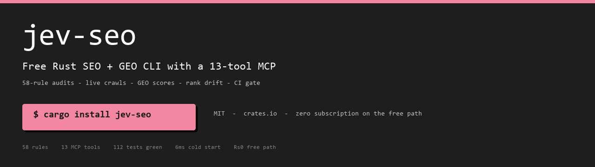</td>
<td align="center" valign="top">tidak ada media yang dipublikasikan</td>
</tr></table>

🧰 <b><a href="https://github.com/AboveColin/HA-Jev">AboveColin/HA-Jev</a></b> · ⭐86 · Python · 🔎 inferred · 10 天 · ⭐+1

##### 📝 Ringkasan

Ajukan pertanyaan kepada rumah Anda dan dapatkan angka sebagai jawaban. Integrasi Home Assistant untuk TypeSafe Jev: jawaban bertipe sebagai sensor, empat tindakan untuk otomasi, dan agen percakapan untuk Assist.

##### 📌 Fakta dasar

| Bidang   | Nilai                               |
| -------- | ----------------------------------- |
| Kategori | `Klien, SDK, dan adapter komunitas` |
| Bukti    | `inferred`                          |
| Bahasa   | Python                              |

##### 📊 Data

| Metrik            | Nilai       |
| ----------------- | ----------- |
| Bintang           | **86** (+1) |
| Push terakhir     | 2026-10-26  |
| Pertama terdaftar | 2026-10-29  |

🏷 `ai` · `assist` · `conversation` · `custom-components` · `decision-model` · `hacs` · `home-assistant` · `home-automation`

---

<table><tr><th align="center" width="50%">🖼 Gambar</th><th align="center" width="50%">🎬 Video</th></tr><tr>
<td align="center" valign="top">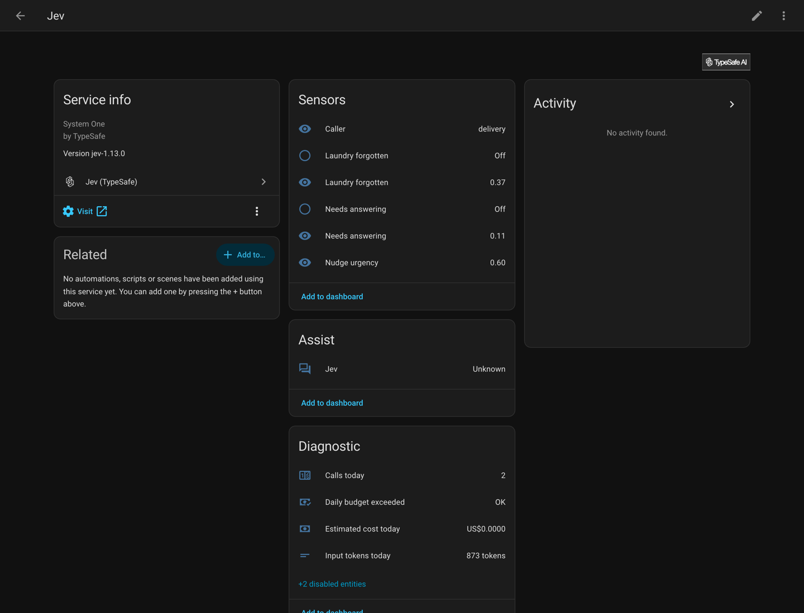</td>
<td align="center" valign="top">tidak ada media yang dipublikasikan</td>
</tr></table>

🧰 <b><a href="https://github.com/bladedevoff/stuntd">bladedevoff/stuntd</a></b> · ⭐74 · Python · 🔎 inferred · 25 天

##### 📝 Ringkasan

Proksi lokal yang mempelajari keputusan LLM bertipe dari aplikasi Anda dan menjawabnya dengan head Laya. Kompatibel dengan Jev dan OpenAI.

##### 📌 Fakta dasar

| Bidang   | Nilai                               |
| -------- | ----------------------------------- |
| Kategori | `Klien, SDK, dan adapter komunitas` |
| Bukti    | `inferred`                          |
| Bahasa   | Python                              |

##### 📊 Data

| Metrik            | Nilai      |
| ----------------- | ---------- |
| Bintang           | **74**     |
| Push terakhir     | 2026-10-11 |
| Pertama terdaftar | 2026-10-29 |

🏷 `claude-code` · `distillation` · `jev` · `laya` · `llm` · `llm-proxy` · `local-inference` · `openai-compatible`

---

<table><tr><th align="center" width="50%">🖼 Gambar</th><th align="center" width="50%">🎬 Video</th></tr><tr>
<td align="center" valign="top">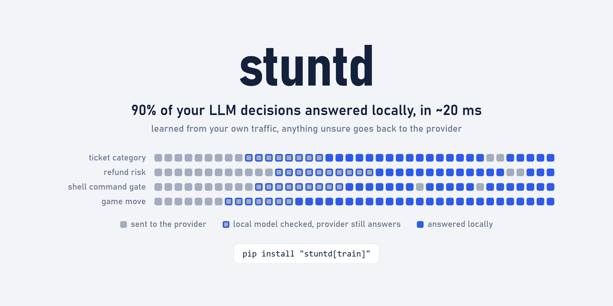</td>
<td align="center" valign="top">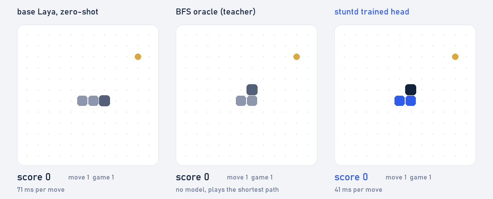 rekaman bergerak</td>
</tr></table>

🧰 <b><a href="https://github.com/mlimarenko/IronRAG">mlimarenko/IronRAG</a></b> · ⭐50 · Rust · 🔎 inferred · 2 天

##### 📝 Ringkasan

One-click knowledge system for documents, internal bots, and AI agents

##### 📌 Fakta dasar

| Bidang   | Nilai                               |
| -------- | ----------------------------------- |
| Kategori | `Klien, SDK, dan adapter komunitas` |
| Bukti    | `inferred`                          |
| Bahasa   | Rust                                |

##### 📊 Data

| Metrik            | Nilai      |
| ----------------- | ---------- |
| Bintang           | **50**     |
| Push terakhir     | 2026-11-03 |
| Pertama terdaftar | 2026-11-03 |

🏷 `ai` · `ai-memory` · `deepseek` · `docker` · `graph` · `graph-rag` · `hermes` · `hermes-agent`

---

<table><tr><th align="center" width="50%">🖼 Gambar</th><th align="center" width="50%">🎬 Video</th></tr><tr>
<td align="center" valign="top">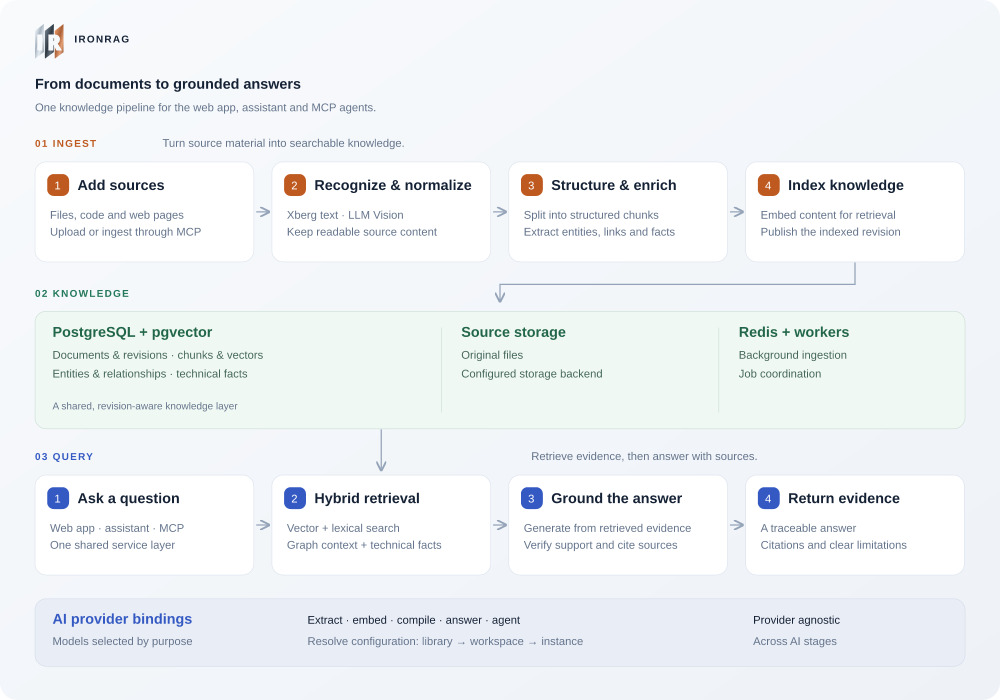</td>
<td align="center" valign="top">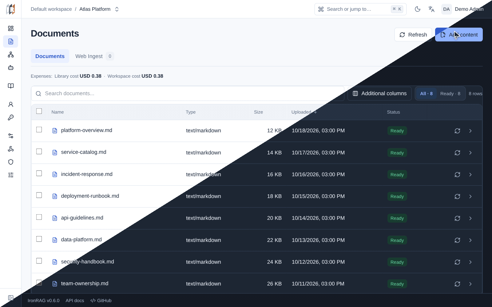 rekaman bergerak</td>
</tr></table>

<b>Lainnya di kategori ini</b> · 104

- [frodi-karlsson/onesie](https://github.com/frodi-karlsson/onesie) - An expressive Unix-pipeable CLI for System One models like Jev.
- [chussenot/judgment](https://github.com/chussenot/judgment) - Penilaian bertipe dan terkalibrasi dari model System One: keputusan yang…
- [CMaintz/jev-dotnet](https://github.com/CMaintz/jev-dotnet) - SDK .NET tidak resmi untuk model Jev System One milik TypeSafe AI.
- [danieleteti/systemone-delphi](https://github.com/danieleteti/systemone-delphi) - Delphi client for System One models (Jev, tev1 and nimble on Ollama): ask typed…
- [erik-hedstrom/loadout](https://github.com/erik-hedstrom/loadout) - Pilih model, skill, dan server MCP untuk setiap sesi agen coding dari pustaka…
- [jqueryscript/awesome-jev](https://github.com/jqueryscript/awesome-jev) - A curated list of TypeSafe Jev resources, SDKs, agents, MCP servers…
- [basi/typesafe-ai-php-client](https://github.com/basi/typesafe-ai-php-client) - PHP client for the typesafe.ai System One API (Jev).
- [CMaintz/jev-java](https://github.com/CMaintz/jev-java) - Java SDK tidak resmi untuk model Jev System One milik TypeSafe AI.
- [gajaguar/typesafe-cli](https://github.com/gajaguar/typesafe-cli) - Unofficial command-line interface for TypeSafe AI System One models, on…
- [JosephHardy91/graph-composition-with-dLLMs](https://github.com/JosephHardy91/graph-composition-with-dLLMs) - A Graph-Compiled Specification RAG system built with **Dagster**, **PostgreSQL…
- [sanketmuchhala/jevgate](https://github.com/sanketmuchhala/jevgate) - Calibrated policy triage and institutional risk routing: a hybrid…
- [ollaya-dev/ollaya](https://github.com/ollaya-dev/ollaya) - Jev-compatible API server for open decision models.
- [realZachi/pg-jev](https://github.com/realZachi/pg-jev) - Ajukan pertanyaan kepada tabel Postgres Anda dalam bahasa biasa.
- [sutro-sh/jev-align](https://github.com/sutro-sh/jev-align) - Bangun Fungsi AI terkalibrasi dari umpan balik manusia menggunakan Jev dan GEPA.
- [juspay/neurolink](https://github.com/juspay/neurolink) - Lapisan pipa dari sistem saraf AI — satu antarmuka yang menghubungkan neuron…
- [aaddrick/building-with-typesafe-jev](https://github.com/aaddrick/building-with-typesafe-jev) - Keahlian tidak resmi yang mengajarkan agen pengodean untuk membangun dengan…
- [Ying-Kai-Liao/jev-browser](https://github.com/Ying-Kai-Liao/jev-browser) - Otomasi browser ketika LLM merencanakan dan Jev (System One Typesafe)…
- [AkashPriyadarshii/jev-curate](https://github.com/AkashPriyadarshii/jev-curate) - High-throughput synthetic and pretraining dataset sifter for TypeSafe Jev.
- [fazlerocks/jevmail](https://github.com/fazlerocks/jevmail) - Triase email AI sumber terbuka untuk Gmail.
- [sharziki/semdecide](https://github.com/sharziki/semdecide) - Keputusan semantik bertipe untuk pipeline Unix dan CI, didukung oleh TypeSafe…
- [burnigtm/jev-mcp](https://github.com/burnigtm/jev-mcp) - Server MCP yang menempatkan TypeSafe Jev dalam loop coding di Cursor, Codex…
- [shaharia-lab/jev-cli](https://github.com/shaharia-lab/jev-cli) - Alat baris perintah untuk model Jev milik TypeSafe AI.
- [AkashPriyadarshii/jev-superpowers](https://github.com/AkashPriyadarshii/jev-superpowers) - Systematic software development framework for AI coding agents upgraded with…
- [dannote/jev](https://github.com/dannote/jev) - TypeSafe Jev untuk OTP: balas ke Jev dari GenServer dan lakukan pattern match…
- [DevLoops-ai/unified-brain](https://github.com/DevLoops-ai/unified-brain) - System One Coding Agents: code-level answers at the same score as Claude Fable…
- [jwuthri-cloud/SelfJev](https://github.com/jwuthri-cloud/SelfJev) - Self-hosted decision model (selfjev-4b) with a Jev-compatible API: Python SDK…
- [jiangkoumo/ego-decision-layer](https://github.com/jiangkoumo/ego-decision-layer) - Pluggable decision layer for the ego lite browser: one System One (Jev) call…
- [myc0576/SmartMoney-Cub](https://github.com/myc0576/SmartMoney-Cub) - Read-only trading journal and review harness: Jev typed judgments, agent…
- [thusinh1969/BrighTO_Router](https://github.com/thusinh1969/BrighTO_Router) - BrighTO LLM Router: free open-source, ultra-fast Rust LLM gateway/router and…
- [Ray-Hughes/jevalyn](https://github.com/Ray-Hughes/jevalyn) - Lapisan pengambilan keputusan untuk aplikasi Rails Anda.
- [dirien/jev-router](https://github.com/dirien/jev-router) - Pass-through model router for Claude Code and Codex CLI that picks a model tier…
- [nouli-ai/nouli](https://github.com/nouli-ai/nouli) - A ledger-backed decision network that records AI decisions and connects them to…
- [tontoko/jev-browser](https://github.com/tontoko/jev-browser) - Satu inti Jev/Playwright yang ter-grounding: SDK bertipe, CLI persisten, dan…
- [saibimajdi/typesafeai-dotnet-sdk](https://github.com/saibimajdi/typesafeai-dotnet-sdk) - SDK .NET komunitas untuk TypeSafe AI System One API — pertanyaan noul, pilihan…
- [Elue-dev/jev_elixir](https://github.com/Elue-dev/jev_elixir) - jev_elixir adalah antarmuka kecil dan idiomatis untuk membuat keputusan bertipe…
- [devbackend/jevgo](https://github.com/devbackend/jevgo) - Klien Go tidak resmi untuk TypeSafe AI System One API (Jev) — masukkan…
- [haileyok/typesafe-client](https://github.com/haileyok/typesafe-client) - Klien Go dan Rust tidak resmi untuk TypeSafe AI System One API (Jev).
- [himomohi/aside-jev](https://github.com/himomohi/aside-jev) - Agen Aside memutuskan dengan TypeSafe Jev (System One: Choice/Score/Noul).
- [chenrui333/jev-docs](https://github.com/chenrui333/jev-docs) - Riwayat Jev / TypeSafe System One APIs yang dikelola komunitas, SDKs, panduan…
- [docxology/daf-jev](https://github.com/docxology/daf-jev) - daf-jev: toolkit Python yang dapat disusun untuk Jev milik TypeSafe.
- [sanamhub/typesafe-dotnet](https://github.com/sanamhub/typesafe-dotnet) - Unofficial .NET client for the TypeSafe AI System One API.
- [illescasDaniel/jev-mem](https://github.com/illescasDaniel/jev-mem) - Long-term memory for AI agents driven by Jev (System One) decisions: no…
- [JimmyWesley/rlcd-gateway](https://github.com/JimmyWesley/rlcd-gateway) - Gateway self-hosted untuk LLMs dan model keputusan.
- [vibefilter/filament](https://github.com/vibefilter/filament) - Filter Filament tables with a plain-English statement.
- [zhirschtritt/typesafe-go](https://github.com/zhirschtritt/typesafe-go) - Go SDK idiomatis untuk TypeSafe AI API.
- [AIAnytime/Jev-Router](https://github.com/AIAnytime/Jev-Router) - Decision-first, OpenAI-compatible AI router powered by Jev typed decisions.
- [akiiwa-games/AgentCompass](https://github.com/akiiwa-games/AgentCompass) - Deterministic multi-agent task router &amp; subscription quota scheduler for Claude…
- [Butochnikov/laravel-typesafe-jev](https://github.com/Butochnikov/laravel-typesafe-jev) - Integrasi Laravel tidak resmi untuk TypeSafe Jev AI dengan respons bertipe…
- [coo-quack/jev-pii-checker](https://github.com/coo-quack/jev-pii-checker) - CLI yang menemukan PII dalam teks dengan TypeSafe Jev: keberadaan…
- [zerone-agents/jev-model-router](https://github.com/zerone-agents/jev-model-router) - Perutean model ringan untuk agen, dengan kompatibilitas OpenAI dan Anthropic…
- [AboveColin/jevclient](https://github.com/AboveColin/jevclient) - Klien Python asinkron untuk TypeSafe Jev.
- [dsaad68/fuzzy-jev](https://github.com/dsaad68/fuzzy-jev) - A client for OpenRouter&#x27;s decision models, TypeSafe&#x27;s Jev by default: typed…
- [maxtrezzi/jev4s](https://github.com/maxtrezzi/jev4s) - Typed Scala client for Jev (TypeSafe AI): typed questions, typed answers…
- [minorun365/jev-cloud-quiz](https://github.com/minorun365/jev-cloud-quiz) - 三大クラウドの機能名を、TypeSafe AI の System One モデル Jev が確率つきで判定するデモ.
- [MrKyaw/CognitiveMirror-Jev-MCP](https://github.com/MrKyaw/CognitiveMirror-Jev-MCP) - Cognitive middleware for personal and enterprise AI agents: 14 MCP tools and a…
- [NerdishShah/playwright-cli-jev-bakeoff](https://github.com/NerdishShah/playwright-cli-jev-bakeoff) - Bake-off: Playwright CLI vs CLI+Jev vs Playwright MCP.
- [amidabuddha/jev-decision-mcp](https://github.com/amidabuddha/jev-decision-mcp) - Local MCP server for TypeSafe Jev typed decisions, with Codex integration.
- [apixly-ai/jev-filter](https://github.com/apixly-ai/jev-filter) - Typed semantic filtering for AI agents: turn retrieved records, code and logs…
- [bojansandhaus/dsh-jev-mcp](https://github.com/bojansandhaus/dsh-jev-mcp) - TypeSafe Jev decision tools for DeepSeek Harness: dependency-free client…
- [exfoca/decision-model-lab-4JEV](https://github.com/exfoca/decision-model-lab-4JEV) - DML is a reproducible harness for evaluating small, local decision models under…
- [Hyper-AI-Lab/openclaw-jev](https://github.com/Hyper-AI-Lab/openclaw-jev) - Control plane produksi untuk agen OpenClaw: routing intake dengan Jev…
- [swami8791/jev-judge-mcp](https://github.com/swami8791/jev-judge-mcp) - Owner-private ChatGPT integration for TypeSafe Jev structured evaluations.
- [abirshhishirroy/mini-jev](https://github.com/abirshhishirroy/mini-jev) - A custom Jev-style decision model built from scratch on Qwen2.5-3B.
- [CMaintz/jev-tools](https://github.com/CMaintz/jev-tools) - Tool TypeScript yang dibangun di atas Jev milik TypeSafe AI: guardrail…
- [codebam/jev-guardrails](https://github.com/codebam/jev-guardrails) - Guardrail yang didukung Jev untuk pemanggilan tool agen: pustaka, hook native…
- [cwdx/chess-with-jev](https://github.com/cwdx/chess-with-jev) - Chess with Jev: every legal move&#x27;s facts worked out in code, Jev&#x27;s move as one…
- [Errr0rr404/jev-trader](https://github.com/Errr0rr404/jev-trader) - Local CLI and web desk. Robinhood Agentic MCP is the tape. TypeSafe Jev votes.
- [fan56/dsh-jev-core](https://github.com/fan56/dsh-jev-core) - Klien model keputusan TypeSafe Jev bersama untuk ekosistem dsh: validasi…
- [HappyHackingSpace/jev](https://github.com/HappyHackingSpace/jev) - Go SDK, CLI, MCP server and agent skill for TypeSafe.
- [ivanblagdan/jev-cli](https://github.com/ivanblagdan/jev-cli) - Composable CLI for TypeSafe.
- [mrodgersjs-web/jev-route](https://github.com/mrodgersjs-web/jev-route) - Deterministic routing-policy CLI in Rust: task and candidates in, choice +…
- [Murat-Selim/jev_doc_router](https://github.com/Murat-Selim/jev_doc_router) - Spring Boot PDF question-answering assistant with RAG/CAG routing and…
- [offneves/jev-pr-reviewer](https://github.com/offneves/jev-pr-reviewer) - A local CLI to analyze Pull Request / Merge Request diffs, obtain structured…
- [ogarciarevett/jev-py-sdk](https://github.com/ogarciarevett/jev-py-sdk) - Penilaian Jev bertipe (noul / choice / score) dari TypeSafe untuk Python…
- [phoenix1331/laravel-jev-hotdog](https://github.com/phoenix1331/laravel-jev-hotdog) - A Laravel 13 playground that tells you whether a photo is a hot dog or not…
- [pyck-ai/jev-cli](https://github.com/pyck-ai/jev-cli) - Jev.
- [Ridlo543/jev-judge](https://github.com/Ridlo543/jev-judge) - Universal Model Context Protocol (MCP) server and CLI runner for TypeSafe Jev…
- [royalskynet/jev-gate-mcp](https://github.com/royalskynet/jev-gate-mcp) - Gerbang keputusan Jev yang diatur untuk klien GPT, Claude, dan MCP.
- [shetautnetjer/jev-cli](https://github.com/shetautnetjer/jev-cli) - Clean-room CLI for TypeSafe System One / Jev Decision Contracts, search, and…
- [sunjongos/jev-typesafe-gatekeeper](https://github.com/sunjongos/jev-typesafe-gatekeeper) - World-Class Pure System 1 AI Decision &amp; 90/10 Hybrid Gatekeeper Skill powered…
- [SykkoAtHome/MCP_Typesafe_JEV](https://github.com/SykkoAtHome/MCP_Typesafe_JEV) - Domain-agnostic MCP server for TypeSafe Jev (System One) evaluation engine…
- [VianneyMI/python-jev](https://github.com/VianneyMI/python-jev) - Unofficial typed Python SDK for TypeSafe.
- [vilinski/jev](https://github.com/vilinski/jev) - CLI untuk model keputusan System One: pertanyaan bertipe masuk, probabilitas…
- [Yasir-Khan-7/jev-sentinel](https://github.com/Yasir-Khan-7/jev-sentinel) - Perlindungan injeksi prompt &amp; pagar pengaman pemanggilan alat untuk agen AI…
- [Zuexx/agent-jev-integration](https://github.com/Zuexx/agent-jev-integration) - TypeSafe Jev integrated into Claude Code: routing, escalation, guardrails, evals.
- [StartLuxLabs/StartLux-Prism](https://github.com/StartLuxLabs/StartLux-Prism) - Fast, exact inference for StartLux-Decision models on NVIDIA GPUs: the released…
- [rokbenko/quackd](https://github.com/rokbenko/quackd) - Satu CLI untuk semua robot Anda. Hubungkan, perintah, dan biarkan mereka…
- [MiaoWuNYA/rikkahub-sillytavern-android](https://github.com/MiaoWuNYA/rikkahub-sillytavern-android) - 安卓AI聊天端:开箱即聊，无损导入酒馆卡，缓存强省用量，手机操控，专属RP模式，防空回，主动信息，前端卡支持，高定制主题，QQbot，AI群聊，插件系统，强兼容…
- [pithings/advocaat](https://github.com/pithings/advocaat) - Klien kecil dan aman tipe untuk mengajukan pertanyaan AI tentang data Anda…
- [giuliosmall/pg_typesafe](https://github.com/giuliosmall/pg_typesafe) - Ekstensi PostgreSQL pra-alfa untuk klasifikasi kategoris TypeSafe AI (Jev).
- [Brainwires/jevwire](https://github.com/Brainwires/jevwire) - Jev decision layer for agents: MCP server, embeddable DecisionModel library…
- [zhulinchng/jevper](https://github.com/zhulinchng/jevper) - Pembungkus klasifikasi berbentuk Jev (TypeSafe System One) di atas klien mirip…
- [schainks/system_one_client](https://github.com/schainks/system_one_client) - Klien Elixir untuk model keputusan System One: TypeSafe Jev, Cloudflare Clef…
- [gilljon/typesafe-ai-rs](https://github.com/gilljon/typesafe-ai-rs) - Rust SDK asinkron dan blocking independen untuk TypeSafe AI System One API.
- [AutreMachine/bosco](https://github.com/AutreMachine/bosco) - Router and proxy for OpenAI compatible LLMs machines - 1 url to rule them all !
- [cipherTing/sael](https://github.com/cipherTing/sael) - Klien Go untuk API TypeSafe System One (Jev) — bagian pertama dari sael…
- [IKEASven69/dsh-opencli](https://github.com/IKEASven69/dsh-opencli) - 让 dsh 会办事:登录态真实浏览器 × 180 站点结构化命令 + SystemOne 亚秒决策 + 执行真实性判定 + watch 监控.
- [zcoder-run/rust-sysone](https://github.com/zcoder-run/rust-sysone) - System One TypeSafe AI Rust Client (unofficial).
- [fini/warped-sys1-lab](https://github.com/fini/warped-sys1-lab) - Jev (TypeSafe System One) experiment lab: SvelteKit workbench and CLI.
- [lirantal/discoprint](https://github.com/lirantal/discoprint) - Classify an artist.
- [y0usaf/typesafe-cli](https://github.com/y0usaf/typesafe-cli) - Ajukan pertanyaan bertipe Jev dari shell: jawaban noul, choice, dan score…
- [KratosLee-6/open-source-model-deploy](https://github.com/KratosLee-6/open-source-model-deploy) - 开源大模型部署可行性鉴别工具 · 168 个开源模型动态评估（含 12 个 JEV/System One 决策模型）· 硬件自动检测 ·…
- [MarcelRoozekrans/Minos.NET](https://github.com/MarcelRoozekrans/Minos.NET) - Typed, source-generated decision questions for .NET: one IDecisionClient for…
- [phiat/typesafe-rust-sdk](https://github.com/phiat/typesafe-rust-sdk) - Unofficial Rust client for TypeSafe.

## Perkakas agen: MCP, hook, gate, dan agen pengkodean

Kategori dengan pertumbuhan tercepat: hook, server MCP, dan gate yang menempatkan keputusan bertipe di depan tindakan berikutnya sebuah agen.

🤖 <b><a href="https://github.com/0xNatoshi/jev-codex-router">0xNatoshi/jev-codex-router</a></b> · ⭐273 · JavaScript · 🔎 inferred · 44 天

##### 📝 Ringkasan

Perutean model dan penalaran per giliran untuk Codex, digerakkan oleh Jev (TypeSafe System One): memilih model, kedalaman berpikir, dan mode kecepatan untuk setiap giliran.

> 💡 Perutean model dan upaya penalaran per giliran untuk agen coding, digerakkan oleh keputusan bertipe.

##### 📌 Fakta dasar

| Bidang   | Nilai                                                 |
| -------- | ----------------------------------------------------- |
| Kategori | `Perkakas agen: MCP, hook, gate, dan agen pengkodean` |
| Bukti    | `inferred`                                            |
| Bahasa   | JavaScript                                            |

##### 📊 Data

| Metrik            | Nilai      |
| ----------------- | ---------- |
| Bintang           | **273**    |
| Push terakhir     | 2026-09-22 |
| Pertama terdaftar | 2026-10-28 |

🏷 `ai` · `codex` · `jev` · `llm` · `macos` · `routing` · `typesafe`

🤖 <b><a href="https://github.com/strands-labs/strands-decider">strands-labs/strands-decider</a></b> · ⭐763 · Python · 👁️ observed · 0 天 · ⭐+1

##### 📝 Ringkasan

Model keputusan kecil dan cepat, atau model sistem satu, untuk alur kerja agentik. Pilih di antara opsi atau beri nilai pada skala lebih cepat daripada LLM, dengan keyakinan terkalibrasi pada setiap keputusan.

##### 📌 Fakta dasar

| Bidang   | Nilai                                                 |
| -------- | ----------------------------------------------------- |
| Kategori | `Perkakas agen: MCP, hook, gate, dan agen pengkodean` |
| Bukti    | `observed`                                            |
| Bahasa   | Python                                                |

##### 📊 Data

| Metrik            | Nilai        |
| ----------------- | ------------ |
| Bintang           | **763** (+1) |
| Push terakhir     | 2026-11-04   |
| Pertama terdaftar | 2026-10-02   |

🏷 `ai` · `machine-learning` · `natural-language-understanding` · `python` · `strands-agents` · `strands-labs` · `system-one` · `system-one-models`

🤖 <b><a href="https://github.com/AbdelStark/awesome-typesafe-jev">AbdelStark/awesome-typesafe-jev</a></b> · ⭐614 · HTML · 👁️ observed · 3 天 · ⭐-1

##### 📝 Ringkasan

Awesome Jev: panduan lapangan berbasis sumber untuk model System One milik TypeSafe, dengan SDKs, demo langsung, alat agen, dan evaluasi independen.

🔧 Ditemukan dipakai dalam kode: `README.md`

##### 📌 Fakta dasar

| Bidang   | Nilai                                                 |
| -------- | ----------------------------------------------------- |
| Kategori | `Perkakas agen: MCP, hook, gate, dan agen pengkodean` |
| Bukti    | `observed`                                            |
| Bahasa   | HTML                                                  |

##### 📊 Data

| Metrik            | Nilai        |
| ----------------- | ------------ |
| Bintang           | **614** (-1) |
| Push terakhir     | 2026-11-01   |
| Pertama terdaftar | 2026-10-28   |

🏷 `agent-skills` · `ai-agents` · `awesome` · `awesome-jev` · `awesome-list` · `awesome-lists` · `curated-list` · `developer-tools`

🤖 <b><a href="https://github.com/jkudish/jev-mcp">jkudish/jev-mcp</a></b> · ⭐572 · JavaScript · 👁️ observed · 6 天 · ⭐+2

##### 📝 Ringkasan

Penilaian cepat, murah, dan bertipe dari model Jev milik TypeSafe, sebagai alat MCP.

> 💡 Bukti konsep awal untuk mengekspos Jev melalui MCP, yang merupakan cara sebagian besar toolchain non-Python mengaksesnya.

🔧 Ditemukan dipakai dalam kode: `README.md`

##### 📌 Fakta dasar

| Bidang   | Nilai                                                 |
| -------- | ----------------------------------------------------- |
| Kategori | `Perkakas agen: MCP, hook, gate, dan agen pengkodean` |
| Bukti    | `observed`                                            |
| Bahasa   | JavaScript                                            |

##### 📊 Data

| Metrik            | Nilai        |
| ----------------- | ------------ |
| Bintang           | **572** (+2) |
| Push terakhir     | 2026-10-30   |
| Pertama terdaftar | 2026-10-26   |

🤖 <b><a href="https://github.com/walidboulanouar/awesome-jev-use-cases">walidboulanouar/awesome-jev-use-cases</a></b> · ⭐481 · 👁️ observed · 39 天

##### 📝 Ringkasan

Daftar unggulan kasus penggunaan TypeSafe AI Jev: 74 demo yang diurutkan berdasarkan jumlah suka, lebih dari 150 repositori GitHub, batasan, biaya, dan contoh API. CC0

🔧 Ditemukan dipakai dalam kode: `README.md`

##### 📌 Fakta dasar

| Bidang   | Nilai                                                 |
| -------- | ----------------------------------------------------- |
| Kategori | `Perkakas agen: MCP, hook, gate, dan agen pengkodean` |
| Bukti    | `observed`                                            |

##### 📊 Data

| Metrik            | Nilai      |
| ----------------- | ---------- |
| Bintang           | **481**    |
| Push terakhir     | 2026-09-26 |
| Pertama terdaftar | 2026-10-29 |

🏷 `ai-guardrails` · `ai-router` · `awesome` · `awesome-list` · `classification` · `claude-code` · `decision-model` · `examples`

🤖 <b><a href="https://github.com/kraayenjon/awesome-jev">kraayenjon/awesome-jev</a></b> · ⭐203 · 👁️ observed · 39 天 · ⭐-1

##### 📝 Ringkasan

Daftar terkurasi kasus penggunaan, proyek, SDKs, dan sumber daya Jev. Jev adalah model System One milik TypeSafe AI untuk keputusan cepat dan bertipe dalam perangkat lunak — Choice, Score, dan Noul dengan probabilitas terkalibrasi.

🔧 Ditemukan dipakai dalam kode: `README.md`

##### 📌 Fakta dasar

| Bidang   | Nilai                                                 |
| -------- | ----------------------------------------------------- |
| Kategori | `Perkakas agen: MCP, hook, gate, dan agen pengkodean` |
| Bukti    | `observed`                                            |

##### 📊 Data

| Metrik            | Nilai        |
| ----------------- | ------------ |
| Bintang           | **203** (-1) |
| Push terakhir     | 2026-09-27   |
| Pertama terdaftar | 2026-09-19   |

🏷 `agents` · `ai` · `ai-agents` · `api` · `artificial-intelligence` · `automation` · `awesome` · `awesome-list`

🤖 <b><a href="https://github.com/valentynkit/awesome-jev-typesafe">valentynkit/awesome-jev-typesafe</a></b> · ⭐187 · JavaScript · 👁️ observed · 0 天 · ⭐-1

##### 📝 Ringkasan

Keputusan bertipe dengan TypeSafe Jev, model System One pertama

🔧 Ditemukan dipakai dalam kode: `readme.md`, `README.ko.md`, `README.ja.md`, `README.zh-CN.md`

##### 📌 Fakta dasar

| Bidang   | Nilai                                                 |
| -------- | ----------------------------------------------------- |
| Kategori | `Perkakas agen: MCP, hook, gate, dan agen pengkodean` |
| Bukti    | `observed`                                            |
| Bahasa   | JavaScript                                            |

##### 📊 Data

| Metrik            | Nilai        |
| ----------------- | ------------ |
| Bintang           | **187** (-1) |
| Push terakhir     | 2026-11-05   |
| Pertama terdaftar | 2026-09-19   |

🏷 `ai-agents` · `awesome` · `awesome-list` · `claude-code` · `directory` · `jev` · `llm-agents` · `system-one`

🤖 <b><a href="https://github.com/tamaratran/jev-pruner">tamaratran/jev-pruner</a></b> · ⭐167 · TypeScript · 👁️ observed · 36 天

##### 📝 Ringkasan

Plugin Claude Code: memangkas keluaran Bash yang panjang dengan TypeSafe Jev sebelum model melihatnya

🔧 Ditemukan dipakai dalam kode: `README.md`

##### 📌 Fakta dasar

| Bidang   | Nilai                                                 |
| -------- | ----------------------------------------------------- |
| Kategori | `Perkakas agen: MCP, hook, gate, dan agen pengkodean` |
| Bukti    | `observed`                                            |
| Bahasa   | TypeScript                                            |

##### 📊 Data

| Metrik            | Nilai      |
| ----------------- | ---------- |
| Bintang           | **167**    |
| Push terakhir     | 2026-09-30 |
| Pertama terdaftar | 2026-10-29 |

🤖 <b><a href="https://github.com/dbreunig/building-with-jev-skill">dbreunig/building-with-jev-skill</a></b> · ⭐166 · 👁️ observed · 6 天

##### 📝 Ringkasan

Keahlian untuk menulis dan menyempurnakan program yang memanggil Jev, model System One milik TypeSafe

> 💡 Keahlian untuk menulis program yang memanggil Jev, bukan program yang memanggil Jev. Perbedaan ini penting: keahlian ini menyandikan aturan desain, bukan satu implementasi tertentu.

##### 📌 Fakta dasar

| Bidang   | Nilai                                                 |
| -------- | ----------------------------------------------------- |
| Kategori | `Perkakas agen: MCP, hook, gate, dan agen pengkodean` |
| Bukti    | `observed`                                            |

##### 📊 Data

| Metrik            | Nilai      |
| ----------------- | ---------- |
| Bintang           | **166**    |
| Push terakhir     | 2026-10-29 |
| Pertama terdaftar | 2026-10-28 |

🤖 <b><a href="https://github.com/y0usaf/pi-jev">y0usaf/pi-jev</a></b> · ⭐163 · TypeScript · 👁️ observed · 5 天 · ⭐-5

##### 📝 Ringkasan

TypeSafe Jev sebagai lapisan keputusan untuk agen coding Pi: gerbang pemanggilan alat yang terukur ditambah jev_ask untuk jawaban bertipe dan terkalibrasi

🔧 Ditemukan dipakai dalam kode: `README.md`

##### 📌 Fakta dasar

| Bidang   | Nilai                                                 |
| -------- | ----------------------------------------------------- |
| Kategori | `Perkakas agen: MCP, hook, gate, dan agen pengkodean` |
| Bukti    | `observed`                                            |
| Bahasa   | TypeScript                                            |

##### 📊 Data

| Metrik            | Nilai        |
| ----------------- | ------------ |
| Bintang           | **163** (-5) |
| Push terakhir     | 2026-10-31   |
| Pertama terdaftar | 2026-10-29   |

🏷 `guardrails` · `jev` · `pi-extension` · `pi-package` · `typesafe`

🤖 <b><a href="https://github.com/Avinash-jetwani/jevmem">Avinash-jetwani/jevmem</a></b> · ⭐140 · TypeScript · 👁️ observed · 5 天

##### 📝 Ringkasan

jevmem menyimpan keputusan, aturan, dan pendekatan yang gagal dari obrolan Code Claude Anda ke JEVMEM.md di repo Anda, lalu membawa kembali yang relevan pada sesi berikutnya.

🔧 Ditemukan dipakai dalam kode: `PRIVACY.md`, `plugin/README.md`

##### 📌 Fakta dasar

| Bidang   | Nilai                                                 |
| -------- | ----------------------------------------------------- |
| Kategori | `Perkakas agen: MCP, hook, gate, dan agen pengkodean` |
| Bukti    | `observed`                                            |
| Bahasa   | TypeScript                                            |

##### 📊 Data

| Metrik            | Nilai      |
| ----------------- | ---------- |
| Bintang           | **140**    |
| Push terakhir     | 2026-10-30 |
| Pertama terdaftar | 2026-10-29 |

🏷 `agent-memory` · `ai-memory` · `claude` · `claude-code` · `claude-code-hooks` · `claude-code-plugin` · `claude-code-plugins` · `claude-code-plugins-marketplace`

🤖 <b><a href="https://github.com/Bodila51/grok-bot-jev">Bodila51/grok-bot-jev</a></b> · ⭐130 · Python · 👁️ observed · 37 天

##### 📝 Ringkasan

Hubungkan TypeSafe Jev ke Grok Bot sebagai lapisan keputusan murah - gerbang penggunaan, templat skill, contoh

🔧 Ditemukan dipakai dalam kode: `src/jev_client.py`

##### 📌 Fakta dasar

| Bidang   | Nilai                                                 |
| -------- | ----------------------------------------------------- |
| Kategori | `Perkakas agen: MCP, hook, gate, dan agen pengkodean` |
| Bukti    | `observed`                                            |
| Bahasa   | Python                                                |

##### 📊 Data

| Metrik            | Nilai      |
| ----------------- | ---------- |
| Bintang           | **130**    |
| Push terakhir     | 2026-09-28 |
| Pertama terdaftar | 2026-10-29 |

🏷 `cursor` · `decision-layer` · `grok-bot` · `jev` · `python` · `typesafe`

---

<table><tr><th align="center" width="50%">🖼 Gambar</th><th align="center" width="50%">🎬 Video</th></tr><tr>
<td align="center" valign="top"></td>
<td align="center" valign="top">tidak ada media yang dipublikasikan</td>
</tr></table>

🤖 <b><a href="https://github.com/KikeVen/zerikai_memory">KikeVen/zerikai_memory</a></b> · ⭐36 · Python · 👁️ observed · 1 天

##### 📝 Ringkasan

A standalone local-only Python MCP server that gives any IDE persistent, workspace-isolated memory. works with any IDE supporting MCP servers

🔧 Ditemukan dipakai dalam kode: `jev/client.py`

##### 📌 Fakta dasar

| Bidang   | Nilai                                                 |
| -------- | ----------------------------------------------------- |
| Kategori | `Perkakas agen: MCP, hook, gate, dan agen pengkodean` |
| Bukti    | `observed`                                            |
| Bahasa   | Python                                                |

##### 📊 Data

| Metrik            | Nilai      |
| ----------------- | ---------- |
| Bintang           | **36**     |
| Push terakhir     | 2026-11-04 |
| Pertama terdaftar | 2026-11-04 |

🏷 `ai` · `ai-tools` · `chromadb` · `deepseek-v4-pro` · `jev` · `judgment` · `lexical` · `mcp`

---

<table><tr><th align="center" width="50%">🖼 Gambar</th><th align="center" width="50%">🎬 Video</th></tr><tr>
<td align="center" valign="top">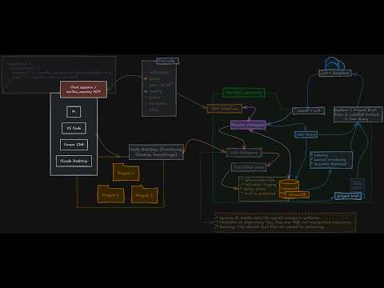</td>
<td align="center" valign="top"> <a href="https://img.youtube.com/vi/sk8x-nbF0Cs/0.jpg">Tonton di img.youtube.com</a> · pemutaran terbuka di situs sumber; GitHub tidak dapat menyematkannya secara inline</td>
</tr></table>

🤖 <b><a href="https://github.com/caijinchun/nanojev-arena">caijinchun/nanojev-arena</a></b> · ⭐7 · HTML · 👁️ observed · 46 天

##### 📝 Ringkasan

Arena NanoJev Snake: pertempuran kapal perang manusia-vs-AI 1v4 + simulator kawanan 100 agen. Demo lokal model Jev System-One (replika mini sumber terbuka).

##### 📌 Fakta dasar

| Bidang   | Nilai                                                 |
| -------- | ----------------------------------------------------- |
| Kategori | `Perkakas agen: MCP, hook, gate, dan agen pengkodean` |
| Bukti    | `observed`                                            |
| Bahasa   | HTML                                                  |

##### 📊 Data

| Metrik            | Nilai      |
| ----------------- | ---------- |
| Bintang           | **7**      |
| Push terakhir     | 2026-09-19 |
| Pertama terdaftar | 2026-11-01 |

---

<table><tr><th align="center" width="50%">🖼 Gambar</th><th align="center" width="50%">🎬 Video</th></tr><tr>
<td align="center" valign="top"></td>
<td align="center" valign="top">tidak ada media yang dipublikasikan</td>
</tr></table>

🤖 <b><a href="https://github.com/dfranco-projects/jev-guardbench">dfranco-projects/jev-guardbench</a></b> · ⭐3 · Python · 👁️ observed · 31 天

##### 📝 Ringkasan

Bisakah model System One (TypeSafe Jev, Kev sumber terbuka) menggantikan LLM-as-judge dalam callback pagar pengaman agen?

##### 📌 Fakta dasar

| Bidang   | Nilai                                                 |
| -------- | ----------------------------------------------------- |
| Kategori | `Perkakas agen: MCP, hook, gate, dan agen pengkodean` |
| Bukti    | `observed`                                            |
| Bahasa   | Python                                                |

##### 📊 Data

| Metrik            | Nilai      |
| ----------------- | ---------- |
| Bintang           | **3**      |
| Push terakhir     | 2026-10-04 |
| Pertama terdaftar | 2026-11-04 |

---

<table><tr><th align="center" width="50%">🖼 Gambar</th><th align="center" width="50%">🎬 Video</th></tr><tr>
<td align="center" valign="top"></td>
<td align="center" valign="top">tidak ada media yang dipublikasikan</td>
</tr></table>

Aset ditautkan langsung dari repositori hulu karena tidak ada lisensi redistribusi yang dinyatakan.

🤖 <b><a href="https://github.com/dolevhayut/resurface">dolevhayut/resurface</a></b> · TypeScript · 👁️ observed · 33 天

##### 📝 Ringkasan

Penyaringan resume JEV TypeSafe: LLM menulis pertanyaan, JEV (model klasifikasi System One) menjawabnya untuk setiap resume di ATS Anda dengan baris bukti yang tepat. 8× lebih cepat, 31× lebih murah daripada LLM.

##### 📌 Fakta dasar

| Bidang   | Nilai                                                 |
| -------- | ----------------------------------------------------- |
| Kategori | `Perkakas agen: MCP, hook, gate, dan agen pengkodean` |
| Bukti    | `observed`                                            |
| Bahasa   | TypeScript                                            |

##### 📊 Data

| Metrik            | Nilai      |
| ----------------- | ---------- |
| Bintang           | **0**      |
| Push terakhir     | 2026-10-03 |
| Pertama terdaftar | 2026-11-01 |

🏷 `ai-recruiting` · `ats` · `candidate-matching` · `classification-model` · `claude` · `decision-model` · `evidence-based-hiring` · `hr-tech`

---

<table><tr><th align="center" width="50%">🖼 Gambar</th><th align="center" width="50%">🎬 Video</th></tr><tr>
<td align="center" valign="top"></td>
<td align="center" valign="top"> <a href="https://raw.githubusercontent.com/dolevhayut/resurface/main/docs/launch/resurface-launch.mp4">Buka video</a></td>
</tr></table>

🤖 <b><a href="https://github.com/kerpopule/hermes-jev-skills">kerpopule/hermes-jev-skills</a></b> · ⭐1299 · Python · 🔎 inferred · 6 天 · ⭐+1

##### 📝 Ringkasan

Perutean model yang didukung Jev, memori, pemadatan, pemilihan keahlian, penggunaan komputer dan browser untuk agen Hermes (juga Claude Code dan Codex)

##### 📌 Fakta dasar

| Bidang   | Nilai                                                 |
| -------- | ----------------------------------------------------- |
| Kategori | `Perkakas agen: MCP, hook, gate, dan agen pengkodean` |
| Bukti    | `inferred`                                            |
| Bahasa   | Python                                                |

##### 📊 Data

| Metrik            | Nilai         |
| ----------------- | ------------- |
| Bintang           | **1299** (+1) |
| Push terakhir     | 2026-10-29    |
| Pertama terdaftar | 2026-09-19    |

---

<table><tr><th align="center" width="50%">🖼 Gambar</th><th align="center" width="50%">🎬 Video</th></tr><tr>
<td align="center" valign="top">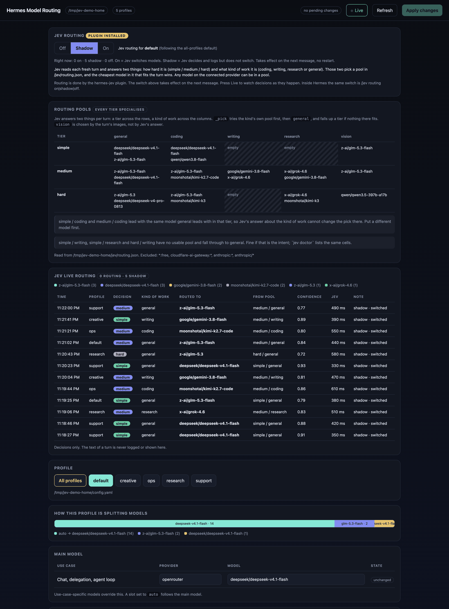</td>
<td align="center" valign="top">tidak ada media yang dipublikasikan</td>
</tr></table>

🤖 <b><a href="https://github.com/reticlehq/reticle">reticlehq/reticle</a></b> · ⭐1245 · TypeScript · 🔎 inferred · 0 天 · ⭐-66

##### 📝 Ringkasan

Agen AI dapat menghasilkan kode, tetapi masih kesulitan memahami apa yang mereka bangun. Reticle menghadirkan persepsi runtime machine-native bergaya Jev ke aplikasi web & desktop.

##### 📌 Fakta dasar

| Bidang   | Nilai                                                 |
| -------- | ----------------------------------------------------- |
| Kategori | `Perkakas agen: MCP, hook, gate, dan agen pengkodean` |
| Bukti    | `inferred`                                            |
| Bahasa   | TypeScript                                            |

##### 📊 Data

| Metrik            | Nilai          |
| ----------------- | -------------- |
| Bintang           | **1245** (-66) |
| Push terakhir     | 2026-11-05     |
| Pertama terdaftar | 2026-10-26     |

🏷 `agent-skill` · `agent-skills` · `agent-testing` · `agent-verification` · `ai-testing-tool` · `automated-testing` · `claude-code` · `claude-skills`

---

<table><tr><th align="center" width="50%">🖼 Gambar</th><th align="center" width="50%">🎬 Video</th></tr><tr>
<td align="center" valign="top"></td>
<td align="center" valign="top"> rekaman bergerak</td>
</tr></table>

Aset ditautkan langsung dari repositori hulu karena tidak ada lisensi redistribusi yang dinyatakan.

🤖 <b><a href="https://github.com/devagrawal09/jev-review">devagrawal09/jev-review</a></b> · ⭐696 · TypeScript · 🔎 inferred · 49 天 · ⭐-1

##### 📝 Ringkasan

Alur kerja tinjauan kode bertahap dan dasbor lokal yang dibangun dengan TypeSafe Jev.

##### 📌 Fakta dasar

| Bidang   | Nilai                                                 |
| -------- | ----------------------------------------------------- |
| Kategori | `Perkakas agen: MCP, hook, gate, dan agen pengkodean` |
| Bukti    | `inferred`                                            |
| Bahasa   | TypeScript                                            |

##### 📊 Data

| Metrik            | Nilai        |
| ----------------- | ------------ |
| Bintang           | **696** (-1) |
| Push terakhir     | 2026-09-17   |
| Pertama terdaftar | 2026-10-29   |

🏷 `ai` · `code-review` · `jev` · `typesafe-ai` · `typescript`

---

<table><tr><th align="center" width="50%">🖼 Gambar</th><th align="center" width="50%">🎬 Video</th></tr><tr>
<td align="center" valign="top">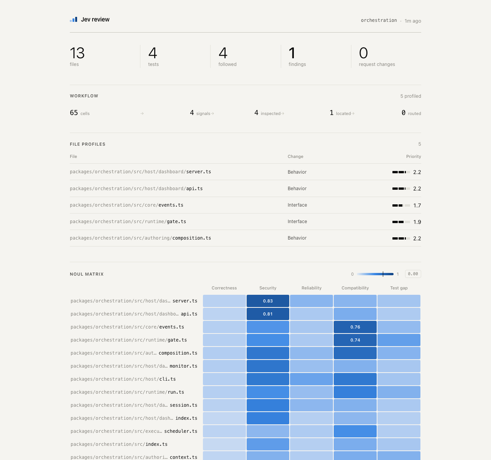</td>
<td align="center" valign="top">tidak ada media yang dipublikasikan</td>
</tr></table>

🤖 <b><a href="https://github.com/ttlequals0/MinusPod">ttlequals0/MinusPod</a></b> · ⭐533 · Python · 🔎 inferred · 0 天 · ⭐+1

##### 📝 Ringkasan

MinusPod adalah server yang di-host sendiri dan menghapus iklan sebelum Anda menekan putar

##### 📌 Fakta dasar

| Bidang   | Nilai                                                 |
| -------- | ----------------------------------------------------- |
| Kategori | `Perkakas agen: MCP, hook, gate, dan agen pengkodean` |
| Bukti    | `inferred`                                            |
| Bahasa   | Python                                                |

##### 📊 Data

| Metrik            | Nilai        |
| ----------------- | ------------ |
| Bintang           | **533** (+1) |
| Push terakhir     | 2026-11-04   |
| Pertama terdaftar | 2026-10-12   |

🏷 `ad-remover` · `ai` · `claude` · `jev` · `llm` · `media` · `nvidia` · `ollama`

---

<table><tr><th align="center" width="50%">🖼 Gambar</th><th align="center" width="50%">🎬 Video</th></tr><tr>
<td align="center" valign="top">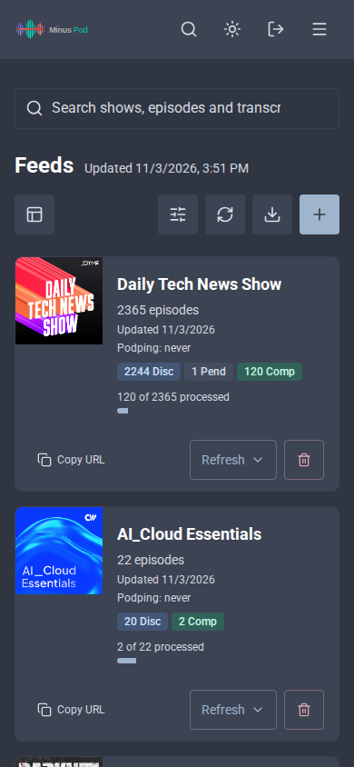</td>
<td align="center" valign="top">tidak ada media yang dipublikasikan</td>
</tr></table>

🤖 <b><a href="https://github.com/malevrigns/agent-jev">malevrigns/agent-jev</a></b> · ⭐396 · Python · 🔎 inferred · 6 天 · ⭐-2

##### 📝 Ringkasan

AgentJev-0.6B - model keputusan 'System One' yang cepat untuk Agen AI: berikan model ini status tak terstruktur apa pun (diff, jejak, log) dan pertanyaan terstruktur, lalu dapatkan kembali distribusi probabilitas terkalibrasi dalam satu lintasan maju sekitar 50 ms. Tanpa dekode token keluaran.

##### 📌 Fakta dasar

| Bidang   | Nilai                                                 |
| -------- | ----------------------------------------------------- |
| Kategori | `Perkakas agen: MCP, hook, gate, dan agen pengkodean` |
| Bukti    | `inferred`                                            |
| Bahasa   | Python                                                |

##### 📊 Data

| Metrik            | Nilai        |
| ----------------- | ------------ |
| Bintang           | **396** (-2) |
| Push terakhir     | 2026-10-30   |
| Pertama terdaftar | 2026-10-28   |

🏷 `ai` · `ai-agents` · `ai-tools` · `jev` · `jev-model`

---

<table><tr><th align="center" width="50%">🖼 Gambar</th><th align="center" width="50%">🎬 Video</th></tr><tr>
<td align="center" valign="top">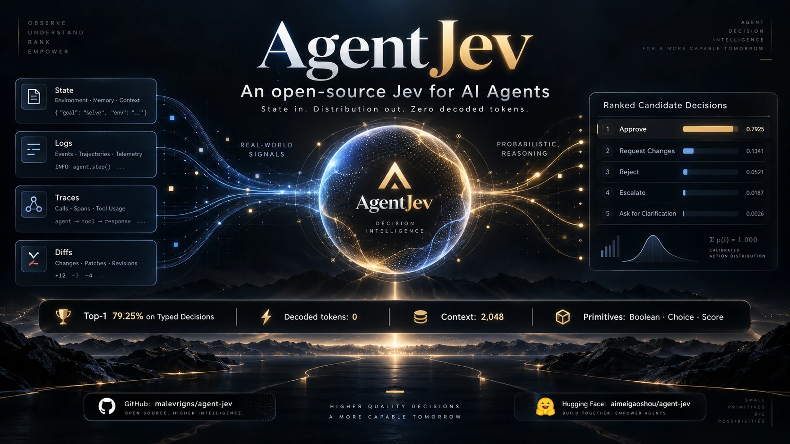</td>
<td align="center" valign="top">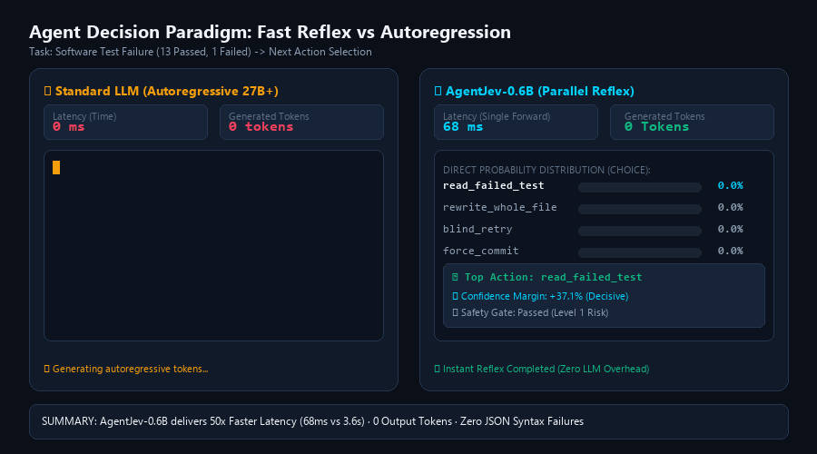 rekaman bergerak</td>
</tr></table>

🤖 <b><a href="https://github.com/Heman10x-NGU/openJev-verdict-2.0">Heman10x-NGU/openJev-verdict-2.0</a></b> · ⭐304 · Python · 🔎 inferred · 14 天 · ⭐-1

##### 📝 Ringkasan

Decision Engine Non-Autoregressive 151M terkalibrasi yang mengungguli TypeSafe Jev & Laya pada LocalLLaMA/typed-decisions (akurasi 77,10%, Brier 0,0636, ECE 0,0144)

##### 📌 Fakta dasar

| Bidang   | Nilai                                                 |
| -------- | ----------------------------------------------------- |
| Kategori | `Perkakas agen: MCP, hook, gate, dan agen pengkodean` |
| Bukti    | `inferred`                                            |
| Bahasa   | Python                                                |

##### 📊 Data

| Metrik            | Nilai        |
| ----------------- | ------------ |
| Bintang           | **304** (-1) |
| Push terakhir     | 2026-10-21   |
| Pertama terdaftar | 2026-09-19   |

🏷 `agentic-ai` · `brier-score` · `calibration` · `decision-engine` · `deep-learning` · `encoder` · `jev` · `machine-learning`

---

<table><tr><th align="center" width="50%">🖼 Gambar</th><th align="center" width="50%">🎬 Video</th></tr><tr>
<td align="center" valign="top"></td>
<td align="center" valign="top">tidak ada media yang dipublikasikan</td>
</tr></table>

Aset ditautkan langsung dari repositori hulu karena tidak ada lisensi redistribusi yang dinyatakan.

<b>Lainnya di kategori ini</b> · 181

- [GhalebDweikat/winnow](https://github.com/GhalebDweikat/winnow) - Penyaring konteks terkalibrasi untuk Claude Code: setiap hasil alat dinilai…
- [Nisaka520/JevIntent](https://github.com/Nisaka520/JevIntent) - WeChat (plugin FkWeChat): tekan lama pesan untuk menganalisis maksud / emosi /…
- [andyrewlee/awesome-system-one](https://github.com/andyrewlee/awesome-system-one) - Daftar model System One (juga disebut model keputusan): Jev, yang pertama…
- [Li-Evan/awesome-jev](https://github.com/Li-Evan/awesome-jev) - Galeri paling lengkap tentang apa yang dibangun orang dengan Jev, model System…
- [ChenneyZhuang/laya-browser-agent](https://github.com/ChenneyZhuang/laya-browser-agent) - Alternatif Jev lokal dan open-source: keputusan agen browser dengan Laya.
- [TrustifAI/typed_evals](https://github.com/TrustifAI/typed_evals) - Fast, typed Python framework for Jev-as-a-Judge/Decision-model evaluation for…
- [tiffygk/jev-mode](https://github.com/tiffygk/jev-mode) - Claude Code/Codex skills, evals, harnesses/context tools, and learning…
- [yohanargentina-oss/Foq](https://github.com/yohanargentina-oss/Foq) - ⚡ Foq — alternatif GRATIS, lokal, open-source untuk Jev.
- [mani-aiml/jev-demos](https://github.com/mani-aiml/jev-demos) - Demo dengan Jev, model System One milik TypeSafe, satu folder per demo.
- [kolawong/fast-compaction-dsh](https://github.com/kolawong/fast-compaction-dsh) - Kompaksi konteks berbasis putusan untuk DeepSeek Harness — menggantikan…
- [BFLabsAI/bf-jev-deep-research](https://github.com/BFLabsAI/bf-jev-deep-research) - Keahlian Agen + studi verbatim tentang Jev (TypeSafe AI System One Model)…
- [Mainakcris7/agent-guardrail-with-jev](https://github.com/Mainakcris7/agent-guardrail-with-jev) - A practical demo of how can we leverage the power of System One Models like Jev…
- [QuaanNguyen/xor](https://github.com/QuaanNguyen/xor) - plugin for OpenCode harness - blocks tool calls outside of scope using a…
- [andrevandal/pi-classifier-tools-skills](https://github.com/andrevandal/pi-classifier-tools-skills) - An extension for pi and Oh My Pi (omp) that classifies each incoming prompt…
- [apex-ronin/DecaFleet-OS](https://github.com/apex-ronin/DecaFleet-OS) - Sovereign 10-Bot Operational Execution Platform &amp; Jev-AI (jev-latest) System…
- [api-evangelist/typesafe-ai](https://github.com/api-evangelist/typesafe-ai) - TypeSafe AI adalah lab AI San Francisco yang membangun model System One — kelas…
- [CrowBe/weave](https://github.com/CrowBe/weave) - Harness Agen untuk model System One.
- [gorock007/jev-atlas](https://github.com/gorock007/jev-atlas) - An independent, evidence-first field guide to Jev.
- [gsaini/system-one-models-getting-started](https://github.com/gsaini/system-one-models-getting-started) - TypeSafe.
- [izam-mohammed/decisionsmith](https://github.com/izam-mohammed/decisionsmith) - Use and fine-tune System One models (Jev, Laya) on your data, with an LLM as…
- [JiaWeiXie/jev-enhanced-plugin](https://github.com/JiaWeiXie/jev-enhanced-plugin) - A Claude Code plugin that takes skills already in use and adds one thing to…
- [jms-dcksn/uipath-jev-guardrail-connector](https://github.com/jms-dcksn/uipath-jev-guardrail-connector) - Konektor bring-your-own-guardrail UiPath yang didukung model TypeSafe Jev…
- [lucast4049/openjev](https://github.com/lucast4049/openjev) - Jalankan keputusan cepat, terkalibrasi, dan bertipe pada model System One…
- [logicrw/awesome-jev-projects](https://github.com/logicrw/awesome-jev-projects) - Jev keren: radar ekosistem open-source berbasis sumber, penemuan proyek dengan…
- [AnotiaWang/awesome-decision-models](https://github.com/AnotiaWang/awesome-decision-models) - Daftar pilihan model keputusan (System One / model keputusan bertipe): model…
- [kydlikebtc/awesome-jev](https://github.com/kydlikebtc/awesome-jev) - Launch what you built on Jev, TypeSafe AI.
- [RomanSlack/jev-drone](https://github.com/RomanSlack/jev-drone) - Drone otonom yang hanya menggunakan kamera di MuJoCo dengan model penilaian…
- [Amal-David/awesome-jev](https://github.com/Amal-David/awesome-jev) - Demo Jev, proyek, SDKs, dan keahlian, dengan tautan sumber dan galeri X pilihan.
- [fatwang2/awesome-jev](https://github.com/fatwang2/awesome-jev) - Direktori proyek Jev berbasis sumber dengan alur kerja tinjauan yang hanya…
- [OmniJev/OneJev](https://github.com/OmniJev/OneJev) - 🚀🚀 Model keputusan System One multimodal yang memberikan jawaban terkalibrasi…
- [jmagly/aiwg](https://github.com/jmagly/aiwg) - Konteks proyek dan alur kerja spesialis yang dapat digunakan kembali untuk alat…
- [luobosibing2/dsh-jev-plugin](https://github.com/luobosibing2/dsh-jev-plugin) - Plugin Native DeepSeek Harness (DSH) yang mengintegrasikan TypeSafe Jev atau…
- [ThinkFlowLab/system1-agents](https://github.com/ThinkFlowLab/system1-agents) - Model keputusan System 1 (Jev, Laya, Cua-S1) sebagai otak untuk agen…
- [cookiespiggy/agentic-rl](https://github.com/cookiespiggy/agentic-rl) - Tutorial Agentic RL berbahasa Mandarin dari dasar (33 bab): dari konsep hingga…
- [UditAkhourii/quicksilver](https://github.com/UditAkhourii/quicksilver) - Skill Claude Code: serahkan penilaian massal kepada Jev.
- [kyegomez/open-jev](https://github.com/kyegomez/open-jev) - Rekonstruksi sumber terbuka dari prinsip pertama atas gagasan di balik TypeSafe…
- [Shanghua-Gao/RSI-Jev](https://github.com/Shanghua-Gao/RSI-Jev) - Model keputusan bertipe (noul / choice / score) yang dilatih oleh loop agen AI…
- [openlayer-ai/jevals](https://github.com/openlayer-ai/jevals) - Evals dan guardrail agen sebagai keputusan Jev: satu permintaan per trace…
- [initial-d/ml-quant-trading](https://github.com/initial-d/ml-quant-trading) - Riset kuantitatif ML PyTorch: 213 faktor, koreksi bias, optimasi portofolio…
- [PerryLink/jevcore](https://github.com/PerryLink/jevcore) - TypeSafe Jev untuk DeepSeek Harness, Model Context Protocol, dan Node biasa…
- [jonathanavis96/jev-kit](https://github.com/jonathanavis96/jev-kit) - Semua yang Anda perlukan untuk menjalankan TypeSafe Jev dengan Claude Code…
- [charlesdove977/claude-x-jev](https://github.com/charlesdove977/claude-x-jev) - Keputusan bertipe yang cepat dan murah untuk Claude Code.
- [akivet/Mica](https://github.com/akivet/Mica) - A 4B decision model: calibrated probabilities for yes/no, choice and score…
- [yikangy873-gif/jev-desktop](https://github.com/yikangy873-gif/jev-desktop) - Pemilihan tindakan TypeSafe Jev di dalam Codex Computer Use.
- [iamaamir/system-one](https://github.com/iamaamir/system-one) - Runtime yang netral terhadap provider untuk TypeScript dan Pi dengan System One.
- [TheoOliveira/pi-jev](https://github.com/TheoOliveira/pi-jev) - Perutean alat semantik dan keputusan System One bertipe untuk agen coding Pi…
- [alanhuangyoo/OpenJev](https://github.com/alanhuangyoo/OpenJev) - OpenJev: alternatif lokal open-source untuk Jev.
- [chuloontop4-code/jev-instance-review](https://github.com/chuloontop4-code/jev-instance-review) - Peninjau Instance Roblox Studio Terbaik 2026: Kriteria Jev Bertipe dan Kutipan…
- [shitianfang/jev-use](https://github.com/shitianfang/jev-use) - Plugin Claude Code / Codex / pi yang menyerahkan langkah agen yang tidak…
- [lawrence3699/jev-style](https://github.com/lawrence3699/jev-style) - JevStyle: local decision models for AI agents.
- [FrancoisChastel/jev-code](https://github.com/FrancoisChastel/jev-code) - Jev, pengklasifikasi milik TypeSafe bernama System One, sebagai alat di dalam…
- [alexei-led/claude-router](https://github.com/alexei-led/claude-router) - Plugin Claude Code yang memilih model dan effort untuk setiap giliran.
- [everyinfra/jev-radar](https://github.com/everyinfra/jev-radar) - 📡 The most rigorously verified tracker of the Jev (TypeSafe AI System One)…
- [AskTheWay/dsh-jev-interceptor](https://github.com/AskTheWay/dsh-jev-interceptor) - ⚡ Penilaian System-1 dalam hitungan milidetik untuk setiap pemanggilan alat di…
- [jomatsu/pi-jev-auto-mode](https://github.com/jomatsu/pi-jev-auto-mode) - Mode otomatis yang didukung Jev (TypeSafe System One) untuk agen coding Pi…
- [abhishek085/open-spark-jev](https://github.com/abhishek085/open-spark-jev) - Model keputusan lokal sumber terbuka yang terinspirasi oleh Jev milik TypeSafe…
- [NekomyaDev/nudge](https://github.com/NekomyaDev/nudge) - Bahasa pemrograman bertipe, dapat diputar ulang, dan sadar anggaran untuk agen…
- [anandi1989/awesome-jev-usecases](https://github.com/anandi1989/awesome-jev-usecases) - Indeks berbasis bukti dari kasus penggunaan Jev (TypeSafe AI System One) dunia…
- [Singularity-Compute/super-decider](https://github.com/Singularity-Compute/super-decider) - Decisions, not essays: a choice, a yes or no, or a score with a calibrated…
- [paramjeetn/jev-cookbook](https://github.com/paramjeetn/jev-cookbook) - Buku resep lengkap untuk Jev oleh TypeSafe AI — lebih dari 120 kasus…
- [1arley/jev-advisor-gateway](https://github.com/1arley/jev-advisor-gateway) - Local gateway that routes coding-agent tool decisions through Jev and can…
- [muxso/Shepherd](https://github.com/muxso/Shepherd) - Shepherd is an end-to-end AI Software Engineering platform that supervises the…
- [sunyasheng/JevGPT](https://github.com/sunyasheng/JevGPT) - JevGPT: Thinking Fast and Slow in Autonomous Research.
- [daftAI2026/awesome-jev](https://github.com/daftAI2026/awesome-jev) - Proyek TypeSafe Jev / System One GitHub pilihan, alternatif sumber terbuka, dan…
- [vicfei/awesome-jev-prompts](https://github.com/vicfei/awesome-jev-prompts) - Question patterns, anti-patterns &amp; calibration notes for typed decision models…
- [ajensenwaud/hermes-jev-plugin](https://github.com/ajensenwaud/hermes-jev-plugin) - Alat keputusan TypeSafe Jev (System One) untuk Hermes Agent: jev_check /…
- [caiovicentino/jev-risk-check-provider](https://github.com/caiovicentino/jev-risk-check-provider) - x402 risk-check provider: signed pre-payment verdicts — OFAC, phishing feeds…
- [mas-bandwidth/nova-sprint](https://github.com/mas-bandwidth/nova-sprint) - Coordinate AI sprints across different models, harnesses and machines.
- [zhangxaochen/dsh-jev](https://github.com/zhangxaochen/dsh-jev) - Suite plugin Jev (model keputusan System One) untuk DeepSeek Harness (dsh).
- [ronitgupta138/Local-Jev](https://github.com/ronitgupta138/Local-Jev) - ⚡ 100% offline, zero-cost drop-in alternative to TypeSafe Jev System One…
- [alexei-led/pi-model-router](https://github.com/alexei-led/pi-model-router) - Independent Pi extension for four-tier model routing with optional…
- [anisselbd/jev-phishing-bench](https://github.com/anisselbd/jev-phishing-bench) - Jev (TypeSafe) vs Claude Haiku 4.5 on 2,000 phishing emails: accuracy…
- [SergeyBazhmin/krasivo-jev](https://github.com/SergeyBazhmin/krasivo-jev) - Training data and models for &quot;system one&quot; classifiers: one forward pass, no…
- [frontierlabai/JevHub](https://github.com/frontierlabai/JevHub) - JevHub · Jev 生态热榜 把值得关注的 Jev 项目、教程和讨论，汇到一页。 自动发现 · 每日更新 · 按 Stars 排序 · 中英双语.
- [inso1337/revl](https://github.com/inso1337/revl) - Bahasa untuk komposabilitas spatiotemporal yang aman dan universal.
- [Jessie-QingYu/jev-in-the-wild](https://github.com/Jessie-QingYu/jev-in-the-wild) - Kasus penggunaan Jev di dunia nyata, proyek sumber terbuka, benchmark, dan…
- [jmrenouard/MicroLLM](https://github.com/jmrenouard/MicroLLM) - Local Hybrid System-One Decision Engine.
- [ranjan2829/AskJev](https://github.com/ranjan2829/AskJev) - AskJev — autopilot Jev untuk situs web apa pun + perlindungan pada klik yang…
- [Civalski/claujev](https://github.com/Civalski/claujev) - Jev (TypeSafe AI) as a second pair of eyes for Claude Code: request triage…
- [coderexpert123/jev-browser-wingman](https://github.com/coderexpert123/jev-browser-wingman) - Browser automation where TypeSafe.
- [FazalAAli/jev-robotics-demo](https://github.com/FazalAAli/jev-robotics-demo) - Jev (TypeSafe System One) vs Claude Opus 5 menggerakkan lengan robot…
- [legostin/jev-mcp](https://github.com/legostin/jev-mcp) - MCP server that lets Claude Code, Codex &amp; AI agents drive a real Chrome browser…
- [reacher-z/Awesome-Jev](https://github.com/reacher-z/Awesome-Jev) - Curated Jev and System One papers, models, datasets, benchmarks and SDKs, with…
- [7starsseeker/dsh-fact-check](https://github.com/7starsseeker/dsh-fact-check) - Fact-checking skill for DeepSeek Harness: multi-source verification against the…
- [8itlab/reflex-computer-use](https://github.com/8itlab/reflex-computer-use) - Computer use MCP server for Claude Code, Codex and other AI agents.
- [agentscope-ai/HarnessJevBench](https://github.com/agentscope-ai/HarnessJevBench) - Benchmarking Jev-style models at agent harness decision points.
- [King4s/Jev-AI-Skill](https://github.com/King4s/Jev-AI-Skill) - One AI skill + MCP server for Claude Code, Codex and Hermes: Jev (TypeSafe)…
- [MongLong0214/jev-gate](https://github.com/MongLong0214/jev-gate) - Tidak setiap tugas coding membutuhkan model terbaik Anda.
- [nanami-0713/dsh-jev-decide](https://github.com/nanami-0713/dsh-jev-decide) - Plugin DSH: daftarkan TypeSafe Jev (model keputusan System One) sebagai alat…
- [simota/tenbin](https://github.com/simota/tenbin) - Server MCP dan skill agen untuk TypeSafe AI System One API (Jev): uraikan…
- [supermanc417-alt/awesome-jev-hub](https://github.com/supermanc417-alt/awesome-jev-hub) - Pusat terkurasi ekosistem model &quot;System One&quot; Jev / TypeSafe — konsep, 51 proyek…
- [ardana-ai/ardana](https://github.com/ardana-ai/ardana) - Run System 1 decision models locally. Pull a model by name and get calibrated…
- [deepansh-saxena/jev-guardrails](https://github.com/deepansh-saxena/jev-guardrails) - Membandingkan LLM-as-judge dengan TypeSafe Jev untuk guardrail agen: aturan…
- [gordan-code/dsh-jev-advisor](https://github.com/gordan-code/dsh-jev-advisor) - Jev (TypeSafe System One) memberi manusia pendapat kedua, bukan agen.
- [holny/evolve-router](https://github.com/holny/evolve-router) - Stop burning premium model tokens on simple prompts. Save tokens.
- [robokrunch/awesome-jev](https://github.com/robokrunch/awesome-jev) - Daftar sumber daya pilihan untuk Jev — model keputusan System One milik…
- [SoniaMehta14/paved-gate](https://github.com/SoniaMehta14/paved-gate) - Gerbang ingestion System 1 yang cepat untuk arsitektur agen AI: keamanan…
- [tinypi-extension/tinysubagent](https://github.com/tinypi-extension/tinysubagent) - Pemunculan subagen herdr-native minimal untuk pi — peran agen markdown, profil…
- [guanghuang/coding-router-jev](https://github.com/guanghuang/coding-router-jev) - TypeScript/Bun launcher routing Codex turns through JEV with model and…
- [jms-dcksn/jev-pii-guardrail](https://github.com/jms-dcksn/jev-pii-guardrail) - Agen berkode UiPath dengan guardrail deteksi PII khusus pada batas LLM…
- [rahilmavani/piedpiper-jev-buildathon](https://github.com/rahilmavani/piedpiper-jev-buildathon) - Tim piedpiper: failproofai + pagar pengaman Jev yang mencegah agen Helix IT…
- [173787247/dsh-wsl-jev](https://github.com/173787247/dsh-wsl-jev) - DeepSeek Harness WSL plugin: TypeSafe Jev / OpenRouter System One.
- [17671454333/jev-cognitive-mcp](https://github.com/17671454333/jev-cognitive-mcp) - 3+1 Cognitive Hierarchy Toolkit &amp; Model Context Protocol (MCP) Server for…
- [2426269/ComfyUI-Jev-Decision](https://github.com/2426269/ComfyUI-Jev-Decision) - ComfyUI semantic judgement node: Noul/Choice/Score, typed outputs, workflows…
- [a742987/JevLens](https://github.com/a742987/JevLens) - Jev decision visualisation and debugging panel for coding agents.
- [bhanuprakashk90-tech/jev-agent-guardrail](https://github.com/bhanuprakashk90-tech/jev-agent-guardrail) - Pagar pengaman keselamatan waktu nyata dan dasbor pemantauan interaktif untuk…
- [bismawy/pi-jev-eye](https://github.com/bismawy/pi-jev-eye) - Supervisor ultra-ringkas untuk Pi: pagar pengaman regex tanpa token, pelacakan…
- [charetterat/awesome-jev-essentials](https://github.com/charetterat/awesome-jev-essentials) - Proyek Jev yang benar-benar layak Anda gunakan — dipilih, dibandingkan, dan…
- [d0ng231/jev-gtw](https://github.com/d0ng231/jev-gtw) - JEV Gateway: PII/PHI guardrails for coding agents.
- [DarkisuSu/Jev-Claude-Router](https://github.com/DarkisuSu/Jev-Claude-Router) - MOD routing model dan pemilihan keterampilan yang ditenagai Jev untuk Claude.
- [edamlabs/e-jev](https://github.com/edamlabs/e-jev) - A self-hosted Jev with a pluggable decision-backend fleet — typed, calibrated…
- [eshitakundu/jev-flow](https://github.com/eshitakundu/jev-flow) - Support-triage inbox where an LLM answers typed questions and a deterministic…
- [Faizullah9181/jev-esketcher](https://github.com/Faizullah9181/jev-esketcher) - Kanvas lukisan generatif tempat Jev, model keputusan terkalibrasi milik…
- [frederico-kluser/jev-agent-skill](https://github.com/frederico-kluser/jev-agent-skill) - Keputusan bertipe dalam hitungan milidetik dengan Jev.
- [hectorj2f/jev-router](https://github.com/hectorj2f/jev-router) - Route Claude Code subagents to the right Anthropic model per task, using…
- [jbatra-umeey/jev-decisionops](https://github.com/jbatra-umeey/jev-decisionops) - Enam alur kerja keputusan Jev untuk AI agentic: perutean model, guardrail…
- [JoaoClemer/jev-lab](https://github.com/JoaoClemer/jev-lab) - O Jev (TypeSafe AI) sebagai pagar pengaman waktu nyata dan pra-penilai agen…
- [keiffff/jev-kit](https://github.com/keiffff/jev-kit) - Jev toolkit for building fast, testable AI decision points for agent…
- [kitoutou999/firefox-jev-mcp](https://github.com/kitoutou999/firefox-jev-mcp) - Serveur MCP pour piloter Firefox avec Claude : Jev (TypeSafe) choisit les…
- [lijiawei255/jev-tune](https://github.com/lijiawei255/jev-tune) - Jev-inspired calibrated decision &amp; safety shell for typed PID autotuning…
- [majiayu000/awesome-jev](https://github.com/majiayu000/awesome-jev) - Daftar pilihan proyek Jev / TypeSafe System One, SDKs, tutorial, dan evaluasi.
- [Thneoly/r2r-jev](https://github.com/Thneoly/r2r-jev) - Persistent governance for AI agents — turn Jev judgments into replayable…
- [zhuyansen/awesome-typesafe-jev](https://github.com/zhuyansen/awesome-typesafe-jev) - Proyek open-source yang dibangun di atas model keputusan TypeSafe Jev: replika…
- [01Joseph-Hwang10/pi-jev-router-pro](https://github.com/01Joseph-Hwang10/pi-jev-router-pro) - Single-surface TypeSafe Jev model router for the Pi coding agent: one virtual…
- [abyakod/JEV_ADK](https://github.com/abyakod/JEV_ADK) - Kit Pengembangan Agen untuk System-One AI: pipeline keputusan non-autoregresif…
- [aleksvega/jev-stack](https://github.com/aleksvega/jev-stack) - Satu perintah (npx jev-stack) untuk memasang perangkat alat agen bertenaga Jev…
- [AlienXc137/Support-Ticket-Ai-Agent-with-RAG-Guardrails-and-Jev](https://github.com/AlienXc137/Support-Ticket-Ai-Agent-with-RAG-Guardrails-and-Jev) - Agen yang membaca kueri siswa masuk (email/WhatsApp/teks formulir)…
- [antirepas/GoGoJevMCP](https://github.com/antirepas/GoGoJevMCP) - This is a small side project where I built an MCP server with a collection of…
- [ashp15205/jev-laya-system-1](https://github.com/ashp15205/jev-laya-system-1) - jev-laya-system-1: Security &amp; calibration middleware for System 1 AI models…
- [bpmforbusiness/jev-agent-harness](https://github.com/bpmforbusiness/jev-agent-harness) - Panduan harness agen Jev (TypeSafe AI System One) + manual video — dari pos…
- [cameronb-xano/jev-agent-guardrail](https://github.com/cameronb-xano/jev-agent-guardrail) - Template Xano: guardrail tool-call agen Jev. Jev memutuskan, Xano menegakkan.
- [Caph-dev/pi-jev-router](https://github.com/Caph-dev/pi-jev-router) - Jev-routed two-phase virtual model for pi: plan on a strong model, implement on…
- [castorhrio/jev-pi-agent](https://github.com/castorhrio/jev-pi-agent) - Multi-agent coding workbench — hashed context injection, explainable routing…
- [chaoguang668/dsh-jev-screen](https://github.com/chaoguang668/dsh-jev-screen) - Jev-powered semantic pre-screening for local files in DeepSeek Harness: code…
- [Covre81/jev-router](https://github.com/Covre81/jev-router) - Local Anthropic-compatible gateway that routes Claude Code traffic across…
- [davidpobi/JevTown](https://github.com/davidpobi/JevTown) - An Interactive Collection Of AI Game Worlds Where Typesafe Jev Agents Choose…
- [eduardo-xyz/jev-browser-mcp](https://github.com/eduardo-xyz/jev-browser-mcp) - MCP tool exposing TypeSafe.
- [forrestneo/jev-sim](https://github.com/forrestneo/jev-sim) - jev-sim: keputusan bertipe gaya Jev (Choice/Noul/Score) pada model sesi ZCode.
- [GilBar2/jev-orchestration](https://github.com/GilBar2/jev-orchestration) - Route coding tasks between Claude Code, Codex and Hermes: pattern, model and…
- [HangChi/JevRouter](https://github.com/HangChi/JevRouter) - 让 LLM 理解任务、让 Jev 做带概率的路由决策、再由显式策略控制执行的 Agent 运行时：Jev 决定下一步，策略引擎决定能不能执行.
- [hdjekuue/awesome-jev](https://github.com/hdjekuue/awesome-jev) - Direktori trilingual yang memperbarui dirinya sendiri, berisi semua yang…
- [HKUST-KnowComp/jev-guardrail](https://github.com/HKUST-KnowComp/jev-guardrail) - Pohon kebijakan yang dapat diedit dan pengklasifikasi 2B untuk peninjauan…
- [hojeongna/jev-agent-memory](https://github.com/hojeongna/jev-agent-memory) - No vector DB. A fast decision model routes and picks your agent.
- [iamdgarcia/jev-mini-bench](https://github.com/iamdgarcia/jev-mini-bench) - Penjelajah saku gelombang model keputusan kecil.
- [jipika/dsh-jev-grep](https://github.com/jipika/dsh-jev-grep) - Plugin adjudikasi search-flood untuk DeepSeek Harness: ripgrep + penilaian…
- [kevinyin9/next-steps-jev](https://github.com/kevinyin9/next-steps-jev) - Suggested next steps for Claude Code, scored by how much each one helps your…
- [kkwelfare/jev-route-screening-public](https://github.com/kkwelfare/jev-route-screening-public) - Plugin Hermes Agent eksperimental untuk checkpoint Jev terbatas dan penyaringan…
- [liyifan2004/obsidian-jev-inbox-router](https://github.com/liyifan2004/obsidian-jev-inbox-router) - Obsidian plugin: route incoming notes to the right folder using JEV.
- [Mfrostbutter/jev-n8n-patterns](https://github.com/Mfrostbutter/jev-n8n-patterns) - Pola Jev (TypeSafe System One) di n8n: penyaringan PII, guardrail agen dan agen…
- [MichelePolo/jev-mcp](https://github.com/MichelePolo/jev-mcp) - Server MCP yang mengekspos model keputusan Jev-style System One.
- [miketropi/pi-jev-model-manager](https://github.com/miketropi/pi-jev-model-manager) - Pi coding agent extension: Jev-powered model routing with a native TUI model…
- [mxttbennett/jev-relay](https://github.com/mxttbennett/jev-relay) - Per-task Jev routing for Claude Code and Codex: inline, subagent or sibling…
- [PeriodBLUE/jev-project-atlas](https://github.com/PeriodBLUE/jev-project-atlas) - A source-verified atlas of GitHub projects built with JEV / TypeSafe System One.
- [QuesoMan/jev-router](https://github.com/QuesoMan/jev-router) - Claude Code mod: routes every turn, subagent and ultracode workflow agent to a…
- [royalskynet/jev-gate-lite](https://github.com/royalskynet/jev-gate-lite) - Jev Gate without the local Laya lane: MCP judgment tools, tool-output pruning…
- [Sandesh-S-Dalvi/playwright-jev-testing-refactored](https://github.com/Sandesh-S-Dalvi/playwright-jev-testing-refactored) - Goal-driven Playwright E2E testing where TypeSafe Jev (System One) decides the…
- [shahshahdab/fastcampus-jev](https://github.com/shahshahdab/fastcampus-jev) - Learn to gate tool calls, guardrails, and risky actions with Jev judgment plus…
- [skylence-org/claudecode-jev-marketplace](https://github.com/skylence-org/claudecode-jev-marketplace) - TypeSafe Jev (System One) wired into Claude Code: a decision primitive for…
- [thejasrao262003/jev-compositional-uncertainty](https://github.com/thejasrao262003/jev-compositional-uncertainty) - Research on whether AI decision workflows can trust and combine uncertainty…
- [tmbmartell/jev-mcp](https://github.com/tmbmartell/jev-mcp) - Servidor MCP que expõe o Jev (TypeSafe System One) como ferramenta de…
- [veermshah/jev-calibration-lab](https://github.com/veermshah/jev-calibration-lab) - Independent calibration benchmark for System One decision models (TypeSafe Jev)…
- [vinaychawla-ops/jev-adk-guardrail-example](https://github.com/vinaychawla-ops/jev-adk-guardrail-example) - Jev (model keputusan TypeSafe) sebagai pelindung risiko di dalam…
- [WaynezProg/jev-kit](https://github.com/WaynezProg/jev-kit) - Source-bound evidence checks and bounded Jev judgments for coding agents via…
- [wendyeq/dsh-jev-router](https://github.com/wendyeq/dsh-jev-router) - Optional session-pinned Jev routing plugin for DeepSeek Harness.
- [Wrenik/jev-toolkit](https://github.com/Wrenik/jev-toolkit) - Experiment: a judgement model (TypeSafe Jev) next to Claude.
- [xano-community/agent-guardrail-jev](https://github.com/xano-community/agent-guardrail-jev) - Guardrail pemanggilan alat agen AI untuk Xano: Jev (TypeSafe AI) menilai setiap…
- [xiaoyaner0201/hermes-jev-thread-status](https://github.com/xiaoyaner0201/hermes-jev-thread-status) - Jev-powered Discord thread status titles for Hermes Agent: \[Running\] →…
- [yangzhou-chaofan/awesome-jev-prompt](https://github.com/yangzhou-chaofan/awesome-jev-prompt) - 100 showcase teratas terbaru untuk jev (terus diperbarui) dari x / github /…
- [Yomiamy/jev-mobile-mcp](https://github.com/Yomiamy/jev-mobile-mcp) - mcp oleh jev untuk keputusan dan deteksi OCR dalam pengujian perangkat.
- [ZeroX-01/jev-atlas](https://github.com/ZeroX-01/jev-atlas) - Indeks publik yang terus diperbarui berisi proyek, video, artikel, dan demo…
- [notque/vexjoy-agent](https://github.com/notque/vexjoy-agent) - Agen AI VexJoy dengan Perutean Cerdas Jev - /do merutekan permintaan berbahasa…
- [itsmostafa/system-one-connector](https://github.com/itsmostafa/system-one-connector) - Konektor System One MCP untuk mengevaluasi apa pun dengan cepat dan murah.
- [keeltrace/hermes-nerve](https://github.com/keeltrace/hermes-nerve) - Nerve adalah sistem saraf pengawas untuk agen Hermes, menambahkan keputusan…
- [everafterlabs/jes](https://github.com/everafterlabs/jes) - Guardrail sumber terbuka untuk agen AI yang didukung oleh model keputusan…
- [darwintechlab/openjev](https://github.com/darwintechlab/openjev) - OpenJev: Plugin Opencode yang menggantikan keputusan pembuatan teks dengan Jev…
- [47vigen/catherd](https://github.com/47vigen/catherd) - Herds coding agents: autopilot builds from your own Claude Code session…
- [tamnd/kime](https://github.com/tamnd/kime) - Typed decisions over text in milliseconds.
- [kaustav1996/reflex](https://github.com/kaustav1996/reflex) - A coding agent and personal assistant with System One reflexes (TypeSafe Jev)…
- [laxtiz/opencode-vllm-sr-auth](https://github.com/laxtiz/opencode-vllm-sr-auth) - vLLM-SR Decision — System One decision models (choice/noul/score/box) for…
- [patronus-protect/decision-model-guard](https://github.com/patronus-protect/decision-model-guard) - Guardrails for decision models: stop text inside the content from steering…
- [chaosxingxc-orion/nga](https://github.com/chaosxingxc-orion/nga) - NGA (Next Generation Agent) on openJiuwen: Jev-like decision models, S1 + S2…

## Perutean, guardrail, dan persetujuan

Kasus penggunaan bergaya produksi — kirim setiap permintaan ke model termurah yang benar-benar mampu menanganinya, dan jaga pemeriksaan deterministik atas hasilnya.

🛡️ <b><a href="https://github.com/HarnessRouter/SystemOneHarness">HarnessRouter/SystemOneHarness</a></b> · ⭐206 · Python · 👁️ observed · 45 天

##### 📝 Ringkasan

Harness System One untuk model System One. Jalankan Jev dan model System One lainnya secara lokal atau langsung di HarnessRouter.ai.

🔧 Ditemukan dipakai dalam kode: `docs/design.md`

##### 📌 Fakta dasar

| Bidang   | Nilai                                  |
| -------- | -------------------------------------- |
| Kategori | `Perutean, guardrail, dan persetujuan` |
| Bukti    | `observed`                             |
| Bahasa   | Python                                 |

##### 📊 Data

| Metrik            | Nilai      |
| ----------------- | ---------- |
| Bintang           | **206**    |
| Push terakhir     | 2026-09-21 |
| Pertama terdaftar | 2026-10-28 |

🏷 `harness` · `harness-engineering` · `system-one-harness` · `system-one-models`

🛡️ <b><a href="https://github.com/Dicklesworthstone/skillranker">Dicklesworthstone/skillranker</a></b> · ⭐139 · Rust · 👁️ observed · 16 天

##### 📝 Ringkasan

Rust CLI yang didukung oleh Jev dari TypeSafe.ai, yang memeringkat keahlian agen untuk langkah berikutnya menggunakan konteks sesi langsung. Mencakup hook Code Claude, JSON terstruktur, abstensi, dan umpan balik lokal. Memerlukan kunci TypeSafe API.

> 💡 Memeringkat keterampilan agen dengan keputusan bertipe. Model yang berguna untuk masalah apa pun dengan pola 'memilih di antara N kandidat' yang sebelumnya ditangani dengan prompt.

🔧 Ditemukan dipakai dalam kode: `README.md`

##### 📌 Fakta dasar

| Bidang   | Nilai                                  |
| -------- | -------------------------------------- |
| Kategori | `Perutean, guardrail, dan persetujuan` |
| Bukti    | `observed`                             |
| Bahasa   | Rust                                   |

##### 📊 Data

| Metrik            | Nilai      |
| ----------------- | ---------- |
| Bintang           | **139**    |
| Push terakhir     | 2026-10-19 |
| Pertama terdaftar | 2026-10-29 |

🏷 `agent-skills` · `ai-agents` · `asupersync` · `claude-code` · `cli` · `developer-tools` · `frankentui` · `jev`

🛡️ <b><a href="https://github.com/Sarim-MBZUAI/awesome-jev-security">Sarim-MBZUAI/awesome-jev-security</a></b> · ⭐7 · 👁️ observed · 14 天

##### 📝 Ringkasan

Curated list of papers on the security, robustness, and safety of TypeSafe Jev / System One models

##### 📌 Fakta dasar

| Bidang   | Nilai                                  |
| -------- | -------------------------------------- |
| Kategori | `Perutean, guardrail, dan persetujuan` |
| Bukti    | `observed`                             |

##### 📊 Data

| Metrik            | Nilai      |
| ----------------- | ---------- |
| Bintang           | **7**      |
| Push terakhir     | 2026-10-22 |
| Pertama terdaftar | 2026-10-28 |

🛡️ <b><a href="https://github.com/dharmeshgurnani/CodeOtter">dharmeshgurnani/CodeOtter</a></b> · ⭐3 · JavaScript · 👁️ observed · 0 天

##### 📝 Ringkasan

Tinjauan kode AI otonom dan di-host sendiri, pengukur skor terkalibrasi, serta gerbang merge dari model terbuka apa pun.

##### 📌 Fakta dasar

| Bidang   | Nilai                                  |
| -------- | -------------------------------------- |
| Kategori | `Perutean, guardrail, dan persetujuan` |
| Bukti    | `observed`                             |
| Bahasa   | JavaScript                             |

##### 📊 Data

| Metrik            | Nilai      |
| ----------------- | ---------- |
| Bintang           | **3**      |
| Push terakhir     | 2026-11-05 |
| Pertama terdaftar | 2026-11-01 |

🏷 `ai-code-review` · `code-review` · `coderabbit` · `developer-tools` · `devops` · `forgejo` · `gguf` · `gitea`

---

<table><tr><th align="center" width="50%">🖼 Gambar</th><th align="center" width="50%">🎬 Video</th></tr><tr>
<td align="center" valign="top"></td>
<td align="center" valign="top">tidak ada media yang dipublikasikan</td>
</tr></table>

🛡️ <b><a href="https://github.com/baldellimtt/systemone-lab">baldellimtt/systemone-lab</a></b> · ⭐2 · HTML · 👁️ observed · 3 天

##### 📝 Ringkasan

Hands-on System One decision lab: Jev-compatible Noul/Choice/Score over local open-weight Laya, with playground UI, routing/eval examples, and CI smoke tests.

##### 📌 Fakta dasar

| Bidang   | Nilai                                  |
| -------- | -------------------------------------- |
| Kategori | `Perutean, guardrail, dan persetujuan` |
| Bukti    | `observed`                             |
| Bahasa   | HTML                                   |

##### 📊 Data

| Metrik            | Nilai      |
| ----------------- | ---------- |
| Bintang           | **2**      |
| Push terakhir     | 2026-11-02 |
| Pertama terdaftar | 2026-11-02 |

🏷 `calibrated-probabilities` · `jev` · `laya` · `system-one-models` · `typed-decisions` · `typesafe`

---

<table><tr><th align="center" width="50%">🖼 Gambar</th><th align="center" width="50%">🎬 Video</th></tr><tr>
<td align="center" valign="top"></td>
<td align="center" valign="top">tidak ada media yang dipublikasikan</td>
</tr></table>

🛡️ <b><a href="https://github.com/alperenerol/jev-1.13-mini-benchmark">alperenerol/jev-1.13-mini-benchmark</a></b> · ⭐1 · Python · 👁️ observed · 37 天

##### 📝 Ringkasan

Benchmark mini model keputusan terstruktur jev-1.13 milik TypeSafe (OpenRouter Decisions API) pada triase dukungan berlabel: noul/choice/score, konsistensi, biaya, dan pelajaran yang didapat

##### 📌 Fakta dasar

| Bidang   | Nilai                                  |
| -------- | -------------------------------------- |
| Kategori | `Perutean, guardrail, dan persetujuan` |
| Bukti    | `observed`                             |
| Bahasa   | Python                                 |

##### 📊 Data

| Metrik            | Nilai      |
| ----------------- | ---------- |
| Bintang           | **1**      |
| Push terakhir     | 2026-09-29 |
| Pertama terdaftar | 2026-11-01 |

🛡️ <b><a href="https://github.com/aosus/mirsad">aosus/mirsad</a></b> · ⭐1 · Rust · 👁️ observed · 2 天

##### 📝 Ringkasan

bot for matrix spam filtering using system one models.

##### 📌 Fakta dasar

| Bidang   | Nilai                                  |
| -------- | -------------------------------------- |
| Kategori | `Perutean, guardrail, dan persetujuan` |
| Bukti    | `observed`                             |
| Bahasa   | Rust                                   |

##### 📊 Data

| Metrik            | Nilai      |
| ----------------- | ---------- |
| Bintang           | **1**      |
| Push terakhir     | 2026-11-03 |
| Pertama terdaftar | 2026-11-03 |

🛡️ <b><a href="https://github.com/Dominion-Academy/System-One-Models">Dominion-Academy/System-One-Models</a></b> · Python · 👁️ observed · 0 天

##### 📝 Ringkasan

Code for a course on System One models (Jev, Kev, Laya): LLMs that answer with a choice and a probability instead of free text. Build a support-ticket triage service with Choice, Score and Noul questions, check whether the confidence can be trusted, set thresholds, and run it in production.

##### 📌 Fakta dasar

| Bidang   | Nilai                                  |
| -------- | -------------------------------------- |
| Kategori | `Perutean, guardrail, dan persetujuan` |
| Bukti    | `observed`                             |
| Bahasa   | Python                                 |

##### 📊 Data

| Metrik            | Nilai      |
| ----------------- | ---------- |
| Bintang           | **0**      |
| Push terakhir     | 2026-11-05 |
| Pertama terdaftar | 2026-11-04 |

🏷 `calibration` · `jev` · `kev` · `laya` · `python` · `system-design` · `system-one` · `system-one-models`

🛡️ <b><a href="https://github.com/nani-stack/gmail-auto-cleanup">nani-stack/gmail-auto-cleanup</a></b> · Python · 👁️ observed · 3 天

##### 📝 Ringkasan

Triage your Gmail inbox with a System One model (Jev or Laya): typed yes/no judgements, probabilities, and reversible actions.

##### 📌 Fakta dasar

| Bidang   | Nilai                                  |
| -------- | -------------------------------------- |
| Kategori | `Perutean, guardrail, dan persetujuan` |
| Bukti    | `observed`                             |
| Bahasa   | Python                                 |

##### 📊 Data

| Metrik            | Nilai      |
| ----------------- | ---------- |
| Bintang           | **0**      |
| Push terakhir     | 2026-11-02 |
| Pertama terdaftar | 2026-11-02 |

🏷 `ai` · `automation` · `email` · `email-classification` · `gmail` · `inbox-zero` · `jev` · `laya`

🛡️ <b><a href="https://github.com/NandhaKishorM/laya">NandhaKishorM/laya</a></b> · ⭐35052 · Python · 🔎 inferred · 0 天 · ⭐+31

##### 📝 Ringkasan

Mesin keputusan Sistem 1 non-autoregresif. Pilihan bertipe, skor, dan keputusan ya/tidak atas teks apa pun dalam satu lintasan maju, dalam lebih dari 100 bahasa, dengan router yang memilih checkpoint yang tepat untuk setiap permintaan.

##### 📌 Fakta dasar

| Bidang   | Nilai                                  |
| -------- | -------------------------------------- |
| Kategori | `Perutean, guardrail, dan persetujuan` |
| Bukti    | `inferred`                             |
| Bahasa   | Python                                 |

##### 📊 Data

| Metrik            | Nilai           |
| ----------------- | --------------- |
| Bintang           | **35052** (+31) |
| Push terakhir     | 2026-11-05      |
| Pertama terdaftar | 2026-09-23      |

🏷 `calibration` · `classification` · `decision-model` · `huggingface` · `jev` · `modernbert` · `multilingual` · `nlp`

---

<table><tr><th align="center" width="50%">🖼 Gambar</th><th align="center" width="50%">🎬 Video</th></tr><tr>
<td align="center" valign="top"></td>
<td align="center" valign="top">tidak ada media yang dipublikasikan</td>
</tr></table>

🛡️ <b><a href="https://github.com/slavabars/decision-cascade">slavabars/decision-cascade</a></b> · ⭐77 · Python · 🔎 inferred · 7 天 · ⭐-1

##### 📝 Ringkasan

Local decision engine with typed, calibrated outputs (Noul/Choice/Score): cheap→strong cascade, ECE/Brier calibration, SystemOne protocol interop. Apache-2.0.

##### 📌 Fakta dasar

| Bidang   | Nilai                                  |
| -------- | -------------------------------------- |
| Kategori | `Perutean, guardrail, dan persetujuan` |
| Bukti    | `inferred`                             |
| Bahasa   | Python                                 |

##### 📊 Data

| Metrik            | Nilai       |
| ----------------- | ----------- |
| Bintang           | **77** (-1) |
| Push terakhir     | 2026-10-29  |
| Pertama terdaftar | 2026-10-16  |

🏷 `calibration` · `cascade` · `decision-making` · `fastapi` · `llm` · `model-routing` · `pytorch` · `systemone`

🛡️ <b><a href="https://github.com/bytelabs-oss/clash-jev">bytelabs-oss/clash-jev</a></b> · ⭐35 · Python · 🔎 inferred · 21 天

##### 📝 Ringkasan

Bot Clash Royale tanpa kebijakan terlatih: Jev (TypeSafe System One) membuat setiap keputusan dari keadaan permainan langsung

##### 📌 Fakta dasar

| Bidang   | Nilai                                  |
| -------- | -------------------------------------- |
| Kategori | `Perutean, guardrail, dan persetujuan` |
| Bukti    | `inferred`                             |
| Bahasa   | Python                                 |

##### 📊 Data

| Metrik            | Nilai      |
| ----------------- | ---------- |
| Bintang           | **35**     |
| Push terakhir     | 2026-10-14 |
| Pertama terdaftar | 2026-10-26 |

🛡️ <b><a href="https://github.com/kenhuangus/jev-usecases">kenhuangus/jev-usecases</a></b> · ⭐27 · Python · 🔎 inferred · 45 天

##### 📝 Ringkasan

Harness use-case TypeSafe Jev (System One) produksi dengan logika keputusan berpagar kepercayaan

##### 📌 Fakta dasar

| Bidang   | Nilai                                  |
| -------- | -------------------------------------- |
| Kategori | `Perutean, guardrail, dan persetujuan` |
| Bukti    | `inferred`                             |
| Bahasa   | Python                                 |

##### 📊 Data

| Metrik            | Nilai      |
| ----------------- | ---------- |
| Bintang           | **27**     |
| Push terakhir     | 2026-09-21 |
| Pertama terdaftar | 2026-10-28 |

---

<table><tr><th align="center" width="50%">🖼 Gambar</th><th align="center" width="50%">🎬 Video</th></tr><tr>
<td align="center" valign="top"></td>
<td align="center" valign="top">tidak ada media yang dipublikasikan</td>
</tr></table>

🛡️ <b><a href="https://github.com/gaborishka/jev-canvas">gaborishka/jev-canvas</a></b> · ⭐22 · JavaScript · 🔎 inferred · 47 天

##### 📝 Ringkasan

Gambar di kanvas tldraw dengan suara dan jari yang menunjuk. Jev (TypeSafe System One) menentukan tindakan, target, dan tempat dalam ~350 ms per kata yang diucapkan.

##### 📌 Fakta dasar

| Bidang   | Nilai                                  |
| -------- | -------------------------------------- |
| Kategori | `Perutean, guardrail, dan persetujuan` |
| Bukti    | `inferred`                             |
| Bahasa   | JavaScript                             |

##### 📊 Data

| Metrik            | Nilai      |
| ----------------- | ---------- |
| Bintang           | **22**     |
| Push terakhir     | 2026-09-19 |
| Pertama terdaftar | 2026-10-28 |

🏷 `hand-tracking` · `jev` · `mediapipe` · `openrouter` · `tldraw` · `typesafe` · `voice-control` · `web-speech-api`

---

<table><tr><th align="center" width="50%">🖼 Gambar</th><th align="center" width="50%">🎬 Video</th></tr><tr>
<td align="center" valign="top"></td>
<td align="center" valign="top"> rekaman bergerak</td>
</tr></table>

🛡️ <b><a href="https://github.com/rupeshpoojary9/poorjev">rupeshpoojary9/poorjev</a></b> · ⭐11 · Python · 🔎 inferred · 45 天

##### 📝 Ringkasan

Alternatif Jev lokal dan open-source: lapisan keputusan System One dengan keyakinan terkalibrasi yang dapat dibuktikan (ECE 0.170→0.071). Keputusan bertipe, berjalan offline, tanpa kunci API, tanpa waitlist.

##### 📌 Fakta dasar

| Bidang   | Nilai                                  |
| -------- | -------------------------------------- |
| Kategori | `Perutean, guardrail, dan persetujuan` |
| Bukti    | `inferred`                             |
| Bahasa   | Python                                 |

##### 📊 Data

| Metrik            | Nilai      |
| ----------------- | ---------- |
| Bintang           | **11**     |
| Push terakhir     | 2026-09-21 |
| Pertama terdaftar | 2026-10-28 |

🏷 `calibration` · `classification` · `conformal-prediction` · `jev` · `jev-alternative` · `llm` · `llm-guardrails` · `local-llm`

---

<table><tr><th align="center" width="50%">🖼 Gambar</th><th align="center" width="50%">🎬 Video</th></tr><tr>
<td align="center" valign="top"></td>
<td align="center" valign="top">tidak ada media yang dipublikasikan</td>
</tr></table>

🛡️ <b><a href="https://github.com/eulogik/nirnay">eulogik/nirnay</a></b> · ⭐10 · Python · 🔎 inferred · 30 天

##### 📝 Ringkasan

NIRNAY 450M: model keputusan terkalibrasi berbobot terbuka (Apache-2.0). Klasifikasi intent Banking77 87,9%, ECE terpasang 0,045. Fork Laya ditambah concept bottleneck, pointer coarse-to-fine, dan RLCD. Dibangun oleh Eulogik.

##### 📌 Fakta dasar

| Bidang   | Nilai                                  |
| -------- | -------------------------------------- |
| Kategori | `Perutean, guardrail, dan persetujuan` |
| Bukti    | `inferred`                             |
| Bahasa   | Python                                 |

##### 📊 Data

| Metrik            | Nilai      |
| ----------------- | ---------- |
| Bintang           | **10**     |
| Push terakhir     | 2026-10-06 |
| Pertama terdaftar | 2026-10-01 |

🏷 `apache-2-0` · `banking77` · `calibration` · `concept-bottleneck` · `decision-model` · `edge-ai` · `eulogik` · `guardrails`

---

<table><tr><th align="center" width="50%">🖼 Gambar</th><th align="center" width="50%">🎬 Video</th></tr><tr>
<td align="center" valign="top"></td>
<td align="center" valign="top">tidak ada media yang dipublikasikan</td>
</tr></table>

🛡️ <b><a href="https://github.com/gazelle93/decision-models-under-pressure">gazelle93/decision-models-under-pressure</a></b> · ⭐4 · Python · 🔎 inferred · 16 天

##### 📝 Ringkasan

Eight decision models, measured as the candidate list grows, the option order changes, and the wrong answers stop being obvious.

##### 📌 Fakta dasar

| Bidang   | Nilai                                  |
| -------- | -------------------------------------- |
| Kategori | `Perutean, guardrail, dan persetujuan` |
| Bukti    | `inferred`                             |
| Bahasa   | Python                                 |

##### 📊 Data

| Metrik            | Nilai      |
| ----------------- | ---------- |
| Bintang           | **4**      |
| Push terakhir     | 2026-10-19 |
| Pertama terdaftar | 2026-11-04 |

🏷 `calibration` · `decision-models` · `intent-classification` · `jev` · `laya` · `llm` · `model-comparison` · `openrouter`

---

<table><tr><th align="center" width="50%">🖼 Gambar</th><th align="center" width="50%">🎬 Video</th></tr><tr>
<td align="center" valign="top"></td>
<td align="center" valign="top">tidak ada media yang dipublikasikan</td>
</tr></table>

Aset ditautkan langsung dari repositori hulu karena tidak ada lisensi redistribusi yang dinyatakan.

🛡️ <b><a href="https://github.com/ForestMars/Will-It-Jev">ForestMars/Will-It-Jev</a></b> · ⭐3 · Rust · 🔎 inferred · 0 天

##### 📝 Ringkasan

Ultra-low-latency, 6-tier prompt router in Rust to triage traffic between Jev decision heads and generative LLMs

##### 📌 Fakta dasar

| Bidang   | Nilai                                  |
| -------- | -------------------------------------- |
| Kategori | `Perutean, guardrail, dan persetujuan` |
| Bukti    | `inferred`                             |
| Bahasa   | Rust                                   |

##### 📊 Data

| Metrik            | Nilai      |
| ----------------- | ---------- |
| Bintang           | **3**      |
| Push terakhir     | 2026-11-05 |
| Pertama terdaftar | 2026-11-02 |

---

<table><tr><th align="center" width="50%">🖼 Gambar</th><th align="center" width="50%">🎬 Video</th></tr><tr>
<td align="center" valign="top"></td>
<td align="center" valign="top">tidak ada media yang dipublikasikan</td>
</tr></table>

Aset ditautkan langsung dari repositori hulu karena tidak ada lisensi redistribusi yang dinyatakan.

🛡️ <b><a href="https://github.com/SENZO-NCEKANA/jev-triage-benchmark">SENZO-NCEKANA/jev-triage-benchmark</a></b> · ⭐1 · Python · 🔎 inferred · 42 天

##### 📝 Ringkasan

Benchmark independen Jev milik TypeSafe terhadap GPT-4.1-mini pada 200 pertanyaan berlabel. Temuan: skor keyakinan yang terkalibrasi memberi tahu Anda kapan harus bertanya kepada manusia, bukan kapan harus bertanya kepada model yang lebih besar.

##### 📌 Fakta dasar

| Bidang   | Nilai                                  |
| -------- | -------------------------------------- |
| Kategori | `Perutean, guardrail, dan persetujuan` |
| Bukti    | `inferred`                             |
| Bahasa   | Python                                 |

##### 📊 Data

| Metrik            | Nilai      |
| ----------------- | ---------- |
| Bintang           | **1**      |
| Push terakhir     | 2026-09-24 |
| Pertama terdaftar | 2026-11-01 |

---

<table><tr><th align="center" width="50%">🖼 Gambar</th><th align="center" width="50%">🎬 Video</th></tr><tr>
<td align="center" valign="top">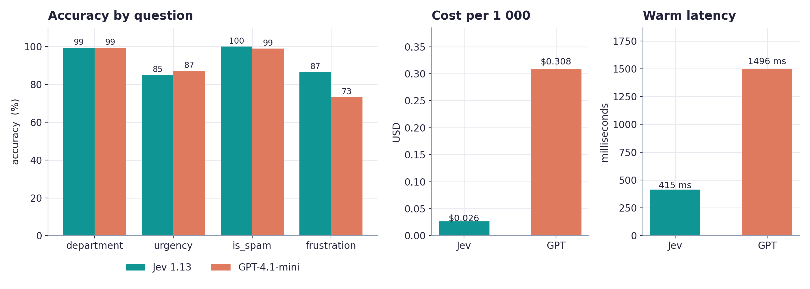</td>
<td align="center" valign="top">tidak ada media yang dipublikasikan</td>
</tr></table>

🛡️ <b><a href="https://github.com/CapCurious/jev-threshold-lab">CapCurious/jev-threshold-lab</a></b> · Python · 🔎 inferred · 18 天

##### 📝 Ringkasan

Fit act, review and escalate thresholds per question from labeled data with Jev; checks calibration. Stdlib Python.

##### 📌 Fakta dasar

| Bidang   | Nilai                                  |
| -------- | -------------------------------------- |
| Kategori | `Perutean, guardrail, dan persetujuan` |
| Bukti    | `inferred`                             |
| Bahasa   | Python                                 |

##### 📊 Data

| Metrik            | Nilai      |
| ----------------- | ---------- |
| Bintang           | **0**      |
| Push terakhir     | 2026-10-18 |
| Pertama terdaftar | 2026-11-04 |

🏷 `calibration` · `decision-model` · `jev` · `python` · `thresholds` · `typesafe`

---

<table><tr><th align="center" width="50%">🖼 Gambar</th><th align="center" width="50%">🎬 Video</th></tr><tr>
<td align="center" valign="top"></td>
<td align="center" valign="top"> rekaman bergerak</td>
</tr></table>

🛡️ <b><a href="https://github.com/elcann7/jev-issue-triage">elcann7/jev-issue-triage</a></b> · JavaScript · 🔎 inferred · 1 天

##### 📝 Ringkasan

GitHub Action that labels and prioritizes new issues with TypeSafe's Jev model. Jev judges, code decides.

##### 📌 Fakta dasar

| Bidang   | Nilai                                  |
| -------- | -------------------------------------- |
| Kategori | `Perutean, guardrail, dan persetujuan` |
| Bukti    | `inferred`                             |
| Bahasa   | JavaScript                             |

##### 📊 Data

| Metrik            | Nilai      |
| ----------------- | ---------- |
| Bintang           | **0**      |
| Push terakhir     | 2026-11-03 |
| Pertama terdaftar | 2026-11-04 |

🏷 `developer-tools` · `github-action` · `issue-triage` · `jev` · `nodejs` · `typesafe`

---

<table><tr><th align="center" width="50%">🖼 Gambar</th><th align="center" width="50%">🎬 Video</th></tr><tr>
<td align="center" valign="top">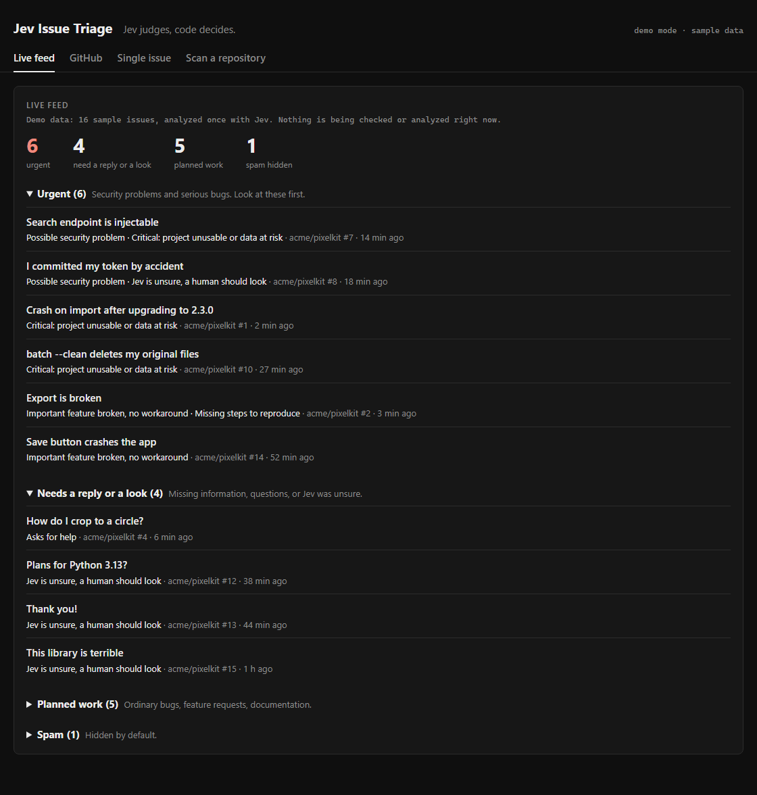</td>
<td align="center" valign="top">tidak ada media yang dipublikasikan</td>
</tr></table>

🛡️ <b><a href="https://github.com/Haslab-dev/pandu-jev">Haslab-dev/pandu-jev</a></b> · Python · 🔎 inferred · 18 天

##### 📝 Ringkasan

Pandu adalah model mini Jev, terinspirasi oleh Jev. Model kebijakan kecil untuk keputusan yang cepat, lokal, dan menyadari ketidakpastian dalam lingkungan AI loop tertutup.

##### 📌 Fakta dasar

| Bidang   | Nilai                                  |
| -------- | -------------------------------------- |
| Kategori | `Perutean, guardrail, dan persetujuan` |
| Bukti    | `inferred`                             |
| Bahasa   | Python                                 |

##### 📊 Data

| Metrik            | Nilai      |
| ----------------- | ---------- |
| Bintang           | **0**      |
| Push terakhir     | 2026-10-18 |
| Pertama terdaftar | 2026-11-01 |

---

<table><tr><th align="center" width="50%">🖼 Gambar</th><th align="center" width="50%">🎬 Video</th></tr><tr>
<td align="center" valign="top"></td>
<td align="center" valign="top">tidak ada media yang dipublikasikan</td>
</tr></table>

Aset ditautkan langsung dari repositori hulu karena tidak ada lisensi redistribusi yang dinyatakan.

<b>Lainnya di kategori ini</b> · 34

- [leofmarciano/groot](https://github.com/leofmarciano/groot) - 🌳 Groot 1 is a open typed-decision model, with a pure Bend engine.
- [vynnlee/jev-mail](https://github.com/vynnlee/jev-mail) - Triase Zero-Inbox otonom 24/7 untuk Gmail yang didukung oleh TypeSafe Jev…
- [hyspacex/jev-router](https://github.com/hyspacex/jev-router) - Route OpenAI-style chat requests to a model and reasoning effort, using…
- [amyrmahdy/decima](https://github.com/amyrmahdy/decima) - Small local judges and guards for LLM apps: calibrated decisions…
- [Davidasx/pi-typesafe-approve](https://github.com/Davidasx/pi-typesafe-approve) - Pi extension: auto-approve routine Bash commands with a System One (Jev)…
- [mcgalleg/grokbot-jev-jobs](https://github.com/mcgalleg/grokbot-jev-jobs) - Scores public job postings against my resume using TypeSafe.
- [adityavsb/narrative-audit-jev](https://github.com/adityavsb/narrative-audit-jev) - OpenRouter benchmark harness: same decision task for rule baselines and pinned…
- [ahmed35636/jev-triage](https://github.com/ahmed35636/jev-triage) - Windows event classification and confidence-aware review routing with TypeSafe…
- [budityw23/fhir_jev](https://github.com/budityw23/fhir_jev) - Typed AI decision layer for FHIR R4 data using TypeSafe AI.
- [dirnbauer/typo3-webcon-jev](https://github.com/dirnbauer/typo3-webcon-jev) - Typed decisions from TypeSafe AI.
- [dtduc-git/jev-packs](https://github.com/dtduc-git/jev-packs) - Evidence-gated registry of Jev question packs — curated questions, golden cases…
- [freezetheflame/jev-ecosystem-research](https://github.com/freezetheflame/jev-ecosystem-research) - Jev (TypeSafe AI System One) 生态调研：开源复现规模、JevBench v1.4.2.2…
- [hrtaym1114-github/x-jev-gate](https://github.com/hrtaym1114-github/x-jev-gate) - Gate draf X yang didukung oleh TypeSafe Jev (System One): pemeriksaan secret…
- [jasonli0226/jev-benchmark](https://github.com/jasonli0226/jev-benchmark) - Benchmark: Jev decision model (TypeSafe, via OpenRouter) vs local ML on SST-2…
- [Joshita-s/ticket-triage-jev](https://github.com/Joshita-s/ticket-triage-jev) - Automated customer ticket triage engine in Python built with TypeSafe Jev…
- [kellystuard/jev-gmail-classifier](https://github.com/kellystuard/jev-gmail-classifier) - Google Apps Script yang mengklasifikasikan pesan Gmail dengan Jev, model AI…
- [Khidir782/Beam-jev](https://github.com/Khidir782/Beam-jev) - Calibrated DevOps tool-router distilled from Beam-1.0-501B via RLCD.
- [Loule95450/jev-free-router](https://github.com/Loule95450/jev-free-router) - Perute model dinamis per giliran pada OpenCode Zen gratis + model Go.
- [Madheshvivekanandan/jev-vs-cosine](https://github.com/Madheshvivekanandan/jev-vs-cosine) - Do you need TypeSafe.
- [masatoppp/07_Jev-routing-evaluation](https://github.com/masatoppp/07_Jev-routing-evaluation) - Jevを用いたLLM・Web検索・RAGのルーティング実装と、GPT-4.1-miniとの判定精度・処理速度・APIコストの比較検証.
- [mgd34msu/goodvibes-jev](https://github.com/mgd34msu/goodvibes-jev) - Platform Goodvibes dengan Jev terintegrasi ke dalam model keputusan untuk…
- [mohameddhameem/systemone-jev](https://github.com/mohameddhameem/systemone-jev) - Typed-decision routers between a small and a large LLM, fine-tuned from nano-jev.
- [morler/pi-jev-core](https://github.com/morler/pi-jev-core) - Inti penilaian Jev minimal untuk Pi dan aplikasi TypeScript lainnya…
- [Muradmustafayev-03/jev-recovery-router](https://github.com/Muradmustafayev-03/jev-recovery-router) - Perutean niat yang dikondisikan biaya: model keyakinan Qwen3 yang dipilih…
- [petercr/jev-orchestrator](https://github.com/petercr/jev-orchestrator) - Orkestrator node mini yang menggunakan Jev untuk menangani perutean ke berbagai…
- [ragman53/pi-jev-orchestrator](https://github.com/ragman53/pi-jev-orchestrator) - Cache-aware Jev model orchestration for Pi with sticky routing and safe…
- [rajkundalia/expense-approval-using-jev](https://github.com/rajkundalia/expense-approval-using-jev) - A local-first employee expense reimbursement demo exploring Jev.
- [RichardoMrMu/jev-mini](https://github.com/RichardoMrMu/jev-mini) - Uji tiga klaim utama Jev pada GPU Anda sendiri.
- [shivanathd/jev-playground](https://github.com/shivanathd/jev-playground) - BYOK playground for TypeSafe Jev (System One): Choice, Score, Noul examples for…
- [stivelcn/jev-route-releases](https://github.com/stivelcn/jev-route-releases) - JEV Router macOS downloads and release notes. Source code is private.
- [THEROCKSSS/awesome-jev](https://github.com/THEROCKSSS/awesome-jev) - Katalog Jev / TypeSafe System One proyek yang digabungkan, dideduplikasi, dan…
- [willirath/2026_jev-box-demo](https://github.com/willirath/2026_jev-box-demo) - Hotdog / not hotdog demo with TypeSafe Jev (noul + box) via OpenRouter.
- [Wu-love-han/ai-jev-filter](https://github.com/Wu-love-han/ai-jev-filter) - JEV 检索台 · 对话式网络信息筛选工作台：官方 /v1/systemone 协议接入、noul/score/choice…
- [sumleo/RLCDAlignBench](https://github.com/sumleo/RLCDAlignBench) - RLCDAlignBench: 44 benchmark deteksi kegagalan penyelarasan dan kode untuk…

## Evaluasi, kalibrasi, dan benchmark

Bagaimana orang tahu keputusannya cukup baik? Kalibrasi adalah pertanyaan terbuka di ekosistem ini, dan inilah proyek-proyek yang mengukurnya.

🧪 <b><a href="https://github.com/Mapika/decider">Mapika/decider</a></b> · ⭐1077 · Python · 👁️ observed · 16 天 · ⭐-93

##### 📝 Ringkasan

Keluarga model bergaya System One yang di-fine-tune dari Qwen3.5, dirancang untuk keputusan bertipe satu lintasan dengan probabilitas terkalibrasi.

🔧 Ditemukan dipakai dalam kode: `docs/HISTORY.md`, `README.md`

##### 📌 Fakta dasar

| Bidang   | Nilai                                |
| -------- | ------------------------------------ |
| Kategori | `Evaluasi, kalibrasi, dan benchmark` |
| Bukti    | `observed`                           |
| Bahasa   | Python                               |

##### 📊 Data

| Metrik            | Nilai          |
| ----------------- | -------------- |
| Bintang           | **1077** (-93) |
| Push terakhir     | 2026-10-20     |
| Pertama terdaftar | 2026-10-28     |

---

<table><tr><th align="center" width="50%">🖼 Gambar</th><th align="center" width="50%">🎬 Video</th></tr><tr>
<td align="center" valign="top"></td>
<td align="center" valign="top"> rekaman bergerak</td>
</tr></table>

🧪 <b><a href="https://github.com/v-modal/awesome-jev-tools">v-modal/awesome-jev-tools</a></b> · ⭐748 · 👁️ observed · 2 天 · ⭐-6

##### 📝 Ringkasan

Daftar terkurasi alat yang dibuat untuk Jev — model System One milik TypeSafe AI untuk keputusan bertipe.

##### 📌 Fakta dasar

| Bidang   | Nilai                                |
| -------- | ------------------------------------ |
| Kategori | `Evaluasi, kalibrasi, dan benchmark` |
| Bukti    | `observed`                           |

##### 📊 Data

| Metrik            | Nilai        |
| ----------------- | ------------ |
| Bintang           | **748** (-6) |
| Push terakhir     | 2026-11-03   |
| Pertama terdaftar | 2026-09-20   |

🏷 `awesome-ai` · `awesome-jev` · `awesome-list` · `awesome-readme` · `calibrated-probabilities` · `jev` · `jev-ai` · `jev-alternative`

🧪 <b><a href="https://github.com/OmniJev/awesome-jev-gallery">OmniJev/awesome-jev-gallery</a></b> · ⭐480 · Python · 👁️ observed · 0 天 · ⭐-1

##### 📝 Ringkasan

🔥🔥 Awesome Jev: model, proyek, benchmark, dan evaluasi independen open-source untuk model Jev dan System One.

##### 📌 Fakta dasar

| Bidang   | Nilai                                |
| -------- | ------------------------------------ |
| Kategori | `Evaluasi, kalibrasi, dan benchmark` |
| Bukti    | `observed`                           |
| Bahasa   | Python                               |

##### 📊 Data

| Metrik            | Nilai        |
| ----------------- | ------------ |
| Bintang           | **480** (-1) |
| Push terakhir     | 2026-11-05   |
| Pertama terdaftar | 2026-09-20   |

🏷 `awesome` · `awesome-jev` · `awesome-list` · `calibrated-probabilities` · `calibration` · `decision-models` · `jev` · `jev-ai`

🧪 <b><a href="https://github.com/cobusgreyling/Jev">cobusgreyling/Jev</a></b> · ⭐140 · Python · 👁️ observed · 21 天

##### 📝 Ringkasan

Showcase TypeSafe Jev tidak resmi — keputusan System One, bukan obrolan.

🔧 Ditemukan dipakai dalam kode: `README.md`

##### 📌 Fakta dasar

| Bidang   | Nilai                                |
| -------- | ------------------------------------ |
| Kategori | `Evaluasi, kalibrasi, dan benchmark` |
| Bukti    | `observed`                           |
| Bahasa   | Python                               |

##### 📊 Data

| Metrik            | Nilai      |
| ----------------- | ---------- |
| Bintang           | **140**    |
| Push terakhir     | 2026-10-15 |
| Pertama terdaftar | 2026-10-26 |

🏷 `calibrated-decisions` · `jev` · `showcase` · `system-one` · `typesafe`

---

<table><tr><th align="center" width="50%">🖼 Gambar</th><th align="center" width="50%">🎬 Video</th></tr><tr>
<td align="center" valign="top"></td>
<td align="center" valign="top">tidak ada media yang dipublikasikan</td>
</tr></table>

🧪 <b><a href="https://github.com/ikermoel/open-alternative-jev">ikermoel/open-alternative-jev</a></b> · ⭐76 · Python · 👁️ observed · 41 天

##### 📝 Ringkasan

Alternatif sumber terbuka untuk Jev milik TypeSafe: lapisan model bergaya System One yang memberikan keputusan bertipe dan terkalibrasi dari LLM berbobot terbuka apa pun dalam satu lintasan maju (HF + vLLM), dengan tolok ukur yang jujur

##### 📌 Fakta dasar

| Bidang   | Nilai                                |
| -------- | ------------------------------------ |
| Kategori | `Evaluasi, kalibrasi, dan benchmark` |
| Bukti    | `observed`                           |
| Bahasa   | Python                               |

##### 📊 Data

| Metrik            | Nilai      |
| ----------------- | ---------- |
| Bintang           | **76**     |
| Push terakhir     | 2026-09-25 |
| Pertama terdaftar | 2026-10-28 |

🏷 `calibration` · `classification` · `jev` · `jev-alternative` · `llm` · `logprobs` · `open-jev` · `open-source-jev`

🧪 <b><a href="https://github.com/hev/reranker">hev/reranker</a></b> · ⭐19 · Python · 👁️ observed · 48 天

##### 📝 Ringkasan

Gunakan Jev (model System One milik TypeSafe) sebagai reranker terkalibrasi: satu pemanggilan, hingga 30 dokumen, satu probabilitas per dokumen. Apache-2.0.

##### 📌 Fakta dasar

| Bidang   | Nilai                                |
| -------- | ------------------------------------ |
| Kategori | `Evaluasi, kalibrasi, dan benchmark` |
| Bukti    | `observed`                           |
| Bahasa   | Python                               |

##### 📊 Data

| Metrik            | Nilai      |
| ----------------- | ---------- |
| Bintang           | **19**     |
| Push terakhir     | 2026-09-17 |
| Pertama terdaftar | 2026-10-28 |

🧪 <b><a href="https://github.com/OmniJev/awesome-jev-papers">OmniJev/awesome-jev-papers</a></b> · ⭐12 · Python · 👁️ observed · 0 天

##### 📝 Ringkasan

🔥🔥 Research papers on Jev, TypeSafe's System One model, and the open models built in its shape.

##### 📌 Fakta dasar

| Bidang   | Nilai                                |
| -------- | ------------------------------------ |
| Kategori | `Evaluasi, kalibrasi, dan benchmark` |
| Bukti    | `observed`                           |
| Bahasa   | Python                               |

##### 📊 Data

| Metrik            | Nilai      |
| ----------------- | ---------- |
| Bintang           | **12**     |
| Push terakhir     | 2026-11-05 |
| Pertama terdaftar | 2026-09-28 |

🏷 `arxiv` · `awesome` · `awesome-list` · `calibration` · `decision-model` · `jev` · `llm` · `paper-list`

🧪 <b><a href="https://github.com/akash-kamat/system-one-gemma">akash-kamat/system-one-gemma</a></b> · ⭐7 · Python · 👁️ observed · 48 天

##### 📝 Ringkasan

Model keputusan bergaya Jev System One sumber terbuka. Gemma 3 270M dengan kepala penskoran — keputusan cepat dan terkalibrasi dalam satu lintasan maju. Tanpa pembuatan teks. Terinspirasi oleh Jev milik TypeSafe.ai.

##### 📌 Fakta dasar

| Bidang   | Nilai                                |
| -------- | ------------------------------------ |
| Kategori | `Evaluasi, kalibrasi, dan benchmark` |
| Bukti    | `observed`                           |
| Bahasa   | Python                               |

##### 📊 Data

| Metrik            | Nilai      |
| ----------------- | ---------- |
| Bintang           | **7**      |
| Push terakhir     | 2026-09-18 |
| Pertama terdaftar | 2026-10-28 |

🏷 `calibration` · `decision-model` · `gemma` · `jev` · `lora` · `machine-learning` · `scoring-model` · `system-one`

🧪 <b><a href="https://github.com/debuffjp/decidekit">debuffjp/decidekit</a></b> · ⭐6 · TypeScript · 👁️ observed · 3 天

##### 📝 Ringkasan

A System One model in the browser: typed, calibrated text decisions on the user's device. Learns from an LLM when it isn't sure.

##### 📌 Fakta dasar

| Bidang   | Nilai                                |
| -------- | ------------------------------------ |
| Kategori | `Evaluasi, kalibrasi, dan benchmark` |
| Bukti    | `observed`                           |
| Bahasa   | TypeScript                           |

##### 📊 Data

| Metrik            | Nilai      |
| ----------------- | ---------- |
| Bintang           | **6**      |
| Push terakhir     | 2026-11-02 |
| Pertama terdaftar | 2026-11-02 |

🏷 `classification` · `decision-model` · `llm` · `system-one` · `typescript`

🧪 <b><a href="https://github.com/bydeng01/scientific-decision-eval">bydeng01/scientific-decision-eval</a></b> · ⭐4 · HTML · 👁️ observed · 1 天

##### 📝 Ringkasan

Code and data for evaluating Jev, a System One model, on scientific decisions and how its choices affect downstream results. arXiv:2609.24965

##### 📌 Fakta dasar

| Bidang   | Nilai                                |
| -------- | ------------------------------------ |
| Kategori | `Evaluasi, kalibrasi, dan benchmark` |
| Bukti    | `observed`                           |
| Bahasa   | HTML                                 |

##### 📊 Data

| Metrik            | Nilai      |
| ----------------- | ---------- |
| Bintang           | **4**      |
| Push terakhir     | 2026-11-04 |
| Pertama terdaftar | 2026-10-27 |

🏷 `jev` · `jev-ai` · `jev-model` · `jevbench` · `system-one` · `system-one-model` · `system-one-models`

🧪 <b><a href="https://github.com/alby13/systemone">alby13/systemone</a></b> · ⭐1 · Python · 👁️ observed · 10 天

##### 📝 Ringkasan

Typed, calibrated decisions for software in a single forward pass: an independent implementation of the System One model architecture.

##### 📌 Fakta dasar

| Bidang   | Nilai                                |
| -------- | ------------------------------------ |
| Kategori | `Evaluasi, kalibrasi, dan benchmark` |
| Bukti    | `observed`                           |
| Bahasa   | Python                               |

##### 📊 Data

| Metrik            | Nilai      |
| ----------------- | ---------- |
| Bintang           | **1**      |
| Push terakhir     | 2026-10-25 |
| Pertama terdaftar | 2026-10-26 |

🧪 <b><a href="https://github.com/aishwary-dongre/jev-xray">aishwary-dongre/jev-xray</a></b> · Python · 👁️ observed · 0 天 · **NEW**

##### 📝 Ringkasan

Forensik keputusan untuk model System One. Jev mengembalikan probabilitas terkalibrasi dan tidak dapat menjelaskannya — jev-xray mengukur bagian input yang menyebabkannya, melalui ablasi.

##### 📌 Fakta dasar

| Bidang   | Nilai                                |
| -------- | ------------------------------------ |
| Kategori | `Evaluasi, kalibrasi, dan benchmark` |
| Bukti    | `observed`                           |
| Bahasa   | Python                               |

##### 📊 Data

| Metrik            | Nilai      |
| ----------------- | ---------- |
| Bintang           | **0**      |
| Push terakhir     | 2026-11-05 |
| Pertama terdaftar | 2026-11-05 |

🧪 <b><a href="https://github.com/Shauryagulati/mini-jev">Shauryagulati/mini-jev</a></b> · Jupyter · 👁️ observed · 16 天

##### 📝 Ringkasan

Distilling a calibrated decision model into Qwen3-1.7B: SFT vs. distillation vs. GRPO, plus deployment pitfalls. Free Colab T4.

##### 📌 Fakta dasar

| Bidang   | Nilai                                |
| -------- | ------------------------------------ |
| Kategori | `Evaluasi, kalibrasi, dan benchmark` |
| Bukti    | `observed`                           |
| Bahasa   | Jupyter                              |

##### 📊 Data

| Metrik            | Nilai      |
| ----------------- | ---------- |
| Bintang           | **0**      |
| Push terakhir     | 2026-10-19 |
| Pertama terdaftar | 2026-11-01 |

---

<table><tr><th align="center" width="50%">🖼 Gambar</th><th align="center" width="50%">🎬 Video</th></tr><tr>
<td align="center" valign="top"></td>
<td align="center" valign="top">tidak ada media yang dipublikasikan</td>
</tr></table>

🧪 <b><a href="https://github.com/nokia-applied-research/AnyJev">nokia-applied-research/AnyJev</a></b> · ⭐1586 · Python · 🔎 inferred · 14 天 · ⭐+2

##### 📝 Ringkasan

Ubah LLM apa pun menjadi model keputusan bergaya Jev: keputusan bertipe, probabilitas nyata, tanpa pelatihan. (terus diperbarui, menerima setiap masalah dan permintaan PR)

##### 📌 Fakta dasar

| Bidang   | Nilai                                |
| -------- | ------------------------------------ |
| Kategori | `Evaluasi, kalibrasi, dan benchmark` |
| Bukti    | `inferred`                           |
| Bahasa   | Python                               |

##### 📊 Data

| Metrik            | Nilai         |
| ----------------- | ------------- |
| Bintang           | **1586** (+2) |
| Push terakhir     | 2026-10-21    |
| Pertama terdaftar | 2026-09-22    |

🏷 `calibration` · `decision-model` · `jev` · `jev-model` · `llm` · `system-one` · `transformers` · `vllm`

---

<table><tr><th align="center" width="50%">🖼 Gambar</th><th align="center" width="50%">🎬 Video</th></tr><tr>
<td align="center" valign="top"></td>
<td align="center" valign="top"> rekaman bergerak</td>
</tr></table>

🧪 <b><a href="https://github.com/allebee/jevk5">allebee/jevk5</a></b> · ⭐160 · Python · 🔎 inferred · 38 天

##### 📝 Ringkasan

JevK5: alternatif berbobot terbuka untuk TypeSafe Jev. Keputusan bertipe dengan probabilitas dalam satu forward pass; bobot dan kode Apache-2.0.

##### 📌 Fakta dasar

| Bidang   | Nilai                                |
| -------- | ------------------------------------ |
| Kategori | `Evaluasi, kalibrasi, dan benchmark` |
| Bukti    | `inferred`                           |
| Bahasa   | Python                               |

##### 📊 Data

| Metrik            | Nilai      |
| ----------------- | ---------- |
| Bintang           | **160**    |
| Push terakhir     | 2026-09-28 |
| Pertama terdaftar | 2026-10-29 |

🏷 `calibration` · `decision-model` · `jev` · `jev-alternative` · `jevbench` · `lora` · `qwen` · `system-one`

---

<table><tr><th align="center" width="50%">🖼 Gambar</th><th align="center" width="50%">🎬 Video</th></tr><tr>
<td align="center" valign="top"></td>
<td align="center" valign="top"> rekaman bergerak · <a href="https://raw.githubusercontent.com/allebee/jevk5/main/docs/demo/jevk5-nvidia-demo.mp4">Buka video</a></td>
</tr></table>

🧪 <b><a href="https://github.com/Heman10x-NGU/Verdict-open-jev">Heman10x-NGU/Verdict-open-jev</a></b> · ⭐115 · Python · 🔎 inferred · 14 天

##### 📝 Ringkasan

Mesin keputusan non-autoregresif pada ModernBERT (151M) dengan ketidakpastian terkalibrasi (RLCD), audit tolok ukur TypeSafe AI Jev, dan playground WebGPU di peramban

##### 📌 Fakta dasar

| Bidang   | Nilai                                |
| -------- | ------------------------------------ |
| Kategori | `Evaluasi, kalibrasi, dan benchmark` |
| Bukti    | `inferred`                           |
| Bahasa   | Python                               |

##### 📊 Data

| Metrik            | Nilai      |
| ----------------- | ---------- |
| Bintang           | **115**    |
| Push terakhir     | 2026-10-21 |
| Pertama terdaftar | 2026-09-18 |

🏷 `brier-score` · `calibration` · `decision-engine` · `edge-ai` · `gliclass` · `jev` · `modernbert` · `onnx`

---

<table><tr><th align="center" width="50%">🖼 Gambar</th><th align="center" width="50%">🎬 Video</th></tr><tr>
<td align="center" valign="top"></td>
<td align="center" valign="top">tidak ada media yang dipublikasikan</td>
</tr></table>

Aset ditautkan langsung dari repositori hulu karena tidak ada lisensi redistribusi yang dinyatakan.

🧪 <b><a href="https://github.com/manjunathshiva/opendecider">manjunathshiva/opendecider</a></b> · ⭐38 · Python · 🔎 inferred · 1 天

##### 📝 Ringkasan

Open, calibrated System 1 decision models: typed choice / score / yes-no answers with a probability for every option. 400M to 80B; CPU, NVIDIA, Apple Silicon, LM Studio, Ollama and vLLM.

##### 📌 Fakta dasar

| Bidang   | Nilai                                |
| -------- | ------------------------------------ |
| Kategori | `Evaluasi, kalibrasi, dan benchmark` |
| Bukti    | `inferred`                           |
| Bahasa   | Python                               |

##### 📊 Data

| Metrik            | Nilai      |
| ----------------- | ---------- |
| Bintang           | **38**     |
| Push terakhir     | 2026-11-04 |
| Pertama terdaftar | 2026-11-04 |

🏷 `apple-silicon` · `calibration` · `classification` · `decision-model` · `gguf` · `huggingface` · `llm` · `mlx`

---

<table><tr><th align="center" width="50%">🖼 Gambar</th><th align="center" width="50%">🎬 Video</th></tr><tr>
<td align="center" valign="top"></td>
<td align="center" valign="top">tidak ada media yang dipublikasikan</td>
</tr></table>

🧪 <b><a href="https://github.com/Eliot5566/JEV-Paper-Radar">Eliot5566/JEV-Paper-Radar</a></b> · ⭐37 · Python · 🔎 inferred · 0 天

##### 📝 Ringkasan

Biarkan Jev membaca setiap makalah arXiv baru setiap pagi dan menampilkan beberapa yang sebaiknya Anda baca. Minat dalam bahasa sederhana, probabilitas terkalibrasi, ~$0.06/hari, fork dan mulai.

##### 📌 Fakta dasar

| Bidang   | Nilai                                |
| -------- | ------------------------------------ |
| Kategori | `Evaluasi, kalibrasi, dan benchmark` |
| Bukti    | `inferred`                           |
| Bahasa   | Python                               |

##### 📊 Data

| Metrik            | Nilai      |
| ----------------- | ---------- |
| Bintang           | **37**     |
| Push terakhir     | 2026-11-05 |
| Pertama terdaftar | 2026-10-19 |

🏷 `arxiv` · `biorxiv` · `github-actions` · `jev` · `literature-review` · `llm` · `paper-recommendation` · `python`

---

<table><tr><th align="center" width="50%">🖼 Gambar</th><th align="center" width="50%">🎬 Video</th></tr><tr>
<td align="center" valign="top"></td>
<td align="center" valign="top">tidak ada media yang dipublikasikan</td>
</tr></table>

🧪 <b><a href="https://github.com/ankit-aglawe/tinyjev">ankit-aglawe/tinyjev</a></b> · ⭐29 · Python · 🔎 inferred · 34 天

##### 📝 Ringkasan

Model kecil mirip jev yang menjawab pertanyaan Choice, Score, dan Noul dalam satu lintasan maju serta mengembalikan probabilitas terkalibrasi. MLX atau PyTorch, sepenuhnya luring, kompatibel dengan System One.

##### 📌 Fakta dasar

| Bidang   | Nilai                                |
| -------- | ------------------------------------ |
| Kategori | `Evaluasi, kalibrasi, dan benchmark` |
| Bukti    | `inferred`                           |
| Bahasa   | Python                               |

##### 📊 Data

| Metrik            | Nilai      |
| ----------------- | ---------- |
| Bintang           | **29**     |
| Push terakhir     | 2026-10-01 |
| Pertama terdaftar | 2026-09-23 |

🏷 `decision-model` · `jev` · `jev-model` · `mlx` · `qwen3` · `small-language-models` · `system-one` · `typed-decisions`

---

<table><tr><th align="center" width="50%">🖼 Gambar</th><th align="center" width="50%">🎬 Video</th></tr><tr>
<td align="center" valign="top"></td>
<td align="center" valign="top"> rekaman bergerak</td>
</tr></table>

🧪 <b><a href="https://github.com/shibing624/train-jev">shibing624/train-jev</a></b> · ⭐19 · Python · 🔎 inferred · 13 天

##### 📝 Ringkasan

Melatih model keputusan System 1 bergaya JEV pada Qwen3.5 dan Qwen3.8-27B: decision head 24-slot, distilasi KL, kalibrasi, dan penyajian. Melatih model keputusan System 1 bergaya JEV pada Qwen.

##### 📌 Fakta dasar

| Bidang   | Nilai                                |
| -------- | ------------------------------------ |
| Kategori | `Evaluasi, kalibrasi, dan benchmark` |
| Bukti    | `inferred`                           |
| Bahasa   | Python                               |

##### 📊 Data

| Metrik            | Nilai      |
| ----------------- | ---------- |
| Bintang           | **19**     |
| Push terakhir     | 2026-10-23 |
| Pertama terdaftar | 2026-11-04 |

🏷 `calibration` · `decision-model` · `distillation` · `fine-tuning` · `llm` · `lora` · `nlp` · `pytorch`

---

<table><tr><th align="center" width="50%">🖼 Gambar</th><th align="center" width="50%">🎬 Video</th></tr><tr>
<td align="center" valign="top"></td>
<td align="center" valign="top">tidak ada media yang dipublikasikan</td>
</tr></table>

🧪 <b><a href="https://github.com/BrendanH18/jev_fsd">BrendanH18/jev_fsd</a></b> · ⭐11 · JavaScript · 🔎 inferred · 0 天

##### 📝 Ringkasan

A driving simulator on real OpenStreetMap streets where TypeSafe's Jev model drives the car, with a decision inspector and a benchmark.

##### 📌 Fakta dasar

| Bidang   | Nilai                                |
| -------- | ------------------------------------ |
| Kategori | `Evaluasi, kalibrasi, dan benchmark` |
| Bukti    | `inferred`                           |
| Bahasa   | JavaScript                           |

##### 📊 Data

| Metrik            | Nilai      |
| ----------------- | ---------- |
| Bintang           | **11**     |
| Push terakhir     | 2026-11-05 |
| Pertama terdaftar | 2026-10-23 |

🏷 `ai` · `benchmark` · `driving-simulator` · `javascript` · `jev` · `openstreetmap` · `python` · `self-driving`

---

<table><tr><th align="center" width="50%">🖼 Gambar</th><th align="center" width="50%">🎬 Video</th></tr><tr>
<td align="center" valign="top"></td>
<td align="center" valign="top">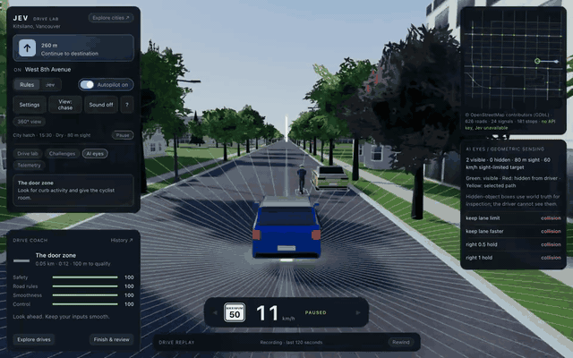 rekaman bergerak</td>
</tr></table>

🧪 <b><a href="https://github.com/wondertwins/jev-benchmark">wondertwins/jev-benchmark</a></b> · ⭐8 · Python · 🔎 inferred · 49 天

##### 📝 Ringkasan

Benchmark dan playground untuk model Jev milik TypeSafe (System One): catur, serta siapa pemain yang diajak bicara untuk NPC game text-to-speech

##### 📌 Fakta dasar

| Bidang   | Nilai                                |
| -------- | ------------------------------------ |
| Kategori | `Evaluasi, kalibrasi, dan benchmark` |
| Bukti    | `inferred`                           |
| Bahasa   | Python                               |

##### 📊 Data

| Metrik            | Nilai      |
| ----------------- | ---------- |
| Bintang           | **8**      |
| Push terakhir     | 2026-09-16 |
| Pertama terdaftar | 2026-10-28 |

---

<table><tr><th align="center" width="50%">🖼 Gambar</th><th align="center" width="50%">🎬 Video</th></tr><tr>
<td align="center" valign="top">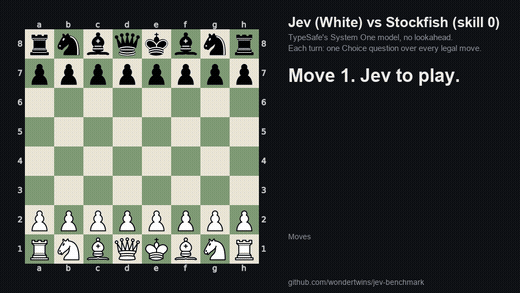</td>
<td align="center" valign="top">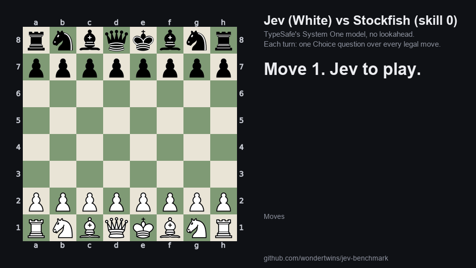 rekaman bergerak</td>
</tr></table>

<b>Lainnya di kategori ini</b> · 64

- [alexrose13/measuring-ee-open-system-one-models](https://github.com/alexrose13/measuring-ee-open-system-one-models) - Measuring Exploration and Exploitation in Organizational Text with Open System…
- [BILLKISHORE/opensysone](https://github.com/BILLKISHORE/opensysone) - Open System One model for Apple Silicon: typed decisions with calibrated…
- [christian-taillon/telltale-systemone](https://github.com/christian-taillon/telltale-systemone) - Ekstensi analyzer.v1 Telltale referensi yang mengevaluasi guard pack dengan…
- [jburns24/jev-demo](https://github.com/jburns24/jev-demo) - bereksperimen dengan model evaluasi jev-latest.
- [Lucasrrafael/system-one-model-fine-tuning](https://github.com/Lucasrrafael/system-one-model-fine-tuning) - Fine-tuning pipeline for Laya and clef (9B/27B) decision models on ordinal…
- [mahirmalik030/Jev-vs-LLMs](https://github.com/mahirmalik030/Jev-vs-LLMs) - A comparative study of Jev 1.13 and Large Language Models (LLMs) for phishing…
- [patryckalves/jev-no-enem](https://github.com/patryckalves/jev-no-enem) - Benchmark yang dapat direproduksi untuk mengevaluasi Jev milik TypeSafe AI…
- [Saviskar/schema-mapping-bench](https://github.com/Saviskar/schema-mapping-bench) - Benchmarking lightweight and open-source LLMs and system one models on…
- [buberlo/jev-trader](https://github.com/buberlo/jev-trader) - Sistem pembuatan pasar 24/7 di sekitar keputusan Jev (TypeSafe System One)…
- [SamratDuttaOfficial/WaterSheep](https://github.com/SamratDuttaOfficial/WaterSheep) - Model keputusan yang mengembalikan jawaban terkalibrasi untuk pertanyaan…
- [Nhahan/Xevn](https://github.com/Nhahan/Xevn) - A 4B decision model built for Korean.
- [cablehead/jev.nu](https://github.com/cablehead/jev.nu) - Modul Nushell untuk TypeSafe System One API: keputusan bertipe dengan…
- [mertkayacs/jevalt](https://github.com/mertkayacs/jevalt) - Three 4B decision models for English, Turkish and German, with per-option…
- [Yifan-Lan/awesome-jev-robustness](https://github.com/Yifan-Lan/awesome-jev-robustness) - Pengujian, audit kalibrasi, dan studi mode kegagalan Jev (TypeSafe System One)…
- [zamax14/Laya-Finetune](https://github.com/zamax14/Laya-Finetune) - Fine-tune Laya, model keputusan System One terbuka, untuk tugas keputusan…
- [tak-bro/local-jev-bench](https://github.com/tak-bro/local-jev-bench) - Model keputusan lokal bergaya Jev System One di Mac Apple Silicon: AnyJev, Kev…
- [CodyQin/zh-decision-bench](https://github.com/CodyQin/zh-decision-bench) - Tolok ukur kalibrasi berbahasa Mandarin pertama untuk model keputusan.
- [mertkayacs/jevoss](https://github.com/mertkayacs/jevoss) - Evaluation tools for Jev-compatible decision models, covering accuracy…
- [AlanViollier/jev-vs-pii](https://github.com/AlanViollier/jev-vs-pii) - How good is Jev, a decision model, at finding personal information?
- [divyanshudhruv/oev](https://github.com/divyanshudhruv/oev) - An 184M-parameter monolingual decision engine delivering calibrated…
- [etsabary/jev-deterministic-benchmark](https://github.com/etsabary/jev-deterministic-benchmark) - Tolok ukur perilaku 1.000 keputusan dari Jev di 25 keluarga penalaran…
- [Nefelim584/JEV_Judge](https://github.com/Nefelim584/JEV_Judge) - jev-lite: a ModernBERT-based typed decision model (Bool / Choice / Score) with…
- [teyhouse/jev-secret-detection](https://github.com/teyhouse/jev-secret-detection) - Mengukur seberapa baik model RLCD-Jev milik TypeSafe menemukan kredensial…
- [CosmoIknosLab/EarthJev](https://github.com/CosmoIknosLab/EarthJev) - EarthJev: calibrated, non-generative answers to natural-language questions…
- [EnesDemir143/jev-laya-benchmark](https://github.com/EnesDemir143/jev-laya-benchmark) - Tolok ukur lokal yang membandingkan TypeSafe Jev dan Laya-MLX untuk klasifikasi…
- [lewistouchtech/opencode-jev-safe-compact](https://github.com/lewistouchtech/opencode-jev-safe-compact) - JEV-guided context compaction for OpenCode, built on a measured finding: noul…
- [patelvishwa112/jev-system-one-rlcd](https://github.com/patelvishwa112/jev-system-one-rlcd) - Mesin Reproduksi Jev System One AI &amp; RLCD: Keputusan Terkalibrasi di Bawah 70…
- [Rushab1/gr-jev](https://github.com/Rushab1/gr-jev) - Code for.
- [vortezwohl/JevNER](https://github.com/vortezwohl/JevNER) - Zero-shot multilingual named entity recognition (NER) powered by TypeSafe…
- [113636xfh/jev-decision-head](https://github.com/113636xfh/jev-decision-head) - A lightweight Jev-style decision head, plus the Strata patches that let one…
- [acbharath14/ollama-jev-decision-demo](https://github.com/acbharath14/ollama-jev-decision-demo) - Decision models via Ollama (Jev /v1/systemone): ask typed questions — choice…
- [agarwalastitwa027-svg/mini-jev-multimodal](https://github.com/agarwalastitwa027-svg/mini-jev-multimodal) - Model keputusan gambar+teks kecil: Qwen3-VL-2B + LoRA + answer head memberi…
- [amatelic/jev](https://github.com/amatelic/jev) - Keputusan AI lokal satu baris. Pilihan/noul/score terkalibrasi dari model…
- [ameya-panchpor/jev-2048](https://github.com/ameya-panchpor/jev-2048) - Does a System One classifier belong in a sequential decision loop? A regret and…
- [ameya690/jev-2048](https://github.com/ameya690/jev-2048) - Does a System One classifier belong in a sequential decision loop? A regret and…
- [ankur287/jev-open-calibration](https://github.com/ankur287/jev-open-calibration) - Rebuilding Jev.
- [beskvladimir-create/ru-jev](https://github.com/beskvladimir-create/ru-jev) - Ru-Jev: an open Russian typed-decision model.
- [betulsimsek/jev-decomposition-tr](https://github.com/betulsimsek/jev-decomposition-tr) - Does splitting a typed-decision question help? Jev vs OpenAI Decisions vs Laya…
- [cayoesn/llm-jev-engine](https://github.com/cayoesn/llm-jev-engine) - System-1 Non-Autoregressive Single-Pass Neural Decision Engine with RLCD…
- [devrecated/jev-alternative](https://github.com/devrecated/jev-alternative) - Free, open-source Jev alternative: fine-tune the open Laya decision model on…
- [dnakhoa/jev-deferred-crispification](https://github.com/dnakhoa/jev-deferred-crispification) - Makalah posisi: primitif Hidden-Markov dan fuzzy yang hilang dari model…
- [himalaya-kaushik/mini-jev](https://github.com/himalaya-kaushik/mini-jev) - Di mana model keputusan satu lintasan mengalami kegagalan: model bergaya Jev…
- [Holovkat/jev-mark](https://github.com/Holovkat/jev-mark) - Benchmarking Local LLM.
- [j2launay/jev-decision-models-xai](https://github.com/j2launay/jev-decision-models-xai) - Jev-style “System 1” decision models replace autoregressive text generation…
- [jsaurabh/qwen-rlcd-jev-repro](https://github.com/jsaurabh/qwen-rlcd-jev-repro) - Eksperimen MLX dan Colab yang dapat direproduksi untuk model keputusan bertipe…
- [n9omi/jev-calibration-audit](https://github.com/n9omi/jev-calibration-audit) - Independent calibration audit of TypeSafe AI.
- [Nijal-AI/jev-lab](https://github.com/Nijal-AI/jev-lab) - Atelier web pour mettre à l.
- [onlyoneaman/jev-eval](https://github.com/onlyoneaman/jev-eval) - TypeSafe.
- [open-factoryai/myJEV](https://github.com/open-factoryai/myJEV) - Ubah keadaan apa pun menjadi keputusan terstruktur dan terkalibrasi.
- [Poojithcodes/jev-calibration-study](https://github.com/Poojithcodes/jev-calibration-study) - Comparing Jev.
- [Teddy9710/jev-playground](https://github.com/Teddy9710/jev-playground) - Playground lokal untuk TypeSafe System One (Jev): susun pertanyaan…
- [unofficial-equivocation2029/Open-Jev](https://github.com/unofficial-equivocation2029/Open-Jev) - Dapatkan probabilitas keputusan bertipe dari konteks dan kandidat secara…
- [UpHash-Network/mini-jev](https://github.com/UpHash-Network/mini-jev) - LogitTrail (sebelumnya Mini Jev): keputusan bertipe lokal yang dapat diperiksa…
- [xiaohuiyan/awesome-jev-papers](https://github.com/xiaohuiyan/awesome-jev-papers) - Curated arXiv papers on Jev, System One and typed decision models, with…
- [yauwes/datascape-jev-rlcd-pipeline](https://github.com/yauwes/datascape-jev-rlcd-pipeline) - DATASCAPE 2026: Kontrol Kualitas Paket menggunakan Arsitektur Keputusan Jev…
- [Zayan-droid/Jev](https://github.com/Zayan-droid/Jev) - Calibrated single-pass decision model: typed yes/no, choice and score questions…
- [hotchpotch/bekko-system-one](https://github.com/hotchpotch/bekko-system-one) - Model keputusan System One kecil (17M–400M) untuk Ya/Tidak, Choice, Score, dan…
- [mithalouni/system-one-open](https://github.com/mithalouni/system-one-open) - Replika terbuka TypeSafe Jev: keputusan terkalibrasi dan bertipe dalam satu…
- [genai-craft/openvons](https://github.com/genai-craft/openvons) - openvons (open-Jev): lapisan keputusan yang menjawab pilihan terbatas…
- [arnabgho/rlcd-lite](https://github.com/arnabgho/rlcd-lite) - RL yang disederhanakan untuk Keputusan Terkalibrasi: decoding JSON terbatas…
- [nomadoor/ComfyUI-TypedDecision](https://github.com/nomadoor/ComfyUI-TypedDecision) - Keputusan bertipe (noul / choice / score) dengan probabilitas terkalibrasi di…
- [Mangaba-ai/brier](https://github.com/Mangaba-ai/brier) - Brier, by Mangaba AI: typed, calibrated decisions (choice/score/noul) for…
- [KanishkaGD/decision-rerank](https://github.com/KanishkaGD/decision-rerank) - Zero-shot reranking and calibration of decision models (Jev, Laya) on TREC DL…
- [shamazharikh/qwen-rlcd](https://github.com/shamazharikh/qwen-rlcd) - Model keputusan terkalibrasi bergaya Jev (Choice/Score/Noul) pada Qwen3.5-0.8B.

## Reproduksi terbuka, bobot, dan riset arsitektur

Bobot terbuka, replika kecil, dan kerja arsitektur. Beberapa di antaranya ada karena perilaku kalibrasi tidak dapat direproduksi hanya dari materi publik.

🔬 <b><a href="https://github.com/kshetrajna12/reflex">kshetrajna12/reflex</a></b> · ⭐172 · Python · 👁️ observed · 29 天

##### 📝 Ringkasan

Model keputusan terbuka kecil: state + pertanyaan bertipe -> probabilitas terkalibrasi. Rekreasi Jev / System One pada Qwen3.5.

> 💡 Model keputusan terbuka dengan antarmuka state-plus-pertanyaan-bertipe yang sama. Layak dibaca sebagai referensi bentuk meskipun Anda tidak pernah menjalankannya.

##### 📌 Fakta dasar

| Bidang   | Nilai                                             |
| -------- | ------------------------------------------------- |
| Kategori | `Reproduksi terbuka, bobot, dan riset arsitektur` |
| Bukti    | `observed`                                        |
| Bahasa   | Python                                            |

##### 📊 Data

| Metrik            | Nilai      |
| ----------------- | ---------- |
| Bintang           | **172**    |
| Push terakhir     | 2026-10-06 |
| Pertama terdaftar | 2026-10-28 |

🔬 <b><a href="https://github.com/r-ms/mini-jev">r-ms/mini-jev</a></b> · ⭐61 · Python · 🔎 inferred · 48 天

##### 📝 Ringkasan

mini-Jev: seperti apa antarmuka keputusan bertipe bergaya Jev pada Qwen3-4B yang dibekukan — baca logit huruf opsi alih-alih menghasilkan JSON. Eksperimen yang telah didaftarkan sebelumnya, hasil, dan perangkat pengajaran.

> 💡 Reproduksi independen paling berguna untuk dibaca: ini menunjukkan mekanisme pembacaan logit berfungsi, dan juga secara eksplisit memperingatkan bahwa proporsi yang dibacanya bukan probabilitas terkalibrasi. Peringatan itu adalah catatan kehati-hatian terpenting dalam ekosistem ini.

##### 📌 Fakta dasar

| Bidang   | Nilai                                             |
| -------- | ------------------------------------------------- |
| Kategori | `Reproduksi terbuka, bobot, dan riset arsitektur` |
| Bukti    | `inferred`                                        |
| Bahasa   | Python                                            |

##### 📊 Data

| Metrik            | Nilai      |
| ----------------- | ---------- |
| Bintang           | **61**     |
| Push terakhir     | 2026-09-18 |
| Pertama terdaftar | 2026-09-18 |

---

<table><tr><th align="center" width="50%">🖼 Gambar</th><th align="center" width="50%">🎬 Video</th></tr><tr>
<td align="center" valign="top"></td>
<td align="center" valign="top">tidak ada media yang dipublikasikan</td>
</tr></table>

🔬 <b><a href="https://github.com/alvarobartt/sys1">alvarobartt/sys1</a></b> · ⭐59 · Rust · 👁️ observed · 0 天

##### 📝 Ringkasan

TypeSafe AI terstruktur yang sangat cepat dan di-host sendiri untuk model terbuka dengan API yang kompatibel, ditulis dalam Rust.

🔧 Ditemukan dipakai dalam kode: `README.md`

##### 📌 Fakta dasar

| Bidang   | Nilai                                             |
| -------- | ------------------------------------------------- |
| Kategori | `Reproduksi terbuka, bobot, dan riset arsitektur` |
| Bukti    | `observed`                                        |
| Bahasa   | Rust                                              |

##### 📊 Data

| Metrik            | Nilai      |
| ----------------- | ---------- |
| Bintang           | **59**     |
| Push terakhir     | 2026-11-05 |
| Pertama terdaftar | 2026-10-29 |

🏷 `clef` · `decision-model` · `decisions-api` · `huggingface` · `inference-server` · `jev` · `laya` · `self-hosted`

---

<table><tr><th align="center" width="50%">🖼 Gambar</th><th align="center" width="50%">🎬 Video</th></tr><tr>
<td align="center" valign="top"></td>
<td align="center" valign="top">tidak ada media yang dipublikasikan</td>
</tr></table>

🔬 <b><a href="https://github.com/PsiACE/dohnuts">PsiACE/dohnuts</a></b> · ⭐38 · Python · 👁️ observed · 30 天

##### 📝 Ringkasan

Dohnuts membangun model multimodal kecil untuk keputusan langsung. -> System One model

##### 📌 Fakta dasar

| Bidang   | Nilai                                             |
| -------- | ------------------------------------------------- |
| Kategori | `Reproduksi terbuka, bobot, dan riset arsitektur` |
| Bukti    | `observed`                                        |
| Bahasa   | Python                                            |

##### 📊 Data

| Metrik            | Nilai      |
| ----------------- | ---------- |
| Bintang           | **38**     |
| Push terakhir     | 2026-10-06 |
| Pertama terdaftar | 2026-09-21 |

🏷 `decision-model` · `jev` · `laya` · `llm` · `lora` · `rlcd` · `system-one` · `typesafe`

---

<table><tr><th align="center" width="50%">🖼 Gambar</th><th align="center" width="50%">🎬 Video</th></tr><tr>
<td align="center" valign="top"></td>
<td align="center" valign="top">tidak ada media yang dipublikasikan</td>
</tr></table>

🔬 <b><a href="https://github.com/Endgame-Labs/understudy">Endgame-Labs/understudy</a></b> · ⭐6 · Rust · 👁️ observed · 2 天

##### 📝 Ringkasan

A drop-in, CPU-only proxy for System One models (Jev, Rune, Clef). It learns each repeated question from the lead, then answers it itself.

##### 📌 Fakta dasar

| Bidang   | Nilai                                             |
| -------- | ------------------------------------------------- |
| Kategori | `Reproduksi terbuka, bobot, dan riset arsitektur` |
| Bukti    | `observed`                                        |
| Bahasa   | Rust                                              |

##### 📊 Data

| Metrik            | Nilai      |
| ----------------- | ---------- |
| Bintang           | **6**      |
| Push terakhir     | 2026-11-02 |
| Pertama terdaftar | 2026-11-03 |

🏷 `classification` · `cpu-inference` · `decision-model` · `distillation` · `llm` · `proxy` · `rust`

🔬 <b><a href="https://github.com/themusebook/clawd-jev-trading-machine">themusebook/clawd-jev-trading-machine</a></b> · ⭐1 · Python · 👁️ observed · 40 天

##### 📝 Ringkasan

mesin perdagangan clawd-JEV: pedagang simulasi JEV-on-Solana. Otak TypeSafe jev-latest, ruang tindakan dinamis, rezim CoinGecko + memori Supermemory, venue Jupiter/DFlow. Hanya uji coba kering.

##### 📌 Fakta dasar

| Bidang   | Nilai                                             |
| -------- | ------------------------------------------------- |
| Kategori | `Reproduksi terbuka, bobot, dan riset arsitektur` |
| Bukti    | `observed`                                        |
| Bahasa   | Python                                            |

##### 📊 Data

| Metrik            | Nilai      |
| ----------------- | ---------- |
| Bintang           | **1**      |
| Push terakhir     | 2026-09-25 |
| Pertama terdaftar | 2026-11-01 |

🔬 <b><a href="https://github.com/BipinRajC/Jev-api-experiments">BipinRajC/Jev-api-experiments</a></b> · Python · 👁️ observed · 17 天

##### 📝 Ringkasan

Eksperimen empiris dan riset API untuk model System One Jev milik TypeSafe yang dilatih menggunakan RLCD

##### 📌 Fakta dasar

| Bidang   | Nilai                                             |
| -------- | ------------------------------------------------- |
| Kategori | `Reproduksi terbuka, bobot, dan riset arsitektur` |
| Bukti    | `observed`                                        |
| Bahasa   | Python                                            |

##### 📊 Data

| Metrik            | Nilai      |
| ----------------- | ---------- |
| Bintang           | **0**      |
| Push terakhir     | 2026-10-18 |
| Pertama terdaftar | 2026-09-22 |

🏷 `api` · `experimental` · `jev` · `rlcd` · `typesafe-ai`

🔬 <b><a href="https://huggingface.co/lysandre/JEV-27B-VL">lysandre/JEV-27B-VL</a></b> · model · 👁️ observed · 3 天

##### 📝 Ringkasan

Tidak ada deskripsi hulu yang dipublikasikan.

##### 📌 Fakta dasar

| Bidang   | Nilai                                             |
| -------- | ------------------------------------------------- |
| Kategori | `Reproduksi terbuka, bobot, dan riset arsitektur` |
| Bukti    | `observed`                                        |

##### 📊 Data

| Metrik            | Nilai      |
| ----------------- | ---------- |
| Pertama terdaftar | 2026-11-02 |

🏷 `transformers` · `safetensors` · `qwen3_5` · `image-text-to-text` · `jev` · `system-one` · `system-two` · `typed-decisions`

🔬 <b><a href="https://huggingface.co/mradermacher/JEV-27B-VL-GGUF">mradermacher/JEV-27B-VL-GGUF</a></b> · model · 👁️ observed · 1 天

##### 📝 Ringkasan

Tidak ada deskripsi hulu yang dipublikasikan.

##### 📌 Fakta dasar

| Bidang   | Nilai                                             |
| -------- | ------------------------------------------------- |
| Kategori | `Reproduksi terbuka, bobot, dan riset arsitektur` |
| Bukti    | `observed`                                        |

##### 📊 Data

| Metrik            | Nilai      |
| ----------------- | ---------- |
| Pertama terdaftar | 2026-11-04 |

🏷 `transformers` · `gguf` · `jev` · `system-one` · `system-two` · `typed-decisions` · `decision-model` · `calibrated-probabilities`

🔬 <b><a href="https://huggingface.co/stephenlb/system-one-model">stephenlb/system-one-model</a></b> · model · 👁️ observed · 34 天

##### 📝 Ringkasan

Tidak ada deskripsi hulu yang dipublikasikan.

##### 📌 Fakta dasar

| Bidang   | Nilai                                             |
| -------- | ------------------------------------------------- |
| Kategori | `Reproduksi terbuka, bobot, dan riset arsitektur` |
| Bukti    | `observed`                                        |

##### 📊 Data

| Metrik            | Nilai      |
| ----------------- | ---------- |
| Pertama terdaftar | 2026-10-05 |

🏷 `transformers` · `safetensors` · `truetype_system_one` · `feature-extraction` · `custom_code` · `gemma4` · `typed-decisions` · `text-classification`

🔬 <b><a href="https://github.com/TheoLeeCJ/SemIf-OpenJev">TheoLeeCJ/SemIf-OpenJev</a></b> · ⭐4930 · Python · 🔎 inferred · 42 天 · ⭐+1

##### 📝 Ringkasan

If semantik dari model terbuka, di 3090 di rumah. Independen; tidak berafiliasi dengan Jev atau TypeSafe.

##### 📌 Fakta dasar

| Bidang   | Nilai                                             |
| -------- | ------------------------------------------------- |
| Kategori | `Reproduksi terbuka, bobot, dan riset arsitektur` |
| Bukti    | `inferred`                                        |
| Bahasa   | Python                                            |

##### 📊 Data

| Metrik            | Nilai         |
| ----------------- | ------------- |
| Bintang           | **4930** (+1) |
| Push terakhir     | 2026-09-23    |
| Pertama terdaftar | 2026-10-29    |

---

<table><tr><th align="center" width="50%">🖼 Gambar</th><th align="center" width="50%">🎬 Video</th></tr><tr>
<td align="center" valign="top"></td>
<td align="center" valign="top"> rekaman bergerak</td>
</tr></table>

🔬 <b><a href="https://github.com/wfzyx/von">wfzyx/von</a></b> · ⭐921 · Python · 🔎 inferred · 16 天 · ⭐-1

##### 📝 Ringkasan

Model keputusan System One sumber terbuka. Di bawah 15 ms, non-autoregresif, alternatif drop-in lokal untuk TypeSafe Jev.

##### 📌 Fakta dasar

| Bidang   | Nilai                                             |
| -------- | ------------------------------------------------- |
| Kategori | `Reproduksi terbuka, bobot, dan riset arsitektur` |
| Bukti    | `inferred`                                        |
| Bahasa   | Python                                            |

##### 📊 Data

| Metrik            | Nilai        |
| ----------------- | ------------ |
| Bintang           | **921** (-1) |
| Push terakhir     | 2026-10-19   |
| Pertama terdaftar | 2026-09-19   |

🏷 `decision-model` · `jev` · `machine-learning` · `python` · `rlcd` · `system-one` · `typesafe`

---

<table><tr><th align="center" width="50%">🖼 Gambar</th><th align="center" width="50%">🎬 Video</th></tr><tr>
<td align="center" valign="top">tidak ada media yang dipublikasikan</td>
<td align="center" valign="top"> rekaman bergerak</td>
</tr></table>

🔬 <b><a href="https://github.com/tomerglick57/Jevstiller">tomerglick57/Jevstiller</a></b> · ⭐72 · Python · 🔎 inferred · 4 天

##### 📝 Ringkasan

Suling tugas klasifikasi Jev yang berulang menjadi model lokal, secara langsung — jawaban yang sama, perangkat keras Anda.

##### 📌 Fakta dasar

| Bidang   | Nilai                                             |
| -------- | ------------------------------------------------- |
| Kategori | `Reproduksi terbuka, bobot, dan riset arsitektur` |
| Bukti    | `inferred`                                        |
| Bahasa   | Python                                            |

##### 📊 Data

| Metrik            | Nilai      |
| ----------------- | ---------- |
| Bintang           | **72**     |
| Push terakhir     | 2026-11-01 |
| Pertama terdaftar | 2026-10-29 |

🏷 `classification` · `distillation` · `jev` · `knowledge-distillation` · `llm` · `mlops` · `model-cascade` · `python`

---

<table><tr><th align="center" width="50%">🖼 Gambar</th><th align="center" width="50%">🎬 Video</th></tr><tr>
<td align="center" valign="top"></td>
<td align="center" valign="top"> rekaman bergerak</td>
</tr></table>

🔬 <b><a href="https://github.com/amithgc/local-jev">amithgc/local-jev</a></b> · ⭐24 · Python · 🔎 inferred · 45 天

##### 📝 Ringkasan

Server System One lokal dan offline yang kompatibel dengan Jev API milik TypeSafe. Server ini menjawab pertanyaan ya/tidak, kategori, dan skor bertipe dengan model terbuka kecil.

##### 📌 Fakta dasar

| Bidang   | Nilai                                             |
| -------- | ------------------------------------------------- |
| Kategori | `Reproduksi terbuka, bobot, dan riset arsitektur` |
| Bukti    | `inferred`                                        |
| Bahasa   | Python                                            |

##### 📊 Data

| Metrik            | Nilai      |
| ----------------- | ---------- |
| Bintang           | **24**     |
| Push terakhir     | 2026-09-21 |
| Pertama terdaftar | 2026-10-28 |

---

<table><tr><th align="center" width="50%">🖼 Gambar</th><th align="center" width="50%">🎬 Video</th></tr><tr>
<td align="center" valign="top"></td>
<td align="center" valign="top">tidak ada media yang dipublikasikan</td>
</tr></table>

🔬 <b><a href="https://github.com/OpenLAIR/lev">OpenLAIR/lev</a></b> · ⭐24 · Python · 🔎 inferred · 17 天 · ⭐-1

##### 📝 Ringkasan

Lev: Thinking Fast and Deep with Looped Decision Models. One checkpoint, multiple depths: System 1.5 decision models that think in loops, not tokens.

##### 📌 Fakta dasar

| Bidang   | Nilai                                             |
| -------- | ------------------------------------------------- |
| Kategori | `Reproduksi terbuka, bobot, dan riset arsitektur` |
| Bukti    | `inferred`                                        |
| Bahasa   | Python                                            |

##### 📊 Data

| Metrik            | Nilai       |
| ----------------- | ----------- |
| Bintang           | **24** (-1) |
| Push terakhir     | 2026-10-19  |
| Pertama terdaftar | 2026-11-03  |

🏷 `adaptive-computation` · `adaptive-depth` · `decision-models` · `early-exit` · `huggingface` · `jev` · `jev-api` · `jev-model`

---

<table><tr><th align="center" width="50%">🖼 Gambar</th><th align="center" width="50%">🎬 Video</th></tr><tr>
<td align="center" valign="top">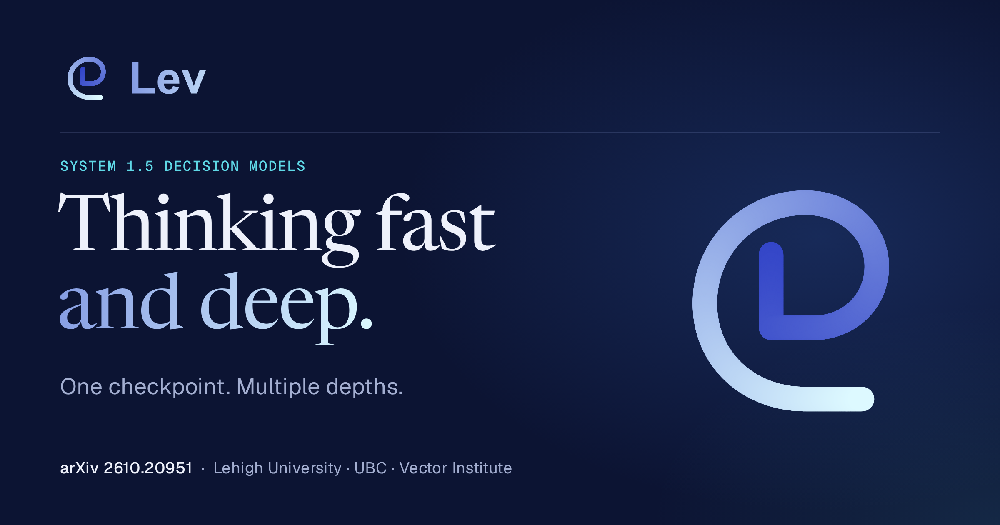</td>
<td align="center" valign="top">tidak ada media yang dipublikasikan</td>
</tr></table>

🔬 <b><a href="https://github.com/skydiving94/klint">skydiving94/klint</a></b> · ⭐5 · Python · 🔎 inferred · 0 天

##### 📝 Ringkasan

Linter semantik deklaratif dan auditor kode arsitektural untuk kev berbobot terbuka lokal dan model System One jarak jauh (/v1/systemone).

##### 📌 Fakta dasar

| Bidang   | Nilai                                             |
| -------- | ------------------------------------------------- |
| Kategori | `Reproduksi terbuka, bobot, dan riset arsitektur` |
| Bukti    | `inferred`                                        |
| Bahasa   | Python                                            |

##### 📊 Data

| Metrik            | Nilai      |
| ----------------- | ---------- |
| Bintang           | **5**      |
| Push terakhir     | 2026-11-04 |
| Pertama terdaftar | 2026-11-02 |

🏷 `ast` · `code-audit` · `kev` · `linter` · `python` · `react` · `software-architecture` · `static-analysis`

---

<table><tr><th align="center" width="50%">🖼 Gambar</th><th align="center" width="50%">🎬 Video</th></tr><tr>
<td align="center" valign="top">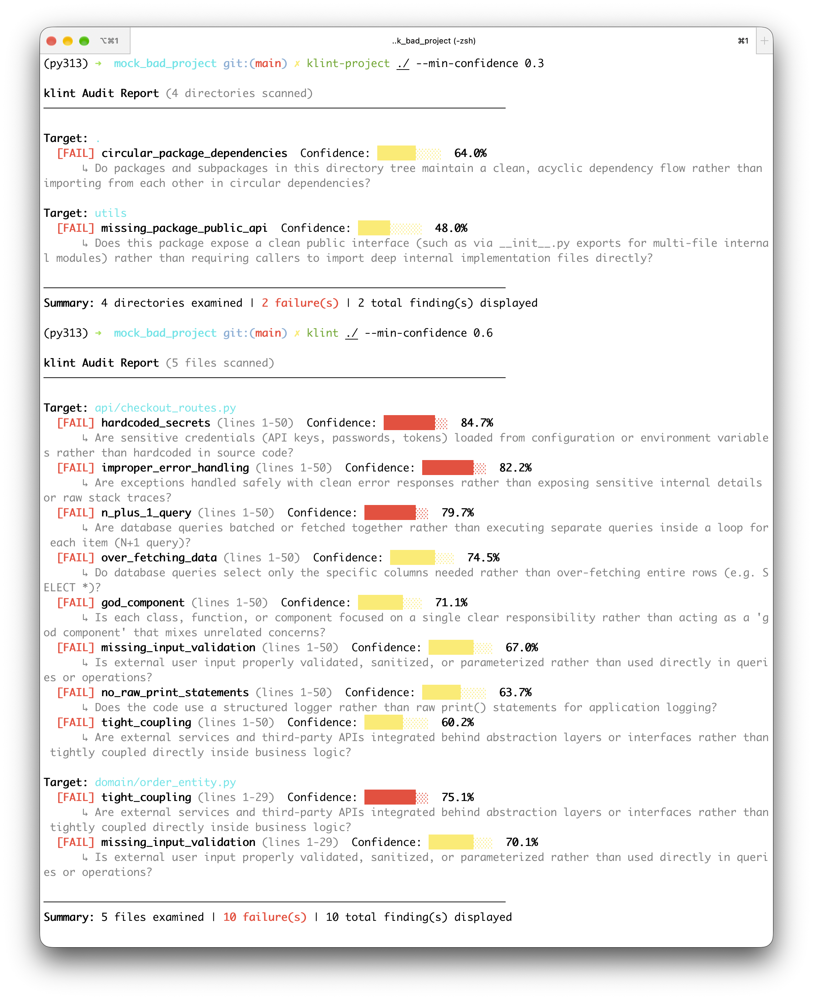</td>
<td align="center" valign="top">tidak ada media yang dipublikasikan</td>
</tr></table>

🔬 <b><a href="https://github.com/lawrence3699/Jev-Style-0.8B-Decision-v3-MLX">lawrence3699/Jev-Style-0.8B-Decision-v3-MLX</a></b> · Python · 🔎 inferred · 0 天

##### 📝 Ringkasan

GitHub mirror of the chaoliangUNSW/Jev-Style-0.8B-Decision-v3-MLX Hugging Face model

##### 📌 Fakta dasar

| Bidang   | Nilai                                             |
| -------- | ------------------------------------------------- |
| Kategori | `Reproduksi terbuka, bobot, dan riset arsitektur` |
| Bukti    | `inferred`                                        |
| Bahasa   | Python                                            |

##### 📊 Data

| Metrik            | Nilai      |
| ----------------- | ---------- |
| Bintang           | **0**      |
| Push terakhir     | 2026-11-04 |
| Pertama terdaftar | 2026-11-05 |

🏷 `decision-model` · `huggingface-mirror` · `jev-style`

---

<table><tr><th align="center" width="50%">🖼 Gambar</th><th align="center" width="50%">🎬 Video</th></tr><tr>
<td align="center" valign="top">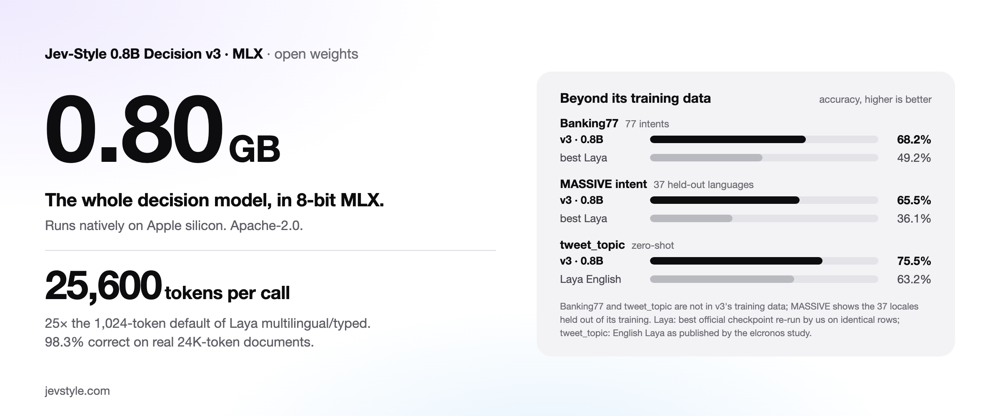</td>
<td align="center" valign="top">tidak ada media yang dipublikasikan</td>
</tr></table>

🔬 <b><a href="https://github.com/lawrence3699/Jev-Style-2B-Decision-v3-MLX">lawrence3699/Jev-Style-2B-Decision-v3-MLX</a></b> · Python · 🔎 inferred · 0 天

##### 📝 Ringkasan

GitHub mirror of the chaoliangUNSW/Jev-Style-2B-Decision-v3-MLX Hugging Face model

##### 📌 Fakta dasar

| Bidang   | Nilai                                             |
| -------- | ------------------------------------------------- |
| Kategori | `Reproduksi terbuka, bobot, dan riset arsitektur` |
| Bukti    | `inferred`                                        |
| Bahasa   | Python                                            |

##### 📊 Data

| Metrik            | Nilai      |
| ----------------- | ---------- |
| Bintang           | **0**      |
| Push terakhir     | 2026-11-04 |
| Pertama terdaftar | 2026-11-05 |

🏷 `decision-model` · `huggingface-mirror` · `jev-style`

---

<table><tr><th align="center" width="50%">🖼 Gambar</th><th align="center" width="50%">🎬 Video</th></tr><tr>
<td align="center" valign="top">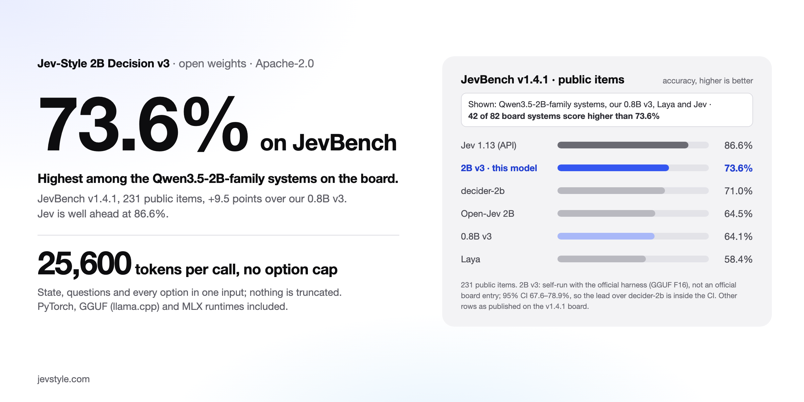</td>
<td align="center" valign="top">tidak ada media yang dipublikasikan</td>
</tr></table>

🔬 <b><a href="https://github.com/lawrence3699/Jev-Style-Qwen3.5-2B-Decision-MLX-bf16">lawrence3699/Jev-Style-Qwen3.5-2B-Decision-MLX-bf16</a></b> · Python · 🔎 inferred · 0 天

##### 📝 Ringkasan

GitHub mirror of the chaoliangUNSW/Jev-Style-Qwen3.5-2B-Decision-MLX-bf16 Hugging Face model

##### 📌 Fakta dasar

| Bidang   | Nilai                                             |
| -------- | ------------------------------------------------- |
| Kategori | `Reproduksi terbuka, bobot, dan riset arsitektur` |
| Bukti    | `inferred`                                        |
| Bahasa   | Python                                            |

##### 📊 Data

| Metrik            | Nilai      |
| ----------------- | ---------- |
| Bintang           | **0**      |
| Push terakhir     | 2026-11-04 |
| Pertama terdaftar | 2026-11-05 |

🏷 `decision-model` · `huggingface-mirror` · `jev-style`

---

<table><tr><th align="center" width="50%">🖼 Gambar</th><th align="center" width="50%">🎬 Video</th></tr><tr>
<td align="center" valign="top"></td>
<td align="center" valign="top">tidak ada media yang dipublikasikan</td>
</tr></table>

Aset ditautkan langsung dari repositori hulu karena tidak ada lisensi redistribusi yang dinyatakan.

🔬 <b><a href="https://github.com/lawrence3699/Jev-Style-Qwen3.5-2B-Decision-v2-MLX-bf16">lawrence3699/Jev-Style-Qwen3.5-2B-Decision-v2-MLX-bf16</a></b> · Python · 🔎 inferred · 0 天

##### 📝 Ringkasan

GitHub mirror of the chaoliangUNSW/Jev-Style-Qwen3.5-2B-Decision-v2-MLX-bf16 Hugging Face model

##### 📌 Fakta dasar

| Bidang   | Nilai                                             |
| -------- | ------------------------------------------------- |
| Kategori | `Reproduksi terbuka, bobot, dan riset arsitektur` |
| Bukti    | `inferred`                                        |
| Bahasa   | Python                                            |

##### 📊 Data

| Metrik            | Nilai      |
| ----------------- | ---------- |
| Bintang           | **0**      |
| Push terakhir     | 2026-11-04 |
| Pertama terdaftar | 2026-11-05 |

🏷 `decision-model` · `huggingface-mirror` · `jev-style`

---

<table><tr><th align="center" width="50%">🖼 Gambar</th><th align="center" width="50%">🎬 Video</th></tr><tr>
<td align="center" valign="top">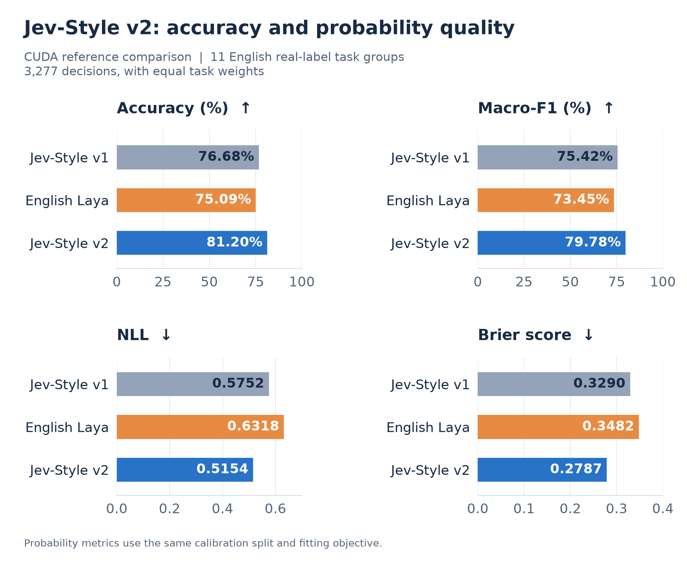</td>
<td align="center" valign="top">tidak ada media yang dipublikasikan</td>
</tr></table>

🔬 <b><a href="https://github.com/MarwaneAit-mouloud/reachy-jev">MarwaneAit-mouloud/reachy-jev</a></b> · Python · 🔎 inferred · 16 天

##### 📝 Ringkasan

Reachy Mini contrôle les commandes : modèles de décision (Jev, OpenAI) contre LLM génératif, latence et coût mesurés sur le robot.

##### 📌 Fakta dasar

| Bidang   | Nilai                                             |
| -------- | ------------------------------------------------- |
| Kategori | `Reproduksi terbuka, bobot, dan riset arsitektur` |
| Bukti    | `inferred`                                        |
| Bahasa   | Python                                            |

##### 📊 Data

| Metrik            | Nilai      |
| ----------------- | ---------- |
| Bintang           | **0**      |
| Push terakhir     | 2026-10-19 |
| Pertama terdaftar | 2026-11-01 |

---

<table><tr><th align="center" width="50%">🖼 Gambar</th><th align="center" width="50%">🎬 Video</th></tr><tr>
<td align="center" valign="top"></td>
<td align="center" valign="top">tidak ada media yang dipublikasikan</td>
</tr></table>

Aset ditautkan langsung dari repositori hulu karena tidak ada lisensi redistribusi yang dinyatakan.

🔬 <b><a href="https://github.com/imikerussell/beebots">imikerussell/beebots</a></b> · ⭐335 · TypeScript · ❓ unverified · 0 天 · ⭐-1

##### 📝 Ringkasan

Tiga lebah perdagangan AI di OKX, setiap keputusan oleh Jev. Perdagangan kertas secara default. Bukan nasihat keuangan.

##### 📌 Fakta dasar

| Bidang   | Nilai                                             |
| -------- | ------------------------------------------------- |
| Kategori | `Reproduksi terbuka, bobot, dan riset arsitektur` |
| Bukti    | `unverified`                                      |
| Bahasa   | TypeScript                                        |

##### 📊 Data

| Metrik            | Nilai        |
| ----------------- | ------------ |
| Bintang           | **335** (-1) |
| Push terakhir     | 2026-11-05   |
| Pertama terdaftar | 2026-10-29   |

---

<table><tr><th align="center" width="50%">🖼 Gambar</th><th align="center" width="50%">🎬 Video</th></tr><tr>
<td align="center" valign="top">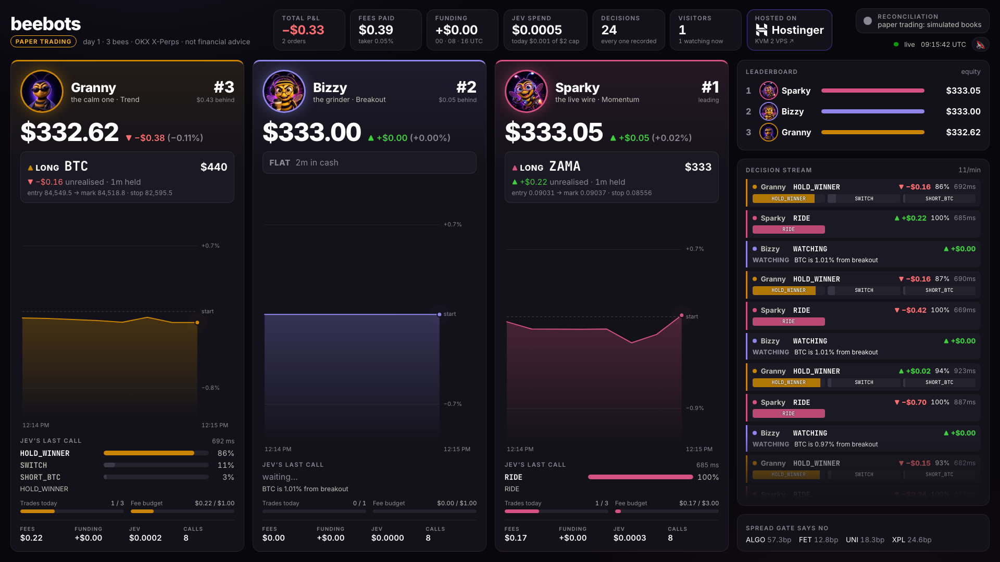</td>
<td align="center" valign="top"> <a href="https://youtu.be/bp_u9Gzp1OU">Tonton di youtu.be</a> · pemutaran terbuka di situs sumber; GitHub tidak dapat menyematkannya secara inline</td>
</tr></table>

<b>Lainnya di kategori ini</b> · 30

- [hyperspaceai/jevcache](https://github.com/hyperspaceai/jevcache) - Cache keputusan untuk model kelas TypeSafe Jev — memoize keputusan agar…
- [mars-tw/jev-trading-command-center](https://github.com/mars-tw/jev-trading-command-center) - Open-source paper-trading research app integrating TypeSafe Jev, animated 3D…
- [mattt/AnyDecisionModel](https://github.com/mattt/AnyDecisionModel) - A Swift package for typed decisions from language models.
- [hunkim/solar-mini4-jev](https://github.com/hunkim/solar-mini4-jev)
- [whyashthakker/awesome-jev-use-cases](https://github.com/whyashthakker/awesome-jev-use-cases) - Daftar Awesome tentang kasus penggunaan Jev.
- [ljwwwiop/JEV-mini](https://github.com/ljwwwiop/JEV-mini) - JEV-mini adalah proyek pembelajaran minimal untuk melatih model pengambilan…
- [pCwOrM/werr](https://github.com/pCwOrM/werr) - Zero-memory System-1 decision engine &amp; TypeSafe Jev runtime powered by…
- [yuting-ai/minicpm5-2b-jev](https://github.com/yuting-ai/minicpm5-2b-jev) - MiniCPM5-2B-Jev: Model Keputusan System 1 Berkecepatan Tinggi.
- [0utKast/Jev_AI](https://github.com/0utKast/Jev_AI) - Kursus lengkap, notebook Google Colab, dan panduan bibliografi tentang Jev…
- [Frank-Funney/mini-jev](https://github.com/Frank-Funney/mini-jev) - Mesin keputusan terstruktur yang sangat ringan untuk perangkat edge.
- [welcomeenjoy75-hue/mini-jev](https://github.com/welcomeenjoy75-hue/mini-jev) - Mesin keputusan terstruktur yang sangat ringan untuk perangkat edge.
- [AbdelStark/reachy-jev](https://github.com/AbdelStark/reachy-jev) - Primitif keputusan bertipe Jev untuk aplikasi Reachy Mini.
- [AnilDeshpande/jev-youtube-demo](https://github.com/AnilDeshpande/jev-youtube-demo) - Jev (TypeSafe) vs GPT-4o-mini: mengklasifikasikan komentar YouTube dengan…
- [Dlmily/minimind-jev-dlmily](https://github.com/Dlmily/minimind-jev-dlmily) - MiniMind Jev probability scoring page (GitHub Pages).
- [Drykeeightyeight427/jev-robot-control](https://github.com/Drykeeightyeight427/jev-robot-control) - Bandingkan GPT-6 Astra, GPT-4.1 mini, dan Jev yang mengendalikan xArm7 di…
- [emilesilvis/jev-experiment](https://github.com/emilesilvis/jev-experiment) - Eksperimen klasifikasi Jev dan GPT-4o mini yang dapat direproduksi, temuan, dan…
- [gbesse/jev-minimis-watch](https://github.com/gbesse/jev-minimis-watch) - Siapkan peninjauan akumulasi bantuan de minimis berdasarkan elemen-elemen…
- [jobakk/jev-cj-asap](https://github.com/jobakk/jev-cj-asap) - Penilaian komparatif esai ASAP oleh Jev (API model keputusan), gpt-oss-20b, dan…
- [lawrence3699/Jev-Style-2B-Decision-v4-MLX](https://github.com/lawrence3699/Jev-Style-2B-Decision-v4-MLX) - GitHub mirror of the chaoliangUNSW/Jev-Style-2B-Decision-v4-MLX Hugging Face…
- [luckberonne/mini-jev](https://github.com/luckberonne/mini-jev) - Pengklasifikasi perintah shell satu lintasan.
- [u007/minicpm5-jev](https://github.com/u007/minicpm5-jev) - MiniCPM5-2B-8bit sebagai layanan keputusan bertipe yang kompatibel dengan Jev…
- [Van5hdeep/mini-jev](https://github.com/Van5hdeep/mini-jev) - model sederhana yang dilatih berdasarkan inspirasi dari jev.
- [vicfei/minimind-jev](https://github.com/vicfei/minimind-jev) - Train your own tiny Jev (System One decision model) — v0.1: frozen Chinese…
- [wangjunxiao/MiniJev](https://github.com/wangjunxiao/MiniJev) - A lightweight and easy-to-follow implementation of Jev.
- [yo4e/JevPip](https://github.com/yo4e/JevPip) - GMOのFX/BTC市場データに対応したローカル市場研究ターミナル。ライブチャート、ペーパートレード、バックテスト、安全監督、TypeSafe Jev連携.
- [apiplant/laya-rs](https://github.com/apiplant/laya-rs) - Implementasi ulang Rust dari Laya, mesin keputusan bertipe non-autoregresif di…
- [Astro-Han/decision-head-rlcd](https://github.com/Astro-Han/decision-head-rlcd) - Dari mana generalisasi model keputusan berasal? RLCD pada Qwen3.5-4B, set yang…
- [smixs/jevchik](https://github.com/smixs/jevchik) - Telegram bot for group chats: karma for useful messages, anti-spam for…
- [vicksiyi/qwen-2.5-1b-rlcd](https://github.com/vicksiyi/qwen-2.5-1b-rlcd) - Demo probabilitas keputusan MLX lokal yang diturunkan dari…
- [yangshun2005/laya-cn](https://github.com/yangshun2005/laya-cn) - \[中文化\] Mesin keputusan System 1 multibahasa dan non-autoregresif.

## Aplikasi, game, robotika, dan demo interaktif

Game, robot, peramban, dan dasbor. Demo adalah cara klaim soal latensi dan biaya menjadi mudah dibaca.

🎮 <b><a href="https://github.com/heyjunpenn/awesome-jev">heyjunpenn/awesome-jev</a></b> · ⭐1056 · Astro · 👁️ observed · 17 天 · ⭐+1

##### 📝 Ringkasan

A verified, community-maintained catalog of 992 open-source projects built with Jev.

🔧 Ditemukan dipakai dalam kode: `README.md`, `CHANGELOG.md`, `README.ko.md`, `README.es.md`

##### 📌 Fakta dasar

| Bidang   | Nilai                                           |
| -------- | ----------------------------------------------- |
| Kategori | `Aplikasi, game, robotika, dan demo interaktif` |
| Bukti    | `observed`                                      |
| Bahasa   | Astro                                           |

##### 📊 Data

| Metrik            | Nilai         |
| ----------------- | ------------- |
| Bintang           | **1056** (+1) |
| Push terakhir     | 2026-10-19    |
| Pertama terdaftar | 2026-10-29    |

🏷 `astro` · `awesome` · `awesome-jev` · `awesome-list` · `jev` · `typesafe`

🎮 <b><a href="https://github.com/superagents-lab/jev-search">superagents-lab/jev-search</a></b> · ⭐553 · TypeScript · 👁️ observed · 14 天 · ⭐+1

##### 📝 Ringkasan

Cari di web dengan Jev milik TypeSafe: pemilihan sumber, pemahaman kueri, dan pemeringkatan relevansi. Dibangun dengan Search1API.

🔧 Ditemukan dipakai dalam kode: `README.md`

##### 📌 Fakta dasar

| Bidang   | Nilai                                           |
| -------- | ----------------------------------------------- |
| Kategori | `Aplikasi, game, robotika, dan demo interaktif` |
| Bukti    | `observed`                                      |
| Bahasa   | TypeScript                                      |

##### 📊 Data

| Metrik            | Nilai        |
| ----------------- | ------------ |
| Bintang           | **553** (+1) |
| Push terakhir     | 2026-10-21   |
| Pertama terdaftar | 2026-10-29   |

---

<table><tr><th align="center" width="50%">🖼 Gambar</th><th align="center" width="50%">🎬 Video</th></tr><tr>
<td align="center" valign="top"></td>
<td align="center" valign="top">tidak ada media yang dipublikasikan</td>
</tr></table>

🎮 <b><a href="https://github.com/MCG-NJU/VideoJev">MCG-NJU/VideoJev</a></b> · ⭐293 · Python · 👁️ observed · 18 天 · ⭐+3

##### 📝 Ringkasan

VideoJev: System One Model untuk Pemahaman dan Interaksi Video

##### 📌 Fakta dasar

| Bidang   | Nilai                                           |
| -------- | ----------------------------------------------- |
| Kategori | `Aplikasi, game, robotika, dan demo interaktif` |
| Bukti    | `observed`                                      |
| Bahasa   | Python                                          |

##### 📊 Data

| Metrik            | Nilai        |
| ----------------- | ------------ |
| Bintang           | **293** (+3) |
| Push terakhir     | 2026-10-18   |
| Pertama terdaftar | 2026-10-28   |

---

<table><tr><th align="center" width="50%">🖼 Gambar</th><th align="center" width="50%">🎬 Video</th></tr><tr>
<td align="center" valign="top"></td>
<td align="center" valign="top">tidak ada media yang dipublikasikan</td>
</tr></table>

🎮 <b><a href="https://github.com/mrnugget/jev-shell-history">mrnugget/jev-shell-history</a></b> · ⭐119 · TypeScript · 👁️ observed · 48 天

##### 📝 Ringkasan

Saran otomatis riwayat zsh bergaya Fish yang diurutkan berdasarkan Jev (TypeSafe)

🔧 Ditemukan dipakai dalam kode: `README.md`

##### 📌 Fakta dasar

| Bidang   | Nilai                                           |
| -------- | ----------------------------------------------- |
| Kategori | `Aplikasi, game, robotika, dan demo interaktif` |
| Bukti    | `observed`                                      |
| Bahasa   | TypeScript                                      |

##### 📊 Data

| Metrik            | Nilai      |
| ----------------- | ---------- |
| Bintang           | **119**    |
| Push terakhir     | 2026-09-18 |
| Pertama terdaftar | 2026-10-29 |

---

<table><tr><th align="center" width="50%">🖼 Gambar</th><th align="center" width="50%">🎬 Video</th></tr><tr>
<td align="center" valign="top"></td>
<td align="center" valign="top"> rekaman bergerak</td>
</tr></table>

Aset ditautkan langsung dari repositori hulu karena tidak ada lisensi redistribusi yang dinyatakan.

🎮 <b><a href="https://github.com/realZachi/typesafe-adblock">realZachi/typesafe-adblock</a></b> · ⭐94 · JavaScript · 👁️ observed · 48 天

##### 📝 Ringkasan

🧹 Proyek seru: ekstensi Chrome yang menanyakan kepada model keputusan AI kecil (TypeSafe Jev) "apakah elemen DOM ini iklan?" lalu menghapusnya dari halaman. BYOK, tanpa backend, bukan pemblokir iklan sungguhan.

🔧 Ditemukan dipakai dalam kode: `README.md`

##### 📌 Fakta dasar

| Bidang   | Nilai                                           |
| -------- | ----------------------------------------------- |
| Kategori | `Aplikasi, game, robotika, dan demo interaktif` |
| Bukti    | `observed`                                      |
| Bahasa   | JavaScript                                      |

##### 📊 Data

| Metrik            | Nilai      |
| ----------------- | ---------- |
| Bintang           | **94**     |
| Push terakhir     | 2026-09-17 |
| Pertama terdaftar | 2026-10-29 |

🎮 <b><a href="https://github.com/zadescoxp/Jev-Trades">zadescoxp/Jev-Trades</a></b> · ⭐58 · Python · 👁️ observed · 40 天 · ⭐-1

##### 📝 Ringkasan

Bot trading dengan model system one pertama milik TypeSafe AI yang benar-benar baru bernama Jev

##### 📌 Fakta dasar

| Bidang   | Nilai                                           |
| -------- | ----------------------------------------------- |
| Kategori | `Aplikasi, game, robotika, dan demo interaktif` |
| Bukti    | `observed`                                      |
| Bahasa   | Python                                          |

##### 📊 Data

| Metrik            | Nilai       |
| ----------------- | ----------- |
| Bintang           | **58** (-1) |
| Push terakhir     | 2026-09-25  |
| Pertama terdaftar | 2026-10-21  |

🏷 `automated-testing` · `backtesting` · `crypto-trading-bot-latest` · `trading-bot-ai-automated`

---

<table><tr><th align="center" width="50%">🖼 Gambar</th><th align="center" width="50%">🎬 Video</th></tr><tr>
<td align="center" valign="top"></td>
<td align="center" valign="top"> rekaman bergerak</td>
</tr></table>

🎮 <b><a href="https://github.com/dfinke/Jev">dfinke/Jev</a></b> · ⭐11 · PowerShell · 👁️ observed · 20 天

##### 📝 Ringkasan

Keputusan PowerShell dengan model TypeSafe AI milik Jev: https://typesafe.ai/blog/introducing-system-one-models-and-jev

##### 📌 Fakta dasar

| Bidang   | Nilai                                           |
| -------- | ----------------------------------------------- |
| Kategori | `Aplikasi, game, robotika, dan demo interaktif` |
| Bukti    | `observed`                                      |
| Bahasa   | PowerShell                                      |

##### 📊 Data

| Metrik            | Nilai      |
| ----------------- | ---------- |
| Bintang           | **11**     |
| Push terakhir     | 2026-10-16 |
| Pertama terdaftar | 2026-10-28 |

---

<table><tr><th align="center" width="50%">🖼 Gambar</th><th align="center" width="50%">🎬 Video</th></tr><tr>
<td align="center" valign="top"></td>
<td align="center" valign="top">tidak ada media yang dipublikasikan</td>
</tr></table>

🎮 <b><a href="https://github.com/chris-wozniczek/jev-voice-control">chris-wozniczek/jev-voice-control</a></b> · ⭐7 · Swift · 👁️ observed · 44 天

##### 📝 Ringkasan

Kendalikan Mac Anda dengan suara. Ucapan → keputusan tertulis Jev (model TypeSafe AI System One) → tindakan macOS. Aplikasi Swift di bilah menu.

##### 📌 Fakta dasar

| Bidang   | Nilai                                           |
| -------- | ----------------------------------------------- |
| Kategori | `Aplikasi, game, robotika, dan demo interaktif` |
| Bukti    | `observed`                                      |
| Bahasa   | Swift                                           |

##### 📊 Data

| Metrik            | Nilai      |
| ----------------- | ---------- |
| Bintang           | **7**      |
| Push terakhir     | 2026-09-21 |
| Pertama terdaftar | 2026-10-28 |

🏷 `computer-use` · `cua` · `jev` · `jev-ai` · `jev-api` · `jev-model` · `voice` · `voice-recognition`

🎮 <b><a href="https://github.com/dulin20240919-dot/jev">dulin20240919-dot/jev</a></b> · ⭐1 · 👁️ observed · 0 天 · **NEW**

##### 📝 Ringkasan

本项目是对 **jev 模型** 的调用尝试，基于 `search_jev使用文档.md`（内部使用文档）与 `jev官方文档.md`（来自 https://docs.typesafe.ai 的官方文档）整理而成

##### 📌 Fakta dasar

| Bidang   | Nilai                                           |
| -------- | ----------------------------------------------- |
| Kategori | `Aplikasi, game, robotika, dan demo interaktif` |
| Bukti    | `observed`                                      |

##### 📊 Data

| Metrik            | Nilai      |
| ----------------- | ---------- |
| Bintang           | **1**      |
| Push terakhir     | 2026-11-05 |
| Pertama terdaftar | 2026-11-05 |

🎮 <b><a href="https://github.com/Omrigotlieb/awesome-jev">Omrigotlieb/awesome-jev</a></b> · ⭐1 · Python · 👁️ observed · 0 天

##### 📝 Ringkasan

Daftar luar biasa terverifikasi dan kaya tangkapan layar berisi proyek yang dibangun di atas Jev — model System One milik TypeSafe AI untuk keputusan bertipe

##### 📌 Fakta dasar

| Bidang   | Nilai                                           |
| -------- | ----------------------------------------------- |
| Kategori | `Aplikasi, game, robotika, dan demo interaktif` |
| Bukti    | `observed`                                      |
| Bahasa   | Python                                          |

##### 📊 Data

| Metrik            | Nilai      |
| ----------------- | ---------- |
| Bintang           | **1**      |
| Push terakhir     | 2026-11-05 |
| Pertama terdaftar | 2026-09-21 |

🎮 <b><a href="https://github.com/Amr-devman/systemone-robotics">Amr-devman/systemone-robotics</a></b> · 👁️ observed · 10 天

##### 📝 Ringkasan

Control a robotic arm using systemone models

##### 📌 Fakta dasar

| Bidang   | Nilai                                           |
| -------- | ----------------------------------------------- |
| Kategori | `Aplikasi, game, robotika, dan demo interaktif` |
| Bukti    | `observed`                                      |

##### 📊 Data

| Metrik            | Nilai      |
| ----------------- | ---------- |
| Bintang           | **0**      |
| Push terakhir     | 2026-10-26 |
| Pertama terdaftar | 2026-10-27 |

🎮 <b><a href="https://github.com/Anshul261/SystemOne_Demos">Anshul261/SystemOne_Demos</a></b> · Python · 👁️ observed · 7 天

##### 📝 Ringkasan

Using Jev/SystemOne Models to build use cases

##### 📌 Fakta dasar

| Bidang   | Nilai                                           |
| -------- | ----------------------------------------------- |
| Kategori | `Aplikasi, game, robotika, dan demo interaktif` |
| Bukti    | `observed`                                      |
| Bahasa   | Python                                          |

##### 📊 Data

| Metrik            | Nilai      |
| ----------------- | ---------- |
| Bintang           | **0**      |
| Push terakhir     | 2026-10-29 |
| Pertama terdaftar | 2026-10-26 |

🎮 <b><a href="https://github.com/Shivam-Jha96/gsp">Shivam-Jha96/gsp</a></b> · Python · 👁️ observed · 1 天

##### 📝 Ringkasan

Terminal analisis sentimen makro berbasis AI yang membaca ribuan peristiwa berita keuangan global terkini secara waktu nyata, lalu memberi skor dampaknya terhadap pasar menggunakan model Contrastive-LM System-One khusus pada GPU tanpa server!

##### 📌 Fakta dasar

| Bidang   | Nilai                                           |
| -------- | ----------------------------------------------- |
| Kategori | `Aplikasi, game, robotika, dan demo interaktif` |
| Bukti    | `observed`                                      |
| Bahasa   | Python                                          |

##### 📊 Data

| Metrik            | Nilai      |
| ----------------- | ---------- |
| Bintang           | **0**      |
| Push terakhir     | 2026-11-04 |
| Pertama terdaftar | 2026-10-26 |

🏷 `artificial-intelligence-algorithms` · `finance-dashboard` · `stock-analysis` · `stock-market` · `stock-prediction`

---

<table><tr><th align="center" width="50%">🖼 Gambar</th><th align="center" width="50%">🎬 Video</th></tr><tr>
<td align="center" valign="top"></td>
<td align="center" valign="top">tidak ada media yang dipublikasikan</td>
</tr></table>

Aset ditautkan langsung dari repositori hulu karena tidak ada lisensi redistribusi yang dinyatakan.

🎮 <b><a href="https://x.com/tspy/status/2100864234523685146">Xtags — X intent labeller</a></b> · @tspy · 👁️ observed · 48 天

##### 📝 Ringkasan

Xtags: a Chrome extension that labels each post in an X timeline with what it is trying to get from you — inducement, provocation, promotion, machine-generated, persuasion, entertainment, information — drawn as a tag plus a probability right after the timestamp. A side panel reports session counts (seen, judged, correct) and cumulative token cost. The author reports near-instant responses and usable accuracy before any tuning.

➡️ **Original project (manifoldor/xtags)** — [https://github.com/manifoldor/xtags](https://github.com/manifoldor/xtags)

> 💡 Worth reading as a latency argument rather than an accuracy one: labelling a timeline only works if the decision costs less than the scroll, which is the constraint a generative model cannot meet.

##### 📌 Fakta dasar

| Bidang   | Nilai                                           |
| -------- | ----------------------------------------------- |
| Kategori | `Aplikasi, game, robotika, dan demo interaktif` |
| Bukti    | `observed`                                      |
| Pemilik  | [yishan](https://x.com/tspy) · @tspy            |

##### 📊 Data

| Metrik            | Nilai      |
| ----------------- | ---------- |
| Tayangan          | **9873**   |
| Suka              | 24         |
| Komentar          | 11         |
| Diposting         | 2026-09-18 |
| Pertama terdaftar | 2026-09-18 |

🏷 `x`

---

<table><tr><th align="center" width="50%">🖼 Gambar</th><th align="center" width="50%">🎬 Video</th></tr><tr>
<td align="center" valign="top"></td>
<td align="center" valign="top"> rekaman bergerak · <a href="https://video.twimg.com/amplify_video/2100858340331200512/vid/avc1/1242x720/ex2FF5-TerVxo9xX.mp4">Buka video</a></td>
</tr></table>

🎮 <b><a href="https://github.com/Valen-Team/Valen">Valen-Team/Valen</a></b> · ⭐901 · Python · 🔎 inferred · 1 天 · ⭐+1

##### 📝 Ringkasan

Open, lightweight multimodal decision models for text, images, and video. Train and run them yourself.

##### 📌 Fakta dasar

| Bidang   | Nilai                                           |
| -------- | ----------------------------------------------- |
| Kategori | `Aplikasi, game, robotika, dan demo interaktif` |
| Bukti    | `inferred`                                      |
| Bahasa   | Python                                          |

##### 📊 Data

| Metrik            | Nilai        |
| ----------------- | ------------ |
| Bintang           | **901** (+1) |
| Push terakhir     | 2026-11-04   |
| Pertama terdaftar | 2026-10-29   |

🏷 `decision-model` · `jev` · `system-one` · `typed-decisions`

---

<table><tr><th align="center" width="50%">🖼 Gambar</th><th align="center" width="50%">🎬 Video</th></tr><tr>
<td align="center" valign="top"></td>
<td align="center" valign="top"> rekaman bergerak</td>
</tr></table>

🎮 <b><a href="https://github.com/jkudish/jev-browser">jkudish/jev-browser</a></b> · ⭐367 · JavaScript · 🔎 inferred · 6 天

##### 📝 Ringkasan

Penggunaan browser menggunakan model Jev milik Typesafe

##### 📌 Fakta dasar

| Bidang   | Nilai                                           |
| -------- | ----------------------------------------------- |
| Kategori | `Aplikasi, game, robotika, dan demo interaktif` |
| Bukti    | `inferred`                                      |
| Bahasa   | JavaScript                                      |

##### 📊 Data

| Metrik            | Nilai      |
| ----------------- | ---------- |
| Bintang           | **367**    |
| Push terakhir     | 2026-10-30 |
| Pertama terdaftar | 2026-10-29 |

---

<table><tr><th align="center" width="50%">🖼 Gambar</th><th align="center" width="50%">🎬 Video</th></tr><tr>
<td align="center" valign="top"></td>
<td align="center" valign="top"> rekaman bergerak · <a href="https://raw.githubusercontent.com/jkudish/jev-browser/main/assets/github-demo.mp4">Buka video</a></td>
</tr></table>

🎮 <b><a href="https://github.com/aowang-ai/jev-trade">aowang-ai/jev-trade</a></b> · ⭐225 · TypeScript · 🔎 inferred · 45 天

##### 📝 Ringkasan

Trader Jev langsung di Hyperliquid

##### 📌 Fakta dasar

| Bidang   | Nilai                                           |
| -------- | ----------------------------------------------- |
| Kategori | `Aplikasi, game, robotika, dan demo interaktif` |
| Bukti    | `inferred`                                      |
| Bahasa   | TypeScript                                      |

##### 📊 Data

| Metrik            | Nilai      |
| ----------------- | ---------- |
| Bintang           | **225**    |
| Push terakhir     | 2026-09-21 |
| Pertama terdaftar | 2026-10-29 |

🏷 `hyperliquid` · `jev` · `quantitative-finance` · `typesafe`

---

<table><tr><th align="center" width="50%">🖼 Gambar</th><th align="center" width="50%">🎬 Video</th></tr><tr>
<td align="center" valign="top"></td>
<td align="center" valign="top">tidak ada media yang dipublikasikan</td>
</tr></table>

Aset ditautkan langsung dari repositori hulu karena tidak ada lisensi redistribusi yang dinyatakan.

🎮 <b><a href="https://github.com/BudEcosystem/Bud-Decision-Studio">BudEcosystem/Bud-Decision-Studio</a></b> · ⭐86 · HTML · 🔎 inferred · 27 天 · ⭐-24

##### 📝 Ringkasan

Bud Decision studio adalah aplikasi desktop lintas platform dan sistem penyajian yang mudah digunakan untuk model seperti Jev secara lokal.

##### 📌 Fakta dasar

| Bidang   | Nilai                                           |
| -------- | ----------------------------------------------- |
| Kategori | `Aplikasi, game, robotika, dan demo interaktif` |
| Bukti    | `inferred`                                      |
| Bahasa   | HTML                                            |

##### 📊 Data

| Metrik            | Nilai        |
| ----------------- | ------------ |
| Bintang           | **86** (-24) |
| Push terakhir     | 2026-10-09   |
| Pertama terdaftar | 2026-10-29   |

🏷 `decision-models` · `desktop-app` · `jev` · `laya` · `local-ai` · `pytorch` · `system-one` · `tauri`

---

<table><tr><th align="center" width="50%">🖼 Gambar</th><th align="center" width="50%">🎬 Video</th></tr><tr>
<td align="center" valign="top"></td>
<td align="center" valign="top"> <a href="https://raw.githubusercontent.com/BudEcosystem/Bud-Decision-Studio/main/docs/media/demo.mp4">Buka video</a></td>
</tr></table>

Aset ditautkan langsung dari repositori hulu karena tidak ada lisensi redistribusi yang dinyatakan.

🎮 <b><a href="https://github.com/wizicer/jev_info_site">wizicer/jev_info_site</a></b> · ⭐3 · Astro · 🔎 inferred · 2 天

##### 📝 Ringkasan

Community index of tools, models, and real-world use cases built on Jev.

##### 📌 Fakta dasar

| Bidang   | Nilai                                           |
| -------- | ----------------------------------------------- |
| Kategori | `Aplikasi, game, robotika, dan demo interaktif` |
| Bukti    | `inferred`                                      |
| Bahasa   | Astro                                           |

##### 📊 Data

| Metrik            | Nilai      |
| ----------------- | ---------- |
| Bintang           | **3**      |
| Push terakhir     | 2026-11-03 |
| Pertama terdaftar | 2026-11-04 |

🏷 `awesome` · `jev` · `jev-ai` · `typesafe-ai`

---

<table><tr><th align="center" width="50%">🖼 Gambar</th><th align="center" width="50%">🎬 Video</th></tr><tr>
<td align="center" valign="top"></td>
<td align="center" valign="top">tidak ada media yang dipublikasikan</td>
</tr></table>

Aset ditautkan langsung dari repositori hulu karena tidak ada lisensi redistribusi yang dinyatakan.

🎮 <b><a href="https://github.com/BrendanH18/jev-lab">BrendanH18/jev-lab</a></b> · Python · 🔎 inferred · 0 天

##### 📝 Ringkasan

Six small apps and a workbench that show what TypeSafe's Jev (System One) model can do

##### 📌 Fakta dasar

| Bidang   | Nilai                                           |
| -------- | ----------------------------------------------- |
| Kategori | `Aplikasi, game, robotika, dan demo interaktif` |
| Bukti    | `inferred`                                      |
| Bahasa   | Python                                          |

##### 📊 Data

| Metrik            | Nilai      |
| ----------------- | ---------- |
| Bintang           | **0**      |
| Push terakhir     | 2026-11-04 |
| Pertama terdaftar | 2026-10-24 |

🏷 `ai` · `demo` · `jev` · `typesafe`

---

<table><tr><th align="center" width="50%">🖼 Gambar</th><th align="center" width="50%">🎬 Video</th></tr><tr>
<td align="center" valign="top">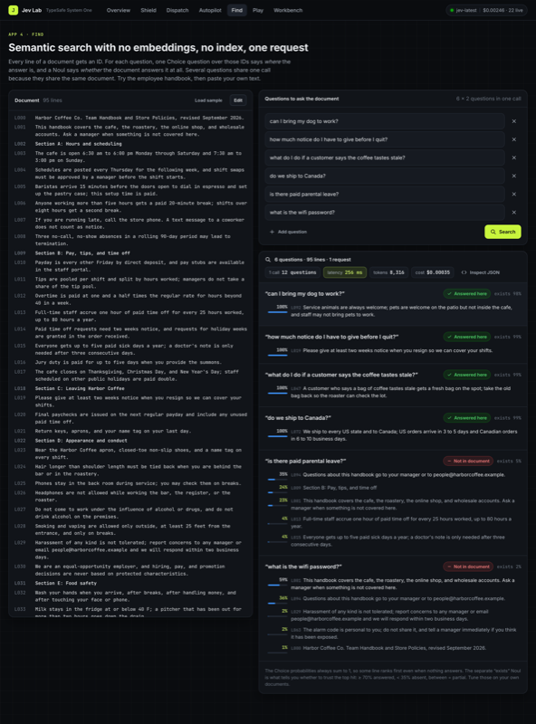</td>
<td align="center" valign="top">tidak ada media yang dipublikasikan</td>
</tr></table>

🎮 <b><a href="https://github.com/charles-forsyth/jev-decision-wall">charles-forsyth/jev-decision-wall</a></b> · JavaScript · 🔎 inferred · 0 天

##### 📝 Ringkasan

Type anything. 200 yes/no AI judgments light up as a live heatmap in ~200 ms, from one parallel call to TypeSafe Jev. Zero deps, bring your own key.

##### 📌 Fakta dasar

| Bidang   | Nilai                                           |
| -------- | ----------------------------------------------- |
| Kategori | `Aplikasi, game, robotika, dan demo interaktif` |
| Bukti    | `inferred`                                      |
| Bahasa   | JavaScript                                      |

##### 📊 Data

| Metrik            | Nilai      |
| ----------------- | ---------- |
| Bintang           | **0**      |
| Push terakhir     | 2026-11-05 |
| Pertama terdaftar | 2026-11-02 |

🏷 `ai` · `classification` · `demo` · `heatmap` · `jev` · `llm` · `nodejs` · `parallel`

---

<table><tr><th align="center" width="50%">🖼 Gambar</th><th align="center" width="50%">🎬 Video</th></tr><tr>
<td align="center" valign="top">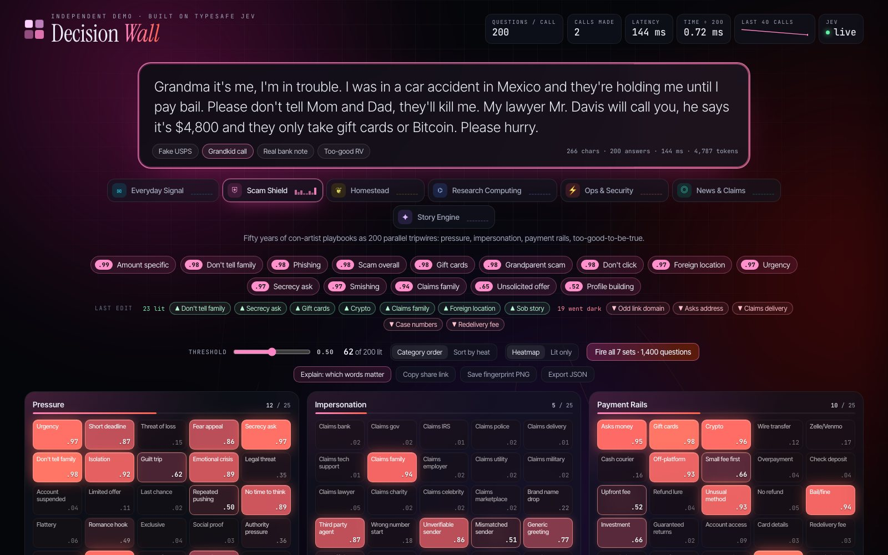</td>
<td align="center" valign="top">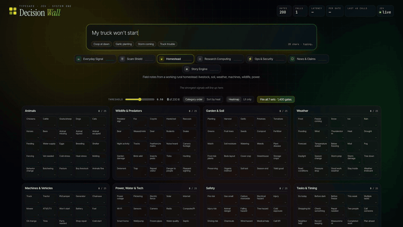 rekaman bergerak</td>
</tr></table>

<b>Lainnya di kategori ini</b> · 16

- [bobbylite/jev-system-one-model-primitives](https://github.com/bobbylite/jev-system-one-model-primitives) - Aplikasi contoh dasar untuk mendemonstrasikan tipe primitif untuk model system…
- [maxlbchung/system-one-harness](https://github.com/maxlbchung/system-one-harness) - A computer use harness for system one models.
- [moritzkremb/jev-voice-browser](https://github.com/moritzkremb/jev-voice-browser) - Kendalikan browser nyata dengan suara.
- [kevinbadi/jev-voice](https://github.com/kevinbadi/jev-voice) - Berbicara dengan Mac Anda. whisper.cpp lokal + satu panggilan Jev (TypeSafe)…
- [buer2233/jev-ui-test](https://github.com/buer2233/jev-ui-test) - Framework pengujian otomasi UI yang digerakkan oleh model keputusan Jev: tidak…
- [bilune/jev-design](https://github.com/bilune/jev-design) - Bisakah sebuah model merancang dasbor? Sebuah konsol yang seluruh sistem…
- [emrickgarrett/OneVOneJev](https://github.com/emrickgarrett/OneVOneJev) - Arena quickscope Jev 1v1 — Three.js + TypeSafe System One.
- [Tommylegen/jev-laya-toolkit](https://github.com/Tommylegen/jev-laya-toolkit) - Dashboard and local proxy for SystemOne decision models - Jev (TypeSafe API)…
- [dgarridou/KaLM-Jev](https://github.com/dgarridou/KaLM-Jev) - Jalankan layanan Choice, Score, dan Noul lokal yang efisien dengan…
- [arkulinskis/jev-buddy](https://github.com/arkulinskis/jev-buddy) - Jev Buddy: the developer guide to Jev, the AI decision model.
- [liangkingjin/jev-demo](https://github.com/liangkingjin/jev-demo) - Jev（TypeSafe System One）判定模型演示：Choice / Noul / Score 三原语 + 三档阈值分流，离线可跑.
- [m407/jev-grep](https://github.com/m407/jev-grep) - Semantic search for log and code fragments using Jev.
- [mberliner/jev-lab](https://github.com/mberliner/jev-lab) - Laboratorium progresif untuk mempelajari dan mendemonstrasikan Jev, model…
- [Sandesh-S-Dalvi/playwright-jev-demo](https://github.com/Sandesh-S-Dalvi/playwright-jev-demo) - Playwright + TypeSafe Jev (System One) decision-map demo for semantic test…
- [taiki00wo/jev-playground](https://github.com/taiki00wo/jev-playground) - TypeSafe AI の Jev で、飲食店の売上低下の原因を判定してみる作業場所.
- [sorrycc/typesafe-snake](https://github.com/sorrycc/typesafe-snake) - Snake yang diputar otomatis oleh model Jev milik TypeSafe: satu pilihan System…

## Tulisan, diskusi, dan daftar sejenis

Utas peluncuran, tulisan independen, dan daftar terkurasi lain di bidang ini. Repositori ini bukan satu-satunya, dan mengatakan itu lebih berguna daripada berpura-pura sebaliknya.

📰 <b><a href="https://docs.typesafe.ai/model-jaggedness/jev-1.13">9 jenis cacat yang diketahui (jaggedness)</a></b> · ✅ official · 49 天

##### 📝 Ringkasan

Pemahaman literal, **penghitungan tidak andal**, perbandingan tanggal, indireksi bertingkat, state besar dengan detail tidak relevan, konten adversarial, instruksi yang bertentangan dengan criteria, invarian struktural, dan generasi. Rekomendasi resmi: "pecah menjadi masalah atomik lalu gabungkan di dalam kode".

> 💡 **Batas kemampuan**—ini adalah daftar batas yang diakui sendiri oleh vendor, telah dicatat secara lengkap

##### 📌 Fakta dasar

| Bidang   | Nilai                                  |
| -------- | -------------------------------------- |
| Kategori | `Tulisan, diskusi, dan daftar sejenis` |
| Bukti    | `official`                             |

##### 📊 Data

| Metrik            | Nilai      |
| ----------------- | ---------- |
| Pertama terdaftar | 2026-09-20 |

📰 <b><a href="https://docs.typesafe.ai/cookbooks/consistency_choice_cookbook">`consistency_choice` cookbook secara resmi menjawab &quot;hasil pemanggilan berulang akan berubah&quot;</a></b> · ✅ official · 49 天

##### 📝 Ringkasan

Rubrik audit yang sama, **8 Choice × ulangi setiap kondisi 15 kali**. TypeSafe **raw agree 90.8%** (2 dari 8 pertanyaan berbalik, tetapi **conflicts=0**—pembalikan hanya terjadi antara «label spesifik ↔ uncertain»). **Setelah menambahkan aturan abstention (gunakan `probabilities` untuk meminta top probability ≥ 0.60, jika tidak `uncertain` dialihkan ke pemeriksaan manual), tingkat kesepakatan naik menjadi 99.2%**, automatic 74.2%, **tanpa menambah pemanggilan model**. Pembanding: Haiku t=0 100%, Opus 4.8 reasoning 92.5%, gpt-5.4-mini t=0 99.2%. Pernyataan resmi: ini tidak membuat model menjadi pasti; angka-angka ini adalah **reproduktibilitas, bukan kebenaran**; 0.60 adalah strategi contoh, ambang produksi harus ditentukan menggunakan sampel berlabel dan biaya.

> 💡 **\[DEFINITION-CHANGE\]** Memperbarui B5, tabel angka kunci, aturan 3 SKILL.md dan butir peluncuran ke-6, serta batas penerapan ke-6—**sebelumnya repositori ini mencatat "ketidakdeterministikan" sebagai risiko, kini diubah menjadi jawaban resmi: kelola dengan abstention**

##### 📌 Fakta dasar

| Bidang   | Nilai                                  |
| -------- | -------------------------------------- |
| Kategori | `Tulisan, diskusi, dan daftar sejenis` |
| Bukti    | `official`                             |

##### 📊 Data

| Metrik            | Nilai      |
| ----------------- | ---------- |
| Pertama terdaftar | 2026-09-20 |

📰 <b><a href="https://docs.typesafe.ai/confidence">Konfirmasi semantik resmi confidence</a></b> · ✅ official · 49 天

##### 📝 Ringkasan

Pihak resmi menyatakan dengan jelas bahwa `confidence` adalah **statistik yang dihitung dari distribusi `probabilities`**, dan semakin terkonsentrasi distribusinya, semakin pasti hasilnya; **Noul tidak menyertakan confidence**; pihak resmi juga menyatakan "Anda tidak terikat pada definisi kami"; ambang harus "dimulai dari nilai konservatif dan diuji pada data Anda sendiri".

> 💡 Konsisten dengan rumus inversi Archer, ditulis ke dalam berkas definisi

##### 📌 Fakta dasar

| Bidang   | Nilai                                  |
| -------- | -------------------------------------- |
| Kategori | `Tulisan, diskusi, dan daftar sejenis` |
| Bukti    | `official`                             |

##### 📊 Data

| Metrik            | Nilai      |
| ----------------- | ---------- |
| Pertama terdaftar | 2026-09-20 |

📰 <b><a href="https://www.langchain.com/blog/building-a-harness-with-jev（2026-09-17">Posting blog resmi LangChain menjelaskan &quot;mengapa kategori pengamanan agent meledak&quot;—oleh Sydney Runkle &amp; Hunter Lovell</a></b> · ✅ official

##### 📝 Ringkasan

*"Coding harnesses like claude, codex, cursor have shipped some kind of way to classify dangerous actions… **Up until now, this classifier step has been locked away in the closed source parts of the harness. Now that a cheap and performant classifier model exists, we can take the same pattern and adopt it to all agents!**"*; juga memberikan contoh router (menggunakan Jev untuk memilih model berdasarkan kriteria khusus, dengan probabilitas disimpan di agent state) serta *"Jev isn't a drop-in replacement for an LLM"*.

> 💡 **Menjelaskan fenomena "pengamanan agent menjadi komoditas" yang diamati repositori ini**—karena fitur harness closed-source dijadikan open source; telah ditulis ke pustaka cuplikan §2.5

##### 📌 Fakta dasar

| Bidang   | Nilai                                  |
| -------- | -------------------------------------- |
| Kategori | `Tulisan, diskusi, dan daftar sejenis` |
| Bukti    | `official`                             |

##### 📊 Data

| Metrik            | Nilai      |
| ----------------- | ---------- |
| Pertama terdaftar | 2026-09-20 |

📰 <b><a href="https://typesafe.ai/team">TypeSafe menambahkan halaman Team + navigasi menambahkan entri `Enterprise` (sinyal productisasi/komersialisasi)</a></b> · ✅ official · 48 天

##### 📝 Ringkasan

TypeSafe menambahkan halaman Team + navigasi menambahkan entri `Enterprise` (sinyal productisasi/komersialisasi)

> 💡 **\[DEFINITION-CHANGE\]** (fakta tim + sinyal productisasi); `01-系统定义/jev-系统定义.md` menambahkan **§6b/6c**; kartu fakta singkat `references/README.md` diperbarui

##### 📌 Fakta dasar

| Bidang   | Nilai                                  |
| -------- | -------------------------------------- |
| Kategori | `Tulisan, diskusi, dan daftar sejenis` |
| Bukti    | `official`                             |

##### 📊 Data

| Metrik            | Nilai      |
| ----------------- | ---------- |
| Pertama terdaftar | 2026-09-20 |

📰 <b><a href="https://vercel.com/changelog/typesafe-ai-jev-now-available-on-ai-gateway">Changelog resmi Vercel mengumumkan Jev tersedia di AI Gateway</a></b> · ✅ official

##### 📝 Ringkasan

Changelog resmi Vercel mengumumkan Jev tersedia di AI Gateway

> 💡 Baris Vercel di pustaka cuplikan dilengkapi dengan **cara penggunaan AI SDK** (penambahan yang benar-benar baru); **tabel angka kunci tidak perlu diubah** (angka sudah ada) → **perubahan tingkat definisi pada putaran ini diturunkan menjadi "tidak"**

##### 📌 Fakta dasar

| Bidang   | Nilai                                  |
| -------- | -------------------------------------- |
| Kategori | `Tulisan, diskusi, dan daftar sejenis` |
| Bukti    | `official`                             |

##### 📊 Data

| Metrik            | Nilai      |
| ----------------- | ---------- |
| Pertama terdaftar | 2026-09-20 |

📰 <b><a href="https://docs.typesafe.ai/llms.txt">Menemukan dan mengambil 18 resep praktik resmi dari cookbook (sebelumnya sama sekali tidak ada)</a></b> · ✅ official · 49 天

##### 📝 Ringkasan

`llms.txt` memiliki 111 halaman di seluruh situs; sebelumnya tersedia 30 halaman lokal, dan setelah diff ditemukan **18 resep** di bawah `cookbooks/` (berisi kode yang dapat dijalankan, dataset nyata, dan angka hasil pengukuran). Setiap halaman diambil lalu ditambahkan `type: official-cookbook` frontmatter.

> 💡 Membuat halaman indeks `03-能力边界/jev-官方cookbook配方.md` baru; **inilah lapisan "dari prinsip menuju produksi"**

##### 📌 Fakta dasar

| Bidang   | Nilai                                  |
| -------- | -------------------------------------- |
| Kategori | `Tulisan, diskusi, dan daftar sejenis` |
| Bukti    | `official`                             |

##### 📊 Data

| Metrik            | Nilai      |
| ----------------- | ---------- |
| Pertama terdaftar | 2026-09-20 |

📰 <b><a href="https://github.com/typesafe-ai/skills（⭐128">Memasang skill agent resmi `typesafe-ai`—oleh MIT</a></b> · ✅ official · 49 天

##### 📝 Ringkasan

`npx -y skills@latest add typesafe-ai/skills -s typesafe-ai -g -a '*' --copy -y` → dipasang ke `~/.agents/skills/typesafe-ai/` (SKILL.md satu berkas, 149 baris / 10 KB, mencakup 79 agent). Evaluasi keamanan: Gen=Safe, Socket=0 alerts, Snyk=Low Risk. Satu-satunya item yang gagal adalah Eve (tidak mendukung instalasi global, tanpa dampak).

> 💡 **Hidup berdampingan dan saling melengkapi** dengan skill `jev` kami

##### 📌 Fakta dasar

| Bidang   | Nilai                                  |
| -------- | -------------------------------------- |
| Kategori | `Tulisan, diskusi, dan daftar sejenis` |
| Bukti    | `official`                             |

##### 📊 Data

| Metrik            | Nilai      |
| ----------------- | ---------- |
| Pertama terdaftar | 2026-09-20 |

📰 <b><a href="https://docs.typesafe.ai/llms.txt`">Diff dokumentasi resmi kembali terbukti efektif—`</a></b> · ✅ official

##### 📝 Ringkasan

Diff putaran ini tidak menemukan halaman baru (30 halaman + 18 cookbook sudah lengkap); ini menunjukkan logika diff pengumpul sudah benar.

> 💡 Dipertahankan sebagai langkah tetap setiap putaran

##### 📌 Fakta dasar

| Bidang   | Nilai                                  |
| -------- | -------------------------------------- |
| Kategori | `Tulisan, diskusi, dan daftar sejenis` |
| Bukti    | `official`                             |

##### 📊 Data

| Metrik            | Nilai      |
| ----------------- | ---------- |
| Pertama terdaftar | 2026-09-20 |

📰 <b><a href="https://docs.typesafe.ai/models">Indeks dokumentasi resmi serta kebijakan pembatasan laju/konteks/kustomisasi semuanya telah diverifikasi</a></b> · ✅ official · 49 天

##### 📝 Ringkasan

Endpoint `POST https://api.typesafe.ai/v1/systemone`; `jev-1.13.0`, alias `jev-latest`/`jev-preview`; 64k per permintaan, state+pertanyaan terpanjang 32k; pembatasan laju 250k tok/s, 1200 req/min dan **disesuaikan secara dinamis**; hanya input teks; Choice≤255, Score 2–10 tingkat; **tidak fine-tune, semua akun menggunakan bobot yang sama**; tidak melatih dengan data pelanggan; paling akurat dalam bahasa Inggris.

> 💡 **Batas arsitektur/kemampuan**—ditulis ke dalam `01-系统定义/jev-系统定义.md` dan `jev-能力与边界-准确定义.md`

##### 📌 Fakta dasar

| Bidang   | Nilai                                  |
| -------- | -------------------------------------- |
| Kategori | `Tulisan, diskusi, dan daftar sejenis` |
| Bukti    | `official`                             |

##### 📊 Data

| Metrik            | Nilai      |
| ----------------- | ---------- |
| Pertama terdaftar | 2026-09-20 |

📰 <b><a href="https://docs.typesafe.ai/migrating-to-v1">Melengkapi halaman resmi yang hilang: migrasi ke v1 API</a></b> · ✅ official · 49 天

##### 📝 Ringkasan

Endpoint preview `/preview/evaluation` → versi stabil **`POST /v1/systemone`**; array `prompts` → map `questions`; array `responses` → map `answers`; nama bidang diubah **`probability`→`noul`, `chosen`→`choice`, `expectation`→`score`**; probabilitas choice berubah dari array menjadi map; **probabilitas score baru ditambahkan di v1**; autentikasi tidak berubah.

> 💡 Dicatat sebagai `官方文档快照/migrating-to-v1.md`; ini juga menyediakan **saluran penemuan halaman resmi kedua** (tabel rute dokumentasi skill resmi)

##### 📌 Fakta dasar

| Bidang   | Nilai                                  |
| -------- | -------------------------------------- |
| Kategori | `Tulisan, diskusi, dan daftar sejenis` |
| Bukti    | `official`                             |

##### 📊 Data

| Metrik            | Nilai      |
| ----------------- | ---------- |
| Pertama terdaftar | 2026-09-20 |

📰 <b><a href="https://github.com/yibie/awesome-jev">yibie/awesome-jev</a></b> · ⭐2542 · Python · 👁️ observed · 5 天 · ⭐+3

##### 📝 Ringkasan

Daftar terkurasi berisi proyek publik, integrasi, dan diskusi yang dibangun di atas Jev — model System One milik TypeSafe AI untuk keputusan bertipe.

##### 📌 Fakta dasar

| Bidang   | Nilai                                  |
| -------- | -------------------------------------- |
| Kategori | `Tulisan, diskusi, dan daftar sejenis` |
| Bukti    | `observed`                             |
| Bahasa   | Python                                 |

##### 📊 Data

| Metrik            | Nilai         |
| ----------------- | ------------- |
| Bintang           | **2542** (+3) |
| Push terakhir     | 2026-10-31    |
| Pertama terdaftar | 2026-09-18    |

🏷 `awesome` · `awesome-list` · `jev` · `llm`

<b>Lainnya di kategori ini</b> · 68

- [cobanov/awesome-jev](https://github.com/cobanov/awesome-jev) - Daftar terkurasi berbasis sumber berisi proyek yang dibangun dengan Jev, model…
- [Typesafe AI raises $870M at $7.5B](https://news.ycombinator.com/item?id=50023450)
- [We’re releasing Jev 1.14.0 along with experimental features for dreamers](https://news.ycombinator.com/item?id=50095353)
- [hellogumbo/awesome-jev](https://github.com/hellogumbo/awesome-jev) - Direktori komunitas berisi proyek yang dibangun di atas Jev, model System One…
- [Open-sourced jev architecture last year with model,paper and dataset](https://news.ycombinator.com/item?id=49736660) - Semua orang sekarang membicarakan arsitektur yang&amp;#x27;tidak autoregresif dan…
- [Show HN: Jev Cards, Can you beat a vision model at a picture quiz?](https://news.ycombinator.com/item?id=50167617) - I built a quiz game around TypeSafe&amp;#x27;s new Jev model, which has vision…
- [What Is RLCD? The Secret Behind Jev](https://news.ycombinator.com/item?id=49829625)
- [Document Review with Unsiloed and TypeSafe Jev](https://news.ycombinator.com/item?id=50068443)
- [aliaihub/awesome-jev-usecases](https://github.com/aliaihub/awesome-jev-usecases) - Kasus penggunaan, pola, dan panduan berbasis bukti untuk membangun dengan…
- [TypeSafe started the decision-model category;OpenAI and AWS did it in 3 weeks](https://news.ycombinator.com/item?id=50003920)
- [jtnkminimal/awesome-jev](https://github.com/jtnkminimal/awesome-jev) - Kumpulan proyek terkurasi yang dibuat dengan Jev, model System One milik…
- [Show HN: Fastbrowse, Browser agent that picks clicks with a System One model](https://news.ycombinator.com/item?id=50311029) - Hi HN, I&amp;#x27;m Furqan founder of Nebula.
- [Show HN: jev-bisect – Find answers with Jev via bisection search](https://news.ycombinator.com/item?id=50010094) - ! pip install jev-bisect ! export…
- [Show HN: Nouli – A multi-turn decision graph harness for System One models](https://news.ycombinator.com/item?id=50288442) - I&amp;#x27;ve been fine tuning my own decision models lately and I&amp;#x27;ve been…
- [Ask HN: Everyone was Jev-maxxing. Why not CDMs now?](https://news.ycombinator.com/item?id=50242523) - Just a few weeks ago, all that my feed had was people JEV-maxxing.
- [Ask HN: System One models for autonomous agents](https://news.ycombinator.com/item?id=50142037) - I&amp;#x27;ve seen a few impressive demos of Typesafe&amp;#x27;s new paradigm with…
- [Jeyzma is TypeSafeAI minus $850M plus Go/TinyGo/llama.cpp in the browser](https://news.ycombinator.com/item?id=50031093)
- [Building a System One Model for Prompt Injection](https://news.ycombinator.com/item?id=50165645)
- [JEV: Type Safe AI](https://news.ycombinator.com/item?id=50106296)
- [Show HN: Decide – Jev decisions in the shell, scripts, and agent skills](https://news.ycombinator.com/item?id=49878492) - Semua perangkat lunak membuat keputusan.
- [Show HN: We Beat TypeSafe Jev and Released Open-Source Decision Model](https://news.ycombinator.com/item?id=50027132)
- [The Hitchhiker's Guide to System One Models](https://news.ycombinator.com/item?id=50301027)
- [Typesafe.ai Jev Open Source Alternative Qwen-2.5-1B-RLCD](https://news.ycombinator.com/item?id=49734345)
- [ozers/jevsome-projects](https://github.com/ozers/jevsome-projects) - Proyek sumber terbuka yang dapat dibuktikan memanggil Jev, model System One…
- [RadRebelSam/awesome-jev](https://github.com/RadRebelSam/awesome-jev) - Direktori proyek yang dibangun di atas Jev, model System One milik TypeSafe AI…
- [rhc98/awesome-jev](https://github.com/rhc98/awesome-jev) - Proyek yang dibangun di atas Jev (model System One milik TypeSafe AI), dikurasi…
- [108 条声明对照：Jev 的校准并不独特（含作者自我修正）](https://truestandard.ai/blog/jev-accuracy-tested) - Perbandingan 108 pernyataan: kalibrasi Jev tidak unik.
- [\[cellcog.ai 追踪页\]() 自称分层记录 *"claims / concedes / measured / found, dated"* → 与本库锚页设计意图一致，值得长期对照](https://cellcog.ai/blog/jev-typesafe-decision-model) - \[Halaman pelacakan cellcog.ai\]() mengklaim pencatatan berlapis *.
- [\`browser-use/jev-ultrafast\`（ 2946）：决策层与生成层分离的标杆](https://github.com/browser-use/jev-ultrafast) - 把页面压成**带编号的元素表**；操作集固定.
- [\`calibre\`：独立标定实验证明"阈值参数不跨数据集迁移"](https://github.com/FirasSX914/calibre) - Mengukur kalibrasi Jev secara independen pada dua dataset berlabel…
- [\`classifier.dev\`：建在 Jev 上的免费零样本分类服务（含 agent skill）](https://classifier.dev) - Layanan klasifikasi zero-shot **tanpa API key dan tanpa akun** HTTP;
- [\`clownware/bouncer\` 提供目前最硬的第三方独立标定数据](https://github.com/clownware/bouncer) - Akurasi/Brier/reliabilitas berbasis bucket untuk 6 pertanyaan: Brier…
- [\`jarrodwatts/jev-trader\`（ 600）：实时交易里的延迟与单次成本](https://github.com/jarrodwatts/jev-trader) - 每个 Monad 区块（~300ms）一次 buy/sell/hold 决策；实测 `latencyMs: 81`、**`jevUsd…
- [\`Jev Judge vs Dimension Scores\`：分解不总是更好（含日语多语证据）](https://agentjournal.dev/blog/llm-judge-vs-feature-extraction/) - Membandingkan &quot;satu pertanyaan langsung Jev untuk setiap tugas klasifikasi&quot;…
- [\`jevcal\`：最小样本经验值 \< 约 100 条不可信；并多做两件我们没做的事](https://github.com/abhixhek/jevcal) - Menyesuaikan ambang keyakinan per pertanyaan pada data berlabel milik sendiri →…
- [\`kaijia323/dsh-plugin-jev\`：DeepSeek Harness 的 Jev 插件（与本库同环境）](https://github.com/kaijia323/dsh-plugin-jev) - Menghubungkan Jev ke DSH, **mendaftarkan alat native `jev_decide`**.
- [corolin/vibrato](https://github.com/corolin/vibrato) - Model System One lengkap untuk emosi — pembacaan emosi sebagai keputusan bertipe.
- [New：\[InfoWorld（2026-09-17）\]() —— 企业媒体视角，用例清单：*"which tool to invoke, which action to take next, whether a request should be approved, when a task…](https://www.infoworld.com/article/4223468/typesafe-ais-new-models-work-with-machines-not-humans.html) - Baru: \[InfoWorld (2026-09-17)\]() —— sudut pandang media perusahaan, daftar…
- [OOD 校准审计："Jev 知道自己不知道吗？"](https://github.com/scienthoon/jev-ood-calibration)
- [X 上一条新描述口径](https://x.com/testingcatalog/status/2099968075861008781) - Mendeskripsikan Jev sebagai *.
- [X： \[@omarsar0\]()（Elvis Saravia, DAIR.AI）独立表述了本库的「铁律 1」](https://x.com/omarsar0/status/2099933100440494105) - *.
- [X：\[@heyDhavall\]() 的简洁概括（*"why make software wait for an LLM to generate paragraphs when it really just needs decisions?"*）](https://x.com/heyDhavall/status/2099926342095798783) - X: ringkasan singkat dari \[@heyDhavall\]().
- [X：拿到本库最具体的单次成本数字 — \[@moritzkremb\]()](https://x.com/moritzkremb) - *.
- [主 HN 帖规模](https://news.ycombinator.com/item?id=49717558) - **1862 poin**; komentar umumnya positif (demo doom keren, sikap baik), dengan…
- [先例清单：\[ibl.ai\]() 指出 CriticGPT 与 Prometheus 2 都在 2024 年就做"判断模型" → 写进优先权争议页 §4d，与 Laya 的指称分开记；本库判断 Jev 与它们的真实差异是"把判断做成带类型与概率的一等 API"](https://ibl.ai/blog/jev-judge-model-evaluation-not-generation-enterprise) - Daftar preseden: \[ibl.ai\]() menunjukkan bahwa CriticGPT dan Prometheus 2…
- [创始人第二段"原始初衷"（比第一段更锋利）：Diogo Almeida 经 \[Pat McGuinness Substack\]() 转引](https://patmcguinness.substack.com/p/jev-makes-fast-and-cheap-decisions) - Paragraf kedua pendiri tentang &quot;niat awal&quot;.
- [又一份"本地 vs 托管"选型实录：\[astgl.com\]()（James Cruce，09-22）—— 421M 开源模型在其 frozen replay 上胜过自制路由；他最终不选 Jev 是因为约束（数据不出本机、可控回退），并主动限定*"whether Laya beats Jev…](https://astgl.com/p/local-laya-vs-hosted-jev-typed-decisions) - Catatan lain tentang pemilihan &quot;lokal vs terkelola&quot;: \[astgl.com\]().
- [发现与本库做同一件事的 agent skill：\`decision-first\`](https://github.com/harrymunro/decision-first) - *.
- [发现社区维护的完整索引 \`AbdelStark/awesome-typesafe\`（ 103）](https://github.com/AbdelStark/awesome-typesafe) - Melengkapi ekosistem yang sebelumnya kami kumpulkan secara terpisah menjadi…
- [四条精准告诫（已写入 IO 契约 §S8） —— \[Wavect 独立评测\]()：](https://wavect.io/blog/jev-ai-decision-model-review) - Empat peringatan yang sangat tepat (telah ditulis ke kontrak IO §S8)…
- [新用例：上下文压缩（LiteLLM 的 TypeSafe 护栏）](https://github.com/BerriAI/litellm) - `litellm/types/proxy/guardrails/guardrail_hooks/typesafe.py`…
- [独立第三方与我们的术语纪律收敛：\[HarnessRouter（2026-09-20）\]()](https://harnessrouter.ai/blog/what-is-a-system-one-model) - Pihak ketiga independen dan disiplin terminologi kami bertemu: \.
- [生态跨过一条线：出现 Jev-HTTP-API 兼容的开源服务端](https://github.com/ekzhang/openjev-sglang（⭐**123**）) - *.
- [第 11 份独立评测：克罗地亚语零样本 vs 自己微调的 BERT（\[Senko Rašić\]()，09-22）](https://blog.senko.net/analyzing-jev-a-new-ai-model) - Evaluasi independen ke-11: zero-shot bahasa Kroasia vs BERT yang disesuaikan…
- [第 12 份独立评测：注入鲁棒性系统测试《Can Jev be jailbroken?》（\[tanh.xyz\]()，14,495 次记录调用，原始记录公开）](https://tanh.xyz/research-notes/jev-prompt-manipulation) - Evaluasi independen ke-12: pengujian sistem ketahanan terhadap injeksi 《Can Jev…
- [第 9 份独立评测：\[@juanmacias《Testing TypeSafe's Jev - Legal Corpus》\]()](https://x.com/i/article/2100463318209048850) - Evaluasi independen ke-9: \.
- [第三方 SDK 覆盖主流服务端语言：HN \`Show HN: Typesafe Java SDK (Unofficial)\`（\[item 49762324\]()）](https://news.ycombinator.com/item?id=49762324) - Ditambah Go / Rust（×3）/ Elixir / Ruby（×3）/ .NET / Rails sebelumnya，**SDK pihak…
- [第三方深度解读补充大量可操作实测](https://flaviocopes.com/jev) - ① **0,5 dari Noul tidak sama dengan &quot;sedang&quot;**，artinya model tidak dapat…
- [第三方独立实测：Classmethod / DevelopersIO](https://dev.classmethod.jp/en/articles/jev-for-llm-model-routing/) - 40 panggilan semuanya berhasil、klasifikasi 10/10 benar；median **0,643–0,674…
- [第三方独立实测：Vercel 生产集成（最重要产业证据）](https://x.com/rauchg/status/2100307962262872105) - Safety reviewer dalam mode auto default fx awalnya menjalankan GPT Luna，setelah…
- [财经媒体的独立表态：\[TechStock²《…Its 445× Cost Claim Is Still Self-Tested》\]()（2026-09-17）：*"…leaves the biggest performance numbers dependent on TypeSafe's…](https://ts2.tech/en/typesafe-ai-raises-40-million-for-jev-but-its-445x-cost-claim-is-still-self-tested/) - Pernyataan independen media keuangan：\.
- [闭环信号：Archer 那篇文章上了 HN —— \`Jev's Architecture Unmasked\`（\[item 49766351\]()，1pt）](https://news.ycombinator.com/item?id=49766351) - Sinyal loop tertutup：artikel Archer masuk HN —— `Jev.
- [首个上市公司级集成：\[Aurora Mobile（NASDAQ: JG）的 GPTBots.ai 集成 Jev\]()（09-22）→ *"two-layer AI architecture: one layer that thinks, one layer that…](https://markets.businessinsider.com/news/stocks/aurora-mobile-s-gptbots-ai-integrates-jev-two-layers-of-ai-one-enterprise-platform-1036563338) - Integrasi tingkat perusahaan terbuka pertama：\.
- [首份关于 Jev 概率的强反证：\`jev-does-not-play-dice\`](https://github.com/KantaHayashiAI/jev-does-not-play-dice) - **Probabilitas yang dilaporkan Jev mencerminkan &quot;seberapa yakin model&quot;, bukan…
- [AppitStudio/awesome-jev](https://github.com/AppitStudio/awesome-jev) - Sumber daya Jev pilihan dan contoh yang dapat dijalankan untuk keputusan AI…
- [samTime101/Jev-emoji-reactor](https://github.com/samTime101/Jev-emoji-reactor) - mengintegrasikan model pengambilan keputusan terbaru jev untuk…
- [新的优先权主张（与 Laya 无关）：HN \`I built the Jev architecture one year ago and open-sourced it\`（2pts）→ \[r/LocalLLaMA 帖\]()；本轮只登记 URL 与主张，未读原文、不下判断，下一轮核实](https://www.reddit.com/r/LocalLLaMA/comments/1wijo3e/i_literally_built_the_jev_architecture_one_year/) - Klaim prioritas baru（tidak terkait dengan Laya）：HN `I built the Jev…
- [X 社区：发布日官方账号被钓鱼](https://commondefense.ai/blog/typesafe-x-account-phished) - @typesafeai menerbitkan setelah peluncuran pada pukul 11:17am，dilaporkan dicuri…

## Proyek lain

🧩 <b><a href="https://github.com/Contrastive-LM/CLM">Contrastive-LM/CLM</a></b> · ⭐3164 · Python · 👁️ observed · 30 天 · ⭐+4

##### 📝 Ringkasan

Contrastive Language Models (CLMs) adalah kelas baru model System One yang dilatih dengan tujuan pembelajaran kontrastif yang menghubungkan keadaan dan tindakan.

##### 📌 Fakta dasar

| Bidang   | Nilai         |
| -------- | ------------- |
| Kategori | `Proyek lain` |
| Bukti    | `observed`    |
| Bahasa   | Python        |

##### 📊 Data

| Metrik            | Nilai         |
| ----------------- | ------------- |
| Bintang           | **3164** (+4) |
| Push terakhir     | 2026-10-05    |
| Pertama terdaftar | 2026-10-28    |

---

<table><tr><th align="center" width="50%">🖼 Gambar</th><th align="center" width="50%">🎬 Video</th></tr><tr>
<td align="center" valign="top"></td>
<td align="center" valign="top">tidak ada media yang dipublikasikan</td>
</tr></table>

🧩 <b><a href="https://github.com/logan-markewich/jeff">logan-markewich/jeff</a></b> · ⭐312 · Python · 👁️ observed · 46 天

##### 📝 Ringkasan

Pengganti drop-in yang di-host sendiri untuk jev milik TypeSafe, didukung oleh GliFormer.

🔧 Ditemukan dipakai dalam kode: `README.md`

##### 📌 Fakta dasar

| Bidang   | Nilai         |
| -------- | ------------- |
| Kategori | `Proyek lain` |
| Bukti    | `observed`    |
| Bahasa   | Python        |

##### 📊 Data

| Metrik            | Nilai      |
| ----------------- | ---------- |
| Bintang           | **312**    |
| Push terakhir     | 2026-09-20 |
| Pertama terdaftar | 2026-10-29 |

🏷 `classification` · `encoder` · `gliner` · `jev` · `typesafe`

🧩 <b><a href="https://github.com/LiQiiiii/Jeva">LiQiiiii/Jeva</a></b> · ⭐229 · Python · 👁️ observed · 19 天 · ⭐+1

##### 📝 Ringkasan

Jeva: Model System One dari Prinsip Pertama

##### 📌 Fakta dasar

| Bidang   | Nilai         |
| -------- | ------------- |
| Kategori | `Proyek lain` |
| Bukti    | `observed`    |
| Bahasa   | Python        |

##### 📊 Data

| Metrik            | Nilai        |
| ----------------- | ------------ |
| Bintang           | **229** (+1) |
| Push terakhir     | 2026-10-17   |
| Pertama terdaftar | 2026-10-28   |

---

<table><tr><th align="center" width="50%">🖼 Gambar</th><th align="center" width="50%">🎬 Video</th></tr><tr>
<td align="center" valign="top"></td>
<td align="center" valign="top">tidak ada media yang dipublikasikan</td>
</tr></table>

🧩 <b><a href="https://github.com/brainstormity/Jev-X-Sentiment-Analysis">brainstormity/Jev-X-Sentiment-Analysis</a></b> · ⭐228 · Python · 👁️ observed · 15 天 · ⭐+1

##### 📝 Ringkasan

An on-demand crypto market intelligence and decision-support terminal powered by TypeSafe AI's System One model

##### 📌 Fakta dasar

| Bidang   | Nilai         |
| -------- | ------------- |
| Kategori | `Proyek lain` |
| Bukti    | `observed`    |
| Bahasa   | Python        |

##### 📊 Data

| Metrik            | Nilai        |
| ----------------- | ------------ |
| Bintang           | **228** (+1) |
| Push terakhir     | 2026-10-21   |
| Pertama terdaftar | 2026-10-29   |

---

<table><tr><th align="center" width="50%">🖼 Gambar</th><th align="center" width="50%">🎬 Video</th></tr><tr>
<td align="center" valign="top"></td>
<td align="center" valign="top">tidak ada media yang dipublikasikan</td>
</tr></table>

🧩 <b><a href="https://github.com/Futureppo/typesafe_register">Futureppo/typesafe_register</a></b> · ⭐132 · Python · 👁️ observed · 44 天

##### 📝 Ringkasan

Pendaftar typesafe.ai, dioptimalkan secara ekstrem, jev tanpa batas

##### 📌 Fakta dasar

| Bidang   | Nilai         |
| -------- | ------------- |
| Kategori | `Proyek lain` |
| Bukti    | `observed`    |
| Bahasa   | Python        |

##### 📊 Data

| Metrik            | Nilai      |
| ----------------- | ---------- |
| Bintang           | **132**    |
| Push terakhir     | 2026-09-21 |
| Pertama terdaftar | 2026-10-29 |

---

<table><tr><th align="center" width="50%">🖼 Gambar</th><th align="center" width="50%">🎬 Video</th></tr><tr>
<td align="center" valign="top"></td>
<td align="center" valign="top">tidak ada media yang dipublikasikan</td>
</tr></table>

🧩 <b><a href="https://github.com/peterfriese/system-one-foundation-models">peterfriese/system-one-foundation-models</a></b> · ⭐124 · Swift · 👁️ observed · 27 天

##### 📝 Ringkasan

Jembatan Swift 6 native yang ringan, mengintegrasikan model keputusan Jev System One milik TypeSafe AI ke dalam framework Foundation Models milik Apple.

🔧 Ditemukan dipakai dalam kode: `README.md`

##### 📌 Fakta dasar

| Bidang   | Nilai         |
| -------- | ------------- |
| Kategori | `Proyek lain` |
| Bukti    | `observed`    |
| Bahasa   | Swift         |

##### 📊 Data

| Metrik            | Nilai      |
| ----------------- | ---------- |
| Bintang           | **124**    |
| Push terakhir     | 2026-10-09 |
| Pertama terdaftar | 2026-10-28 |

🧩 <b><a href="https://github.com/f/jev-leftpad">f/jev-leftpad</a></b> · ⭐85 · JavaScript · 👁️ observed · 10 天

##### 📝 Ringkasan

Menambahkan left-pad pada string dengan TypeSafe AI Jev. Entah mengapa.

🔧 Ditemukan dipakai dalam kode: `README.md`

##### 📌 Fakta dasar

| Bidang   | Nilai         |
| -------- | ------------- |
| Kategori | `Proyek lain` |
| Bukti    | `observed`    |
| Bahasa   | JavaScript    |

##### 📊 Data

| Metrik            | Nilai      |
| ----------------- | ---------- |
| Bintang           | **85**     |
| Push terakhir     | 2026-10-25 |
| Pertama terdaftar | 2026-10-29 |

🧩 <b><a href="https://github.com/Mushroom-Systems/lichen-v1">Mushroom-Systems/lichen-v1</a></b> · ⭐59 · Python · 👁️ observed · 35 天

##### 📝 Ringkasan

Pengganti lokal yang kompatibel dengan API untuk Jev, model System One milik TypeSafe

##### 📌 Fakta dasar

| Bidang   | Nilai         |
| -------- | ------------- |
| Kategori | `Proyek lain` |
| Bukti    | `observed`    |
| Bahasa   | Python        |

##### 📊 Data

| Metrik            | Nilai      |
| ----------------- | ---------- |
| Bintang           | **59**     |
| Push terakhir     | 2026-09-30 |
| Pertama terdaftar | 2026-11-03 |

---

<table><tr><th align="center" width="50%">🖼 Gambar</th><th align="center" width="50%">🎬 Video</th></tr><tr>
<td align="center" valign="top"></td>
<td align="center" valign="top">tidak ada media yang dipublikasikan</td>
</tr></table>

🧩 <b><a href="https://github.com/jev-sec/jev-ids">jev-sec/jev-ids</a></b> · ⭐31 · Python · 👁️ observed · 2 天 · ⭐+1

##### 📝 Ringkasan

Blazing-Fast Token-Efficient Intrusion Detection System (IDS) based on TypeSafe's Jev.

##### 📌 Fakta dasar

| Bidang   | Nilai         |
| -------- | ------------- |
| Kategori | `Proyek lain` |
| Bukti    | `observed`    |
| Bahasa   | Python        |

##### 📊 Data

| Metrik            | Nilai       |
| ----------------- | ----------- |
| Bintang           | **31** (+1) |
| Push terakhir     | 2026-11-03  |
| Pertama terdaftar | 2026-11-03  |

🏷 `cybersecurity` · `intrusion-detection` · `intrusion-detection-system` · `jev` · `network-security` · `system-one-model` · `typesafe`

---

<table><tr><th align="center" width="50%">🖼 Gambar</th><th align="center" width="50%">🎬 Video</th></tr><tr>
<td align="center" valign="top"></td>
<td align="center" valign="top">tidak ada media yang dipublikasikan</td>
</tr></table>

🧩 <b><a href="https://github.com/parth-kp/jev-mail-classifier">parth-kp/jev-mail-classifier</a></b> · ⭐23 · Python · 👁️ observed · 45 天

##### 📝 Ringkasan

Klasifikasikan inbox Anda dengan Jev (model System One milik TypeSafe) — beri tag, pindahkan, tandai, dan beri notifikasi, semuanya digerakkan oleh konfigurasi.

##### 📌 Fakta dasar

| Bidang   | Nilai         |
| -------- | ------------- |
| Kategori | `Proyek lain` |
| Bukti    | `observed`    |
| Bahasa   | Python        |

##### 📊 Data

| Metrik            | Nilai      |
| ----------------- | ---------- |
| Bintang           | **23**     |
| Push terakhir     | 2026-09-20 |
| Pertama terdaftar | 2026-10-28 |

---

<table><tr><th align="center" width="50%">🖼 Gambar</th><th align="center" width="50%">🎬 Video</th></tr><tr>
<td align="center" valign="top"></td>
<td align="center" valign="top">tidak ada media yang dipublikasikan</td>
</tr></table>

🧩 <b><a href="https://github.com/talmago/fast_gliner">talmago/fast_gliner</a></b> · ⭐15 · Rust · 👁️ observed · 3 天

##### 📝 Ringkasan

Fast ONNX inference for GLiNER, GLiClass, GLiFormer, and System One — Python API, Rust runtime, CPU/GPU

##### 📌 Fakta dasar

| Bidang   | Nilai         |
| -------- | ------------- |
| Kategori | `Proyek lain` |
| Bukti    | `observed`    |
| Bahasa   | Rust          |

##### 📊 Data

| Metrik            | Nilai      |
| ----------------- | ---------- |
| Bintang           | **15**     |
| Push terakhir     | 2026-11-02 |
| Pertama terdaftar | 2026-11-01 |

🏷 `entity-extraction` · `gliclass` · `gliformer` · `gliner` · `gliner2` · `huggingface` · `information-extraction` · `jev`

🧩 <b><a href="https://github.com/DreamBlooms/dohnuts.cpp">DreamBlooms/dohnuts.cpp</a></b> · ⭐12 · C++ · 👁️ observed · 1 天

##### 📝 Ringkasan

Keputusan yang sama, pada CPU. Model System One yang dapat dijalankan di Komputer Pribadi Anda.

##### 📌 Fakta dasar

| Bidang   | Nilai         |
| -------- | ------------- |
| Kategori | `Proyek lain` |
| Bukti    | `observed`    |
| Bahasa   | C++           |

##### 📊 Data

| Metrik            | Nilai      |
| ----------------- | ---------- |
| Bintang           | **12**     |
| Push terakhir     | 2026-11-04 |
| Pertama terdaftar | 2026-11-04 |

🏷 `decider` · `dohnuts` · `jev` · `kev` · `laya` · `llama-cpp` · `system-one` · `system-one-model`

🧩 <b><a href="https://github.com/Yibo-Wen/Pev">Yibo-Wen/Pev</a></b> · ⭐3 · Python · 👁️ observed · 0 天 · ⭐+2

##### 📝 Ringkasan

A System One Model for Protein Evolution

##### 📌 Fakta dasar

| Bidang   | Nilai         |
| -------- | ------------- |
| Kategori | `Proyek lain` |
| Bukti    | `observed`    |
| Bahasa   | Python        |

##### 📊 Data

| Metrik            | Nilai      |
| ----------------- | ---------- |
| Bintang           | **3** (+2) |
| Push terakhir     | 2026-11-05 |
| Pertama terdaftar | 2026-11-05 |

---

<table><tr><th align="center" width="50%">🖼 Gambar</th><th align="center" width="50%">🎬 Video</th></tr><tr>
<td align="center" valign="top"></td>
<td align="center" valign="top"> rekaman bergerak</td>
</tr></table>

Aset ditautkan langsung dari repositori hulu karena tidak ada lisensi redistribusi yang dinyatakan.

🧩 <b><a href="https://github.com/factbag/factbag">factbag/factbag</a></b> · ⭐1 · TypeScript · 👁️ observed · 3 天

##### 📝 Ringkasan

Combine narrow judgments from System One models with explicit rules in a knowledgebase.

##### 📌 Fakta dasar

| Bidang   | Nilai         |
| -------- | ------------- |
| Kategori | `Proyek lain` |
| Bukti    | `observed`    |
| Bahasa   | TypeScript    |

##### 📊 Data

| Metrik            | Nilai      |
| ----------------- | ---------- |
| Bintang           | **1**      |
| Push terakhir     | 2026-11-02 |
| Pertama terdaftar | 2026-10-26 |

🏷 `explainability` · `jev` · `knowledge-base` · `logic` · `npm-package` · `provenance` · `rules-engine` · `system-one`

---

<table><tr><th align="center" width="50%">🖼 Gambar</th><th align="center" width="50%">🎬 Video</th></tr><tr>
<td align="center" valign="top"></td>
<td align="center" valign="top">tidak ada media yang dipublikasikan</td>
</tr></table>

🧩 <b><a href="https://github.com/amadzai/think-fast-jev">amadzai/think-fast-jev</a></b> · Python · 👁️ observed · 0 天

##### 📝 Ringkasan

System One models vs an LLM at the decision steps of answering crypto market questions

##### 📌 Fakta dasar

| Bidang   | Nilai         |
| -------- | ------------- |
| Kategori | `Proyek lain` |
| Bukti    | `observed`    |
| Bahasa   | Python        |

##### 📊 Data

| Metrik            | Nilai      |
| ----------------- | ---------- |
| Bintang           | **0**      |
| Push terakhir     | 2026-11-05 |
| Pertama terdaftar | 2026-10-30 |

🏷 `jev` · `kev`

---

<table><tr><th align="center" width="50%">🖼 Gambar</th><th align="center" width="50%">🎬 Video</th></tr><tr>
<td align="center" valign="top"></td>
<td align="center" valign="top">tidak ada media yang dipublikasikan</td>
</tr></table>

Aset ditautkan langsung dari repositori hulu karena tidak ada lisensi redistribusi yang dinyatakan.

🧩 <b><a href="https://github.com/1Panel-dev/laya-server">1Panel-dev/laya-server</a></b> · ⭐110 · Python · 🔎 inferred · 26 天

##### 📝 Ringkasan

API yang di-host sendiri dan antarmuka web untuk model keputusan terstruktur Laya, kompatibel dengan format TypeSafe Jev API.

##### 📌 Fakta dasar

| Bidang   | Nilai         |
| -------- | ------------- |
| Kategori | `Proyek lain` |
| Bukti    | `inferred`    |
| Bahasa   | Python        |

##### 📊 Data

| Metrik            | Nilai      |
| ----------------- | ---------- |
| Bintang           | **110**    |
| Push terakhir     | 2026-10-10 |
| Pertama terdaftar | 2026-10-29 |

🏷 `decision-model` · `jev` · `jev-ai` · `jev-api` · `laya` · `typesafe`

---

<table><tr><th align="center" width="50%">🖼 Gambar</th><th align="center" width="50%">🎬 Video</th></tr><tr>
<td align="center" valign="top">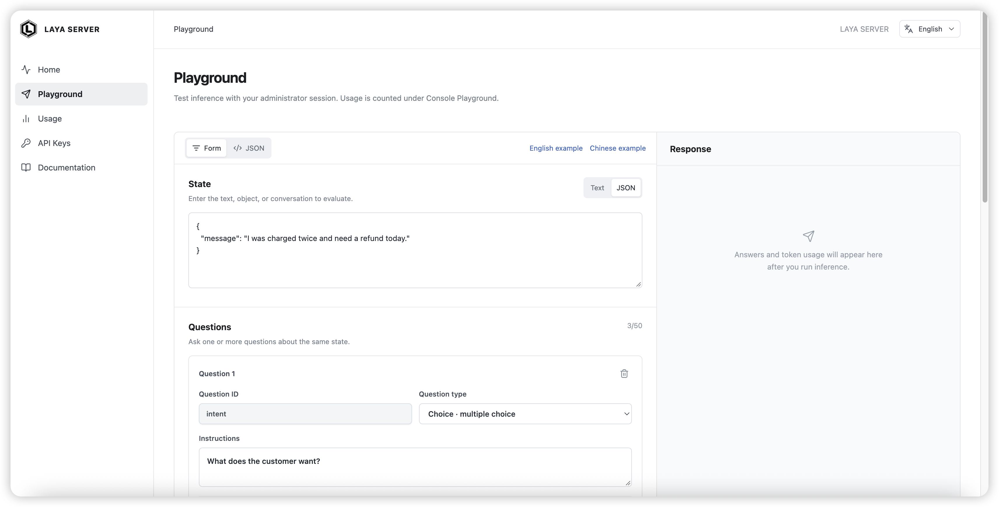</td>
<td align="center" valign="top">tidak ada media yang dipublikasikan</td>
</tr></table>

🧩 <b><a href="https://github.com/Abhinavexists/lev">Abhinavexists/lev</a></b> · ⭐59 · Python · 🔎 inferred · 21 天

##### 📝 Ringkasan

Model keputusan System One terbuka

##### 📌 Fakta dasar

| Bidang   | Nilai         |
| -------- | ------------- |
| Kategori | `Proyek lain` |
| Bukti    | `inferred`    |
| Bahasa   | Python        |

##### 📊 Data

| Metrik            | Nilai      |
| ----------------- | ---------- |
| Bintang           | **59**     |
| Push terakhir     | 2026-10-15 |
| Pertama terdaftar | 2026-10-28 |

🏷 `jev` · `modal` · `qwen`

---

<table><tr><th align="center" width="50%">🖼 Gambar</th><th align="center" width="50%">🎬 Video</th></tr><tr>
<td align="center" valign="top">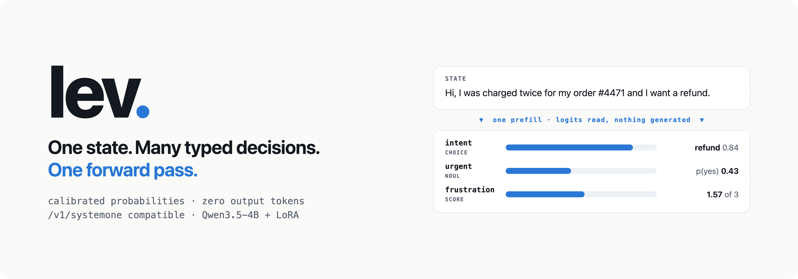</td>
<td align="center" valign="top">tidak ada media yang dipublikasikan</td>
</tr></table>

🧩 <b><a href="https://github.com/Jev-Engineering/cookbook">Jev-Engineering/cookbook</a></b> · ⭐30 · Jupyter · 🔎 inferred · 2 天

##### 📝 Ringkasan

Enam puluh resep notebook untuk keputusan bertipe dengan Jev: pola Choice, Noul, dan Score dari klasifikasi pertama hingga kontrol loop tertutup

##### 📌 Fakta dasar

| Bidang   | Nilai         |
| -------- | ------------- |
| Kategori | `Proyek lain` |
| Bukti    | `inferred`    |
| Bahasa   | Jupyter       |

##### 📊 Data

| Metrik            | Nilai      |
| ----------------- | ---------- |
| Bintang           | **30**     |
| Push terakhir     | 2026-11-03 |
| Pertama terdaftar | 2026-10-09 |

🏷 `cookbook` · `jev` · `jupyter-notebook` · `python` · `system-one` · `tutorials` · `typed-decisions` · `typesafe`

---

<table><tr><th align="center" width="50%">🖼 Gambar</th><th align="center" width="50%">🎬 Video</th></tr><tr>
<td align="center" valign="top">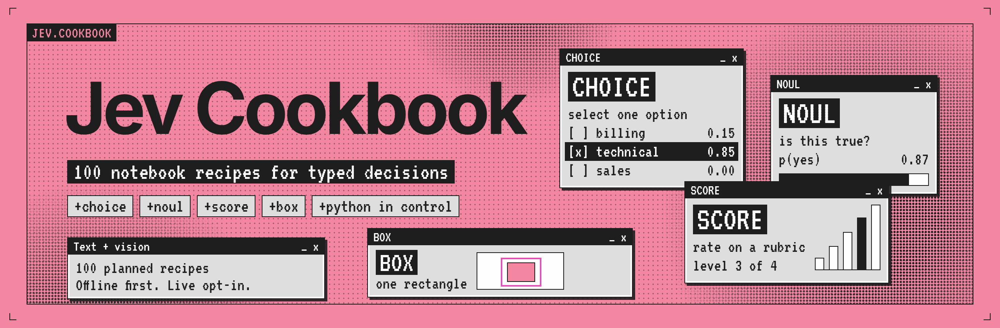</td>
<td align="center" valign="top">tidak ada media yang dipublikasikan</td>
</tr></table>

🧩 <b><a href="https://github.com/nvkudva/ollajev">nvkudva/ollajev</a></b> · ⭐18 · Python · 🔎 inferred · 0 天

##### 📝 Ringkasan

Jalankan model keputusan System One dari Hugging Face secara lokal di belakang Jev / System One API, ala Ollama

##### 📌 Fakta dasar

| Bidang   | Nilai         |
| -------- | ------------- |
| Kategori | `Proyek lain` |
| Bukti    | `inferred`    |
| Bahasa   | Python        |

##### 📊 Data

| Metrik            | Nilai      |
| ----------------- | ---------- |
| Bintang           | **18**     |
| Push terakhir     | 2026-11-05 |
| Pertama terdaftar | 2026-10-28 |

🏷 `decision-model` · `huggingface` · `jev` · `llama-cpp` · `local-llm` · `system-one` · `typesafe`

---

<table><tr><th align="center" width="50%">🖼 Gambar</th><th align="center" width="50%">🎬 Video</th></tr><tr>
<td align="center" valign="top"></td>
<td align="center" valign="top">tidak ada media yang dipublikasikan</td>
</tr></table>

🧩 <b><a href="https://github.com/manifoldor/xtags">manifoldor/xtags</a></b> · ⭐11 · HTML · 🔎 inferred · 20 天

##### 📝 Ringkasan

Pada linimasa X, tandai untuk setiap postingan apa yang ingin ia membuat Anda lakukan. Penilaian berasal dari Jev, sebuah model yang hanya mengembalikan probabilitas dan tidak menghasilkan teks.

##### 📌 Fakta dasar

| Bidang   | Nilai         |
| -------- | ------------- |
| Kategori | `Proyek lain` |
| Bukti    | `inferred`    |
| Bahasa   | HTML          |

##### 📊 Data

| Metrik            | Nilai      |
| ----------------- | ---------- |
| Bintang           | **11**     |
| Push terakhir     | 2026-10-16 |
| Pertama terdaftar | 2026-10-26 |

🏷 `ai` · `chrome-extension` · `jev` · `typesafe` · `userscript` · `x-twitter`

---

<table><tr><th align="center" width="50%">🖼 Gambar</th><th align="center" width="50%">🎬 Video</th></tr><tr>
<td align="center" valign="top">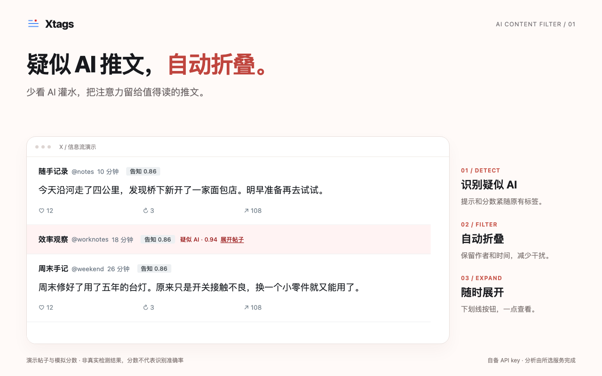</td>
<td align="center" valign="top">tidak ada media yang dipublikasikan</td>
</tr></table>

🧩 <b><a href="https://github.com/lawrence3699/Jev-Style-0.8B-Decision-v3-GGUF">lawrence3699/Jev-Style-0.8B-Decision-v3-GGUF</a></b> · ⭐1 · Python · 🔎 inferred · 0 天

##### 📝 Ringkasan

GitHub mirror of the chaoliangUNSW/Jev-Style-0.8B-Decision-v3-GGUF Hugging Face model

##### 📌 Fakta dasar

| Bidang   | Nilai         |
| -------- | ------------- |
| Kategori | `Proyek lain` |
| Bukti    | `inferred`    |
| Bahasa   | Python        |

##### 📊 Data

| Metrik            | Nilai      |
| ----------------- | ---------- |
| Bintang           | **1**      |
| Push terakhir     | 2026-11-04 |
| Pertama terdaftar | 2026-11-05 |

🏷 `decision-model` · `huggingface-mirror` · `jev-style`

---

<table><tr><th align="center" width="50%">🖼 Gambar</th><th align="center" width="50%">🎬 Video</th></tr><tr>
<td align="center" valign="top">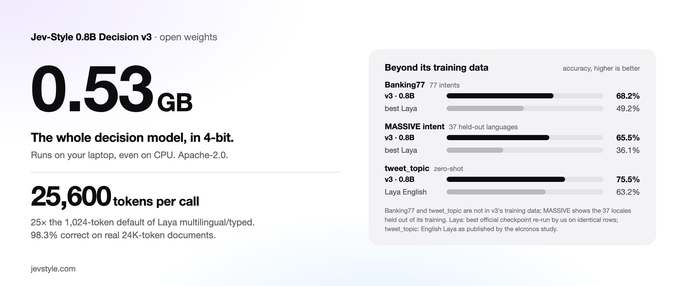</td>
<td align="center" valign="top">tidak ada media yang dipublikasikan</td>
</tr></table>

🧩 <b><a href="https://github.com/lawrence3699/Jev-Style-0.8B-Decision-v3">lawrence3699/Jev-Style-0.8B-Decision-v3</a></b> · Python · 🔎 inferred · 0 天

##### 📝 Ringkasan

GitHub mirror of the chaoliangUNSW/Jev-Style-0.8B-Decision-v3 Hugging Face model

##### 📌 Fakta dasar

| Bidang   | Nilai         |
| -------- | ------------- |
| Kategori | `Proyek lain` |
| Bukti    | `inferred`    |
| Bahasa   | Python        |

##### 📊 Data

| Metrik            | Nilai      |
| ----------------- | ---------- |
| Bintang           | **0**      |
| Push terakhir     | 2026-11-04 |
| Pertama terdaftar | 2026-11-05 |

🏷 `decision-model` · `huggingface-mirror` · `jev-style`

---

<table><tr><th align="center" width="50%">🖼 Gambar</th><th align="center" width="50%">🎬 Video</th></tr><tr>
<td align="center" valign="top"></td>
<td align="center" valign="top">tidak ada media yang dipublikasikan</td>
</tr></table>

<b>Lainnya di kategori ini</b> · 35

- [SoundBlaster/SwiftJev](https://github.com/SoundBlaster/SwiftJev) - Framework Swift untuk mengakses model Jev System One oleh TypeSafe.ai.
- [codaaiteam/jev-ai](https://github.com/codaaiteam/jev-ai) - Jev AI quickstart &amp; FAQ — TypeSafe AI.
- [Shristi1611/systemone-testbed](https://github.com/Shristi1611/systemone-testbed) - A security test environment for Jev-compatible decision models.
- [DreamBlooms/ifReflex.cpp](https://github.com/DreamBlooms/ifReflex.cpp) - Apa pun LLM dapat berfungsi sebagai model keputusan SystemOne di Komputer…
- [DevItaliya22/jev-chess](https://github.com/DevItaliya22/jev-chess) - Jev.
- [FrancescoDesiderato/Devfest_SystemOneModel](https://github.com/FrancescoDesiderato/Devfest_SystemOneModel) - Repository of Code for GDG DevFest 2026 Talk about &quot;System One Models&quot;.
- [jakob-lilliemarck/komply](https://github.com/jakob-lilliemarck/komply) - Use SystemOne models to check compliance with architectural rules.
- [justintout/systemone](https://github.com/justintout/systemone) - Modul Go tidak resmi untuk berinteraksi dengan Jev dan model System One lainnya.
- [leejisabella/system_one_explanability](https://github.com/leejisabella/system_one_explanability) - Exploring model misalignment, System One model information availability, and…
- [prashu-asp/Systemonemodels](https://github.com/prashu-asp/Systemonemodels)
- [TomatenMarc/Sycophancy-System-One-Models](https://github.com/TomatenMarc/Sycophancy-System-One-Models)
- [unbraind/pm-jev](https://github.com/unbraind/pm-jev) - Keputusan bertipe dan mengutamakan lokal untuk item pm dengan model System One…
- [wang-erica/system-one-sft](https://github.com/wang-erica/system-one-sft) - Supervised fine tuning of System One models for image classification.
- [I-You-Dream/jev-from-scratch](https://github.com/I-You-Dream/jev-from-scratch) - 从零开源复刻 Jev（System One）决策模型范式，基于 Qwen 基座训练，支持 Choice / Noul 原语，包含推理、微调、ECE…
- [2951461586/Jev-Register-Tool](https://github.com/2951461586/Jev-Register-Tool) - Alat rantai lengkap untuk pengajuan TypeSafe（Jev / System One） → konfirmasi…
- [rawwerks/one-system](https://github.com/rawwerks/one-system) - Gunakan classifier lokal dan yang di-host, alias model keputusan, alias model…
- [botassembly/thinkthen](https://github.com/botassembly/thinkthen) - ThinkThen: kode yang memahami maksud Anda.
- [comoc/jev-minesweeper](https://github.com/comoc/jev-minesweeper) - Demo yang membuat TypeSafe Jev (System One) menyelesaikan Minesweeper di browser.
- [Shearerbeard/jev-driver](https://github.com/Shearerbeard/jev-driver) - Typed Rust driver for TypeSafe AI.
- [Arohtea/jev-readout](https://github.com/Arohtea/jev-readout) - 把一段内容交给 TypeSafe AI 的 Jev 模型，得到带概率分布的结构化判断.
- [cfu288/jev-vs-ml-classifiers](https://github.com/cfu288/jev-vs-ml-classifiers) - Seberapa baik model JEV terbaru dibandingkan dengan model pengklasifikasi ML…
- [JeromyJSmith/jev-first-hour-desk](https://github.com/JeromyJSmith/jev-first-hour-desk) - Jev First-Hour Desk: marimo backtest + Jev decisions (static export).
- [lawrence3699/Jev-Style-2B-Decision-v3](https://github.com/lawrence3699/Jev-Style-2B-Decision-v3) - GitHub mirror of the chaoliangUNSW/Jev-Style-2B-Decision-v3 Hugging Face model.
- [lawrence3699/Jev-Style-2B-Decision-v3-GGUF](https://github.com/lawrence3699/Jev-Style-2B-Decision-v3-GGUF) - GitHub mirror of the chaoliangUNSW/Jev-Style-2B-Decision-v3-GGUF Hugging Face…
- [lawrence3699/Jev-Style-2B-Decision-v4](https://github.com/lawrence3699/Jev-Style-2B-Decision-v4) - GitHub mirror of the chaoliangUNSW/Jev-Style-2B-Decision-v4 Hugging Face model.
- [lawrence3699/Jev-Style-2B-Decision-v4-GGUF](https://github.com/lawrence3699/Jev-Style-2B-Decision-v4-GGUF) - GitHub mirror of the chaoliangUNSW/Jev-Style-2B-Decision-v4-GGUF Hugging Face…
- [lawrence3699/Jev-Style-Qwen3.5-2B-Decision-GGUF](https://github.com/lawrence3699/Jev-Style-Qwen3.5-2B-Decision-GGUF) - GitHub mirror of the chaoliangUNSW/Jev-Style-Qwen3.5-2B-Decision-GGUF Hugging…
- [lawrence3699/Jev-Style-Qwen3.5-2B-Decision-v2](https://github.com/lawrence3699/Jev-Style-Qwen3.5-2B-Decision-v2) - GitHub mirror of the chaoliangUNSW/Jev-Style-Qwen3.5-2B-Decision-v2 Hugging…
- [lawrence3699/Jev-Style-Qwen3.5-2B-Decision-v2-GGUF](https://github.com/lawrence3699/Jev-Style-Qwen3.5-2B-Decision-v2-GGUF) - GitHub mirror of the chaoliangUNSW/Jev-Style-Qwen3.5-2B-Decision-v2-GGUF…
- [lawrence3699/MacJev-0.8B-Decision-Data](https://github.com/lawrence3699/MacJev-0.8B-Decision-Data) - GitHub mirror of the chaoliangUNSW/MacJev-0.8B-Decision-Data Hugging Face…
- [LiLittleCat/jev-playlist-classify](https://github.com/LiLittleCat/jev-playlist-classify) - Klasifikasikan playlist besar berdasarkan bahasa lagu dengan model Jev terbaru…
- [xiaotian1171/jev-trolley-switch](https://github.com/xiaotian1171/jev-trolley-switch) - Interactive Trolley Problem decision lab powered by Pollinations POST…
- [iapp-technology/openthai-systemone](https://github.com/iapp-technology/openthai-systemone) - OpenThai-SystemOne: model keputusan System One terbuka berbahasa Thai + English…
- [InterfazeAI/lev](https://github.com/InterfazeAI/lev) - Model keputusan System One terbuka.
- [epergaboni/jevseo](https://github.com/epergaboni/jevseo) - Penilaian SEO, AEO, dan GEO bertipe yang didukung oleh Jev, model keputusan…

## Proyek menurut bahasa implementasi

Ekosistem ini terkonsentrasi pada Python dan TypeScript, tetapi klien bertipe terus muncul dalam bahasa lain. Tabel ini dihasilkan dari entri itu sendiri.

| Bahasa     | Entri | Contoh                                                                                                  |
| ---------- | ----- | ------------------------------------------------------------------------------------------------------- |
| Python     | 305   | `typesafe-ai/system-one-adapter-python`, `typesafe-ai/typesafe-sdk-python`, `typesafe-ai/WorkflowEvals` |
| TypeScript | 106   | `typesafe-ai/typesafe-sdk-js`, `TypeSafeAI/jev-harness`, `qkal/Canny`                                   |
| JavaScript | 61    | `clouatre-labs/decisions-judge-mcp`, `socai-io/jev-social`, `Ying-Kai-Liao/jev-browser`                 |
| Rust       | 34    | `chussenot/judgment`, `ollaya-dev/ollaya`, `supercorp-ai/supercov`                                      |
| HTML       | 26    | `typesafe-ai/typesafe-ai.github.io`, `yzfly/awesome-jev-zh`, `AkashPriyadarshii/jev-superpowers`        |
| Go         | 13    | `frodi-karlsson/onesie`, `devbackend/jevgo`, `JimmyWesley/rlcd-gateway`                                 |
| Jupyter    | 10    | `jexp/neo4jev`, `Mainakcris7/agent-guardrail-with-jev`, `SergeyBazhmin/krasivo-jev`                     |
| C#         | 6     | `laurentkempe/TypeSafeJevPlayground`, `elbruno/ElBruno.AI.Decisions`, `CMaintz/jev-dotnet`              |
| Java       | 5     | `Premo-Cloud/typesafe-sdk-java`, `CMaintz/jev-java`, `Murat-Selim/jev_doc_router`                       |
| PHP        | 5     | `basi/typesafe-ai-php-client`, `vibefilter/filament`, `Butochnikov/laravel-typesafe-jev`                |
| Swift      | 5     | `john-rocky/coreai-kit`, `mattt/AnyDecisionModel`, `chris-wozniczek/jev-voice-control`                  |
| Elixir     | 3     | `dannote/jev`, `Elue-dev/jev_elixir`, `schainks/system_one_client`                                      |
| Astro      | 2     | `heyjunpenn/awesome-jev`, `wizicer/jev_info_site`                                                       |
| C          | 2     | `giuliosmall/pg_typesafe`, `lijiawei255/jev-tune`                                                       |
| C++        | 2     | `DreamBlooms/dohnuts.cpp`, `DreamBlooms/ifReflex.cpp`                                                   |
| CSS        | 2     | `yangzhou-chaofan/awesome-jev-prompt`, `Dlmily/minimind-jev-dlmily`                                     |
| PowerShell | 2     | `BFLabsAI/bf-jev-deep-research`, `dfinke/Jev`                                                           |
| Ruby       | 2     | `obie/ruby_decision_model`, `Ray-Hughes/jevalyn`                                                        |
| Shell      | 2     | `realZachi/pg-jev`, `skylence-org/claudecode-jev-marketplace`                                           |
| TeX        | 2     | `dnakhoa/jev-deferred-crispification`, `xiaohuiyan/awesome-jev-papers`                                  |
| XS         | 2     | `cameronb-xano/jev-agent-guardrail`, `xano-community/agent-guardrail-jev`                               |
| Kotlin     | 1     | `MiaoWuNYA/rikkahub-sillytavern-android`                                                                |
| Nushell    | 1     | `cablehead/jev.nu`                                                                                      |
| Pascal     | 1     | `danieleteti/systemone-delphi`                                                                          |
| Scala      | 1     | `maxtrezzi/jev4s`                                                                                       |
| Svelte     | 1     | `fini/warped-sys1-lab`                                                                                  |

Hanya entri yang menyatakan bahasa yang dihitung. Entri infrastruktur, dokumentasi, dan diskusi dikecualikan dari tabel ini.

## Berkontribusi

Koreksi diterima dengan baik dan merupakan cara tercepat untuk memperbaiki daftar ini. Buka issue atau pull request jika sebuah entri salah kategori, salah tingkat, atau jika sebuah proyek keliru dikecualikan sebagai tabrakan nama — kategori terakhir itulah tempat filter otomatis paling mungkin salah. Cara terbaik menambah entri adalah menambahkan sumber ke `scripts/collect.py`, bukan menyunting README, karena README diregenerasi setiap siklus.

---

Proyek komunitas independen. Tidak berafiliasi dengan, tidak didukung oleh, dan tidak ditinjau oleh TypeSafe AI. Perilaku produk, harga, batas, dan alias model dapat berubah tanpa pemberitahuan; verifikasi segala hal yang penting terhadap dokumentasi resmi. Aset tetap milik proyek hulunya dan hanya direproduksi bila lisensi mengizinkan.

Dibuat oleh · 2026-11-06T00:18:18+08:00
