

  

<h1 align="center">Awesome Jev Live</h1>

<b>2 時間ごとに自己再構築される、証拠格付け付きの Jev インデックス。</b>

  
  
  
  
  
  

<a href="../README.md">English</a> · <a href="README.zh-CN.md">简体中文</a> · <a href="README.zh-TW.md">繁體中文</a> · <b>日本語</b> · <a href="README.ko.md">한국어</a> · <a href="README.es.md">Español</a> · <a href="README.fr.md">Français</a> · <a href="README.de.md">Deutsch</a> · <a href="README.pt-BR.md">Português (Brasil)</a> · <a href="README.ru.md">Русский</a> · <a href="README.it.md">Italiano</a> · <a href="README.ar.md">العربية</a> · <a href="README.hi.md">हिन्दी</a> · <a href="README.tr.md">Türkçe</a> · <a href="README.vi.md">Tiếng Việt</a> · <a href="README.th.md">ไทย</a> · <a href="README.id.md">Bahasa Indonesia</a> · <a href="README.pl.md">Polski</a> · <a href="README.nl.md">Nederlands</a> · <a href="README.uk.md">Українська</a>

> [!NOTE]
> **ライブインデックス** · 最終同期: `2026-11-07T16:50:18+08:00` (UTC+8)
> · エントリ数: **714** · 今回の追加: **52** · 実装言語: **25**

以下の各エントリは、本リポジトリのパイプラインが収集・選別・再確認したものです。数値とタイムスタンプは取得元に基づくものであり、手書きのスナップショットではありません。

## 🔥 今回のピックアップ · 各カテゴリの首位

各カテゴリから1件、証拠等級とスター数で順位付けし、同期のたびに再計算します。推薦ではなく順位であり、各項目は下の完全なカードにリンクします。スクリーンショットや録画を公開しているプロジェクトを優先するため、この欄は視覚的に保たれます。

<table>
<tr>
<td width="50%" valign="top">
<b>🏛️ <a href="https://github.com/typesafe-ai/skills">typesafe-ai/skills</a></b>
⭐2883 · ✅ official
TypeSafeのSystem One APIを使って構築するためのエージェントスキル
</td>
<td width="50%" valign="top">

<b>🧰 <a href="https://github.com/john-rocky/coreai-kit">john-rocky/coreai-kit</a></b>
⭐123 · Swift · 👁️ observed
Swift SDK for running chat, vision and speech models on iPhone and Mac with Apple&#x27;s Core AI. Model download and caching, FoundationModels integration, and runnable…
</td>
</tr>
<tr>
<td width="50%" valign="top">

<b>🤖 <a href="https://github.com/Bodila51/grok-bot-jev">Bodila51/grok-bot-jev</a></b>
⭐132 · Python · 👁️ observed
安価な意思決定レイヤーとして TypeSafe Jev を Grok Bot に接続 - 使用量ゲート、スキルテンプレート、例
</td>
<td width="50%" valign="top">

<b>🛡️ <a href="https://github.com/dharmeshgurnani/CodeOtter">dharmeshgurnani/CodeOtter</a></b>
⭐3 · JavaScript · 👁️ observed
任意のオープンモデルによる自律型・セルフホスト型AIコードレビュー、較正済みスコアリングゲージ、マージゲート。
</td>
</tr>
<tr>
<td width="50%" valign="top">

<b>🧪 <a href="https://github.com/Mapika/decider">Mapika/decider</a></b>
⭐1056 · Python · 👁️ observed
Qwen3.5からファインチューニングされたSystem Oneスタイルのモデルファミリーで、較正された確率によるワンパスの型付き意思決定向けに設計されています。
</td>
<td width="50%" valign="top">

<b>🔬 <a href="https://github.com/r-ms/mini-jev">r-ms/mini-jev</a></b>
⭐62 · Python · 🔎 inferred
mini-Jev：凍結されたQwen3-4B上でJevスタイルの型付き判断インターフェースがどのように見えるかを示します。JSONを生成する代わりに、選択肢の文字のロジットを読み取ります。事前登録済みの実験、結果、教育用ベンチです。
</td>
</tr>
<tr>
<td width="50%" valign="top">

<b>🎮 <a href="https://github.com/superagents-lab/jev-search">superagents-lab/jev-search</a></b>
⭐556 · TypeScript · 👁️ observed
TypeSafeのJevでウェブを検索：ソース選択、クエリ理解、関連性ランキング。Search1APIで構築。
</td>
<td width="50%" valign="top">
<b>📰 <a href="https://docs.typesafe.ai/model-jaggedness/jev-1.13">既知の欠陥（jaggedness）9種類</a></b>
⭐0 · ✅ official
字面の理解、**信頼できないカウント**、日付比較、多段階の間接参照、無関係な詳細を含む大規模なstate、敵対的コンテンツ、指示とcriteriaの矛盾、構造的不変条件、生成。公式の推奨は「原子問題に分解してコード内で組み合わせる」。
</td>
</tr>
</table>

## 目次

- [Jev とは？](#jev-とは)
- [エントリの格付け方法](#エントリの格付け方法)
- [公式 SDK と開発者ツール](#公式-sdk-と開発者ツール) — **7**
- [コミュニティ製のクライアント、SDK、アダプタ](#コミュニティ製のクライアントsdkアダプタ) — **126**
- [エージェントツール：MCP、フック、ゲート、コーディングエージェント](#エージェントツールmcpフックゲートコーディングエージェント) — **209**
- [ルーティング、ガードレール、承認](#ルーティングガードレール承認) — **60**
- [評価、キャリブレーション、ベンチマーク](#評価キャリブレーションベンチマーク) — **84**
- [公開再現、重み、アーキテクチャ研究](#公開再現重みアーキテクチャ研究) — **45**
- [アプリケーション、ゲーム、ロボティクス、インタラクティブデモ](#アプリケーションゲームロボティクスインタラクティブデモ) — **46**
- [記事、ディスカッション、類似リスト](#記事ディスカッション類似リスト) — **83**
- [その他のプロジェクト](#その他のプロジェクト) — **54**
- [実装言語別のプロジェクト](#実装言語別のプロジェクト)

## Jev とは？

Jev は TypeSafe AI 初の **System One model** です。文章を書くものではありません。状態と、答えの空間をあらかじめ自分で定義する質問を受け取り、コードが分岐に使える確率分布付きの型付き値を返します。

|                      |                                                                                                                                                                                            |
| -------------------- | ------------------------------------------------------------------------------------------------------------------------------------------------------------------------------------------ |
| **形：**             | `state + typed questions` → `constrained answers + probabilities` → `your code`                                                                                                            |
| **プリミティブ：**   | `Choice`（≤255 個の選択肢から 1 つを選ぶ）、`Score`（2〜10 のルーブリック）、`Noul`（確率的な yes/no）                                                                                     |
| **エンドポイント：** | `POST https://api.typesafe.ai/v1/systemone`、モデル `jev-1.13.0` / 別名 `jev-latest`                                                                                                       |
| **適した用途：**     | 境界の定まったワークフロー内でのルーティング、トリアージ、スコアリング、モデレーション、検証、低レイテンシのゲート                                                                         |
| **既知の限界：**     | 計数は信頼できず、多段の間接参照は弱く、公式資料は九種類のギザギザさを挙げています。スキーマに適合した出力は正しい判断と同じではありません。自分のデータでキャリブレーションしてください。 |

## エントリの格付け方法

この分野の多くのリストは掲載を主張するだけです。本リストは、実際にどこまで検証したかを示し、それに応じて絞り込めるようにします。

| 格付け       | 意味                                                                                                                   |
| ------------ | ---------------------------------------------------------------------------------------------------------------------- |
| `official`   | TypeSafe AI 自身が公開。                                                                                               |
| `observed`   | 開いて読める公開成果物。実際のソース、実際の設定、あるいはリポジトリ名やトピックにおける TypeSafe/Jev の明示的な宣言。 |
| `inferred`   | 曖昧なシグナルと裏付けとなる語彙による一致であり、まだ行単位で読んではいない。                                         |
| `unverified` | 関連がありそうだが、独立に確認されたものはない。発見目的のみで掲載。                                                   |

## 公式 SDK と開発者ツール

TypeSafe 自身が公開したものすべて。まずはここから。

🏛️ <b><a href="https://github.com/typesafe-ai/skills">typesafe-ai/skills</a></b> · ⭐2883 · ✅ official · 14 天

##### 📝 概要

TypeSafeのSystem One APIを使って構築するためのエージェントスキル

> 💡 ベンダー独自のエージェントスキル。継続的に更新されているため、TypeSafeがエージェントからJevをどのように操作することを意図しているかを示す仕様に最も近いものです。

##### 📌 基本情報

| 項目       | 値                        |
| ---------- | ------------------------- |
| カテゴリ   | `公式 SDK と開発者ツール` |
| エビデンス | `official`                |

##### 📊 データ

| 指標         | 値         |
| ------------ | ---------- |
| スター数     | **2883**   |
| 最終プッシュ | 2026-10-23 |
| 初回掲載     | 2026-09-18 |

🏛️ <b><a href="https://github.com/typesafe-ai/system-one-adapter-python">typesafe-ai/system-one-adapter-python</a></b> · ⭐407 · Python · ✅ official · 45 天

##### 📝 概要

LLM APIsをバックエンドにした、ドロップイン可能なTypeSafeClient置換

> 💡 通常のLLMプロバイダーで同じインターフェースをバックエンドにするドロップイン置換。これは、自分のデータで型付きの判断とプロンプトの判断をA/Bテストし、どちらかにコミットする前に確かめるための正直な方法です。

🔧 コード内での使用を確認: `README.md`

##### 📌 基本情報

| 項目       | 値                        |
| ---------- | ------------------------- |
| カテゴリ   | `公式 SDK と開発者ツール` |
| エビデンス | `official`                |
| 言語       | Python                    |

##### 📊 データ

| 指標         | 値         |
| ------------ | ---------- |
| スター数     | **407**    |
| 最終プッシュ | 2026-09-22 |
| 初回掲載     | 2026-10-23 |

🏛️ <b><a href="https://github.com/typesafe-ai/typesafe-sdk-python">typesafe-ai/typesafe-sdk-python</a></b> · ⭐309 · Python · ✅ official · 23 天

##### 📝 概要

TypeSafe API向けの公式Pythonライブラリ

> 💡 同期・非同期クライアント。APIキーから型付きの判断へ最短で到達する手段であり、コミュニティ製クライアントが比較されるリファレンスです。

🔧 コード内での使用を確認: `README.md`

##### 📌 基本情報

| 項目       | 値                        |
| ---------- | ------------------------- |
| カテゴリ   | `公式 SDK と開発者ツール` |
| エビデンス | `official`                |
| 言語       | Python                    |

##### 📊 データ

| 指標         | 値         |
| ------------ | ---------- |
| スター数     | **309**    |
| 最終プッシュ | 2026-10-14 |
| 初回掲載     | 2026-10-23 |

🏛️ <b><a href="https://github.com/typesafe-ai/typesafe-sdk-js">typesafe-ai/typesafe-sdk-js</a></b> · ⭐284 · TypeScript · ✅ official · 23 天

##### 📝 概要

TypeSafe API向けの公式TypeScript/JavaScriptライブラリ

> 💡 質問内容から回答型が推論されるTypeScriptクライアント。そのため、型の不一致は実行時の予期せぬ問題ではなくコンパイルエラーになります。

##### 📌 基本情報

| 項目       | 値                        |
| ---------- | ------------------------- |
| カテゴリ   | `公式 SDK と開発者ツール` |
| エビデンス | `official`                |
| 言語       | TypeScript                |

##### 📊 データ

| 指標         | 値         |
| ------------ | ---------- |
| スター数     | **284**    |
| 最終プッシュ | 2026-10-14 |
| 初回掲載     | 2026-10-23 |

🏛️ <b><a href="https://github.com/TypeSafeAI/jev-harness">TypeSafeAI/jev-harness</a></b> · ⭐38 · TypeScript · ✅ official · 4 天

##### 📝 概要

A custom coding harness for TypeSafe AI's Jev: an LLM proposes, Jev answers narrow questions, code decides, every step leaves a receipt.

##### 📌 基本情報

| 項目       | 値                        |
| ---------- | ------------------------- |
| カテゴリ   | `公式 SDK と開発者ツール` |
| エビデンス | `official`                |
| 言語       | TypeScript                |

##### 📊 データ

| 指標         | 値         |
| ------------ | ---------- |
| スター数     | **38**     |
| 最終プッシュ | 2026-11-03 |
| 初回掲載     | 2026-11-03 |

🏷 `agent-harness` · `agentic-coding` · `ai-agents` · `ai-governance` · `ai-safety` · `code-review` · `coding-agent` · `developer-tools`

🏛️ <b><a href="https://github.com/typesafe-ai/WorkflowEvals">typesafe-ai/WorkflowEvals</a></b> · ⭐21 · Python · ✅ official · 38 天

##### 📝 概要

evals.typesafe.aiのワークフローコードを公開

##### 📌 基本情報

| 項目       | 値                        |
| ---------- | ------------------------- |
| カテゴリ   | `公式 SDK と開発者ツール` |
| エビデンス | `official`                |
| 言語       | Python                    |

##### 📊 データ

| 指標         | 値         |
| ------------ | ---------- |
| スター数     | **21**     |
| 最終プッシュ | 2026-09-29 |
| 初回掲載     | 2026-10-23 |

🏛️ <b><a href="https://github.com/typesafe-ai/typesafe-ai.github.io">typesafe-ai/typesafe-ai.github.io</a></b> · ⭐2 · HTML · ✅ official · 155 天

##### 📝 概要

上流の説明は公開されていません。

##### 📌 基本情報

| 項目       | 値                        |
| ---------- | ------------------------- |
| カテゴリ   | `公式 SDK と開発者ツール` |
| エビデンス | `official`                |
| 言語       | HTML                      |

##### 📊 データ

| 指標         | 値         |
| ------------ | ---------- |
| スター数     | **2**      |
| 最終プッシュ | 2026-06-04 |
| 初回掲載     | 2026-10-23 |

## コミュニティ製のクライアント、SDK、アダプタ

System One エンドポイント向けの型付きクライアント。コミュニティが着手した言語の数だけ存在します。

🧰 <b><a href="https://github.com/jexp/neo4jev">jexp/neo4jev</a></b> · ⭐182 · Jupyter · 👁️ observed · 49 天 · ⭐+1

##### 📝 概要

隣接関係に対する分類器を使って、Typesafe.ai System One Model JevがNeo4jグラフをナビゲートします。

##### 📌 基本情報

| 項目       | 値                                            |
| ---------- | --------------------------------------------- |
| カテゴリ   | `コミュニティ製のクライアント、SDK、アダプタ` |
| エビデンス | `observed`                                    |
| 言語       | Jupyter                                       |

##### 📊 データ

| 指標         | 値           |
| ------------ | ------------ |
| スター数     | **182** (+1) |
| 最終プッシュ | 2026-09-18   |
| 初回掲載     | 2026-10-28   |

🧰 <b><a href="https://github.com/keltokhy/jgrep">keltokhy/jgrep</a></b> · ⭐140 · Python · 👁️ observed · 20 天

##### 📝 概要

grep だが、パターンは説明文。TypeSafe の Jev 意思決定モデルで意味に基づいて行をフィルタリング: 1 行あたり約 200 ms、1 セントの 1000 分の 1。

🔧 コード内での使用を確認: `README.md`

##### 📌 基本情報

| 項目       | 値                                            |
| ---------- | --------------------------------------------- |
| カテゴリ   | `コミュニティ製のクライアント、SDK、アダプタ` |
| エビデンス | `observed`                                    |
| 言語       | Python                                        |

##### 📊 データ

| 指標         | 値         |
| ------------ | ---------- |
| スター数     | **140**    |
| 最終プッシュ | 2026-10-17 |
| 初回掲載     | 2026-10-29 |

🏷 `cli` · `grep` · `jev` · `openrouter` · `semantic-search` · `typesafe`

🧰 <b><a href="https://github.com/qkal/Canny">qkal/Canny</a></b> · ⭐134 · TypeScript · 👁️ observed · 45 天

##### 📝 概要

AI コーディングエージェントが証拠なしに作業完了を主張するのを防ぎます。決定論的フックが判断し、TypeSafe の Jev が助言します。追記専用台帳、ランタイム依存関係ゼロ。

🔧 コード内での使用を確認: `README.md`

##### 📌 基本情報

| 項目       | 値                                            |
| ---------- | --------------------------------------------- |
| カテゴリ   | `コミュニティ製のクライアント、SDK、アダプタ` |
| エビデンス | `observed`                                    |
| 言語       | TypeScript                                    |

##### 📊 データ

| 指標         | 値         |
| ------------ | ---------- |
| スター数     | **134**    |
| 最終プッシュ | 2026-09-22 |
| 初回掲載     | 2026-10-29 |

🏷 `agent-hooks` · `ai-agents` · `claude-code` · `claude-code-hooks` · `codex` · `codex-cli` · `guardrails` · `jev`

🧰 <b><a href="https://github.com/john-rocky/coreai-kit">john-rocky/coreai-kit</a></b> · ⭐123 · Swift · 👁️ observed · 2 天

##### 📝 概要

Swift SDK for running chat, vision and speech models on iPhone and Mac with Apple's Core AI. Model download and caching, FoundationModels integration, and runnable examples with documented OS, SDK and model requirements.

🔧 コード内での使用を確認: `Sources/CoreAIOps/CoreAI+SystemOne.swift`

##### 📌 基本情報

| 項目       | 値                                            |
| ---------- | --------------------------------------------- |
| カテゴリ   | `コミュニティ製のクライアント、SDK、アダプタ` |
| エビデンス | `observed`                                    |
| 言語       | Swift                                         |

##### 📊 データ

| 指標         | 値         |
| ------------ | ---------- |
| スター数     | **123**    |
| 最終プッシュ | 2026-11-05 |
| 初回掲載     | 2026-10-26 |

🏷 `apple` · `apple-core-ai` · `asr` · `core-ai` · `coreai` · `foundation-models` · `ios` · `ios-27`

---

<table><tr><th align="center" width="50%">🖼 画像</th><th align="center" width="50%">🎬 動画</th></tr><tr>
<td align="center" valign="top"></td>
<td align="center" valign="top"> アニメーション記録</td>
</tr></table>

🧰 <b><a href="https://github.com/yzfly/awesome-jev-zh">yzfly/awesome-jev-zh</a></b> · ⭐90 · HTML · 👁️ observed · 0 天 · ⭐+1

##### 📝 概要

Jev / TypeSafe System Oneの中国語厳選リスト：公式資料、SDK、人気アプリ、Agentツール、オープンソースによる再現、独立評価を収録。中国語の入門ガイド付きで、GitHubの人気プロジェクトを毎日自動収録。

🔧 コード内での使用を確認: `docs/quickstart.md`

##### 📌 基本情報

| 項目       | 値                                            |
| ---------- | --------------------------------------------- |
| カテゴリ   | `コミュニティ製のクライアント、SDK、アダプタ` |
| エビデンス | `observed`                                    |
| 言語       | HTML                                          |

##### 📊 データ

| 指標         | 値          |
| ------------ | ----------- |
| スター数     | **90** (+1) |
| 最終プッシュ | 2026-11-07  |
| 初回掲載     | 2026-09-18  |

🏷 `ai-agent` · `awesome` · `awesome-list` · `chinese` · `jev` · `llm` · `structured-output` · `system-one`

🧰 <b><a href="https://github.com/obie/ruby_decision_model">obie/ruby_decision_model</a></b> · ⭐58 · Ruby · 👁️ observed · 25 天

##### 📝 概要

Typesafe Jev などの意思決定モデル向け Ruby クライアント

🔧 コード内での使用を確認: `README.md`

##### 📌 基本情報

| 項目       | 値                                            |
| ---------- | --------------------------------------------- |
| カテゴリ   | `コミュニティ製のクライアント、SDK、アダプタ` |
| エビデンス | `observed`                                    |
| 言語       | Ruby                                          |

##### 📊 データ

| 指標         | 値         |
| ------------ | ---------- |
| スター数     | **58**     |
| 最終プッシュ | 2026-10-12 |
| 初回掲載     | 2026-10-29 |

🧰 <b><a href="https://github.com/bodepudimuneendra-netizen/ConsciousDB">bodepudimuneendra-netizen/ConsciousDB</a></b> · ⭐54 · Python · 👁️ observed · 4 天

##### 📝 概要

交換可能な System One モデル（ローカル Laya / クラウド Jev）を使用する、データベース非依存の Agentic GraphRAG フレームワーク。完全な 4 フェーズパイプライン、継続的評価、任意のグラフデータベース向けのカスタム A* トラバーサルを備えたプラグアンドプレイのインテリジェンスレイヤー。

##### 📌 基本情報

| 項目       | 値                                            |
| ---------- | --------------------------------------------- |
| カテゴリ   | `コミュニティ製のクライアント、SDK、アダプタ` |
| エビデンス | `observed`                                    |
| 言語       | Python                                        |

##### 📊 データ

| 指標         | 値         |
| ------------ | ---------- |
| スター数     | **54**     |
| 最終プッシュ | 2026-11-02 |
| 初回掲載     | 2026-11-02 |

🏷 `astar-algorithm` · `eval-harness` · `fine-tuning` · `graphdatabase` · `graprag` · `jev` · `laya` · `neo4j`

🧰 <b><a href="https://github.com/MrJev/awesome-jev">MrJev/awesome-jev</a></b> · ⭐19 · Python · 👁️ observed · 0 天

##### 📝 概要

Jev、TypeSafe AIのSystem Oneモデル向けの厳選されたプロジェクト、インテグレーション、リソースの一覧。

##### 📌 基本情報

| 項目       | 値                                            |
| ---------- | --------------------------------------------- |
| カテゴリ   | `コミュニティ製のクライアント、SDK、アダプタ` |
| エビデンス | `observed`                                    |
| 言語       | Python                                        |

##### 📊 データ

| 指標         | 値         |
| ------------ | ---------- |
| スター数     | **19**     |
| 最終プッシュ | 2026-11-06 |
| 初回掲載     | 2026-09-18 |

🏷 `ai-agents` · `awesome` · `awesome-list` · `jev` · `mcp` · `typesafe`

🧰 <b><a href="https://github.com/ckaraca/awesome-jev">ckaraca/awesome-jev</a></b> · ⭐17 · Python · 👁️ observed · 4 天

##### 📝 概要

高速で型付き判定を行う、Jev、TypeSafe AIのSystem Oneモデル上に構築されたツール、インテグレーション、実験の厳選リスト。

##### 📌 基本情報

| 項目       | 値                                            |
| ---------- | --------------------------------------------- |
| カテゴリ   | `コミュニティ製のクライアント、SDK、アダプタ` |
| エビデンス | `observed`                                    |
| 言語       | Python                                        |

##### 📊 データ

| 指標         | 値         |
| ------------ | ---------- |
| スター数     | **17**     |
| 最終プッシュ | 2026-11-02 |
| 初回掲載     | 2026-09-19 |

🏷 `ai-agents` · `awesome` · `awesome-list` · `computer-use` · `jev` · `llm` · `system-one` · `typesafe`

🧰 <b><a href="https://github.com/Premo-Cloud/typesafe-sdk-java">Premo-Cloud/typesafe-sdk-java</a></b> · ⭐12 · Java · 👁️ observed · 16 天

##### 📝 概要

Jev、TypeSafe の System One モデル向けコミュニティ Java SDK：型付き質問を入力し、較正済み確率付きの型付き回答を出力。Java 17+、Spring Boot starter（非公式）

##### 📌 基本情報

| 項目       | 値                                            |
| ---------- | --------------------------------------------- |
| カテゴリ   | `コミュニティ製のクライアント、SDK、アダプタ` |
| エビデンス | `observed`                                    |
| 言語       | Java                                          |

##### 📊 データ

| 指標         | 値         |
| ------------ | ---------- |
| スター数     | **12**     |
| 最終プッシュ | 2026-10-21 |
| 初回掲載     | 2026-10-28 |

🏷 `java` · `jev` · `sdk` · `spring-boot` · `system-one` · `system-one-models` · `typesafe`

🧰 <b><a href="https://github.com/PromtEngineer/jev-harness">PromtEngineer/jev-harness</a></b> · ⭐9 · Python · 👁️ observed · 43 天

##### 📝 概要

TypeSafeのJev（System Oneモデル）を中心に構築されたPiエージェント・ハーネス：ルーター、コンテキストピッカー、ゲート、検証器。NeonのPostgresブランチでテスト済みです。

##### 📌 基本情報

| 項目       | 値                                            |
| ---------- | --------------------------------------------- |
| カテゴリ   | `コミュニティ製のクライアント、SDK、アダプタ` |
| エビデンス | `observed`                                    |
| 言語       | Python                                        |

##### 📊 データ

| 指標         | 値         |
| ------------ | ---------- |
| スター数     | **9**      |
| 最終プッシュ | 2026-09-24 |
| 初回掲載     | 2026-10-28 |

🧰 <b><a href="https://github.com/sumleo/prompt2jev">sumleo/prompt2jev</a></b> · ⭐9 · Python · 👁️ observed · 46 天 · **NEW**

##### 📝 概要

自然言語、LLMプロンプト、またはそれを実行するコードを、TypeSafe Jev判断へ変換するエージェントスキルとCLI：型付き状態、Choice/Score/Noul質問、実行可能なスクリプト

🔧 コード内での使用を確認: `docs/sdk/python.md`

##### 📌 基本情報

| 項目       | 値                                            |
| ---------- | --------------------------------------------- |
| カテゴリ   | `コミュニティ製のクライアント、SDK、アダプタ` |
| エビデンス | `observed`                                    |
| 言語       | Python                                        |

##### 📊 データ

| 指標         | 値         |
| ------------ | ---------- |
| スター数     | **9**      |
| 最終プッシュ | 2026-09-21 |
| 初回掲載     | 2026-11-07 |

🏷 `agent-skill` · `claude-code` · `decision-making` · `jev` · `llm` · `typesafe`

---

<table><tr><th align="center" width="50%">🖼 画像</th><th align="center" width="50%">🎬 動画</th></tr><tr>
<td align="center" valign="top">メディア未公開</td>
<td align="center" valign="top"> アニメーション記録 · <a href="https://raw.githubusercontent.com/sumleo/prompt2jev/main/assets/prompt2jev-walkthrough.mp4">動画を開く</a></td>
</tr></table>

🧰 <b><a href="https://github.com/clouatre-labs/decisions-judge-mcp">clouatre-labs/decisions-judge-mcp</a></b> · ⭐5 · JavaScript · 👁️ observed · 5 天

##### 📝 概要

AIエージェント向けのMCPツールとしての型付き意思決定：1回の高速リクエストでyes/no確率（noul）、choice、scoreを取得。TypeSafe System Oneモデルを基盤とします。

##### 📌 基本情報

| 項目       | 値                                            |
| ---------- | --------------------------------------------- |
| カテゴリ   | `コミュニティ製のクライアント、SDK、アダプタ` |
| エビデンス | `observed`                                    |
| 言語       | JavaScript                                    |

##### 📊 データ

| 指標         | 値         |
| ------------ | ---------- |
| スター数     | **5**      |
| 最終プッシュ | 2026-11-02 |
| 初回掲載     | 2026-10-12 |

🏷 `agent` · `ai` · `cli` · `decision-making` · `decisions` · `judge` · `llm` · `mcp`

---

<table><tr><th align="center" width="50%">🖼 画像</th><th align="center" width="50%">🎬 動画</th></tr><tr>
<td align="center" valign="top"></td>
<td align="center" valign="top"> アニメーション記録</td>
</tr></table>

🧰 <b><a href="https://github.com/elbruno/ElBruno.AI.Decisions">elbruno/ElBruno.AI.Decisions</a></b> · ⭐5 · C# · 👁️ observed · 3 天

##### 📝 概要

.NET 10 decision SDK: Choose, Score, and Assess with Microsoft Foundry (Microsoft-Decision-1), native local Ollama System One models, and TypeSafe AI Jev. One API, probabilities instead of paragraphs.

##### 📌 基本情報

| 項目       | 値                                            |
| ---------- | --------------------------------------------- |
| カテゴリ   | `コミュニティ製のクライアント、SDK、アダプタ` |
| エビデンス | `observed`                                    |
| 言語       | C#                                            |

##### 📊 データ

| 指標         | 値         |
| ------------ | ---------- |
| スター数     | **5**      |
| 最終プッシュ | 2026-11-03 |
| 初回掲載     | 2026-11-03 |

🏷 `dotnet` · `dotnet10` · `jev` · `microsoft-extensions-ai` · `nuget`

---

<table><tr><th align="center" width="50%">🖼 画像</th><th align="center" width="50%">🎬 動画</th></tr><tr>
<td align="center" valign="top"></td>
<td align="center" valign="top">メディア未公開</td>
</tr></table>

🧰 <b><a href="https://github.com/avalonreset/legends-jev">avalonreset/legends-jev</a></b> · ⭐3 · Python · 👁️ observed · 1 天

##### 📝 概要

Optical character recognition (OCR), storefront signage verification, bounding-box grounding, and typed computer-use decision CLI powered by TypeSafe Jev 1.14.

##### 📌 基本情報

| 項目       | 値                                            |
| ---------- | --------------------------------------------- |
| カテゴリ   | `コミュニティ製のクライアント、SDK、アダプタ` |
| エビデンス | `observed`                                    |
| 言語       | Python                                        |

##### 📊 データ

| 指標         | 値         |
| ------------ | ---------- |
| スター数     | **3**      |
| 最終プッシュ | 2026-11-05 |
| 初回掲載     | 2026-11-04 |

🏷 `bounding-box` · `browser-agent` · `claude-code` · `codex` · `computer-use` · `cto-legends` · `decision-model` · `image-text-extraction`

---

<table><tr><th align="center" width="50%">🖼 画像</th><th align="center" width="50%">🎬 動画</th></tr><tr>
<td align="center" valign="top"></td>
<td align="center" valign="top">メディア未公開</td>
</tr></table>

🧰 <b><a href="https://github.com/moeinheidari7829/Kev-Bio">moeinheidari7829/Kev-Bio</a></b> · ⭐3 · Python · 👁️ observed · 0 天

##### 📝 概要

Official code for "Every Pixel Is an Option: A System One Model for Medical Ultrasound Biometry" (arXiv 2611.03360)

##### 📌 基本情報

| 項目       | 値                                            |
| ---------- | --------------------------------------------- |
| カテゴリ   | `コミュニティ製のクライアント、SDK、アダプタ` |
| エビデンス | `observed`                                    |
| 言語       | Python                                        |

##### 📊 データ

| 指標         | 値         |
| ------------ | ---------- |
| スター数     | **3**      |
| 最終プッシュ | 2026-11-07 |
| 初回掲載     | 2026-11-07 |

🏷 `biometry` · `echocardiography` · `jev` · `jev-ai` · `kev` · `medical-imaging` · `system-one` · `ultrasound`

---

<table><tr><th align="center" width="50%">🖼 画像</th><th align="center" width="50%">🎬 動画</th></tr><tr>
<td align="center" valign="top"></td>
<td align="center" valign="top">メディア未公開</td>
</tr></table>

再配布ライセンスが明示されていないため、アセットは上流リポジトリから直リンクしています。

🧰 <b><a href="https://github.com/Bonzokoles/36_chambers">Bonzokoles/36_chambers</a></b> · Python · 👁️ observed · 15 天

##### 📝 概要

AIエージェント向けの連合知識検索エンジン。TypeSafe／Jev AIルーティングと証拠の再ランキングを備えた、レジストリ優先オーケストレーターを介して、専門バックエンド（FTS5、ChromaDB、グラフ）間でクエリをルーティングします。デフォルトは読み取り専用で、設計上セキュリティゲートされています。

##### 📌 基本情報

| 項目       | 値                                            |
| ---------- | --------------------------------------------- |
| カテゴリ   | `コミュニティ製のクライアント、SDK、アダプタ` |
| エビデンス | `observed`                                    |
| 言語       | Python                                        |

##### 📊 データ

| 指標         | 値         |
| ------------ | ---------- |
| スター数     | **0**      |
| 最終プッシュ | 2026-10-22 |
| 初回掲載     | 2026-10-23 |

🏷 `ai-agents` · `ai-infrastructure` · `chromadb` · `embeddings` · `federated-search` · `fts5` · `information-retrieval` · `jev`

---

<table><tr><th align="center" width="50%">🖼 画像</th><th align="center" width="50%">🎬 動画</th></tr><tr>
<td align="center" valign="top"></td>
<td align="center" valign="top">メディア未公開</td>
</tr></table>

再配布ライセンスが明示されていないため、アセットは上流リポジトリから直リンクしています。

🧰 <b><a href="https://github.com/socai-io/jev-social">socai-io/jev-social</a></b> · ⭐202 · JavaScript · 🔎 inferred · 5 天 · ⭐+1

##### 📝 概要

Instagram、TikTok、LinkedIn向けのオープンソース・ローカルファーストなソーシャルメディア調査エージェント。Jevは読み取り専用の手順をルーティングし、socai CLIは引用付きのブラウザ証拠を取得します。

##### 📌 基本情報

| 項目       | 値                                            |
| ---------- | --------------------------------------------- |
| カテゴリ   | `コミュニティ製のクライアント、SDK、アダプタ` |
| エビデンス | `inferred`                                    |
| 言語       | JavaScript                                    |

##### 📊 データ

| 指標         | 値           |
| ------------ | ------------ |
| スター数     | **202** (+1) |
| 最終プッシュ | 2026-11-01   |
| 初回掲載     | 2026-11-02   |

🏷 `agent-skills` · `ai-agents` · `browser-agent` · `browser-automation` · `decision-model` · `deep-research` · `instagram` · `jev`

---

<table><tr><th align="center" width="50%">🖼 画像</th><th align="center" width="50%">🎬 動画</th></tr><tr>
<td align="center" valign="top"></td>
<td align="center" valign="top"> アニメーション記録</td>
</tr></table>

🧰 <b><a href="https://github.com/supercorp-ai/supercov">supercorp-ai/supercov</a></b> · ⭐160 · Rust · 🔎 inferred · 0 天

##### 📝 概要

コーディングエージェント向けのカバレッジ、セキュリティ、コード品質

> 💡 コード品質とカバレッジの判定を文章ではなく型付きの判断として生成するため、結果をパイプラインのゲートとして直接利用できます。

##### 📌 基本情報

| 項目       | 値                                            |
| ---------- | --------------------------------------------- |
| カテゴリ   | `コミュニティ製のクライアント、SDK、アダプタ` |
| エビデンス | `inferred`                                    |
| 言語       | Rust                                          |

##### 📊 データ

| 指標         | 値         |
| ------------ | ---------- |
| スター数     | **160**    |
| 最終プッシュ | 2026-11-07 |
| 初回掲載     | 2026-10-23 |

🏷 `agent-skills` · `claude-code` · `code-coverage` · `code-quality` · `codex` · `coding-agents` · `coverage` · `gemini-cli-extension`

---

<table><tr><th align="center" width="50%">🖼 画像</th><th align="center" width="50%">🎬 動画</th></tr><tr>
<td align="center" valign="top"></td>
<td align="center" valign="top">メディア未公開</td>
</tr></table>

🧰 <b><a href="https://github.com/marcreichel/laya-php">marcreichel/laya-php</a></b> · ⭐112 · PHP · 🔎 inferred · 0 天

##### 📝 概要

Classify text in PHP without an LLM bill: typed decisions in 100+ languages, self-hosted. Laravel-ready SDK for Laya, a Jev AI alternative.

##### 📌 基本情報

| 項目       | 値                                            |
| ---------- | --------------------------------------------- |
| カテゴリ   | `コミュニティ製のクライアント、SDK、アダプタ` |
| エビデンス | `inferred`                                    |
| 言語       | PHP                                           |

##### 📊 データ

| 指標         | 値         |
| ------------ | ---------- |
| スター数     | **112**    |
| 最終プッシュ | 2026-11-06 |
| 初回掲載     | 2026-11-07 |

🏷 `ai` · `classification` · `decision-engine` · `decision-model` · `jev` · `jev-ai` · `jev-api` · `laravel`

---

<table><tr><th align="center" width="50%">🖼 画像</th><th align="center" width="50%">🎬 動画</th></tr><tr>
<td align="center" valign="top">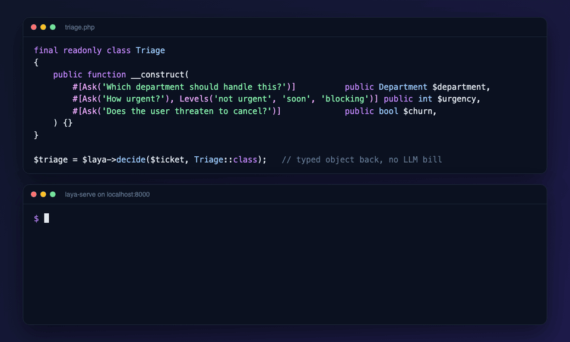</td>
<td align="center" valign="top"> アニメーション記録</td>
</tr></table>

🧰 <b><a href="https://github.com/AkashPriyadarshii/jev-seo">AkashPriyadarshii/jev-seo</a></b> · ⭐99 · Rust · 🔎 inferred · 2 天 · ⭐+1

##### 📝 概要

Free Rust SEO and GEO toolkit powered by TypeSafe Jev: 58-rule audits, site crawls, AI citation checks, rank drift, CI gates, 15-tool MCP. Zero cost.

##### 📌 基本情報

| 項目       | 値                                            |
| ---------- | --------------------------------------------- |
| カテゴリ   | `コミュニティ製のクライアント、SDK、アダプタ` |
| エビデンス | `inferred`                                    |
| 言語       | Rust                                          |

##### 📊 データ

| 指標         | 値          |
| ------------ | ----------- |
| スター数     | **99** (+1) |
| 最終プッシュ | 2026-11-05  |
| 初回掲載     | 2026-11-05  |

🏷 `ahrefs-alternative` · `answer-engine-optimization` · `claude-code` · `cli` · `coding-agents` · `generative-engine-optimization` · `geo` · `jev`

---

<table><tr><th align="center" width="50%">🖼 画像</th><th align="center" width="50%">🎬 動画</th></tr><tr>
<td align="center" valign="top"></td>
<td align="center" valign="top">メディア未公開</td>
</tr></table>

🧰 <b><a href="https://github.com/AboveColin/HA-Jev">AboveColin/HA-Jev</a></b> · ⭐88 · Python · 🔎 inferred · 12 天 · ⭐+2

##### 📝 概要

家に質問すると、数値が返ってくる。TypeSafe Jev 向け Home Assistant 統合: センサーとしての型付き回答、自動化のための 4 つのアクション、Assist 用の会話エージェント。

##### 📌 基本情報

| 項目       | 値                                            |
| ---------- | --------------------------------------------- |
| カテゴリ   | `コミュニティ製のクライアント、SDK、アダプタ` |
| エビデンス | `inferred`                                    |
| 言語       | Python                                        |

##### 📊 データ

| 指標         | 値          |
| ------------ | ----------- |
| スター数     | **88** (+2) |
| 最終プッシュ | 2026-10-26  |
| 初回掲載     | 2026-10-29  |

🏷 `ai` · `assist` · `conversation` · `custom-components` · `decision-model` · `hacs` · `home-assistant` · `home-automation`

---

<table><tr><th align="center" width="50%">🖼 画像</th><th align="center" width="50%">🎬 動画</th></tr><tr>
<td align="center" valign="top">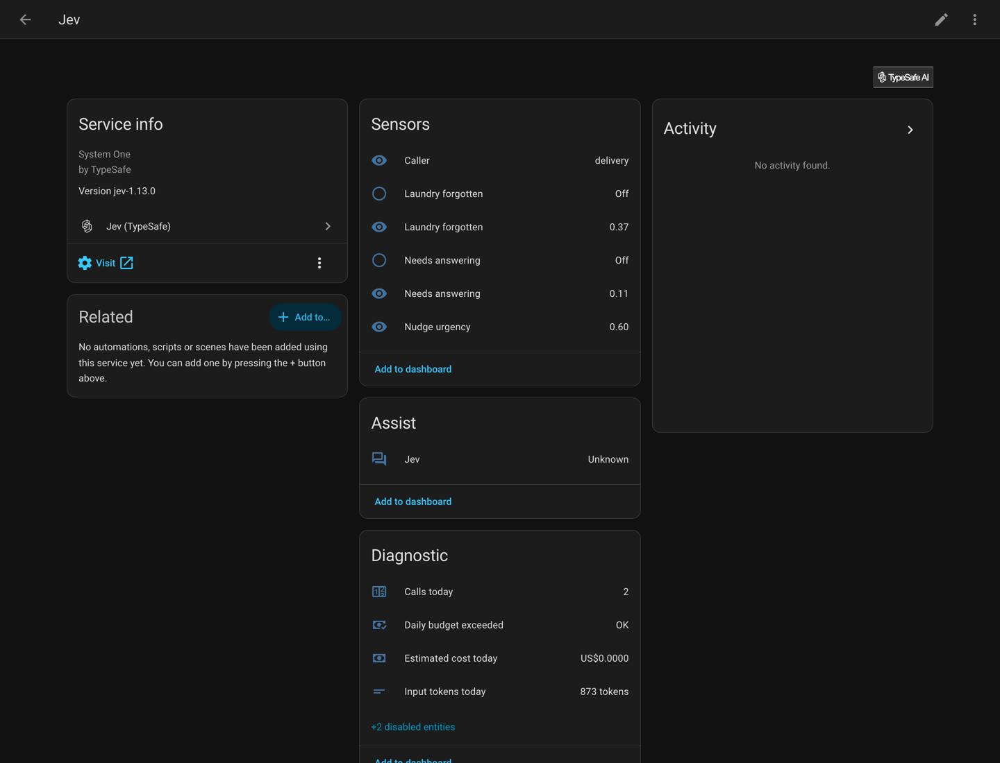</td>
<td align="center" valign="top">メディア未公開</td>
</tr></table>

<b>このカテゴリのその他</b> · 104

- [Sur-Cai/macos-computer-use-kit](https://github.com/Sur-Cai/macos-computer-use-kit) - AX-first computer use for AI agents on macOS with optional Jev。
- [xingwudao/OpenJev](https://github.com/xingwudao/OpenJev) - OpenJev：TypeSafe.aiの概念に基づく、Jevに着想を得た独立したSystem One判断API.
- [frodi-karlsson/onesie](https://github.com/frodi-karlsson/onesie) - An expressive Unix-pipeable CLI for System One models like Jev。
- [GitHub30/OpenJev](https://github.com/GitHub30/OpenJev) - オープンウェイトのSystem Oneモデル（Jev互換）：テキスト生成なしで、1回のフォワードパスによりキャリブレーション済みのnoul / choice…
- [chussenot/judgment](https://github.com/chussenot/judgment) - System…
- [erik-hedstrom/loadout](https://github.com/erik-hedstrom/loadout) - 任意のサイズのライブラリから、各 coding-agent セッション用のモデル、スキル、MCP サーバーを選択し、安価な System One…
- [jqueryscript/awesome-jev](https://github.com/jqueryscript/awesome-jev) - A curated list of TypeSafe Jev resources, SDKs, agents, MCP servers…
- [basi/typesafe-ai-php-client](https://github.com/basi/typesafe-ai-php-client) - PHP client for the typesafe.ai System One API (Jev)。
- [cogcloud-ai/cog-typesafe](https://github.com/cogcloud-ai/cog-typesafe) - TypeSafe。
- [gajaguar/typesafe-cli](https://github.com/gajaguar/typesafe-cli) - Unofficial command-line interface for TypeSafe AI System One models, on…
- [JosephHardy91/graph-composition-with-dLLMs](https://github.com/JosephHardy91/graph-composition-with-dLLMs) - A Graph-Compiled Specification RAG system built with **Dagster**, **PostgreSQL…
- [sanketmuchhala/jevgate](https://github.com/sanketmuchhala/jevgate) - Calibrated policy triage and institutional risk routing: a hybrid…
- [ollaya-dev/ollaya](https://github.com/ollaya-dev/ollaya) - Jev-compatible API server for open decision models.
- [realZachi/pg-jev](https://github.com/realZachi/pg-jev) - あなたのPostgresテーブルに自然言語で質問できます。PostgreSQL拡張機能は、TypeSafeのJevを基盤としています.
- [sutro-sh/jev-align](https://github.com/sutro-sh/jev-align) - Jev と GEPA を使用して、人間のフィードバックから較正済み AI Functions を構築します.
- [juspay/neurolink](https://github.com/juspay/neurolink) - AI神経系のパイプ層 — 3種類の推論、generate、stream、そしてキャリブレーション済みのdecide。
- [aaddrick/building-with-typesafe-jev](https://github.com/aaddrick/building-with-typesafe-jev) - コーディングエージェントにTypeSafe…
- [Ying-Kai-Liao/jev-browser](https://github.com/Ying-Kai-Liao/jev-browser) - LLMが計画し、Jev（Typesafe System One）が判断するブラウザー自動化。ライブラリ、CLI、MCPサーバーを提供します.
- [AkashPriyadarshii/jev-curate](https://github.com/AkashPriyadarshii/jev-curate) - High-throughput synthetic and pretraining dataset sifter for TypeSafe Jev.
- [fazlerocks/jevmail](https://github.com/fazlerocks/jevmail) - Gmail 向けオープンソース AI メール仕分け。Vercel AI Gateway 経由で、Jev、TypeSafe AI…
- [sharziki/semdecide](https://github.com/sharziki/semdecide) - TypeSafe AI Jev を活用した Unix パイプラインと CI 向けの型付きセマンティック意思決定.
- [bladedevoff/stuntd](https://github.com/bladedevoff/stuntd) - アプリの型付き LLM 意思決定を学習し、Laya head で回答するローカルプロキシ。Jev および OpenAI 互換.
- [burnigtm/jev-mcp](https://github.com/burnigtm/jev-mcp) - Cursor、Codex、および任意の MCP クライアントのコーディングループに TypeSafe Jev を組み込む MCP サーバー。
- [mlimarenko/IronRAG](https://github.com/mlimarenko/IronRAG) - One-click knowledge system for documents, internal bots, and AI agents。
- [AkashPriyadarshii/jev-superpowers](https://github.com/AkashPriyadarshii/jev-superpowers) - Systematic software development framework for AI coding agents upgraded with…
- [dannote/jev](https://github.com/dannote/jev) - OTP向けTypeSafe Jev：GenServerからJevに応答し、その回答をパターンマッチング。
- [DevLoops-ai/unified-brain](https://github.com/DevLoops-ai/unified-brain) - System One coding agents: code-level answers at the score of a Claude Fable 5.1…
- [jwuthri-cloud/SelfJev](https://github.com/jwuthri-cloud/SelfJev) - Self-hosted decision model (selfjev-4b) with a Jev-compatible API: Python SDK…
- [jiangkoumo/ego-decision-layer](https://github.com/jiangkoumo/ego-decision-layer) - Pluggable decision layer for the ego lite browser: one System One (Jev) call…
- [myc0576/SmartMoney-Cub](https://github.com/myc0576/SmartMoney-Cub) - Read-only trading journal and review harness: Jev typed judgments, agent…
- [agencyenterprise/jev-recipes](https://github.com/agencyenterprise/jev-recipes) - JevとJavaScriptおよびTypeScript向けの248個の小さな意思決定：エージェント、RAG、サポート、コードレビュー、音楽用にテキストをルート選…
- [thusinh1969/BrighTO_Router](https://github.com/thusinh1969/BrighTO_Router) - BrighTO LLM Router: free open-source, ultra-fast Rust LLM gateway/router and…
- [arjun988/Kev](https://github.com/arjun988/Kev) - オープンソースのSystem One判断エンジン。キャリブレーション済み確率による型付きchoice / score / noul.
- [Ray-Hughes/jevalyn](https://github.com/Ray-Hughes/jevalyn) - Railsアプリの判断レイヤー。TypeSafeのJev System One…
- [nouli-ai/nouli](https://github.com/nouli-ai/nouli) - A ledger-backed decision network that records AI decisions and connects them to…
- [saibimajdi/typesafeai-dotnet-sdk](https://github.com/saibimajdi/typesafeai-dotnet-sdk) - TypeSafe AI System One API向けのコミュニティ製.NET SDK…
- [Elue-dev/jev_elixir](https://github.com/Elue-dev/jev_elixir) - jev_elixir は、Jev で型付き意思決定を行うための小さく慣用的なインターフェースです.
- [chenrui333/jev-docs](https://github.com/chenrui333/jev-docs) - Jev / TypeSafe System One…
- [devbackend/jevgo](https://github.com/devbackend/jevgo) - TypeSafe AI System One API (Jev)向け非公式Goクライアント — 型付きの質問を入力し、較正済みの回答を出力.
- [haileyok/typesafe-client](https://github.com/haileyok/typesafe-client) - GoおよびRustの非公式クライアント（TypeSafe AI System One API（Jev）向け）。
- [himomohi/aside-jev](https://github.com/himomohi/aside-jev) - Aside エージェントは TypeSafe Jev（System One: Choice/Score/Noul）で判断します.
- [wojciechwiesner/jit-context](https://github.com/wojciechwiesner/jit-context) - Architectural Moat: JIT-JEV Context OS — Epistemic runtime &amp; JEV System 1…
- [arcships/android-use](https://github.com/arcships/android-use) - Android control for Dim Agent and local MCP clients, with a live screen, native…
- [docxology/daf-jev](https://github.com/docxology/daf-jev) - daf-jev：TypeSafeのJev（System One）意思決定API向けの、組み合わせ可能なPythonツールキット…
- [AIAnytime/Jev-Router](https://github.com/AIAnytime/Jev-Router) - Decision-first, OpenAI-compatible AI router powered by Jev typed decisions.
- [Kadihx/jev-x-kit](https://github.com/Kadihx/jev-x-kit) - コーディングエージェント向けオフライン$0判断レイヤー：Choice/Score/Noulプリミティブ、BELKI信頼度ゲートキーパー、超計画、レッドチーミング…
- [sanamhub/typesafe-dotnet](https://github.com/sanamhub/typesafe-dotnet) - Unofficial .NET client for the TypeSafe AI System One API。
- [akiiwa-games/AgentCompass](https://github.com/akiiwa-games/AgentCompass) - Deterministic multi-agent task router &amp; subscription quota scheduler for Claude…
- [illescasDaniel/jev-mem](https://github.com/illescasDaniel/jev-mem) - Long-term memory for AI agents driven by Jev (System One) decisions: no…
- [JimmyWesley/rlcd-gateway](https://github.com/JimmyWesley/rlcd-gateway) - LLMsと判断モデル向けのセルフホスト型ゲートウェイ。Claude Code、Codex、OpenCode、任意のOpenAI/Anthropic…
- [zhirschtritt/typesafe-go](https://github.com/zhirschtritt/typesafe-go) - TypeSafe AI API向けの慣用的なGo SDK。
- [Butochnikov/laravel-typesafe-jev](https://github.com/Butochnikov/laravel-typesafe-jev) - 型付きレスポンス、非同期リクエスト、スコープ付き依存性注入、テスト用フェイクを備えたTypeSafe Jev AI向けの非公式Laravel統合.
- [coo-quack/jev-pii-checker](https://github.com/coo-quack/jev-pii-checker) - テキスト内のPIIをTypeSafe Jevで検出するCLI：存在、機密性、検出されたスパン。
- [Lasimeri/Mechanical-Jev](https://github.com/Lasimeri/Mechanical-Jev) - RustにおけるJevの質問側（TypeSafe System One：noul、choice、score）：クライアントライブラリ、mjev…
- [nshkrdotcom/system_one_sdk](https://github.com/nshkrdotcom/system_one_sdk) - System Oneセマンティクス向けのプロバイダー中立なElixir/BEAM…
- [PAI-CUHK/SLEEPJEV](https://github.com/PAI-CUHK/SLEEPJEV) - 長期ホライズンPSG上のJEV着想型ランタイム判断：再利用可能な一晩のエンコーディング、スパース検索、Choice/Noul/Score確率.
- [zerone-agents/jev-model-router](https://github.com/zerone-agents/jev-model-router) - OpenAIおよびAnthropic API互換、自動モデル選択、管理用CLIを備えた、エージェント向け軽量モデルルーティング.
- [AboveColin/jevclient](https://github.com/AboveColin/jevclient) - TypeSafe Jev向け非同期Pythonクライアント。型付き質問を入力すると、確率と選択結果を出力し、解析すべき文章はありません.
- [dsaad68/fuzzy-jev](https://github.com/dsaad68/fuzzy-jev) - A client for OpenRouter&#x27;s decision models, TypeSafe&#x27;s Jev by default: typed…
- [getmissionctrl/hs-jev](https://github.com/getmissionctrl/hs-jev) - TypeSafeのSystem One（Jev）意思決定API向けHaskellクライアント…
- [maxtrezzi/jev4s](https://github.com/maxtrezzi/jev4s) - Typed Scala client for Jev (TypeSafe AI): typed questions, typed answers…
- [minorun365/jev-cloud-quiz](https://github.com/minorun365/jev-cloud-quiz) - 三大クラウドの機能名を、TypeSafe AI の System One モデル Jev が確率つきで判定するデモ。
- [MrKyaw/CognitiveMirror-Jev-MCP](https://github.com/MrKyaw/CognitiveMirror-Jev-MCP) - Cognitive middleware for personal and enterprise AI agents: 14 MCP tools and a…
- [NerdishShah/playwright-cli-jev-bakeoff](https://github.com/NerdishShah/playwright-cli-jev-bakeoff) - Bake-off: Playwright CLI vs CLI+Jev vs Playwright MCP。
- [bojansandhaus/dsh-jev-mcp](https://github.com/bojansandhaus/dsh-jev-mcp) - TypeSafe Jev decision tools for DeepSeek Harness: dependency-free client…
- [exfoca/decision-model-lab-4JEV](https://github.com/exfoca/decision-model-lab-4JEV) - DML is a reproducible harness for evaluating small, local decision models under…
- [Hyper-AI-Lab/openclaw-jev](https://github.com/Hyper-AI-Lab/openclaw-jev) - OpenClawエージェント向けの本番制御プレーン: Jevによるインテークルーティング、Temporalオーケストレーション、すべての返信前のProcess…
- [abirshhishirroy/mini-jev](https://github.com/abirshhishirroy/mini-jev) - A custom Jev-style decision model built from scratch on Qwen2.5-3B.
- [cicilybiconcave74/jev-snips-benchmark](https://github.com/cicilybiconcave74/jev-snips-benchmark) - Benchmark Jev。
- [CMaintz/jev-tools](https://github.com/CMaintz/jev-tools) - TypeSafe…
- [codebam/jev-guardrails](https://github.com/codebam/jev-guardrails) - エージェントのツール呼び出し向けJevベースのガードレール：ライブラリ、ネイティブOpenCode/Hermes/DeepSeek…
- [cwdx/chess-with-jev](https://github.com/cwdx/chess-with-jev) - Chess with Jev: every legal move&#x27;s facts worked out in code, Jev&#x27;s move as one…
- [fan56/dsh-jev-core](https://github.com/fan56/dsh-jev-core) - Shared TypeSafe Jev decision-model client for the dsh ecosystem: strict…
- [gbesse/mariadb-jev](https://github.com/gbesse/mariadb-jev) - Semantic SQL predicates for MariaDB powered by TypeSafe Jev。
- [gbesse/meilisearch-jev](https://github.com/gbesse/meilisearch-jev) - Community TypeSafe Jev semantic decision integration for meilisearch。
- [gbesse/pinot-jev](https://github.com/gbesse/pinot-jev) - Semantic SQL predicates for Apache Pinot powered by TypeSafe Jev。
- [HappyHackingSpace/jev](https://github.com/HappyHackingSpace/jev) - Go SDK, CLI, MCP server and agent skill for TypeSafe。
- [mdimamhosen/jev](https://github.com/mdimamhosen/jev) - One endpoint for every model, one CLI for every MCP.
- [Murat-Selim/jev_doc_router](https://github.com/Murat-Selim/jev_doc_router) - Spring Boot PDF question-answering assistant with RAG/CAG routing and…
- [royalskynet/jev-gate-mcp](https://github.com/royalskynet/jev-gate-mcp) - GPT、Claude、MCP クライアント向けのガバナンスされた Jev 判断ゲートウェイ。
- [shetautnetjer/jev-cli](https://github.com/shetautnetjer/jev-cli) - Clean-room CLI for TypeSafe System One / Jev Decision Contracts, search, and…
- [vilinski/jev](https://github.com/vilinski/jev) - System One決定モデル向けのCLI：型付き質問を入力し、校正済み確率を出力。APIキーを呼び出し元から隔離します.
- [Yasir-Khan-7/jev-sentinel](https://github.com/Yasir-Khan-7/jev-sentinel) - LangChain / LangGraph AIエージェント向けのプロンプトインジェクション保護とツール呼び出しガードレール.
- [Zuexx/agent-jev-integration](https://github.com/Zuexx/agent-jev-integration) - TypeSafe Jev integrated into Claude Code: routing, escalation, guardrails, evals。
- [StartLuxLabs/StartLux-Prism](https://github.com/StartLuxLabs/StartLux-Prism) - Fast, exact inference for StartLux-Decision models on NVIDIA GPUs: the released…
- [rokbenko/quackd](https://github.com/rokbenko/quackd) - すべてのロボットのための1つのCLI。ロボットを接続し、指示を出し、協調して動作させます.
- [MiaoWuNYA/rikkahub-sillytavern-android](https://github.com/MiaoWuNYA/rikkahub-sillytavern-android) - 安卓AI聊天端:开箱即聊，无损导入酒馆卡，缓存强省用量，手机操控，专属RP模式，防空回，主动信息，前端卡支持，高定制主题，QQbot，AI群聊，插件系统，强兼容…
- [pithings/advocaat](https://github.com/pithings/advocaat) - TypeSafe Jev を活用した、データについて AI に質問するための小型で型安全なクライアント.
- [giuliosmall/pg_typesafe](https://github.com/giuliosmall/pg_typesafe) - TypeSafe AI（Jev）カテゴリ分類用のプレアルファ PostgreSQL 拡張機能。
- [Brainwires/jevwire](https://github.com/Brainwires/jevwire) - Jev decision layer for agents: MCP server, embeddable DecisionModel library…
- [zhulinchng/jevper](https://github.com/zhulinchng/jevper) - OpenAI 風クライアント上の Jev 形状（TypeSafe System One）分類ラッパー。
- [schainks/system_one_client](https://github.com/schainks/system_one_client) - System One意思決定モデル向けのElixirクライアント：TypeSafe Jev、Cloudflare…
- [gilljon/typesafe-ai-rs](https://github.com/gilljon/typesafe-ai-rs) - TypeSafe AI System One API向けの、独立した非同期およびブロッキングRust SDK。
- [IKEASven69/dsh-opencli](https://github.com/IKEASven69/dsh-opencli) - 让 dsh 会办事:登录态真实浏览器 × 180 站点结构化命令 + SystemOne 亚秒决策 + 执行真实性判定 + watch 监控.
- [AutreMachine/bosco](https://github.com/AutreMachine/bosco) - Router and proxy for OpenAI compatible LLMs machines - 1 url to rule them all !
- [cipherTing/sael](https://github.com/cipherTing/sael) - Go client for the TypeSafe System One API (Jev) — the first piece of sael, a…
- [Query-farm/vgi-typesafe](https://github.com/Query-farm/vgi-typesafe) - TypeSafe System…
- [zcoder-run/rust-sysone](https://github.com/zcoder-run/rust-sysone) - System One TypeSafe AI Rust Client (unofficial)。
- [y0usaf/typesafe-cli](https://github.com/y0usaf/typesafe-cli) - シェルからJev個の型付き質問を実行：noul、choice、scoreの回答を文章ではなく数値として取得。
- [geilt/typesafe-cli](https://github.com/geilt/typesafe-cli) - TypeSafe System One（Jev）向けのCLIとエージェントスキル：型付きChoice、Score、Noul判定.
- [iamtalha-arshad/ex_typesafe_ai](https://github.com/iamtalha-arshad/ex_typesafe_ai) - TypeSafe AI API向けの非公式Elixirクライアント…
- [MarcelRoozekrans/Minos.NET](https://github.com/MarcelRoozekrans/Minos.NET) - Typed, source-generated decision questions for .NET: one IDecisionClient for…
- [MIt9/laya-cli](https://github.com/MIt9/laya-cli) - Laya向けの使いやすいCLI — HumansとAI…
- [phiat/typesafe-rust-sdk](https://github.com/phiat/typesafe-rust-sdk) - Unofficial Rust client for TypeSafe。

## エージェントツール：MCP、フック、ゲート、コーディングエージェント

最も伸びているカテゴリ。エージェントの次の行動の前に型付きの判断を差し込むフック、MCP サーバー、ゲート。

🤖 <b><a href="https://github.com/0xNatoshi/jev-codex-router">0xNatoshi/jev-codex-router</a></b> · ⭐275 · JavaScript · 🔎 inferred · 46 天 · ⭐+1

##### 📝 概要

Jev（TypeSafe System One）による、Codexのターンごとのモデルおよび推論ルーティング：各ターンでモデル、思考の深さ、速度モードを選択します。

> 💡 型付き判定によって駆動される、コーディングエージェントのターンごとのモデルおよび推論負荷ルーティング。

##### 📌 基本情報

| 項目       | 値                                                                  |
| ---------- | ------------------------------------------------------------------- |
| カテゴリ   | `エージェントツール：MCP、フック、ゲート、コーディングエージェント` |
| エビデンス | `inferred`                                                          |
| 言語       | JavaScript                                                          |

##### 📊 データ

| 指標         | 値           |
| ------------ | ------------ |
| スター数     | **275** (+1) |
| 最終プッシュ | 2026-09-22   |
| 初回掲載     | 2026-10-28   |

🏷 `ai` · `codex` · `jev` · `llm` · `macos` · `routing` · `typesafe`

🤖 <b><a href="https://github.com/strands-labs/strands-decider">strands-labs/strands-decider</a></b> · ⭐765 · Python · 👁️ observed · 0 天

##### 📝 概要

エージェントワークフロー向けの、小型で高速な意思決定モデル、またはSystem 1モデル。LLMよりも高速に選択肢から選ぶかスケールで評価でき、すべての意思決定にキャリブレーション済みの信頼度を付与します。

##### 📌 基本情報

| 項目       | 値                                                                  |
| ---------- | ------------------------------------------------------------------- |
| カテゴリ   | `エージェントツール：MCP、フック、ゲート、コーディングエージェント` |
| エビデンス | `observed`                                                          |
| 言語       | Python                                                              |

##### 📊 データ

| 指標         | 値         |
| ------------ | ---------- |
| スター数     | **765**    |
| 最終プッシュ | 2026-11-06 |
| 初回掲載     | 2026-10-02 |

🏷 `ai` · `machine-learning` · `natural-language-understanding` · `python` · `strands-agents` · `strands-labs` · `system-one` · `system-one-models`

🤖 <b><a href="https://github.com/AbdelStark/awesome-typesafe-jev">AbdelStark/awesome-typesafe-jev</a></b> · ⭐615 · HTML · 👁️ observed · 5 天

##### 📝 概要

Awesome Jev: TypeSafe の System One モデルへの、ソースに裏付けられたフィールドガイド。SDKs、ライブデモ、エージェントツール、独立評価を含む。

🔧 コード内での使用を確認: `README.md`

##### 📌 基本情報

| 項目       | 値                                                                  |
| ---------- | ------------------------------------------------------------------- |
| カテゴリ   | `エージェントツール：MCP、フック、ゲート、コーディングエージェント` |
| エビデンス | `observed`                                                          |
| 言語       | HTML                                                                |

##### 📊 データ

| 指標         | 値         |
| ------------ | ---------- |
| スター数     | **615**    |
| 最終プッシュ | 2026-11-01 |
| 初回掲載     | 2026-10-28 |

🏷 `agent-skills` · `ai-agents` · `awesome` · `awesome-jev` · `awesome-list` · `awesome-lists` · `curated-list` · `developer-tools`

🤖 <b><a href="https://github.com/jkudish/jev-mcp">jkudish/jev-mcp</a></b> · ⭐575 · JavaScript · 👁️ observed · 8 天 · ⭐+1

##### 📝 概要

TypeSafeのJevモデルによる、高速で安価な型付き判定をMCPツールとして提供。

> 💡 MCP 経由で Jev を公開するための初期の概念実証。これは、ほとんどの非 Python ツールチェーンがそれに到達する方法です。

🔧 コード内での使用を確認: `README.md`

##### 📌 基本情報

| 項目       | 値                                                                  |
| ---------- | ------------------------------------------------------------------- |
| カテゴリ   | `エージェントツール：MCP、フック、ゲート、コーディングエージェント` |
| エビデンス | `observed`                                                          |
| 言語       | JavaScript                                                          |

##### 📊 データ

| 指標         | 値           |
| ------------ | ------------ |
| スター数     | **575** (+1) |
| 最終プッシュ | 2026-10-30   |
| 初回掲載     | 2026-10-26   |

🤖 <b><a href="https://github.com/walidboulanouar/awesome-jev-use-cases">walidboulanouar/awesome-jev-use-cases</a></b> · ⭐486 · 👁️ observed · 41 天 · ⭐+1

##### 📝 概要

TypeSafe AI Jev ユースケースの Awesome リスト：いいね順にランク付けされた 74 件のデモ、150+ の GitHub リポジトリ、制限、コスト、API の例。CC0

🔧 コード内での使用を確認: `README.md`

##### 📌 基本情報

| 項目       | 値                                                                  |
| ---------- | ------------------------------------------------------------------- |
| カテゴリ   | `エージェントツール：MCP、フック、ゲート、コーディングエージェント` |
| エビデンス | `observed`                                                          |

##### 📊 データ

| 指標         | 値           |
| ------------ | ------------ |
| スター数     | **486** (+1) |
| 最終プッシュ | 2026-09-26   |
| 初回掲載     | 2026-10-29   |

🏷 `ai-guardrails` · `ai-router` · `awesome` · `awesome-list` · `classification` · `claude-code` · `decision-model` · `examples`

🤖 <b><a href="https://github.com/kraayenjon/awesome-jev">kraayenjon/awesome-jev</a></b> · ⭐206 · 👁️ observed · 41 天 · ⭐+3

##### 📝 概要

Jevのユースケース、プロジェクト、SDKs、リソースをまとめた厳選リストです。Jevは、ソフトウェアで高速かつ型付きの判断を行うTypeSafe AIのSystem Oneモデルです。調整済み確率を持つChoice、Score、Noulに対応します。

🔧 コード内での使用を確認: `README.md`

##### 📌 基本情報

| 項目       | 値                                                                  |
| ---------- | ------------------------------------------------------------------- |
| カテゴリ   | `エージェントツール：MCP、フック、ゲート、コーディングエージェント` |
| エビデンス | `observed`                                                          |

##### 📊 データ

| 指標         | 値           |
| ------------ | ------------ |
| スター数     | **206** (+3) |
| 最終プッシュ | 2026-09-27   |
| 初回掲載     | 2026-09-19   |

🏷 `agents` · `ai` · `ai-agents` · `api` · `artificial-intelligence` · `automation` · `awesome` · `awesome-list`

🤖 <b><a href="https://github.com/valentynkit/awesome-jev-typesafe">valentynkit/awesome-jev-typesafe</a></b> · ⭐190 · JavaScript · 👁️ observed · 0 天 · ⭐+1

##### 📝 概要

最初のSystem OneモデルであるTypeSafeのJevを使った型付き判断

🔧 コード内での使用を確認: `readme.md`, `README.ko.md`, `README.ja.md`, `README.zh-CN.md`

##### 📌 基本情報

| 項目       | 値                                                                  |
| ---------- | ------------------------------------------------------------------- |
| カテゴリ   | `エージェントツール：MCP、フック、ゲート、コーディングエージェント` |
| エビデンス | `observed`                                                          |
| 言語       | JavaScript                                                          |

##### 📊 データ

| 指標         | 値           |
| ------------ | ------------ |
| スター数     | **190** (+1) |
| 最終プッシュ | 2026-11-06   |
| 初回掲載     | 2026-09-19   |

🏷 `ai-agents` · `awesome` · `awesome-list` · `claude-code` · `directory` · `jev` · `llm-agents` · `system-one`

🤖 <b><a href="https://github.com/dbreunig/building-with-jev-skill">dbreunig/building-with-jev-skill</a></b> · ⭐166 · 👁️ observed · 8 天

##### 📝 概要

Jev、TypeSafeのSystem Oneモデルを呼び出すプログラムの作成と改善のためのスキル

> 💡 Jevを呼び出すプログラムではなく、Jevを呼び出すプログラムを作成するためのスキル。この違いは重要です。1つの実装ではなく、設計ルールを組み込むからです。

##### 📌 基本情報

| 項目       | 値                                                                  |
| ---------- | ------------------------------------------------------------------- |
| カテゴリ   | `エージェントツール：MCP、フック、ゲート、コーディングエージェント` |
| エビデンス | `observed`                                                          |

##### 📊 データ

| 指標         | 値         |
| ------------ | ---------- |
| スター数     | **166**    |
| 最終プッシュ | 2026-10-29 |
| 初回掲載     | 2026-10-28 |

🤖 <b><a href="https://github.com/y0usaf/pi-jev">y0usaf/pi-jev</a></b> · ⭐164 · TypeScript · 👁️ observed · 6 天 · ⭐+1

##### 📝 概要

Pi コーディングエージェントの意思決定レイヤーとしての TypeSafe Jev: 測定済みのツール呼び出しゲートに加え、型付きでキャリブレーションされた回答のための jev_ask

🔧 コード内での使用を確認: `README.md`

##### 📌 基本情報

| 項目       | 値                                                                  |
| ---------- | ------------------------------------------------------------------- |
| カテゴリ   | `エージェントツール：MCP、フック、ゲート、コーディングエージェント` |
| エビデンス | `observed`                                                          |
| 言語       | TypeScript                                                          |

##### 📊 データ

| 指標         | 値           |
| ------------ | ------------ |
| スター数     | **164** (+1) |
| 最終プッシュ | 2026-10-31   |
| 初回掲載     | 2026-10-29   |

🏷 `guardrails` · `jev` · `pi-extension` · `pi-package` · `typesafe`

🤖 <b><a href="https://github.com/Avinash-jetwani/jevmem">Avinash-jetwani/jevmem</a></b> · ⭐142 · TypeScript · 👁️ observed · 0 天 · ⭐+1

##### 📝 概要

jevmem は、あなたの Claude Code チャットからの決定、ルール、失敗したアプローチをリポジトリ内の JEVMEM.md に保存し、次のセッションで関連するものを呼び戻します。

🔧 コード内での使用を確認: `PRIVACY.md`, `plugin/README.md`, `CHANGELOG.md`

##### 📌 基本情報

| 項目       | 値                                                                  |
| ---------- | ------------------------------------------------------------------- |
| カテゴリ   | `エージェントツール：MCP、フック、ゲート、コーディングエージェント` |
| エビデンス | `observed`                                                          |
| 言語       | TypeScript                                                          |

##### 📊 データ

| 指標         | 値           |
| ------------ | ------------ |
| スター数     | **142** (+1) |
| 最終プッシュ | 2026-11-06   |
| 初回掲載     | 2026-10-29   |

🏷 `agent-memory` · `ai-memory` · `claude` · `claude-code` · `claude-code-hooks` · `claude-code-plugin` · `claude-code-plugins` · `claude-code-plugins-marketplace`

🤖 <b><a href="https://github.com/Bodila51/grok-bot-jev">Bodila51/grok-bot-jev</a></b> · ⭐132 · Python · 👁️ observed · 39 天 · ⭐+1

##### 📝 概要

安価な意思決定レイヤーとして TypeSafe Jev を Grok Bot に接続 - 使用量ゲート、スキルテンプレート、例

🔧 コード内での使用を確認: `src/jev_client.py`

##### 📌 基本情報

| 項目       | 値                                                                  |
| ---------- | ------------------------------------------------------------------- |
| カテゴリ   | `エージェントツール：MCP、フック、ゲート、コーディングエージェント` |
| エビデンス | `observed`                                                          |
| 言語       | Python                                                              |

##### 📊 データ

| 指標         | 値           |
| ------------ | ------------ |
| スター数     | **132** (+1) |
| 最終プッシュ | 2026-09-28   |
| 初回掲載     | 2026-10-29   |

🏷 `cursor` · `decision-layer` · `grok-bot` · `jev` · `python` · `typesafe`

---

<table><tr><th align="center" width="50%">🖼 画像</th><th align="center" width="50%">🎬 動画</th></tr><tr>
<td align="center" valign="top"></td>
<td align="center" valign="top">メディア未公開</td>
</tr></table>

🤖 <b><a href="https://github.com/GhalebDweikat/winnow">GhalebDweikat/winnow</a></b> · ⭐115 · Python · 👁️ observed · 32 天

##### 📝 概要

Claude Code向けの調整済みコンテキストふるい。各ツール結果はコンテキストに入る前にSystem Oneモデルによって判定されます。

##### 📌 基本情報

| 項目       | 値                                                                  |
| ---------- | ------------------------------------------------------------------- |
| カテゴリ   | `エージェントツール：MCP、フック、ゲート、コーディングエージェント` |
| エビデンス | `observed`                                                          |
| 言語       | Python                                                              |

##### 📊 データ

| 指標         | 値         |
| ------------ | ---------- |
| スター数     | **115**    |
| 最終プッシュ | 2026-10-06 |
| 初回掲載     | 2026-10-21 |

🏷 `claude-code` · `claude-code-plugin` · `context-management` · `jev` · `llm-agents` · `typesafe`

🤖 <b><a href="https://github.com/caijinchun/nanojev-arena">caijinchun/nanojev-arena</a></b> · ⭐7 · HTML · 👁️ observed · 48 天

##### 📝 概要

NanoJev Snake Arena: 1v4 の人間対 AI の戦艦ゲーム + 100エージェント群シミュレーター。Jev System-One モデル（オープンソースのミニレプリカ）のローカルデモ。

##### 📌 基本情報

| 項目       | 値                                                                  |
| ---------- | ------------------------------------------------------------------- |
| カテゴリ   | `エージェントツール：MCP、フック、ゲート、コーディングエージェント` |
| エビデンス | `observed`                                                          |
| 言語       | HTML                                                                |

##### 📊 データ

| 指標         | 値         |
| ------------ | ---------- |
| スター数     | **7**      |
| 最終プッシュ | 2026-09-19 |
| 初回掲載     | 2026-11-01 |

---

<table><tr><th align="center" width="50%">🖼 画像</th><th align="center" width="50%">🎬 動画</th></tr><tr>
<td align="center" valign="top"></td>
<td align="center" valign="top">メディア未公開</td>
</tr></table>

🤖 <b><a href="https://github.com/dfranco-projects/jev-guardbench">dfranco-projects/jev-guardbench</a></b> · ⭐3 · Python · 👁️ observed · 33 天

##### 📝 概要

System Oneモデル（TypeSafe Jev、オープンソースKev）は、エージェントガードレールコールバック内のLLM-as-judgeを置き換えられますか？

##### 📌 基本情報

| 項目       | 値                                                                  |
| ---------- | ------------------------------------------------------------------- |
| カテゴリ   | `エージェントツール：MCP、フック、ゲート、コーディングエージェント` |
| エビデンス | `observed`                                                          |
| 言語       | Python                                                              |

##### 📊 データ

| 指標         | 値         |
| ------------ | ---------- |
| スター数     | **3**      |
| 最終プッシュ | 2026-10-04 |
| 初回掲載     | 2026-11-04 |

---

<table><tr><th align="center" width="50%">🖼 画像</th><th align="center" width="50%">🎬 動画</th></tr><tr>
<td align="center" valign="top"></td>
<td align="center" valign="top">メディア未公開</td>
</tr></table>

再配布ライセンスが明示されていないため、アセットは上流リポジトリから直リンクしています。

🤖 <b><a href="https://github.com/dolevhayut/resurface">dolevhayut/resurface</a></b> · TypeScript · 👁️ observed · 35 天

##### 📝 概要

TypeSafe JEV 履歴書スクリーニング: LLM が質問を作成し、JEV（System One 分類モデル）が ATS 内のすべての履歴書について正確な証拠行で回答します。LLM より8倍高速、31倍安価。

##### 📌 基本情報

| 項目       | 値                                                                  |
| ---------- | ------------------------------------------------------------------- |
| カテゴリ   | `エージェントツール：MCP、フック、ゲート、コーディングエージェント` |
| エビデンス | `observed`                                                          |
| 言語       | TypeScript                                                          |

##### 📊 データ

| 指標         | 値         |
| ------------ | ---------- |
| スター数     | **0**      |
| 最終プッシュ | 2026-10-03 |
| 初回掲載     | 2026-11-01 |

🏷 `ai-recruiting` · `ats` · `candidate-matching` · `classification-model` · `claude` · `decision-model` · `evidence-based-hiring` · `hr-tech`

---

<table><tr><th align="center" width="50%">🖼 画像</th><th align="center" width="50%">🎬 動画</th></tr><tr>
<td align="center" valign="top"></td>
<td align="center" valign="top"> <a href="https://raw.githubusercontent.com/dolevhayut/resurface/main/docs/launch/resurface-launch.mp4">動画を開く</a></td>
</tr></table>

🤖 <b><a href="https://github.com/reticlehq/reticle">reticlehq/reticle</a></b> · ⭐1244 · TypeScript · 🔎 inferred · 0 天

##### 📝 概要

AIエージェントはコードを生成できますが、自分が構築したものを理解するのには依然として苦労します。Reticleは、Jevスタイルのマシンネイティブなランタイム知覚をWebおよびデスクトップアプリケーションにもたらします。

##### 📌 基本情報

| 項目       | 値                                                                  |
| ---------- | ------------------------------------------------------------------- |
| カテゴリ   | `エージェントツール：MCP、フック、ゲート、コーディングエージェント` |
| エビデンス | `inferred`                                                          |
| 言語       | TypeScript                                                          |

##### 📊 データ

| 指標         | 値         |
| ------------ | ---------- |
| スター数     | **1244**   |
| 最終プッシュ | 2026-11-07 |
| 初回掲載     | 2026-10-26 |

🏷 `agent-skill` · `agent-skills` · `agent-testing` · `agent-verification` · `ai-testing-tool` · `automated-testing` · `claude-code` · `claude-skills`

---

<table><tr><th align="center" width="50%">🖼 画像</th><th align="center" width="50%">🎬 動画</th></tr><tr>
<td align="center" valign="top"></td>
<td align="center" valign="top"> アニメーション記録</td>
</tr></table>

再配布ライセンスが明示されていないため、アセットは上流リポジトリから直リンクしています。

🤖 <b><a href="https://github.com/devagrawal09/jev-review">devagrawal09/jev-review</a></b> · ⭐698 · TypeScript · 🔎 inferred · 51 天

##### 📝 概要

TypeSafe Jevで構築された、段階的なコードレビューのワークフローとローカルダッシュボード。

##### 📌 基本情報

| 項目       | 値                                                                  |
| ---------- | ------------------------------------------------------------------- |
| カテゴリ   | `エージェントツール：MCP、フック、ゲート、コーディングエージェント` |
| エビデンス | `inferred`                                                          |
| 言語       | TypeScript                                                          |

##### 📊 データ

| 指標         | 値         |
| ------------ | ---------- |
| スター数     | **698**    |
| 最終プッシュ | 2026-09-17 |
| 初回掲載     | 2026-10-29 |

🏷 `ai` · `code-review` · `jev` · `typesafe-ai` · `typescript`

---

<table><tr><th align="center" width="50%">🖼 画像</th><th align="center" width="50%">🎬 動画</th></tr><tr>
<td align="center" valign="top">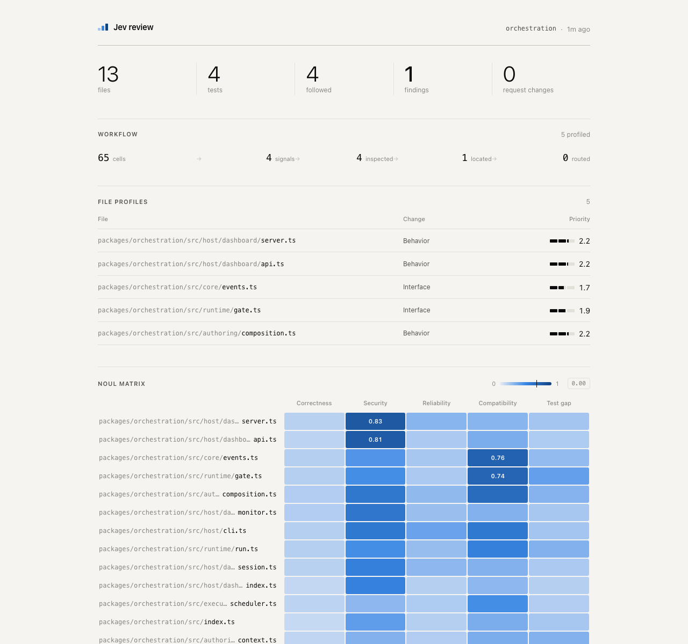</td>
<td align="center" valign="top">メディア未公開</td>
</tr></table>

🤖 <b><a href="https://github.com/ttlequals0/MinusPod">ttlequals0/MinusPod</a></b> · ⭐534 · Python · 🔎 inferred · 0 天

##### 📝 概要

MinusPod は、再生を押す前に広告を除去するセルフホスト型サーバーです

##### 📌 基本情報

| 項目       | 値                                                                  |
| ---------- | ------------------------------------------------------------------- |
| カテゴリ   | `エージェントツール：MCP、フック、ゲート、コーディングエージェント` |
| エビデンス | `inferred`                                                          |
| 言語       | Python                                                              |

##### 📊 データ

| 指標         | 値         |
| ------------ | ---------- |
| スター数     | **534**    |
| 最終プッシュ | 2026-11-07 |
| 初回掲載     | 2026-10-12 |

🏷 `ad-remover` · `ai` · `claude` · `jev` · `llm` · `media` · `nvidia` · `ollama`

---

<table><tr><th align="center" width="50%">🖼 画像</th><th align="center" width="50%">🎬 動画</th></tr><tr>
<td align="center" valign="top">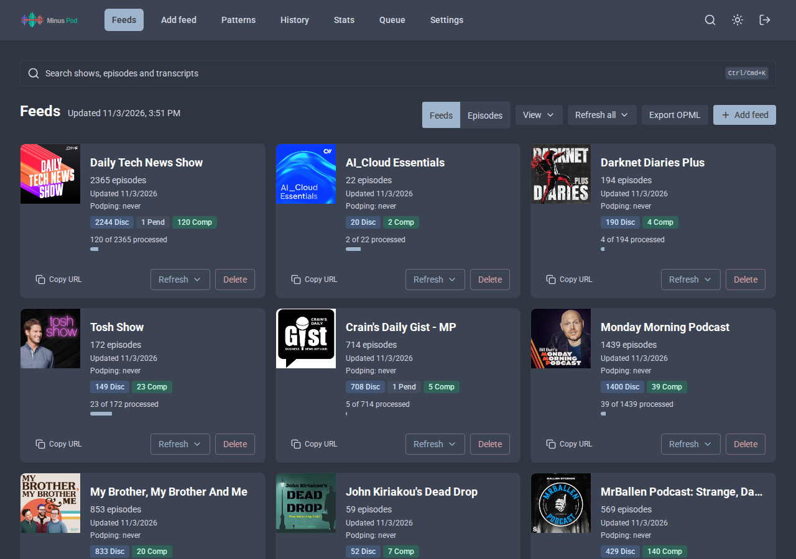</td>
<td align="center" valign="top">メディア未公開</td>
</tr></table>

🤖 <b><a href="https://github.com/malevrigns/agent-jev">malevrigns/agent-jev</a></b> · ⭐397 · Python · 🔎 inferred · 8 天 · ⭐+1

##### 📝 概要

AgentJev-0.6B - AI Agents向けの高速な 'System One' 判断モデル：任意の非構造化状態（diff、トレース、ログ）と構造化された質問を入力すると、約50msの1回のフォワードパスで較正済みの確率分布を返します。出力トークンのデコードはゼロです。

##### 📌 基本情報

| 項目       | 値                                                                  |
| ---------- | ------------------------------------------------------------------- |
| カテゴリ   | `エージェントツール：MCP、フック、ゲート、コーディングエージェント` |
| エビデンス | `inferred`                                                          |
| 言語       | Python                                                              |

##### 📊 データ

| 指標         | 値           |
| ------------ | ------------ |
| スター数     | **397** (+1) |
| 最終プッシュ | 2026-10-30   |
| 初回掲載     | 2026-10-28   |

🏷 `ai` · `ai-agents` · `ai-tools` · `jev` · `jev-model`

---

<table><tr><th align="center" width="50%">🖼 画像</th><th align="center" width="50%">🎬 動画</th></tr><tr>
<td align="center" valign="top">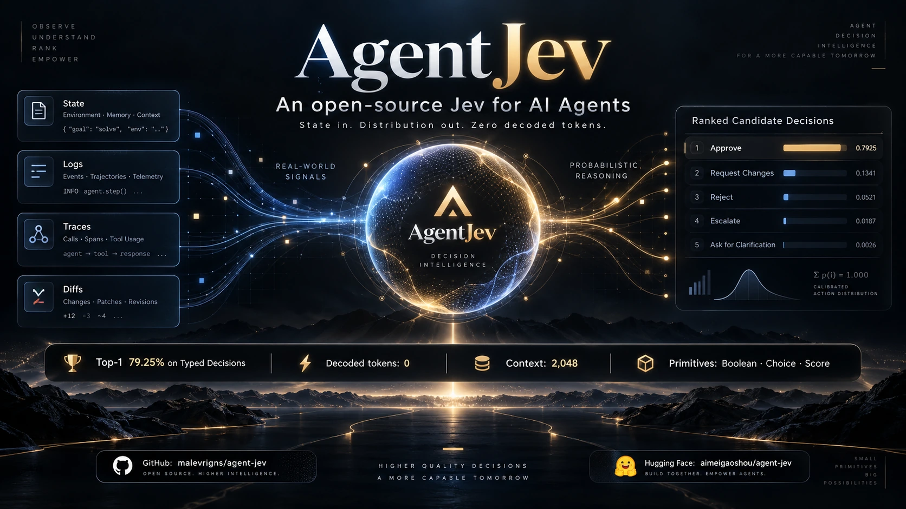</td>
<td align="center" valign="top">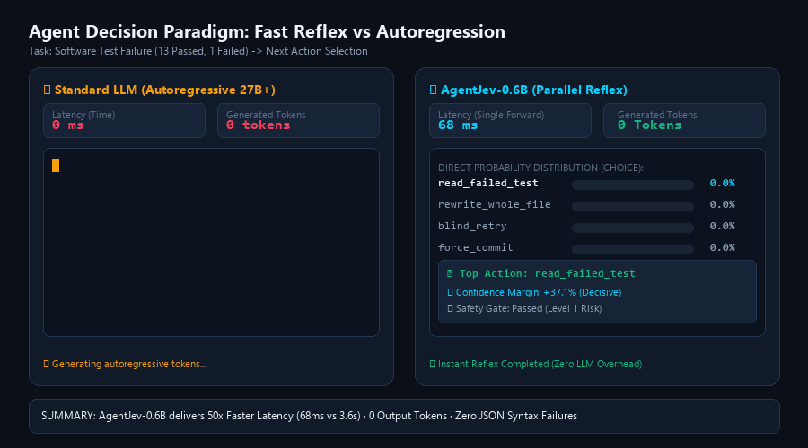 アニメーション記録</td>
</tr></table>

🤖 <b><a href="https://github.com/Heman10x-NGU/openJev-verdict-2.0">Heman10x-NGU/openJev-verdict-2.0</a></b> · ⭐305 · Python · 🔎 inferred · 16 天 · ⭐+1

##### 📝 概要

較正済み151M非自己回帰型判断エンジン。LocalLLaMA/typed-decisionsでTypeSafe JevおよびLayaを上回る（精度77.10%、Brier 0.0636、ECE 0.0144）

##### 📌 基本情報

| 項目       | 値                                                                  |
| ---------- | ------------------------------------------------------------------- |
| カテゴリ   | `エージェントツール：MCP、フック、ゲート、コーディングエージェント` |
| エビデンス | `inferred`                                                          |
| 言語       | Python                                                              |

##### 📊 データ

| 指標         | 値           |
| ------------ | ------------ |
| スター数     | **305** (+1) |
| 最終プッシュ | 2026-10-21   |
| 初回掲載     | 2026-09-19   |

🏷 `agentic-ai` · `brier-score` · `calibration` · `decision-engine` · `deep-learning` · `encoder` · `jev` · `machine-learning`

---

<table><tr><th align="center" width="50%">🖼 画像</th><th align="center" width="50%">🎬 動画</th></tr><tr>
<td align="center" valign="top"></td>
<td align="center" valign="top">メディア未公開</td>
</tr></table>

再配布ライセンスが明示されていないため、アセットは上流リポジトリから直リンクしています。

🤖 <b><a href="https://github.com/RomanSlack/jev-drone">RomanSlack/jev-drone</a></b> · ⭐300 · Python · 🔎 inferred · 43 天 · ⭐+2

##### 📝 概要

MuJoCo 内のカメラのみの自律ドローン。小型判断モデル（TypeSafe Jev）を 2.5Hz でループに組み込み。

##### 📌 基本情報

| 項目       | 値                                                                  |
| ---------- | ------------------------------------------------------------------- |
| カテゴリ   | `エージェントツール：MCP、フック、ゲート、コーディングエージェント` |
| エビデンス | `inferred`                                                          |
| 言語       | Python                                                              |

##### 📊 データ

| 指標         | 値           |
| ------------ | ------------ |
| スター数     | **300** (+2) |
| 最終プッシュ | 2026-09-24   |
| 初回掲載     | 2026-10-29   |

🏷 `autonomous-agents` · `drone` · `mujoco` · `robotics` · `typesafe`

---

<table><tr><th align="center" width="50%">🖼 画像</th><th align="center" width="50%">🎬 動画</th></tr><tr>
<td align="center" valign="top">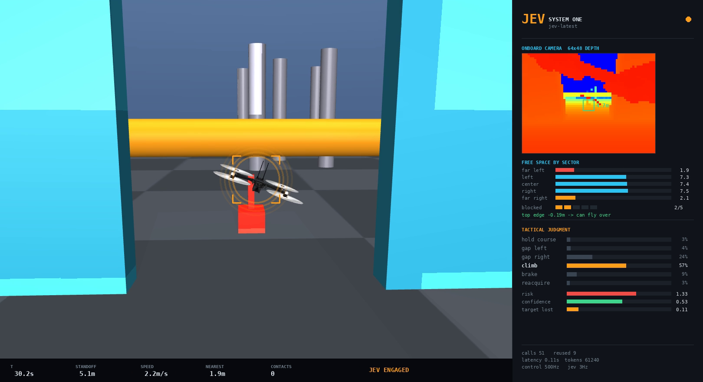</td>
<td align="center" valign="top">メディア未公開</td>
</tr></table>

🤖 <b><a href="https://github.com/jmagly/aiwg">jmagly/aiwg</a></b> · ⭐229 · TypeScript · 🔎 inferred · 0 天

##### 📝 概要

すでに使用している AI ツール向けの再利用可能なプロジェクトコンテキストと専門ワークフロー。Claude Code、Codex、Copilot、Cursor など向けのエージェント、スキル、ルール、MCP ツールに加え、SDLC ワークフロー、セッションメモリ、トークン節約のために限定された LLM 意思決定をオフロードする Jev 意思決定サポート。

##### 📌 基本情報

| 項目       | 値                                                                  |
| ---------- | ------------------------------------------------------------------- |
| カテゴリ   | `エージェントツール：MCP、フック、ゲート、コーディングエージェント` |
| エビデンス | `inferred`                                                          |
| 言語       | TypeScript                                                          |

##### 📊 データ

| 指標         | 値         |
| ------------ | ---------- |
| スター数     | **229**    |
| 最終プッシュ | 2026-11-07 |
| 初回掲載     | 2026-10-18 |

🏷 `agent-skills` · `agentic-ai` · `ai-agents` · `claude-code` · `codex` · `coding-agents` · `context-engineering` · `copilot`

---

<table><tr><th align="center" width="50%">🖼 画像</th><th align="center" width="50%">🎬 動画</th></tr><tr>
<td align="center" valign="top">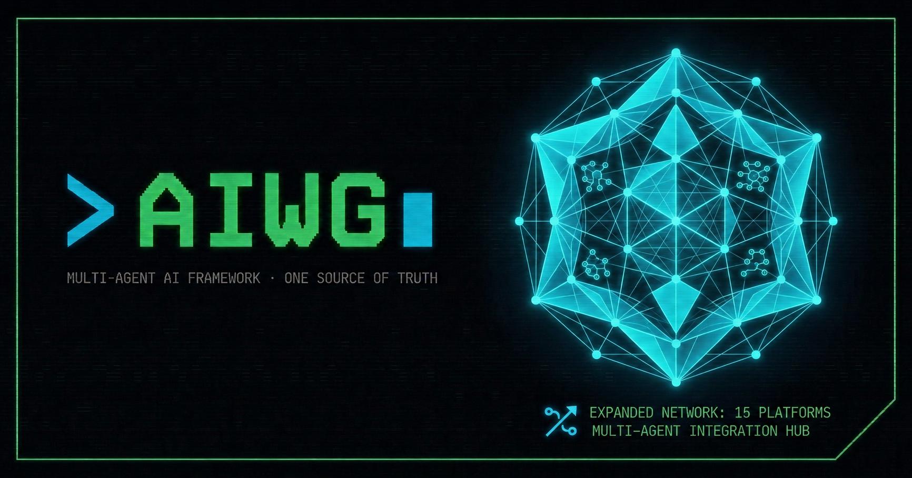</td>
<td align="center" valign="top">メディア未公開</td>
</tr></table>

<b>このカテゴリのその他</b> · 187

- [Nisaka520/JevIntent](https://github.com/Nisaka520/JevIntent) - WeChat（FkWeChat プラグイン）: メッセージを長押しして意図 / 感情 / 返信姿勢を分析し、ローカル端末にのみ通知を表示、相手には感知されない。
- [andyrewlee/awesome-system-one](https://github.com/andyrewlee/awesome-system-one) - System One モデル（decision models とも呼ばれる）の一覧: 最初の Jev…
- [Li-Evan/awesome-jev](https://github.com/Li-Evan/awesome-jev) - Jev、TypeSafeのSystem…
- [ChenneyZhuang/laya-browser-agent](https://github.com/ChenneyZhuang/laya-browser-agent) - ローカルで動作するオープンソースのJev代替：自分のマシン上でLaya（System Oneモデル）を使ったブラウザーエージェントの意思決定.
- [TrustifAI/typed_evals](https://github.com/TrustifAI/typed_evals) - Fast, typed Python framework for Jev-as-a-Judge/Decision-model evaluation for…
- [tiffygk/jev-mode](https://github.com/tiffygk/jev-mode) - Claude Code/Codex skills, evals, harnesses/context tools, and learning…
- [darwintechlab/openjev](https://github.com/darwintechlab/openjev) - OpenJev：テキスト生成の判断をJev（TypeSafe System One）に置き換えるOpencodeプラグイン.
- [yohanargentina-oss/Foq](https://github.com/yohanargentina-oss/Foq) - ⚡ Foq — Jevに代わる無料・ローカル・オープンソースの代替。約25 msで型付きSystem 1決定…
- [mani-aiml/jev-demos](https://github.com/mani-aiml/jev-demos) - Jev、TypeSafeのSystem Oneモデルを使ったデモ。デモごとに1つのフォルダーがあります.
- [kolawong/fast-compaction-dsh](https://github.com/kolawong/fast-compaction-dsh) - DeepSeek Harness 向けの評決ベースのコンテキスト圧縮 — 損失のある LLM 要約を、jev-latest…
- [BYK/jev-mcp](https://github.com/BYK/jev-mcp) - TypeSafeのJev向け、評価優先のMCPサーバー。生成テキストではなく確率付きの型付き判定（noul、choice、score）を返すSystem…
- [rajasekharponakala/jev-mcp](https://github.com/rajasekharponakala/jev-mcp) - TypeSafeのJev System OneモデルをラップするMCPサーバー — AIエージェント向けの型付きnoul/choice/score判断.
- [BFLabsAI/bf-jev-deep-research](https://github.com/BFLabsAI/bf-jev-deep-research) - Jev（TypeSafe AI System One Model）に関するAgent Skill + 逐語的なestudo…
- [Mainakcris7/agent-guardrail-with-jev](https://github.com/Mainakcris7/agent-guardrail-with-jev) - A practical demo of how can we leverage the power of System One Models like Jev…
- [systemonemodels/noulxp](https://github.com/systemonemodels/noulxp) - NoulXP（旧称OpenDXP）：System Oneモデル向けのオープン標準.
- [apex-ronin/DecaFleet-OS](https://github.com/apex-ronin/DecaFleet-OS) - Sovereign 10-Bot Operational Execution Platform &amp; Jev-AI (jev-latest) System…
- [api-evangelist/typesafe-ai](https://github.com/api-evangelist/typesafe-ai) - TypeSafe AIは、生成テキストではなくソフトウェア向けに型付きで較正済みの決定を返すよう訓練されたモデルのクラスであるSystem…
- [gsaini/system-one-models-getting-started](https://github.com/gsaini/system-one-models-getting-started) - TypeSafe。
- [izam-mohammed/decisionsmith](https://github.com/izam-mohammed/decisionsmith) - Use and fine-tune System One models (Jev, Laya) on your data, with an LLM as…
- [JiaWeiXie/jev-enhanced-plugin](https://github.com/JiaWeiXie/jev-enhanced-plugin) - A Claude Code plugin that takes skills already in use and adds one thing to…
- [jms-dcksn/uipath-jev-guardrail-connector](https://github.com/jms-dcksn/uipath-jev-guardrail-connector) - TypeSafe Jev System Oneモデルを基盤とするUiPathのBring-your-own-guardrailコネクター.
- [lucast4049/openjev](https://github.com/lucast4049/openjev) - Jev互換のAPIを使用して、オープンなSystem Oneモデル上で高速で較正済みの型付き決定を実行します.
- [logicrw/awesome-jev-projects](https://github.com/logicrw/awesome-jev-projects) - 素晴らしいJev：ソースに裏付けられたオープンソースエコシステムのレーダー、平易な言葉でのプロジェクト発見、自動GitHub同期。
- [AnotiaWang/awesome-decision-models](https://github.com/AnotiaWang/awesome-decision-models) - 意思決定モデル。
- [kydlikebtc/awesome-jev](https://github.com/kydlikebtc/awesome-jev) - Launch what you built on Jev, TypeSafe AI。
- [Amal-David/awesome-jev](https://github.com/Amal-David/awesome-jev) - Jevのデモ、プロジェクト、SDKs、スキル。ソースリンクと厳選されたXギャラリー付き.
- [OmniJev/OneJev](https://github.com/OmniJev/OneJev) - 🚀🚀 画面、写真、動画、テキストに関する型付き質問に対し、1回のフォワードパスで較正済みの回答を返すマルチモーダルSystem One意思決定モデル.
- [fatwang2/awesome-jev](https://github.com/fatwang2/awesome-jev) - 再利用可能な Jev 専用 GitHub レビューワークフローを備えた、ソースに裏付けられた Jev プロジェクトディレクトリ.
- [luobosibing2/dsh-jev-plugin](https://github.com/luobosibing2/dsh-jev-plugin) - TypeSafe Jev または luna のような Decision api を、エージェント選択、監督、修正、承認のための System One…
- [ThinkFlowLab/system1-agents](https://github.com/ThinkFlowLab/system1-agents) - エージェントの頭脳としてのSystem 1意思決定モデル（Jev、Laya、Cua-S1）：ブラウザー操作、コンピューター操作、ゲーム、ロボティクス。
- [tamaratran/jev-pruner](https://github.com/tamaratran/jev-pruner) - Claude Code プラグイン: モデルが見る前に TypeSafe Jev で長い Bash 出力を短縮。
- [cookiespiggy/agentic-rl](https://github.com/cookiespiggy/agentic-rl) - Agentic…
- [kyegomez/open-jev](https://github.com/kyegomez/open-jev) - pytorch で書かれた、TypeSafe AI の Jev の背後にあるアイデアを第一原理から再構築したオープンソース実装。
- [UditAkhourii/quicksilver](https://github.com/UditAkhourii/quicksilver) - Claude Code スキル: 大量の判断呼び出しを Jev に委譲。12 タスクのベンチマークで Claude トークンを 86% 削減、最大 20…
- [Shanghua-Gao/RSI-Jev](https://github.com/Shanghua-Gao/RSI-Jev) - AIエージェントの自己改善ループによって訓練された型付き意思決定モデル。
- [openlayer-ai/jevals](https://github.com/openlayer-ai/jevals) - Jevの判断としてのエージェント評価とガードレール：トレースごとに1リクエスト、1セント未満、エージェントループに十分な高速性.
- [PerryLink/jevcore](https://github.com/PerryLink/jevcore) - DeepSeek Harness、Model Context Protocol、そして素のNode向けTypeSafe…
- [angel291592/Intent-Router](https://github.com/angel291592/Intent-Router) - AIエージェント向けのIntentコンパイラ…
- [charlesdove977/claude-x-jev](https://github.com/charlesdove977/claude-x-jev) - Claude Code 向けの高速、低コスト、型付き意思決定。Jev（OpenRouter 上の TypeSafe の意思決定モデル）が、0.3…
- [jonathanavis96/jev-kit](https://github.com/jonathanavis96/jev-kit) - Claude Code で TypeSafe の Jev を実行するために必要なすべて…
- [akivet/Mica](https://github.com/akivet/Mica) - A 4B decision model: calibrated probabilities for yes/no, choice and score…
- [lawrence3699/jev-style](https://github.com/lawrence3699/jev-style) - JevStyle: local decision models for AI agents.
- [yikangy873-gif/jev-desktop](https://github.com/yikangy873-gif/jev-desktop) - Codex Computer Use 内の TypeSafe Jev アクション選択。
- [iamaamir/system-one](https://github.com/iamaamir/system-one) - TypeScriptとPi向けのプロバイダー中立なSystem Oneランタイム。
- [TheoOliveira/pi-jev](https://github.com/TheoOliveira/pi-jev) - TypeSafe Jevを使った、Pi coding agent向けのセマンティックツールルーティングと型付きSystem One判断。
- [alanhuangyoo/OpenJev](https://github.com/alanhuangyoo/OpenJev) - OpenJev: Jevのオープンソースでローカルな代替。System-One意思決定モデル: 型付きの質問を入力し、較正済み確率を出力.
- [chuloontop4-code/jev-instance-review](https://github.com/chuloontop4-code/jev-instance-review) - 2026年版Roblox Studioインスタンスレビュアー：型付きJev基準と正確な引用。
- [shitianfang/jev-use](https://github.com/shitianfang/jev-use) - Claude Code / Codex / pi プラグイン。テキスト出力を必要としないエージェント手順を Jev（TypeSafe の判断モデル）に委譲…
- [FrancoisChastel/jev-code](https://github.com/FrancoisChastel/jev-code) - Jev、TypeSafeのSystem One分類器を、Claude…
- [intikhab49/open-jev-typed-decision-engine](https://github.com/intikhab49/open-jev-typed-decision-engine) - TypeSafe Jev のオープン再現：150M の型付き決定エンジン。
- [alexei-led/claude-router](https://github.com/alexei-led/claude-router) - 各ターンのモデルと処理量（micro、low、medium、highの各ティア）を選択するClaude Codeプラグイン.
- [everyinfra/jev-radar](https://github.com/everyinfra/jev-radar) - 📡 The most rigorously verified tracker of the Jev (TypeSafe AI System One)…
- [AskTheWay/dsh-jev-interceptor](https://github.com/AskTheWay/dsh-jev-interceptor) - ⚡ DeepSeek Harnessのすべてのツール呼び出しに対するミリ秒単位のSystem-1判定 — Jevによるリスク分類と証拠ゲート付き自動承認.
- [jomatsu/pi-jev-auto-mode](https://github.com/jomatsu/pi-jev-auto-mode) - Jev（TypeSafe System One）を基盤とするPi coding agent向け自動モード.
- [abhishek085/open-spark-jev](https://github.com/abhishek085/open-spark-jev) - TypeSafe の Jev と System One に着想を得た、オープンソースのローカル決定モデル - NVIDIA DGX Spark 向けに…
- [anandi1989/awesome-jev-usecases](https://github.com/anandi1989/awesome-jev-usecases) - 実世界のJev（TypeSafe AI System One）ユースケースを裏付ける証拠付きインデックス：リポジトリ、パターン、ベンチマーク、測定結果。
- [Singularity-Compute/super-decider](https://github.com/Singularity-Compute/super-decider) - Decisions, not essays: a choice, a yes or no, or a score with a calibrated…
- [paramjeetn/jev-cookbook](https://github.com/paramjeetn/jev-cookbook) - TypeSafe AIによるJevの完全なクックブック――120以上のユースケース、10個の実行可能な例、4つの合成パターン、そして世界初のSystem…
- [sunyasheng/JevGPT](https://github.com/sunyasheng/JevGPT) - JevGPT: Thinking Fast and Slow in Autonomous Research。
- [iamtoomas/JevLint](https://github.com/iamtoomas/JevLint) - Jevを利用した設定可能な意味論的Lint。ファイル単位のNOUL判定とmagic-stringsプラグインを備えます.
- [1arley/jev-advisor-gateway](https://github.com/1arley/jev-advisor-gateway) - Local gateway that routes coding-agent tool decisions through Jev and can…
- [ajensenwaud/hermes-jev-plugin](https://github.com/ajensenwaud/hermes-jev-plugin) - Hermes Agent 向けの TypeSafe Jev（System One）意思決定ツール: jev_check / jev_route /…
- [daftAI2026/awesome-jev](https://github.com/daftAI2026/awesome-jev) - 厳選された TypeSafe Jev / System One GitHub プロジェクト、オープンソース代替、Jev ニュース。
- [vicfei/awesome-jev-prompts](https://github.com/vicfei/awesome-jev-prompts) - Question patterns, anti-patterns &amp; calibration notes for typed decision models…
- [caiovicentino/jev-risk-check-provider](https://github.com/caiovicentino/jev-risk-check-provider) - x402 risk-check provider: signed pre-payment verdicts — OFAC, phishing feeds…
- [zhangxaochen/dsh-jev](https://github.com/zhangxaochen/dsh-jev) - DeepSeek Harness（dsh）向けのJev（System One decision model）プラグインスイート。
- [ronitgupta138/Local-Jev](https://github.com/ronitgupta138/Local-Jev) - ⚡ 100% offline, zero-cost drop-in alternative to TypeSafe Jev System One…
- [alexei-led/pi-model-router](https://github.com/alexei-led/pi-model-router) - Independent Pi extension for four-tier model routing with optional…
- [anisselbd/jev-phishing-bench](https://github.com/anisselbd/jev-phishing-bench) - Jev (TypeSafe) vs Claude Haiku 4.5 on 2,000 phishing emails: accuracy…
- [Jessie-QingYu/jev-in-the-wild](https://github.com/Jessie-QingYu/jev-in-the-wild) - 実世界におけるJevのユースケース、オープンソースプロジェクト、ベンチマーク、批評――人々が実際にTypeSafe…
- [SergeyBazhmin/krasivo-jev](https://github.com/SergeyBazhmin/krasivo-jev) - Training data and models for &quot;system one&quot; classifiers: one forward pass, no…
- [allenporter/home-assistant-laya](https://github.com/allenporter/home-assistant-laya) - Conversation agent based on Laya, a multilingual, non-autoregressive System 1…
- [frontierlabai/JevHub](https://github.com/frontierlabai/JevHub) - JevHub · Jev 生态热榜 把值得关注的 Jev 项目、教程和讨论，汇到一页。 自动发现 · 每日更新 · 按 Stars 排序 · 中英双语。
- [jmrenouard/MicroLLM](https://github.com/jmrenouard/MicroLLM) - Local Hybrid System-One Decision Engine。
- [ranjan2829/AskJev](https://github.com/ranjan2829/AskJev) - AskJev — あらゆるWebサイト向けのJevオートパイロット＋取り返しのつかないクリックに対するガード。
- [FazalAAli/jev-robotics-demo](https://github.com/FazalAAli/jev-robotics-demo) - Jev（TypeSafe System One）対 Claude Opus 5、MuJoCoでシミュレーションされたロボットアームを操作。
- [legostin/jev-mcp](https://github.com/legostin/jev-mcp) - MCP server that lets Claude Code, Codex &amp; AI agents drive a real Chrome browser…
- [reacher-z/Awesome-Jev](https://github.com/reacher-z/Awesome-Jev) - Curated Jev and System One papers, models, datasets, benchmarks and SDKs, with…
- [7starsseeker/dsh-fact-check](https://github.com/7starsseeker/dsh-fact-check) - Fact-checking skill for DeepSeek Harness: multi-source verification against the…
- [lgy1027/jevshield](https://github.com/lgy1027/jevshield) - TypeSafeのJev（System-1）判断モデルを利用した、AIエージェントのツール呼び出し向け100ms未満のセキュリティゲート.
- [PenDraga/paperless-jev](https://github.com/PenDraga/paperless-jev) - Classifies the Paperless-ngx inbox with TypeSafe Jev or a local model (Ollama)…
- [PerryLink/laya-mcp](https://github.com/PerryLink/laya-mcp) - MCP server for Laya typed decisions (noul / choice / score): warm model…
- [8itlab/reflex-computer-use](https://github.com/8itlab/reflex-computer-use) - Computer use MCP server for Claude Code, Codex and other AI agents.
- [abhishekashokvkumar/jev-mcp-dispatcher](https://github.com/abhishekashokvkumar/jev-mcp-dispatcher) - TypeSafeのJevだけで完全に駆動する自然言語MCPツールディスパッチャー — 汎用LLMは不要.
- [MongLong0214/jev-gate](https://github.com/MongLong0214/jev-gate) - すべてのコーディングタスクに最高のモデルが必要なわけではありません。Claude Code向けの実験的なJev搭載モデルルーティング…
- [nanami-0713/dsh-jev-decide](https://github.com/nanami-0713/dsh-jev-decide) - DSHプラグイン：TypeSafe Jev（System One意思決定モデル）をエージェントツールとして登録…
- [robokrunch/awesome-jev](https://github.com/robokrunch/awesome-jev) - Jev — TypeSafe AIのSystem One意思決定モデル — 向けの厳選リソース一覧。RoboKrunchが管理.
- [simota/tenbin](https://github.com/simota/tenbin) - TypeSafe AI System One API（Jev）向けのMCPサーバーとエージェントスキル：判定をChoice / Score /…
- [supermanc417-alt/awesome-jev-hub](https://github.com/supermanc417-alt/awesome-jev-hub) - Jev／TypeSafe「System One」モデルエコシステムの厳選ハブ.
- [aitofy-dev/jev-awesome-skills](https://github.com/aitofy-dev/jev-awesome-skills) - Claude Code、Codex、Cursor、Grok向けのオープンソースJevスキル.
- [ardana-ai/ardana](https://github.com/ardana-ai/ardana) - Run System 1 decision models locally. Pull a model by name and get calibrated…
- [deepansh-saxena/jev-guardrails](https://github.com/deepansh-saxena/jev-guardrails) - エージェントのガードレール向けにLLM-as-judgeとTypeSafe…
- [gordan-code/dsh-jev-advisor](https://github.com/gordan-code/dsh-jev-advisor) - Jev（TypeSafe System One）はエージェントではなく、人間にセカンドオピニオンを提供します.
- [holny/evolve-router](https://github.com/holny/evolve-router) - Stop burning premium model tokens on simple prompts. Save tokens.
- [MojoAI-King/jev-paper-trader](https://github.com/MojoAI-King/jev-paper-trader) - 架空の10万ドルで実際のPolymarketおよびKalshi市場をペーパートレーディング: Jev + Claudeのリサーチは市場に勝てるか?
- [mywwave/cursor-jev](https://github.com/mywwave/cursor-jev) - TypeSafe Jevでサブエージェントをルーティングし、Choice、Score、NoulをMCPツールとして公開するCursorプラグイン.
- [noetion/dsh-jev](https://github.com/noetion/dsh-jev) - TypeSafe Jev noul、choice、score回答用のjev_askを登録するDSHバンドル.
- [samtay32/jev-system-architect](https://github.com/samtay32/jev-system-architect) - TypeSafe AI Jev/System One向けのシステムアーキテクチャスキル…
- [tinypi-extension/tinysubagent](https://github.com/tinypi-extension/tinysubagent) - Minimal herdr-native subagent spawning for pi — markdown agent roles, model…
- [wangkuangkuang/jev-mcp-server](https://github.com/wangkuangkuang/jev-mcp-server) - Jev（TypeSafe System One）向けMCPサーバー：公式の3つの質問タイプであるchoice、score、noulに加え、バッチ分類にも対応.
- [1aifanatic/jev-uipath-coded-agent](https://github.com/1aifanatic/jev-uipath-coded-agent) - FINSデモ：AMLアラートのトリアージを行うUiPathコードエージェント.
- [cnrai/openpave-jev](https://github.com/cnrai/openpave-jev) - 非自己回帰意思決定モデル（Jev / Laya / TypeSafe）向けのPAVEスキル：較正済み確率付きの型付きChoice、Score、Noul回答。
- [darwintechlab/claude-jev](https://github.com/darwintechlab/claude-jev) - Claude Code向けJev System One — ライブTypeSafe…
- [guanghuang/coding-router-jev](https://github.com/guanghuang/coding-router-jev) - TypeScript/Bun launcher routing Codex turns through JEV with model and…
- [iDiagoValeta/jev-decision-gate](https://github.com/iDiagoValeta/jev-decision-gate) - LLM permission gate for OpenCode agents: blocks irreversible actions…
- [jms-dcksn/jev-pii-guardrail](https://github.com/jms-dcksn/jev-pii-guardrail) - LangChainのawrap_model_callミドルウェアとして、TypeSafe…
- [rahilmavani/piedpiper-jev-buildathon](https://github.com/rahilmavani/piedpiper-jev-buildathon) - Team piedpiper：Helix ITエージェントの失敗を防ぐfailproofai + Jevガードレール（Jev Buildathon）。
- [173787247/dsh-wsl-jev](https://github.com/173787247/dsh-wsl-jev) - DeepSeek Harness WSL plugin: TypeSafe Jev / OpenRouter System One。
- [17671454333/jev-cognitive-mcp](https://github.com/17671454333/jev-cognitive-mcp) - 3+1 Cognitive Hierarchy Toolkit &amp; Model Context Protocol (MCP) Server for…
- [7starsseeker/dsh-jev-guard](https://github.com/7starsseeker/dsh-jev-guard) - DeepSeek Harness (DSH) 执行前安全阀门:bash/pwsh 真正执行前先经静态规则 + TypeSafe Jev 语义判定,破坏性操作按…
- [bhanuprakashk90-tech/jev-agent-guardrail](https://github.com/bhanuprakashk90-tech/jev-agent-guardrail) - TypeSafe AIのJevモデルを利用した、AIエージェントのツール呼び出し向けリアルタイム安全ガードレール兼インタラクティブ監視ダッシュボード.
- [bismawy/pi-jev-eye](https://github.com/bismawy/pi-jev-eye) - Pi向け超軽量スーパーバイザー：ゼロトークンregexガードレール、テスト検証トラッキング、TypeSafe Jevセマンティックスロップゲート.
- [charetterat/awesome-jev-essentials](https://github.com/charetterat/awesome-jev-essentials) - 実際に時間を使う価値のあるJevプロジェクト — 選定、比較、最新状態の維持.
- [d0ng231/jev-gtw](https://github.com/d0ng231/jev-gtw) - JEV Gateway: PII/PHI guardrails for coding agents.
- [DarkisuSu/Jev-Claude-Router](https://github.com/DarkisuSu/Jev-Claude-Router) - A Jev-powered model routing and skill selection MOD for Claude.
- [edamlabs/e-jev](https://github.com/edamlabs/e-jev) - A self-hosted Jev with a pluggable decision-backend fleet — typed, calibrated…
- [eshitakundu/jev-flow](https://github.com/eshitakundu/jev-flow) - Support-triage inbox where an LLM answers typed questions and a deterministic…
- [Faizullah9181/jev-esketcher](https://github.com/Faizullah9181/jev-esketcher) - Jev、TypeSafeの較正済み意思決定モデルが、105個の手続き型スケッチのために絵具素材とカラーパレットを選ぶ生成的ペインティングキャンバス.
- [hectorj2f/jev-router](https://github.com/hectorj2f/jev-router) - Route Claude Code subagents to the right Anthropic model per task, using…
- [jbatra-umeey/jev-decisionops](https://github.com/jbatra-umeey/jev-decisionops) - エージェント型AI向けの6つのJev意思決定ワークフロー：モデルルーティング、ガードレール、ツール呼び出しゲーティング、再ランキング、出力評価、信頼度ベースの自…
- [JoaoClemer/jev-lab](https://github.com/JoaoClemer/jev-lab) - リアルタイムガードレール、およびビジネス会話エージェントの事前評価器としてのO Jev（TypeSafe AI）.
- [keiffff/jev-kit](https://github.com/keiffff/jev-kit) - Jev toolkit for building fast, testable AI decision points for agent…
- [lijiawei255/jev-tune](https://github.com/lijiawei255/jev-tune) - Jev-inspired calibrated decision &amp; safety shell for typed PID autotuning…
- [majiayu000/awesome-jev](https://github.com/majiayu000/awesome-jev) - Jev / TypeSafe System One プロジェクト、SDKs、チュートリアル、評価の厳選リスト。英語と簡体中文.
- [olivier-motium/jev-doom](https://github.com/olivier-motium/jev-doom) - Watch Jev play Freedoom in a local dashboard.
- [Thneoly/r2r-jev](https://github.com/Thneoly/r2r-jev) - Persistent governance for AI agents — turn Jev judgments into replayable…
- [xlennart/dsh-auto-review-jev](https://github.com/xlennart/dsh-auto-review-jev) - DeepSeek Harness 审批守护者：权限请求先由审查模型裁决。内置 System One 决策 API 后端。
- [zhuyansen/awesome-typesafe-jev](https://github.com/zhuyansen/awesome-typesafe-jev) - TypeSafeのJev意思決定モデル上に構築されたオープンソースプロジェクト：オープンなレプリカ、エージェント、開発ツール、SDKsおよびMCPサーバー、アプ…
- [01Joseph-Hwang10/pi-jev-router-pro](https://github.com/01Joseph-Hwang10/pi-jev-router-pro) - Single-surface TypeSafe Jev model router for the Pi coding agent: one virtual…
- [1arley/grill-with-jev](https://github.com/1arley/grill-with-jev) - JEV-driven grilling skill: typed contract, provider discovery, setup scripts…
- [ab2webco/orca-jev-advisor](https://github.com/ab2webco/orca-jev-advisor) - Jev (TypeSafe)-backed decision layer for Orca Lab: judges what agents are about…
- [abyakod/JEV_ADK](https://github.com/abyakod/JEV_ADK) - System-One AI向けAgent Development Kit: サブ100msの非自己回帰決定パイプライン、ガードレール、TypeSafe…
- [aleksvega/jev-stack](https://github.com/aleksvega/jev-stack) - Jev搭載エージェントツールセットをインストールする1つのコマンド（npx jev-stack）…
- [AlienXc137/Support-Ticket-Ai-Agent-with-RAG-Guardrails-and-Jev](https://github.com/AlienXc137/Support-Ticket-Ai-Agent-with-RAG-Guardrails-and-Jev) - 受信した学生からの問い合わせ。
- [antirepas/GoGoJevMCP](https://github.com/antirepas/GoGoJevMCP) - This is a small side project where I built an MCP server with a collection of…
- [bpmforbusiness/jev-agent-harness](https://github.com/bpmforbusiness/jev-agent-harness) - Jev（TypeSafe AI System One）エージェントハーネスガイド + 動画マニュアル — LangChainの「Building a…
- [c2c-Ride/JEV_sees](https://github.com/c2c-Ride/JEV_sees) - Give JEV vision with JEV Sees: detect and track objects in images, video, and…
- [cameronb-xano/jev-agent-guardrail](https://github.com/cameronb-xano/jev-agent-guardrail) - Xanoテンプレート：Jevエージェントのツール呼び出しガードレール。Jevが決定し、Xanoが強制します.
- [Caph-dev/pi-jev-router](https://github.com/Caph-dev/pi-jev-router) - Jev-routed two-phase virtual model for pi: plan on a strong model, implement on…
- [castorhrio/jev-pi-agent](https://github.com/castorhrio/jev-pi-agent) - Multi-agent coding workbench — hashed context injection, explainable routing…
- [chaoguang668/dsh-jev-screen](https://github.com/chaoguang668/dsh-jev-screen) - Jev-powered semantic pre-screening for local files in DeepSeek Harness: code…
- [cognixws/cognix-decisions-jev](https://github.com/cognixws/cognix-decisions-jev) - COGNIX\[WS\] extension: TypeSafe&#x27;s Jev answers the agents&#x27; fast browser…
- [Covre81/jev-router](https://github.com/Covre81/jev-router) - Local Anthropic-compatible gateway that routes Claude Code traffic across…
- [cyriusweng/jev-tern](https://github.com/cyriusweng/jev-tern) - Jev-judged agent driving a visible tab in Tern。
- [davidpobi/JevTown](https://github.com/davidpobi/JevTown) - An Interactive Collection Of AI Game Worlds Where Typesafe Jev Agents Choose…
- [eduardo-xyz/jev-browser-mcp](https://github.com/eduardo-xyz/jev-browser-mcp) - MCP tool exposing TypeSafe。
- [fortemate/dicechess-bot-jev](https://github.com/fortemate/dicechess-bot-jev) - Experimental Dice Chess webhook bot powered by TypeSafe Jev, with adaptive…
- [gbesse/jev-workflow](https://github.com/gbesse/jev-workflow) - Decision contracts, adversarial testing, tracing, stability, and privacy…
- [GilBar2/jev-orchestration](https://github.com/GilBar2/jev-orchestration) - Route coding tasks between Claude Code, Codex and Hermes: pattern, model and…
- [HangChi/JevRouter](https://github.com/HangChi/JevRouter) - 让 LLM 理解任务、让 Jev 做带概率的路由决策、再由显式策略控制执行的 Agent 运行时：Jev 决定下一步，策略引擎决定能不能执行.
- [hdjekuue/awesome-jev](https://github.com/hdjekuue/awesome-jev) - Jev（TypeSafe AI System One）上に構築されたすべてのものを収録する、自己更新型の3言語対応ディレクトリ…
- [HKUST-KnowComp/jev-guardrail](https://github.com/HKUST-KnowComp/jev-guardrail) - エージェントのリクエストとアクションをレビューするための編集可能なポリシーツリーと2B分類器。ウェブサイトのみ.
- [iamdgarcia/jev-mini-bench](https://github.com/iamdgarcia/jev-mini-bench) - 小さな判断モデルの波を探るポケットエクスプローラー。
- [kangshifu1/jev-skills-market](https://github.com/kangshifu1/jev-skills-market) - Community Jev skill market and assistant for automation testing, finance…
- [kkwelfare/jev-route-screening-public](https://github.com/kkwelfare/jev-route-screening-public) - 制約付きJevチェックポイントと助言用ルートスクリーニングを行う実験的なHermes Agentプラグイン.
- [liyifan2004/obsidian-jev-inbox-router](https://github.com/liyifan2004/obsidian-jev-inbox-router) - Obsidian plugin: route incoming notes to the right folder using JEV。
- [Mfrostbutter/jev-n8n-patterns](https://github.com/Mfrostbutter/jev-n8n-patterns) - n8nにおけるJev。
- [MichelePolo/jev-mcp](https://github.com/MichelePolo/jev-mcp) - JevスタイルのSystem One意思決定モデル（Ollama /v1/systemone）をツールとして公開するMCPサーバー。
- [miketropi/pi-jev-model-manager](https://github.com/miketropi/pi-jev-model-manager) - Pi coding agent extension: Jev-powered model routing with a native TUI model…
- [mxttbennett/jev-relayer](https://github.com/mxttbennett/jev-relayer) - Per-task Jev routing for Claude Code and Codex: inline, subagent or sibling…
- [PeriodBLUE/jev-project-atlas](https://github.com/PeriodBLUE/jev-project-atlas) - A source-verified atlas of GitHub projects built with JEV / TypeSafe System One。
- [QuesoMan/jev-router](https://github.com/QuesoMan/jev-router) - Claude Code mod: routes every turn, subagent and ultracode workflow agent to a…
- [royalskynet/jev-gate-lite](https://github.com/royalskynet/jev-gate-lite) - Jev Gate without the local Laya lane: MCP judgment tools, tool-output pruning…
- [Sandesh-S-Dalvi/playwright-jev-testing-refactored](https://github.com/Sandesh-S-Dalvi/playwright-jev-testing-refactored) - Goal-driven Playwright E2E testing where TypeSafe Jev (System One) decides the…
- [shahshahdab/fastcampus-jev](https://github.com/shahshahdab/fastcampus-jev) - Learn to gate tool calls, guardrails, and risky actions with Jev judgment plus…
- [skylence-org/claudecode-jev-marketplace](https://github.com/skylence-org/claudecode-jev-marketplace) - TypeSafe Jev (System One) wired into Claude Code: a decision primitive for…
- [veermshah/jev-calibration-lab](https://github.com/veermshah/jev-calibration-lab) - Independent calibration benchmark for System One decision models (TypeSafe Jev)…
- [vinaychawla-ops/jev-adk-guardrail-example](https://github.com/vinaychawla-ops/jev-adk-guardrail-example) - Google ADKエージェントのbefore_tool_callback内のリスクガードレールとしてのJev（TypeSafe意思決定モデル）.
- [wendyeq/dsh-jev-router](https://github.com/wendyeq/dsh-jev-router) - Optional session-pinned Jev routing plugin for DeepSeek Harness。
- [Wrenik/jev-toolkit](https://github.com/Wrenik/jev-toolkit) - Experiment: a judgement model (TypeSafe Jev) next to Claude.
- [Wrenik/Jev-toolkit-usage](https://github.com/Wrenik/Jev-toolkit-usage) - Judge interface, offline fake judge and a model/effort router for Claude Code…
- [xano-community/agent-guardrail-jev](https://github.com/xano-community/agent-guardrail-jev) - Xano向けAIエージェントのツール呼び出しガードレール：Jev。
- [xiaoyaner0201/hermes-jev-thread-status](https://github.com/xiaoyaner0201/hermes-jev-thread-status) - Jev-powered Discord thread status titles for Hermes Agent: \[Running\] →…
- [yangzhou-chaofan/awesome-jev-prompt](https://github.com/yangzhou-chaofan/awesome-jev-prompt) - x / github / 最新ソースからのjevの最新トップ100ショーケース（更新継続）。
- [ZeroX-01/jev-atlas](https://github.com/ZeroX-01/jev-atlas) - 実在するTypeSafe JEVプロジェクト、動画、記事、オープンソースデモを継続的に更新する公開インデックス.
- [notque/vexjoy-agent](https://github.com/notque/vexjoy-agent) - Jevインテリジェントルーティングを備えたVexJoy AI…
- [itsmostafa/system-one-connector](https://github.com/itsmostafa/system-one-connector) - あらゆるものを高速かつ低コストで評価するための System One MCP コネクタ.
- [keeltrace/hermes-nerve](https://github.com/keeltrace/hermes-nerve) - NerveはHermesエージェント向けの監督用神経系で、型付きSystem One判断、ランキング、検証、トークンを考慮した監視、さらにTypeSafe…
- [everafterlabs/jes](https://github.com/everafterlabs/jes) - Jevのような意思決定モデルを基盤とするAIエージェント向けのオープンソース・ガードレール.
- [Mawfyy/jevflow](https://github.com/Mawfyy/jevflow) - 組み合わせ可能なバックエンドプリミティブとしての確率的AI判断 — 型付き判定（noul/score/choice）、決定論的しきい値、説明可能なワークフロー.
- [tamnd/kime](https://github.com/tamnd/kime) - Typed decisions over text in milliseconds.
- [kaustav1996/reflex](https://github.com/kaustav1996/reflex) - A coding agent and personal assistant with System One reflexes (TypeSafe Jev)…
- [laxtiz/opencode-vllm-sr-auth](https://github.com/laxtiz/opencode-vllm-sr-auth) - vLLM-SR System Duo — System One decision models (choice/noul/score/box/span)…
- [bhavikprit/instinct-ai](https://github.com/bhavikprit/instinct-ai) - ⚡ ユニバーサルSystem-1 AIランタイム＆デュアルブレインゲートウェイ.
- [patronus-protect/decision-model-guard](https://github.com/patronus-protect/decision-model-guard) - Guardrails for decision models: stop text inside the content from steering…
- [chaosxingxc-orion/nga](https://github.com/chaosxingxc-orion/nga) - NGA (Next Generation Agent) on openJiuwen: Jev-like decision models, S1 + S2…
- [lcbkmm/laya-thalamus](https://github.com/lcbkmm/laya-thalamus) - AIエージェント向けのSystem1意思決定オーケストレーター。Layaによる高速なローカルツールルーティングを活用し、信頼度が低い場合はLLMへ自動フォールバ…

## ルーティング、ガードレール、承認

本番向きのユースケース。各リクエストを実際に処理できる最も安価なモデルに送り、結果には決定論的な検査を残す。

🛡️ <b><a href="https://github.com/HarnessRouter/SystemOneHarness">HarnessRouter/SystemOneHarness</a></b> · ⭐206 · Python · 👁️ observed · 46 天

##### 📝 概要

System Oneモデル向けのSystem Oneハーネス。Jevやその他のSystem OneモデルをローカルまたはHarnessRouter.aiから直接実行できます。

🔧 コード内での使用を確認: `docs/design.md`

##### 📌 基本情報

| 項目       | 値                                 |
| ---------- | ---------------------------------- |
| カテゴリ   | `ルーティング、ガードレール、承認` |
| エビデンス | `observed`                         |
| 言語       | Python                             |

##### 📊 データ

| 指標         | 値         |
| ------------ | ---------- |
| スター数     | **206**    |
| 最終プッシュ | 2026-09-21 |
| 初回掲載     | 2026-10-28 |

🏷 `harness` · `harness-engineering` · `system-one-harness` · `system-one-models`

🛡️ <b><a href="https://github.com/Dicklesworthstone/skillranker">Dicklesworthstone/skillranker</a></b> · ⭐140 · Rust · 👁️ observed · 18 天

##### 📝 概要

TypeSafe.aiのJevを利用するRust CLI。ライブセッションのコンテキストを使って、次のステップのエージェントスキルをランク付けします。Claude Codeフック、構造化されたJSON、棄権、ローカルフィードバックを含みます。TypeSafe APIキーが必要です。

> 💡 型付き判定でエージェントスキルをランク付けします。以前はプロンプトで処理していた「N個の候補から選ぶ」問題全般に役立つモデルです。

🔧 コード内での使用を確認: `README.md`

##### 📌 基本情報

| 項目       | 値                                 |
| ---------- | ---------------------------------- |
| カテゴリ   | `ルーティング、ガードレール、承認` |
| エビデンス | `observed`                         |
| 言語       | Rust                               |

##### 📊 データ

| 指標         | 値         |
| ------------ | ---------- |
| スター数     | **140**    |
| 最終プッシュ | 2026-10-19 |
| 初回掲載     | 2026-10-29 |

🏷 `agent-skills` · `ai-agents` · `asupersync` · `claude-code` · `cli` · `developer-tools` · `frankentui` · `jev`

🛡️ <b><a href="https://github.com/dharmeshgurnani/CodeOtter">dharmeshgurnani/CodeOtter</a></b> · ⭐3 · JavaScript · 👁️ observed · 0 天

##### 📝 概要

任意のオープンモデルによる自律型・セルフホスト型AIコードレビュー、較正済みスコアリングゲージ、マージゲート。

##### 📌 基本情報

| 項目       | 値                                 |
| ---------- | ---------------------------------- |
| カテゴリ   | `ルーティング、ガードレール、承認` |
| エビデンス | `observed`                         |
| 言語       | JavaScript                         |

##### 📊 データ

| 指標         | 値         |
| ------------ | ---------- |
| スター数     | **3**      |
| 最終プッシュ | 2026-11-07 |
| 初回掲載     | 2026-11-01 |

🏷 `ai-code-review` · `code-review` · `coderabbit` · `developer-tools` · `devops` · `forgejo` · `gguf` · `gitea`

---

<table><tr><th align="center" width="50%">🖼 画像</th><th align="center" width="50%">🎬 動画</th></tr><tr>
<td align="center" valign="top"></td>
<td align="center" valign="top">メディア未公開</td>
</tr></table>

🛡️ <b><a href="https://github.com/baldellimtt/systemone-lab">baldellimtt/systemone-lab</a></b> · ⭐2 · HTML · 👁️ observed · 5 天

##### 📝 概要

Hands-on System One decision lab: Jev-compatible Noul/Choice/Score over local open-weight Laya, with playground UI, routing/eval examples, and CI smoke tests.

##### 📌 基本情報

| 項目       | 値                                 |
| ---------- | ---------------------------------- |
| カテゴリ   | `ルーティング、ガードレール、承認` |
| エビデンス | `observed`                         |
| 言語       | HTML                               |

##### 📊 データ

| 指標         | 値         |
| ------------ | ---------- |
| スター数     | **2**      |
| 最終プッシュ | 2026-11-02 |
| 初回掲載     | 2026-11-02 |

🏷 `calibrated-probabilities` · `jev` · `laya` · `system-one-models` · `typed-decisions` · `typesafe`

---

<table><tr><th align="center" width="50%">🖼 画像</th><th align="center" width="50%">🎬 動画</th></tr><tr>
<td align="center" valign="top"></td>
<td align="center" valign="top">メディア未公開</td>
</tr></table>

🛡️ <b><a href="https://github.com/alperenerol/jev-1.13-mini-benchmark">alperenerol/jev-1.13-mini-benchmark</a></b> · ⭐1 · Python · 👁️ observed · 38 天

##### 📝 概要

ラベル付きサポートトリアージにおける TypeSafe の jev-1.13 構造化判断モデル（OpenRouter Decisions API）のミニベンチマーク: noul/choice/score、一貫性、コスト、得られた教訓

##### 📌 基本情報

| 項目       | 値                                 |
| ---------- | ---------------------------------- |
| カテゴリ   | `ルーティング、ガードレール、承認` |
| エビデンス | `observed`                         |
| 言語       | Python                             |

##### 📊 データ

| 指標         | 値         |
| ------------ | ---------- |
| スター数     | **1**      |
| 最終プッシュ | 2026-09-29 |
| 初回掲載     | 2026-11-01 |

🛡️ <b><a href="https://github.com/Dominion-Academy/System-One-Models">Dominion-Academy/System-One-Models</a></b> · Python · 👁️ observed · 1 天

##### 📝 概要

Code for a course on System One models (Jev, Kev, Laya): LLMs that answer with a choice and a probability instead of free text. Build a support-ticket triage service with Choice, Score and Noul questions, check whether the confidence can be trusted, set thresholds, and run it in production.

##### 📌 基本情報

| 項目       | 値                                 |
| ---------- | ---------------------------------- |
| カテゴリ   | `ルーティング、ガードレール、承認` |
| エビデンス | `observed`                         |
| 言語       | Python                             |

##### 📊 データ

| 指標         | 値         |
| ------------ | ---------- |
| スター数     | **0**      |
| 最終プッシュ | 2026-11-05 |
| 初回掲載     | 2026-11-04 |

🏷 `calibration` · `jev` · `kev` · `laya` · `python` · `system-design` · `system-one` · `system-one-models`

🛡️ <b><a href="https://github.com/nani-stack/gmail-auto-cleanup">nani-stack/gmail-auto-cleanup</a></b> · Python · 👁️ observed · 4 天

##### 📝 概要

Triage your Gmail inbox with a System One model (Jev or Laya): typed yes/no judgements, probabilities, and reversible actions.

##### 📌 基本情報

| 項目       | 値                                 |
| ---------- | ---------------------------------- |
| カテゴリ   | `ルーティング、ガードレール、承認` |
| エビデンス | `observed`                         |
| 言語       | Python                             |

##### 📊 データ

| 指標         | 値         |
| ------------ | ---------- |
| スター数     | **0**      |
| 最終プッシュ | 2026-11-02 |
| 初回掲載     | 2026-11-02 |

🏷 `ai` · `automation` · `email` · `email-classification` · `gmail` · `inbox-zero` · `jev` · `laya`

🛡️ <b><a href="https://github.com/NandhaKishorM/laya">NandhaKishorM/laya</a></b> · ⭐35137 · Python · 🔎 inferred · 0 天 · ⭐+3

##### 📝 概要

非自己回帰型の System 1 意思決定エンジン。任意のテキストに対して、単一のフォワードパスで、100+ 言語に対応し、リクエストごとに適切なチェックポイントを選択するルーターを備え、型付きの選択、スコア、はい/いいえの判断を行います。

##### 📌 基本情報

| 項目       | 値                                 |
| ---------- | ---------------------------------- |
| カテゴリ   | `ルーティング、ガードレール、承認` |
| エビデンス | `inferred`                         |
| 言語       | Python                             |

##### 📊 データ

| 指標         | 値             |
| ------------ | -------------- |
| スター数     | **35137** (+3) |
| 最終プッシュ | 2026-11-06     |
| 初回掲載     | 2026-09-23     |

🏷 `calibration` · `classification` · `decision-model` · `huggingface` · `jev` · `modernbert` · `multilingual` · `nlp`

---

<table><tr><th align="center" width="50%">🖼 画像</th><th align="center" width="50%">🎬 動画</th></tr><tr>
<td align="center" valign="top"></td>
<td align="center" valign="top">メディア未公開</td>
</tr></table>

🛡️ <b><a href="https://github.com/slavabars/decision-cascade">slavabars/decision-cascade</a></b> · ⭐73 · Python · 🔎 inferred · 8 天

##### 📝 概要

Local decision engine with typed, calibrated outputs (Noul/Choice/Score): cheap→strong cascade, ECE/Brier calibration, SystemOne protocol interop. Apache-2.0.

##### 📌 基本情報

| 項目       | 値                                 |
| ---------- | ---------------------------------- |
| カテゴリ   | `ルーティング、ガードレール、承認` |
| エビデンス | `inferred`                         |
| 言語       | Python                             |

##### 📊 データ

| 指標         | 値         |
| ------------ | ---------- |
| スター数     | **73**     |
| 最終プッシュ | 2026-10-29 |
| 初回掲載     | 2026-10-16 |

🏷 `calibration` · `cascade` · `decision-making` · `fastapi` · `llm` · `model-routing` · `pytorch` · `systemone`

🛡️ <b><a href="https://github.com/zhangcy122/OpenJev">zhangcy122/OpenJev</a></b> · ⭐44 · Python · 🔎 inferred · 39 天 · **NEW**

##### 📝 概要

自己進化型の認知判断エンジン＆TypeSafe Jev代替。100%の選択肢順序不変性を備えた熟考型判断フライホイール（「まず探索し、後で結晶化」System 2→1）。Open LLMs、Laya (ModernBERT)、商用Jev向けの、キャリブレーション済みlogprobと適応型セーフティガードを備えた型付き確率API（Choice、Noul、Score）。

##### 📌 基本情報

| 項目       | 値                                 |
| ---------- | ---------------------------------- |
| カテゴリ   | `ルーティング、ガードレール、承認` |
| エビデンス | `inferred`                         |
| 言語       | Python                             |

##### 📊 データ

| 指標         | 値         |
| ------------ | ---------- |
| スター数     | **44**     |
| 最終プッシュ | 2026-09-29 |
| 初回掲載     | 2026-11-07 |

🛡️ <b><a href="https://github.com/bytelabs-oss/clash-jev">bytelabs-oss/clash-jev</a></b> · ⭐35 · Python · 🔎 inferred · 23 天

##### 📝 概要

学習済みポリシーなしのClash Royaleボット：Jev（TypeSafe System One）は、ライブのゲーム状態からあらゆる決定を行う

##### 📌 基本情報

| 項目       | 値                                 |
| ---------- | ---------------------------------- |
| カテゴリ   | `ルーティング、ガードレール、承認` |
| エビデンス | `inferred`                         |
| 言語       | Python                             |

##### 📊 データ

| 指標         | 値         |
| ------------ | ---------- |
| スター数     | **35**     |
| 最終プッシュ | 2026-10-14 |
| 初回掲載     | 2026-10-26 |

🛡️ <b><a href="https://github.com/kenhuangus/jev-usecases">kenhuangus/jev-usecases</a></b> · ⭐27 · Python · 🔎 inferred · 46 天

##### 📝 概要

信頼度ゲート付き決定ロジックを備えた本番TypeSafe Jev（System One）ユースケースハーネス

##### 📌 基本情報

| 項目       | 値                                 |
| ---------- | ---------------------------------- |
| カテゴリ   | `ルーティング、ガードレール、承認` |
| エビデンス | `inferred`                         |
| 言語       | Python                             |

##### 📊 データ

| 指標         | 値         |
| ------------ | ---------- |
| スター数     | **27**     |
| 最終プッシュ | 2026-09-21 |
| 初回掲載     | 2026-10-28 |

---

<table><tr><th align="center" width="50%">🖼 画像</th><th align="center" width="50%">🎬 動画</th></tr><tr>
<td align="center" valign="top"></td>
<td align="center" valign="top">メディア未公開</td>
</tr></table>

🛡️ <b><a href="https://github.com/gaborishka/jev-canvas">gaborishka/jev-canvas</a></b> · ⭐22 · JavaScript · 🔎 inferred · 48 天

##### 📝 概要

音声と指差しでtldrawキャンバスに描画します。Jev（TypeSafe System One）が、発話された1語あたり約350 msでアクション、対象、場所を決定します。

##### 📌 基本情報

| 項目       | 値                                 |
| ---------- | ---------------------------------- |
| カテゴリ   | `ルーティング、ガードレール、承認` |
| エビデンス | `inferred`                         |
| 言語       | JavaScript                         |

##### 📊 データ

| 指標         | 値         |
| ------------ | ---------- |
| スター数     | **22**     |
| 最終プッシュ | 2026-09-19 |
| 初回掲載     | 2026-10-28 |

🏷 `hand-tracking` · `jev` · `mediapipe` · `openrouter` · `tldraw` · `typesafe` · `voice-control` · `web-speech-api`

---

<table><tr><th align="center" width="50%">🖼 画像</th><th align="center" width="50%">🎬 動画</th></tr><tr>
<td align="center" valign="top"></td>
<td align="center" valign="top"> アニメーション記録</td>
</tr></table>

🛡️ <b><a href="https://github.com/rupeshpoojary9/poorjev">rupeshpoojary9/poorjev</a></b> · ⭐11 · Python · 🔎 inferred · 47 天

##### 📝 概要

オープンソースのローカルなJev代替：信頼度が証明可能な形でキャリブレーションされたSystem One意思決定レイヤー（ECE 0.170→0.071）。型付き意思決定、オフライン実行、APIキー不要、ウェイトリスト不要。

##### 📌 基本情報

| 項目       | 値                                 |
| ---------- | ---------------------------------- |
| カテゴリ   | `ルーティング、ガードレール、承認` |
| エビデンス | `inferred`                         |
| 言語       | Python                             |

##### 📊 データ

| 指標         | 値         |
| ------------ | ---------- |
| スター数     | **11**     |
| 最終プッシュ | 2026-09-21 |
| 初回掲載     | 2026-10-28 |

🏷 `calibration` · `classification` · `conformal-prediction` · `jev` · `jev-alternative` · `llm` · `llm-guardrails` · `local-llm`

---

<table><tr><th align="center" width="50%">🖼 画像</th><th align="center" width="50%">🎬 動画</th></tr><tr>
<td align="center" valign="top"></td>
<td align="center" valign="top">メディア未公開</td>
</tr></table>

🛡️ <b><a href="https://github.com/eulogik/nirnay">eulogik/nirnay</a></b> · ⭐10 · Python · 🔎 inferred · 32 天

##### 📝 概要

NIRNAY 450M：オープンウェイトの較正済み意思決定モデル（Apache-2.0）。Banking77の意図分類87.9%、fitted ECE 0.045。Layaフォークに加え、concept bottleneck、coarse-to-fine pointer、RLCD。Eulogikによって構築。

##### 📌 基本情報

| 項目       | 値                                 |
| ---------- | ---------------------------------- |
| カテゴリ   | `ルーティング、ガードレール、承認` |
| エビデンス | `inferred`                         |
| 言語       | Python                             |

##### 📊 データ

| 指標         | 値         |
| ------------ | ---------- |
| スター数     | **10**     |
| 最終プッシュ | 2026-10-06 |
| 初回掲載     | 2026-10-01 |

🏷 `apache-2-0` · `banking77` · `calibration` · `concept-bottleneck` · `decision-model` · `edge-ai` · `eulogik` · `guardrails`

---

<table><tr><th align="center" width="50%">🖼 画像</th><th align="center" width="50%">🎬 動画</th></tr><tr>
<td align="center" valign="top"></td>
<td align="center" valign="top">メディア未公開</td>
</tr></table>

🛡️ <b><a href="https://github.com/j1s4nn/jev-adaptive-granularity-WM">j1s4nn/jev-adaptive-granularity-WM</a></b> · ⭐5 · Python · 🔎 inferred · 0 天

##### 📝 概要

Official code, locked protocols, and audit artifacts for "Jev-Routed Temporal Granularity with Recovery and Hysteresis for Causal Video Generation": per-segment fine/coarse/hold routing for Causal-rCM (Wan2.1-1.3B) via the Jev oracle, with two-GPU (T4/A100) feasibility audits.

##### 📌 基本情報

| 項目       | 値                                 |
| ---------- | ---------------------------------- |
| カテゴリ   | `ルーティング、ガードレール、承認` |
| エビデンス | `inferred`                         |
| 言語       | Python                             |

##### 📊 データ

| 指標         | 値         |
| ------------ | ---------- |
| スター数     | **5**      |
| 最終プッシュ | 2026-11-06 |
| 初回掲載     | 2026-11-07 |

🏷 `autoregressive-diffusion` · `causal-video-generation` · `diffusion-transformers` · `efficient-inference` · `jev-adaptive-granularity` · `kaggle` · `kaggle-dataset` · `temporal-granularity`

---

<table><tr><th align="center" width="50%">🖼 画像</th><th align="center" width="50%">🎬 動画</th></tr><tr>
<td align="center" valign="top"></td>
<td align="center" valign="top">メディア未公開</td>
</tr></table>

🛡️ <b><a href="https://github.com/tomek7667/cbjev">tomek7667/cbjev</a></b> · ⭐5 · Python · 🔎 inferred · 43 天 · **NEW**

##### 📝 概要

1回のエンコーダー処理で型付き判断（choice/score/noul）を取得 — Layaより高速でキャリブレーション性能に優れた後継で、Jev wire互換

##### 📌 基本情報

| 項目       | 値                                 |
| ---------- | ---------------------------------- |
| カテゴリ   | `ルーティング、ガードレール、承認` |
| エビデンス | `inferred`                         |
| 言語       | Python                             |

##### 📊 データ

| 指標         | 値         |
| ------------ | ---------- |
| スター数     | **5**      |
| 最終プッシュ | 2026-09-24 |
| 初回掲載     | 2026-11-07 |

🏷 `calibration` · `classification` · `decision-model` · `jev` · `laya` · `llm-guardrails` · `modernbert`

---

<table><tr><th align="center" width="50%">🖼 画像</th><th align="center" width="50%">🎬 動画</th></tr><tr>
<td align="center" valign="top"></td>
<td align="center" valign="top">メディア未公開</td>
</tr></table>

🛡️ <b><a href="https://github.com/gazelle93/decision-models-under-pressure">gazelle93/decision-models-under-pressure</a></b> · ⭐4 · Python · 🔎 inferred · 18 天

##### 📝 概要

Eight decision models, measured as the candidate list grows, the option order changes, and the wrong answers stop being obvious.

##### 📌 基本情報

| 項目       | 値                                 |
| ---------- | ---------------------------------- |
| カテゴリ   | `ルーティング、ガードレール、承認` |
| エビデンス | `inferred`                         |
| 言語       | Python                             |

##### 📊 データ

| 指標         | 値         |
| ------------ | ---------- |
| スター数     | **4**      |
| 最終プッシュ | 2026-10-19 |
| 初回掲載     | 2026-11-04 |

🏷 `calibration` · `decision-models` · `intent-classification` · `jev` · `laya` · `llm` · `model-comparison` · `openrouter`

---

<table><tr><th align="center" width="50%">🖼 画像</th><th align="center" width="50%">🎬 動画</th></tr><tr>
<td align="center" valign="top"></td>
<td align="center" valign="top">メディア未公開</td>
</tr></table>

再配布ライセンスが明示されていないため、アセットは上流リポジトリから直リンクしています。

🛡️ <b><a href="https://github.com/ForestMars/Will-It-Jev">ForestMars/Will-It-Jev</a></b> · ⭐3 · Rust · 🔎 inferred · 1 天

##### 📝 概要

Ultra-low-latency, 6-tier prompt router in Rust to triage traffic between Jev decision heads and generative LLMs

##### 📌 基本情報

| 項目       | 値                                 |
| ---------- | ---------------------------------- |
| カテゴリ   | `ルーティング、ガードレール、承認` |
| エビデンス | `inferred`                         |
| 言語       | Rust                               |

##### 📊 データ

| 指標         | 値         |
| ------------ | ---------- |
| スター数     | **3**      |
| 最終プッシュ | 2026-11-05 |
| 初回掲載     | 2026-11-02 |

---

<table><tr><th align="center" width="50%">🖼 画像</th><th align="center" width="50%">🎬 動画</th></tr><tr>
<td align="center" valign="top"></td>
<td align="center" valign="top">メディア未公開</td>
</tr></table>

再配布ライセンスが明示されていないため、アセットは上流リポジトリから直リンクしています。

🛡️ <b><a href="https://github.com/openwhat007/jev-rerank">openwhat007/jev-rerank</a></b> · ⭐2 · Python · 🔎 inferred · 41 天 · **NEW**

##### 📝 概要

TypeSafeのJev Noulプリミティブを利用した、クエリ／候補リストの関連性再ランキング。OpenRouterおよびTypeSafeの直接APIに対応。

##### 📌 基本情報

| 項目       | 値                                 |
| ---------- | ---------------------------------- |
| カテゴリ   | `ルーティング、ガードレール、承認` |
| エビデンス | `inferred`                         |
| 言語       | Python                             |

##### 📊 データ

| 指標         | 値         |
| ------------ | ---------- |
| スター数     | **2**      |
| 最終プッシュ | 2026-09-26 |
| 初回掲載     | 2026-11-07 |

---

<table><tr><th align="center" width="50%">🖼 画像</th><th align="center" width="50%">🎬 動画</th></tr><tr>
<td align="center" valign="top"></td>
<td align="center" valign="top">メディア未公開</td>
</tr></table>

再配布ライセンスが明示されていないため、アセットは上流リポジトリから直リンクしています。

🛡️ <b><a href="https://github.com/SENZO-NCEKANA/jev-triage-benchmark">SENZO-NCEKANA/jev-triage-benchmark</a></b> · ⭐1 · Python · 🔎 inferred · 43 天

##### 📝 概要

200件のラベル付き問い合わせに対する、TypeSafe の Jev と GPT-4.1-mini の独立ベンチマーク。発見: 調整済み信頼度スコアが示すのは、より大きなモデルに尋ねるべき時ではなく、人間に尋ねるべき時です。

##### 📌 基本情報

| 項目       | 値                                 |
| ---------- | ---------------------------------- |
| カテゴリ   | `ルーティング、ガードレール、承認` |
| エビデンス | `inferred`                         |
| 言語       | Python                             |

##### 📊 データ

| 指標         | 値         |
| ------------ | ---------- |
| スター数     | **1**      |
| 最終プッシュ | 2026-09-24 |
| 初回掲載     | 2026-11-01 |

---

<table><tr><th align="center" width="50%">🖼 画像</th><th align="center" width="50%">🎬 動画</th></tr><tr>
<td align="center" valign="top">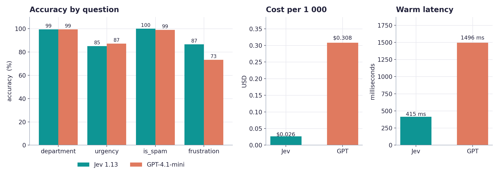</td>
<td align="center" valign="top">メディア未公開</td>
</tr></table>

🛡️ <b><a href="https://github.com/CapCurious/jev-threshold-lab">CapCurious/jev-threshold-lab</a></b> · Python · 🔎 inferred · 19 天

##### 📝 概要

Fit act, review and escalate thresholds per question from labeled data with Jev; checks calibration. Stdlib Python.

##### 📌 基本情報

| 項目       | 値                                 |
| ---------- | ---------------------------------- |
| カテゴリ   | `ルーティング、ガードレール、承認` |
| エビデンス | `inferred`                         |
| 言語       | Python                             |

##### 📊 データ

| 指標         | 値         |
| ------------ | ---------- |
| スター数     | **0**      |
| 最終プッシュ | 2026-10-18 |
| 初回掲載     | 2026-11-04 |

🏷 `calibration` · `decision-model` · `jev` · `python` · `thresholds` · `typesafe`

---

<table><tr><th align="center" width="50%">🖼 画像</th><th align="center" width="50%">🎬 動画</th></tr><tr>
<td align="center" valign="top"></td>
<td align="center" valign="top"> アニメーション記録</td>
</tr></table>

<b>このカテゴリのその他</b> · 38

- [backmeupplz/jev_antispam_bot](https://github.com/backmeupplz/jev_antispam_bot) - @jev_antispam_bot: free, open-source anti-spam bot for Telegram groups that…
- [leofmarciano/groot](https://github.com/leofmarciano/groot) - 🌳 Groot 1 is a open typed-decision model, with a pure Bend engine.
- [vynnlee/jev-mail](https://github.com/vynnlee/jev-mail) - TypeSafe Jev System One によって駆動される Gmail 向け自律 24/7 Zero-Inbox トリアージ。
- [hyspacex/jev-router](https://github.com/hyspacex/jev-router) - Route OpenAI-style chat requests to a model and reasoning effort, using…
- [Davidasx/pi-typesafe-approve](https://github.com/Davidasx/pi-typesafe-approve) - Pi extension: auto-approve routine Bash commands with a System One (Jev)…
- [amyrmahdy/decima](https://github.com/amyrmahdy/decima) - Small local judges and guards for LLM apps: calibrated decisions…
- [bitnovus/jev-spam-eval](https://github.com/bitnovus/jev-spam-eval) - TypeSafe Jev Noul質問によるゼロショットスパムフィルタリングを、TF-IDFベースラインと比較.
- [Harishrs2006/hari-jev](https://github.com/Harishrs2006/hari-jev) - Support-ticket triage with zero-shot classification。
- [adityavsb/narrative-audit-jev](https://github.com/adityavsb/narrative-audit-jev) - OpenRouter benchmark harness: same decision task for rule baselines and pinned…
- [ahmed35636/jev-triage](https://github.com/ahmed35636/jev-triage) - Windows event classification and confidence-aware review routing with TypeSafe…
- [Arwin-K/jev-llm-gateway](https://github.com/Arwin-K/jev-llm-gateway) - a cost-aware LLM gateway with three-tier model routing, optional verification…
- [budityw23/fhir_jev](https://github.com/budityw23/fhir_jev) - Typed AI decision layer for FHIR R4 data using TypeSafe AI。
- [camegone/vscode-jev-linter](https://github.com/camegone/vscode-jev-linter) - An extension automatically detect flaw like security risk, powerd by Jev at…
- [dirnbauer/typo3-webcon-jev](https://github.com/dirnbauer/typo3-webcon-jev) - Typed decisions from TypeSafe AI。
- [dtduc-git/jev-packs](https://github.com/dtduc-git/jev-packs) - Evidence-gated registry of Jev question packs — curated questions, golden cases…
- [freezetheflame/jev-ecosystem-research](https://github.com/freezetheflame/jev-ecosystem-research) - Jev (TypeSafe AI System One) 生态调研：开源复现规模、JevBench v1.4.2.2…
- [gbesse/jev-guardrails-fr-arena](https://github.com/gbesse/jev-guardrails-fr-arena) - Compare règles, Jev et un serveur Shieldstral sur les mêmes cas français.
- [gbesse/jev-semantic-merge-gate](https://github.com/gbesse/jev-semantic-merge-gate) - Declared semantic merge policies with exact changed-line evidence.
- [gbesse/redpanda-connect-jev](https://github.com/gbesse/redpanda-connect-jev) - Typed Jev decisions in Redpanda Connect pipelines。
- [Haslab-dev/pandu-jev](https://github.com/Haslab-dev/pandu-jev) - PanduはJevに着想を得た小型のJevモデルです。クローズドループAI環境における高速でローカル、かつ不確実性を考慮した意思決定のための小型ポリシーモデル.
- [hrtaym1114-github/x-jev-gate](https://github.com/hrtaym1114-github/x-jev-gate) - TypeSafe Jev（System One）を利用したX下書きゲート。公開前に、厳格なシークレットチェックとNoulによるスコアリングを実行します.
- [jasonli0226/jev-benchmark](https://github.com/jasonli0226/jev-benchmark) - Benchmark: Jev decision model (TypeSafe, via OpenRouter) vs local ML on SST-2…
- [Joshita-s/ticket-triage-jev](https://github.com/Joshita-s/ticket-triage-jev) - Automated customer ticket triage engine in Python built with TypeSafe Jev…
- [Khidir782/Beam-jev](https://github.com/Khidir782/Beam-jev) - Calibrated DevOps tool-router distilled from Beam-1.0-501B via RLCD.
- [Loule95450/jev-free-router](https://github.com/Loule95450/jev-free-router) - 無料のOpenCode Zen + Goモデル上で動的にターンごとのモデルをルーティングするルーター（gargpratyush/jev-routerのフォーク）。
- [lymagics/jev-gate](https://github.com/lymagics/jev-gate) - A GitHub Action that fails a pipeline when code breaks a quality rule using Jev…
- [Madheshvivekanandan/jev-vs-cosine](https://github.com/Madheshvivekanandan/jev-vs-cosine) - Do you need TypeSafe。
- [masatoppp/07_Jev-routing-evaluation](https://github.com/masatoppp/07_Jev-routing-evaluation) - Jevを用いたLLM・Web検索・RAGのルーティング実装と、GPT-4.1-miniとの判定精度・処理速度・APIコストの比較検証。
- [mgd34msu/goodvibes-jev](https://github.com/mgd34msu/goodvibes-jev) - The Goodvibes platform with Jev integrated into the decision model for…
- [mohameddhameem/systemone-jev](https://github.com/mohameddhameem/systemone-jev) - Typed-decision routers between a small and a large LLM, fine-tuned from nano-jev。
- [Muradmustafayev-03/jev-recovery-router](https://github.com/Muradmustafayev-03/jev-recovery-router) - コスト条件付きの意図ルーティング：選択されたQwen3信念モデル、リカバリーアクター、再現可能なベンチマークと推論.
- [petercr/jev-orchestrator](https://github.com/petercr/jev-orchestrator) - Jevを使い、難易度に応じて異なるLLMsへのルーティングを処理する小型ノードオーケストレーター.
- [ragman53/pi-jev-orchestrator](https://github.com/ragman53/pi-jev-orchestrator) - Cache-aware Jev model orchestration for Pi with sticky routing and safe…
- [RichardoMrMu/jev-mini](https://github.com/RichardoMrMu/jev-mini) - Jevの3つの主要な主張を、自分のGPUで検証します。1つのコマンドで0.5Bのローカルモデルを実行し、制約付きスコアリングの高速化、構造的な型安全性、そしてこ…
- [shloktilokani/TicketLens_Jev_vs_LLM](https://github.com/shloktilokani/TicketLens_Jev_vs_LLM) - Local-first app for classifying fictional ShopKart support tickets with…
- [stivelcn/jev-route-releases](https://github.com/stivelcn/jev-route-releases) - JEV Router macOS downloads and release notes. Source code is private.
- [THEROCKSSS/awesome-jev](https://github.com/THEROCKSSS/awesome-jev) - Jev / TypeSafe System Oneプロジェクトのマージ済み、重複排除済み、日次更新カタログと、フィルタ可能なGitHub Pagesサイト。
- [sumleo/RLCDAlignBench](https://github.com/sumleo/RLCDAlignBench) - RLCDAlignBench：『Just Ask…

## 評価、キャリブレーション、ベンチマーク

その判断がどれほど良いかを、誰がどうやって知るのか。キャリブレーションはこのエコシステムの未解決課題であり、ここに挙げたのはそれを測定しているプロジェクトです。

🧪 <b><a href="https://github.com/Mapika/decider">Mapika/decider</a></b> · ⭐1056 · Python · 👁️ observed · 17 天

##### 📝 概要

Qwen3.5からファインチューニングされたSystem Oneスタイルのモデルファミリーで、較正された確率によるワンパスの型付き意思決定向けに設計されています。

🔧 コード内での使用を確認: `README.md`

##### 📌 基本情報

| 項目       | 値                                       |
| ---------- | ---------------------------------------- |
| カテゴリ   | `評価、キャリブレーション、ベンチマーク` |
| エビデンス | `observed`                               |
| 言語       | Python                                   |

##### 📊 データ

| 指標         | 値         |
| ------------ | ---------- |
| スター数     | **1056**   |
| 最終プッシュ | 2026-10-20 |
| 初回掲載     | 2026-10-28 |

---

<table><tr><th align="center" width="50%">🖼 画像</th><th align="center" width="50%">🎬 動画</th></tr><tr>
<td align="center" valign="top"></td>
<td align="center" valign="top"> アニメーション記録</td>
</tr></table>

🧪 <b><a href="https://github.com/v-modal/awesome-jev-tools">v-modal/awesome-jev-tools</a></b> · ⭐732 · 👁️ observed · 0 天 · ⭐+1

##### 📝 概要

Jev向けに構築されたツールの厳選リスト — 型付き判断のためのTypeSafe AIのSystem Oneモデル。

##### 📌 基本情報

| 項目       | 値                                       |
| ---------- | ---------------------------------------- |
| カテゴリ   | `評価、キャリブレーション、ベンチマーク` |
| エビデンス | `observed`                               |

##### 📊 データ

| 指標         | 値           |
| ------------ | ------------ |
| スター数     | **732** (+1) |
| 最終プッシュ | 2026-11-06   |
| 初回掲載     | 2026-09-20   |

🏷 `awesome-ai` · `awesome-jev` · `awesome-list` · `awesome-readme` · `calibrated-probabilities` · `jev` · `jev-ai` · `jev-alternative`

🧪 <b><a href="https://github.com/OmniJev/awesome-jev-gallery">OmniJev/awesome-jev-gallery</a></b> · ⭐483 · Python · 👁️ observed · 0 天 · ⭐+1

##### 📝 概要

🔥🔥 Awesome Jev: Jev および System One モデルのためのオープンソースモデル、プロジェクト、ベンチマーク、独立評価。

##### 📌 基本情報

| 項目       | 値                                       |
| ---------- | ---------------------------------------- |
| カテゴリ   | `評価、キャリブレーション、ベンチマーク` |
| エビデンス | `observed`                               |
| 言語       | Python                                   |

##### 📊 データ

| 指標         | 値           |
| ------------ | ------------ |
| スター数     | **483** (+1) |
| 最終プッシュ | 2026-11-06   |
| 初回掲載     | 2026-09-20   |

🏷 `awesome` · `awesome-jev` · `awesome-list` · `calibrated-probabilities` · `calibration` · `decision-models` · `jev` · `jev-ai`

🧪 <b><a href="https://github.com/cobusgreyling/Jev">cobusgreyling/Jev</a></b> · ⭐141 · Python · 👁️ observed · 22 天 · ⭐+1

##### 📝 概要

非公式TypeSafe Jevショーケース — チャットではなくSystem One件の意思決定。

🔧 コード内での使用を確認: `README.md`

##### 📌 基本情報

| 項目       | 値                                       |
| ---------- | ---------------------------------------- |
| カテゴリ   | `評価、キャリブレーション、ベンチマーク` |
| エビデンス | `observed`                               |
| 言語       | Python                                   |

##### 📊 データ

| 指標         | 値           |
| ------------ | ------------ |
| スター数     | **141** (+1) |
| 最終プッシュ | 2026-10-15   |
| 初回掲載     | 2026-10-26   |

🏷 `calibrated-decisions` · `jev` · `showcase` · `system-one` · `typesafe`

---

<table><tr><th align="center" width="50%">🖼 画像</th><th align="center" width="50%">🎬 動画</th></tr><tr>
<td align="center" valign="top"></td>
<td align="center" valign="top">メディア未公開</td>
</tr></table>

🧪 <b><a href="https://github.com/ikermoel/open-alternative-jev">ikermoel/open-alternative-jev</a></b> · ⭐78 · Python · 👁️ observed · 43 天 · ⭐+1

##### 📝 概要

TypeSafeのJevに対するオープンソースの代替：任意のオープンウェイトLLMから、1回のフォワードパスで型付き・校正済み判定を返すSystem Oneスタイルのモデルレイヤー（HF + vLLM）。誠実なベンチマーク付き

##### 📌 基本情報

| 項目       | 値                                       |
| ---------- | ---------------------------------------- |
| カテゴリ   | `評価、キャリブレーション、ベンチマーク` |
| エビデンス | `observed`                               |
| 言語       | Python                                   |

##### 📊 データ

| 指標         | 値          |
| ------------ | ----------- |
| スター数     | **78** (+1) |
| 最終プッシュ | 2026-09-25  |
| 初回掲載     | 2026-10-28  |

🏷 `calibration` · `classification` · `jev` · `jev-alternative` · `llm` · `logprobs` · `open-jev` · `open-source-jev`

🧪 <b><a href="https://github.com/hev/reranker">hev/reranker</a></b> · ⭐19 · Python · 👁️ observed · 50 天

##### 📝 概要

Jev（TypeSafeのSystem Oneモデル）を校正済み再ランカーとして使用：1回の呼び出しで最大30件の文書に対応し、文書ごとに確率を返します。Apache-2.0。

##### 📌 基本情報

| 項目       | 値                                       |
| ---------- | ---------------------------------------- |
| カテゴリ   | `評価、キャリブレーション、ベンチマーク` |
| エビデンス | `observed`                               |
| 言語       | Python                                   |

##### 📊 データ

| 指標         | 値         |
| ------------ | ---------- |
| スター数     | **19**     |
| 最終プッシュ | 2026-09-17 |
| 初回掲載     | 2026-10-28 |

🧪 <b><a href="https://github.com/OmniJev/awesome-jev-papers">OmniJev/awesome-jev-papers</a></b> · ⭐12 · Python · 👁️ observed · 0 天

##### 📝 概要

🔥🔥 Research papers on Jev, TypeSafe's System One model, and the open models built in its shape.

##### 📌 基本情報

| 項目       | 値                                       |
| ---------- | ---------------------------------------- |
| カテゴリ   | `評価、キャリブレーション、ベンチマーク` |
| エビデンス | `observed`                               |
| 言語       | Python                                   |

##### 📊 データ

| 指標         | 値         |
| ------------ | ---------- |
| スター数     | **12**     |
| 最終プッシュ | 2026-11-06 |
| 初回掲載     | 2026-09-28 |

🏷 `arxiv` · `awesome` · `awesome-list` · `calibration` · `decision-model` · `jev` · `llm` · `paper-list`

🧪 <b><a href="https://github.com/akash-kamat/system-one-gemma">akash-kamat/system-one-gemma</a></b> · ⭐7 · Python · 👁️ observed · 50 天

##### 📝 概要

オープンソースの Jev スタイルの System One 意思決定モデル。スコアリングヘッドを備えた Gemma 3 270M — 単一のフォワードパスで高速かつ較正済みの意思決定。テキスト生成なし。TypeSafe.ai の Jev に触発されています。

##### 📌 基本情報

| 項目       | 値                                       |
| ---------- | ---------------------------------------- |
| カテゴリ   | `評価、キャリブレーション、ベンチマーク` |
| エビデンス | `observed`                               |
| 言語       | Python                                   |

##### 📊 データ

| 指標         | 値         |
| ------------ | ---------- |
| スター数     | **7**      |
| 最終プッシュ | 2026-09-18 |
| 初回掲載     | 2026-10-28 |

🏷 `calibration` · `decision-model` · `gemma` · `jev` · `lora` · `machine-learning` · `scoring-model` · `system-one`

🧪 <b><a href="https://github.com/brida-ai/reflexbench">brida-ai/reflexbench</a></b> · ⭐6 · Python · 👁️ observed · 44 天 · **NEW**

##### 📝 概要

ReflexBench — System Oneモデルと型付き判断エンジン向けのオープンベンチマークおよび評価ハーネス

##### 📌 基本情報

| 項目       | 値                                       |
| ---------- | ---------------------------------------- |
| カテゴリ   | `評価、キャリブレーション、ベンチマーク` |
| エビデンス | `observed`                               |
| 言語       | Python                                   |

##### 📊 データ

| 指標         | 値         |
| ------------ | ---------- |
| スター数     | **6**      |
| 最終プッシュ | 2026-09-24 |
| 初回掲載     | 2026-11-07 |

🏷 `ai-benchmark` · `ai-evaluation` · `benchmark` · `calibration` · `choice` · `decision-models` · `jev` · `laya`

🧪 <b><a href="https://github.com/debuffjp/decidekit">debuffjp/decidekit</a></b> · ⭐6 · TypeScript · 👁️ observed · 5 天

##### 📝 概要

A System One model in the browser: typed, calibrated text decisions on the user's device. Learns from an LLM when it isn't sure.

##### 📌 基本情報

| 項目       | 値                                       |
| ---------- | ---------------------------------------- |
| カテゴリ   | `評価、キャリブレーション、ベンチマーク` |
| エビデンス | `observed`                               |
| 言語       | TypeScript                               |

##### 📊 データ

| 指標         | 値         |
| ------------ | ---------- |
| スター数     | **6**      |
| 最終プッシュ | 2026-11-02 |
| 初回掲載     | 2026-11-02 |

🏷 `classification` · `decision-model` · `llm` · `system-one` · `typescript`

🧪 <b><a href="https://github.com/bydeng01/scientific-decision-eval">bydeng01/scientific-decision-eval</a></b> · ⭐4 · HTML · 👁️ observed · 3 天

##### 📝 概要

Code and data for evaluating Jev, a System One model, on scientific decisions and how its choices affect downstream results. arXiv:2609.24965

##### 📌 基本情報

| 項目       | 値                                       |
| ---------- | ---------------------------------------- |
| カテゴリ   | `評価、キャリブレーション、ベンチマーク` |
| エビデンス | `observed`                               |
| 言語       | HTML                                     |

##### 📊 データ

| 指標         | 値         |
| ------------ | ---------- |
| スター数     | **4**      |
| 最終プッシュ | 2026-11-04 |
| 初回掲載     | 2026-10-27 |

🏷 `jev` · `jev-ai` · `jev-model` · `jevbench` · `system-one` · `system-one-model` · `system-one-models`

🧪 <b><a href="https://github.com/alby13/systemone">alby13/systemone</a></b> · ⭐1 · Python · 👁️ observed · 12 天

##### 📝 概要

Typed, calibrated decisions for software in a single forward pass: an independent implementation of the System One model architecture.

##### 📌 基本情報

| 項目       | 値                                       |
| ---------- | ---------------------------------------- |
| カテゴリ   | `評価、キャリブレーション、ベンチマーク` |
| エビデンス | `observed`                               |
| 言語       | Python                                   |

##### 📊 データ

| 指標         | 値         |
| ------------ | ---------- |
| スター数     | **1**      |
| 最終プッシュ | 2026-10-25 |
| 初回掲載     | 2026-10-26 |

🧪 <b><a href="https://github.com/Shauryagulati/mini-jev">Shauryagulati/mini-jev</a></b> · Jupyter · 👁️ observed · 18 天

##### 📝 概要

Distilling a calibrated decision model into Qwen3-1.7B: SFT vs. distillation vs. GRPO, plus deployment pitfalls. Free Colab T4.

##### 📌 基本情報

| 項目       | 値                                       |
| ---------- | ---------------------------------------- |
| カテゴリ   | `評価、キャリブレーション、ベンチマーク` |
| エビデンス | `observed`                               |
| 言語       | Jupyter                                  |

##### 📊 データ

| 指標         | 値         |
| ------------ | ---------- |
| スター数     | **0**      |
| 最終プッシュ | 2026-10-19 |
| 初回掲載     | 2026-11-01 |

---

<table><tr><th align="center" width="50%">🖼 画像</th><th align="center" width="50%">🎬 動画</th></tr><tr>
<td align="center" valign="top"></td>
<td align="center" valign="top">メディア未公開</td>
</tr></table>

🧪 <b><a href="https://github.com/nokia-applied-research/AnyJev">nokia-applied-research/AnyJev</a></b> · ⭐1592 · Python · 🔎 inferred · 16 天 · ⭐+2

##### 📝 概要

任意の LLM を Jev 風の意思決定モデルに変換：型付きの意思決定、実際の確率、トレーニング不要。（継続更新中、issue と PR リクエスト歓迎）

##### 📌 基本情報

| 項目       | 値                                       |
| ---------- | ---------------------------------------- |
| カテゴリ   | `評価、キャリブレーション、ベンチマーク` |
| エビデンス | `inferred`                               |
| 言語       | Python                                   |

##### 📊 データ

| 指標         | 値            |
| ------------ | ------------- |
| スター数     | **1592** (+2) |
| 最終プッシュ | 2026-10-21    |
| 初回掲載     | 2026-09-22    |

🏷 `calibration` · `decision-model` · `jev` · `jev-model` · `llm` · `system-one` · `transformers` · `vllm`

---

<table><tr><th align="center" width="50%">🖼 画像</th><th align="center" width="50%">🎬 動画</th></tr><tr>
<td align="center" valign="top"></td>
<td align="center" valign="top"> アニメーション記録</td>
</tr></table>

🧪 <b><a href="https://github.com/allebee/jevk5">allebee/jevk5</a></b> · ⭐165 · Python · 🔎 inferred · 40 天 · ⭐+1

##### 📝 概要

JevK5: TypeSafe Jev のオープンウェイト代替。1 回のフォワードパスで確率付きの型付き意思決定。Apache-2.0 ウェイトとコード。

##### 📌 基本情報

| 項目       | 値                                       |
| ---------- | ---------------------------------------- |
| カテゴリ   | `評価、キャリブレーション、ベンチマーク` |
| エビデンス | `inferred`                               |
| 言語       | Python                                   |

##### 📊 データ

| 指標         | 値           |
| ------------ | ------------ |
| スター数     | **165** (+1) |
| 最終プッシュ | 2026-09-28   |
| 初回掲載     | 2026-10-29   |

🏷 `calibration` · `decision-model` · `jev` · `jev-alternative` · `jevbench` · `lora` · `qwen` · `system-one`

---

<table><tr><th align="center" width="50%">🖼 画像</th><th align="center" width="50%">🎬 動画</th></tr><tr>
<td align="center" valign="top"></td>
<td align="center" valign="top"> アニメーション記録 · <a href="https://raw.githubusercontent.com/allebee/jevk5/main/docs/demo/jevk5-nvidia-demo.mp4">動画を開く</a></td>
</tr></table>

🧪 <b><a href="https://github.com/Heman10x-NGU/Verdict-open-jev">Heman10x-NGU/Verdict-open-jev</a></b> · ⭐118 · Python · 🔎 inferred · 16 天 · ⭐+1

##### 📝 概要

ModernBERT（151M）上の非自己回帰判断エンジン。調整済み不確実性（RLCD）、TypeSafe AI Jevベンチマーク監査、ブラウザー内WebGPUプレイグラウンドを備えています。

##### 📌 基本情報

| 項目       | 値                                       |
| ---------- | ---------------------------------------- |
| カテゴリ   | `評価、キャリブレーション、ベンチマーク` |
| エビデンス | `inferred`                               |
| 言語       | Python                                   |

##### 📊 データ

| 指標         | 値           |
| ------------ | ------------ |
| スター数     | **118** (+1) |
| 最終プッシュ | 2026-10-21   |
| 初回掲載     | 2026-09-18   |

🏷 `brier-score` · `calibration` · `decision-engine` · `edge-ai` · `gliclass` · `jev` · `modernbert` · `onnx`

---

<table><tr><th align="center" width="50%">🖼 画像</th><th align="center" width="50%">🎬 動画</th></tr><tr>
<td align="center" valign="top"></td>
<td align="center" valign="top">メディア未公開</td>
</tr></table>

再配布ライセンスが明示されていないため、アセットは上流リポジトリから直リンクしています。

🧪 <b><a href="https://github.com/Eliot5566/JEV-Paper-Radar">Eliot5566/JEV-Paper-Radar</a></b> · ⭐38 · Python · 🔎 inferred · 1 天

##### 📝 概要

Jevに毎朝新しいarXiv論文をすべて読ませ、読むべき少数の論文を提示させます。平易な英語で関心分野を指定、調整済み確率、約$0.06／日、フォークしてすぐに利用できます。

##### 📌 基本情報

| 項目       | 値                                       |
| ---------- | ---------------------------------------- |
| カテゴリ   | `評価、キャリブレーション、ベンチマーク` |
| エビデンス | `inferred`                               |
| 言語       | Python                                   |

##### 📊 データ

| 指標         | 値         |
| ------------ | ---------- |
| スター数     | **38**     |
| 最終プッシュ | 2026-11-06 |
| 初回掲載     | 2026-10-19 |

🏷 `arxiv` · `biorxiv` · `github-actions` · `jev` · `literature-review` · `llm` · `paper-recommendation` · `python`

---

<table><tr><th align="center" width="50%">🖼 画像</th><th align="center" width="50%">🎬 動画</th></tr><tr>
<td align="center" valign="top"></td>
<td align="center" valign="top">メディア未公開</td>
</tr></table>

🧪 <b><a href="https://github.com/manjunathshiva/opendecider">manjunathshiva/opendecider</a></b> · ⭐38 · Python · 🔎 inferred · 2 天

##### 📝 概要

Open, calibrated System 1 decision models: typed choice / score / yes-no answers with a probability for every option. 400M to 80B; CPU, NVIDIA, Apple Silicon, LM Studio, Ollama and vLLM.

##### 📌 基本情報

| 項目       | 値                                       |
| ---------- | ---------------------------------------- |
| カテゴリ   | `評価、キャリブレーション、ベンチマーク` |
| エビデンス | `inferred`                               |
| 言語       | Python                                   |

##### 📊 データ

| 指標         | 値         |
| ------------ | ---------- |
| スター数     | **38**     |
| 最終プッシュ | 2026-11-04 |
| 初回掲載     | 2026-11-04 |

🏷 `apple-silicon` · `calibration` · `classification` · `decision-model` · `gguf` · `huggingface` · `llm` · `mlx`

---

<table><tr><th align="center" width="50%">🖼 画像</th><th align="center" width="50%">🎬 動画</th></tr><tr>
<td align="center" valign="top"></td>
<td align="center" valign="top">メディア未公開</td>
</tr></table>

🧪 <b><a href="https://github.com/ankit-aglawe/tinyjev">ankit-aglawe/tinyjev</a></b> · ⭐29 · Python · 🔎 inferred · 36 天

##### 📝 概要

1 回のフォワードパスで Choice、Score、Noul の質問に答え、較正済み確率を返す小さな jev 風モデル。MLX または PyTorch、完全オフライン、System One 互換。

##### 📌 基本情報

| 項目       | 値                                       |
| ---------- | ---------------------------------------- |
| カテゴリ   | `評価、キャリブレーション、ベンチマーク` |
| エビデンス | `inferred`                               |
| 言語       | Python                                   |

##### 📊 データ

| 指標         | 値         |
| ------------ | ---------- |
| スター数     | **29**     |
| 最終プッシュ | 2026-10-01 |
| 初回掲載     | 2026-09-23 |

🏷 `decision-model` · `jev` · `jev-model` · `mlx` · `qwen3` · `small-language-models` · `system-one` · `typed-decisions`

---

<table><tr><th align="center" width="50%">🖼 画像</th><th align="center" width="50%">🎬 動画</th></tr><tr>
<td align="center" valign="top"></td>
<td align="center" valign="top"> アニメーション記録</td>
</tr></table>

🧪 <b><a href="https://github.com/shibing624/train-jev">shibing624/train-jev</a></b> · ⭐19 · Python · 🔎 inferred · 14 天

##### 📝 概要

Qwen3.5およびQwen3.8-27B上でJEVスタイルのSystem 1意思決定モデルを学習：24スロットの意思決定ヘッド、KL蒸留、キャリブレーション、サービング。Qwen上でJEVスタイルのSystem 1意思決定モデルを学習します。

##### 📌 基本情報

| 項目       | 値                                       |
| ---------- | ---------------------------------------- |
| カテゴリ   | `評価、キャリブレーション、ベンチマーク` |
| エビデンス | `inferred`                               |
| 言語       | Python                                   |

##### 📊 データ

| 指標         | 値         |
| ------------ | ---------- |
| スター数     | **19**     |
| 最終プッシュ | 2026-10-23 |
| 初回掲載     | 2026-11-04 |

🏷 `calibration` · `decision-model` · `distillation` · `fine-tuning` · `llm` · `lora` · `nlp` · `pytorch`

---

<table><tr><th align="center" width="50%">🖼 画像</th><th align="center" width="50%">🎬 動画</th></tr><tr>
<td align="center" valign="top"></td>
<td align="center" valign="top">メディア未公開</td>
</tr></table>

🧪 <b><a href="https://github.com/BrendanH18/jev_fsd">BrendanH18/jev_fsd</a></b> · ⭐12 · JavaScript · 🔎 inferred · 0 天

##### 📝 概要

A driving simulator on real OpenStreetMap streets where TypeSafe's Jev model drives the car, with a decision inspector and a benchmark.

##### 📌 基本情報

| 項目       | 値                                       |
| ---------- | ---------------------------------------- |
| カテゴリ   | `評価、キャリブレーション、ベンチマーク` |
| エビデンス | `inferred`                               |
| 言語       | JavaScript                               |

##### 📊 データ

| 指標         | 値         |
| ------------ | ---------- |
| スター数     | **12**     |
| 最終プッシュ | 2026-11-06 |
| 初回掲載     | 2026-10-23 |

🏷 `ai` · `benchmark` · `driving-simulator` · `javascript` · `jev` · `openstreetmap` · `python` · `self-driving`

---

<table><tr><th align="center" width="50%">🖼 画像</th><th align="center" width="50%">🎬 動画</th></tr><tr>
<td align="center" valign="top"></td>
<td align="center" valign="top">メディア未公開</td>
</tr></table>

🧪 <b><a href="https://github.com/wondertwins/jev-benchmark">wondertwins/jev-benchmark</a></b> · ⭐8 · Python · 🔎 inferred · 51 天

##### 📝 概要

TypeSafeのJev（System One）モデル向けのベンチマークとプレイグラウンド：チェス、および音声テキスト変換ゲームNPC向けの「話している相手は誰か」

##### 📌 基本情報

| 項目       | 値                                       |
| ---------- | ---------------------------------------- |
| カテゴリ   | `評価、キャリブレーション、ベンチマーク` |
| エビデンス | `inferred`                               |
| 言語       | Python                                   |

##### 📊 データ

| 指標         | 値         |
| ------------ | ---------- |
| スター数     | **8**      |
| 最終プッシュ | 2026-09-16 |
| 初回掲載     | 2026-10-28 |

---

<table><tr><th align="center" width="50%">🖼 画像</th><th align="center" width="50%">🎬 動画</th></tr><tr>
<td align="center" valign="top">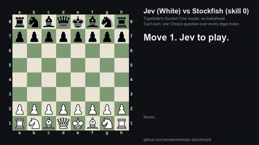</td>
<td align="center" valign="top">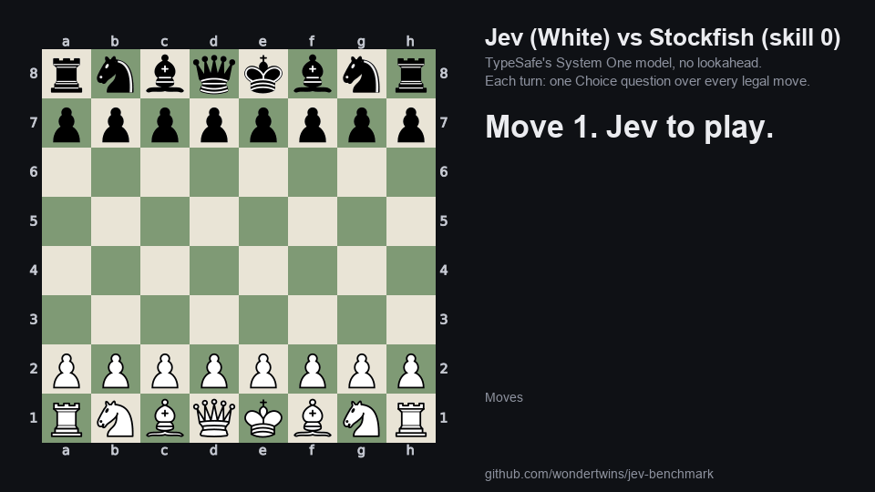 アニメーション記録</td>
</tr></table>

<b>このカテゴリのその他</b> · 62

- [aishwary-dongre/jev-xray](https://github.com/aishwary-dongre/jev-xray) - System Oneモデル向け意思決定フォレンジック。Jevはキャリブレーション済み確率を返すが説明はできません…
- [jburns24/jev-demo](https://github.com/jburns24/jev-demo) - jev-latestの評価モデルを試す。
- [mahirmalik030/Jev-vs-LLMs](https://github.com/mahirmalik030/Jev-vs-LLMs) - A comparative study of Jev 1.13 and Large Language Models (LLMs) for phishing…
- [patryckalves/jev-no-enem](https://github.com/patryckalves/jev-no-enem) - BrazilのENEM 2025標準試験で、TypeSafe AIのJev（System Oneパラダイム）を評価する再現可能なベンチマーク.
- [buberlo/jev-trader](https://github.com/buberlo/jev-trader) - Jev（TypeSafe System One）の意思決定を中心とした 24/7 マーケットメイキングシステム：決定論的状態、較正済み判断、厳格なリスク拒否.
- [SamratDuttaOfficial/WaterSheep](https://github.com/SamratDuttaOfficial/WaterSheep) - yes/no、選択、スコア、マルチラベルの質問に較正済みの回答を返す決定モデル.
- [Nhahan/Xevn](https://github.com/Nhahan/Xevn) - A 4B decision model built for Korean.
- [us/jev-local](https://github.com/us/jev-local) - ローカルJev互換評価サーバー：型付きnoul/choice/scoreを備えたPOST /v1/systemone、オープンウェイト、ウェイトリストなし。
- [cablehead/jev.nu](https://github.com/cablehead/jev.nu) - TypeSafe System One API向けのNushellモジュール：キャリブレーション済み確率による型付き判断。
- [ZhangYiqun018/jev-dimabsa](https://github.com/ZhangYiqun018/jev-dimabsa) - DimABSA、SemEval-2026 Task 3 Track AにおけるTypeSafe Jev（System One）.
- [mertkayacs/jevalt](https://github.com/mertkayacs/jevalt) - Three 4B decision models for English, Turkish and German, with per-option…
- [y0usaf/jev-lm](https://github.com/y0usaf/jev-lm) - 出力層がJevである単語レベルの言語モデル：n-gramドラフター、Noulチャンク検証、bits-per-token評価。
- [Yifan-Lan/awesome-jev-robustness](https://github.com/Yifan-Lan/awesome-jev-robustness) - Jev（TypeSafe System One）のテスト、キャリブレーション監査、失敗モード研究：不均一性、一貫性、インジェクション、棄権.
- [zamax14/Laya-Finetune](https://github.com/zamax14/Laya-Finetune) - オープンなSystem…
- [tak-bro/local-jev-bench](https://github.com/tak-bro/local-jev-bench) - Apple Silicon Mac上のローカルJevスタイルSystem One意思決定モデル：AnyJev、Kev、Laya…
- [CodyQin/zh-decision-bench](https://github.com/CodyQin/zh-decision-bench) - Jevクラスの「System One」意思決定モデル向け初の中国語キャリブレーションベンチマーク: データセット。
- [mertkayacs/jevoss](https://github.com/mertkayacs/jevoss) - Evaluation tools for Jev-compatible decision models, covering accuracy…
- [mpuig/system-one](https://github.com/mpuig/system-one) - 高速で自動的な判断能力を指すKahnemanの用語である、オープンソースのSystem One意思決定モデル.
- [AlanViollier/jev-vs-pii](https://github.com/AlanViollier/jev-vs-pii) - How good is Jev, a decision model, at finding personal information?
- [divyanshudhruv/oev](https://github.com/divyanshudhruv/oev) - An 184M-parameter monolingual decision engine delivering calibrated…
- [Rushab1/gr-jev](https://github.com/Rushab1/gr-jev) - Code for。
- [etsabary/jev-deterministic-benchmark](https://github.com/etsabary/jev-deterministic-benchmark) - 25の決定論的推論ファミリーにわたるJevの1,000意思決定行動ベンチマーク.
- [Nefelim584/JEV_Judge](https://github.com/Nefelim584/JEV_Judge) - jev-lite: a ModernBERT-based typed decision model (Bool / Choice / Score) with…
- [teyhouse/jev-secret-detection](https://github.com/teyhouse/jev-secret-detection) - TypeSafeのRLCD-Jevモデルがファイル断片内の実在する秘密認証情報をどの程度正確に検出できるかを測定します.
- [CosmoIknosLab/EarthJev](https://github.com/CosmoIknosLab/EarthJev) - EarthJev: calibrated, non-generative answers to natural-language questions…
- [EnesDemir143/jev-laya-benchmark](https://github.com/EnesDemir143/jev-laya-benchmark) - 構造化された課題分類におけるTypeSafe JevとLaya-MLXを比較するローカルベンチマーク。
- [lewistouchtech/opencode-jev-safe-compact](https://github.com/lewistouchtech/opencode-jev-safe-compact) - JEV-guided context compaction for OpenCode, built on a measured finding: noul…
- [patelvishwa112/jev-system-one-rlcd](https://github.com/patelvishwa112/jev-system-one-rlcd) - Jev System One AI &amp; RLCD再現エンジン：SmolLM-135Mと0出力トークンによる70ms未満のキャリブレーション済み意思決定.
- [vortezwohl/JevNER](https://github.com/vortezwohl/JevNER) - Zero-shot multilingual named entity recognition (NER) powered by TypeSafe…
- [113636xfh/jev-decision-head](https://github.com/113636xfh/jev-decision-head) - A lightweight Jev-style decision head, plus the Strata patches that let one…
- [acbharath14/ollama-jev-decision-demo](https://github.com/acbharath14/ollama-jev-decision-demo) - Decision models via Ollama (Jev /v1/systemone): ask typed questions — choice…
- [agarwalastitwa027-svg/mini-jev-multimodal](https://github.com/agarwalastitwa027-svg/mini-jev-multimodal) - 小型の画像＋テキスト意思決定モデル：Qwen3-VL-2B＋LoRA＋回答ヘッドが、生成なしの1回のフォワードパスで選択肢をスコアリングします.
- [ameya-panchpor/jev-2048](https://github.com/ameya-panchpor/jev-2048) - Does a System One classifier belong in a sequential decision loop? A regret and…
- [ameya690/jev-2048](https://github.com/ameya690/jev-2048) - Does a System One classifier belong in a sequential decision loop? A regret and…
- [ankur287/jev-open-calibration](https://github.com/ankur287/jev-open-calibration) - Rebuilding Jev。
- [beskvladimir-create/ru-jev](https://github.com/beskvladimir-create/ru-jev) - Ru-Jev: an open Russian typed-decision model.
- [betulsimsek/jev-decomposition-tr](https://github.com/betulsimsek/jev-decomposition-tr) - Does splitting a typed-decision question help? Jev vs OpenAI Decisions vs Laya…
- [cayoesn/llm-jev-engine](https://github.com/cayoesn/llm-jev-engine) - System-1 Non-Autoregressive Single-Pass Neural Decision Engine with RLCD…
- [Chetax/jev-ecommerce-reviews](https://github.com/Chetax/jev-ecommerce-reviews) - E-commerce review classification with TypeSafe。
- [devrecated/jev-alternative](https://github.com/devrecated/jev-alternative) - Free, open-source Jev alternative: fine-tune the open Laya decision model on…
- [dnakhoa/jev-deferred-crispification](https://github.com/dnakhoa/jev-deferred-crispification) - ポジションペーパー：TypeSafe AIのJevおよびSystem-One意思決定モデルに欠けているHidden-Markovとファジーのプリミティブ.
- [himalaya-kaushik/mini-jev](https://github.com/himalaya-kaushik/mini-jev) - 一度きりの意思決定モデルが破綻する場面：ローカルなJevスタイルのモデル＋4つのストレステスト。
- [jsaurabh/qwen-rlcd-jev-repro](https://github.com/jsaurabh/qwen-rlcd-jev-repro) - Qwen、Nimble、AutoJev、JevBenchを用いたJev系の型付き意思決定モデル向け、再現可能なMLXおよびColab実験。
- [n9omi/jev-calibration-audit](https://github.com/n9omi/jev-calibration-audit) - Independent calibration audit of TypeSafe AI。
- [Nijal-AI/jev-lab](https://github.com/Nijal-AI/jev-lab) - Atelier web pour mettre à l。
- [onlyoneaman/jev-eval](https://github.com/onlyoneaman/jev-eval) - 4つの公開分類データセットにおけるTypeSafeのJevとgpt-5.4-mini、gpt-5.6-lunaの比較：ケース、項目ごとの回答、スコアリング、グラ…
- [open-factoryai/myJEV](https://github.com/open-factoryai/myJEV) - 任意の状態を構造化された調整済み意思決定に変換する。オープンソースのSystem…
- [Poojithcodes/jev-calibration-study](https://github.com/Poojithcodes/jev-calibration-study) - Comparing Jev。
- [unofficial-equivocation2029/Open-Jev](https://github.com/unofficial-equivocation2029/Open-Jev) - コンテキストと候補から型付きの意思決定確率を即座に取得—自己回帰生成やJSONの解析は不要.
- [UpHash-Network/mini-jev](https://github.com/UpHash-Network/mini-jev) - LogitTrail（旧称Mini Jev）：検査可能なローカルの型付き意思決定、候補確率、再現可能な評価.
- [xiaohuiyan/awesome-jev-papers](https://github.com/xiaohuiyan/awesome-jev-papers) - Curated arXiv papers on Jev, System One and typed decision models, with…
- [Zayan-droid/Jev](https://github.com/Zayan-droid/Jev) - Calibrated single-pass decision model: typed yes/no, choice and score questions…
- [hotchpotch/bekko-system-one](https://github.com/hotchpotch/bekko-system-one) - Yes/No、Choice、Score、およびリランキング向けの小型System One意思決定モデル（17M〜400M）.
- [mithalouni/system-one-open](https://github.com/mithalouni/system-one-open) - TypeSafeのJevのオープンなレプリカ：Gemma 4 E2B / Gemma 3…
- [genai-craft/openvons](https://github.com/genai-craft/openvons) - openvons (open-Jev): 有限選択肢に確率で答える判断層 — テキスト / 画像 / 日本語音声コマンド。
- [arnabgho/rlcd-lite](https://github.com/arnabgho/rlcd-lite) - キャリブレーション済み判断のための簡易RL：並列制約付きJSONデコード＋適切なスコアリングルールによる報酬付きGRPO＋キャリブレーション評価。
- [nomadoor/ComfyUI-TypedDecision](https://github.com/nomadoor/ComfyUI-TypedDecision) - ComfyUIでのキャリブレーション済み確率による型付き判断（noul / choice / score）。テキストエンコーダーエンジン上で動作します.
- [mithril-lang/typed-decisions](https://github.com/mithril-lang/typed-decisions) - ModernBERT / DeBERTa /…
- [Mangaba-ai/brier](https://github.com/Mangaba-ai/brier) - Brier, by Mangaba AI: typed, calibrated decisions (choice/score/noul) for…
- [KanishkaGD/decision-rerank](https://github.com/KanishkaGD/decision-rerank) - Zero-shot reranking and calibration of decision models (Jev, Laya) on TREC DL…
- [shamazharikh/qwen-rlcd](https://github.com/shamazharikh/qwen-rlcd) - Qwen3.5-0.8B上のJev形式のキャリブレーション済み判断モデル（Choice/Score/Noul）。
- [edgelesssys/privatemode-decisions-benchmark](https://github.com/edgelesssys/privatemode-decisions-benchmark) - Benchmarking Jev/Laya/GLM-5.3 Flash for System One-like tasks。

## 公開再現、重み、アーキテクチャ研究

公開された重み、小型の再現実装、アーキテクチャ研究。これらのいくつかが存在するのは、公開資料だけではキャリブレーションの挙動を再現できないからです。

🔬 <b><a href="https://github.com/kshetrajna12/reflex">kshetrajna12/reflex</a></b> · ⭐172 · Python · 👁️ observed · 31 天

##### 📝 概要

小型のオープン判定モデル：状態＋型付き質問 -> キャリブレーション済み確率。Qwen3.5上でのJev / System Oneの再現。

> 💡 同じ状態＋型付き質問インターフェースを持つオープン判定モデル。実行する予定がなくても、形状のリファレンスとして読む価値があります。

##### 📌 基本情報

| 項目       | 値                                   |
| ---------- | ------------------------------------ |
| カテゴリ   | `公開再現、重み、アーキテクチャ研究` |
| エビデンス | `observed`                           |
| 言語       | Python                               |

##### 📊 データ

| 指標         | 値         |
| ------------ | ---------- |
| スター数     | **172**    |
| 最終プッシュ | 2026-10-06 |
| 初回掲載     | 2026-10-28 |

🔬 <b><a href="https://github.com/r-ms/mini-jev">r-ms/mini-jev</a></b> · ⭐62 · Python · 🔎 inferred · 49 天

##### 📝 概要

mini-Jev：凍結されたQwen3-4B上でJevスタイルの型付き判断インターフェースがどのように見えるかを示します。JSONを生成する代わりに、選択肢の文字のロジットを読み取ります。事前登録済みの実験、結果、教育用ベンチです。

> 💡 読む価値のある最も有用な独立再現です。ロジットを読み取る仕組みが機能することを示す一方、読み出された割合は調整済み確率ではないと明確に警告しています。この警告は、このエコシステムにおける最も重要な注意点です。

##### 📌 基本情報

| 項目       | 値                                   |
| ---------- | ------------------------------------ |
| カテゴリ   | `公開再現、重み、アーキテクチャ研究` |
| エビデンス | `inferred`                           |
| 言語       | Python                               |

##### 📊 データ

| 指標         | 値         |
| ------------ | ---------- |
| スター数     | **62**     |
| 最終プッシュ | 2026-09-18 |
| 初回掲載     | 2026-09-18 |

---

<table><tr><th align="center" width="50%">🖼 画像</th><th align="center" width="50%">🎬 動画</th></tr><tr>
<td align="center" valign="top"></td>
<td align="center" valign="top">メディア未公開</td>
</tr></table>

🔬 <b><a href="https://github.com/alvarobartt/sys1">alvarobartt/sys1</a></b> · ⭐59 · Rust · 👁️ observed · 0 天

##### 📝 概要

TypeSafe AI 互換の API を備えた、オープンモデル向けの非常に高速なセルフホスト型構造化意思決定。Rust で記述。

🔧 コード内での使用を確認: `README.md`

##### 📌 基本情報

| 項目       | 値                                   |
| ---------- | ------------------------------------ |
| カテゴリ   | `公開再現、重み、アーキテクチャ研究` |
| エビデンス | `observed`                           |
| 言語       | Rust                                 |

##### 📊 データ

| 指標         | 値         |
| ------------ | ---------- |
| スター数     | **59**     |
| 最終プッシュ | 2026-11-06 |
| 初回掲載     | 2026-10-29 |

🏷 `clef` · `decision-model` · `decisions-api` · `huggingface` · `inference-server` · `jev` · `laya` · `self-hosted`

---

<table><tr><th align="center" width="50%">🖼 画像</th><th align="center" width="50%">🎬 動画</th></tr><tr>
<td align="center" valign="top"></td>
<td align="center" valign="top">メディア未公開</td>
</tr></table>

🔬 <b><a href="https://github.com/PsiACE/dohnuts">PsiACE/dohnuts</a></b> · ⭐38 · Python · 👁️ observed · 31 天

##### 📝 概要

Dohnutsは直接的な判定のための小さなマルチモーダルモデルを構築します。-> System Oneモデル

##### 📌 基本情報

| 項目       | 値                                   |
| ---------- | ------------------------------------ |
| カテゴリ   | `公開再現、重み、アーキテクチャ研究` |
| エビデンス | `observed`                           |
| 言語       | Python                               |

##### 📊 データ

| 指標         | 値         |
| ------------ | ---------- |
| スター数     | **38**     |
| 最終プッシュ | 2026-10-06 |
| 初回掲載     | 2026-09-21 |

🏷 `decision-model` · `jev` · `laya` · `llm` · `lora` · `rlcd` · `system-one` · `typesafe`

---

<table><tr><th align="center" width="50%">🖼 画像</th><th align="center" width="50%">🎬 動画</th></tr><tr>
<td align="center" valign="top"></td>
<td align="center" valign="top">メディア未公開</td>
</tr></table>

🔬 <b><a href="https://github.com/Endgame-Labs/understudy">Endgame-Labs/understudy</a></b> · ⭐7 · Rust · 👁️ observed · 1 天

##### 📝 概要

A drop-in, CPU-only proxy for System One models (Jev, Rune, Clef). It learns each repeated question from the lead, then answers it itself.

##### 📌 基本情報

| 項目       | 値                                   |
| ---------- | ------------------------------------ |
| カテゴリ   | `公開再現、重み、アーキテクチャ研究` |
| エビデンス | `observed`                           |
| 言語       | Rust                                 |

##### 📊 データ

| 指標         | 値         |
| ------------ | ---------- |
| スター数     | **7**      |
| 最終プッシュ | 2026-11-05 |
| 初回掲載     | 2026-11-03 |

🏷 `classification` · `cpu-inference` · `decision-model` · `distillation` · `llm` · `proxy` · `rust`

🔬 <b><a href="https://github.com/themusebook/clawd-jev-trading-machine">themusebook/clawd-jev-trading-machine</a></b> · ⭐1 · Python · 👁️ observed · 42 天

##### 📝 概要

clawd-JEV-trading machine: JEV-on-Solana ペーパートレーダー。TypeSafe jev-latest ブレイン、動的アクション空間、CoinGecko レジーム + Supermemory メモリ、Jupiter/DFlow venues。ドライランのみ。

##### 📌 基本情報

| 項目       | 値                                   |
| ---------- | ------------------------------------ |
| カテゴリ   | `公開再現、重み、アーキテクチャ研究` |
| エビデンス | `observed`                           |
| 言語       | Python                               |

##### 📊 データ

| 指標         | 値         |
| ------------ | ---------- |
| スター数     | **1**      |
| 最終プッシュ | 2026-09-25 |
| 初回掲載     | 2026-11-01 |

🔬 <b><a href="https://github.com/BipinRajC/Jev-api-experiments">BipinRajC/Jev-api-experiments</a></b> · Python · 👁️ observed · 19 天

##### 📝 概要

TypeSafeのJev System OneモデルをRLCDを使って学習するための、実証実験とAPI研究

##### 📌 基本情報

| 項目       | 値                                   |
| ---------- | ------------------------------------ |
| カテゴリ   | `公開再現、重み、アーキテクチャ研究` |
| エビデンス | `observed`                           |
| 言語       | Python                               |

##### 📊 データ

| 指標         | 値         |
| ------------ | ---------- |
| スター数     | **0**      |
| 最終プッシュ | 2026-10-18 |
| 初回掲載     | 2026-09-22 |

🏷 `api` · `experimental` · `jev` · `rlcd` · `typesafe-ai`

🔬 <b><a href="https://huggingface.co/lysandre/JEV-27B-VL">lysandre/JEV-27B-VL</a></b> · model · 👁️ observed · 5 天

##### 📝 概要

上流の説明は公開されていません。

##### 📌 基本情報

| 項目       | 値                                   |
| ---------- | ------------------------------------ |
| カテゴリ   | `公開再現、重み、アーキテクチャ研究` |
| エビデンス | `observed`                           |

##### 📊 データ

| 指標     | 値         |
| -------- | ---------- |
| 初回掲載 | 2026-11-02 |

🏷 `transformers` · `safetensors` · `qwen3_5` · `image-text-to-text` · `jev` · `system-one` · `system-two` · `typed-decisions`

🔬 <b><a href="https://huggingface.co/mradermacher/JEV-27B-VL-GGUF">mradermacher/JEV-27B-VL-GGUF</a></b> · model · 👁️ observed · 3 天

##### 📝 概要

上流の説明は公開されていません。

##### 📌 基本情報

| 項目       | 値                                   |
| ---------- | ------------------------------------ |
| カテゴリ   | `公開再現、重み、アーキテクチャ研究` |
| エビデンス | `observed`                           |

##### 📊 データ

| 指標     | 値         |
| -------- | ---------- |
| 初回掲載 | 2026-11-04 |

🏷 `transformers` · `gguf` · `jev` · `system-one` · `system-two` · `typed-decisions` · `decision-model` · `calibrated-probabilities`

🔬 <b><a href="https://huggingface.co/stephenlb/system-one-model">stephenlb/system-one-model</a></b> · model · 👁️ observed · 36 天

##### 📝 概要

上流の説明は公開されていません。

##### 📌 基本情報

| 項目       | 値                                   |
| ---------- | ------------------------------------ |
| カテゴリ   | `公開再現、重み、アーキテクチャ研究` |
| エビデンス | `observed`                           |

##### 📊 データ

| 指標     | 値         |
| -------- | ---------- |
| 初回掲載 | 2026-10-05 |

🏷 `transformers` · `safetensors` · `truetype_system_one` · `feature-extraction` · `custom_code` · `gemma4` · `typed-decisions` · `text-classification`

🔬 <b><a href="https://github.com/TheoLeeCJ/SemIf-OpenJev">TheoLeeCJ/SemIf-OpenJev</a></b> · ⭐4936 · Python · 🔎 inferred · 44 天 · ⭐+1

##### 📝 概要

オープンモデルによる Semantic ifs を、自宅の 3090 で。独立しており、Jev または TypeSafe とは提携していません。

##### 📌 基本情報

| 項目       | 値                                   |
| ---------- | ------------------------------------ |
| カテゴリ   | `公開再現、重み、アーキテクチャ研究` |
| エビデンス | `inferred`                           |
| 言語       | Python                               |

##### 📊 データ

| 指標         | 値            |
| ------------ | ------------- |
| スター数     | **4936** (+1) |
| 最終プッシュ | 2026-09-23    |
| 初回掲載     | 2026-10-29    |

---

<table><tr><th align="center" width="50%">🖼 画像</th><th align="center" width="50%">🎬 動画</th></tr><tr>
<td align="center" valign="top"></td>
<td align="center" valign="top"> アニメーション記録</td>
</tr></table>

🔬 <b><a href="https://github.com/wfzyx/von">wfzyx/von</a></b> · ⭐922 · Python · 🔎 inferred · 18 天 · ⭐+1

##### 📝 概要

オープンソースのSystem One判定モデル。15ms未満、非自己回帰型で、TypeSafe Jevのローカルなドロップイン代替。

##### 📌 基本情報

| 項目       | 値                                   |
| ---------- | ------------------------------------ |
| カテゴリ   | `公開再現、重み、アーキテクチャ研究` |
| エビデンス | `inferred`                           |
| 言語       | Python                               |

##### 📊 データ

| 指標         | 値           |
| ------------ | ------------ |
| スター数     | **922** (+1) |
| 最終プッシュ | 2026-10-19   |
| 初回掲載     | 2026-09-19   |

🏷 `decision-model` · `jev` · `machine-learning` · `python` · `rlcd` · `system-one` · `typesafe`

---

<table><tr><th align="center" width="50%">🖼 画像</th><th align="center" width="50%">🎬 動画</th></tr><tr>
<td align="center" valign="top">メディア未公開</td>
<td align="center" valign="top"> アニメーション記録</td>
</tr></table>

🔬 <b><a href="https://github.com/tomerglick57/Jevstiller">tomerglick57/Jevstiller</a></b> · ⭐74 · Python · 🔎 inferred · 5 天 · ⭐+1

##### 📝 概要

反復されるJev分類タスクをその場でローカルモデルに蒸留 — 同じ回答を、あなたのハードウェアで。

##### 📌 基本情報

| 項目       | 値                                   |
| ---------- | ------------------------------------ |
| カテゴリ   | `公開再現、重み、アーキテクチャ研究` |
| エビデンス | `inferred`                           |
| 言語       | Python                               |

##### 📊 データ

| 指標         | 値          |
| ------------ | ----------- |
| スター数     | **74** (+1) |
| 最終プッシュ | 2026-11-01  |
| 初回掲載     | 2026-10-29  |

🏷 `classification` · `distillation` · `jev` · `knowledge-distillation` · `llm` · `mlops` · `model-cascade` · `python`

---

<table><tr><th align="center" width="50%">🖼 画像</th><th align="center" width="50%">🎬 動画</th></tr><tr>
<td align="center" valign="top"></td>
<td align="center" valign="top"> アニメーション記録</td>
</tr></table>

🔬 <b><a href="https://github.com/Xiaooolong/vev">Xiaooolong/vev</a></b> · ⭐29 · Python · 🔎 inferred · 0 天

##### 📝 概要

Jev-like decision models that can also see images — open weights on Qwen3.5, run on your own GPU

##### 📌 基本情報

| 項目       | 値                                   |
| ---------- | ------------------------------------ |
| カテゴリ   | `公開再現、重み、アーキテクチャ研究` |
| エビデンス | `inferred`                           |
| 言語       | Python                               |

##### 📊 データ

| 指標         | 値         |
| ------------ | ---------- |
| スター数     | **29**     |
| 最終プッシュ | 2026-11-06 |
| 初回掲載     | 2026-11-06 |

🏷 `classification` · `decision-model` · `jev` · `judgment-model` · `systemone` · `typesafe-jev` · `vision-jev` · `vision-language-model`

---

<table><tr><th align="center" width="50%">🖼 画像</th><th align="center" width="50%">🎬 動画</th></tr><tr>
<td align="center" valign="top"></td>
<td align="center" valign="top">メディア未公開</td>
</tr></table>

🔬 <b><a href="https://github.com/amithgc/local-jev">amithgc/local-jev</a></b> · ⭐25 · Python · 🔎 inferred · 46 天

##### 📝 概要

TypeSafe の Jev API と互換性のある、ローカルでオフラインの System One サーバー。小規模なオープンモデルを使って、型付きのはい/いいえ、カテゴリ、スコアの質問に回答します。

##### 📌 基本情報

| 項目       | 値                                   |
| ---------- | ------------------------------------ |
| カテゴリ   | `公開再現、重み、アーキテクチャ研究` |
| エビデンス | `inferred`                           |
| 言語       | Python                               |

##### 📊 データ

| 指標         | 値         |
| ------------ | ---------- |
| スター数     | **25**     |
| 最終プッシュ | 2026-09-21 |
| 初回掲載     | 2026-10-28 |

---

<table><tr><th align="center" width="50%">🖼 画像</th><th align="center" width="50%">🎬 動画</th></tr><tr>
<td align="center" valign="top"></td>
<td align="center" valign="top">メディア未公開</td>
</tr></table>

🔬 <b><a href="https://github.com/OpenLAIR/lev">OpenLAIR/lev</a></b> · ⭐24 · Python · 🔎 inferred · 19 天

##### 📝 概要

Lev: Thinking Fast and Deep with Looped Decision Models. One checkpoint, multiple depths: System 1.5 decision models that think in loops, not tokens.

##### 📌 基本情報

| 項目       | 値                                   |
| ---------- | ------------------------------------ |
| カテゴリ   | `公開再現、重み、アーキテクチャ研究` |
| エビデンス | `inferred`                           |
| 言語       | Python                               |

##### 📊 データ

| 指標         | 値         |
| ------------ | ---------- |
| スター数     | **24**     |
| 最終プッシュ | 2026-10-19 |
| 初回掲載     | 2026-11-03 |

🏷 `adaptive-computation` · `adaptive-depth` · `decision-models` · `early-exit` · `huggingface` · `jev` · `jev-api` · `jev-model`

---

<table><tr><th align="center" width="50%">🖼 画像</th><th align="center" width="50%">🎬 動画</th></tr><tr>
<td align="center" valign="top">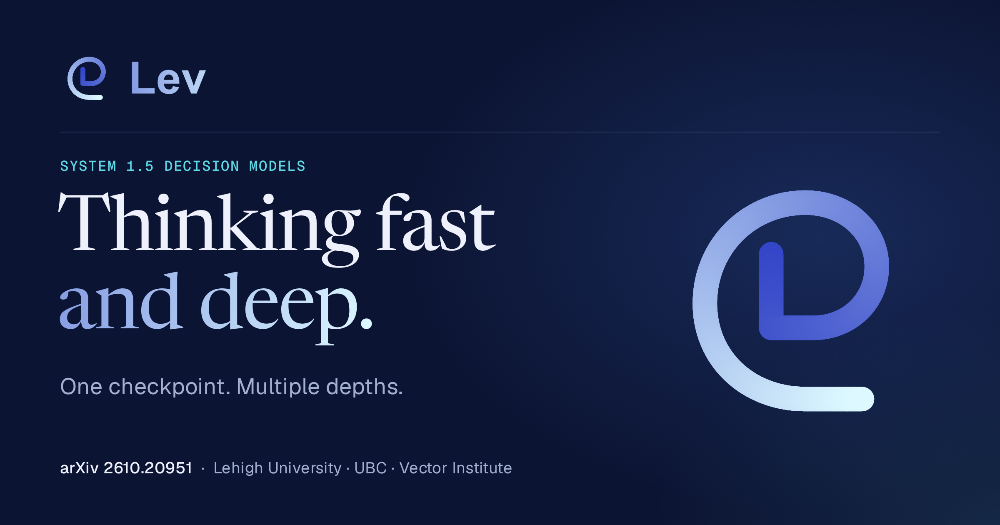</td>
<td align="center" valign="top">メディア未公開</td>
</tr></table>

🔬 <b><a href="https://github.com/MarwaneAit-mouloud/reachy-jev">MarwaneAit-mouloud/reachy-jev</a></b> · Python · 🔎 inferred · 18 天

##### 📝 概要

Reachy Mini contrôle les commandes : modèles de décision (Jev, OpenAI) contre LLM génératif, latence et coût mesurés sur le robot.

##### 📌 基本情報

| 項目       | 値                                   |
| ---------- | ------------------------------------ |
| カテゴリ   | `公開再現、重み、アーキテクチャ研究` |
| エビデンス | `inferred`                           |
| 言語       | Python                               |

##### 📊 データ

| 指標         | 値         |
| ------------ | ---------- |
| スター数     | **0**      |
| 最終プッシュ | 2026-10-19 |
| 初回掲載     | 2026-11-01 |

---

<table><tr><th align="center" width="50%">🖼 画像</th><th align="center" width="50%">🎬 動画</th></tr><tr>
<td align="center" valign="top"></td>
<td align="center" valign="top">メディア未公開</td>
</tr></table>

再配布ライセンスが明示されていないため、アセットは上流リポジトリから直リンクしています。

<b>このカテゴリのその他</b> · 28

- [hyperspaceai/jevcache](https://github.com/hyperspaceai/jevcache) - TypeSafe Jev クラスのモデル向け意思決定キャッシュ — 意思決定をメモ化し、繰り返しを無料、決定論的、共有可能にします。2 MB の単一バイナリ.
- [mars-tw/jev-trading-command-center](https://github.com/mars-tw/jev-trading-command-center) - Open-source paper-trading research app integrating TypeSafe Jev, animated 3D…
- [hunkim/solar-mini4-jev](https://github.com/hunkim/solar-mini4-jev)
- [whyashthakker/awesome-jev-use-cases](https://github.com/whyashthakker/awesome-jev-use-cases) - Jevのユースケースを集めたAwesomeリスト。コストと速度の面でGPTモデル（LLMs）と比較.
- [ljwwwiop/JEV-mini](https://github.com/ljwwwiop/JEV-mini) - JEV-mini は、高速な意思決定モデルをトレーニングするための最小限の学習プロジェクトです.
- [pCwOrM/werr](https://github.com/pCwOrM/werr) - Zero-memory System-1 decision engine &amp; TypeSafe Jev runtime powered by…
- [skydiving94/klint](https://github.com/skydiving94/klint) - ローカルのオープンウェイトkevおよびリモートSystem…
- [yuting-ai/minicpm5-2b-jev](https://github.com/yuting-ai/minicpm5-2b-jev) - MiniCPM5-2B-Jev: 高速 System 1 判断モデル（/v1/systemone、Jev 互換）、JevBench で #1 &lt;=2B…
- [0utKast/Jev_AI](https://github.com/0utKast/Jev_AI) - Curso completo, cuadernos Google Colab y guía bibliográfica sobre Jev。
- [Frank-Funney/mini-jev](https://github.com/Frank-Funney/mini-jev) - エッジデバイス向けの超軽量な構造化意思決定エンジン。依存関係ゼロ、&lt;10MB、11378 QPS。
- [welcomeenjoy75-hue/mini-jev](https://github.com/welcomeenjoy75-hue/mini-jev) - エッジデバイス向けの超軽量な構造化意思決定エンジン。
- [AbdelStark/reachy-jev](https://github.com/AbdelStark/reachy-jev) - Reachy Miniアプリケーション向けの型付きJev意思決定プリミティブ.
- [AnilDeshpande/jev-youtube-demo](https://github.com/AnilDeshpande/jev-youtube-demo) - Jev（TypeSafe）対GPT-4o-mini：Judgement ModelによるYouTubeコメントの分類 — CT-YT-2026-043向けデモ。
- [Dlmily/minimind-jev-dlmily](https://github.com/Dlmily/minimind-jev-dlmily) - MiniMind Jev probability scoring page (GitHub Pages)。
- [Drykeeightyeight427/jev-robot-control](https://github.com/Drykeeightyeight427/jev-robot-control) - MuJoCoで直接的なCartesianコマンドを介してxArm7を制御するGPT-6 Astra、GPT-4.1 mini、Jevを比較.
- [emilesilvis/jev-experiment](https://github.com/emilesilvis/jev-experiment) - 再現可能なJevおよびGPT-4o miniの分類実験、調査結果、説明レポート.
- [gbesse/jev-minimis-watch](https://github.com/gbesse/jev-minimis-watch) - 出典のある資料に基づいて、de minimis援助の累積に関するレビューを準備します.
- [jobakk/jev-cj-asap](https://github.com/jobakk/jev-cj-asap) - ASAPエッセイを、Jev（意思決定モデルAPI）、gpt-oss-20b、gpt-5.4-miniで比較評価：コード、プロンプト、判断ログ、結果。
- [luckberonne/mini-jev](https://github.com/luckberonne/mini-jev) - Jevに着想を得た、一度きりのシェルコマンド分類器（読み取り専用／可逆／破壊的）。
- [u007/minicpm5-jev](https://github.com/u007/minicpm5-jev) - Apple Silicon上でJev互換の型付き意思決定サービスとして動作するMiniCPM5-2B-8bit（llm2jev＋MLX）.
- [Van5hdeep/mini-jev](https://github.com/Van5hdeep/mini-jev) - jevに着想を得て訓練されたシンプルなモデル。
- [vicfei/minimind-jev](https://github.com/vicfei/minimind-jev) - Train your own tiny Jev (System One decision model) — v0.1: frozen Chinese…
- [wangjunxiao/MiniJev](https://github.com/wangjunxiao/MiniJev) - A lightweight and easy-to-follow implementation of Jev.
- [apiplant/laya-rs](https://github.com/apiplant/laya-rs) - Laya の Rust 再実装。35ms 未満の非自己回帰型 typed-decision エンジン。
- [Astro-Han/decision-head-rlcd](https://github.com/Astro-Han/decision-head-rlcd) - 判断モデルの汎化はどこから生じるのか？Qwen3.5-4B上のRLCD、学習データのカバレッジ別にグループ化したホールドアウトセット、JevBench、3つの外…
- [smixs/jevchik](https://github.com/smixs/jevchik) - Telegram bot for group chats: karma for useful messages, anti-spam for…
- [vicksiyi/qwen-2.5-1b-rlcd](https://github.com/vicksiyi/qwen-2.5-1b-rlcd) - harshatheg/Qwen-2.5-1B-RLCDから派生した、Hugging Face上で動作するローカルMLX意思決定確率デモ.
- [yangshun2005/laya-cn](https://github.com/yangshun2005/laya-cn) - \[中文化\] 多言語・非自己回帰型のSystem 1意思決定エンジン。RLCDで学習され、1回のフォワードパス。

## アプリケーション、ゲーム、ロボティクス、インタラクティブデモ

ゲーム、ロボット、ブラウザ、ダッシュボード。レイテンシとコストに関する主張が読める形になるのは、デモを通じてです。

🎮 <b><a href="https://github.com/heyjunpenn/awesome-jev">heyjunpenn/awesome-jev</a></b> · ⭐1057 · Astro · 👁️ observed · 19 天 · ⭐+1

##### 📝 概要

A verified, community-maintained catalog of 992 open-source projects built with Jev.

🔧 コード内での使用を確認: `README.md`, `CHANGELOG.md`, `README.ko.md`, `README.es.md`

##### 📌 基本情報

| 項目       | 値                                                             |
| ---------- | -------------------------------------------------------------- |
| カテゴリ   | `アプリケーション、ゲーム、ロボティクス、インタラクティブデモ` |
| エビデンス | `observed`                                                     |
| 言語       | Astro                                                          |

##### 📊 データ

| 指標         | 値            |
| ------------ | ------------- |
| スター数     | **1057** (+1) |
| 最終プッシュ | 2026-10-19    |
| 初回掲載     | 2026-10-29    |

🏷 `astro` · `awesome` · `awesome-jev` · `awesome-list` · `jev` · `typesafe`

🎮 <b><a href="https://github.com/superagents-lab/jev-search">superagents-lab/jev-search</a></b> · ⭐556 · TypeScript · 👁️ observed · 16 天 · ⭐+1

##### 📝 概要

TypeSafeのJevでウェブを検索：ソース選択、クエリ理解、関連性ランキング。Search1APIで構築。

🔧 コード内での使用を確認: `README.md`

##### 📌 基本情報

| 項目       | 値                                                             |
| ---------- | -------------------------------------------------------------- |
| カテゴリ   | `アプリケーション、ゲーム、ロボティクス、インタラクティブデモ` |
| エビデンス | `observed`                                                     |
| 言語       | TypeScript                                                     |

##### 📊 データ

| 指標         | 値           |
| ------------ | ------------ |
| スター数     | **556** (+1) |
| 最終プッシュ | 2026-10-21   |
| 初回掲載     | 2026-10-29   |

---

<table><tr><th align="center" width="50%">🖼 画像</th><th align="center" width="50%">🎬 動画</th></tr><tr>
<td align="center" valign="top"></td>
<td align="center" valign="top">メディア未公開</td>
</tr></table>

🎮 <b><a href="https://github.com/MCG-NJU/VideoJev">MCG-NJU/VideoJev</a></b> · ⭐295 · Python · 👁️ observed · 20 天 · ⭐+1

##### 📝 概要

VideoJev：動画の理解とインタラクションのためのSystem One Model

##### 📌 基本情報

| 項目       | 値                                                             |
| ---------- | -------------------------------------------------------------- |
| カテゴリ   | `アプリケーション、ゲーム、ロボティクス、インタラクティブデモ` |
| エビデンス | `observed`                                                     |
| 言語       | Python                                                         |

##### 📊 データ

| 指標         | 値           |
| ------------ | ------------ |
| スター数     | **295** (+1) |
| 最終プッシュ | 2026-10-18   |
| 初回掲載     | 2026-10-28   |

---

<table><tr><th align="center" width="50%">🖼 画像</th><th align="center" width="50%">🎬 動画</th></tr><tr>
<td align="center" valign="top"></td>
<td align="center" valign="top">メディア未公開</td>
</tr></table>

🎮 <b><a href="https://github.com/mrnugget/jev-shell-history">mrnugget/jev-shell-history</a></b> · ⭐120 · TypeScript · 👁️ observed · 50 天 · ⭐+1

##### 📝 概要

Jev（TypeSafe）でランク付けされた Fish 風の zsh 履歴自動提案

🔧 コード内での使用を確認: `README.md`

##### 📌 基本情報

| 項目       | 値                                                             |
| ---------- | -------------------------------------------------------------- |
| カテゴリ   | `アプリケーション、ゲーム、ロボティクス、インタラクティブデモ` |
| エビデンス | `observed`                                                     |
| 言語       | TypeScript                                                     |

##### 📊 データ

| 指標         | 値           |
| ------------ | ------------ |
| スター数     | **120** (+1) |
| 最終プッシュ | 2026-09-18   |
| 初回掲載     | 2026-10-29   |

---

<table><tr><th align="center" width="50%">🖼 画像</th><th align="center" width="50%">🎬 動画</th></tr><tr>
<td align="center" valign="top"></td>
<td align="center" valign="top"> アニメーション記録</td>
</tr></table>

再配布ライセンスが明示されていないため、アセットは上流リポジトリから直リンクしています。

🎮 <b><a href="https://github.com/realZachi/typesafe-adblock">realZachi/typesafe-adblock</a></b> · ⭐95 · JavaScript · 👁️ observed · 50 天

##### 📝 概要

🧹 楽しいプロジェクト: 小さな AI 意思決定モデル（TypeSafe Jev）に「この DOM 要素は広告か？」と尋ね、ページから取り除く Chrome 拡張機能。BYOK、バックエンドなし、本物の広告ブロッカーではありません。

🔧 コード内での使用を確認: `README.md`

##### 📌 基本情報

| 項目       | 値                                                             |
| ---------- | -------------------------------------------------------------- |
| カテゴリ   | `アプリケーション、ゲーム、ロボティクス、インタラクティブデモ` |
| エビデンス | `observed`                                                     |
| 言語       | JavaScript                                                     |

##### 📊 データ

| 指標         | 値         |
| ------------ | ---------- |
| スター数     | **95**     |
| 最終プッシュ | 2026-09-17 |
| 初回掲載     | 2026-10-29 |

🎮 <b><a href="https://github.com/zadescoxp/Jev-Trades">zadescoxp/Jev-Trades</a></b> · ⭐60 · Python · 👁️ observed · 42 天

##### 📝 概要

TypeSafe AIのまったく新しい最初のsystem oneモデルをJevと名付けたトレーディングボット

##### 📌 基本情報

| 項目       | 値                                                             |
| ---------- | -------------------------------------------------------------- |
| カテゴリ   | `アプリケーション、ゲーム、ロボティクス、インタラクティブデモ` |
| エビデンス | `observed`                                                     |
| 言語       | Python                                                         |

##### 📊 データ

| 指標         | 値         |
| ------------ | ---------- |
| スター数     | **60**     |
| 最終プッシュ | 2026-09-25 |
| 初回掲載     | 2026-10-21 |

🏷 `automated-testing` · `backtesting` · `crypto-trading-bot-latest` · `trading-bot-ai-automated`

---

<table><tr><th align="center" width="50%">🖼 画像</th><th align="center" width="50%">🎬 動画</th></tr><tr>
<td align="center" valign="top"></td>
<td align="center" valign="top"> アニメーション記録</td>
</tr></table>

🎮 <b><a href="https://github.com/dfinke/Jev">dfinke/Jev</a></b> · ⭐11 · PowerShell · 👁️ observed · 22 天

##### 📝 概要

TypeSafe AIのJevモデルによるPowerShellの意思決定：https://typesafe.ai/blog/introducing-system-one-models-and-jev

##### 📌 基本情報

| 項目       | 値                                                             |
| ---------- | -------------------------------------------------------------- |
| カテゴリ   | `アプリケーション、ゲーム、ロボティクス、インタラクティブデモ` |
| エビデンス | `observed`                                                     |
| 言語       | PowerShell                                                     |

##### 📊 データ

| 指標         | 値         |
| ------------ | ---------- |
| スター数     | **11**     |
| 最終プッシュ | 2026-10-16 |
| 初回掲載     | 2026-10-28 |

---

<table><tr><th align="center" width="50%">🖼 画像</th><th align="center" width="50%">🎬 動画</th></tr><tr>
<td align="center" valign="top"></td>
<td align="center" valign="top">メディア未公開</td>
</tr></table>

🎮 <b><a href="https://github.com/chris-wozniczek/jev-voice-control">chris-wozniczek/jev-voice-control</a></b> · ⭐7 · Swift · 👁️ observed · 46 天

##### 📝 概要

音声で Mac を操作。音声 → Jev（TypeSafe AI System One model）の型付き意思決定 → macOS アクション。メニューバー Swift アプリ。

##### 📌 基本情報

| 項目       | 値                                                             |
| ---------- | -------------------------------------------------------------- |
| カテゴリ   | `アプリケーション、ゲーム、ロボティクス、インタラクティブデモ` |
| エビデンス | `observed`                                                     |
| 言語       | Swift                                                          |

##### 📊 データ

| 指標         | 値         |
| ------------ | ---------- |
| スター数     | **7**      |
| 最終プッシュ | 2026-09-21 |
| 初回掲載     | 2026-10-28 |

🏷 `computer-use` · `cua` · `jev` · `jev-ai` · `jev-api` · `jev-model` · `voice` · `voice-recognition`

🎮 <b><a href="https://github.com/dulin20240919-dot/jev">dulin20240919-dot/jev</a></b> · ⭐1 · 👁️ observed · 1 天

##### 📝 概要

本项目是对 **jev 模型** 的调用尝试，基于 `search_jev使用文档.md`（内部使用文档）与 `jev官方文档.md`（来自 https://docs.typesafe.ai 的官方文档）整理而成

##### 📌 基本情報

| 項目       | 値                                                             |
| ---------- | -------------------------------------------------------------- |
| カテゴリ   | `アプリケーション、ゲーム、ロボティクス、インタラクティブデモ` |
| エビデンス | `observed`                                                     |

##### 📊 データ

| 指標         | 値         |
| ------------ | ---------- |
| スター数     | **1**      |
| 最終プッシュ | 2026-11-05 |
| 初回掲載     | 2026-11-05 |

🎮 <b><a href="https://github.com/Omrigotlieb/awesome-jev">Omrigotlieb/awesome-jev</a></b> · ⭐1 · Python · 👁️ observed · 0 天

##### 📝 概要

Jev上に構築されたプロジェクトの、検証済みでスクリーンショットが豊富なawesomeリスト — 型付き意思決定のためのTypeSafe AIのSystem Oneモデル

##### 📌 基本情報

| 項目       | 値                                                             |
| ---------- | -------------------------------------------------------------- |
| カテゴリ   | `アプリケーション、ゲーム、ロボティクス、インタラクティブデモ` |
| エビデンス | `observed`                                                     |
| 言語       | Python                                                         |

##### 📊 データ

| 指標         | 値         |
| ------------ | ---------- |
| スター数     | **1**      |
| 最終プッシュ | 2026-11-06 |
| 初回掲載     | 2026-09-21 |

🎮 <b><a href="https://github.com/Amr-devman/systemone-robotics">Amr-devman/systemone-robotics</a></b> · 👁️ observed · 11 天

##### 📝 概要

Control a robotic arm using systemone models

##### 📌 基本情報

| 項目       | 値                                                             |
| ---------- | -------------------------------------------------------------- |
| カテゴリ   | `アプリケーション、ゲーム、ロボティクス、インタラクティブデモ` |
| エビデンス | `observed`                                                     |

##### 📊 データ

| 指標         | 値         |
| ------------ | ---------- |
| スター数     | **0**      |
| 最終プッシュ | 2026-10-26 |
| 初回掲載     | 2026-10-27 |

🎮 <b><a href="https://github.com/Anshul261/SystemOne_Demos">Anshul261/SystemOne_Demos</a></b> · Python · 👁️ observed · 9 天

##### 📝 概要

Using Jev/SystemOne Models to build use cases

##### 📌 基本情報

| 項目       | 値                                                             |
| ---------- | -------------------------------------------------------------- |
| カテゴリ   | `アプリケーション、ゲーム、ロボティクス、インタラクティブデモ` |
| エビデンス | `observed`                                                     |
| 言語       | Python                                                         |

##### 📊 データ

| 指標         | 値         |
| ------------ | ---------- |
| スター数     | **0**      |
| 最終プッシュ | 2026-10-29 |
| 初回掲載     | 2026-10-26 |

🎮 <b><a href="https://x.com/tspy/status/2100864234523685146">Xtags — X intent labeller</a></b> · @tspy · 👁️ observed · 50 天

##### 📝 概要

Xtags: a Chrome extension that labels each post in an X timeline with what it is trying to get from you — inducement, provocation, promotion, machine-generated, persuasion, entertainment, information — drawn as a tag plus a probability right after the timestamp. A side panel reports session counts (seen, judged, correct) and cumulative token cost. The author reports near-instant responses and usable accuracy before any tuning.

➡️ **Original project (manifoldor/xtags)** — [https://github.com/manifoldor/xtags](https://github.com/manifoldor/xtags)

> 💡 Worth reading as a latency argument rather than an accuracy one: labelling a timeline only works if the decision costs less than the scroll, which is the constraint a generative model cannot meet.

##### 📌 基本情報

| 項目       | 値                                                             |
| ---------- | -------------------------------------------------------------- |
| カテゴリ   | `アプリケーション、ゲーム、ロボティクス、インタラクティブデモ` |
| エビデンス | `observed`                                                     |
| オーナー   | [yishan](https://x.com/tspy) · @tspy                           |

##### 📊 データ

| 指標       | 値         |
| ---------- | ---------- |
| 表示回数   | **9873**   |
| いいね数   | 24         |
| コメント数 | 11         |
| 投稿日     | 2026-09-18 |
| 初回掲載   | 2026-09-18 |

🏷 `x`

---

<table><tr><th align="center" width="50%">🖼 画像</th><th align="center" width="50%">🎬 動画</th></tr><tr>
<td align="center" valign="top"></td>
<td align="center" valign="top"> アニメーション記録 · <a href="https://video.twimg.com/amplify_video/2100858340331200512/vid/avc1/1242x720/ex2FF5-TerVxo9xX.mp4">動画を開く</a></td>
</tr></table>

🎮 <b><a href="https://github.com/Valen-Team/Valen">Valen-Team/Valen</a></b> · ⭐904 · Python · 🔎 inferred · 3 天 · ⭐+1

##### 📝 概要

Open, lightweight multimodal decision models for text, images, and video. Train and run them yourself.

##### 📌 基本情報

| 項目       | 値                                                             |
| ---------- | -------------------------------------------------------------- |
| カテゴリ   | `アプリケーション、ゲーム、ロボティクス、インタラクティブデモ` |
| エビデンス | `inferred`                                                     |
| 言語       | Python                                                         |

##### 📊 データ

| 指標         | 値           |
| ------------ | ------------ |
| スター数     | **904** (+1) |
| 最終プッシュ | 2026-11-04   |
| 初回掲載     | 2026-10-29   |

🏷 `decision-model` · `jev` · `system-one` · `typed-decisions`

---

<table><tr><th align="center" width="50%">🖼 画像</th><th align="center" width="50%">🎬 動画</th></tr><tr>
<td align="center" valign="top"></td>
<td align="center" valign="top"> アニメーション記録</td>
</tr></table>

🎮 <b><a href="https://github.com/jkudish/jev-browser">jkudish/jev-browser</a></b> · ⭐368 · JavaScript · 🔎 inferred · 0 天 · ⭐+1

##### 📝 概要

TypesafeのJevモデルを使用したブラウザー操作

##### 📌 基本情報

| 項目       | 値                                                             |
| ---------- | -------------------------------------------------------------- |
| カテゴリ   | `アプリケーション、ゲーム、ロボティクス、インタラクティブデモ` |
| エビデンス | `inferred`                                                     |
| 言語       | JavaScript                                                     |

##### 📊 データ

| 指標         | 値           |
| ------------ | ------------ |
| スター数     | **368** (+1) |
| 最終プッシュ | 2026-11-06   |
| 初回掲載     | 2026-10-29   |

---

<table><tr><th align="center" width="50%">🖼 画像</th><th align="center" width="50%">🎬 動画</th></tr><tr>
<td align="center" valign="top"></td>
<td align="center" valign="top"> アニメーション記録 · <a href="https://raw.githubusercontent.com/jkudish/jev-browser/main/assets/github-demo.mp4">動画を開く</a></td>
</tr></table>

🎮 <b><a href="https://github.com/aowang-ai/jev-trade">aowang-ai/jev-trade</a></b> · ⭐227 · TypeScript · 🔎 inferred · 46 天 · ⭐+1

##### 📝 概要

Hyperliquid 上のライブ Jev トレーダー

##### 📌 基本情報

| 項目       | 値                                                             |
| ---------- | -------------------------------------------------------------- |
| カテゴリ   | `アプリケーション、ゲーム、ロボティクス、インタラクティブデモ` |
| エビデンス | `inferred`                                                     |
| 言語       | TypeScript                                                     |

##### 📊 データ

| 指標         | 値           |
| ------------ | ------------ |
| スター数     | **227** (+1) |
| 最終プッシュ | 2026-09-21   |
| 初回掲載     | 2026-10-29   |

🏷 `hyperliquid` · `jev` · `quantitative-finance` · `typesafe`

---

<table><tr><th align="center" width="50%">🖼 画像</th><th align="center" width="50%">🎬 動画</th></tr><tr>
<td align="center" valign="top"></td>
<td align="center" valign="top">メディア未公開</td>
</tr></table>

再配布ライセンスが明示されていないため、アセットは上流リポジトリから直リンクしています。

🎮 <b><a href="https://github.com/NanmiCoder/jev-arena">NanmiCoder/jev-arena</a></b> · ⭐124 · JavaScript · 🔎 inferred · 47 天 · **NEW**

##### 📝 概要

Jevモデルの紹介と実測：Choice / Score / Noulを通じて自然言語を型付きの判断と確率に変換し、分類、スコアリング、ルーティングに利用；DeepSeekなどのモデルとの比較によるコメントのラベル付け、速度と結果の比較に対応し、CSV/Excelインポート、元速度での再生、オフラインレポートを含みます。

##### 📌 基本情報

| 項目       | 値                                                             |
| ---------- | -------------------------------------------------------------- |
| カテゴリ   | `アプリケーション、ゲーム、ロボティクス、インタラクティブデモ` |
| エビデンス | `inferred`                                                     |
| 言語       | JavaScript                                                     |

##### 📊 データ

| 指標         | 値         |
| ------------ | ---------- |
| スター数     | **124**    |
| 最終プッシュ | 2026-09-20 |
| 初回掲載     | 2026-11-07 |

---

<table><tr><th align="center" width="50%">🖼 画像</th><th align="center" width="50%">🎬 動画</th></tr><tr>
<td align="center" valign="top"></td>
<td align="center" valign="top">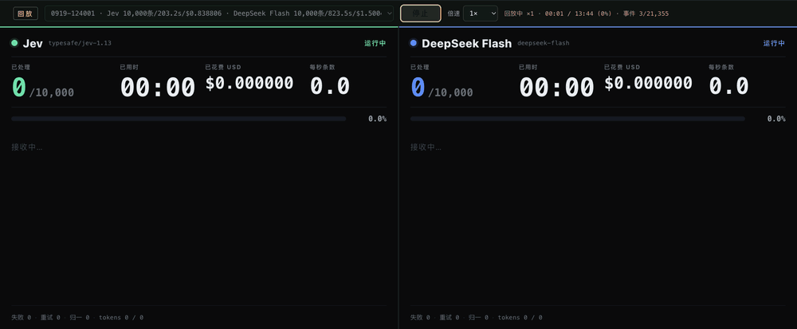 アニメーション記録</td>
</tr></table>

🎮 <b><a href="https://github.com/BudEcosystem/Bud-Decision-Studio">BudEcosystem/Bud-Decision-Studio</a></b> · ⭐80 · HTML · 🔎 inferred · 28 天

##### 📝 概要

Bud Decision studio は、Jev のようなモデルをローカルで扱うための、使いやすいクロスプラットフォームのデスクトップアプリケーション兼サービングシステムです。

##### 📌 基本情報

| 項目       | 値                                                             |
| ---------- | -------------------------------------------------------------- |
| カテゴリ   | `アプリケーション、ゲーム、ロボティクス、インタラクティブデモ` |
| エビデンス | `inferred`                                                     |
| 言語       | HTML                                                           |

##### 📊 データ

| 指標         | 値         |
| ------------ | ---------- |
| スター数     | **80**     |
| 最終プッシュ | 2026-10-09 |
| 初回掲載     | 2026-10-29 |

🏷 `decision-models` · `desktop-app` · `jev` · `laya` · `local-ai` · `pytorch` · `system-one` · `tauri`

---

<table><tr><th align="center" width="50%">🖼 画像</th><th align="center" width="50%">🎬 動画</th></tr><tr>
<td align="center" valign="top"></td>
<td align="center" valign="top"> <a href="https://raw.githubusercontent.com/BudEcosystem/Bud-Decision-Studio/main/docs/media/demo.mp4">動画を開く</a></td>
</tr></table>

再配布ライセンスが明示されていないため、アセットは上流リポジトリから直リンクしています。

🎮 <b><a href="https://github.com/ZeroTang05/Situation-Puzzle">ZeroTang05/Situation-Puzzle</a></b> · ⭐22 · TypeScript · 🔎 inferred · 0 天

##### 📝 概要

这是 Jev 海龟汤 — 一款基于 Jev 模型打造的开源海龟汤情境猜谜游戏。每一道「是 / 否 / 无关」的判断，都由 Jev 现场推理；每一次「还原真相」的内容，都由 Jev 给出判断。没有预设脚本，只有会思考的 Jev，和一款"活"过来的海龟汤。UGC 内容支持，题库因你而丰富。

##### 📌 基本情報

| 項目       | 値                                                             |
| ---------- | -------------------------------------------------------------- |
| カテゴリ   | `アプリケーション、ゲーム、ロボティクス、インタラクティブデモ` |
| エビデンス | `inferred`                                                     |
| 言語       | TypeScript                                                     |

##### 📊 データ

| 指標         | 値         |
| ------------ | ---------- |
| スター数     | **22**     |
| 最終プッシュ | 2026-11-06 |
| 初回掲載     | 2026-11-07 |

🏷 `decision-model` · `game` · `jev` · `jev-ai` · `jev-model` · `situation-puzzles`

---

<table><tr><th align="center" width="50%">🖼 画像</th><th align="center" width="50%">🎬 動画</th></tr><tr>
<td align="center" valign="top"></td>
<td align="center" valign="top"> <a href="https://space.bilibili.com/216025">視聴先 space.bilibili.com</a> · 再生はホストサイト側で開きます。GitHub にはインラインで埋め込めません</td>
</tr></table>

再配布ライセンスが明示されていないため、アセットは上流リポジトリから直リンクしています。

🎮 <b><a href="https://github.com/wizicer/jev_info_site">wizicer/jev_info_site</a></b> · ⭐3 · Astro · 🔎 inferred · 0 天

##### 📝 概要

Community index of tools, models, and real-world use cases built on Jev.

##### 📌 基本情報

| 項目       | 値                                                             |
| ---------- | -------------------------------------------------------------- |
| カテゴリ   | `アプリケーション、ゲーム、ロボティクス、インタラクティブデモ` |
| エビデンス | `inferred`                                                     |
| 言語       | Astro                                                          |

##### 📊 データ

| 指標         | 値         |
| ------------ | ---------- |
| スター数     | **3**      |
| 最終プッシュ | 2026-11-06 |
| 初回掲載     | 2026-11-06 |

🏷 `awesome` · `jev` · `jev-ai` · `typesafe-ai`

---

<table><tr><th align="center" width="50%">🖼 画像</th><th align="center" width="50%">🎬 動画</th></tr><tr>
<td align="center" valign="top"></td>
<td align="center" valign="top">メディア未公開</td>
</tr></table>

再配布ライセンスが明示されていないため、アセットは上流リポジトリから直リンクしています。

🎮 <b><a href="https://github.com/Tatuck/jev-boe-demo">Tatuck/jev-boe-demo</a></b> · ⭐2 · TypeScript · 🔎 inferred · 0 天

##### 📝 概要

Daily demo applying TypeSafe's Jev model to Spain's official gazette (BOE).

##### 📌 基本情報

| 項目       | 値                                                             |
| ---------- | -------------------------------------------------------------- |
| カテゴリ   | `アプリケーション、ゲーム、ロボティクス、インタラクティブデモ` |
| エビデンス | `inferred`                                                     |
| 言語       | TypeScript                                                     |

##### 📊 データ

| 指標         | 値         |
| ------------ | ---------- |
| スター数     | **2**      |
| 最終プッシュ | 2026-11-06 |
| 初回掲載     | 2026-11-06 |

---

<table><tr><th align="center" width="50%">🖼 画像</th><th align="center" width="50%">🎬 動画</th></tr><tr>
<td align="center" valign="top"></td>
<td align="center" valign="top"> アニメーション記録</td>
</tr></table>

再配布ライセンスが明示されていないため、アセットは上流リポジトリから直リンクしています。

🎮 <b><a href="https://github.com/ARCS-inc/jev-game-blog">ARCS-inc/jev-game-blog</a></b> · Python · 🔎 inferred · 0 天

##### 📝 概要

Experiments having jev, a decision model, play the OpenGames Flap game from browser screenshots

##### 📌 基本情報

| 項目       | 値                                                             |
| ---------- | -------------------------------------------------------------- |
| カテゴリ   | `アプリケーション、ゲーム、ロボティクス、インタラクティブデモ` |
| エビデンス | `inferred`                                                     |
| 言語       | Python                                                         |

##### 📊 データ

| 指標         | 値         |
| ------------ | ---------- |
| スター数     | **0**      |
| 最終プッシュ | 2026-11-07 |
| 初回掲載     | 2026-11-07 |

🏷 `decision-model` · `playwright` · `python`

---

<table><tr><th align="center" width="50%">🖼 画像</th><th align="center" width="50%">🎬 動画</th></tr><tr>
<td align="center" valign="top"></td>
<td align="center" valign="top"> アニメーション記録</td>
</tr></table>

<b>このカテゴリのその他</b> · 24

- [bobbylite/jev-system-one-model-primitives](https://github.com/bobbylite/jev-system-one-model-primitives) - TypeSafeの最新Jev意思決定モデルのようなsystem oneモデルでプリミティブ型を実演する基本サンプルアプリ。
- [matsuikentaro1/jev-title-abstract-screening](https://github.com/matsuikentaro1/jev-title-abstract-screening) - Title and abstract screening for systematic reviews with Jev, a System One model。
- [moritzkremb/jev-voice-browser](https://github.com/moritzkremb/jev-voice-browser) - 音声で実ブラウザーを操作。Jev。
- [kevinbadi/jev-voice](https://github.com/kevinbadi/jev-voice) - Mac に話しかける。ローカル whisper.cpp + コマンドごとに 1 回の Jev（TypeSafe）呼び出し + macOS 自動化.
- [buer2233/jev-ui-test](https://github.com/buer2233/jev-ui-test) - Jev 意思決定モデル駆動の UI 自動テストフレームワーク: 「次に何をするか」のテキストを生成するのではなく、候補要素を直接スコアリング.
- [bilune/jev-design](https://github.com/bilune/jev-design) - モデルはダッシュボードを設計できるか？一文のブリーフから、設計システム全体をJevが実行時に生成するコンソール.
- [emrickgarrett/OneVOneJev](https://github.com/emrickgarrett/OneVOneJev) - 1v1 Jev quickscopeアリーナ — Three.js + TypeSafe System One。
- [justinhe16/trade-jev](https://github.com/justinhe16/trade-jev) - Backtest Jev (TypeSafe) as a BUY/SELL/HOLD trader on NQ L10 order-book data。
- [joch/jevman](https://github.com/joch/jevman) - Pac-Man driven by the jev decision model。
- [Tommylegen/jev-laya-toolkit](https://github.com/Tommylegen/jev-laya-toolkit) - Dashboard and local proxy for SystemOne decision models - Jev (TypeSafe API)…
- [harsha89/jev-demo](https://github.com/harsha89/jev-demo) - TypeSafe JEVによるメール分類のショーケース：スパム（noul）、カテゴリ（choice）、緊急度（score） — Next.js +…
- [PistachioAIHQ/jev-synergy-screening](https://github.com/PistachioAIHQ/jev-synergy-screening) - Jev（TypeSafe System One）× ASReview SYNERGY抄録スクリーニングデモ — Choice/Noul対ゴールドラベル.
- [arkulinskis/jev-buddy](https://github.com/arkulinskis/jev-buddy) - Jev Buddy: the developer guide to Jev, the AI decision model。
- [BrendanH18/jev-lab](https://github.com/BrendanH18/jev-lab) - Six small apps and a workbench that show what TypeSafe。
- [charles-forsyth/jev-decision-wall](https://github.com/charles-forsyth/jev-decision-wall) - Type anything. 200 yes/no AI judgments light up as a live heatmap in ~200 ms…
- [chyiiiiiiiiiiii/jev-wingman](https://github.com/chyiiiiiiiiiiii/jev-wingman) - Reply suggestions for Slack, Discord, LINE, Telegram, Messenger, Instagram and…
- [liangkingjin/jev-demo](https://github.com/liangkingjin/jev-demo) - Jev（TypeSafe System One）判定模型演示：Choice / Noul / Score 三原语 + 三档阈值分流，离线可跑。
- [m407/jev-grep](https://github.com/m407/jev-grep) - Semantic search for log and code fragments using Jev。
- [netcode001/jev](https://github.com/netcode001/jev) - 非公式のJev AI情報ハブ — アクセスガイド、料金、無料のBYOKプレイグラウンド。公開中：jev-ai.live。
- [neurogabo/jev-arena](https://github.com/neurogabo/jev-arena) - Run a Pokémon Champions battle arena locally with Jev, TypeSafe, and Pokémon…
- [Ridnois/jev-trader](https://github.com/Ridnois/jev-trader) - Rust crypto trading bot that reads the news with Jev: news strategy, order-flow…
- [Sandesh-S-Dalvi/playwright-jev-demo](https://github.com/Sandesh-S-Dalvi/playwright-jev-demo) - Playwright + TypeSafe Jev (System One) decision-map demo for semantic test…
- [taiki00wo/jev-playground](https://github.com/taiki00wo/jev-playground) - TypeSafe AI の Jev で、飲食店の売上低下の原因を判定してみる作業場所。
- [sorrycc/typesafe-snake](https://github.com/sorrycc/typesafe-snake) - TypeSafeのJevモデルによってSnakeを自動プレイします。1ティックごとにSystem Oneを1つ選択し、合法手と事実はコードで生成されます.

## 記事、ディスカッション、類似リスト

ローンチスレッド、独立した記事、この分野の他のキュレーションリスト。本リポジトリは唯一ではなく、そう明言するほうが、そうでないふりをするより有用です。

📰 <b><a href="https://docs.typesafe.ai/model-jaggedness/jev-1.13">既知の欠陥（jaggedness）9種類</a></b> · ✅ official · 50 天

##### 📝 概要

字面の理解、**信頼できないカウント**、日付比較、多段階の間接参照、無関係な詳細を含む大規模なstate、敵対的コンテンツ、指示とcriteriaの矛盾、構造的不変条件、生成。公式の推奨は「原子問題に分解してコード内で組み合わせる」。

> 💡 **能力の境界**——これはベンダーが自ら認める境界の一覧であり、完全に収録済み

##### 📌 基本情報

| 項目       | 値                                   |
| ---------- | ------------------------------------ |
| カテゴリ   | `記事、ディスカッション、類似リスト` |
| エビデンス | `official`                           |

##### 📊 データ

| 指標     | 値         |
| -------- | ---------- |
| 初回掲載 | 2026-09-20 |

📰 <b><a href="https://docs.typesafe.ai/cookbooks/consistency_choice_cookbook">`consistency_choice` cookbookが「繰り返し呼び出すと結果が変わる」ことに正式回答</a></b> · ✅ official · 50 天

##### 📝 概要

同一の監査rubric、**各条件につき8個のChoiceを15回ずつ反復**。TypeSafeの**raw agreeは90.8%**（8問中2問が反転したが、**conflicts=0** ——反転は「具体的なラベル ↔ uncertain」の間でのみ発生）。**abstentionルールを1つ追加し（`probabilities`を使ってtop probability ≥ 0.60を要求し、それ以外は`uncertain`が人手に回す）、一致率は99.2%**、automaticは74.2%に上昇し、**モデル呼び出しは増加しなかった**。比較：Haiku t=0は100%、Opus 4.8 reasoningは92.5%、gpt-5.4-mini t=0は99.2%。公式声明：これはモデルを確実なものにするわけではない。これらの数値は**正しさではなく再現性**を示す。0.60は例示的な方針であり、本番の閾値はラベル付きサンプルとコストを用いて決定する必要がある。

> 💡 **\[DEFINITION-CHANGE\]** B5、主要数値表、SKILL.mdの鉄則3とリリース第6項、適用範囲の境界第6項を書き換えた——**本リポジトリはこれまで「非決定性」をリスクとして記録していたが、現在は公式の正解である「abstentionで管理する」に変更**

##### 📌 基本情報

| 項目       | 値                                   |
| ---------- | ------------------------------------ |
| カテゴリ   | `記事、ディスカッション、類似リスト` |
| エビデンス | `official`                           |

##### 📊 データ

| 指標     | 値         |
| -------- | ---------- |
| 初回掲載 | 2026-09-20 |

📰 <b><a href="https://docs.typesafe.ai/confidence">confidenceの公式な意味を確認</a></b> · ✅ official · 50 天

##### 📝 概要

公式は`confidence`が**`probabilities`分布から算出された統計量**であり、分布が集中するほど確実性が高いと明言している。**Noulにはconfidenceがない**。公式は「あなたは私たちの定義に縛られていない」とも明言している。閾値は「保守的な値から始め、自分のデータで測定」すべきである。

> 💡 Archerの逆公式と一致し、定義ファイルに書き込んだ

##### 📌 基本情報

| 項目       | 値                                   |
| ---------- | ------------------------------------ |
| カテゴリ   | `記事、ディスカッション、類似リスト` |
| エビデンス | `official`                           |

##### 📊 データ

| 指標     | 値         |
| -------- | ---------- |
| 初回掲載 | 2026-09-20 |

📰 <b><a href="https://www.langchain.com/blog/building-a-harness-with-jev（2026-09-17">LangChain公式ブログが「なぜagentガードレールのカテゴリーが急増したのか」を説明 — 、Sydney Runkle &amp; Hunter Lovell）</a></b> · ✅ official

##### 📝 概要

*「claude、codex、cursorのようなCoding harnessesは、危険なアクションを分類する何らかの方法を導入してきた… **これまでは、このclassifierの段階はハーネスのクローズドソース部分に閉じ込められていた。現在、安価で高性能なclassifierモデルが存在するため、同じパターンを採用してすべてのagentに適用できる！**」*；さらにrouterの例（Jevを使ってカスタム基準でモデルを選択し、確率をagent stateに保持）と、*「JevはLLMのdrop-in replacementではない」*を提示。

> 💡 **本リポジトリが観察した「ハーネス機能の商品化」現象を説明するもの**——クローズドソースのharness機能がオープンソース化されたため。断片ライブラリ§2.5に記載済み

##### 📌 基本情報

| 項目       | 値                                   |
| ---------- | ------------------------------------ |
| カテゴリ   | `記事、ディスカッション、類似リスト` |
| エビデンス | `official`                           |

##### 📊 データ

| 指標     | 値         |
| -------- | ---------- |
| 初回掲載 | 2026-09-20 |

📰 <b><a href="https://typesafe.ai/team">TypeSafeにTeamページを追加 + ナビゲーションに`Enterprise`の入口を追加（プロダクト化・商業化のシグナル）</a></b> · ✅ official · 49 天

##### 📝 概要

TypeSafeにTeamページを追加 + ナビゲーションに`Enterprise`の入口を追加（プロダクト化・商業化のシグナル）

> 💡 **\[DEFINITION-CHANGE\]**（チームに関する事実 + プロダクト化のシグナル）；`01-系统定义/jev-系统定义.md`に**§6b/6c**を追加；`references/README.md`のクイック事実カードを更新

##### 📌 基本情報

| 項目       | 値                                   |
| ---------- | ------------------------------------ |
| カテゴリ   | `記事、ディスカッション、類似リスト` |
| エビデンス | `official`                           |

##### 📊 データ

| 指標     | 値         |
| -------- | ---------- |
| 初回掲載 | 2026-09-20 |

📰 <b><a href="https://vercel.com/changelog/typesafe-ai-jev-now-available-on-ai-gateway">Vercel公式changelogがJevのAI Gatewayへの掲載を発表</a></b> · ✅ official

##### 📝 概要

Vercel公式changelogがJevのAI Gatewayへの掲載を発表

> 💡 断片ライブラリのVercel行に**AI SDKの使用法**を補足（真の増分）；**主要数値表は変更不要**（数値はすでに存在）→ **今回の定義レベルの変更は「なし」に格下げ**

##### 📌 基本情報

| 項目       | 値                                   |
| ---------- | ------------------------------------ |
| カテゴリ   | `記事、ディスカッション、類似リスト` |
| エビデンス | `official`                           |

##### 📊 データ

| 指標     | 値         |
| -------- | ---------- |
| 初回掲載 | 2026-09-20 |

📰 <b><a href="https://docs.typesafe.ai/llms.txt">公式cookbookの実践レシピ18件を発見・取得（それまでは完全に欠落）</a></b> · ✅ official · 50 天

##### 📝 概要

`llms.txt`は全サイトで111ページ；ローカルには元々30ページあり、diffの結果、`cookbooks/`配下に**18本のレシピ**（実行可能なコード、実データセット、実測値を含む）があることが判明。各ページを取得して`type: official-cookbook` frontmatterを追加。

> 💡 `03-能力边界/jev-官方cookbook配方.md`のインデックスページを新規作成；**これは「原理から本番へ進む」ための層**

##### 📌 基本情報

| 項目       | 値                                   |
| ---------- | ------------------------------------ |
| カテゴリ   | `記事、ディスカッション、類似リスト` |
| エビデンス | `official`                           |

##### 📊 データ

| 指標     | 値         |
| -------- | ---------- |
| 初回掲載 | 2026-09-20 |

📰 <b><a href="https://github.com/typesafe-ai/skills（⭐128">公式agent skill `typesafe-ai`をインストール — 、MIT）</a></b> · ✅ official · 50 天

##### 📝 概要

`npx -y skills@latest add typesafe-ai/skills -s typesafe-ai -g -a '*' --copy -y` → `~/.agents/skills/typesafe-ai/`にインストール（単一ファイルのSKILL.md、149行 / 10 KB、79個のagentをカバー）。セキュリティ評価：Gen=Safe、Socket=0 alerts、Snyk=Low Risk。唯一の失敗項目はEve（グローバルインストール非対応で、影響なし）。

> 💡 私たちの`jev` skillと**共存し、相互補完する**

##### 📌 基本情報

| 項目       | 値                                   |
| ---------- | ------------------------------------ |
| カテゴリ   | `記事、ディスカッション、類似リスト` |
| エビデンス | `official`                           |

##### 📊 データ

| 指標     | 値         |
| -------- | ---------- |
| 初回掲載 | 2026-09-20 |

📰 <b><a href="https://docs.typesafe.ai/llms.txt`">公式ドキュメントのdiffで再度有効性を検証 — `</a></b> · ✅ official

##### 📝 概要

今回のdiffでは新規ページは見つからなかった（30本 + 18 cookbookが揃っている）；収集器のdiffロジックが正しいことを示す。

> 💡 各回の固定手順として保持

##### 📌 基本情報

| 項目       | 値                                   |
| ---------- | ------------------------------------ |
| カテゴリ   | `記事、ディスカッション、類似リスト` |
| エビデンス | `official`                           |

##### 📊 データ

| 指標     | 値         |
| -------- | ---------- |
| 初回掲載 | 2026-09-20 |

📰 <b><a href="https://docs.typesafe.ai/models">公式ドキュメントのインデックスと、レート制限・コンテキスト・カスタマイズポリシーをすべて確認</a></b> · ✅ official · 50 天

##### 📝 概要

エンドポイント`POST https://api.typesafe.ai/v1/systemone`；`jev-1.13.0`、別名`jev-latest`/`jev-preview`；1リクエストあたり64k、state+最長質問32k；レート制限250k tok/s、1200 req/minで、**動的に調整**；テキスト入力のみ；Choice≤255、Scoreは2–10の範囲；**fine-tune不可、すべてのアカウントで同一の重みを共有**；顧客データによる訓練は行わない；英語が最も正確。

> 💡 **アーキテクチャ／能力の境界**——`01-系统定义/jev-系统定义.md`と`jev-能力与边界-准确定义.md`に記載

##### 📌 基本情報

| 項目       | 値                                   |
| ---------- | ------------------------------------ |
| カテゴリ   | `記事、ディスカッション、類似リスト` |
| エビデンス | `official`                           |

##### 📊 データ

| 指標     | 値         |
| -------- | ---------- |
| 初回掲載 | 2026-09-20 |

📰 <b><a href="https://docs.typesafe.ai/migrating-to-v1">公式の欠落ページを補完：v1 APIへ移行</a></b> · ✅ official · 50 天

##### 📝 概要

previewエンドポイント`/preview/evaluation` → 安定版**`POST /v1/systemone`**；`prompts`配列 → `questions` map；`responses`配列 → `answers` map；フィールド名を**`probability`→`noul`、`chosen`→`choice`、`expectation`→`score`**に変更；choiceの確率を配列からmapに変更；**score確率をv1で追加**；認証は変更なし。

> 💡 `官方文档快照/migrating-to-v1.md`を記録；これは**2番目の公式ページ発見経路**（公式skillのドキュメントルーティング表）も示します

##### 📌 基本情報

| 項目       | 値                                   |
| ---------- | ------------------------------------ |
| カテゴリ   | `記事、ディスカッション、類似リスト` |
| エビデンス | `official`                           |

##### 📊 データ

| 指標     | 値         |
| -------- | ---------- |
| 初回掲載 | 2026-09-20 |

📰 <b><a href="https://github.com/yibie/awesome-jev">yibie/awesome-jev</a></b> · ⭐2548 · Python · 👁️ observed · 7 天

##### 📝 概要

Jevを基盤に構築された公開プロジェクト、インテグレーション、ディスカッションを厳選したリスト — 型付き意思決定のためのTypeSafe AIのSystem Oneモデル。

##### 📌 基本情報

| 項目       | 値                                   |
| ---------- | ------------------------------------ |
| カテゴリ   | `記事、ディスカッション、類似リスト` |
| エビデンス | `observed`                           |
| 言語       | Python                               |

##### 📊 データ

| 指標         | 値         |
| ------------ | ---------- |
| スター数     | **2548**   |
| 最終プッシュ | 2026-10-31 |
| 初回掲載     | 2026-09-18 |

🏷 `awesome` · `awesome-list` · `jev` · `llm`

<b>このカテゴリのその他</b> · 71

- [cobanov/awesome-jev](https://github.com/cobanov/awesome-jev) - Jev、型付き判定のためのTypeSafe AIのSystem Oneモデルで構築された、厳選されたソースに裏付けられたプロジェクト一覧.
- [Typesafe AI raises $870M at $7.5B](https://news.ycombinator.com/item?id=50023450)
- [We’re releasing Jev 1.14.0 along with experimental features for dreamers](https://news.ycombinator.com/item?id=50095353)
- [hellogumbo/awesome-jev](https://github.com/hellogumbo/awesome-jev) - TypeSafe AIのSystem OneモデルであるJev上に構築されたプロジェクトのコミュニティディレクトリ.
- [Open-sourced jev architecture last year with model,paper and dataset](https://news.ycombinator.com/item?id=49736660) - 現在、誰もが、自己回帰的ではなく、JSONスキーマを使って非常に高速に確率予測を行うアーキテクチャについて語っています.
- [Show HN: Jev Cards, Can you beat a vision model at a picture quiz?](https://news.ycombinator.com/item?id=50167617) - I built a quiz game around TypeSafe&amp;#x27;s new Jev model, which has vision…
- [What Is RLCD? The Secret Behind Jev](https://news.ycombinator.com/item?id=49829625)
- [Document Review with Unsiloed and TypeSafe Jev](https://news.ycombinator.com/item?id=50068443)
- [aliaihub/awesome-jev-usecases](https://github.com/aliaihub/awesome-jev-usecases) - Jev、TypeSafe AIのSystem Oneモデルを使って構築するための、エビデンスに基づくユースケース、パターン、ガイダンス.
- [Show HN: Fastbrowse, Browser agent that picks clicks with a System One model](https://news.ycombinator.com/item?id=50311029) - Hi HN, I&amp;#x27;m Furqan founder of Nebula.
- [TypeSafe started the decision-model category;OpenAI and AWS did it in 3 weeks](https://news.ycombinator.com/item?id=50003920)
- [Decision Index 0.2.1 – 70 open reproductions of TypeSafe Jev's "Decision Model"](https://news.ycombinator.com/item?id=49934879)
- [jtnkminimal/awesome-jev](https://github.com/jtnkminimal/awesome-jev) - JevとTypeSafeのSystem Oneモデルで構築された厳選プロジェクト.
- [Show HN: jev-bisect – Find answers with Jev via bisection search](https://news.ycombinator.com/item?id=50010094) - ! pip install jev-bisect ! export…
- [Show HN: Nouli – A multi-turn decision graph harness for System One models](https://news.ycombinator.com/item?id=50288442) - I&amp;#x27;ve been fine tuning my own decision models lately and I&amp;#x27;ve been…
- [Ask HN: Everyone was Jev-maxxing. Why not CDMs now?](https://news.ycombinator.com/item?id=50242523) - Just a few weeks ago, all that my feed had was people JEV-maxxing.
- [Ask HN: System One models for autonomous agents](https://news.ycombinator.com/item?id=50142037) - I&amp;#x27;ve seen a few impressive demos of Typesafe&amp;#x27;s new paradigm with…
- [Jeyzma is TypeSafeAI minus $850M plus Go/TinyGo/llama.cpp in the browser](https://news.ycombinator.com/item?id=50031093)
- [Building a System One Model for Prompt Injection](https://news.ycombinator.com/item?id=50165645)
- [JEV: Type Safe AI](https://news.ycombinator.com/item?id=50106296)
- [RadRebelSam/awesome-jev](https://github.com/RadRebelSam/awesome-jev) - Jev、TypeSafe AIのSystem Oneモデル上に構築されたプロジェクトをクローラーが管理するディレクトリ.
- [Show HN: Decide – Jev decisions in the shell, scripts, and agent skills](https://news.ycombinator.com/item?id=49878492) - すべてのソフトウェアは意思決定を行う。コードは決定論的なものを処理する。Jevのような意思決定モデルは判断を要するものを処理する.
- [Show HN: We Beat TypeSafe Jev and Released Open-Source Decision Model](https://news.ycombinator.com/item?id=50027132)
- [Startup TypeSafe AI's Jev Model Sparks Copycats, Talk of LLM Alternatives](https://news.ycombinator.com/item?id=49951597)
- [The Hitchhiker's Guide to System One Models](https://news.ycombinator.com/item?id=50301027)
- [Typesafe.ai Jev Open Source Alternative Qwen-2.5-1B-RLCD](https://news.ycombinator.com/item?id=49734345)
- [ozers/jevsome-projects](https://github.com/ozers/jevsome-projects) - Jev、TypeSafe AIのSystem Oneモデルを実際に呼び出すことが証明できるオープンソースプロジェクト.
- [rhc98/awesome-jev](https://github.com/rhc98/awesome-jev) - Jev（TypeSafe AIのSystem Oneモデル）上に構築された、Jev自身が厳選したプロジェクト.
- [108 条声明对照：Jev 的校准并不独特（含作者自我修正）](https://truestandard.ai/blog/jev-accuracy-tested) - 108件の主張を照合：Jevの較正は独自のものではない（著者自身による修正を含む）。
- [\[cellcog.ai 追踪页\]() 自称分层记录 *"claims / concedes / measured / found, dated"* → 与本库锚页设计意图一致，值得长期对照](https://cellcog.ai/blog/jev-typesafe-decision-model) - \[cellcog.ai追跡ページ\]()は、階層化された記録を*「claims / concedes / measured / found…
- [\`browser-use/jev-ultrafast\`（ 2946）：决策层与生成层分离的标杆](https://github.com/browser-use/jev-ultrafast) - 把页面压成**带编号的元素表**；操作集固定。
- [\`calibre\`：独立标定实验证明"阈值参数不跨数据集迁移"](https://github.com/FirasSX914/calibre) - 2つのラベル付きデータセット。
- [\`classifier.dev\`：建在 Jev 上的免费零样本分类服务（含 agent skill）](https://classifier.dev) - **API keyもアカウントも不要**なゼロショット分類HTTPサービス；`openapi.json`。
- [\`clownware/bouncer\` 提供目前最硬的第三方独立标定数据](https://github.com/clownware/bouncer) - 6つの質問における精度/Brier/ビン別信頼性：Brier **0.036–0.149**；高信頼ビン（0.9–1.0）は多くが100%。
- [\`jarrodwatts/jev-trader\`（ 600）：实时交易里的延迟与单次成本](https://github.com/jarrodwatts/jev-trader) - 每个 Monad 区块（~300ms）一次 buy/sell/hold 决策；实测 `latencyMs: 81`、**`jevUsd…
- [\`Jev Judge vs Dimension Scores\`：分解不总是更好（含日语多语证据）](https://agentjournal.dev/blog/llm-judge-vs-feature-extraction/) - 3つの分類タスクで「各質問に1つの直接的なJev質問」対「12–14個の採点次元 +…
- [\`jevcal\`：最小样本经验值 \< 约 100 条不可信；并多做两件我们没做的事](https://github.com/abhixhek/jevcal) - 自前のラベル付きデータで問題ごとの信頼度閾値を適合 → ホールドアウトセットで検証 → **フォールバックトラフィックを推定** → **CI…
- [\`kaijia323/dsh-plugin-jev\`：DeepSeek Harness 的 Jev 插件（与本库同环境）](https://github.com/kaijia323/dsh-plugin-jev) - Jev を DSH に接続し、**ネイティブツール `jev_decide` を登録**。
- [corolin/vibrato](https://github.com/corolin/vibrato) - A complete System One model for emotion — emotion reading as typed decisions。
- [New：\[InfoWorld（2026-09-17）\]() —— 企业媒体视角，用例清单：*"which tool to invoke, which action to take next, whether a request should be approved, when a task…](https://www.infoworld.com/article/4223468/typesafe-ais-new-models-work-with-machines-not-humans.html) - New：\[InfoWorld（2026-09-17）\]() —— 企業メディアの視点によるユースケース一覧：*。
- [OOD 校准审计："Jev 知道自己不知道吗？"](https://github.com/scienthoon/jev-ood-calibration)
- [X 上一条新描述口径](https://x.com/testingcatalog/status/2099968075861008781) - Jev を *&quot;a small and customizable System One decision model&quot;* と説明し、さらに *。
- [X： \[@omarsar0\]()（Elvis Saravia, DAIR.AI）独立表述了本库的「铁律 1」](https://x.com/omarsar0/status/2099933100440494105) - *。
- [X：\[@heyDhavall\]() 的简洁概括（*"why make software wait for an LLM to generate paragraphs when it really just needs decisions?"*）](https://x.com/heyDhavall/status/2099926342095798783) - X：\[@heyDhavall\]() による簡潔な要約。
- [X：拿到本库最具体的单次成本数字 — \[@moritzkremb\]()](https://x.com/moritzkremb) - *。
- [主 HN 帖规模](https://news.ycombinator.com/item?id=49717558) - **1862 points**；コメントは概ね好意的（doom demo がクール、態度がよい）で、広く引用された推測が 1 件あり、「パイプライン内の…
- [先例清单：\[ibl.ai\]() 指出 CriticGPT 与 Prometheus 2 都在 2024 年就做"判断模型" → 写进优先权争议页 §4d，与 Laya 的指称分开记；本库判断 Jev 与它们的真实差异是"把判断做成带类型与概率的一等 API"](https://ibl.ai/blog/jev-judge-model-evaluation-not-generation-enterprise) - 先行事例一覧：\[ibl.ai\]() は CriticGPT と Prometheus 2 がともに 2024…
- [创始人第二段"原始初衷"（比第一段更锋利）：Diogo Almeida 经 \[Pat McGuinness Substack\]() 转引](https://patmcguinness.substack.com/p/jev-makes-fast-and-cheap-decisions) - 創設者による 2 番目の段落「原初の意図」（1 番目よりも鋭い）：Diogo Almeida が \[Pat McGuinness Substack\]()…
- [又一份"本地 vs 托管"选型实录：\[astgl.com\]()（James Cruce，09-22）—— 421M 开源模型在其 frozen replay 上胜过自制路由；他最终不选 Jev 是因为约束（数据不出本机、可控回退），并主动限定*"whether Laya beats Jev…](https://astgl.com/p/local-laya-vs-hosted-jev-typed-decisions) - 「ローカル vs ホスト型」の選定記録がもう 1 件：\[astgl.com\]()（James Cruce、09-22）——421M…
- [发现与本库做同一件事的 agent skill：\`decision-first\`](https://github.com/harrymunro/decision-first) - *。
- [发现社区维护的完整索引 \`AbdelStark/awesome-typesafe\`（ 103）](https://github.com/AbdelStark/awesome-typesafe) - これまで断片的に収集していたエコシステムを、次の構成による完全な地図にまとめた：「公式リソース / クライアントと統合 / agent と開発者ツール /…
- [四条精准告诫（已写入 IO 契约 §S8） —— \[Wavect 独立评测\]()：](https://wavect.io/blog/jev-ai-decision-model-review) - 4 つの的確な警告（IO 契約 §S8 に記載済み） —— \[Wavect 独立評価\]()：。
- [新用例：上下文压缩（LiteLLM 的 TypeSafe 护栏）](https://github.com/BerriAI/litellm) - `litellm/types/proxy/guardrails/guardrail_hooks/typesafe.py` は **compaction…
- [独立第三方与我们的术语纪律收敛：\[HarnessRouter（2026-09-20）\]()](https://harnessrouter.ai/blog/what-is-a-system-one-model) - 独立した第三者と私たちの用語規律が収束：\[HarnessRouter（2026-09-20）\]()。
- [生态跨过一条线：出现 Jev-HTTP-API 兼容的开源服务端](https://github.com/ekzhang/openjev-sglang（⭐**123**）) - *。
- [第 11 份独立评测：克罗地亚语零样本 vs 自己微调的 BERT（\[Senko Rašić\]()，09-22）](https://blog.senko.net/analyzing-jev-a-new-ai-model) - 第 11 件目の独立評価：クロアチア語のゼロショット vs 自分でファインチューニングした BERT（\[Senko Rašić\]()、09-22）。
- [第 12 份独立评测：注入鲁棒性系统测试《Can Jev be jailbroken?》（\[tanh.xyz\]()，14,495 次记录调用，原始记录公开）](https://tanh.xyz/research-notes/jev-prompt-manipulation) - 第 12 件目の独立評価：インジェクション耐性のシステムテスト『Can Jev be jailbroken?』。
- [第 9 份独立评测：\[@juanmacias《Testing TypeSafe's Jev - Legal Corpus》\]()](https://x.com/i/article/2100463318209048850) - 第 9 件目の独立評価：\。
- [第三方 SDK 覆盖主流服务端语言：HN \`Show HN: Typesafe Java SDK (Unofficial)\`（\[item 49762324\]()）](https://news.ycombinator.com/item?id=49762324) - 以前の Go / Rust（×3）/ Elixir / Ruby（×3）/ .NET / Rails を加え、**第三者の SDK…
- [第三方深度解读补充大量可操作实测](https://flaviocopes.com/jev) - ① **Noul の 0.5 は「中程度」を意味しない**。モデルが判別できないことを意味する；② **Score…
- [第三方独立实测：Classmethod / DevelopersIO](https://dev.classmethod.jp/en/articles/jev-for-llm-model-routing/) - 40回の呼び出しがすべて成功し、分類は10/10で正確；median **0.643–0.674…
- [第三方独立实测：Vercel 生产集成（最重要产业证据）](https://x.com/rauchg/status/2100307962262872105) - fxのデフォルトautoモードのsafety reviewerは元々 GPT Lunaを実行していたが、Jev…
- [财经媒体的独立表态：\[TechStock²《…Its 445× Cost Claim Is Still Self-Tested》\]()（2026-09-17）：*"…leaves the biggest performance numbers dependent on TypeSafe's…](https://ts2.tech/en/typesafe-ai-raises-40-million-for-jev-but-its-445x-cost-claim-is-still-self-tested/) - 金融メディアによる独立した見解：\。
- [闭环信号：Archer 那篇文章上了 HN —— \`Jev's Architecture Unmasked\`（\[item 49766351\]()，1pt）](https://news.ycombinator.com/item?id=49766351) - 循環を閉じるシグナル：Archerの記事がHNに掲載 —— `Jev。
- [首个上市公司级集成：\[Aurora Mobile（NASDAQ: JG）的 GPTBots.ai 集成 Jev\]()（09-22）→ *"two-layer AI architecture: one layer that thinks, one layer that…](https://markets.businessinsider.com/news/stocks/aurora-mobile-s-gptbots-ai-integrates-jev-two-layers-of-ai-one-enterprise-platform-1036563338) - 上場企業レベルで初の統合：\[Aurora Mobile（NASDAQ: JG）のGPTBots.ai統合 Jev\]()（09-22）→…
- [首份关于 Jev 概率的强反证：\`jev-does-not-play-dice\`](https://github.com/KantaHayashiAI/jev-does-not-play-dice) - **Jev が報告する確率は「モデルがどれほど確信しているか」を反映し、「世界がどれほどランダムか」は反映しない**.
- [AppitStudio/awesome-jev](https://github.com/AppitStudio/awesome-jev) - 型付き AI 意思決定のための、キュレーションされた Jev リソースと実行可能な例.
- [onlyoasis/awesome-jev-cases](https://github.com/onlyoasis/awesome-jev-cases) - Source-linked Jev use cases, open-source projects, and official cookbooks。
- [samTime101/Jev-emoji-reactor](https://github.com/samTime101/Jev-emoji-reactor) - 最新の意思決定モデルjevを統合し、テキストの意味を読み取って絵文字を分類。
- [新的优先权主张（与 Laya 无关）：HN \`I built the Jev architecture one year ago and open-sourced it\`（2pts）→ \[r/LocalLLaMA 帖\]()；本轮只登记 URL 与主张，未读原文、不下判断，下一轮核实](https://www.reddit.com/r/LocalLLaMA/comments/1wijo3e/i_literally_built_the_jev_architecture_one_year/) - 新たな優先権の主張（Layaとは無関係）：HN `I built the Jev architecture one year ago and…
- [X 社区：发布日官方账号被钓鱼](https://commondefense.ai/blog/typesafe-x-account-phished) - @typesafeaiが公開日に11:17amに投稿した後、5:43pmにCEOから盗難が報告され、5:54pmにフィッシングと確認、11:49pmに奪回。

## その他のプロジェクト

🧩 <b><a href="https://github.com/Contrastive-LM/CLM">Contrastive-LM/CLM</a></b> · ⭐3169 · Python · 👁️ observed · 32 天 · ⭐+2

##### 📝 概要

Contrastive Language Models（CLM）は、状態とアクションを結び付ける対照学習の目的で訓練された新しいクラスのSystem Oneモデルです。

##### 📌 基本情報

| 項目       | 値                     |
| ---------- | ---------------------- |
| カテゴリ   | `その他のプロジェクト` |
| エビデンス | `observed`             |
| 言語       | Python                 |

##### 📊 データ

| 指標         | 値            |
| ------------ | ------------- |
| スター数     | **3169** (+2) |
| 最終プッシュ | 2026-10-05    |
| 初回掲載     | 2026-10-28    |

---

<table><tr><th align="center" width="50%">🖼 画像</th><th align="center" width="50%">🎬 動画</th></tr><tr>
<td align="center" valign="top"></td>
<td align="center" valign="top">メディア未公開</td>
</tr></table>

🧩 <b><a href="https://github.com/logan-markewich/jeff">logan-markewich/jeff</a></b> · ⭐315 · Python · 👁️ observed · 48 天

##### 📝 概要

GliFormerを基盤とする、TypeSafeのjev用セルフホスト型ドロップイン代替です。

🔧 コード内での使用を確認: `README.md`

##### 📌 基本情報

| 項目       | 値                     |
| ---------- | ---------------------- |
| カテゴリ   | `その他のプロジェクト` |
| エビデンス | `observed`             |
| 言語       | Python                 |

##### 📊 データ

| 指標         | 値         |
| ------------ | ---------- |
| スター数     | **315**    |
| 最終プッシュ | 2026-09-20 |
| 初回掲載     | 2026-10-29 |

🏷 `classification` · `encoder` · `gliner` · `jev` · `typesafe`

🧩 <b><a href="https://github.com/LiQiiiii/Jeva">LiQiiiii/Jeva</a></b> · ⭐231 · Python · 👁️ observed · 20 天 · ⭐+1

##### 📝 概要

Jeva: System One Models from First Principles

##### 📌 基本情報

| 項目       | 値                     |
| ---------- | ---------------------- |
| カテゴリ   | `その他のプロジェクト` |
| エビデンス | `observed`             |
| 言語       | Python                 |

##### 📊 データ

| 指標         | 値           |
| ------------ | ------------ |
| スター数     | **231** (+1) |
| 最終プッシュ | 2026-10-17   |
| 初回掲載     | 2026-10-28   |

---

<table><tr><th align="center" width="50%">🖼 画像</th><th align="center" width="50%">🎬 動画</th></tr><tr>
<td align="center" valign="top"></td>
<td align="center" valign="top">メディア未公開</td>
</tr></table>

🧩 <b><a href="https://github.com/brainstormity/Jev-X-Sentiment-Analysis">brainstormity/Jev-X-Sentiment-Analysis</a></b> · ⭐230 · Python · 👁️ observed · 17 天

##### 📝 概要

An on-demand crypto market intelligence and decision-support terminal powered by TypeSafe AI's System One model

##### 📌 基本情報

| 項目       | 値                     |
| ---------- | ---------------------- |
| カテゴリ   | `その他のプロジェクト` |
| エビデンス | `observed`             |
| 言語       | Python                 |

##### 📊 データ

| 指標         | 値         |
| ------------ | ---------- |
| スター数     | **230**    |
| 最終プッシュ | 2026-10-21 |
| 初回掲載     | 2026-10-29 |

---

<table><tr><th align="center" width="50%">🖼 画像</th><th align="center" width="50%">🎬 動画</th></tr><tr>
<td align="center" valign="top"></td>
<td align="center" valign="top">メディア未公開</td>
</tr></table>

🧩 <b><a href="https://github.com/Futureppo/typesafe_register">Futureppo/typesafe_register</a></b> · ⭐133 · Python · 👁️ observed · 46 天 · ⭐+1

##### 📝 概要

typesafe.ai 登録機、極限まで最適化、無限 jev

##### 📌 基本情報

| 項目       | 値                     |
| ---------- | ---------------------- |
| カテゴリ   | `その他のプロジェクト` |
| エビデンス | `observed`             |
| 言語       | Python                 |

##### 📊 データ

| 指標         | 値           |
| ------------ | ------------ |
| スター数     | **133** (+1) |
| 最終プッシュ | 2026-09-21   |
| 初回掲載     | 2026-10-29   |

---

<table><tr><th align="center" width="50%">🖼 画像</th><th align="center" width="50%">🎬 動画</th></tr><tr>
<td align="center" valign="top"></td>
<td align="center" valign="top">メディア未公開</td>
</tr></table>

🧩 <b><a href="https://github.com/peterfriese/system-one-foundation-models">peterfriese/system-one-foundation-models</a></b> · ⭐124 · Swift · 👁️ observed · 29 天

##### 📝 概要

TypeSafe AIのJev System One意思決定モデルをAppleのFoundation Modelsフレームワークに統合する、軽量なネイティブSwift 6ブリッジ。

🔧 コード内での使用を確認: `README.md`

##### 📌 基本情報

| 項目       | 値                     |
| ---------- | ---------------------- |
| カテゴリ   | `その他のプロジェクト` |
| エビデンス | `observed`             |
| 言語       | Swift                  |

##### 📊 データ

| 指標         | 値         |
| ------------ | ---------- |
| スター数     | **124**    |
| 最終プッシュ | 2026-10-09 |
| 初回掲載     | 2026-10-28 |

🧩 <b><a href="https://github.com/f/jev-leftpad">f/jev-leftpad</a></b> · ⭐85 · JavaScript · 👁️ observed · 12 天

##### 📝 概要

TypeSafe AI の Jev で文字列を左詰めパディング。理由はさておき。

🔧 コード内での使用を確認: `README.md`

##### 📌 基本情報

| 項目       | 値                     |
| ---------- | ---------------------- |
| カテゴリ   | `その他のプロジェクト` |
| エビデンス | `observed`             |
| 言語       | JavaScript             |

##### 📊 データ

| 指標         | 値         |
| ------------ | ---------- |
| スター数     | **85**     |
| 最終プッシュ | 2026-10-25 |
| 初回掲載     | 2026-10-29 |

🧩 <b><a href="https://github.com/Mushroom-Systems/lichen-v1">Mushroom-Systems/lichen-v1</a></b> · ⭐59 · Python · 👁️ observed · 37 天

##### 📝 概要

Jev、TypeSafe の System One モデルのローカルな API 互換代替

##### 📌 基本情報

| 項目       | 値                     |
| ---------- | ---------------------- |
| カテゴリ   | `その他のプロジェクト` |
| エビデンス | `observed`             |
| 言語       | Python                 |

##### 📊 データ

| 指標         | 値         |
| ------------ | ---------- |
| スター数     | **59**     |
| 最終プッシュ | 2026-09-30 |
| 初回掲載     | 2026-11-03 |

---

<table><tr><th align="center" width="50%">🖼 画像</th><th align="center" width="50%">🎬 動画</th></tr><tr>
<td align="center" valign="top"></td>
<td align="center" valign="top">メディア未公開</td>
</tr></table>

🧩 <b><a href="https://github.com/parth-kp/jev-mail-classifier">parth-kp/jev-mail-classifier</a></b> · ⭐23 · Python · 👁️ observed · 47 天

##### 📝 概要

Jev（TypeSafeのSystem Oneモデル）で受信トレイを分類 — すべて設定駆動で、タグ付け、移動、フラグ設定、通知を行います。

##### 📌 基本情報

| 項目       | 値                     |
| ---------- | ---------------------- |
| カテゴリ   | `その他のプロジェクト` |
| エビデンス | `observed`             |
| 言語       | Python                 |

##### 📊 データ

| 指標         | 値         |
| ------------ | ---------- |
| スター数     | **23**     |
| 最終プッシュ | 2026-09-20 |
| 初回掲載     | 2026-10-28 |

---

<table><tr><th align="center" width="50%">🖼 画像</th><th align="center" width="50%">🎬 動画</th></tr><tr>
<td align="center" valign="top"></td>
<td align="center" valign="top">メディア未公開</td>
</tr></table>

🧩 <b><a href="https://github.com/DreamBlooms/dohnuts.cpp">DreamBlooms/dohnuts.cpp</a></b> · ⭐12 · C++ · 👁️ observed · 2 天

##### 📝 概要

The same decisions, on CPU. System One model that can run on your Personal Computer.

##### 📌 基本情報

| 項目       | 値                     |
| ---------- | ---------------------- |
| カテゴリ   | `その他のプロジェクト` |
| エビデンス | `observed`             |
| 言語       | C++                    |

##### 📊 データ

| 指標         | 値         |
| ------------ | ---------- |
| スター数     | **12**     |
| 最終プッシュ | 2026-11-04 |
| 初回掲載     | 2026-11-04 |

🏷 `decider` · `dohnuts` · `jev` · `kev` · `laya` · `llama-cpp` · `system-one` · `system-one-model`

🧩 <b><a href="https://github.com/SoundBlaster/SwiftJev">SoundBlaster/SwiftJev</a></b> · ⭐10 · Swift · 👁️ observed · 10 天

##### 📝 概要

TypeSafe.aiによるSwiftフレームワークでJev System Oneモデルにアクセスします

##### 📌 基本情報

| 項目       | 値                     |
| ---------- | ---------------------- |
| カテゴリ   | `その他のプロジェクト` |
| エビデンス | `observed`             |
| 言語       | Swift                  |

##### 📊 データ

| 指標         | 値         |
| ------------ | ---------- |
| スター数     | **10**     |
| 最終プッシュ | 2026-10-27 |
| 初回掲載     | 2026-10-28 |

🧩 <b><a href="https://github.com/codaaiteam/jev-ai">codaaiteam/jev-ai</a></b> · ⭐8 · 👁️ observed · 49 天

##### 📝 概要

Jev AI quickstart & FAQ — TypeSafe AI's System One model. Try it free: jevtypesafeai.com

##### 📌 基本情報

| 項目       | 値                     |
| ---------- | ---------------------- |
| カテゴリ   | `その他のプロジェクト` |
| エビデンス | `observed`             |

##### 📊 データ

| 指標         | 値         |
| ------------ | ---------- |
| スター数     | **8**      |
| 最終プッシュ | 2026-09-19 |
| 初回掲載     | 2026-10-28 |

🏷 `ai` · `api` · `jev` · `jev-ai` · `llm` · `system-one` · `typesafe-ai`

🧩 <b><a href="https://github.com/factbag/factbag">factbag/factbag</a></b> · ⭐1 · TypeScript · 👁️ observed · 4 天

##### 📝 概要

Combine narrow judgments from System One models with explicit rules in a knowledgebase.

##### 📌 基本情報

| 項目       | 値                     |
| ---------- | ---------------------- |
| カテゴリ   | `その他のプロジェクト` |
| エビデンス | `observed`             |
| 言語       | TypeScript             |

##### 📊 データ

| 指標         | 値         |
| ------------ | ---------- |
| スター数     | **1**      |
| 最終プッシュ | 2026-11-02 |
| 初回掲載     | 2026-10-26 |

🏷 `explainability` · `jev` · `knowledge-base` · `logic` · `npm-package` · `provenance` · `rules-engine` · `system-one`

---

<table><tr><th align="center" width="50%">🖼 画像</th><th align="center" width="50%">🎬 動画</th></tr><tr>
<td align="center" valign="top"></td>
<td align="center" valign="top">メディア未公開</td>
</tr></table>

🧩 <b><a href="https://github.com/amadzai/think-fast-jev">amadzai/think-fast-jev</a></b> · Python · 👁️ observed · 0 天

##### 📝 概要

System One models vs an LLM at the decision steps of answering crypto market questions

##### 📌 基本情報

| 項目       | 値                     |
| ---------- | ---------------------- |
| カテゴリ   | `その他のプロジェクト` |
| エビデンス | `observed`             |
| 言語       | Python                 |

##### 📊 データ

| 指標         | 値         |
| ------------ | ---------- |
| スター数     | **0**      |
| 最終プッシュ | 2026-11-06 |
| 初回掲載     | 2026-10-30 |

🏷 `jev` · `kev`

---

<table><tr><th align="center" width="50%">🖼 画像</th><th align="center" width="50%">🎬 動画</th></tr><tr>
<td align="center" valign="top"></td>
<td align="center" valign="top">メディア未公開</td>
</tr></table>

再配布ライセンスが明示されていないため、アセットは上流リポジトリから直リンクしています。

🧩 <b><a href="https://github.com/1Panel-dev/laya-server">1Panel-dev/laya-server</a></b> · ⭐110 · Python · 🔎 inferred · 27 天

##### 📝 概要

TypeSafe Jev API 形式と互換性のある、Laya の構造化意思決定モデル向けのセルフホスト型 API と Web インターフェース。

##### 📌 基本情報

| 項目       | 値                     |
| ---------- | ---------------------- |
| カテゴリ   | `その他のプロジェクト` |
| エビデンス | `inferred`             |
| 言語       | Python                 |

##### 📊 データ

| 指標         | 値         |
| ------------ | ---------- |
| スター数     | **110**    |
| 最終プッシュ | 2026-10-10 |
| 初回掲載     | 2026-10-29 |

🏷 `decision-model` · `jev` · `jev-ai` · `jev-api` · `laya` · `typesafe`

---

<table><tr><th align="center" width="50%">🖼 画像</th><th align="center" width="50%">🎬 動画</th></tr><tr>
<td align="center" valign="top">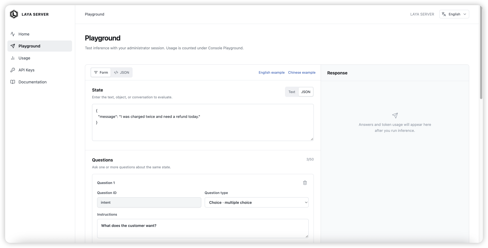</td>
<td align="center" valign="top">メディア未公開</td>
</tr></table>

🧩 <b><a href="https://github.com/Abhinavexists/lev">Abhinavexists/lev</a></b> · ⭐59 · Python · 🔎 inferred · 23 天

##### 📝 概要

オープンなSystem One意思決定モデル

##### 📌 基本情報

| 項目       | 値                     |
| ---------- | ---------------------- |
| カテゴリ   | `その他のプロジェクト` |
| エビデンス | `inferred`             |
| 言語       | Python                 |

##### 📊 データ

| 指標         | 値         |
| ------------ | ---------- |
| スター数     | **59**     |
| 最終プッシュ | 2026-10-15 |
| 初回掲載     | 2026-10-28 |

🏷 `jev` · `modal` · `qwen`

---

<table><tr><th align="center" width="50%">🖼 画像</th><th align="center" width="50%">🎬 動画</th></tr><tr>
<td align="center" valign="top">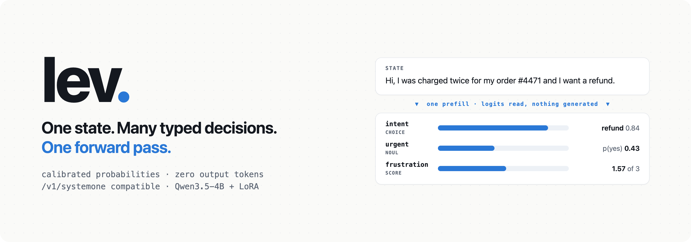</td>
<td align="center" valign="top">メディア未公開</td>
</tr></table>

🧩 <b><a href="https://github.com/Jev-Engineering/cookbook">Jev-Engineering/cookbook</a></b> · ⭐30 · Jupyter · 🔎 inferred · 3 天

##### 📝 概要

Jevによる型付き判定のためのノートブックレシピ60選：最初の分類から閉ループ制御までのChoice、Noul、Scoreパターン

##### 📌 基本情報

| 項目       | 値                     |
| ---------- | ---------------------- |
| カテゴリ   | `その他のプロジェクト` |
| エビデンス | `inferred`             |
| 言語       | Jupyter                |

##### 📊 データ

| 指標         | 値         |
| ------------ | ---------- |
| スター数     | **30**     |
| 最終プッシュ | 2026-11-03 |
| 初回掲載     | 2026-10-09 |

🏷 `cookbook` · `jev` · `jupyter-notebook` · `python` · `system-one` · `tutorials` · `typed-decisions` · `typesafe`

---

<table><tr><th align="center" width="50%">🖼 画像</th><th align="center" width="50%">🎬 動画</th></tr><tr>
<td align="center" valign="top">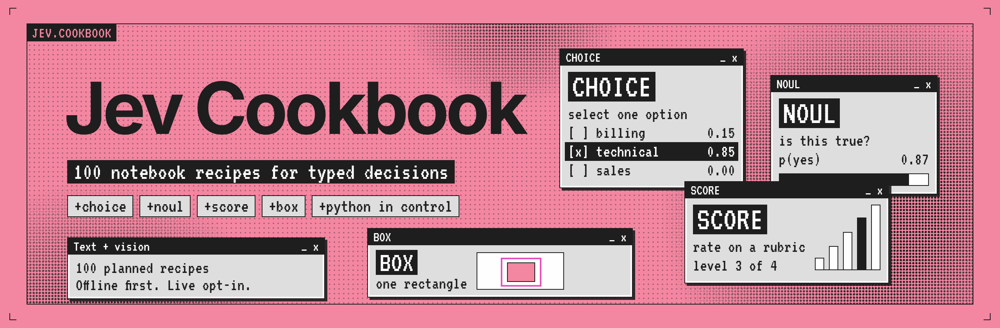</td>
<td align="center" valign="top">メディア未公開</td>
</tr></table>

🧩 <b><a href="https://github.com/nvkudva/ollajev">nvkudva/ollajev</a></b> · ⭐18 · Python · 🔎 inferred · 2 天

##### 📝 概要

Jev / System One APIの背後で、Hugging FaceのSystem One意思決定モデルをOllamaスタイルでローカル実行

##### 📌 基本情報

| 項目       | 値                     |
| ---------- | ---------------------- |
| カテゴリ   | `その他のプロジェクト` |
| エビデンス | `inferred`             |
| 言語       | Python                 |

##### 📊 データ

| 指標         | 値         |
| ------------ | ---------- |
| スター数     | **18**     |
| 最終プッシュ | 2026-11-05 |
| 初回掲載     | 2026-10-28 |

🏷 `decision-model` · `huggingface` · `jev` · `llama-cpp` · `local-llm` · `system-one` · `typesafe`

---

<table><tr><th align="center" width="50%">🖼 画像</th><th align="center" width="50%">🎬 動画</th></tr><tr>
<td align="center" valign="top"></td>
<td align="center" valign="top">メディア未公開</td>
</tr></table>

🧩 <b><a href="https://github.com/manifoldor/xtags">manifoldor/xtags</a></b> · ⭐11 · HTML · 🔎 inferred · 22 天

##### 📝 概要

Xのタイムライン上で、各投稿があなたに何をさせようとしているかをラベル付けします。判定はJevから取得します。これは確率だけを返し、テキストを生成しないモデルです。

##### 📌 基本情報

| 項目       | 値                     |
| ---------- | ---------------------- |
| カテゴリ   | `その他のプロジェクト` |
| エビデンス | `inferred`             |
| 言語       | HTML                   |

##### 📊 データ

| 指標         | 値         |
| ------------ | ---------- |
| スター数     | **11**     |
| 最終プッシュ | 2026-10-16 |
| 初回掲載     | 2026-10-26 |

🏷 `ai` · `chrome-extension` · `jev` · `typesafe` · `userscript` · `x-twitter`

---

<table><tr><th align="center" width="50%">🖼 画像</th><th align="center" width="50%">🎬 動画</th></tr><tr>
<td align="center" valign="top"></td>
<td align="center" valign="top">メディア未公開</td>
</tr></table>

🧩 <b><a href="https://github.com/mandu5/jevcompat">mandu5/jevcompat</a></b> · ⭐4 · Python · 🔎 inferred · 0 天

##### 📝 概要

A testable spec and conformance suite for Jev-compatible (TypeSafe System One) API servers, with a normalising proxy, a reference mock and a GitHub Action.

##### 📌 基本情報

| 項目       | 値                     |
| ---------- | ---------------------- |
| カテゴリ   | `その他のプロジェクト` |
| エビデンス | `inferred`             |
| 言語       | Python                 |

##### 📊 データ

| 指標         | 値         |
| ------------ | ---------- |
| スター数     | **4**      |
| 最終プッシュ | 2026-11-06 |
| 初回掲載     | 2026-11-07 |

🏷 `api-testing` · `conformance` · `jev` · `llm` · `python` · `specification` · `system-one` · `typesafe`

---

<table><tr><th align="center" width="50%">🖼 画像</th><th align="center" width="50%">🎬 動画</th></tr><tr>
<td align="center" valign="top">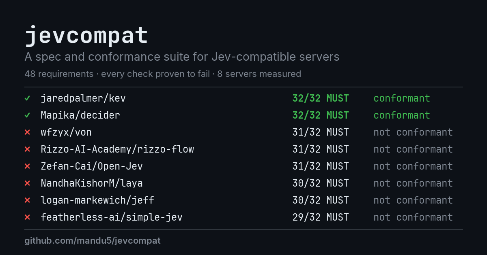</td>
<td align="center" valign="top">メディア未公開</td>
</tr></table>

🧩 <b><a href="https://github.com/takasek/jev-form-fill">takasek/jev-form-fill</a></b> · JavaScript · 🔎 inferred · 1 天

##### 📝 概要

Fill Chrome forms from clipboard text with TypeSafe Jev, reviewed proposals, readback and undo.

##### 📌 基本情報

| 項目       | 値                     |
| ---------- | ---------------------- |
| カテゴリ   | `その他のプロジェクト` |
| エビデンス | `inferred`             |
| 言語       | JavaScript             |

##### 📊 データ

| 指標         | 値         |
| ------------ | ---------- |
| スター数     | **0**      |
| 最終プッシュ | 2026-11-06 |
| 初回掲載     | 2026-11-06 |

---

<table><tr><th align="center" width="50%">🖼 画像</th><th align="center" width="50%">🎬 動画</th></tr><tr>
<td align="center" valign="top"></td>
<td align="center" valign="top">メディア未公開</td>
</tr></table>

🧩 <b><a href="https://github.com/iapp-technology/openthai-systemone">iapp-technology/openthai-systemone</a></b> · ⭐69 · Python · ❓ unverified · 46 天

##### 📝 概要

OpenThai-SystemOne：オープンなタイ語 + 英語 System One 決定モデル（0.8B、256-way slot head、Apache-2.0）

##### 📌 基本情報

| 項目       | 値                     |
| ---------- | ---------------------- |
| カテゴリ   | `その他のプロジェクト` |
| エビデンス | `unverified`           |
| 言語       | Python                 |

##### 📊 データ

| 指標         | 値         |
| ------------ | ---------- |
| スター数     | **69**     |
| 最終プッシュ | 2026-09-21 |
| 初回掲載     | 2026-10-28 |

---

<table><tr><th align="center" width="50%">🖼 画像</th><th align="center" width="50%">🎬 動画</th></tr><tr>
<td align="center" valign="top"></td>
<td align="center" valign="top">メディア未公開</td>
</tr></table>

<b>このカテゴリのその他</b> · 32

- [soderlind/ai-provider-for-jev](https://github.com/soderlind/ai-provider-for-jev) - WordPressをTypeSafeのJev System Oneモデルに接続し、構造化された意思決定（choice、score、noul）を実現します.
- [Shristi1611/systemone-testbed](https://github.com/Shristi1611/systemone-testbed) - A security test environment for Jev-compatible decision models。
- [DreamBlooms/ifReflex.cpp](https://github.com/DreamBlooms/ifReflex.cpp) - 任意のLLMをPersonal Computer上でSystemOne意思決定モデルとして利用できます.
- [turenlabs/lisa](https://github.com/turenlabs/lisa) - LISA: Leak, Injection &amp; Simplicity Auditor.
- [DevItaliya22/jev-chess](https://github.com/DevItaliya22/jev-chess) - Jev。
- [FrancescoDesiderato/Devfest_SystemOneModel](https://github.com/FrancescoDesiderato/Devfest_SystemOneModel) - Repository of Code for GDG DevFest 2026 Talk about &quot;System One Models&quot;。
- [justintout/systemone](https://github.com/justintout/systemone) - Jevやその他のSystem Oneモデルとやり取りするための非公式Goモジュール。
- [prashu-asp/Systemonemodels](https://github.com/prashu-asp/Systemonemodels)
- [unbraind/pm-jev](https://github.com/unbraind/pm-jev) - Jev風System Oneモデルによるpm項目向けの型付きローカルファースト意思決定。
- [2951461586/Jev-Register-Tool](https://github.com/2951461586/Jev-Register-Tool) - TypeSafe（Jev / System One）申請 → 確認メール → 承認 → 登録 → API…
- [I-You-Dream/jev-from-scratch](https://github.com/I-You-Dream/jev-from-scratch) - 从零开源复刻 Jev（System One）决策模型范式，基于 Qwen 基座训练，支持 Choice / Noul 原语，包含推理、微调、ECE…
- [yijunyu/jev-rs](https://github.com/yijunyu/jev-rs) - 1回のprefillで任意のLLMからSystem One判定（noul/choice/score）を取得…
- [rawwerks/one-system](https://github.com/rawwerks/one-system) - ローカルおよびホスト型の分類器、別名意思決定モデル、別名Jevのようなモデルを、単一のTypeSafe API経由ですべて利用.
- [botassembly/thinkthen](https://github.com/botassembly/thinkthen) - ThinkThen：自分の意図を理解するコード。
- [comoc/jev-minesweeper](https://github.com/comoc/jev-minesweeper) - TypeSafe Jev (System One) にブラウザ上のマインスイーパーを解かせるデモ。
- [endomorphosis/JevOps](https://github.com/endomorphosis/JevOps)
- [XingQiPan/rwkv-jev](https://github.com/XingQiPan/rwkv-jev) - RWKV-7…
- [Shearerbeard/jev-driver](https://github.com/Shearerbeard/jev-driver) - Typed Rust driver for TypeSafe AI。
- [sergiecode/jev-test-si-o-no](https://github.com/sergiecode/jev-test-si-o-no) - Noul -&gt; イエスかノーかを判断するためのプリミティブ.
- [cfu288/jev-vs-ml-classifiers](https://github.com/cfu288/jev-vs-ml-classifiers) - 最新のJEVモデルは、従来のML分類モデルや、過去に公開されたその他のTransformerベースモデルに対してどの程度の性能を発揮するか?
- [daryl-walsh/jev-decision-models](https://github.com/daryl-walsh/jev-decision-models) - high-speed decision-making pipelines for language models using Jev in PyTorch。
- [Gabriel-Abi-Acl/jev-study](https://github.com/Gabriel-Abi-Acl/jev-study) - Estudo do modelo de decisão tipada Jev (TypeSafe AI): capacidades, calibração e…
- [gbesse/jev-carbone-factor-fit](https://github.com/gbesse/jev-carbone-factor-fit) - Classe les facteurs d。
- [gbesse/jev-insersup-claim-check](https://github.com/gbesse/jev-insersup-claim-check) - Vérifie si une affirmation d。
- [gbesse/jev-meteo-vigilance-brief](https://github.com/gbesse/jev-meteo-vigilance-brief) - Transforme un bulletin officiel de vigilance en briefing opérationnel adapté à…
- [gbesse/jev-qualiscope-action](https://github.com/gbesse/jev-qualiscope-action) - Transforme un signal Qualiscope en niveau d。
- [LiLittleCat/jev-playlist-classify](https://github.com/LiLittleCat/jev-playlist-classify) - TypeSafe AIの最新Jevモデルで、大規模なプレイリストを曲の言語別に分類します.
- [marshal-runtime/jev-runtime-extension](https://github.com/marshal-runtime/jev-runtime-extension) - Marshal runtime extension: TypeSafe Jev connector。
- [PineappleBingo/jev-radar](https://github.com/PineappleBingo/jev-radar) - TypeSafe Jev 오픈소스 구현을 매일 모아 한국어로 정리하는 레이더 (radar-index/1)。
- [hawkymisc/typed-decision-bert](https://github.com/hawkymisc/typed-decision-bert) - 非公式PoC：型付き判断（noul / choice / score）HTTP APIの背後にあるBERT形式のエンコーダー判断エンジン.
- [InterfazeAI/lev](https://github.com/InterfazeAI/lev) - オープンなSystem One意思決定モデル。
- [epergaboni/jevseo](https://github.com/epergaboni/jevseo) - System One意思決定モデルであるJevを基盤とする、型付きSEO、AEO、GEO判定。ルールはコードが管理し、意味はモデルが担います.

## 実装言語別のプロジェクト

エコシステムは Python と TypeScript に集中していますが、型付きクライアントは他の言語でも現れ続けています。この表はエントリそのものから生成されます。

| 言語       | エントリ数 | 例                                                                                                      |
| ---------- | ---------- | ------------------------------------------------------------------------------------------------------- |
| Python     | 311        | `typesafe-ai/system-one-adapter-python`, `typesafe-ai/typesafe-sdk-python`, `typesafe-ai/WorkflowEvals` |
| TypeScript | 110        | `typesafe-ai/typesafe-sdk-js`, `TypeSafeAI/jev-harness`, `qkal/Canny`                                   |
| JavaScript | 70         | `clouatre-labs/decisions-judge-mcp`, `socai-io/jev-social`, `Ying-Kai-Liao/jev-browser`                 |
| Rust       | 29         | `chussenot/judgment`, `ollaya-dev/ollaya`, `supercorp-ai/supercov`                                      |
| HTML       | 23         | `typesafe-ai/typesafe-ai.github.io`, `yzfly/awesome-jev-zh`, `AkashPriyadarshii/jev-superpowers`        |
| Go         | 11         | `frodi-karlsson/onesie`, `devbackend/jevgo`, `JimmyWesley/rlcd-gateway`                                 |
| Jupyter    | 10         | `jexp/neo4jev`, `GitHub30/OpenJev`, `Mainakcris7/agent-guardrail-with-jev`                              |
| Elixir     | 5          | `dannote/jev`, `Elue-dev/jev_elixir`, `nshkrdotcom/system_one_sdk`                                      |
| Java       | 5          | `Premo-Cloud/typesafe-sdk-java`, `gbesse/pinot-jev`, `Murat-Selim/jev_doc_router`                       |
| PHP        | 5          | `basi/typesafe-ai-php-client`, `marcreichel/laya-php`, `Butochnikov/laravel-typesafe-jev`               |
| Swift      | 5          | `john-rocky/coreai-kit`, `chris-wozniczek/jev-voice-control`, `chyiiiiiiiiiiii/jev-wingman`             |
| C#         | 4          | `elbruno/ElBruno.AI.Decisions`, `saibimajdi/typesafeai-dotnet-sdk`, `sanamhub/typesafe-dotnet`          |
| C++        | 3          | `gbesse/mariadb-jev`, `DreamBlooms/dohnuts.cpp`, `DreamBlooms/ifReflex.cpp`                             |
| Astro      | 2          | `heyjunpenn/awesome-jev`, `wizicer/jev_info_site`                                                       |
| C          | 2          | `giuliosmall/pg_typesafe`, `lijiawei255/jev-tune`                                                       |
| CSS        | 2          | `yangzhou-chaofan/awesome-jev-prompt`, `Dlmily/minimind-jev-dlmily`                                     |
| PowerShell | 2          | `BFLabsAI/bf-jev-deep-research`, `dfinke/Jev`                                                           |
| Ruby       | 2          | `obie/ruby_decision_model`, `Ray-Hughes/jevalyn`                                                        |
| Shell      | 2          | `realZachi/pg-jev`, `skylence-org/claudecode-jev-marketplace`                                           |
| TeX        | 2          | `dnakhoa/jev-deferred-crispification`, `xiaohuiyan/awesome-jev-papers`                                  |
| XS         | 2          | `cameronb-xano/jev-agent-guardrail`, `xano-community/agent-guardrail-jev`                               |
| Haskell    | 1          | `getmissionctrl/hs-jev`                                                                                 |
| Kotlin     | 1          | `MiaoWuNYA/rikkahub-sillytavern-android`                                                                |
| Nushell    | 1          | `cablehead/jev.nu`                                                                                      |
| Scala      | 1          | `maxtrezzi/jev4s`                                                                                       |

言語を明示したエントリのみを集計しています。インフラ、ドキュメント、ディスカッションの各エントリはこの表から除外されます。

## コントリビューション

訂正は歓迎しますし、このリストを改善する最短の方法です。エントリの分類や格付けが誤っている場合、あるいはプロジェクトが名前の衝突として誤って除外されている場合は、issue かプルリクエストを立ててください。最後の類型こそ、自動フィルタが最も間違えやすいところです。追加は README を編集するのではなく `scripts/collect.py` に取得元を足す形が最善です。README は毎回再生成されるためです。

---

独立したコミュニティプロジェクトです。TypeSafe AI と提携しておらず、その承認もレビューも受けていません。製品の挙動、価格、制限、モデルの別名は予告なく変わります。重要なものは必ず公式ドキュメントで確認してください。アセットは上流プロジェクトに帰属し、ライセンスが許す場合にのみ掲載しています。

生成ツール · 2026-11-07T16:50:18+08:00
