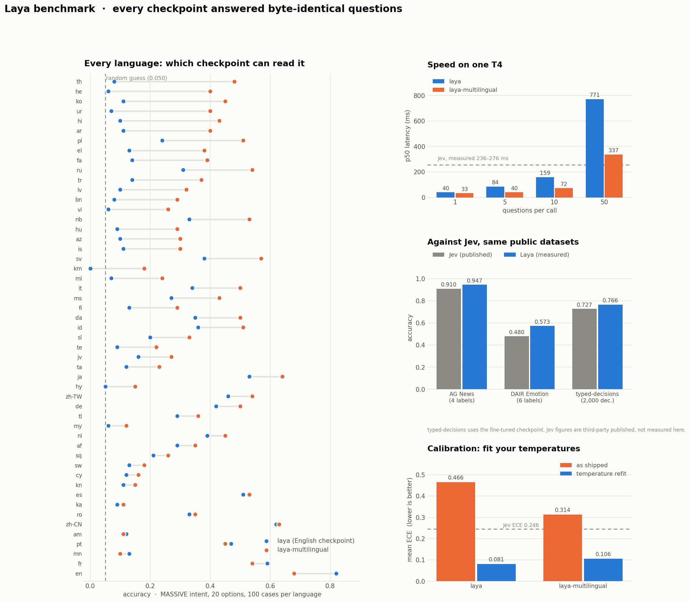
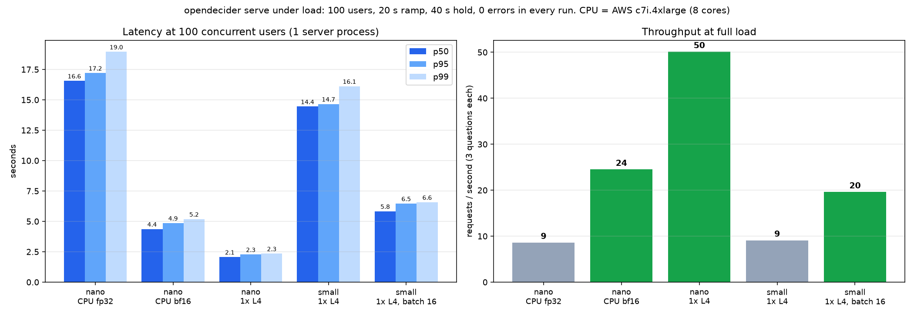
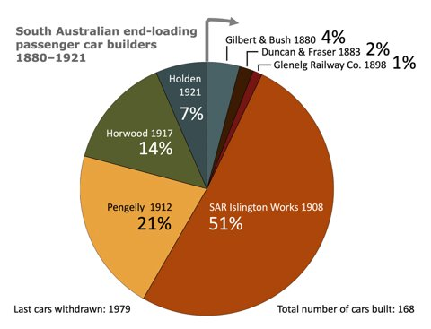
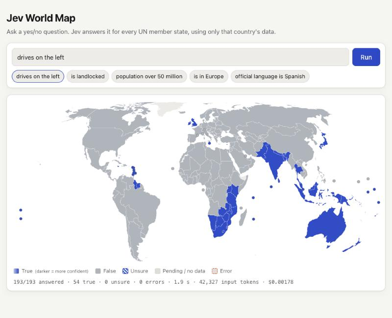

  

<h1 align="center">Awesome Jev Live</h1>

<b>De op bewijs beoordeelde Jev-index die zichzelf elke twee uur opnieuw opbouwt.</b>

  
  
  
  
  
  

<a href="../README.md">English</a> · <a href="README.zh-CN.md">简体中文</a> · <a href="README.zh-TW.md">繁體中文</a> · <a href="README.ja.md">日本語</a> · <a href="README.ko.md">한국어</a> · <a href="README.es.md">Español</a> · <a href="README.fr.md">Français</a> · <a href="README.de.md">Deutsch</a> · <a href="README.pt-BR.md">Português (Brasil)</a> · <a href="README.ru.md">Русский</a> · <a href="README.it.md">Italiano</a> · <a href="README.ar.md">العربية</a> · <a href="README.hi.md">हिन्दी</a> · <a href="README.tr.md">Türkçe</a> · <a href="README.vi.md">Tiếng Việt</a> · <a href="README.th.md">ไทย</a> · <a href="README.id.md">Bahasa Indonesia</a> · <a href="README.pl.md">Polski</a> · <b>Nederlands</b> · <a href="README.uk.md">Українська</a>

> [!NOTE]
> **Live-index** · Laatste synchronisatie: `2026-11-26T18:47:40+08:00` (UTC+8)
> · Vermeldingen: **791** · Nieuw in deze ronde: **5** · Implementatietalen: **26**

Elke vermelding hieronder is verzameld, gefilterd en opnieuw gecontroleerd door de pijplijn in deze repository. Getallen en tijdstempels komen uit de bronnen, niet uit een handmatig geschreven momentopname.

## 🔥 Keuze van het moment — de eerste per categorie

Eén vermelding per categorie, gerangschikt op bewijsniveau en sterren, herberekend bij elke synchronisatie. Een ranglijst, geen aanbeveling; elke keuze linkt naar de volledige kaart hieronder. Projecten die een schermafbeelding of opname hebben gepubliceerd krijgen voorrang, zodat deze strook visueel blijft.

<table>
<tr>
<td width="50%" valign="top">
<b>🏛️ <a href="https://github.com/typesafe-ai/skills">typesafe-ai/skills</a></b>
⭐2921 · ✅ official
Agentvaardigheden voor het bouwen met de System One API van TypeSafe
</td>
<td width="50%" valign="top">

<b>🧰 <a href="https://github.com/clouatre-labs/decisions-judge-mcp">clouatre-labs/decisions-judge-mcp</a></b>
⭐5 · JavaScript · 👁️ observed
Getypeerde beslissingen voor AI-agents als MCP-tool: ja/nee-waarschijnlijkheid (noul), keuze en score in één snelle aanvraag. Aangedreven door het TypeSafe System…
</td>
</tr>
<tr>
<td width="50%" valign="top">

<b>🤖 <a href="https://github.com/gargpratyush/jev-router">gargpratyush/jev-router</a></b>
⭐675 · JavaScript · 🔎 inferred
Routeer in claude code je taak met jev-router naar het goedkoopste model
</td>
<td width="50%" valign="top">

<b>🛡️ <a href="https://github.com/dharmeshgurnani/codeotter">dharmeshgurnani/codeotter</a></b>
⭐7 · TypeScript · 👁️ observed
Autonome, zelfgehoste AI-codebeoordelingen, gekalibreerde scoremeters en merge gates met elk open model.
</td>
</tr>
<tr>
<td width="50%" valign="top">

<b>🧪 <a href="https://github.com/Mapika/decider">Mapika/decider</a></b>
⭐1035 · Python · 👁️ observed
Een familie van System One-stijl modellen, fijn afgestemd vanaf Qwen3.5, ontworpen voor getypeerde beslissingen in één doorgang met gekalibreerde waarschijnlijkheden.
</td>
<td width="50%" valign="top">

<b>🔬 <a href="https://github.com/r-ms/mini-jev">r-ms/mini-jev</a></b>
⭐65 · Python · 🔎 inferred
mini-Jev: hoe een getypeerde-beslissingsinterface in Jev-stijl eruitziet op een bevroren Qwen3-4B — lees de logits van de optieleter in plaats van JSON te genereren.…
</td>
</tr>
<tr>
<td width="50%" valign="top">

<b>🎮 <a href="https://github.com/MCG-NJU/VideoJev">MCG-NJU/VideoJev</a></b>
⭐318 · Python · 👁️ observed
VideoJev: System One Model voor video-inzicht en interactie
</td>
<td width="50%" valign="top">
<b>📰 <a href="https://docs.typesafe.ai/model-jaggedness/jev-1.13">9 soorten bekende defecten (jaggedness)</a></b>
⭐0 · ✅ official
Letterlijk begrip, **onbetrouwbaar tellen**, datumvergelijking, meertraps indirectheid, irrelevante details met grote state, adversariële inhoud, tegenstrijdigheid…
</td>
</tr>
</table>

## Inhoud

- [Wat is Jev?](#wat-is-jev)
- [Hoe vermeldingen worden beoordeeld](#hoe-vermeldingen-worden-beoordeeld)
- [Officiële SDK's en ontwikkelaarstools](#officiële-sdks-en-ontwikkelaarstools) — **6**
- [Community-clients, SDK's en adapters](#community-clients-sdks-en-adapters) — **141**
- [Agent-tooling: MCP, hooks, gates en coding agents](#agent-tooling-mcp-hooks-gates-en-coding-agents) — **254**
- [Routing, guardrails en goedkeuringen](#routing-guardrails-en-goedkeuringen) — **56**
- [Evaluatie, kalibratie en benchmarks](#evaluatie-kalibratie-en-benchmarks) — **83**
- [Open reproducties, gewichten en architectuuronderzoek](#open-reproducties-gewichten-en-architectuuronderzoek) — **58**
- [Toepassingen, games, robotica en interactieve demo's](#toepassingen-games-robotica-en-interactieve-demos) — **44**
- [Artikelen, discussies en zusterlijsten](#artikelen-discussies-en-zusterlijsten) — **74**
- [Overige projecten](#overige-projecten) — **75**
- [Projecten per implementatietaal](#projecten-per-implementatietaal)

## Wat is Jev?

Jev is het eerste **System One model** van TypeSafe AI. Het schrijft geen proza. Het neemt een toestand plus vragen waarvan je de antwoordruimte vooraf vastlegt, en geeft getypeerde waarden terug met kansverdelingen waarop je code kan vertakken.

|                         |                                                                                                                                                                                                                             |
| ----------------------- | --------------------------------------------------------------------------------------------------------------------------------------------------------------------------------------------------------------------------- |
| **Vorm**                | `state + typed questions` → `constrained answers + probabilities` → `your code`                                                                                                                                             |
| **Primitieven**         | `Choice` (kies één van ≤255 opties), `Score` (een rubric van 2–10), `Noul` (een probabilistische ja/nee)                                                                                                                    |
| **Endpoint**            | `POST https://api.typesafe.ai/v1/systemone`, model `jev-1.13.0` / alias `jev-latest`                                                                                                                                        |
| **Goede toepassingen**  | routing, triage, scoring, moderatie, verificatie en gates met lage latentie binnen een afgebakende workflow                                                                                                                 |
| **Bekende beperkingen** | tellen is onbetrouwbaar, meerlaagse indirectie is zwak, en officieel materiaal noemt negen klassen van ongelijkmatigheid. Schema-valide uitvoer is niet hetzelfde als een correcte beslissing — kalibreer op je eigen data. |

## Hoe vermeldingen worden beoordeeld

De meeste lijsten in dit veld beweren dat iets erin staat. Deze zegt hoeveel er daadwerkelijk is geverifieerd, en laat je daarop filteren.

| Beoordeling  | Wat het betekent                                                                                                                                                                   |
| ------------ | ---------------------------------------------------------------------------------------------------------------------------------------------------------------------------------- |
| `official`   | Gepubliceerd door TypeSafe AI zelf.                                                                                                                                                |
| `observed`   | Een openbaar artefact dat kan worden geopend en gelezen — echte broncode, echte configuratie, of een expliciete TypeSafe/Jev-verklaring in de naam of het topic van de repository. |
| `inferred`   | Gematcht op een dubbelzinnig signaal plus ondersteunend vocabulaire, maar nog niet regel voor regel gelezen.                                                                       |
| `unverified` | Lijkt verwant, niets onafhankelijk bevestigd. Alleen ter ontdekking vermeld.                                                                                                       |

## Officiële SDK&#x27;s en ontwikkelaarstools

Alles wat TypeSafe zelf publiceert. Begin hier.

🏛️ <b><a href="https://github.com/typesafe-ai/skills">typesafe-ai/skills</a></b> · ⭐2921 · ✅ official · 33 天

##### 📝 Samenvatting

Agentvaardigheden voor het bouwen met de System One API van TypeSafe

> 💡 De eigen agentvaardigheden van de leverancier. Omdat deze voortdurend wordt bijgewerkt, komt dit het dichtst in de buurt van een specificatie van hoe TypeSafe van plan is Jev vanuit een agent aan te sturen.

##### 📌 Basisgegevens

| Veld      | Waarde                                       |
| --------- | -------------------------------------------- |
| Categorie | `Officiële SDK&#x27;s en ontwikkelaarstools` |
| Bewijs    | `official`                                   |

##### 📊 Gegevens

| Metriek       | Waarde     |
| ------------- | ---------- |
| Sterren       | **2921**   |
| Laatste push  | 2026-10-23 |
| Eerst vermeld | 2026-09-18 |

🏛️ <b><a href="https://github.com/typesafe-ai/system-one-adapter-python">typesafe-ai/system-one-adapter-python</a></b> · ⭐410 · Python · ✅ official · 11 天

##### 📝 Samenvatting

Direct inzetbare vervanging voor TypeSafeClient, aangedreven door LLM APIs

> 💡 Direct inzetbare vervanging die dezelfde interface gebruikt met een gewone LLM-provider. Dit is de eerlijke manier om een getypeerde beslissing tegenover een prompt A/B te testen op je eigen gegevens, voordat je je aan een van beide verbindt.

🔧 Aangetroffen in code: `README.md`

##### 📌 Basisgegevens

| Veld      | Waarde                                       |
| --------- | -------------------------------------------- |
| Categorie | `Officiële SDK&#x27;s en ontwikkelaarstools` |
| Bewijs    | `official`                                   |
| Taal      | Python                                       |

##### 📊 Gegevens

| Metriek       | Waarde     |
| ------------- | ---------- |
| Sterren       | **410**    |
| Laatste push  | 2026-11-15 |
| Eerst vermeld | 2026-10-23 |

🏛️ <b><a href="https://github.com/typesafe-ai/typesafe-sdk-python">typesafe-ai/typesafe-sdk-python</a></b> · ⭐317 · Python · ✅ official · 0 天

##### 📝 Samenvatting

De officiële Python-bibliotheek voor TypeSafe API

> 💡 Synchrone en asynchrone clients. De snelste weg van een API-sleutel naar een getypeerde beslissing, en de referentie waartegen community-clients worden vergeleken.

##### 📌 Basisgegevens

| Veld      | Waarde                                       |
| --------- | -------------------------------------------- |
| Categorie | `Officiële SDK&#x27;s en ontwikkelaarstools` |
| Bewijs    | `official`                                   |
| Taal      | Python                                       |

##### 📊 Gegevens

| Metriek       | Waarde     |
| ------------- | ---------- |
| Sterren       | **317**    |
| Laatste push  | 2026-11-25 |
| Eerst vermeld | 2026-10-23 |

🏛️ <b><a href="https://github.com/typesafe-ai/typesafe-sdk-js">typesafe-ai/typesafe-sdk-js</a></b> · ⭐288 · TypeScript · ✅ official · 15 天

##### 📝 Samenvatting

De officiële TypeScript/JavaScript-bibliotheek voor TypeSafe API

> 💡 TypeScript-client waarbij het antwoordtype wordt afgeleid uit de vraag die je hebt gesteld, zodat een niet-overeenkomend retourtype een compileerfout is in plaats van een verrassing tijdens runtime.

##### 📌 Basisgegevens

| Veld      | Waarde                                       |
| --------- | -------------------------------------------- |
| Categorie | `Officiële SDK&#x27;s en ontwikkelaarstools` |
| Bewijs    | `official`                                   |
| Taal      | TypeScript                                   |

##### 📊 Gegevens

| Metriek       | Waarde     |
| ------------- | ---------- |
| Sterren       | **288**    |
| Laatste push  | 2026-11-11 |
| Eerst vermeld | 2026-10-23 |

🏛️ <b><a href="https://github.com/typesafe-ai/WorkflowEvals">typesafe-ai/WorkflowEvals</a></b> · ⭐22 · Python · ✅ official · 12 天

##### 📝 Samenvatting

Workflowcode van evals.typesafe.ai gepubliceerd

##### 📌 Basisgegevens

| Veld      | Waarde                                       |
| --------- | -------------------------------------------- |
| Categorie | `Officiële SDK&#x27;s en ontwikkelaarstools` |
| Bewijs    | `official`                                   |
| Taal      | Python                                       |

##### 📊 Gegevens

| Metriek       | Waarde     |
| ------------- | ---------- |
| Sterren       | **22**     |
| Laatste push  | 2026-11-14 |
| Eerst vermeld | 2026-10-23 |

🏛️ <b><a href="https://github.com/typesafe-ai/typesafe-ai.github.io">typesafe-ai/typesafe-ai.github.io</a></b> · ⭐2 · HTML · ✅ official · 174 天

##### 📝 Samenvatting

Er is geen beschrijving van de bron gepubliceerd.

##### 📌 Basisgegevens

| Veld      | Waarde                                       |
| --------- | -------------------------------------------- |
| Categorie | `Officiële SDK&#x27;s en ontwikkelaarstools` |
| Bewijs    | `official`                                   |
| Taal      | HTML                                         |

##### 📊 Gegevens

| Metriek       | Waarde     |
| ------------- | ---------- |
| Sterren       | **2**      |
| Laatste push  | 2026-06-04 |
| Eerst vermeld | 2026-10-23 |

## Community-clients, SDK&#x27;s en adapters

Getypeerde clients voor het System One-endpoint, in zoveel talen als de community tot nu toe heeft opgeleverd.

🧰 <b><a href="https://github.com/realZachi/pg-jev">realZachi/pg-jev</a></b> · ⭐1318 · Shell · 👁️ observed · 50 天

##### 📝 Samenvatting

Stel je Postgres-tabellen vragen in gewone taal. Een PostgreSQL-extensie, mogelijk gemaakt door Jev van TypeSafe.

🔧 Aangetroffen in code: `README.md`

##### 📌 Basisgegevens

| Veld      | Waarde                                      |
| --------- | ------------------------------------------- |
| Categorie | `Community-clients, SDK&#x27;s en adapters` |
| Bewijs    | `observed`                                  |
| Taal      | Shell                                       |

##### 📊 Gegevens

| Metriek       | Waarde     |
| ------------- | ---------- |
| Sterren       | **1318**   |
| Laatste push  | 2026-10-06 |
| Eerst vermeld | 2026-10-29 |

🧰 <b><a href="https://github.com/jexp/neo4jev">jexp/neo4jev</a></b> · ⭐190 · Jupyter · 👁️ observed · 69 天

##### 📝 Samenvatting

Typesafe.ai System One Model Jev navigeert door een Neo4j-graaf met een classifier over naburige relaties

##### 📌 Basisgegevens

| Veld      | Waarde                                      |
| --------- | ------------------------------------------- |
| Categorie | `Community-clients, SDK&#x27;s en adapters` |
| Bewijs    | `observed`                                  |
| Taal      | Jupyter                                     |

##### 📊 Gegevens

| Metriek       | Waarde     |
| ------------- | ---------- |
| Sterren       | **190**    |
| Laatste push  | 2026-09-18 |
| Eerst vermeld | 2026-10-28 |

🧰 <b><a href="https://github.com/keltokhy/jgrep">keltokhy/jgrep</a></b> · ⭐141 · Python · 👁️ observed · 39 天

##### 📝 Samenvatting

grep, maar het patroon is een beschrijving. Filtert regels op betekenis met het TypeSafe-beslismodel van Jev: ~200 ms en een duizendste cent per regel.

🔧 Aangetroffen in code: `README.md`

##### 📌 Basisgegevens

| Veld      | Waarde                                      |
| --------- | ------------------------------------------- |
| Categorie | `Community-clients, SDK&#x27;s en adapters` |
| Bewijs    | `observed`                                  |
| Taal      | Python                                      |

##### 📊 Gegevens

| Metriek       | Waarde     |
| ------------- | ---------- |
| Sterren       | **141**    |
| Laatste push  | 2026-10-17 |
| Eerst vermeld | 2026-10-29 |

🏷 `cli` · `grep` · `jev` · `openrouter` · `semantic-search` · `typesafe`

🧰 <b><a href="https://github.com/qkal/Canny">qkal/Canny</a></b> · ⭐136 · TypeScript · 👁️ observed · 13 天

##### 📝 Samenvatting

Voorkomt dat AI-codeeragenten beweren dat werk klaar is zonder bewijs. Deterministische hooks beslissen, TypeSafe's Jev geeft advies. Alleen-toevoegend grootboek, nul runtime-afhankelijkheden.

🔧 Aangetroffen in code: `README.md`

##### 📌 Basisgegevens

| Veld      | Waarde                                      |
| --------- | ------------------------------------------- |
| Categorie | `Community-clients, SDK&#x27;s en adapters` |
| Bewijs    | `observed`                                  |
| Taal      | TypeScript                                  |

##### 📊 Gegevens

| Metriek       | Waarde     |
| ------------- | ---------- |
| Sterren       | **136**    |
| Laatste push  | 2026-11-13 |
| Eerst vermeld | 2026-10-29 |

🏷 `agent-hooks` · `ai-agents` · `claude-code` · `claude-code-hooks` · `codex` · `codex-cli` · `guardrails` · `jev`

🧰 <b><a href="https://github.com/AkashPriyadarshii/jev-curate">AkashPriyadarshii/jev-curate</a></b> · ⭐116 · Rust · 👁️ observed · 0 天

##### 📝 Samenvatting

High-throughput synthetic and pretraining dataset sifter for TypeSafe Jev. Rust streaming core, Parquet and JSONL I/O, typed Choice/Score/Noul judgments, speculative fan-out, 24.0 rows/sec measured.

🔧 Aangetroffen in code: `AGENTS.md`, `site/llms.txt`, `docs/DESIGN.md`

##### 📌 Basisgegevens

| Veld      | Waarde                                      |
| --------- | ------------------------------------------- |
| Categorie | `Community-clients, SDK&#x27;s en adapters` |
| Bewijs    | `observed`                                  |
| Taal      | Rust                                        |

##### 📊 Gegevens

| Metriek       | Waarde     |
| ------------- | ---------- |
| Sterren       | **116**    |
| Laatste push  | 2026-11-26 |
| Eerst vermeld | 2026-11-05 |

🏷 `arrow` · `cli` · `data-cleaning` · `data-engineering` · `dataset-curation` · `eval-harness` · `fine-tuning` · `jev`

🧰 <b><a href="https://github.com/yzfly/awesome-jev-zh">yzfly/awesome-jev-zh</a></b> · ⭐97 · HTML · 👁️ observed · 0 天

##### 📝 Samenvatting

Jev / TypeSafe System One Chinese selectie: officiële bronnen, SDK, populaire toepassingen, Agent-tools, open-source-reproducties en onafhankelijke beoordelingen, met Chinese handleidingen om aan de slag te gaan; dagelijks automatisch aangevuld met GitHub populaire projecten.

🔧 Aangetroffen in code: `docs/quickstart.md`

##### 📌 Basisgegevens

| Veld      | Waarde                                      |
| --------- | ------------------------------------------- |
| Categorie | `Community-clients, SDK&#x27;s en adapters` |
| Bewijs    | `observed`                                  |
| Taal      | HTML                                        |

##### 📊 Gegevens

| Metriek       | Waarde     |
| ------------- | ---------- |
| Sterren       | **97**     |
| Laatste push  | 2026-11-26 |
| Eerst vermeld | 2026-09-18 |

🏷 `ai-agent` · `awesome` · `awesome-list` · `chinese` · `jev` · `llm` · `structured-output` · `system-one`

🧰 <b><a href="https://github.com/obie/ruby_decision_model">obie/ruby_decision_model</a></b> · ⭐61 · Ruby · 👁️ observed · 44 天

##### 📝 Samenvatting

Ruby-client voor beslismodellen zoals Typesafe Jev

🔧 Aangetroffen in code: `README.md`

##### 📌 Basisgegevens

| Veld      | Waarde                                      |
| --------- | ------------------------------------------- |
| Categorie | `Community-clients, SDK&#x27;s en adapters` |
| Bewijs    | `observed`                                  |
| Taal      | Ruby                                        |

##### 📊 Gegevens

| Metriek       | Waarde     |
| ------------- | ---------- |
| Sterren       | **61**     |
| Laatste push  | 2026-10-12 |
| Eerst vermeld | 2026-10-29 |

🧰 <b><a href="https://github.com/bodepudimuneendra-netizen/ConsciousDB">bodepudimuneendra-netizen/ConsciousDB</a></b> · ⭐56 · Python · 👁️ observed · 24 天

##### 📝 Samenvatting

Een database-agnostisch Agentic GraphRAG-framework dat gebruikmaakt van verwisselbare System One-modellen (lokale Laya / cloud-Jev). Een plug-and-play-intelligentielaag met een complete pipeline in 4 fasen, continue evaluatie en aangepaste A*-traversal voor elke grafiekdatabase.

##### 📌 Basisgegevens

| Veld      | Waarde                                      |
| --------- | ------------------------------------------- |
| Categorie | `Community-clients, SDK&#x27;s en adapters` |
| Bewijs    | `observed`                                  |
| Taal      | Python                                      |

##### 📊 Gegevens

| Metriek       | Waarde     |
| ------------- | ---------- |
| Sterren       | **56**     |
| Laatste push  | 2026-11-02 |
| Eerst vermeld | 2026-11-20 |

🏷 `astar-algorithm` · `eval-harness` · `fine-tuning` · `graphdatabase` · `graprag` · `jev` · `laya` · `neo4j`

🧰 <b><a href="https://github.com/AkashPriyadarshii/jev-superpowers">AkashPriyadarshii/jev-superpowers</a></b> · ⭐40 · HTML · 👁️ observed · 48 天

##### 📝 Samenvatting

Systematic software development framework for AI coding agents upgraded with TypeSafe Jev System One typed decisions

🔧 Aangetroffen in code: `CLAUDE.md`

##### 📌 Basisgegevens

| Veld      | Waarde                                      |
| --------- | ------------------------------------------- |
| Categorie | `Community-clients, SDK&#x27;s en adapters` |
| Bewijs    | `observed`                                  |
| Taal      | HTML                                        |

##### 📊 Gegevens

| Metriek       | Waarde     |
| ------------- | ---------- |
| Sterren       | **40**     |
| Laatste push  | 2026-10-08 |
| Eerst vermeld | 2026-11-05 |

🏷 `agentic-skills` · `ai-agents` · `antigravity` · `claude-code` · `codex` · `coding-agents` · `cursor` · `developer-tools`

🧰 <b><a href="https://github.com/MrJev/awesome-jev">MrJev/awesome-jev</a></b> · ⭐21 · Python · 👁️ observed · 0 天

##### 📝 Samenvatting

Een samengestelde lijst van projecten, integraties en bronnen voor Jev, het System One-model van TypeSafe AI.

##### 📌 Basisgegevens

| Veld      | Waarde                                      |
| --------- | ------------------------------------------- |
| Categorie | `Community-clients, SDK&#x27;s en adapters` |
| Bewijs    | `observed`                                  |
| Taal      | Python                                      |

##### 📊 Gegevens

| Metriek       | Waarde     |
| ------------- | ---------- |
| Sterren       | **21**     |
| Laatste push  | 2026-11-25 |
| Eerst vermeld | 2026-09-18 |

🏷 `ai-agents` · `awesome` · `awesome-list` · `jev` · `mcp` · `typesafe`

🧰 <b><a href="https://github.com/ckaraca/awesome-jev">ckaraca/awesome-jev</a></b> · ⭐18 · Python · 👁️ observed · 2 天

##### 📝 Samenvatting

Een samengestelde lijst van tools, integraties en experimenten gebouwd op Jev, het System One-model van TypeSafe AI voor snelle, getypeerde beslissingen.

##### 📌 Basisgegevens

| Veld      | Waarde                                      |
| --------- | ------------------------------------------- |
| Categorie | `Community-clients, SDK&#x27;s en adapters` |
| Bewijs    | `observed`                                  |
| Taal      | Python                                      |

##### 📊 Gegevens

| Metriek       | Waarde     |
| ------------- | ---------- |
| Sterren       | **18**     |
| Laatste push  | 2026-11-23 |
| Eerst vermeld | 2026-09-19 |

🏷 `ai-agents` · `awesome` · `awesome-list` · `computer-use` · `jev` · `llm` · `system-one` · `typesafe`

🧰 <b><a href="https://github.com/Premo-Cloud/typesafe-sdk-java">Premo-Cloud/typesafe-sdk-java</a></b> · ⭐12 · Java · 👁️ observed · 35 天

##### 📝 Samenvatting

Community-Java SDK voor Jev, het System One-model van TypeSafe: getypeerde vragen erin, getypeerde antwoorden met gekalibreerde waarschijnlijkheden eruit. Java 17+, Spring Boot-starter (onofficieel)

##### 📌 Basisgegevens

| Veld      | Waarde                                      |
| --------- | ------------------------------------------- |
| Categorie | `Community-clients, SDK&#x27;s en adapters` |
| Bewijs    | `observed`                                  |
| Taal      | Java                                        |

##### 📊 Gegevens

| Metriek       | Waarde     |
| ------------- | ---------- |
| Sterren       | **12**     |
| Laatste push  | 2026-10-21 |
| Eerst vermeld | 2026-10-28 |

🏷 `java` · `jev` · `sdk` · `spring-boot` · `system-one` · `system-one-models` · `typesafe`

🧰 <b><a href="https://github.com/clouatre-labs/decisions-judge-mcp">clouatre-labs/decisions-judge-mcp</a></b> · ⭐5 · JavaScript · 👁️ observed · 0 天

##### 📝 Samenvatting

Getypeerde beslissingen voor AI-agents als MCP-tool: ja/nee-waarschijnlijkheid (noul), keuze en score in één snelle aanvraag. Aangedreven door het TypeSafe System One-model.

##### 📌 Basisgegevens

| Veld      | Waarde                                      |
| --------- | ------------------------------------------- |
| Categorie | `Community-clients, SDK&#x27;s en adapters` |
| Bewijs    | `observed`                                  |
| Taal      | JavaScript                                  |

##### 📊 Gegevens

| Metriek       | Waarde     |
| ------------- | ---------- |
| Sterren       | **5**      |
| Laatste push  | 2026-11-26 |
| Eerst vermeld | 2026-10-12 |

🏷 `agent` · `ai` · `cli` · `decision-making` · `decisions` · `judge` · `llm` · `mcp`

---

<table><tr><th align="center" width="50%">🖼 Afbeelding</th><th align="center" width="50%">🎬 Video</th></tr><tr>
<td align="center" valign="top"></td>
<td align="center" valign="top"> geanimeerde opname</td>
</tr></table>

🧰 <b><a href="https://github.com/elbruno/ElBruno.AI.Decisions">elbruno/ElBruno.AI.Decisions</a></b> · ⭐5 · C# · 👁️ observed · 0 天

##### 📝 Samenvatting

.NET 10 decision SDK: Choose, Score, and Assess with Microsoft Foundry (Microsoft-Decision-1), native local Ollama System One models, and TypeSafe AI Jev. One API, probabilities instead of paragraphs.

##### 📌 Basisgegevens

| Veld      | Waarde                                      |
| --------- | ------------------------------------------- |
| Categorie | `Community-clients, SDK&#x27;s en adapters` |
| Bewijs    | `observed`                                  |
| Taal      | C#                                          |

##### 📊 Gegevens

| Metriek       | Waarde     |
| ------------- | ---------- |
| Sterren       | **5**      |
| Laatste push  | 2026-11-26 |
| Eerst vermeld | 2026-11-18 |

🏷 `dotnet` · `dotnet10` · `jev` · `microsoft-extensions-ai` · `nuget`

---

<table><tr><th align="center" width="50%">🖼 Afbeelding</th><th align="center" width="50%">🎬 Video</th></tr><tr>
<td align="center" valign="top"></td>
<td align="center" valign="top">geen media gepubliceerd</td>
</tr></table>

🧰 <b><a href="https://github.com/agent-ix/sapho">agent-ix/sapho</a></b> · ⭐2 · Rust · 👁️ observed · 2 天

##### 📝 Samenvatting

Compound decisions with System One models like Jev: ask small questions, combine the answers with rules you write in a decision graph. Rust library and CLI.

##### 📌 Basisgegevens

| Veld      | Waarde                                      |
| --------- | ------------------------------------------- |
| Categorie | `Community-clients, SDK&#x27;s en adapters` |
| Bewijs    | `observed`                                  |
| Taal      | Rust                                        |

##### 📊 Gegevens

| Metriek       | Waarde     |
| ------------- | ---------- |
| Sterren       | **2**      |
| Laatste push  | 2026-11-23 |
| Eerst vermeld | 2026-11-23 |

🏷 `ai` · `cli` · `clm` · `code-review` · `dag` · `decision-engine` · `decision-graph` · `fuzzy-logic`

---

<table><tr><th align="center" width="50%">🖼 Afbeelding</th><th align="center" width="50%">🎬 Video</th></tr><tr>
<td align="center" valign="top"></td>
<td align="center" valign="top">geen media gepubliceerd</td>
</tr></table>

🧰 <b><a href="https://github.com/Bonzokoles/36_chambers">Bonzokoles/36_chambers</a></b> · Python · 👁️ observed · 34 天

##### 📝 Samenvatting

Federatieve kennisophaalengine voor AI-agents. Stuurt query's via een registry-first-orchestrator met TypeSafe/Jev AI-routering en herordening op basis van bewijs door gespecialiseerde backends (FTS5, ChromaDB, graph). Standaard alleen-lezen, doelbewust beveiligd.

##### 📌 Basisgegevens

| Veld      | Waarde                                      |
| --------- | ------------------------------------------- |
| Categorie | `Community-clients, SDK&#x27;s en adapters` |
| Bewijs    | `observed`                                  |
| Taal      | Python                                      |

##### 📊 Gegevens

| Metriek       | Waarde     |
| ------------- | ---------- |
| Sterren       | **0**      |
| Laatste push  | 2026-10-22 |
| Eerst vermeld | 2026-11-24 |

🏷 `ai-agents` · `ai-infrastructure` · `chromadb` · `embeddings` · `federated-search` · `fts5` · `information-retrieval` · `jev`

---

<table><tr><th align="center" width="50%">🖼 Afbeelding</th><th align="center" width="50%">🎬 Video</th></tr><tr>
<td align="center" valign="top"></td>
<td align="center" valign="top">geen media gepubliceerd</td>
</tr></table>

Het asset wordt hotgelinkt vanaf de bronrepository omdat er geen licentie voor herdistributie is aangegeven.

🧰 <b><a href="https://github.com/rbalch/ouija">rbalch/ouija</a></b> · Rust · 👁️ observed · 2 天

##### 📝 Samenvatting

CLI tool for interacting with system one models from command line.

##### 📌 Basisgegevens

| Veld      | Waarde                                      |
| --------- | ------------------------------------------- |
| Categorie | `Community-clients, SDK&#x27;s en adapters` |
| Bewijs    | `observed`                                  |
| Taal      | Rust                                        |

##### 📊 Gegevens

| Metriek       | Waarde     |
| ------------- | ---------- |
| Sterren       | **0**      |
| Laatste push  | 2026-11-23 |
| Eerst vermeld | 2026-11-24 |

---

<table><tr><th align="center" width="50%">🖼 Afbeelding</th><th align="center" width="50%">🎬 Video</th></tr><tr>
<td align="center" valign="top"></td>
<td align="center" valign="top">geen media gepubliceerd</td>
</tr></table>

🧰 <b><a href="https://github.com/dzhng/jevgrep">dzhng/jevgrep</a></b> · ⭐3270 · TypeScript · 🔎 inferred · 13 天 · ⭐+1

##### 📝 Samenvatting

Vind code door te vragen wat die doet. Een CLI voor codeeragenten die Jev gebruikt om relevante bestanden en broncontext te vinden.

##### 📌 Basisgegevens

| Veld      | Waarde                                      |
| --------- | ------------------------------------------- |
| Categorie | `Community-clients, SDK&#x27;s en adapters` |
| Bewijs    | `inferred`                                  |
| Taal      | TypeScript                                  |

##### 📊 Gegevens

| Metriek       | Waarde        |
| ------------- | ------------- |
| Sterren       | **3270** (+1) |
| Laatste push  | 2026-11-12    |
| Eerst vermeld | 2026-11-07    |

🏷 `ai-sdk` · `claude-code` · `cli` · `code-search` · `codex` · `coding-agents` · `context-retrieval` · `developer-tools`

---

<table><tr><th align="center" width="50%">🖼 Afbeelding</th><th align="center" width="50%">🎬 Video</th></tr><tr>
<td align="center" valign="top"></td>
<td align="center" valign="top">geen media gepubliceerd</td>
</tr></table>

<b>Meer in deze categorie</b> · 123

- [PromtEngineer/jev-harness](https://github.com/PromtEngineer/jev-harness) - Een Pi-agentharnas rond TypeSafe.
- [Sur-Cai/macos-computer-use-kit](https://github.com/Sur-Cai/macos-computer-use-kit) - AX-first computer use for AI agents on macOS with optional Jev.
- [xingwudao/OpenJev](https://github.com/xingwudao/OpenJev) - OpenJev: een onafhankelijke, door Jev geïnspireerde System One-beslissing API…
- [danieleteti/systemone-delphi](https://github.com/danieleteti/systemone-delphi) - Delphi client for System One models (Jev, tev1 and nimble on Ollama): ask typed…
- [chussenot/judgment](https://github.com/chussenot/judgment) - Getypeerde, gekalibreerde beoordelingen van System One-modellen: een beslissing…
- [GitHub30/OpenJev](https://github.com/GitHub30/OpenJev) - Open-weight System One-model (Jev-compatibel): gekalibreerde…
- [CMaintz/jev-dotnet](https://github.com/CMaintz/jev-dotnet) - Onofficiële .NET SDK voor het Jev System One-model van TypeSafe AI.
- [erik-hedstrom/loadout](https://github.com/erik-hedstrom/loadout) - Kies het model, de skills en de MCP-servers voor elke sessie van de…
- [jqueryscript/awesome-jev](https://github.com/jqueryscript/awesome-jev) - A curated list of TypeSafe Jev resources, SDKs, agents, MCP servers…
- [andyrossa/ai-search-copilot](https://github.com/andyrossa/ai-search-copilot) - Een samengestelde lijst van projecten, integraties en bronnen voor Jev, het…
- [basi/typesafe-ai-php-client](https://github.com/basi/typesafe-ai-php-client) - PHP client for the typesafe.ai System One API (Jev).
- [CMaintz/jev-java](https://github.com/CMaintz/jev-java) - Onofficiële Java SDK voor het Jev System One-model van TypeSafe AI.
- [gajaguar/typesafe-cli](https://github.com/gajaguar/typesafe-cli) - Unofficial command-line interface for TypeSafe AI System One models, on…
- [JosephHardy91/graph-composition-with-dLLMs](https://github.com/JosephHardy91/graph-composition-with-dLLMs) - A Graph-Compiled Specification RAG system built with **Dagster**, **PostgreSQL…
- [sanketmuchhala/jevgate](https://github.com/sanketmuchhala/jevgate) - Calibrated policy triage and institutional risk routing: a hybrid…
- [ollaya-dev/ollaya](https://github.com/ollaya-dev/ollaya) - Jev-compatible API server for open decision models.
- [sutro-sh/jev-align](https://github.com/sutro-sh/jev-align) - Bouw gekalibreerde AI Functions uit menselijke feedback met Jev en GEPA.
- [supercorp-ai/supercov](https://github.com/supercorp-ai/supercov) - Coverage for coding agents.
- [juspay/neurolink](https://github.com/juspay/neurolink) - De pijplaag van een AI-zenuwstelsel — één interface die providerneuronen met je…
- [aaddrick/building-with-typesafe-jev](https://github.com/aaddrick/building-with-typesafe-jev) - Onofficiële vaardigheid die codeeragents leert bouwen met de Jev van TypeSafe…
- [Ying-Kai-Liao/jev-browser](https://github.com/Ying-Kai-Liao/jev-browser) - Browserautomatisering waarbij een LLM plant en Jev (Typesafe System One)…
- [fazlerocks/jevmail](https://github.com/fazlerocks/jevmail) - Open-source AI-e-mailtriage voor Gmail.
- [AkashPriyadarshii/jev-seo](https://github.com/AkashPriyadarshii/jev-seo) - Free Rust SEO and GEO toolkit powered by TypeSafe Jev: 58-rule audits, site…
- [AboveColin/HA-Jev](https://github.com/AboveColin/HA-Jev) - Stel je huis een vraag en krijg een getal terug.
- [sharziki/semdecide](https://github.com/sharziki/semdecide) - Getypeerde semantische beslissingen voor Unix-pipelines en CI, aangedreven door…
- [bladedevoff/stuntd](https://github.com/bladedevoff/stuntd) - Lokale proxy die de getypeerde LLM-beslissingen van je app leert en ze…
- [burnigtm/jev-mcp](https://github.com/burnigtm/jev-mcp) - MCP-server die TypeSafe Jev in de codeerlus plaatst in Cursor, Codex en elke…
- [mlimarenko/IronRAG](https://github.com/mlimarenko/IronRAG) - One-click knowledge system for documents, internal bots, and AI agents.
- [Eliot5566/JEV-Paper-Radar](https://github.com/Eliot5566/JEV-Paper-Radar) - Turn research interests or paper links into a ranked reading list in Claude.
- [shaharia-lab/jev-cli](https://github.com/shaharia-lab/jev-cli) - Commandoregelprogramma voor het Jev-model van TypeSafe AI.
- [dannote/jev](https://github.com/dannote/jev) - TypeSafe Jev voor OTP: antwoord Jev vanuit een GenServer en gebruik pattern…
- [DevLoops-ai/unified-brain](https://github.com/DevLoops-ai/unified-brain) - System One coding agents: code-level answers in about 10secs for under 2 cents.
- [win4r/jev-skill-suggester](https://github.com/win4r/jev-skill-suggester) - 用 TypeSafe Jev 推荐已安装 Skill / Bounded installed-skill recommendations with…
- [jwuthri-cloud/SelfJev](https://github.com/jwuthri-cloud/SelfJev) - Self-hosted decision model (selfjev-4b) with a Jev-compatible API: Python SDK…
- [jiangkoumo/ego-decision-layer](https://github.com/jiangkoumo/ego-decision-layer) - Pluggable decision layer for the ego lite browser: one System One (Jev) call…
- [thusinh1969/BrighTO_Router](https://github.com/thusinh1969/BrighTO_Router) - BrighTO LLM Router: free open-source, ultra-fast Rust LLM gateway/router and…
- [tumf/jev-cli](https://github.com/tumf/jev-cli) - Small dependency-free CLI for TypeSafe Jev.
- [arjun988/Kev](https://github.com/arjun988/Kev) - Open-source System One-beslissingsengine.
- [Ray-Hughes/jevalyn](https://github.com/Ray-Hughes/jevalyn) - De beslissingslaag voor je Rails-app. Een Rails-native wrapper rond TypeSafe.
- [CheshiAI/Cheshi](https://github.com/CheshiAI/Cheshi) - Jev-powered conversation memory: find past sessions and revisit decisions with…
- [nouli-ai/nouli](https://github.com/nouli-ai/nouli) - Decision Agent Engine.
- [pambrose/jev4k](https://github.com/pambrose/jev4k) - A Kotlin Multiplatform DSL and client for TypeSafe.
- [saibimajdi/typesafeai-dotnet-sdk](https://github.com/saibimajdi/typesafeai-dotnet-sdk) - Community-.NET-SDK voor de TypeSafe AI System One API — getypeerde noul…
- [Elue-dev/jev_elixir](https://github.com/Elue-dev/jev_elixir) - jev_elixir is een kleine, idiomatische interface voor het nemen van getypeerde…
- [himomohi/aside-jev](https://github.com/himomohi/aside-jev) - Aside-agents beslissen met TypeSafe Jev (System One: Choice/Score/Noul).
- [rcarmo/go-system-one](https://github.com/rcarmo/go-system-one) - when a gopher met Jev.
- [haileyok/typesafe-client](https://github.com/haileyok/typesafe-client) - Onofficiële Go- en Rust-clients voor de TypeSafe AI System One API (Jev).
- [sumleo/prompt2jev](https://github.com/sumleo/prompt2jev) - Agentvaardigheid en CLI die natuurlijke taal, een LLM-prompt of de code die…
- [wojciechwiesner/jit-context](https://github.com/wojciechwiesner/jit-context) - Architectural Moat: JIT-JEV Context OS — Epistemic runtime &amp; JEV System 1…
- [AIAnytime/Jev-Router](https://github.com/AIAnytime/Jev-Router) - Decision-first, OpenAI-compatible AI router powered by Jev typed decisions.
- [chenrui333/jev-docs](https://github.com/chenrui333/jev-docs) - Door de community onderhouden geschiedenis van Jev / TypeSafe System One APIs…
- [devbackend/jevgo](https://github.com/devbackend/jevgo) - Onofficiële Go-client voor de TypeSafe AI System One API (Jev) — getypte vragen…
- [docxology/daf-jev](https://github.com/docxology/daf-jev) - daf-jev: combineerbare Python-toolkit voor TypeSafe.
- [kataras/jev](https://github.com/kataras/jev) - A Go client for the TypeSafe AI.
- [akiiwa-games/AgentCompass-Router](https://github.com/akiiwa-games/AgentCompass-Router) - Multi-agent task router &amp; subscription quota scheduler for Claude Code, Codex…
- [Kadihx/jev-x-kit](https://github.com/Kadihx/jev-x-kit) - Offline beslissingslaag van $0 voor codeeragents…
- [Jev-Engineering/TypeWright](https://github.com/Jev-Engineering/TypeWright) - Declareer een beslissing, compileer getypte Jev-vragen, meet ze en lever een…
- [brida-ai/sdk](https://github.com/brida-ai/sdk) - Official TypeScript SDK for the Brida platform.
- [docwilde/doxa](https://github.com/docwilde/doxa) - ΔΟΞΑ is a Rust multi-agent terminal for Claude, Codex, Gemini via Google…
- [JimmyWesley/rlcd-gateway](https://github.com/JimmyWesley/rlcd-gateway) - Zelf gehoste gateway voor LLMs en beslissingsmodellen.
- [PAI-CUHK/SLEEPJEV](https://github.com/PAI-CUHK/SLEEPJEV) - JEV-geïnspireerde getypeerde runtimebeslissingen over langetermijn-PSG…
- [robertn702/reasoning-router](https://github.com/robertn702/reasoning-router) - Per-step reasoning effort for coding agents, picked by a classifier, without…
- [zhirschtritt/typesafe-go](https://github.com/zhirschtritt/typesafe-go) - Idiomatische Go SDK voor TypeSafe AI API.
- [AboveColin/jevclient](https://github.com/AboveColin/jevclient) - Asynchrone Python-client voor TypeSafe Jev.
- [Butochnikov/laravel-typesafe-jev](https://github.com/Butochnikov/laravel-typesafe-jev) - Onofficiële Laravel-integratie voor TypeSafe Jev AI met getypeerde antwoorden…
- [coo-quack/jev-pii-checker](https://github.com/coo-quack/jev-pii-checker) - CLI die PII in tekst vindt met TypeSafe Jev: aanwezigheid, gevoeligheid en…
- [frodi-karlsson/onesie](https://github.com/frodi-karlsson/onesie) - Gate scripts and CI on fast, calibrated System One judgments like Jev: a score…
- [Lasimeri/Mechanical-Jev](https://github.com/Lasimeri/Mechanical-Jev) - De vragende kant van Jev (TypeSafe System One: noul, choice, score) in Rust…
- [nshkrdotcom/system_one_sdk](https://github.com/nshkrdotcom/system_one_sdk) - Providerneutrale Elixir/BEAM SDK voor System One-semantiek: getypeerde Noul…
- [X32Studio/Argus](https://github.com/X32Studio/Argus) - Universal persistent deep-exploration &amp; decision-intelligence engine — rare…
- [zerone-agents/jev-model-router](https://github.com/zerone-agents/jev-model-router) - Lichtgewicht modelroutering voor agenten, met compatibiliteit voor OpenAI en…
- [abhisheksharma001/jev-skill](https://github.com/abhisheksharma001/jev-skill) - Agent skill for TypeSafe AI.
- [dsaad68/fuzzy-jev](https://github.com/dsaad68/fuzzy-jev) - A client for OpenRouter&#x27;s decision models, TypeSafe&#x27;s Jev by default: typed…
- [getmissionctrl/hs-jev](https://github.com/getmissionctrl/hs-jev) - Haskell-client voor TypeSafe.
- [JawzoD3TH/JevApi](https://github.com/JawzoD3TH/JevApi) - JevApi — MCP, Api Client Library and Test Harness for Jev.
- [minorun365/jev-cloud-quiz](https://github.com/minorun365/jev-cloud-quiz) - 三大クラウドの機能名を、TypeSafe AI の System One モデル Jev が確率つきで判定するデモ.
- [NerdishShah/playwright-cli-jev-bakeoff](https://github.com/NerdishShah/playwright-cli-jev-bakeoff) - Bake-off: Playwright CLI versus CLI+Jev versus Playwright MCP.
- [Afloat16/jev-mcp](https://github.com/Afloat16/jev-mcp) - TypeSafe AI Jev MCP server for bounded probabilistic decisions: four read-only…
- [AkashPriyadarshii/jev-stars](https://github.com/AkashPriyadarshii/jev-stars) - Local-first GitHub stars memory for AI coding agents: Rust CLI turning 1243…
- [Howardyh/gemini-codex-jev](https://github.com/Howardyh/gemini-codex-jev) - Antigravity plugin bridging Gemini thinking, TypeSafe Jev System-1 calibrated…
- [Hyper-AI-Lab/openclaw-jev](https://github.com/Hyper-AI-Lab/openclaw-jev) - Productie-control plane voor OpenClaw agents: intake-routing met Jev…
- [Ki-Seki/jev-heuristic-adapter](https://github.com/Ki-Seki/jev-heuristic-adapter) - Compile fixed decision tasks into reusable heuristic programs.
- [milojarow/jev-skills](https://github.com/milojarow/jev-skills) - Jev (TypeSafe System One) skill and CLI for coding agents: when to use typed…
- [MrKyaw/CognitiveMirror-Jev-MCP](https://github.com/MrKyaw/CognitiveMirror-Jev-MCP) - Cognitive middleware for personal and enterprise AI agents: 14 MCP tools and a…
- [Talya1412/jev-harness](https://github.com/Talya1412/jev-harness) - TypeSafe Jev (System One) integrations for OMP, MCP, Claude Code, and Pi…
- [Wrenik/Jev-toolkit-Compiler](https://github.com/Wrenik/Jev-toolkit-Compiler) - Context log, search and a compact/clear advisor for Claude Code.
- [abirshhishirroy/mini-jev](https://github.com/abirshhishirroy/mini-jev) - A custom Jev-style decision model built from scratch on Qwen2.5-3B.
- [BramVR/jev-batch](https://github.com/BramVR/jev-batch) - Tiny stdlib CLI for the Jev classifier API, plus an agent skill for…
- [bruno-olivaes/jev-ai-qa-observability-suite](https://github.com/bruno-olivaes/jev-ai-qa-observability-suite) - AI QA &amp; Observability showcase: JEV System-1 typed…
- [CMaintz/jev-tools](https://github.com/CMaintz/jev-tools) - TypeScript-tools gebouwd op TypeSafe AI.
- [codebam/jev-guardrails](https://github.com/codebam/jev-guardrails) - Op Jev gebaseerde guardrails voor agent-toolaanroepen: bibliotheek, native…
- [gupolicarpo/jev-graphify](https://github.com/gupolicarpo/jev-graphify) - MCP server that gives coding agents the right file, memory or skill for a…
- [kkdev92/jev-dotnet](https://github.com/kkdev92/jev-dotnet) - An unofficial .NET 10 client for Jev, TypeSafe.
- [mdimamhosen/jev](https://github.com/mdimamhosen/jev) - One endpoint for every model, one CLI for every MCP.
- [ogarciarevett/jev-py-sdk](https://github.com/ogarciarevett/jev-py-sdk) - Getypte Jev-oordelen (noul / choice / score) van TypeSafe voor Python…
- [royalskynet/jev-gate-mcp](https://github.com/royalskynet/jev-gate-mcp) - Beheerde Jev-beslissingsgateway voor GPT-, Claude- en MCP-clients.
- [sunjongos/jev-typesafe-gatekeeper](https://github.com/sunjongos/jev-typesafe-gatekeeper) - World-Class Pure System 1 AI Decision &amp; 90/10 Hybrid Gatekeeper Skill powered…
- [sususu98/pi-jev-navigator](https://github.com/sususu98/pi-jev-navigator) - Ultra-low-token System One context navigation and precision SOP dispatch engine…
- [SykkoAtHome/MCP_Typesafe_JEV](https://github.com/SykkoAtHome/MCP_Typesafe_JEV) - Domain-agnostic MCP server for TypeSafe Jev (System One) evaluation engine…
- [VianneyMI/python-jev](https://github.com/VianneyMI/python-jev) - Unofficial typed Python SDK for TypeSafe.
- [xiaocongyu66/llama.cpp-jev-adapter](https://github.com/xiaocongyu66/llama.cpp-jev-adapter) - Native llama.cpp support for JoyFox JEV decision models.
- [Yasir-Khan-7/jev-sentinel](https://github.com/Yasir-Khan-7/jev-sentinel) - Bescherming tegen promptinjectie en guardrails voor toolaanroepen voor…
- [MiaoWuNYA/rikkahub-sillytavern-android](https://github.com/MiaoWuNYA/rikkahub-sillytavern-android) - 安卓AI聊天端:开箱即聊，无损导入酒馆卡，专属RP模式，高定制主题，创造模式，RAG记忆，缓存强省用量，防空回，主动信息，前端卡支持，QQbot，AI群聊，插件…
- [BingoWon/apple-rag-mcp](https://github.com/BingoWon/apple-rag-mcp) - Apple developer knowledge for AI agents via MCP or CLI.
- [pithings/advocaat](https://github.com/pithings/advocaat) - Een kleine, typeveilige client voor het stellen van AI-vragen over je gegevens…
- [zhulinchng/jevper](https://github.com/zhulinchng/jevper) - Jev-vormige (TypeSafe System One) classificatiewrapper rond OpenAI-achtige…
- [getcustomaise/customaise-mcp](https://github.com/getcustomaise/customaise-mcp) - MCP server and CLI that connect AI agents.
- [schainks/system_one_client](https://github.com/schainks/system_one_client) - Elixir-client voor System One-beslissingsmodellen: TypeSafe Jev, Cloudflare…
- [VBS2004/jevcut](https://github.com/VBS2004/jevcut) - Auto-clipper that turns long videos (podcasts, talks, essays, comedy) into…
- [IKEASven69/dsh-opencli](https://github.com/IKEASven69/dsh-opencli) - 让 dsh 会办事:登录态真实浏览器 × 180 站点结构化命令 + SystemOne 亚秒决策 + 执行真实性判定 + watch 监控.
- [AutreMachine/bosco](https://github.com/AutreMachine/bosco) - Router and proxy for OpenAI compatible LLMs machines - 1 url to rule them all !
- [Query-farm/vgi-typesafe](https://github.com/Query-farm/vgi-typesafe) - Een VGI-worker die TypeSafe System One-vragen (choice, noul, score) beschikbaar…
- [iamtalha-arshad/ex_typesafe_ai](https://github.com/iamtalha-arshad/ex_typesafe_ai) - Onofficiële Elixir-client voor TypeSafe AI API — getypeerde structs, op Req…
- [lirantal/discoprint](https://github.com/lirantal/discoprint) - Classify an artist.
- [y0usaf/typesafe-cli](https://github.com/y0usaf/typesafe-cli) - Stel vanuit de shell Jev getypeerde vragen: noul-, choice- en score-antwoorden…
- [DavidObando/Cider](https://github.com/DavidObando/Cider) - A low-level System One decision model library for .NET.
- [geilt/typesafe-cli](https://github.com/geilt/typesafe-cli) - CLI en agentvaardigheid voor TypeSafe System One (Jev): getypeerde Choice…
- [hardkoded/typesafe-sdk-dotnet](https://github.com/hardkoded/typesafe-sdk-dotnet) - Unofficial .NET port of the TypeSafe AI client SDK (typed questions &amp; answers).
- [KratosLee-6/open-source-model-deploy](https://github.com/KratosLee-6/open-source-model-deploy) - 开源大模型部署可行性鉴别工具 · 168 个开源模型动态评估（含 12 个 JEV/System One 决策模型）· 硬件自动检测 ·…
- [MarcelRoozekrans/Minos.NET](https://github.com/MarcelRoozekrans/Minos.NET) - Typed, source-generated decision questions for .NET: one IDecisionClient for…
- [MIt9/laya-cli](https://github.com/MIt9/laya-cli) - Ergonomische CLI voor Laya — getypeerde beslissingen (choice/score/noul) voor…
- [phiat/typesafe-rust-sdk](https://github.com/phiat/typesafe-rust-sdk) - Unofficial Rust client for TypeSafe.
- [Ridlo543/systemone-judge](https://github.com/Ridlo543/systemone-judge) - Universal Model Context Protocol (MCP) server and CLI runner for TypeSafe Jev…

## Agent-tooling: MCP, hooks, gates en coding agents

De snelst groeiende categorie: hooks, MCP-servers en gates die een getypeerde beslissing vóór de volgende actie van een agent zetten.

🤖 <b><a href="https://github.com/tamaratran/fast-jev-compaction">tamaratran/fast-jev-compaction</a></b> · ⭐8027 · TypeScript · 🔎 inferred · 69 天 · ⭐+1

##### 📝 Samenvatting

Claude Code-plug-in die de samenvatting van de compaction vervangt door Jev beslissingen: elke toolaanroep en elk resultaat wordt in één snel verzoek beoordeeld, verouderde worden verwijderd of afgekapt, en alles wat behouden blijft, blijft letterlijk.

> 💡 Vervangt de context-compactionsamenvatting van een codeeragent door een getypeerde beslissing. Een duidelijk voorbeeld van het verwisselen van één LLM-aanroep in een bestaande pipeline in plaats van de pipeline opnieuw op te bouwen.

##### 📌 Basisgegevens

| Veld      | Waarde                                              |
| --------- | --------------------------------------------------- |
| Categorie | `Agent-tooling: MCP, hooks, gates en coding agents` |
| Bewijs    | `inferred`                                          |
| Taal      | TypeScript                                          |

##### 📊 Gegevens

| Metriek       | Waarde        |
| ------------- | ------------- |
| Sterren       | **8027** (+1) |
| Laatste push  | 2026-09-18    |
| Eerst vermeld | 2026-11-08    |

🤖 <b><a href="https://github.com/gargpratyush/jev-router">gargpratyush/jev-router</a></b> · ⭐675 · JavaScript · 🔎 inferred · 68 天

##### 📝 Samenvatting

Routeer in claude code je taak met jev-router naar het goedkoopste model

> 💡 Routeert elke beurt naar het goedkoopste model dat de taak aankan. Het standaardgebruiksscenario voor kostenreductie van een System One-model.

##### 📌 Basisgegevens

| Veld      | Waarde                                              |
| --------- | --------------------------------------------------- |
| Categorie | `Agent-tooling: MCP, hooks, gates en coding agents` |
| Bewijs    | `inferred`                                          |
| Taal      | JavaScript                                          |

##### 📊 Gegevens

| Metriek       | Waarde     |
| ------------- | ---------- |
| Sterren       | **675**    |
| Laatste push  | 2026-09-19 |
| Eerst vermeld | 2026-11-08 |

---

<table><tr><th align="center" width="50%">🖼 Afbeelding</th><th align="center" width="50%">🎬 Video</th></tr><tr>
<td align="center" valign="top"></td>
<td align="center" valign="top">geen media gepubliceerd</td>
</tr></table>

🤖 <b><a href="https://github.com/0xNatoshi/jev-codex-router">0xNatoshi/jev-codex-router</a></b> · ⭐275 · JavaScript · 🔎 inferred · 65 天

##### 📝 Samenvatting

Routing van model en redeneerwijze per beurt voor Codex, aangestuurd door Jev (TypeSafe System One): kiest voor elke beurt het model, de denkgraad en de snelheidsmodus.

> 💡 Routing van model en redeneerinspanning per beurt voor een codeeragent, aangestuurd door getypeerde beslissingen.

##### 📌 Basisgegevens

| Veld      | Waarde                                              |
| --------- | --------------------------------------------------- |
| Categorie | `Agent-tooling: MCP, hooks, gates en coding agents` |
| Bewijs    | `inferred`                                          |
| Taal      | JavaScript                                          |

##### 📊 Gegevens

| Metriek       | Waarde     |
| ------------- | ---------- |
| Sterren       | **275**    |
| Laatste push  | 2026-09-22 |
| Eerst vermeld | 2026-10-28 |

🏷 `ai` · `codex` · `jev` · `llm` · `macos` · `routing` · `typesafe`

🤖 <b><a href="https://github.com/strands-labs/strands-decider">strands-labs/strands-decider</a></b> · ⭐1297 · Python · 👁️ observed · 0 天 · ⭐+2

##### 📝 Samenvatting

Een klein, snel beslissingsmodel, of system-one-model, voor agentische workflows. Kies tussen opties of geef sneller een score op een schaal dan een LLM, met gekalibreerd vertrouwen bij elke beslissing.

##### 📌 Basisgegevens

| Veld      | Waarde                                              |
| --------- | --------------------------------------------------- |
| Categorie | `Agent-tooling: MCP, hooks, gates en coding agents` |
| Bewijs    | `observed`                                          |
| Taal      | Python                                              |

##### 📊 Gegevens

| Metriek       | Waarde        |
| ------------- | ------------- |
| Sterren       | **1297** (+2) |
| Laatste push  | 2026-11-26    |
| Eerst vermeld | 2026-10-02    |

🏷 `ai` · `machine-learning` · `natural-language-understanding` · `python` · `strands-agents` · `strands-labs` · `system-one` · `system-one-models`

---

<table><tr><th align="center" width="50%">🖼 Afbeelding</th><th align="center" width="50%">🎬 Video</th></tr><tr>
<td align="center" valign="top"></td>
<td align="center" valign="top">geen media gepubliceerd</td>
</tr></table>

🤖 <b><a href="https://github.com/thruwire/foreman">thruwire/foreman</a></b> · ⭐835 · Python · 👁️ observed · 41 天

##### 📝 Samenvatting

An agent supervisor and software factory foreman powered by decision models

🔧 Aangetroffen in code: `docs/openrouter.md`

##### 📌 Basisgegevens

| Veld      | Waarde                                              |
| --------- | --------------------------------------------------- |
| Categorie | `Agent-tooling: MCP, hooks, gates en coding agents` |
| Bewijs    | `observed`                                          |
| Taal      | Python                                              |

##### 📊 Gegevens

| Metriek       | Waarde     |
| ------------- | ---------- |
| Sterren       | **835**    |
| Laatste push  | 2026-10-15 |
| Eerst vermeld | 2026-11-08 |

🏷 `agent-supervision` · `codex` · `jev` · `opencode` · `pi-agent` · `pi-coding-agent` · `pi-durable`

---

<table><tr><th align="center" width="50%">🖼 Afbeelding</th><th align="center" width="50%">🎬 Video</th></tr><tr>
<td align="center" valign="top"></td>
<td align="center" valign="top">geen media gepubliceerd</td>
</tr></table>

🤖 <b><a href="https://github.com/AbdelStark/awesome-typesafe-jev">AbdelStark/awesome-typesafe-jev</a></b> · ⭐620 · HTML · 👁️ observed · 24 天

##### 📝 Samenvatting

Awesome Jev: een door bronnen onderbouwde veldgids voor het System One-model van TypeSafe, met SDKs, live demo's, agenttools en onafhankelijke evaluaties.

🔧 Aangetroffen in code: `README.md`

##### 📌 Basisgegevens

| Veld      | Waarde                                              |
| --------- | --------------------------------------------------- |
| Categorie | `Agent-tooling: MCP, hooks, gates en coding agents` |
| Bewijs    | `observed`                                          |
| Taal      | HTML                                                |

##### 📊 Gegevens

| Metriek       | Waarde     |
| ------------- | ---------- |
| Sterren       | **620**    |
| Laatste push  | 2026-11-01 |
| Eerst vermeld | 2026-10-28 |

🏷 `agent-skills` · `ai-agents` · `awesome` · `awesome-jev` · `awesome-list` · `awesome-lists` · `curated-list` · `developer-tools`

🤖 <b><a href="https://github.com/walidboulanouar/awesome-jev-use-cases">walidboulanouar/awesome-jev-use-cases</a></b> · ⭐499 · 👁️ observed · 60 天

##### 📝 Samenvatting

Geweldige lijst met TypeSafe AI Jev-gebruiksscenario's: 74 demo's gerangschikt op likes, meer dan 150 GitHub-repositories, limieten, kosten en API-voorbeelden. CC0

🔧 Aangetroffen in code: `README.md`

##### 📌 Basisgegevens

| Veld      | Waarde                                              |
| --------- | --------------------------------------------------- |
| Categorie | `Agent-tooling: MCP, hooks, gates en coding agents` |
| Bewijs    | `observed`                                          |

##### 📊 Gegevens

| Metriek       | Waarde     |
| ------------- | ---------- |
| Sterren       | **499**    |
| Laatste push  | 2026-09-26 |
| Eerst vermeld | 2026-10-29 |

🏷 `ai-guardrails` · `ai-router` · `awesome` · `awesome-list` · `classification` · `claude-code` · `decision-model` · `examples`

🤖 <b><a href="https://github.com/RomanSlack/jev-drone">RomanSlack/jev-drone</a></b> · ⭐305 · Python · 👁️ observed · 62 天

##### 📝 Samenvatting

Autonome drone met alleen een camera in MuJoCo, met een klein beoordelingsmodel (TypeSafe Jev) in de lus op 2,5 Hz

🔧 Aangetroffen in code: `tactics.py`, `tunnel_tactics.py`

##### 📌 Basisgegevens

| Veld      | Waarde                                              |
| --------- | --------------------------------------------------- |
| Categorie | `Agent-tooling: MCP, hooks, gates en coding agents` |
| Bewijs    | `observed`                                          |
| Taal      | Python                                              |

##### 📊 Gegevens

| Metriek       | Waarde     |
| ------------- | ---------- |
| Sterren       | **305**    |
| Laatste push  | 2026-09-24 |
| Eerst vermeld | 2026-10-29 |

🏷 `autonomous-agents` · `drone` · `mujoco` · `robotics` · `typesafe`

---

<table><tr><th align="center" width="50%">🖼 Afbeelding</th><th align="center" width="50%">🎬 Video</th></tr><tr>
<td align="center" valign="top"></td>
<td align="center" valign="top">geen media gepubliceerd</td>
</tr></table>

🤖 <b><a href="https://github.com/Amal-David/awesome-jev">Amal-David/awesome-jev</a></b> · ⭐250 · Python · 👁️ observed · 0 天

##### 📝 Samenvatting

Jev demo's, projecten, SDKs en vaardigheden, met bronlinks en een samengestelde X-galerij.

🔧 Aangetroffen in code: `templates/README.md`

##### 📌 Basisgegevens

| Veld      | Waarde                                              |
| --------- | --------------------------------------------------- |
| Categorie | `Agent-tooling: MCP, hooks, gates en coding agents` |
| Bewijs    | `observed`                                          |
| Taal      | Python                                              |

##### 📊 Gegevens

| Metriek       | Waarde     |
| ------------- | ---------- |
| Sterren       | **250**    |
| Laatste push  | 2026-11-26 |
| Eerst vermeld | 2026-09-27 |

🏷 `agent-skills` · `awesome-ai` · `awesome-list` · `browser-use` · `claude-code` · `codex` · `coding-agent` · `computer-use`

🤖 <b><a href="https://github.com/kraayenjon/awesome-jev">kraayenjon/awesome-jev</a></b> · ⭐209 · 👁️ observed · 60 天

##### 📝 Samenvatting

Een samengestelde lijst van gebruiksscenario's, projecten, SDKs en bronnen voor Jev. Jev is het System One-model van TypeSafe AI voor snelle, getypeerde beslissingen in software — Choice, Score en Noul met gekalibreerde waarschijnlijkheden.

🔧 Aangetroffen in code: `README.md`

##### 📌 Basisgegevens

| Veld      | Waarde                                              |
| --------- | --------------------------------------------------- |
| Categorie | `Agent-tooling: MCP, hooks, gates en coding agents` |
| Bewijs    | `observed`                                          |

##### 📊 Gegevens

| Metriek       | Waarde     |
| ------------- | ---------- |
| Sterren       | **209**    |
| Laatste push  | 2026-09-27 |
| Eerst vermeld | 2026-09-19 |

🏷 `agents` · `ai` · `ai-agents` · `api` · `artificial-intelligence` · `automation` · `awesome` · `awesome-list`

🤖 <b><a href="https://github.com/valentynkit/awesome-jev-typesafe">valentynkit/awesome-jev-typesafe</a></b> · ⭐190 · JavaScript · 👁️ observed · 0 天

##### 📝 Samenvatting

Getypeerde beslissingen met TypeSafe's Jev, het eerste System One-model

🔧 Aangetroffen in code: `readme.md`, `README.ko.md`, `README.ja.md`, `README.zh-CN.md`

##### 📌 Basisgegevens

| Veld      | Waarde                                              |
| --------- | --------------------------------------------------- |
| Categorie | `Agent-tooling: MCP, hooks, gates en coding agents` |
| Bewijs    | `observed`                                          |
| Taal      | JavaScript                                          |

##### 📊 Gegevens

| Metriek       | Waarde     |
| ------------- | ---------- |
| Sterren       | **190**    |
| Laatste push  | 2026-11-25 |
| Eerst vermeld | 2026-09-19 |

🏷 `ai-agents` · `awesome` · `awesome-list` · `claude-code` · `directory` · `jev` · `llm-agents` · `system-one`

🤖 <b><a href="https://github.com/tamaratran/jev-pruner">tamaratran/jev-pruner</a></b> · ⭐170 · TypeScript · 👁️ observed · 57 天

##### 📝 Samenvatting

Claude Code-plugin: verkort lange Bash-uitvoer met TypeSafe Jev voordat het model die ziet

🔧 Aangetroffen in code: `README.md`

##### 📌 Basisgegevens

| Veld      | Waarde                                              |
| --------- | --------------------------------------------------- |
| Categorie | `Agent-tooling: MCP, hooks, gates en coding agents` |
| Bewijs    | `observed`                                          |
| Taal      | TypeScript                                          |

##### 📊 Gegevens

| Metriek       | Waarde     |
| ------------- | ---------- |
| Sterren       | **170**    |
| Laatste push  | 2026-09-30 |
| Eerst vermeld | 2026-10-29 |

🤖 <b><a href="https://github.com/abhishekswe/agent-fastpath">abhishekswe/agent-fastpath</a></b> · ⭐8 · TypeScript · 👁️ observed · 1 天

##### 📝 Samenvatting

Jev MCP server: a decision layer for coding agents, built on TypeSafe Jev (System One model). Ship gates, risk checks, file triage that keeps files out of context, and a safe headless browser, with calibrated confidence. For Claude Code, Codex, Cursor.

##### 📌 Basisgegevens

| Veld      | Waarde                                              |
| --------- | --------------------------------------------------- |
| Categorie | `Agent-tooling: MCP, hooks, gates en coding agents` |
| Bewijs    | `observed`                                          |
| Taal      | TypeScript                                          |

##### 📊 Gegevens

| Metriek       | Waarde     |
| ------------- | ---------- |
| Sterren       | **8**      |
| Laatste push  | 2026-11-24 |
| Eerst vermeld | 2026-11-25 |

🏷 `agentic-ai` · `ai-agents` · `browser-automation` · `claude-code` · `codex` · `coding-agent` · `context-engineering` · `cursor`

---

<table><tr><th align="center" width="50%">🖼 Afbeelding</th><th align="center" width="50%">🎬 Video</th></tr><tr>
<td align="center" valign="top"></td>
<td align="center" valign="top">geen media gepubliceerd</td>
</tr></table>

🤖 <b><a href="https://github.com/caijinchun/nanojev-arena">caijinchun/nanojev-arena</a></b> · ⭐7 · HTML · 👁️ observed · 67 天

##### 📝 Samenvatting

NanoJev Snake Arena: 1-tegen-4-mens-tegen-AI-zeeslag plus simulator voor zwermen van 100 agents. Lokale demo van het Jev System-One-model (open-source-minireplica).

##### 📌 Basisgegevens

| Veld      | Waarde                                              |
| --------- | --------------------------------------------------- |
| Categorie | `Agent-tooling: MCP, hooks, gates en coding agents` |
| Bewijs    | `observed`                                          |
| Taal      | HTML                                                |

##### 📊 Gegevens

| Metriek       | Waarde     |
| ------------- | ---------- |
| Sterren       | **7**      |
| Laatste push  | 2026-09-19 |
| Eerst vermeld | 2026-11-24 |

---

<table><tr><th align="center" width="50%">🖼 Afbeelding</th><th align="center" width="50%">🎬 Video</th></tr><tr>
<td align="center" valign="top"></td>
<td align="center" valign="top">geen media gepubliceerd</td>
</tr></table>

🤖 <b><a href="https://github.com/dfranco-projects/jev-guardbench">dfranco-projects/jev-guardbench</a></b> · ⭐3 · Python · 👁️ observed · 52 天

##### 📝 Samenvatting

Kan een System One-model (TypeSafe Jev, open-source Kev) een LLM-als-beoordelaar vervangen in callbacks voor agent-guardrails?

##### 📌 Basisgegevens

| Veld      | Waarde                                              |
| --------- | --------------------------------------------------- |
| Categorie | `Agent-tooling: MCP, hooks, gates en coding agents` |
| Bewijs    | `observed`                                          |
| Taal      | Python                                              |

##### 📊 Gegevens

| Metriek       | Waarde     |
| ------------- | ---------- |
| Sterren       | **3**      |
| Laatste push  | 2026-10-04 |
| Eerst vermeld | 2026-11-04 |

---

<table><tr><th align="center" width="50%">🖼 Afbeelding</th><th align="center" width="50%">🎬 Video</th></tr><tr>
<td align="center" valign="top"></td>
<td align="center" valign="top">geen media gepubliceerd</td>
</tr></table>

Het asset wordt hotgelinkt vanaf de bronrepository omdat er geen licentie voor herdistributie is aangegeven.

🤖 <b><a href="https://github.com/dolevhayut/resurface">dolevhayut/resurface</a></b> · ⭐1 · TypeScript · 👁️ observed · 54 天

##### 📝 Samenvatting

TypeSafe JEV-sollicitatiescreening: LLM schrijft de vragen, JEV (System One-classificatiemodel) beantwoordt ze voor elk cv in je ATS met de exacte bewijslijn. 8× sneller, 31× goedkoper dan een LLM.

##### 📌 Basisgegevens

| Veld      | Waarde                                              |
| --------- | --------------------------------------------------- |
| Categorie | `Agent-tooling: MCP, hooks, gates en coding agents` |
| Bewijs    | `observed`                                          |
| Taal      | TypeScript                                          |

##### 📊 Gegevens

| Metriek       | Waarde     |
| ------------- | ---------- |
| Sterren       | **1**      |
| Laatste push  | 2026-10-03 |
| Eerst vermeld | 2026-11-24 |

🏷 `ai-recruiting` · `ats` · `candidate-matching` · `classification-model` · `claude` · `decision-model` · `evidence-based-hiring` · `hr-tech`

---

<table><tr><th align="center" width="50%">🖼 Afbeelding</th><th align="center" width="50%">🎬 Video</th></tr><tr>
<td align="center" valign="top"></td>
<td align="center" valign="top"> <a href="https://raw.githubusercontent.com/dolevhayut/resurface/main/docs/launch/resurface-launch.mp4">Video openen</a></td>
</tr></table>

🤖 <b><a href="https://github.com/light-cheng/Light-Decision-MCP">light-cheng/Light-Decision-MCP</a></b> · ⭐1 · JavaScript · 👁️ observed · 5 天

##### 📝 Samenvatting

Multi-backend Decision MCP & Magpie plugin for System One models (Gemini Decision, Jev, Perplexity, OpenRouter & local models) with local fallback & setup wizard. | 支持多云端与本地决策模型的 MCP 与 Magpie 插件，内置熔断降级、后台管理与硬件推荐向导。

##### 📌 Basisgegevens

| Veld      | Waarde                                              |
| --------- | --------------------------------------------------- |
| Categorie | `Agent-tooling: MCP, hooks, gates en coding agents` |
| Bewijs    | `observed`                                          |
| Taal      | JavaScript                                          |

##### 📊 Gegevens

| Metriek       | Waarde     |
| ------------- | ---------- |
| Sterren       | **1**      |
| Laatste push  | 2026-11-20 |
| Eerst vermeld | 2026-11-20 |

🏷 `decision-model` · `gemini-decision` · `local-ai` · `magpie` · `magpie-plugin` · `mcp` · `system-one`

---

<table><tr><th align="center" width="50%">🖼 Afbeelding</th><th align="center" width="50%">🎬 Video</th></tr><tr>
<td align="center" valign="top"></td>
<td align="center" valign="top">geen media gepubliceerd</td>
</tr></table>

🤖 <b><a href="https://github.com/kentKH245/jev-mode">kentKH245/jev-mode</a></b> · 👁️ observed · 0 天

##### 📝 Samenvatting

Pure-Markdown LLM skill inspired by TypeSafe AI's Jev System One model. Turns chat & agent models into a low-token, low-thinking typed decision engine returning minified JSON for noul/choice/score primitives, batch triage, fail-closed gating, and prompt-injection sandboxing.

##### 📌 Basisgegevens

| Veld      | Waarde                                              |
| --------- | --------------------------------------------------- |
| Categorie | `Agent-tooling: MCP, hooks, gates en coding agents` |
| Bewijs    | `observed`                                          |

##### 📊 Gegevens

| Metriek       | Waarde     |
| ------------- | ---------- |
| Sterren       | **0**      |
| Laatste push  | 2026-11-26 |
| Eerst vermeld | 2026-11-26 |

🏷 `agent-skills` · `ai-agents` · `classification` · `guardrails` · `jev` · `json` · `llm` · `llm-optimization`

---

<table><tr><th align="center" width="50%">🖼 Afbeelding</th><th align="center" width="50%">🎬 Video</th></tr><tr>
<td align="center" valign="top"></td>
<td align="center" valign="top">geen media gepubliceerd</td>
</tr></table>

Het asset wordt hotgelinkt vanaf de bronrepository omdat er geen licentie voor herdistributie is aangegeven.

<b>Meer in deze categorie</b> · 236

- [dbreunig/building-with-jev-skill](https://github.com/dbreunig/building-with-jev-skill) - Een vaardigheid voor het schrijven en verbeteren van programma.
- [Avinash-jetwani/jevmem](https://github.com/Avinash-jetwani/jevmem) - Shared project rules and memory for AI coding agents.
- [openlayer-ai/jevals](https://github.com/openlayer-ai/jevals) - Agent-evals en guardrails als Jev-beslissingen: één verzoek per trace, een…
- [GhalebDweikat/winnow](https://github.com/GhalebDweikat/winnow) - Een gekalibreerde contextzeef voor Claude Code: elk toolresultaat wordt door…
- [andyrewlee/awesome-system-one](https://github.com/andyrewlee/awesome-system-one) - Een lijst met System One-modellen (ook beslismodellen genoemd): Jev, het…
- [Nisaka520/JevIntent](https://github.com/Nisaka520/JevIntent) - WeChat (FkWeChat-plugin): houd een bericht lang ingedrukt om intentie / emotie…
- [Li-Evan/awesome-jev](https://github.com/Li-Evan/awesome-jev) - De meest complete galerij van wat mensen bouwen met Jev, het System One-model…
- [ChenneyZhuang/laya-browser-agent](https://github.com/ChenneyZhuang/laya-browser-agent) - Lokaal, opensource-alternatief voor Jev: beslissingen van een browseragent met…
- [TrustifAI/typed_evals](https://github.com/TrustifAI/typed_evals) - Fast, typed Python framework for Jev-as-a-Judge/Decision-model evaluation for…
- [tiffygk/jev-mode](https://github.com/tiffygk/jev-mode) - Claude Code/Codex skills, evals, harnesses/context tools, and learning…
- [yohanargentina-oss/Foq](https://github.com/yohanargentina-oss/Foq) - ⚡ Foq — het GRATIS, lokale, open-source alternatief voor Jev.
- [mani-aiml/jev-demos](https://github.com/mani-aiml/jev-demos) - Demo.
- [brida-ai/reflex](https://github.com/brida-ai/reflex) - Open schemas, recipes, templates, examples and agent tooling for Brida Reflex.
- [BYK/jev-mcp](https://github.com/BYK/jev-mcp) - Een eval-first MCP-server voor TypeSafe.
- [kolawong/fast-compaction-dsh](https://github.com/kolawong/fast-compaction-dsh) - Verdict-gebaseerde contextcompactie voor DeepSeek Harness — vervangt…
- [LHCWN/arkui-sem](https://github.com/LHCWN/arkui-sem) - Semantische ArkUI-linter voor codeeragents: detecteert status- en…
- [rajasekharponakala/jev-mcp](https://github.com/rajasekharponakala/jev-mcp) - MCP-server rond de Jev System One-modellen van TypeSafe — getypeerde…
- [BFLabsAI/bf-jev-deep-research](https://github.com/BFLabsAI/bf-jev-deep-research) - Agentvaardigheid + letterlijk estudo over een Jev.
- [JiaWeiXie/jev-enhanced-plugin](https://github.com/JiaWeiXie/jev-enhanced-plugin) - A Claude Code plugin that takes skills already in use and adds one thing to…
- [Mainakcris7/agent-guardrail-with-jev](https://github.com/Mainakcris7/agent-guardrail-with-jev) - A practical demo of how can we leverage the power of System One Models like Jev…
- [systemonemodels/noulxp](https://github.com/systemonemodels/noulxp) - NoulXP (voorheen OpenDXP): de open standaard voor System One-modellen.
- [Abjcodes/SystemOne-Model-Router](https://github.com/Abjcodes/SystemOne-Model-Router) - Jev based model router for codex.
- [BargLabs/jev-judge-calibration](https://github.com/BargLabs/jev-judge-calibration) - Preregistered calibration test of TypeSafe Jev 1.13 as a judge of agent…
- [izam-mohammed/decisionsmith](https://github.com/izam-mohammed/decisionsmith) - Use and fine-tune System One models (Jev, Laya) on your data, with an LLM as…
- [jms-dcksn/uipath-jev-guardrail-connector](https://github.com/jms-dcksn/uipath-jev-guardrail-connector) - UiPath-connector voor eigen guardrails, ondersteund door het TypeSafe Jev…
- [jonra/atlas-jev](https://github.com/jonra/atlas-jev) - Build a security-specialised, Jev-compatible System One model from open weights…
- [knowlet/agentworld-web-simulator](https://github.com/knowlet/agentworld-web-simulator) - An entire internet — search, pages &amp; links — hallucinated on the fly by the…
- [lucast4049/openjev](https://github.com/lucast4049/openjev) - Voer snelle, gekalibreerde, getypeerde beslissingen uit op open System…
- [Meirdrarel/mcp-systemone](https://github.com/Meirdrarel/mcp-systemone) - MCP server giving coding agents quick judgment tools.
- [nosial/FederationJevGuard](https://github.com/nosial/FederationJevGuard) - A FederationLib plugin that reviews reports, evidence and entities with a…
- [samstealth/system-one-model-tweaks](https://github.com/samstealth/system-one-model-tweaks) - Five measured upgrades to CLM-8B, an open System One decision model: better…
- [vurihuang/magpie-plugin-openai-decisions](https://github.com/vurihuang/magpie-plugin-openai-decisions) - OpenAI.
- [browser-use/jev-ultrafast](https://github.com/browser-use/jev-ultrafast) - Snelste en goedkoopste webagent.
- [jev-chat/jev-chat-jarvis](https://github.com/jev-chat/jev-chat-jarvis) - De chatbeslissingsassistent: voordat je antwoordt, leest Jev de chat…
- [YaoApp/yao](https://github.com/YaoApp/yao) - ✨ Al je agents en werkruimten op één plek, op elk apparaat dat je bezit.
- [kerpopule/hermes-jev-skills](https://github.com/kerpopule/hermes-jev-skills) - Modelroutering, geheugen, compressie, skillselectie, computer- en…
- [reticlehq/reticle](https://github.com/reticlehq/reticle) - AI-agenten kunnen code genereren, maar hebben nog steeds moeite om te begrijpen…
- [wy-coliney/jev-browser-use](https://github.com/wy-coliney/jev-browser-use) - 5–10× snellere browserbewerkingen: Jev klikt, Codex denkt en verifieert.
- [logicrw/awesome-jev-projects](https://github.com/logicrw/awesome-jev-projects) - Geweldige Jev: open-source-ecosysteemradar met bronverwijzingen…
- [AnotiaWang/awesome-decision-models](https://github.com/AnotiaWang/awesome-decision-models) - Een samengestelde lijst van beslismodellen.
- [devagrawal09/jev-review](https://github.com/devagrawal09/jev-review) - Een gefaseerde code-reviewworkflow en lokaal dashboard, gebouwd met TypeSafe…
- [wuyoscar/jev-skill](https://github.com/wuyoscar/jev-skill) - Een geweldige verzameling van Jev-usecases, workflows en agentvaardigheden.
- [kydlikebtc/awesome-jev](https://github.com/kydlikebtc/awesome-jev) - Launch what you built on Jev, TypeSafe AI.
- [jkudish/jev-mcp](https://github.com/jkudish/jev-mcp) - Snelle, goedkope, getypeerde beoordelingen uit het Jev-model van TypeSafe, als…
- [OmniJev/Flide](https://github.com/OmniJev/Flide) - 🔥🔥 The extremely fast inference engine for decision model.
- [ttlequals0/MinusPod](https://github.com/ttlequals0/MinusPod) - MinusPod is een zelfgehoste server die advertenties verwijdert voordat je ooit…
- [BillionsBobby/JevRouter](https://github.com/BillionsBobby/JevRouter) - Een lichtgewicht, door Jev aangedreven router voor modellen, tools en subagents.
- [qbeka/jev-job-search](https://github.com/qbeka/jev-job-search) - Find software internships and new-grad jobs, fill the application forms, check…
- [malevrigns/agent-jev](https://github.com/malevrigns/agent-jev) - AgentJev-0.6B - een snel &#x27;System One&#x27;-beslismodel voor AI Agents: voer elke…
- [vinilana/jev-gateway](https://github.com/vinilana/jev-gateway) - Een eenvoudige manier om jev met je codeeragent te gebruiken voor redeneren bij…
- [Heman10x-NGU/openJev-verdict-2.0](https://github.com/Heman10x-NGU/openJev-verdict-2.0) - Gekalibreerde 151M niet-autoregressieve beslissingsengine die TypeSafe Jev en…
- [OmniJev/OneJev](https://github.com/OmniJev/OneJev) - 🚀🚀 Een multimodaal System One-beslissingsmodel dat gekalibreerde antwoorden…
- [fatwang2/awesome-jev](https://github.com/fatwang2/awesome-jev) - Een door bronnen onderbouwde Jev-projectdirectory met een herbruikbare…
- [jmagly/aiwg](https://github.com/jmagly/aiwg) - Herbruikbare projectcontext en gespecialiseerde workflows voor de AI-tools die…
- [luobosibing2/dsh-jev-plugin](https://github.com/luobosibing2/dsh-jev-plugin) - Native DeepSeek Harness (DSH)-plugin die TypeSafe Jev of een Decision api zoals…
- [ThinkFlowLab/system1-agents](https://github.com/ThinkFlowLab/system1-agents) - Beslismodellen van System 1 (Jev, Laya, Cua-S1) als brein voor agents…
- [y0usaf/pi-jev](https://github.com/y0usaf/pi-jev) - TypeSafe Jev als beslissingslaag voor de Pi-codeeragent: een gemeten poort voor…
- [kyegomez/open-jev](https://github.com/kyegomez/open-jev) - een open-source reconstructie vanuit eerste principes van de ideeën achter…
- [native-bond-lab/Jev-Interaction](https://github.com/native-bond-lab/Jev-Interaction) - System-One-controlled full-duplex voice interaction: turn-taking as…
- [cookiespiggy/agentic-rl](https://github.com/cookiespiggy/agentic-rl) - Chinese Agentic RL-tutorial voor beginners zonder voorkennis (33 hoofdstukken)…
- [Shanghua-Gao/RSI-Jev](https://github.com/Shanghua-Gao/RSI-Jev) - Getypte beslismodellen (noul / choice / score), getraind door een…
- [UditAkhourii/quicksilver](https://github.com/UditAkhourii/quicksilver) - Claude Code-skill: besteed omvangrijke beoordelingstaken uit aan Jev.
- [lawrence3699/jev-style](https://github.com/lawrence3699/jev-style) - JevStyle: local decision models for AI agents.
- [initial-d/ml-quant-trading](https://github.com/initial-d/ml-quant-trading) - PyTorch ML-kwantitatief onderzoek: 213 factoren, biascorrectie…
- [angel291592/Intent-Router](https://github.com/angel291592/Intent-Router) - Intentcompiler voor AI-agenten — brengt vage verzoeken samen tot getypeerde…
- [PerryLink/jevcore](https://github.com/PerryLink/jevcore) - TypeSafe Jev voor DeepSeek Harness, het Model Context Protocol en gewone Node…
- [charlesdove977/claude-x-jev](https://github.com/charlesdove977/claude-x-jev) - Snelle, goedkope, getypeerde beslissingen voor Claude Code.
- [jonathanavis96/jev-kit](https://github.com/jonathanavis96/jev-kit) - Alles wat je nodig hebt om TypeSafe.
- [akivet/Mica](https://github.com/akivet/Mica) - A 4B decision model: calibrated probabilities for yes/no, choice and score…
- [shitianfang/jev-use](https://github.com/shitianfang/jev-use) - Claude Code / Codex / pi-plugin die agentstappen waarvoor geen tekstuitvoer…
- [yikangy873-gif/jev-desktop](https://github.com/yikangy873-gif/jev-desktop) - TypeSafe Jev-actieselectie binnen Codex Computer Use.
- [iamaamir/system-one](https://github.com/iamaamir/system-one) - Providerneutrale System One-runtime voor TypeScript en Pi.
- [alanhuangyoo/OpenJev](https://github.com/alanhuangyoo/OpenJev) - OpenJev: open-source, lokaal alternatief voor Jev.
- [TheoOliveira/pi-jev](https://github.com/TheoOliveira/pi-jev) - Semantische toolrouting en getypeerde System One-beslissingen voor de…
- [chuloontop4-code/jev-instance-review](https://github.com/chuloontop4-code/jev-instance-review) - Beste Roblox Studio Instance Reviewer 2026: getypeerde Jev-criteria en exacte…
- [FrancoisChastel/jev-code](https://github.com/FrancoisChastel/jev-code) - Jev, de System One-classifier van TypeSafe, als hulpmiddel in Claude Code…
- [alexei-led/claude-router](https://github.com/alexei-led/claude-router) - Claude Code-plugin die voor elke beurt het model en de inspanning kiest…
- [intikhab49/open-jev-typed-decision-engine](https://github.com/intikhab49/open-jev-typed-decision-engine) - Open reproductie van TypeSafe Jev: een 150M getypte-beslissingsengine…
- [PyModel/jev-judge-mcp](https://github.com/PyModel/jev-judge-mcp) - Getypeerde beoordelingstools voor MCP-agenten.
- [everyinfra/jev-radar](https://github.com/everyinfra/jev-radar) - 📡 The most rigorously verified tracker of the Jev (TypeSafe AI System One)…
- [AskTheWay/dsh-jev-interceptor](https://github.com/AskTheWay/dsh-jev-interceptor) - ⚡ Beoordeling op millisecondeniveau volgens System-1 voor elke toolaanroep in…
- [jomatsu/pi-jev-auto-mode](https://github.com/jomatsu/pi-jev-auto-mode) - Door Jev (TypeSafe System One) ondersteunde automatische modus voor de…
- [abhishek085/open-spark-jev](https://github.com/abhishek085/open-spark-jev) - Open-source, lokale beslissingsmodellen geïnspireerd door TypeSafe.
- [anandi1989/awesome-jev-usecases](https://github.com/anandi1989/awesome-jev-usecases) - Bewijsgestuurde index van echte Jev (TypeSafe AI System One)-usecases: repos…
- [ckorhonen/jev-lint](https://github.com/ckorhonen/jev-lint) - A fuzzy linter for coding agents. It checks the code your agent writes against…
- [Singularity-Compute/super-decider](https://github.com/Singularity-Compute/super-decider) - Decisions, not essays: a choice, a yes or no, or a score with a calibrated…
- [erkamyaman/jev-enforce](https://github.com/erkamyaman/jev-enforce) - 📏 Claude Code plugin that makes Claude follow your AGENTS.md: every reply and…
- [green-dalii/pi-shift-router](https://github.com/green-dalii/pi-shift-router) - Routering van modellen per beurt voor de Pi-codeeragent: een kleine beoordelaar…
- [paramjeetn/jev-cookbook](https://github.com/paramjeetn/jev-cookbook) - Het complete kookboek voor Jev door TypeSafe AI — meer dan 120…
- [iamtoomas/JevLint](https://github.com/iamtoomas/JevLint) - Configureerbare semantische linting, aangedreven door Jev, met NOUL-oordelen op…
- [vicfei/awesome-jev-prompts](https://github.com/vicfei/awesome-jev-prompts) - Question patterns, engine selection &amp; ecosystem tracking for typed decision…
- [ajensenwaud/hermes-jev-plugin](https://github.com/ajensenwaud/hermes-jev-plugin) - TypeSafe Jev (System One)-beslissingstools voor Hermes Agent: jev_check /…
- [daftAI2026/awesome-jev](https://github.com/daftAI2026/awesome-jev) - Gecureerde TypeSafe Jev / System One GitHub-projecten, opensourcealternatieven…
- [win4r/pi-jev-router](https://github.com/win4r/pi-jev-router) - Task-boundary model routing for Pi Coding Agent, powered by TypeSafe Jev.
- [zhangxaochen/dsh-jev](https://github.com/zhangxaochen/dsh-jev) - Jev (System One-beslissingsmodel)-plug-insuite voor DeepSeek Harness (dsh).
- [alexei-led/pi-model-router](https://github.com/alexei-led/pi-model-router) - Independent Pi extension for four-tier model routing with optional…
- [anisselbd/jev-phishing-bench](https://github.com/anisselbd/jev-phishing-bench) - Jev (TypeSafe) vs Claude Haiku 4.5 on 2,000 phishing emails: accuracy…
- [ronitgupta138/Local-Jev](https://github.com/ronitgupta138/Local-Jev) - ⚡ 100% offline, zero-cost drop-in alternative to TypeSafe Jev System One…
- [win4r/jev-security-scan](https://github.com/win4r/jev-security-scan) - 使用 TypeSafe Jev 审查 Skill 与 MCP 可疑行为 | Review Agent Skills and MCP code with…
- [allenporter/home-assistant-laya](https://github.com/allenporter/home-assistant-laya) - Conversation agent based on Laya, a multilingual, non-autoregressive System 1…
- [assistant-ui/jevia](https://github.com/assistant-ui/jevia) - outcome-aware &amp; adaptive model routing for coding agents with deterministic…
- [jmrenouard/MicroLLM](https://github.com/jmrenouard/MicroLLM) - Local Hybrid System-One Decision Engine.
- [SergeyBazhmin/krasivo-jev](https://github.com/SergeyBazhmin/krasivo-jev) - Training data and models for &quot;system one&quot; classifiers: one forward pass, no…
- [the-sof/home-assistant-typesafe-conversation-agent](https://github.com/the-sof/home-assistant-typesafe-conversation-agent) - Home Assistant voice agent powered by a System One decision model.
- [AlphaPerseii3000/jev-effort-router](https://github.com/AlphaPerseii3000/jev-effort-router) - Routering per beurt van model EN redeneerinspanning voor Hermes Agent op…
- [frontierlabai/JevHub](https://github.com/frontierlabai/JevHub) - JevHub · Jev 生态热榜 把值得关注的 Jev 项目、教程和讨论，汇到一页。 自动发现 · 每日更新 · 按 Stars 排序 · 中英双语.
- [inso1337/revl](https://github.com/inso1337/revl) - Een taal voor veilige, universele spatiotemporele composeerbaarheid…
- [Jessie-QingYu/jev-in-the-wild](https://github.com/Jessie-QingYu/jev-in-the-wild) - Praktijkgerichte Jev-gebruiksscenario.
- [Civalski/claujev](https://github.com/Civalski/claujev) - Jev (TypeSafe AI) as a second pair of eyes for Claude Code: request triage…
- [FazalAAli/jev-robotics-demo](https://github.com/FazalAAli/jev-robotics-demo) - Jev (TypeSafe System One) tegen Claude Opus 5, die een gesimuleerde robotarm in…
- [PerryLink/laya-mcp](https://github.com/PerryLink/laya-mcp) - MCP server for Laya typed decisions (noul / choice / score): warm model…
- [ranjan2829/AskJev](https://github.com/ranjan2829/AskJev) - AskJev — Jev-autopilot voor elke website + beveiliging tegen onomkeerbare…
- [reacher-z/Awesome-Jev](https://github.com/reacher-z/Awesome-Jev) - Curated Jev and System One papers, models, datasets, benchmarks and SDKs, with…
- [7starsseeker/dsh-fact-check](https://github.com/7starsseeker/dsh-fact-check) - Fact-checking skill for DeepSeek Harness: multi-source verification against the…
- [atvari-eu/opencode-decisions](https://github.com/atvari-eu/opencode-decisions) - OpenCode plugin for decision models (System One, Jev): automatic decisions…
- [lgy1027/jevshield](https://github.com/lgy1027/jevshield) - Beveiligingspoort van minder dan 100 ms voor toolaanroepen van AI-agents…
- [bobuk/pi-jewter](https://github.com/bobuk/pi-jewter) - Role- and tier-aware model routing for the Pi coding agent, powered by Jev.
- [simota/tenbin](https://github.com/simota/tenbin) - MCP-server en agentvaardigheid voor de TypeSafe AI System One API (Jev)…
- [abhishekashokvkumar/jev-mcp-dispatcher](https://github.com/abhishekashokvkumar/jev-mcp-dispatcher) - Volledig door TypeSafe.
- [aitofy-dev/jev-awesome-skills](https://github.com/aitofy-dev/jev-awesome-skills) - Open-source Jev-vaardigheden voor Claude Code, Codex, Cursor en Grok.
- [flaviomartil/herdr-jev](https://github.com/flaviomartil/herdr-jev) - Jev-driven multi-model triage and Triad orchestration plugin for Herdr and…
- [juanlentino/tribar-connector-for-typesafe-jev](https://github.com/juanlentino/tribar-connector-for-typesafe-jev) - Tribar Connector for TypeSafe Jev: a WordPress plugin for typed…
- [MongLong0214/jev-gate](https://github.com/MongLong0214/jev-gate) - Niet elke codeertaak heeft je beste model nodig.
- [nanami-0713/dsh-jev-decide](https://github.com/nanami-0713/dsh-jev-decide) - DSH-plug-in: registreer TypeSafe Jev (System One-beslismodel) als agenttool…
- [supermanc417-alt/awesome-jev-hub](https://github.com/supermanc417-alt/awesome-jev-hub) - Een samengestelde hub van het Jev / TypeSafe-model-ecosysteem &quot;System One&quot;…
- [7starsseeker/dsh-jev-guard](https://github.com/7starsseeker/dsh-jev-guard) - DeepSeek Harness (DSH) 执行前安全阀门:bash/pwsh 真正执行前先经静态规则 + TypeSafe Jev 语义判定,破坏性操作按…
- [deepansh-saxena/jev-guardrails](https://github.com/deepansh-saxena/jev-guardrails) - Vergelijk LLM-als-rechter met TypeSafe Jev voor agent-guardrails: dezelfde…
- [kierandotai/jev-scout](https://github.com/kierandotai/jev-scout) - Jev-scored observable web research for MCP agents — every query, result, and…
- [MojoAI-King/jev-paper-trader](https://github.com/MojoAI-King/jev-paper-trader) - Paper trading op echte Polymarket- en Kalshi-markten met een neppe $100k: kan…
- [mywwave/cursor-jev](https://github.com/mywwave/cursor-jev) - Cursor-plugin die subagents routeert met TypeSafe Jev en Choice, Score en Noul…
- [noetion/dsh-jev](https://github.com/noetion/dsh-jev) - DSH-bundel die jev_ask registreert voor TypeSafe Jev noul-, keuze- en…
- [psygreg/agent-reflex](https://github.com/psygreg/agent-reflex) - Coding agent workflow optimization and safeguarding using decision models…
- [samtay32/jev-system-architect](https://github.com/samtay32/jev-system-architect) - Vaardigheid voor systeemarchitectuur voor TypeSafe AI Jev/System One — vind…
- [SoniaMehta14/paved-gate](https://github.com/SoniaMehta14/paved-gate) - Snelle System 1-innamepoort voor AI-agentarchitecturen: getypeerde veiligheid…
- [tinypi-extension/tinysubagent](https://github.com/tinypi-extension/tinysubagent) - Minimal herdr-native and Rex subagent spawning for pi — markdown agent roles…
- [vahidkaargar/jade-decision-governance](https://github.com/vahidkaargar/jade-decision-governance) - Adaptive decision governance for AI agents using TypeSafe Jev: journaled…
- [wangkuangkuang/jev-mcp-server](https://github.com/wangkuangkuang/jev-mcp-server) - MCP-server voor Jev (TypeSafe System One): de drie officiële vraagtypen…
- [1aifanatic/jev-uipath-coded-agent](https://github.com/1aifanatic/jev-uipath-coded-agent) - FINS-demo: een door UiPath gecodeerde agent voor AML-waarschuwingsclassificatie…
- [cnrai/openpave-jev](https://github.com/cnrai/openpave-jev) - PAVE-skill voor niet-autoregressieve beslissingsmodellen.
- [darwintechlab/claude-jev](https://github.com/darwintechlab/claude-jev) - Jev System One voor Claude Code — getypeerde Choice/Noul/Score via live…
- [guanghuang/coding-router-jev](https://github.com/guanghuang/coding-router-jev) - TypeScript/Bun launcher routing Codex turns through JEV with model and…
- [hdjekuue/awesome-jev](https://github.com/hdjekuue/awesome-jev) - De zichzelf bijwerkende, meertalige directory van alles wat is gebouwd op Jev…
- [jms-dcksn/jev-pii-guardrail](https://github.com/jms-dcksn/jev-pii-guardrail) - Een door UiPath gecodeerde agent met een aangepaste guardrail voor PII-detectie…
- [rahilmavani/piedpiper-jev-buildathon](https://github.com/rahilmavani/piedpiper-jev-buildathon) - Team piedpiper: failproofai + Jev-waarborgen die voorkomen dat de Helix…
- [zhuyansen/awesome-typesafe-jev](https://github.com/zhuyansen/awesome-typesafe-jev) - Open-sourceprojecten gebouwd op het Jev-beslismodel van TypeSafe: open…
- [173787247/dsh-wsl-jev](https://github.com/173787247/dsh-wsl-jev) - DeepSeek Harness WSL plugin: TypeSafe Jev / OpenRouter System One.
- [17671454333/jev-cognitive-mcp](https://github.com/17671454333/jev-cognitive-mcp) - 3+1 Cognitive Hierarchy Toolkit &amp; Model Context Protocol (MCP) Server for…
- [bhanuprakashk90-tech/jev-agent-guardrail](https://github.com/bhanuprakashk90-tech/jev-agent-guardrail) - Een realtime-veiligheidswaarborg en interactief monitoringdashboard voor…
- [bismawy/pi-jev-eye](https://github.com/bismawy/pi-jev-eye) - Ultralichte supervisor voor Pi: regex-waarborgen zonder tokens, tracking van…
- [bitskc/honest-jev](https://github.com/bitskc/honest-jev) - A cheap decider for AI agents: command guard, done-claim verification…
- [bpmforbusiness/jev-agent-harness](https://github.com/bpmforbusiness/jev-agent-harness) - Jev (TypeSafe AI System One)-handleiding voor agentharnassen + videohandleiding…
- [Caph-dev/pi-jev-router](https://github.com/Caph-dev/pi-jev-router) - Jev-routed two-phase virtual model for pi: plan on a strong model, implement on…
- [celolopes/jev-dev-harness](https://github.com/celolopes/jev-dev-harness) - Open-source developer harness and runtime safety toolkit for AI coding agents…
- [charetterat/awesome-jev-essentials](https://github.com/charetterat/awesome-jev-essentials) - De Jev-projecten die je tijd echt waard zijn — geselecteerd, vergeleken en…
- [d0ng231/jev-gtw](https://github.com/d0ng231/jev-gtw) - JEV Gateway: PII/PHI guardrails for coding agents.
- [DarkisuSu/Jev-Claude-Router](https://github.com/DarkisuSu/Jev-Claude-Router) - Een door Jev aangedreven MOD voor modelrouting en vaardigheidsselectie voor…
- [edamlabs/e-jev](https://github.com/edamlabs/e-jev) - A self-hosted Jev with a catalog of decision backends — typed, calibrated…
- [Faizullah9181/jev-esketcher](https://github.com/Faizullah9181/jev-esketcher) - Generatief schilderdoek waarop Jev, het gekalibreerde beslissingsmodel van…
- [fivetaku/golla-jev](https://github.com/fivetaku/golla-jev) - 골라제브 — find the pick-one moments in your work and hand them to Jev.
- [frederico-kluser/jev-agent-skill](https://github.com/frederico-kluser/jev-agent-skill) - Getypeerde beslissingen in milliseconden met Jev (System One van TypeSafe) via…
- [jbatra-umeey/jev-decisionops](https://github.com/jbatra-umeey/jev-decisionops) - Zes Jev-beslissingsworkflows voor agentic AI: modelroutering, guardrails…
- [JoaoClemer/jev-lab](https://github.com/JoaoClemer/jev-lab) - De Jev (TypeSafe AI) als realtime-waarborg en als voorbeoordelaar van zakelijke…
- [lijiawei255/jev-tune](https://github.com/lijiawei255/jev-tune) - Jev-inspired calibrated decision &amp; safety shell for typed PID autotuning…
- [masseater/cc-jev-teacher](https://github.com/masseater/cc-jev-teacher) - Claude Code plugin: TypeSafe-judged hooks that make Claude finish the job…
- [MichelePolo/jev-mcp](https://github.com/MichelePolo/jev-mcp) - MCP-server die Jev-achtige System One-beslissingsmodellen.
- [putraridho/jev-switch](https://github.com/putraridho/jev-switch) - Jev-gated Claude router: Sonnet by default, Opus for hard and security work.
- [rgryta/jev-mcp](https://github.com/rgryta/jev-mcp) - MCP server over TypeSafe.
- [zachshallbetter/claude-jev](https://github.com/zachshallbetter/claude-jev) - Jev (TypeSafe System One) als een Claude Code-plugin: getypte beslissingen voor…
- [01Joseph-Hwang10/pi-jev-router-pro](https://github.com/01Joseph-Hwang10/pi-jev-router-pro) - Single-surface TypeSafe Jev model router for the Pi coding agent: one virtual…
- [7hemas7er/jev-hooks](https://github.com/7hemas7er/jev-hooks) - Claude Code commit reviewer driven by Jev-style typed decisions, with a…
- [aayushhzz/jev-lite](https://github.com/aayushhzz/jev-lite) - Jev Lite: a small local decision API for agents, with typed choice, score, and…
- [abyakod/JEV_ADK](https://github.com/abyakod/JEV_ADK) - Agent Development Kit voor System-One AI: niet-autoregressieve…
- [alejandroparis17/router-jev](https://github.com/alejandroparis17/router-jev) - Claude Code hook and skill that routes each task to the model best suited to…
- [aleksvega/jev-stack](https://github.com/aleksvega/jev-stack) - Eén commando (npx jev-stack) om de door Jev aangedreven agenttoolset te…
- [AlienXc137/Support-Ticket-Ai-Agent-with-RAG-Guardrails-and-Jev](https://github.com/AlienXc137/Support-Ticket-Ai-Agent-with-RAG-Guardrails-and-Jev) - Een agent die binnenkomende vragen van studenten leest…
- [Antony-12s/hermes-jev-quota-routing](https://github.com/Antony-12s/hermes-jev-quota-routing) - TypeSafe Jev picks the model for Hermes Agent (main chat + subagents) with a…
- [cameronb-xano/jev-agent-guardrail](https://github.com/cameronb-xano/jev-agent-guardrail) - Xano-template: Jev agent tool-call guardrail. Jev beslist, Xano handhaaft.
- [Covre81/jev-router](https://github.com/Covre81/jev-router) - Local Anthropic-compatible gateway that routes Claude Code traffic across…
- [danekkalivoda/jev-skill](https://github.com/danekkalivoda/jev-skill) - Agent skill: route subagent tasks to the cheapest capable model via TypeSafe Jev.
- [danieljohnmorris/omp-jev-router](https://github.com/danieljohnmorris/omp-jev-router) - MOVED to https://github.com/danieljohnmorris/omp-plugins (plugins/jev-router).
- [danielmaciejpytel/jev-lanepilot](https://github.com/danielmaciejpytel/jev-lanepilot) - Bounded Jev routing for Codex and Claude Code, with explicit policies, one…
- [duketopceo/jev-compact](https://github.com/duketopceo/jev-compact) - Context compaction for agent harnesses: a decision model scores transcript…
- [dylanfesta/RSS-Sci-Jev-Reader](https://github.com/dylanfesta/RSS-Sci-Jev-Reader) - \[Alpha / Untested\] Multi-platform Tauri v2 scientific journal RSS reader and…
- [eduardo-xyz/jev-browser-mcp](https://github.com/eduardo-xyz/jev-browser-mcp) - MCP tool exposing TypeSafe.
- [fortemate/dicechess-bot-jev](https://github.com/fortemate/dicechess-bot-jev) - Experimental Dice Chess webhook bot powered by TypeSafe Jev, with adaptive…
- [gkrtjd99/Jev_Orchestration](https://github.com/gkrtjd99/Jev_Orchestration) - Hooks for Claude Code and Codex that pick a model/effort profile and route…
- [gusiqbal/claude-model-jev](https://github.com/gusiqbal/claude-model-jev) - JEV-style typed decision system for selecting the optimal Claude model.
- [hj0302/jev-model-router](https://github.com/hj0302/jev-model-router) - Claude Code mod: route model/effort with TypeSafe Jev.
- [HKUST-KnowComp/jev-guardrail](https://github.com/HKUST-KnowComp/jev-guardrail) - Bewerkbare beleidsbomen en een 2B-classifier voor beoordeling van…
- [iamdgarcia/jev-mini-bench](https://github.com/iamdgarcia/jev-mini-bench) - Zakverkenner van de kleine golf van beslissingsmodellen.
- [Itsabhinav28/jev-nav](https://github.com/Itsabhinav28/jev-nav) - FPV navigation: a council of Jev agents decides, a Nemotron voice companion…
- [jbowensii/jev-mcp-unraid](https://github.com/jbowensii/jev-mcp-unraid) - Containerized TypeSafe Jev judgment MCP server (stdio-&gt;HTTP via mcp-proxy) for…
- [kangshifu1/jev-skills-market](https://github.com/kangshifu1/jev-skills-market) - Community Jev skill market and assistant for automation testing, finance…
- [kevinyin9/next-steps-jev](https://github.com/kevinyin9/next-steps-jev) - Suggested next steps for Claude Code, scored by how much each one helps your…
- [kuldeepsinh19/jev-decision-gateway](https://github.com/kuldeepsinh19/jev-decision-gateway) - A provider-agnostic AI decision gateway using TypeSafe AI.
- [Mfrostbutter/jev-n8n-patterns](https://github.com/Mfrostbutter/jev-n8n-patterns) - Jev-patronen (TypeSafe System One) in n8n: PII-screening, guardrails voor…
- [mjvmsteixeira/jev-browser-mcp](https://github.com/mjvmsteixeira/jev-browser-mcp) - Agente de browser para o Claude Code: jev-ultrafast + Jev (TypeSafe) com…
- [Mohith26/jev-calibration-audit](https://github.com/Mohith26/jev-calibration-audit) - Independent calibration and selective-agreement audit of Jev vs eight LLMs on…
- [mxttbennett/jev-relayer](https://github.com/mxttbennett/jev-relayer) - Per-task Jev routing for Claude Code and Codex: inline, subagent or sibling…
- [PeriodBLUE/jev-project-atlas](https://github.com/PeriodBLUE/jev-project-atlas) - A source-verified atlas of GitHub projects built with JEV / TypeSafe System One.
- [phoem/jev-router](https://github.com/phoem/jev-router) - Claude Code mod that asks TypeSafe.
- [raniellimontagna/jev-guard-mcp](https://github.com/raniellimontagna/jev-guard-mcp) - A guarded MCP layer for Jev-powered browser decisions with isolated Playwright…
- [roger-yu-ds/jev-tool-selection](https://github.com/roger-yu-ds/jev-tool-selection) - Measuring AI tool selection on real MCP servers: Jev vs LLMs.
- [Sandesh-S-Dalvi/playwright-jev-testing-refactored](https://github.com/Sandesh-S-Dalvi/playwright-jev-testing-refactored) - Goal-driven Playwright E2E testing where TypeSafe Jev (System One) decides the…
- [shahshahdab/fastcampus-jev](https://github.com/shahshahdab/fastcampus-jev) - Learn to gate tool calls, guardrails, and risky actions with Jev judgment plus…
- [siso-os/jev-agent-skills](https://github.com/siso-os/jev-agent-skills) - Een conservatieve second opinion voor je agent: intentie-, voltooiings…
- [skylence-org/claudecode-jev-marketplace](https://github.com/skylence-org/claudecode-jev-marketplace) - TypeSafe Jev (System One) wired into Claude Code: a decision primitive for…
- [slashdaemon/jev-expert](https://github.com/slashdaemon/jev-expert) - A Claude Code skill: an authoritative reference for TypeSafe AI.
- [StarDust0083-GP03/jev-router-for-pi](https://github.com/StarDust0083-GP03/jev-router-for-pi) - Tiered virtual model router for the Pi coding agent: one classifier score per…
- [thejasrao262003/jev-compositional-uncertainty](https://github.com/thejasrao262003/jev-compositional-uncertainty) - Research on whether AI decision workflows can trust and combine uncertainty…
- [ttdua/pi-jev-pilot](https://github.com/ttdua/pi-jev-pilot) - Pi extension that lets Jev, TypeSafe.
- [undowhai113/jev-codeguard](https://github.com/undowhai113/jev-codeguard) - Command firewall, AST security auditor &amp; zero-token git diff verifier for AI…
- [veermshah/jev-calibration-lab](https://github.com/veermshah/jev-calibration-lab) - Independent calibration benchmark for System One decision models (TypeSafe Jev)…
- [vinaychawla-ops/jev-adk-guardrail-example](https://github.com/vinaychawla-ops/jev-adk-guardrail-example) - Jev (TypeSafe-beslismodel) als risicobeveiliging binnen de before_tool_callback…
- [vishalanton16/jev-spotlight](https://github.com/vishalanton16/jev-spotlight) - Handwritten explanations, highlights, and connected arrows on live web pages.
- [xano-community/agent-guardrail-jev](https://github.com/xano-community/agent-guardrail-jev) - Guardrail voor toolaanroepen van AI-agents voor Xano: Jev (TypeSafe AI)…
- [yangzhou-chaofan/awesome-jev-prompt](https://github.com/yangzhou-chaofan/awesome-jev-prompt) - De nieuwste top 100 showcases voor jev (blijven bijwerken) van x / github / de…
- [ZeroX-01/jev-atlas](https://github.com/ZeroX-01/jev-atlas) - Continu bijgewerkte openbare index van echte TypeSafe JEV-projecten, video.
- [rmalde/minecraft-agent](https://github.com/rmalde/minecraft-agent) - Astra-planner en JEV-controller voor Minecraft, met native opname, geteste…
- [notque/vexjoy-agent](https://github.com/notque/vexjoy-agent) - VexJoy AI Agent met Jev Intelligent Routing - /do routeert verzoeken in gewoon…
- [itsmostafa/system-one-connector](https://github.com/itsmostafa/system-one-connector) - System One MCP-connector om alles snel en goedkoop te evalueren.
- [keeltrace/hermes-nerve](https://github.com/keeltrace/hermes-nerve) - Nerve is een toezichthoudend zenuwstelsel voor Hermes-agents, dat getypeerde…
- [gogoymh/git-ontology-agent](https://github.com/gogoymh/git-ontology-agent) - Talk to your agent mid-task: every request is a git branch, an ontology decides…
- [everafterlabs/jes](https://github.com/everafterlabs/jes) - Open-source vangrails voor AI-agents, aangedreven door beslismodellen zoals…
- [Mawfyy/jevflow](https://github.com/Mawfyy/jevflow) - Probabilistische AI-beslissingen als combineerbare backend-primitieven…
- [darwintechlab/openjev](https://github.com/darwintechlab/openjev) - OpenJev: een Opencode-plug-in die beslissingen voor tekstgeneratie vervangt…
- [romanmeclazcke/codex-sift](https://github.com/romanmeclazcke/codex-sift) - Route each Codex turn to the cheapest model that can handle it, judged by…
- [kaustav1996/reflex](https://github.com/kaustav1996/reflex) - A coding agent and personal assistant with System One reflexes (TypeSafe Jev)…
- [tamnd/kime](https://github.com/tamnd/kime) - Typed decisions over text in milliseconds.
- [laxtiz/opencode-vllm-sr-auth](https://github.com/laxtiz/opencode-vllm-sr-auth) - vLLM-SR System Duo — System One decision models (choice/noul/score/box/span)…
- [patronus-protect/decision-model-guard](https://github.com/patronus-protect/decision-model-guard) - Guardrails for decision models: stop text inside the content from steering…
- [atostivint/hermes-adaptive-effort](https://github.com/atostivint/hermes-adaptive-effort) - Hermes Agent plugin that uses a System One decision model to set the reasoning…
- [bhavikprit/instinct-ai](https://github.com/bhavikprit/instinct-ai) - ⚡ Universele System-1 AI-runtime en gateway voor duale hersenen.
- [tearoom1/uniform-spam-words](https://github.com/tearoom1/uniform-spam-words) - Spam guard for Kirby Uniform forms. Weighted word lists and link counting catch…
- [2skr1996-cloud/kira-ai-plugin-multi-decision](https://github.com/2skr1996-cloud/kira-ai-plugin-multi-decision) - KiraAI 插件：多样化聊天决策（含 JEV）+ 上下文窗口 + 记录页（Beta 测试版）.
- [lcbkmm/laya-thalamus](https://github.com/lcbkmm/laya-thalamus) - Een System1-besluitvormingsorkestrator voor AI-agents.

## Routing, guardrails en goedkeuringen

Het productieachtige gebruiksscenario — stuur elk verzoek naar het goedkoopste model dat het werkelijk aankan, en houd een deterministische controle op de uitkomst.

🛡️ <b><a href="https://github.com/HarnessRouter/SystemOneHarness">HarnessRouter/SystemOneHarness</a></b> · ⭐212 · Python · 👁️ observed · 1 天

##### 📝 Samenvatting

De System One-testomgeving voor System One-modellen. Voer Jev en andere System One-modellen lokaal of rechtstreeks op HarnessRouter.ai uit.

##### 📌 Basisgegevens

| Veld      | Waarde                                 |
| --------- | -------------------------------------- |
| Categorie | `Routing, guardrails en goedkeuringen` |
| Bewijs    | `observed`                             |
| Taal      | Python                                 |

##### 📊 Gegevens

| Metriek       | Waarde     |
| ------------- | ---------- |
| Sterren       | **212**    |
| Laatste push  | 2026-11-24 |
| Eerst vermeld | 2026-11-20 |

🏷 `harness` · `harness-engineering` · `system-one-harness` · `system-one-models`

🛡️ <b><a href="https://github.com/Dicklesworthstone/skillranker">Dicklesworthstone/skillranker</a></b> · ⭐149 · Rust · 👁️ observed · 37 天

##### 📝 Samenvatting

Rust CLI, mogelijk gemaakt door Jev van TypeSafe.ai, dat agentvaardigheden voor de volgende stap rangschikt met behulp van live sessiecontext. Bevat Claude Code-hooks, gestructureerde JSON, onthouding en lokale feedback. Vereist een TypeSafe API-sleutel.

> 💡 Rangschikt agentvaardigheden met een getypeerde beslissing. Een nuttig model voor elk probleem van het type 'kies uit N kandidaten' dat voorheen een prompt was.

🔧 Aangetroffen in code: `README.md`

##### 📌 Basisgegevens

| Veld      | Waarde                                 |
| --------- | -------------------------------------- |
| Categorie | `Routing, guardrails en goedkeuringen` |
| Bewijs    | `observed`                             |
| Taal      | Rust                                   |

##### 📊 Gegevens

| Metriek       | Waarde     |
| ------------- | ---------- |
| Sterren       | **149**    |
| Laatste push  | 2026-10-19 |
| Eerst vermeld | 2026-10-29 |

🏷 `agent-skills` · `ai-agents` · `asupersync` · `claude-code` · `cli` · `developer-tools` · `frankentui` · `jev`

🛡️ <b><a href="https://github.com/Sarim-MBZUAI/awesome-jev-security">Sarim-MBZUAI/awesome-jev-security</a></b> · ⭐10 · 👁️ observed · 3 天

##### 📝 Samenvatting

Curated list of papers on the security, robustness, and safety of TypeSafe Jev / System One models

##### 📌 Basisgegevens

| Veld      | Waarde                                 |
| --------- | -------------------------------------- |
| Categorie | `Routing, guardrails en goedkeuringen` |
| Bewijs    | `observed`                             |

##### 📊 Gegevens

| Metriek       | Waarde     |
| ------------- | ---------- |
| Sterren       | **10**     |
| Laatste push  | 2026-11-22 |
| Eerst vermeld | 2026-11-10 |

🛡️ <b><a href="https://github.com/dharmeshgurnani/codeotter">dharmeshgurnani/codeotter</a></b> · ⭐7 · TypeScript · 👁️ observed · 2 天

##### 📝 Samenvatting

Autonome, zelfgehoste AI-codebeoordelingen, gekalibreerde scoremeters en merge gates met elk open model.

##### 📌 Basisgegevens

| Veld      | Waarde                                 |
| --------- | -------------------------------------- |
| Categorie | `Routing, guardrails en goedkeuringen` |
| Bewijs    | `observed`                             |
| Taal      | TypeScript                             |

##### 📊 Gegevens

| Metriek       | Waarde     |
| ------------- | ---------- |
| Sterren       | **7**      |
| Laatste push  | 2026-11-23 |
| Eerst vermeld | 2026-11-11 |

🏷 `ai-code-review` · `code-review` · `coderabbit` · `coderabbit-alternative` · `developer-tools` · `devops` · `forgejo` · `gguf`

---

<table><tr><th align="center" width="50%">🖼 Afbeelding</th><th align="center" width="50%">🎬 Video</th></tr><tr>
<td align="center" valign="top"></td>
<td align="center" valign="top">geen media gepubliceerd</td>
</tr></table>

🛡️ <b><a href="https://github.com/baldellimtt/systemone-lab">baldellimtt/systemone-lab</a></b> · ⭐2 · HTML · 👁️ observed · 24 天

##### 📝 Samenvatting

Hands-on System One decision lab: Jev-compatible Noul/Choice/Score over local open-weight Laya, with playground UI, routing/eval examples, and CI smoke tests.

##### 📌 Basisgegevens

| Veld      | Waarde                                 |
| --------- | -------------------------------------- |
| Categorie | `Routing, guardrails en goedkeuringen` |
| Bewijs    | `observed`                             |
| Taal      | HTML                                   |

##### 📊 Gegevens

| Metriek       | Waarde     |
| ------------- | ---------- |
| Sterren       | **2**      |
| Laatste push  | 2026-11-02 |
| Eerst vermeld | 2026-11-02 |

🏷 `calibrated-probabilities` · `jev` · `laya` · `system-one-models` · `typed-decisions` · `typesafe`

---

<table><tr><th align="center" width="50%">🖼 Afbeelding</th><th align="center" width="50%">🎬 Video</th></tr><tr>
<td align="center" valign="top"></td>
<td align="center" valign="top">geen media gepubliceerd</td>
</tr></table>

🛡️ <b><a href="https://github.com/alperenerol/jev-1.13-mini-benchmark">alperenerol/jev-1.13-mini-benchmark</a></b> · ⭐1 · Python · 👁️ observed · 57 天

##### 📝 Samenvatting

Mini-benchmark van het jev-1.13-gestructureerde beslissingsmodel van TypeSafe (OpenRouter Decisions API) op gelabelde supporttriage: noul/choice/score, consistentie, kosten, geleerde lessen

##### 📌 Basisgegevens

| Veld      | Waarde                                 |
| --------- | -------------------------------------- |
| Categorie | `Routing, guardrails en goedkeuringen` |
| Bewijs    | `observed`                             |
| Taal      | Python                                 |

##### 📊 Gegevens

| Metriek       | Waarde     |
| ------------- | ---------- |
| Sterren       | **1**      |
| Laatste push  | 2026-09-29 |
| Eerst vermeld | 2026-11-24 |

🛡️ <b><a href="https://github.com/Dominion-Academy/System-One-Models">Dominion-Academy/System-One-Models</a></b> · ⭐1 · Python · 👁️ observed · 5 天

##### 📝 Samenvatting

Code for a course on System One models (Jev, Kev, Laya): LLMs that answer with a choice and a probability instead of free text. Build a support-ticket triage service with Choice, Score and Noul questions, check whether the confidence can be trusted, set thresholds, and run it in production.

##### 📌 Basisgegevens

| Veld      | Waarde                                 |
| --------- | -------------------------------------- |
| Categorie | `Routing, guardrails en goedkeuringen` |
| Bewijs    | `observed`                             |
| Taal      | Python                                 |

##### 📊 Gegevens

| Metriek       | Waarde     |
| ------------- | ---------- |
| Sterren       | **1**      |
| Laatste push  | 2026-11-21 |
| Eerst vermeld | 2026-11-04 |

🏷 `calibration` · `jev` · `kev` · `laya` · `python` · `system-design` · `system-one` · `system-one-models`

---

<table><tr><th align="center" width="50%">🖼 Afbeelding</th><th align="center" width="50%">🎬 Video</th></tr><tr>
<td align="center" valign="top"></td>
<td align="center" valign="top">geen media gepubliceerd</td>
</tr></table>

Het asset wordt hotgelinkt vanaf de bronrepository omdat er geen licentie voor herdistributie is aangegeven.

🛡️ <b><a href="https://github.com/mgd34msu/goodvibes">mgd34msu/goodvibes</a></b> · TypeScript · 👁️ observed · 1 天

##### 📝 Samenvatting

The Goodvibes platform with integrated System One model support. The decision model for guardrails, safety, etc. is now driven by models like Jev/Clef/Laya and is less reliant on HITL.

##### 📌 Basisgegevens

| Veld      | Waarde                                 |
| --------- | -------------------------------------- |
| Categorie | `Routing, guardrails en goedkeuringen` |
| Bewijs    | `observed`                             |
| Taal      | TypeScript                             |

##### 📊 Gegevens

| Metriek       | Waarde     |
| ------------- | ---------- |
| Sterren       | **0**      |
| Laatste push  | 2026-11-24 |
| Eerst vermeld | 2026-11-09 |

🛡️ <b><a href="https://github.com/nani-stack/gmail-auto-cleanup">nani-stack/gmail-auto-cleanup</a></b> · Python · 👁️ observed · 8 天

##### 📝 Samenvatting

Triage your Gmail inbox with a System One model (Jev or Laya): typed yes/no judgements, probabilities, and reversible actions.

##### 📌 Basisgegevens

| Veld      | Waarde                                 |
| --------- | -------------------------------------- |
| Categorie | `Routing, guardrails en goedkeuringen` |
| Bewijs    | `observed`                             |
| Taal      | Python                                 |

##### 📊 Gegevens

| Metriek       | Waarde     |
| ------------- | ---------- |
| Sterren       | **0**      |
| Laatste push  | 2026-11-17 |
| Eerst vermeld | 2026-11-17 |

🏷 `ai` · `automation` · `email` · `email-classification` · `gmail` · `inbox-zero` · `jev` · `laya`

🛡️ <b><a href="https://github.com/soh-arch/percentile-ranked-triage">soh-arch/percentile-ranked-triage</a></b> · Python · 👁️ observed · 2 天

##### 📝 Samenvatting

System One model で大量の案件を優先度順に並べ、緊急性を色で伝える仕組み（percentile-ranked triage）

##### 📌 Basisgegevens

| Veld      | Waarde                                 |
| --------- | -------------------------------------- |
| Categorie | `Routing, guardrails en goedkeuringen` |
| Bewijs    | `observed`                             |
| Taal      | Python                                 |

##### 📊 Gegevens

| Metriek       | Waarde     |
| ------------- | ---------- |
| Sterren       | **0**      |
| Laatste push  | 2026-11-23 |
| Eerst vermeld | 2026-11-24 |

---

<table><tr><th align="center" width="50%">🖼 Afbeelding</th><th align="center" width="50%">🎬 Video</th></tr><tr>
<td align="center" valign="top"></td>
<td align="center" valign="top"> geanimeerde opname</td>
</tr></table>

Het asset wordt hotgelinkt vanaf de bronrepository omdat er geen licentie voor herdistributie is aangegeven.

🛡️ <b><a href="https://github.com/NandhaKishorM/laya">NandhaKishorM/laya</a></b> · ⭐35982 · Python · 🔎 inferred · 0 天 · ⭐+7

##### 📝 Samenvatting

Niet-autoregressieve System 1-beslissingsengine. Getypeerde keuze-, score- en ja/nee-beslissingen over willekeurige tekst in één forward pass, in meer dan 100 talen, met een router die per verzoek het juiste checkpoint selecteert.

##### 📌 Basisgegevens

| Veld      | Waarde                                 |
| --------- | -------------------------------------- |
| Categorie | `Routing, guardrails en goedkeuringen` |
| Bewijs    | `inferred`                             |
| Taal      | Python                                 |

##### 📊 Gegevens

| Metriek       | Waarde         |
| ------------- | -------------- |
| Sterren       | **35982** (+7) |
| Laatste push  | 2026-11-26     |
| Eerst vermeld | 2026-09-23     |

🏷 `calibration` · `classification` · `decision-model` · `huggingface` · `jev` · `modernbert` · `multilingual` · `nlp`

---

<table><tr><th align="center" width="50%">🖼 Afbeelding</th><th align="center" width="50%">🎬 Video</th></tr><tr>
<td align="center" valign="top"></td>
<td align="center" valign="top">geen media gepubliceerd</td>
</tr></table>

🛡️ <b><a href="https://github.com/zhangcy122/OpenJev">zhangcy122/OpenJev</a></b> · ⭐46 · Python · 🔎 inferred · 58 天

##### 📝 Samenvatting

Zelfevoluerende cognitieve beslissingsengine en TypeSafe Jev-alternatief. Beredeneerde beslissingscyclus ('eerst verkennen, later kristalliseren', Systeem 2→1) met 100% invariantie voor de volgorde van opties. Getypeerde probabilistische API (Choice, Noul, Score) voor Open LLMs, Laya (ModernBERT) en commerciële Jev met gekalibreerde logprobs en adaptieve veiligheidscontroles.

##### 📌 Basisgegevens

| Veld      | Waarde                                 |
| --------- | -------------------------------------- |
| Categorie | `Routing, guardrails en goedkeuringen` |
| Bewijs    | `inferred`                             |
| Taal      | Python                                 |

##### 📊 Gegevens

| Metriek       | Waarde     |
| ------------- | ---------- |
| Sterren       | **46**     |
| Laatste push  | 2026-09-29 |
| Eerst vermeld | 2026-11-21 |

🛡️ <b><a href="https://github.com/tshmieldev/sharp">tshmieldev/sharp</a></b> · ⭐33 · TypeScript · 🔎 inferred · 0 天

##### 📝 Samenvatting

Filter your X.com feed with Jev or any LLM

##### 📌 Basisgegevens

| Veld      | Waarde                                 |
| --------- | -------------------------------------- |
| Categorie | `Routing, guardrails en goedkeuringen` |
| Bewijs    | `inferred`                             |
| Taal      | TypeScript                             |

##### 📊 Gegevens

| Metriek       | Waarde     |
| ------------- | ---------- |
| Sterren       | **33**     |
| Laatste push  | 2026-11-25 |
| Eerst vermeld | 2026-11-26 |

🏷 `ai` · `classification` · `classification-algorithm` · `classification-model` · `classification-models` · `classifier` · `focus-management` · `focus-tool`

---

<table><tr><th align="center" width="50%">🖼 Afbeelding</th><th align="center" width="50%">🎬 Video</th></tr><tr>
<td align="center" valign="top"></td>
<td align="center" valign="top"> geanimeerde opname</td>
</tr></table>

🛡️ <b><a href="https://github.com/gaborishka/jev-canvas">gaborishka/jev-canvas</a></b> · ⭐24 · JavaScript · 🔎 inferred · 68 天

##### 📝 Samenvatting

Teken op een tldraw-canvas met je stem en een wijzende vinger. Jev (TypeSafe System One) bepaalt actie, doel en plaats in ~350 ms per gesproken woord.

##### 📌 Basisgegevens

| Veld      | Waarde                                 |
| --------- | -------------------------------------- |
| Categorie | `Routing, guardrails en goedkeuringen` |
| Bewijs    | `inferred`                             |
| Taal      | JavaScript                             |

##### 📊 Gegevens

| Metriek       | Waarde     |
| ------------- | ---------- |
| Sterren       | **24**     |
| Laatste push  | 2026-09-19 |
| Eerst vermeld | 2026-10-28 |

🏷 `hand-tracking` · `jev` · `mediapipe` · `openrouter` · `tldraw` · `typesafe` · `voice-control` · `web-speech-api`

---

<table><tr><th align="center" width="50%">🖼 Afbeelding</th><th align="center" width="50%">🎬 Video</th></tr><tr>
<td align="center" valign="top"></td>
<td align="center" valign="top"> geanimeerde opname</td>
</tr></table>

🛡️ <b><a href="https://github.com/slavabars/decision-cascade">slavabars/decision-cascade</a></b> · ⭐24 · Python · 🔎 inferred · 5 天

##### 📝 Samenvatting

Local decision engine with typed, calibrated outputs (Noul/Choice/Score): cheap→strong cascade, ECE/Brier calibration, SystemOne protocol interop. Apache-2.0.

##### 📌 Basisgegevens

| Veld      | Waarde                                 |
| --------- | -------------------------------------- |
| Categorie | `Routing, guardrails en goedkeuringen` |
| Bewijs    | `inferred`                             |
| Taal      | Python                                 |

##### 📊 Gegevens

| Metriek       | Waarde     |
| ------------- | ---------- |
| Sterren       | **24**     |
| Laatste push  | 2026-11-20 |
| Eerst vermeld | 2026-10-16 |

🏷 `calibration` · `cascade` · `decision-making` · `fastapi` · `huggingface` · `llm` · `model-routing` · `pytorch`

---

<table><tr><th align="center" width="50%">🖼 Afbeelding</th><th align="center" width="50%">🎬 Video</th></tr><tr>
<td align="center" valign="top"></td>
<td align="center" valign="top"> geanimeerde opname</td>
</tr></table>

🛡️ <b><a href="https://github.com/da-vinci-noob/pi-jev-model-router">da-vinci-noob/pi-jev-model-router</a></b> · ⭐15 · TypeScript · 🔎 inferred · 1 天

##### 📝 Samenvatting

Route pi prompts to task-appropriate model tiers with TypeSafe Jev typed judgments. Budget-aware, with automatic fallback.

##### 📌 Basisgegevens

| Veld      | Waarde                                 |
| --------- | -------------------------------------- |
| Categorie | `Routing, guardrails en goedkeuringen` |
| Bewijs    | `inferred`                             |
| Taal      | TypeScript                             |

##### 📊 Gegevens

| Metriek       | Waarde     |
| ------------- | ---------- |
| Sterren       | **15**     |
| Laatste push  | 2026-11-25 |
| Eerst vermeld | 2026-11-21 |

---

<table><tr><th align="center" width="50%">🖼 Afbeelding</th><th align="center" width="50%">🎬 Video</th></tr><tr>
<td align="center" valign="top"></td>
<td align="center" valign="top">geen media gepubliceerd</td>
</tr></table>

🛡️ <b><a href="https://github.com/rupeshpoojary9/poorjev">rupeshpoojary9/poorjev</a></b> · ⭐11 · Python · 🔎 inferred · 66 天

##### 📝 Samenvatting

Open-source, lokaal Jev-alternatief: een System One-beslissingslaag met aantoonbaar gekalibreerd vertrouwen (ECE 0.170→0.071). Getypte beslissingen, draait offline, geen API-sleutel, geen wachtlijst.

##### 📌 Basisgegevens

| Veld      | Waarde                                 |
| --------- | -------------------------------------- |
| Categorie | `Routing, guardrails en goedkeuringen` |
| Bewijs    | `inferred`                             |
| Taal      | Python                                 |

##### 📊 Gegevens

| Metriek       | Waarde     |
| ------------- | ---------- |
| Sterren       | **11**     |
| Laatste push  | 2026-09-21 |
| Eerst vermeld | 2026-10-28 |

🏷 `calibration` · `classification` · `conformal-prediction` · `jev` · `jev-alternative` · `llm` · `llm-guardrails` · `local-llm`

---

<table><tr><th align="center" width="50%">🖼 Afbeelding</th><th align="center" width="50%">🎬 Video</th></tr><tr>
<td align="center" valign="top"></td>
<td align="center" valign="top">geen media gepubliceerd</td>
</tr></table>

🛡️ <b><a href="https://github.com/eulogik/nirnay">eulogik/nirnay</a></b> · ⭐10 · Python · 🔎 inferred · 9 天

##### 📝 Samenvatting

NIRNAY 450M: gekalibreerd beslismodel met open gewichten (Apache-2.0). Intentieclassificatie op Banking77 met 87,9%, aangepaste ECE 0,045. Laya-fork plus conceptbottleneck, coarse-to-fine-pointer en RLCD. Gebouwd door Eulogik.

##### 📌 Basisgegevens

| Veld      | Waarde                                 |
| --------- | -------------------------------------- |
| Categorie | `Routing, guardrails en goedkeuringen` |
| Bewijs    | `inferred`                             |
| Taal      | Python                                 |

##### 📊 Gegevens

| Metriek       | Waarde     |
| ------------- | ---------- |
| Sterren       | **10**     |
| Laatste push  | 2026-11-16 |
| Eerst vermeld | 2026-10-01 |

🏷 `apache-2-0` · `banking77` · `calibration` · `concept-bottleneck` · `decision-model` · `edge-ai` · `eulogik` · `guardrails`

---

<table><tr><th align="center" width="50%">🖼 Afbeelding</th><th align="center" width="50%">🎬 Video</th></tr><tr>
<td align="center" valign="top"></td>
<td align="center" valign="top">geen media gepubliceerd</td>
</tr></table>

<b>Meer in deze categorie</b> · 38

- [bytelabs-oss/clash-jev](https://github.com/bytelabs-oss/clash-jev) - Een Clash Royale-bot zonder getraind beleid: Jev (TypeSafe System One) neemt…
- [vynnlee/jev-mail](https://github.com/vynnlee/jev-mail) - Autonome 24/7 Zero-Inbox-triage voor Gmail, aangedreven door TypeSafe Jev…
- [hyspacex/jev-router](https://github.com/hyspacex/jev-router) - Route OpenAI-style chat requests to a model and reasoning effort, using…
- [Dino-Kupinic/blackrose](https://github.com/Dino-Kupinic/blackrose) - The decision layer for LLM apps.
- [tomek7667/cbjev](https://github.com/tomek7667/cbjev) - Getypeerde beslissingen (choice/score/noul) vanuit één encoder-pass — snellere…
- [bitnovus/jev-spam-eval](https://github.com/bitnovus/jev-spam-eval) - Zero-shot-spamfiltering met TypeSafe Jev Noul-vragen, vergeleken met…
- [duyet/aidr](https://github.com/duyet/aidr) - Automated AI News ranking and summary by Jev/LLM powered by AnyRouter.
- [oluies/jev-vs-spacy](https://github.com/oluies/jev-vs-spacy) - spaCy vs TypeSafe Jev on English spam, support routing and Swedish routing…
- [openwhat007/jev-rerank](https://github.com/openwhat007/jev-rerank) - Relevantieherordening voor query-/kandidatenlijsten, mogelijk gemaakt door de…
- [danvega/jev-comment-moderation](https://github.com/danvega/jev-comment-moderation) - Comment moderation with the Spring AI 2.1 Decision API and TypeSafe Jev.
- [sdogantekin/jev-orchestrator](https://github.com/sdogantekin/jev-orchestrator) - Payment Decision Lab: uitsluitend simulatiegebaseerde test of Jev.
- [SENZO-NCEKANA/jev-triage-benchmark](https://github.com/SENZO-NCEKANA/jev-triage-benchmark) - Onafhankelijke benchmark van TypeSafe.
- [adityavsb/narrative-audit-jev](https://github.com/adityavsb/narrative-audit-jev) - OpenRouter benchmark harness: same decision task for rule baselines and pinned…
- [Arwin-K/jev-llm-gateway](https://github.com/Arwin-K/jev-llm-gateway) - a cost-aware LLM gateway with three-tier model routing, optional verification…
- [cnYanqing/mini-jev-moderation](https://github.com/cnYanqing/mini-jev-moderation) - Mini-Jev image moderation v6: inference code, evaluation report, and Hugging…
- [devgomesai/jev-python](https://github.com/devgomesai/jev-python) - Get structured answers instead of generated text examples using a decision…
- [freezetheflame/jev-ecosystem-research](https://github.com/freezetheflame/jev-ecosystem-research) - Jev (TypeSafe AI System One) 生态调研：开源复现规模、JevBench v1.4.2.2…
- [Haslab-dev/pandu-jev](https://github.com/Haslab-dev/pandu-jev) - Pandu is het mini-Jev-model, geïnspireerd door Jev.
- [hrtaym1114-github/x-jev-gate](https://github.com/hrtaym1114-github/x-jev-gate) - X-conceptcontrole aangedreven door TypeSafe Jev (System One): strikte controles…
- [jakucermak/pi-jev-router](https://github.com/jakucermak/pi-jev-router) - Opt-in adaptive model routing and assignment scoring for Pi.
- [jangsik1986-bot/jev-sim](https://github.com/jangsik1986-bot/jev-sim) - Daily JEV topic-router pipeline simulation (mobile 9:16) for GitHub Pages.
- [kellystuard/jev-gmail-classifier](https://github.com/kellystuard/jev-gmail-classifier) - Google Apps Script dat Gmail-berichten classificeert met Jev, het decision-only…
- [KemalG-u/jev-demo](https://github.com/KemalG-u/jev-demo) - Next.js demo UI of a decision lab (routing, risk, priority) with fixed example…
- [Khidir782/Beam-jev](https://github.com/Khidir782/Beam-jev) - Calibrated DevOps tool-router distilled from Beam-1.0-501B via RLCD.
- [LuisFX/jev-lead-qualifier](https://github.com/LuisFX/jev-lead-qualifier) - First Read: qualify every inbound lead against an editable ICP with Jev.
- [masatoppp/07_Jev-routing-evaluation](https://github.com/masatoppp/07_Jev-routing-evaluation) - Jevを用いたLLM・Web検索・RAGのルーティング実装と、GPT-4.1-miniとの判定精度・処理速度・APIコストの比較検証.
- [mr-kittureddy/AI_Ticket_Routing_JEV](https://github.com/mr-kittureddy/AI_Ticket_Routing_JEV) - Using JEV AI built a Support ticket routing and solution generation with Gemini…
- [Muradmustafayev-03/jev-recovery-router](https://github.com/Muradmustafayev-03/jev-recovery-router) - Kostenafhankelijke intentieroutering: geselecteerd Qwen3-beliefmodel…
- [pedrovgo/jev-flashcards-api](https://github.com/pedrovgo/jev-flashcards-api) - A REST API for creating decks and flashcards, and reviewing answers with spaced…
- [petercr/jev-orchestrator](https://github.com/petercr/jev-orchestrator) - Een mini-node-orchestrator die Jev gebruikt om op basis van moeilijkheidsgraad…
- [rajkundalia/expense-approval-using-jev](https://github.com/rajkundalia/expense-approval-using-jev) - A local-first employee expense reimbursement demo exploring Jev.
- [RichardoMrMu/jev-mini](https://github.com/RichardoMrMu/jev-mini) - Stel de drie hoofdclaims van Jev op de proef op je eigen GPU.
- [SarathChandraBellam/jev-vs-llm-ticket-router](https://github.com/SarathChandraBellam/jev-vs-llm-ticket-router) - Benchmark: TypeSafe Jev vs traditional LLM on support-ticket routing accuracy…
- [smg1024/jev-router](https://github.com/smg1024/jev-router) - Pi extension: jev/auto virtual model that routes tasks to a physical model and…
- [soderlind/jev-mail-triage](https://github.com/soderlind/jev-mail-triage) - Lokale triage van spam en phishing voor Proton Mail Bridge, mogelijk gemaakt…
- [THEROCKSSS/awesome-jev](https://github.com/THEROCKSSS/awesome-jev) - Samengevoegde, ontdubbelde en dagelijks bijgewerkte catalogus van Jev /…
- [willirath/2026_jev-box-demo](https://github.com/willirath/2026_jev-box-demo) - Hotdog / not hotdog demo with TypeSafe Jev (noul + box) via OpenRouter.
- [sumleo/RLCDAlignBench](https://github.com/sumleo/RLCDAlignBench) - RLCDAlignBench: 44 benchmarks voor het detecteren van alignment-fouten en code…

## Evaluatie, kalibratie en benchmarks

Hoe iemand weet of die beslissingen ergens goed voor zijn. Kalibratie is de open vraag in dit ecosysteem, en deze projecten meten die.

🧪 <b><a href="https://github.com/Mapika/decider">Mapika/decider</a></b> · ⭐1035 · Python · 👁️ observed · 36 天

##### 📝 Samenvatting

Een familie van System One-stijl modellen, fijn afgestemd vanaf Qwen3.5, ontworpen voor getypeerde beslissingen in één doorgang met gekalibreerde waarschijnlijkheden.

🔧 Aangetroffen in code: `docs/HISTORY.md`, `README.md`

##### 📌 Basisgegevens

| Veld      | Waarde                                |
| --------- | ------------------------------------- |
| Categorie | `Evaluatie, kalibratie en benchmarks` |
| Bewijs    | `observed`                            |
| Taal      | Python                                |

##### 📊 Gegevens

| Metriek       | Waarde     |
| ------------- | ---------- |
| Sterren       | **1035**   |
| Laatste push  | 2026-10-20 |
| Eerst vermeld | 2026-11-20 |

---

<table><tr><th align="center" width="50%">🖼 Afbeelding</th><th align="center" width="50%">🎬 Video</th></tr><tr>
<td align="center" valign="top"></td>
<td align="center" valign="top"> geanimeerde opname</td>
</tr></table>

🧪 <b><a href="https://github.com/v-modal/awesome-jev-tools">v-modal/awesome-jev-tools</a></b> · ⭐538 · 👁️ observed · 10 天

##### 📝 Samenvatting

Een samengestelde lijst met tools gebouwd voor Jev — TypeSafe AI's System One-model voor getypeerde beslissingen.

##### 📌 Basisgegevens

| Veld      | Waarde                                |
| --------- | ------------------------------------- |
| Categorie | `Evaluatie, kalibratie en benchmarks` |
| Bewijs    | `observed`                            |

##### 📊 Gegevens

| Metriek       | Waarde     |
| ------------- | ---------- |
| Sterren       | **538**    |
| Laatste push  | 2026-11-15 |
| Eerst vermeld | 2026-09-20 |

🏷 `awesome-ai` · `awesome-jev` · `awesome-list` · `awesome-readme` · `calibrated-probabilities` · `jev` · `jev-ai` · `jev-alternative`

🧪 <b><a href="https://github.com/OmniJev/awesome-jev-gallery">OmniJev/awesome-jev-gallery</a></b> · ⭐494 · Python · 👁️ observed · 0 天

##### 📝 Samenvatting

🔥🔥 Geweldige Jev: open-source modellen, projecten, benchmarks en onafhankelijke evaluaties voor Jev- en System One-modellen.

##### 📌 Basisgegevens

| Veld      | Waarde                                |
| --------- | ------------------------------------- |
| Categorie | `Evaluatie, kalibratie en benchmarks` |
| Bewijs    | `observed`                            |
| Taal      | Python                                |

##### 📊 Gegevens

| Metriek       | Waarde     |
| ------------- | ---------- |
| Sterren       | **494**    |
| Laatste push  | 2026-11-25 |
| Eerst vermeld | 2026-09-20 |

🏷 `awesome` · `awesome-jev` · `awesome-list` · `calibrated-probabilities` · `calibration` · `decision-models` · `jev` · `jev-ai`

🧪 <b><a href="https://github.com/fstandhartinger/jevbench">fstandhartinger/jevbench</a></b> · ⭐355 · Python · 👁️ observed · 42 天

##### 📝 Samenvatting

JevBench van Benchmark Heaven: benchmark en ranglijst voor AI-beslismodellen, die nauwkeurigheid van getypeerde beslissingen, calibratie, latentie en kosten meet.

🔧 Aangetroffen in code: `README.md`

##### 📌 Basisgegevens

| Veld      | Waarde                                |
| --------- | ------------------------------------- |
| Categorie | `Evaluatie, kalibratie en benchmarks` |
| Bewijs    | `observed`                            |
| Taal      | Python                                |

##### 📊 Gegevens

| Metriek       | Waarde     |
| ------------- | ---------- |
| Sterren       | **355**    |
| Laatste push  | 2026-10-15 |
| Eerst vermeld | 2026-11-08 |

🏷 `ai-benchmark` · `benchmark-heaven` · `calibration` · `decision-models` · `decisionmodels` · `jev` · `jev-compatible` · `jevbench`

---

<table><tr><th align="center" width="50%">🖼 Afbeelding</th><th align="center" width="50%">🎬 Video</th></tr><tr>
<td align="center" valign="top"></td>
<td align="center" valign="top">geen media gepubliceerd</td>
</tr></table>

🧪 <b><a href="https://github.com/cobusgreyling/Jev">cobusgreyling/Jev</a></b> · ⭐141 · Python · 👁️ observed · 41 天

##### 📝 Samenvatting

Onofficiële TypeSafe Jev-showcase — System One beslissingen, geen chat.

🔧 Aangetroffen in code: `README.md`

##### 📌 Basisgegevens

| Veld      | Waarde                                |
| --------- | ------------------------------------- |
| Categorie | `Evaluatie, kalibratie en benchmarks` |
| Bewijs    | `observed`                            |
| Taal      | Python                                |

##### 📊 Gegevens

| Metriek       | Waarde     |
| ------------- | ---------- |
| Sterren       | **141**    |
| Laatste push  | 2026-10-15 |
| Eerst vermeld | 2026-10-26 |

🏷 `calibrated-decisions` · `jev` · `showcase` · `system-one` · `typesafe`

---

<table><tr><th align="center" width="50%">🖼 Afbeelding</th><th align="center" width="50%">🎬 Video</th></tr><tr>
<td align="center" valign="top"></td>
<td align="center" valign="top">geen media gepubliceerd</td>
</tr></table>

🧪 <b><a href="https://github.com/ikermoel/open-alternative-jev">ikermoel/open-alternative-jev</a></b> · ⭐82 · Python · 👁️ observed · 62 天

##### 📝 Samenvatting

Open-sourcealternatief voor TypeSafe's Jev: een modellaaag in System One-stijl die getypeerde, gekalibreerde beslissingen geeft vanuit elke open-weights LLM in één forward pass (HF + vLLM), met eerlijke benchmarks

##### 📌 Basisgegevens

| Veld      | Waarde                                |
| --------- | ------------------------------------- |
| Categorie | `Evaluatie, kalibratie en benchmarks` |
| Bewijs    | `observed`                            |
| Taal      | Python                                |

##### 📊 Gegevens

| Metriek       | Waarde     |
| ------------- | ---------- |
| Sterren       | **82**     |
| Laatste push  | 2026-09-25 |
| Eerst vermeld | 2026-10-28 |

🏷 `calibration` · `classification` · `jev` · `jev-alternative` · `llm` · `logprobs` · `open-jev` · `open-source-jev`

🧪 <b><a href="https://github.com/hev/reranker">hev/reranker</a></b> · ⭐20 · Jupyter · 👁️ observed · 10 天

##### 📝 Samenvatting

Gebruik Jev (het System One-model van TypeSafe) als een gekalibreerde herordener: één aanroep, maximaal 30 documenten, één waarschijnlijkheid per document. Apache-2.0.

##### 📌 Basisgegevens

| Veld      | Waarde                                |
| --------- | ------------------------------------- |
| Categorie | `Evaluatie, kalibratie en benchmarks` |
| Bewijs    | `observed`                            |
| Taal      | Jupyter                               |

##### 📊 Gegevens

| Metriek       | Waarde     |
| ------------- | ---------- |
| Sterren       | **20**     |
| Laatste push  | 2026-11-15 |
| Eerst vermeld | 2026-10-28 |

🧪 <b><a href="https://github.com/OmniJev/awesome-jev-papers">OmniJev/awesome-jev-papers</a></b> · ⭐13 · Python · 👁️ observed · 0 天

##### 📝 Samenvatting

🔥🔥 Research papers on Jev, TypeSafe's System One model, and the open models built in its shape.

##### 📌 Basisgegevens

| Veld      | Waarde                                |
| --------- | ------------------------------------- |
| Categorie | `Evaluatie, kalibratie en benchmarks` |
| Bewijs    | `observed`                            |
| Taal      | Python                                |

##### 📊 Gegevens

| Metriek       | Waarde     |
| ------------- | ---------- |
| Sterren       | **13**     |
| Laatste push  | 2026-11-25 |
| Eerst vermeld | 2026-09-28 |

🏷 `arxiv` · `awesome` · `awesome-list` · `calibration` · `decision-model` · `jev` · `llm` · `paper-list`

🧪 <b><a href="https://github.com/akash-kamat/system-one-gemma">akash-kamat/system-one-gemma</a></b> · ⭐9 · Python · 👁️ observed · 69 天

##### 📝 Samenvatting

Open-source Jev-achtige System One-beslismodel. Gemma 3 270M met een scoringskop — snelle, gekalibreerde beslissingen in één forward pass. Geen tekstgeneratie. Geïnspireerd door TypeSafe.ai's Jev.

##### 📌 Basisgegevens

| Veld      | Waarde                                |
| --------- | ------------------------------------- |
| Categorie | `Evaluatie, kalibratie en benchmarks` |
| Bewijs    | `observed`                            |
| Taal      | Python                                |

##### 📊 Gegevens

| Metriek       | Waarde     |
| ------------- | ---------- |
| Sterren       | **9**      |
| Laatste push  | 2026-09-18 |
| Eerst vermeld | 2026-11-16 |

🏷 `calibration` · `decision-model` · `gemma` · `jev` · `lora` · `machine-learning` · `scoring-model` · `system-one`

🧪 <b><a href="https://github.com/brida-ai/reflexbench">brida-ai/reflexbench</a></b> · ⭐7 · Python · 👁️ observed · 3 天

##### 📝 Samenvatting

ReflexBench — open benchmark en evaluatieharnas voor System One-modellen en getypeerde beslissingsengines

##### 📌 Basisgegevens

| Veld      | Waarde                                |
| --------- | ------------------------------------- |
| Categorie | `Evaluatie, kalibratie en benchmarks` |
| Bewijs    | `observed`                            |
| Taal      | Python                                |

##### 📊 Gegevens

| Metriek       | Waarde     |
| ------------- | ---------- |
| Sterren       | **7**      |
| Laatste push  | 2026-11-22 |
| Eerst vermeld | 2026-11-21 |

🏷 `ai-benchmark` · `ai-evaluation` · `benchmark` · `calibration` · `choice` · `decision-models` · `jev` · `laya`

🧪 <b><a href="https://github.com/EventumAI/jev-builds">EventumAI/jev-builds</a></b> · ⭐1 · 👁️ observed · 1 天

##### 📝 Samenvatting

Decision model builds: Jev, TypeSafe's System One model, measured against a baseline by engineers who build with Eventum.

##### 📌 Basisgegevens

| Veld      | Waarde                                |
| --------- | ------------------------------------- |
| Categorie | `Evaluatie, kalibratie en benchmarks` |
| Bewijs    | `observed`                            |

##### 📊 Gegevens

| Metriek       | Waarde     |
| ------------- | ---------- |
| Sterren       | **1**      |
| Laatste push  | 2026-11-25 |
| Eerst vermeld | 2026-11-24 |

🏷 `decision-models` · `evaluation` · `jev` · `system-one` · `typesafe`

🧪 <b><a href="https://github.com/jburns24/jev-demo">jburns24/jev-demo</a></b> · 👁️ observed · 68 天

##### 📝 Samenvatting

experimenteren met het evaluatiemodel jev-latest

##### 📌 Basisgegevens

| Veld      | Waarde                                |
| --------- | ------------------------------------- |
| Categorie | `Evaluatie, kalibratie en benchmarks` |
| Bewijs    | `observed`                            |

##### 📊 Gegevens

| Metriek       | Waarde     |
| ------------- | ---------- |
| Sterren       | **0**      |
| Laatste push  | 2026-09-19 |
| Eerst vermeld | 2026-11-24 |

🧪 <b><a href="https://github.com/Shauryagulati/mini-jev">Shauryagulati/mini-jev</a></b> · Jupyter · 👁️ observed · 37 天

##### 📝 Samenvatting

Distilling a calibrated decision model into Qwen3-1.7B: SFT vs. distillation vs. GRPO, plus deployment pitfalls. Free Colab T4.

##### 📌 Basisgegevens

| Veld      | Waarde                                |
| --------- | ------------------------------------- |
| Categorie | `Evaluatie, kalibratie en benchmarks` |
| Bewijs    | `observed`                            |
| Taal      | Jupyter                               |

##### 📊 Gegevens

| Metriek       | Waarde     |
| ------------- | ---------- |
| Sterren       | **0**      |
| Laatste push  | 2026-10-19 |
| Eerst vermeld | 2026-11-24 |

---

<table><tr><th align="center" width="50%">🖼 Afbeelding</th><th align="center" width="50%">🎬 Video</th></tr><tr>
<td align="center" valign="top"></td>
<td align="center" valign="top">geen media gepubliceerd</td>
</tr></table>

🧪 <b><a href="https://github.com/nokia-applied-research/AnyJev">nokia-applied-research/AnyJev</a></b> · ⭐1661 · Python · 🔎 inferred · 35 天 · ⭐+1

##### 📝 Samenvatting

Maak van elke LLM een beslismodel in Jev-stijl: getypeerde beslissingen, echte waarschijnlijkheden, geen training. (blijf updates verwerken, elk issue en PR-verzoek is welkom)

##### 📌 Basisgegevens

| Veld      | Waarde                                |
| --------- | ------------------------------------- |
| Categorie | `Evaluatie, kalibratie en benchmarks` |
| Bewijs    | `inferred`                            |
| Taal      | Python                                |

##### 📊 Gegevens

| Metriek       | Waarde        |
| ------------- | ------------- |
| Sterren       | **1661** (+1) |
| Laatste push  | 2026-10-21    |
| Eerst vermeld | 2026-09-22    |

🏷 `calibration` · `decision-model` · `jev` · `jev-model` · `llm` · `system-one` · `transformers` · `vllm`

---

<table><tr><th align="center" width="50%">🖼 Afbeelding</th><th align="center" width="50%">🎬 Video</th></tr><tr>
<td align="center" valign="top"></td>
<td align="center" valign="top"> geanimeerde opname</td>
</tr></table>

🧪 <b><a href="https://github.com/allebee/jevk5">allebee/jevk5</a></b> · ⭐169 · Python · 🔎 inferred · 59 天

##### 📝 Samenvatting

JevK5: open-weightsalternatief voor TypeSafe Jev. Getypeerde beslissingen met waarschijnlijkheden in één forward pass; Apache-2.0-gewichten en code.

##### 📌 Basisgegevens

| Veld      | Waarde                                |
| --------- | ------------------------------------- |
| Categorie | `Evaluatie, kalibratie en benchmarks` |
| Bewijs    | `inferred`                            |
| Taal      | Python                                |

##### 📊 Gegevens

| Metriek       | Waarde     |
| ------------- | ---------- |
| Sterren       | **169**    |
| Laatste push  | 2026-09-28 |
| Eerst vermeld | 2026-10-29 |

🏷 `calibration` · `decision-model` · `jev` · `jev-alternative` · `jevbench` · `lora` · `qwen` · `system-one`

---

<table><tr><th align="center" width="50%">🖼 Afbeelding</th><th align="center" width="50%">🎬 Video</th></tr><tr>
<td align="center" valign="top"></td>
<td align="center" valign="top"> geanimeerde opname · <a href="https://raw.githubusercontent.com/allebee/jevk5/main/docs/demo/jevk5-nvidia-demo.mp4">Video openen</a></td>
</tr></table>

🧪 <b><a href="https://github.com/SimpleJev/JevAny">SimpleJev/JevAny</a></b> · ⭐144 · Python · 🔎 inferred · 0 天

##### 📝 Samenvatting

Open infrastructure for training, evaluating, and deploying System 1 decision models across language and multimodal backbones.

##### 📌 Basisgegevens

| Veld      | Waarde                                |
| --------- | ------------------------------------- |
| Categorie | `Evaluatie, kalibratie en benchmarks` |
| Bewijs    | `inferred`                            |
| Taal      | Python                                |

##### 📊 Gegevens

| Metriek       | Waarde     |
| ------------- | ---------- |
| Sterren       | **144**    |
| Laatste push  | 2026-11-25 |
| Eerst vermeld | 2026-11-24 |

🏷 `decision-making` · `decision-model` · `jev` · `jev-ai` · `jev-model` · `lora` · `multimodal` · `reinforcement-learning`

---

<table><tr><th align="center" width="50%">🖼 Afbeelding</th><th align="center" width="50%">🎬 Video</th></tr><tr>
<td align="center" valign="top"></td>
<td align="center" valign="top"> geanimeerde opname · <a href="https://simplejev.org/JevAny/assets/media/docs/jev-agent-harness.mp4">Video openen</a></td>
</tr></table>

🧪 <b><a href="https://github.com/Heman10x-NGU/Verdict-open-jev">Heman10x-NGU/Verdict-open-jev</a></b> · ⭐119 · Python · 🔎 inferred · 35 天

##### 📝 Samenvatting

Niet-autoregressieve beslissingsengine op ModernBERT (151M) met gekalibreerde onzekerheid (RLCD), TypeSafe AI Jev-benchmakaudit en in-browser WebGPU-speeltuin

##### 📌 Basisgegevens

| Veld      | Waarde                                |
| --------- | ------------------------------------- |
| Categorie | `Evaluatie, kalibratie en benchmarks` |
| Bewijs    | `inferred`                            |
| Taal      | Python                                |

##### 📊 Gegevens

| Metriek       | Waarde     |
| ------------- | ---------- |
| Sterren       | **119**    |
| Laatste push  | 2026-10-21 |
| Eerst vermeld | 2026-09-18 |

🏷 `brier-score` · `calibration` · `decision-engine` · `edge-ai` · `gliclass` · `jev` · `modernbert` · `onnx`

---

<table><tr><th align="center" width="50%">🖼 Afbeelding</th><th align="center" width="50%">🎬 Video</th></tr><tr>
<td align="center" valign="top"></td>
<td align="center" valign="top">geen media gepubliceerd</td>
</tr></table>

Het asset wordt hotgelinkt vanaf de bronrepository omdat er geen licentie voor herdistributie is aangegeven.

🧪 <b><a href="https://github.com/manjunathshiva/opendecider">manjunathshiva/opendecider</a></b> · ⭐42 · Python · 🔎 inferred · 0 天

##### 📝 Samenvatting

Open, calibrated System 1 decision models: typed choice / score / yes-no answers with a probability for every option. 400M to 80B; CPU, NVIDIA, Apple Silicon, LM Studio, Ollama and vLLM.

##### 📌 Basisgegevens

| Veld      | Waarde                                |
| --------- | ------------------------------------- |
| Categorie | `Evaluatie, kalibratie en benchmarks` |
| Bewijs    | `inferred`                            |
| Taal      | Python                                |

##### 📊 Gegevens

| Metriek       | Waarde     |
| ------------- | ---------- |
| Sterren       | **42**     |
| Laatste push  | 2026-11-25 |
| Eerst vermeld | 2026-11-23 |

🏷 `apple-silicon` · `calibration` · `classification` · `decision-model` · `gguf` · `huggingface` · `llm` · `mlx`

---

<table><tr><th align="center" width="50%">🖼 Afbeelding</th><th align="center" width="50%">🎬 Video</th></tr><tr>
<td align="center" valign="top"></td>
<td align="center" valign="top">geen media gepubliceerd</td>
</tr></table>

<b>Meer in deze categorie</b> · 65

- [mahirmalik030/Jev-vs-LLMs](https://github.com/mahirmalik030/Jev-vs-LLMs) - A comparative study of Jev 1.13 and Large Language Models (LLMs) for phishing…
- [patryckalves/jev-no-enem](https://github.com/patryckalves/jev-no-enem) - Reproduceerbare benchmark die TypeSafe AI.
- [vikawork/decision-models-calibration](https://github.com/vikawork/decision-models-calibration) - Decision APIs measured: Jev 1.14, gpt-6-luna Decisions and Gemini Decision 1 on…
- [buberlo/jev-trader](https://github.com/buberlo/jev-trader) - 24/7 market-makingsysteem rond Jev- (TypeSafe System One) beslissingen…
- [ankit-aglawe/tinyjev](https://github.com/ankit-aglawe/tinyjev) - Een piepklein jev-achtig model dat Choice-, Score- en Noul-vragen in één…
- [Enntity/sparkscore](https://github.com/Enntity/sparkscore) - Typed, calibrated decisions on one NVIDIA DGX Spark: d3-ultra 27B NVFP4 on…
- [SamratDuttaOfficial/WaterSheep](https://github.com/SamratDuttaOfficial/WaterSheep) - Een beslissingsmodel dat gekalibreerde antwoorden geeft op ja/nee-, keuze…
- [BrendanH18/jev_fsd](https://github.com/BrendanH18/jev_fsd) - A driving test for AI models, on real Canadian streets, that you can also take…
- [us/jev-local](https://github.com/us/jev-local) - Lokale Jev-compatibele evaluatieserver: POST /v1/systemone met getypeerde…
- [Algorythm-Canada/OpenJevSwift](https://github.com/Algorythm-Canada/OpenJevSwift) - Native Swift implementation of OpenJev, the Jev-compatible typed-decision…
- [mertkayacs/jevalt](https://github.com/mertkayacs/jevalt) - Three 4B decision models for English, Turkish and German, with per-option…
- [cablehead/jev.nu](https://github.com/cablehead/jev.nu) - Nushell-module voor de TypeSafe System One API: getypeerde beslissingen met…
- [umstek/zero-shot-ie-bench](https://github.com/umstek/zero-shot-ie-bench) - Zero-shot IE, classification, NER &amp; reranking benchmark — 88 models across 39…
- [Yifan-Lan/awesome-jev-robustness](https://github.com/Yifan-Lan/awesome-jev-robustness) - Tests, kalibratie-audits en onderzoeken naar faalwijzen van Jev.
- [y0usaf/jev-lm](https://github.com/y0usaf/jev-lm) - Een taalmodel op woordniveau waarvan de uitvoerlaag Jev is: n-gram-drafter…
- [zamax14/Laya-Finetune](https://github.com/zamax14/Laya-Finetune) - Stem Laya, het open System One-beslissingsmodel, af op elke taak met getypeerde…
- [instax-dutta/sysone-bench](https://github.com/instax-dutta/sysone-bench) - Eerste onafhankelijke head-to-head-benchmark van System One-beslismodellen…
- [kuhung/understanding-jev](https://github.com/kuhung/understanding-jev) - Bilingual deep dive, 20-line local reproduction, 10k+ latency probes &amp;…
- [mertkayacs/jevoss](https://github.com/mertkayacs/jevoss) - Evaluation tools for Jev-compatible decision models, covering accuracy…
- [AlperKartkaya/FlightBench](https://github.com/AlperKartkaya/FlightBench) - FlightBench is a fixed-wing landing simulator and benchmark for decision…
- [CodyQin/zh-decision-bench](https://github.com/CodyQin/zh-decision-bench) - Eerste Chineestalige kalibratiebenchmark voor beslismodellen van de klasse Jev…
- [mpuig/system-one](https://github.com/mpuig/system-one) - Een open-source System One-besluitvormingsmodel — Kahnemans term voor het…
- [tak-bro/local-jev-bench](https://github.com/tak-bro/local-jev-bench) - Lokale beslissingsmodellen in Jev-stijl System One op Apple Silicon Macs…
- [CosmoIknosLab/EarthJev](https://github.com/CosmoIknosLab/EarthJev) - EarthJev: calibrated, non-generative answers to natural-language questions…
- [etsabary/jev-deterministic-benchmark](https://github.com/etsabary/jev-deterministic-benchmark) - Gedragsbenchmark met 1.000 beslissingen van Jev over 25 deterministische…
- [jacquescogal/viva-recall](https://github.com/jacquescogal/viva-recall) - Flashcards you answer in your own words, marked by a decision model (Jev) you…
- [Rushab1/gr-jev](https://github.com/Rushab1/gr-jev) - Code for.
- [samadpls/onepass](https://github.com/samadpls/onepass) - Tiny open decision model: typed yes/no, choice and score answers with…
- [teyhouse/jev-secret-detection](https://github.com/teyhouse/jev-secret-detection) - Meet hoe goed TypeSafe.
- [beskvladimir-create/ru-jev](https://github.com/beskvladimir-create/ru-jev) - Ru-Jev: an open Russian typed-decision model.
- [dengzhe-hou/EEGJev](https://github.com/dengzhe-hou/EEGJev) - System One EEG decision model and EEGJev-Bench for multi-task EEG question…
- [EnesDemir143/jev-laya-benchmark](https://github.com/EnesDemir143/jev-laya-benchmark) - Lokale benchmark die TypeSafe Jev en Laya-MLX vergelijkt voor gestructureerde…
- [marchexe/jev-evaluation-lab](https://github.com/marchexe/jev-evaluation-lab) - A web app using TypeSafe Jev to classify AI systems by use case, personal data…
- [xiaohuiyan/awesome-jev-papers](https://github.com/xiaohuiyan/awesome-jev-papers) - Curated arXiv papers on Jev, System One and typed decision models, with…
- [aaaldo/opencode-jev](https://github.com/aaaldo/opencode-jev) - Standalone OpenClaw decision provider for OpenCode Jev models, returning typed…
- [agarwalastitwa027-svg/mini-jev-multimodal](https://github.com/agarwalastitwa027-svg/mini-jev-multimodal) - Klein beeld+tekst-beslismodel: Qwen3-VL-2B + LoRA + answer head beoordeelt je…
- [ankur287/jev-open-calibration](https://github.com/ankur287/jev-open-calibration) - Rebuilding Jev.
- [ArsalanKaleem/sindhi-JEV](https://github.com/ArsalanKaleem/sindhi-JEV) - A small (7M-parameter) checker for Sindhi OCR: given a scanned word crop and an…
- [betulsimsek/jev-decomposition-tr](https://github.com/betulsimsek/jev-decomposition-tr) - Does splitting a typed-decision question help? Jev vs OpenAI Decisions vs Laya…
- [cayoesn/llm-jev-engine](https://github.com/cayoesn/llm-jev-engine) - System-1 Non-Autoregressive Single-Pass Neural Decision Engine with RLCD…
- [Chetax/jev-ecommerce-reviews](https://github.com/Chetax/jev-ecommerce-reviews) - E-commerce review classification with TypeSafe.
- [dnakhoa/jev-deferred-crispification](https://github.com/dnakhoa/jev-deferred-crispification) - Position paper: de Hidden-Markov- en fuzzy-primitieven die ontbreken in Jev en…
- [himalaya-kaushik/mini-jev](https://github.com/himalaya-kaushik/mini-jev) - Waar modellen voor beslissingen in één doorgang tekortschieten: een lokaal…
- [Holovkat/jev-mark](https://github.com/Holovkat/jev-mark) - Benchmarking Local LLM.
- [KemalG-u/jev-teknik-arastirma](https://github.com/KemalG-u/jev-teknik-arastirma) - Independent, source-linked research on using Jev.
- [n9omi/jev-calibration-audit](https://github.com/n9omi/jev-calibration-audit) - Independent calibration audit of TypeSafe AI.
- [Nijal-AI/jev-lab](https://github.com/Nijal-AI/jev-lab) - Atelier web pour mettre à l.
- [omnaiduu/jev](https://github.com/omnaiduu/jev) - Gemma 4 E4B + one LoRA per dataset picks an answer with an honest confidence %.
- [onlyoneaman/jev-eval](https://github.com/onlyoneaman/jev-eval) - TypeSafe.
- [open-factoryai/myJEV](https://github.com/open-factoryai/myJEV) - Maak van elke toestand gestructureerde, gekalibreerde beslissingen.
- [Poojithcodes/jev-calibration-study](https://github.com/Poojithcodes/jev-calibration-study) - Comparing Jev.
- [unofficial-equivocation2029/Open-Jev](https://github.com/unofficial-equivocation2029/Open-Jev) - Krijg onmiddellijk getypeerde beslissingswaarschijnlijkheden uit context en…
- [UpHash-Network/mini-jev](https://github.com/UpHash-Network/mini-jev) - LogitTrail (voorheen Mini Jev): inspecteerbare lokale getypeerde beslissingen…
- [Zayan-droid/Jev](https://github.com/Zayan-droid/Jev) - Calibrated single-pass decision model: typed yes/no, choice and score questions…
- [taeold/djev-run](https://github.com/taeold/djev-run) - Serve the experimental DiffusionGemma-Jev diffusion model on Cloud Run GPUs…
- [kyotofin/tax-doc-classifier](https://github.com/kyotofin/tax-doc-classifier) - Classificeerder voor pagina.
- [mohit67890/imajev](https://github.com/mohit67890/imajev) - Open Jev-achtig getypeerd beslissingsmodel dat ook afbeeldingen verwerkt: foto…
- [hotchpotch/bekko-system-one](https://github.com/hotchpotch/bekko-system-one) - Kleine System One beslissingsmodellen (17M–400M) voor Ja/Nee, Choice, Score en…
- [mithalouni/system-one-open](https://github.com/mithalouni/system-one-open) - Open replica van TypeSafe.
- [genai-craft/openvons](https://github.com/genai-craft/openvons) - openvons (open-Jev): beslissingslaag die met waarschijnlijkheden antwoordt op…
- [nibzard/decision-model-benchmark](https://github.com/nibzard/decision-model-benchmark) - Onafhankelijke, reproduceerbare benchmark: een beslissingsmodel (jev), acht…
- [arnabgho/rlcd-lite](https://github.com/arnabgho/rlcd-lite) - Vereenvoudigde RL voor gekalibreerde beslissingen: parallelle, beperkte…
- [nomadoor/ComfyUI-TypedDecision](https://github.com/nomadoor/ComfyUI-TypedDecision) - Getypeerde beslissingen (noul / choice / score) met gekalibreerde…
- [mithril-lang/typed-decisions](https://github.com/mithril-lang/typed-decisions) - Jev-vormig getypeerd-beslissingsmodel.
- [shamazharikh/qwen-rlcd](https://github.com/shamazharikh/qwen-rlcd) - Jev-achtig gekalibreerd beslissingsmodel (Choice/Score/Noul) op Qwen3.5-0.8B.

## Open reproducties, gewichten en architectuuronderzoek

Open gewichten, kleine replica's en architectuurwerk. Verschillende hiervan bestaan omdat het kalibratiegedrag niet reproduceerbaar is uit openbaar materiaal alleen.

🔬 <b><a href="https://github.com/kshetrajna12/reflex">kshetrajna12/reflex</a></b> · ⭐175 · Python · 👁️ observed · 50 天

##### 📝 Samenvatting

Een klein open beslissingsmodel: toestand + getypeerde vragen -> gekalibreerde waarschijnlijkheden. Een Jev / System One-recreatie op Qwen3.5.

> 💡 Een open beslissingsmodel met dezelfde interface van toestand plus getypeerde vraag. Het is de moeite waard om te lezen als vormreferentie, zelfs als je het nooit uitvoert.

##### 📌 Basisgegevens

| Veld      | Waarde                                                  |
| --------- | ------------------------------------------------------- |
| Categorie | `Open reproducties, gewichten en architectuuronderzoek` |
| Bewijs    | `observed`                                              |
| Taal      | Python                                                  |

##### 📊 Gegevens

| Metriek       | Waarde     |
| ------------- | ---------- |
| Sterren       | **175**    |
| Laatste push  | 2026-10-06 |
| Eerst vermeld | 2026-11-20 |

🔬 <b><a href="https://github.com/TianyuCodings/NanoJev">TianyuCodings/NanoJev</a></b> · ⭐2603 · Python · 🔎 inferred · 41 天

##### 📝 Samenvatting

Een nano-replica van Jev: parallelle beslissingen, dynamische kandidaten en een end-to-end-trainingspipeline.

> 💡 Een kleine replica van de vorm met parallelle beslissingen. Nuttig om de architectuur te bestuderen zonder de stack van de leverancier, en zo werden verschillende claims over de interface voor het eerst controleerbaar.

##### 📌 Basisgegevens

| Veld      | Waarde                                                  |
| --------- | ------------------------------------------------------- |
| Categorie | `Open reproducties, gewichten en architectuuronderzoek` |
| Bewijs    | `inferred`                                              |
| Taal      | Python                                                  |

##### 📊 Gegevens

| Metriek       | Waarde     |
| ------------- | ---------- |
| Sterren       | **2603**   |
| Laatste push  | 2026-10-16 |
| Eerst vermeld | 2026-11-08 |

---

<table><tr><th align="center" width="50%">🖼 Afbeelding</th><th align="center" width="50%">🎬 Video</th></tr><tr>
<td align="center" valign="top">geen media gepubliceerd</td>
<td align="center" valign="top"> geanimeerde opname</td>
</tr></table>

🔬 <b><a href="https://github.com/r-ms/mini-jev">r-ms/mini-jev</a></b> · ⭐65 · Python · 🔎 inferred · 68 天

##### 📝 Samenvatting

mini-Jev: hoe een getypeerde-beslissingsinterface in Jev-stijl eruitziet op een bevroren Qwen3-4B — lees de logits van de optieleter in plaats van JSON te genereren. Vooraf geregistreerd experiment, resultaten, onderwijsproefbank.

> 💡 De nuttigste onafhankelijke reproductie om te lezen: deze laat zien dat het mechanisme voor het lezen van logits werkt en waarschuwt ook expliciet dat het uitgelezen aandeel geen gekalibreerde waarschijnlijkheid is. Die waarschuwing is het belangrijkste voorbehoud in dit ecosysteem.

##### 📌 Basisgegevens

| Veld      | Waarde                                                  |
| --------- | ------------------------------------------------------- |
| Categorie | `Open reproducties, gewichten en architectuuronderzoek` |
| Bewijs    | `inferred`                                              |
| Taal      | Python                                                  |

##### 📊 Gegevens

| Metriek       | Waarde     |
| ------------- | ---------- |
| Sterren       | **65**     |
| Laatste push  | 2026-09-18 |
| Eerst vermeld | 2026-09-18 |

---

<table><tr><th align="center" width="50%">🖼 Afbeelding</th><th align="center" width="50%">🎬 Video</th></tr><tr>
<td align="center" valign="top"></td>
<td align="center" valign="top">geen media gepubliceerd</td>
</tr></table>

🔬 <b><a href="https://github.com/FBddcz/embodied-jev">FBddcz/embodied-jev</a></b> · ⭐342 · Python · 👁️ observed · 64 天

##### 📝 Samenvatting

EmbodiedJev: MuJoCo-werkbank voor robotbeslissingen met MiniCPM5-2B, Jev en compatibel model APIs

🔧 Aangetroffen in code: `README.md`

##### 📌 Basisgegevens

| Veld      | Waarde                                                  |
| --------- | ------------------------------------------------------- |
| Categorie | `Open reproducties, gewichten en architectuuronderzoek` |
| Bewijs    | `observed`                                              |
| Taal      | Python                                                  |

##### 📊 Gegevens

| Metriek       | Waarde     |
| ------------- | ---------- |
| Sterren       | **342**    |
| Laatste push  | 2026-09-22 |
| Eerst vermeld | 2026-11-08 |

---

<table><tr><th align="center" width="50%">🖼 Afbeelding</th><th align="center" width="50%">🎬 Video</th></tr><tr>
<td align="center" valign="top"></td>
<td align="center" valign="top"> geanimeerde opname · <a href="https://raw.githubusercontent.com/FBddcz/embodied-jev/main/docs/media/libero-drawer-comparison.mp4">Video openen</a></td>
</tr></table>

🔬 <b><a href="https://github.com/alvarobartt/sys1">alvarobartt/sys1</a></b> · ⭐62 · Rust · 👁️ observed · 17 天

##### 📝 Samenvatting

Razendsnelle, zelfgehoste gestructureerde besluitvorming voor open modellen met een TypeSafe AI-compatibele API, geschreven in Rust.

🔧 Aangetroffen in code: `README.md`

##### 📌 Basisgegevens

| Veld      | Waarde                                                  |
| --------- | ------------------------------------------------------- |
| Categorie | `Open reproducties, gewichten en architectuuronderzoek` |
| Bewijs    | `observed`                                              |
| Taal      | Rust                                                    |

##### 📊 Gegevens

| Metriek       | Waarde     |
| ------------- | ---------- |
| Sterren       | **62**     |
| Laatste push  | 2026-11-08 |
| Eerst vermeld | 2026-10-29 |

🏷 `clef` · `decision-model` · `decisions-api` · `huggingface` · `inference-server` · `jev` · `laya` · `self-hosted`

---

<table><tr><th align="center" width="50%">🖼 Afbeelding</th><th align="center" width="50%">🎬 Video</th></tr><tr>
<td align="center" valign="top"></td>
<td align="center" valign="top">geen media gepubliceerd</td>
</tr></table>

🔬 <b><a href="https://github.com/PsiACE/dohnuts">PsiACE/dohnuts</a></b> · ⭐40 · Python · 👁️ observed · 50 天

##### 📝 Samenvatting

Dohnuts bouwt kleine multimodale modellen voor directe beslissingen. -> System One model

##### 📌 Basisgegevens

| Veld      | Waarde                                                  |
| --------- | ------------------------------------------------------- |
| Categorie | `Open reproducties, gewichten en architectuuronderzoek` |
| Bewijs    | `observed`                                              |
| Taal      | Python                                                  |

##### 📊 Gegevens

| Metriek       | Waarde     |
| ------------- | ---------- |
| Sterren       | **40**     |
| Laatste push  | 2026-10-06 |
| Eerst vermeld | 2026-09-21 |

🏷 `decision-model` · `jev` · `laya` · `llm` · `lora` · `rlcd` · `system-one` · `typesafe`

---

<table><tr><th align="center" width="50%">🖼 Afbeelding</th><th align="center" width="50%">🎬 Video</th></tr><tr>
<td align="center" valign="top"></td>
<td align="center" valign="top">geen media gepubliceerd</td>
</tr></table>

🔬 <b><a href="https://github.com/evan-py-chen/jev-survey">evan-py-chen/jev-survey</a></b> · ⭐1 · TeX · 👁️ observed · 4 天

##### 📝 Samenvatting

Een overzicht van Jev: eerder onderzoek, aanpassingskosten en bewijs voor System One-modellen (preprint, v0.5)

##### 📌 Basisgegevens

| Veld      | Waarde                                                  |
| --------- | ------------------------------------------------------- |
| Categorie | `Open reproducties, gewichten en architectuuronderzoek` |
| Bewijs    | `observed`                                              |
| Taal      | TeX                                                     |

##### 📊 Gegevens

| Metriek       | Waarde     |
| ------------- | ---------- |
| Sterren       | **1**      |
| Laatste push  | 2026-11-21 |
| Eerst vermeld | 2026-11-22 |

🔬 <b><a href="https://github.com/themusebook/clawd-jev-trading-machine">themusebook/clawd-jev-trading-machine</a></b> · ⭐1 · Python · 👁️ observed · 61 天

##### 📝 Samenvatting

clawd-JEV-tradingmachine: JEV-on-Solana-papertrader. TypeSafe jev-latest-brein, dynamische actieruimte, CoinGecko-regime + Supermemory-geheugen, Jupiter/DFlow-handelsplaatsen. Alleen dry-run.

##### 📌 Basisgegevens

| Veld      | Waarde                                                  |
| --------- | ------------------------------------------------------- |
| Categorie | `Open reproducties, gewichten en architectuuronderzoek` |
| Bewijs    | `observed`                                              |
| Taal      | Python                                                  |

##### 📊 Gegevens

| Metriek       | Waarde     |
| ------------- | ---------- |
| Sterren       | **1**      |
| Laatste push  | 2026-09-25 |
| Eerst vermeld | 2026-11-24 |

🔬 <b><a href="https://github.com/ahati/pi-decision-model">ahati/pi-decision-model</a></b> · TypeScript · 👁️ observed · 0 天

##### 📝 Samenvatting

Pi extension: OpenCode Go decision models (jev-1.14, gemini-decision-1, gpt-6-luna-decision) + /decision-model picker with /model UX

##### 📌 Basisgegevens

| Veld      | Waarde                                                  |
| --------- | ------------------------------------------------------- |
| Categorie | `Open reproducties, gewichten en architectuuronderzoek` |
| Bewijs    | `observed`                                              |
| Taal      | TypeScript                                              |

##### 📊 Gegevens

| Metriek       | Waarde     |
| ------------- | ---------- |
| Sterren       | **0**      |
| Laatste push  | 2026-11-25 |
| Eerst vermeld | 2026-11-26 |

🔬 <b><a href="https://github.com/BipinRajC/Jev-api-experiments">BipinRajC/Jev-api-experiments</a></b> · Python · 👁️ observed · 38 天

##### 📝 Samenvatting

Empirische experimenten en API-onderzoek voor het TypeSafe Jev System One-model van RLCD

##### 📌 Basisgegevens

| Veld      | Waarde                                                  |
| --------- | ------------------------------------------------------- |
| Categorie | `Open reproducties, gewichten en architectuuronderzoek` |
| Bewijs    | `observed`                                              |
| Taal      | Python                                                  |

##### 📊 Gegevens

| Metriek       | Waarde     |
| ------------- | ---------- |
| Sterren       | **0**      |
| Laatste push  | 2026-10-18 |
| Eerst vermeld | 2026-09-22 |

🏷 `api` · `experimental` · `jev` · `rlcd` · `typesafe-ai`

🔬 <b><a href="https://github.com/dexmac221/system-switch">dexmac221/system-switch</a></b> · Python · 👁️ observed · 0 天

##### 📝 Samenvatting

When should a fast decision model stop and think? Code and data of the System Switch paper (Doom, System One models, vision reasoner)

##### 📌 Basisgegevens

| Veld      | Waarde                                                  |
| --------- | ------------------------------------------------------- |
| Categorie | `Open reproducties, gewichten en architectuuronderzoek` |
| Bewijs    | `observed`                                              |
| Taal      | Python                                                  |

##### 📊 Gegevens

| Metriek       | Waarde     |
| ------------- | ---------- |
| Sterren       | **0**      |
| Laatste push  | 2026-11-25 |
| Eerst vermeld | 2026-11-25 |

🔬 <b><a href="https://github.com/Manishekhar001/mini-clm">Manishekhar001/mini-clm</a></b> · Python · 👁️ observed · 3 天

##### 📝 Samenvatting

It is system one model, where it acts as a zero shot classification model.

##### 📌 Basisgegevens

| Veld      | Waarde                                                  |
| --------- | ------------------------------------------------------- |
| Categorie | `Open reproducties, gewichten en architectuuronderzoek` |
| Bewijs    | `observed`                                              |
| Taal      | Python                                                  |

##### 📊 Gegevens

| Metriek       | Waarde     |
| ------------- | ---------- |
| Sterren       | **0**      |
| Laatste push  | 2026-11-23 |
| Eerst vermeld | 2026-11-18 |

🔬 <b><a href="https://github.com/mizorewww/laya-mlx">mizorewww/laya-mlx</a></b> · ⭐7126 · Python · 🔎 inferred · 0 天

##### 📝 Samenvatting

Native MLX runtime for Laya typed decision models — 7–14 ms short decisions on M3 Max. No text generation, PyTorch, or cloud API.

##### 📌 Basisgegevens

| Veld      | Waarde                                                  |
| --------- | ------------------------------------------------------- |
| Categorie | `Open reproducties, gewichten en architectuuronderzoek` |
| Bewijs    | `inferred`                                              |
| Taal      | Python                                                  |

##### 📊 Gegevens

| Metriek       | Waarde     |
| ------------- | ---------- |
| Sterren       | **7126**   |
| Laatste push  | 2026-11-25 |
| Eerst vermeld | 2026-11-16 |

🏷 `apple-silicon` · `decision-model` · `inference` · `laya` · `local-ai` · `machine-learning` · `mlx` · `modernbert`

---

<table><tr><th align="center" width="50%">🖼 Afbeelding</th><th align="center" width="50%">🎬 Video</th></tr><tr>
<td align="center" valign="top"></td>
<td align="center" valign="top"> geanimeerde opname</td>
</tr></table>

🔬 <b><a href="https://github.com/TheoLeeCJ/SemIf-OpenJev">TheoLeeCJ/SemIf-OpenJev</a></b> · ⭐4982 · Python · 🔎 inferred · 63 天

##### 📝 Samenvatting

Semantische ifs van open modellen, op een 3090 thuis. Onafhankelijk; niet gelieerd aan Jev of TypeSafe.

##### 📌 Basisgegevens

| Veld      | Waarde                                                  |
| --------- | ------------------------------------------------------- |
| Categorie | `Open reproducties, gewichten en architectuuronderzoek` |
| Bewijs    | `inferred`                                              |
| Taal      | Python                                                  |

##### 📊 Gegevens

| Metriek       | Waarde     |
| ------------- | ---------- |
| Sterren       | **4982**   |
| Laatste push  | 2026-09-23 |
| Eerst vermeld | 2026-10-29 |

---

<table><tr><th align="center" width="50%">🖼 Afbeelding</th><th align="center" width="50%">🎬 Video</th></tr><tr>
<td align="center" valign="top"></td>
<td align="center" valign="top"> geanimeerde opname</td>
</tr></table>

🔬 <b><a href="https://github.com/mode-io/vllm-jev">mode-io/vllm-jev</a></b> · ⭐965 · Python · 🔎 inferred · 1 天

##### 📝 Samenvatting

Native vLLM-servering voor Jev-beslissingsmodellen

##### 📌 Basisgegevens

| Veld      | Waarde                                                  |
| --------- | ------------------------------------------------------- |
| Categorie | `Open reproducties, gewichten en architectuuronderzoek` |
| Bewijs    | `inferred`                                              |
| Taal      | Python                                                  |

##### 📊 Gegevens

| Metriek       | Waarde     |
| ------------- | ---------- |
| Sterren       | **965**    |
| Laatste push  | 2026-11-24 |
| Eerst vermeld | 2026-11-08 |

---

<table><tr><th align="center" width="50%">🖼 Afbeelding</th><th align="center" width="50%">🎬 Video</th></tr><tr>
<td align="center" valign="top"></td>
<td align="center" valign="top"> geanimeerde opname · <a href="https://raw.githubusercontent.com/mode-io/vllm-jev/main/docs/assets/valen-video-live.mp4">Video openen</a></td>
</tr></table>

🔬 <b><a href="https://github.com/Valen-Team/Valen">Valen-Team/Valen</a></b> · ⭐939 · Python · 🔎 inferred · 10 天

##### 📝 Samenvatting

Open multimodal decision models, 0.8B to 27B, for text, images and video. Decide with probabilities over your own candidates and locate with bounding boxes, in place of generated text. Free API, ONNX, GGUF, vLLM and SGLang; fine-tuning code included.

##### 📌 Basisgegevens

| Veld      | Waarde                                                  |
| --------- | ------------------------------------------------------- |
| Categorie | `Open reproducties, gewichten en architectuuronderzoek` |
| Bewijs    | `inferred`                                              |
| Taal      | Python                                                  |

##### 📊 Gegevens

| Metriek       | Waarde     |
| ------------- | ---------- |
| Sterren       | **939**    |
| Laatste push  | 2026-11-15 |
| Eerst vermeld | 2026-10-29 |

🏷 `decision-model` · `fine-tuning` · `gguf` · `jev` · `multimodal` · `onnx` · `structured-output` · `system-one`

---

<table><tr><th align="center" width="50%">🖼 Afbeelding</th><th align="center" width="50%">🎬 Video</th></tr><tr>
<td align="center" valign="top"></td>
<td align="center" valign="top"> geanimeerde opname</td>
</tr></table>

🔬 <b><a href="https://github.com/featherless-ai/simple-jev">featherless-ai/simple-jev</a></b> · ⭐661 · Python · 🔎 inferred · 14 天

##### 📝 Samenvatting

Maak van elk open model een classifier/jev-eindpunt

##### 📌 Basisgegevens

| Veld      | Waarde                                                  |
| --------- | ------------------------------------------------------- |
| Categorie | `Open reproducties, gewichten en architectuuronderzoek` |
| Bewijs    | `inferred`                                              |
| Taal      | Python                                                  |

##### 📊 Gegevens

| Metriek       | Waarde     |
| ------------- | ---------- |
| Sterren       | **661**    |
| Laatste push  | 2026-11-11 |
| Eerst vermeld | 2026-11-08 |

---

<table><tr><th align="center" width="50%">🖼 Afbeelding</th><th align="center" width="50%">🎬 Video</th></tr><tr>
<td align="center" valign="top"></td>
<td align="center" valign="top">geen media gepubliceerd</td>
</tr></table>

🔬 <b><a href="https://github.com/tomerglick57/Jevstiller">tomerglick57/Jevstiller</a></b> · ⭐85 · Python · 🔎 inferred · 14 天

##### 📝 Samenvatting

Destilleer een herhaalde Jev-classificatietaak on-the-fly tot een lokaal model — dezelfde antwoorden, jouw hardware.

##### 📌 Basisgegevens

| Veld      | Waarde                                                  |
| --------- | ------------------------------------------------------- |
| Categorie | `Open reproducties, gewichten en architectuuronderzoek` |
| Bewijs    | `inferred`                                              |
| Taal      | Python                                                  |

##### 📊 Gegevens

| Metriek       | Waarde     |
| ------------- | ---------- |
| Sterren       | **85**     |
| Laatste push  | 2026-11-11 |
| Eerst vermeld | 2026-10-29 |

🏷 `classification` · `distillation` · `jev` · `knowledge-distillation` · `llm` · `mlops` · `model-cascade` · `python`

---

<table><tr><th align="center" width="50%">🖼 Afbeelding</th><th align="center" width="50%">🎬 Video</th></tr><tr>
<td align="center" valign="top"></td>
<td align="center" valign="top"> geanimeerde opname</td>
</tr></table>

<b>Meer in deze categorie</b> · 40

- [Zoellent/xjyh-jev-1.3](https://huggingface.co/Zoellent/xjyh-jev-1.3)
- [wfzyx/von](https://github.com/wfzyx/von) - Het open-source-System One-beslissingsmodel.
- [ekzhang/openjev-sglang](https://github.com/ekzhang/openjev-sglang) - Jev-compatibel API-eindpunt op basis van open modellen (alleen prefill).
- [hyperspaceai/jevcache](https://github.com/hyperspaceai/jevcache) - Een beslissingscache voor modellen van de klasse TypeSafe Jev — memoiseer…
- [mars-tw/jev-trading-command-center](https://github.com/mars-tw/jev-trading-command-center) - Open-source paper-trading research app integrating TypeSafe Jev, animated 3D…
- [mattt/AnyDecisionModel](https://github.com/mattt/AnyDecisionModel) - A Swift package for typed decisions from language models.
- [hunkim/solar-mini4-jev](https://github.com/hunkim/solar-mini4-jev)
- [amithgc/local-jev](https://github.com/amithgc/local-jev) - Een lokale, offline System One-server die compatibel is met TypeSafe.
- [OpenLAIR/lev](https://github.com/OpenLAIR/lev) - Lev: Thinking Fast and Deep with Looped Decision Models.
- [Joe-rq/ReJev](https://github.com/Joe-rq/ReJev) - Jev-style decision-model training reproduction on MiniCPM5-2B.
- [whyashthakker/awesome-jev-use-cases](https://github.com/whyashthakker/awesome-jev-use-cases) - Uitstekende lijst met Jev-gebruiksscenario.
- [pCwOrM/werr](https://github.com/pCwOrM/werr) - Zero-memory System-1 decision engine &amp; TypeSafe Jev runtime powered by…
- [ljwwwiop/JEV-mini](https://github.com/ljwwwiop/JEV-mini) - JEV-mini is een minimaal leerproject om een snel beslissingsmodel te trainen.
- [deep-diver/mini-jev](https://github.com/deep-diver/mini-jev)
- [skydiving94/klint](https://github.com/skydiving94/klint) - Declaratieve semantische linter en architecturale code-auditor voor lokale…
- [yuting-ai/minicpm5-2b-jev](https://github.com/yuting-ai/minicpm5-2b-jev) - MiniCPM5-2B-Jev: snelheidsgericht System 1-beslissingsmodel.
- [ekazakos/jev-atlas](https://github.com/ekazakos/jev-atlas) - Jev Atlas: papers, open models, leaderboards and a code audit of Jev-style…
- [Frank-Funney/mini-jev](https://github.com/Frank-Funney/mini-jev) - Een superlichte engine voor gestructureerde beslissingen voor edge-apparaten.
- [welcomeenjoy75-hue/mini-jev](https://github.com/welcomeenjoy75-hue/mini-jev) - Een superlichtgewicht engine voor gestructureerde beslissingen voor…
- [AbdelStark/reachy-jev](https://github.com/AbdelStark/reachy-jev) - Getypeerde Jev-beslissingsprimitieven voor Reachy Mini-toepassingen.
- [AnilDeshpande/jev-youtube-demo](https://github.com/AnilDeshpande/jev-youtube-demo) - Jev (TypeSafe) versus GPT-4o-mini: YouTube-opmerkingen classificeren met een…
- [Dlmily/minimind-jev-dlmily](https://github.com/Dlmily/minimind-jev-dlmily) - MiniMind Jev probability scoring page (GitHub Pages).
- [Drykeeightyeight427/jev-robot-control](https://github.com/Drykeeightyeight427/jev-robot-control) - Vergelijk GPT-6 Astra, GPT-4.1 mini en Jev, die een xArm7 in MuJoCo aansturen…
- [emilesilvis/jev-experiment](https://github.com/emilesilvis/jev-experiment) - Reproduceerbare classificatie-experimenten met Jev en GPT-4o mini, bevindingen…
- [gbesse/jev-minimis-watch](https://github.com/gbesse/jev-minimis-watch) - Bereidt de beoordeling van cumulatieve de-minimissteun voor op basis van…
- [jobakk/jev-cj-asap](https://github.com/jobakk/jev-cj-asap) - Vergelijkend oordeel over essays van ASAP door Jev (een beslismodel API)…
- [luckberonne/mini-jev](https://github.com/luckberonne/mini-jev) - Classifier voor shell-opdrachten in één doorgang.
- [MarwaneAit-mouloud/reachy-jev](https://github.com/MarwaneAit-mouloud/reachy-jev) - Reachy Mini contrôle les commandes : modèles de décision (Jev, OpenAI) contre…
- [u007/minicpm5-jev](https://github.com/u007/minicpm5-jev) - MiniCPM5-2B-8bit als een Jev-compatibele service voor getypeerde beslissingen…
- [Van5hdeep/mini-jev](https://github.com/Van5hdeep/mini-jev) - een eenvoudig model, getraind op inspiratie uit jev.
- [vicfei/minimind-jev](https://github.com/vicfei/minimind-jev) - Train your own tiny Jev (System One decision model) — v0.1: frozen Chinese…
- [wangjunxiao/MiniJev](https://github.com/wangjunxiao/MiniJev) - A lightweight and easy-to-follow implementation of Jev.
- [imikerussell/beebots](https://github.com/imikerussell/beebots) - Drie AI-handelsbijen op OKX, elke beslissing door Jev. Paper trading standaard.
- [apiplant/laya-rs](https://github.com/apiplant/laya-rs) - Rust-herimplementatie van Laya, een niet-autoregressieve engine voor getypeerde…
- [Astro-Han/decision-head-rlcd](https://github.com/Astro-Han/decision-head-rlcd) - Waar komt de generalisatie van een beslissingsmodel vandaan? RLCD op…
- [smixs/jevchik](https://github.com/smixs/jevchik) - Telegram bot for group chats: karma for useful messages, anti-spam for…
- [vicksiyi/qwen-2.5-1b-rlcd](https://github.com/vicksiyi/qwen-2.5-1b-rlcd) - Lokale demo van MLX-besluitwaarschijnlijkheden, afgeleid van…
- [actuallyrizzn/decision-systems-bakeoff](https://github.com/actuallyrizzn/decision-systems-bakeoff) - Reproduce Flybrain · Jev · Laya decision bakeoff on locked public rows.
- [internet-projects/glide-mlx](https://github.com/internet-projects/glide-mlx) - GLiDE.
- [yangshun2005/laya-cn](https://github.com/yangshun2005/laya-cn) - \[中文化\] Meertalige, niet-autoregressieve System 1-besluitvormingsengine.

## Toepassingen, games, robotica en interactieve demo&#x27;s

Games, robots, browsers en dashboards. Demo's zijn hoe de beweringen over latentie en kosten leesbaar worden.

🎮 <b><a href="https://github.com/heyjunpenn/awesome-jev">heyjunpenn/awesome-jev</a></b> · ⭐1108 · Astro · 👁️ observed · 14 天

##### 📝 Samenvatting

A verified, community-maintained catalog of 997 open-source projects built with Jev.

🔧 Aangetroffen in code: `README.md`, `CHANGELOG.md`, `README.ko.md`, `README.es.md`

##### 📌 Basisgegevens

| Veld      | Waarde                                                      |
| --------- | ----------------------------------------------------------- |
| Categorie | `Toepassingen, games, robotica en interactieve demo&#x27;s` |
| Bewijs    | `observed`                                                  |
| Taal      | Astro                                                       |

##### 📊 Gegevens

| Metriek       | Waarde     |
| ------------- | ---------- |
| Sterren       | **1108**   |
| Laatste push  | 2026-11-12 |
| Eerst vermeld | 2026-10-29 |

🏷 `astro` · `awesome` · `awesome-jev` · `awesome-list` · `jev` · `typesafe`

🎮 <b><a href="https://github.com/droidrun/mobile-jev">droidrun/mobile-jev</a></b> · ⭐477 · JavaScript · 👁️ observed · 69 天

##### 📝 Samenvatting

Er is geen beschrijving van de bron gepubliceerd.

🔧 Aangetroffen in code: `README.md`

##### 📌 Basisgegevens

| Veld      | Waarde                                                      |
| --------- | ----------------------------------------------------------- |
| Categorie | `Toepassingen, games, robotica en interactieve demo&#x27;s` |
| Bewijs    | `observed`                                                  |
| Taal      | JavaScript                                                  |

##### 📊 Gegevens

| Metriek       | Waarde     |
| ------------- | ---------- |
| Sterren       | **477**    |
| Laatste push  | 2026-09-17 |
| Eerst vermeld | 2026-11-08 |

🎮 <b><a href="https://github.com/MCG-NJU/VideoJev">MCG-NJU/VideoJev</a></b> · ⭐318 · Python · 👁️ observed · 39 天

##### 📝 Samenvatting

VideoJev: System One Model voor video-inzicht en interactie

##### 📌 Basisgegevens

| Veld      | Waarde                                                      |
| --------- | ----------------------------------------------------------- |
| Categorie | `Toepassingen, games, robotica en interactieve demo&#x27;s` |
| Bewijs    | `observed`                                                  |
| Taal      | Python                                                      |

##### 📊 Gegevens

| Metriek       | Waarde     |
| ------------- | ---------- |
| Sterren       | **318**    |
| Laatste push  | 2026-10-18 |
| Eerst vermeld | 2026-11-20 |

---

<table><tr><th align="center" width="50%">🖼 Afbeelding</th><th align="center" width="50%">🎬 Video</th></tr><tr>
<td align="center" valign="top"></td>
<td align="center" valign="top">geen media gepubliceerd</td>
</tr></table>

🎮 <b><a href="https://github.com/mrnugget/jev-shell-history">mrnugget/jev-shell-history</a></b> · ⭐121 · TypeScript · 👁️ observed · 69 天

##### 📝 Samenvatting

Fish-achtige autosuggesties voor de zsh-geschiedenis, gerangschikt op Jev (TypeSafe)

🔧 Aangetroffen in code: `README.md`

##### 📌 Basisgegevens

| Veld      | Waarde                                                      |
| --------- | ----------------------------------------------------------- |
| Categorie | `Toepassingen, games, robotica en interactieve demo&#x27;s` |
| Bewijs    | `observed`                                                  |
| Taal      | TypeScript                                                  |

##### 📊 Gegevens

| Metriek       | Waarde     |
| ------------- | ---------- |
| Sterren       | **121**    |
| Laatste push  | 2026-09-18 |
| Eerst vermeld | 2026-10-29 |

---

<table><tr><th align="center" width="50%">🖼 Afbeelding</th><th align="center" width="50%">🎬 Video</th></tr><tr>
<td align="center" valign="top"></td>
<td align="center" valign="top"> geanimeerde opname</td>
</tr></table>

Het asset wordt hotgelinkt vanaf de bronrepository omdat er geen licentie voor herdistributie is aangegeven.

🎮 <b><a href="https://github.com/realZachi/typesafe-adblock">realZachi/typesafe-adblock</a></b> · ⭐97 · JavaScript · 👁️ observed · 69 天

##### 📝 Samenvatting

🧹 Leuk project: een Chrome-extensie die een klein AI-beslismodel (TypeSafe Jev) vraagt: "is dit DOM-element een advertentie?" en het van de pagina verwijdert. BYOK, geen backend, geen echte adblocker.

🔧 Aangetroffen in code: `README.md`

##### 📌 Basisgegevens

| Veld      | Waarde                                                      |
| --------- | ----------------------------------------------------------- |
| Categorie | `Toepassingen, games, robotica en interactieve demo&#x27;s` |
| Bewijs    | `observed`                                                  |
| Taal      | JavaScript                                                  |

##### 📊 Gegevens

| Metriek       | Waarde     |
| ------------- | ---------- |
| Sterren       | **97**     |
| Laatste push  | 2026-09-17 |
| Eerst vermeld | 2026-10-29 |

🎮 <b><a href="https://github.com/zadescoxp/Jev-Trades">zadescoxp/Jev-Trades</a></b> · ⭐81 · Python · 👁️ observed · 61 天

##### 📝 Samenvatting

Tradingbot met het geheel nieuwe eerste systeemmodel van TypeSafe AI, genaamd Jev

##### 📌 Basisgegevens

| Veld      | Waarde                                                      |
| --------- | ----------------------------------------------------------- |
| Categorie | `Toepassingen, games, robotica en interactieve demo&#x27;s` |
| Bewijs    | `observed`                                                  |
| Taal      | Python                                                      |

##### 📊 Gegevens

| Metriek       | Waarde     |
| ------------- | ---------- |
| Sterren       | **81**     |
| Laatste push  | 2026-09-25 |
| Eerst vermeld | 2026-10-21 |

🏷 `automated-testing` · `backtesting` · `crypto-trading-bot-latest` · `trading-bot-ai-automated`

---

<table><tr><th align="center" width="50%">🖼 Afbeelding</th><th align="center" width="50%">🎬 Video</th></tr><tr>
<td align="center" valign="top"></td>
<td align="center" valign="top"> geanimeerde opname</td>
</tr></table>

🎮 <b><a href="https://github.com/dfinke/Jev">dfinke/Jev</a></b> · ⭐12 · PowerShell · 👁️ observed · 41 天

##### 📝 Samenvatting

PowerShell-beslissingen met TypeSafe AI's Jev-model: https://typesafe.ai/blog/introducing-system-one-models-and-jev

##### 📌 Basisgegevens

| Veld      | Waarde                                                      |
| --------- | ----------------------------------------------------------- |
| Categorie | `Toepassingen, games, robotica en interactieve demo&#x27;s` |
| Bewijs    | `observed`                                                  |
| Taal      | PowerShell                                                  |

##### 📊 Gegevens

| Metriek       | Waarde     |
| ------------- | ---------- |
| Sterren       | **12**     |
| Laatste push  | 2026-10-16 |
| Eerst vermeld | 2026-10-28 |

---

<table><tr><th align="center" width="50%">🖼 Afbeelding</th><th align="center" width="50%">🎬 Video</th></tr><tr>
<td align="center" valign="top"></td>
<td align="center" valign="top">geen media gepubliceerd</td>
</tr></table>

🎮 <b><a href="https://github.com/southleft/component-charades">southleft/component-charades</a></b> · ⭐2 · TypeScript · 👁️ observed · 9 天

##### 📝 Samenvatting

A Taboo-style parlour game for design systems, refereed by Jev (TypeSafe System One model)

##### 📌 Basisgegevens

| Veld      | Waarde                                                      |
| --------- | ----------------------------------------------------------- |
| Categorie | `Toepassingen, games, robotica en interactieve demo&#x27;s` |
| Bewijs    | `observed`                                                  |
| Taal      | TypeScript                                                  |

##### 📊 Gegevens

| Metriek       | Waarde     |
| ------------- | ---------- |
| Sterren       | **2**      |
| Laatste push  | 2026-11-17 |
| Eerst vermeld | 2026-11-19 |

🏷 `design-systems` · `game` · `jev` · `nextjs` · `typesafe`

---

<table><tr><th align="center" width="50%">🖼 Afbeelding</th><th align="center" width="50%">🎬 Video</th></tr><tr>
<td align="center" valign="top"></td>
<td align="center" valign="top">geen media gepubliceerd</td>
</tr></table>

Het asset wordt hotgelinkt vanaf de bronrepository omdat er geen licentie voor herdistributie is aangegeven.

🎮 <b><a href="https://github.com/Omrigotlieb/awesome-jev">Omrigotlieb/awesome-jev</a></b> · ⭐1 · Python · 👁️ observed · 0 天

##### 📝 Samenvatting

Gecontroleerde, screenshot-rijke lijst van projecten gebouwd op Jev — het System One-model van TypeSafe AI voor getypeerde beslissingen

##### 📌 Basisgegevens

| Veld      | Waarde                                                      |
| --------- | ----------------------------------------------------------- |
| Categorie | `Toepassingen, games, robotica en interactieve demo&#x27;s` |
| Bewijs    | `observed`                                                  |
| Taal      | Python                                                      |

##### 📊 Gegevens

| Metriek       | Waarde     |
| ------------- | ---------- |
| Sterren       | **1**      |
| Laatste push  | 2026-11-26 |
| Eerst vermeld | 2026-09-21 |

🎮 <b><a href="https://github.com/productowner-ro/games">productowner-ro/games</a></b> · ⭐1 · JavaScript · 👁️ observed · 1 天

##### 📝 Samenvatting

Browser games where Jev, the TypeSafe System One model, makes the decisions of the players.

##### 📌 Basisgegevens

| Veld      | Waarde                                                      |
| --------- | ----------------------------------------------------------- |
| Categorie | `Toepassingen, games, robotica en interactieve demo&#x27;s` |
| Bewijs    | `observed`                                                  |
| Taal      | JavaScript                                                  |

##### 📊 Gegevens

| Metriek       | Waarde     |
| ------------- | ---------- |
| Sterren       | **1**      |
| Laatste push  | 2026-11-24 |
| Eerst vermeld | 2026-11-25 |

🎮 <b><a href="https://github.com/bobbylite/jev-system-one-model-primitives">bobbylite/jev-system-one-model-primitives</a></b> · TypeScript · 👁️ observed · 47 天

##### 📝 Samenvatting

Basisvoorbeeldapp om primitieve typen te demonstreren voor system one-modellen zoals het nieuwste Jev-beslismodel van TypeSafe

##### 📌 Basisgegevens

| Veld      | Waarde                                                      |
| --------- | ----------------------------------------------------------- |
| Categorie | `Toepassingen, games, robotica en interactieve demo&#x27;s` |
| Bewijs    | `observed`                                                  |
| Taal      | TypeScript                                                  |

##### 📊 Gegevens

| Metriek       | Waarde     |
| ------------- | ---------- |
| Sterren       | **0**      |
| Laatste push  | 2026-10-09 |
| Eerst vermeld | 2026-11-24 |

🎮 <b><a href="https://github.com/chussenot/bryx">chussenot/bryx</a></b> · Rust · 👁️ observed · 9 天

##### 📝 Samenvatting

A single-player Brick game in Rust, rendered natively with wgpu. The game can play itself. With the typesafe feature, a TypeSafe System One model (through the judgment crate)

##### 📌 Basisgegevens

| Veld      | Waarde                                                      |
| --------- | ----------------------------------------------------------- |
| Categorie | `Toepassingen, games, robotica en interactieve demo&#x27;s` |
| Bewijs    | `observed`                                                  |
| Taal      | Rust                                                        |

##### 📊 Gegevens

| Metriek       | Waarde     |
| ------------- | ---------- |
| Sterren       | **0**      |
| Laatste push  | 2026-11-17 |
| Eerst vermeld | 2026-11-10 |

---

<table><tr><th align="center" width="50%">🖼 Afbeelding</th><th align="center" width="50%">🎬 Video</th></tr><tr>
<td align="center" valign="top"></td>
<td align="center" valign="top">geen media gepubliceerd</td>
</tr></table>

🎮 <b><a href="https://github.com/Shivam-Jha96/gsp">Shivam-Jha96/gsp</a></b> · Python · 👁️ observed · 0 天

##### 📝 Samenvatting

Een AI-gestuurde terminal voor macro-sentimentanalyse die duizenden actuele wereldwijde financiële nieuwsgebeurtenissen in realtime leest en hun marktimpact beoordeelt met een aangepast Contrastive-LM System-One-model op een serverloze GPU!

##### 📌 Basisgegevens

| Veld      | Waarde                                                      |
| --------- | ----------------------------------------------------------- |
| Categorie | `Toepassingen, games, robotica en interactieve demo&#x27;s` |
| Bewijs    | `observed`                                                  |
| Taal      | Python                                                      |

##### 📊 Gegevens

| Metriek       | Waarde     |
| ------------- | ---------- |
| Sterren       | **0**      |
| Laatste push  | 2026-11-26 |
| Eerst vermeld | 2026-11-18 |

🏷 `artificial-intelligence-algorithms` · `finance-dashboard` · `stock-analysis` · `stock-market` · `stock-prediction`

---

<table><tr><th align="center" width="50%">🖼 Afbeelding</th><th align="center" width="50%">🎬 Video</th></tr><tr>
<td align="center" valign="top"></td>
<td align="center" valign="top">geen media gepubliceerd</td>
</tr></table>

Het asset wordt hotgelinkt vanaf de bronrepository omdat er geen licentie voor herdistributie is aangegeven.

🎮 <b><a href="https://x.com/tspy/status/2100864234523685146">Xtags — X intent labeller</a></b> · @tspy · 👁️ observed · 69 天

##### 📝 Samenvatting

Xtags: a Chrome extension that labels each post in an X timeline with what it is trying to get from you — inducement, provocation, promotion, machine-generated, persuasion, entertainment, information — drawn as a tag plus a probability right after the timestamp. A side panel reports session counts (seen, judged, correct) and cumulative token cost. The author reports near-instant responses and usable accuracy before any tuning.

➡️ **Original project (manifoldor/xtags)** — [https://github.com/manifoldor/xtags](https://github.com/manifoldor/xtags)

> 💡 Worth reading as a latency argument rather than an accuracy one: labelling a timeline only works if the decision costs less than the scroll, which is the constraint a generative model cannot meet.

##### 📌 Basisgegevens

| Veld      | Waarde                                                      |
| --------- | ----------------------------------------------------------- |
| Categorie | `Toepassingen, games, robotica en interactieve demo&#x27;s` |
| Bewijs    | `observed`                                                  |
| Eigenaar  | [yishan](https://x.com/tspy) · @tspy                        |

##### 📊 Gegevens

| Metriek       | Waarde     |
| ------------- | ---------- |
| Weergaven     | **9873**   |
| Likes         | 24         |
| Reacties      | 11         |
| Geplaatst     | 2026-09-18 |
| Eerst vermeld | 2026-09-18 |

🏷 `x`

---

<table><tr><th align="center" width="50%">🖼 Afbeelding</th><th align="center" width="50%">🎬 Video</th></tr><tr>
<td align="center" valign="top"></td>
<td align="center" valign="top"> geanimeerde opname · <a href="https://video.twimg.com/amplify_video/2100858340331200512/vid/avc1/1242x720/ex2FF5-TerVxo9xX.mp4">Video openen</a></td>
</tr></table>

🎮 <b><a href="https://github.com/superagents-lab/jev-search">superagents-lab/jev-search</a></b> · ⭐562 · TypeScript · 🔎 inferred · 18 天

##### 📝 Samenvatting

Zoek op het web met de Jev van TypeSafe: bronselectie, begrip van zoekopdrachten en relevantierangschikking. Gebouwd met Search1API.

##### 📌 Basisgegevens

| Veld      | Waarde                                                      |
| --------- | ----------------------------------------------------------- |
| Categorie | `Toepassingen, games, robotica en interactieve demo&#x27;s` |
| Bewijs    | `inferred`                                                  |
| Taal      | TypeScript                                                  |

##### 📊 Gegevens

| Metriek       | Waarde     |
| ------------- | ---------- |
| Sterren       | **562**    |
| Laatste push  | 2026-11-07 |
| Eerst vermeld | 2026-10-29 |

---

<table><tr><th align="center" width="50%">🖼 Afbeelding</th><th align="center" width="50%">🎬 Video</th></tr><tr>
<td align="center" valign="top"></td>
<td align="center" valign="top">geen media gepubliceerd</td>
</tr></table>

🎮 <b><a href="https://github.com/jkudish/jev-browser">jkudish/jev-browser</a></b> · ⭐378 · JavaScript · 🔎 inferred · 8 天

##### 📝 Samenvatting

Browsergebruik met het Jev-model van Typesafe

##### 📌 Basisgegevens

| Veld      | Waarde                                                      |
| --------- | ----------------------------------------------------------- |
| Categorie | `Toepassingen, games, robotica en interactieve demo&#x27;s` |
| Bewijs    | `inferred`                                                  |
| Taal      | JavaScript                                                  |

##### 📊 Gegevens

| Metriek       | Waarde     |
| ------------- | ---------- |
| Sterren       | **378**    |
| Laatste push  | 2026-11-17 |
| Eerst vermeld | 2026-10-29 |

---

<table><tr><th align="center" width="50%">🖼 Afbeelding</th><th align="center" width="50%">🎬 Video</th></tr><tr>
<td align="center" valign="top"></td>
<td align="center" valign="top"> geanimeerde opname · <a href="https://raw.githubusercontent.com/jkudish/jev-browser/main/assets/github-demo.mp4">Video openen</a></td>
</tr></table>

🎮 <b><a href="https://github.com/hr98w/jev-visual">hr98w/jev-visual</a></b> · ⭐334 · Python · 🔎 inferred · 65 天

##### 📝 Samenvatting

Een educatief, op Jev gelijkend visueel inferentie-experiment op Apple Silicon: gedeelde context, directe kandidaatbeoordeling en lokale visuele demo's.

##### 📌 Basisgegevens

| Veld      | Waarde                                                      |
| --------- | ----------------------------------------------------------- |
| Categorie | `Toepassingen, games, robotica en interactieve demo&#x27;s` |
| Bewijs    | `inferred`                                                  |
| Taal      | Python                                                      |

##### 📊 Gegevens

| Metriek       | Waarde     |
| ------------- | ---------- |
| Sterren       | **334**    |
| Laatste push  | 2026-09-21 |
| Eerst vermeld | 2026-11-08 |

---

<table><tr><th align="center" width="50%">🖼 Afbeelding</th><th align="center" width="50%">🎬 Video</th></tr><tr>
<td align="center" valign="top"></td>
<td align="center" valign="top"> geanimeerde opname · <a href="https://github.com/user-attachments/assets/c87c09d8-30d2-4392-b981-d0b5cf1879ae">Video openen</a></td>
</tr></table>

🎮 <b><a href="https://github.com/aowang-ai/jev-trade">aowang-ai/jev-trade</a></b> · ⭐228 · TypeScript · 🔎 inferred · 14 天

##### 📝 Samenvatting

Live Jev-handelaar op Hyperliquid

##### 📌 Basisgegevens

| Veld      | Waarde                                                      |
| --------- | ----------------------------------------------------------- |
| Categorie | `Toepassingen, games, robotica en interactieve demo&#x27;s` |
| Bewijs    | `inferred`                                                  |
| Taal      | TypeScript                                                  |

##### 📊 Gegevens

| Metriek       | Waarde     |
| ------------- | ---------- |
| Sterren       | **228**    |
| Laatste push  | 2026-11-12 |
| Eerst vermeld | 2026-10-29 |

🏷 `hyperliquid` · `jev` · `quantitative-finance` · `typesafe`

---

<table><tr><th align="center" width="50%">🖼 Afbeelding</th><th align="center" width="50%">🎬 Video</th></tr><tr>
<td align="center" valign="top"></td>
<td align="center" valign="top">geen media gepubliceerd</td>
</tr></table>

Het asset wordt hotgelinkt vanaf de bronrepository omdat er geen licentie voor herdistributie is aangegeven.

<b>Meer in deze categorie</b> · 26

- [jarrodwatts/jev-trader](https://github.com/jarrodwatts/jev-trader) - Eén AI-handelsbeslissing per Monad-blok. Jev op Kuru MON-USDC.
- [moritzkremb/jev-voice-browser](https://github.com/moritzkremb/jev-voice-browser) - Bedien een echte browser met je stem. Jev (TypeSafe System One) bepaalt de…
- [kevinbadi/jev-voice](https://github.com/kevinbadi/jev-voice) - Praat met je Mac. Lokale whisper.cpp + één Jev-aanroep (TypeSafe) per opdracht…
- [NanmiCoder/jev-arena](https://github.com/NanmiCoder/jev-arena) - Introductie en praktijktest van het Jev-model: zet via Choice / Score / Noul…
- [BudEcosystem/Bud-Decision-Studio](https://github.com/BudEcosystem/Bud-Decision-Studio) - Bud Decision studio is een eenvoudig te gebruiken…
- [buer2233/jev-ui-test](https://github.com/buer2233/jev-ui-test) - Jev-beslismodelgestuurd framework voor UI-automatiseringstests: genereert geen…
- [bilune/jev-design](https://github.com/bilune/jev-design) - Kan een model een dashboard ontwerpen? Een console waarvan het volledige…
- [guanxuyu-sv/Visual-Jev](https://github.com/guanxuyu-sv/Visual-Jev)
- [emrickgarrett/OneVOneJev](https://github.com/emrickgarrett/OneVOneJev) - 1-tegen-1 Jev quickscope-arena — Three.js + TypeSafe System One.
- [justinhe16/trade-jev](https://github.com/justinhe16/trade-jev) - Backtest Jev (TypeSafe) as a BUY/SELL/HOLD trader on NQ L10 order-book data.
- [codelivin/jev-laya-toolkit](https://github.com/codelivin/jev-laya-toolkit) - Dashboard and local proxy for SystemOne decision models - Jev (TypeSafe API)…
- [wizicer/jev_info_site](https://github.com/wizicer/jev_info_site) - Community index of tools, models, and real-world use cases built on Jev.
- [dgarridou/KaLM-Jev](https://github.com/dgarridou/KaLM-Jev) - Voer efficiënte lokale Choice-, Score- en Noul-services uit met…
- [harsha89/jev-demo](https://github.com/harsha89/jev-demo) - Showcase van TypeSafe JEV voor het classificeren van e-mails: spam (noul)…
- [PistachioAIHQ/jev-synergy-screening](https://github.com/PistachioAIHQ/jev-synergy-screening) - Jev (TypeSafe System One) × ASReview SYNERGY-demo voor abstractscreening…
- [Tatuck/jev-boe-demo](https://github.com/Tatuck/jev-boe-demo) - Daily demo applying TypeSafe&#x27;s Jev model to Spain&#x27;s official gazette (BOE).
- [BrendanH18/jev-lab](https://github.com/BrendanH18/jev-lab) - Six small apps and a workbench that show what TypeSafe.
- [arkulinskis/jev-buddy](https://github.com/arkulinskis/jev-buddy) - Jev Buddy: the developer guide to Jev, the AI decision model.
- [bbrainfuckk/qorx-jev-source-check](https://github.com/bbrainfuckk/qorx-jev-source-check) - A local Qorx + Jev source evidence exercise with two pinned FastAPI excerpts…
- [g33ky00/jev-decisions-app](https://github.com/g33ky00/jev-decisions-app) - A web app where Jev makes decisions and the app acts on them via…
- [huntsman95/PowerJev](https://github.com/huntsman95/PowerJev) - Powershell Module to interact with /v1/systemone AI Decision Endpoints.
- [krishnakanthb13/JEV-testing](https://github.com/krishnakanthb13/JEV-testing) - PWA test console for Jev (TypeSafe System One) structured-decision primitives…
- [liangkingjin/jev-demo](https://github.com/liangkingjin/jev-demo) - Jev（TypeSafe System One）判定模型演示：Choice / Noul / Score 三原语 + 三档阈值分流，离线可跑.
- [netcode001/jev](https://github.com/netcode001/jev) - Onofficiële Jev-AI-informatiehub — toegangsleidraad, prijzen, gratis…
- [neurogabo/jev-arena](https://github.com/neurogabo/jev-arena) - Run a Pokémon Champions battle arena locally with Jev, TypeSafe, and Pokémon…
- [sorrycc/typesafe-snake](https://github.com/sorrycc/typesafe-snake) - Snake automatisch gespeeld door het Jev-model van TypeSafe: één System…

## Artikelen, discussies en zusterlijsten

Lanceerdraadjes, onafhankelijke artikelen en de andere samengestelde lijsten in dit veld. Deze repository is niet de enige, en dat zeggen is nuttiger dan doen alsof.

📰 <b><a href="https://docs.typesafe.ai/model-jaggedness/jev-1.13">9 soorten bekende defecten (jaggedness)</a></b> · ✅ official · 69 天

##### 📝 Samenvatting

Letterlijk begrip, **onbetrouwbaar tellen**, datumvergelijking, meertraps indirectheid, irrelevante details met grote state, adversariële inhoud, tegenstrijdigheid tussen instructies en criteria, structurele invarianten, generatie. Officieel advies: "opsplitsen in atomaire vragen en in code combineren".

> 💡 **Vermogensgrenzen** — dit is de grenslijst die de leverancier zelf erkent, volledig opgenomen

##### 📌 Basisgegevens

| Veld      | Waarde                                   |
| --------- | ---------------------------------------- |
| Categorie | `Artikelen, discussies en zusterlijsten` |
| Bewijs    | `official`                               |

##### 📊 Gegevens

| Metriek       | Waarde     |
| ------------- | ---------- |
| Eerst vermeld | 2026-11-13 |

📰 <b><a href="https://docs.typesafe.ai/cookbooks/consistency_choice_cookbook">`consistency_choice` cookbook heeft officieel geantwoord dat &quot;resultaten bij herhaalde aanroepen veranderen&quot;</a></b> · ✅ official · 69 天

##### 📝 Samenvatting

Dezelfde beoordelings-rubric, **8 Choice × 15 herhalingen per conditie**. TypeSafe **raw agree 90,8%** (bij 8 vragen draaiden er 2 om, maar **conflicts=0** — omkeringen gebeurden alleen tussen "specifiek label ↔ uncertain"). **Na toevoeging van één abstention-regel (met `probabilities` top probability ≥ 0.60 eisen, anders `uncertain` naar menselijke beoordeling) steeg de overeenstemming naar 99,2%**, automatic 74,2%, **zonder extra modelaanroepen**. Controle: Haiku t=0 100%, Opus 4.8 reasoning 92,5%, gpt-5.4-mini t=0 99,2%. Officiële verklaring: dit maakt het model niet deterministisch; deze cijfers gaan over **herhaalbaarheid, niet juistheid**; 0.60 is een voorbeeldstrategie, productiedrempels moeten met gelabelde samples en kosten worden bepaald.

> 💡 **\[DEFINITION-CHANGE\]** B5, de tabel met kerncijfers, SKILL.md ijzeren regel 3 en launchpunt 6, en toepasbaarheidsgrens punt 6 zijn teruggeschreven — **deze repo noteerde "niet-determinisme" eerder als risico; nu gewijzigd naar het officiële juiste antwoord: beheer het met abstention**

##### 📌 Basisgegevens

| Veld      | Waarde                                   |
| --------- | ---------------------------------------- |
| Categorie | `Artikelen, discussies en zusterlijsten` |
| Bewijs    | `official`                               |

##### 📊 Gegevens

| Metriek       | Waarde     |
| ------------- | ---------- |
| Eerst vermeld | 2026-11-13 |

📰 <b><a href="https://docs.typesafe.ai/confidence">Officiële semantische bevestiging van confidence</a></b> · ✅ official · 69 天

##### 📝 Samenvatting

Officieel wordt expliciet gezegd dat `confidence` een **statistiek is berekend uit de `probabilities`-verdeling**; hoe geconcentreerder de verdeling, hoe zekerder; **Noul bevat geen confidence**; officieel wordt expliciet gezegd "je zit niet vast aan onze definitie"; drempels moeten "beginnen met een conservatieve waarde en op je eigen data worden getest".

> 💡 Komt overeen met Archer's omgekeerde formule, vastgelegd in het definitiebestand

##### 📌 Basisgegevens

| Veld      | Waarde                                   |
| --------- | ---------------------------------------- |
| Categorie | `Artikelen, discussies en zusterlijsten` |
| Bewijs    | `official`                               |

##### 📊 Gegevens

| Metriek       | Waarde     |
| ------------- | ---------- |
| Eerst vermeld | 2026-11-13 |

📰 <b><a href="https://www.langchain.com/blog/building-a-harness-with-jev（2026-09-17">Officiële LangChain-blogpost legt uit &quot;waarom de categorie agent-guardrails explodeert&quot; — , Sydney Runkle &amp; Hunter Lovell）</a></b> · ✅ official

##### 📝 Samenvatting

*"Coding harnesses like claude, codex, cursor have shipped some kind of way to classify dangerous actions… **Up until now, this classifier step has been locked away in the closed source parts of the harness. Now that a cheap and performant classifier model exists, we can take the same pattern and adopt it to all agents!**"*; en geeft een router-voorbeeld (met Jev modellen kiezen volgens aangepaste criteria, waarschijnlijkheid opgeslagen in agent state) en *"Jev isn't a drop-in replacement for an LLM"*.

> 💡 **Verklaart het in deze repo waargenomen fenomeen van "guardrail-commoditisering"** — de oorzaak is dat closed-source harness-functionaliteit open-source is gemaakt; opgenomen in fragmentenbibliotheek §2.5

##### 📌 Basisgegevens

| Veld      | Waarde                                   |
| --------- | ---------------------------------------- |
| Categorie | `Artikelen, discussies en zusterlijsten` |
| Bewijs    | `official`                               |

##### 📊 Gegevens

| Metriek       | Waarde     |
| ------------- | ---------- |
| Eerst vermeld | 2026-11-13 |

📰 <b><a href="https://typesafe.ai/team">TypeSafe voegt Team-pagina toe + navigatie voegt `Enterprise`-ingang toe (signaal van productisering/commercialisering)</a></b> · ✅ official · 68 天

##### 📝 Samenvatting

TypeSafe voegt Team-pagina toe + navigatie voegt `Enterprise`-ingang toe (signaal van productisering/commercialisering)

> 💡 **\[DEFINITION-CHANGE\]** (teamfeit + productiseringssignaal); `01-系统定义/jev-系统定义.md` voegt **§6b/6c** toe; `references/README.md` snelle-feitenkaart bijgewerkt

##### 📌 Basisgegevens

| Veld      | Waarde                                   |
| --------- | ---------------------------------------- |
| Categorie | `Artikelen, discussies en zusterlijsten` |
| Bewijs    | `official`                               |

##### 📊 Gegevens

| Metriek       | Waarde     |
| ------------- | ---------- |
| Eerst vermeld | 2026-11-13 |

📰 <b><a href="https://vercel.com/changelog/typesafe-ai-jev-now-available-on-ai-gateway">Officiële Vercel changelog kondigt aan dat Jev beschikbaar is op AI Gateway</a></b> · ✅ official

##### 📝 Samenvatting

Officiële Vercel changelog kondigt aan dat Jev beschikbaar is op AI Gateway

> 💡 Fragmentenbibliotheek Vercel-regel aangevuld met **AI SDK-gebruik** (echte incrementele toevoeging); **tabel met kerncijfers hoeft niet gewijzigd te worden** (cijfers waren er al) → **deze ronde definitieniveau-wijziging gedegradeerd naar "nee"**

##### 📌 Basisgegevens

| Veld      | Waarde                                   |
| --------- | ---------------------------------------- |
| Categorie | `Artikelen, discussies en zusterlijsten` |
| Bewijs    | `official`                               |

##### 📊 Gegevens

| Metriek       | Waarde     |
| ------------- | ---------- |
| Eerst vermeld | 2026-11-13 |

📰 <b><a href="https://docs.typesafe.ai/llms.txt">18 officiële cookbook-praktijkrecepten ontdekt en verzameld (voorheen volledig ontbrekend)</a></b> · ✅ official · 69 天

##### 📝 Samenvatting

`llms.txt` hele site 111 pagina's; lokaal waren er 30 pagina's, na diff bleek dat er onder `cookbooks/` **18 recepten** stonden (met uitvoerbare code, echte datasets, gemeten cijfers). Per stuk opgehaald en voorzien van `type: official-cookbook` frontmatter.

> 💡 Nieuwe `03-能力边界/jev-官方cookbook配方.md`-indexpagina aangemaakt; **dit is de laag van "van principe naar productie"**

##### 📌 Basisgegevens

| Veld      | Waarde                                   |
| --------- | ---------------------------------------- |
| Categorie | `Artikelen, discussies en zusterlijsten` |
| Bewijs    | `official`                               |

##### 📊 Gegevens

| Metriek       | Waarde     |
| ------------- | ---------- |
| Eerst vermeld | 2026-11-13 |

📰 <b><a href="https://github.com/typesafe-ai/skills（⭐128">Officiële agent skill `typesafe-ai` installeren — , MIT）</a></b> · ✅ official · 69 天

##### 📝 Samenvatting

`npx -y skills@latest add typesafe-ai/skills -s typesafe-ai -g -a '*' --copy -y` → geïnstalleerd op `~/.agents/skills/typesafe-ai/` (één bestand SKILL.md, 149 regels / 10 KB, dekt 79 agents). Veiligheidsevaluatie: Gen=Safe, Socket=0 alerts, Snyk=Low Risk. Enige mislukte item is Eve (ondersteunt geen globale installatie, geen impact).

> 💡 Bestaat naast onze `jev` skill en vult die aan

##### 📌 Basisgegevens

| Veld      | Waarde                                   |
| --------- | ---------------------------------------- |
| Categorie | `Artikelen, discussies en zusterlijsten` |
| Bewijs    | `official`                               |

##### 📊 Gegevens

| Metriek       | Waarde     |
| ------------- | ---------- |
| Eerst vermeld | 2026-11-13 |

📰 <b><a href="https://docs.typesafe.ai/llms.txt`">Diff van officiële documentatie opnieuw als geldig geverifieerd — `</a></b> · ✅ official

##### 📝 Samenvatting

Deze ronde diff vond geen nieuwe pagina's (30 artikelen + 18 cookbook compleet); dit toont aan dat de diff-logica van de collector correct is.

> 💡 Behouden als vaste stap in elke ronde

##### 📌 Basisgegevens

| Veld      | Waarde                                   |
| --------- | ---------------------------------------- |
| Categorie | `Artikelen, discussies en zusterlijsten` |
| Bewijs    | `official`                               |

##### 📊 Gegevens

| Metriek       | Waarde     |
| ------------- | ---------- |
| Eerst vermeld | 2026-11-13 |

📰 <b><a href="https://docs.typesafe.ai/models">Officiële documentatie-index en rate-limiting-/context-/customization-beleid allemaal geverifieerd</a></b> · ✅ official · 69 天

##### 📝 Samenvatting

Endpoint `POST https://api.typesafe.ai/v1/systemone`; `jev-1.13.0`, aliassen `jev-latest`/`jev-preview`; 64k/verzoek, state+langste vraag 32k; rate limit 250k tok/s, 1200 req/min en **dynamisch aangepast**; alleen tekstinvoer; Choice≤255, Score 2–10 niveaus; **geen fine-tune, alle accounts delen dezelfde set gewichten**; klantdata wordt niet gebruikt voor training; Engels is het nauwkeurigst.

> 💡 **Architectuur/vermogensgrenzen** — vastgelegd in `01-系统定义/jev-系统定义.md` en `jev-能力与边界-准确定义.md`

##### 📌 Basisgegevens

| Veld      | Waarde                                   |
| --------- | ---------------------------------------- |
| Categorie | `Artikelen, discussies en zusterlijsten` |
| Bewijs    | `official`                               |

##### 📊 Gegevens

| Metriek       | Waarde     |
| ------------- | ---------- |
| Eerst vermeld | 2026-11-13 |

📰 <b><a href="https://docs.typesafe.ai/migrating-to-v1">Officieel ontbrekende pagina aangevuld: migreren naar v1 API</a></b> · ✅ official · 69 天

##### 📝 Samenvatting

preview-endpoint `/preview/evaluation` → stabiele versie **`POST /v1/systemone`**; `prompts`-array → `questions` map; `responses`-array → `answers` map; velden hernoemd **`probability`→`noul`, `chosen`→`choice`, `expectation`→`score`**; choice-waarschijnlijkheden van array naar map; **score-waarschijnlijkheid nieuw in v1**; authenticatie ongewijzigd.

> 💡 Opgenomen in dossier `官方文档快照/migrating-to-v1.md`; dit geeft ook de **tweede officiële route voor het vinden van pagina's** (documentatieroutetabel van de officiële skill)

##### 📌 Basisgegevens

| Veld      | Waarde                                   |
| --------- | ---------------------------------------- |
| Categorie | `Artikelen, discussies en zusterlijsten` |
| Bewijs    | `official`                               |

##### 📊 Gegevens

| Metriek       | Waarde     |
| ------------- | ---------- |
| Eerst vermeld | 2026-11-13 |

📰 <b><a href="https://github.com/yibie/awesome-jev">yibie/awesome-jev</a></b> · ⭐2641 · Python · 👁️ observed · 0 天 · ⭐+1

##### 📝 Samenvatting

Een samengestelde lijst van openbare projecten, integraties en discussies die zijn gebouwd op Jev — het System One-model van TypeSafe AI voor getypeerde beslissingen.

##### 📌 Basisgegevens

| Veld      | Waarde                                   |
| --------- | ---------------------------------------- |
| Categorie | `Artikelen, discussies en zusterlijsten` |
| Bewijs    | `observed`                               |
| Taal      | Python                                   |

##### 📊 Gegevens

| Metriek       | Waarde        |
| ------------- | ------------- |
| Sterren       | **2641** (+1) |
| Laatste push  | 2026-11-26    |
| Eerst vermeld | 2026-09-18    |

🏷 `awesome` · `awesome-list` · `jev` · `llm`

<b>Meer in deze categorie</b> · 62

- [cobanov/awesome-jev](https://github.com/cobanov/awesome-jev) - Een samengestelde, door bronnen ondersteunde lijst van projecten die zijn…
- [hellogumbo/awesome-jev](https://github.com/hellogumbo/awesome-jev) - Een gemeenschapsdirectory van projecten gebouwd op Jev, het System One-model…
- [Open-sourced jev architecture last year with model,paper and dataset](https://news.ycombinator.com/item?id=49736660) - Iedereen praat nu over de architectuur die niet autoregressief is en razendsnel…
- [Show HN: Jev Cards, Can you beat a vision model at a picture quiz?](https://news.ycombinator.com/item?id=50167617) - I built a quiz game around TypeSafe&amp;#x27;s new Jev model, which has vision…
- [What Is RLCD? The Secret Behind Jev](https://news.ycombinator.com/item?id=49829625)
- [aliaihub/awesome-jev-usecases](https://github.com/aliaihub/awesome-jev-usecases) - Op bewijs gebaseerde toepassingen, patronen en richtlijnen voor bouwen met Jev…
- [Anil-matcha/awesome-jev-by-typesafe](https://github.com/Anil-matcha/awesome-jev-by-typesafe) - Op bewijs gebaseerde gebruiksscenario.
- [Show HN: Fastbrowse, Browser agent that picks clicks with a System One model](https://news.ycombinator.com/item?id=50311029) - Hi HN, I&amp;#x27;m Furqan founder of Nebula.
- [jtnkminimal/awesome-jev](https://github.com/jtnkminimal/awesome-jev) - Een samengestelde verzameling projecten gebouwd met Jev, met het System…
- [Show HN: Nouli – A multi-turn decision graph harness for System One models](https://news.ycombinator.com/item?id=50288442) - I&amp;#x27;ve been fine tuning my own decision models lately and I&amp;#x27;ve been…
- [Ask HN: Everyone was Jev-maxxing. Why not CDMs now?](https://news.ycombinator.com/item?id=50242523) - Just a few weeks ago, all that my feed had was people JEV-maxxing.
- [Ask HN: System One models for autonomous agents](https://news.ycombinator.com/item?id=50142037) - I&amp;#x27;ve seen a few impressive demos of Typesafe&amp;#x27;s new paradigm with…
- [Jack and Jill Cut Candidate Screening Costs by 88% with Jev](https://news.ycombinator.com/item?id=50450433)
- [Treg People API powered by TypeSafeAI](https://news.ycombinator.com/item?id=50653011)
- [Cutting LLM Token Costs with Currents News API and TypeSafe Jev Pre-Filtering](https://news.ycombinator.com/item?id=50450911)
- [RadRebelSam/awesome-jev](https://github.com/RadRebelSam/awesome-jev) - Een door een crawler onderhouden directory van projecten gebouwd op Jev, het…
- [Show HN: Decide – Jev decisions in the shell, scripts, and agent skills](https://news.ycombinator.com/item?id=49878492) - Alle software neemt beslissingen. Code handelt de deterministische af.
- [Strands Decider v2: open, calibrated system one models](https://news.ycombinator.com/item?id=50643915)
- [The Hitchhiker's Guide to System One Models](https://news.ycombinator.com/item?id=50301027)
- [Typesafe.ai Jev Open Source Alternative Qwen-2.5-1B-RLCD](https://news.ycombinator.com/item?id=49734345)
- [ozers/jevsome-projects](https://github.com/ozers/jevsome-projects) - Opensourceprojecten die aantoonbaar Jev, het System One-model van TypeSafe AI…
- [rhc98/awesome-jev](https://github.com/rhc98/awesome-jev) - Projecten gebouwd op Jev (het System One-model van TypeSafe AI), samengesteld…
- [108 条声明对照：Jev 的校准并不独特（含作者自我修正）](https://truestandard.ai/blog/jev-accuracy-tested) - Vergelijking van 108 verklaringen: de kalibratie van Jev is niet uniek.
- [\[cellcog.ai 追踪页\]() 自称分层记录 *"claims / concedes / measured / found, dated"* → 与本库锚页设计意图一致，值得长期对照](https://cellcog.ai/blog/jev-typesafe-decision-model) - \[cellcog.ai-trackingpagina\]() noemt zichzelf gelaagde registratie van…
- [\`calibre\`：独立标定实验证明"阈值参数不跨数据集迁移"](https://github.com/FirasSX914/calibre) - Onafhankelijke meting van Jev-kalibratie op twee gelabelde datasets…
- [\`classifier.dev\`：建在 Jev 上的免费零样本分类服务（含 agent skill）](https://classifier.dev) - Zero-shot classificatie-HTTP-service **zonder API key, zonder account**;
- [\`clownware/bouncer\` 提供目前最硬的第三方独立标定数据](https://github.com/clownware/bouncer) - Nauwkeurigheid/Brier/gebinde betrouwbaarheid voor 6 vragen: Brier…
- [\`Jev Judge vs Dimension Scores\`：分解不总是更好（含日语多语证据）](https://agentjournal.dev/blog/llm-judge-vs-feature-extraction/) - Vergelijking op drie classificatietaken tussen &quot;één directe Jev-vraag per item&quot;…
- [\`jevcal\`：最小样本经验值 \< 约 100 条不可信；并多做两件我们没做的事](https://github.com/abhixhek/jevcal) - Pas per-vraag confidence-drempels aan op eigen gelabelde data → valideer op…
- [\`kaijia323/dsh-plugin-jev\`：DeepSeek Harness 的 Jev 插件（与本库同环境）](https://github.com/kaijia323/dsh-plugin-jev) - Sluit Jev aan op DSH, **registreer native tool `jev_decide`**.
- [New：\[InfoWorld（2026-09-17）\]() —— 企业媒体视角，用例清单：*"which tool to invoke, which action to take next, whether a request should be approved, when a task…](https://www.infoworld.com/article/4223468/typesafe-ais-new-models-work-with-machines-not-humans.html) - Nieuw: \[InfoWorld（2026-09-17）\]() —— perspectief van zakelijke media, lijst…
- [OOD 校准审计："Jev 知道自己不知道吗？"](https://github.com/scienthoon/jev-ood-calibration)
- [X 上一条新描述口径](https://x.com/testingcatalog/status/2099968075861008781) - Beschrijft Jev als *&quot;a small and customizable System One decision model&quot;*, en…
- [X： \[@omarsar0\]()（Elvis Saravia, DAIR.AI）独立表述了本库的「铁律 1」](https://x.com/omarsar0/status/2099933100440494105) - *.
- [X：\[@heyDhavall\]() 的简洁概括（*"why make software wait for an LLM to generate paragraphs when it really just needs decisions?"*）](https://x.com/heyDhavall/status/2099926342095798783) - X: beknopte samenvatting van \[@heyDhavall\]().
- [X：拿到本库最具体的单次成本数字 — \[@moritzkremb\]()](https://x.com/moritzkremb) - *.
- [主 HN 帖规模](https://news.ycombinator.com/item?id=49717558) - **1862 points**; reacties zijn overwegend positief.
- [先例清单：\[ibl.ai\]() 指出 CriticGPT 与 Prometheus 2 都在 2024 年就做"判断模型" → 写进优先权争议页 §4d，与 Laya 的指称分开记；本库判断 Jev 与它们的真实差异是"把判断做成带类型与概率的一等 API"](https://ibl.ai/blog/jev-judge-model-evaluation-not-generation-enterprise) - Lijst met precedenten: \[ibl.ai\]() wijst erop dat CriticGPT en Prometheus 2 al…
- [创始人第二段"原始初衷"（比第一段更锋利）：Diogo Almeida 经 \[Pat McGuinness Substack\]() 转引](https://patmcguinness.substack.com/p/jev-makes-fast-and-cheap-decisions) - Tweede alinea van de oprichter over de &quot;oorspronkelijke intentie&quot;.
- [又一份"本地 vs 托管"选型实录：\[astgl.com\]()（James Cruce，09-22）—— 421M 开源模型在其 frozen replay 上胜过自制路由；他最终不选 Jev 是因为约束（数据不出本机、可控回退），并主动限定*"whether Laya beats Jev…](https://astgl.com/p/local-laya-vs-hosted-jev-typed-decisions) - Nog een praktijkverslag over &quot;lokaal vs gehost&quot; kiezen: \[astgl.com\]().
- [发现与本库做同一件事的 agent skill：\`decision-first\`](https://github.com/harrymunro/decision-first) - *.
- [发现社区维护的完整索引 \`AbdelStark/awesome-typesafe\`（ 103）](https://github.com/AbdelStark/awesome-typesafe) - Het ecosysteem dat we eerder versnipperd hadden verzameld aangevuld tot een…
- [四条精准告诫（已写入 IO 契约 §S8） —— \[Wavect 独立评测\]()：](https://wavect.io/blog/jev-ai-decision-model-review) - Vier precieze waarschuwingen (opgenomen in IO-contract §S8) —— \.
- [新用例：上下文压缩（LiteLLM 的 TypeSafe 护栏）](https://github.com/BerriAI/litellm) - `litellm/types/proxy/guardrails/guardrail_hooks/typesafe.py` implementeert een…
- [独立第三方与我们的术语纪律收敛：\[HarnessRouter（2026-09-20）\]()](https://harnessrouter.ai/blog/what-is-a-system-one-model) - Onafhankelijke derde partij en onze terminologische discipline convergeren…
- [生态跨过一条线：出现 Jev-HTTP-API 兼容的开源服务端](https://github.com/ekzhang/openjev-sglang（⭐**123**）) - *.
- [第 11 份独立评测：克罗地亚语零样本 vs 自己微调的 BERT（\[Senko Rašić\]()，09-22）](https://blog.senko.net/analyzing-jev-a-new-ai-model) - 11e onafhankelijke evaluatie: Kroatisch zero-shot vs zelf gefinetunede…
- [第 12 份独立评测：注入鲁棒性系统测试《Can Jev be jailbroken?》（\[tanh.xyz\]()，14,495 次记录调用，原始记录公开）](https://tanh.xyz/research-notes/jev-prompt-manipulation) - 12e onafhankelijke evaluatie: systeemtest van injectierobuustheid «Kan Jev…
- [第 9 份独立评测：\[@juanmacias《Testing TypeSafe's Jev - Legal Corpus》\]()](https://x.com/i/article/2100463318209048850) - 9e onafhankelijke evaluatie: \.
- [第三方 SDK 覆盖主流服务端语言：HN \`Show HN: Typesafe Java SDK (Unofficial)\`（\[item 49762324\]()）](https://news.ycombinator.com/item?id=49762324) - Naast de eerdere Go / Rust (×3) / Elixir / Ruby (×3) / .NET / Rails is **derde…
- [第三方深度解读补充大量可操作实测](https://flaviocopes.com/jev) - ① **0,5 van Noul betekent niet «gemiddeld»**, maar dat het model geen…
- [第三方独立实测：Classmethod / DevelopersIO](https://dev.classmethod.jp/en/articles/jev-for-llm-model-routing/) - Alle 40 aanroepen geslaagd, classificatie 10/10 correct;
- [第三方独立实测：Vercel 生产集成（最重要产业证据）](https://x.com/rauchg/status/2100307962262872105) - De safety reviewer van fx in de standaardmodus auto draaide oorspronkelijk op…
- [财经媒体的独立表态：\[TechStock²《…Its 445× Cost Claim Is Still Self-Tested》\]()（2026-09-17）：*"…leaves the biggest performance numbers dependent on TypeSafe's…](https://ts2.tech/en/typesafe-ai-raises-40-million-for-jev-but-its-445x-cost-claim-is-still-self-tested/) - Onafhankelijke verklaring van financiële media: \.
- [闭环信号：Archer 那篇文章上了 HN —— \`Jev's Architecture Unmasked\`（\[item 49766351\]()，1pt）](https://news.ycombinator.com/item?id=49766351) - Signaal uit de volledige keten: het artikel van Archer verscheen op HN — `Jev.
- [首个上市公司级集成：\[Aurora Mobile（NASDAQ: JG）的 GPTBots.ai 集成 Jev\]()（09-22）→ *"two-layer AI architecture: one layer that thinks, one layer that…](https://markets.businessinsider.com/news/stocks/aurora-mobile-s-gptbots-ai-integrates-jev-two-layers-of-ai-one-enterprise-platform-1036563338) - Eerste integratie op het niveau van een beursgenoteerd bedrijf…
- [首份关于 Jev 概率的强反证：\`jev-does-not-play-dice\`](https://github.com/KantaHayashiAI/jev-does-not-play-dice) - **De door Jev gerapporteerde waarschijnlijkheid weerspiegelt «hoe zeker het…
- [AppitStudio/awesome-jev](https://github.com/AppitStudio/awesome-jev) - Samengestelde Jev-bronnen en uitvoerbare voorbeelden voor getypeerde…
- [boyuh/Awesome-Jev](https://github.com/boyuh/Awesome-Jev)
- [samTime101/Jev-emoji-reactor](https://github.com/samTime101/Jev-emoji-reactor) - Het nieuwste geïntegreerde besluitvormingsmodel jev gebruiken om emoji.
- [新的优先权主张（与 Laya 无关）：HN \`I built the Jev architecture one year ago and open-sourced it\`（2pts）→ \[r/LocalLLaMA 帖\]()；本轮只登记 URL 与主张，未读原文、不下判断，下一轮核实](https://www.reddit.com/r/LocalLLaMA/comments/1wijo3e/i_literally_built_the_jev_architecture_one_year/) - Nieuwe prioriteitsclaim (niet gerelateerd aan Laya): HN `I built the Jev…
- [X 社区：发布日官方账号被钓鱼](https://commondefense.ai/blog/typesafe-x-account-phished) - @typesafeai publiceerde op de publicatiedag om 11:17am;

## Overige projecten

🧩 <b><a href="https://github.com/Contrastive-LM/CLM">Contrastive-LM/CLM</a></b> · ⭐3217 · Python · 👁️ observed · 51 天

##### 📝 Samenvatting

Contrastive Language Models (CLMs) zijn een nieuwe klasse System One-modellen die zijn getraind met een contrastief leerdoel dat toestanden en acties met elkaar verbindt.

##### 📌 Basisgegevens

| Veld      | Waarde              |
| --------- | ------------------- |
| Categorie | `Overige projecten` |
| Bewijs    | `observed`          |
| Taal      | Python              |

##### 📊 Gegevens

| Metriek       | Waarde     |
| ------------- | ---------- |
| Sterren       | **3217**   |
| Laatste push  | 2026-10-05 |
| Eerst vermeld | 2026-11-20 |

---

<table><tr><th align="center" width="50%">🖼 Afbeelding</th><th align="center" width="50%">🎬 Video</th></tr><tr>
<td align="center" valign="top"></td>
<td align="center" valign="top">geen media gepubliceerd</td>
</tr></table>

🧩 <b><a href="https://github.com/feder-cr/jev">feder-cr/jev</a></b> · ⭐965 · C++ · 👁️ observed · 38 天

##### 📝 Samenvatting

jevos: een open-sourcealternatief voor Jev en Microsoft-Decision-1. Ja/nee-beslissingen, keuzes en scores met waarschijnlijkheden, op de CPU van je laptop.

🔧 Aangetroffen in code: `README.md`

##### 📌 Basisgegevens

| Veld      | Waarde              |
| --------- | ------------------- |
| Categorie | `Overige projecten` |
| Bewijs    | `observed`          |
| Taal      | C++                 |

##### 📊 Gegevens

| Metriek       | Waarde     |
| ------------- | ---------- |
| Sterren       | **965**    |
| Laatste push  | 2026-10-18 |
| Eerst vermeld | 2026-11-08 |

🏷 `ai` · `classification` · `cpu-inference` · `decision-model` · `edge-ai` · `gguf` · `jev` · `jev-alternative`

---

<table><tr><th align="center" width="50%">🖼 Afbeelding</th><th align="center" width="50%">🎬 Video</th></tr><tr>
<td align="center" valign="top"></td>
<td align="center" valign="top"> geanimeerde opname</td>
</tr></table>

🧩 <b><a href="https://github.com/jev-chat/jev-chat-windows">jev-chat/jev-chat-windows</a></b> · ⭐901 · Python · 👁️ observed · 58 天

##### 📝 Samenvatting

JevChat-Windows: antwoordassistent naast het chatvenster. Schermafbeelding van het venster + lokaal offline OCR leest berichten van de ander → Jev bepaalt de intentie → 3 voorgestelde antwoorden met één klik invoegen; verzenden gebeurt altijd handmatig

🔧 Aangetroffen in code: `README.md`, `jev.spec`, `core/providers.py`

##### 📌 Basisgegevens

| Veld      | Waarde              |
| --------- | ------------------- |
| Categorie | `Overige projecten` |
| Bewijs    | `observed`          |
| Taal      | Python              |

##### 📊 Gegevens

| Metriek       | Waarde     |
| ------------- | ---------- |
| Sterren       | **901**    |
| Laatste push  | 2026-09-28 |
| Eerst vermeld | 2026-11-08 |

🏷 `chat-assistant` · `jev` · `llm` · `local-first` · `ocr` · `privacy` · `pyqt` · `python`

---

<table><tr><th align="center" width="50%">🖼 Afbeelding</th><th align="center" width="50%">🎬 Video</th></tr><tr>
<td align="center" valign="top"></td>
<td align="center" valign="top">geen media gepubliceerd</td>
</tr></table>

Het asset wordt hotgelinkt vanaf de bronrepository omdat er geen licentie voor herdistributie is aangegeven.

🧩 <b><a href="https://github.com/datawhalechina/jev-cookbook">datawhalechina/jev-cookbook</a></b> · ⭐694 · Jupyter · 👁️ observed · 27 天 · ⭐+1

##### 📝 Samenvatting

⚡ Een introductiecursus Jev voor Chinese beginners｜Een stapsgewijze kennismaking met alles over Jev — eenvoudig experimenteren met Jupyter Notebook, van drie vraagprimitieven tot 18 praktische recepten, spraakgestuurde slimme woningen, modelevaluatie en lokale fine-tuning; krijg de ontwikkelwijze voor System One-beoordelingsmodellen volledig onder de knie

🔧 Aangetroffen in code: `AGENT.md`, `content/sdk/python.md`, `content/sdk/python/usage.md`, `content/models.md`

##### 📌 Basisgegevens

| Veld      | Waarde              |
| --------- | ------------------- |
| Categorie | `Overige projecten` |
| Bewijs    | `observed`          |
| Taal      | Jupyter             |

##### 📊 Gegevens

| Metriek       | Waarde       |
| ------------- | ------------ |
| Sterren       | **694** (+1) |
| Laatste push  | 2026-10-30   |
| Eerst vermeld | 2026-11-08   |

---

<table><tr><th align="center" width="50%">🖼 Afbeelding</th><th align="center" width="50%">🎬 Video</th></tr><tr>
<td align="center" valign="top"></td>
<td align="center" valign="top">geen media gepubliceerd</td>
</tr></table>

Het asset wordt hotgelinkt vanaf de bronrepository omdat er geen licentie voor herdistributie is aangegeven.

🧩 <b><a href="https://github.com/logan-markewich/jeff">logan-markewich/jeff</a></b> · ⭐320 · Python · 👁️ observed · 67 天

##### 📝 Samenvatting

Een zelfgehoste drop-invervanger voor TypeSafe's jev, aangedreven door GliFormer.

🔧 Aangetroffen in code: `README.md`

##### 📌 Basisgegevens

| Veld      | Waarde              |
| --------- | ------------------- |
| Categorie | `Overige projecten` |
| Bewijs    | `observed`          |
| Taal      | Python              |

##### 📊 Gegevens

| Metriek       | Waarde     |
| ------------- | ---------- |
| Sterren       | **320**    |
| Laatste push  | 2026-09-20 |
| Eerst vermeld | 2026-10-29 |

🏷 `classification` · `encoder` · `gliner` · `jev` · `typesafe`

🧩 <b><a href="https://github.com/brianbell-x/codehygiene">brianbell-x/codehygiene</a></b> · ⭐303 · Python · 👁️ observed · 5 天

##### 📝 Samenvatting

A tiny system one model for code readability and hygiene.

##### 📌 Basisgegevens

| Veld      | Waarde              |
| --------- | ------------------- |
| Categorie | `Overige projecten` |
| Bewijs    | `observed`          |
| Taal      | Python              |

##### 📊 Gegevens

| Metriek       | Waarde     |
| ------------- | ---------- |
| Sterren       | **303**    |
| Laatste push  | 2026-11-20 |
| Eerst vermeld | 2026-11-15 |

🧩 <b><a href="https://github.com/brainstormity/Jev-X-Sentiment-Analysis">brainstormity/Jev-X-Sentiment-Analysis</a></b> · ⭐236 · Python · 👁️ observed · 36 天

##### 📝 Samenvatting

An on-demand crypto market intelligence and decision-support terminal powered by TypeSafe AI's System One model

##### 📌 Basisgegevens

| Veld      | Waarde              |
| --------- | ------------------- |
| Categorie | `Overige projecten` |
| Bewijs    | `observed`          |
| Taal      | Python              |

##### 📊 Gegevens

| Metriek       | Waarde     |
| ------------- | ---------- |
| Sterren       | **236**    |
| Laatste push  | 2026-10-21 |
| Eerst vermeld | 2026-10-29 |

---

<table><tr><th align="center" width="50%">🖼 Afbeelding</th><th align="center" width="50%">🎬 Video</th></tr><tr>
<td align="center" valign="top"></td>
<td align="center" valign="top">geen media gepubliceerd</td>
</tr></table>

🧩 <b><a href="https://github.com/LiQiiiii/Jeva">LiQiiiii/Jeva</a></b> · ⭐235 · Python · 👁️ observed · 39 天

##### 📝 Samenvatting

Jeva: System One Models vanuit eerste principes

##### 📌 Basisgegevens

| Veld      | Waarde              |
| --------- | ------------------- |
| Categorie | `Overige projecten` |
| Bewijs    | `observed`          |
| Taal      | Python              |

##### 📊 Gegevens

| Metriek       | Waarde     |
| ------------- | ---------- |
| Sterren       | **235**    |
| Laatste push  | 2026-10-17 |
| Eerst vermeld | 2026-11-20 |

---

<table><tr><th align="center" width="50%">🖼 Afbeelding</th><th align="center" width="50%">🎬 Video</th></tr><tr>
<td align="center" valign="top"></td>
<td align="center" valign="top">geen media gepubliceerd</td>
</tr></table>

🧩 <b><a href="https://github.com/Carol-lyh/Jeveration">Carol-lyh/Jeveration</a></b> · ⭐173 · Python · 👁️ observed · 2 天 · ⭐+3

##### 📝 Samenvatting

\[arXiv\] Jeveration: System One Models Now Generate. https://arxiv.org/abs/2611.24738

##### 📌 Basisgegevens

| Veld      | Waarde              |
| --------- | ------------------- |
| Categorie | `Overige projecten` |
| Bewijs    | `observed`          |
| Taal      | Python              |

##### 📊 Gegevens

| Metriek       | Waarde       |
| ------------- | ------------ |
| Sterren       | **173** (+3) |
| Laatste push  | 2026-11-23   |
| Eerst vermeld | 2026-11-19   |

🏷 `dense-prediction` · `image-generation` · `image-to-image` · `pytorch` · `text-to-image` · `vision-language-model`

---

<table><tr><th align="center" width="50%">🖼 Afbeelding</th><th align="center" width="50%">🎬 Video</th></tr><tr>
<td align="center" valign="top"></td>
<td align="center" valign="top">geen media gepubliceerd</td>
</tr></table>

🧩 <b><a href="https://github.com/Futureppo/typesafe_register">Futureppo/typesafe_register</a></b> · ⭐132 · Python · 👁️ observed · 65 天

##### 📝 Samenvatting

typesafe.ai-registratiemachine, extreem geoptimaliseerd, onbeperkt jev

##### 📌 Basisgegevens

| Veld      | Waarde              |
| --------- | ------------------- |
| Categorie | `Overige projecten` |
| Bewijs    | `observed`          |
| Taal      | Python              |

##### 📊 Gegevens

| Metriek       | Waarde     |
| ------------- | ---------- |
| Sterren       | **132**    |
| Laatste push  | 2026-09-21 |
| Eerst vermeld | 2026-10-29 |

---

<table><tr><th align="center" width="50%">🖼 Afbeelding</th><th align="center" width="50%">🎬 Video</th></tr><tr>
<td align="center" valign="top"></td>
<td align="center" valign="top">geen media gepubliceerd</td>
</tr></table>

🧩 <b><a href="https://github.com/peterfriese/system-one-foundation-models">peterfriese/system-one-foundation-models</a></b> · ⭐130 · Swift · 👁️ observed · 12 天 · ⭐+1

##### 📝 Samenvatting

Een lichtgewicht, native Swift 6-bridge die TypeSafe AI's Jev System One-beslissingsmodel integreert in Apple's Foundation Models-framework.

🔧 Aangetroffen in code: `README.md`

##### 📌 Basisgegevens

| Veld      | Waarde              |
| --------- | ------------------- |
| Categorie | `Overige projecten` |
| Bewijs    | `observed`          |
| Taal      | Swift               |

##### 📊 Gegevens

| Metriek       | Waarde       |
| ------------- | ------------ |
| Sterren       | **130** (+1) |
| Laatste push  | 2026-11-13   |
| Eerst vermeld | 2026-10-28   |

🧩 <b><a href="https://github.com/f/jev-leftpad">f/jev-leftpad</a></b> · ⭐84 · JavaScript · 👁️ observed · 31 天

##### 📝 Samenvatting

Vult tekenreeksen links aan met TypeSafe AI's Jev. Daarom.

🔧 Aangetroffen in code: `README.md`

##### 📌 Basisgegevens

| Veld      | Waarde              |
| --------- | ------------------- |
| Categorie | `Overige projecten` |
| Bewijs    | `observed`          |
| Taal      | JavaScript          |

##### 📊 Gegevens

| Metriek       | Waarde     |
| ------------- | ---------- |
| Sterren       | **84**     |
| Laatste push  | 2026-10-25 |
| Eerst vermeld | 2026-10-29 |

🧩 <b><a href="https://github.com/Mushroom-Systems/lichen-v1">Mushroom-Systems/lichen-v1</a></b> · ⭐59 · Python · 👁️ observed · 56 天

##### 📝 Samenvatting

Een lokale, API-compatibele vervanging voor Jev, het System One-model van TypeSafe

##### 📌 Basisgegevens

| Veld      | Waarde              |
| --------- | ------------------- |
| Categorie | `Overige projecten` |
| Bewijs    | `observed`          |
| Taal      | Python              |

##### 📊 Gegevens

| Metriek       | Waarde     |
| ------------- | ---------- |
| Sterren       | **59**     |
| Laatste push  | 2026-09-30 |
| Eerst vermeld | 2026-11-03 |

---

<table><tr><th align="center" width="50%">🖼 Afbeelding</th><th align="center" width="50%">🎬 Video</th></tr><tr>
<td align="center" valign="top"></td>
<td align="center" valign="top">geen media gepubliceerd</td>
</tr></table>

🧩 <b><a href="https://github.com/parth-kp/jev-mail-classifier">parth-kp/jev-mail-classifier</a></b> · ⭐25 · Python · 👁️ observed · 66 天

##### 📝 Samenvatting

Classificeer je inbox met Jev (TypeSafe's System One-model) — tag, verplaats, markeer en meld, volledig configuratiegestuurd.

##### 📌 Basisgegevens

| Veld      | Waarde              |
| --------- | ------------------- |
| Categorie | `Overige projecten` |
| Bewijs    | `observed`          |
| Taal      | Python              |

##### 📊 Gegevens

| Metriek       | Waarde     |
| ------------- | ---------- |
| Sterren       | **25**     |
| Laatste push  | 2026-09-20 |
| Eerst vermeld | 2026-10-28 |

🏷 `classifier` · `email` · `python` · `textual` · `typesafe`

---

<table><tr><th align="center" width="50%">🖼 Afbeelding</th><th align="center" width="50%">🎬 Video</th></tr><tr>
<td align="center" valign="top"></td>
<td align="center" valign="top">geen media gepubliceerd</td>
</tr></table>

🧩 <b><a href="https://github.com/kuhung/ask-jev">kuhung/ask-jev</a></b> · ⭐14 · TypeScript · 👁️ observed · 0 天

##### 📝 Samenvatting

Retro 90s Neo-Brutalist micro-decision butler powered by single-step Jev primitives (noul / choice / score)

🔧 Aangetroffen in code: `docs/PRD.md`

##### 📌 Basisgegevens

| Veld      | Waarde              |
| --------- | ------------------- |
| Categorie | `Overige projecten` |
| Bewijs    | `observed`          |
| Taal      | TypeScript          |

##### 📊 Gegevens

| Metriek       | Waarde     |
| ------------- | ---------- |
| Sterren       | **14**     |
| Laatste push  | 2026-11-26 |
| Eerst vermeld | 2026-11-26 |

🏷 `ask-jev` · `decision-making` · `jev` · `llm` · `neo-brutalism` · `nextjs` · `typescript` · `vercel`

---

<table><tr><th align="center" width="50%">🖼 Afbeelding</th><th align="center" width="50%">🎬 Video</th></tr><tr>
<td align="center" valign="top"></td>
<td align="center" valign="top">geen media gepubliceerd</td>
</tr></table>

Het asset wordt hotgelinkt vanaf de bronrepository omdat er geen licentie voor herdistributie is aangegeven.

🧩 <b><a href="https://github.com/godatadriven/laya-vs-jev-on-open-food-facts-dataset">godatadriven/laya-vs-jev-on-open-food-facts-dataset</a></b> · ⭐1 · Jupyter · 👁️ observed · 7 天

##### 📝 Samenvatting

2026-10-30 Innovation day project: Laya and Jev

##### 📌 Basisgegevens

| Veld      | Waarde              |
| --------- | ------------------- |
| Categorie | `Overige projecten` |
| Bewijs    | `observed`          |
| Taal      | Jupyter             |

##### 📊 Gegevens

| Metriek       | Waarde     |
| ------------- | ---------- |
| Sterren       | **1**      |
| Laatste push  | 2026-11-18 |
| Eerst vermeld | 2026-11-18 |

🏷 `decision-model` · `jev` · `jev-ai` · `laya` · `open-food-facts` · `system-one` · `system-one-models`

---

<table><tr><th align="center" width="50%">🖼 Afbeelding</th><th align="center" width="50%">🎬 Video</th></tr><tr>
<td align="center" valign="top"></td>
<td align="center" valign="top">geen media gepubliceerd</td>
</tr></table>

Het asset wordt hotgelinkt vanaf de bronrepository omdat er geen licentie voor herdistributie is aangegeven.

🧩 <b><a href="https://github.com/TheHazeEffect/jev-world-map">TheHazeEffect/jev-world-map</a></b> · JavaScript · 👁️ observed · 0 天

##### 📝 Samenvatting

Ask a yes/no question about every country and watch Jev (TypeSafe's System One model) answer it on a live D3 map. Cloudflare Workers + Workers AI.

##### 📌 Basisgegevens

| Veld      | Waarde              |
| --------- | ------------------- |
| Categorie | `Overige projecten` |
| Bewijs    | `observed`          |
| Taal      | JavaScript          |

##### 📊 Gegevens

| Metriek       | Waarde     |
| ------------- | ---------- |
| Sterren       | **0**      |
| Laatste push  | 2026-11-26 |
| Eerst vermeld | 2026-11-26 |

🏷 `ai` · `classification` · `cloudflare-workers` · `d3` · `jev` · `llm` · `typesafe` · `workers-ai`

---

<table><tr><th align="center" width="50%">🖼 Afbeelding</th><th align="center" width="50%">🎬 Video</th></tr><tr>
<td align="center" valign="top"></td>
<td align="center" valign="top">geen media gepubliceerd</td>
</tr></table>

🧩 <b><a href="https://github.com/TomatenMarc/Sycophancy-System-One-Models">TomatenMarc/Sycophancy-System-One-Models</a></b> · Jupyter · 👁️ observed · 0 天

##### 📝 Samenvatting

Er is geen beschrijving van de bron gepubliceerd.

##### 📌 Basisgegevens

| Veld      | Waarde              |
| --------- | ------------------- |
| Categorie | `Overige projecten` |
| Bewijs    | `observed`          |
| Taal      | Jupyter             |

##### 📊 Gegevens

| Metriek       | Waarde     |
| ------------- | ---------- |
| Sterren       | **0**      |
| Laatste push  | 2026-11-25 |
| Eerst vermeld | 2026-11-25 |

---

<table><tr><th align="center" width="50%">🖼 Afbeelding</th><th align="center" width="50%">🎬 Video</th></tr><tr>
<td align="center" valign="top"></td>
<td align="center" valign="top">geen media gepubliceerd</td>
</tr></table>

Het asset wordt hotgelinkt vanaf de bronrepository omdat er geen licentie voor herdistributie is aangegeven.

<b>Meer in deze categorie</b> · 57

- [madxmike/gallant](https://github.com/madxmike/gallant) - Gallant is a customizable linter built to utilize Decision Models.
- [SoundBlaster/SwiftJev](https://github.com/SoundBlaster/SwiftJev) - Swift-framework voor toegang tot het Jev System One-model van TypeSafe.ai.
- [codaaiteam/jev-ai](https://github.com/codaaiteam/jev-ai) - Jev AI quickstart &amp; FAQ — TypeSafe AI.
- [soderlind/ai-provider-for-jev](https://github.com/soderlind/ai-provider-for-jev) - Verbind WordPress met TypeSafe.
- [DreamBlooms/ifReflex.cpp](https://github.com/DreamBlooms/ifReflex.cpp) - Elke LLM kan op je personal computer dienen als SystemOne-beslissingsmodel.
- [turenlabs/lisa](https://github.com/turenlabs/lisa) - LISA: Leak, Injection &amp; Simplicity Auditor.
- [bhhoang/soma](https://github.com/bhhoang/soma) - System One Model Alpha.
- [Bscanto/Jev-EdgeSim-System-One-Models-for-Edge-Resource-Allocation](https://github.com/Bscanto/Jev-EdgeSim-System-One-Models-for-Edge-Resource-Allocation) - Projeto experimental que integra o modelo de inteligência artificial Jev…
- [cookkie03/any-class](https://github.com/cookkie03/any-class) - Zero-token local decision engine for classifying Telegram Saved Messages with…
- [jmschnei/n4c-decision-broker](https://github.com/jmschnei/n4c-decision-broker) - Confidence-governed decision broker over local Ollama System One models…
- [unbraind/pm-jev](https://github.com/unbraind/pm-jev) - Getypeerde, local-first beslissingen voor pm-items met Jev-achtige System…
- [jaredpalmer/kev](https://github.com/jaredpalmer/kev) - Een Jev-achtige familie van beslissingsmodellen, gebouwd boven op Qwen3.5/3.8…
- [shcherbak-ai/contextgem](https://github.com/shcherbak-ai/contextgem) - Extract structured data and insights from documents using LLMs and decision…
- [AgriciDaniel/jev-seo](https://github.com/AgriciDaniel/jev-seo) - Live SEO-audit voor elke website vanaf één URL van de homepage, beoordeeld door…
- [TypeLLM/TypeLLM](https://github.com/TypeLLM/TypeLLM) - TypeLLM: LLMs met typeveilige generatie.
- [Sac-Y/Jev-cu](https://github.com/Sac-Y/Jev-cu)
- [TianyuCodings/JevHarness](https://github.com/TianyuCodings/JevHarness) - Door LLM geschreven taakgerichte Jev-harnassen met optionele reflectie op…
- [jev-chat/jev-chat-jarvis-mac](https://github.com/jev-chat/jev-chat-jarvis-mac) - Assistent als zwevend chatvenster (macOS): schermwaarneming + lokaal klein…
- [Yinsongxu/LLM2Jev](https://github.com/Yinsongxu/LLM2Jev) - Maak van lokale taalmodellen gestructureerde beslissingsmodellen in Jev-stijl.
- [Zefan-Cai/Open-Jev](https://github.com/Zefan-Cai/Open-Jev)
- [dabit3/jev-experiments](https://github.com/dabit3/jev-experiments)
- [zfkarl/MedJev](https://github.com/zfkarl/MedJev) - MedJev: A System One Vision-Language Decision Model for Fast and Effective…
- [1Panel-dev/laya-server](https://github.com/1Panel-dev/laya-server) - Een zelfgehoste API en webinterface voor Laya.
- [HITsz-TMG/JevEmbed](https://github.com/HITsz-TMG/JevEmbed) - Meet JevEmbed — turn embeddings into decisions.
- [Abhinavexists/lev](https://github.com/Abhinavexists/lev) - Een open System One-beslismodel.
- [Jev-Engineering/cookbook](https://github.com/Jev-Engineering/cookbook) - Zestig notebookrecepten voor getypeerde beslissingen met Jev: patronen voor…
- [2951461586/Jev-Register-Tool](https://github.com/2951461586/Jev-Register-Tool) - TypeSafe（Jev / System One）aanvraag → bevestigingsmail → goedgekeurd →…
- [I-You-Dream/jev-from-scratch](https://github.com/I-You-Dream/jev-from-scratch) - 从零开源复刻 Jev（System One）决策模型范式，基于 Qwen 基座训练，支持 Choice / Noul 原语，包含推理、微调、ECE…
- [yijunyu/jev-rs](https://github.com/yijunyu/jev-rs) - System One-oordelen (noul/choice/score) van elke LLM in één prefill — een Rust…
- [nvkudva/ollajev](https://github.com/nvkudva/ollajev) - Draai System One-beslissingsmodellen van Hugging Face lokaal achter de Jev /…
- [manifoldor/xtags](https://github.com/manifoldor/xtags) - Markeer op de tijdlijn van X wat elk bericht wil dat je doet.
- [comoc/jev-minesweeper](https://github.com/comoc/jev-minesweeper) - Demo waarin TypeSafe Jev (System One) Minesweeper in de browser oplost.
- [rawwerks/one-system](https://github.com/rawwerks/one-system) - Gebruik lokale en gehoste classificatiemodellen, ook wel beslissingsmodellen of…
- [win4r/jev-humanize-writing](https://github.com/win4r/jev-humanize-writing) - Jev 辅助去 AI 味写作：保留事实、归因与作者语气 | Natural prose editing with Jev-assisted fidelity…
- [XingQiPan/rwkv-jev](https://github.com/XingQiPan/rwkv-jev) - Op RWKV-7 (g1k-1b) gebaseerde Jev-achtige zero-generation-beslissingsengine…
- [inematds/jev](https://github.com/inematds/jev) - Análise crítica e plano de aplicação do Jev em decisões estruturadas.
- [inematds/jev-open](https://github.com/inematds/jev-open) - Especialista classificador local open-source (pesquisa/educação).
- [schalkneethling/jev-lint](https://github.com/schalkneethling/jev-lint) - An experiment with semantic code linting using Jev from TypeSafe AI.
- [cfu288/jev-vs-ml-classifiers](https://github.com/cfu288/jev-vs-ml-classifiers) - Hoe goed presteert het nieuwste JEV-model ten opzichte van klassieke…
- [cheoljoo/open-jev](https://github.com/cheoljoo/open-jev) - REST APIs (FastAPI) for the openjev and laya typed-decision models.
- [demirfahrieren-png/jev-canli-sonuclar](https://github.com/demirfahrieren-png/jev-canli-sonuclar) - Jev canlı sanal işlem sonuçları (sunucu her gün günceller; gerçek emir yok).
- [ga-ven/jev-chat-windows-patch-v0.1.12](https://github.com/ga-ven/jev-chat-windows-patch-v0.1.12) - JevChat-Windows v0.1.12 的判断模型自定义来源补丁：给「判断 · Jev」加自定义 OpenAI 兼容 / TypeSafe…
- [inematds/jev-curso](https://github.com/inematds/jev-curso) - Plano pedagógico do curso Jev: três trilhas, doze módulos e trinta e seis aulas.
- [Lasimeri/XKS_Jev-like_Model_Base](https://github.com/Lasimeri/XKS_Jev-like_Model_Base) - Jev-like typed judgments (noul / choice / score) from a local LLM.
- [LiLittleCat/jev-playlist-classify](https://github.com/LiLittleCat/jev-playlist-classify) - Classificeer grote afspeellijsten op basis van de taal van nummers met het…
- [PineappleBingo/jev-radar](https://github.com/PineappleBingo/jev-radar) - TypeSafe Jev 오픈소스 구현을 매일 모아 한국어로 정리하는 레이더 (radar-index/1).
- [receptron/laya](https://github.com/receptron/laya) - Voer Laya uit, het open-source Jev-compatibele System-1-beslissingsmodel, vanaf…
- [Rizzo-AI-Academy/rizzo-flow](https://github.com/Rizzo-AI-Academy/rizzo-flow) - De open, lokale variant op Jev: getypte beslissingen van een LLM, zonder ook…
- [razorback16/openjev](https://github.com/razorback16/openjev) - Open, Jev-compatibele System One-beslissingsserver op DiffusionGemma.
- [jerryjliu/docjev](https://github.com/jerryjliu/docjev) - Een zeer snelle documentclassificator/-splitser met Jev.
- [PostHog/jeeves](https://github.com/PostHog/jeeves) - Jeeves – Redeneren verbetert Jev-achtige beslismodellen.
- [codejunkie99/keel](https://github.com/codejunkie99/keel) - Lokaal-eerst macOS-codewerkruimte met lokaal Laya en optionele…
- [iapp-technology/openthai-systemone](https://github.com/iapp-technology/openthai-systemone) - OpenThai-SystemOne: open Thai + English System One-beslissingsmodel.
- [hawkymisc/typed-decision-bert](https://github.com/hawkymisc/typed-decision-bert) - Onofficiële PoC: een BERT-achtige encoder-beslissingsengine achter een…
- [InterfazeAI/lev](https://github.com/InterfazeAI/lev) - Een open System One-beslismodel.
- [epergaboni/jevseo](https://github.com/epergaboni/jevseo) - Getypeerde SEO-, AEO- en GEO-beoordelingen, aangedreven door Jev, een System…
- [Temikus/lgtm](https://github.com/Temikus/lgtm) - Score pull requests with System One decision models.

## Projecten per implementatietaal

Het ecosysteem concentreert zich op Python en TypeScript, maar er blijven getypeerde clients in andere talen verschijnen. Deze tabel wordt gegenereerd uit de vermeldingen zelf.

| Taal       | Vermeldingen | Voorbeelden                                                                                             |
| ---------- | ------------ | ------------------------------------------------------------------------------------------------------- |
| Python     | 347          | `typesafe-ai/system-one-adapter-python`, `typesafe-ai/typesafe-sdk-python`, `typesafe-ai/WorkflowEvals` |
| TypeScript | 136          | `typesafe-ai/typesafe-sdk-js`, `qkal/Canny`, `erik-hedstrom/loadout`                                    |
| JavaScript | 70           | `clouatre-labs/decisions-judge-mcp`, `Ying-Kai-Liao/jev-browser`, `jiangkoumo/ego-decision-layer`       |
| HTML       | 30           | `typesafe-ai/typesafe-ai.github.io`, `yzfly/awesome-jev-zh`, `AkashPriyadarshii/jev-superpowers`        |
| Rust       | 30           | `AkashPriyadarshii/jev-curate`, `agent-ix/sapho`, `chussenot/judgment`                                  |
| Jupyter    | 15           | `jexp/neo4jev`, `GitHub30/OpenJev`, `Query-farm/vgi-typesafe`                                           |
| Go         | 11           | `rcarmo/go-system-one`, `devbackend/jevgo`, `kataras/jev`                                               |
| C#         | 8            | `elbruno/ElBruno.AI.Decisions`, `CMaintz/jev-dotnet`, `saibimajdi/typesafeai-dotnet-sdk`                |
| Java       | 6            | `Premo-Cloud/typesafe-sdk-java`, `CMaintz/jev-java`, `Nisaka520/JevIntent`                              |
| PHP        | 6            | `basi/typesafe-ai-php-client`, `Butochnikov/laravel-typesafe-jev`, `nosial/FederationJevGuard`          |
| Elixir     | 5            | `dannote/jev`, `Elue-dev/jev_elixir`, `nshkrdotcom/system_one_sdk`                                      |
| Shell      | 4            | `realZachi/pg-jev`, `milojarow/jev-skills`, `skylence-org/claudecode-jev-marketplace`                   |
| Swift      | 4            | `Algorythm-Canada/OpenJevSwift`, `mattt/AnyDecisionModel`, `peterfriese/system-one-foundation-models`   |
| C++        | 3            | `xiaocongyu66/llama.cpp-jev-adapter`, `feder-cr/jev`, `DreamBlooms/ifReflex.cpp`                        |
| Kotlin     | 3            | `pambrose/jev4k`, `MiaoWuNYA/rikkahub-sillytavern-android`, `jev-chat/jev-chat-jarvis`                  |
| PowerShell | 3            | `BFLabsAI/bf-jev-deep-research`, `dfinke/Jev`, `huntsman95/PowerJev`                                    |
| TeX        | 3            | `xiaohuiyan/awesome-jev-papers`, `dnakhoa/jev-deferred-crispification`, `evan-py-chen/jev-survey`       |
| Astro      | 2            | `heyjunpenn/awesome-jev`, `wizicer/jev_info_site`                                                       |
| C          | 2            | `CheshiAI/Cheshi`, `lijiawei255/jev-tune`                                                               |
| CSS        | 2            | `yangzhou-chaofan/awesome-jev-prompt`, `Dlmily/minimind-jev-dlmily`                                     |
| Ruby       | 2            | `obie/ruby_decision_model`, `Ray-Hughes/jevalyn`                                                        |
| XS         | 2            | `cameronb-xano/jev-agent-guardrail`, `xano-community/agent-guardrail-jev`                               |
| Dockerfile | 1            | `jbowensii/jev-mcp-unraid`                                                                              |
| Haskell    | 1            | `getmissionctrl/hs-jev`                                                                                 |
| Nushell    | 1            | `cablehead/jev.nu`                                                                                      |
| Pascal     | 1            | `danieleteti/systemone-delphi`                                                                          |

Alleen vermeldingen die een taal opgeven, worden meegeteld. Vermeldingen over infrastructuur, documentatie en discussies vallen buiten deze tabel.

## Bijdragen

Correcties zijn welkom en zijn de snelste manier om deze lijst te verbeteren. Open een issue of een pull request als een vermelding verkeerd is ingedeeld, verkeerd beoordeeld, of als een project ten onrechte als naamconflict is uitgesloten — die laatste categorie is waar geautomatiseerde filters het vaakst fout zitten. Toevoegingen kun je het beste doen door een bron aan `scripts/collect.py` toe te voegen in plaats van de README te bewerken, want de README wordt bij elke ronde opnieuw gegenereerd.

---

Onafhankelijk communityproject. Niet verbonden aan TypeSafe AI, niet goedgekeurd of beoordeeld door TypeSafe AI. Productgedrag, prijzen, limieten en modelaliassen veranderen zonder voorafgaande kennisgeving; verifieer alles wat essentieel is aan de officiële documentatie. Assets blijven eigendom van hun upstream-projecten en worden alleen gereproduceerd waar een licentie dat toestaat.

Gegenereerd door · 2026-11-26T18:47:40+08:00
