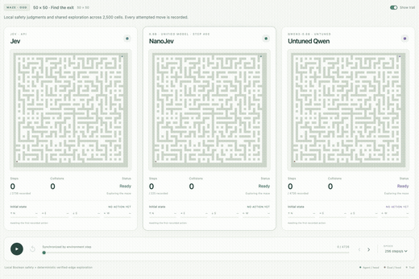
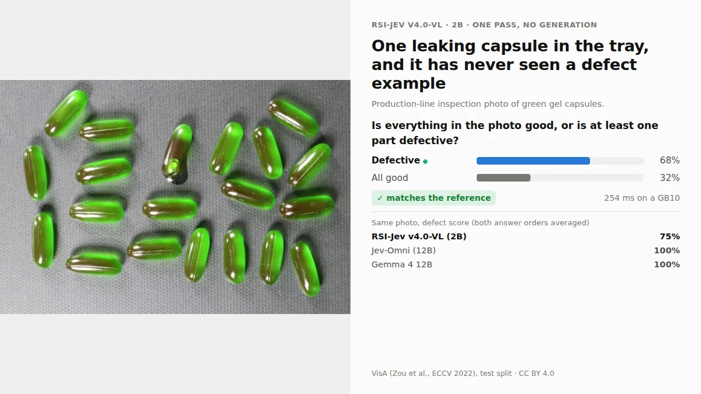
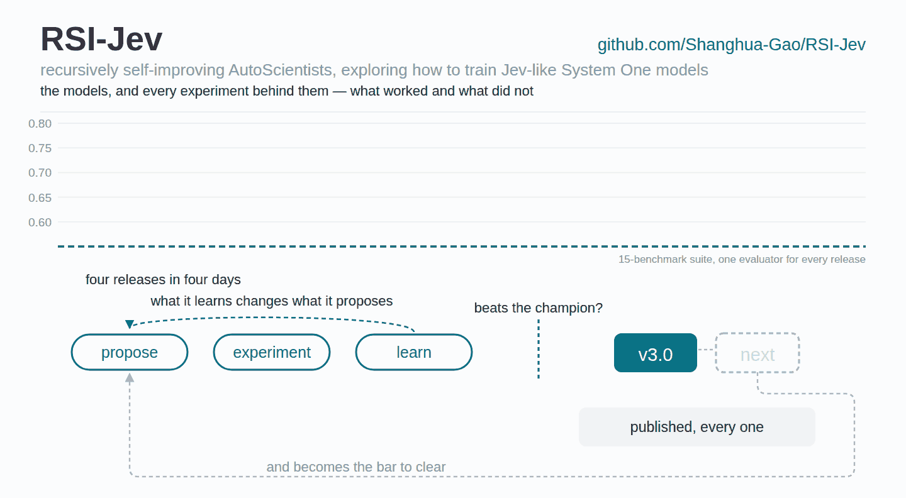
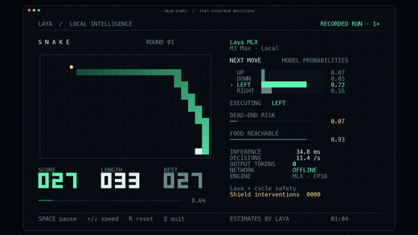
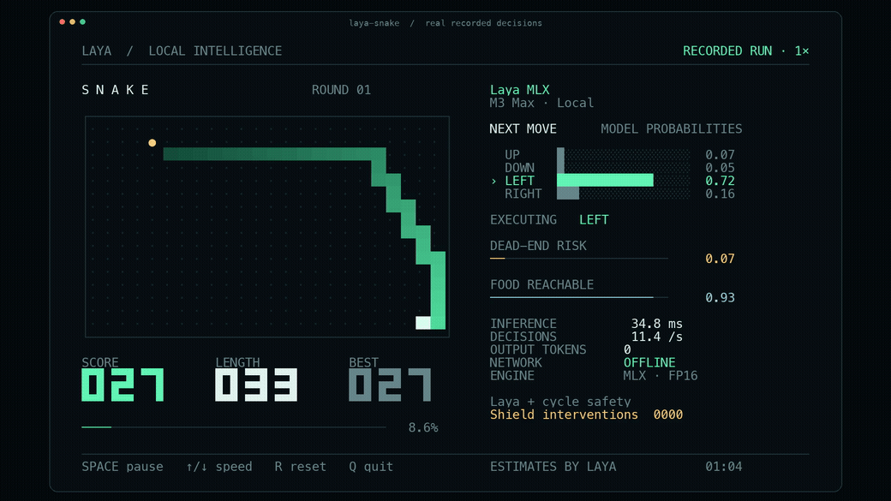

  

<h1 align="center">Awesome Jev Live</h1>

<b>Indeks Jev z oceną dowodów, który odbudowuje się co dwie godziny.</b>

  
  
  
  
  
  

<a href="../README.md">English</a> · <a href="README.zh-CN.md">简体中文</a> · <a href="README.zh-TW.md">繁體中文</a> · <a href="README.ja.md">日本語</a> · <a href="README.ko.md">한국어</a> · <a href="README.es.md">Español</a> · <a href="README.fr.md">Français</a> · <a href="README.de.md">Deutsch</a> · <a href="README.pt-BR.md">Português (Brasil)</a> · <a href="README.ru.md">Русский</a> · <a href="README.it.md">Italiano</a> · <a href="README.ar.md">العربية</a> · <a href="README.hi.md">हिन्दी</a> · <a href="README.tr.md">Türkçe</a> · <a href="README.vi.md">Tiếng Việt</a> · <a href="README.th.md">ไทย</a> · <a href="README.id.md">Bahasa Indonesia</a> · <b>Polski</b> · <a href="README.nl.md">Nederlands</a> · <a href="README.uk.md">Українська</a>

> [!NOTE]
> **Indeks na żywo** · Ostatnia synchronizacja: `2026-11-04T01:29:06+08:00` (UTC+8)
> · Wpisy: **809** · Nowe w tym cyklu: **12** · Języki implementacji: **28**

Każdy wpis poniżej został zebrany, odfiltrowany i ponownie sprawdzony przez potok przetwarzania w tym repozytorium. Liczby i znaczniki czasu pochodzą ze źródeł, a nie z ręcznie napisanego zrzutu.

## 🔥 Wybór chwili — pierwszy w każdej kategorii

Jeden wpis na kategorię, uszeregowany według poziomu dowodów i gwiazdek, przeliczany przy każdej synchronizacji. To ranking, nie rekomendacja; każdy wybór prowadzi do pełnej karty poniżej. Preferowane są projekty, które opublikowały zrzut ekranu lub nagranie, aby ta sekcja pozostała wizualna.

<table>
<tr>
<td width="50%" valign="top">
<b>🏛️ <a href="https://github.com/typesafe-ai/skills">typesafe-ai/skills</a></b>
⭐2868 · ✅ official
Umiejętności agenta do tworzenia za pomocą TypeSafe System One API
</td>
<td width="50%" valign="top">

<b>🧰 <a href="https://github.com/john-rocky/coreai-kit">john-rocky/coreai-kit</a></b>
⭐123 · Swift · 👁️ observed
Swift SDK do uruchamiania modeli czatu, wizji i mowy na iPhone oraz Macu z Core AI firmy Apple. Pobieranie i buforowanie modeli, integracja z FoundationModels oraz…
</td>
</tr>
<tr>
<td width="50%" valign="top">

<b>🤖 <a href="https://github.com/gargpratyush/jev-router">gargpratyush/jev-router</a></b>
⭐651 · JavaScript · 🔎 inferred
Kierowanie do najtańszego modelu w claude code dla danego zadania za pomocą jev-router
</td>
<td width="50%" valign="top">

<b>🛡️ <a href="https://github.com/dharmeshgurnani/CodeOtter">dharmeshgurnani/CodeOtter</a></b>
⭐3 · JavaScript · 👁️ observed
Autonomatyczne, samodzielnie hostowane przeglądy kodu przez AI, skalibrowane wskaźniki ocen i bramki scalania z dowolnego otwartego modelu.
</td>
</tr>
<tr>
<td width="50%" valign="top">

<b>🧪 <a href="https://github.com/Mapika/decider">Mapika/decider</a></b>
⭐1170 · Python · 👁️ observed
Rodzina modeli w stylu System One, dostrojonych z Qwen3.5, zaprojektowana do jednoprzebiegowych typowanych decyzji ze skalibrowanymi prawdopodobieństwami.
</td>
<td width="50%" valign="top">

<b>🔬 <a href="https://github.com/TianyuCodings/NanoJev">TianyuCodings/NanoJev</a></b>
⭐2578 · Python · 🔎 inferred
Miniaturowa replika Jev: równoległe decyzje, dynamiczni kandydaci i kompleksowy potok trenowania.
</td>
</tr>
<tr>
<td width="50%" valign="top">

<b>🎮 <a href="https://github.com/superagents-lab/jev-search">superagents-lab/jev-search</a></b>
⭐554 · TypeScript · 👁️ observed
Przeszukuj internet za pomocą Jev firmy TypeSafe: wybór źródeł, rozumienie zapytań i ranking trafności. Zbudowane za pomocą Search1API.
</td>
<td width="50%" valign="top">

<b>📰 <a href="https://github.com/RobGruhl/jev-learnings">RobGruhl/jev-learnings</a></b>
⭐0 · HTML · 🔎 inferred
Decision Tier: a field guide to decision models (Jev and peers), from ELI5 to engineering a code → decision model → LLM → human cascade
</td>
</tr>
</table>

## Spis treści

- [Czym jest Jev?](#czym-jest-jev)
- [Jak oceniane są wpisy](#jak-oceniane-są-wpisy)
- [Oficjalne zestawy SDK i narzędzia dla programistów](#oficjalne-zestawy-sdk-i-narzędzia-dla-programistów) — **7**
- [Klienty, zestawy SDK i adaptery społeczności](#klienty-zestawy-sdk-i-adaptery-społeczności) — **138**
- [Narzędzia dla agentów: MCP, hooki, bramki i agenty kodujące](#narzędzia-dla-agentów-mcp-hooki-bramki-i-agenty-kodujące) — **246**
- [Routing, zabezpieczenia i zatwierdzenia](#routing-zabezpieczenia-i-zatwierdzenia) — **62**
- [Ewaluacja, kalibracja i benchmarki](#ewaluacja-kalibracja-i-benchmarki) — **95**
- [Otwarte reprodukcje, wagi i badania nad architekturą](#otwarte-reprodukcje-wagi-i-badania-nad-architekturą) — **56**
- [Aplikacje, gry, robotyka i interaktywne dema](#aplikacje-gry-robotyka-i-interaktywne-dema) — **48**
- [Teksty, dyskusje i pokrewne listy](#teksty-dyskusje-i-pokrewne-listy) — **81**
- [Inne projekty](#inne-projekty) — **76**
- [Projekty według języka implementacji](#projekty-według-języka-implementacji)

## Czym jest Jev?

Jev to pierwszy **System One model** firmy TypeSafe AI. Nie pisze prozy. Przyjmuje stan oraz pytania, których przestrzeń odpowiedzi definiujesz z góry, i zwraca typowane wartości z rozkładami prawdopodobieństwa, na których Twój kod może rozgałęziać.

|                        |                                                                                                                                                                                                                                       |
| ---------------------- | ------------------------------------------------------------------------------------------------------------------------------------------------------------------------------------------------------------------------------------- |
| **Kształt**            | `state + typed questions` → `constrained answers + probabilities` → `your code`                                                                                                                                                       |
| **Prymitywy**          | `Choice` (wybór jednej z ≤255 opcji), `Score` (skala ocen 2–10), `Noul` (probabilistyczne tak/nie)                                                                                                                                    |
| **Punkt końcowy**      | `POST https://api.typesafe.ai/v1/systemone`, model `jev-1.13.0` / alias `jev-latest`                                                                                                                                                  |
| **Dobre zastosowania** | routing, triage, scoring, moderacja, weryfikacja i bramki o niskim opóźnieniu w ograniczonym przepływie pracy                                                                                                                         |
| **Znane ograniczenia** | liczenie jest zawodne, wielopoziomowe pośrednictwo jest słabe, a materiały oficjalne wymieniają dziewięć klas nierównomierności. Wynik poprawny pod względem schematu to nie to samo co trafna decyzja — kalibruj na własnych danych. |

## Jak oceniane są wpisy

Większość list w tej dziedzinie twierdzi, że coś uwzględnia. Ta mówi, ile faktycznie zweryfikowała, i pozwala odpowiednio filtrować.

| Ocena        | Co to oznacza                                                                                                                                                                  |
| ------------ | ------------------------------------------------------------------------------------------------------------------------------------------------------------------------------ |
| `official`   | Opublikowane przez samo TypeSafe AI.                                                                                                                                           |
| `observed`   | Publiczny artefakt, który można otworzyć i przeczytać — prawdziwy kod źródłowy, prawdziwa konfiguracja albo wyraźna deklaracja TypeSafe/Jev w nazwie lub temacie repozytorium. |
| `inferred`   | Dopasowane na podstawie niejednoznacznego sygnału i potwierdzającego słownictwa, ale jeszcze nieprzeczytane wiersz po wierszu.                                                 |
| `unverified` | Wygląda na powiązane, nic nie zostało niezależnie potwierdzone. Wymienione wyłącznie w celach odkrywania.                                                                      |

## Oficjalne zestawy SDK i narzędzia dla programistów

Wszystko, co publikuje sam TypeSafe. Zacznij tutaj.

🏛️ <b><a href="https://github.com/typesafe-ai/skills">typesafe-ai/skills</a></b> · ⭐2868 · ✅ official · 10 天

##### 📝 Podsumowanie

Umiejętności agenta do tworzenia za pomocą TypeSafe System One API

> 💡 Własne umiejętności agenta dostawcy. Ponieważ są stale aktualizowane, stanowią najbliższy odpowiednik specyfikacji tego, jak TypeSafe zamierza sterować Jev z poziomu agenta.

##### 📌 Podstawowe informacje

| Pole      | Wartość                                              |
| --------- | ---------------------------------------------------- |
| Kategoria | `Oficjalne zestawy SDK i narzędzia dla programistów` |
| Dowody    | `official`                                           |

##### 📊 Dane

| Metryka          | Wartość    |
| ---------------- | ---------- |
| Gwiazdki         | **2868**   |
| Ostatni push     | 2026-10-23 |
| Pierwsze dodanie | 2026-09-18 |

🏛️ <b><a href="https://github.com/typesafe-ai/system-one-adapter-python">typesafe-ai/system-one-adapter-python</a></b> · ⭐407 · Python · ✅ official · 42 天

##### 📝 Podsumowanie

Zamiennik TypeSafeClient typu drop-in, oparty na LLM APIs

> 💡 Zamiennik typu drop-in, który obsługuje ten sam interfejs za pomocą zwykłego dostawcy LLM. To uczciwy sposób na A/B testowanie typowanej decyzji względem promptu, na własnych danych, przed zobowiązaniem się do któregokolwiek rozwiązania.

🔧 Znaleziono użycie w kodzie: `README.md`

##### 📌 Podstawowe informacje

| Pole      | Wartość                                              |
| --------- | ---------------------------------------------------- |
| Kategoria | `Oficjalne zestawy SDK i narzędzia dla programistów` |
| Dowody    | `official`                                           |
| Język     | Python                                               |

##### 📊 Dane

| Metryka          | Wartość    |
| ---------------- | ---------- |
| Gwiazdki         | **407**    |
| Ostatni push     | 2026-09-22 |
| Pierwsze dodanie | 2026-10-23 |

🏛️ <b><a href="https://github.com/typesafe-ai/typesafe-sdk-python">typesafe-ai/typesafe-sdk-python</a></b> · ⭐308 · Python · ✅ official · 19 天

##### 📝 Podsumowanie

Oficjalna biblioteka Python dla TypeSafe API

> 💡 Klienci synchroniczni i asynchroniczni. Najszybsza droga od klucza API do typowanej decyzji oraz punkt odniesienia, z którym porównywani są klienci społeczności.

🔧 Znaleziono użycie w kodzie: `README.md`

##### 📌 Podstawowe informacje

| Pole      | Wartość                                              |
| --------- | ---------------------------------------------------- |
| Kategoria | `Oficjalne zestawy SDK i narzędzia dla programistów` |
| Dowody    | `official`                                           |
| Język     | Python                                               |

##### 📊 Dane

| Metryka          | Wartość    |
| ---------------- | ---------- |
| Gwiazdki         | **308**    |
| Ostatni push     | 2026-10-14 |
| Pierwsze dodanie | 2026-10-23 |

🏛️ <b><a href="https://github.com/typesafe-ai/typesafe-sdk-js">typesafe-ai/typesafe-sdk-js</a></b> · ⭐285 · TypeScript · ✅ official · 19 天

##### 📝 Podsumowanie

Oficjalna biblioteka TypeScript/JavaScript dla TypeSafe API

> 💡 Klient TypeScript, w którym typ odpowiedzi jest wnioskowany z zadanego pytania, więc niezgodny typ zwracany jest błędem kompilacji, a nie zaskoczeniem w czasie wykonania.

##### 📌 Podstawowe informacje

| Pole      | Wartość                                              |
| --------- | ---------------------------------------------------- |
| Kategoria | `Oficjalne zestawy SDK i narzędzia dla programistów` |
| Dowody    | `official`                                           |
| Język     | TypeScript                                           |

##### 📊 Dane

| Metryka          | Wartość    |
| ---------------- | ---------- |
| Gwiazdki         | **285**    |
| Ostatni push     | 2026-10-14 |
| Pierwsze dodanie | 2026-10-23 |

🏛️ <b><a href="https://github.com/TypeSafeAI/jev-harness">TypeSafeAI/jev-harness</a></b> · ⭐37 · TypeScript · ✅ official · 0 天

##### 📝 Podsumowanie

A custom coding harness for TypeSafe AI's Jev: an LLM proposes, Jev answers narrow questions, code decides, every step leaves a receipt.

##### 📌 Podstawowe informacje

| Pole      | Wartość                                              |
| --------- | ---------------------------------------------------- |
| Kategoria | `Oficjalne zestawy SDK i narzędzia dla programistów` |
| Dowody    | `official`                                           |
| Język     | TypeScript                                           |

##### 📊 Dane

| Metryka          | Wartość    |
| ---------------- | ---------- |
| Gwiazdki         | **37**     |
| Ostatni push     | 2026-11-03 |
| Pierwsze dodanie | 2026-11-03 |

🏷 `agent-harness` · `agentic-coding` · `ai-agents` · `ai-governance` · `ai-safety` · `code-review` · `coding-agent` · `developer-tools`

🏛️ <b><a href="https://github.com/typesafe-ai/WorkflowEvals">typesafe-ai/WorkflowEvals</a></b> · ⭐21 · Python · ✅ official · 35 天

##### 📝 Podsumowanie

Opublikowano kod workflow evals.typesafe.ai

##### 📌 Podstawowe informacje

| Pole      | Wartość                                              |
| --------- | ---------------------------------------------------- |
| Kategoria | `Oficjalne zestawy SDK i narzędzia dla programistów` |
| Dowody    | `official`                                           |
| Język     | Python                                               |

##### 📊 Dane

| Metryka          | Wartość    |
| ---------------- | ---------- |
| Gwiazdki         | **21**     |
| Ostatni push     | 2026-09-29 |
| Pierwsze dodanie | 2026-10-23 |

🏛️ <b><a href="https://github.com/typesafe-ai/typesafe-ai.github.io">typesafe-ai/typesafe-ai.github.io</a></b> · ⭐2 · HTML · ✅ official · 152 天

##### 📝 Podsumowanie

Nie opublikowano opisu ze strony źródłowej.

##### 📌 Podstawowe informacje

| Pole      | Wartość                                              |
| --------- | ---------------------------------------------------- |
| Kategoria | `Oficjalne zestawy SDK i narzędzia dla programistów` |
| Dowody    | `official`                                           |
| Język     | HTML                                                 |

##### 📊 Dane

| Metryka          | Wartość    |
| ---------------- | ---------- |
| Gwiazdki         | **2**      |
| Ostatni push     | 2026-06-04 |
| Pierwsze dodanie | 2026-10-23 |

## Klienty, zestawy SDK i adaptery społeczności

Typowane klienty dla punktu końcowego System One — w tylu językach, w ilu społeczność zdążyła je napisać.

🧰 <b><a href="https://github.com/jexp/neo4jev">jexp/neo4jev</a></b> · ⭐183 · Jupyter · 👁️ observed · 46 天

##### 📝 Podsumowanie

System One Model Jev Typesafe.ai nawigujący po grafie Neo4j za pomocą klasyfikatora relacji sąsiednich

##### 📌 Podstawowe informacje

| Pole      | Wartość                                        |
| --------- | ---------------------------------------------- |
| Kategoria | `Klienty, zestawy SDK i adaptery społeczności` |
| Dowody    | `observed`                                     |
| Język     | Jupyter                                        |

##### 📊 Dane

| Metryka          | Wartość    |
| ---------------- | ---------- |
| Gwiazdki         | **183**    |
| Ostatni push     | 2026-09-18 |
| Pierwsze dodanie | 2026-10-28 |

🧰 <b><a href="https://github.com/keltokhy/jgrep">keltokhy/jgrep</a></b> · ⭐140 · Python · 👁️ observed · 17 天

##### 📝 Podsumowanie

grep, ale wzorzec jest opisem. Filtruje wiersze według znaczenia za pomocą modelu decyzyjnego TypeSafe Jev: około 200 ms i jedna tysięczna centa na wiersz.

🔧 Znaleziono użycie w kodzie: `README.md`

##### 📌 Podstawowe informacje

| Pole      | Wartość                                        |
| --------- | ---------------------------------------------- |
| Kategoria | `Klienty, zestawy SDK i adaptery społeczności` |
| Dowody    | `observed`                                     |
| Język     | Python                                         |

##### 📊 Dane

| Metryka          | Wartość    |
| ---------------- | ---------- |
| Gwiazdki         | **140**    |
| Ostatni push     | 2026-10-17 |
| Pierwsze dodanie | 2026-10-29 |

🏷 `cli` · `grep` · `jev` · `openrouter` · `semantic-search` · `typesafe`

🧰 <b><a href="https://github.com/qkal/Canny">qkal/Canny</a></b> · ⭐132 · TypeScript · 👁️ observed · 41 天

##### 📝 Podsumowanie

Powstrzymuje agentów kodujących AI przed twierdzeniem, że praca została ukończona bez dowodów. Deterministyczne haki podejmują decyzje, TypeSafe Jev doradza. Dziennik tylko do dopisywania, zero zależności uruchomieniowych.

🔧 Znaleziono użycie w kodzie: `README.md`

##### 📌 Podstawowe informacje

| Pole      | Wartość                                        |
| --------- | ---------------------------------------------- |
| Kategoria | `Klienty, zestawy SDK i adaptery społeczności` |
| Dowody    | `observed`                                     |
| Język     | TypeScript                                     |

##### 📊 Dane

| Metryka          | Wartość    |
| ---------------- | ---------- |
| Gwiazdki         | **132**    |
| Ostatni push     | 2026-09-22 |
| Pierwsze dodanie | 2026-10-29 |

🏷 `agent-hooks` · `ai-agents` · `claude-code` · `claude-code-hooks` · `codex` · `codex-cli` · `guardrails` · `jev`

🧰 <b><a href="https://github.com/john-rocky/coreai-kit">john-rocky/coreai-kit</a></b> · ⭐123 · Swift · 👁️ observed · 2 天

##### 📝 Podsumowanie

Swift SDK do uruchamiania modeli czatu, wizji i mowy na iPhone oraz Macu z Core AI firmy Apple. Pobieranie i buforowanie modeli, integracja z FoundationModels oraz gotowe do uruchomienia przykłady z udokumentowanymi wymaganiami dotyczącymi systemu operacyjnego, SDK i modeli.

🔧 Znaleziono użycie w kodzie: `Sources/CoreAIOps/CoreAI+SystemOne.swift`

##### 📌 Podstawowe informacje

| Pole      | Wartość                                        |
| --------- | ---------------------------------------------- |
| Kategoria | `Klienty, zestawy SDK i adaptery społeczności` |
| Dowody    | `observed`                                     |
| Język     | Swift                                          |

##### 📊 Dane

| Metryka          | Wartość    |
| ---------------- | ---------- |
| Gwiazdki         | **123**    |
| Ostatni push     | 2026-11-01 |
| Pierwsze dodanie | 2026-10-26 |

🏷 `apple` · `apple-core-ai` · `asr` · `core-ai` · `coreai` · `foundation-models` · `ios` · `ios-27`

---

<table><tr><th align="center" width="50%">🖼 Obraz</th><th align="center" width="50%">🎬 Wideo</th></tr><tr>
<td align="center" valign="top"></td>
<td align="center" valign="top"> nagranie animowane</td>
</tr></table>

🧰 <b><a href="https://github.com/yzfly/awesome-jev-zh">yzfly/awesome-jev-zh</a></b> · ⭐89 · HTML · 👁️ observed · 0 天

##### 📝 Podsumowanie

Jev / TypeSafe System One 中文精选列表：官方资料、SDK、爆款应用、Agent 工具、开源复现与独立评测，附中文上手指南，每日自动收录 GitHub 热门项目。

🔧 Znaleziono użycie w kodzie: `docs/quickstart.md`

##### 📌 Podstawowe informacje

| Pole      | Wartość                                        |
| --------- | ---------------------------------------------- |
| Kategoria | `Klienty, zestawy SDK i adaptery społeczności` |
| Dowody    | `observed`                                     |
| Język     | HTML                                           |

##### 📊 Dane

| Metryka          | Wartość    |
| ---------------- | ---------- |
| Gwiazdki         | **89**     |
| Ostatni push     | 2026-11-03 |
| Pierwsze dodanie | 2026-09-18 |

🏷 `ai-agent` · `awesome` · `awesome-list` · `chinese` · `jev` · `llm` · `structured-output` · `system-one`

🧰 <b><a href="https://github.com/obie/ruby_decision_model">obie/ruby_decision_model</a></b> · ⭐58 · Ruby · 👁️ observed · 22 天

##### 📝 Podsumowanie

Klient Ruby dla modeli decyzyjnych, takich jak Typesafe Jev

🔧 Znaleziono użycie w kodzie: `README.md`

##### 📌 Podstawowe informacje

| Pole      | Wartość                                        |
| --------- | ---------------------------------------------- |
| Kategoria | `Klienty, zestawy SDK i adaptery społeczności` |
| Dowody    | `observed`                                     |
| Język     | Ruby                                           |

##### 📊 Dane

| Metryka          | Wartość    |
| ---------------- | ---------- |
| Gwiazdki         | **58**     |
| Ostatni push     | 2026-10-12 |
| Pierwsze dodanie | 2026-10-29 |

🧰 <b><a href="https://github.com/bodepudimuneendra-netizen/ConsciousDB">bodepudimuneendra-netizen/ConsciousDB</a></b> · ⭐53 · Python · 👁️ observed · 1 天

##### 📝 Podsumowanie

Niezależny od bazy danych framework Agentic GraphRAG wykorzystujący wymienne modele System One (lokalny Laya / chmurowy Jev). Uniwersalna warstwa inteligencji z kompletnym 4-fazowym potokiem, ciągłą ewaluacją i niestandardowym przemierzaniem A* dla dowolnej bazy danych grafowych.

##### 📌 Podstawowe informacje

| Pole      | Wartość                                        |
| --------- | ---------------------------------------------- |
| Kategoria | `Klienty, zestawy SDK i adaptery społeczności` |
| Dowody    | `observed`                                     |
| Język     | Python                                         |

##### 📊 Dane

| Metryka          | Wartość    |
| ---------------- | ---------- |
| Gwiazdki         | **53**     |
| Ostatni push     | 2026-11-02 |
| Pierwsze dodanie | 2026-11-02 |

🏷 `astar-algorithm` · `eval-harness` · `fine-tuning` · `graphdatabase` · `graprag` · `jev` · `laya` · `neo4j`

🧰 <b><a href="https://github.com/MrJev/awesome-jev">MrJev/awesome-jev</a></b> · ⭐20 · Python · 👁️ observed · 0 天

##### 📝 Podsumowanie

Wyselekcjonowana lista projektów, integracji i zasobów dla Jev, modelu System One należącego do TypeSafe AI.

##### 📌 Podstawowe informacje

| Pole      | Wartość                                        |
| --------- | ---------------------------------------------- |
| Kategoria | `Klienty, zestawy SDK i adaptery społeczności` |
| Dowody    | `observed`                                     |
| Język     | Python                                         |

##### 📊 Dane

| Metryka          | Wartość    |
| ---------------- | ---------- |
| Gwiazdki         | **20**     |
| Ostatni push     | 2026-11-03 |
| Pierwsze dodanie | 2026-09-18 |

🏷 `ai-agents` · `awesome` · `awesome-list` · `jev` · `mcp` · `typesafe`

🧰 <b><a href="https://github.com/ckaraca/awesome-jev">ckaraca/awesome-jev</a></b> · ⭐17 · Python · 👁️ observed · 1 天

##### 📝 Podsumowanie

Kuratorowana lista narzędzi, integracji i eksperymentów zbudowanych na Jev, modelu System One firmy TypeSafe AI do szybkich, typowanych decyzji.

##### 📌 Podstawowe informacje

| Pole      | Wartość                                        |
| --------- | ---------------------------------------------- |
| Kategoria | `Klienty, zestawy SDK i adaptery społeczności` |
| Dowody    | `observed`                                     |
| Język     | Python                                         |

##### 📊 Dane

| Metryka          | Wartość    |
| ---------------- | ---------- |
| Gwiazdki         | **17**     |
| Ostatni push     | 2026-11-02 |
| Pierwsze dodanie | 2026-09-19 |

🏷 `ai-agents` · `awesome` · `awesome-list` · `computer-use` · `jev` · `llm` · `system-one` · `typesafe`

🧰 <b><a href="https://github.com/Premo-Cloud/typesafe-sdk-java">Premo-Cloud/typesafe-sdk-java</a></b> · ⭐12 · Java · 👁️ observed · 12 天

##### 📝 Podsumowanie

Społecznościowy Java SDK dla Jev, modelu System One firmy TypeSafe: typowane pytania na wejściu, typowane odpowiedzi ze skalibrowanymi prawdopodobieństwami na wyjściu. Java 17+, starter Spring Boot (nieoficjalny)

##### 📌 Podstawowe informacje

| Pole      | Wartość                                        |
| --------- | ---------------------------------------------- |
| Kategoria | `Klienty, zestawy SDK i adaptery społeczności` |
| Dowody    | `observed`                                     |
| Język     | Java                                           |

##### 📊 Dane

| Metryka          | Wartość    |
| ---------------- | ---------- |
| Gwiazdki         | **12**     |
| Ostatni push     | 2026-10-21 |
| Pierwsze dodanie | 2026-10-28 |

🏷 `java` · `jev` · `sdk` · `spring-boot` · `system-one` · `system-one-models` · `typesafe`

🧰 <b><a href="https://github.com/PromtEngineer/jev-harness">PromtEngineer/jev-harness</a></b> · ⭐10 · Python · 👁️ observed · 39 天

##### 📝 Podsumowanie

Harness agenta Pi zbudowany wokół Jev firmy TypeSafe (model System One): router, wybór kontekstu, bramka i weryfikator. Przetestowany na gałęziach Neon Postgres.

##### 📌 Podstawowe informacje

| Pole      | Wartość                                        |
| --------- | ---------------------------------------------- |
| Kategoria | `Klienty, zestawy SDK i adaptery społeczności` |
| Dowody    | `observed`                                     |
| Język     | Python                                         |

##### 📊 Dane

| Metryka          | Wartość    |
| ---------------- | ---------- |
| Gwiazdki         | **10**     |
| Ostatni push     | 2026-09-24 |
| Pierwsze dodanie | 2026-10-28 |

🧰 <b><a href="https://github.com/clouatre-labs/decisions-judge-mcp">clouatre-labs/decisions-judge-mcp</a></b> · ⭐5 · JavaScript · 👁️ observed · 1 天

##### 📝 Podsumowanie

Typowane decyzje dla agentów AI jako narzędzie MCP: prawdopodobieństwo tak/nie (noul), wybór i ocena w jednym szybkim żądaniu. Oparte na modelu System One TypeSafe.

##### 📌 Podstawowe informacje

| Pole      | Wartość                                        |
| --------- | ---------------------------------------------- |
| Kategoria | `Klienty, zestawy SDK i adaptery społeczności` |
| Dowody    | `observed`                                     |
| Język     | JavaScript                                     |

##### 📊 Dane

| Metryka          | Wartość    |
| ---------------- | ---------- |
| Gwiazdki         | **5**      |
| Ostatni push     | 2026-11-02 |
| Pierwsze dodanie | 2026-10-12 |

🏷 `agent` · `ai` · `cli` · `decision-making` · `decisions` · `judge` · `llm` · `mcp`

---

<table><tr><th align="center" width="50%">🖼 Obraz</th><th align="center" width="50%">🎬 Wideo</th></tr><tr>
<td align="center" valign="top"></td>
<td align="center" valign="top"> nagranie animowane</td>
</tr></table>

🧰 <b><a href="https://github.com/elbruno/ElBruno.AI.Decisions">elbruno/ElBruno.AI.Decisions</a></b> · ⭐5 · C# · 👁️ observed · 0 天

##### 📝 Podsumowanie

.NET 10 decision SDK: Choose, Score, and Assess with Microsoft Foundry (Microsoft-Decision-1), native local Ollama System One models, and TypeSafe AI Jev. One API, probabilities instead of paragraphs.

##### 📌 Podstawowe informacje

| Pole      | Wartość                                        |
| --------- | ---------------------------------------------- |
| Kategoria | `Klienty, zestawy SDK i adaptery społeczności` |
| Dowody    | `observed`                                     |
| Język     | C#                                             |

##### 📊 Dane

| Metryka          | Wartość    |
| ---------------- | ---------- |
| Gwiazdki         | **5**      |
| Ostatni push     | 2026-11-03 |
| Pierwsze dodanie | 2026-11-03 |

🏷 `dotnet` · `dotnet10` · `jev` · `microsoft-extensions-ai` · `nuget`

---

<table><tr><th align="center" width="50%">🖼 Obraz</th><th align="center" width="50%">🎬 Wideo</th></tr><tr>
<td align="center" valign="top"></td>
<td align="center" valign="top">brak opublikowanych multimediów</td>
</tr></table>

🧰 <b><a href="https://github.com/Bonzokoles/36_chambers">Bonzokoles/36_chambers</a></b> · Python · 👁️ observed · 11 天

##### 📝 Podsumowanie

Sfederowany silnik wyszukiwania wiedzy dla agentów AI. Kieruje zapytania do wyspecjalizowanych backendów (FTS5, ChromaDB, graf) za pomocą orkiestratora stawiającego rejestr na pierwszym miejscu, z routingiem AI TypeSafe/Jev i ponownym sortowaniem dowodów. Domyślnie tylko do odczytu, z założenia chroniony mechanizmami bezpieczeństwa.

##### 📌 Podstawowe informacje

| Pole      | Wartość                                        |
| --------- | ---------------------------------------------- |
| Kategoria | `Klienty, zestawy SDK i adaptery społeczności` |
| Dowody    | `observed`                                     |
| Język     | Python                                         |

##### 📊 Dane

| Metryka          | Wartość    |
| ---------------- | ---------- |
| Gwiazdki         | **0**      |
| Ostatni push     | 2026-10-22 |
| Pierwsze dodanie | 2026-10-23 |

🏷 `ai-agents` · `ai-infrastructure` · `chromadb` · `embeddings` · `federated-search` · `fts5` · `information-retrieval` · `jev`

---

<table><tr><th align="center" width="50%">🖼 Obraz</th><th align="center" width="50%">🎬 Wideo</th></tr><tr>
<td align="center" valign="top"></td>
<td align="center" valign="top">brak opublikowanych multimediów</td>
</tr></table>

Zasób podlinkowany bezpośrednio z repozytorium źródłowego, ponieważ nie zadeklarowano licencji pozwalającej na redystrybucję.

🧰 <b><a href="https://github.com/OpenByteInc/QuantDinger">OpenByteInc/QuantDinger</a></b> · ⭐13480 · Python · 🔎 inferred · 0 天 · ⭐+3

##### 📝 Podsumowanie

Open-source AI Trading OS, handel agentowy i vibe trading, z integracją Jev System One. Badaj, twórz strategie Python, backtestuj oraz handluj paper/live na rynkach krypto, akcji i forex. Uruchom własny wielodostępny trading SaaS z wbudowanym zarządzaniem użytkownikami, rozliczeniami, płatnościami i rozrachunkiem.

##### 📌 Podstawowe informacje

| Pole      | Wartość                                        |
| --------- | ---------------------------------------------- |
| Kategoria | `Klienty, zestawy SDK i adaptery społeczności` |
| Dowody    | `inferred`                                     |
| Język     | Python                                         |

##### 📊 Dane

| Metryka          | Wartość        |
| ---------------- | -------------- |
| Gwiazdki         | **13480** (+3) |
| Ostatni push     | 2026-11-03     |
| Pierwsze dodanie | 2026-09-20     |

🏷 `agent` · `backtesting` · `binance` · `crypto` · `exchange` · `finance` · `fintech` · `forex`

---

<table><tr><th align="center" width="50%">🖼 Obraz</th><th align="center" width="50%">🎬 Wideo</th></tr><tr>
<td align="center" valign="top"></td>
<td align="center" valign="top">brak opublikowanych multimediów</td>
</tr></table>

🧰 <b><a href="https://github.com/dzhng/jevgrep">dzhng/jevgrep</a></b> · ⭐3162 · TypeScript · 🔎 inferred · 2 天 · ⭐+1

##### 📝 Podsumowanie

Znajduj kod, pytając, co robi. Narzędzie CLI dla agentów programistycznych, które wykorzystuje Jev do wyszukiwania odpowiednich plików i kontekstu źródłowego.

##### 📌 Podstawowe informacje

| Pole      | Wartość                                        |
| --------- | ---------------------------------------------- |
| Kategoria | `Klienty, zestawy SDK i adaptery społeczności` |
| Dowody    | `inferred`                                     |
| Język     | TypeScript                                     |

##### 📊 Dane

| Metryka          | Wartość       |
| ---------------- | ------------- |
| Gwiazdki         | **3162** (+1) |
| Ostatni push     | 2026-11-01    |
| Pierwsze dodanie | 2026-10-29    |

🏷 `ai-sdk` · `claude-code` · `cli` · `code-search` · `codex` · `coding-agents` · `context-retrieval` · `developer-tools`

---

<table><tr><th align="center" width="50%">🖼 Obraz</th><th align="center" width="50%">🎬 Wideo</th></tr><tr>
<td align="center" valign="top"></td>
<td align="center" valign="top">brak opublikowanych multimediów</td>
</tr></table>

🧰 <b><a href="https://github.com/socai-io/jev-social">socai-io/jev-social</a></b> · ⭐195 · JavaScript · 🔎 inferred · 1 天

##### 📝 Podsumowanie

Oparta na otwartym kodzie, lokalna w pierwszej kolejności agenta do badania mediów społecznościowych na Instagramie, TikToku i LinkedIn. Jev kieruje krokami tylko do odczytu; socai CLI przechwytuje przytoczone dowody z przeglądarki.

##### 📌 Podstawowe informacje

| Pole      | Wartość                                        |
| --------- | ---------------------------------------------- |
| Kategoria | `Klienty, zestawy SDK i adaptery społeczności` |
| Dowody    | `inferred`                                     |
| Język     | JavaScript                                     |

##### 📊 Dane

| Metryka          | Wartość    |
| ---------------- | ---------- |
| Gwiazdki         | **195**    |
| Ostatni push     | 2026-11-01 |
| Pierwsze dodanie | 2026-11-02 |

🏷 `agent-skills` · `ai-agents` · `browser-agent` · `browser-automation` · `decision-model` · `deep-research` · `instagram` · `jev`

---

<table><tr><th align="center" width="50%">🖼 Obraz</th><th align="center" width="50%">🎬 Wideo</th></tr><tr>
<td align="center" valign="top"></td>
<td align="center" valign="top"> nagranie animowane</td>
</tr></table>

🧰 <b><a href="https://github.com/supercorp-ai/supercov">supercorp-ai/supercov</a></b> · ⭐159 · Rust · 🔎 inferred · 4 天

##### 📝 Podsumowanie

Pokrycie, bezpieczeństwo i jakość kodu dla agentów programistycznych

> 💡 Werdykty dotyczące jakości kodu i pokrycia tworzone jako typowane decyzje zamiast prozy, dzięki czemu wynik może bezpośrednio blokować lub przepuszczać pipeline.

##### 📌 Podstawowe informacje

| Pole      | Wartość                                        |
| --------- | ---------------------------------------------- |
| Kategoria | `Klienty, zestawy SDK i adaptery społeczności` |
| Dowody    | `inferred`                                     |
| Język     | Rust                                           |

##### 📊 Dane

| Metryka          | Wartość    |
| ---------------- | ---------- |
| Gwiazdki         | **159**    |
| Ostatni push     | 2026-10-30 |
| Pierwsze dodanie | 2026-10-23 |

🏷 `agent-skills` · `claude-code` · `code-coverage` · `code-quality` · `codex` · `coding-agents` · `coverage` · `gemini-cli-extension`

---

<table><tr><th align="center" width="50%">🖼 Obraz</th><th align="center" width="50%">🎬 Wideo</th></tr><tr>
<td align="center" valign="top"></td>
<td align="center" valign="top">brak opublikowanych multimediów</td>
</tr></table>

<b>Więcej w tej kategorii</b> · 120

- [xingwudao/OpenJev](https://github.com/xingwudao/OpenJev) - OpenJev: niezależny API decyzyjny System One inspirowany Jev, oparty na…
- [frodi-karlsson/onesie](https://github.com/frodi-karlsson/onesie) - An expressive Unix-pipeable CLI for System One models like Jev.
- [GitHub30/OpenJev](https://github.com/GitHub30/OpenJev) - Model System One o otwartych wagach (zgodny z Jev): skalibrowane decyzje noul /…
- [chussenot/judgment](https://github.com/chussenot/judgment) - Typowane, skalibrowane osądy z modeli System One: decyzja zapisana jako plik…
- [CMaintz/jev-dotnet](https://github.com/CMaintz/jev-dotnet) - Nieoficjalny .NET SDK dla modelu Jev System One firmy TypeSafe AI.
- [danieleteti/systemone-delphi](https://github.com/danieleteti/systemone-delphi) - Delphi client for System One models (Jev, tev1 and nimble on Ollama): ask typed…
- [erik-hedstrom/loadout](https://github.com/erik-hedstrom/loadout) - Wybieraj model, umiejętności i serwery MCP dla każdej sesji agenta kodującego z…
- [jqueryscript/awesome-jev](https://github.com/jqueryscript/awesome-jev) - A curated list of TypeSafe Jev resources, SDKs, agents, MCP servers…
- [basi/typesafe-ai-php-client](https://github.com/basi/typesafe-ai-php-client) - PHP client for the typesafe.ai System One API (Jev).
- [CMaintz/jev-java](https://github.com/CMaintz/jev-java) - Nieoficjalny Java SDK dla modelu Jev System One firmy TypeSafe AI.
- [gajaguar/typesafe-cli](https://github.com/gajaguar/typesafe-cli) - Unofficial command-line interface for TypeSafe AI System One models, on…
- [IoTone/jevracket](https://github.com/IoTone/jevracket) - A jev client for the live typesafe.ai api, written for a racket language runtime.
- [JosephHardy91/graph-composition-with-dLLMs](https://github.com/JosephHardy91/graph-composition-with-dLLMs) - A Graph-Compiled Specification RAG system built with **Dagster**, **PostgreSQL…
- [romain-cll/reflex-rag](https://github.com/romain-cll/reflex-rag) - A retrieval loop judged by a system-one model (Jev) instead of an LLM.
- [sanketmuchhala/jevgate](https://github.com/sanketmuchhala/jevgate) - Calibrated policy triage and institutional risk routing: a hybrid…
- [ollaya-dev/ollaya](https://github.com/ollaya-dev/ollaya) - Jev-compatible API server for open decision models.
- [realZachi/pg-jev](https://github.com/realZachi/pg-jev) - Zadawaj tabelom Postgres pytania w języku naturalnym.
- [sutro-sh/jev-align](https://github.com/sutro-sh/jev-align) - Twórz skalibrowane funkcje AI na podstawie informacji zwrotnych od ludzi…
- [juspay/neurolink](https://github.com/juspay/neurolink) - Warstwa potokowa układu nerwowego AI — jeden interfejs łączący neurony…
- [aaddrick/building-with-typesafe-jev](https://github.com/aaddrick/building-with-typesafe-jev) - Nieoficjalna umiejętność ucząca agentów programistycznych budowania za pomocą…
- [Ying-Kai-Liao/jev-browser](https://github.com/Ying-Kai-Liao/jev-browser) - Automatyzacja przeglądarki, w której LLM planuje, a Jev (Typesafe System One)…
- [fazlerocks/jevmail](https://github.com/fazlerocks/jevmail) - Otwartoźródłowy system sortowania wiadomości e-mail AI dla Gmaila.
- [AboveColin/HA-Jev](https://github.com/AboveColin/HA-Jev) - Zadaj swojemu domowi pytanie i otrzymaj liczbę.
- [sharziki/semdecide](https://github.com/sharziki/semdecide) - Typowane decyzje semantyczne dla potoków Unix i CI, oparte na TypeSafe AI Jev.
- [bladedevoff/stuntd](https://github.com/bladedevoff/stuntd) - Lokalny proxy, który uczy się typowanych decyzji LLM Twojej aplikacji i…
- [burnigtm/jev-mcp](https://github.com/burnigtm/jev-mcp) - Serwer MCP, który umieszcza TypeSafe Jev w pętli kodowania w Cursor, Codex i…
- [jwuthri-cloud/SelfJev](https://github.com/jwuthri-cloud/SelfJev) - Self-hosted decision model (selfjev-4b) with a Jev-compatible API: Python SDK…
- [mlimarenko/IronRAG](https://github.com/mlimarenko/IronRAG) - One-click knowledge system for documents, internal bots, and AI agents.
- [shaharia-lab/jev-cli](https://github.com/shaharia-lab/jev-cli) - Narzędzie wiersza poleceń dla modelu Jev firmy TypeSafe AI.
- [dannote/jev](https://github.com/dannote/jev) - TypeSafe Jev dla OTP: odpowiadaj na Jev z GenServer i dopasowuj wzorzec do jego…
- [lukstei/slop-grader](https://github.com/lukstei/slop-grader) - Jev-powered, rule-based grader for text files.
- [jiangkoumo/ego-decision-layer](https://github.com/jiangkoumo/ego-decision-layer) - Pluggable decision layer for the ego lite browser: one System One (Jev) call…
- [DevLoops-ai/unified-brain](https://github.com/DevLoops-ai/unified-brain) - System One Coding Agents: code-level answers at the same score as Claude Fable…
- [thusinh1969/BrighTO_Router](https://github.com/thusinh1969/BrighTO_Router) - BrighTO LLM Router: free open-source, ultra-fast Rust LLM gateway/router and…
- [arjun988/Kev](https://github.com/arjun988/Kev) - Open-source.
- [Ray-Hughes/jevalyn](https://github.com/Ray-Hughes/jevalyn) - Warstwa decyzyjna dla Twojej aplikacji Rails.
- [tontoko/jev-browser](https://github.com/tontoko/jev-browser) - Jeden ugruntowany rdzeń Jev/Playwright: typowane SDK, trwałe CLI oraz serwer…
- [nouli-ai/nouli](https://github.com/nouli-ai/nouli) - A ledger-backed decision network that records AI decisions and connects them to…
- [saibimajdi/typesafeai-dotnet-sdk](https://github.com/saibimajdi/typesafeai-dotnet-sdk) - Społecznościowy SDK .NET dla TypeSafe AI System One API — typowane pytania…
- [Elue-dev/jev_elixir](https://github.com/Elue-dev/jev_elixir) - jev_elixir to mały, idiomatyczny interfejs do podejmowania typowanych decyzji…
- [sumleo/prompt2jev](https://github.com/sumleo/prompt2jev) - Umiejętność agenta i CLI, które zamieniają język naturalny, prompt LLM lub kod…
- [devbackend/jevgo](https://github.com/devbackend/jevgo) - Nieoficjalny klient Go dla TypeSafe AI System One API (Jev) — wpisujesz…
- [haileyok/typesafe-client](https://github.com/haileyok/typesafe-client) - Nieoficjalni klienci Go i Rust dla TypeSafe AI System One API (Jev).
- [himomohi/aside-jev](https://github.com/himomohi/aside-jev) - Agenci Aside podejmują decyzje za pomocą TypeSafe Jev.
- [wojciechwiesner/jit-context](https://github.com/wojciechwiesner/jit-context) - Architectural Moat: JIT-JEV Context OS — Epistemic runtime &amp; JEV System 1…
- [chenrui333/jev-docs](https://github.com/chenrui333/jev-docs) - Tworzona przez społeczność historia Jev / TypeSafe System One APIs, SDKs…
- [docxology/daf-jev](https://github.com/docxology/daf-jev) - daf-jev: kompozytowalny zestaw narzędzi Python dla decyzji API Jev firmy…
- [sanamhub/typesafe-dotnet](https://github.com/sanamhub/typesafe-dotnet) - Unofficial .NET client for the TypeSafe AI System One API.
- [JimmyWesley/rlcd-gateway](https://github.com/JimmyWesley/rlcd-gateway) - Samodzielnie hostowana brama dla LLMs i modeli decyzyjnych.
- [jonymusky/jev-browser-qa](https://github.com/jonymusky/jev-browser-qa) - Browser QA where Playwright drives and films, and TypeSafe Jev judges.
- [Kadihx/jev-x-kit](https://github.com/Kadihx/jev-x-kit) - Offline.
- [vibefilter/filament](https://github.com/vibefilter/filament) - Filter Filament tables with a plain-English statement.
- [zhirschtritt/typesafe-go](https://github.com/zhirschtritt/typesafe-go) - Idiomatyczne Go SDK dla TypeSafe AI API.
- [Butochnikov/laravel-typesafe-jev](https://github.com/Butochnikov/laravel-typesafe-jev) - Nieoficjalna integracja Laravel dla TypeSafe Jev AI z typowanymi odpowiedziami…
- [coo-quack/jev-pii-checker](https://github.com/coo-quack/jev-pii-checker) - CLI, które znajduje PII w tekście za pomocą TypeSafe Jev: obecność, wrażliwość…
- [illescasDaniel/jev-mem](https://github.com/illescasDaniel/jev-mem) - Long-term memory for AI agents driven by Jev (System One) decisions: no…
- [Lasimeri/Mechanical-Jev](https://github.com/Lasimeri/Mechanical-Jev) - Strona zadająca pytań Jev (TypeSafe System One: noul, choice, score) w Rust…
- [nshkrdotcom/system_one_sdk](https://github.com/nshkrdotcom/system_one_sdk) - Neutralny względem dostawcy Elixir/BEAM SDK dla semantyki System One: typowane…
- [PAI-CUHK/SLEEPJEV](https://github.com/PAI-CUHK/SLEEPJEV) - Inspirowane JEV typowane decyzje runtime na długohoryzontowym PSG…
- [zerone-agents/jev-model-router](https://github.com/zerone-agents/jev-model-router) - Lekki routing modeli dla agentów, ze zgodnością z OpenAI i Anthropic API…
- [AboveColin/jevclient](https://github.com/AboveColin/jevclient) - Asynchroniczny klient Python dla TypeSafe Jev.
- [dsaad68/fuzzy-jev](https://github.com/dsaad68/fuzzy-jev) - A client for OpenRouter&#x27;s decision models, TypeSafe&#x27;s Jev by default: typed…
- [getmissionctrl/hs-jev](https://github.com/getmissionctrl/hs-jev) - Klient Haskell dla System One decyzji API TypeSafe (Jev) — typowane, wsadowe…
- [maxtrezzi/jev4s](https://github.com/maxtrezzi/jev4s) - Typed Scala client for Jev (TypeSafe AI): typed questions, typed answers…
- [minorun365/jev-cloud-quiz](https://github.com/minorun365/jev-cloud-quiz) - 三大クラウドの機能名を、TypeSafe AI の System One モデル Jev が確率つきで判定するデモ.
- [MrKyaw/CognitiveMirror-Jev-MCP](https://github.com/MrKyaw/CognitiveMirror-Jev-MCP) - Cognitive middleware for personal and enterprise AI agents: 14 MCP tools and a…
- [NerdishShah/playwright-cli-jev-bakeoff](https://github.com/NerdishShah/playwright-cli-jev-bakeoff) - Porównanie: Playwright CLI kontra CLI+Jev kontra Playwright MCP.
- [amidabuddha/jev-decision-mcp](https://github.com/amidabuddha/jev-decision-mcp) - Local MCP server for TypeSafe Jev typed decisions, with Codex integration.
- [apixly-ai/jev-filter](https://github.com/apixly-ai/jev-filter) - Typed semantic filtering for AI agents: turn retrieved records, code and logs…
- [bitranox/btx-skill-jev-judge](https://github.com/bitranox/btx-skill-jev-judge) - Claude Code plugin and Python CLI: hand a judgment repeated over many items to…
- [bojansandhaus/dsh-jev-mcp](https://github.com/bojansandhaus/dsh-jev-mcp) - TypeSafe Jev decision tools for DeepSeek Harness: dependency-free client…
- [bspiritxp/jev-cli](https://github.com/bspiritxp/jev-cli) - Klient CLI dla TypeSafe Jev (System One) do strukturalnych decyzji: noul /…
- [exfoca/decision-model-lab-4JEV](https://github.com/exfoca/decision-model-lab-4JEV) - DML is a reproducible harness for evaluating small, local decision models under…
- [Hyper-AI-Lab/openclaw-jev](https://github.com/Hyper-AI-Lab/openclaw-jev) - Produkcyjna płaszczyzna sterowania dla agentów OpenClaw: routing przyjęć z Jev…
- [swami8791/jev-judge-mcp](https://github.com/swami8791/jev-judge-mcp) - Owner-private ChatGPT integration for TypeSafe Jev structured evaluations.
- [abirshhishirroy/mini-jev](https://github.com/abirshhishirroy/mini-jev) - A custom Jev-style decision model built from scratch on Qwen2.5-3B.
- [AIAnytime/Jev-Router](https://github.com/AIAnytime/Jev-Router) - Decision-first, OpenAI-compatible AI router powered by Jev typed decisions.
- [CMaintz/jev-tools](https://github.com/CMaintz/jev-tools) - Narzędzia TypeScript zbudowane na Jev firmy TypeSafe AI: zabezpieczenie wywołań…
- [codebam/jev-guardrails](https://github.com/codebam/jev-guardrails) - Zabezpieczenia wywołań narzędzi przez agenta oparte na Jev: biblioteka, natywne…
- [david1gp/jev](https://github.com/david1gp/jev) - Result-based TypeSafe System One, Cloudflare Clef, and OpenAI Decisions client…
- [Errr0rr404/jev-trader](https://github.com/Errr0rr404/jev-trader) - Local CLI and web desk. Robinhood Agentic MCP is the tape. TypeSafe Jev votes.
- [gmrdad82/pito-jev](https://github.com/gmrdad82/pito-jev) - A small blocking Rust client for Jev.
- [ivanblagdan/jev-cli](https://github.com/ivanblagdan/jev-cli) - Composable CLI for TypeSafe.
- [kkdev92/jev-dotnet](https://github.com/kkdev92/jev-dotnet) - An unofficial .NET 10 client for Jev, TypeSafe.
- [mrodgersjs-web/jev-route](https://github.com/mrodgersjs-web/jev-route) - Deterministic routing-policy CLI in Rust: task and candidates in, choice +…
- [Murat-Selim/jev_doc_router](https://github.com/Murat-Selim/jev_doc_router) - Spring Boot PDF question-answering assistant with RAG/CAG routing and…
- [ogarciarevett/jev-py-sdk](https://github.com/ogarciarevett/jev-py-sdk) - Typowane oceny Jev (noul / choice / score) z TypeSafe dla Python, maskowane…
- [phoenix1331/laravel-jev-hotdog](https://github.com/phoenix1331/laravel-jev-hotdog) - A Laravel 13 playground that tells you whether a photo is a hot dog or not…
- [Ridlo543/jev-judge](https://github.com/Ridlo543/jev-judge) - Universal Model Context Protocol (MCP) server and CLI runner for TypeSafe Jev…
- [royalskynet/jev-gate-mcp](https://github.com/royalskynet/jev-gate-mcp) - Zarządzana bramka decyzyjna Jev dla klientów GPT, Claude i MCP.
- [shetautnetjer/jev-cli](https://github.com/shetautnetjer/jev-cli) - Clean-room CLI for TypeSafe System One / Jev Decision Contracts, search, and…
- [sunjongos/jev-typesafe-gatekeeper](https://github.com/sunjongos/jev-typesafe-gatekeeper) - World-Class Pure System 1 AI Decision &amp; 90/10 Hybrid Gatekeeper Skill powered…
- [SykkoAtHome/MCP_Typesafe_JEV](https://github.com/SykkoAtHome/MCP_Typesafe_JEV) - Domain-agnostic MCP server for TypeSafe Jev (System One) evaluation engine…
- [TechPreacher/jev-router-copilot](https://github.com/TechPreacher/jev-router-copilot) - Jev model router for GitHub Copilot in VS Code and the CLI.
- [Yasir-Khan-7/jev-sentinel](https://github.com/Yasir-Khan-7/jev-sentinel) - Ochrona przed wstrzykiwaniem promptów i zabezpieczenia wywołań narzędzi dla…
- [Zuexx/agent-jev-integration](https://github.com/Zuexx/agent-jev-integration) - TypeSafe Jev integrated into Claude Code: routing, escalation, guardrails, evals.
- [rokbenko/quackd](https://github.com/rokbenko/quackd) - Jedna CLI dla wszystkich twoich robotów.
- [StartLuxLabs/StartLux-Prism](https://github.com/StartLuxLabs/StartLux-Prism) - Fast, exact inference for StartLux-Decision models on NVIDIA GPUs: the released…
- [MiaoWuNYA/rikkahub-sillytavern-android](https://github.com/MiaoWuNYA/rikkahub-sillytavern-android) - Natywny klient czatu AI na Androida: rozmawiaj od razu po uruchomieniu…
- [pithings/advocaat](https://github.com/pithings/advocaat) - Mały, bezpieczny typowo klient do zadawania AI pytań o dane, oparty na TypeSafe…
- [giuliosmall/pg_typesafe](https://github.com/giuliosmall/pg_typesafe) - Rozszerzenie PostgreSQL w fazie pre-alpha dla klasyfikacji kategorialnej…
- [Brainwires/jevwire](https://github.com/Brainwires/jevwire) - Jev decision layer for agents: MCP server, embeddable DecisionModel library…
- [zhulinchng/jevper](https://github.com/zhulinchng/jevper) - Opakowanie klasyfikacyjne w kształcie Jev (TypeSafe System One) dla klientów…
- [schainks/system_one_client](https://github.com/schainks/system_one_client) - Klient Elixir dla modeli decyzji System One: TypeSafe Jev, Cloudflare Clef…
- [iamngoni/veyra](https://github.com/iamngoni/veyra) - Autonomous, provider-neutral trading service in Rust.
- [gilljon/typesafe-ai-rs](https://github.com/gilljon/typesafe-ai-rs) - Niezależny asynchroniczny i blokujący Rust SDK dla TypeSafe AI System One API.
- [AutreMachine/bosco](https://github.com/AutreMachine/bosco) - Router and proxy for OpenAI compatible LLMs machines - 1 url to rule them all !
- [cipherTing/sael](https://github.com/cipherTing/sael) - Klient Go dla TypeSafe System One API (Jev) — pierwszy element sael…
- [IKEASven69/dsh-opencli](https://github.com/IKEASven69/dsh-opencli) - 让 dsh 会办事:登录态真实浏览器 × 180 站点结构化命令 + SystemOne 亚秒决策 + 执行真实性判定 + watch 监控.
- [Query-farm/vgi-typesafe](https://github.com/Query-farm/vgi-typesafe) - Worker VGI udostępniający pytania TypeSafe System One (choice, noul, score) do…
- [zcoder-run/rust-sysone](https://github.com/zcoder-run/rust-sysone) - System One TypeSafe AI Rust Client (unofficial).
- [fini/warped-sys1-lab](https://github.com/fini/warped-sys1-lab) - Jev (TypeSafe System One) experiment lab: SvelteKit workbench and CLI.
- [lirantal/discoprint](https://github.com/lirantal/discoprint) - Classify an artist.
- [y0usaf/typesafe-cli](https://github.com/y0usaf/typesafe-cli) - Zadawaj typowane pytania Jev z powłoki: odpowiedzi noul, choice i score jako…
- [geilt/typesafe-cli](https://github.com/geilt/typesafe-cli) - CLI i umiejętność agenta dla TypeSafe System One (Jev): typowane osądy Choice…
- [iamtalha-arshad/ex_typesafe_ai](https://github.com/iamtalha-arshad/ex_typesafe_ai) - Nieoficjalny klient Elixir dla TypeSafe AI API — typowane struktury, HTTP…
- [KratosLee-6/open-source-model-deploy](https://github.com/KratosLee-6/open-source-model-deploy) - 开源大模型部署可行性鉴别工具 · 168 个开源模型动态评估（含 12 个 JEV/System One 决策模型）· 硬件自动检测 ·…
- [MarcelRoozekrans/Minos.NET](https://github.com/MarcelRoozekrans/Minos.NET) - Typed, source-generated decision questions for .NET: one IDecisionClient for…
- [MIt9/laya-cli](https://github.com/MIt9/laya-cli) - Ergonomiczne CLI dla Laya — typowane decyzje (choice/score/noul) dla ludzi i…
- [phiat/typesafe-rust-sdk](https://github.com/phiat/typesafe-rust-sdk) - Unofficial Rust client for TypeSafe.

## Narzędzia dla agentów: MCP, hooki, bramki i agenty kodujące

Najszybciej rosnąca kategoria: hooki, serwery MCP i bramki, które stawiają typowaną decyzję przed następnym działaniem agenta.

🤖 <b><a href="https://github.com/tamaratran/fast-jev-compaction">tamaratran/fast-jev-compaction</a></b> · ⭐7834 · TypeScript · 🔎 inferred · 46 天

##### 📝 Podsumowanie

Wtyczka Code Claude, która zastępuje podsumowanie kompresji decyzjami Jev: każde wywołanie narzędzia i wynik są oceniane w jednym szybkim żądaniu, nieaktualne elementy są usuwane lub skracane, a wszystko, co pozostaje, zachowuje oryginalne brzmienie.

> 💡 Zastępuje podsumowanie kompresji kontekstu agenta kodującego decyzją typowaną. Czysty przykład zamiany jednego wywołania LLM w istniejącym potoku zamiast przebudowywania całego potoku.

##### 📌 Podstawowe informacje

| Pole      | Wartość                                                       |
| --------- | ------------------------------------------------------------- |
| Kategoria | `Narzędzia dla agentów: MCP, hooki, bramki i agenty kodujące` |
| Dowody    | `inferred`                                                    |
| Język     | TypeScript                                                    |

##### 📊 Dane

| Metryka          | Wartość    |
| ---------------- | ---------- |
| Gwiazdki         | **7834**   |
| Ostatni push     | 2026-09-18 |
| Pierwsze dodanie | 2026-10-29 |

🤖 <b><a href="https://github.com/gargpratyush/jev-router">gargpratyush/jev-router</a></b> · ⭐651 · JavaScript · 🔎 inferred · 45 天

##### 📝 Podsumowanie

Kierowanie do najtańszego modelu w claude code dla danego zadania za pomocą jev-router

> 💡 Kieruje każdą turę do najtańszego modelu, który może ją obsłużyć. Kanoniczny przypadek użycia modelu System One do redukcji kosztów.

##### 📌 Podstawowe informacje

| Pole      | Wartość                                                       |
| --------- | ------------------------------------------------------------- |
| Kategoria | `Narzędzia dla agentów: MCP, hooki, bramki i agenty kodujące` |
| Dowody    | `inferred`                                                    |
| Język     | JavaScript                                                    |

##### 📊 Dane

| Metryka          | Wartość    |
| ---------------- | ---------- |
| Gwiazdki         | **651**    |
| Ostatni push     | 2026-09-19 |
| Pierwsze dodanie | 2026-10-29 |

---

<table><tr><th align="center" width="50%">🖼 Obraz</th><th align="center" width="50%">🎬 Wideo</th></tr><tr>
<td align="center" valign="top"></td>
<td align="center" valign="top">brak opublikowanych multimediów</td>
</tr></table>

🤖 <b><a href="https://github.com/0xNatoshi/jev-codex-router">0xNatoshi/jev-codex-router</a></b> · ⭐274 · JavaScript · 🔎 inferred · 42 天

##### 📝 Podsumowanie

Trasowanie modelu i rozumowania dla każdej tury w Codex, sterowane przez Jev (TypeSafe System One): wybiera model, głębokość myślenia i tryb szybkości dla każdej tury.

> 💡 Trasowanie modelu i wysiłku rozumowania dla każdej tury dla agenta kodującego, sterowane przez typowane decyzje.

##### 📌 Podstawowe informacje

| Pole      | Wartość                                                       |
| --------- | ------------------------------------------------------------- |
| Kategoria | `Narzędzia dla agentów: MCP, hooki, bramki i agenty kodujące` |
| Dowody    | `inferred`                                                    |
| Język     | JavaScript                                                    |

##### 📊 Dane

| Metryka          | Wartość    |
| ---------------- | ---------- |
| Gwiazdki         | **274**    |
| Ostatni push     | 2026-09-22 |
| Pierwsze dodanie | 2026-10-28 |

🏷 `ai` · `codex` · `jev` · `llm` · `macos` · `routing` · `typesafe`

🤖 <b><a href="https://github.com/thruwire/foreman">thruwire/foreman</a></b> · ⭐804 · Python · 👁️ observed · 19 天

##### 📝 Podsumowanie

An agent supervisor and software factory foreman powered by decision models

🔧 Znaleziono użycie w kodzie: `docs/openrouter.md`

##### 📌 Podstawowe informacje

| Pole      | Wartość                                                       |
| --------- | ------------------------------------------------------------- |
| Kategoria | `Narzędzia dla agentów: MCP, hooki, bramki i agenty kodujące` |
| Dowody    | `observed`                                                    |
| Język     | Python                                                        |

##### 📊 Dane

| Metryka          | Wartość    |
| ---------------- | ---------- |
| Gwiazdki         | **804**    |
| Ostatni push     | 2026-10-15 |
| Pierwsze dodanie | 2026-10-29 |

🏷 `agent-supervision` · `codex` · `jev` · `opencode` · `pi-agent` · `pi-coding-agent` · `pi-durable`

---

<table><tr><th align="center" width="50%">🖼 Obraz</th><th align="center" width="50%">🎬 Wideo</th></tr><tr>
<td align="center" valign="top"></td>
<td align="center" valign="top">brak opublikowanych multimediów</td>
</tr></table>

🤖 <b><a href="https://github.com/strands-labs/strands-decider">strands-labs/strands-decider</a></b> · ⭐754 · Python · 👁️ observed · 0 天 · ⭐+2

##### 📝 Podsumowanie

Mały, szybki model decyzyjny, czyli model System 1, do agentowych przepływów pracy. Wybieraj spośród opcji lub oceniaj na skali szybciej niż LLM, z kalibrowanym poziomem pewności przy każdej decyzji.

##### 📌 Podstawowe informacje

| Pole      | Wartość                                                       |
| --------- | ------------------------------------------------------------- |
| Kategoria | `Narzędzia dla agentów: MCP, hooki, bramki i agenty kodujące` |
| Dowody    | `observed`                                                    |
| Język     | Python                                                        |

##### 📊 Dane

| Metryka          | Wartość      |
| ---------------- | ------------ |
| Gwiazdki         | **754** (+2) |
| Ostatni push     | 2026-11-03   |
| Pierwsze dodanie | 2026-10-02   |

🏷 `ai` · `machine-learning` · `natural-language-understanding` · `python` · `strands-agents` · `strands-labs` · `system-one` · `system-one-models`

🤖 <b><a href="https://github.com/AbdelStark/awesome-typesafe-jev">AbdelStark/awesome-typesafe-jev</a></b> · ⭐613 · HTML · 👁️ observed · 1 天

##### 📝 Podsumowanie

Awesome Jev: oparty na źródłach przewodnik terenowy po modelu System One TypeSafe, z SDKs, demonstracjami na żywo, narzędziami agentów i niezależnymi ewaluacjami.

🔧 Znaleziono użycie w kodzie: `README.md`

##### 📌 Podstawowe informacje

| Pole      | Wartość                                                       |
| --------- | ------------------------------------------------------------- |
| Kategoria | `Narzędzia dla agentów: MCP, hooki, bramki i agenty kodujące` |
| Dowody    | `observed`                                                    |
| Język     | HTML                                                          |

##### 📊 Dane

| Metryka          | Wartość    |
| ---------------- | ---------- |
| Gwiazdki         | **613**    |
| Ostatni push     | 2026-11-01 |
| Pierwsze dodanie | 2026-10-28 |

🏷 `agent-skills` · `ai-agents` · `awesome` · `awesome-jev` · `awesome-list` · `awesome-lists` · `curated-list` · `developer-tools`

🤖 <b><a href="https://github.com/jkudish/jev-mcp">jkudish/jev-mcp</a></b> · ⭐567 · JavaScript · 👁️ observed · 4 天

##### 📝 Podsumowanie

Szybkie, tanie, typowane oceny z modelu Jev firmy TypeSafe jako narzędzia MCP.

> 💡 Wczesny dowód koncepcji udostępniania Jev za pośrednictwem MCP, czyli sposobu, w jaki dociera do niego większość łańcuchów narzędzi innych niż Python.

🔧 Znaleziono użycie w kodzie: `README.md`

##### 📌 Podstawowe informacje

| Pole      | Wartość                                                       |
| --------- | ------------------------------------------------------------- |
| Kategoria | `Narzędzia dla agentów: MCP, hooki, bramki i agenty kodujące` |
| Dowody    | `observed`                                                    |
| Język     | JavaScript                                                    |

##### 📊 Dane

| Metryka          | Wartość    |
| ---------------- | ---------- |
| Gwiazdki         | **567**    |
| Ostatni push     | 2026-10-30 |
| Pierwsze dodanie | 2026-10-26 |

🤖 <b><a href="https://github.com/walidboulanouar/awesome-jev-use-cases">walidboulanouar/awesome-jev-use-cases</a></b> · ⭐479 · 👁️ observed · 37 天

##### 📝 Podsumowanie

Świetna lista przypadków użycia TypeSafe AI Jev: 74 demonstracje uszeregowane według polubień, ponad 150 repozytoriów GitHub, ograniczenia, koszty i przykłady API. CC0

🔧 Znaleziono użycie w kodzie: `README.md`

##### 📌 Podstawowe informacje

| Pole      | Wartość                                                       |
| --------- | ------------------------------------------------------------- |
| Kategoria | `Narzędzia dla agentów: MCP, hooki, bramki i agenty kodujące` |
| Dowody    | `observed`                                                    |

##### 📊 Dane

| Metryka          | Wartość    |
| ---------------- | ---------- |
| Gwiazdki         | **479**    |
| Ostatni push     | 2026-09-26 |
| Pierwsze dodanie | 2026-10-29 |

🏷 `ai-guardrails` · `ai-router` · `awesome` · `awesome-list` · `classification` · `claude-code` · `decision-model` · `examples`

🤖 <b><a href="https://github.com/kraayenjon/awesome-jev">kraayenjon/awesome-jev</a></b> · ⭐204 · 👁️ observed · 37 天

##### 📝 Podsumowanie

Kuratorowana lista przypadków użycia Jev, projektów, SDKs i zasobów. Jev to model System One firmy TypeSafe AI do szybkich, typowanych decyzji w oprogramowaniu — Choice, Score i Noul ze skalibrowanymi prawdopodobieństwami.

🔧 Znaleziono użycie w kodzie: `README.md`

##### 📌 Podstawowe informacje

| Pole      | Wartość                                                       |
| --------- | ------------------------------------------------------------- |
| Kategoria | `Narzędzia dla agentów: MCP, hooki, bramki i agenty kodujące` |
| Dowody    | `observed`                                                    |

##### 📊 Dane

| Metryka          | Wartość    |
| ---------------- | ---------- |
| Gwiazdki         | **204**    |
| Ostatni push     | 2026-09-27 |
| Pierwsze dodanie | 2026-09-19 |

🏷 `agents` · `ai` · `ai-agents` · `api` · `artificial-intelligence` · `automation` · `awesome` · `awesome-list`

🤖 <b><a href="https://github.com/valentynkit/awesome-jev-typesafe">valentynkit/awesome-jev-typesafe</a></b> · ⭐188 · JavaScript · 👁️ observed · 0 天

##### 📝 Podsumowanie

Typowane decyzje z Jev firmy TypeSafe, pierwszy model System One

🔧 Znaleziono użycie w kodzie: `readme.md`, `README.ko.md`, `README.ja.md`, `README.zh-CN.md`

##### 📌 Podstawowe informacje

| Pole      | Wartość                                                       |
| --------- | ------------------------------------------------------------- |
| Kategoria | `Narzędzia dla agentów: MCP, hooki, bramki i agenty kodujące` |
| Dowody    | `observed`                                                    |
| Język     | JavaScript                                                    |

##### 📊 Dane

| Metryka          | Wartość    |
| ---------------- | ---------- |
| Gwiazdki         | **188**    |
| Ostatni push     | 2026-11-03 |
| Pierwsze dodanie | 2026-09-19 |

🏷 `ai-agents` · `awesome` · `awesome-list` · `claude-code` · `directory` · `jev` · `llm-agents` · `system-one`

🤖 <b><a href="https://github.com/y0usaf/pi-jev">y0usaf/pi-jev</a></b> · ⭐168 · TypeScript · 👁️ observed · 3 天

##### 📝 Podsumowanie

TypeSafe Jev jako warstwa decyzyjna dla agenta kodującego Pi: mierzone ograniczanie wywołań narzędzi oraz jev_ask do uzyskiwania typowanych, skalibrowanych odpowiedzi

🔧 Znaleziono użycie w kodzie: `README.md`

##### 📌 Podstawowe informacje

| Pole      | Wartość                                                       |
| --------- | ------------------------------------------------------------- |
| Kategoria | `Narzędzia dla agentów: MCP, hooki, bramki i agenty kodujące` |
| Dowody    | `observed`                                                    |
| Język     | TypeScript                                                    |

##### 📊 Dane

| Metryka          | Wartość    |
| ---------------- | ---------- |
| Gwiazdki         | **168**    |
| Ostatni push     | 2026-10-31 |
| Pierwsze dodanie | 2026-10-29 |

🏷 `guardrails` · `jev` · `pi-extension` · `pi-package` · `typesafe`

🤖 <b><a href="https://github.com/tamaratran/jev-pruner">tamaratran/jev-pruner</a></b> · ⭐167 · TypeScript · 👁️ observed · 34 天

##### 📝 Podsumowanie

Wtyczka Claude Code: skracanie długiego wyjścia Bash za pomocą TypeSafe Jev, zanim zobaczy je model

🔧 Znaleziono użycie w kodzie: `README.md`

##### 📌 Podstawowe informacje

| Pole      | Wartość                                                       |
| --------- | ------------------------------------------------------------- |
| Kategoria | `Narzędzia dla agentów: MCP, hooki, bramki i agenty kodujące` |
| Dowody    | `observed`                                                    |
| Język     | TypeScript                                                    |

##### 📊 Dane

| Metryka          | Wartość    |
| ---------------- | ---------- |
| Gwiazdki         | **167**    |
| Ostatni push     | 2026-09-30 |
| Pierwsze dodanie | 2026-10-29 |

🤖 <b><a href="https://github.com/Shanghua-Gao/RSI-Jev">Shanghua-Gao/RSI-Jev</a></b> · ⭐130 · HTML · 👁️ observed · 24 天

##### 📝 Podsumowanie

Modele typowanych decyzji (noul / choice / score) trenowane przez samodoskonalącą się pętlę agentów AI — punkty kontrolne, kod, który je utworzył, oraz każda wersja, która zawiodła.

🔧 Znaleziono użycie w kodzie: `docs/inference.md`

##### 📌 Podstawowe informacje

| Pole      | Wartość                                                       |
| --------- | ------------------------------------------------------------- |
| Kategoria | `Narzędzia dla agentów: MCP, hooki, bramki i agenty kodujące` |
| Dowody    | `observed`                                                    |
| Język     | HTML                                                          |

##### 📊 Dane

| Metryka          | Wartość    |
| ---------------- | ---------- |
| Gwiazdki         | **130**    |
| Ostatni push     | 2026-10-10 |
| Pierwsze dodanie | 2026-09-26 |

🏷 `ai-agents` · `autonomous-research` · `decision-model` · `jev` · `llm` · `recursive-self-improvement` · `system-one` · `typed-decisions`

---

<table><tr><th align="center" width="50%">🖼 Obraz</th><th align="center" width="50%">🎬 Wideo</th></tr><tr>
<td align="center" valign="top"></td>
<td align="center" valign="top"> nagranie animowane</td>
</tr></table>

🤖 <b><a href="https://github.com/Bodila51/grok-bot-jev">Bodila51/grok-bot-jev</a></b> · ⭐127 · Python · 👁️ observed · 35 天

##### 📝 Podsumowanie

Połącz TypeSafe Jev z Grok Botem jako tanią warstwą decyzyjną — ograniczenia użycia, szablon umiejętności, przykłady

🔧 Znaleziono użycie w kodzie: `src/jev_client.py`

##### 📌 Podstawowe informacje

| Pole      | Wartość                                                       |
| --------- | ------------------------------------------------------------- |
| Kategoria | `Narzędzia dla agentów: MCP, hooki, bramki i agenty kodujące` |
| Dowody    | `observed`                                                    |
| Język     | Python                                                        |

##### 📊 Dane

| Metryka          | Wartość    |
| ---------------- | ---------- |
| Gwiazdki         | **127**    |
| Ostatni push     | 2026-09-28 |
| Pierwsze dodanie | 2026-10-29 |

🏷 `cursor` · `decision-layer` · `grok-bot` · `jev` · `python` · `typesafe`

---

<table><tr><th align="center" width="50%">🖼 Obraz</th><th align="center" width="50%">🎬 Wideo</th></tr><tr>
<td align="center" valign="top"></td>
<td align="center" valign="top">brak opublikowanych multimediów</td>
</tr></table>

🤖 <b><a href="https://github.com/caijinchun/nanojev-arena">caijinchun/nanojev-arena</a></b> · ⭐7 · HTML · 👁️ observed · 44 天

##### 📝 Podsumowanie

Arena NanoJev Snake: bitwy 1 na 4 człowiek kontra AI oraz symulator roju 100 agentów. Lokalna wersja demonstracyjna modelu Jev System-One (miniaturowa replika open source).

##### 📌 Podstawowe informacje

| Pole      | Wartość                                                       |
| --------- | ------------------------------------------------------------- |
| Kategoria | `Narzędzia dla agentów: MCP, hooki, bramki i agenty kodujące` |
| Dowody    | `observed`                                                    |
| Język     | HTML                                                          |

##### 📊 Dane

| Metryka          | Wartość    |
| ---------------- | ---------- |
| Gwiazdki         | **7**      |
| Ostatni push     | 2026-09-19 |
| Pierwsze dodanie | 2026-11-01 |

---

<table><tr><th align="center" width="50%">🖼 Obraz</th><th align="center" width="50%">🎬 Wideo</th></tr><tr>
<td align="center" valign="top"></td>
<td align="center" valign="top">brak opublikowanych multimediów</td>
</tr></table>

🤖 <b><a href="https://github.com/dfranco-projects/jev-guardbench">dfranco-projects/jev-guardbench</a></b> · ⭐3 · Python · 👁️ observed · 30 天

##### 📝 Podsumowanie

Czy model System One (TypeSafe Jev, otwartoźródłowy Kev) może zastąpić LLM-as-judge w wywołaniach zwrotnych zabezpieczeń agenta?

##### 📌 Podstawowe informacje

| Pole      | Wartość                                                       |
| --------- | ------------------------------------------------------------- |
| Kategoria | `Narzędzia dla agentów: MCP, hooki, bramki i agenty kodujące` |
| Dowody    | `observed`                                                    |
| Język     | Python                                                        |

##### 📊 Dane

| Metryka          | Wartość    |
| ---------------- | ---------- |
| Gwiazdki         | **3**      |
| Ostatni push     | 2026-10-04 |
| Pierwsze dodanie | 2026-11-03 |

---

<table><tr><th align="center" width="50%">🖼 Obraz</th><th align="center" width="50%">🎬 Wideo</th></tr><tr>
<td align="center" valign="top"></td>
<td align="center" valign="top">brak opublikowanych multimediów</td>
</tr></table>

Zasób podlinkowany bezpośrednio z repozytorium źródłowego, ponieważ nie zadeklarowano licencji pozwalającej na redystrybucję.

🤖 <b><a href="https://github.com/dolevhayut/resurface">dolevhayut/resurface</a></b> · TypeScript · 👁️ observed · 31 天

##### 📝 Podsumowanie

TypeSafe JEV do selekcji CV: LLM tworzy pytania, a JEV (model klasyfikacyjny System One) odpowiada na nie dla każdego CV w systemie ATS, podając dokładną linię z dowodem. 8× szybciej i 31× taniej niż LLM.

##### 📌 Podstawowe informacje

| Pole      | Wartość                                                       |
| --------- | ------------------------------------------------------------- |
| Kategoria | `Narzędzia dla agentów: MCP, hooki, bramki i agenty kodujące` |
| Dowody    | `observed`                                                    |
| Język     | TypeScript                                                    |

##### 📊 Dane

| Metryka          | Wartość    |
| ---------------- | ---------- |
| Gwiazdki         | **0**      |
| Ostatni push     | 2026-10-03 |
| Pierwsze dodanie | 2026-11-01 |

🏷 `ai-recruiting` · `ats` · `candidate-matching` · `classification-model` · `claude` · `decision-model` · `evidence-based-hiring` · `hr-tech`

---

<table><tr><th align="center" width="50%">🖼 Obraz</th><th align="center" width="50%">🎬 Wideo</th></tr><tr>
<td align="center" valign="top"></td>
<td align="center" valign="top"> <a href="https://raw.githubusercontent.com/dolevhayut/resurface/main/docs/launch/resurface-launch.mp4">Otwórz wideo</a></td>
</tr></table>

🤖 <b><a href="https://github.com/browser-use/jev-ultrafast">browser-use/jev-ultrafast</a></b> · ⭐24131 · Python · 🔎 inferred · 0 天 · ⭐+7

##### 📝 Podsumowanie

Najszybszy i najtańszy agent internetowy

##### 📌 Podstawowe informacje

| Pole      | Wartość                                                       |
| --------- | ------------------------------------------------------------- |
| Kategoria | `Narzędzia dla agentów: MCP, hooki, bramki i agenty kodujące` |
| Dowody    | `inferred`                                                    |
| Język     | Python                                                        |

##### 📊 Dane

| Metryka          | Wartość        |
| ---------------- | -------------- |
| Gwiazdki         | **24131** (+7) |
| Ostatni push     | 2026-11-03     |
| Pierwsze dodanie | 2026-10-29     |

---

<table><tr><th align="center" width="50%">🖼 Obraz</th><th align="center" width="50%">🎬 Wideo</th></tr><tr>
<td align="center" valign="top"></td>
<td align="center" valign="top"> nagranie animowane · <a href="https://raw.githubusercontent.com/browser-use/jev-ultrafast/main/docs/demo.mp4">Otwórz wideo</a></td>
</tr></table>

<b>Więcej w tej kategorii</b> · 228

- [dbreunig/building-with-jev-skill](https://github.com/dbreunig/building-with-jev-skill) - Umiejętność pisania i ulepszania programów wywołujących Jev, model System One…
- [Avinash-jetwani/jevmem](https://github.com/Avinash-jetwani/jevmem) - jevmem zapisuje decyzje, reguły i nieudane podejścia z Twoich czatów Claude…
- [GhalebDweikat/winnow](https://github.com/GhalebDweikat/winnow) - Skalibrowane sito kontekstu dla Claude Code: każdy wynik narzędzia jest…
- [openlayer-ai/jevals](https://github.com/openlayer-ai/jevals) - Ewaluacje agentów i guardrails jako decyzje Jev: jedno żądanie na trace, ułamek…
- [Nisaka520/JevIntent](https://github.com/Nisaka520/JevIntent) - WeChat (wtyczka FkWeChat): naciśnij i przytrzymaj wiadomość, aby przeanalizować…
- [andyrewlee/awesome-system-one](https://github.com/andyrewlee/awesome-system-one) - Lista modeli System One (nazywanych także modelami decyzyjnymi): Jev, pierwszy…
- [Li-Evan/awesome-jev](https://github.com/Li-Evan/awesome-jev) - Najbardziej kompletna galeria tego, co ludzie budują za pomocą Jev, modelu…
- [ChenneyZhuang/laya-browser-agent](https://github.com/ChenneyZhuang/laya-browser-agent) - Lokalna alternatywa Jev o otwartym kodzie źródłowym: decyzje agenta…
- [TrustifAI/typed_evals](https://github.com/TrustifAI/typed_evals) - Fast, typed Python framework for Jev-as-a-Judge/Decision-model evaluation for…
- [tiffygk/jev-mode](https://github.com/tiffygk/jev-mode) - Claude Code/Codex skills, evals, harnesses/context tools, and learning…
- [darwintechlab/openjev](https://github.com/darwintechlab/openjev) - OpenJev: Wtyczka Opencode, która zastępuje decyzje dotyczące generowania tekstu…
- [yohanargentina-oss/Foq](https://github.com/yohanargentina-oss/Foq) - ⚡ Foq — BEZPŁATNA, lokalna i otwartoźródłowa alternatywa dla Jev.
- [mani-aiml/jev-demos](https://github.com/mani-aiml/jev-demos) - Dema z Jev, modelem System One firmy TypeSafe, po jednym folderze na demo.
- [kolawong/fast-compaction-dsh](https://github.com/kolawong/fast-compaction-dsh) - Kompaktowanie kontekstu na podstawie werdyktów dla DeepSeek Harness — zastępuje…
- [BYK/jev-mcp](https://github.com/BYK/jev-mcp) - Serwer MCP eval-first dla Jev od TypeSafe, model System One, który zwraca…
- [rajasekharponakala/jev-mcp](https://github.com/rajasekharponakala/jev-mcp) - Serwer MCP opakowujący modele TypeSafe Jev System One — typowane osądy…
- [BFLabsAI/bf-jev-deep-research](https://github.com/BFLabsAI/bf-jev-deep-research) - Umiejętność agenta + dosłowne studium na temat Jev.
- [Mainakcris7/agent-guardrail-with-jev](https://github.com/Mainakcris7/agent-guardrail-with-jev) - A practical demo of how can we leverage the power of System One Models like Jev…
- [QuaanNguyen/xor](https://github.com/QuaanNguyen/xor) - plugin for OpenCode harness - blocks tool calls outside of scope using a…
- [api-evangelist/typesafe-ai](https://github.com/api-evangelist/typesafe-ai) - TypeSafe AI to laboratorium AI z San Francisco budujące modele System One…
- [CrowBe/weave](https://github.com/CrowBe/weave) - Harness agenta dla modelu System One.
- [gorock007/jev-atlas](https://github.com/gorock007/jev-atlas) - An independent, evidence-first field guide to Jev.
- [gsaini/system-one-models-getting-started](https://github.com/gsaini/system-one-models-getting-started) - TypeSafe.
- [izam-mohammed/decisionsmith](https://github.com/izam-mohammed/decisionsmith) - Use and fine-tune System One models (Jev, Laya) on your data, with an LLM as…
- [JiaWeiXie/jev-enhanced-plugin](https://github.com/JiaWeiXie/jev-enhanced-plugin) - A Claude Code plugin that takes skills already in use and adds one thing to…
- [jms-dcksn/uipath-jev-guardrail-connector](https://github.com/jms-dcksn/uipath-jev-guardrail-connector) - Złącze UiPath z własnym guardrailem, oparte na modelu TypeSafe Jev System One…
- [lucast4049/openjev](https://github.com/lucast4049/openjev) - Uruchamiaj szybkie, skalibrowane, typowane decyzje na otwartych modelach System…
- [maxtmiller/sureshot](https://github.com/maxtmiller/sureshot) - Fast, calibrated decisions from a System One model, with escalation to Claude…
- [nosial/FederationJevGuard](https://github.com/nosial/FederationJevGuard) - A FederationLib plugin that reviews reports, evidence and entities with a…
- [YaoApp/yao](https://github.com/YaoApp/yao) - ✨ Wszyscy agenci i obszary robocze w jednym miejscu, na każdym posiadanym…
- [jev-chat/jev-chat-jarvis](https://github.com/jev-chat/jev-chat-jarvis) - Asystent decyzyjny czatu: zanim odpowiesz, Jev czyta czat, ocenia intencję i…
- [reticlehq/reticle](https://github.com/reticlehq/reticle) - Agenci AI potrafią generować kod, ale nadal mają trudności ze zrozumieniem…
- [kerpopule/hermes-jev-skills](https://github.com/kerpopule/hermes-jev-skills) - Routing modeli, pamięć, kompakcja, wybór umiejętności oraz korzystanie z…
- [wy-coliney/jev-browser-use](https://github.com/wy-coliney/jev-browser-use) - Operacje w przeglądarce szybsze 5–10 razy: Jev klika, Codex myśli i weryfikuje.
- [logicrw/awesome-jev-projects](https://github.com/logicrw/awesome-jev-projects) - Awesome Jev: oparty na źródłach radar ekosystemu open-source, odkrywanie…
- [devagrawal09/jev-review](https://github.com/devagrawal09/jev-review) - Etapowy proces przeglądu kodu i lokalny pulpit zbudowane za pomocą TypeSafe Jev.
- [AnotiaWang/awesome-decision-models](https://github.com/AnotiaWang/awesome-decision-models) - Wyselekcjonowana lista modeli decyzyjnych.
- [wuyoscar/jev-skill](https://github.com/wuyoscar/jev-skill) - Niesamowity zbiór przypadków użycia Jev, przepływów pracy i umiejętności…
- [kydlikebtc/awesome-jev](https://github.com/kydlikebtc/awesome-jev) - 1207 publicznych zasobów dla Jev, modelu decyzyjnego System One firmy TypeSafe…
- [ttlequals0/MinusPod](https://github.com/ttlequals0/MinusPod) - MinusPod to samodzielnie hostowany serwer, który usuwa reklamy, zanim jeszcze…
- [BillionsBobby/JevRouter](https://github.com/BillionsBobby/JevRouter) - Lekki router napędzany przez Jev dla modeli, narzędzi i subagentów.
- [malevrigns/agent-jev](https://github.com/malevrigns/agent-jev) - AgentJev-0.6B — szybki model decyzyjny „System One.
- [vinilana/jev-gateway](https://github.com/vinilana/jev-gateway) - Łatwy sposób używania jev z agentem kodującym do rozumowania przy wywoływaniu…
- [Heman10x-NGU/openJev-verdict-2.0](https://github.com/Heman10x-NGU/openJev-verdict-2.0) - Skalibrowany 151M nieautoregresyjny silnik decyzyjny pokonujący TypeSafe Jev i…
- [RomanSlack/jev-drone](https://github.com/RomanSlack/jev-drone) - Autonomiczny dron w MuJoCo korzystający wyłącznie z kamery, z małym modelem…
- [Amal-David/awesome-jev](https://github.com/Amal-David/awesome-jev) - Jev demonstracji, projektów, SDKs i umiejętności, z linkami do źródeł i…
- [fatwang2/awesome-jev](https://github.com/fatwang2/awesome-jev) - Katalog projektów Jev opartych na źródłach, z wielokrotnego użytku procesem…
- [jmagly/aiwg](https://github.com/jmagly/aiwg) - Wielokrotnego użytku kontekst projektu i specjalistyczne przepływy pracy dla…
- [OmniJev/OneJev](https://github.com/OmniJev/OneJev) - 🚀🚀 Multimodalny model decyzyjny System One, który w jednym przejściu w przód…
- [luobosibing2/dsh-jev-plugin](https://github.com/luobosibing2/dsh-jev-plugin) - Natywna wtyczka DeepSeek Harness (DSH) integrująca TypeSafe Jev lub API…
- [ThinkFlowLab/system1-agents](https://github.com/ThinkFlowLab/system1-agents) - Modele decyzyjne systemu 1 (Jev, Laya, Cua-S1) jako mózg agentów: korzystanie z…
- [UditAkhourii/quicksilver](https://github.com/UditAkhourii/quicksilver) - Umiejętność Claude Code: przekazuj zbiorowe oceny do Jev.
- [cookiespiggy/agentic-rl](https://github.com/cookiespiggy/agentic-rl) - Samouczek Agentic RL po chińsku dla osób bez podstaw (33 rozdziały): od pojęć…
- [kyegomez/open-jev](https://github.com/kyegomez/open-jev) - Oparta na zasadach od podstaw, otwartoźródłowa rekonstrukcja idei stojących za…
- [PerryLink/jevcore](https://github.com/PerryLink/jevcore) - TypeSafe Jev dla DeepSeek Harness, Model Context Protocol i zwykłego Node…
- [initial-d/ml-quant-trading](https://github.com/initial-d/ml-quant-trading) - Badania kwantowe ML w PyTorch: 213 czynników, korekcja biasu, optymalizacja…
- [jonathanavis96/jev-kit](https://github.com/jonathanavis96/jev-kit) - Wszystko, czego potrzebujesz do uruchomienia TypeSafe Jev za pomocą Claude…
- [charlesdove977/claude-x-jev](https://github.com/charlesdove977/claude-x-jev) - Szybkie, tanie i typowane decyzje dla Claude Code.
- [akivet/Mica](https://github.com/akivet/Mica) - A 4B decision model: calibrated probabilities for yes/no, choice and score…
- [yikangy873-gif/jev-desktop](https://github.com/yikangy873-gif/jev-desktop) - Wybór akcji TypeSafe Jev wewnątrz Codex Computer Use.
- [iamaamir/system-one](https://github.com/iamaamir/system-one) - Niezależne od dostawcy środowisko uruchomieniowe System One dla TypeScript i Pi.
- [TheoOliveira/pi-jev](https://github.com/TheoOliveira/pi-jev) - Semantyczne trasowanie narzędzi i typowane decyzje System One dla agenta…
- [alanhuangyoo/OpenJev](https://github.com/alanhuangyoo/OpenJev) - OpenJev: open-source, lokalna alternatywa dla Jev.
- [chuloontop4-code/jev-instance-review](https://github.com/chuloontop4-code/jev-instance-review) - Najlepszy recenzent instancji Roblox Studio 2026: typowane kryteria Jev i…
- [shitianfang/jev-use](https://github.com/shitianfang/jev-use) - Wtyczka Claude Code / Codex / pi, która przekazuje kroki agenta niewymagające…
- [FrancoisChastel/jev-code](https://github.com/FrancoisChastel/jev-code) - Jev, klasyfikator System One autorstwa TypeSafe, jako narzędzie w Claude Code…
- [intikhab49/open-jev-typed-decision-engine](https://github.com/intikhab49/open-jev-typed-decision-engine) - Otwarta implementacja odtwarzająca TypeSafe Jev: silnik decyzji typowanych 150M…
- [alexei-led/claude-router](https://github.com/alexei-led/claude-router) - Wtyczka Claude Code, która wybiera model i nakład pracy dla każdej tury.
- [1arley/jev-advisor-gateway](https://github.com/1arley/jev-advisor-gateway) - Local gateway that routes coding-agent tool decisions through Jev and can…
- [everyinfra/jev-radar](https://github.com/everyinfra/jev-radar) - 📡 The most rigorously verified tracker of the Jev (TypeSafe AI System One)…
- [jomatsu/pi-jev-auto-mode](https://github.com/jomatsu/pi-jev-auto-mode) - Tryb automatyczny wspierany przez Jev (TypeSafe System One) dla agenta…
- [abhishek085/open-spark-jev](https://github.com/abhishek085/open-spark-jev) - Open-source, lokalne modele decyzyjne inspirowane Jev i System One od TypeSafe…
- [lawrence3699/jev-style](https://github.com/lawrence3699/jev-style) - Local classification, routing, and scoring for AI agents, with option…
- [NekomyaDev/nudge](https://github.com/NekomyaDev/nudge) - Typowany, odtwarzalny i uwzględniający budżet język programowania dla agentów…
- [anandi1989/awesome-jev-usecases](https://github.com/anandi1989/awesome-jev-usecases) - Indeks rzeczywistych przypadków użycia Jev (TypeSafe AI System One) oparty na…
- [Singularity-Compute/super-decider](https://github.com/Singularity-Compute/super-decider) - Decisions, not essays: a choice, a yes or no, or a score with a calibrated…
- [paramjeetn/jev-cookbook](https://github.com/paramjeetn/jev-cookbook) - Kompletny cookbook dla Jev autorstwa TypeSafe AI — ponad 120 przypadków użycia…
- [daftAI2026/awesome-jev](https://github.com/daftAI2026/awesome-jev) - Wyselekcjonowane projekty TypeSafe Jev / System One GitHub, alternatywy open…
- [iamtoomas/JevLint](https://github.com/iamtoomas/JevLint) - Konfigurowalne semantyczne lintowanie napędzane przez Jev, z osądami NOUL na…
- [muxso/Shepherd](https://github.com/muxso/Shepherd) - Shepherd is an end-to-end AI Software Engineering platform that supervises the…
- [sunyasheng/JevGPT](https://github.com/sunyasheng/JevGPT) - JevGPT: Thinking Fast and Slow in Autonomous Research.
- [vicfei/awesome-jev-prompts](https://github.com/vicfei/awesome-jev-prompts) - Question patterns, anti-patterns &amp; calibration notes for typed decision models…
- [ajensenwaud/hermes-jev-plugin](https://github.com/ajensenwaud/hermes-jev-plugin) - Narzędzia decyzyjne TypeSafe Jev (System One) dla Hermes Agent: jev_check /…
- [caiovicentino/jev-risk-check-provider](https://github.com/caiovicentino/jev-risk-check-provider) - x402 risk-check provider: signed pre-payment verdicts — OFAC, phishing feeds…
- [zhangxaochen/dsh-jev](https://github.com/zhangxaochen/dsh-jev) - Zestaw wtyczek Jev (model decyzyjny System One) dla DeepSeek Harness (dsh).
- [anisselbd/jev-phishing-bench](https://github.com/anisselbd/jev-phishing-bench) - Jev (TypeSafe) vs Claude Haiku 4.5 on 2,000 phishing emails: accuracy…
- [assistant-ui/jevia](https://github.com/assistant-ui/jevia) - outcome-aware &amp; adaptive model routing for coding agents with deterministic…
- [ronitgupta138/Local-Jev](https://github.com/ronitgupta138/Local-Jev) - ⚡ 100% offline, zero-cost drop-in alternative to TypeSafe Jev System One…
- [SergeyBazhmin/krasivo-jev](https://github.com/SergeyBazhmin/krasivo-jev) - Training data and models for &quot;system one&quot; classifiers: one forward pass, no…
- [allenporter/home-assistant-laya](https://github.com/allenporter/home-assistant-laya) - Conversation agent based on Laya, a multilingual, non-autoregressive System 1…
- [frontierlabai/JevHub](https://github.com/frontierlabai/JevHub) - JevHub · Jev 生态热榜 把值得关注的 Jev 项目、教程和讨论，汇到一页。 自动发现 · 每日更新 · 按 Stars 排序 · 中英双语.
- [inso1337/revl](https://github.com/inso1337/revl) - Język do bezpiecznej, uniwersalnej komponowalności czasoprzestrzennej…
- [Jessie-QingYu/jev-in-the-wild](https://github.com/Jessie-QingYu/jev-in-the-wild) - Rzeczywiste przypadki użycia Jev, projekty open source, benchmarki i krytyka…
- [jmrenouard/MicroLLM](https://github.com/jmrenouard/MicroLLM) - Local Hybrid System-One Decision Engine.
- [ranjan2829/AskJev](https://github.com/ranjan2829/AskJev) - AskJev — autopilot Jev dla dowolnej witryny internetowej + ochrona przed…
- [Civalski/claujev](https://github.com/Civalski/claujev) - Jev (TypeSafe AI) as a second pair of eyes for Claude Code: request triage…
- [coderexpert123/jev-browser-wingman](https://github.com/coderexpert123/jev-browser-wingman) - Browser automation where TypeSafe.
- [FazalAAli/jev-robotics-demo](https://github.com/FazalAAli/jev-robotics-demo) - Jev (TypeSafe System One) kontra Claude Opus 5 sterujące symulowanym ramieniem…
- [legostin/jev-mcp](https://github.com/legostin/jev-mcp) - MCP server that lets Claude Code, Codex &amp; AI agents drive a real Chrome browser…
- [7starsseeker/dsh-fact-check](https://github.com/7starsseeker/dsh-fact-check) - Fact-checking skill for DeepSeek Harness: multi-source verification against the…
- [lgy1027/jevshield](https://github.com/lgy1027/jevshield) - Bramka bezpieczeństwa poniżej 100 ms dla wywołań narzędzi agentów AI, napędzana…
- [PenDraga/paperless-jev](https://github.com/PenDraga/paperless-jev) - Classifies the Paperless-ngx inbox with TypeSafe Jev or a local model (Ollama)…
- [PerryLink/laya-mcp](https://github.com/PerryLink/laya-mcp) - MCP server for Laya typed decisions (noul / choice / score): warm model…
- [reacher-z/Awesome-Jev](https://github.com/reacher-z/Awesome-Jev) - Curated Jev and System One papers, models, datasets, benchmarks and SDKs, with…
- [8itlab/reflex-computer-use](https://github.com/8itlab/reflex-computer-use) - Computer use MCP server for Claude Code, Codex and other AI agents.
- [abhishekashokvkumar/jev-mcp-dispatcher](https://github.com/abhishekashokvkumar/jev-mcp-dispatcher) - Dyspozytor narzędzi MCP w języku naturalnym napędzany w całości przez Jev od…
- [King4s/Jev-AI-Skill](https://github.com/King4s/Jev-AI-Skill) - One AI skill + MCP server for Claude Code, Codex and Hermes: Jev (TypeSafe)…
- [MojoAI-King/jev-paper-trader](https://github.com/MojoAI-King/jev-paper-trader) - Handel papierowy na prawdziwych rynkach Polymarket i Kalshi z fikcyjnymi 100…
- [MongLong0214/jev-gate](https://github.com/MongLong0214/jev-gate) - Nie każde zadanie programistyczne wymaga twojego najlepszego modelu.
- [nanami-0713/dsh-jev-decide](https://github.com/nanami-0713/dsh-jev-decide) - Wtyczka DSH: zarejestruj TypeSafe Jev (model decyzyjny System One) jako…
- [simota/tenbin](https://github.com/simota/tenbin) - Serwer MCP i umiejętność agenta dla TypeSafe AI System One API (Jev): rozłóż…
- [aitofy-dev/jev-awesome-skills](https://github.com/aitofy-dev/jev-awesome-skills) - Umiejętności Jev o otwartym kodzie źródłowym dla Claude Code, Codex, Cursor i…
- [ardana-ai/ardana](https://github.com/ardana-ai/ardana) - Run System 1 decision models locally. Pull a model by name and get calibrated…
- [deepansh-saxena/jev-guardrails](https://github.com/deepansh-saxena/jev-guardrails) - Porównanie LLM jako sędziego z TypeSafe Jev na potrzeby zabezpieczeń agentów…
- [gordan-code/dsh-jev-advisor](https://github.com/gordan-code/dsh-jev-advisor) - Jev (TypeSafe System One) daje człowiekowi drugą opinię, nie agentowi.
- [holny/evolve-router](https://github.com/holny/evolve-router) - Stop burning premium model tokens on simple prompts. Save tokens.
- [mywwave/cursor-jev](https://github.com/mywwave/cursor-jev) - Wtyczka Cursor, która kieruje podagentami za pomocą TypeSafe Jev i udostępnia…
- [noetion/dsh-jev](https://github.com/noetion/dsh-jev) - Pakiet DSH rejestrujący jev_ask dla odpowiedzi TypeSafe Jev noul, choice i…
- [novacon/ohmyjev](https://github.com/novacon/ohmyjev) - Jev, batteries included, for Claude Code, Codex, pi and omp: no permission…
- [robokrunch/awesome-jev](https://github.com/robokrunch/awesome-jev) - Starannie wybrana lista zasobów dla Jev — modelu decyzyjnego System One…
- [samtay32/jev-system-architect](https://github.com/samtay32/jev-system-architect) - Umiejętność architektury systemów dla TypeSafe AI Jev/System One — znajdowanie…
- [SoniaMehta14/paved-gate](https://github.com/SoniaMehta14/paved-gate) - Szybka bramka pozyskiwania System 1 dla architektur agentów AI: typowane…
- [supermanc417-alt/awesome-jev-hub](https://github.com/supermanc417-alt/awesome-jev-hub) - Kuratorowane centrum ekosystemu modeli Jev / TypeSafe „System One.
- [tinypi-extension/tinysubagent](https://github.com/tinypi-extension/tinysubagent) - Minimalne, natywne dla herdr uruchamianie podagentów dla pi — role agentów w…
- [wangkuangkuang/jev-mcp-server](https://github.com/wangkuangkuang/jev-mcp-server) - Serwer MCP dla Jev (TypeSafe System One): trzy oficjalne typy pytań — choice…
- [xz-dev/pi-jev-todo-audit](https://github.com/xz-dev/pi-jev-todo-audit) - Pi extension that audits rpiv-todo board drift every 10 agent loops using…
- [1aifanatic/jev-uipath-coded-agent](https://github.com/1aifanatic/jev-uipath-coded-agent) - Demo FINS: agent zakodowany w UiPath do sortowania alertów AML, w którym każda…
- [cnrai/openpave-jev](https://github.com/cnrai/openpave-jev) - Umiejętność PAVE dla nierautoregresyjnych modeli decyzyjnych.
- [darwintechlab/claude-jev](https://github.com/darwintechlab/claude-jev) - Jev System One dla Claude Code — typowane Choice/Noul/Score przez działające na…
- [guanghuang/coding-router-jev](https://github.com/guanghuang/coding-router-jev) - TypeScript/Bun launcher routing Codex turns through JEV with model and…
- [jms-dcksn/jev-pii-guardrail](https://github.com/jms-dcksn/jev-pii-guardrail) - Agent kodowany w UiPath z niestandardowym guardrailem wykrywania PII na granicy…
- [majiayu000/awesome-jev](https://github.com/majiayu000/awesome-jev) - Wyselekcjonowana lista projektów Jev / TypeSafe System One, SDKs, samouczków i…
- [pyxl-dev/jev-router](https://github.com/pyxl-dev/jev-router) - Mod Claude Code : Jev (TypeSafe, via OpenRouter) choisit l.
- [rahilmavani/piedpiper-jev-buildathon](https://github.com/rahilmavani/piedpiper-jev-buildathon) - Zespół piedpiper: failproofai + Jev — zabezpieczenia, które zapobiegają awariom…
- [173787247/dsh-wsl-jev](https://github.com/173787247/dsh-wsl-jev) - DeepSeek Harness WSL plugin: TypeSafe Jev / OpenRouter System One.
- [17671454333/jev-cognitive-mcp](https://github.com/17671454333/jev-cognitive-mcp) - 3+1 Cognitive Hierarchy Toolkit &amp; Model Context Protocol (MCP) Server for…
- [2426269/ComfyUI-Jev-Decision](https://github.com/2426269/ComfyUI-Jev-Decision) - ComfyUI semantic judgement node: Noul/Choice/Score, typed outputs, workflows…
- [a742987/JevLens](https://github.com/a742987/JevLens) - Jev decision visualisation and debugging panel for coding agents.
- [AwesomeJev/AwesomeJev.github.io](https://github.com/AwesomeJev/AwesomeJev.github.io) - Website for reacher-z/Awesome-Jev: bilingual Jev research papers, typed…
- [bhanuprakashk90-tech/jev-agent-guardrail](https://github.com/bhanuprakashk90-tech/jev-agent-guardrail) - Mechanizm zabezpieczający w czasie rzeczywistym i interaktywny panel…
- [bismawy/pi-jev-eye](https://github.com/bismawy/pi-jev-eye) - Ultralekki nadzorca dla Pi: zabezpieczenia regex bez tokenów, śledzenie…
- [charetterat/awesome-jev-essentials](https://github.com/charetterat/awesome-jev-essentials) - Projekty Jev, które naprawdę są warte Twojego czasu — wybrane, porównane i…
- [chayan-bit/jev-harness](https://github.com/chayan-bit/jev-harness) - Attach bounded, auditable Jev advisory, shadow judgments, and threshold…
- [d0ng231/jev-gtw](https://github.com/d0ng231/jev-gtw) - JEV Gateway: PII/PHI guardrails for coding agents.
- [DarkisuSu/Jev-Claude-Router](https://github.com/DarkisuSu/Jev-Claude-Router) - MOD routingu modeli i wyboru umiejętności oparty na Jev dla Claude.
- [edamlabs/e-jev](https://github.com/edamlabs/e-jev) - A self-hosted Jev with a pluggable decision-backend fleet — typed, calibrated…
- [eshitakundu/jev-flow](https://github.com/eshitakundu/jev-flow) - Support-triage inbox where an LLM answers typed questions and a deterministic…
- [Faizullah9181/jev-esketcher](https://github.com/Faizullah9181/jev-esketcher) - Generatywne płótno malarskie, na którym Jev, skalibrowany model decyzyjny…
- [frederico-kluser/jev-agent-skill](https://github.com/frederico-kluser/jev-agent-skill) - Typowane decyzje w milisekundach za pomocą Jev (System One od TypeSafe) przez…
- [frederikvonsperling/sanity-plugin-jev-fields](https://github.com/frederikvonsperling/sanity-plugin-jev-fields) - Enrich fields in Sanity with an instant feedback utilising the decision model…
- [hectorj2f/jev-router](https://github.com/hectorj2f/jev-router) - Route Claude Code subagents to the right Anthropic model per task, using…
- [jbatra-umeey/jev-decisionops](https://github.com/jbatra-umeey/jev-decisionops) - Sześć przepływów pracy decyzyjnej Jev dla agentowej AI: routing modeli…
- [JoaoClemer/jev-lab](https://github.com/JoaoClemer/jev-lab) - O Jev (TypeSafe AI) jako zabezpieczenie w czasie rzeczywistym i wstępny…
- [keiffff/jev-kit](https://github.com/keiffff/jev-kit) - Jev toolkit for building fast, testable AI decision points for agent…
- [lijiawei255/jev-tune](https://github.com/lijiawei255/jev-tune) - Jev-inspired calibrated decision &amp; safety shell for typed PID autotuning…
- [Thneoly/r2r-jev](https://github.com/Thneoly/r2r-jev) - Persistent governance for AI agents — turn Jev judgments into replayable…
- [zhuyansen/awesome-typesafe-jev](https://github.com/zhuyansen/awesome-typesafe-jev) - Projekty open source zbudowane na modelu decyzyjnym Jev należącym do TypeSafe…
- [ZJU-OmniAI/Awesome-Jev](https://github.com/ZJU-OmniAI/Awesome-Jev) - A curated survey of Jev: model foundations, agent applications, and embodied…
- [ab2webco/orca-jev-advisor](https://github.com/ab2webco/orca-jev-advisor) - Warstwa decyzyjna dla Orca Lab oparta na Jev (TypeSafe): ocenia, co agenci…
- [abyakod/JEV_ADK](https://github.com/abyakod/JEV_ADK) - Agent Development Kit dla System-One AI: nierestartujące autoregresywnie potoki…
- [aleksvega/jev-stack](https://github.com/aleksvega/jev-stack) - Jedno polecenie (npx jev-stack) instaluje zestaw narzędzi agenta napędzany…
- [AlienXc137/Support-Ticket-Ai-Agent-with-RAG-Guardrails-and-Jev](https://github.com/AlienXc137/Support-Ticket-Ai-Agent-with-RAG-Guardrails-and-Jev) - Agent odczytujący przychodzące zapytania studentów.
- [antirepas/GoGoJevMCP](https://github.com/antirepas/GoGoJevMCP) - This is a small side project where I built an MCP server with a collection of…
- [ashp15205/jev-laya-system-1](https://github.com/ashp15205/jev-laya-system-1) - jev-laya-system-1: Security &amp; calibration middleware for System 1 AI models…
- [bpmforbusiness/jev-agent-harness](https://github.com/bpmforbusiness/jev-agent-harness) - Przewodnik po uprzęży agenta Jev (TypeSafe AI System One) + instrukcja wideo…
- [brent-phillips/jev-for-marketers](https://github.com/brent-phillips/jev-for-marketers) - A free guide and Claude skill for using TypeSafe.
- [BronOS/cc-cockpit-jev](https://github.com/BronOS/cc-cockpit-jev) - Jev.
- [byte5ai/omadia-jev-plugin](https://github.com/byte5ai/omadia-jev-plugin) - TypeSafe Jev as the omadia decision model (decisionModel@1): model yes/no, data…
- [c2c-Ride/JEV_sees](https://github.com/c2c-Ride/JEV_sees) - Give JEV vision with JEV Sees: detect and track objects in images, video, and…
- [cameronb-xano/jev-agent-guardrail](https://github.com/cameronb-xano/jev-agent-guardrail) - Szablon Xano: guardrail wywołań narzędzi agenta Jev.
- [Caph-dev/pi-jev-router](https://github.com/Caph-dev/pi-jev-router) - Jev-routed two-phase virtual model for pi: plan on a strong model, implement on…
- [castorhrio/jev-pi-agent](https://github.com/castorhrio/jev-pi-agent) - Multi-agent coding workbench — hashed context injection, explainable routing…
- [chaoguang668/dsh-jev-screen](https://github.com/chaoguang668/dsh-jev-screen) - Jev-powered semantic pre-screening for local files in DeepSeek Harness: code…
- [ciaran-slow/jev-basics](https://github.com/ciaran-slow/jev-basics) - Small experiments with the Jev decision model via OpenRouter: scope gate…
- [Covre81/jev-router](https://github.com/Covre81/jev-router) - Local Anthropic-compatible gateway that routes Claude Code traffic across…
- [davidpobi/JevTown](https://github.com/davidpobi/JevTown) - An Interactive Collection Of AI Game Worlds Where Typesafe Jev Agents Choose…
- [eduardo-xyz/jev-browser-mcp](https://github.com/eduardo-xyz/jev-browser-mcp) - MCP tool exposing TypeSafe.
- [filip-a-9/jev-prompt](https://github.com/filip-a-9/jev-prompt) - A Claude Code mod that grades your prompt draft live with Jev through…
- [forrestneo/jev-sim](https://github.com/forrestneo/jev-sim) - jev-sim: decyzje typowane w stylu Jev (Choice/Noul/Score) w modelu sesji ZCode.
- [gkvoelkl/python-streamlit-jev-ant](https://github.com/gkvoelkl/python-streamlit-jev-ant) - An ant colony where every ant asks a decision model what to do next — a…
- [HangChi/JevRouter](https://github.com/HangChi/JevRouter) - 让 LLM 理解任务、让 Jev 做带概率的路由决策、再由显式策略控制执行的 Agent 运行时：Jev 决定下一步，策略引擎决定能不能执行.
- [hdjekuue/awesome-jev](https://github.com/hdjekuue/awesome-jev) - Samouaktualniający się, trójjęzyczny katalog wszystkiego zbudowanego na Jev…
- [HKUST-KnowComp/jev-guardrail](https://github.com/HKUST-KnowComp/jev-guardrail) - Edytowalne drzewa polityk i klasyfikator 2B do przeglądu żądań i działań…
- [hojeongna/jev-agent-memory](https://github.com/hojeongna/jev-agent-memory) - No vector DB. A fast decision model routes and picks your agent.
- [iamdgarcia/jev-mini-bench](https://github.com/iamdgarcia/jev-mini-bench) - Kieszonkowy eksplorator fali małych modeli decyzyjnych.
- [jipika/dsh-jev-grep](https://github.com/jipika/dsh-jev-grep) - Plugin rozstrzygania search-flood dla DeepSeek Harness: ripgrep + typowane…
- [KeepGlide/master-jev-hook](https://github.com/KeepGlide/master-jev-hook) - Haki i MCP, dzięki którym Claude Code, Claude Desktop i Codex delegują decyzje…
- [kkwelfare/jev-route-screening-public](https://github.com/kkwelfare/jev-route-screening-public) - Eksperymentalna wtyczka Hermes Agent do ograniczonych punktów kontrolnych Jev i…
- [liyifan2004/obsidian-jev-inbox-router](https://github.com/liyifan2004/obsidian-jev-inbox-router) - Obsidian plugin: route incoming notes to the right folder using JEV.
- [Mfrostbutter/jev-n8n-patterns](https://github.com/Mfrostbutter/jev-n8n-patterns) - Wzorce Jev (TypeSafe System One) w n8n: screening PII, zabezpieczenia agentów i…
- [MichelePolo/jev-mcp](https://github.com/MichelePolo/jev-mcp) - Serwer MCP udostępniający modele decyzji System One w stylu Jev.
- [miketropi/pi-jev-model-manager](https://github.com/miketropi/pi-jev-model-manager) - Pi coding agent extension: Jev-powered model routing with a native TUI model…
- [NeelakandanNC/jev-experiments](https://github.com/NeelakandanNC/jev-experiments) - Eksperymenty z Jev, modelem decyzyjnym TypeSafe wytrenowanym na RLCD.
- [PeriodBLUE/jev-project-atlas](https://github.com/PeriodBLUE/jev-project-atlas) - A source-verified atlas of GitHub projects built with JEV / TypeSafe System One.
- [psthi/hermes-jev-routing](https://github.com/psthi/hermes-jev-routing) - Per-turn Jev model routing for Hermes Agent with native OpenRouter decision API…
- [QuesoMan/jev-router](https://github.com/QuesoMan/jev-router) - Claude Code mod: routes every turn, subagent and ultracode workflow agent to a…
- [raniellimontagna/jev-guard-mcp](https://github.com/raniellimontagna/jev-guard-mcp) - A guarded MCP layer for Jev-powered browser decisions with isolated Playwright…
- [skylence-org/claudecode-jev-marketplace](https://github.com/skylence-org/claudecode-jev-marketplace) - TypeSafe Jev (System One) wired into Claude Code: a decision primitive for…
- [TEC10101/Claude-JEV-auto-effort-plugin](https://github.com/TEC10101/Claude-JEV-auto-effort-plugin) - A Claude Code mod that picks the effort of each model request, with TypeSafe.
- [TechPreacher/jev_router](https://github.com/TechPreacher/jev_router) - Jev Decides, Claude Writes: A Model Router for Claude Code.
- [thejasrao262003/jev-compositional-uncertainty](https://github.com/thejasrao262003/jev-compositional-uncertainty) - Research on whether AI decision workflows can trust and combine uncertainty…
- [theroich/opencode-jev-pruner](https://github.com/theroich/opencode-jev-pruner) - OpenCode V2 plugin: dynamic context pruning for MCP tools and skills using Jev…
- [tmbmartell/jev-mcp](https://github.com/tmbmartell/jev-mcp) - Servidor MCP que expõe o Jev (TypeSafe System One) como ferramenta de…
- [veermshah/jev-calibration-lab](https://github.com/veermshah/jev-calibration-lab) - Independent calibration benchmark for System One decision models (TypeSafe Jev)…
- [vinaychawla-ops/jev-adk-guardrail-example](https://github.com/vinaychawla-ops/jev-adk-guardrail-example) - Jev (model decyzyjny TypeSafe) jako bariera ryzyka wewnątrz callbacku…
- [WaynezProg/jev-kit](https://github.com/WaynezProg/jev-kit) - Source-bound evidence checks and bounded Jev judgments for coding agents via…
- [wendyeq/dsh-jev-router](https://github.com/wendyeq/dsh-jev-router) - Optional session-pinned Jev routing plugin for DeepSeek Harness.
- [wjintian086-star/jev-local-skill](https://github.com/wjintian086-star/jev-local-skill) - 把「判断+起草」两颗模型装进手机输入法，飞行模式下也能用。Termux + llama.cpp 起三进程本地服务.
- [Wrenik/jev-toolkit](https://github.com/Wrenik/jev-toolkit) - Experiment: a judgement model (TypeSafe Jev) next to Claude.
- [Wuzheng02/Jev-Agent-Workflows](https://github.com/Wuzheng02/Jev-Agent-Workflows) - Research code for “Is Jev a General-Purpose Decision Model for Agent Workflows?”.
- [xano-community/agent-guardrail-jev](https://github.com/xano-community/agent-guardrail-jev) - Mechanizm ochronny wywołań narzędzi agenta AI dla Xano: Jev (TypeSafe AI)…
- [yangzhou-chaofan/awesome-jev-prompt](https://github.com/yangzhou-chaofan/awesome-jev-prompt) - najnowsze 100 najlepszych prezentacji dla jev (stale aktualizowane) z x /…
- [ZeroX-01/jev-atlas](https://github.com/ZeroX-01/jev-atlas) - Stale aktualizowany publiczny indeks prawdziwych projektów JEV TypeSafe…
- [rmalde/minecraft-agent](https://github.com/rmalde/minecraft-agent) - Planer Astra i kontroler JEV dla Minecraft, z natywnym nagrywaniem…
- [notque/vexjoy-agent](https://github.com/notque/vexjoy-agent) - VexJoy AI Agent z Jev Intelligent Routing - /do kieruje żądania w prostym…
- [itsmostafa/system-one-connector](https://github.com/itsmostafa/system-one-connector) - System One MCP konektor do szybkiego i taniego oceniania wszystkiego.
- [keeltrace/hermes-nerve](https://github.com/keeltrace/hermes-nerve) - Nerve to nadzorczy układ nerwowy dla agentów Hermes, dodający typowane decyzje…
- [everafterlabs/jes](https://github.com/everafterlabs/jes) - Reguły ochronne open source dla agentów AI, zasilane modelami decyzyjnymi…
- [Mawfyy/jevflow](https://github.com/Mawfyy/jevflow) - Probabilistyczne decyzje AI jako komponowalne prymitywy backendu — typowane…
- [47vigen/catherd](https://github.com/47vigen/catherd) - Herds coding agents: autopilot builds from your own Claude Code session…
- [tinyhumansai/tinycomputer](https://github.com/tinyhumansai/tinycomputer) - Oparty na modelu decyzyjnym (JEV) harness do automatyzacji pulpitu i…
- [tamnd/kime](https://github.com/tamnd/kime) - Typed decisions over text in milliseconds.
- [kaustav1996/reflex](https://github.com/kaustav1996/reflex) - A coding agent and personal assistant with System One reflexes (TypeSafe Jev)…
- [laxtiz/opencode-vllm-sr-auth](https://github.com/laxtiz/opencode-vllm-sr-auth) - vLLM-SR Decision — System One decision models (choice/noul/score/box) for…
- [bhavikprit/instinct-ai](https://github.com/bhavikprit/instinct-ai) - ⚡ Uniwersalny runtime AI System-1 i brama Dual-Brain.
- [patronus-protect/decision-model-guard](https://github.com/patronus-protect/decision-model-guard) - Guardrails for decision models: stop text inside the content from steering…
- [chaosxingxc-orion/nga](https://github.com/chaosxingxc-orion/nga) - NGA (Next Generation Agent) on openJiuwen: Jev-like decision models, S1 + S2…
- [lcbkmm/laya-thalamus](https://github.com/lcbkmm/laya-thalamus) - Orkiestrator decyzji System1 dla agentów AI.

## Routing, zabezpieczenia i zatwierdzenia

Zastosowanie w kształcie produkcyjnym — kieruj każde żądanie do najtańszego modelu, który faktycznie sobie poradzi, i utrzymuj deterministyczną kontrolę wyniku.

🛡️ <b><a href="https://github.com/HarnessRouter/SystemOneHarness">HarnessRouter/SystemOneHarness</a></b> · ⭐207 · Python · 👁️ observed · 43 天

##### 📝 Podsumowanie

Narzędzie System One dla modeli System One. Uruchamiaj Jev i inne modele System One lokalnie lub bezpośrednio w HarnessRouter.ai.

🔧 Znaleziono użycie w kodzie: `docs/design.md`

##### 📌 Podstawowe informacje

| Pole      | Wartość                                   |
| --------- | ----------------------------------------- |
| Kategoria | `Routing, zabezpieczenia i zatwierdzenia` |
| Dowody    | `observed`                                |
| Język     | Python                                    |

##### 📊 Dane

| Metryka          | Wartość    |
| ---------------- | ---------- |
| Gwiazdki         | **207**    |
| Ostatni push     | 2026-09-21 |
| Pierwsze dodanie | 2026-10-28 |

🏷 `harness` · `harness-engineering` · `system-one-harness` · `system-one-models`

🛡️ <b><a href="https://github.com/Dicklesworthstone/skillranker">Dicklesworthstone/skillranker</a></b> · ⭐137 · Rust · 👁️ observed · 14 天

##### 📝 Podsumowanie

Rust CLI napędzane przez Jev od TypeSafe.ai, które szereguje umiejętności agenta dla następnego kroku na podstawie kontekstu aktywnej sesji. Zawiera zaczepy Claude Code, strukturyzowane JSON, wstrzymywanie się od odpowiedzi i lokalne informacje zwrotne. Wymaga klucza TypeSafe API.

> 💡 Ranguje umiejętności agentów za pomocą typowanej decyzji. Przydatny model dla każdego problemu „wybierz spośród N kandydatów”, który wcześniej był promptem.

🔧 Znaleziono użycie w kodzie: `README.md`

##### 📌 Podstawowe informacje

| Pole      | Wartość                                   |
| --------- | ----------------------------------------- |
| Kategoria | `Routing, zabezpieczenia i zatwierdzenia` |
| Dowody    | `observed`                                |
| Język     | Rust                                      |

##### 📊 Dane

| Metryka          | Wartość    |
| ---------------- | ---------- |
| Gwiazdki         | **137**    |
| Ostatni push     | 2026-10-19 |
| Pierwsze dodanie | 2026-10-29 |

🏷 `agent-skills` · `ai-agents` · `asupersync` · `claude-code` · `cli` · `developer-tools` · `frankentui` · `jev`

🛡️ <b><a href="https://github.com/Foadsf/jev-for-engineers">Foadsf/jev-for-engineers</a></b> · ⭐7 · Python · 👁️ observed · 47 天

##### 📝 Podsumowanie

Eight minimal working examples of TypeSafe's Jev (a System One model) applied to mechanical and electrical engineering: CAD/CAE/CAM routing, FEM result triage, DFM screening, BOM alignment, hallucination-proof extraction. Zero dependencies.

##### 📌 Podstawowe informacje

| Pole      | Wartość                                   |
| --------- | ----------------------------------------- |
| Kategoria | `Routing, zabezpieczenia i zatwierdzenia` |
| Dowody    | `observed`                                |
| Język     | Python                                    |

##### 📊 Dane

| Metryka          | Wartość    |
| ---------------- | ---------- |
| Gwiazdki         | **7**      |
| Ostatni push     | 2026-09-16 |
| Pierwsze dodanie | 2026-10-28 |

🏷 `cad` · `cae` · `calibrated-confidence` · `classification` · `jev` · `llm` · `mechanical-engineering` · `typesafe`

🛡️ <b><a href="https://github.com/Sarim-MBZUAI/awesome-jev-security">Sarim-MBZUAI/awesome-jev-security</a></b> · ⭐7 · 👁️ observed · 12 天

##### 📝 Podsumowanie

Curated list of papers on the security, robustness, and safety of TypeSafe Jev / System One models

##### 📌 Podstawowe informacje

| Pole      | Wartość                                   |
| --------- | ----------------------------------------- |
| Kategoria | `Routing, zabezpieczenia i zatwierdzenia` |
| Dowody    | `observed`                                |

##### 📊 Dane

| Metryka          | Wartość    |
| ---------------- | ---------- |
| Gwiazdki         | **7**      |
| Ostatni push     | 2026-10-22 |
| Pierwsze dodanie | 2026-10-28 |

🛡️ <b><a href="https://github.com/dharmeshgurnani/CodeOtter">dharmeshgurnani/CodeOtter</a></b> · ⭐3 · JavaScript · 👁️ observed · 2 天

##### 📝 Podsumowanie

Autonomatyczne, samodzielnie hostowane przeglądy kodu przez AI, skalibrowane wskaźniki ocen i bramki scalania z dowolnego otwartego modelu.

##### 📌 Podstawowe informacje

| Pole      | Wartość                                   |
| --------- | ----------------------------------------- |
| Kategoria | `Routing, zabezpieczenia i zatwierdzenia` |
| Dowody    | `observed`                                |
| Język     | JavaScript                                |

##### 📊 Dane

| Metryka          | Wartość    |
| ---------------- | ---------- |
| Gwiazdki         | **3**      |
| Ostatni push     | 2026-11-01 |
| Pierwsze dodanie | 2026-11-01 |

🏷 `ai-code-review` · `code-review` · `coderabbit` · `developer-tools` · `devops` · `forgejo` · `gguf` · `gitea`

---

<table><tr><th align="center" width="50%">🖼 Obraz</th><th align="center" width="50%">🎬 Wideo</th></tr><tr>
<td align="center" valign="top"></td>
<td align="center" valign="top">brak opublikowanych multimediów</td>
</tr></table>

🛡️ <b><a href="https://github.com/baldellimtt/systemone-lab">baldellimtt/systemone-lab</a></b> · ⭐2 · HTML · 👁️ observed · 1 天

##### 📝 Podsumowanie

Hands-on System One decision lab: Jev-compatible Noul/Choice/Score over local open-weight Laya, with playground UI, routing/eval examples, and CI smoke tests.

##### 📌 Podstawowe informacje

| Pole      | Wartość                                   |
| --------- | ----------------------------------------- |
| Kategoria | `Routing, zabezpieczenia i zatwierdzenia` |
| Dowody    | `observed`                                |
| Język     | HTML                                      |

##### 📊 Dane

| Metryka          | Wartość    |
| ---------------- | ---------- |
| Gwiazdki         | **2**      |
| Ostatni push     | 2026-11-02 |
| Pierwsze dodanie | 2026-11-02 |

🏷 `calibrated-probabilities` · `jev` · `laya` · `system-one-models` · `typed-decisions` · `typesafe`

---

<table><tr><th align="center" width="50%">🖼 Obraz</th><th align="center" width="50%">🎬 Wideo</th></tr><tr>
<td align="center" valign="top"></td>
<td align="center" valign="top">brak opublikowanych multimediów</td>
</tr></table>

🛡️ <b><a href="https://github.com/alperenerol/jev-1.13-mini-benchmark">alperenerol/jev-1.13-mini-benchmark</a></b> · ⭐1 · Python · 👁️ observed · 35 天

##### 📝 Podsumowanie

Miniaturowy test porównawczy ustrukturyzowanego modelu decyzyjnego jev-1.13 firmy TypeSafe (OpenRouter Decisions API) na oznaczonym triage'u zgłoszeń pomocy technicznej: noul/choice/score, spójność, koszt, wyciągnięte wnioski

##### 📌 Podstawowe informacje

| Pole      | Wartość                                   |
| --------- | ----------------------------------------- |
| Kategoria | `Routing, zabezpieczenia i zatwierdzenia` |
| Dowody    | `observed`                                |
| Język     | Python                                    |

##### 📊 Dane

| Metryka          | Wartość    |
| ---------------- | ---------- |
| Gwiazdki         | **1**      |
| Ostatni push     | 2026-09-29 |
| Pierwsze dodanie | 2026-11-01 |

🛡️ <b><a href="https://github.com/aosus/mirsad">aosus/mirsad</a></b> · ⭐1 · Rust · 👁️ observed · 0 天

##### 📝 Podsumowanie

bot for matrix spam filtering using system one models.

##### 📌 Podstawowe informacje

| Pole      | Wartość                                   |
| --------- | ----------------------------------------- |
| Kategoria | `Routing, zabezpieczenia i zatwierdzenia` |
| Dowody    | `observed`                                |
| Język     | Rust                                      |

##### 📊 Dane

| Metryka          | Wartość    |
| ---------------- | ---------- |
| Gwiazdki         | **1**      |
| Ostatni push     | 2026-11-03 |
| Pierwsze dodanie | 2026-11-03 |

🛡️ <b><a href="https://github.com/nani-stack/gmail-auto-cleanup">nani-stack/gmail-auto-cleanup</a></b> · Python · 👁️ observed · 1 天

##### 📝 Podsumowanie

Triage your Gmail inbox with a System One model (Jev or Laya): typed yes/no judgements, probabilities, and reversible actions.

##### 📌 Podstawowe informacje

| Pole      | Wartość                                   |
| --------- | ----------------------------------------- |
| Kategoria | `Routing, zabezpieczenia i zatwierdzenia` |
| Dowody    | `observed`                                |
| Język     | Python                                    |

##### 📊 Dane

| Metryka          | Wartość    |
| ---------------- | ---------- |
| Gwiazdki         | **0**      |
| Ostatni push     | 2026-11-02 |
| Pierwsze dodanie | 2026-11-02 |

🏷 `ai` · `automation` · `email` · `email-classification` · `gmail` · `inbox-zero` · `jev` · `laya`

🛡️ <b><a href="https://github.com/YoYo-XYZ/menti-jev">YoYo-XYZ/menti-jev</a></b> · JavaScript · 👁️ observed · 0 天

##### 📝 Podsumowanie

Chrome and Edge extension for Mentimeter quizzes with Jev 1.14, OpenRouter support, Answer and Autopilot controls.

##### 📌 Podstawowe informacje

| Pole      | Wartość                                   |
| --------- | ----------------------------------------- |
| Kategoria | `Routing, zabezpieczenia i zatwierdzenia` |
| Dowody    | `observed`                                |
| Język     | JavaScript                                |

##### 📊 Dane

| Metryka          | Wartość    |
| ---------------- | ---------- |
| Gwiazdki         | **0**      |
| Ostatni push     | 2026-11-03 |
| Pierwsze dodanie | 2026-11-03 |

---

<table><tr><th align="center" width="50%">🖼 Obraz</th><th align="center" width="50%">🎬 Wideo</th></tr><tr>
<td align="center" valign="top"></td>
<td align="center" valign="top">brak opublikowanych multimediów</td>
</tr></table>

Zasób podlinkowany bezpośrednio z repozytorium źródłowego, ponieważ nie zadeklarowano licencji pozwalającej na redystrybucję.

🛡️ <b><a href="https://github.com/NandhaKishorM/laya">NandhaKishorM/laya</a></b> · ⭐34949 · Python · 🔎 inferred · 0 天 · ⭐+4

##### 📝 Podsumowanie

Nieautoregresyjny silnik decyzyjny System 1. Typowane wybory, oceny oraz decyzje tak/nie dla dowolnego tekstu w jednym przebiegu w przód, w ponad 100 językach, z routerem wybierającym właściwy checkpoint dla każdego żądania.

##### 📌 Podstawowe informacje

| Pole      | Wartość                                   |
| --------- | ----------------------------------------- |
| Kategoria | `Routing, zabezpieczenia i zatwierdzenia` |
| Dowody    | `inferred`                                |
| Język     | Python                                    |

##### 📊 Dane

| Metryka          | Wartość        |
| ---------------- | -------------- |
| Gwiazdki         | **34949** (+4) |
| Ostatni push     | 2026-11-03     |
| Pierwsze dodanie | 2026-09-23     |

🏷 `calibration` · `classification` · `decision-model` · `huggingface` · `jev` · `modernbert` · `multilingual` · `nlp`

---

<table><tr><th align="center" width="50%">🖼 Obraz</th><th align="center" width="50%">🎬 Wideo</th></tr><tr>
<td align="center" valign="top"></td>
<td align="center" valign="top">brak opublikowanych multimediów</td>
</tr></table>

🛡️ <b><a href="https://github.com/slavabars/decision-cascade">slavabars/decision-cascade</a></b> · ⭐78 · Python · 🔎 inferred · 5 天

##### 📝 Podsumowanie

Local decision engine with typed, calibrated outputs (Noul/Choice/Score): cheap→strong cascade, ECE/Brier calibration, SystemOne protocol interop. Apache-2.0.

##### 📌 Podstawowe informacje

| Pole      | Wartość                                   |
| --------- | ----------------------------------------- |
| Kategoria | `Routing, zabezpieczenia i zatwierdzenia` |
| Dowody    | `inferred`                                |
| Język     | Python                                    |

##### 📊 Dane

| Metryka          | Wartość    |
| ---------------- | ---------- |
| Gwiazdki         | **78**     |
| Ostatni push     | 2026-10-29 |
| Pierwsze dodanie | 2026-10-16 |

🏷 `calibration` · `cascade` · `decision-making` · `fastapi` · `llm` · `model-routing` · `pytorch` · `systemone`

🛡️ <b><a href="https://github.com/kenhuangus/jev-usecases">kenhuangus/jev-usecases</a></b> · ⭐27 · Python · 🔎 inferred · 43 天

##### 📝 Podsumowanie

Produkcyjne uprzęże do przypadków użycia TypeSafe Jev (System One) z logiką decyzyjną opartą na progach pewności

##### 📌 Podstawowe informacje

| Pole      | Wartość                                   |
| --------- | ----------------------------------------- |
| Kategoria | `Routing, zabezpieczenia i zatwierdzenia` |
| Dowody    | `inferred`                                |
| Język     | Python                                    |

##### 📊 Dane

| Metryka          | Wartość    |
| ---------------- | ---------- |
| Gwiazdki         | **27**     |
| Ostatni push     | 2026-09-21 |
| Pierwsze dodanie | 2026-10-28 |

---

<table><tr><th align="center" width="50%">🖼 Obraz</th><th align="center" width="50%">🎬 Wideo</th></tr><tr>
<td align="center" valign="top"></td>
<td align="center" valign="top">brak opublikowanych multimediów</td>
</tr></table>

🛡️ <b><a href="https://github.com/gaborishka/jev-canvas">gaborishka/jev-canvas</a></b> · ⭐22 · JavaScript · 🔎 inferred · 45 天

##### 📝 Podsumowanie

Rysuj na płótnie tldraw za pomocą głosu i wskazującego palca. Jev (TypeSafe System One) decyduje o działaniu, celu i miejscu w ~350 ms na wypowiedziane słowo.

##### 📌 Podstawowe informacje

| Pole      | Wartość                                   |
| --------- | ----------------------------------------- |
| Kategoria | `Routing, zabezpieczenia i zatwierdzenia` |
| Dowody    | `inferred`                                |
| Język     | JavaScript                                |

##### 📊 Dane

| Metryka          | Wartość    |
| ---------------- | ---------- |
| Gwiazdki         | **22**     |
| Ostatni push     | 2026-09-19 |
| Pierwsze dodanie | 2026-10-28 |

🏷 `hand-tracking` · `jev` · `mediapipe` · `openrouter` · `tldraw` · `typesafe` · `voice-control` · `web-speech-api`

---

<table><tr><th align="center" width="50%">🖼 Obraz</th><th align="center" width="50%">🎬 Wideo</th></tr><tr>
<td align="center" valign="top"></td>
<td align="center" valign="top"> nagranie animowane</td>
</tr></table>

🛡️ <b><a href="https://github.com/rupeshpoojary9/poorjev">rupeshpoojary9/poorjev</a></b> · ⭐11 · Python · 🔎 inferred · 43 天

##### 📝 Podsumowanie

Lokalna alternatywa o otwartym kodzie źródłowym dla Jev: warstwa decyzyjna System One z formalnie skalibrowaną pewnością (ECE 0.170→0.071). Typowane decyzje, działa offline, bez klucza API i bez listy oczekujących.

##### 📌 Podstawowe informacje

| Pole      | Wartość                                   |
| --------- | ----------------------------------------- |
| Kategoria | `Routing, zabezpieczenia i zatwierdzenia` |
| Dowody    | `inferred`                                |
| Język     | Python                                    |

##### 📊 Dane

| Metryka          | Wartość    |
| ---------------- | ---------- |
| Gwiazdki         | **11**     |
| Ostatni push     | 2026-09-21 |
| Pierwsze dodanie | 2026-10-28 |

🏷 `calibration` · `classification` · `conformal-prediction` · `jev` · `jev-alternative` · `llm` · `llm-guardrails` · `local-llm`

---

<table><tr><th align="center" width="50%">🖼 Obraz</th><th align="center" width="50%">🎬 Wideo</th></tr><tr>
<td align="center" valign="top"></td>
<td align="center" valign="top">brak opublikowanych multimediów</td>
</tr></table>

🛡️ <b><a href="https://github.com/eulogik/nirnay">eulogik/nirnay</a></b> · ⭐10 · Python · 🔎 inferred · 28 天

##### 📝 Podsumowanie

NIRNAY 450M: skalibrowany model decyzyjny z otwartymi wagami (Apache-2.0). Klasyfikacja intencji Banking77 87,9%, dopasowane ECE 0,045. Fork Laya plus wąskie gardło koncepcyjne, wskaźnik od ogółu do szczegółu i RLCD. Zbudowane przez Eulogik.

##### 📌 Podstawowe informacje

| Pole      | Wartość                                   |
| --------- | ----------------------------------------- |
| Kategoria | `Routing, zabezpieczenia i zatwierdzenia` |
| Dowody    | `inferred`                                |
| Język     | Python                                    |

##### 📊 Dane

| Metryka          | Wartość    |
| ---------------- | ---------- |
| Gwiazdki         | **10**     |
| Ostatni push     | 2026-10-06 |
| Pierwsze dodanie | 2026-10-01 |

🏷 `apache-2-0` · `banking77` · `calibration` · `concept-bottleneck` · `decision-model` · `edge-ai` · `eulogik` · `guardrails`

---

<table><tr><th align="center" width="50%">🖼 Obraz</th><th align="center" width="50%">🎬 Wideo</th></tr><tr>
<td align="center" valign="top"></td>
<td align="center" valign="top">brak opublikowanych multimediów</td>
</tr></table>

🛡️ <b><a href="https://github.com/tomek7667/cbjev">tomek7667/cbjev</a></b> · ⭐5 · Python · 🔎 inferred · 39 天

##### 📝 Podsumowanie

Typowane decyzje (choice/score/noul) z jednego przejścia enkodera - szybszy, lepiej skalibrowany następca Laya, zgodny przewodowo z Jev

##### 📌 Podstawowe informacje

| Pole      | Wartość                                   |
| --------- | ----------------------------------------- |
| Kategoria | `Routing, zabezpieczenia i zatwierdzenia` |
| Dowody    | `inferred`                                |
| Język     | Python                                    |

##### 📊 Dane

| Metryka          | Wartość    |
| ---------------- | ---------- |
| Gwiazdki         | **5**      |
| Ostatni push     | 2026-09-24 |
| Pierwsze dodanie | 2026-10-23 |

🏷 `calibration` · `classification` · `decision-model` · `jev` · `laya` · `llm-guardrails` · `modernbert`

---

<table><tr><th align="center" width="50%">🖼 Obraz</th><th align="center" width="50%">🎬 Wideo</th></tr><tr>
<td align="center" valign="top"></td>
<td align="center" valign="top">brak opublikowanych multimediów</td>
</tr></table>

🛡️ <b><a href="https://github.com/gazelle93/decision-models-under-pressure">gazelle93/decision-models-under-pressure</a></b> · ⭐4 · Python · 🔎 inferred · 15 天

##### 📝 Podsumowanie

Eight decision models, measured as the candidate list grows, the option order changes, and the wrong answers stop being obvious.

##### 📌 Podstawowe informacje

| Pole      | Wartość                                   |
| --------- | ----------------------------------------- |
| Kategoria | `Routing, zabezpieczenia i zatwierdzenia` |
| Dowody    | `inferred`                                |
| Język     | Python                                    |

##### 📊 Dane

| Metryka          | Wartość    |
| ---------------- | ---------- |
| Gwiazdki         | **4**      |
| Ostatni push     | 2026-10-19 |
| Pierwsze dodanie | 2026-11-03 |

🏷 `calibration` · `decision-models` · `intent-classification` · `jev` · `laya` · `llm` · `model-comparison` · `openrouter`

---

<table><tr><th align="center" width="50%">🖼 Obraz</th><th align="center" width="50%">🎬 Wideo</th></tr><tr>
<td align="center" valign="top"></td>
<td align="center" valign="top">brak opublikowanych multimediów</td>
</tr></table>

Zasób podlinkowany bezpośrednio z repozytorium źródłowego, ponieważ nie zadeklarowano licencji pozwalającej na redystrybucję.

<b>Więcej w tej kategorii</b> · 44

- [zhangcy122/OpenJev](https://github.com/zhangcy122/OpenJev) - Samorozwijający się kognitywny silnik decyzyjny i alternatywa dla TypeSafe Jev.
- [bytelabs-oss/clash-jev](https://github.com/bytelabs-oss/clash-jev) - Bot Clash Royale bez wytrenowanej polityki: Jev (TypeSafe System One) podejmuje…
- [leofmarciano/groot](https://github.com/leofmarciano/groot) - 🌳 Groot 1 is a open typed-decision model, with a pure Bend engine.
- [vynnlee/jev-mail](https://github.com/vynnlee/jev-mail) - Autonomiczny triage Zero-Inbox 24/7 dla Gmaila, zasilany przez TypeSafe Jev…
- [Dino-Kupinic/blackrose](https://github.com/Dino-Kupinic/blackrose) - The decision layer for LLM apps.
- [amyrmahdy/decima](https://github.com/amyrmahdy/decima) - Small local judges and guards for LLM apps: calibrated decisions…
- [bitnovus/jev-spam-eval](https://github.com/bitnovus/jev-spam-eval) - Filtrowanie spamu bez przykładów za pomocą pytań TypeSafe Jev Noul, w…
- [ForestMars/Will-It-Jev](https://github.com/ForestMars/Will-It-Jev) - Ultra-low-latency, 6-tier prompt router in Rust to triage traffic between Jev…
- [oluies/jev-vs-spacy](https://github.com/oluies/jev-vs-spacy) - spaCy vs TypeSafe Jev on English spam, support routing and Swedish routing…
- [openwhat007/jev-rerank](https://github.com/openwhat007/jev-rerank) - Ponowne szeregowanie trafności dla list zapytań/kandydatów, oparte na…
- [akamai-developers/jev-model-router](https://github.com/akamai-developers/jev-model-router) - A simple contextual model router build with Jev, Spin and TypeScript.
- [bit-cook/Jev-X-Blocker](https://github.com/bit-cook/Jev-X-Blocker) - 一个反垃圾信息的浏览器扩展：用你自己的 TypeSafe Jev API Key，高置信度隐藏 X…
- [hyspacex/jev-router](https://github.com/hyspacex/jev-router) - Route OpenAI-style chat requests to a model and reasoning effort, using…
- [SENZO-NCEKANA/jev-triage-benchmark](https://github.com/SENZO-NCEKANA/jev-triage-benchmark) - Niezależny test porównawczy modelu TypeSafe firmy Jev względem GPT-4.1-mini na…
- [aatifahmad123/jev-llm-routing](https://github.com/aatifahmad123/jev-llm-routing) - Chatbot oparty na RAG, w którym JEV kieruje zapytania na podstawie złożoności…
- [adityavsb/narrative-audit-jev](https://github.com/adityavsb/narrative-audit-jev) - OpenRouter benchmark harness: same decision task for rule baselines and pinned…
- [ahmed35636/jev-triage](https://github.com/ahmed35636/jev-triage) - Windows event classification and confidence-aware review routing with TypeSafe…
- [CapCurious/jev-threshold-lab](https://github.com/CapCurious/jev-threshold-lab) - Fit act, review and escalate thresholds per question from labeled data with…
- [dtduc-git/jev-packs](https://github.com/dtduc-git/jev-packs) - Evidence-gated registry of Jev question packs — curated questions, golden cases…
- [elcann7/jev-issue-triage](https://github.com/elcann7/jev-issue-triage) - GitHub Action that labels and prioritizes new issues with TypeSafe.
- [freezetheflame/jev-ecosystem-research](https://github.com/freezetheflame/jev-ecosystem-research) - Jev (TypeSafe AI System One) 生态调研：开源复现规模、JevBench v1.4.2.2…
- [Haslab-dev/pandu-jev](https://github.com/Haslab-dev/pandu-jev) - Pandu to miniaturowy model Jev, inspirowany przez Jev.
- [hrtaym1114-github/x-jev-gate](https://github.com/hrtaym1114-github/x-jev-gate) - Bramka wersji roboczych X zasilana przez TypeSafe Jev (System One)…
- [jasonli0226/jev-benchmark](https://github.com/jasonli0226/jev-benchmark) - Benchmark: Jev decision model (TypeSafe, via OpenRouter) vs local ML on SST-2…
- [kellystuard/jev-gmail-classifier](https://github.com/kellystuard/jev-gmail-classifier) - Google Apps Script klasyfikujący wiadomości Gmail za pomocą Jev, modelu AI…
- [Khidir782/Beam-jev](https://github.com/Khidir782/Beam-jev) - Calibrated DevOps tool-router distilled from Beam-1.0-501B via RLCD.
- [Loule95450/jev-free-router](https://github.com/Loule95450/jev-free-router) - Dynamiczny router modeli dla poszczególnych tur, korzystający z darmowego…
- [Madheshvivekanandan/jev-vs-cosine](https://github.com/Madheshvivekanandan/jev-vs-cosine) - Do you need TypeSafe.
- [manjufkanavi/jev-harness](https://github.com/manjufkanavi/jev-harness) - Hybrid browser-test authoring: fast System-One classifier + LLM escalation…
- [masatoppp/07_Jev-routing-evaluation](https://github.com/masatoppp/07_Jev-routing-evaluation) - Jevを用いたLLM・Web検索・RAGのルーティング実装と、GPT-4.1-miniとの判定精度・処理速度・APIコストの比較検証.
- [Michael-RDev/jev-as-router](https://github.com/Michael-RDev/jev-as-router) - This is jev as a router on Cerebras hardware simulation.
- [mohameddhameem/systemone-jev](https://github.com/mohameddhameem/systemone-jev) - Typed-decision routers between a small and a large LLM, fine-tuned from nano-jev.
- [morler/pi-jev-core](https://github.com/morler/pi-jev-core) - Minimalny rdzeń osądu Jev dla Pi i innych aplikacji TypeScript…
- [Muradmustafayev-03/jev-recovery-router](https://github.com/Muradmustafayev-03/jev-recovery-router) - Warunkowane kosztami kierowanie intencjami: wybrany model przekonań Qwen3…
- [petercr/jev-orchestrator](https://github.com/petercr/jev-orchestrator) - Mały orkiestrator węzłów, który używa Jev do obsługi routingu do różnych LLMs w…
- [ragman53/pi-jev-orchestrator](https://github.com/ragman53/pi-jev-orchestrator) - Cache-aware Jev model orchestration for Pi with sticky routing and safe…
- [rajkundalia/expense-approval-using-jev](https://github.com/rajkundalia/expense-approval-using-jev) - A local-first employee expense reimbursement demo exploring Jev.
- [RicardoZ-kisara/cyber-jev](https://github.com/RicardoZ-kisara/cyber-jev) - Cyber-JEV: matched contrastive fine-tuning for source-code vulnerability…
- [RichardoMrMu/jev-mini](https://github.com/RichardoMrMu/jev-mini) - Przetestuj trzy główne twierdzenia Jev na własnym GPU.
- [shivanathd/jev-playground](https://github.com/shivanathd/jev-playground) - BYOK playground for TypeSafe Jev (System One): Choice, Score, Noul examples for…
- [THEROCKSSS/awesome-jev](https://github.com/THEROCKSSS/awesome-jev) - Scalony, pozbawiony duplikatów i codziennie aktualizowany katalog projektów Jev…
- [willirath/2026_jev-box-demo](https://github.com/willirath/2026_jev-box-demo) - Hotdog / not hotdog demo with TypeSafe Jev (noul + box) via OpenRouter.
- [Wu-love-han/ai-jev-filter](https://github.com/Wu-love-han/ai-jev-filter) - JEV 检索台 · 对话式网络信息筛选工作台：官方 /v1/systemone 协议接入、noul/score/choice…
- [sumleo/RLCDAlignBench](https://github.com/sumleo/RLCDAlignBench) - RLCDAlignBench: 44 benchmarki wykrywania niepowodzeń alignmentu i kod dla „Just…

## Ewaluacja, kalibracja i benchmarki

Skąd ktokolwiek wie, że te decyzje są coś warte. Kalibracja to otwarte pytanie w tym ekosystemie, a te projekty ją mierzą.

🧪 <b><a href="https://github.com/Mapika/decider">Mapika/decider</a></b> · ⭐1170 · Python · 👁️ observed · 14 天

##### 📝 Podsumowanie

Rodzina modeli w stylu System One, dostrojonych z Qwen3.5, zaprojektowana do jednoprzebiegowych typowanych decyzji ze skalibrowanymi prawdopodobieństwami.

🔧 Znaleziono użycie w kodzie: `docs/HISTORY.md`, `README.md`

##### 📌 Podstawowe informacje

| Pole      | Wartość                              |
| --------- | ------------------------------------ |
| Kategoria | `Ewaluacja, kalibracja i benchmarki` |
| Dowody    | `observed`                           |
| Język     | Python                               |

##### 📊 Dane

| Metryka          | Wartość    |
| ---------------- | ---------- |
| Gwiazdki         | **1170**   |
| Ostatni push     | 2026-10-20 |
| Pierwsze dodanie | 2026-10-28 |

---

<table><tr><th align="center" width="50%">🖼 Obraz</th><th align="center" width="50%">🎬 Wideo</th></tr><tr>
<td align="center" valign="top"></td>
<td align="center" valign="top"> nagranie animowane</td>
</tr></table>

🧪 <b><a href="https://github.com/v-modal/awesome-jev-tools">v-modal/awesome-jev-tools</a></b> · ⭐753 · 👁️ observed · 0 天

##### 📝 Podsumowanie

Wyselekcjonowana lista narzędzi zbudowanych dla Jev — modelu System One od TypeSafe AI do typowanych decyzji.

##### 📌 Podstawowe informacje

| Pole      | Wartość                              |
| --------- | ------------------------------------ |
| Kategoria | `Ewaluacja, kalibracja i benchmarki` |
| Dowody    | `observed`                           |

##### 📊 Dane

| Metryka          | Wartość    |
| ---------------- | ---------- |
| Gwiazdki         | **753**    |
| Ostatni push     | 2026-11-03 |
| Pierwsze dodanie | 2026-09-20 |

🏷 `awesome-ai` · `awesome-jev` · `awesome-list` · `awesome-readme` · `calibrated-probabilities` · `jev` · `jev-ai` · `jev-alternative`

🧪 <b><a href="https://github.com/OmniJev/awesome-jev-gallery">OmniJev/awesome-jev-gallery</a></b> · ⭐483 · Python · 👁️ observed · 0 天

##### 📝 Podsumowanie

🔥🔥 Awesome Jev: modele open-source, projekty, benchmarki i niezależne ewaluacje dla modeli Jev i System One.

##### 📌 Podstawowe informacje

| Pole      | Wartość                              |
| --------- | ------------------------------------ |
| Kategoria | `Ewaluacja, kalibracja i benchmarki` |
| Dowody    | `observed`                           |
| Język     | Python                               |

##### 📊 Dane

| Metryka          | Wartość    |
| ---------------- | ---------- |
| Gwiazdki         | **483**    |
| Ostatni push     | 2026-11-03 |
| Pierwsze dodanie | 2026-09-20 |

🏷 `awesome` · `awesome-jev` · `awesome-list` · `calibrated-probabilities` · `calibration` · `decision-models` · `jev` · `jev-ai`

🧪 <b><a href="https://github.com/fstandhartinger/jevbench">fstandhartinger/jevbench</a></b> · ⭐328 · Python · 👁️ observed · 19 天 · ⭐+1

##### 📝 Podsumowanie

JevBench by Benchmark Heaven: benchmark i ranking modeli decyzji AI, mierzący dokładność typowanych decyzji, kalibrację, opóźnienie i koszt.

🔧 Znaleziono użycie w kodzie: `README.md`

##### 📌 Podstawowe informacje

| Pole      | Wartość                              |
| --------- | ------------------------------------ |
| Kategoria | `Ewaluacja, kalibracja i benchmarki` |
| Dowody    | `observed`                           |
| Język     | Python                               |

##### 📊 Dane

| Metryka          | Wartość      |
| ---------------- | ------------ |
| Gwiazdki         | **328** (+1) |
| Ostatni push     | 2026-10-15   |
| Pierwsze dodanie | 2026-10-29   |

🏷 `ai-benchmark` · `benchmark-heaven` · `calibration` · `decision-models` · `decisionmodels` · `jev` · `jev-compatible` · `jevbench`

---

<table><tr><th align="center" width="50%">🖼 Obraz</th><th align="center" width="50%">🎬 Wideo</th></tr><tr>
<td align="center" valign="top"></td>
<td align="center" valign="top">brak opublikowanych multimediów</td>
</tr></table>

🧪 <b><a href="https://github.com/cobusgreyling/Jev">cobusgreyling/Jev</a></b> · ⭐140 · Python · 👁️ observed · 19 天

##### 📝 Podsumowanie

Nieoficjalna prezentacja TypeSafe Jev — System One decyzji, nie czat.

🔧 Znaleziono użycie w kodzie: `README.md`

##### 📌 Podstawowe informacje

| Pole      | Wartość                              |
| --------- | ------------------------------------ |
| Kategoria | `Ewaluacja, kalibracja i benchmarki` |
| Dowody    | `observed`                           |
| Język     | Python                               |

##### 📊 Dane

| Metryka          | Wartość    |
| ---------------- | ---------- |
| Gwiazdki         | **140**    |
| Ostatni push     | 2026-10-15 |
| Pierwsze dodanie | 2026-10-26 |

🏷 `calibrated-decisions` · `jev` · `showcase` · `system-one` · `typesafe`

---

<table><tr><th align="center" width="50%">🖼 Obraz</th><th align="center" width="50%">🎬 Wideo</th></tr><tr>
<td align="center" valign="top"></td>
<td align="center" valign="top">brak opublikowanych multimediów</td>
</tr></table>

🧪 <b><a href="https://github.com/ikermoel/open-alternative-jev">ikermoel/open-alternative-jev</a></b> · ⭐76 · Python · 👁️ observed · 39 天

##### 📝 Podsumowanie

Otwarta alternatywa dla Jev firmy TypeSafe: warstwa modelu w stylu System One, która zapewnia typowane, skalibrowane decyzje z dowolnego modelu LLM o otwartych wagach w jednym przebiegu do przodu (HF + vLLM), z uczciwymi testami porównawczymi

##### 📌 Podstawowe informacje

| Pole      | Wartość                              |
| --------- | ------------------------------------ |
| Kategoria | `Ewaluacja, kalibracja i benchmarki` |
| Dowody    | `observed`                           |
| Język     | Python                               |

##### 📊 Dane

| Metryka          | Wartość    |
| ---------------- | ---------- |
| Gwiazdki         | **76**     |
| Ostatni push     | 2026-09-25 |
| Pierwsze dodanie | 2026-10-28 |

🏷 `calibration` · `classification` · `jev` · `jev-alternative` · `llm` · `logprobs` · `open-jev` · `open-source-jev`

🧪 <b><a href="https://github.com/hev/reranker">hev/reranker</a></b> · ⭐18 · Python · 👁️ observed · 46 天

##### 📝 Podsumowanie

Użyj Jev (modelu System One należącego do TypeSafe) jako skalibrowanego rerankera: jedno wywołanie, do 30 dokumentów, prawdopodobieństwo dla każdego dokumentu. Apache-2.0.

##### 📌 Podstawowe informacje

| Pole      | Wartość                              |
| --------- | ------------------------------------ |
| Kategoria | `Ewaluacja, kalibracja i benchmarki` |
| Dowody    | `observed`                           |
| Język     | Python                               |

##### 📊 Dane

| Metryka          | Wartość    |
| ---------------- | ---------- |
| Gwiazdki         | **18**     |
| Ostatni push     | 2026-09-17 |
| Pierwsze dodanie | 2026-10-28 |

🧪 <b><a href="https://github.com/OmniJev/awesome-jev-papers">OmniJev/awesome-jev-papers</a></b> · ⭐11 · Python · 👁️ observed · 0 天

##### 📝 Podsumowanie

🔥🔥 Research papers on Jev, TypeSafe's System One model, and the open models built in its shape.

##### 📌 Podstawowe informacje

| Pole      | Wartość                              |
| --------- | ------------------------------------ |
| Kategoria | `Ewaluacja, kalibracja i benchmarki` |
| Dowody    | `observed`                           |
| Język     | Python                               |

##### 📊 Dane

| Metryka          | Wartość    |
| ---------------- | ---------- |
| Gwiazdki         | **11**     |
| Ostatni push     | 2026-11-03 |
| Pierwsze dodanie | 2026-09-28 |

🏷 `arxiv` · `awesome` · `awesome-list` · `calibration` · `decision-model` · `jev` · `llm` · `paper-list`

🧪 <b><a href="https://github.com/akash-kamat/system-one-gemma">akash-kamat/system-one-gemma</a></b> · ⭐7 · Python · 👁️ observed · 46 天

##### 📝 Podsumowanie

Otwarty model decyzyjny w stylu Jev oparty na System One. Gemma 3 270M z głowicą scoringową — szybkie, skalibrowane decyzje w jednym przebiegu w przód. Bez generowania tekstu. Zainspirowany TypeSafe.ai i jego Jev.

##### 📌 Podstawowe informacje

| Pole      | Wartość                              |
| --------- | ------------------------------------ |
| Kategoria | `Ewaluacja, kalibracja i benchmarki` |
| Dowody    | `observed`                           |
| Język     | Python                               |

##### 📊 Dane

| Metryka          | Wartość    |
| ---------------- | ---------- |
| Gwiazdki         | **7**      |
| Ostatni push     | 2026-09-18 |
| Pierwsze dodanie | 2026-10-28 |

🏷 `calibration` · `decision-model` · `gemma` · `jev` · `lora` · `machine-learning` · `scoring-model` · `system-one`

🧪 <b><a href="https://github.com/brida-ai/reflexbench">brida-ai/reflexbench</a></b> · ⭐6 · Python · 👁️ observed · 40 天

##### 📝 Podsumowanie

ReflexBench — otwarty benchmark i zestaw ewaluacyjny dla modeli System One oraz silników typowanych decyzji

##### 📌 Podstawowe informacje

| Pole      | Wartość                              |
| --------- | ------------------------------------ |
| Kategoria | `Ewaluacja, kalibracja i benchmarki` |
| Dowody    | `observed`                           |
| Język     | Python                               |

##### 📊 Dane

| Metryka          | Wartość    |
| ---------------- | ---------- |
| Gwiazdki         | **6**      |
| Ostatni push     | 2026-09-24 |
| Pierwsze dodanie | 2026-10-23 |

🏷 `ai-benchmark` · `ai-evaluation` · `benchmark` · `calibration` · `choice` · `decision-models` · `jev` · `laya`

🧪 <b><a href="https://github.com/bydeng01/scientific-decision-eval">bydeng01/scientific-decision-eval</a></b> · ⭐4 · Python · 👁️ observed · 4 天

##### 📝 Podsumowanie

Code and data for evaluating Jev, a System One model, on scientific decisions and how its choices affect downstream results. arXiv:2609.24965

##### 📌 Podstawowe informacje

| Pole      | Wartość                              |
| --------- | ------------------------------------ |
| Kategoria | `Ewaluacja, kalibracja i benchmarki` |
| Dowody    | `observed`                           |
| Język     | Python                               |

##### 📊 Dane

| Metryka          | Wartość    |
| ---------------- | ---------- |
| Gwiazdki         | **4**      |
| Ostatni push     | 2026-10-30 |
| Pierwsze dodanie | 2026-10-27 |

🏷 `jev` · `jev-ai` · `jev-model` · `jevbench` · `system-one` · `system-one-model` · `system-one-models`

🧪 <b><a href="https://github.com/debuffjp/decidekit">debuffjp/decidekit</a></b> · ⭐4 · TypeScript · 👁️ observed · 1 天

##### 📝 Podsumowanie

A System One model in the browser: typed, calibrated text decisions on the user's device. Learns from an LLM when it isn't sure.

##### 📌 Podstawowe informacje

| Pole      | Wartość                              |
| --------- | ------------------------------------ |
| Kategoria | `Ewaluacja, kalibracja i benchmarki` |
| Dowody    | `observed`                           |
| Język     | TypeScript                           |

##### 📊 Dane

| Metryka          | Wartość    |
| ---------------- | ---------- |
| Gwiazdki         | **4**      |
| Ostatni push     | 2026-11-02 |
| Pierwsze dodanie | 2026-11-02 |

🏷 `classification` · `decision-model` · `llm` · `system-one` · `typescript`

🧪 <b><a href="https://github.com/Shauryagulati/mini-jev">Shauryagulati/mini-jev</a></b> · Jupyter · 👁️ observed · 15 天

##### 📝 Podsumowanie

Distilling a calibrated decision model into Qwen3-1.7B: SFT vs. distillation vs. GRPO, plus deployment pitfalls. Free Colab T4.

##### 📌 Podstawowe informacje

| Pole      | Wartość                              |
| --------- | ------------------------------------ |
| Kategoria | `Ewaluacja, kalibracja i benchmarki` |
| Dowody    | `observed`                           |
| Język     | Jupyter                              |

##### 📊 Dane

| Metryka          | Wartość    |
| ---------------- | ---------- |
| Gwiazdki         | **0**      |
| Ostatni push     | 2026-10-19 |
| Pierwsze dodanie | 2026-11-01 |

---

<table><tr><th align="center" width="50%">🖼 Obraz</th><th align="center" width="50%">🎬 Wideo</th></tr><tr>
<td align="center" valign="top"></td>
<td align="center" valign="top">brak opublikowanych multimediów</td>
</tr></table>

🧪 <b><a href="https://github.com/nokia-applied-research/AnyJev">nokia-applied-research/AnyJev</a></b> · ⭐1576 · Python · 🔎 inferred · 12 天 · ⭐+2

##### 📝 Podsumowanie

Przekształć dowolny LLM w model decyzyjny w stylu Jev: decyzje typowane, rzeczywiste prawdopodobieństwa, bez trenowania. (ciągłe aktualizacje, mile widziane wszelkie zgłoszenia problemów i prośby o PR)

##### 📌 Podstawowe informacje

| Pole      | Wartość                              |
| --------- | ------------------------------------ |
| Kategoria | `Ewaluacja, kalibracja i benchmarki` |
| Dowody    | `inferred`                           |
| Język     | Python                               |

##### 📊 Dane

| Metryka          | Wartość       |
| ---------------- | ------------- |
| Gwiazdki         | **1576** (+2) |
| Ostatni push     | 2026-10-21    |
| Pierwsze dodanie | 2026-09-22    |

🏷 `calibration` · `decision-model` · `jev` · `jev-model` · `llm` · `system-one` · `transformers` · `vllm`

---

<table><tr><th align="center" width="50%">🖼 Obraz</th><th align="center" width="50%">🎬 Wideo</th></tr><tr>
<td align="center" valign="top"></td>
<td align="center" valign="top"> nagranie animowane</td>
</tr></table>

🧪 <b><a href="https://github.com/allebee/jevk5">allebee/jevk5</a></b> · ⭐160 · Python · 🔎 inferred · 36 天 · ⭐+1

##### 📝 Podsumowanie

JevK5: otwarta alternatywa z wagami dla TypeSafe Jev. Typowane decyzje z prawdopodobieństwami w jednym przebiegu do przodu; wagi i kod Apache-2.0.

##### 📌 Podstawowe informacje

| Pole      | Wartość                              |
| --------- | ------------------------------------ |
| Kategoria | `Ewaluacja, kalibracja i benchmarki` |
| Dowody    | `inferred`                           |
| Język     | Python                               |

##### 📊 Dane

| Metryka          | Wartość      |
| ---------------- | ------------ |
| Gwiazdki         | **160** (+1) |
| Ostatni push     | 2026-09-28   |
| Pierwsze dodanie | 2026-10-29   |

🏷 `calibration` · `decision-model` · `jev` · `jev-alternative` · `jevbench` · `lora` · `qwen` · `system-one`

---

<table><tr><th align="center" width="50%">🖼 Obraz</th><th align="center" width="50%">🎬 Wideo</th></tr><tr>
<td align="center" valign="top"></td>
<td align="center" valign="top"> nagranie animowane · <a href="https://raw.githubusercontent.com/allebee/jevk5/main/docs/demo/jevk5-nvidia-demo.mp4">Otwórz wideo</a></td>
</tr></table>

🧪 <b><a href="https://github.com/Heman10x-NGU/Verdict-open-jev">Heman10x-NGU/Verdict-open-jev</a></b> · ⭐115 · Python · 🔎 inferred · 12 天

##### 📝 Podsumowanie

Nieautoregresyjny silnik decyzyjny na ModernBERT (151M) ze skalibrowaną niepewnością (RLCD), audytem testu porównawczego TypeSafe AI Jev oraz przeglądarkowym placem zabaw WebGPU

##### 📌 Podstawowe informacje

| Pole      | Wartość                              |
| --------- | ------------------------------------ |
| Kategoria | `Ewaluacja, kalibracja i benchmarki` |
| Dowody    | `inferred`                           |
| Język     | Python                               |

##### 📊 Dane

| Metryka          | Wartość    |
| ---------------- | ---------- |
| Gwiazdki         | **115**    |
| Ostatni push     | 2026-10-21 |
| Pierwsze dodanie | 2026-09-18 |

🏷 `brier-score` · `calibration` · `decision-engine` · `edge-ai` · `gliclass` · `jev` · `modernbert` · `onnx`

---

<table><tr><th align="center" width="50%">🖼 Obraz</th><th align="center" width="50%">🎬 Wideo</th></tr><tr>
<td align="center" valign="top"></td>
<td align="center" valign="top">brak opublikowanych multimediów</td>
</tr></table>

Zasób podlinkowany bezpośrednio z repozytorium źródłowego, ponieważ nie zadeklarowano licencji pozwalającej na redystrybucję.

🧪 <b><a href="https://github.com/manjunathshiva/opendecider">manjunathshiva/opendecider</a></b> · ⭐38 · Python · 🔎 inferred · 0 天 · **NEW**

##### 📝 Podsumowanie

Open, calibrated System 1 decision models: typed choice / score / yes-no answers with a probability for every option. 400M to 80B; CPU, NVIDIA, Apple Silicon, LM Studio, Ollama and vLLM.

##### 📌 Podstawowe informacje

| Pole      | Wartość                              |
| --------- | ------------------------------------ |
| Kategoria | `Ewaluacja, kalibracja i benchmarki` |
| Dowody    | `inferred`                           |
| Język     | Python                               |

##### 📊 Dane

| Metryka          | Wartość    |
| ---------------- | ---------- |
| Gwiazdki         | **38**     |
| Ostatni push     | 2026-11-03 |
| Pierwsze dodanie | 2026-11-04 |

🏷 `apple-silicon` · `calibration` · `classification` · `decision-model` · `gguf` · `huggingface` · `llm` · `mlx`

---

<table><tr><th align="center" width="50%">🖼 Obraz</th><th align="center" width="50%">🎬 Wideo</th></tr><tr>
<td align="center" valign="top"></td>
<td align="center" valign="top">brak opublikowanych multimediów</td>
</tr></table>

🧪 <b><a href="https://github.com/Eliot5566/JEV-Paper-Radar">Eliot5566/JEV-Paper-Radar</a></b> · ⭐37 · Python · 🔎 inferred · 0 天

##### 📝 Podsumowanie

Pozwól, aby Jev każdego ranka czytał każdą nową publikację z arXiv i wyświetlał kilka tych, które warto przeczytać. Zainteresowania wyrażone prostym językiem, skalibrowane prawdopodobieństwa, około 0,06 USD dziennie, skopiuj i uruchom.

##### 📌 Podstawowe informacje

| Pole      | Wartość                              |
| --------- | ------------------------------------ |
| Kategoria | `Ewaluacja, kalibracja i benchmarki` |
| Dowody    | `inferred`                           |
| Język     | Python                               |

##### 📊 Dane

| Metryka          | Wartość    |
| ---------------- | ---------- |
| Gwiazdki         | **37**     |
| Ostatni push     | 2026-11-03 |
| Pierwsze dodanie | 2026-10-19 |

🏷 `arxiv` · `biorxiv` · `github-actions` · `jev` · `literature-review` · `llm` · `paper-recommendation` · `python`

---

<table><tr><th align="center" width="50%">🖼 Obraz</th><th align="center" width="50%">🎬 Wideo</th></tr><tr>
<td align="center" valign="top"></td>
<td align="center" valign="top">brak opublikowanych multimediów</td>
</tr></table>

<b>Więcej w tej kategorii</b> · 77

- [pozapas/awesome-system-one-models](https://github.com/pozapas/awesome-system-one-models) - Curated, evidence-graded list of System One models.
- [alby13/systemone](https://github.com/alby13/systemone) - Typed, calibrated decisions for software in a single forward pass: an…
- [BILLKISHORE/opensysone](https://github.com/BILLKISHORE/opensysone) - Open System One model for Apple Silicon: typed decisions with calibrated…
- [christian-taillon/telltale-systemone](https://github.com/christian-taillon/telltale-systemone) - Referencyjne rozszerzenie Telltale analyzer.v1, które ocenia pakiety…
- [jburns24/jev-demo](https://github.com/jburns24/jev-demo) - eksperymentowanie z modelem ewaluacyjnym jev-latest.
- [Lucasrrafael/system-one-model-fine-tuning](https://github.com/Lucasrrafael/system-one-model-fine-tuning) - Fine-tuning pipeline for Laya and clef (9B/27B) decision models on ordinal…
- [patryckalves/jev-no-enem](https://github.com/patryckalves/jev-no-enem) - Powtarzalny benchmark oceniający Jev modelu TypeSafe AI (paradygmat System One)…
- [Saviskar/schema-mapping-bench](https://github.com/Saviskar/schema-mapping-bench) - Benchmarking lightweight and open-source LLMs and system one models on…
- [buberlo/jev-trader](https://github.com/buberlo/jev-trader) - System market makingu 24/7 oparty na decyzjach Jev (TypeSafe System One)…
- [yzfly/edgejev](https://github.com/yzfly/edgejev) - 离线可用的本地类型化决策：4 核 CPU 单题 15.6ms。Local &amp; offline Jev / System One inference on…
- [ankit-aglawe/tinyjev](https://github.com/ankit-aglawe/tinyjev) - Mały model podobny do jev, który odpowiada na pytania Choice, Score i Noul w…
- [shibing624/train-jev](https://github.com/shibing624/train-jev) - Trenuj modele decyzyjne System 1 w stylu JEV na Qwen3.5 i Qwen3.8-27B: głowica…
- [SamratDuttaOfficial/WaterSheep](https://github.com/SamratDuttaOfficial/WaterSheep) - Model decyzyjny zwracający skalibrowane odpowiedzi na pytania typu tak/nie…
- [Nhahan/Xevn](https://github.com/Nhahan/Xevn) - A 4B decision model built for Korean.
- [BrendanH18/jev_fsd](https://github.com/BrendanH18/jev_fsd) - A driving simulator on real OpenStreetMap streets where TypeSafe.
- [us/jev-local](https://github.com/us/jev-local) - Lokalny serwer ewaluacyjny zgodny z Jev: POST /v1/systemone z typowanymi…
- [cablehead/jev.nu](https://github.com/cablehead/jev.nu) - Moduł Nushell dla TypeSafe System One API: typowane decyzje ze skalibrowanymi…
- [wondertwins/jev-benchmark](https://github.com/wondertwins/jev-benchmark) - Benchmarki i plac zabaw dla modelu Jev TypeSafe (System One): szachy oraz…
- [mbzuai-oryx/EO-Jev](https://github.com/mbzuai-oryx/EO-Jev) - EO-Jev: Decision Model for Earth Observation. Code for training and evaluation;
- [mertkayacs/jevalt](https://github.com/mertkayacs/jevalt) - Three 4B decision models for English, Turkish and German, with per-option…
- [y0usaf/jev-lm](https://github.com/y0usaf/jev-lm) - Model językowy na poziomie słów, którego warstwa wyjściowa to Jev: n-gram…
- [Yifan-Lan/awesome-jev-robustness](https://github.com/Yifan-Lan/awesome-jev-robustness) - Testy, audyty kalibracji i badania trybów awarii Jev (TypeSafe System One)…
- [tak-bro/local-jev-bench](https://github.com/tak-bro/local-jev-bench) - Lokalne modele decyzyjne System One w stylu Jev na Macach Apple Silicon…
- [zamax14/Laya-Finetune](https://github.com/zamax14/Laya-Finetune) - Dostrajaj Laya, otwarty model decyzyjny System One, do dowolnego zadania…
- [CodyQin/zh-decision-bench](https://github.com/CodyQin/zh-decision-bench) - Pierwszy chińskojęzyczny benchmark kalibracji dla modeli decyzyjnych klasy Jev…
- [mertkayacs/jevoss](https://github.com/mertkayacs/jevoss) - Evaluation tools for Jev-compatible decision models, covering accuracy…
- [mpuig/system-one](https://github.com/mpuig/system-one) - Otwarty model decyzyjny System One — określenie Kahnemana oznaczające szybką…
- [sgstq0811/VerdictAD-Jev-AD](https://github.com/sgstq0811/VerdictAD-Jev-AD) - Jev for Anomaly Detection: Training-Free Few-Shot Industrial Anomaly Detection…
- [AlanViollier/jev-vs-pii](https://github.com/AlanViollier/jev-vs-pii) - How good is Jev, a decision model, at finding personal information?
- [divyanshudhruv/oev](https://github.com/divyanshudhruv/oev) - An 184M-parameter monolingual decision engine delivering calibrated…
- [etsabary/jev-deterministic-benchmark](https://github.com/etsabary/jev-deterministic-benchmark) - Test behawioralny Jev obejmujący 1 000 decyzji w 25 deterministycznych…
- [Nefelim584/JEV_Judge](https://github.com/Nefelim584/JEV_Judge) - jev-lite: a ModernBERT-based typed decision model (Bool / Choice / Score) with…
- [teyhouse/jev-secret-detection](https://github.com/teyhouse/jev-secret-detection) - Mierzy, jak dobrze model TypeSafe RLCD-Jev wykrywa prawdziwe dane…
- [CosmoIknosLab/EarthJev](https://github.com/CosmoIknosLab/EarthJev) - EarthJev: calibrated, non-generative answers to natural-language questions…
- [EnesDemir143/jev-laya-benchmark](https://github.com/EnesDemir143/jev-laya-benchmark) - Lokalny test porównawczy TypeSafe Jev i Laya-MLX dla strukturalnej klasyfikacji…
- [lewistouchtech/opencode-jev-safe-compact](https://github.com/lewistouchtech/opencode-jev-safe-compact) - JEV-guided context compaction for OpenCode, built on a measured finding: noul…
- [patelvishwa112/jev-system-one-rlcd](https://github.com/patelvishwa112/jev-system-one-rlcd) - Jev System One AI i RLCD Reproduction Engine: skalibrowane decyzje w czasie…
- [rogueprocess13/jev-ops-experiment](https://github.com/rogueprocess13/jev-ops-experiment) - Experimental benchmark: can Jev AI make bounded operational decisions from…
- [Rushab1/gr-jev](https://github.com/Rushab1/gr-jev) - Code for.
- [113636xfh/jev-decision-head](https://github.com/113636xfh/jev-decision-head) - A lightweight Jev-style decision head, plus the Strata patches that let one…
- [acbharath14/ollama-jev-decision-demo](https://github.com/acbharath14/ollama-jev-decision-demo) - Decision models via Ollama (Jev /v1/systemone): ask typed questions — choice…
- [agarwalastitwa027-svg/mini-jev-multimodal](https://github.com/agarwalastitwa027-svg/mini-jev-multimodal) - Mały model decyzyjny obrazu i tekstu: Qwen3-VL-2B + LoRA + głowica odpowiedzi…
- [amatelic/jev](https://github.com/amatelic/jev) - Lokalne decyzje AI w jednej linii. Skalibrowany wybór/noul/wynik z otwartych…
- [ameya-panchpor/jev-2048](https://github.com/ameya-panchpor/jev-2048) - Does a System One classifier belong in a sequential decision loop? A regret and…
- [ameya690/jev-2048](https://github.com/ameya690/jev-2048) - Does a System One classifier belong in a sequential decision loop? A regret and…
- [ankur287/jev-open-calibration](https://github.com/ankur287/jev-open-calibration) - Rebuilding Jev.
- [beskvladimir-create/ru-jev](https://github.com/beskvladimir-create/ru-jev) - Ru-Jev: an open Russian typed-decision model.
- [betulsimsek/jev-decomposition-tr](https://github.com/betulsimsek/jev-decomposition-tr) - Does splitting a typed-decision question help? Jev vs OpenAI Decisions vs Laya…
- [cayoesn/llm-jev-engine](https://github.com/cayoesn/llm-jev-engine) - System-1 Non-Autoregressive Single-Pass Neural Decision Engine with RLCD…
- [devrecated/jev-alternative](https://github.com/devrecated/jev-alternative) - Free, open-source Jev alternative: fine-tune the open Laya decision model on…
- [dnakhoa/jev-deferred-crispification](https://github.com/dnakhoa/jev-deferred-crispification) - Artykuł programowy: prymitywy Hidden-Markov i rozmyte brakujące w TypeSafe AI…
- [himalaya-kaushik/mini-jev](https://github.com/himalaya-kaushik/mini-jev) - Gdzie zawodzą modele decyzyjne działające w jednym przebiegu: lokalny model w…
- [jsaurabh/qwen-rlcd-jev-repro](https://github.com/jsaurabh/qwen-rlcd-jev-repro) - Reprodukowalne eksperymenty MLX i Colab dotyczące typowanych modeli decyzyjnych…
- [n9omi/jev-calibration-audit](https://github.com/n9omi/jev-calibration-audit) - Independent calibration audit of TypeSafe AI.
- [Nijal-AI/jev-lab](https://github.com/Nijal-AI/jev-lab) - Atelier web pour mettre à l.
- [onlyoneaman/jev-eval](https://github.com/onlyoneaman/jev-eval) - TypeSafe.
- [open-factoryai/myJEV](https://github.com/open-factoryai/myJEV) - Przekształć dowolny stan w ustrukturyzowane, skalibrowane decyzje.
- [Poojithcodes/jev-calibration-study](https://github.com/Poojithcodes/jev-calibration-study) - Comparing Jev.
- [Teddy9710/jev-playground](https://github.com/Teddy9710/jev-playground) - Lokalny plac zabaw dla TypeSafe System One (Jev): komponuj pytania…
- [unofficial-equivocation2029/Open-Jev](https://github.com/unofficial-equivocation2029/Open-Jev) - Uzyskaj typowane prawdopodobieństwa decyzji z kontekstu i kandydatów…
- [UpHash-Network/mini-jev](https://github.com/UpHash-Network/mini-jev) - LogitTrail (wcześniej Mini Jev): lokalne typowane decyzje możliwe do inspekcji…
- [xiaohuiyan/awesome-jev-papers](https://github.com/xiaohuiyan/awesome-jev-papers) - Curated arXiv papers on Jev, System One and typed decision models, with…
- [yauwes/datascape-jev-rlcd-pipeline](https://github.com/yauwes/datascape-jev-rlcd-pipeline) - DATASCAPE 2026: Kontrola jakości pakietów z użyciem architektury decyzyjnej Jev…
- [Zayan-droid/Jev](https://github.com/Zayan-droid/Jev) - Calibrated single-pass decision model: typed yes/no, choice and score questions…
- [taeold/djev-run](https://github.com/taeold/djev-run) - Serve the experimental DiffusionGemma-Jev diffusion model on Cloud Run GPUs…
- [kyotofin/tax-doc-classifier](https://github.com/kyotofin/tax-doc-classifier) - Klasyfikator stron dokumentów podatkowych oparty na decyzjach Jev.
- [mohit67890/imajev](https://github.com/mohit67890/imajev) - Otwarty model decyzji z typowanymi odpowiedziami w stylu Jev, który obsługuje…
- [jiwidi/jiwo](https://github.com/jiwidi/jiwo) - Small decision models (jev style) for latency critical scenarios.
- [hotchpotch/bekko-system-one](https://github.com/hotchpotch/bekko-system-one) - Małe modele decyzyjne System One (17M–400M) do Yes/No, Choice, Score i…
- [mithalouni/system-one-open](https://github.com/mithalouni/system-one-open) - Otwarta replika Jev firmy TypeSafe: typowane, skalibrowane decyzje w jednym…
- [genai-craft/openvons](https://github.com/genai-craft/openvons) - openvons (open-Jev): warstwa decyzyjna odpowiadająca probabilistycznie na…
- [arnabgho/rlcd-lite](https://github.com/arnabgho/rlcd-lite) - Uproszczone RL dla skalibrowanych decyzji: równoległe ograniczone dekodowanie…
- [nomadoor/ComfyUI-TypedDecision](https://github.com/nomadoor/ComfyUI-TypedDecision) - Typowane decyzje (noul / choice / score) ze skalibrowanymi prawdopodobieństwami…
- [mithril-lang/typed-decisions](https://github.com/mithril-lang/typed-decisions) - Model typowanych decyzji w kształcie Jev.
- [Mangaba-ai/brier](https://github.com/Mangaba-ai/brier) - Brier, by Mangaba AI: typed, calibrated decisions (choice/score/noul) for…
- [KanishkaGD/decision-rerank](https://github.com/KanishkaGD/decision-rerank) - Zero-shot reranking and calibration of decision models (Jev, Laya) on TREC DL…
- [shamazharikh/qwen-rlcd](https://github.com/shamazharikh/qwen-rlcd) - Skalibrowany model decyzyjny w stylu Jev (Choice/Score/Noul) na Qwen3.5-0.8B.

## Otwarte reprodukcje, wagi i badania nad architekturą

Otwarte wagi, małe repliki i prace nad architekturą. Część z nich istnieje, bo zachowania kalibracyjne nie dają się odtworzyć wyłącznie z materiałów publicznych.

🔬 <b><a href="https://github.com/kshetrajna12/reflex">kshetrajna12/reflex</a></b> · ⭐173 · Python · 👁️ observed · 27 天

##### 📝 Podsumowanie

Mały otwarty model decyzyjny: stan + typowane pytania -> skalibrowane prawdopodobieństwa. Odtworzenie Jev / System One na Qwen3.5.

> 💡 Otwarty model decyzyjny z tym samym interfejsem opartym na stanie i typowanym pytaniu. Warto go przeczytać jako wzorzec struktury, nawet jeśli nigdy go nie uruchomisz.

##### 📌 Podstawowe informacje

| Pole      | Wartość                                                |
| --------- | ------------------------------------------------------ |
| Kategoria | `Otwarte reprodukcje, wagi i badania nad architekturą` |
| Dowody    | `observed`                                             |
| Język     | Python                                                 |

##### 📊 Dane

| Metryka          | Wartość    |
| ---------------- | ---------- |
| Gwiazdki         | **173**    |
| Ostatni push     | 2026-10-06 |
| Pierwsze dodanie | 2026-10-28 |

🔬 <b><a href="https://github.com/TianyuCodings/NanoJev">TianyuCodings/NanoJev</a></b> · ⭐2578 · Python · 🔎 inferred · 18 天

##### 📝 Podsumowanie

Miniaturowa replika Jev: równoległe decyzje, dynamiczni kandydaci i kompleksowy potok trenowania.

> 💡 Mała replika struktury równoległych decyzji. Przydatna do poznania architektury bez stosu dostawcy; dzięki niej kilka twierdzeń dotyczących interfejsu stało się po raz pierwszy możliwych do zweryfikowania.

##### 📌 Podstawowe informacje

| Pole      | Wartość                                                |
| --------- | ------------------------------------------------------ |
| Kategoria | `Otwarte reprodukcje, wagi i badania nad architekturą` |
| Dowody    | `inferred`                                             |
| Język     | Python                                                 |

##### 📊 Dane

| Metryka          | Wartość    |
| ---------------- | ---------- |
| Gwiazdki         | **2578**   |
| Ostatni push     | 2026-10-16 |
| Pierwsze dodanie | 2026-10-29 |

---

<table><tr><th align="center" width="50%">🖼 Obraz</th><th align="center" width="50%">🎬 Wideo</th></tr><tr>
<td align="center" valign="top"></td>
<td align="center" valign="top"> nagranie animowane</td>
</tr></table>

🔬 <b><a href="https://github.com/r-ms/mini-jev">r-ms/mini-jev</a></b> · ⭐61 · Python · 🔎 inferred · 46 天

##### 📝 Podsumowanie

mini-Jev: jak wygląda interfejs typowanych decyzji w stylu Jev na zamrożonym Qwen3-4B — odczytaj logity litery opcji zamiast generować JSON. Wstępnie zarejestrowany eksperyment, wyniki, bench dydaktyczny.

> 💡 Najbardziej użyteczna niezależna reprodukcja do przeczytania: pokazuje działanie mechanizmu odczytu logitów, a także wyraźnie ostrzega, że odczytywany udział nie jest skalibrowanym prawdopodobieństwem. To ostrzeżenie jest najważniejszym zastrzeżeniem w tym ekosystemie.

##### 📌 Podstawowe informacje

| Pole      | Wartość                                                |
| --------- | ------------------------------------------------------ |
| Kategoria | `Otwarte reprodukcje, wagi i badania nad architekturą` |
| Dowody    | `inferred`                                             |
| Język     | Python                                                 |

##### 📊 Dane

| Metryka          | Wartość    |
| ---------------- | ---------- |
| Gwiazdki         | **61**     |
| Ostatni push     | 2026-09-18 |
| Pierwsze dodanie | 2026-09-18 |

---

<table><tr><th align="center" width="50%">🖼 Obraz</th><th align="center" width="50%">🎬 Wideo</th></tr><tr>
<td align="center" valign="top"></td>
<td align="center" valign="top">brak opublikowanych multimediów</td>
</tr></table>

🔬 <b><a href="https://github.com/FBddcz/embodied-jev">FBddcz/embodied-jev</a></b> · ⭐332 · Python · 👁️ observed · 42 天

##### 📝 Podsumowanie

EmbodiedJev: środowisko robocze decyzji robotów MuJoCo z MiniCPM5-2B, Jev i kompatybilnym modelem APIs

🔧 Znaleziono użycie w kodzie: `README.md`

##### 📌 Podstawowe informacje

| Pole      | Wartość                                                |
| --------- | ------------------------------------------------------ |
| Kategoria | `Otwarte reprodukcje, wagi i badania nad architekturą` |
| Dowody    | `observed`                                             |
| Język     | Python                                                 |

##### 📊 Dane

| Metryka          | Wartość    |
| ---------------- | ---------- |
| Gwiazdki         | **332**    |
| Ostatni push     | 2026-09-22 |
| Pierwsze dodanie | 2026-10-29 |

---

<table><tr><th align="center" width="50%">🖼 Obraz</th><th align="center" width="50%">🎬 Wideo</th></tr><tr>
<td align="center" valign="top"></td>
<td align="center" valign="top"> nagranie animowane · <a href="https://raw.githubusercontent.com/FBddcz/embodied-jev/main/docs/media/libero-drawer-comparison.mp4">Otwórz wideo</a></td>
</tr></table>

🔬 <b><a href="https://github.com/alvarobartt/sys1">alvarobartt/sys1</a></b> · ⭐58 · Rust · 👁️ observed · 24 天

##### 📝 Podsumowanie

Błyskawicznie szybkie, samodzielnie hostowane ustrukturyzowane decyzje dla otwartych modeli z kompatybilnym z TypeSafe AI API, napisane w Rust.

🔧 Znaleziono użycie w kodzie: `README.md`

##### 📌 Podstawowe informacje

| Pole      | Wartość                                                |
| --------- | ------------------------------------------------------ |
| Kategoria | `Otwarte reprodukcje, wagi i badania nad architekturą` |
| Dowody    | `observed`                                             |
| Język     | Rust                                                   |

##### 📊 Dane

| Metryka          | Wartość    |
| ---------------- | ---------- |
| Gwiazdki         | **58**     |
| Ostatni push     | 2026-10-10 |
| Pierwsze dodanie | 2026-10-29 |

🏷 `clef` · `decision-model` · `decisions-api` · `huggingface` · `inference-server` · `jev` · `laya` · `self-hosted`

---

<table><tr><th align="center" width="50%">🖼 Obraz</th><th align="center" width="50%">🎬 Wideo</th></tr><tr>
<td align="center" valign="top"></td>
<td align="center" valign="top">brak opublikowanych multimediów</td>
</tr></table>

🔬 <b><a href="https://github.com/PsiACE/dohnuts">PsiACE/dohnuts</a></b> · ⭐38 · Python · 👁️ observed · 28 天

##### 📝 Podsumowanie

Dohnuts tworzy małe modele multimodalne do bezpośrednich decyzji. -> System One model

##### 📌 Podstawowe informacje

| Pole      | Wartość                                                |
| --------- | ------------------------------------------------------ |
| Kategoria | `Otwarte reprodukcje, wagi i badania nad architekturą` |
| Dowody    | `observed`                                             |
| Język     | Python                                                 |

##### 📊 Dane

| Metryka          | Wartość    |
| ---------------- | ---------- |
| Gwiazdki         | **38**     |
| Ostatni push     | 2026-10-06 |
| Pierwsze dodanie | 2026-09-21 |

🏷 `decision-model` · `jev` · `laya` · `llm` · `lora` · `rlcd` · `system-one` · `typesafe`

---

<table><tr><th align="center" width="50%">🖼 Obraz</th><th align="center" width="50%">🎬 Wideo</th></tr><tr>
<td align="center" valign="top"></td>
<td align="center" valign="top">brak opublikowanych multimediów</td>
</tr></table>

🔬 <b><a href="https://github.com/Endgame-Labs/understudy">Endgame-Labs/understudy</a></b> · ⭐6 · Rust · 👁️ observed · 0 天

##### 📝 Podsumowanie

A drop-in, CPU-only proxy for System One models (Jev, Rune, Clef). It learns each repeated question from the lead, then answers it itself.

##### 📌 Podstawowe informacje

| Pole      | Wartość                                                |
| --------- | ------------------------------------------------------ |
| Kategoria | `Otwarte reprodukcje, wagi i badania nad architekturą` |
| Dowody    | `observed`                                             |
| Język     | Rust                                                   |

##### 📊 Dane

| Metryka          | Wartość    |
| ---------------- | ---------- |
| Gwiazdki         | **6**      |
| Ostatni push     | 2026-11-02 |
| Pierwsze dodanie | 2026-11-03 |

🏷 `classification` · `cpu-inference` · `decision-model` · `distillation` · `llm` · `proxy` · `rust`

🔬 <b><a href="https://github.com/themusebook/clawd-jev-trading-machine">themusebook/clawd-jev-trading-machine</a></b> · ⭐1 · Python · 👁️ observed · 38 天

##### 📝 Podsumowanie

Maszyna handlowa clawd-JEV: papierowy trader JEV-on-Solana. Mózg TypeSafe jev-latest, dynamiczna przestrzeń działań, reżim CoinGecko + pamięć Supermemory, platformy Jupiter/DFlow. Tylko tryb próbny.

##### 📌 Podstawowe informacje

| Pole      | Wartość                                                |
| --------- | ------------------------------------------------------ |
| Kategoria | `Otwarte reprodukcje, wagi i badania nad architekturą` |
| Dowody    | `observed`                                             |
| Język     | Python                                                 |

##### 📊 Dane

| Metryka          | Wartość    |
| ---------------- | ---------- |
| Gwiazdki         | **1**      |
| Ostatni push     | 2026-09-25 |
| Pierwsze dodanie | 2026-11-01 |

🔬 <b><a href="https://github.com/BipinRajC/Jev-api-experiments">BipinRajC/Jev-api-experiments</a></b> · Python · 👁️ observed · 15 天

##### 📝 Podsumowanie

Eksperymenty empiryczne i badania API dotyczące modelu System One Jev firmy TypeSafe, wytrenowanego przy użyciu RLCD

##### 📌 Podstawowe informacje

| Pole      | Wartość                                                |
| --------- | ------------------------------------------------------ |
| Kategoria | `Otwarte reprodukcje, wagi i badania nad architekturą` |
| Dowody    | `observed`                                             |
| Język     | Python                                                 |

##### 📊 Dane

| Metryka          | Wartość    |
| ---------------- | ---------- |
| Gwiazdki         | **0**      |
| Ostatni push     | 2026-10-18 |
| Pierwsze dodanie | 2026-09-22 |

🏷 `api` · `experimental` · `jev` · `rlcd` · `typesafe-ai`

🔬 <b><a href="https://huggingface.co/jerichosiahaya/Naluri-561M-jev-distilled">jerichosiahaya/Naluri-561M-jev-distilled</a></b> · model · 👁️ observed · 4 天

##### 📝 Podsumowanie

Nie opublikowano opisu ze strony źródłowej.

##### 📌 Podstawowe informacje

| Pole      | Wartość                                                |
| --------- | ------------------------------------------------------ |
| Kategoria | `Otwarte reprodukcje, wagi i badania nad architekturą` |
| Dowody    | `observed`                                             |

##### 📊 Dane

| Metryka          | Wartość    |
| ---------------- | ---------- |
| Pierwsze dodanie | 2026-10-30 |

🏷 `safetensors` · `xlm-roberta` · `system-one` · `decision-model` · `typed-questions` · `calibrated` · `naluri` · `distillation`

🔬 <b><a href="https://huggingface.co/lysandre/JEV-27B-VL">lysandre/JEV-27B-VL</a></b> · model · 👁️ observed · 1 天

##### 📝 Podsumowanie

Nie opublikowano opisu ze strony źródłowej.

##### 📌 Podstawowe informacje

| Pole      | Wartość                                                |
| --------- | ------------------------------------------------------ |
| Kategoria | `Otwarte reprodukcje, wagi i badania nad architekturą` |
| Dowody    | `observed`                                             |

##### 📊 Dane

| Metryka          | Wartość    |
| ---------------- | ---------- |
| Pierwsze dodanie | 2026-11-02 |

🏷 `transformers` · `safetensors` · `qwen3_5` · `image-text-to-text` · `jev` · `system-one` · `system-two` · `typed-decisions`

🔬 <b><a href="https://huggingface.co/SargeDev/Solar-Decision-JEV-27B-V3">SargeDev/Solar-Decision-JEV-27B-V3</a></b> · model · 👁️ observed · 4 天

##### 📝 Podsumowanie

Nie opublikowano opisu ze strony źródłowej.

##### 📌 Podstawowe informacje

| Pole      | Wartość                                                |
| --------- | ------------------------------------------------------ |
| Kategoria | `Otwarte reprodukcje, wagi i badania nad architekturą` |
| Dowody    | `observed`                                             |

##### 📊 Dane

| Metryka          | Wartość    |
| ---------------- | ---------- |
| Pierwsze dodanie | 2026-10-30 |

🏷 `transformers` · `safetensors` · `qwen3_5_text` · `text-generation` · `decision-model` · `system-one` · `typed-decisions` · `uncensored`

🔬 <b><a href="https://github.com/mizorewww/laya-mlx">mizorewww/laya-mlx</a></b> · ⭐7061 · Python · 🔎 inferred · 5 天

##### 📝 Podsumowanie

Native MLX runtime for Laya typed decision models — 7–14 ms short decisions on M3 Max. No text generation, PyTorch, or cloud API.

##### 📌 Podstawowe informacje

| Pole      | Wartość                                                |
| --------- | ------------------------------------------------------ |
| Kategoria | `Otwarte reprodukcje, wagi i badania nad architekturą` |
| Dowody    | `inferred`                                             |
| Język     | Python                                                 |

##### 📊 Dane

| Metryka          | Wartość    |
| ---------------- | ---------- |
| Gwiazdki         | **7061**   |
| Ostatni push     | 2026-10-29 |
| Pierwsze dodanie | 2026-10-29 |

🏷 `apple-silicon` · `decision-model` · `inference` · `laya` · `local-ai` · `machine-learning` · `mlx` · `modernbert`

---

<table><tr><th align="center" width="50%">🖼 Obraz</th><th align="center" width="50%">🎬 Wideo</th></tr><tr>
<td align="center" valign="top"></td>
<td align="center" valign="top"> nagranie animowane</td>
</tr></table>

🔬 <b><a href="https://github.com/TheoLeeCJ/SemIf-OpenJev">TheoLeeCJ/SemIf-OpenJev</a></b> · ⭐4922 · Python · 🔎 inferred · 40 天

##### 📝 Podsumowanie

Semantyczne instrukcje if z otwartych modeli, uruchamiane na domowym 3090. Niezależny; niepowiązany z Jev ani TypeSafe.

##### 📌 Podstawowe informacje

| Pole      | Wartość                                                |
| --------- | ------------------------------------------------------ |
| Kategoria | `Otwarte reprodukcje, wagi i badania nad architekturą` |
| Dowody    | `inferred`                                             |
| Język     | Python                                                 |

##### 📊 Dane

| Metryka          | Wartość    |
| ---------------- | ---------- |
| Gwiazdki         | **4922**   |
| Ostatni push     | 2026-09-23 |
| Pierwsze dodanie | 2026-10-29 |

---

<table><tr><th align="center" width="50%">🖼 Obraz</th><th align="center" width="50%">🎬 Wideo</th></tr><tr>
<td align="center" valign="top"></td>
<td align="center" valign="top"> nagranie animowane</td>
</tr></table>

🔬 <b><a href="https://github.com/mode-io/vllm-jev">mode-io/vllm-jev</a></b> · ⭐941 · Python · 🔎 inferred · 12 天

##### 📝 Podsumowanie

Natywne serwowanie modeli decyzyjnych vLLM dla Jev

##### 📌 Podstawowe informacje

| Pole      | Wartość                                                |
| --------- | ------------------------------------------------------ |
| Kategoria | `Otwarte reprodukcje, wagi i badania nad architekturą` |
| Dowody    | `inferred`                                             |
| Język     | Python                                                 |

##### 📊 Dane

| Metryka          | Wartość    |
| ---------------- | ---------- |
| Gwiazdki         | **941**    |
| Ostatni push     | 2026-10-22 |
| Pierwsze dodanie | 2026-10-29 |

---

<table><tr><th align="center" width="50%">🖼 Obraz</th><th align="center" width="50%">🎬 Wideo</th></tr><tr>
<td align="center" valign="top"></td>
<td align="center" valign="top"> nagranie animowane · <a href="https://raw.githubusercontent.com/mode-io/vllm-jev/main/docs/assets/valen-video-live.mp4">Otwórz wideo</a></td>
</tr></table>

🔬 <b><a href="https://github.com/featherless-ai/simple-jev">featherless-ai/simple-jev</a></b> · ⭐640 · Python · 🔎 inferred · 26 天

##### 📝 Podsumowanie

Zamień dowolny otwarty model w endpoint klasyfikatora/jev

##### 📌 Podstawowe informacje

| Pole      | Wartość                                                |
| --------- | ------------------------------------------------------ |
| Kategoria | `Otwarte reprodukcje, wagi i badania nad architekturą` |
| Dowody    | `inferred`                                             |
| Język     | Python                                                 |

##### 📊 Dane

| Metryka          | Wartość    |
| ---------------- | ---------- |
| Gwiazdki         | **640**    |
| Ostatni push     | 2026-10-07 |
| Pierwsze dodanie | 2026-10-29 |

---

<table><tr><th align="center" width="50%">🖼 Obraz</th><th align="center" width="50%">🎬 Wideo</th></tr><tr>
<td align="center" valign="top"></td>
<td align="center" valign="top">brak opublikowanych multimediów</td>
</tr></table>

🔬 <b><a href="https://github.com/ekzhang/openjev-sglang">ekzhang/openjev-sglang</a></b> · ⭐333 · Python · 🔎 inferred · 33 天

##### 📝 Podsumowanie

Zgodny z Jev endpoint API oparty na otwartych modelach (tylko prefill)

> 💡 Endpoint zgodny z Jev, udostępniany z otwartych modeli, dzięki czemu można testować interfejs bez hostowanego API.

##### 📌 Podstawowe informacje

| Pole      | Wartość                                                |
| --------- | ------------------------------------------------------ |
| Kategoria | `Otwarte reprodukcje, wagi i badania nad architekturą` |
| Dowody    | `inferred`                                             |
| Język     | Python                                                 |

##### 📊 Dane

| Metryka          | Wartość    |
| ---------------- | ---------- |
| Gwiazdki         | **333**    |
| Ostatni push     | 2026-10-01 |
| Pierwsze dodanie | 2026-10-29 |

🏷 `jev` · `llm` · `structured-generation` · `systemone`

---

<table><tr><th align="center" width="50%">🖼 Obraz</th><th align="center" width="50%">🎬 Wideo</th></tr><tr>
<td align="center" valign="top"></td>
<td align="center" valign="top"> nagranie animowane</td>
</tr></table>

Zasób podlinkowany bezpośrednio z repozytorium źródłowego, ponieważ nie zadeklarowano licencji pozwalającej na redystrybucję.

🔬 <b><a href="https://github.com/tomerglick57/Jevstiller">tomerglick57/Jevstiller</a></b> · ⭐71 · Python · 🔎 inferred · 2 天

##### 📝 Podsumowanie

Przekształć powtarzane zadanie klasyfikacji Jev w model lokalny, w locie — te same odpowiedzi, twój sprzęt.

##### 📌 Podstawowe informacje

| Pole      | Wartość                                                |
| --------- | ------------------------------------------------------ |
| Kategoria | `Otwarte reprodukcje, wagi i badania nad architekturą` |
| Dowody    | `inferred`                                             |
| Język     | Python                                                 |

##### 📊 Dane

| Metryka          | Wartość    |
| ---------------- | ---------- |
| Gwiazdki         | **71**     |
| Ostatni push     | 2026-11-01 |
| Pierwsze dodanie | 2026-10-29 |

🏷 `classification` · `distillation` · `jev` · `knowledge-distillation` · `llm` · `mlops` · `model-cascade` · `python`

---

<table><tr><th align="center" width="50%">🖼 Obraz</th><th align="center" width="50%">🎬 Wideo</th></tr><tr>
<td align="center" valign="top"></td>
<td align="center" valign="top"> nagranie animowane</td>
</tr></table>

<b>Więcej w tej kategorii</b> · 38

- [SargeDev/Solar-Decision-JEV-27B-V3-GGUF](https://huggingface.co/SargeDev/Solar-Decision-JEV-27B-V3-GGUF)
- [SargeDev/Solar-Decision-JEV-27B-V3-NVFP4-FP8](https://huggingface.co/SargeDev/Solar-Decision-JEV-27B-V3-NVFP4-FP8)
- [stephenlb/system-one-model](https://huggingface.co/stephenlb/system-one-model)
- [wfzyx/von](https://github.com/wfzyx/von) - Otwarty model decyzyjny System One. Poniżej 15 ms, nieautoregresyjna, lokalna…
- [hyperspaceai/jevcache](https://github.com/hyperspaceai/jevcache) - Pamięć podręczna decyzji dla modeli klasy TypeSafe Jev — zapamiętuj decyzje…
- [mars-tw/jev-trading-command-center](https://github.com/mars-tw/jev-trading-command-center) - Open-source paper-trading research app integrating TypeSafe Jev, animated 3D…
- [hunkim/solar-mini4-jev](https://github.com/hunkim/solar-mini4-jev)
- [amithgc/local-jev](https://github.com/amithgc/local-jev) - Lokalny, działający offline serwer System One zgodny z Jev API firmy TypeSafe.
- [OpenLAIR/lev](https://github.com/OpenLAIR/lev) - Lev: Thinking Fast and Deep with Looped Decision Models.
- [whyashthakker/awesome-jev-use-cases](https://github.com/whyashthakker/awesome-jev-use-cases) - Świetna lista przypadków użycia Jev. Porównanie z modelami GPT (LLMs) pod…
- [dongtsi/awesome-trustworthy-jev](https://github.com/dongtsi/awesome-trustworthy-jev) - Jev+Security Resources | Jev+安全相关论文资料集合: Papers, projects, and other resources…
- [ljwwwiop/JEV-mini](https://github.com/ljwwwiop/JEV-mini) - JEV-mini to minimalny projekt edukacyjny do trenowania szybkiego modelu…
- [pCwOrM/werr](https://github.com/pCwOrM/werr) - Zero-memory System-1 decision engine &amp; TypeSafe Jev runtime powered by Fractal…
- [skydiving94/klint](https://github.com/skydiving94/klint) - Deklaratywny linter semantyczny i audytor architektury kodu dla lokalnych…
- [yuting-ai/minicpm5-2b-jev](https://github.com/yuting-ai/minicpm5-2b-jev) - MiniCPM5-2B-Jev: szybki model decyzji System 1 (/v1/systemone, zgodny z Jev)…
- [0utKast/Jev_AI](https://github.com/0utKast/Jev_AI) - Kompletny kurs, notatniki Google Colab i przewodnik bibliograficzny dotyczący…
- [Frank-Funney/mini-jev](https://github.com/Frank-Funney/mini-jev) - Niezwykle lekki, ustrukturyzowany silnik decyzyjny dla urządzeń brzegowych.
- [welcomeenjoy75-hue/mini-jev](https://github.com/welcomeenjoy75-hue/mini-jev) - Niezwykle lekki, ustrukturyzowany silnik decyzyjny dla urządzeń brzegowych.
- [AbdelStark/reachy-jev](https://github.com/AbdelStark/reachy-jev) - Typowane prymitywy decyzyjne Jev dla aplikacji Reachy Mini.
- [AnilDeshpande/jev-youtube-demo](https://github.com/AnilDeshpande/jev-youtube-demo) - Jev (TypeSafe) kontra GPT-4o-mini: klasyfikowanie komentarzy na YouTube za…
- [Dlmily/minimind-jev-dlmily](https://github.com/Dlmily/minimind-jev-dlmily) - MiniMind Jev probability scoring page (GitHub Pages).
- [Drykeeightyeight427/jev-robot-control](https://github.com/Drykeeightyeight427/jev-robot-control) - Porównaj GPT-6 Astra, GPT-4.1 mini i Jev sterujące xArm7 w MuJoCo przez…
- [emilesilvis/jev-experiment](https://github.com/emilesilvis/jev-experiment) - Odtwarzalne eksperymenty klasyfikacyjne Jev i GPT-4o mini, ustalenia oraz…
- [gbesse/jev-minimis-watch](https://github.com/gbesse/jev-minimis-watch) - Przygotowuje przegląd kumulacji pomocy de minimis na podstawie udokumentowanych…
- [jobakk/jev-cj-asap](https://github.com/jobakk/jev-cj-asap) - Porównawcza ocena esejów ASAP przez Jev (model decyzyjny API), gpt-oss-20b i…
- [luckberonne/mini-jev](https://github.com/luckberonne/mini-jev) - Jednoprzebiegowy klasyfikator poleceń powłoki.
- [MarwaneAit-mouloud/reachy-jev](https://github.com/MarwaneAit-mouloud/reachy-jev) - Reachy Mini contrôle les commandes : modèles de décision (Jev, OpenAI) contre…
- [u007/minicpm5-jev](https://github.com/u007/minicpm5-jev) - MiniCPM5-2B-8bit jako zgodna z Jev usługa typowanych decyzji na Apple Silicon…
- [Van5hdeep/mini-jev](https://github.com/Van5hdeep/mini-jev) - prosty model wytrenowany na inspiracji jev.
- [vicfei/minimind-jev](https://github.com/vicfei/minimind-jev) - Train your own tiny Jev (System One decision model) — v0.1: frozen Chinese…
- [wangjunxiao/MiniJev](https://github.com/wangjunxiao/MiniJev) - A lightweight and easy-to-follow implementation of Jev.
- [yo4e/JevPip](https://github.com/yo4e/JevPip) - GMOのFX/BTC市場データに対応したローカル市場研究ターミナル。ライブチャート、ペーパートレード、バックテスト、安全監督、TypeSafe Jev連携.
- [imikerussell/beebots](https://github.com/imikerussell/beebots) - Trzy pszczoły AI handlujące na OKX, każda decyzja podejmowana przez Jev.
- [apiplant/laya-rs](https://github.com/apiplant/laya-rs) - Reimplementacja Laya w Rust, silnika typowanych decyzji nieautoregresyjnego…
- [Astro-Han/decision-head-rlcd](https://github.com/Astro-Han/decision-head-rlcd) - Skąd bierze się generalizacja modelu decyzyjnego? RLCD na Qwen3.5-4B, zbiory…
- [smixs/jevchik](https://github.com/smixs/jevchik) - Telegram bot for group chats: karma for useful messages, anti-spam for…
- [vicksiyi/qwen-2.5-1b-rlcd](https://github.com/vicksiyi/qwen-2.5-1b-rlcd) - Lokalne demo prawdopodobieństwa decyzji MLX, wyprowadzone z…
- [yangshun2005/laya-cn](https://github.com/yangshun2005/laya-cn) - \[Wersja chińska\] Wielojęzyczny, nieautoregresyjny silnik decyzji System 1.

## Aplikacje, gry, robotyka i interaktywne dema

Gry, roboty, przeglądarki i pulpity. Dema to sposób, w jaki twierdzenia o opóźnieniach i kosztach stają się czytelne.

🎮 <b><a href="https://github.com/heyjunpenn/awesome-jev">heyjunpenn/awesome-jev</a></b> · ⭐1045 · Astro · 👁️ observed · 15 天 · ⭐+3

##### 📝 Podsumowanie

A verified, community-maintained catalog of 992 open-source projects built with Jev.

🔧 Znaleziono użycie w kodzie: `README.md`, `CHANGELOG.md`, `README.ko.md`, `README.es.md`

##### 📌 Podstawowe informacje

| Pole      | Wartość                                        |
| --------- | ---------------------------------------------- |
| Kategoria | `Aplikacje, gry, robotyka i interaktywne dema` |
| Dowody    | `observed`                                     |
| Język     | Astro                                          |

##### 📊 Dane

| Metryka          | Wartość       |
| ---------------- | ------------- |
| Gwiazdki         | **1045** (+3) |
| Ostatni push     | 2026-10-19    |
| Pierwsze dodanie | 2026-10-29    |

🏷 `astro` · `awesome` · `awesome-jev` · `awesome-list` · `jev` · `typesafe`

🎮 <b><a href="https://github.com/superagents-lab/jev-search">superagents-lab/jev-search</a></b> · ⭐554 · TypeScript · 👁️ observed · 12 天 · ⭐+1

##### 📝 Podsumowanie

Przeszukuj internet za pomocą Jev firmy TypeSafe: wybór źródeł, rozumienie zapytań i ranking trafności. Zbudowane za pomocą Search1API.

🔧 Znaleziono użycie w kodzie: `README.md`

##### 📌 Podstawowe informacje

| Pole      | Wartość                                        |
| --------- | ---------------------------------------------- |
| Kategoria | `Aplikacje, gry, robotyka i interaktywne dema` |
| Dowody    | `observed`                                     |
| Język     | TypeScript                                     |

##### 📊 Dane

| Metryka          | Wartość      |
| ---------------- | ------------ |
| Gwiazdki         | **554** (+1) |
| Ostatni push     | 2026-10-21   |
| Pierwsze dodanie | 2026-10-29   |

---

<table><tr><th align="center" width="50%">🖼 Obraz</th><th align="center" width="50%">🎬 Wideo</th></tr><tr>
<td align="center" valign="top"></td>
<td align="center" valign="top">brak opublikowanych multimediów</td>
</tr></table>

🎮 <b><a href="https://github.com/MCG-NJU/VideoJev">MCG-NJU/VideoJev</a></b> · ⭐289 · Python · 👁️ observed · 16 天

##### 📝 Podsumowanie

VideoJev: System One Model do rozumienia wideo i interakcji

##### 📌 Podstawowe informacje

| Pole      | Wartość                                        |
| --------- | ---------------------------------------------- |
| Kategoria | `Aplikacje, gry, robotyka i interaktywne dema` |
| Dowody    | `observed`                                     |
| Język     | Python                                         |

##### 📊 Dane

| Metryka          | Wartość    |
| ---------------- | ---------- |
| Gwiazdki         | **289**    |
| Ostatni push     | 2026-10-18 |
| Pierwsze dodanie | 2026-10-28 |

---

<table><tr><th align="center" width="50%">🖼 Obraz</th><th align="center" width="50%">🎬 Wideo</th></tr><tr>
<td align="center" valign="top"></td>
<td align="center" valign="top">brak opublikowanych multimediów</td>
</tr></table>

🎮 <b><a href="https://github.com/mrnugget/jev-shell-history">mrnugget/jev-shell-history</a></b> · ⭐119 · TypeScript · 👁️ observed · 46 天

##### 📝 Podsumowanie

Sugestie automatycznego uzupełniania historii zsh w stylu Fish, uporządkowane według Jev (TypeSafe)

🔧 Znaleziono użycie w kodzie: `README.md`

##### 📌 Podstawowe informacje

| Pole      | Wartość                                        |
| --------- | ---------------------------------------------- |
| Kategoria | `Aplikacje, gry, robotyka i interaktywne dema` |
| Dowody    | `observed`                                     |
| Język     | TypeScript                                     |

##### 📊 Dane

| Metryka          | Wartość    |
| ---------------- | ---------- |
| Gwiazdki         | **119**    |
| Ostatni push     | 2026-09-18 |
| Pierwsze dodanie | 2026-10-29 |

---

<table><tr><th align="center" width="50%">🖼 Obraz</th><th align="center" width="50%">🎬 Wideo</th></tr><tr>
<td align="center" valign="top"></td>
<td align="center" valign="top"> nagranie animowane</td>
</tr></table>

Zasób podlinkowany bezpośrednio z repozytorium źródłowego, ponieważ nie zadeklarowano licencji pozwalającej na redystrybucję.

🎮 <b><a href="https://github.com/realZachi/typesafe-adblock">realZachi/typesafe-adblock</a></b> · ⭐94 · JavaScript · 👁️ observed · 46 天

##### 📝 Podsumowanie

🧹 Zabawny projekt: rozszerzenie Chrome, które pyta mały model decyzyjny AI (TypeSafe Jev), „czy ten element DOM jest reklamą?”, i usuwa go ze strony. BYOK, bez backendu, nie jest prawdziwym blokerem reklam.

🔧 Znaleziono użycie w kodzie: `README.md`

##### 📌 Podstawowe informacje

| Pole      | Wartość                                        |
| --------- | ---------------------------------------------- |
| Kategoria | `Aplikacje, gry, robotyka i interaktywne dema` |
| Dowody    | `observed`                                     |
| Język     | JavaScript                                     |

##### 📊 Dane

| Metryka          | Wartość    |
| ---------------- | ---------- |
| Gwiazdki         | **94**     |
| Ostatni push     | 2026-09-17 |
| Pierwsze dodanie | 2026-10-29 |

🎮 <b><a href="https://github.com/zadescoxp/Jev-Trades">zadescoxp/Jev-Trades</a></b> · ⭐59 · Python · 👁️ observed · 38 天

##### 📝 Podsumowanie

Bot tradingowy z zupełnie nowym pierwszym modelem system one od TypeSafe AI o nazwie Jev

##### 📌 Podstawowe informacje

| Pole      | Wartość                                        |
| --------- | ---------------------------------------------- |
| Kategoria | `Aplikacje, gry, robotyka i interaktywne dema` |
| Dowody    | `observed`                                     |
| Język     | Python                                         |

##### 📊 Dane

| Metryka          | Wartość    |
| ---------------- | ---------- |
| Gwiazdki         | **59**     |
| Ostatni push     | 2026-09-25 |
| Pierwsze dodanie | 2026-10-21 |

🏷 `automated-testing` · `backtesting` · `crypto-trading-bot-latest` · `trading-bot-ai-automated`

---

<table><tr><th align="center" width="50%">🖼 Obraz</th><th align="center" width="50%">🎬 Wideo</th></tr><tr>
<td align="center" valign="top"></td>
<td align="center" valign="top"> nagranie animowane</td>
</tr></table>

🎮 <b><a href="https://github.com/hybridgroup/jeyzma">hybridgroup/jeyzma</a></b> · ⭐16 · JavaScript · 👁️ observed · 2 天

##### 📝 Podsumowanie

Go make a decision! Run System One models, 100% local in your browser using WebAssembly written in Go.

##### 📌 Podstawowe informacje

| Pole      | Wartość                                        |
| --------- | ---------------------------------------------- |
| Kategoria | `Aplikacje, gry, robotyka i interaktywne dema` |
| Dowody    | `observed`                                     |
| Język     | JavaScript                                     |

##### 📊 Dane

| Metryka          | Wartość    |
| ---------------- | ---------- |
| Gwiazdki         | **16**     |
| Ostatni push     | 2026-11-01 |
| Pierwsze dodanie | 2026-10-29 |

---

<table><tr><th align="center" width="50%">🖼 Obraz</th><th align="center" width="50%">🎬 Wideo</th></tr><tr>
<td align="center" valign="top"></td>
<td align="center" valign="top">brak opublikowanych multimediów</td>
</tr></table>

Zasób podlinkowany bezpośrednio z repozytorium źródłowego, ponieważ nie zadeklarowano licencji pozwalającej na redystrybucję.

🎮 <b><a href="https://github.com/dfinke/Jev">dfinke/Jev</a></b> · ⭐11 · PowerShell · 👁️ observed · 18 天

##### 📝 Podsumowanie

Decyzje PowerShell z modelem TypeSafe AI Jev: https://typesafe.ai/blog/introducing-system-one-models-and-jev

##### 📌 Podstawowe informacje

| Pole      | Wartość                                        |
| --------- | ---------------------------------------------- |
| Kategoria | `Aplikacje, gry, robotyka i interaktywne dema` |
| Dowody    | `observed`                                     |
| Język     | PowerShell                                     |

##### 📊 Dane

| Metryka          | Wartość    |
| ---------------- | ---------- |
| Gwiazdki         | **11**     |
| Ostatni push     | 2026-10-16 |
| Pierwsze dodanie | 2026-10-28 |

---

<table><tr><th align="center" width="50%">🖼 Obraz</th><th align="center" width="50%">🎬 Wideo</th></tr><tr>
<td align="center" valign="top"></td>
<td align="center" valign="top">brak opublikowanych multimediów</td>
</tr></table>

🎮 <b><a href="https://github.com/chris-wozniczek/jev-voice-control">chris-wozniczek/jev-voice-control</a></b> · ⭐7 · Swift · 👁️ observed · 42 天

##### 📝 Podsumowanie

Steruj komputerem Mac za pomocą głosu. Mowa → wpisywane decyzje Jev (model TypeSafe AI System One) → działania macOS. Aplikacja Swift na pasku menu.

##### 📌 Podstawowe informacje

| Pole      | Wartość                                        |
| --------- | ---------------------------------------------- |
| Kategoria | `Aplikacje, gry, robotyka i interaktywne dema` |
| Dowody    | `observed`                                     |
| Język     | Swift                                          |

##### 📊 Dane

| Metryka          | Wartość    |
| ---------------- | ---------- |
| Gwiazdki         | **7**      |
| Ostatni push     | 2026-09-21 |
| Pierwsze dodanie | 2026-10-28 |

🏷 `computer-use` · `cua` · `jev` · `jev-ai` · `jev-api` · `jev-model` · `voice` · `voice-recognition`

🎮 <b><a href="https://github.com/Omrigotlieb/awesome-jev">Omrigotlieb/awesome-jev</a></b> · ⭐1 · Python · 👁️ observed · 0 天

##### 📝 Podsumowanie

Zweryfikowana, bogata w zrzuty ekranu lista awesome projektów zbudowanych na Jev — modelu System One firmy TypeSafe AI do typowanych decyzji

##### 📌 Podstawowe informacje

| Pole      | Wartość                                        |
| --------- | ---------------------------------------------- |
| Kategoria | `Aplikacje, gry, robotyka i interaktywne dema` |
| Dowody    | `observed`                                     |
| Język     | Python                                         |

##### 📊 Dane

| Metryka          | Wartość    |
| ---------------- | ---------- |
| Gwiazdki         | **1**      |
| Ostatni push     | 2026-11-03 |
| Pierwsze dodanie | 2026-09-21 |

🎮 <b><a href="https://github.com/Amr-devman/systemone-robotics">Amr-devman/systemone-robotics</a></b> · 👁️ observed · 8 天

##### 📝 Podsumowanie

Control a robotic arm using systemone models

##### 📌 Podstawowe informacje

| Pole      | Wartość                                        |
| --------- | ---------------------------------------------- |
| Kategoria | `Aplikacje, gry, robotyka i interaktywne dema` |
| Dowody    | `observed`                                     |

##### 📊 Dane

| Metryka          | Wartość    |
| ---------------- | ---------- |
| Gwiazdki         | **0**      |
| Ostatni push     | 2026-10-26 |
| Pierwsze dodanie | 2026-10-27 |

🎮 <b><a href="https://github.com/Anshul261/SystemOne_Demos">Anshul261/SystemOne_Demos</a></b> · Python · 👁️ observed · 5 天

##### 📝 Podsumowanie

Using Jev/SystemOne Models to build use cases

##### 📌 Podstawowe informacje

| Pole      | Wartość                                        |
| --------- | ---------------------------------------------- |
| Kategoria | `Aplikacje, gry, robotyka i interaktywne dema` |
| Dowody    | `observed`                                     |
| Język     | Python                                         |

##### 📊 Dane

| Metryka          | Wartość    |
| ---------------- | ---------- |
| Gwiazdki         | **0**      |
| Ostatni push     | 2026-10-29 |
| Pierwsze dodanie | 2026-10-26 |

🎮 <b><a href="https://github.com/Shivam-Jha96/gsp">Shivam-Jha96/gsp</a></b> · Python · 👁️ observed · 0 天

##### 📝 Podsumowanie

Terminal analizy makrosentymentu napędzany AI, który w czasie rzeczywistym czyta tysiące najnowszych globalnych wiadomości finansowych i ocenia ich wpływ na rynek za pomocą niestandardowego modelu Contrastive-LM System-One na bezserwerowym GPU!

##### 📌 Podstawowe informacje

| Pole      | Wartość                                        |
| --------- | ---------------------------------------------- |
| Kategoria | `Aplikacje, gry, robotyka i interaktywne dema` |
| Dowody    | `observed`                                     |
| Język     | Python                                         |

##### 📊 Dane

| Metryka          | Wartość    |
| ---------------- | ---------- |
| Gwiazdki         | **0**      |
| Ostatni push     | 2026-11-03 |
| Pierwsze dodanie | 2026-10-26 |

🏷 `artificial-intelligence-algorithms` · `finance-dashboard` · `stock-analysis` · `stock-market` · `stock-prediction`

---

<table><tr><th align="center" width="50%">🖼 Obraz</th><th align="center" width="50%">🎬 Wideo</th></tr><tr>
<td align="center" valign="top"></td>
<td align="center" valign="top">brak opublikowanych multimediów</td>
</tr></table>

Zasób podlinkowany bezpośrednio z repozytorium źródłowego, ponieważ nie zadeklarowano licencji pozwalającej na redystrybucję.

🎮 <b><a href="https://x.com/tspy/status/2100864234523685146">Xtags — X intent labeller</a></b> · @tspy · 👁️ observed · 46 天

##### 📝 Podsumowanie

Xtags: a Chrome extension that labels each post in an X timeline with what it is trying to get from you — inducement, provocation, promotion, machine-generated, persuasion, entertainment, information — drawn as a tag plus a probability right after the timestamp. A side panel reports session counts (seen, judged, correct) and cumulative token cost. The author reports near-instant responses and usable accuracy before any tuning.

➡️ **Original project (manifoldor/xtags)** — [https://github.com/manifoldor/xtags](https://github.com/manifoldor/xtags)

> 💡 Worth reading as a latency argument rather than an accuracy one: labelling a timeline only works if the decision costs less than the scroll, which is the constraint a generative model cannot meet.

##### 📌 Podstawowe informacje

| Pole       | Wartość                                        |
| ---------- | ---------------------------------------------- |
| Kategoria  | `Aplikacje, gry, robotyka i interaktywne dema` |
| Dowody     | `observed`                                     |
| Właściciel | [yishan](https://x.com/tspy) · @tspy           |

##### 📊 Dane

| Metryka          | Wartość    |
| ---------------- | ---------- |
| Wyświetlenia     | **9873**   |
| Polubienia       | 24         |
| Komentarze       | 11         |
| Opublikowano     | 2026-09-18 |
| Pierwsze dodanie | 2026-09-18 |

🏷 `x`

---

<table><tr><th align="center" width="50%">🖼 Obraz</th><th align="center" width="50%">🎬 Wideo</th></tr><tr>
<td align="center" valign="top"></td>
<td align="center" valign="top"> nagranie animowane · <a href="https://video.twimg.com/amplify_video/2100858340331200512/vid/avc1/1242x720/ex2FF5-TerVxo9xX.mp4">Otwórz wideo</a></td>
</tr></table>

🎮 <b><a href="https://github.com/Valen-Team/Valen">Valen-Team/Valen</a></b> · ⭐901 · Python · 🔎 inferred · 5 天

##### 📝 Podsumowanie

Open, lightweight multimodal decision models for text, images, and video. Train and run them yourself.

##### 📌 Podstawowe informacje

| Pole      | Wartość                                        |
| --------- | ---------------------------------------------- |
| Kategoria | `Aplikacje, gry, robotyka i interaktywne dema` |
| Dowody    | `inferred`                                     |
| Język     | Python                                         |

##### 📊 Dane

| Metryka          | Wartość    |
| ---------------- | ---------- |
| Gwiazdki         | **901**    |
| Ostatni push     | 2026-10-29 |
| Pierwsze dodanie | 2026-10-29 |

🏷 `decision-model` · `jev` · `system-one` · `typed-decisions`

---

<table><tr><th align="center" width="50%">🖼 Obraz</th><th align="center" width="50%">🎬 Wideo</th></tr><tr>
<td align="center" valign="top"></td>
<td align="center" valign="top"> nagranie animowane</td>
</tr></table>

🎮 <b><a href="https://github.com/jkudish/jev-browser">jkudish/jev-browser</a></b> · ⭐366 · JavaScript · 🔎 inferred · 4 天

##### 📝 Podsumowanie

Korzystanie z przeglądarki za pomocą modelu Jev firmy Typesafe

##### 📌 Podstawowe informacje

| Pole      | Wartość                                        |
| --------- | ---------------------------------------------- |
| Kategoria | `Aplikacje, gry, robotyka i interaktywne dema` |
| Dowody    | `inferred`                                     |
| Język     | JavaScript                                     |

##### 📊 Dane

| Metryka          | Wartość    |
| ---------------- | ---------- |
| Gwiazdki         | **366**    |
| Ostatni push     | 2026-10-30 |
| Pierwsze dodanie | 2026-10-29 |

---

<table><tr><th align="center" width="50%">🖼 Obraz</th><th align="center" width="50%">🎬 Wideo</th></tr><tr>
<td align="center" valign="top"></td>
<td align="center" valign="top"> nagranie animowane · <a href="https://raw.githubusercontent.com/jkudish/jev-browser/main/assets/github-demo.mp4">Otwórz wideo</a></td>
</tr></table>

🎮 <b><a href="https://github.com/hr98w/jev-visual">hr98w/jev-visual</a></b> · ⭐327 · Python · 🔎 inferred · 43 天

##### 📝 Podsumowanie

Edukacyjny eksperyment wizualnego wnioskowania podobny do Jev na Apple Silicon: współdzielony kontekst, bezpośrednie ocenianie kandydatów i lokalne demonstracje wizualne.

##### 📌 Podstawowe informacje

| Pole      | Wartość                                        |
| --------- | ---------------------------------------------- |
| Kategoria | `Aplikacje, gry, robotyka i interaktywne dema` |
| Dowody    | `inferred`                                     |
| Język     | Python                                         |

##### 📊 Dane

| Metryka          | Wartość    |
| ---------------- | ---------- |
| Gwiazdki         | **327**    |
| Ostatni push     | 2026-09-21 |
| Pierwsze dodanie | 2026-10-29 |

---

<table><tr><th align="center" width="50%">🖼 Obraz</th><th align="center" width="50%">🎬 Wideo</th></tr><tr>
<td align="center" valign="top"></td>
<td align="center" valign="top"> nagranie animowane · <a href="https://github.com/user-attachments/assets/c87c09d8-30d2-4392-b981-d0b5cf1879ae">Otwórz wideo</a></td>
</tr></table>

🎮 <b><a href="https://github.com/aowang-ai/jev-trade">aowang-ai/jev-trade</a></b> · ⭐225 · TypeScript · 🔎 inferred · 43 天

##### 📝 Podsumowanie

Trader Jev działający na żywo na Hyperliquid

##### 📌 Podstawowe informacje

| Pole      | Wartość                                        |
| --------- | ---------------------------------------------- |
| Kategoria | `Aplikacje, gry, robotyka i interaktywne dema` |
| Dowody    | `inferred`                                     |
| Język     | TypeScript                                     |

##### 📊 Dane

| Metryka          | Wartość    |
| ---------------- | ---------- |
| Gwiazdki         | **225**    |
| Ostatni push     | 2026-09-21 |
| Pierwsze dodanie | 2026-10-29 |

🏷 `hyperliquid` · `jev` · `quantitative-finance` · `typesafe`

---

<table><tr><th align="center" width="50%">🖼 Obraz</th><th align="center" width="50%">🎬 Wideo</th></tr><tr>
<td align="center" valign="top"></td>
<td align="center" valign="top">brak opublikowanych multimediów</td>
</tr></table>

Zasób podlinkowany bezpośrednio z repozytorium źródłowego, ponieważ nie zadeklarowano licencji pozwalającej na redystrybucję.

<b>Więcej w tej kategorii</b> · 30

- [bobbylite/jev-system-one-model-primitives](https://github.com/bobbylite/jev-system-one-model-primitives) - Podstawowa przykładowa aplikacja demonstrująca typy prymitywne dla modeli…
- [maxlbchung/system-one-harness](https://github.com/maxlbchung/system-one-harness) - A computer use harness for system one models.
- [ShotaTanemura/system-one-model-play-switch-demo](https://github.com/ShotaTanemura/system-one-model-play-switch-demo)
- [jarrodwatts/jev-trader](https://github.com/jarrodwatts/jev-trader) - Jedna decyzja dotycząca transakcji AI w każdym bloku Monad.
- [droidrun/mobile-jev](https://github.com/droidrun/mobile-jev)
- [moritzkremb/jev-voice-browser](https://github.com/moritzkremb/jev-voice-browser) - Steruj prawdziwą przeglądarką za pomocą głosu.
- [kevinbadi/jev-voice](https://github.com/kevinbadi/jev-voice) - Rozmawiaj ze swoim Makiem. Lokalny whisper.cpp + jedno wywołanie Jev (TypeSafe)…
- [NanmiCoder/jev-arena](https://github.com/NanmiCoder/jev-arena) - Wprowadzenie do modelu Jev i testy praktyczne: konwersja języka naturalnego…
- [BudEcosystem/Bud-Decision-Studio](https://github.com/BudEcosystem/Bud-Decision-Studio) - Bud Decision studio to łatwa w użyciu, wieloplatformowa aplikacja desktopowa i…
- [buer2233/jev-ui-test](https://github.com/buer2233/jev-ui-test) - Framework do automatyzacji testów interfejsu użytkownika oparty na modelu…
- [bilune/jev-design](https://github.com/bilune/jev-design) - Czy model może zaprojektować dashboard? Konsola, której cały system projektowy…
- [emrickgarrett/OneVOneJev](https://github.com/emrickgarrett/OneVOneJev) - Arena szybkiego zakresu 1v1 Jev — Three.js + TypeSafe System One.
- [filedcom/playjev](https://github.com/filedcom/playjev) - Fast, typed browser automation powered by Jev and Playwright.
- [wizicer/jev_info_site](https://github.com/wizicer/jev_info_site) - Community index of tools, models, and real-world use cases built on Jev.
- [harsha89/jev-demo](https://github.com/harsha89/jev-demo) - Prezentacja klasyfikowania wiadomości e-mail przez TypeSafe JEV: spam (noul)…
- [PistachioAIHQ/jev-synergy-screening](https://github.com/PistachioAIHQ/jev-synergy-screening) - Demo przeglądu abstraktów Jev (TypeSafe System One) × ASReview SYNERGY…
- [Tatuck/jev-boe-demo](https://github.com/Tatuck/jev-boe-demo) - Daily demo applying TypeSafe&#x27;s Jev model to Spain&#x27;s official gazette (BOE).
- [Tommylegen/jev-laya-toolkit](https://github.com/Tommylegen/jev-laya-toolkit) - Dashboard and local proxy for SystemOne decision models - Jev (TypeSafe API)…
- [dgarridou/KaLM-Jev](https://github.com/dgarridou/KaLM-Jev) - Uruchamiaj wydajne lokalne usługi Choice, Score i Noul z KaLM-Reranker-V1-R2…
- [arkulinskis/jev-buddy](https://github.com/arkulinskis/jev-buddy) - Jev Buddy: the developer guide to Jev, the AI decision model.
- [BrendanH18/jev-lab](https://github.com/BrendanH18/jev-lab) - Six small apps and a workbench that show what TypeSafe.
- [charles-forsyth/jev-decision-wall](https://github.com/charles-forsyth/jev-decision-wall) - Type anything. 200 yes/no AI judgments light up as a live heatmap in ~200 ms…
- [clawgeek/jev-trader-replica](https://github.com/clawgeek/jev-trader-replica) - JEV AI 交易机器人模拟盘复刻：每个区块一次的 AI 做市决策（Node 零依赖引擎 + 浏览器看板）。作者：桑杰逊.
- [liangkingjin/jev-demo](https://github.com/liangkingjin/jev-demo) - Jev（TypeSafe System One）判定模型演示：Choice / Noul / Score 三原语 + 三档阈值分流，离线可跑.
- [mberliner/jev-lab](https://github.com/mberliner/jev-lab) - Progresywne laboratorium do nauki i demonstracji Jev, typowanego modelu…
- [netcode001/jev](https://github.com/netcode001/jev) - Nieoficjalne centrum informacji o Jev AI — przewodnik dostępu, cennik, darmowy…
- [neurogabo/jev-arena](https://github.com/neurogabo/jev-arena) - Run a Pokémon Champions battle arena locally with Jev, TypeSafe, and Pokémon…
- [Sandesh-S-Dalvi/playwright-jev-demo](https://github.com/Sandesh-S-Dalvi/playwright-jev-demo) - Playwright + TypeSafe Jev (System One) decision-map demo for semantic test…
- [seika-afk/jev-npc](https://github.com/seika-afk/jev-npc) - A npc behavior simulated via jev (tev0.8b).
- [sorrycc/typesafe-snake](https://github.com/sorrycc/typesafe-snake) - Snake automatycznie odtwarzane przez model Jev od TypeSafe: jeden wybór System…

## Teksty, dyskusje i pokrewne listy

Wątki premierowe, niezależne artykuły i inne listy tematyczne w tej dziedzinie. To repozytorium nie jest jedyne, a powiedzenie tego jest bardziej użyteczne niż udawanie inaczej.

📰 <b><a href="https://docs.typesafe.ai/model-jaggedness/jev-1.13">9 kategorii znanych defektów (jaggedness)</a></b> · ✅ official · 47 天

##### 📝 Podsumowanie

Dosłowne rozumienie, **niewiarygodne liczenie**, porównywanie dat, wielopoziomowa pośredniość, duży state z nieistotnymi szczegółami, treści adwersarialne, sprzeczność instrukcji i criteria, niezmienniki strukturalne, generowanie. Oficjalne zalecenie: „rozbić na atomowe pytania i połączyć w kodzie”.

> 💡 **Granice możliwości** — to lista granic przyznanych przez dostawcę, ujęta w całości

##### 📌 Podstawowe informacje

| Pole      | Wartość                             |
| --------- | ----------------------------------- |
| Kategoria | `Teksty, dyskusje i pokrewne listy` |
| Dowody    | `official`                          |

##### 📊 Dane

| Metryka          | Wartość    |
| ---------------- | ---------- |
| Pierwsze dodanie | 2026-09-20 |

📰 <b><a href="https://docs.typesafe.ai/cookbooks/consistency_choice_cookbook">Oficjalny cookbook `consistency_choice` ostatecznie odpowiedział na pytanie „jak zmieniają się wyniki powtarzanych wywołań”</a></b> · ✅ official · 47 天

##### 📝 Podsumowanie

Ten sam rubric audytu, **8 Choice × 15 powtórzeń na warunek**. TypeSafe **raw agree 90.8%** (w 8 pytaniach 2 się odwróciły, ale **conflicts=0** — odwrócenia występują tylko między „konkretną etykietą ↔ uncertain”). **Po dodaniu jednej reguły abstention (użyj `probabilities`, aby wymagać top probability ≥ 0.60, w przeciwnym razie `uncertain` przekazuje do człowieka) zgodność wzrosła do 99.2%**, automatic 74.2%, **bez zwiększania liczby wywołań modelu**. Porównanie: Haiku t=0 100%, Opus 4.8 reasoning 92.5%, gpt-5.4-mini t=0 99.2%. Oficjalne oświadczenie: to nie czyni modelu deterministycznym; te liczby to **powtarzalność, nie poprawność**; 0.60 to przykładowa strategia, próg produkcyjny trzeba ustalić na próbkach z etykietami i kosztami.

> 💡 **\[DEFINITION-CHANGE\]** Przepisano B5, tabelę kluczowych liczb, żelazną regułę 3 w SKILL.md oraz punkt 6 wdrożenia, punkt 6 granic stosowalności — **wcześniej to repozytorium odnotowywało „niedeterministyczność” jako ryzyko, teraz zmieniono to na oficjalnie poprawne ujęcie: zarządzać nią przez abstention**

##### 📌 Podstawowe informacje

| Pole      | Wartość                             |
| --------- | ----------------------------------- |
| Kategoria | `Teksty, dyskusje i pokrewne listy` |
| Dowody    | `official`                          |

##### 📊 Dane

| Metryka          | Wartość    |
| ---------------- | ---------- |
| Pierwsze dodanie | 2026-09-20 |

📰 <b><a href="https://docs.typesafe.ai/confidence">Potwierdzenie oficjalnej semantyki confidence</a></b> · ✅ official · 47 天

##### 📝 Podsumowanie

Oficjalnie jasno powiedziano, że `confidence` to **statystyka wyliczona z rozkładu `probabilities`**, im bardziej skupiony rozkład, tym większa pewność; **Noul nie niesie confidence**; oficjalnie jasno powiedziano „nie jesteś zamknięty w naszej definicji”; próg powinien „zaczynać od wartości konserwatywnej i być testowany na własnych danych”.

> 💡 Zgodne z odwrotną formułą Archer, wpisane do pliku definicji

##### 📌 Podstawowe informacje

| Pole      | Wartość                             |
| --------- | ----------------------------------- |
| Kategoria | `Teksty, dyskusje i pokrewne listy` |
| Dowody    | `official`                          |

##### 📊 Dane

| Metryka          | Wartość    |
| ---------------- | ---------- |
| Pierwsze dodanie | 2026-09-20 |

📰 <b><a href="https://www.langchain.com/blog/building-a-harness-with-jev（2026-09-17">Oficjalny wpis na blogu LangChain wyjaśnia „dlaczego nastąpił wybuch kategorii zabezpieczeń agentów” — , Sydney Runkle i Hunter Lovell）</a></b> · ✅ official

##### 📝 Podsumowanie

*„Coding harnesses like claude, codex, cursor have shipped some kind of way to classify dangerous actions… **Up until now, this classifier step has been locked away in the closed source parts of the harness. Now that a cheap and performant classifier model exists, we can take the same pattern and adopt it to all agents!**”*; podano też przykład routera (użycie Jev do wyboru modelu według własnych kryteriów, prawdopodobieństwo zachowane w agent state) oraz *„Jev isn't a drop-in replacement for an LLM”*.

> 💡 **Wyjaśnia zaobserwowane w tym repozytorium zjawisko „utowarowienia guardrail”** — przyczyna to open-source’yzacja funkcji zamkniętego harness; wpisane do biblioteki fragmentów §2.5

##### 📌 Podstawowe informacje

| Pole      | Wartość                             |
| --------- | ----------------------------------- |
| Kategoria | `Teksty, dyskusje i pokrewne listy` |
| Dowody    | `official`                          |

##### 📊 Dane

| Metryka          | Wartość    |
| ---------------- | ---------- |
| Pierwsze dodanie | 2026-09-20 |

📰 <b><a href="https://typesafe.ai/team">TypeSafe dodało stronę Team + nawigacja dodała wejście `Enterprise` (sygnał produktizacji/komercjalizacji)</a></b> · ✅ official · 46 天

##### 📝 Podsumowanie

TypeSafe dodało stronę Team + nawigacja dodała wejście `Enterprise` (sygnał produktizacji/komercjalizacji)

> 💡 **\[DEFINITION-CHANGE\]** (fakt zespołu + sygnał produktizacji); `01-系统定义/jev-系统定义.md` dodaje **§6b/6c**; szybka karta faktów `references/README.md` zaktualizowana

##### 📌 Podstawowe informacje

| Pole      | Wartość                             |
| --------- | ----------------------------------- |
| Kategoria | `Teksty, dyskusje i pokrewne listy` |
| Dowody    | `official`                          |

##### 📊 Dane

| Metryka          | Wartość    |
| ---------------- | ---------- |
| Pierwsze dodanie | 2026-09-20 |

📰 <b><a href="https://vercel.com/changelog/typesafe-ai-jev-now-available-on-ai-gateway">Oficjalny changelog Vercel ogłasza udostępnienie Jev w AI Gateway</a></b> · ✅ official

##### 📝 Podsumowanie

Oficjalny changelog Vercel ogłasza udostępnienie Jev w AI Gateway

> 💡 Wiersz Vercel w bibliotece fragmentów uzupełnia **użycie AI SDK** (rzeczywisty przyrost); **tabela kluczowych liczb bez zmian** (liczby już były) → **zmiana na poziomie definicji w tej rundzie obniżona do „nie”**

##### 📌 Podstawowe informacje

| Pole      | Wartość                             |
| --------- | ----------------------------------- |
| Kategoria | `Teksty, dyskusje i pokrewne listy` |
| Dowody    | `official`                          |

##### 📊 Dane

| Metryka          | Wartość    |
| ---------------- | ---------- |
| Pierwsze dodanie | 2026-09-20 |

📰 <b><a href="https://docs.typesafe.ai/llms.txt">Odkryto i pobrano 18 oficjalnych praktycznych recept z cookbooka (wcześniej całkowicie brakujących)</a></b> · ✅ official · 47 天

##### 📝 Podsumowanie

`llms.txt` ma 111 stron w całej witrynie; lokalnie było 30 stron, po diff odkryto **18 przepisów** pod `cookbooks/` (z uruchamialnym kodem, rzeczywistymi zbiorami danych, zmierzonymi liczbami). Pobrano każdy z osobna i dodano `type: official-cookbook` frontmatter.

> 💡 Utworzono nową stronę indeksu `03-能力边界/jev-官方cookbook配方.md`; **to jest ta warstwa „od zasady do produkcji”**

##### 📌 Podstawowe informacje

| Pole      | Wartość                             |
| --------- | ----------------------------------- |
| Kategoria | `Teksty, dyskusje i pokrewne listy` |
| Dowody    | `official`                          |

##### 📊 Dane

| Metryka          | Wartość    |
| ---------------- | ---------- |
| Pierwsze dodanie | 2026-09-20 |

📰 <b><a href="https://github.com/typesafe-ai/skills（⭐128">Zainstalowano oficjalną umiejętność agenta `typesafe-ai` — , MIT）</a></b> · ✅ official · 47 天

##### 📝 Podsumowanie

`npx -y skills@latest add typesafe-ai/skills -s typesafe-ai -g -a '*' --copy -y` → instalacja do `~/.agents/skills/typesafe-ai/` (jednoplikowy SKILL.md, 149 linii / 10 KB, obejmuje 79 agentów). Ocena bezpieczeństwa: Gen=Safe, Socket=0 alerts, Snyk=Low Risk. Jedynym niepowodzeniem jest Eve (brak obsługi instalacji globalnej, bez wpływu).

> 💡 Współistnieje i uzupełnia się z naszym skill `jev`

##### 📌 Podstawowe informacje

| Pole      | Wartość                             |
| --------- | ----------------------------------- |
| Kategoria | `Teksty, dyskusje i pokrewne listy` |
| Dowody    | `official`                          |

##### 📊 Dane

| Metryka          | Wartość    |
| ---------------- | ---------- |
| Pierwsze dodanie | 2026-09-20 |

📰 <b><a href="https://docs.typesafe.ai/llms.txt`">Ponowna weryfikacja skuteczności przez diff oficjalnej dokumentacji — `</a></b> · ✅ official

##### 📝 Podsumowanie

Diff w tej rundzie nie wykrył nowych stron (30 artykułów + 18 cookbook jest kompletne); pokazuje to, że logika diff zbieracza jest poprawna.

> 💡 Zachować jako stały krok w każdej rundzie

##### 📌 Podstawowe informacje

| Pole      | Wartość                             |
| --------- | ----------------------------------- |
| Kategoria | `Teksty, dyskusje i pokrewne listy` |
| Dowody    | `official`                          |

##### 📊 Dane

| Metryka          | Wartość    |
| ---------------- | ---------- |
| Pierwsze dodanie | 2026-09-20 |

📰 <b><a href="https://docs.typesafe.ai/models">W pełni zweryfikowano indeks oficjalnej dokumentacji oraz zasady limitowania, kontekstu i personalizacji</a></b> · ✅ official · 47 天

##### 📝 Podsumowanie

Endpoint `POST https://api.typesafe.ai/v1/systemone`; `jev-1.13.0`, aliasy `jev-latest`/`jev-preview`; 64k/żądanie, state+najdłuższe pytanie 32k; limity 250k tok/s, 1200 req/min i **dynamiczne dostosowanie**; tylko wejście tekstowe; Choice≤255, Score 2–10 poziomów; **bez fine-tune, wszystkie konta współdzielą ten sam zestaw wag**; dane klientów nie są używane do treningu; najdokładniejszy po angielsku.

> 💡 **Architektura/granice możliwości** — wpisane do `01-系统定义/jev-系统定义.md` i `jev-能力与边界-准确定义.md`

##### 📌 Podstawowe informacje

| Pole      | Wartość                             |
| --------- | ----------------------------------- |
| Kategoria | `Teksty, dyskusje i pokrewne listy` |
| Dowody    | `official`                          |

##### 📊 Dane

| Metryka          | Wartość    |
| ---------------- | ---------- |
| Pierwsze dodanie | 2026-09-20 |

📰 <b><a href="https://docs.typesafe.ai/migrating-to-v1">Uzupełniono brakującą oficjalną stronę: migracja do v1 API</a></b> · ✅ official · 47 天

##### 📝 Podsumowanie

Endpoint preview `/preview/evaluation` → wersja stabilna **`POST /v1/systemone`**; tablica `prompts` → mapa `questions`; tablica `responses` → mapa `answers`; zmiany nazw pól **`probability`→`noul`, `chosen`→`choice`, `expectation`→`score`**; prawdopodobieństwo choice z tablicy w mapę; **prawdopodobieństwo score jest nowością w v1**; uwierzytelnianie bez zmian.

> 💡 Zarchiwizowano w `官方文档快照/migrating-to-v1.md`; daje to też **drugą oficjalną ścieżkę odkrywania stron** (tabela routingu dokumentacji oficjalnego skill)

##### 📌 Podstawowe informacje

| Pole      | Wartość                             |
| --------- | ----------------------------------- |
| Kategoria | `Teksty, dyskusje i pokrewne listy` |
| Dowody    | `official`                          |

##### 📊 Dane

| Metryka          | Wartość    |
| ---------------- | ---------- |
| Pierwsze dodanie | 2026-09-20 |

📰 <b><a href="https://github.com/yibie/awesome-jev">yibie/awesome-jev</a></b> · ⭐2531 · Python · 👁️ observed · 3 天

##### 📝 Podsumowanie

Wyselekcjonowana lista publicznych projektów, integracji i dyskusji zbudowanych na Jev — modelu System One firmy TypeSafe AI do typowanych decyzji.

##### 📌 Podstawowe informacje

| Pole      | Wartość                             |
| --------- | ----------------------------------- |
| Kategoria | `Teksty, dyskusje i pokrewne listy` |
| Dowody    | `observed`                          |
| Język     | Python                              |

##### 📊 Dane

| Metryka          | Wartość    |
| ---------------- | ---------- |
| Gwiazdki         | **2531**   |
| Ostatni push     | 2026-10-31 |
| Pierwsze dodanie | 2026-09-18 |

🏷 `awesome` · `awesome-list` · `jev` · `llm`

📰 <b><a href="https://github.com/RobGruhl/jev-learnings">RobGruhl/jev-learnings</a></b> · HTML · 🔎 inferred · 1 天

##### 📝 Podsumowanie

Decision Tier: a field guide to decision models (Jev and peers), from ELI5 to engineering a code → decision model → LLM → human cascade

##### 📌 Podstawowe informacje

| Pole      | Wartość                             |
| --------- | ----------------------------------- |
| Kategoria | `Teksty, dyskusje i pokrewne listy` |
| Dowody    | `inferred`                          |
| Język     | HTML                                |

##### 📊 Dane

| Metryka          | Wartość    |
| ---------------- | ---------- |
| Gwiazdki         | **0**      |
| Ostatni push     | 2026-11-02 |
| Pierwsze dodanie | 2026-11-02 |

---

<table><tr><th align="center" width="50%">🖼 Obraz</th><th align="center" width="50%">🎬 Wideo</th></tr><tr>
<td align="center" valign="top"></td>
<td align="center" valign="top">brak opublikowanych multimediów</td>
</tr></table>

Zasób podlinkowany bezpośrednio z repozytorium źródłowego, ponieważ nie zadeklarowano licencji pozwalającej na redystrybucję.

<b>Więcej w tej kategorii</b> · 68

- [cobanov/awesome-jev](https://github.com/cobanov/awesome-jev) - Wyselekcjonowana lista projektów opartych na źródłach, zbudowanych za pomocą…
- [Typesafe AI raises $870M at $7.5B](https://news.ycombinator.com/item?id=50023450)
- [We’re releasing Jev 1.14.0 along with experimental features for dreamers](https://news.ycombinator.com/item?id=50095353)
- [hellogumbo/awesome-jev](https://github.com/hellogumbo/awesome-jev) - Społecznościowy katalog projektów zbudowanych na Jev, modelu System One od…
- [Open-sourced jev architecture last year with model,paper and dataset](https://news.ycombinator.com/item?id=49736660) - Wszyscy mówią teraz o architekturze, która nie jest autoregresywna i…
- [Show HN: Jev Cards, Can you beat a vision model at a picture quiz?](https://news.ycombinator.com/item?id=50167617) - I built a quiz game around TypeSafe&amp;#x27;s new Jev model, which has vision…
- [What Is RLCD? The Secret Behind Jev](https://news.ycombinator.com/item?id=49829625)
- [Document Review with Unsiloed and TypeSafe Jev](https://news.ycombinator.com/item?id=50068443)
- [aliaihub/awesome-jev-usecases](https://github.com/aliaihub/awesome-jev-usecases) - Oparte na dowodach przypadki użycia, wzorce i wskazówki dotyczące tworzenia z…
- [Ask HN: Anyone using Jev / other decision models? What for?](https://news.ycombinator.com/item?id=50072702) - Model decyzyjny / wzorzec modelu System One został zapoczątkowany przez Jev…
- [Testing Jev and other decision models on search-related tasks](https://news.ycombinator.com/item?id=50109686)
- [TypeSafe started the decision-model category;OpenAI and AWS did it in 3 weeks](https://news.ycombinator.com/item?id=50003920)
- [jtnkminimal/awesome-jev](https://github.com/jtnkminimal/awesome-jev) - Wyselekcjonowane projekty zbudowane przy użyciu Jev i modelu System One…
- [Show HN: Fastbrowse, Browser agent that picks clicks with a System One model](https://news.ycombinator.com/item?id=50311029) - Hi HN, I&amp;#x27;m Furqan founder of Nebula.
- [Show HN: jev-bisect – Find answers with Jev via bisection search](https://news.ycombinator.com/item?id=50010094) - ! pip install jev-bisect ! export…
- [Show HN: Nouli – A multi-turn decision graph harness for System One models](https://news.ycombinator.com/item?id=50288442) - I&amp;#x27;ve been fine tuning my own decision models lately and I&amp;#x27;ve been…
- [Ask HN: Everyone was Jev-maxxing. Why not CDMs now?](https://news.ycombinator.com/item?id=50242523) - Just a few weeks ago, all that my feed had was people JEV-maxxing.
- [Ask HN: System One models for autonomous agents](https://news.ycombinator.com/item?id=50142037) - I&amp;#x27;ve seen a few impressive demos of Typesafe&amp;#x27;s new paradigm with…
- [Jeyzma is TypeSafeAI minus $850M plus Go/TinyGo/llama.cpp in the browser](https://news.ycombinator.com/item?id=50031093)
- [Building a System One Model for Prompt Injection](https://news.ycombinator.com/item?id=50165645)
- [JEV: Type Safe AI](https://news.ycombinator.com/item?id=50106296)
- [Show HN: Decide – Jev decisions in the shell, scripts, and agent skills](https://news.ycombinator.com/item?id=49878492) - Każde oprogramowanie podejmuje decyzje. Kod obsługuje decyzje deterministyczne.
- [Show HN: We Beat TypeSafe Jev and Released Open-Source Decision Model](https://news.ycombinator.com/item?id=50027132)
- [The Hitchhiker's Guide to System One Models](https://news.ycombinator.com/item?id=50301027)
- [Typesafe.ai Jev Open Source Alternative Qwen-2.5-1B-RLCD](https://news.ycombinator.com/item?id=49734345)
- [ozers/jevsome-projects](https://github.com/ozers/jevsome-projects) - Projekty open source, które w sposób możliwy do udowodnienia wywołują Jev…
- [RadRebelSam/awesome-jev](https://github.com/RadRebelSam/awesome-jev) - Utrzymywany przez crawler katalog projektów zbudowanych na Jev, modelu System…
- [rhc98/awesome-jev](https://github.com/rhc98/awesome-jev) - Projekty zbudowane na Jev (modelu System One firmy TypeSafe AI)…
- [108 条声明对照：Jev 的校准并不独特（含作者自我修正）](https://truestandard.ai/blog/jev-accuracy-tested) - Porównanie 108 stwierdzeń: kalibracja Jev nie jest unikalna.
- [\[cellcog.ai 追踪页\]() 自称分层记录 *"claims / concedes / measured / found, dated"* → 与本库锚页设计意图一致，值得长期对照](https://cellcog.ai/blog/jev-typesafe-decision-model) - \[Strona śledzenia cellcog.ai\]() twierdzi, że warstwowo rejestruje *„claims /…
- [\`calibre\`：独立标定实验证明"阈值参数不跨数据集迁移"](https://github.com/FirasSX914/calibre) - Niezależny pomiar kalibracji Jev na dwóch etykietowanych zbiorach danych…
- [\`classifier.dev\`：建在 Jev 上的免费零样本分类服务（含 agent skill）](https://classifier.dev) - Usługa klasyfikacji zero-shot HTTP **bez klucza API, bez konta**;
- [\`clownware/bouncer\` 提供目前最硬的第三方独立标定数据](https://github.com/clownware/bouncer) - Dokładność/Brier/niezawodność koszyków dla 6 pytań: Brier **0.036–0.149**;
- [\`Jev Judge vs Dimension Scores\`：分解不总是更好（含日语多语证据）](https://agentjournal.dev/blog/llm-judge-vs-feature-extraction/) - Porównanie na trzech zadaniach klasyfikacyjnych: „jedno bezpośrednie pytanie…
- [\`jevcal\`：最小样本经验值 \< 约 100 条不可信；并多做两件我们没做的事](https://github.com/abhixhek/jevcal) - Dopasuj próg ufności dla każdego pytania na własnych oznaczonych danych →…
- [\`kaijia323/dsh-plugin-jev\`：DeepSeek Harness 的 Jev 插件（与本库同环境）](https://github.com/kaijia323/dsh-plugin-jev) - Podłącz Jev do DSH, **zarejestruj natywne narzędzie `jev_decide`**.
- [corolin/vibrato](https://github.com/corolin/vibrato) - Kompletny model System One do rozpoznawania emocji — odczytywanie emocji jako…
- [New：\[InfoWorld（2026-09-17）\]() —— 企业媒体视角，用例清单：*"which tool to invoke, which action to take next, whether a request should be approved, when a task…](https://www.infoworld.com/article/4223468/typesafe-ais-new-models-work-with-machines-not-humans.html) - Nowe: \[InfoWorld (2026-09-17)\]() —— perspektywa mediów branżowych, lista…
- [OOD 校准审计："Jev 知道自己不知道吗？"](https://github.com/scienthoon/jev-ood-calibration)
- [X 上一条新描述口径](https://x.com/testingcatalog/status/2099968075861008781) - Opisuje Jev jako *„a small and customizable System One decision model.
- [X： \[@omarsar0\]()（Elvis Saravia, DAIR.AI）独立表述了本库的「铁律 1」](https://x.com/omarsar0/status/2099933100440494105) - *„Your AI reports 0.95 confidence. **That is not automatically a 95% chance of…
- [X：\[@heyDhavall\]() 的简洁概括（*"why make software wait for an LLM to generate paragraphs when it really just needs decisions?"*）](https://x.com/heyDhavall/status/2099926342095798783) - X: zwięzłe podsumowanie \[@heyDhavall\]().
- [X：拿到本库最具体的单次成本数字 — \[@moritzkremb\]()](https://x.com/moritzkremb) - *„got Jev to review my PRs. **~200x cheaper than Claude** and it answers in…
- [主 HN 帖规模](https://news.ycombinator.com/item?id=49717558) - **1862 punkty**; komentarze były w większości pozytywne.
- [先例清单：\[ibl.ai\]() 指出 CriticGPT 与 Prometheus 2 都在 2024 年就做"判断模型" → 写进优先权争议页 §4d，与 Laya 的指称分开记；本库判断 Jev 与它们的真实差异是"把判断做成带类型与概率的一等 API"](https://ibl.ai/blog/jev-judge-model-evaluation-not-generation-enterprise) - Lista precedensów: \[ibl.ai\]() wskazuje, że CriticGPT i Prometheus 2 już w…
- [创始人第二段"原始初衷"（比第一段更锋利）：Diogo Almeida 经 \[Pat McGuinness Substack\]() 转引](https://patmcguinness.substack.com/p/jev-makes-fast-and-cheap-decisions) - Drugi akapit założyciela o „pierwotnej intencji.
- [又一份"本地 vs 托管"选型实录：\[astgl.com\]()（James Cruce，09-22）—— 421M 开源模型在其 frozen replay 上胜过自制路由；他最终不选 Jev 是因为约束（数据不出本机、可控回退），并主动限定*"whether Laya beats Jev…](https://astgl.com/p/local-laya-vs-hosted-jev-typed-decisions) - Kolejny zapis wyboru „lokalne vs hostowane.
- [发现与本库做同一件事的 agent skill：\`decision-first\`](https://github.com/harrymunro/decision-first) - *„Teach your coding agent to try Jev before it writes another regex, and to…
- [发现社区维护的完整索引 \`AbdelStark/awesome-typesafe\`（ 103）](https://github.com/AbdelStark/awesome-typesafe) - Rozproszone wcześniej zbiory dotyczące ekosystemu uzupełniono do kompletnej…
- [四条精准告诫（已写入 IO 契约 §S8） —— \[Wavect 独立评测\]()：](https://wavect.io/blog/jev-ai-decision-model-review) - Cztery precyzyjne ostrzeżenia (zapisane w kontrakcie IO §S8) — \.
- [新用例：上下文压缩（LiteLLM 的 TypeSafe 护栏）](https://github.com/BerriAI/litellm) - `litellm/types/proxy/guardrails/guardrail_hooks/typesafe.py` implementuje…
- [独立第三方与我们的术语纪律收敛：\[HarnessRouter（2026-09-20）\]()](https://harnessrouter.ai/blog/what-is-a-system-one-model) - Niezależna strona trzecia zbliżyła się do naszej dyscypliny terminologicznej…
- [生态跨过一条线：出现 Jev-HTTP-API 兼容的开源服务端](https://github.com/ekzhang/openjev-sglang（⭐**123**）) - *„A server implementing the TypeSafe/Jev HTTP API with **Qwen3.6-35B-A3B** on…
- [第 11 份独立评测：克罗地亚语零样本 vs 自己微调的 BERT（\[Senko Rašić\]()，09-22）](https://blog.senko.net/analyzing-jev-a-new-ai-model) - Jedenasta niezależna ewaluacja: zero-shot dla języka chorwackiego kontra…
- [第 12 份独立评测：注入鲁棒性系统测试《Can Jev be jailbroken?》（\[tanh.xyz\]()，14,495 次记录调用，原始记录公开）](https://tanh.xyz/research-notes/jev-prompt-manipulation) - 12. niezależna ocena: systemowe testy odporności na wstrzykiwanie „Can Jev be…
- [第 9 份独立评测：\[@juanmacias《Testing TypeSafe's Jev - Legal Corpus》\]()](https://x.com/i/article/2100463318209048850) - 9. niezależna ocena: \.
- [第三方 SDK 覆盖主流服务端语言：HN \`Show HN: Typesafe Java SDK (Unofficial)\`（\[item 49762324\]()）](https://news.ycombinator.com/item?id=49762324) - Wraz z wcześniejszymi Go / Rust (×3) / Elixir / Ruby (×3) / .NET / Rails…
- [第三方深度解读补充大量可操作实测](https://flaviocopes.com/jev) - ① **0.5 w Noul nie oznacza „średniego.
- [第三方独立实测：Classmethod / DevelopersIO](https://dev.classmethod.jp/en/articles/jev-for-llm-model-routing/) - 40 wywołań zakończonych sukcesem, klasyfikacja poprawna w 10/10 przypadków;
- [第三方独立实测：Vercel 生产集成（最重要产业证据）](https://x.com/rauchg/status/2100307962262872105) - W trybie domyślnym auto fx, safety reviewer pierwotnie używał GPT Luna;
- [财经媒体的独立表态：\[TechStock²《…Its 445× Cost Claim Is Still Self-Tested》\]()（2026-09-17）：*"…leaves the biggest performance numbers dependent on TypeSafe's…](https://ts2.tech/en/typesafe-ai-raises-40-million-for-jev-but-its-445x-cost-claim-is-still-self-tested/) - Niezależne stanowisko mediów finansowych: \.
- [闭环信号：Archer 那篇文章上了 HN —— \`Jev's Architecture Unmasked\`（\[item 49766351\]()，1pt）](https://news.ycombinator.com/item?id=49766351) - Sygnał zamkniętej pętli: artykuł Archera trafił na HN — `Jev.
- [首个上市公司级集成：\[Aurora Mobile（NASDAQ: JG）的 GPTBots.ai 集成 Jev\]()（09-22）→ *"two-layer AI architecture: one layer that thinks, one layer that…](https://markets.businessinsider.com/news/stocks/aurora-mobile-s-gptbots-ai-integrates-jev-two-layers-of-ai-one-enterprise-platform-1036563338) - Pierwsza integracja na poziomie spółki giełdowej: \.
- [首份关于 Jev 概率的强反证：\`jev-does-not-play-dice\`](https://github.com/KantaHayashiAI/jev-does-not-play-dice) - **Prawdopodobieństwo podane przez Jev odzwierciedla „stopień pewności modelu.
- [AppitStudio/awesome-jev](https://github.com/AppitStudio/awesome-jev) - Wyselekcjonowane zasoby Jev i uruchamialne przykłady dotyczące typowanych…
- [samTime101/Jev-emoji-reactor](https://github.com/samTime101/Jev-emoji-reactor) - zintegrowany najnowszy model podejmowania decyzji jev do klasyfikowania emoji…
- [新的优先权主张（与 Laya 无关）：HN \`I built the Jev architecture one year ago and open-sourced it\`（2pts）→ \[r/LocalLLaMA 帖\]()；本轮只登记 URL 与主张，未读原文、不下判断，下一轮核实](https://www.reddit.com/r/LocalLLaMA/comments/1wijo3e/i_literally_built_the_jev_architecture_one_year/) - Nowe roszczenie pierwszeństwa (niezwiązane z Laya): HN `I built the Jev…
- [X 社区：发布日官方账号被钓鱼](https://commondefense.ai/blog/typesafe-x-account-phished) - @typesafeai opublikował wpis w dniu premiery o 11:17, o 17:43 CEO zgłosił jego…

## Inne projekty

🧩 <b><a href="https://github.com/Contrastive-LM/CLM">Contrastive-LM/CLM</a></b> · ⭐3146 · Python · 👁️ observed · 28 天

##### 📝 Podsumowanie

Kontrastowe modele językowe (CLM) to nowa klasa modeli System One trenowanych z wykorzystaniem celu uczenia kontrastowego, który łączy stany i działania.

##### 📌 Podstawowe informacje

| Pole      | Wartość         |
| --------- | --------------- |
| Kategoria | `Inne projekty` |
| Dowody    | `observed`      |
| Język     | Python          |

##### 📊 Dane

| Metryka          | Wartość    |
| ---------------- | ---------- |
| Gwiazdki         | **3146**   |
| Ostatni push     | 2026-10-05 |
| Pierwsze dodanie | 2026-10-28 |

---

<table><tr><th align="center" width="50%">🖼 Obraz</th><th align="center" width="50%">🎬 Wideo</th></tr><tr>
<td align="center" valign="top"></td>
<td align="center" valign="top">brak opublikowanych multimediów</td>
</tr></table>

🧩 <b><a href="https://github.com/jev-chat/jev-chat-windows">jev-chat/jev-chat-windows</a></b> · ⭐871 · Python · 👁️ observed · 36 天

##### 📝 Podsumowanie

JevChat-Windows: pomocnik odpowiedzi przypięty obok okna czatu. Zrzut okna + lokalny, działający offline OCR odczytuje wiadomość rozmówcy → Jev rozpoznaje intencję → 3 proponowane odpowiedzi można wstawić jednym kliknięciem; wysyłanie zawsze ręczne

🔧 Znaleziono użycie w kodzie: `README.md`

##### 📌 Podstawowe informacje

| Pole      | Wartość         |
| --------- | --------------- |
| Kategoria | `Inne projekty` |
| Dowody    | `observed`      |
| Język     | Python          |

##### 📊 Dane

| Metryka          | Wartość    |
| ---------------- | ---------- |
| Gwiazdki         | **871**    |
| Ostatni push     | 2026-09-28 |
| Pierwsze dodanie | 2026-10-29 |

🏷 `chat-assistant` · `jev` · `llm` · `local-first` · `ocr` · `privacy` · `pyqt` · `python`

---

<table><tr><th align="center" width="50%">🖼 Obraz</th><th align="center" width="50%">🎬 Wideo</th></tr><tr>
<td align="center" valign="top"></td>
<td align="center" valign="top">brak opublikowanych multimediów</td>
</tr></table>

Zasób podlinkowany bezpośrednio z repozytorium źródłowego, ponieważ nie zadeklarowano licencji pozwalającej na redystrybucję.

🧩 <b><a href="https://github.com/datawhalechina/jev-cookbook">datawhalechina/jev-cookbook</a></b> · ⭐576 · Jupyter · 👁️ observed · 4 天

##### 📝 Podsumowanie

⚡ Samouczek wprowadzający do Jev odpowiedni dla chińskich początkujących｜Krok po kroku poznaj wszystko o Jev — łatwe eksperymenty w Jupyter Notebook, od trzech prymitywów problemów po 18 praktycznych receptur, inteligentny dom głosowy, ocenę modeli i lokalne dostrajanie, aby kompleksowo opanować paradygmat tworzenia modeli oceniających System One

🔧 Znaleziono użycie w kodzie: `AGENT.md`, `content/api.md`, `content/sdk/python.md`, `content/sdk/python/usage.md`

##### 📌 Podstawowe informacje

| Pole      | Wartość         |
| --------- | --------------- |
| Kategoria | `Inne projekty` |
| Dowody    | `observed`      |
| Język     | Jupyter         |

##### 📊 Dane

| Metryka          | Wartość    |
| ---------------- | ---------- |
| Gwiazdki         | **576**    |
| Ostatni push     | 2026-10-30 |
| Pierwsze dodanie | 2026-10-29 |

---

<table><tr><th align="center" width="50%">🖼 Obraz</th><th align="center" width="50%">🎬 Wideo</th></tr><tr>
<td align="center" valign="top"></td>
<td align="center" valign="top">brak opublikowanych multimediów</td>
</tr></table>

Zasób podlinkowany bezpośrednio z repozytorium źródłowego, ponieważ nie zadeklarowano licencji pozwalającej na redystrybucję.

🧩 <b><a href="https://github.com/Yinsongxu/LLM2Jev">Yinsongxu/LLM2Jev</a></b> · ⭐480 · Python · 👁️ observed · 18 天 · ⭐+1

##### 📝 Podsumowanie

Zamień lokalne modele językowe w strukturalne modele decyzyjne w stylu Jev. Uzyskuj wyniki z tekstu i obrazów wyłącznie za pomocą prefillingu — bez konieczności dekodowania token po tokenie.

🔧 Znaleziono użycie w kodzie: `README.md`

##### 📌 Podstawowe informacje

| Pole      | Wartość         |
| --------- | --------------- |
| Kategoria | `Inne projekty` |
| Dowody    | `observed`      |
| Język     | Python          |

##### 📊 Dane

| Metryka          | Wartość      |
| ---------------- | ------------ |
| Gwiazdki         | **480** (+1) |
| Ostatni push     | 2026-10-16   |
| Pierwsze dodanie | 2026-10-29   |

🏷 `jev` · `llm` · `mllm`

---

<table><tr><th align="center" width="50%">🖼 Obraz</th><th align="center" width="50%">🎬 Wideo</th></tr><tr>
<td align="center" valign="top"></td>
<td align="center" valign="top"> nagranie animowane</td>
</tr></table>

🧩 <b><a href="https://github.com/logan-markewich/jeff">logan-markewich/jeff</a></b> · ⭐313 · Python · 👁️ observed · 44 天

##### 📝 Podsumowanie

Samodzielnie hostowany zamiennik drop-in dla jev firmy TypeSafe, napędzany przez GliFormer.

🔧 Znaleziono użycie w kodzie: `README.md`

##### 📌 Podstawowe informacje

| Pole      | Wartość         |
| --------- | --------------- |
| Kategoria | `Inne projekty` |
| Dowody    | `observed`      |
| Język     | Python          |

##### 📊 Dane

| Metryka          | Wartość    |
| ---------------- | ---------- |
| Gwiazdki         | **313**    |
| Ostatni push     | 2026-09-20 |
| Pierwsze dodanie | 2026-10-29 |

🏷 `classification` · `encoder` · `gliner` · `jev` · `typesafe`

🧩 <b><a href="https://github.com/brainstormity/Jev-X-Sentiment-Analysis">brainstormity/Jev-X-Sentiment-Analysis</a></b> · ⭐227 · Python · 👁️ observed · 13 天

##### 📝 Podsumowanie

An on-demand crypto market intelligence and decision-support terminal powered by TypeSafe AI's System One model

##### 📌 Podstawowe informacje

| Pole      | Wartość         |
| --------- | --------------- |
| Kategoria | `Inne projekty` |
| Dowody    | `observed`      |
| Język     | Python          |

##### 📊 Dane

| Metryka          | Wartość    |
| ---------------- | ---------- |
| Gwiazdki         | **227**    |
| Ostatni push     | 2026-10-21 |
| Pierwsze dodanie | 2026-10-29 |

---

<table><tr><th align="center" width="50%">🖼 Obraz</th><th align="center" width="50%">🎬 Wideo</th></tr><tr>
<td align="center" valign="top"></td>
<td align="center" valign="top">brak opublikowanych multimediów</td>
</tr></table>

🧩 <b><a href="https://github.com/LiQiiiii/Jeva">LiQiiiii/Jeva</a></b> · ⭐226 · Python · 👁️ observed · 17 天

##### 📝 Podsumowanie

Jeva: modele System One od podstaw

##### 📌 Podstawowe informacje

| Pole      | Wartość         |
| --------- | --------------- |
| Kategoria | `Inne projekty` |
| Dowody    | `observed`      |
| Język     | Python          |

##### 📊 Dane

| Metryka          | Wartość    |
| ---------------- | ---------- |
| Gwiazdki         | **226**    |
| Ostatni push     | 2026-10-17 |
| Pierwsze dodanie | 2026-10-28 |

---

<table><tr><th align="center" width="50%">🖼 Obraz</th><th align="center" width="50%">🎬 Wideo</th></tr><tr>
<td align="center" valign="top"></td>
<td align="center" valign="top">brak opublikowanych multimediów</td>
</tr></table>

🧩 <b><a href="https://github.com/Futureppo/typesafe_register">Futureppo/typesafe_register</a></b> · ⭐132 · Python · 👁️ observed · 42 天

##### 📝 Podsumowanie

Rejestrator typesafe.ai, ekstremalnie zoptymalizowany, z nieograniczonym jev

##### 📌 Podstawowe informacje

| Pole      | Wartość         |
| --------- | --------------- |
| Kategoria | `Inne projekty` |
| Dowody    | `observed`      |
| Język     | Python          |

##### 📊 Dane

| Metryka          | Wartość    |
| ---------------- | ---------- |
| Gwiazdki         | **132**    |
| Ostatni push     | 2026-09-21 |
| Pierwsze dodanie | 2026-10-29 |

---

<table><tr><th align="center" width="50%">🖼 Obraz</th><th align="center" width="50%">🎬 Wideo</th></tr><tr>
<td align="center" valign="top"></td>
<td align="center" valign="top">brak opublikowanych multimediów</td>
</tr></table>

🧩 <b><a href="https://github.com/peterfriese/system-one-foundation-models">peterfriese/system-one-foundation-models</a></b> · ⭐124 · Swift · 👁️ observed · 25 天

##### 📝 Podsumowanie

Lekki, natywny most Swift 6 integrujący należący do TypeSafe AI model decyzyjny Jev System One z frameworkiem Foundation Models Apple.

🔧 Znaleziono użycie w kodzie: `README.md`

##### 📌 Podstawowe informacje

| Pole      | Wartość         |
| --------- | --------------- |
| Kategoria | `Inne projekty` |
| Dowody    | `observed`      |
| Język     | Swift           |

##### 📊 Dane

| Metryka          | Wartość    |
| ---------------- | ---------- |
| Gwiazdki         | **124**    |
| Ostatni push     | 2026-10-09 |
| Pierwsze dodanie | 2026-10-28 |

🧩 <b><a href="https://github.com/f/jev-leftpad">f/jev-leftpad</a></b> · ⭐85 · JavaScript · 👁️ observed · 8 天

##### 📝 Podsumowanie

Dopełnia ciągi od lewej za pomocą TypeSafe AI Jev. Z pewnych powodów.

🔧 Znaleziono użycie w kodzie: `README.md`

##### 📌 Podstawowe informacje

| Pole      | Wartość         |
| --------- | --------------- |
| Kategoria | `Inne projekty` |
| Dowody    | `observed`      |
| Język     | JavaScript      |

##### 📊 Dane

| Metryka          | Wartość    |
| ---------------- | ---------- |
| Gwiazdki         | **85**     |
| Ostatni push     | 2026-10-25 |
| Pierwsze dodanie | 2026-10-29 |

🧩 <b><a href="https://github.com/Mushroom-Systems/lichen-v1">Mushroom-Systems/lichen-v1</a></b> · ⭐59 · Python · 👁️ observed · 33 天

##### 📝 Podsumowanie

Lokalny, zgodny z API zamiennik dla modelu System One firmy TypeSafe: Jev

##### 📌 Podstawowe informacje

| Pole      | Wartość         |
| --------- | --------------- |
| Kategoria | `Inne projekty` |
| Dowody    | `observed`      |
| Język     | Python          |

##### 📊 Dane

| Metryka          | Wartość    |
| ---------------- | ---------- |
| Gwiazdki         | **59**     |
| Ostatni push     | 2026-09-30 |
| Pierwsze dodanie | 2026-11-03 |

---

<table><tr><th align="center" width="50%">🖼 Obraz</th><th align="center" width="50%">🎬 Wideo</th></tr><tr>
<td align="center" valign="top"></td>
<td align="center" valign="top">brak opublikowanych multimediów</td>
</tr></table>

🧩 <b><a href="https://github.com/jev-sec/jev-ids">jev-sec/jev-ids</a></b> · ⭐30 · Python · 👁️ observed · 0 天

##### 📝 Podsumowanie

Blazing-Fast Token-Efficient Intrusion Detection System (IDS) based on TypeSafe's Jev.

##### 📌 Podstawowe informacje

| Pole      | Wartość         |
| --------- | --------------- |
| Kategoria | `Inne projekty` |
| Dowody    | `observed`      |
| Język     | Python          |

##### 📊 Dane

| Metryka          | Wartość    |
| ---------------- | ---------- |
| Gwiazdki         | **30**     |
| Ostatni push     | 2026-11-03 |
| Pierwsze dodanie | 2026-11-03 |

🏷 `cybersecurity` · `intrusion-detection` · `intrusion-detection-system` · `jev` · `network-security` · `system-one-model` · `typesafe`

---

<table><tr><th align="center" width="50%">🖼 Obraz</th><th align="center" width="50%">🎬 Wideo</th></tr><tr>
<td align="center" valign="top"></td>
<td align="center" valign="top">brak opublikowanych multimediów</td>
</tr></table>

🧩 <b><a href="https://github.com/parth-kp/jev-mail-classifier">parth-kp/jev-mail-classifier</a></b> · ⭐23 · Python · 👁️ observed · 43 天

##### 📝 Podsumowanie

Klasyfikuj swoją skrzynkę odbiorczą za pomocą Jev (modelu System One od TypeSafe) — taguj, przenoś, oznaczaj flagą i powiadamiaj, wszystko sterowane konfiguracją.

##### 📌 Podstawowe informacje

| Pole      | Wartość         |
| --------- | --------------- |
| Kategoria | `Inne projekty` |
| Dowody    | `observed`      |
| Język     | Python          |

##### 📊 Dane

| Metryka          | Wartość    |
| ---------------- | ---------- |
| Gwiazdki         | **23**     |
| Ostatni push     | 2026-09-20 |
| Pierwsze dodanie | 2026-10-28 |

---

<table><tr><th align="center" width="50%">🖼 Obraz</th><th align="center" width="50%">🎬 Wideo</th></tr><tr>
<td align="center" valign="top"></td>
<td align="center" valign="top">brak opublikowanych multimediów</td>
</tr></table>

🧩 <b><a href="https://github.com/factbag/factbag">factbag/factbag</a></b> · ⭐1 · TypeScript · 👁️ observed · 1 天

##### 📝 Podsumowanie

Combine narrow judgments from System One models with explicit rules in a knowledgebase.

##### 📌 Podstawowe informacje

| Pole      | Wartość         |
| --------- | --------------- |
| Kategoria | `Inne projekty` |
| Dowody    | `observed`      |
| Język     | TypeScript      |

##### 📊 Dane

| Metryka          | Wartość    |
| ---------------- | ---------- |
| Gwiazdki         | **1**      |
| Ostatni push     | 2026-11-02 |
| Pierwsze dodanie | 2026-10-26 |

🏷 `explainability` · `jev` · `knowledge-base` · `logic` · `npm-package` · `provenance` · `rules-engine` · `system-one`

---

<table><tr><th align="center" width="50%">🖼 Obraz</th><th align="center" width="50%">🎬 Wideo</th></tr><tr>
<td align="center" valign="top"></td>
<td align="center" valign="top">brak opublikowanych multimediów</td>
</tr></table>

🧩 <b><a href="https://github.com/amadzai/think-fast-jev">amadzai/think-fast-jev</a></b> · Python · 👁️ observed · 0 天

##### 📝 Podsumowanie

System One models vs an LLM at the decision steps of answering crypto market questions

##### 📌 Podstawowe informacje

| Pole      | Wartość         |
| --------- | --------------- |
| Kategoria | `Inne projekty` |
| Dowody    | `observed`      |
| Język     | Python          |

##### 📊 Dane

| Metryka          | Wartość    |
| ---------------- | ---------- |
| Gwiazdki         | **0**      |
| Ostatni push     | 2026-11-03 |
| Pierwsze dodanie | 2026-10-30 |

🏷 `jev` · `kev`

---

<table><tr><th align="center" width="50%">🖼 Obraz</th><th align="center" width="50%">🎬 Wideo</th></tr><tr>
<td align="center" valign="top"></td>
<td align="center" valign="top">brak opublikowanych multimediów</td>
</tr></table>

Zasób podlinkowany bezpośrednio z repozytorium źródłowego, ponieważ nie zadeklarowano licencji pozwalającej na redystrybucję.

🧩 <b><a href="https://github.com/ayaan0604/vibe-check">ayaan0604/vibe-check</a></b> · CSS · 👁️ observed · 2 天

##### 📝 Podsumowanie

AI powered instagram comment intelligence platform using System One models like Jev and Laya

##### 📌 Podstawowe informacje

| Pole      | Wartość         |
| --------- | --------------- |
| Kategoria | `Inne projekty` |
| Dowody    | `observed`      |
| Język     | CSS             |

##### 📊 Dane

| Metryka          | Wartość    |
| ---------------- | ---------- |
| Gwiazdki         | **0**      |
| Ostatni push     | 2026-11-01 |
| Pierwsze dodanie | 2026-11-01 |

---

<table><tr><th align="center" width="50%">🖼 Obraz</th><th align="center" width="50%">🎬 Wideo</th></tr><tr>
<td align="center" valign="top"></td>
<td align="center" valign="top">brak opublikowanych multimediów</td>
</tr></table>

Zasób podlinkowany bezpośrednio z repozytorium źródłowego, ponieważ nie zadeklarowano licencji pozwalającej na redystrybucję.

🧩 <b><a href="https://github.com/jaredpalmer/kev">jaredpalmer/kev</a></b> · ⭐9796 · Python · 🔎 inferred · 0 天 · ⭐+5

##### 📝 Podsumowanie

Rodzina modeli decyzyjnych podobnych do Jev, zbudowanych na Qwen3.5/3.8, które możesz samodzielnie trenować i uruchamiać

##### 📌 Podstawowe informacje

| Pole      | Wartość         |
| --------- | --------------- |
| Kategoria | `Inne projekty` |
| Dowody    | `inferred`      |
| Język     | Python          |

##### 📊 Dane

| Metryka          | Wartość       |
| ---------------- | ------------- |
| Gwiazdki         | **9796** (+5) |
| Ostatni push     | 2026-11-03    |
| Pierwsze dodanie | 2026-10-29    |

🏷 `decision-model` · `jev` · `qwen3`

---

<table><tr><th align="center" width="50%">🖼 Obraz</th><th align="center" width="50%">🎬 Wideo</th></tr><tr>
<td align="center" valign="top"></td>
<td align="center" valign="top">brak opublikowanych multimediów</td>
</tr></table>

🧩 <b><a href="https://github.com/TypeLLM/TypeLLM">TypeLLM/TypeLLM</a></b> · ⭐976 · Python · 🔎 inferred · 9 天

##### 📝 Podsumowanie

TypeLLM: LLMs z generowaniem bezpiecznym typowo

##### 📌 Podstawowe informacje

| Pole      | Wartość         |
| --------- | --------------- |
| Kategoria | `Inne projekty` |
| Dowody    | `inferred`      |
| Język     | Python          |

##### 📊 Dane

| Metryka          | Wartość    |
| ---------------- | ---------- |
| Gwiazdki         | **976**    |
| Ostatni push     | 2026-10-25 |
| Pierwsze dodanie | 2026-10-29 |

🏷 `ai` · `jev` · `llms` · `types`

---

<table><tr><th align="center" width="50%">🖼 Obraz</th><th align="center" width="50%">🎬 Wideo</th></tr><tr>
<td align="center" valign="top"></td>
<td align="center" valign="top">brak opublikowanych multimediów</td>
</tr></table>

<b>Więcej w tej kategorii</b> · 58

- [talmago/fast_gliner](https://github.com/talmago/fast_gliner) - Fast ONNX inference for GLiNER, GLiClass, GLiFormer, and System One — Python…
- [SoundBlaster/SwiftJev](https://github.com/SoundBlaster/SwiftJev) - Framework Swift umożliwiający dostęp do modelu Jev System One firmy TypeSafe.ai.
- [codaaiteam/jev-ai](https://github.com/codaaiteam/jev-ai) - Jev AI quickstart &amp; FAQ — TypeSafe AI.
- [soderlind/ai-provider-for-jev](https://github.com/soderlind/ai-provider-for-jev) - Połącz WordPress z modelem System One Jev firmy TypeSafe w celu uzyskiwania…
- [Shristi1611/systemone-testbed](https://github.com/Shristi1611/systemone-testbed) - A security test environment for Jev-compatible decision models.
- [Armanzahedi/fulcrum](https://github.com/Armanzahedi/fulcrum) - Typed questions, ordered rules and committed outcomes for System One models in…
- [DevItaliya22/jev-chess](https://github.com/DevItaliya22/jev-chess) - Jev.
- [FrancescoDesiderato/Devfest_SystemOneModel](https://github.com/FrancescoDesiderato/Devfest_SystemOneModel) - Repository of Code for GDG DevFest 2026 Talk about &quot;System One Models&quot;.
- [jakob-lilliemarck/komply](https://github.com/jakob-lilliemarck/komply) - Use SystemOne models to check compliance with architectural rules.
- [justintout/systemone](https://github.com/justintout/systemone) - Nieoficjalny moduł Go do interakcji z Jev i innymi modelami System One.
- [prashu-asp/Systemonemodels](https://github.com/prashu-asp/Systemonemodels)
- [unbraind/pm-jev](https://github.com/unbraind/pm-jev) - Typowane decyzje lokalne, zgodne z zasadą local-first, dla elementów pm z…
- [shcherbak-ai/contextgem](https://github.com/shcherbak-ai/contextgem) - Extract structured data and insights from documents using LLMs and decision…
- [feder-cr/jev](https://github.com/feder-cr/jev) - jevos: otwartoźródłowa alternatywa dla Jev i Microsoft-Decision-1.
- [AgriciDaniel/jev-seo](https://github.com/AgriciDaniel/jev-seo) - Bieżący audyt SEO dowolnej witryny na podstawie jednego adresu strony głównej…
- [Sac-Y/Jev-cu](https://github.com/Sac-Y/Jev-cu)
- [shengjidaguai-china/goutoujunshi-jev-chat](https://github.com/shengjidaguai-china/goutoujunshi-jev-chat) - 狗头军师 Chat: odczyt ekranu Mac WeChat, analiza relacji i pływające okno szkicu…
- [TianyuCodings/JevHarness](https://github.com/TianyuCodings/JevHarness) - Opracowane przez LLM harnessy Jev do konkretnych zadań, z opcjonalną refleksją…
- [jev-chat/jev-chat-jarvis-mac](https://github.com/jev-chat/jev-chat-jarvis-mac) - Asystent w pływającym oknie czatu (macOS): rozpoznawanie ekranu + lokalny mały…
- [Zefan-Cai/Open-Jev](https://github.com/Zefan-Cai/Open-Jev)
- [dabit3/jev-experiments](https://github.com/dabit3/jev-experiments)
- [1Panel-dev/laya-server](https://github.com/1Panel-dev/laya-server) - Samodzielnie hostowany API i interfejs webowy dla ustrukturyzowanych modeli…
- [Abhinavexists/lev](https://github.com/Abhinavexists/lev) - Otwarty model decyzyjny System One.
- [I-You-Dream/jev-from-scratch](https://github.com/I-You-Dream/jev-from-scratch) - 从零开源复刻 Jev（System One）决策模型范式，基于 Qwen 基座训练，支持 Choice / Noul 原语，包含推理、微调、ECE…
- [2951461586/Jev-Register-Tool](https://github.com/2951461586/Jev-Register-Tool) - TypeSafe（Jev / System One）wniosek → e-mail potwierdzający → zatwierdzenie →…
- [Jev-Engineering/cookbook](https://github.com/Jev-Engineering/cookbook) - Sześćdziesiąt przepisów notebookowych dotyczących typowanych decyzji z Jev…
- [yijunyu/jev-rs](https://github.com/yijunyu/jev-rs) - Osądy System One (noul/choice/score) z dowolnego LLM w jednym prefillu — silnik…
- [nvkudva/ollajev](https://github.com/nvkudva/ollajev) - Uruchamiaj lokalnie modele decyzyjne System One z Hugging Face za Jev / System…
- [manifoldor/xtags](https://github.com/manifoldor/xtags) - Na osi czasu X oznacza dla każdego posta, co próbuje skłonić cię do zrobienia.
- [rawwerks/one-system](https://github.com/rawwerks/one-system) - Używaj lokalnych i hostowanych klasyfikatorów, czyli modeli decyzyjnych, czyli…
- [botassembly/thinkthen](https://github.com/botassembly/thinkthen) - ThinkThen: kod, który wie, co masz na myśli.
- [comoc/jev-minesweeper](https://github.com/comoc/jev-minesweeper) - Demo, w którym TypeSafe Jev (System One) rozwiązuje przeglądarkowego Sapera.
- [hndrr/ComfyUI-Jev](https://github.com/hndrr/ComfyUI-Jev) - Jev text interpretation and judgments for ComfyUI.
- [XingQiPan/rwkv-jev](https://github.com/XingQiPan/rwkv-jev) - Silnik decyzyjny w stylu Jev z zerową generacją, oparty na RWKV-7 (g1k-1b)…
- [chenxianfu1378817/jev-shortcuts-config](https://github.com/chenxianfu1378817/jev-shortcuts-config) - Remote configuration for JEV iOS Shortcuts.
- [huytranvan2010/master-typesafe-jev](https://github.com/huytranvan2010/master-typesafe-jev) - Master TypeSafe Jev AI: Fast and Low-Cost AI Decision Models.
- [Lasimeri/Intel-Phi-Jev](https://github.com/Lasimeri/Intel-Phi-Jev) - XKEYSCORE dla Jev: oceny TypeSafe System One (noul/choice/score) obsługiwane…
- [sergiecode/jev-test-si-o-no](https://github.com/sergiecode/jev-test-si-o-no) - Noul -&gt; Prymityw pozwalający sprawdzić, czy odpowiedź brzmi tak czy nie.
- [TanayPadar/gpt-vs-jev](https://github.com/TanayPadar/gpt-vs-jev) - Porównanie języka generowanego przez GPT ze strukturalnymi decyzjami JEV Noul…
- [cfu288/jev-vs-ml-classifiers](https://github.com/cfu288/jev-vs-ml-classifiers) - Jak najnowszy model JEV wypada w porównaniu z klasycznymi modelami…
- [ConfusedSky/jev-tests](https://github.com/ConfusedSky/jev-tests) - Ask a shelf of PDF rulebooks questions.
- [gedremsisep-lgtm/jev-empreendimentos](https://github.com/gedremsisep-lgtm/jev-empreendimentos) - Sistema de gestão da JeV Empreendimentos — obras, imóveis, veículos, chácara…
- [happydesk213124/JevArchive2](https://github.com/happydesk213124/JevArchive2) - RisuAI 장기기억 플러그인 2.0 · 원문 조각 + 날짜 · 인물 꼬리표 · 인물 · 관계 · 약속 · 연출 카드.
- [KevinZjYang/jev-assistant-cn](https://github.com/KevinZjYang/jev-assistant-cn) - 微信聊天截图分享 → 3 条候选回复（DeepSeek 国内版，不读屏、不自动发送）.
- [LiLittleCat/jev-playlist-classify](https://github.com/LiLittleCat/jev-playlist-classify) - Klasyfikuj duże listy odtwarzania według języka utworu za pomocą najnowszego…
- [microsoft/amplifier-module-provider-jev](https://github.com/microsoft/amplifier-module-provider-jev) - Optional Jev decision-model provider for Amplifier.
- [PineappleBingo/jev-radar](https://github.com/PineappleBingo/jev-radar) - TypeSafe Jev 오픈소스 구현을 매일 모아 한국어로 정리하는 레이더 (radar-index/1).
- [xiaotian1171/jev-trolley-switch](https://github.com/xiaotian1171/jev-trolley-switch) - Interactive Trolley Problem decision lab powered by Pollinations POST…
- [receptron/laya](https://github.com/receptron/laya) - Uruchamiaj Laya, open-source.
- [Rizzo-AI-Academy/rizzo-flow](https://github.com/Rizzo-AI-Academy/rizzo-flow) - Otwarte, lokalne podejście do Jev: typowane decyzje z LLM, bez generowania ani…
- [razorback16/openjev](https://github.com/razorback16/openjev) - Otwarty, zgodny z Jev serwer decyzyjny System One na DiffusionGemma.
- [jerryjliu/docjev](https://github.com/jerryjliu/docjev) - Bardzo szybki klasyfikator/dzielnik dokumentów wykorzystujący Jev.
- [PostHog/jeeves](https://github.com/PostHog/jeeves) - Jeeves – Rozumowanie ulepsza modele decyzyjne podobne do Jev.
- [codejunkie99/keel](https://github.com/codejunkie99/keel) - Lokalne przede wszystkim środowisko programistyczne macOS z lokalnym Laya i…
- [iapp-technology/openthai-systemone](https://github.com/iapp-technology/openthai-systemone) - OpenThai-SystemOne: otwarty tajski + angielski model decyzyjny System One…
- [hawkymisc/typed-decision-bert](https://github.com/hawkymisc/typed-decision-bert) - Nieoficjalny PoC: silnik decyzyjny z enkoderem w stylu BERT za HTTP API…
- [InterfazeAI/lev](https://github.com/InterfazeAI/lev) - Otwarty model decyzyjny System One.
- [epergaboni/jevseo](https://github.com/epergaboni/jevseo) - Typowane oceny SEO, AEO i GEO zasilane przez Jev, model decyzyjny System One.

## Projekty według języka implementacji

Ekosystem koncentruje się na Pythonie i TypeScripcie, ale typowane klienty wciąż pojawiają się w innych językach. Ta tabela jest generowana z samych wpisów.

| Język      | Wpisy | Przykłady                                                                                                |
| ---------- | ----- | -------------------------------------------------------------------------------------------------------- |
| Python     | 355   | `typesafe-ai/system-one-adapter-python`, `typesafe-ai/typesafe-sdk-python`, `typesafe-ai/WorkflowEvals`  |
| TypeScript | 131   | `typesafe-ai/typesafe-sdk-js`, `TypeSafeAI/jev-harness`, `qkal/Canny`                                    |
| JavaScript | 71    | `clouatre-labs/decisions-judge-mcp`, `socai-io/jev-social`, `Ying-Kai-Liao/jev-browser`                  |
| Rust       | 38    | `chussenot/judgment`, `ollaya-dev/ollaya`, `supercorp-ai/supercov`                                       |
| HTML       | 31    | `typesafe-ai/typesafe-ai.github.io`, `yzfly/awesome-jev-zh`, `wojciechwiesner/jit-context`               |
| Go         | 11    | `frodi-karlsson/onesie`, `devbackend/jevgo`, `JimmyWesley/rlcd-gateway`                                  |
| Jupyter    | 11    | `jexp/neo4jev`, `GitHub30/OpenJev`, `Mainakcris7/agent-guardrail-with-jev`                               |
| C#         | 7     | `elbruno/ElBruno.AI.Decisions`, `CMaintz/jev-dotnet`, `saibimajdi/typesafeai-dotnet-sdk`                 |
| PHP        | 6     | `basi/typesafe-ai-php-client`, `vibefilter/filament`, `Butochnikov/laravel-typesafe-jev`                 |
| Elixir     | 5     | `dannote/jev`, `Elue-dev/jev_elixir`, `nshkrdotcom/system_one_sdk`                                       |
| Java       | 5     | `Premo-Cloud/typesafe-sdk-java`, `CMaintz/jev-java`, `Murat-Selim/jev_doc_router`                        |
| CSS        | 4     | `yangzhou-chaofan/awesome-jev-prompt`, `RicardoZ-kisara/cyber-jev`, `Dlmily/minimind-jev-dlmily`         |
| Swift      | 4     | `john-rocky/coreai-kit`, `chris-wozniczek/jev-voice-control`, `peterfriese/system-one-foundation-models` |
| Kotlin     | 3     | `MiaoWuNYA/rikkahub-sillytavern-android`, `jev-chat/jev-chat-jarvis`, `KevinZjYang/jev-assistant-cn`     |
| Astro      | 2     | `heyjunpenn/awesome-jev`, `wizicer/jev_info_site`                                                        |
| C          | 2     | `giuliosmall/pg_typesafe`, `lijiawei255/jev-tune`                                                        |
| PowerShell | 2     | `BFLabsAI/bf-jev-deep-research`, `dfinke/Jev`                                                            |
| Ruby       | 2     | `obie/ruby_decision_model`, `Ray-Hughes/jevalyn`                                                         |
| Shell      | 2     | `realZachi/pg-jev`, `skylence-org/claudecode-jev-marketplace`                                            |
| TeX        | 2     | `dnakhoa/jev-deferred-crispification`, `xiaohuiyan/awesome-jev-papers`                                   |
| XS         | 2     | `cameronb-xano/jev-agent-guardrail`, `xano-community/agent-guardrail-jev`                                |
| C++        | 1     | `feder-cr/jev`                                                                                           |
| Haskell    | 1     | `getmissionctrl/hs-jev`                                                                                  |
| Nushell    | 1     | `cablehead/jev.nu`                                                                                       |
| Pascal     | 1     | `danieleteti/systemone-delphi`                                                                           |
| Racket     | 1     | `IoTone/jevracket`                                                                                       |
| Scala      | 1     | `maxtrezzi/jev4s`                                                                                        |
| Svelte     | 1     | `fini/warped-sys1-lab`                                                                                   |

Liczone są tylko wpisy, które deklarują język. Wpisy dotyczące infrastruktury, dokumentacji i dyskusji są wyłączone z tej tabeli.

## Współtworzenie

Poprawki są mile widziane i są najszybszym sposobem ulepszenia tej listy. Otwórz zgłoszenie lub pull request, jeśli wpis jest źle zakwalifikowany, źle oceniony albo jeśli projekt został błędnie wykluczony jako kolizja nazw — ta ostatnia kategoria to miejsce, w którym automatyczne filtry najczęściej się mylą. Uzupełnienia najlepiej wprowadzać, dodając źródło do `scripts/collect.py`, a nie edytując README, ponieważ README jest generowany od nowa w każdym cyklu.

---

Niezależny projekt społecznościowy. Niepowiązany z TypeSafe AI, niepopierany przez nią ani przez nią niepoddawany przeglądowi. Zachowanie produktu, ceny, limity i aliasy modeli zmieniają się bez ostrzeżenia; wszystko, co ma znaczenie krytyczne, weryfikuj w oficjalnej dokumentacji. Zasoby pozostają własnością swoich projektów źródłowych i są reprodukowane wyłącznie tam, gdzie pozwala na to licencja.

Wygenerowano przez · 2026-11-04T01:29:06+08:00
