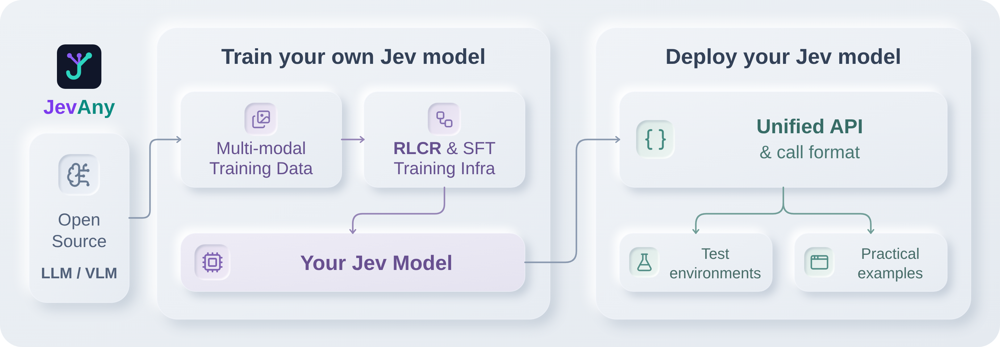
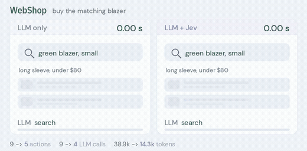
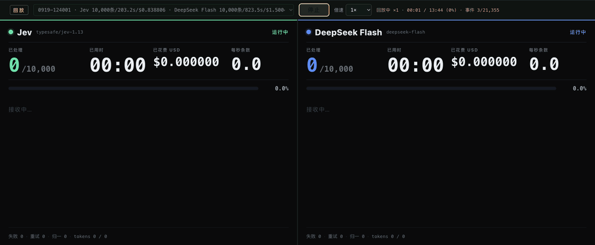

  

<h1 align="center">Awesome Jev Live</h1>

<b>O índice Jev classificado por evidência que se reconstrói a cada duas horas.</b>

  
  
  
  
  
  

<a href="../README.md">English</a> · <a href="README.zh-CN.md">简体中文</a> · <a href="README.zh-TW.md">繁體中文</a> · <a href="README.ja.md">日本語</a> · <a href="README.ko.md">한국어</a> · <a href="README.es.md">Español</a> · <a href="README.fr.md">Français</a> · <a href="README.de.md">Deutsch</a> · <b>Português (Brasil)</b> · <a href="README.ru.md">Русский</a> · <a href="README.it.md">Italiano</a> · <a href="README.ar.md">العربية</a> · <a href="README.hi.md">हिन्दी</a> · <a href="README.tr.md">Türkçe</a> · <a href="README.vi.md">Tiếng Việt</a> · <a href="README.th.md">ไทย</a> · <a href="README.id.md">Bahasa Indonesia</a> · <a href="README.pl.md">Polski</a> · <a href="README.nl.md">Nederlands</a> · <a href="README.uk.md">Українська</a>

> [!NOTE]
> **Índice ao vivo** · Última sincronização: `2026-11-12T10:34:32+08:00` (UTC+8)
> · Entradas: **809** · Novas neste ciclo: **5** · Linguagens de implementação: **26**

Cada entrada abaixo foi coletada, filtrada e verificada novamente pelo pipeline deste repositório. Os números e carimbos de data e hora vêm das fontes, não de um instantâneo escrito à mão.

## 🔥 Seleção do momento — o primeiro de cada categoria

Uma entrada por categoria, ordenada por grau de evidência e estrelas, recalculada a cada sincronização. É um ranking, não uma recomendação; cada escolha leva à sua ficha completa. Projetos que publicaram uma captura ou gravação têm preferência, para que a faixa continue visual.

<table>
<tr>
<td width="50%" valign="top">
<b>🏛️ <a href="https://github.com/typesafe-ai/skills">typesafe-ai/skills</a></b>
⭐2893 · ✅ official
Habilidades de agente para criar com o System One API do TypeSafe
</td>
<td width="50%" valign="top">

<b>🧰 <a href="https://github.com/john-rocky/coreai-kit">john-rocky/coreai-kit</a></b>
⭐126 · Swift · 👁️ observed
Swift SDK para executar modelos de chat, visão e fala no iPhone e no Mac com o Core AI da Apple. Download e armazenamento em cache de modelos, integração com…
</td>
</tr>
<tr>
<td width="50%" valign="top">

<b>🤖 <a href="https://github.com/gargpratyush/jev-router">gargpratyush/jev-router</a></b>
⭐662 · JavaScript · 🔎 inferred
Encaminhe para o modelo mais barato no claude code para sua tarefa usando jev-router
</td>
<td width="50%" valign="top">

<b>🛡️ <a href="https://github.com/dharmeshgurnani/codeotter">dharmeshgurnani/codeotter</a></b>
⭐3 · TypeScript · 👁️ observed
Revisões de código de IA autônomas e auto-hospedadas, indicadores de pontuação calibrados e gates de merge a partir de qualquer modelo aberto.
</td>
</tr>
<tr>
<td width="50%" valign="top">

<b>🧪 <a href="https://github.com/Mapika/decider">Mapika/decider</a></b>
⭐1052 · Python · 👁️ observed
Uma família de modelos no estilo System One ajustados a partir do Qwen3.5, projetados para decisões tipadas em uma única passada com probabilidades calibradas.
</td>
<td width="50%" valign="top">

<b>🔬 <a href="https://github.com/r-ms/mini-jev">r-ms/mini-jev</a></b>
⭐64 · Python · 🔎 inferred
mini-Jev: como é uma interface de decisão tipada no estilo Jev em um Qwen3-4B congelado — leia os logits da letra da opção em vez de gerar JSON. Experimento…
</td>
</tr>
<tr>
<td width="50%" valign="top">

<b>🎮 <a href="https://github.com/MCG-NJU/VideoJev">MCG-NJU/VideoJev</a></b>
⭐308 · Python · 👁️ observed
VideoJev: System One Model para compreensão e interação com vídeo
</td>
<td width="50%" valign="top">
<b>📰 <a href="https://docs.typesafe.ai/model-jaggedness/jev-1.13">9 categorias de falhas conhecidas (jaggedness)</a></b>
⭐0 · ✅ official
Interpretação literal, **contagem não confiável**, comparação de datas, indireção multinível, estado grande com detalhes irrelevantes, conteúdo adversarial,…
</td>
</tr>
</table>

## Sumário

- [O que é o Jev?](#o-que-é-o-jev)
- [Como as entradas são classificadas](#como-as-entradas-são-classificadas)
- [SDKs oficiais e ferramentas para desenvolvedores](#sdks-oficiais-e-ferramentas-para-desenvolvedores) — **6**
- [Clientes, SDKs e adaptadores da comunidade](#clientes-sdks-e-adaptadores-da-comunidade) — **140**
- [Ferramentas para agentes: MCP, hooks, gates e agentes de programação](#ferramentas-para-agentes-mcp-hooks-gates-e-agentes-de-programação) — **247**
- [Roteamento, guardrails e aprovações](#roteamento-guardrails-e-aprovações) — **64**
- [Avaliação, calibração e benchmarks](#avaliação-calibração-e-benchmarks) — **88**
- [Reproduções abertas, pesos e pesquisa de arquitetura](#reproduções-abertas-pesos-e-pesquisa-de-arquitetura) — **61**
- [Aplicações, jogos, robótica e demos interativas](#aplicações-jogos-robótica-e-demos-interativas) — **46**
- [Textos, discussões e listas irmãs](#textos-discussões-e-listas-irmãs) — **81**
- [Outros projetos](#outros-projetos) — **76**
- [Projetos por linguagem de implementação](#projetos-por-linguagem-de-implementação)

## O que é o Jev?

O Jev é o primeiro **System One model** da TypeSafe AI. Ele não escreve prosa. Recebe um estado mais perguntas cujo espaço de resposta você define de antemão, e devolve valores tipados com distribuições de probabilidade sobre as quais seu código pode ramificar.

|                        |                                                                                                                                                                                                                                    |
| ---------------------- | ---------------------------------------------------------------------------------------------------------------------------------------------------------------------------------------------------------------------------------- |
| **Forma**              | `state + typed questions` → `constrained answers + probabilities` → `your code`                                                                                                                                                    |
| **Primitivas**         | `Choice` (escolher uma entre ≤255 opções), `Score` (uma rubrica de 2–10), `Noul` (um sim/não probabilístico)                                                                                                                       |
| **Endpoint**           | `POST https://api.typesafe.ai/v1/systemone`, modelo `jev-1.13.0` / alias `jev-latest`                                                                                                                                              |
| **Bons encaixes**      | roteamento, triagem, pontuação, moderação, verificação e gates de baixa latência dentro de um fluxo delimitado                                                                                                                     |
| **Limites conhecidos** | a contagem não é confiável, a indireção de vários níveis é fraca, e o material oficial nomeia nove classes de jaggedness. Uma saída válida pelo schema não é o mesmo que uma decisão correta — calibre com os seus próprios dados. |

## Como as entradas são classificadas

A maioria das listas desta área afirma inclusão. Esta diz quanto de fato verificou e depois deixa você filtrar conforme isso.

| Grau         | O que significa                                                                                                                                                   |
| ------------ | ----------------------------------------------------------------------------------------------------------------------------------------------------------------- |
| `official`   | Publicado pela própria TypeSafe AI.                                                                                                                               |
| `observed`   | Um artefato público que pode ser aberto e lido — código real, configuração real ou uma declaração explícita de TypeSafe/Jev no nome ou nos topics do repositório. |
| `inferred`   | Identificado por um sinal ambíguo somado a vocabulário corroborante, mas ainda não lido linha por linha.                                                          |
| `unverified` | Parece relacionado, nada confirmado de forma independente. Listado apenas para descoberta.                                                                        |

## SDKs oficiais e ferramentas para desenvolvedores

Tudo o que a própria TypeSafe publica. Comece por aqui.

🏛️ <b><a href="https://github.com/typesafe-ai/skills">typesafe-ai/skills</a></b> · ⭐2893 · ✅ official · 19 天

##### 📝 Resumo

Habilidades de agente para criar com o System One API do TypeSafe

> 💡 As próprias habilidades de agente do fornecedor. Como são atualizadas continuamente, são o que mais se aproxima de uma especificação de como TypeSafe pretende conduzir Jev a partir de um agente.

##### 📌 Dados básicos

| Campo     | Valor                                              |
| --------- | -------------------------------------------------- |
| Categoria | `SDKs oficiais e ferramentas para desenvolvedores` |
| Evidência | `official`                                         |

##### 📊 Dados

| Métrica           | Valor      |
| ----------------- | ---------- |
| Estrelas          | **2893**   |
| Último push       | 2026-10-23 |
| Primeira listagem | 2026-09-18 |

🏛️ <b><a href="https://github.com/typesafe-ai/system-one-adapter-python">typesafe-ai/system-one-adapter-python</a></b> · ⭐412 · Python · ✅ official · 50 天

##### 📝 Resumo

Substituto direto do TypeSafeClient baseado em LLM APIs

> 💡 Substituto direto que oferece a mesma interface com um provedor LLM comum. Esta é a forma honesta de fazer um A/B entre uma decisão tipada e um prompt, usando seus próprios dados, antes de escolher qualquer um dos dois.

🔧 Encontrado em uso no código: `README.md`

##### 📌 Dados básicos

| Campo     | Valor                                              |
| --------- | -------------------------------------------------- |
| Categoria | `SDKs oficiais e ferramentas para desenvolvedores` |
| Evidência | `official`                                         |
| Linguagem | Python                                             |

##### 📊 Dados

| Métrica           | Valor      |
| ----------------- | ---------- |
| Estrelas          | **412**    |
| Último push       | 2026-09-22 |
| Primeira listagem | 2026-10-23 |

🏛️ <b><a href="https://github.com/typesafe-ai/typesafe-sdk-python">typesafe-ai/typesafe-sdk-python</a></b> · ⭐313 · Python · ✅ official · 1 天

##### 📝 Resumo

A biblioteca oficial Python para TypeSafe API

> 💡 Clientes síncronos e assíncronos. O caminho mais rápido de uma chave API a uma decisão tipada, além da referência com a qual os clientes da comunidade são comparados.

🔧 Encontrado em uso no código: `README.md`

##### 📌 Dados básicos

| Campo     | Valor                                              |
| --------- | -------------------------------------------------- |
| Categoria | `SDKs oficiais e ferramentas para desenvolvedores` |
| Evidência | `official`                                         |
| Linguagem | Python                                             |

##### 📊 Dados

| Métrica           | Valor      |
| ----------------- | ---------- |
| Estrelas          | **313**    |
| Último push       | 2026-11-11 |
| Primeira listagem | 2026-10-23 |

🏛️ <b><a href="https://github.com/typesafe-ai/typesafe-sdk-js">typesafe-ai/typesafe-sdk-js</a></b> · ⭐285 · TypeScript · ✅ official · 1 天

##### 📝 Resumo

A biblioteca oficial TypeScript/JavaScript para TypeSafe API

> 💡 Cliente TypeScript em que o tipo da resposta é inferido a partir da pergunta feita, portanto um tipo de retorno incompatível gera um erro de compilação, não uma surpresa em tempo de execução.

##### 📌 Dados básicos

| Campo     | Valor                                              |
| --------- | -------------------------------------------------- |
| Categoria | `SDKs oficiais e ferramentas para desenvolvedores` |
| Evidência | `official`                                         |
| Linguagem | TypeScript                                         |

##### 📊 Dados

| Métrica           | Valor      |
| ----------------- | ---------- |
| Estrelas          | **285**    |
| Último push       | 2026-11-11 |
| Primeira listagem | 2026-10-23 |

🏛️ <b><a href="https://github.com/typesafe-ai/WorkflowEvals">typesafe-ai/WorkflowEvals</a></b> · ⭐21 · Python · ✅ official · 1 天

##### 📝 Resumo

Código de workflow do evals.typesafe.ai publicado

##### 📌 Dados básicos

| Campo     | Valor                                              |
| --------- | -------------------------------------------------- |
| Categoria | `SDKs oficiais e ferramentas para desenvolvedores` |
| Evidência | `official`                                         |
| Linguagem | Python                                             |

##### 📊 Dados

| Métrica           | Valor      |
| ----------------- | ---------- |
| Estrelas          | **21**     |
| Último push       | 2026-11-11 |
| Primeira listagem | 2026-10-23 |

🏛️ <b><a href="https://github.com/typesafe-ai/typesafe-ai.github.io">typesafe-ai/typesafe-ai.github.io</a></b> · ⭐2 · HTML · ✅ official · 160 天

##### 📝 Resumo

Nenhuma descrição foi publicada na origem.

##### 📌 Dados básicos

| Campo     | Valor                                              |
| --------- | -------------------------------------------------- |
| Categoria | `SDKs oficiais e ferramentas para desenvolvedores` |
| Evidência | `official`                                         |
| Linguagem | HTML                                               |

##### 📊 Dados

| Métrica           | Valor      |
| ----------------- | ---------- |
| Estrelas          | **2**      |
| Último push       | 2026-06-04 |
| Primeira listagem | 2026-10-23 |

## Clientes, SDKs e adaptadores da comunidade

Clientes tipados para o endpoint System One, em tantas linguagens quantas a comunidade já conseguiu cobrir.

🧰 <b><a href="https://github.com/jexp/neo4jev">jexp/neo4jev</a></b> · ⭐185 · Jupyter · 👁️ observed · 54 天

##### 📝 Resumo

System One Model Jev typesafe.ai navegando por um grafo Neo4j usando um classificador sobre relações vizinhas

##### 📌 Dados básicos

| Campo     | Valor                                        |
| --------- | -------------------------------------------- |
| Categoria | `Clientes, SDKs e adaptadores da comunidade` |
| Evidência | `observed`                                   |
| Linguagem | Jupyter                                      |

##### 📊 Dados

| Métrica           | Valor      |
| ----------------- | ---------- |
| Estrelas          | **185**    |
| Último push       | 2026-09-18 |
| Primeira listagem | 2026-10-28 |

🧰 <b><a href="https://github.com/keltokhy/jgrep">keltokhy/jgrep</a></b> · ⭐141 · Python · 👁️ observed · 25 天

##### 📝 Resumo

grep, mas o padrão é uma descrição. Filtra linhas por significado com o modelo de decisão TypeSafe's Jev: cerca de 200 ms e um milésimo de centavo por linha.

🔧 Encontrado em uso no código: `README.md`

##### 📌 Dados básicos

| Campo     | Valor                                        |
| --------- | -------------------------------------------- |
| Categoria | `Clientes, SDKs e adaptadores da comunidade` |
| Evidência | `observed`                                   |
| Linguagem | Python                                       |

##### 📊 Dados

| Métrica           | Valor      |
| ----------------- | ---------- |
| Estrelas          | **141**    |
| Último push       | 2026-10-17 |
| Primeira listagem | 2026-10-29 |

🏷 `cli` · `grep` · `jev` · `openrouter` · `semantic-search` · `typesafe`

🧰 <b><a href="https://github.com/qkal/Canny">qkal/Canny</a></b> · ⭐135 · TypeScript · 👁️ observed · 50 天

##### 📝 Resumo

Impede que agentes de programação de IA afirmem que o trabalho foi concluído sem evidências. Hooks determinísticos decidem, TypeSafe's Jev aconselha. Ledger somente para acréscimos, sem dependências de runtime.

🔧 Encontrado em uso no código: `README.md`

##### 📌 Dados básicos

| Campo     | Valor                                        |
| --------- | -------------------------------------------- |
| Categoria | `Clientes, SDKs e adaptadores da comunidade` |
| Evidência | `observed`                                   |
| Linguagem | TypeScript                                   |

##### 📊 Dados

| Métrica           | Valor      |
| ----------------- | ---------- |
| Estrelas          | **135**    |
| Último push       | 2026-09-22 |
| Primeira listagem | 2026-10-29 |

🏷 `agent-hooks` · `ai-agents` · `claude-code` · `claude-code-hooks` · `codex` · `codex-cli` · `guardrails` · `jev`

🧰 <b><a href="https://github.com/john-rocky/coreai-kit">john-rocky/coreai-kit</a></b> · ⭐126 · Swift · 👁️ observed · 0 天

##### 📝 Resumo

Swift SDK para executar modelos de chat, visão e fala no iPhone e no Mac com o Core AI da Apple. Download e armazenamento em cache de modelos, integração com FoundationModels e exemplos executáveis com os requisitos documentados de SO, SDK e modelos.

🔧 Encontrado em uso no código: `Sources/CoreAIOps/CoreAI+SystemOne.swift`

##### 📌 Dados básicos

| Campo     | Valor                                        |
| --------- | -------------------------------------------- |
| Categoria | `Clientes, SDKs e adaptadores da comunidade` |
| Evidência | `observed`                                   |
| Linguagem | Swift                                        |

##### 📊 Dados

| Métrica           | Valor      |
| ----------------- | ---------- |
| Estrelas          | **126**    |
| Último push       | 2026-11-11 |
| Primeira listagem | 2026-10-26 |

🏷 `apple` · `apple-core-ai` · `asr` · `core-ai` · `coreai` · `foundation-models` · `ios` · `ios-27`

---

<table><tr><th align="center" width="50%">🖼 Imagem</th><th align="center" width="50%">🎬 Vídeo</th></tr><tr>
<td align="center" valign="top"></td>
<td align="center" valign="top"> gravação animada</td>
</tr></table>

🧰 <b><a href="https://github.com/yzfly/awesome-jev-zh">yzfly/awesome-jev-zh</a></b> · ⭐93 · HTML · 👁️ observed · 0 天

##### 📝 Resumo

Lista selecionada em chinês de Jev / TypeSafe System One: materiais oficiais, SDK, aplicações populares, ferramentas de Agent, reproduções de código aberto e avaliações independentes, com guia de início em chinês; coleta automaticamente todos os dias os projetos populares de GitHub.

🔧 Encontrado em uso no código: `docs/quickstart.md`

##### 📌 Dados básicos

| Campo     | Valor                                        |
| --------- | -------------------------------------------- |
| Categoria | `Clientes, SDKs e adaptadores da comunidade` |
| Evidência | `observed`                                   |
| Linguagem | HTML                                         |

##### 📊 Dados

| Métrica           | Valor      |
| ----------------- | ---------- |
| Estrelas          | **93**     |
| Último push       | 2026-11-12 |
| Primeira listagem | 2026-09-18 |

🏷 `ai-agent` · `awesome` · `awesome-list` · `chinese` · `jev` · `llm` · `structured-output` · `system-one`

🧰 <b><a href="https://github.com/obie/ruby_decision_model">obie/ruby_decision_model</a></b> · ⭐59 · Ruby · 👁️ observed · 30 天

##### 📝 Resumo

Cliente Ruby para modelos de decisão como Typesafe Jev

🔧 Encontrado em uso no código: `README.md`

##### 📌 Dados básicos

| Campo     | Valor                                        |
| --------- | -------------------------------------------- |
| Categoria | `Clientes, SDKs e adaptadores da comunidade` |
| Evidência | `observed`                                   |
| Linguagem | Ruby                                         |

##### 📊 Dados

| Métrica           | Valor      |
| ----------------- | ---------- |
| Estrelas          | **59**     |
| Último push       | 2026-10-12 |
| Primeira listagem | 2026-10-29 |

🧰 <b><a href="https://github.com/bodepudimuneendra-netizen/ConsciousDB">bodepudimuneendra-netizen/ConsciousDB</a></b> · ⭐55 · Python · 👁️ observed · 9 天

##### 📝 Resumo

Um framework Agentic GraphRAG independente de banco de dados que usa modelos System One substituíveis (Laya local / Jev na nuvem). Uma camada de inteligência plug-and-play com um pipeline completo de 4 fases, avaliação contínua e travessia A* personalizada para qualquer banco de dados de grafos.

##### 📌 Dados básicos

| Campo     | Valor                                        |
| --------- | -------------------------------------------- |
| Categoria | `Clientes, SDKs e adaptadores da comunidade` |
| Evidência | `observed`                                   |
| Linguagem | Python                                       |

##### 📊 Dados

| Métrica           | Valor      |
| ----------------- | ---------- |
| Estrelas          | **55**     |
| Último push       | 2026-11-02 |
| Primeira listagem | 2026-11-02 |

🏷 `astar-algorithm` · `eval-harness` · `fine-tuning` · `graphdatabase` · `graprag` · `jev` · `laya` · `neo4j`

🧰 <b><a href="https://github.com/shaharia-lab/jev-cli">shaharia-lab/jev-cli</a></b> · ⭐46 · Rust · 👁️ observed · 2 天

##### 📝 Resumo

Ferramenta de linha de comando para o modelo Jev de TypeSafe AI. Faça perguntas de sim/não, de múltipla escolha e baseadas em critérios sobre qualquer texto e receba probabilidades calibradas. As respostas se tornam códigos de saída para shells e CI, JSON para scripts e ferramentas MCP para agentes de IA.

🔧 Encontrado em uso no código: `README.md`

##### 📌 Dados básicos

| Campo     | Valor                                        |
| --------- | -------------------------------------------- |
| Categoria | `Clientes, SDKs e adaptadores da comunidade` |
| Evidência | `observed`                                   |
| Linguagem | Rust                                         |

##### 📊 Dados

| Métrica           | Valor      |
| ----------------- | ---------- |
| Estrelas          | **46**     |
| Último push       | 2026-11-09 |
| Primeira listagem | 2026-11-07 |

🏷 `ai-agents` · `classification` · `cli` · `command-line-tool` · `devtools` · `jev` · `llm` · `mcp`

---

<table><tr><th align="center" width="50%">🖼 Imagem</th><th align="center" width="50%">🎬 Vídeo</th></tr><tr>
<td align="center" valign="top"></td>
<td align="center" valign="top"> gravação animada</td>
</tr></table>

🧰 <b><a href="https://github.com/MrJev/awesome-jev">MrJev/awesome-jev</a></b> · ⭐21 · Python · 👁️ observed · 0 天

##### 📝 Resumo

Uma lista selecionada de projetos, integrações e recursos para o modelo System One de TypeSafe AI, Jev.

##### 📌 Dados básicos

| Campo     | Valor                                        |
| --------- | -------------------------------------------- |
| Categoria | `Clientes, SDKs e adaptadores da comunidade` |
| Evidência | `observed`                                   |
| Linguagem | Python                                       |

##### 📊 Dados

| Métrica           | Valor      |
| ----------------- | ---------- |
| Estrelas          | **21**     |
| Último push       | 2026-11-11 |
| Primeira listagem | 2026-09-18 |

🏷 `ai-agents` · `awesome` · `awesome-list` · `jev` · `mcp` · `typesafe`

🧰 <b><a href="https://github.com/ckaraca/awesome-jev">ckaraca/awesome-jev</a></b> · ⭐18 · Python · 👁️ observed · 2 天

##### 📝 Resumo

Uma lista selecionada de ferramentas, integrações e experimentos desenvolvidos sobre Jev, o modelo System One de TypeSafe AI para decisões rápidas e tipadas.

##### 📌 Dados básicos

| Campo     | Valor                                        |
| --------- | -------------------------------------------- |
| Categoria | `Clientes, SDKs e adaptadores da comunidade` |
| Evidência | `observed`                                   |
| Linguagem | Python                                       |

##### 📊 Dados

| Métrica           | Valor      |
| ----------------- | ---------- |
| Estrelas          | **18**     |
| Último push       | 2026-11-09 |
| Primeira listagem | 2026-09-19 |

🏷 `ai-agents` · `awesome` · `awesome-list` · `computer-use` · `jev` · `llm` · `system-one` · `typesafe`

🧰 <b><a href="https://github.com/Premo-Cloud/typesafe-sdk-java">Premo-Cloud/typesafe-sdk-java</a></b> · ⭐12 · Java · 👁️ observed · 21 天

##### 📝 Resumo

Java SDK da comunidade para Jev, o modelo System One de TypeSafe: perguntas tipadas entram, respostas tipadas com probabilidades calibradas saem. Java 17+, starter do Spring Boot (não oficial)

##### 📌 Dados básicos

| Campo     | Valor                                        |
| --------- | -------------------------------------------- |
| Categoria | `Clientes, SDKs e adaptadores da comunidade` |
| Evidência | `observed`                                   |
| Linguagem | Java                                         |

##### 📊 Dados

| Métrica           | Valor      |
| ----------------- | ---------- |
| Estrelas          | **12**     |
| Último push       | 2026-10-21 |
| Primeira listagem | 2026-10-28 |

🏷 `java` · `jev` · `sdk` · `spring-boot` · `system-one` · `system-one-models` · `typesafe`

🧰 <b><a href="https://github.com/PromtEngineer/jev-harness">PromtEngineer/jev-harness</a></b> · ⭐9 · Python · 👁️ observed · 48 天

##### 📝 Resumo

Um harness de agente Pi desenvolvido em torno de TypeSafe's Jev (modelo System One): roteador, seletor de contexto, gate, verificador. Testado nas branches Postgres do Neon.

##### 📌 Dados básicos

| Campo     | Valor                                        |
| --------- | -------------------------------------------- |
| Categoria | `Clientes, SDKs e adaptadores da comunidade` |
| Evidência | `observed`                                   |
| Linguagem | Python                                       |

##### 📊 Dados

| Métrica           | Valor      |
| ----------------- | ---------- |
| Estrelas          | **9**      |
| Último push       | 2026-09-24 |
| Primeira listagem | 2026-10-28 |

🧰 <b><a href="https://github.com/clouatre-labs/decisions-judge-mcp">clouatre-labs/decisions-judge-mcp</a></b> · ⭐5 · JavaScript · 👁️ observed · 0 天

##### 📝 Resumo

Decisões tipadas para agentes de IA como uma ferramenta MCP: probabilidade de sim/não (noul), escolha e pontuação em uma única solicitação rápida. Baseado no modelo TypeSafe System One.

##### 📌 Dados básicos

| Campo     | Valor                                        |
| --------- | -------------------------------------------- |
| Categoria | `Clientes, SDKs e adaptadores da comunidade` |
| Evidência | `observed`                                   |
| Linguagem | JavaScript                                   |

##### 📊 Dados

| Métrica           | Valor      |
| ----------------- | ---------- |
| Estrelas          | **5**      |
| Último push       | 2026-11-11 |
| Primeira listagem | 2026-10-12 |

🏷 `agent` · `ai` · `cli` · `decision-making` · `decisions` · `judge` · `llm` · `mcp`

---

<table><tr><th align="center" width="50%">🖼 Imagem</th><th align="center" width="50%">🎬 Vídeo</th></tr><tr>
<td align="center" valign="top"></td>
<td align="center" valign="top"> gravação animada</td>
</tr></table>

🧰 <b><a href="https://github.com/elbruno/ElBruno.AI.Decisions">elbruno/ElBruno.AI.Decisions</a></b> · ⭐5 · C# · 👁️ observed · 8 天

##### 📝 Resumo

.NET 10 decision SDK: Choose, Score, and Assess with Microsoft Foundry (Microsoft-Decision-1), native local Ollama System One models, and TypeSafe AI Jev. One API, probabilities instead of paragraphs.

##### 📌 Dados básicos

| Campo     | Valor                                        |
| --------- | -------------------------------------------- |
| Categoria | `Clientes, SDKs e adaptadores da comunidade` |
| Evidência | `observed`                                   |
| Linguagem | C#                                           |

##### 📊 Dados

| Métrica           | Valor      |
| ----------------- | ---------- |
| Estrelas          | **5**      |
| Último push       | 2026-11-03 |
| Primeira listagem | 2026-11-09 |

🏷 `dotnet` · `dotnet10` · `jev` · `microsoft-extensions-ai` · `nuget`

---

<table><tr><th align="center" width="50%">🖼 Imagem</th><th align="center" width="50%">🎬 Vídeo</th></tr><tr>
<td align="center" valign="top"></td>
<td align="center" valign="top">nenhuma mídia publicada</td>
</tr></table>

🧰 <b><a href="https://github.com/avalonreset/legends-jev">avalonreset/legends-jev</a></b> · ⭐3 · Python · 👁️ observed · 0 天

##### 📝 Resumo

Optical character recognition (OCR), storefront signage verification, bounding-box grounding, and typed computer-use decision CLI powered by TypeSafe Jev 1.14.

##### 📌 Dados básicos

| Campo     | Valor                                        |
| --------- | -------------------------------------------- |
| Categoria | `Clientes, SDKs e adaptadores da comunidade` |
| Evidência | `observed`                                   |
| Linguagem | Python                                       |

##### 📊 Dados

| Métrica           | Valor      |
| ----------------- | ---------- |
| Estrelas          | **3**      |
| Último push       | 2026-11-11 |
| Primeira listagem | 2026-11-11 |

🏷 `bounding-box` · `browser-agent` · `claude-code` · `codex` · `computer-use` · `cto-legends` · `decision-model` · `image-text-extraction`

---

<table><tr><th align="center" width="50%">🖼 Imagem</th><th align="center" width="50%">🎬 Vídeo</th></tr><tr>
<td align="center" valign="top"></td>
<td align="center" valign="top">nenhuma mídia publicada</td>
</tr></table>

🧰 <b><a href="https://github.com/Bonzokoles/36_chambers">Bonzokoles/36_chambers</a></b> · Python · 👁️ observed · 20 天

##### 📝 Resumo

Mecanismo federado de recuperação de conhecimento para agentes de IA. Encaminha consultas entre backends especializados (FTS5, ChromaDB, grafo) por meio de um orquestrador que prioriza o registro, com encaminhamento de IA TypeSafe/Jev e reordenação de evidências. Somente leitura por padrão, com segurança integrada ao design.

##### 📌 Dados básicos

| Campo     | Valor                                        |
| --------- | -------------------------------------------- |
| Categoria | `Clientes, SDKs e adaptadores da comunidade` |
| Evidência | `observed`                                   |
| Linguagem | Python                                       |

##### 📊 Dados

| Métrica           | Valor      |
| ----------------- | ---------- |
| Estrelas          | **0**      |
| Último push       | 2026-10-22 |
| Primeira listagem | 2026-10-23 |

🏷 `ai-agents` · `ai-infrastructure` · `chromadb` · `embeddings` · `federated-search` · `fts5` · `information-retrieval` · `jev`

---

<table><tr><th align="center" width="50%">🖼 Imagem</th><th align="center" width="50%">🎬 Vídeo</th></tr><tr>
<td align="center" valign="top"></td>
<td align="center" valign="top">nenhuma mídia publicada</td>
</tr></table>

Recurso vinculado diretamente do repositório de origem porque nenhuma licença de redistribuição foi declarada.

🧰 <b><a href="https://github.com/dzhng/jevgrep">dzhng/jevgrep</a></b> · ⭐3212 · TypeScript · 🔎 inferred · 0 天

##### 📝 Resumo

Encontre código perguntando o que ele faz. Um CLI para agentes de programação que usa Jev para descobrir arquivos relevantes e o contexto do código-fonte.

##### 📌 Dados básicos

| Campo     | Valor                                        |
| --------- | -------------------------------------------- |
| Categoria | `Clientes, SDKs e adaptadores da comunidade` |
| Evidência | `inferred`                                   |
| Linguagem | TypeScript                                   |

##### 📊 Dados

| Métrica           | Valor      |
| ----------------- | ---------- |
| Estrelas          | **3212**   |
| Último push       | 2026-11-11 |
| Primeira listagem | 2026-11-07 |

🏷 `ai-sdk` · `claude-code` · `cli` · `code-search` · `codex` · `coding-agents` · `context-retrieval` · `developer-tools`

---

<table><tr><th align="center" width="50%">🖼 Imagem</th><th align="center" width="50%">🎬 Vídeo</th></tr><tr>
<td align="center" valign="top"></td>
<td align="center" valign="top">nenhuma mídia publicada</td>
</tr></table>

🧰 <b><a href="https://github.com/socai-io/jev-social">socai-io/jev-social</a></b> · ⭐212 · JavaScript · 🔎 inferred · 3 天

##### 📝 Resumo

Agente de pesquisa de mídias sociais de código aberto e prioritariamente local para Instagram, TikTok e LinkedIn. Jev encaminha etapas somente de leitura; socai CLI captura evidências citadas do navegador.

##### 📌 Dados básicos

| Campo     | Valor                                        |
| --------- | -------------------------------------------- |
| Categoria | `Clientes, SDKs e adaptadores da comunidade` |
| Evidência | `inferred`                                   |
| Linguagem | JavaScript                                   |

##### 📊 Dados

| Métrica           | Valor      |
| ----------------- | ---------- |
| Estrelas          | **212**    |
| Último push       | 2026-11-08 |
| Primeira listagem | 2026-11-02 |

🏷 `agent-skills` · `ai-agents` · `browser-agent` · `browser-automation` · `decision-model` · `deep-research` · `instagram` · `jev`

---

<table><tr><th align="center" width="50%">🖼 Imagem</th><th align="center" width="50%">🎬 Vídeo</th></tr><tr>
<td align="center" valign="top"></td>
<td align="center" valign="top">nenhuma mídia publicada</td>
</tr></table>

<b>Mais nesta categoria</b> · 122

- [sumleo/prompt2jev](https://github.com/sumleo/prompt2jev) - Habilidade de agente e CLI que transformam linguagem natural, um prompt LLM ou…
- [Sur-Cai/macos-computer-use-kit](https://github.com/Sur-Cai/macos-computer-use-kit) - AX-first computer use for AI agents on macOS with optional Jev.
- [xingwudao/OpenJev](https://github.com/xingwudao/OpenJev) - OpenJev: um API de decisão System One independente e inspirado em Jev, baseado…
- [danieleteti/systemone-delphi](https://github.com/danieleteti/systemone-delphi) - Delphi client for System One models (Jev, tev1 and nimble on Ollama): ask typed…
- [GitHub30/OpenJev](https://github.com/GitHub30/OpenJev) - Modelo System One de pesos abertos (compatível com Jev): decisões calibradas de…
- [chussenot/judgment](https://github.com/chussenot/judgment) - Julgamentos tipados e calibrados de modelos System One: uma decisão escrita…
- [CMaintz/jev-dotnet](https://github.com/CMaintz/jev-dotnet) - SDK não oficial em .NET para o modelo Jev System One de TypeSafe AI.
- [erik-hedstrom/loadout](https://github.com/erik-hedstrom/loadout) - Escolha o modelo, as skills e os servidores MCP para cada sessão do agente de…
- [jqueryscript/awesome-jev](https://github.com/jqueryscript/awesome-jev) - A curated list of TypeSafe Jev resources, SDKs, agents, MCP servers…
- [basi/typesafe-ai-php-client](https://github.com/basi/typesafe-ai-php-client) - PHP client for the typesafe.ai System One API (Jev).
- [chrismarchant/jev-router](https://github.com/chrismarchant/jev-router) - Agent- and harness-agnostic router that offloads parallel-workstream decisions…
- [CMaintz/jev-java](https://github.com/CMaintz/jev-java) - Java SDK não oficial para o modelo System One Jev de TypeSafe AI.
- [cogcloud-ai/cog-typesafe](https://github.com/cogcloud-ai/cog-typesafe) - TypeSafe.
- [gajaguar/typesafe-cli](https://github.com/gajaguar/typesafe-cli) - Unofficial command-line interface for TypeSafe AI System One models, on…
- [JosephHardy91/graph-composition-with-dLLMs](https://github.com/JosephHardy91/graph-composition-with-dLLMs) - A Graph-Compiled Specification RAG system built with **Dagster**, **PostgreSQL…
- [sanketmuchhala/jevgate](https://github.com/sanketmuchhala/jevgate) - Calibrated policy triage and institutional risk routing: a hybrid…
- [semperos/typesafe-sdk-gleam](https://github.com/semperos/typesafe-sdk-gleam) - Typesafe.ai (Jev) SDK client in Gleam.
- [wawan93/gojev](https://github.com/wawan93/gojev) - golang implementation of typesafe.ai SDK.
- [ollaya-dev/ollaya](https://github.com/ollaya-dev/ollaya) - Jev-compatible API server for open decision models.
- [realZachi/pg-jev](https://github.com/realZachi/pg-jev) - Faça perguntas às suas tabelas Postgres em linguagem simples.
- [juspay/neurolink](https://github.com/juspay/neurolink) - A camada de tubulação de um sistema nervoso de IA — uma interface conectando…
- [supercorp-ai/supercov](https://github.com/supercorp-ai/supercov) - Cobertura, segurança e qualidade de código para agentes de programação.
- [aaddrick/building-with-typesafe-jev](https://github.com/aaddrick/building-with-typesafe-jev) - Habilidade não oficial que ensina agentes de programação a criar com TypeSafe…
- [Ying-Kai-Liao/jev-browser](https://github.com/Ying-Kai-Liao/jev-browser) - Automação de navegador em que um LLM planeja e Jev (System One Typesafe)…
- [nidhi-singh02/agent-router](https://github.com/nidhi-singh02/agent-router) - CLI that picks Cursor, Claude Code, Codex, or OpenCode + model/effort for a…
- [AkashPriyadarshii/jev-curate](https://github.com/AkashPriyadarshii/jev-curate) - High-throughput synthetic and pretraining dataset sifter for TypeSafe Jev.
- [fazlerocks/jevmail](https://github.com/fazlerocks/jevmail) - Triagem de e-mails de IA de código aberto para Gmail.
- [AkashPriyadarshii/jev-seo](https://github.com/AkashPriyadarshii/jev-seo) - Free Rust SEO and GEO toolkit powered by TypeSafe Jev: 58-rule audits, site…
- [AboveColin/HA-Jev](https://github.com/AboveColin/HA-Jev) - Faça uma pergunta à sua casa e receba um número.
- [sharziki/semdecide](https://github.com/sharziki/semdecide) - Decisões semânticas tipadas para pipelines Unix e CI, alimentadas por TypeSafe…
- [bladedevoff/stuntd](https://github.com/bladedevoff/stuntd) - Proxy local que aprende as decisões tipadas LLM do seu app e as responde com…
- [burnigtm/jev-mcp](https://github.com/burnigtm/jev-mcp) - Servidor MCP que coloca TypeSafe Jev no ciclo de programação em Cursor, Codex e…
- [mlimarenko/IronRAG](https://github.com/mlimarenko/IronRAG) - One-click knowledge system for documents, internal bots, and AI agents.
- [AkashPriyadarshii/jev-superpowers](https://github.com/AkashPriyadarshii/jev-superpowers) - Systematic software development framework for AI coding agents upgraded with…
- [dannote/jev](https://github.com/dannote/jev) - TypeSafe Jev para OTP: responda a Jev a partir de um GenServer e faça…
- [DevLoops-ai/unified-brain](https://github.com/DevLoops-ai/unified-brain) - System One coding agents: code-level answers at the score of a Claude Fable 5.1…
- [jwuthri-cloud/SelfJev](https://github.com/jwuthri-cloud/SelfJev) - Self-hosted decision model (selfjev-4b) with a Jev-compatible API: Python SDK…
- [agencyenterprise/jev-recipes](https://github.com/agencyenterprise/jev-recipes) - 248 pequenas decisões de Jev para JavaScript e TypeScript: encaminhe, reordene…
- [jiangkoumo/ego-decision-layer](https://github.com/jiangkoumo/ego-decision-layer) - Pluggable decision layer for the ego lite browser: one System One (Jev) call…
- [thusinh1969/BrighTO_Router](https://github.com/thusinh1969/BrighTO_Router) - BrighTO LLM Router: free open-source, ultra-fast Rust LLM gateway/router and…
- [arjun988/Kev](https://github.com/arjun988/Kev) - Mecanismo de decisão System One de código aberto.
- [Ray-Hughes/jevalyn](https://github.com/Ray-Hughes/jevalyn) - A camada de decisão para seu app Rails.
- [nouli-ai/nouli](https://github.com/nouli-ai/nouli) - A ledger-backed decision network that records AI decisions and connects them to…
- [pambrose/jev4k](https://github.com/pambrose/jev4k) - A Kotlin Multiplatform DSL and client for TypeSafe.
- [saibimajdi/typesafeai-dotnet-sdk](https://github.com/saibimajdi/typesafeai-dotnet-sdk) - SDK .NET comunitário para o TypeSafe AI System One API — perguntas tipadas de…
- [Elue-dev/jev_elixir](https://github.com/Elue-dev/jev_elixir) - jev_elixir é uma interface pequena e idiomática para tomar decisões tipadas com…
- [arcships/android-use](https://github.com/arcships/android-use) - Android control for Dim Agent and local MCP clients, with a live screen, native…
- [haileyok/typesafe-client](https://github.com/haileyok/typesafe-client) - Clientes não oficiais Go e Rust para o TypeSafe AI System One API (Jev).
- [AIAnytime/Jev-Router](https://github.com/AIAnytime/Jev-Router) - Decision-first, OpenAI-compatible AI router powered by Jev typed decisions.
- [chenrui333/jev-docs](https://github.com/chenrui333/jev-docs) - Histórico mantido pela comunidade de Jev / TypeSafe System One APIs, SDKs…
- [devbackend/jevgo](https://github.com/devbackend/jevgo) - Cliente não oficial Go para o TypeSafe AI System One API (Jev) — perguntas…
- [himomohi/aside-jev](https://github.com/himomohi/aside-jev) - Agentes Aside decidem com TypeSafe Jev (System One: Choice/Score/Noul).
- [docxology/daf-jev](https://github.com/docxology/daf-jev) - daf-jev: toolkit Python componível para a Jev de TypeSafe (System One) API de…
- [Kadihx/jev-x-kit](https://github.com/Kadihx/jev-x-kit) - Camada de decisão offline de $0 para agentes de programação: primitivas…
- [akiiwa-games/AgentCompass](https://github.com/akiiwa-games/AgentCompass) - Deterministic multi-agent task router &amp; subscription quota scheduler for Claude…
- [Agnuxo1/Universal-Cognitive-Architecture-JEV-v2](https://github.com/Agnuxo1/Universal-Cognitive-Architecture-JEV-v2) - Executable cognitive architecture: validated graph context, deterministic…
- [JimmyWesley/rlcd-gateway](https://github.com/JimmyWesley/rlcd-gateway) - Gateway auto-hospedado para LLMs e modelos de decisão.
- [vibefilter/filament](https://github.com/vibefilter/filament) - Filter Filament tables with a plain-English statement.
- [zchee/decision-model-sdk-rust](https://github.com/zchee/decision-model-sdk-rust) - Async Rust SDK for decision models served through the System One API, with an…
- [zhirschtritt/typesafe-go](https://github.com/zhirschtritt/typesafe-go) - Go SDK idiomático para TypeSafe AI API.
- [AboveColin/jevclient](https://github.com/AboveColin/jevclient) - Cliente assíncrono Python para TypeSafe Jev.
- [AronAxe/GraphPaper](https://github.com/AronAxe/GraphPaper) - A Windows writing studio with knowledge graphs, author voice…
- [Butochnikov/laravel-typesafe-jev](https://github.com/Butochnikov/laravel-typesafe-jev) - Integração não oficial do Laravel para IA TypeSafe Jev, com respostas tipadas…
- [coo-quack/jev-pii-checker](https://github.com/coo-quack/jev-pii-checker) - CLI que encontra PII no texto com TypeSafe Jev: presença, sensibilidade e…
- [freepik-company/jev-mcp](https://github.com/freepik-company/jev-mcp) - MCP server for typed decisions with Jev / System One via OpenRouter or TypeSafe.
- [frodi-karlsson/onesie](https://github.com/frodi-karlsson/onesie) - Gate scripts and CI on fast, calibrated System One judgments like Jev: a score…
- [Lasimeri/Mechanical-Jev](https://github.com/Lasimeri/Mechanical-Jev) - O lado de consulta do Jev (TypeSafe System One: noul, choice, score) em Rust…
- [nshkrdotcom/system_one_sdk](https://github.com/nshkrdotcom/system_one_sdk) - Elixir/BEAM SDK independente de provedor para semântica System One: Noul…
- [PAI-CUHK/SLEEPJEV](https://github.com/PAI-CUHK/SLEEPJEV) - Decisões tipadas de runtime inspiradas em JEV sobre PSG de longo horizonte…
- [zerone-agents/jev-model-router](https://github.com/zerone-agents/jev-model-router) - Roteamento leve de modelos para agentes, com compatibilidade com OpenAI e…
- [abhisheksharma001/jev-skill](https://github.com/abhisheksharma001/jev-skill) - Agent skill for TypeSafe AI.
- [dsaad68/fuzzy-jev](https://github.com/dsaad68/fuzzy-jev) - A client for OpenRouter&#x27;s decision models, TypeSafe&#x27;s Jev by default: typed…
- [getmissionctrl/hs-jev](https://github.com/getmissionctrl/hs-jev) - Cliente Haskell para a decisão API de TypeSafe (Jev) System One…
- [NerdishShah/playwright-cli-jev-bakeoff](https://github.com/NerdishShah/playwright-cli-jev-bakeoff) - Bake-off: Playwright CLI vs CLI+Jev vs Playwright MCP.
- [bitranox/btx-skill-jev-judge](https://github.com/bitranox/btx-skill-jev-judge) - Claude Code plugin and Python CLI: hand a judgment repeated over many items to…
- [exfoca/decision-model-lab-4JEV](https://github.com/exfoca/decision-model-lab-4JEV) - DML is a reproducible harness for evaluating small, local decision models under…
- [Hyper-AI-Lab/openclaw-jev](https://github.com/Hyper-AI-Lab/openclaw-jev) - Plano de controle de produção para agentes OpenClaw: roteamento de entrada com…
- [MrKyaw/CognitiveMirror-Jev-MCP](https://github.com/MrKyaw/CognitiveMirror-Jev-MCP) - Cognitive middleware for personal and enterprise AI agents: 14 MCP tools and a…
- [Talya1412/jev-harness](https://github.com/Talya1412/jev-harness) - TypeSafe Jev (System One) integrations for OMP, MCP, Claude Code, and Pi…
- [Wrenik/Jev-toolkit-Compiler](https://github.com/Wrenik/Jev-toolkit-Compiler) - Context log, search and a compact/clear advisor for Claude Code.
- [abirshhishirroy/mini-jev](https://github.com/abirshhishirroy/mini-jev) - A custom Jev-style decision model built from scratch on Qwen2.5-3B.
- [AsgardMuninn/jev-norma](https://github.com/AsgardMuninn/jev-norma) - Triagem normativa LatAm com Jev (System One) como gate: normaliza cláusulas de…
- [CMaintz/jev-tools](https://github.com/CMaintz/jev-tools) - Ferramentas TypeScript criadas com base no Jev de TypeSafe AI: uma barreira…
- [codebam/jev-guardrails](https://github.com/codebam/jev-guardrails) - Barreiras baseadas em Jev para chamadas de ferramentas de agentes: biblioteca…
- [fan56/dsh-jev-core](https://github.com/fan56/dsh-jev-core) - Shared TypeSafe Jev decision-model client for the dsh ecosystem: strict…
- [HappyHackingSpace/jev](https://github.com/HappyHackingSpace/jev) - Go SDK, CLI, MCP server and agent skill for TypeSafe.
- [heiwa4126/jev-node1](https://github.com/heiwa4126/jev-node1) - Bun で @typesafe-ai/sdk 0.7.0 を使うとエラーになるので、一時的に pnpm と node でやる版.
- [ivanblagdan/jev-cli](https://github.com/ivanblagdan/jev-cli) - Composable CLI for TypeSafe.
- [kkdev92/jev-dotnet](https://github.com/kkdev92/jev-dotnet) - An unofficial .NET 10 client for Jev, TypeSafe.
- [ksilyanov/jev-php](https://github.com/ksilyanov/jev-php) - Minimal PHP client for TypeSafe Jev (via Cloudflare Workers AI), with Laravel…
- [mattbran87/jev-daemon](https://github.com/mattbran87/jev-daemon) - jev: a per-user daemon and CLI that hold TypeSafe keys and send checked…
- [mdimamhosen/jev](https://github.com/mdimamhosen/jev) - One endpoint for every model, one CLI for every MCP.
- [ogarciarevett/jev-py-sdk](https://github.com/ogarciarevett/jev-py-sdk) - Julgamentos Jev tipados (noul / choice / score) de TypeSafe para Python…
- [phoenix1331/laravel-jev-hotdog](https://github.com/phoenix1331/laravel-jev-hotdog) - A Laravel 13 playground that tells you whether a photo is a hot dog or not…
- [pyck-ai/jev-cli](https://github.com/pyck-ai/jev-cli) - Jev.
- [revoirb612/codex-jev-router](https://github.com/revoirb612/codex-jev-router) - A small local-first task router for TypeSafe Jev and Codex CLI.
- [royalskynet/jev-gate-mcp](https://github.com/royalskynet/jev-gate-mcp) - Gateway governado de decisão Jev para clientes GPT, Claude e MCP.
- [shetautnetjer/jev-cli](https://github.com/shetautnetjer/jev-cli) - Clean-room CLI for TypeSafe System One / Jev Decision Contracts, search, and…
- [sunjongos/jev-typesafe-gatekeeper](https://github.com/sunjongos/jev-typesafe-gatekeeper) - World-Class Pure System 1 AI Decision &amp; 90/10 Hybrid Gatekeeper Skill powered…
- [sususu98/pi-jev-navigator](https://github.com/sususu98/pi-jev-navigator) - Ultra-low-token System One context navigation and precision SOP dispatch engine…
- [VianneyMI/python-jev](https://github.com/VianneyMI/python-jev) - Unofficial typed Python SDK for TypeSafe.
- [Yasir-Khan-7/jev-sentinel](https://github.com/Yasir-Khan-7/jev-sentinel) - Proteção contra injeção de prompt e barreiras de segurança para chamadas de…
- [Zuexx/agent-jev-integration](https://github.com/Zuexx/agent-jev-integration) - TypeSafe Jev integrated into Claude Code: routing, escalation, guardrails, evals.
- [rokbenko/quackd](https://github.com/rokbenko/quackd) - Um CLI para todos os seus robôs. Conecte-os, comande-os e deixe-os trabalhar…
- [MiaoWuNYA/rikkahub-sillytavern-android](https://github.com/MiaoWuNYA/rikkahub-sillytavern-android) - 安卓AI聊天端:开箱即聊，无损导入酒馆卡，缓存强省用量，手机操控，专属RP模式，防空回，主动信息，前端卡支持，高定制主题，QQbot，AI群聊，插件系统，强兼容…
- [pithings/advocaat](https://github.com/pithings/advocaat) - Um cliente pequeno e type-safe para fazer perguntas à IA sobre seus dados…
- [Brainwires/jevwire](https://github.com/Brainwires/jevwire) - Jev decision layer for agents: MCP server, embeddable DecisionModel library…
- [zhulinchng/jevper](https://github.com/zhulinchng/jevper) - Wrapper de classificação com formato Jev (TypeSafe System One) sobre clientes…
- [schainks/system_one_client](https://github.com/schainks/system_one_client) - Cliente Elixir para modelos de decisão System One: TypeSafe Jev, Cloudflare…
- [gilljon/typesafe-ai-rs](https://github.com/gilljon/typesafe-ai-rs) - Rust SDK assíncrono e bloqueante independente para o TypeSafe AI System One API.
- [IKEASven69/dsh-opencli](https://github.com/IKEASven69/dsh-opencli) - 让 dsh 会办事:登录态真实浏览器 × 180 站点结构化命令 + SystemOne 亚秒决策 + 执行真实性判定 + watch 监控.
- [AutreMachine/bosco](https://github.com/AutreMachine/bosco) - Router and proxy for OpenAI compatible LLMs machines - 1 url to rule them all !
- [cipherTing/sael](https://github.com/cipherTing/sael) - Go client for the TypeSafe System One API (Jev) — the first piece of sael, a…
- [Query-farm/vgi-typesafe](https://github.com/Query-farm/vgi-typesafe) - Um worker VGI que expõe perguntas TypeSafe System One (choice, noul, score) ao…
- [iamtalha-arshad/ex_typesafe_ai](https://github.com/iamtalha-arshad/ex_typesafe_ai) - Cliente Elixir não oficial para TypeSafe AI API — structs tipadas, HTTP baseado…
- [mmornati/system-one-router](https://github.com/mmornati/system-one-router) - A fast System One decision model (Jev or local Laya) picks which LLM answers…
- [y0usaf/typesafe-cli](https://github.com/y0usaf/typesafe-cli) - Faça perguntas tipadas Jev pelo shell: respostas noul, choice e score como…
- [geilt/typesafe-cli](https://github.com/geilt/typesafe-cli) - CLI e habilidade de agente para TypeSafe System One (Jev): julgamentos tipados…
- [KratosLee-6/open-source-model-deploy](https://github.com/KratosLee-6/open-source-model-deploy) - 开源大模型部署可行性鉴别工具 · 168 个开源模型动态评估（含 12 个 JEV/System One 决策模型）· 硬件自动检测 ·…
- [MarcelRoozekrans/Minos.NET](https://github.com/MarcelRoozekrans/Minos.NET) - Typed, source-generated decision questions for .NET: one IDecisionClient for…
- [MIt9/laya-cli](https://github.com/MIt9/laya-cli) - CLI ergonômico para Laya — decisões tipadas (choice/score/noul) para humanos e…
- [phiat/typesafe-rust-sdk](https://github.com/phiat/typesafe-rust-sdk) - Unofficial Rust client for TypeSafe.

## Ferramentas para agentes: MCP, hooks, gates e agentes de programação

A categoria que cresce mais rápido: hooks, servidores MCP e gates que colocam uma decisão tipada diante da próxima ação de um agente.

🤖 <b><a href="https://github.com/tamaratran/fast-jev-compaction">tamaratran/fast-jev-compaction</a></b> · ⭐7948 · TypeScript · 🔎 inferred · 54 天

##### 📝 Resumo

Plugin de código Claude que substitui o resumo de compactação por decisões Jev: cada chamada e resultado de ferramenta recebe uma pontuação em uma única solicitação rápida, os obsoletos são descartados ou truncados, e tudo o que é mantido permanece literalmente igual.

> 💡 Substitui o resumo de compactação do contexto de um agente de programação por uma decisão tipada. Um exemplo claro de como trocar uma chamada LLM em um pipeline existente em vez de reconstruir o pipeline.

##### 📌 Dados básicos

| Campo     | Valor                                                                  |
| --------- | ---------------------------------------------------------------------- |
| Categoria | `Ferramentas para agentes: MCP, hooks, gates e agentes de programação` |
| Evidência | `inferred`                                                             |
| Linguagem | TypeScript                                                             |

##### 📊 Dados

| Métrica           | Valor      |
| ----------------- | ---------- |
| Estrelas          | **7948**   |
| Último push       | 2026-09-18 |
| Primeira listagem | 2026-11-08 |

🤖 <b><a href="https://github.com/gargpratyush/jev-router">gargpratyush/jev-router</a></b> · ⭐662 · JavaScript · 🔎 inferred · 53 天

##### 📝 Resumo

Encaminhe para o modelo mais barato no claude code para sua tarefa usando jev-router

> 💡 Encaminha cada turno para o modelo mais barato capaz de lidar com ele. O caso de uso canônico de redução de custos para um modelo System One.

##### 📌 Dados básicos

| Campo     | Valor                                                                  |
| --------- | ---------------------------------------------------------------------- |
| Categoria | `Ferramentas para agentes: MCP, hooks, gates e agentes de programação` |
| Evidência | `inferred`                                                             |
| Linguagem | JavaScript                                                             |

##### 📊 Dados

| Métrica           | Valor      |
| ----------------- | ---------- |
| Estrelas          | **662**    |
| Último push       | 2026-09-19 |
| Primeira listagem | 2026-11-08 |

---

<table><tr><th align="center" width="50%">🖼 Imagem</th><th align="center" width="50%">🎬 Vídeo</th></tr><tr>
<td align="center" valign="top"></td>
<td align="center" valign="top">nenhuma mídia publicada</td>
</tr></table>

🤖 <b><a href="https://github.com/0xNatoshi/jev-codex-router">0xNatoshi/jev-codex-router</a></b> · ⭐274 · JavaScript · 🔎 inferred · 50 天

##### 📝 Resumo

Roteamento por turno de modelo e raciocínio para Codex, orientado por Jev (TypeSafe System One): escolhe o modelo, a profundidade de pensamento e o modo de velocidade a cada turno.

> 💡 Roteamento por turno de modelo e esforço de raciocínio para um agente de programação, orientado por decisões tipadas.

##### 📌 Dados básicos

| Campo     | Valor                                                                  |
| --------- | ---------------------------------------------------------------------- |
| Categoria | `Ferramentas para agentes: MCP, hooks, gates e agentes de programação` |
| Evidência | `inferred`                                                             |
| Linguagem | JavaScript                                                             |

##### 📊 Dados

| Métrica           | Valor      |
| ----------------- | ---------- |
| Estrelas          | **274**    |
| Último push       | 2026-09-22 |
| Primeira listagem | 2026-10-28 |

🏷 `ai` · `codex` · `jev` · `llm` · `macos` · `routing` · `typesafe`

🤖 <b><a href="https://github.com/strands-labs/strands-decider">strands-labs/strands-decider</a></b> · ⭐1116 · Python · 👁️ observed · 0 天 · ⭐+5

##### 📝 Resumo

Um modelo de decisão pequeno e rápido, ou modelo System 1, para fluxos de trabalho agênticos. Escolha entre opções ou atribua uma nota em uma escala mais rápido que um LLM, com confiança calibrada em cada decisão.

##### 📌 Dados básicos

| Campo     | Valor                                                                  |
| --------- | ---------------------------------------------------------------------- |
| Categoria | `Ferramentas para agentes: MCP, hooks, gates e agentes de programação` |
| Evidência | `observed`                                                             |
| Linguagem | Python                                                                 |

##### 📊 Dados

| Métrica           | Valor         |
| ----------------- | ------------- |
| Estrelas          | **1116** (+5) |
| Último push       | 2026-11-11    |
| Primeira listagem | 2026-10-02    |

🏷 `ai` · `machine-learning` · `natural-language-understanding` · `python` · `strands-agents` · `strands-labs` · `system-one` · `system-one-models`

🤖 <b><a href="https://github.com/thruwire/foreman">thruwire/foreman</a></b> · ⭐824 · Python · 👁️ observed · 27 天 · ⭐+1

##### 📝 Resumo

An agent supervisor and software factory foreman powered by decision models

🔧 Encontrado em uso no código: `docs/openrouter.md`

##### 📌 Dados básicos

| Campo     | Valor                                                                  |
| --------- | ---------------------------------------------------------------------- |
| Categoria | `Ferramentas para agentes: MCP, hooks, gates e agentes de programação` |
| Evidência | `observed`                                                             |
| Linguagem | Python                                                                 |

##### 📊 Dados

| Métrica           | Valor        |
| ----------------- | ------------ |
| Estrelas          | **824** (+1) |
| Último push       | 2026-10-15   |
| Primeira listagem | 2026-11-08   |

🏷 `agent-supervision` · `codex` · `jev` · `opencode` · `pi-agent` · `pi-coding-agent` · `pi-durable`

---

<table><tr><th align="center" width="50%">🖼 Imagem</th><th align="center" width="50%">🎬 Vídeo</th></tr><tr>
<td align="center" valign="top"></td>
<td align="center" valign="top">nenhuma mídia publicada</td>
</tr></table>

🤖 <b><a href="https://github.com/AbdelStark/awesome-typesafe-jev">AbdelStark/awesome-typesafe-jev</a></b> · ⭐617 · HTML · 👁️ observed · 10 天 · ⭐+1

##### 📝 Resumo

Awesome Jev: um guia de campo respaldado por fontes para o modelo System One de TypeSafe, com SDKs, demos ao vivo, ferramentas de agentes e avaliações independentes.

🔧 Encontrado em uso no código: `README.md`

##### 📌 Dados básicos

| Campo     | Valor                                                                  |
| --------- | ---------------------------------------------------------------------- |
| Categoria | `Ferramentas para agentes: MCP, hooks, gates e agentes de programação` |
| Evidência | `observed`                                                             |
| Linguagem | HTML                                                                   |

##### 📊 Dados

| Métrica           | Valor        |
| ----------------- | ------------ |
| Estrelas          | **617** (+1) |
| Último push       | 2026-11-01   |
| Primeira listagem | 2026-10-28   |

🏷 `agent-skills` · `ai-agents` · `awesome` · `awesome-jev` · `awesome-list` · `awesome-lists` · `curated-list` · `developer-tools`

🤖 <b><a href="https://github.com/jkudish/jev-mcp">jkudish/jev-mcp</a></b> · ⭐578 · JavaScript · 👁️ observed · 12 天

##### 📝 Resumo

Julgamentos rápidos, baratos e tipados do modelo Jev de TypeSafe, como ferramentas MCP.

> 💡 Uma prova de conceito inicial para expor Jev por meio de MCP, que é como a maioria das toolchains que não são Python chega até ele.

🔧 Encontrado em uso no código: `README.md`

##### 📌 Dados básicos

| Campo     | Valor                                                                  |
| --------- | ---------------------------------------------------------------------- |
| Categoria | `Ferramentas para agentes: MCP, hooks, gates e agentes de programação` |
| Evidência | `observed`                                                             |
| Linguagem | JavaScript                                                             |

##### 📊 Dados

| Métrica           | Valor      |
| ----------------- | ---------- |
| Estrelas          | **578**    |
| Último push       | 2026-10-30 |
| Primeira listagem | 2026-10-26 |

🤖 <b><a href="https://github.com/walidboulanouar/awesome-jev-use-cases">walidboulanouar/awesome-jev-use-cases</a></b> · ⭐491 · 👁️ observed · 46 天

##### 📝 Resumo

Lista incrível de casos de uso de TypeSafe AI Jev: 74 demonstrações classificadas por curtidas, mais de 150 repositórios GitHub, limites, custos e exemplos de API. CC0

🔧 Encontrado em uso no código: `README.md`

##### 📌 Dados básicos

| Campo     | Valor                                                                  |
| --------- | ---------------------------------------------------------------------- |
| Categoria | `Ferramentas para agentes: MCP, hooks, gates e agentes de programação` |
| Evidência | `observed`                                                             |

##### 📊 Dados

| Métrica           | Valor      |
| ----------------- | ---------- |
| Estrelas          | **491**    |
| Último push       | 2026-09-26 |
| Primeira listagem | 2026-10-29 |

🏷 `ai-guardrails` · `ai-router` · `awesome` · `awesome-list` · `classification` · `claude-code` · `decision-model` · `examples`

🤖 <b><a href="https://github.com/kraayenjon/awesome-jev">kraayenjon/awesome-jev</a></b> · ⭐207 · 👁️ observed · 45 天

##### 📝 Resumo

Uma lista selecionada de casos de uso, projetos, SDKs e recursos de Jev. Jev é o modelo System One de TypeSafe AI para decisões rápidas e tipadas em software — Choice, Score e Noul com probabilidades calibradas.

🔧 Encontrado em uso no código: `README.md`

##### 📌 Dados básicos

| Campo     | Valor                                                                  |
| --------- | ---------------------------------------------------------------------- |
| Categoria | `Ferramentas para agentes: MCP, hooks, gates e agentes de programação` |
| Evidência | `observed`                                                             |

##### 📊 Dados

| Métrica           | Valor      |
| ----------------- | ---------- |
| Estrelas          | **207**    |
| Último push       | 2026-09-27 |
| Primeira listagem | 2026-09-19 |

🏷 `agents` · `ai` · `ai-agents` · `api` · `artificial-intelligence` · `automation` · `awesome` · `awesome-list`

🤖 <b><a href="https://github.com/valentynkit/awesome-jev-typesafe">valentynkit/awesome-jev-typesafe</a></b> · ⭐190 · JavaScript · 👁️ observed · 0 天

##### 📝 Resumo

Decisões tipadas com o Jev de TypeSafe, o primeiro modelo System One

🔧 Encontrado em uso no código: `readme.md`, `README.ko.md`, `README.ja.md`, `README.zh-CN.md`

##### 📌 Dados básicos

| Campo     | Valor                                                                  |
| --------- | ---------------------------------------------------------------------- |
| Categoria | `Ferramentas para agentes: MCP, hooks, gates e agentes de programação` |
| Evidência | `observed`                                                             |
| Linguagem | JavaScript                                                             |

##### 📊 Dados

| Métrica           | Valor      |
| ----------------- | ---------- |
| Estrelas          | **190**    |
| Último push       | 2026-11-11 |
| Primeira listagem | 2026-09-19 |

🏷 `ai-agents` · `awesome` · `awesome-list` · `claude-code` · `directory` · `jev` · `llm-agents` · `system-one`

🤖 <b><a href="https://github.com/dbreunig/building-with-jev-skill">dbreunig/building-with-jev-skill</a></b> · ⭐167 · 👁️ observed · 13 天

##### 📝 Resumo

Uma habilidade para escrever e aprimorar programas que chamam Jev, o modelo System One de TypeSafe

> 💡 Uma habilidade para escrever programas que chamam Jev, em vez de um programa que chama Jev. A distinção importa: ela codifica as regras de projeto, não uma implementação específica delas.

##### 📌 Dados básicos

| Campo     | Valor                                                                  |
| --------- | ---------------------------------------------------------------------- |
| Categoria | `Ferramentas para agentes: MCP, hooks, gates e agentes de programação` |
| Evidência | `observed`                                                             |

##### 📊 Dados

| Métrica           | Valor      |
| ----------------- | ---------- |
| Estrelas          | **167**    |
| Último push       | 2026-10-29 |
| Primeira listagem | 2026-10-28 |

🤖 <b><a href="https://github.com/y0usaf/pi-jev">y0usaf/pi-jev</a></b> · ⭐165 · TypeScript · 👁️ observed · 11 天

##### 📝 Resumo

TypeSafe Jev como camada de decisão para o agente de programação Pi: um gate medido de chamadas de ferramentas, além de jev_ask para respostas tipadas e calibradas

🔧 Encontrado em uso no código: `README.md`

##### 📌 Dados básicos

| Campo     | Valor                                                                  |
| --------- | ---------------------------------------------------------------------- |
| Categoria | `Ferramentas para agentes: MCP, hooks, gates e agentes de programação` |
| Evidência | `observed`                                                             |
| Linguagem | TypeScript                                                             |

##### 📊 Dados

| Métrica           | Valor      |
| ----------------- | ---------- |
| Estrelas          | **165**    |
| Último push       | 2026-10-31 |
| Primeira listagem | 2026-10-29 |

🏷 `guardrails` · `jev` · `pi-extension` · `pi-package` · `typesafe`

🤖 <b><a href="https://github.com/Bodila51/grok-bot-jev">Bodila51/grok-bot-jev</a></b> · ⭐133 · Python · 👁️ observed · 44 天

##### 📝 Resumo

Conecte TypeSafe Jev ao Grok Bot como uma camada de decisão barata — gates de uso, modelo de skill, exemplos

🔧 Encontrado em uso no código: `src/jev_client.py`

##### 📌 Dados básicos

| Campo     | Valor                                                                  |
| --------- | ---------------------------------------------------------------------- |
| Categoria | `Ferramentas para agentes: MCP, hooks, gates e agentes de programação` |
| Evidência | `observed`                                                             |
| Linguagem | Python                                                                 |

##### 📊 Dados

| Métrica           | Valor      |
| ----------------- | ---------- |
| Estrelas          | **133**    |
| Último push       | 2026-09-28 |
| Primeira listagem | 2026-10-29 |

🏷 `cursor` · `decision-layer` · `grok-bot` · `jev` · `python` · `typesafe`

---

<table><tr><th align="center" width="50%">🖼 Imagem</th><th align="center" width="50%">🎬 Vídeo</th></tr><tr>
<td align="center" valign="top"></td>
<td align="center" valign="top">nenhuma mídia publicada</td>
</tr></table>

🤖 <b><a href="https://github.com/caijinchun/nanojev-arena">caijinchun/nanojev-arena</a></b> · ⭐7 · HTML · 👁️ observed · 53 天

##### 📝 Resumo

NanoJev Snake Arena: batalha naval 1v4 humano-vs-IA + simulador de enxame de 100 agentes. Demo local do modelo System-One Jev (minirréplica de código aberto).

##### 📌 Dados básicos

| Campo     | Valor                                                                  |
| --------- | ---------------------------------------------------------------------- |
| Categoria | `Ferramentas para agentes: MCP, hooks, gates e agentes de programação` |
| Evidência | `observed`                                                             |
| Linguagem | HTML                                                                   |

##### 📊 Dados

| Métrica           | Valor      |
| ----------------- | ---------- |
| Estrelas          | **7**      |
| Último push       | 2026-09-19 |
| Primeira listagem | 2026-11-01 |

---

<table><tr><th align="center" width="50%">🖼 Imagem</th><th align="center" width="50%">🎬 Vídeo</th></tr><tr>
<td align="center" valign="top"></td>
<td align="center" valign="top">nenhuma mídia publicada</td>
</tr></table>

🤖 <b><a href="https://github.com/dfranco-projects/jev-guardbench">dfranco-projects/jev-guardbench</a></b> · ⭐3 · Python · 👁️ observed · 38 天

##### 📝 Resumo

Um modelo System One (TypeSafe Jev, Kev de código aberto) pode substituir um LLM-as-judge em callbacks de barreiras de segurança de agentes?

##### 📌 Dados básicos

| Campo     | Valor                                                                  |
| --------- | ---------------------------------------------------------------------- |
| Categoria | `Ferramentas para agentes: MCP, hooks, gates e agentes de programação` |
| Evidência | `observed`                                                             |
| Linguagem | Python                                                                 |

##### 📊 Dados

| Métrica           | Valor      |
| ----------------- | ---------- |
| Estrelas          | **3**      |
| Último push       | 2026-10-04 |
| Primeira listagem | 2026-11-04 |

---

<table><tr><th align="center" width="50%">🖼 Imagem</th><th align="center" width="50%">🎬 Vídeo</th></tr><tr>
<td align="center" valign="top"></td>
<td align="center" valign="top">nenhuma mídia publicada</td>
</tr></table>

Recurso vinculado diretamente do repositório de origem porque nenhuma licença de redistribuição foi declarada.

🤖 <b><a href="https://github.com/dolevhayut/resurface">dolevhayut/resurface</a></b> · TypeScript · 👁️ observed · 39 天

##### 📝 Resumo

Triagem de currículos TypeSafe JEV: LLM escreve as perguntas, JEV (modelo de classificação System One) responde a elas para cada currículo no seu ATS com a linha exata de evidência. 8× mais rápido, 31× mais barato que um LLM.

##### 📌 Dados básicos

| Campo     | Valor                                                                  |
| --------- | ---------------------------------------------------------------------- |
| Categoria | `Ferramentas para agentes: MCP, hooks, gates e agentes de programação` |
| Evidência | `observed`                                                             |
| Linguagem | TypeScript                                                             |

##### 📊 Dados

| Métrica           | Valor      |
| ----------------- | ---------- |
| Estrelas          | **0**      |
| Último push       | 2026-10-03 |
| Primeira listagem | 2026-11-01 |

🏷 `ai-recruiting` · `ats` · `candidate-matching` · `classification-model` · `claude` · `decision-model` · `evidence-based-hiring` · `hr-tech`

---

<table><tr><th align="center" width="50%">🖼 Imagem</th><th align="center" width="50%">🎬 Vídeo</th></tr><tr>
<td align="center" valign="top"></td>
<td align="center" valign="top"> <a href="https://raw.githubusercontent.com/dolevhayut/resurface/main/docs/launch/resurface-launch.mp4">Abrir vídeo</a></td>
</tr></table>

🤖 <b><a href="https://github.com/kaivalpatel6350/jev-docs-agent">kaivalpatel6350/jev-docs-agent</a></b> · Python · 👁️ observed · 2 天

##### 📝 Resumo

Goal-driven AI agent that records walkthrough videos of any web app and writes the user guide. Powered by Jev (TypeSafe AI) + Playwright, driven from Claude Desktop via MCP. Open-source alternative to Supademo/Scribe and manual testing.

##### 📌 Dados básicos

| Campo     | Valor                                                                  |
| --------- | ---------------------------------------------------------------------- |
| Categoria | `Ferramentas para agentes: MCP, hooks, gates e agentes de programação` |
| Evidência | `observed`                                                             |
| Linguagem | Python                                                                 |

##### 📊 Dados

| Métrica           | Valor      |
| ----------------- | ---------- |
| Estrelas          | **0**      |
| Último push       | 2026-11-09 |
| Primeira listagem | 2026-11-10 |

🏷 `ai-agent` · `arcade-alternative` · `browser-automation` · `claude-desktop` · `documentation-generator` · `e2e-testing` · `interactive-demo` · `jev`

---

<table><tr><th align="center" width="50%">🖼 Imagem</th><th align="center" width="50%">🎬 Vídeo</th></tr><tr>
<td align="center" valign="top"></td>
<td align="center" valign="top"> gravação animada</td>
</tr></table>

🤖 <b><a href="https://github.com/browser-use/jev-ultrafast">browser-use/jev-ultrafast</a></b> · ⭐24430 · Python · 🔎 inferred · 0 天 · ⭐+2

##### 📝 Resumo

Agente web mais rápido e barato

##### 📌 Dados básicos

| Campo     | Valor                                                                  |
| --------- | ---------------------------------------------------------------------- |
| Categoria | `Ferramentas para agentes: MCP, hooks, gates e agentes de programação` |
| Evidência | `inferred`                                                             |
| Linguagem | Python                                                                 |

##### 📊 Dados

| Métrica           | Valor          |
| ----------------- | -------------- |
| Estrelas          | **24430** (+2) |
| Último push       | 2026-11-11     |
| Primeira listagem | 2026-11-08     |

---

<table><tr><th align="center" width="50%">🖼 Imagem</th><th align="center" width="50%">🎬 Vídeo</th></tr><tr>
<td align="center" valign="top"></td>
<td align="center" valign="top"> gravação animada · <a href="https://raw.githubusercontent.com/browser-use/jev-ultrafast/main/docs/demo.mp4">Abrir vídeo</a></td>
</tr></table>

<b>Mais nesta categoria</b> · 229

- [Avinash-jetwani/jevmem](https://github.com/Avinash-jetwani/jevmem) - Shared project rules and memory for AI coding agents.
- [openlayer-ai/jevals](https://github.com/openlayer-ai/jevals) - Avaliações de agentes e guardrails como decisões Jev: uma solicitação por…
- [GhalebDweikat/winnow](https://github.com/GhalebDweikat/winnow) - Um filtro de contexto calibrado para Claude Code: cada resultado de ferramenta…
- [Nisaka520/JevIntent](https://github.com/Nisaka520/JevIntent) - WeChat (plugin FkWeChat): mantenha uma mensagem pressionada para analisar…
- [andyrewlee/awesome-system-one](https://github.com/andyrewlee/awesome-system-one) - Uma lista de modelos System One (também chamados de modelos de decisão): Jev, o…
- [Li-Evan/awesome-jev](https://github.com/Li-Evan/awesome-jev) - A galeria mais completa do que as pessoas criam com Jev, o modelo TypeSafe…
- [ChenneyZhuang/laya-browser-agent](https://github.com/ChenneyZhuang/laya-browser-agent) - Alternativa local e de código aberto ao Jev: decisões de agente de navegador…
- [TrustifAI/typed_evals](https://github.com/TrustifAI/typed_evals) - Fast, typed Python framework for Jev-as-a-Judge/Decision-model evaluation for…
- [tiffygk/jev-mode](https://github.com/tiffygk/jev-mode) - Claude Code/Codex skills, evals, harnesses/context tools, and learning…
- [darwintechlab/openjev](https://github.com/darwintechlab/openjev) - OpenJev: um plugin do Opencode que substitui decisões de geração de texto por…
- [yohanargentina-oss/Foq](https://github.com/yohanargentina-oss/Foq) - ⚡ Foq — a alternativa GRATUITA, local e open-source a Jev.
- [mani-aiml/jev-demos](https://github.com/mani-aiml/jev-demos) - Demos com Jev, modelo System One de TypeSafe, uma pasta por demo.
- [BYK/jev-mcp](https://github.com/BYK/jev-mcp) - Um servidor MCP com foco em avaliação para o Jev de TypeSafe, um modelo System…
- [kolawong/fast-compaction-dsh](https://github.com/kolawong/fast-compaction-dsh) - Compactação de contexto baseada em vereditos para DeepSeek Harness — substitui…
- [LHCWN/arkui-sem](https://github.com/LHCWN/arkui-sem) - Linter semântico de ArkUI para agentes de programação: detecta bugs de estado e…
- [rajasekharponakala/jev-mcp](https://github.com/rajasekharponakala/jev-mcp) - Servidor MCP que encapsula os modelos Jev System One de TypeSafe — julgamentos…
- [BFLabsAI/bf-jev-deep-research](https://github.com/BFLabsAI/bf-jev-deep-research) - Habilidade de agente + estudo verbatim sobre uma Jev.
- [lewisyang3/LEO](https://github.com/lewisyang3/LEO) - A cost-tiered AI pipeline pairing System One model Jev and Claude Haiku to…
- [Mainakcris7/agent-guardrail-with-jev](https://github.com/Mainakcris7/agent-guardrail-with-jev) - A practical demo of how can we leverage the power of System One Models like Jev…
- [systemonemodels/noulxp](https://github.com/systemonemodels/noulxp) - NoulXP (anteriormente OpenDXP): o padrão aberto para modelos System One.
- [api-evangelist/typesafe-ai](https://github.com/api-evangelist/typesafe-ai) - TypeSafe AI é um laboratório de IA de San Francisco que cria modelos System One…
- [CrowBe/weave](https://github.com/CrowBe/weave) - Harness de agente para o modelo System One.
- [gsaini/system-one-models-getting-started](https://github.com/gsaini/system-one-models-getting-started) - TypeSafe.
- [jms-dcksn/uipath-jev-guardrail-connector](https://github.com/jms-dcksn/uipath-jev-guardrail-connector) - Conector bring-your-own-guardrail do UiPath, baseado no modelo TypeSafe Jev…
- [lucast4049/openjev](https://github.com/lucast4049/openjev) - Execute decisões rápidas, calibradas e tipadas em modelos System One abertos…
- [nosial/FederationJevGuard](https://github.com/nosial/FederationJevGuard) - A FederationLib plugin that reviews reports, evidence and entities with a…
- [Rams901/amira-brightwater-ai-suite](https://github.com/Rams901/amira-brightwater-ai-suite) - Amira AI Engineer Challenge Suite — Hybrid System-One (TypeSafe Jev 1.14) +…
- [STAIxBWLB/agent-decide](https://github.com/STAIxBWLB/agent-decide) - Decision layer for the agent family: typed decisions and model routing over…
- [jev-chat/jev-chat-jarvis](https://github.com/jev-chat/jev-chat-jarvis) - O assistente de decisão para chat: antes de você responder, Jev lê o chat…
- [YaoApp/yao](https://github.com/YaoApp/yao) - ✨ Todos os seus agentes e espaços de trabalho em um só lugar, em todos os…
- [kerpopule/hermes-jev-skills](https://github.com/kerpopule/hermes-jev-skills) - Roteamento de modelos baseado em Jev, memória, compactação, seleção de…
- [reticlehq/reticle](https://github.com/reticlehq/reticle) - Agentes de IA podem gerar código, mas ainda têm dificuldade para entender o que…
- [wy-coliney/jev-browser-use](https://github.com/wy-coliney/jev-browser-use) - Operações de navegador 5–10 vezes mais rápidas: Jev clica, Codex pensa e…
- [logicrw/awesome-jev-projects](https://github.com/logicrw/awesome-jev-projects) - Awesome Jev: radar do ecossistema open source com fontes, descoberta de…
- [AnotiaWang/awesome-decision-models](https://github.com/AnotiaWang/awesome-decision-models) - Uma lista curada de modelos de decisão.
- [devagrawal09/jev-review](https://github.com/devagrawal09/jev-review) - Um fluxo de revisão de código em etapas e um painel local criados com TypeSafe…
- [wuyoscar/jev-skill](https://github.com/wuyoscar/jev-skill) - Uma coleção incrível de casos de uso, fluxos de trabalho e habilidades de…
- [kydlikebtc/awesome-jev](https://github.com/kydlikebtc/awesome-jev) - Launch what you built on Jev, TypeSafe AI.
- [ttlequals0/MinusPod](https://github.com/ttlequals0/MinusPod) - MinusPod é um servidor auto-hospedado que remove anúncios antes mesmo de você…
- [BillionsBobby/JevRouter](https://github.com/BillionsBobby/JevRouter) - Um roteador leve desenvolvido com Jev para modelos, ferramentas e subagentes.
- [OmniJev/Flide](https://github.com/OmniJev/Flide) - 🔥🔥 The extremely fast inference engine for decision model.
- [malevrigns/agent-jev](https://github.com/malevrigns/agent-jev) - AgentJev-0.6B — um modelo de decisão &#x27;System One&#x27; rápido para Agentes de IA…
- [qbeka/jev-job-search](https://github.com/qbeka/jev-job-search) - Find software internships and new-grad jobs, fill the application forms, check…
- [vinilana/jev-gateway](https://github.com/vinilana/jev-gateway) - Uma maneira fácil de usar jev com seu agente de codificação para raciocínio de…
- [Heman10x-NGU/openJev-verdict-2.0](https://github.com/Heman10x-NGU/openJev-verdict-2.0) - Mecanismo de decisão não autoregressivo calibrado de 151M, superando TypeSafe…
- [RomanSlack/jev-drone](https://github.com/RomanSlack/jev-drone) - Drone autônomo controlado apenas por câmera no MuJoCo, com um pequeno modelo de…
- [OmniJev/OneJev](https://github.com/OmniJev/OneJev) - 🚀🚀 Um modelo de decisão System One multimodal que fornece respostas calibradas…
- [Amal-David/awesome-jev](https://github.com/Amal-David/awesome-jev) - Jev demonstrações, projetos, SDKs e habilidades, com links para fontes e uma…
- [fatwang2/awesome-jev](https://github.com/fatwang2/awesome-jev) - Um diretório de projetos Jev baseado em fontes, com um fluxo de revisão…
- [jmagly/aiwg](https://github.com/jmagly/aiwg) - Contexto de projeto reutilizável e fluxos de trabalho especializados para as…
- [luobosibing2/dsh-jev-plugin](https://github.com/luobosibing2/dsh-jev-plugin) - Plugin nativo DeepSeek Harness (DSH) que integra TypeSafe Jev ou uma API de…
- [ThinkFlowLab/system1-agents](https://github.com/ThinkFlowLab/system1-agents) - Modelos de decisão System 1 (Jev, Laya, Cua-S1) como cérebro para agentes: uso…
- [tamaratran/jev-pruner](https://github.com/tamaratran/jev-pruner) - Plugin do Claude Code: reduza saídas longas do Bash com TypeSafe Jev antes que…
- [Promethe-us/awesome-jev](https://github.com/Promethe-us/awesome-jev) - A source-backed Jev / System One knowledge map: projects, papers, evaluations…
- [cookiespiggy/agentic-rl](https://github.com/cookiespiggy/agentic-rl) - Tutorial de RL agentic em chinês para iniciantes (33 capítulos): dos conceitos…
- [kyegomez/open-jev](https://github.com/kyegomez/open-jev) - uma reconstrução de código aberto, baseada nos primeiros princípios, das ideias…
- [UditAkhourii/quicksilver](https://github.com/UditAkhourii/quicksilver) - Skill do Claude Code: delegue decisões em massa a Jev.
- [Shanghua-Gao/RSI-Jev](https://github.com/Shanghua-Gao/RSI-Jev) - Modelos de decisão tipados (noul / choice / score) treinados por um loop de…
- [lawrence3699/jev-style](https://github.com/lawrence3699/jev-style) - JevStyle: local decision models for AI agents.
- [PerryLink/jevcore](https://github.com/PerryLink/jevcore) - TypeSafe Jev para DeepSeek Harness, o Model Context Protocol e Node puro…
- [charlesdove977/claude-x-jev](https://github.com/charlesdove977/claude-x-jev) - Decisões rápidas, baratas e tipadas para Claude Code.
- [angel291592/Intent-Router](https://github.com/angel291592/Intent-Router) - Compilador de intents para agentes de IA — transforma solicitações vagas em…
- [jonathanavis96/jev-kit](https://github.com/jonathanavis96/jev-kit) - Tudo de que você precisa para executar o TypeSafe.
- [akivet/Mica](https://github.com/akivet/Mica) - A 4B decision model: calibrated probabilities for yes/no, choice and score…
- [onlyreadai/onlyread](https://github.com/onlyreadai/onlyread) - Make AI browser agents read-only: a Chrome extension that refuses writes.
- [yikangy873-gif/jev-desktop](https://github.com/yikangy873-gif/jev-desktop) - Seleção de ação TypeSafe Jev dentro do Codex Computer Use.
- [iamaamir/system-one](https://github.com/iamaamir/system-one) - Runtime System One neutro em relação a provedores para TypeScript e Pi.
- [TheoOliveira/pi-jev](https://github.com/TheoOliveira/pi-jev) - Roteamento semântico de ferramentas e decisões tipadas de System One para o…
- [alanhuangyoo/OpenJev](https://github.com/alanhuangyoo/OpenJev) - OpenJev: alternativa local open-source ao Jev.
- [chuloontop4-code/jev-instance-review](https://github.com/chuloontop4-code/jev-instance-review) - Melhor revisor de instâncias do Roblox Studio em 2026: critérios tipados Jev e…
- [shitianfang/jev-use](https://github.com/shitianfang/jev-use) - Plugin para Claude Code / Codex / pi que encaminha etapas do agente que não…
- [FrancoisChastel/jev-code](https://github.com/FrancoisChastel/jev-code) - Jev, o classificador System One de TypeSafe, como uma ferramenta dentro do…
- [DeepAleph/jevreel](https://github.com/DeepAleph/jevreel) - A zero-embedding approach to video intelligence, using Jev: contact sheets +…
- [intikhab49/open-jev-typed-decision-engine](https://github.com/intikhab49/open-jev-typed-decision-engine) - Reprodução open-source de TypeSafe Jev: um mecanismo de decisão tipada de 150M…
- [alexei-led/claude-router](https://github.com/alexei-led/claude-router) - Plugin de código Claude que escolhe o modelo e o esforço para cada turno.
- [Eliot5566/JEV-Paper-Radar](https://github.com/Eliot5566/JEV-Paper-Radar) - Deixe Jev ler todos os novos artigos do arXiv todas as manhãs e destacar os…
- [everyinfra/jev-radar](https://github.com/everyinfra/jev-radar) - 📡 The most rigorously verified tracker of the Jev (TypeSafe AI System One)…
- [jomatsu/pi-jev-auto-mode](https://github.com/jomatsu/pi-jev-auto-mode) - Modo automático baseado em Jev (TypeSafe System One) para o agente de…
- [abhishek085/open-spark-jev](https://github.com/abhishek085/open-spark-jev) - Modelos de decisão locais e open-source inspirados no Jev e System One da…
- [mas-bandwidth/nova-sprint](https://github.com/mas-bandwidth/nova-sprint) - Coordinate AI sprints across different models, harnesses and machines.
- [NekomyaDev/nudge](https://github.com/NekomyaDev/nudge) - Uma linguagem de programação tipada, reproduzível e consciente do orçamento…
- [anandi1989/awesome-jev-usecases](https://github.com/anandi1989/awesome-jev-usecases) - Índice de Jev do mundo real baseado em evidências (TypeSafe AI System One)…
- [Singularity-Compute/super-decider](https://github.com/Singularity-Compute/super-decider) - Decisions, not essays: a choice, a yes or no, or a score with a calibrated…
- [paramjeetn/jev-cookbook](https://github.com/paramjeetn/jev-cookbook) - O cookbook completo para Jev por TypeSafe AI — mais de 120 casos de uso, 10…
- [iamtoomas/JevLint](https://github.com/iamtoomas/JevLint) - Linting semântico configurável alimentado por Jev, com julgamentos NOUL no…
- [1arley/jev-advisor-gateway](https://github.com/1arley/jev-advisor-gateway) - Local gateway that routes coding-agent tool decisions through Jev and can…
- [ajensenwaud/hermes-jev-plugin](https://github.com/ajensenwaud/hermes-jev-plugin) - Ferramentas de decisão TypeSafe Jev (System One) para o Hermes Agent: jev_check…
- [backant-io/jevelry](https://github.com/backant-io/jevelry) - Use Jev everywhere to make &amp; track decisions.
- [daftAI2026/awesome-jev](https://github.com/daftAI2026/awesome-jev) - Projetos selecionados de TypeSafe Jev / System One GitHub, alternativas de…
- [vicfei/awesome-jev-prompts](https://github.com/vicfei/awesome-jev-prompts) - Question patterns, anti-patterns &amp; calibration notes for typed decision models…
- [caiovicentino/jev-risk-check-provider](https://github.com/caiovicentino/jev-risk-check-provider) - x402 risk-check provider: signed pre-payment verdicts — OFAC, phishing feeds…
- [zhangxaochen/dsh-jev](https://github.com/zhangxaochen/dsh-jev) - Suite de plugins Jev (modelo de decisão System One) para DeepSeek Harness (dsh).
- [assistant-ui/jevia](https://github.com/assistant-ui/jevia) - outcome-aware &amp; adaptive model routing for coding agents with deterministic…
- [ronitgupta138/Local-Jev](https://github.com/ronitgupta138/Local-Jev) - ⚡ 100% offline, zero-cost drop-in alternative to TypeSafe Jev System One…
- [alexei-led/pi-model-router](https://github.com/alexei-led/pi-model-router) - Independent Pi extension for four-tier model routing with optional…
- [anisselbd/jev-phishing-bench](https://github.com/anisselbd/jev-phishing-bench) - Jev (TypeSafe) vs Claude Haiku 4.5 on 2,000 phishing emails: accuracy…
- [Jessie-QingYu/jev-in-the-wild](https://github.com/Jessie-QingYu/jev-in-the-wild) - Casos de uso de Jev no mundo real, projetos de código aberto, benchmarks e…
- [SergeyBazhmin/krasivo-jev](https://github.com/SergeyBazhmin/krasivo-jev) - Training data and models for &quot;system one&quot; classifiers: one forward pass, no…
- [allenporter/home-assistant-laya](https://github.com/allenporter/home-assistant-laya) - Conversation agent based on Laya, a multilingual, non-autoregressive System 1…
- [frontierlabai/JevHub](https://github.com/frontierlabai/JevHub) - JevHub · Jev 生态热榜 把值得关注的 Jev 项目、教程和讨论，汇到一页。 自动发现 · 每日更新 · 按 Stars 排序 · 中英双语.
- [native-bond-lab/Jev-Interaction](https://github.com/native-bond-lab/Jev-Interaction) - System-One-controlled full-duplex voice interaction: turn-taking as…
- [Civalski/claujev](https://github.com/Civalski/claujev) - Jev (TypeSafe AI) as a second pair of eyes for Claude Code: request triage…
- [FazalAAli/jev-robotics-demo](https://github.com/FazalAAli/jev-robotics-demo) - Jev (TypeSafe System One) versus Claude Opus 5 controlando um braço robótico…
- [inso1337/revl](https://github.com/inso1337/revl) - Uma linguagem para composabilidade espaço-temporal segura e universal…
- [jmrenouard/MicroLLM](https://github.com/jmrenouard/MicroLLM) - Local Hybrid System-One Decision Engine.
- [ranjan2829/AskJev](https://github.com/ranjan2829/AskJev) - AskJev — piloto automático Jev para qualquer site + proteção contra cliques…
- [reacher-z/Awesome-Jev](https://github.com/reacher-z/Awesome-Jev) - Curated Jev and System One papers, models, datasets, benchmarks and SDKs, with…
- [7starsseeker/dsh-fact-check](https://github.com/7starsseeker/dsh-fact-check) - Fact-checking skill for DeepSeek Harness: multi-source verification against the…
- [lgy1027/jevshield](https://github.com/lgy1027/jevshield) - Barreira de segurança com menos de 100 ms para chamadas de ferramentas de…
- [PerryLink/laya-mcp](https://github.com/PerryLink/laya-mcp) - MCP server for Laya typed decisions (noul / choice / score): warm model…
- [raydocs/egolite-jev](https://github.com/raydocs/egolite-jev) - npx skills add raydocs/ego-verified-actions — bounded ego-lite clicks with…
- [8itlab/reflex-computer-use](https://github.com/8itlab/reflex-computer-use) - Computer use MCP server for Claude Code, Codex and other AI agents.
- [abhishekashokvkumar/jev-mcp-dispatcher](https://github.com/abhishekashokvkumar/jev-mcp-dispatcher) - Despachante de ferramentas MCP em linguagem natural alimentado inteiramente…
- [aitofy-dev/jev-awesome-skills](https://github.com/aitofy-dev/jev-awesome-skills) - Skills de código aberto Jev para Claude Code, Codex, Cursor e Grok.
- [albri/nxk](https://github.com/albri/nxk) - Your agent can.
- [MongLong0214/jev-gate](https://github.com/MongLong0214/jev-gate) - Nem toda tarefa de programação precisa do seu melhor modelo.
- [nanami-0713/dsh-jev-decide](https://github.com/nanami-0713/dsh-jev-decide) - Plugin DSH: registre TypeSafe Jev (modelo de decisão System One) como uma…
- [robokrunch/awesome-jev](https://github.com/robokrunch/awesome-jev) - Uma lista selecionada de recursos para Jev — modelo de decisão System One de…
- [simota/tenbin](https://github.com/simota/tenbin) - Servidor MCP e habilidade de agente para o TypeSafe AI System One API (Jev)…
- [supermanc417-alt/awesome-jev-hub](https://github.com/supermanc417-alt/awesome-jev-hub) - Um hub selecionado do ecossistema de modelos “System One” de Jev / TypeSafe…
- [ardana-ai/ardana](https://github.com/ardana-ai/ardana) - Run System 1 decision models locally. Pull a model by name and get calibrated…
- [deepansh-saxena/jev-guardrails](https://github.com/deepansh-saxena/jev-guardrails) - Comparação entre LLM como juiz e TypeSafe Jev para proteções de agentes: mesmas…
- [flaviomartil/herdr-jev](https://github.com/flaviomartil/herdr-jev) - Jev-driven multi-model triage and Triad orchestration plugin for Herdr and…
- [laguagu/jev-skills](https://github.com/laguagu/jev-skills) - Practical agent skills and examples for building with Jev.
- [MojoAI-King/jev-paper-trader](https://github.com/MojoAI-King/jev-paper-trader) - Paper trading de mercados reais da Polymarket e da Kalshi com US$ 100 mil…
- [mywwave/cursor-jev](https://github.com/mywwave/cursor-jev) - Plugin Cursor que roteia subagentes com TypeSafe Jev e expõe Choice, Score e…
- [noetion/dsh-jev](https://github.com/noetion/dsh-jev) - Pacote DSH que registra jev_ask para respostas noul, choice e score de TypeSafe…
- [psyb0t/decidealot](https://github.com/psyb0t/decidealot) - Make the call. Run local Laya, Von, CLM or hosted Jev for typed classification…
- [samtay32/jev-system-architect](https://github.com/samtay32/jev-system-architect) - Skill de arquitetura de sistemas para TypeSafe AI Jev/System One — encontre…
- [Sauhard74/mem-jev](https://github.com/Sauhard74/mem-jev) - Deterministic procedural memory for agents.
- [tinypi-extension/tinysubagent](https://github.com/tinypi-extension/tinysubagent) - Criação mínima de subagentes nativos do herdr para pi — funções de agente em…
- [wangkuangkuang/jev-mcp-server](https://github.com/wangkuangkuang/jev-mcp-server) - Servidor MCP para Jev (TypeSafe System One): os três tipos oficiais de pergunta…
- [ZJU-OmniAI/Awesome-Jev](https://github.com/ZJU-OmniAI/Awesome-Jev) - A curated survey of Jev: model foundations, agent applications, and embodied…
- [1aifanatic/jev-uipath-coded-agent](https://github.com/1aifanatic/jev-uipath-coded-agent) - Demonstração FINS: um agente codificado em UiPath para triagem de alertas de…
- [cnrai/openpave-jev](https://github.com/cnrai/openpave-jev) - Skill PAVE para modelos de decisão não autoregressivos (Jev / Laya / TypeSafe)…
- [darwintechlab/claude-jev](https://github.com/darwintechlab/claude-jev) - Jev System One para Claude Code — Choice/Noul/Score tipados via TypeSafe API ao…
- [jmflorent/dsh-swarm-jev](https://github.com/jmflorent/dsh-swarm-jev) - A swarm kit for DeepSeek Harness: role personas, a self-hosted System One…
- [jms-dcksn/jev-pii-guardrail](https://github.com/jms-dcksn/jev-pii-guardrail) - Um agente codificado do UiPath com um guardrail personalizado de detecção de…
- [rahilmavani/piedpiper-jev-buildathon](https://github.com/rahilmavani/piedpiper-jev-buildathon) - Equipe piedpiper: failproofai + proteções Jev que impedem o agente Helix IT de…
- [zhuyansen/awesome-typesafe-jev](https://github.com/zhuyansen/awesome-typesafe-jev) - Projetos de código aberto criados com base no modelo de decisão Jev de…
- [173787247/dsh-wsl-jev](https://github.com/173787247/dsh-wsl-jev) - DeepSeek Harness WSL plugin: TypeSafe Jev / OpenRouter System One.
- [17671454333/jev-cognitive-mcp](https://github.com/17671454333/jev-cognitive-mcp) - 3+1 Cognitive Hierarchy Toolkit &amp; Model Context Protocol (MCP) Server for…
- [2426269/ComfyUI-Jev-Decision](https://github.com/2426269/ComfyUI-Jev-Decision) - ComfyUI semantic judgement node: Noul/Choice/Score, typed outputs, workflows…
- [a742987/JevLens](https://github.com/a742987/JevLens) - Jev decision visualisation and debugging panel for coding agents.
- [Agnuxo1/JEV-ORBITA-BuildArena-S02](https://github.com/Agnuxo1/JEV-ORBITA-BuildArena-S02) - Autonomous, evidence-first engineering system for the BuildArena S02 (Besiege)…
- [AlekseiUL/jev-broker](https://github.com/AlekseiUL/jev-broker) - JEV Broker: TypeSafe JEV via OpenRouter for Hermes agents | JEV через…
- [bhanuprakashk90-tech/jev-agent-guardrail](https://github.com/bhanuprakashk90-tech/jev-agent-guardrail) - Uma proteção de segurança em tempo real e um painel interativo de monitoramento…
- [bismawy/pi-jev-eye](https://github.com/bismawy/pi-jev-eye) - Supervisor ultraleve para Pi: proteções regex sem tokens, acompanhamento da…
- [charetterat/awesome-jev-essentials](https://github.com/charetterat/awesome-jev-essentials) - Os projetos Jev que realmente valem seu tempo — selecionados, comparados e…
- [d0ng231/jev-gtw](https://github.com/d0ng231/jev-gtw) - JEV Gateway: PII/PHI guardrails for coding agents.
- [edamlabs/e-jev](https://github.com/edamlabs/e-jev) - A self-hosted Jev with a catalog of decision backends — typed, calibrated…
- [Faizullah9181/jev-esketcher](https://github.com/Faizullah9181/jev-esketcher) - Tela de pintura generativa em que Jev, o modelo de decisão calibrado de…
- [frederico-kluser/jev-agent-skill](https://github.com/frederico-kluser/jev-agent-skill) - Decisões tipadas em milissegundos com o Jev (System One da TypeSafe) via…
- [hectorj2f/jev-router](https://github.com/hectorj2f/jev-router) - Route Claude Code subagents to the right Anthropic model per task, using…
- [jbatra-umeey/jev-decisionops](https://github.com/jbatra-umeey/jev-decisionops) - Seis fluxos de trabalho de decisão Jev para IA agêntica: roteamento de modelos…
- [JoaoClemer/jev-lab](https://github.com/JoaoClemer/jev-lab) - O Jev (TypeSafe AI) como proteção em tempo real e pré-avaliador de agentes…
- [keiffff/jev-kit](https://github.com/keiffff/jev-kit) - Jev toolkit for building fast, testable AI decision points for agent…
- [lijiawei255/jev-tune](https://github.com/lijiawei255/jev-tune) - Jev-inspired calibrated decision &amp; safety shell for typed PID autotuning…
- [masseater/cc-jev-teacher](https://github.com/masseater/cc-jev-teacher) - Claude Code plugin: TypeSafe-judged hooks that make Claude finish the job…
- [roma-vibe/jev-governor](https://github.com/roma-vibe/jev-governor) - Mod Claude Code: roteamento de modelo/esforço guiado por Jev, compactação de…
- [thiago-lage/jev-claud](https://github.com/thiago-lage/jev-claud) - Decisões tipadas para o código (TypeSafe Jev) e texto livre para pessoas (LLM).
- [twilso24/jev_router](https://github.com/twilso24/jev_router) - Standalone TypeSafe Jev-based auto-routing for Agent Zero.
- [Wrenik/Jev-toolkit-usage](https://github.com/Wrenik/Jev-toolkit-usage) - Judge interface, offline fake judge and a model/effort router for Claude Code…
- [xlennart/dsh-auto-review-jev](https://github.com/xlennart/dsh-auto-review-jev) - DeepSeek Harness 审批守护者：权限请求先由审查模型裁决。内置 System One 决策 API 后端.
- [01Joseph-Hwang10/pi-jev-router-pro](https://github.com/01Joseph-Hwang10/pi-jev-router-pro) - Single-surface TypeSafe Jev model router for the Pi coding agent: one virtual…
- [ab2webco/orca-jev-advisor](https://github.com/ab2webco/orca-jev-advisor) - Jev (TypeSafe)-backed decision layer for Orca Lab: judges what agents are about…
- [abyakod/JEV_ADK](https://github.com/abyakod/JEV_ADK) - Kit de desenvolvimento de agentes para System-One AI: pipelines de decisão não…
- [alejandroparis17/router-jev](https://github.com/alejandroparis17/router-jev) - Claude Code hook and skill that routes each task to the model best suited to…
- [aleksvega/jev-stack](https://github.com/aleksvega/jev-stack) - Um comando (npx jev-stack) para instalar o conjunto de ferramentas de agente…
- [AlienXc137/Support-Ticket-Ai-Agent-with-RAG-Guardrails-and-Jev](https://github.com/AlienXc137/Support-Ticket-Ai-Agent-with-RAG-Guardrails-and-Jev) - Um agente que lê consultas recebidas de estudantes.
- [Antony-12s/hermes-jev-quota-routing](https://github.com/Antony-12s/hermes-jev-quota-routing) - TypeSafe Jev picks the model for Hermes Agent (main chat + subagents) with a…
- [bpmforbusiness/jev-agent-harness](https://github.com/bpmforbusiness/jev-agent-harness) - Guia do harness de agente Jev (TypeSafe AI System One) + manual em vídeo…
- [cameronb-xano/jev-agent-guardrail](https://github.com/cameronb-xano/jev-agent-guardrail) - Template Xano: proteção contra chamadas de ferramentas de agentes Jev.
- [castorhrio/jev-pi-agent](https://github.com/castorhrio/jev-pi-agent) - Multi-agent coding workbench — hashed context injection, explainable routing…
- [Covre81/jev-router](https://github.com/Covre81/jev-router) - Local Anthropic-compatible gateway that routes Claude Code traffic across…
- [davidpobi/JevTown](https://github.com/davidpobi/JevTown) - An Interactive Collection Of AI Game Worlds Where Typesafe Jev Agents Choose…
- [duketopceo/jev-compact](https://github.com/duketopceo/jev-compact) - Context compaction for agent harnesses: a decision model scores transcript…
- [eduardo-xyz/jev-browser-mcp](https://github.com/eduardo-xyz/jev-browser-mcp) - MCP tool exposing TypeSafe.
- [fortemate/dicechess-bot-jev](https://github.com/fortemate/dicechess-bot-jev) - Experimental Dice Chess webhook bot powered by TypeSafe Jev, with adaptive…
- [gbesse/jev-proxy](https://github.com/gbesse/jev-proxy) - Policy firewall for MCP tool calls with one-time human approvals and JSONL…
- [GilBar2/jev-orchestration](https://github.com/GilBar2/jev-orchestration) - Route coding tasks between Claude Code, Codex and Hermes: pattern, model and…
- [hdjekuue/awesome-jev](https://github.com/hdjekuue/awesome-jev) - O diretório trilíngue que se atualiza sozinho de tudo o que foi construído…
- [HKUST-KnowComp/jev-guardrail](https://github.com/HKUST-KnowComp/jev-guardrail) - Árvores de políticas editáveis e um classificador 2B para revisão de…
- [iamdgarcia/jev-mini-bench](https://github.com/iamdgarcia/jev-mini-bench) - Explorador de bolso da pequena onda de modelos de decisão.
- [j-ctang/claude-code-jev-prune](https://github.com/j-ctang/claude-code-jev-prune) - Jev Prune for Claude Code: lossless context pruning, compaction and filtering.
- [jipika/dsh-jev-grep](https://github.com/jipika/dsh-jev-grep) - Plugin de adjudicação de inundação de buscas para o DeepSeek Harness: ripgrep +…
- [kangshifu1/jev-skills-market](https://github.com/kangshifu1/jev-skills-market) - Community Jev skill market and assistant for automation testing, finance…
- [kevinyin9/next-steps-jev](https://github.com/kevinyin9/next-steps-jev) - Suggested next steps for Claude Code, scored by how much each one helps your…
- [kkwelfare/jev-route-screening-public](https://github.com/kkwelfare/jev-route-screening-public) - Plugin experimental do Hermes Agent para checkpoints delimitados de Jev e…
- [kofanlabs/jev-browser-chrome](https://github.com/kofanlabs/jev-browser-chrome) - Fast Jev browser agent for existing signed-in Chrome tabs via a local extension…
- [liyifan2004/obsidian-jev-inbox-router](https://github.com/liyifan2004/obsidian-jev-inbox-router) - Obsidian plugin: route incoming notes to the right folder using JEV.
- [Mfrostbutter/jev-n8n-patterns](https://github.com/Mfrostbutter/jev-n8n-patterns) - Padrões de Jev (TypeSafe System One) no n8n: triagem de PII, proteções para…
- [MichelePolo/jev-mcp](https://github.com/MichelePolo/jev-mcp) - Servidor MCP que expõe modelos de decisão System One no estilo Jev.
- [Mohith26/jev-calibration-audit](https://github.com/Mohith26/jev-calibration-audit) - Independent calibration and selective-agreement audit of Jev vs eight LLMs on…
- [mommocmoc/jev-usage-router](https://github.com/mommocmoc/jev-usage-router) - 5-action decision router and circuit breaker pattern to prevent agent token…
- [mxttbennett/jev-relayer](https://github.com/mxttbennett/jev-relayer) - Per-task Jev routing for Claude Code and Codex: inline, subagent or sibling…
- [PeriodBLUE/jev-project-atlas](https://github.com/PeriodBLUE/jev-project-atlas) - A source-verified atlas of GitHub projects built with JEV / TypeSafe System One.
- [putraridho/jev-switch](https://github.com/putraridho/jev-switch) - Jev-gated Claude router: Sonnet by default, Opus for hard and security work.
- [raj8525/universal-jev](https://github.com/raj8525/universal-jev) - Plugin de Runtime Universal TypeSafe Jev e servidor MCP para agentes de…
- [raniellimontagna/jev-guard-mcp](https://github.com/raniellimontagna/jev-guard-mcp) - A guarded MCP layer for Jev-powered browser decisions with isolated Playwright…
- [RaulLazaro/dsh-jev-plugin](https://github.com/RaulLazaro/dsh-jev-plugin) - DEPRECATED - no longer maintained. ASK Jev typed questions from DeepSeek…
- [royalskynet/jev-gate-lite](https://github.com/royalskynet/jev-gate-lite) - Jev Gate without the local Laya lane: MCP judgment tools, tool-output pruning…
- [Sandesh-S-Dalvi/playwright-jev-testing-refactored](https://github.com/Sandesh-S-Dalvi/playwright-jev-testing-refactored) - Goal-driven Playwright E2E testing where TypeSafe Jev (System One) decides the…
- [shahshahdab/fastcampus-jev](https://github.com/shahshahdab/fastcampus-jev) - Learn to gate tool calls, guardrails, and risky actions with Jev judgment plus…
- [thejasrao262003/jev-compositional-uncertainty](https://github.com/thejasrao262003/jev-compositional-uncertainty) - Research on whether AI decision workflows can trust and combine uncertainty…
- [tmbmartell/jev-mcp](https://github.com/tmbmartell/jev-mcp) - Servidor MCP que expõe o Jev (TypeSafe System One) como ferramenta de…
- [ttdua/pi-jev-pilot](https://github.com/ttdua/pi-jev-pilot) - Pi extension that lets Jev, TypeSafe.
- [veermshah/jev-calibration-lab](https://github.com/veermshah/jev-calibration-lab) - Independent calibration benchmark for System One decision models (TypeSafe Jev)…
- [vhsgreed/jev-tier-router](https://github.com/vhsgreed/jev-tier-router) - Hermes Agent plugin: per-turn Haiku/Opus routing on the Claude subscription…
- [vinaychawla-ops/jev-adk-guardrail-example](https://github.com/vinaychawla-ops/jev-adk-guardrail-example) - Jev (modelo de decisão TypeSafe) como proteção contra riscos dentro do…
- [wendyeq/dsh-jev-router](https://github.com/wendyeq/dsh-jev-router) - Optional session-pinned Jev routing plugin for DeepSeek Harness.
- [xano-community/agent-guardrail-jev](https://github.com/xano-community/agent-guardrail-jev) - Barreira para chamadas de ferramentas de agentes de IA no Xano: Jev.
- [xvlihao11/windows-mcp-jev-automation](https://github.com/xvlihao11/windows-mcp-jev-automation) - Windows-MCP × Jev：钉钉日报原生定时发送工作流、版本监听、富文本剪贴板和安全去重.
- [yangzhou-chaofan/awesome-jev-prompt](https://github.com/yangzhou-chaofan/awesome-jev-prompt) - os 100 principais showcases mais recentes para jev (manter atualizado) do x /…
- [ZeroX-01/jev-atlas](https://github.com/ZeroX-01/jev-atlas) - Índice público continuamente atualizado de projetos, vídeos, artigos e…
- [rmalde/minecraft-agent](https://github.com/rmalde/minecraft-agent) - Planejador Astra e controlador JEV para Minecraft, com gravação nativa, rotas…
- [notque/vexjoy-agent](https://github.com/notque/vexjoy-agent) - Agente de IA VexJoy com roteamento inteligente Jev — /do encaminha solicitações…
- [itsmostafa/system-one-connector](https://github.com/itsmostafa/system-one-connector) - Conector System One MCP para avaliar qualquer coisa de forma rápida e barata.
- [keeltrace/hermes-nerve](https://github.com/keeltrace/hermes-nerve) - Nerve é um sistema nervoso supervisor para agentes Hermes, adicionando decisões…
- [everafterlabs/jes](https://github.com/everafterlabs/jes) - Guardrails de código aberto para agentes de IA alimentados por modelos de…
- [Mawfyy/jevflow](https://github.com/Mawfyy/jevflow) - Decisões probabilísticas de IA como primitivas de backend combináveis…
- [tinyhumansai/tinycomputer](https://github.com/tinyhumansai/tinycomputer) - Decision model (JEV) based harness to perform Desktop &amp; Browser automation.
- [tamnd/kime](https://github.com/tamnd/kime) - Typed decisions over text in milliseconds.
- [kaustav1996/reflex](https://github.com/kaustav1996/reflex) - A coding agent and personal assistant with System One reflexes (TypeSafe Jev)…
- [laxtiz/opencode-vllm-sr-auth](https://github.com/laxtiz/opencode-vllm-sr-auth) - vLLM-SR System Duo — System One decision models (choice/noul/score/box/span)…
- [bhavikprit/instinct-ai](https://github.com/bhavikprit/instinct-ai) - ⚡ Runtime universal de IA Sistema 1 e gateway de cérebro duplo.
- [patronus-protect/decision-model-guard](https://github.com/patronus-protect/decision-model-guard) - Guardrails for decision models: stop text inside the content from steering…
- [atostivint/hermes-adaptive-effort](https://github.com/atostivint/hermes-adaptive-effort) - Hermes Agent plugin that sets the reasoning effort of each request with a…
- [lcbkmm/laya-thalamus](https://github.com/lcbkmm/laya-thalamus) - Um orquestrador de decisões System1 para agentes de IA.

## Roteamento, guardrails e aprovações

O caso de uso com cara de produção: enviar cada requisição ao modelo mais barato que consiga de fato resolvê-la e manter uma verificação determinística do resultado.

🛡️ <b><a href="https://github.com/HarnessRouter/SystemOneHarness">HarnessRouter/SystemOneHarness</a></b> · ⭐207 · Python · 👁️ observed · 51 天

##### 📝 Resumo

O harness de System One para modelos System One. Execute Jev e outros modelos System One localmente ou diretamente no HarnessRouter.ai.

🔧 Encontrado em uso no código: `docs/design.md`

##### 📌 Dados básicos

| Campo     | Valor                                 |
| --------- | ------------------------------------- |
| Categoria | `Roteamento, guardrails e aprovações` |
| Evidência | `observed`                            |
| Linguagem | Python                                |

##### 📊 Dados

| Métrica           | Valor      |
| ----------------- | ---------- |
| Estrelas          | **207**    |
| Último push       | 2026-09-21 |
| Primeira listagem | 2026-10-28 |

🏷 `harness` · `harness-engineering` · `system-one-harness` · `system-one-models`

🛡️ <b><a href="https://github.com/Dicklesworthstone/skillranker">Dicklesworthstone/skillranker</a></b> · ⭐141 · Rust · 👁️ observed · 23 天

##### 📝 Resumo

Rust CLI desenvolvido com Jev por TypeSafe.ai, que classifica habilidades de agente para a próxima etapa usando o contexto da sessão em tempo real. Inclui hooks do Claude Code, JSON estruturado, abstenção e feedback local. Requer uma chave TypeSafe API.

> 💡 Classifica habilidades de agentes com uma decisão tipada. Um modelo útil para qualquer problema de "escolher entre N candidatos" que antes era resolvido com um prompt.

🔧 Encontrado em uso no código: `README.md`

##### 📌 Dados básicos

| Campo     | Valor                                 |
| --------- | ------------------------------------- |
| Categoria | `Roteamento, guardrails e aprovações` |
| Evidência | `observed`                            |
| Linguagem | Rust                                  |

##### 📊 Dados

| Métrica           | Valor      |
| ----------------- | ---------- |
| Estrelas          | **141**    |
| Último push       | 2026-10-19 |
| Primeira listagem | 2026-10-29 |

🏷 `agent-skills` · `ai-agents` · `asupersync` · `claude-code` · `cli` · `developer-tools` · `frankentui` · `jev`

🛡️ <b><a href="https://github.com/Sarim-MBZUAI/awesome-jev-security">Sarim-MBZUAI/awesome-jev-security</a></b> · ⭐7 · 👁️ observed · 2 天

##### 📝 Resumo

Curated list of papers on the security, robustness, and safety of TypeSafe Jev / System One models

##### 📌 Dados básicos

| Campo     | Valor                                 |
| --------- | ------------------------------------- |
| Categoria | `Roteamento, guardrails e aprovações` |
| Evidência | `observed`                            |

##### 📊 Dados

| Métrica           | Valor      |
| ----------------- | ---------- |
| Estrelas          | **7**      |
| Último push       | 2026-11-09 |
| Primeira listagem | 2026-11-10 |

🛡️ <b><a href="https://github.com/dharmeshgurnani/codeotter">dharmeshgurnani/codeotter</a></b> · ⭐3 · TypeScript · 👁️ observed · 1 天

##### 📝 Resumo

Revisões de código de IA autônomas e auto-hospedadas, indicadores de pontuação calibrados e gates de merge a partir de qualquer modelo aberto.

##### 📌 Dados básicos

| Campo     | Valor                                 |
| --------- | ------------------------------------- |
| Categoria | `Roteamento, guardrails e aprovações` |
| Evidência | `observed`                            |
| Linguagem | TypeScript                            |

##### 📊 Dados

| Métrica           | Valor      |
| ----------------- | ---------- |
| Estrelas          | **3**      |
| Último push       | 2026-11-10 |
| Primeira listagem | 2026-11-11 |

🏷 `ai-code-review` · `code-review` · `coderabbit` · `developer-tools` · `devops` · `forgejo` · `gguf` · `gitea`

---

<table><tr><th align="center" width="50%">🖼 Imagem</th><th align="center" width="50%">🎬 Vídeo</th></tr><tr>
<td align="center" valign="top"></td>
<td align="center" valign="top">nenhuma mídia publicada</td>
</tr></table>

🛡️ <b><a href="https://github.com/baldellimtt/systemone-lab">baldellimtt/systemone-lab</a></b> · ⭐2 · HTML · 👁️ observed · 9 天

##### 📝 Resumo

Hands-on System One decision lab: Jev-compatible Noul/Choice/Score over local open-weight Laya, with playground UI, routing/eval examples, and CI smoke tests.

##### 📌 Dados básicos

| Campo     | Valor                                 |
| --------- | ------------------------------------- |
| Categoria | `Roteamento, guardrails e aprovações` |
| Evidência | `observed`                            |
| Linguagem | HTML                                  |

##### 📊 Dados

| Métrica           | Valor      |
| ----------------- | ---------- |
| Estrelas          | **2**      |
| Último push       | 2026-11-02 |
| Primeira listagem | 2026-11-02 |

🏷 `calibrated-probabilities` · `jev` · `laya` · `system-one-models` · `typed-decisions` · `typesafe`

---

<table><tr><th align="center" width="50%">🖼 Imagem</th><th align="center" width="50%">🎬 Vídeo</th></tr><tr>
<td align="center" valign="top"></td>
<td align="center" valign="top">nenhuma mídia publicada</td>
</tr></table>

🛡️ <b><a href="https://github.com/alperenerol/jev-1.13-mini-benchmark">alperenerol/jev-1.13-mini-benchmark</a></b> · ⭐1 · Python · 👁️ observed · 43 天

##### 📝 Resumo

Mini benchmark do modelo de decisão estruturada jev-1.13 da TypeSafe (OpenRouter Decisions API) em triagem de suporte rotulada: noul/choice/score, consistência, custo, lições aprendidas

##### 📌 Dados básicos

| Campo     | Valor                                 |
| --------- | ------------------------------------- |
| Categoria | `Roteamento, guardrails e aprovações` |
| Evidência | `observed`                            |
| Linguagem | Python                                |

##### 📊 Dados

| Métrica           | Valor      |
| ----------------- | ---------- |
| Estrelas          | **1**      |
| Último push       | 2026-09-29 |
| Primeira listagem | 2026-11-01 |

🛡️ <b><a href="https://github.com/2nd1st/Jevsus">2nd1st/Jevsus</a></b> · Python · 👁️ observed · 4 天

##### 📝 Resumo

What Jev answers when the only options are true and false. 3,539 statements put to TypeSafe's System One model, one subject swapped at a time — open dataset, runner and every raw response.

##### 📌 Dados básicos

| Campo     | Valor                                 |
| --------- | ------------------------------------- |
| Categoria | `Roteamento, guardrails e aprovações` |
| Evidência | `observed`                            |
| Linguagem | Python                                |

##### 📊 Dados

| Métrica           | Valor      |
| ----------------- | ---------- |
| Estrelas          | **0**      |
| Último push       | 2026-11-07 |
| Primeira listagem | 2026-11-08 |

🏷 `ai-evaluation` · `ai-safety` · `benchmark` · `dataset` · `jev` · `llm` · `open-data` · `typesafe`

🛡️ <b><a href="https://github.com/Dominion-Academy/System-One-Models">Dominion-Academy/System-One-Models</a></b> · Python · 👁️ observed · 1 天

##### 📝 Resumo

Code for a course on System One models (Jev, Kev, Laya): LLMs that answer with a choice and a probability instead of free text. Build a support-ticket triage service with Choice, Score and Noul questions, check whether the confidence can be trusted, set thresholds, and run it in production.

##### 📌 Dados básicos

| Campo     | Valor                                 |
| --------- | ------------------------------------- |
| Categoria | `Roteamento, guardrails e aprovações` |
| Evidência | `observed`                            |
| Linguagem | Python                                |

##### 📊 Dados

| Métrica           | Valor      |
| ----------------- | ---------- |
| Estrelas          | **0**      |
| Último push       | 2026-11-10 |
| Primeira listagem | 2026-11-04 |

🏷 `calibration` · `jev` · `kev` · `laya` · `python` · `system-design` · `system-one` · `system-one-models`

---

<table><tr><th align="center" width="50%">🖼 Imagem</th><th align="center" width="50%">🎬 Vídeo</th></tr><tr>
<td align="center" valign="top"></td>
<td align="center" valign="top">nenhuma mídia publicada</td>
</tr></table>

Recurso vinculado diretamente do repositório de origem porque nenhuma licença de redistribuição foi declarada.

🛡️ <b><a href="https://github.com/legido-ai/jev-harness">legido-ai/jev-harness</a></b> · Python · 👁️ observed · 2 天

##### 📝 Resumo

Decision harness for System One models: typed questions, calibrated confidence, confidence-routed cascade, audit ledger and eval bands.

##### 📌 Dados básicos

| Campo     | Valor                                 |
| --------- | ------------------------------------- |
| Categoria | `Roteamento, guardrails e aprovações` |
| Evidência | `observed`                            |
| Linguagem | Python                                |

##### 📊 Dados

| Métrica           | Valor      |
| ----------------- | ---------- |
| Estrelas          | **0**      |
| Último push       | 2026-11-09 |
| Primeira listagem | 2026-11-09 |

🛡️ <b><a href="https://github.com/mgd34msu/goodvibes">mgd34msu/goodvibes</a></b> · TypeScript · 👁️ observed · 0 天

##### 📝 Resumo

The Goodvibes platform with integrated System One model support. The decision model for guardrails, safety, etc. is now driven by models like Jev/Clef/Laya and is less reliant on HITL.

##### 📌 Dados básicos

| Campo     | Valor                                 |
| --------- | ------------------------------------- |
| Categoria | `Roteamento, guardrails e aprovações` |
| Evidência | `observed`                            |
| Linguagem | TypeScript                            |

##### 📊 Dados

| Métrica           | Valor      |
| ----------------- | ---------- |
| Estrelas          | **0**      |
| Último push       | 2026-11-11 |
| Primeira listagem | 2026-11-09 |

🛡️ <b><a href="https://github.com/NandhaKishorM/laya">NandhaKishorM/laya</a></b> · ⭐35415 · Python · 🔎 inferred · 1 天 · ⭐+3

##### 📝 Resumo

Mecanismo de decisão não autorregressivo do Sistema 1. Escolhas tipadas, pontuações e decisões de sim/não sobre qualquer texto em uma única passagem direta, em mais de 100 idiomas, com um roteador que seleciona o checkpoint correto para cada solicitação.

##### 📌 Dados básicos

| Campo     | Valor                                 |
| --------- | ------------------------------------- |
| Categoria | `Roteamento, guardrails e aprovações` |
| Evidência | `inferred`                            |
| Linguagem | Python                                |

##### 📊 Dados

| Métrica           | Valor          |
| ----------------- | -------------- |
| Estrelas          | **35415** (+3) |
| Último push       | 2026-11-10     |
| Primeira listagem | 2026-09-23     |

🏷 `calibration` · `classification` · `decision-model` · `huggingface` · `jev` · `modernbert` · `multilingual` · `nlp`

---

<table><tr><th align="center" width="50%">🖼 Imagem</th><th align="center" width="50%">🎬 Vídeo</th></tr><tr>
<td align="center" valign="top"></td>
<td align="center" valign="top">nenhuma mídia publicada</td>
</tr></table>

🛡️ <b><a href="https://github.com/slavabars/decision-cascade">slavabars/decision-cascade</a></b> · ⭐73 · Python · 🔎 inferred · 0 天

##### 📝 Resumo

Local decision engine with typed, calibrated outputs (Noul/Choice/Score): cheap→strong cascade, ECE/Brier calibration, SystemOne protocol interop. Apache-2.0.

##### 📌 Dados básicos

| Campo     | Valor                                 |
| --------- | ------------------------------------- |
| Categoria | `Roteamento, guardrails e aprovações` |
| Evidência | `inferred`                            |
| Linguagem | Python                                |

##### 📊 Dados

| Métrica           | Valor      |
| ----------------- | ---------- |
| Estrelas          | **73**     |
| Último push       | 2026-11-11 |
| Primeira listagem | 2026-10-16 |

🏷 `calibration` · `cascade` · `decision-making` · `fastapi` · `llm` · `model-routing` · `pytorch` · `systemone`

---

<table><tr><th align="center" width="50%">🖼 Imagem</th><th align="center" width="50%">🎬 Vídeo</th></tr><tr>
<td align="center" valign="top"></td>
<td align="center" valign="top"> gravação animada</td>
</tr></table>

🛡️ <b><a href="https://github.com/tshmieldev/sharp">tshmieldev/sharp</a></b> · ⭐32 · TypeScript · 🔎 inferred · 0 天

##### 📝 Resumo

Filter your X.com feed with Jev or any LLM

##### 📌 Dados básicos

| Campo     | Valor                                 |
| --------- | ------------------------------------- |
| Categoria | `Roteamento, guardrails e aprovações` |
| Evidência | `inferred`                            |
| Linguagem | TypeScript                            |

##### 📊 Dados

| Métrica           | Valor      |
| ----------------- | ---------- |
| Estrelas          | **32**     |
| Último push       | 2026-11-11 |
| Primeira listagem | 2026-11-12 |

🏷 `ai` · `classification` · `classification-algorithm` · `classification-model` · `classification-models` · `classifier` · `focus-management` · `focus-tool`

---

<table><tr><th align="center" width="50%">🖼 Imagem</th><th align="center" width="50%">🎬 Vídeo</th></tr><tr>
<td align="center" valign="top"></td>
<td align="center" valign="top"> gravação animada</td>
</tr></table>

🛡️ <b><a href="https://github.com/kenhuangus/jev-usecases">kenhuangus/jev-usecases</a></b> · ⭐28 · Python · 🔎 inferred · 51 天

##### 📝 Resumo

Arneses de casos de uso de TypeSafe Jev (System One) em produção com lógica de decisão controlada por confiança

##### 📌 Dados básicos

| Campo     | Valor                                 |
| --------- | ------------------------------------- |
| Categoria | `Roteamento, guardrails e aprovações` |
| Evidência | `inferred`                            |
| Linguagem | Python                                |

##### 📊 Dados

| Métrica           | Valor      |
| ----------------- | ---------- |
| Estrelas          | **28**     |
| Último push       | 2026-09-21 |
| Primeira listagem | 2026-10-28 |

---

<table><tr><th align="center" width="50%">🖼 Imagem</th><th align="center" width="50%">🎬 Vídeo</th></tr><tr>
<td align="center" valign="top"></td>
<td align="center" valign="top">nenhuma mídia publicada</td>
</tr></table>

🛡️ <b><a href="https://github.com/ilyamk/jev-gmail-ai-spam-filter-and-labeling">ilyamk/jev-gmail-ai-spam-filter-and-labeling</a></b> · ⭐25 · JavaScript · 🔎 inferred · 0 天

##### 📝 Resumo

JevMail - Self-hosted AI email classifier for Gmail powered by Jev. Create custom labels, organize your inbox, and filter spam with confidence and cost controls.

##### 📌 Dados básicos

| Campo     | Valor                                 |
| --------- | ------------------------------------- |
| Categoria | `Roteamento, guardrails e aprovações` |
| Evidência | `inferred`                            |
| Linguagem | JavaScript                            |

##### 📊 Dados

| Métrica           | Valor      |
| ----------------- | ---------- |
| Estrelas          | **25**     |
| Último push       | 2026-11-11 |
| Primeira listagem | 2026-11-11 |

🏷 `gmail` · `jev` · `jevmail` · `labeling` · `labeling-tool` · `spam` · `typesafe` · `typesafe-ai`

---

<table><tr><th align="center" width="50%">🖼 Imagem</th><th align="center" width="50%">🎬 Vídeo</th></tr><tr>
<td align="center" valign="top"></td>
<td align="center" valign="top"> gravação animada · <a href="https://raw.githubusercontent.com/ilyamk/jev-gmail-ai-spam-filter-and-labeling/main/assets/jevmail-screencast.mp4">Abrir vídeo</a></td>
</tr></table>

🛡️ <b><a href="https://github.com/gaborishka/jev-canvas">gaborishka/jev-canvas</a></b> · ⭐24 · JavaScript · 🔎 inferred · 53 天

##### 📝 Resumo

Desenhe em uma tela do tldraw com sua voz e um dedo indicador. Jev (TypeSafe System One) decide a ação, o alvo e o local em ~350 ms por palavra falada.

##### 📌 Dados básicos

| Campo     | Valor                                 |
| --------- | ------------------------------------- |
| Categoria | `Roteamento, guardrails e aprovações` |
| Evidência | `inferred`                            |
| Linguagem | JavaScript                            |

##### 📊 Dados

| Métrica           | Valor      |
| ----------------- | ---------- |
| Estrelas          | **24**     |
| Último push       | 2026-09-19 |
| Primeira listagem | 2026-10-28 |

🏷 `hand-tracking` · `jev` · `mediapipe` · `openrouter` · `tldraw` · `typesafe` · `voice-control` · `web-speech-api`

---

<table><tr><th align="center" width="50%">🖼 Imagem</th><th align="center" width="50%">🎬 Vídeo</th></tr><tr>
<td align="center" valign="top"></td>
<td align="center" valign="top"> gravação animada</td>
</tr></table>

🛡️ <b><a href="https://github.com/rupeshpoojary9/poorjev">rupeshpoojary9/poorjev</a></b> · ⭐11 · Python · 🔎 inferred · 51 天

##### 📝 Resumo

Alternativa local e open-source a Jev: uma camada de decisão System One com confiança comprovadamente calibrada (ECE 0.170→0.071). Decisões tipadas, roda offline, sem chave API, sem lista de espera.

##### 📌 Dados básicos

| Campo     | Valor                                 |
| --------- | ------------------------------------- |
| Categoria | `Roteamento, guardrails e aprovações` |
| Evidência | `inferred`                            |
| Linguagem | Python                                |

##### 📊 Dados

| Métrica           | Valor      |
| ----------------- | ---------- |
| Estrelas          | **11**     |
| Último push       | 2026-09-21 |
| Primeira listagem | 2026-10-28 |

🏷 `calibration` · `classification` · `conformal-prediction` · `jev` · `jev-alternative` · `llm` · `llm-guardrails` · `local-llm`

---

<table><tr><th align="center" width="50%">🖼 Imagem</th><th align="center" width="50%">🎬 Vídeo</th></tr><tr>
<td align="center" valign="top"></td>
<td align="center" valign="top">nenhuma mídia publicada</td>
</tr></table>

🛡️ <b><a href="https://github.com/eulogik/nirnay">eulogik/nirnay</a></b> · ⭐10 · Python · 🔎 inferred · 36 天

##### 📝 Resumo

NIRNAY 450M: modelo de decisão calibrado com pesos abertos (Apache-2.0). Classificação de intenção Banking77 87,9%, ECE ajustado 0,045. Fork do Laya mais gargalo conceitual, ponteiro coarse-to-fine e RLCD. Criado pela Eulogik.

##### 📌 Dados básicos

| Campo     | Valor                                 |
| --------- | ------------------------------------- |
| Categoria | `Roteamento, guardrails e aprovações` |
| Evidência | `inferred`                            |
| Linguagem | Python                                |

##### 📊 Dados

| Métrica           | Valor      |
| ----------------- | ---------- |
| Estrelas          | **10**     |
| Último push       | 2026-10-06 |
| Primeira listagem | 2026-10-01 |

🏷 `apache-2-0` · `banking77` · `calibration` · `concept-bottleneck` · `decision-model` · `edge-ai` · `eulogik` · `guardrails`

---

<table><tr><th align="center" width="50%">🖼 Imagem</th><th align="center" width="50%">🎬 Vídeo</th></tr><tr>
<td align="center" valign="top"></td>
<td align="center" valign="top">nenhuma mídia publicada</td>
</tr></table>

<b>Mais nesta categoria</b> · 46

- [zhangcy122/OpenJev](https://github.com/zhangcy122/OpenJev) - Mecanismo cognitivo de decisão autoevolutivo e alternativa TypeSafe Jev.
- [bytelabs-oss/clash-jev](https://github.com/bytelabs-oss/clash-jev) - Um bot de Clash Royale sem política treinada: Jev (TypeSafe System One) toma…
- [backmeupplz/jev_antispam_bot](https://github.com/backmeupplz/jev_antispam_bot) - @jev_antispam_bot: free, open-source anti-spam bot for Telegram groups that…
- [vynnlee/jev-mail](https://github.com/vynnlee/jev-mail) - Triagem autônoma 24/7 de caixa de entrada zero para Gmail, desenvolvida com…
- [leofmarciano/groot](https://github.com/leofmarciano/groot) - 🌳 Groot 1 is a open typed-decision model, with a pure Bend engine.
- [umstek/zero-shot-ie-bench](https://github.com/umstek/zero-shot-ie-bench) - 60 zero-shot information-extraction &amp; classification systems (57 benchmarked)…
- [Dino-Kupinic/blackrose](https://github.com/Dino-Kupinic/blackrose) - The decision layer for LLM apps.
- [ItsOdeLeo/MLX-Direct-Decider](https://github.com/ItsOdeLeo/MLX-Direct-Decider) - Training-free decision engine for existing MLX models on Apple Silicon.
- [tomek7667/cbjev](https://github.com/tomek7667/cbjev) - Decisões tipadas (choice/score/noul) a partir de uma passagem pelo codificador…
- [bitnovus/jev-spam-eval](https://github.com/bitnovus/jev-spam-eval) - Filtragem de spam zero-shot com perguntas TypeSafe Jev Noul, comparada com…
- [Davidasx/pi-typesafe-approve](https://github.com/Davidasx/pi-typesafe-approve) - Pi extension: auto-approve routine Bash commands with a System One (Jev)…
- [gazelle93/decision-models-under-pressure](https://github.com/gazelle93/decision-models-under-pressure) - Eight decision models, measured as the candidate list grows, the option order…
- [j1s4nn/jev-adaptive-granularity-WM](https://github.com/j1s4nn/jev-adaptive-granularity-WM) - Official code, locked protocols, and audit artifacts for.
- [duyet/aidr](https://github.com/duyet/aidr) - Automated AI News ranking and summary by Jev/LLM powered by AnyRouter.
- [ForestMars/Will-It-Jev](https://github.com/ForestMars/Will-It-Jev) - Ultra-low-latency, 6-tier prompt router in Rust to triage traffic between Jev…
- [openwhat007/jev-rerank](https://github.com/openwhat007/jev-rerank) - Reordenação por relevância para listas de consultas/candidatos, alimentada pela…
- [Dias8777/mdlt-jev-slm](https://github.com/Dias8777/mdlt-jev-slm) - MDLT (AITU): TypeSafe Jev vs an LLM, and a LoRA fine-tuned Qwen3-0.6B ticket…
- [SENZO-NCEKANA/jev-triage-benchmark](https://github.com/SENZO-NCEKANA/jev-triage-benchmark) - Benchmark independente de Jev da TypeSafe contra GPT-4.1-mini em 200 consultas…
- [adityavsb/narrative-audit-jev](https://github.com/adityavsb/narrative-audit-jev) - OpenRouter benchmark harness: same decision task for rule baselines and pinned…
- [devgomesai/jev-python](https://github.com/devgomesai/jev-python) - Get structured answers instead of generated text examples using a decision…
- [dirnbauer/typo3-webcon-jev](https://github.com/dirnbauer/typo3-webcon-jev) - Typed decisions from TypeSafe AI.
- [freezetheflame/jev-ecosystem-research](https://github.com/freezetheflame/jev-ecosystem-research) - Jev (TypeSafe AI System One) 生态调研：开源复现规模、JevBench v1.4.2.2…
- [gcipolla1402/jev-smart-router](https://github.com/gcipolla1402/jev-smart-router) - Intelligent routing system powered by JEV / TypeSafe.
- [Haslab-dev/pandu-jev](https://github.com/Haslab-dev/pandu-jev) - Pandu é um modelo Jev mini, inspirado em Jev.
- [hrtaym1114-github/x-jev-gate](https://github.com/hrtaym1114-github/x-jev-gate) - Barreira de rascunhos do X alimentada por TypeSafe Jev (System One)…
- [jasonli0226/jev-benchmark](https://github.com/jasonli0226/jev-benchmark) - Benchmark: Jev decision model (TypeSafe, via OpenRouter) vs local ML on SST-2…
- [Joshita-s/ticket-triage-jev](https://github.com/Joshita-s/ticket-triage-jev) - Automated customer ticket triage engine in Python built with TypeSafe Jev…
- [kellystuard/jev-gmail-classifier](https://github.com/kellystuard/jev-gmail-classifier) - Google Apps Script que classifica mensagens do Gmail com Jev, o modelo de IA…
- [Khidir782/Beam-jev](https://github.com/Khidir782/Beam-jev) - Calibrated DevOps tool-router distilled from Beam-1.0-501B via RLCD.
- [Loule95450/jev-free-router](https://github.com/Loule95450/jev-free-router) - Roteador dinâmico de modelos por turno no OpenCode Zen gratuito + modelos Go…
- [masatoppp/07_Jev-routing-evaluation](https://github.com/masatoppp/07_Jev-routing-evaluation) - Jevを用いたLLM・Web検索・RAGのルーティング実装と、GPT-4.1-miniとの判定精度・処理速度・APIコストの比較検証.
- [morler/pi-jev-core](https://github.com/morler/pi-jev-core) - Núcleo mínimo de julgamento Jev para Pi e outros aplicativos TypeScript…
- [Muradmustafayev-03/jev-recovery-router](https://github.com/Muradmustafayev-03/jev-recovery-router) - Roteamento de intenções condicionado ao custo: modelo de crença Qwen3…
- [petercr/jev-orchestrator](https://github.com/petercr/jev-orchestrator) - Um mini-orquestrador de nós que usa Jev para gerenciar o roteamento para…
- [rajkundalia/expense-approval-using-jev](https://github.com/rajkundalia/expense-approval-using-jev) - A local-first employee expense reimbursement demo exploring Jev.
- [RichardoMrMu/jev-mini](https://github.com/RichardoMrMu/jev-mini) - Coloque as três principais alegações de Jev à prova em sua própria GPU.
- [sdogantekin/jev-orchestrator](https://github.com/sdogantekin/jev-orchestrator) - Laboratório de Decisões de Pagamento: teste apenas de simulação para verificar…
- [shivanathd/jev-playground](https://github.com/shivanathd/jev-playground) - BYOK playground for TypeSafe Jev (System One): Choice, Score, Noul examples for…
- [shloktilokani/TicketLens_Jev_vs_LLM](https://github.com/shloktilokani/TicketLens_Jev_vs_LLM) - Local-first app for classifying fictional ShopKart support tickets with…
- [SMohammed72/jev-support-routing](https://github.com/SMohammed72/jev-support-routing) - Customer-support routing with the jev decision model on OpenRouter;
- [stivelcn/jev-route-releases](https://github.com/stivelcn/jev-route-releases) - JEV Router macOS downloads and release notes. Source code is private.
- [THEROCKSSS/awesome-jev](https://github.com/THEROCKSSS/awesome-jev) - Catálogo mesclado, deduplicado e atualizado diariamente de projetos Jev /…
- [tunacetinkaya/Jev-AI](https://github.com/tunacetinkaya/Jev-AI) - Google Form cevaplarını JEV (TypeSafe System One) ile canlı analiz eden…
- [willirath/2026_jev-box-demo](https://github.com/willirath/2026_jev-box-demo) - Hotdog / not hotdog demo with TypeSafe Jev (noul + box) via OpenRouter.
- [Wu-love-han/ai-jev-filter](https://github.com/Wu-love-han/ai-jev-filter) - JEV 检索台 · 对话式网络信息筛选工作台：官方 /v1/systemone 协议接入、noul/score/choice…
- [sumleo/RLCDAlignBench](https://github.com/sumleo/RLCDAlignBench) - RLCDAlignBench: 44 benchmarks de detecção de falhas de alinhamento e código…

## Avaliação, calibração e benchmarks

Como alguém sabe se as decisões são boas. A calibração é a questão em aberto neste ecossistema, e estes são os projetos que a medem.

🧪 <b><a href="https://github.com/Mapika/decider">Mapika/decider</a></b> · ⭐1052 · Python · 👁️ observed · 22 天

##### 📝 Resumo

Uma família de modelos no estilo System One ajustados a partir do Qwen3.5, projetados para decisões tipadas em uma única passada com probabilidades calibradas.

🔧 Encontrado em uso no código: `README.md`

##### 📌 Dados básicos

| Campo     | Valor                                |
| --------- | ------------------------------------ |
| Categoria | `Avaliação, calibração e benchmarks` |
| Evidência | `observed`                           |
| Linguagem | Python                               |

##### 📊 Dados

| Métrica           | Valor      |
| ----------------- | ---------- |
| Estrelas          | **1052**   |
| Último push       | 2026-10-20 |
| Primeira listagem | 2026-10-28 |

---

<table><tr><th align="center" width="50%">🖼 Imagem</th><th align="center" width="50%">🎬 Vídeo</th></tr><tr>
<td align="center" valign="top"></td>
<td align="center" valign="top"> gravação animada</td>
</tr></table>

🧪 <b><a href="https://github.com/v-modal/awesome-jev-tools">v-modal/awesome-jev-tools</a></b> · ⭐733 · 👁️ observed · 3 天

##### 📝 Resumo

Uma lista selecionada de ferramentas criadas para Jev — o modelo System One de TypeSafe AI para decisões tipadas.

##### 📌 Dados básicos

| Campo     | Valor                                |
| --------- | ------------------------------------ |
| Categoria | `Avaliação, calibração e benchmarks` |
| Evidência | `observed`                           |

##### 📊 Dados

| Métrica           | Valor      |
| ----------------- | ---------- |
| Estrelas          | **733**    |
| Último push       | 2026-11-09 |
| Primeira listagem | 2026-09-20 |

🏷 `awesome-ai` · `awesome-jev` · `awesome-list` · `awesome-readme` · `calibrated-probabilities` · `jev` · `jev-ai` · `jev-alternative`

🧪 <b><a href="https://github.com/OmniJev/awesome-jev-gallery">OmniJev/awesome-jev-gallery</a></b> · ⭐489 · Python · 👁️ observed · 0 天

##### 📝 Resumo

🔥🔥 Incrível Jev: modelos open-source, projetos, benchmarks e avaliações independentes para modelos Jev e System One.

##### 📌 Dados básicos

| Campo     | Valor                                |
| --------- | ------------------------------------ |
| Categoria | `Avaliação, calibração e benchmarks` |
| Evidência | `observed`                           |
| Linguagem | Python                               |

##### 📊 Dados

| Métrica           | Valor      |
| ----------------- | ---------- |
| Estrelas          | **489**    |
| Último push       | 2026-11-11 |
| Primeira listagem | 2026-09-20 |

🏷 `awesome` · `awesome-jev` · `awesome-list` · `calibrated-probabilities` · `calibration` · `decision-models` · `jev` · `jev-ai`

🧪 <b><a href="https://github.com/fstandhartinger/jevbench">fstandhartinger/jevbench</a></b> · ⭐339 · Python · 👁️ observed · 27 天

##### 📝 Resumo

JevBench by Benchmark Heaven: benchmark e ranking para modelos de decisão de IA, medindo precisão de decisões tipadas, calibração, latência e custo.

🔧 Encontrado em uso no código: `README.md`

##### 📌 Dados básicos

| Campo     | Valor                                |
| --------- | ------------------------------------ |
| Categoria | `Avaliação, calibração e benchmarks` |
| Evidência | `observed`                           |
| Linguagem | Python                               |

##### 📊 Dados

| Métrica           | Valor      |
| ----------------- | ---------- |
| Estrelas          | **339**    |
| Último push       | 2026-10-15 |
| Primeira listagem | 2026-11-08 |

🏷 `ai-benchmark` · `benchmark-heaven` · `calibration` · `decision-models` · `decisionmodels` · `jev` · `jev-compatible` · `jevbench`

---

<table><tr><th align="center" width="50%">🖼 Imagem</th><th align="center" width="50%">🎬 Vídeo</th></tr><tr>
<td align="center" valign="top"></td>
<td align="center" valign="top">nenhuma mídia publicada</td>
</tr></table>

🧪 <b><a href="https://github.com/cobusgreyling/Jev">cobusgreyling/Jev</a></b> · ⭐141 · Python · 👁️ observed · 27 天

##### 📝 Resumo

Vitrine não oficial de TypeSafe Jev — System One decisões, não conversa.

🔧 Encontrado em uso no código: `README.md`

##### 📌 Dados básicos

| Campo     | Valor                                |
| --------- | ------------------------------------ |
| Categoria | `Avaliação, calibração e benchmarks` |
| Evidência | `observed`                           |
| Linguagem | Python                               |

##### 📊 Dados

| Métrica           | Valor      |
| ----------------- | ---------- |
| Estrelas          | **141**    |
| Último push       | 2026-10-15 |
| Primeira listagem | 2026-10-26 |

🏷 `calibrated-decisions` · `jev` · `showcase` · `system-one` · `typesafe`

---

<table><tr><th align="center" width="50%">🖼 Imagem</th><th align="center" width="50%">🎬 Vídeo</th></tr><tr>
<td align="center" valign="top"></td>
<td align="center" valign="top">nenhuma mídia publicada</td>
</tr></table>

🧪 <b><a href="https://github.com/ikermoel/open-alternative-jev">ikermoel/open-alternative-jev</a></b> · ⭐80 · Python · 👁️ observed · 47 天

##### 📝 Resumo

Alternativa de código aberto ao Jev de TypeSafe: uma camada de modelo no estilo System One que fornece decisões tipadas e calibradas de qualquer LLM de pesos abertos em uma única passagem direta (HF + vLLM), com benchmarks honestos

##### 📌 Dados básicos

| Campo     | Valor                                |
| --------- | ------------------------------------ |
| Categoria | `Avaliação, calibração e benchmarks` |
| Evidência | `observed`                           |
| Linguagem | Python                               |

##### 📊 Dados

| Métrica           | Valor      |
| ----------------- | ---------- |
| Estrelas          | **80**     |
| Último push       | 2026-09-25 |
| Primeira listagem | 2026-10-28 |

🏷 `calibration` · `classification` · `jev` · `jev-alternative` · `llm` · `logprobs` · `open-jev` · `open-source-jev`

🧪 <b><a href="https://github.com/hev/reranker">hev/reranker</a></b> · ⭐20 · Python · 👁️ observed · 55 天

##### 📝 Resumo

Use Jev (modelo System One de TypeSafe) como um reranker calibrado: uma chamada, até 30 documentos, uma probabilidade por documento. Apache-2.0.

##### 📌 Dados básicos

| Campo     | Valor                                |
| --------- | ------------------------------------ |
| Categoria | `Avaliação, calibração e benchmarks` |
| Evidência | `observed`                           |
| Linguagem | Python                               |

##### 📊 Dados

| Métrica           | Valor      |
| ----------------- | ---------- |
| Estrelas          | **20**     |
| Último push       | 2026-09-17 |
| Primeira listagem | 2026-10-28 |

🧪 <b><a href="https://github.com/sgyaqing/verdict">sgyaqing/verdict</a></b> · ⭐13 · Rust · 👁️ observed · 1 天

##### 📝 Resumo

A high-performance serving engine for System One decision models.

##### 📌 Dados básicos

| Campo     | Valor                                |
| --------- | ------------------------------------ |
| Categoria | `Avaliação, calibração e benchmarks` |
| Evidência | `observed`                           |
| Linguagem | Rust                                 |

##### 📊 Dados

| Métrica           | Valor      |
| ----------------- | ---------- |
| Estrelas          | **13**     |
| Último push       | 2026-11-10 |
| Primeira listagem | 2026-11-11 |

🏷 `decider` · `decision-models` · `inference` · `inference-engine` · `inference-server` · `laya` · `laya-mlx` · `model-serving`

🧪 <b><a href="https://github.com/OmniJev/awesome-jev-papers">OmniJev/awesome-jev-papers</a></b> · ⭐12 · Python · 👁️ observed · 0 天

##### 📝 Resumo

🔥🔥 Research papers on Jev, TypeSafe's System One model, and the open models built in its shape.

##### 📌 Dados básicos

| Campo     | Valor                                |
| --------- | ------------------------------------ |
| Categoria | `Avaliação, calibração e benchmarks` |
| Evidência | `observed`                           |
| Linguagem | Python                               |

##### 📊 Dados

| Métrica           | Valor      |
| ----------------- | ---------- |
| Estrelas          | **12**     |
| Último push       | 2026-11-11 |
| Primeira listagem | 2026-09-28 |

🏷 `arxiv` · `awesome` · `awesome-list` · `calibration` · `decision-model` · `jev` · `llm` · `paper-list`

🧪 <b><a href="https://github.com/akash-kamat/system-one-gemma">akash-kamat/system-one-gemma</a></b> · ⭐7 · Python · 👁️ observed · 54 天

##### 📝 Resumo

Modelo de decisão de código aberto no estilo Jev System One. Gemma 3 270M com uma cabeça de pontuação — decisões rápidas e calibradas em uma única passagem direta. Sem geração de texto. Inspirado em Jev da TypeSafe.ai.

##### 📌 Dados básicos

| Campo     | Valor                                |
| --------- | ------------------------------------ |
| Categoria | `Avaliação, calibração e benchmarks` |
| Evidência | `observed`                           |
| Linguagem | Python                               |

##### 📊 Dados

| Métrica           | Valor      |
| ----------------- | ---------- |
| Estrelas          | **7**      |
| Último push       | 2026-09-18 |
| Primeira listagem | 2026-10-28 |

🏷 `calibration` · `decision-model` · `gemma` · `jev` · `lora` · `machine-learning` · `scoring-model` · `system-one`

🧪 <b><a href="https://github.com/brida-ai/reflexbench">brida-ai/reflexbench</a></b> · ⭐7 · Python · 👁️ observed · 49 天

##### 📝 Resumo

ReflexBench — benchmark aberto e estrutura de avaliação para modelos System One e mecanismos de decisão tipada

##### 📌 Dados básicos

| Campo     | Valor                                |
| --------- | ------------------------------------ |
| Categoria | `Avaliação, calibração e benchmarks` |
| Evidência | `observed`                           |
| Linguagem | Python                               |

##### 📊 Dados

| Métrica           | Valor      |
| ----------------- | ---------- |
| Estrelas          | **7**      |
| Último push       | 2026-09-24 |
| Primeira listagem | 2026-11-08 |

🏷 `ai-benchmark` · `ai-evaluation` · `benchmark` · `calibration` · `choice` · `decision-models` · `jev` · `laya`

🧪 <b><a href="https://github.com/jburns24/jev-demo">jburns24/jev-demo</a></b> · 👁️ observed · 53 天

##### 📝 Resumo

brincando com o modelo de avaliação jev-latest

##### 📌 Dados básicos

| Campo     | Valor                                |
| --------- | ------------------------------------ |
| Categoria | `Avaliação, calibração e benchmarks` |
| Evidência | `observed`                           |

##### 📊 Dados

| Métrica           | Valor      |
| ----------------- | ---------- |
| Estrelas          | **0**      |
| Último push       | 2026-09-19 |
| Primeira listagem | 2026-11-01 |

🧪 <b><a href="https://github.com/Shauryagulati/mini-jev">Shauryagulati/mini-jev</a></b> · Jupyter · 👁️ observed · 23 天

##### 📝 Resumo

Distilling a calibrated decision model into Qwen3-1.7B: SFT vs. distillation vs. GRPO, plus deployment pitfalls. Free Colab T4.

##### 📌 Dados básicos

| Campo     | Valor                                |
| --------- | ------------------------------------ |
| Categoria | `Avaliação, calibração e benchmarks` |
| Evidência | `observed`                           |
| Linguagem | Jupyter                              |

##### 📊 Dados

| Métrica           | Valor      |
| ----------------- | ---------- |
| Estrelas          | **0**      |
| Último push       | 2026-10-19 |
| Primeira listagem | 2026-11-01 |

---

<table><tr><th align="center" width="50%">🖼 Imagem</th><th align="center" width="50%">🎬 Vídeo</th></tr><tr>
<td align="center" valign="top"></td>
<td align="center" valign="top">nenhuma mídia publicada</td>
</tr></table>

🧪 <b><a href="https://github.com/nokia-applied-research/AnyJev">nokia-applied-research/AnyJev</a></b> · ⭐1603 · Python · 🔎 inferred · 21 天

##### 📝 Resumo

Transforme qualquer LLM em um modelo de decisão no estilo Jev: decisões tipadas, probabilidades reais, sem treinamento. (em atualização contínua; qualquer issue e solicitação de PR são bem-vindas)

##### 📌 Dados básicos

| Campo     | Valor                                |
| --------- | ------------------------------------ |
| Categoria | `Avaliação, calibração e benchmarks` |
| Evidência | `inferred`                           |
| Linguagem | Python                               |

##### 📊 Dados

| Métrica           | Valor      |
| ----------------- | ---------- |
| Estrelas          | **1603**   |
| Último push       | 2026-10-21 |
| Primeira listagem | 2026-09-22 |

🏷 `calibration` · `decision-model` · `jev` · `jev-model` · `llm` · `system-one` · `transformers` · `vllm`

---

<table><tr><th align="center" width="50%">🖼 Imagem</th><th align="center" width="50%">🎬 Vídeo</th></tr><tr>
<td align="center" valign="top"></td>
<td align="center" valign="top"> gravação animada</td>
</tr></table>

🧪 <b><a href="https://github.com/allebee/jevk5">allebee/jevk5</a></b> · ⭐167 · Python · 🔎 inferred · 44 天

##### 📝 Resumo

JevK5: alternativa de pesos abertos a TypeSafe Jev. Decisões tipadas com probabilidades em uma única passagem direta; pesos e código Apache-2.0.

##### 📌 Dados básicos

| Campo     | Valor                                |
| --------- | ------------------------------------ |
| Categoria | `Avaliação, calibração e benchmarks` |
| Evidência | `inferred`                           |
| Linguagem | Python                               |

##### 📊 Dados

| Métrica           | Valor      |
| ----------------- | ---------- |
| Estrelas          | **167**    |
| Último push       | 2026-09-28 |
| Primeira listagem | 2026-10-29 |

🏷 `calibration` · `decision-model` · `jev` · `jev-alternative` · `jevbench` · `lora` · `qwen` · `system-one`

---

<table><tr><th align="center" width="50%">🖼 Imagem</th><th align="center" width="50%">🎬 Vídeo</th></tr><tr>
<td align="center" valign="top"></td>
<td align="center" valign="top"> gravação animada · <a href="https://raw.githubusercontent.com/allebee/jevk5/main/docs/demo/jevk5-nvidia-demo.mp4">Abrir vídeo</a></td>
</tr></table>

🧪 <b><a href="https://github.com/SimpleJev/JevAny">SimpleJev/JevAny</a></b> · ⭐135 · Python · 🔎 inferred · 0 天

##### 📝 Resumo

Open infrastructure for training, evaluating, and deploying System 1 decision models across language and multimodal backbones.

##### 📌 Dados básicos

| Campo     | Valor                                |
| --------- | ------------------------------------ |
| Categoria | `Avaliação, calibração e benchmarks` |
| Evidência | `inferred`                           |
| Linguagem | Python                               |

##### 📊 Dados

| Métrica           | Valor      |
| ----------------- | ---------- |
| Estrelas          | **135**    |
| Último push       | 2026-11-11 |
| Primeira listagem | 2026-11-12 |

🏷 `decision-making` · `decision-model` · `jev` · `jev-ai` · `jev-model` · `lora` · `multimodal` · `reinforcement-learning`

---

<table><tr><th align="center" width="50%">🖼 Imagem</th><th align="center" width="50%">🎬 Vídeo</th></tr><tr>
<td align="center" valign="top"></td>
<td align="center" valign="top"> gravação animada · <a href="https://simplejev.org/JevAny/assets/media/docs/jev-agent-harness.mp4">Abrir vídeo</a></td>
</tr></table>

🧪 <b><a href="https://github.com/Heman10x-NGU/Verdict-open-jev">Heman10x-NGU/Verdict-open-jev</a></b> · ⭐118 · Python · 🔎 inferred · 21 天

##### 📝 Resumo

Mecanismo de decisão não autoregressivo no ModernBERT (151M) com incerteza calibrada (RLCD), auditoria de benchmark TypeSafe AI Jev e playground WebGPU no navegador

##### 📌 Dados básicos

| Campo     | Valor                                |
| --------- | ------------------------------------ |
| Categoria | `Avaliação, calibração e benchmarks` |
| Evidência | `inferred`                           |
| Linguagem | Python                               |

##### 📊 Dados

| Métrica           | Valor      |
| ----------------- | ---------- |
| Estrelas          | **118**    |
| Último push       | 2026-10-21 |
| Primeira listagem | 2026-09-18 |

🏷 `brier-score` · `calibration` · `decision-engine` · `edge-ai` · `gliclass` · `jev` · `modernbert` · `onnx`

---

<table><tr><th align="center" width="50%">🖼 Imagem</th><th align="center" width="50%">🎬 Vídeo</th></tr><tr>
<td align="center" valign="top"></td>
<td align="center" valign="top">nenhuma mídia publicada</td>
</tr></table>

Recurso vinculado diretamente do repositório de origem porque nenhuma licença de redistribuição foi declarada.

🧪 <b><a href="https://github.com/ankit-aglawe/tinyjev">ankit-aglawe/tinyjev</a></b> · ⭐29 · Python · 🔎 inferred · 41 天

##### 📝 Resumo

Um modelo pequeno semelhante ao jev que responde a perguntas de Choice, Score e Noul em uma única passagem direta e retorna probabilidades calibradas. MLX ou PyTorch, totalmente offline e compatível com System One.

##### 📌 Dados básicos

| Campo     | Valor                                |
| --------- | ------------------------------------ |
| Categoria | `Avaliação, calibração e benchmarks` |
| Evidência | `inferred`                           |
| Linguagem | Python                               |

##### 📊 Dados

| Métrica           | Valor      |
| ----------------- | ---------- |
| Estrelas          | **29**     |
| Último push       | 2026-10-01 |
| Primeira listagem | 2026-09-23 |

🏷 `decision-model` · `jev` · `jev-model` · `mlx` · `qwen3` · `small-language-models` · `system-one` · `typed-decisions`

---

<table><tr><th align="center" width="50%">🖼 Imagem</th><th align="center" width="50%">🎬 Vídeo</th></tr><tr>
<td align="center" valign="top"></td>
<td align="center" valign="top"> gravação animada</td>
</tr></table>

<b>Mais nesta categoria</b> · 70

- [mahirmalik030/Jev-vs-LLMs](https://github.com/mahirmalik030/Jev-vs-LLMs) - A comparative study of Jev 1.13 and Large Language Models (LLMs) for phishing…
- [patryckalves/jev-no-enem](https://github.com/patryckalves/jev-no-enem) - Benchmark reprodutível que avalia o Jev da TypeSafe AI (paradigma System One)…
- [Saviskar/schema-mapping-bench](https://github.com/Saviskar/schema-mapping-bench) - Benchmarking lightweight and open-source LLMs and system one models on…
- [shifanthottoli/System-One-Model---CLM](https://github.com/shifanthottoli/System-One-Model---CLM) - Independent reproduction of CLM-8B, an open System One model.
- [buberlo/jev-trader](https://github.com/buberlo/jev-trader) - Sistema de formação de mercado 24/7 em torno de decisões Jev.
- [shibing624/train-jev](https://github.com/shibing624/train-jev) - Treine modelos de decisão System 1 no estilo JEV em Qwen3.5 e Qwen3.8-27B…
- [SamratDuttaOfficial/WaterSheep](https://github.com/SamratDuttaOfficial/WaterSheep) - Um modelo de decisão que retorna respostas calibradas para perguntas de…
- [Nhahan/Xevn](https://github.com/Nhahan/Xevn) - A 4B decision model built for Korean.
- [BrendanH18/jev_fsd](https://github.com/BrendanH18/jev_fsd) - A driving simulator on real OpenStreetMap streets where TypeSafe.
- [us/jev-local](https://github.com/us/jev-local) - Servidor local de avaliação compatível com Jev: POST /v1/systemone com…
- [Enntity/sparkscore](https://github.com/Enntity/sparkscore) - Typed, calibrated decisions on one NVIDIA DGX Spark: d3-ultra 27B NVFP4 on…
- [cablehead/jev.nu](https://github.com/cablehead/jev.nu) - Módulo Nushell para o TypeSafe System One API: decisões tipadas com…
- [mertkayacs/jevalt](https://github.com/mertkayacs/jevalt) - Three 4B decision models for English, Turkish and German, with per-option…
- [wondertwins/jev-benchmark](https://github.com/wondertwins/jev-benchmark) - Benchmarks e um playground para o modelo Jev de TypeSafe (System One): xadrez e…
- [Yifan-Lan/awesome-jev-robustness](https://github.com/Yifan-Lan/awesome-jev-robustness) - Testes, auditorias de calibração e estudos de modos de falha de Jev.
- [ZhangYiqun018/jev-dimabsa](https://github.com/ZhangYiqun018/jev-dimabsa) - TypeSafe Jev (System One) no DimABSA, SemEval-2026 Task 3 Track A, todas as…
- [y0usaf/jev-lm](https://github.com/y0usaf/jev-lm) - Um modelo de linguagem em nível de palavra cuja camada de saída é Jev: previsor…
- [zamax14/Laya-Finetune](https://github.com/zamax14/Laya-Finetune) - Ajuste fino do Laya, o modelo de decisões System One aberto, para qualquer…
- [mertkayacs/jevoss](https://github.com/mertkayacs/jevoss) - Evaluation tools for Jev-compatible decision models, covering accuracy…
- [tak-bro/local-jev-bench](https://github.com/tak-bro/local-jev-bench) - Modelos de decisão locais no estilo Jev System One em Macs com Apple Silicon…
- [CodyQin/zh-decision-bench](https://github.com/CodyQin/zh-decision-bench) - Primeiro benchmark de calibração em língua chinesa para modelos de decisão…
- [mpuig/system-one](https://github.com/mpuig/system-one) - Um modelo de decisão System One de código aberto — termo de Kahneman para a…
- [AlanViollier/jev-vs-pii](https://github.com/AlanViollier/jev-vs-pii) - How good is Jev, a decision model, at finding personal information?
- [CosmoIknosLab/EarthJev](https://github.com/CosmoIknosLab/EarthJev) - EarthJev: calibrated, non-generative answers to natural-language questions…
- [etsabary/jev-deterministic-benchmark](https://github.com/etsabary/jev-deterministic-benchmark) - Benchmark comportamental de 1.000 decisões de Jev em 25 famílias de raciocínio…
- [Rushab1/gr-jev](https://github.com/Rushab1/gr-jev) - Code for.
- [Nefelim584/JEV_Judge](https://github.com/Nefelim584/JEV_Judge) - jev-lite: a ModernBERT-based typed decision model (Bool / Choice / Score) with…
- [teyhouse/jev-secret-detection](https://github.com/teyhouse/jev-secret-detection) - Mede o quão bem o modelo RLCD-Jev de TypeSafe identifica credenciais secretas…
- [vortezwohl/JevNER](https://github.com/vortezwohl/JevNER) - Zero-shot multilingual named entity recognition (NER) powered by TypeSafe…
- [beskvladimir-create/ru-jev](https://github.com/beskvladimir-create/ru-jev) - Ru-Jev: an open Russian typed-decision model.
- [EnesDemir143/jev-laya-benchmark](https://github.com/EnesDemir143/jev-laya-benchmark) - Benchmark local comparando TypeSafe Jev e Laya-MLX para classificação…
- [lewistouchtech/opencode-jev-safe-compact](https://github.com/lewistouchtech/opencode-jev-safe-compact) - JEV-guided context compaction for OpenCode, built on a measured finding: noul…
- [113636xfh/jev-decision-head](https://github.com/113636xfh/jev-decision-head) - A lightweight Jev-style decision head, plus the Strata patches that let one…
- [acbharath14/ollama-jev-decision-demo](https://github.com/acbharath14/ollama-jev-decision-demo) - Decision models via Ollama (Jev /v1/systemone): ask typed questions — choice…
- [agarwalastitwa027-svg/mini-jev-multimodal](https://github.com/agarwalastitwa027-svg/mini-jev-multimodal) - Pequeno modelo de decisão de imagem+texto: Qwen3-VL-2B + LoRA + cabeça de…
- [amatelic/jev](https://github.com/amatelic/jev) - Decisões de IA locais em uma linha. choice/noul/score calibrados a partir de…
- [ameya690/jev-2048](https://github.com/ameya690/jev-2048) - Does a System One classifier belong in a sequential decision loop? A regret and…
- [ankur287/jev-open-calibration](https://github.com/ankur287/jev-open-calibration) - Rebuilding Jev.
- [betulsimsek/jev-decomposition-tr](https://github.com/betulsimsek/jev-decomposition-tr) - Does splitting a typed-decision question help? Jev vs OpenAI Decisions vs Laya…
- [cayoesn/llm-jev-engine](https://github.com/cayoesn/llm-jev-engine) - System-1 Non-Autoregressive Single-Pass Neural Decision Engine with RLCD…
- [Chetax/jev-ecommerce-reviews](https://github.com/Chetax/jev-ecommerce-reviews) - E-commerce review classification with TypeSafe.
- [devrecated/jev-alternative](https://github.com/devrecated/jev-alternative) - Free, open-source Jev alternative: fine-tune the open Laya decision model on…
- [dnakhoa/jev-deferred-crispification](https://github.com/dnakhoa/jev-deferred-crispification) - Documento de posicionamento: as primitivas de Hidden-Markov e fuzzy ausentes…
- [gcipolla1402/jev-2048-strategy-lab](https://github.com/gcipolla1402/jev-2048-strategy-lab) - Laboratório de estratégias e benchmarks do jogo 2048 utilizando JEV / TypeSafe.
- [himalaya-kaushik/mini-jev](https://github.com/himalaya-kaushik/mini-jev) - Onde os modelos de decisão de passagem única falham: um modelo local no estilo…
- [JavadDogani/jev-retrieval](https://github.com/JavadDogani/jev-retrieval) - JEV: query-side key extraction and calibrated BM25 + dense evidence voting for…
- [n9omi/jev-calibration-audit](https://github.com/n9omi/jev-calibration-audit) - Independent calibration audit of TypeSafe AI.
- [Nijal-AI/jev-lab](https://github.com/Nijal-AI/jev-lab) - Atelier web pour mettre à l.
- [onlyoneaman/jev-eval](https://github.com/onlyoneaman/jev-eval) - TypeSafe: Jev vs gpt-5.4-mini e gpt-5.6-luna em quatro conjuntos públicos de…
- [open-factoryai/myJEV](https://github.com/open-factoryai/myJEV) - Transforme qualquer estado em decisões estruturadas e calibradas.
- [Poojithcodes/jev-calibration-study](https://github.com/Poojithcodes/jev-calibration-study) - Comparing Jev.
- [Teddy9710/jev-playground](https://github.com/Teddy9710/jev-playground) - Playground local para TypeSafe System One (Jev): componha perguntas…
- [unofficial-equivocation2029/Open-Jev](https://github.com/unofficial-equivocation2029/Open-Jev) - Obtenha instantaneamente probabilidades de decisão tipadas a partir do contexto…
- [UpHash-Network/mini-jev](https://github.com/UpHash-Network/mini-jev) - LogitTrail (anteriormente Mini Jev): decisões locais tipadas e inspecionáveis…
- [xiaohuiyan/awesome-jev-papers](https://github.com/xiaohuiyan/awesome-jev-papers) - Curated arXiv papers on Jev, System One and typed decision models, with…
- [Zayan-droid/Jev](https://github.com/Zayan-droid/Jev) - Calibrated single-pass decision model: typed yes/no, choice and score questions…
- [taeold/djev-run](https://github.com/taeold/djev-run) - Serve the experimental DiffusionGemma-Jev diffusion model on Cloud Run GPUs…
- [kyotofin/tax-doc-classifier](https://github.com/kyotofin/tax-doc-classifier) - Classificador de páginas de documentos fiscais desenvolvido com base em…
- [mohit67890/imajev](https://github.com/mohit67890/imajev) - Modelo de decisão tipada de código aberto no estilo Jev que também aceita…
- [hotchpotch/bekko-system-one](https://github.com/hotchpotch/bekko-system-one) - Pequenos modelos de decisão System One (17M–400M) para Sim/Não, Choice, Score e…
- [mithalouni/system-one-open](https://github.com/mithalouni/system-one-open) - Réplica aberta do Jev de TypeSafe: decisões tipadas e calibradas em uma única…
- [genai-craft/openvons](https://github.com/genai-craft/openvons) - openvons (open-Jev): camada de decisão que responde probabilisticamente a…
- [arnabgho/rlcd-lite](https://github.com/arnabgho/rlcd-lite) - RL simplificado para decisões calibradas: decodificação JSON paralela e…
- [nomadoor/ComfyUI-TypedDecision](https://github.com/nomadoor/ComfyUI-TypedDecision) - Decisões tipadas (noul / choice / score) com probabilidades calibradas no…
- [itsoltech/basal-rs](https://github.com/itsoltech/basal-rs) - Rust inference engine for Basal models by Remek Kinas.
- [mithril-lang/typed-decisions](https://github.com/mithril-lang/typed-decisions) - Modelo de decisão tipada moldado por Jev.
- [Mangaba-ai/brier](https://github.com/Mangaba-ai/brier) - Brier, by Mangaba AI: typed, calibrated decisions (choice/score/noul) for…
- [KanishkaGD/decision-rerank](https://github.com/KanishkaGD/decision-rerank) - Zero-shot reranking and calibration of decision models (Jev, Laya) on TREC DL…
- [shamazharikh/qwen-rlcd](https://github.com/shamazharikh/qwen-rlcd) - Modelo de decisão calibrada no estilo Jev (Choice/Score/Noul) no Qwen3.5-0.8B.
- [edgelesssys/privatemode-decisions-benchmark](https://github.com/edgelesssys/privatemode-decisions-benchmark) - Benchmarking Jev/Laya/GLM-5.3 Flash for System One-like tasks.

## Reproduções abertas, pesos e pesquisa de arquitetura

Pesos abertos, réplicas pequenas e trabalho de arquitetura. Vários deles existem porque o comportamento de calibração não é reproduzível apenas a partir do material público.

🔬 <b><a href="https://github.com/kshetrajna12/reflex">kshetrajna12/reflex</a></b> · ⭐173 · Python · 👁️ observed · 36 天

##### 📝 Resumo

Um pequeno modelo de decisão aberto: estado + perguntas tipadas -> probabilidades calibradas. Uma recriação Jev / System One no Qwen3.5.

> 💡 Um modelo de decisão aberto com a mesma interface de estado mais pergunta tipada. Vale a leitura como referência de formato, mesmo que você nunca o execute.

##### 📌 Dados básicos

| Campo     | Valor                                                  |
| --------- | ------------------------------------------------------ |
| Categoria | `Reproduções abertas, pesos e pesquisa de arquitetura` |
| Evidência | `observed`                                             |
| Linguagem | Python                                                 |

##### 📊 Dados

| Métrica           | Valor      |
| ----------------- | ---------- |
| Estrelas          | **173**    |
| Último push       | 2026-10-06 |
| Primeira listagem | 2026-10-28 |

🔬 <b><a href="https://github.com/TianyuCodings/NanoJev">TianyuCodings/NanoJev</a></b> · ⭐2590 · Python · 🔎 inferred · 27 天

##### 📝 Resumo

Uma réplica nano de Jev: decisões paralelas, candidatos dinâmicos e um pipeline de treinamento de ponta a ponta.

> 💡 Uma pequena réplica do formato de decisão paralela. Útil para entender a arquitetura sem a pilha do fornecedor, e foi assim que várias afirmações sobre a interface se tornaram verificáveis pela primeira vez.

##### 📌 Dados básicos

| Campo     | Valor                                                  |
| --------- | ------------------------------------------------------ |
| Categoria | `Reproduções abertas, pesos e pesquisa de arquitetura` |
| Evidência | `inferred`                                             |
| Linguagem | Python                                                 |

##### 📊 Dados

| Métrica           | Valor      |
| ----------------- | ---------- |
| Estrelas          | **2590**   |
| Último push       | 2026-10-16 |
| Primeira listagem | 2026-11-08 |

---

<table><tr><th align="center" width="50%">🖼 Imagem</th><th align="center" width="50%">🎬 Vídeo</th></tr><tr>
<td align="center" valign="top">nenhuma mídia publicada</td>
<td align="center" valign="top"> gravação animada</td>
</tr></table>

🔬 <b><a href="https://github.com/r-ms/mini-jev">r-ms/mini-jev</a></b> · ⭐64 · Python · 🔎 inferred · 54 天

##### 📝 Resumo

mini-Jev: como é uma interface de decisão tipada no estilo Jev em um Qwen3-4B congelado — leia os logits da letra da opção em vez de gerar JSON. Experimento pré-registrado, resultados, bancada de ensino.

> 💡 A reprodução independente mais útil para ler: ela mostra o mecanismo de leitura dos logits funcionando e também alerta explicitamente que a proporção lida não é uma probabilidade calibrada. Esse alerta é a ressalva mais importante de todo este ecossistema.

##### 📌 Dados básicos

| Campo     | Valor                                                  |
| --------- | ------------------------------------------------------ |
| Categoria | `Reproduções abertas, pesos e pesquisa de arquitetura` |
| Evidência | `inferred`                                             |
| Linguagem | Python                                                 |

##### 📊 Dados

| Métrica           | Valor      |
| ----------------- | ---------- |
| Estrelas          | **64**     |
| Último push       | 2026-09-18 |
| Primeira listagem | 2026-09-18 |

---

<table><tr><th align="center" width="50%">🖼 Imagem</th><th align="center" width="50%">🎬 Vídeo</th></tr><tr>
<td align="center" valign="top"></td>
<td align="center" valign="top">nenhuma mídia publicada</td>
</tr></table>

🔬 <b><a href="https://github.com/FBddcz/embodied-jev">FBddcz/embodied-jev</a></b> · ⭐336 · Python · 👁️ observed · 50 天

##### 📝 Resumo

EmbodiedJev: bancada de trabalho para decisões de robôs MuJoCo com MiniCPM5-2B, Jev e modelo APIs compatível

🔧 Encontrado em uso no código: `README.md`

##### 📌 Dados básicos

| Campo     | Valor                                                  |
| --------- | ------------------------------------------------------ |
| Categoria | `Reproduções abertas, pesos e pesquisa de arquitetura` |
| Evidência | `observed`                                             |
| Linguagem | Python                                                 |

##### 📊 Dados

| Métrica           | Valor      |
| ----------------- | ---------- |
| Estrelas          | **336**    |
| Último push       | 2026-09-22 |
| Primeira listagem | 2026-11-08 |

---

<table><tr><th align="center" width="50%">🖼 Imagem</th><th align="center" width="50%">🎬 Vídeo</th></tr><tr>
<td align="center" valign="top"></td>
<td align="center" valign="top"> gravação animada · <a href="https://raw.githubusercontent.com/FBddcz/embodied-jev/main/docs/media/libero-drawer-comparison.mp4">Abrir vídeo</a></td>
</tr></table>

🔬 <b><a href="https://github.com/alvarobartt/sys1">alvarobartt/sys1</a></b> · ⭐62 · Rust · 👁️ observed · 3 天

##### 📝 Resumo

Decisões estruturadas extremamente rápidas e auto-hospedadas para modelos abertos com um TypeSafe AI compatível com API, escrito em Rust.

🔧 Encontrado em uso no código: `README.md`

##### 📌 Dados básicos

| Campo     | Valor                                                  |
| --------- | ------------------------------------------------------ |
| Categoria | `Reproduções abertas, pesos e pesquisa de arquitetura` |
| Evidência | `observed`                                             |
| Linguagem | Rust                                                   |

##### 📊 Dados

| Métrica           | Valor      |
| ----------------- | ---------- |
| Estrelas          | **62**     |
| Último push       | 2026-11-08 |
| Primeira listagem | 2026-10-29 |

🏷 `clef` · `decision-model` · `decisions-api` · `huggingface` · `inference-server` · `jev` · `laya` · `self-hosted`

---

<table><tr><th align="center" width="50%">🖼 Imagem</th><th align="center" width="50%">🎬 Vídeo</th></tr><tr>
<td align="center" valign="top"></td>
<td align="center" valign="top">nenhuma mídia publicada</td>
</tr></table>

🔬 <b><a href="https://github.com/PsiACE/dohnuts">PsiACE/dohnuts</a></b> · ⭐39 · Python · 👁️ observed · 36 天

##### 📝 Resumo

Dohnuts cria pequenos modelos multimodais para decisões diretas. -> modelo System One

##### 📌 Dados básicos

| Campo     | Valor                                                  |
| --------- | ------------------------------------------------------ |
| Categoria | `Reproduções abertas, pesos e pesquisa de arquitetura` |
| Evidência | `observed`                                             |
| Linguagem | Python                                                 |

##### 📊 Dados

| Métrica           | Valor      |
| ----------------- | ---------- |
| Estrelas          | **39**     |
| Último push       | 2026-10-06 |
| Primeira listagem | 2026-09-21 |

🏷 `decision-model` · `jev` · `laya` · `llm` · `lora` · `rlcd` · `system-one` · `typesafe`

---

<table><tr><th align="center" width="50%">🖼 Imagem</th><th align="center" width="50%">🎬 Vídeo</th></tr><tr>
<td align="center" valign="top"></td>
<td align="center" valign="top">nenhuma mídia publicada</td>
</tr></table>

🔬 <b><a href="https://github.com/Endgame-Labs/understudy">Endgame-Labs/understudy</a></b> · ⭐7 · Rust · 👁️ observed · 4 天

##### 📝 Resumo

A drop-in, CPU-only proxy for System One models (Jev, Rune, Clef). It learns each repeated question from the lead, then answers it itself.

##### 📌 Dados básicos

| Campo     | Valor                                                  |
| --------- | ------------------------------------------------------ |
| Categoria | `Reproduções abertas, pesos e pesquisa de arquitetura` |
| Evidência | `observed`                                             |
| Linguagem | Rust                                                   |

##### 📊 Dados

| Métrica           | Valor      |
| ----------------- | ---------- |
| Estrelas          | **7**      |
| Último push       | 2026-11-07 |
| Primeira listagem | 2026-11-03 |

🏷 `classification` · `cpu-inference` · `decision-model` · `distillation` · `llm` · `proxy` · `rust`

🔬 <b><a href="https://github.com/themusebook/clawd-jev-trading-machine">themusebook/clawd-jev-trading-machine</a></b> · ⭐1 · Python · 👁️ observed · 47 天

##### 📝 Resumo

clawd-JEV-trading machine: trader em paper de JEV-on-Solana. Cérebro TypeSafe jev-latest, espaço de ação dinâmico, regime CoinGecko + memória Supermemory, venues Jupiter/DFlow. Somente dry-run.

##### 📌 Dados básicos

| Campo     | Valor                                                  |
| --------- | ------------------------------------------------------ |
| Categoria | `Reproduções abertas, pesos e pesquisa de arquitetura` |
| Evidência | `observed`                                             |
| Linguagem | Python                                                 |

##### 📊 Dados

| Métrica           | Valor      |
| ----------------- | ---------- |
| Estrelas          | **1**      |
| Último push       | 2026-09-25 |
| Primeira listagem | 2026-11-01 |

🔬 <b><a href="https://huggingface.co/adambuttrick/ror-set-point-retriever-e5-base-openalex-jev-distill">adambuttrick/ror-set-point-retriever-e5-base-openalex-jev-distill</a></b> · model · 👁️ observed · 2 天

##### 📝 Resumo

Nenhuma descrição foi publicada na origem.

##### 📌 Dados básicos

| Campo     | Valor                                                  |
| --------- | ------------------------------------------------------ |
| Categoria | `Reproduções abertas, pesos e pesquisa de arquitetura` |
| Evidência | `observed`                                             |

##### 📊 Dados

| Métrica           | Valor      |
| ----------------- | ---------- |
| Primeira listagem | 2026-11-11 |

🏷 `sentence-transformers` · `safetensors` · `xlm-roberta` · `ror` · `affiliations` · `entity-linking` · `retrieval` · `sentence-similarity`

🔬 <b><a href="https://huggingface.co/adambuttrick/ror-set-point-set-model-mmbert-base-openalex-jev-distill">adambuttrick/ror-set-point-set-model-mmbert-base-openalex-jev-distill</a></b> · model · 👁️ observed · 2 天

##### 📝 Resumo

Nenhuma descrição foi publicada na origem.

##### 📌 Dados básicos

| Campo     | Valor                                                  |
| --------- | ------------------------------------------------------ |
| Categoria | `Reproduções abertas, pesos e pesquisa de arquitetura` |
| Evidência | `observed`                                             |

##### 📊 Dados

| Métrica           | Valor      |
| ----------------- | ---------- |
| Primeira listagem | 2026-11-11 |

🏷 `transformers` · `safetensors` · `modernbert` · `feature-extraction` · `ror` · `affiliations` · `entity-linking` · `cross-encoder`

🔬 <b><a href="https://github.com/BipinRajC/Jev-api-experiments">BipinRajC/Jev-api-experiments</a></b> · Python · 👁️ observed · 24 天

##### 📝 Resumo

Experimentos empíricos e pesquisa API para o modelo Jev System One da TypeSafe treinado usando RLCD

##### 📌 Dados básicos

| Campo     | Valor                                                  |
| --------- | ------------------------------------------------------ |
| Categoria | `Reproduções abertas, pesos e pesquisa de arquitetura` |
| Evidência | `observed`                                             |
| Linguagem | Python                                                 |

##### 📊 Dados

| Métrica           | Valor      |
| ----------------- | ---------- |
| Estrelas          | **0**      |
| Último push       | 2026-10-18 |
| Primeira listagem | 2026-09-22 |

🏷 `api` · `experimental` · `jev` · `rlcd` · `typesafe-ai`

🔬 <b><a href="https://huggingface.co/Kay52333/JEV-27B-VL">Kay52333/JEV-27B-VL</a></b> · model · 👁️ observed · 4 天

##### 📝 Resumo

Nenhuma descrição foi publicada na origem.

##### 📌 Dados básicos

| Campo     | Valor                                                  |
| --------- | ------------------------------------------------------ |
| Categoria | `Reproduções abertas, pesos e pesquisa de arquitetura` |
| Evidência | `observed`                                             |

##### 📊 Dados

| Métrica           | Valor      |
| ----------------- | ---------- |
| Primeira listagem | 2026-11-11 |

🏷 `transformers` · `safetensors` · `qwen3_5` · `image-text-to-text` · `jev` · `system-one` · `system-two` · `typed-decisions`

🔬 <b><a href="https://github.com/TheoLeeCJ/SemIf-OpenJev">TheoLeeCJ/SemIf-OpenJev</a></b> · ⭐4948 · Python · 🔎 inferred · 49 天

##### 📝 Resumo

Semântica de ifs a partir de modelos abertos, em uma 3090 em casa. Independente; não afiliado a Jev nem a TypeSafe.

##### 📌 Dados básicos

| Campo     | Valor                                                  |
| --------- | ------------------------------------------------------ |
| Categoria | `Reproduções abertas, pesos e pesquisa de arquitetura` |
| Evidência | `inferred`                                             |
| Linguagem | Python                                                 |

##### 📊 Dados

| Métrica           | Valor      |
| ----------------- | ---------- |
| Estrelas          | **4948**   |
| Último push       | 2026-09-23 |
| Primeira listagem | 2026-10-29 |

---

<table><tr><th align="center" width="50%">🖼 Imagem</th><th align="center" width="50%">🎬 Vídeo</th></tr><tr>
<td align="center" valign="top"></td>
<td align="center" valign="top"> gravação animada</td>
</tr></table>

🔬 <b><a href="https://github.com/mode-io/vllm-jev">mode-io/vllm-jev</a></b> · ⭐954 · Python · 🔎 inferred · 20 天

##### 📝 Resumo

Serviço nativo de vLLM para modelos de decisão Jev

##### 📌 Dados básicos

| Campo     | Valor                                                  |
| --------- | ------------------------------------------------------ |
| Categoria | `Reproduções abertas, pesos e pesquisa de arquitetura` |
| Evidência | `inferred`                                             |
| Linguagem | Python                                                 |

##### 📊 Dados

| Métrica           | Valor      |
| ----------------- | ---------- |
| Estrelas          | **954**    |
| Último push       | 2026-10-22 |
| Primeira listagem | 2026-11-08 |

---

<table><tr><th align="center" width="50%">🖼 Imagem</th><th align="center" width="50%">🎬 Vídeo</th></tr><tr>
<td align="center" valign="top"></td>
<td align="center" valign="top"> gravação animada · <a href="https://raw.githubusercontent.com/mode-io/vllm-jev/main/docs/assets/valen-video-live.mp4">Abrir vídeo</a></td>
</tr></table>

🔬 <b><a href="https://github.com/featherless-ai/simple-jev">featherless-ai/simple-jev</a></b> · ⭐652 · Python · 🔎 inferred · 0 天

##### 📝 Resumo

Transforme qualquer modelo aberto em um endpoint de classificador/jev

##### 📌 Dados básicos

| Campo     | Valor                                                  |
| --------- | ------------------------------------------------------ |
| Categoria | `Reproduções abertas, pesos e pesquisa de arquitetura` |
| Evidência | `inferred`                                             |
| Linguagem | Python                                                 |

##### 📊 Dados

| Métrica           | Valor      |
| ----------------- | ---------- |
| Estrelas          | **652**    |
| Último push       | 2026-11-11 |
| Primeira listagem | 2026-11-08 |

---

<table><tr><th align="center" width="50%">🖼 Imagem</th><th align="center" width="50%">🎬 Vídeo</th></tr><tr>
<td align="center" valign="top"></td>
<td align="center" valign="top">nenhuma mídia publicada</td>
</tr></table>

🔬 <b><a href="https://github.com/tomerglick57/Jevstiller">tomerglick57/Jevstiller</a></b> · ⭐80 · Python · 🔎 inferred · 0 天

##### 📝 Resumo

Destile uma tarefa repetida de classificação Jev em um modelo local, em tempo real — mesmas respostas, seu hardware.

##### 📌 Dados básicos

| Campo     | Valor                                                  |
| --------- | ------------------------------------------------------ |
| Categoria | `Reproduções abertas, pesos e pesquisa de arquitetura` |
| Evidência | `inferred`                                             |
| Linguagem | Python                                                 |

##### 📊 Dados

| Métrica           | Valor      |
| ----------------- | ---------- |
| Estrelas          | **80**     |
| Último push       | 2026-11-11 |
| Primeira listagem | 2026-10-29 |

🏷 `classification` · `distillation` · `jev` · `knowledge-distillation` · `llm` · `mlops` · `model-cascade` · `python`

---

<table><tr><th align="center" width="50%">🖼 Imagem</th><th align="center" width="50%">🎬 Vídeo</th></tr><tr>
<td align="center" valign="top"></td>
<td align="center" valign="top"> gravação animada</td>
</tr></table>

🔬 <b><a href="https://github.com/Xiaooolong/vev">Xiaooolong/vev</a></b> · ⭐30 · Python · 🔎 inferred · 5 天

##### 📝 Resumo

Jev-like decision models that can also see images — open weights on Qwen3.5, run on your own GPU

##### 📌 Dados básicos

| Campo     | Valor                                                  |
| --------- | ------------------------------------------------------ |
| Categoria | `Reproduções abertas, pesos e pesquisa de arquitetura` |
| Evidência | `inferred`                                             |
| Linguagem | Python                                                 |

##### 📊 Dados

| Métrica           | Valor      |
| ----------------- | ---------- |
| Estrelas          | **30**     |
| Último push       | 2026-11-06 |
| Primeira listagem | 2026-11-06 |

🏷 `classification` · `decision-model` · `jev` · `judgment-model` · `systemone` · `typesafe-jev` · `vision-jev` · `vision-language-model`

---

<table><tr><th align="center" width="50%">🖼 Imagem</th><th align="center" width="50%">🎬 Vídeo</th></tr><tr>
<td align="center" valign="top"></td>
<td align="center" valign="top">nenhuma mídia publicada</td>
</tr></table>

🔬 <b><a href="https://github.com/amithgc/local-jev">amithgc/local-jev</a></b> · ⭐28 · Python · 🔎 inferred · 51 天

##### 📝 Resumo

Um servidor System One local e offline compatível com o Jev API de TypeSafe. Ele responde a perguntas tipadas de sim/não, categoria e pontuação usando pequenos modelos abertos.

##### 📌 Dados básicos

| Campo     | Valor                                                  |
| --------- | ------------------------------------------------------ |
| Categoria | `Reproduções abertas, pesos e pesquisa de arquitetura` |
| Evidência | `inferred`                                             |
| Linguagem | Python                                                 |

##### 📊 Dados

| Métrica           | Valor      |
| ----------------- | ---------- |
| Estrelas          | **28**     |
| Último push       | 2026-09-21 |
| Primeira listagem | 2026-10-28 |

---

<table><tr><th align="center" width="50%">🖼 Imagem</th><th align="center" width="50%">🎬 Vídeo</th></tr><tr>
<td align="center" valign="top"></td>
<td align="center" valign="top">nenhuma mídia publicada</td>
</tr></table>

<b>Mais nesta categoria</b> · 43

- [SargeDev/Solar-Decision-JEV-27B](https://huggingface.co/SargeDev/Solar-Decision-JEV-27B)
- [SargeDev/Solar-Decision-JEV-27B-GGUF](https://huggingface.co/SargeDev/Solar-Decision-JEV-27B-GGUF)
- [SargeDev/Solar-Decision-JEV-27B-V3](https://huggingface.co/SargeDev/Solar-Decision-JEV-27B-V3)
- [SargeDev/Solar-Decision-JEV-27B-V3-GGUF](https://huggingface.co/SargeDev/Solar-Decision-JEV-27B-V3-GGUF)
- [SargeDev/Solar-Decision-JEV-27B-V3-NVFP4-FP8](https://huggingface.co/SargeDev/Solar-Decision-JEV-27B-V3-NVFP4-FP8)
- [SargeDev/Solar-JEV-27B](https://huggingface.co/SargeDev/Solar-JEV-27B)
- [SargeDev/Solar-JEV-27B-GGUF](https://huggingface.co/SargeDev/Solar-JEV-27B-GGUF)
- [social-jev/social-jev-1.7B-preview](https://huggingface.co/social-jev/social-jev-1.7B-preview)
- [stephenlb/system-one-model](https://huggingface.co/stephenlb/system-one-model)
- [wfzyx/von](https://github.com/wfzyx/von) - O modelo de decisão System One de código aberto.
- [ekzhang/openjev-sglang](https://github.com/ekzhang/openjev-sglang) - Endpoint compatível com Jev API baseado em modelos abertos (somente prefill).
- [hyperspaceai/jevcache](https://github.com/hyperspaceai/jevcache) - Um cache de decisões para modelos da classe TypeSafe Jev — memorize decisões…
- [mars-tw/jev-trading-command-center](https://github.com/mars-tw/jev-trading-command-center) - Open-source paper-trading research app integrating TypeSafe Jev, animated 3D…
- [hunkim/solar-mini4-jev](https://github.com/hunkim/solar-mini4-jev)
- [OpenLAIR/lev](https://github.com/OpenLAIR/lev) - Lev: Thinking Fast and Deep with Looped Decision Models.
- [whyashthakker/awesome-jev-use-cases](https://github.com/whyashthakker/awesome-jev-use-cases) - Lista incrível de casos de uso de Jev.
- [ljwwwiop/JEV-mini](https://github.com/ljwwwiop/JEV-mini) - JEV-mini é um projeto de aprendizado mínimo para treinar um modelo rápido de…
- [pCwOrM/werr](https://github.com/pCwOrM/werr) - Zero-memory System-1 decision engine &amp; TypeSafe Jev runtime powered by…
- [skydiving94/klint](https://github.com/skydiving94/klint) - Linter semântico declarativo e auditor de arquitetura de código para modelos…
- [yuting-ai/minicpm5-2b-jev](https://github.com/yuting-ai/minicpm5-2b-jev) - MiniCPM5-2B-Jev: modelo de decisão System 1 de alta velocidade.
- [0utKast/Jev_AI](https://github.com/0utKast/Jev_AI) - Curso completo, cuadernos Google Colab y guía bibliográfica sobre Jev.
- [Frank-Funney/mini-jev](https://github.com/Frank-Funney/mini-jev) - Um mecanismo de decisão estruturada superleve para dispositivos de borda.
- [welcomeenjoy75-hue/mini-jev](https://github.com/welcomeenjoy75-hue/mini-jev) - Um mecanismo de decisão estruturada superleve para dispositivos de borda.
- [AbdelStark/reachy-jev](https://github.com/AbdelStark/reachy-jev) - Primitivas de decisão tipadas Jev para aplicações Reachy Mini.
- [AnilDeshpande/jev-youtube-demo](https://github.com/AnilDeshpande/jev-youtube-demo) - Jev (TypeSafe) vs GPT-4o-mini: classificação de comentários do YouTube com um…
- [Dlmily/minimind-jev-dlmily](https://github.com/Dlmily/minimind-jev-dlmily) - MiniMind Jev probability scoring page (GitHub Pages).
- [Drykeeightyeight427/jev-robot-control](https://github.com/Drykeeightyeight427/jev-robot-control) - Compare GPT-6 Astra, GPT-4.1 mini e Jev controlando um xArm7 no MuJoCo por meio…
- [emilesilvis/jev-experiment](https://github.com/emilesilvis/jev-experiment) - Experimentos reproduzíveis de classificação Jev e GPT-4o mini, descobertas e…
- [gbesse/jev-minimis-watch](https://github.com/gbesse/jev-minimis-watch) - Prepare a revisão dos acúmulos de auxílios de minimis a partir de elementos com…
- [jobakk/jev-cj-asap](https://github.com/jobakk/jev-cj-asap) - Julgamento comparativo de redações ASAP por Jev (um API de modelo de decisão)…
- [luckberonne/mini-jev](https://github.com/luckberonne/mini-jev) - Classificador de comandos de shell de passagem única.
- [MarwaneAit-mouloud/reachy-jev](https://github.com/MarwaneAit-mouloud/reachy-jev) - Reachy Mini contrôle les commandes : modèles de décision (Jev, OpenAI) contre…
- [u007/minicpm5-jev](https://github.com/u007/minicpm5-jev) - MiniCPM5-2B-8bit como um serviço de decisões tipadas compatível com Jev no…
- [Van5hdeep/mini-jev](https://github.com/Van5hdeep/mini-jev) - um modelo simples treinado com base na inspiração de jev.
- [vicfei/minimind-jev](https://github.com/vicfei/minimind-jev) - Train your own tiny Jev (System One decision model) — v0.1: frozen Chinese…
- [wangjunxiao/MiniJev](https://github.com/wangjunxiao/MiniJev) - A lightweight and easy-to-follow implementation of Jev.
- [imikerussell/beebots](https://github.com/imikerussell/beebots) - Três abelhas de trading com IA na OKX, cada decisão feita por Jev.
- [apiplant/laya-rs](https://github.com/apiplant/laya-rs) - Reimplementação em Rust do Laya, um mecanismo de decisão tipada não…
- [Astro-Han/decision-head-rlcd](https://github.com/Astro-Han/decision-head-rlcd) - De onde vem a generalização de um modelo de decisão? RLCD no Qwen3.5-4B…
- [1000luca/FlexDM](https://github.com/1000luca/FlexDM) - FlexDM: Layer-1 inference engine.
- [smixs/jevchik](https://github.com/smixs/jevchik) - Telegram bot for group chats: karma for useful messages, anti-spam for…
- [vicksiyi/qwen-2.5-1b-rlcd](https://github.com/vicksiyi/qwen-2.5-1b-rlcd) - Demonstração local de probabilidade de decisão MLX derivada de…
- [yangshun2005/laya-cn](https://github.com/yangshun2005/laya-cn) - \[Em chinês\] Mecanismo de decisão System 1 multilíngue e não autorregressivo.

## Aplicações, jogos, robótica e demos interativas

Jogos, robôs, navegadores e dashboards. As demos são o que torna legíveis as alegações de latência e custo.

🎮 <b><a href="https://github.com/heyjunpenn/awesome-jev">heyjunpenn/awesome-jev</a></b> · ⭐1069 · Astro · 👁️ observed · 24 天

##### 📝 Resumo

A verified, community-maintained catalog of 992 open-source projects built with Jev.

🔧 Encontrado em uso no código: `README.md`, `CHANGELOG.md`, `README.ko.md`, `README.es.md`

##### 📌 Dados básicos

| Campo     | Valor                                             |
| --------- | ------------------------------------------------- |
| Categoria | `Aplicações, jogos, robótica e demos interativas` |
| Evidência | `observed`                                        |
| Linguagem | Astro                                             |

##### 📊 Dados

| Métrica           | Valor      |
| ----------------- | ---------- |
| Estrelas          | **1069**   |
| Último push       | 2026-10-19 |
| Primeira listagem | 2026-10-29 |

🏷 `astro` · `awesome` · `awesome-jev` · `awesome-list` · `jev` · `typesafe`

🎮 <b><a href="https://github.com/MCG-NJU/VideoJev">MCG-NJU/VideoJev</a></b> · ⭐308 · Python · 👁️ observed · 24 天

##### 📝 Resumo

VideoJev: System One Model para compreensão e interação com vídeo

##### 📌 Dados básicos

| Campo     | Valor                                             |
| --------- | ------------------------------------------------- |
| Categoria | `Aplicações, jogos, robótica e demos interativas` |
| Evidência | `observed`                                        |
| Linguagem | Python                                            |

##### 📊 Dados

| Métrica           | Valor      |
| ----------------- | ---------- |
| Estrelas          | **308**    |
| Último push       | 2026-10-18 |
| Primeira listagem | 2026-10-28 |

---

<table><tr><th align="center" width="50%">🖼 Imagem</th><th align="center" width="50%">🎬 Vídeo</th></tr><tr>
<td align="center" valign="top"></td>
<td align="center" valign="top">nenhuma mídia publicada</td>
</tr></table>

🎮 <b><a href="https://github.com/mrnugget/jev-shell-history">mrnugget/jev-shell-history</a></b> · ⭐120 · TypeScript · 👁️ observed · 54 天

##### 📝 Resumo

Sugestões automáticas de histórico do zsh no estilo Fish, classificadas por Jev (TypeSafe)

🔧 Encontrado em uso no código: `README.md`

##### 📌 Dados básicos

| Campo     | Valor                                             |
| --------- | ------------------------------------------------- |
| Categoria | `Aplicações, jogos, robótica e demos interativas` |
| Evidência | `observed`                                        |
| Linguagem | TypeScript                                        |

##### 📊 Dados

| Métrica           | Valor      |
| ----------------- | ---------- |
| Estrelas          | **120**    |
| Último push       | 2026-09-18 |
| Primeira listagem | 2026-10-29 |

---

<table><tr><th align="center" width="50%">🖼 Imagem</th><th align="center" width="50%">🎬 Vídeo</th></tr><tr>
<td align="center" valign="top"></td>
<td align="center" valign="top"> gravação animada</td>
</tr></table>

Recurso vinculado diretamente do repositório de origem porque nenhuma licença de redistribuição foi declarada.

🎮 <b><a href="https://github.com/realZachi/typesafe-adblock">realZachi/typesafe-adblock</a></b> · ⭐97 · JavaScript · 👁️ observed · 55 天

##### 📝 Resumo

🧹 Projeto divertido: uma extensão Chrome que pergunta a um pequeno modelo de decisão de IA (TypeSafe Jev) "este elemento DOM é um anúncio?" e o remove da página. BYOK, sem backend, não é um bloqueador de anúncios real.

🔧 Encontrado em uso no código: `README.md`

##### 📌 Dados básicos

| Campo     | Valor                                             |
| --------- | ------------------------------------------------- |
| Categoria | `Aplicações, jogos, robótica e demos interativas` |
| Evidência | `observed`                                        |
| Linguagem | JavaScript                                        |

##### 📊 Dados

| Métrica           | Valor      |
| ----------------- | ---------- |
| Estrelas          | **97**     |
| Último push       | 2026-09-17 |
| Primeira listagem | 2026-10-29 |

🎮 <b><a href="https://github.com/zadescoxp/Jev-Trades">zadescoxp/Jev-Trades</a></b> · ⭐66 · Python · 👁️ observed · 47 天

##### 📝 Resumo

Bot de trading com o primeiro modelo de sistema do novo TypeSafe AI, chamado Jev

##### 📌 Dados básicos

| Campo     | Valor                                             |
| --------- | ------------------------------------------------- |
| Categoria | `Aplicações, jogos, robótica e demos interativas` |
| Evidência | `observed`                                        |
| Linguagem | Python                                            |

##### 📊 Dados

| Métrica           | Valor      |
| ----------------- | ---------- |
| Estrelas          | **66**     |
| Último push       | 2026-09-25 |
| Primeira listagem | 2026-10-21 |

🏷 `automated-testing` · `backtesting` · `crypto-trading-bot-latest` · `trading-bot-ai-automated`

---

<table><tr><th align="center" width="50%">🖼 Imagem</th><th align="center" width="50%">🎬 Vídeo</th></tr><tr>
<td align="center" valign="top"></td>
<td align="center" valign="top"> gravação animada</td>
</tr></table>

🎮 <b><a href="https://github.com/dfinke/Jev">dfinke/Jev</a></b> · ⭐11 · PowerShell · 👁️ observed · 26 天

##### 📝 Resumo

Decisões do PowerShell com o modelo de TypeSafe AI Jev: https://typesafe.ai/blog/introducing-system-one-models-and-jev

##### 📌 Dados básicos

| Campo     | Valor                                             |
| --------- | ------------------------------------------------- |
| Categoria | `Aplicações, jogos, robótica e demos interativas` |
| Evidência | `observed`                                        |
| Linguagem | PowerShell                                        |

##### 📊 Dados

| Métrica           | Valor      |
| ----------------- | ---------- |
| Estrelas          | **11**     |
| Último push       | 2026-10-16 |
| Primeira listagem | 2026-10-28 |

---

<table><tr><th align="center" width="50%">🖼 Imagem</th><th align="center" width="50%">🎬 Vídeo</th></tr><tr>
<td align="center" valign="top"></td>
<td align="center" valign="top">nenhuma mídia publicada</td>
</tr></table>

🎮 <b><a href="https://github.com/chris-wozniczek/jev-voice-control">chris-wozniczek/jev-voice-control</a></b> · ⭐7 · Swift · 👁️ observed · 51 天

##### 📝 Resumo

Controle seu Mac por voz. Fala → decisões tipadas de Jev (modelo TypeSafe AI System One) → ações de macOS. App Swift de barra de menu.

##### 📌 Dados básicos

| Campo     | Valor                                             |
| --------- | ------------------------------------------------- |
| Categoria | `Aplicações, jogos, robótica e demos interativas` |
| Evidência | `observed`                                        |
| Linguagem | Swift                                             |

##### 📊 Dados

| Métrica           | Valor      |
| ----------------- | ---------- |
| Estrelas          | **7**      |
| Último push       | 2026-09-21 |
| Primeira listagem | 2026-10-28 |

🏷 `computer-use` · `cua` · `jev` · `jev-ai` · `jev-api` · `jev-model` · `voice` · `voice-recognition`

🎮 <b><a href="https://github.com/Omrigotlieb/awesome-jev">Omrigotlieb/awesome-jev</a></b> · ⭐1 · Python · 👁️ observed · 0 天

##### 📝 Resumo

Lista incrível verificada e repleta de capturas de tela de projetos criados com base em Jev — o modelo System One de TypeSafe AI para decisões tipadas

##### 📌 Dados básicos

| Campo     | Valor                                             |
| --------- | ------------------------------------------------- |
| Categoria | `Aplicações, jogos, robótica e demos interativas` |
| Evidência | `observed`                                        |
| Linguagem | Python                                            |

##### 📊 Dados

| Métrica           | Valor      |
| ----------------- | ---------- |
| Estrelas          | **1**      |
| Último push       | 2026-11-12 |
| Primeira listagem | 2026-09-21 |

🎮 <b><a href="https://github.com/Anshul261/SystemOne_Demos">Anshul261/SystemOne_Demos</a></b> · Python · 👁️ observed · 13 天

##### 📝 Resumo

Using Jev/SystemOne Models to build use cases

##### 📌 Dados básicos

| Campo     | Valor                                             |
| --------- | ------------------------------------------------- |
| Categoria | `Aplicações, jogos, robótica e demos interativas` |
| Evidência | `observed`                                        |
| Linguagem | Python                                            |

##### 📊 Dados

| Métrica           | Valor      |
| ----------------- | ---------- |
| Estrelas          | **0**      |
| Último push       | 2026-10-29 |
| Primeira listagem | 2026-10-26 |

🎮 <b><a href="https://github.com/bobbylite/jev-system-one-model-primitives">bobbylite/jev-system-one-model-primitives</a></b> · TypeScript · 👁️ observed · 33 天

##### 📝 Resumo

Aplicativo de exemplo básico para demonstrar tipos primitivos para modelos system one, como o modelo de decisão Jev mais recente de TypeSafe

##### 📌 Dados básicos

| Campo     | Valor                                             |
| --------- | ------------------------------------------------- |
| Categoria | `Aplicações, jogos, robótica e demos interativas` |
| Evidência | `observed`                                        |
| Linguagem | TypeScript                                        |

##### 📊 Dados

| Métrica           | Valor      |
| ----------------- | ---------- |
| Estrelas          | **0**      |
| Último push       | 2026-10-09 |
| Primeira listagem | 2026-11-01 |

🎮 <b><a href="https://github.com/chussenot/bryx">chussenot/bryx</a></b> · Rust · 👁️ observed · 0 天

##### 📝 Resumo

A single-player Brick game in Rust, rendered natively with wgpu. The game can play itself. With the typesafe feature, a TypeSafe System One model (through the judgment crate)

##### 📌 Dados básicos

| Campo     | Valor                                             |
| --------- | ------------------------------------------------- |
| Categoria | `Aplicações, jogos, robótica e demos interativas` |
| Evidência | `observed`                                        |
| Linguagem | Rust                                              |

##### 📊 Dados

| Métrica           | Valor      |
| ----------------- | ---------- |
| Estrelas          | **0**      |
| Último push       | 2026-11-11 |
| Primeira listagem | 2026-11-10 |

---

<table><tr><th align="center" width="50%">🖼 Imagem</th><th align="center" width="50%">🎬 Vídeo</th></tr><tr>
<td align="center" valign="top"></td>
<td align="center" valign="top">nenhuma mídia publicada</td>
</tr></table>

🎮 <b><a href="https://github.com/Shivam-Jha96/gsp">Shivam-Jha96/gsp</a></b> · Python · 👁️ observed · 0 天

##### 📝 Resumo

Um terminal de análise de sentimento macroeconômico orientado por IA que lê em tempo real milhares de notícias financeiras globais de última hora e pontua seu impacto no mercado usando um modelo personalizado Contrastive-LM System-One em uma GPU serverless!

##### 📌 Dados básicos

| Campo     | Valor                                             |
| --------- | ------------------------------------------------- |
| Categoria | `Aplicações, jogos, robótica e demos interativas` |
| Evidência | `observed`                                        |
| Linguagem | Python                                            |

##### 📊 Dados

| Métrica           | Valor      |
| ----------------- | ---------- |
| Estrelas          | **0**      |
| Último push       | 2026-11-11 |
| Primeira listagem | 2026-11-07 |

🏷 `artificial-intelligence-algorithms` · `finance-dashboard` · `stock-analysis` · `stock-market` · `stock-prediction`

---

<table><tr><th align="center" width="50%">🖼 Imagem</th><th align="center" width="50%">🎬 Vídeo</th></tr><tr>
<td align="center" valign="top"></td>
<td align="center" valign="top">nenhuma mídia publicada</td>
</tr></table>

Recurso vinculado diretamente do repositório de origem porque nenhuma licença de redistribuição foi declarada.

🎮 <b><a href="https://x.com/tspy/status/2100864234523685146">Xtags — X intent labeller</a></b> · @tspy · 👁️ observed · 54 天

##### 📝 Resumo

Xtags: a Chrome extension that labels each post in an X timeline with what it is trying to get from you — inducement, provocation, promotion, machine-generated, persuasion, entertainment, information — drawn as a tag plus a probability right after the timestamp. A side panel reports session counts (seen, judged, correct) and cumulative token cost. The author reports near-instant responses and usable accuracy before any tuning.

➡️ **Original project (manifoldor/xtags)** — [https://github.com/manifoldor/xtags](https://github.com/manifoldor/xtags)

> 💡 Worth reading as a latency argument rather than an accuracy one: labelling a timeline only works if the decision costs less than the scroll, which is the constraint a generative model cannot meet.

##### 📌 Dados básicos

| Campo        | Valor                                             |
| ------------ | ------------------------------------------------- |
| Categoria    | `Aplicações, jogos, robótica e demos interativas` |
| Evidência    | `observed`                                        |
| Proprietário | [yishan](https://x.com/tspy) · @tspy              |

##### 📊 Dados

| Métrica           | Valor      |
| ----------------- | ---------- |
| Visualizações     | **9873**   |
| Curtidas          | 24         |
| Comentários       | 11         |
| Publicado         | 2026-09-18 |
| Primeira listagem | 2026-09-18 |

🏷 `x`

---

<table><tr><th align="center" width="50%">🖼 Imagem</th><th align="center" width="50%">🎬 Vídeo</th></tr><tr>
<td align="center" valign="top"></td>
<td align="center" valign="top"> gravação animada · <a href="https://video.twimg.com/amplify_video/2100858340331200512/vid/avc1/1242x720/ex2FF5-TerVxo9xX.mp4">Abrir vídeo</a></td>
</tr></table>

🎮 <b><a href="https://github.com/Valen-Team/Valen">Valen-Team/Valen</a></b> · ⭐909 · Python · 🔎 inferred · 0 天

##### 📝 Resumo

Open, lightweight multimodal decision models for text, images, and video. Train and run them yourself.

##### 📌 Dados básicos

| Campo     | Valor                                             |
| --------- | ------------------------------------------------- |
| Categoria | `Aplicações, jogos, robótica e demos interativas` |
| Evidência | `inferred`                                        |
| Linguagem | Python                                            |

##### 📊 Dados

| Métrica           | Valor      |
| ----------------- | ---------- |
| Estrelas          | **909**    |
| Último push       | 2026-11-11 |
| Primeira listagem | 2026-10-29 |

🏷 `decision-model` · `jev` · `system-one` · `typed-decisions`

---

<table><tr><th align="center" width="50%">🖼 Imagem</th><th align="center" width="50%">🎬 Vídeo</th></tr><tr>
<td align="center" valign="top"></td>
<td align="center" valign="top"> gravação animada</td>
</tr></table>

🎮 <b><a href="https://github.com/superagents-lab/jev-search">superagents-lab/jev-search</a></b> · ⭐559 · TypeScript · 🔎 inferred · 4 天

##### 📝 Resumo

Pesquise na web com Jev do TypeSafe: seleção de fontes, compreensão de consultas e classificação de relevância. Desenvolvido com Search1API.

##### 📌 Dados básicos

| Campo     | Valor                                             |
| --------- | ------------------------------------------------- |
| Categoria | `Aplicações, jogos, robótica e demos interativas` |
| Evidência | `inferred`                                        |
| Linguagem | TypeScript                                        |

##### 📊 Dados

| Métrica           | Valor      |
| ----------------- | ---------- |
| Estrelas          | **559**    |
| Último push       | 2026-11-07 |
| Primeira listagem | 2026-10-29 |

---

<table><tr><th align="center" width="50%">🖼 Imagem</th><th align="center" width="50%">🎬 Vídeo</th></tr><tr>
<td align="center" valign="top"></td>
<td align="center" valign="top">nenhuma mídia publicada</td>
</tr></table>

🎮 <b><a href="https://github.com/jkudish/jev-browser">jkudish/jev-browser</a></b> · ⭐368 · JavaScript · 🔎 inferred · 0 天

##### 📝 Resumo

Uso do navegador com o modelo Jev da Typesafe

##### 📌 Dados básicos

| Campo     | Valor                                             |
| --------- | ------------------------------------------------- |
| Categoria | `Aplicações, jogos, robótica e demos interativas` |
| Evidência | `inferred`                                        |
| Linguagem | JavaScript                                        |

##### 📊 Dados

| Métrica           | Valor      |
| ----------------- | ---------- |
| Estrelas          | **368**    |
| Último push       | 2026-11-11 |
| Primeira listagem | 2026-10-29 |

---

<table><tr><th align="center" width="50%">🖼 Imagem</th><th align="center" width="50%">🎬 Vídeo</th></tr><tr>
<td align="center" valign="top"></td>
<td align="center" valign="top"> gravação animada · <a href="https://raw.githubusercontent.com/jkudish/jev-browser/main/assets/github-demo.mp4">Abrir vídeo</a></td>
</tr></table>

🎮 <b><a href="https://github.com/hr98w/jev-visual">hr98w/jev-visual</a></b> · ⭐330 · Python · 🔎 inferred · 51 天

##### 📝 Resumo

Um experimento educacional de inferência visual semelhante a Jev no Apple Silicon: contexto compartilhado, pontuação direta de candidatos e demonstrações visuais locais.

##### 📌 Dados básicos

| Campo     | Valor                                             |
| --------- | ------------------------------------------------- |
| Categoria | `Aplicações, jogos, robótica e demos interativas` |
| Evidência | `inferred`                                        |
| Linguagem | Python                                            |

##### 📊 Dados

| Métrica           | Valor      |
| ----------------- | ---------- |
| Estrelas          | **330**    |
| Último push       | 2026-09-21 |
| Primeira listagem | 2026-11-08 |

---

<table><tr><th align="center" width="50%">🖼 Imagem</th><th align="center" width="50%">🎬 Vídeo</th></tr><tr>
<td align="center" valign="top"></td>
<td align="center" valign="top"> gravação animada · <a href="https://github.com/user-attachments/assets/c87c09d8-30d2-4392-b981-d0b5cf1879ae">Abrir vídeo</a></td>
</tr></table>

🎮 <b><a href="https://github.com/NanmiCoder/jev-arena">NanmiCoder/jev-arena</a></b> · ⭐124 · JavaScript · 🔎 inferred · 52 天

##### 📝 Resumo

Introdução e testes práticos do modelo Jev: transforma linguagem natural em julgamentos e probabilidades tipados por meio de Choice / Score / Noul, para classificação, pontuação e roteamento; permite comparar com modelos como DeepSeek em comentários, rotulagem, velocidade e resultados, com importação de CSV/Excel, reprodução em velocidade original e relatórios offline.

##### 📌 Dados básicos

| Campo     | Valor                                             |
| --------- | ------------------------------------------------- |
| Categoria | `Aplicações, jogos, robótica e demos interativas` |
| Evidência | `inferred`                                        |
| Linguagem | JavaScript                                        |

##### 📊 Dados

| Métrica           | Valor      |
| ----------------- | ---------- |
| Estrelas          | **124**    |
| Último push       | 2026-09-20 |
| Primeira listagem | 2026-11-08 |

---

<table><tr><th align="center" width="50%">🖼 Imagem</th><th align="center" width="50%">🎬 Vídeo</th></tr><tr>
<td align="center" valign="top"></td>
<td align="center" valign="top"> gravação animada</td>
</tr></table>

<b>Mais nesta categoria</b> · 28

- [jarrodwatts/jev-trader](https://github.com/jarrodwatts/jev-trader) - Uma decisão de negociação de IA a cada bloco do Monad. Jev no Kuru MON-USDC.
- [droidrun/mobile-jev](https://github.com/droidrun/mobile-jev)
- [moritzkremb/jev-voice-browser](https://github.com/moritzkremb/jev-voice-browser) - Controle um navegador real por voz. Jev (TypeSafe System One) decide a intenção…
- [aowang-ai/jev-trade](https://github.com/aowang-ai/jev-trade) - Trader Jev ao vivo na Hyperliquid.
- [kevinbadi/jev-voice](https://github.com/kevinbadi/jev-voice) - Fale com seu Mac. whisper.cpp local + uma chamada de Jev (TypeSafe) por comando…
- [BudEcosystem/Bud-Decision-Studio](https://github.com/BudEcosystem/Bud-Decision-Studio) - Bud Decision studio é um aplicativo desktop multiplataforma e sistema de…
- [buer2233/jev-ui-test](https://github.com/buer2233/jev-ui-test) - Framework de testes de automação de UI orientado pelo modelo de decisão Jev…
- [bilune/jev-design](https://github.com/bilune/jev-design) - Um modelo consegue projetar um dashboard? Um console cujo sistema de design…
- [emrickgarrett/OneVOneJev](https://github.com/emrickgarrett/OneVOneJev) - Arena quickscope 1v1 de Jev — Three.js + TypeSafe System One.
- [justinhe16/trade-jev](https://github.com/justinhe16/trade-jev) - Backtest Jev (TypeSafe) as a BUY/SELL/HOLD trader on NQ L10 order-book data.
- [codelivin/jev-laya-toolkit](https://github.com/codelivin/jev-laya-toolkit) - Dashboard and local proxy for SystemOne decision models - Jev (TypeSafe API)…
- [dgarridou/KaLM-Jev](https://github.com/dgarridou/KaLM-Jev) - Execute serviços locais eficientes de Choice, Score e Noul com…
- [harsha89/jev-demo](https://github.com/harsha89/jev-demo) - Demonstração do TypeSafe JEV classificando e-mails: spam (noul), categoria…
- [PistachioAIHQ/jev-synergy-screening](https://github.com/PistachioAIHQ/jev-synergy-screening) - Demonstração de triagem de resumos (TypeSafe System One) × ASReview SYNERGY Jev…
- [Tatuck/jev-boe-demo](https://github.com/Tatuck/jev-boe-demo) - Daily demo applying TypeSafe&#x27;s Jev model to Spain&#x27;s official gazette (BOE).
- [lalitsonawane/jev-snake](https://github.com/lalitsonawane/jev-snake) - Snake autoplay powered by TypeSafe Jev (System One).
- [arkulinskis/jev-buddy](https://github.com/arkulinskis/jev-buddy) - Jev Buddy: the developer guide to Jev, the AI decision model.
- [arnabdeypolimi/jev_hack](https://github.com/arnabdeypolimi/jev_hack) - Push·Cube: race TypeSafe.
- [BrendanH18/jev-lab](https://github.com/BrendanH18/jev-lab) - Six small apps and a workbench that show what TypeSafe.
- [chyiiiiiiiiiiii/jev-wingman](https://github.com/chyiiiiiiiiiiii/jev-wingman) - Reply suggestions for Slack, Discord, LINE, Telegram, Messenger, Instagram and…
- [gm2211/jev-polls](https://github.com/gm2211/jev-polls) - Make decisions by simulating polls (using many Jevs).
- [krishnakanthb13/JEV-testing](https://github.com/krishnakanthb13/JEV-testing) - PWA test console for Jev (TypeSafe System One) structured-decision primitives…
- [lealvona/jev-playground](https://github.com/lealvona/jev-playground) - Browser playground for JEV-style decision models: edit a context, define the…
- [liangkingjin/jev-demo](https://github.com/liangkingjin/jev-demo) - Jev（TypeSafe System One）判定模型演示：Choice / Noul / Score 三原语 + 三档阈值分流，离线可跑.
- [mberliner/jev-lab](https://github.com/mberliner/jev-lab) - Laboratório progressivo para aprender e demonstrar Jev, o modelo de decisão…
- [netcode001/jev](https://github.com/netcode001/jev) - Central não oficial de informações de IA do Jev — guia de acesso, preços…
- [Sandesh-S-Dalvi/playwright-jev-demo](https://github.com/Sandesh-S-Dalvi/playwright-jev-demo) - Playwright + TypeSafe Jev (System One) decision-map demo for semantic test…
- [sorrycc/typesafe-snake](https://github.com/sorrycc/typesafe-snake) - Snake reproduzido automaticamente pelo modelo Jev de TypeSafe: uma escolha de…

## Textos, discussões e listas irmãs

Threads de lançamento, textos independentes e as outras listas curadas desta área. Este repositório não é o único, e dizer isso é mais útil do que fingir o contrário.

📰 <b><a href="https://docs.typesafe.ai/model-jaggedness/jev-1.13">9 categorias de falhas conhecidas (jaggedness)</a></b> · ✅ official · 55 天

##### 📝 Resumo

Interpretação literal, **contagem não confiável**, comparação de datas, indireção multinível, estado grande com detalhes irrelevantes, conteúdo adversarial, instruções e critérios contraditórios, invariantes estruturais, geração. A recomendação oficial é "dividir em problemas atômicos e combiná-los no código".

> 💡 **Limites de capacidade** — esta é a lista de limites reconhecidos pelo próprio fornecedor, registrada integralmente

##### 📌 Dados básicos

| Campo     | Valor                               |
| --------- | ----------------------------------- |
| Categoria | `Textos, discussões e listas irmãs` |
| Evidência | `official`                          |

##### 📊 Dados

| Métrica           | Valor      |
| ----------------- | ---------- |
| Primeira listagem | 2026-09-20 |

📰 <b><a href="https://docs.typesafe.ai/cookbooks/consistency_choice_cookbook">O `consistency_choice` cookbook respondeu oficialmente à pergunta «os resultados mudam em chamadas repetidas»</a></b> · ✅ official · 55 天

##### 📝 Resumo

O mesmo rubric de auditoria, **8 Choice × 15 repetições por condição**. TypeSafe **raw agree de 90,8%** (2 das 8 perguntas mudaram, mas **conflicts=0** — as mudanças ocorreram apenas entre «rótulo específico ↔ uncertain»). **Após adicionar uma regra de abstention (usando `probabilities` para exigir probabilidade máxima ≥ 0,60; caso contrário, `uncertain` encaminha para revisão humana), a concordância subiu para 99,2%**, automática 74,2%, **sem aumentar as chamadas ao modelo**. Comparação: Haiku t=0 100%, Opus 4.8 reasoning 92,5%, gpt-5.4-mini t=0 99,2%. Declaração oficial: isso não torna o modelo certo; esses números representam **reprodutibilidade, não correção**; 0,60 é uma estratégia de exemplo, e o limite de produção deve ser determinado com amostras rotuladas e custos.

> 💡 **\[DEFINITION-CHANGE\]** Atualizados B5, a tabela de números-chave, a regra 3 do SKILL.md, o item 6 de implantação e o item 6 dos limites de aplicabilidade — **antes, esta biblioteca registrava a «não determinibilidade» como risco; agora foi alterada para a resposta oficial correta: gerenciá-la com abstention**

##### 📌 Dados básicos

| Campo     | Valor                               |
| --------- | ----------------------------------- |
| Categoria | `Textos, discussões e listas irmãs` |
| Evidência | `official`                          |

##### 📊 Dados

| Métrica           | Valor      |
| ----------------- | ---------- |
| Primeira listagem | 2026-09-20 |

📰 <b><a href="https://docs.typesafe.ai/confidence">Confirmação da semântica oficial de confidence</a></b> · ✅ official · 55 天

##### 📝 Resumo

A documentação oficial afirma claramente que `confidence` é uma **estatística calculada a partir da distribuição `probabilities`**; quanto mais concentrada a distribuição, maior a certeza; **Noul não inclui confidence**; também afirma que «você não está preso às nossas definições»; o limite deve «começar com um valor conservador e ser testado nos seus próprios dados».

> 💡 Consistente com a fórmula inversa de Archer, registrada no arquivo de definições

##### 📌 Dados básicos

| Campo     | Valor                               |
| --------- | ----------------------------------- |
| Categoria | `Textos, discussões e listas irmãs` |
| Evidência | `official`                          |

##### 📊 Dados

| Métrica           | Valor      |
| ----------------- | ---------- |
| Primeira listagem | 2026-09-20 |

📰 <b><a href="https://www.langchain.com/blog/building-a-harness-with-jev（2026-09-17">Uma publicação oficial do LangChain explica «por que a categoria de guardrails para agents explodiu» — por Sydney Runkle &amp; Hunter Lovell</a></b> · ✅ official

##### 📝 Resumo

*"Coding harnesses like claude, codex, cursor have shipped some kind of way to classify dangerous actions… **Up until now, this classifier step has been locked away in the closed source parts of the harness. Now that a cheap and performant classifier model exists, we can take the same pattern and adopt it to all agents!**"*; também fornece um exemplo de router (usando Jev para escolher um modelo segundo critérios personalizados, com a probabilidade mantida no estado do agent) e *"Jev isn't a drop-in replacement for an LLM"*.

> 💡 **Explicou o fenômeno de «transformação dos guardrails em produto» observado nesta biblioteca** — causado pela abertura como código aberto de recursos de harness anteriormente fechados; registrado na biblioteca de trechos §2.5

##### 📌 Dados básicos

| Campo     | Valor                               |
| --------- | ----------------------------------- |
| Categoria | `Textos, discussões e listas irmãs` |
| Evidência | `official`                          |

##### 📊 Dados

| Métrica           | Valor      |
| ----------------- | ---------- |
| Primeira listagem | 2026-09-20 |

📰 <b><a href="https://typesafe.ai/team">TypeSafe adicionou uma página Team + a navegação adicionou uma entrada `Enterprise` (sinal de transformação em produto/comercialização)</a></b> · ✅ official · 54 天

##### 📝 Resumo

TypeSafe adicionou uma página Team + a navegação adicionou uma entrada `Enterprise` (sinal de transformação em produto/comercialização)

> 💡 **\[DEFINITION-CHANGE\]** (fatos sobre a equipe + sinais de transformação em produto); `01-系统定义/jev-系统定义.md` adicionou **§6b/6c**; cartão de fatos rápidos `references/README.md` atualizado

##### 📌 Dados básicos

| Campo     | Valor                               |
| --------- | ----------------------------------- |
| Categoria | `Textos, discussões e listas irmãs` |
| Evidência | `official`                          |

##### 📊 Dados

| Métrica           | Valor      |
| ----------------- | ---------- |
| Primeira listagem | 2026-09-20 |

📰 <b><a href="https://vercel.com/changelog/typesafe-ai-jev-now-available-on-ai-gateway">O changelog oficial da Vercel anunciou que Jev foi disponibilizado no AI Gateway</a></b> · ✅ official

##### 📝 Resumo

O changelog oficial da Vercel anunciou que Jev foi disponibilizado no AI Gateway

> 💡 A linha da Vercel na biblioteca de trechos foi complementada com o **uso de AI SDK** (incremento real); **a tabela de números-chave não precisa de alterações** (os números já estavam presentes) → **a mudança de definição desta rodada foi rebaixada para «não»**

##### 📌 Dados básicos

| Campo     | Valor                               |
| --------- | ----------------------------------- |
| Categoria | `Textos, discussões e listas irmãs` |
| Evidência | `official`                          |

##### 📊 Dados

| Métrica           | Valor      |
| ----------------- | ---------- |
| Primeira listagem | 2026-09-20 |

📰 <b><a href="https://docs.typesafe.ai/llms.txt">Descobertas e baixadas 18 receitas práticas oficiais do cookbook (antes totalmente ausentes)</a></b> · ✅ official · 55 天

##### 📝 Resumo

`llms.txt` tem 111 páginas no site inteiro; localmente já havia 30 páginas, e após o diff foram encontradas **18 receitas** em `cookbooks/` (incluindo código executável, conjuntos de dados reais e números medidos). Cada uma foi baixada e recebeu frontmatter `type: official-cookbook`.

> 💡 Nova página de índice `03-能力边界/jev-官方cookbook配方.md`; **esta é a camada que «leva dos princípios à produção»**

##### 📌 Dados básicos

| Campo     | Valor                               |
| --------- | ----------------------------------- |
| Categoria | `Textos, discussões e listas irmãs` |
| Evidência | `official`                          |

##### 📊 Dados

| Métrica           | Valor      |
| ----------------- | ---------- |
| Primeira listagem | 2026-09-20 |

📰 <b><a href="https://github.com/typesafe-ai/skills（⭐128">Instalação do agent skill oficial `typesafe-ai` — por MIT</a></b> · ✅ official · 55 天

##### 📝 Resumo

`npx -y skills@latest add typesafe-ai/skills -s typesafe-ai -g -a '*' --copy -y` → instalado em `~/.agents/skills/typesafe-ai/` (SKILL.md de arquivo único, 149 linhas / 10 KB, cobrindo 79 agents). Avaliação de segurança: Gen=Safe, Socket=0 alerts, Snyk=Low Risk. O único item com falha foi Eve (não oferece suporte à instalação global, sem impacto).

> 💡 **Coexiste de forma complementar** com nosso skill `jev`

##### 📌 Dados básicos

| Campo     | Valor                               |
| --------- | ----------------------------------- |
| Categoria | `Textos, discussões e listas irmãs` |
| Evidência | `official`                          |

##### 📊 Dados

| Métrica           | Valor      |
| ----------------- | ---------- |
| Primeira listagem | 2026-09-20 |

📰 <b><a href="https://docs.typesafe.ai/llms.txt`">O diff da documentação oficial confirmou novamente sua eficácia — `</a></b> · ✅ official

##### 📝 Resumo

O diff desta rodada não encontrou páginas novas (as 30 páginas + 18 cookbooks já estavam completas); isso mostra que a lógica de diff do coletor está correta.

> 💡 Mantido como etapa fixa de cada rodada

##### 📌 Dados básicos

| Campo     | Valor                               |
| --------- | ----------------------------------- |
| Categoria | `Textos, discussões e listas irmãs` |
| Evidência | `official`                          |

##### 📊 Dados

| Métrica           | Valor      |
| ----------------- | ---------- |
| Primeira listagem | 2026-09-20 |

📰 <b><a href="https://docs.typesafe.ai/models">Índice da documentação oficial e políticas de limitação de taxa/contexto/personalização totalmente verificadas</a></b> · ✅ official · 55 天

##### 📝 Resumo

Endpoint `POST https://api.typesafe.ai/v1/systemone`; `jev-1.13.0`, apelidos `jev-latest`/`jev-preview`; 64k por solicitação, state + pergunta máxima de 32k; limite de taxa de 250k tok/s, 1200 req/min e **ajuste dinâmico**; somente entrada de texto; Choice≤255, Score 2–10 níveis; **não permite fine-tune, todas as contas compartilham o mesmo conjunto de pesos**; não usa dados dos clientes para treinamento; maior precisão em inglês.

> 💡 **Limites de arquitetura/capacidade** — registrados em `01-系统定义/jev-系统定义.md` e `jev-能力与边界-准确定义.md`

##### 📌 Dados básicos

| Campo     | Valor                               |
| --------- | ----------------------------------- |
| Categoria | `Textos, discussões e listas irmãs` |
| Evidência | `official`                          |

##### 📊 Dados

| Métrica           | Valor      |
| ----------------- | ---------- |
| Primeira listagem | 2026-09-20 |

📰 <b><a href="https://docs.typesafe.ai/migrating-to-v1">Página oficial ausente adicionada: migração para v1 API</a></b> · ✅ official · 55 天

##### 📝 Resumo

Endpoint preview `/preview/evaluation` → versão estável **`POST /v1/systemone`**; array `prompts` → map `questions`; array `responses` → map `answers`; campos renomeados **`probability`→`noul`, `chosen`→`choice`, `expectation`→`score`**; probabilidades de choice passam de array para map; **probabilidade de score adicionada no v1**; autenticação inalterada.

> 💡 Adicionado ao índice `官方文档快照/migrating-to-v1.md`; isso também forneceu o **segundo canal oficial para descobrir páginas** (a tabela de rotas da documentação do skill oficial)

##### 📌 Dados básicos

| Campo     | Valor                               |
| --------- | ----------------------------------- |
| Categoria | `Textos, discussões e listas irmãs` |
| Evidência | `official`                          |

##### 📊 Dados

| Métrica           | Valor      |
| ----------------- | ---------- |
| Primeira listagem | 2026-09-20 |

📰 <b><a href="https://github.com/yibie/awesome-jev">yibie/awesome-jev</a></b> · ⭐2573 · Python · 👁️ observed · 0 天

##### 📝 Resumo

Uma lista selecionada de projetos públicos, integrações e discussões criados com base em Jev — o modelo System One de TypeSafe AI para decisões tipadas.

##### 📌 Dados básicos

| Campo     | Valor                               |
| --------- | ----------------------------------- |
| Categoria | `Textos, discussões e listas irmãs` |
| Evidência | `observed`                          |
| Linguagem | Python                              |

##### 📊 Dados

| Métrica           | Valor      |
| ----------------- | ---------- |
| Estrelas          | **2573**   |
| Último push       | 2026-11-11 |
| Primeira listagem | 2026-09-18 |

🏷 `awesome` · `awesome-list` · `jev` · `llm`

<b>Mais nesta categoria</b> · 69

- [cobanov/awesome-jev](https://github.com/cobanov/awesome-jev) - Uma lista selecionada e respaldada por fontes de projetos desenvolvidos com…
- [Typesafe AI raises $870M at $7.5B](https://news.ycombinator.com/item?id=50023450)
- [We’re releasing Jev 1.14.0 along with experimental features for dreamers](https://news.ycombinator.com/item?id=50095353)
- [hellogumbo/awesome-jev](https://github.com/hellogumbo/awesome-jev) - Um diretório comunitário de projetos criados com Jev, o modelo System One de…
- [Open-sourced jev architecture last year with model,paper and dataset](https://news.ycombinator.com/item?id=49736660) - Todo mundo agora fala sobre a arquitetura que&amp;#x27;s não é autorregressiva e…
- [Show HN: Jev Cards, Can you beat a vision model at a picture quiz?](https://news.ycombinator.com/item?id=50167617) - I built a quiz game around TypeSafe&amp;#x27;s new Jev model, which has vision…
- [What Is RLCD? The Secret Behind Jev](https://news.ycombinator.com/item?id=49829625)
- [Document Review with Unsiloed and TypeSafe Jev](https://news.ycombinator.com/item?id=50068443)
- [aliaihub/awesome-jev-usecases](https://github.com/aliaihub/awesome-jev-usecases) - Casos de uso, padrões e orientações baseados em evidências para criar com o…
- [Show HN: Fastbrowse, Browser agent that picks clicks with a System One model](https://news.ycombinator.com/item?id=50311029) - Hi HN, I&amp;#x27;m Furqan founder of Nebula.
- [TypeSafe started the decision-model category;OpenAI and AWS did it in 3 weeks](https://news.ycombinator.com/item?id=50003920)
- [Decision Index 0.2.1 – 70 open reproductions of TypeSafe Jev's "Decision Model"](https://news.ycombinator.com/item?id=49934879)
- [jtnkminimal/awesome-jev](https://github.com/jtnkminimal/awesome-jev) - Uma seleção de projetos criados com Jev, usando o modelo System One de TypeSafe.
- [Show HN: jev-bisect – Find answers with Jev via bisection search](https://news.ycombinator.com/item?id=50010094) - ! pip install jev-bisect ! export…
- [Show HN: Nouli – A multi-turn decision graph harness for System One models](https://news.ycombinator.com/item?id=50288442) - I&amp;#x27;ve been fine tuning my own decision models lately and I&amp;#x27;ve been…
- [Ask HN: Everyone was Jev-maxxing. Why not CDMs now?](https://news.ycombinator.com/item?id=50242523) - Just a few weeks ago, all that my feed had was people JEV-maxxing.
- [Ask HN: System One models for autonomous agents](https://news.ycombinator.com/item?id=50142037) - I&amp;#x27;ve seen a few impressive demos of Typesafe&amp;#x27;s new paradigm with…
- [Jack and Jill Cut Candidate Screening Costs by 88% with Jev](https://news.ycombinator.com/item?id=50450433)
- [Jeyzma is TypeSafeAI minus $850M plus Go/TinyGo/llama.cpp in the browser](https://news.ycombinator.com/item?id=50031093)
- [Building a System One Model for Prompt Injection](https://news.ycombinator.com/item?id=50165645)
- [Cutting LLM Token Costs with Currents News API and TypeSafe Jev Pre-Filtering](https://news.ycombinator.com/item?id=50450911)
- [JEV: Type Safe AI](https://news.ycombinator.com/item?id=50106296)
- [RadRebelSam/awesome-jev](https://github.com/RadRebelSam/awesome-jev) - Um diretório mantido por crawler de projetos criados com base em Jev, o modelo…
- [Show HN: Decide – Jev decisions in the shell, scripts, and agent skills](https://news.ycombinator.com/item?id=49878492) - Todo software toma decisões. O código cuida das determinísticas.
- [Show HN: We Beat TypeSafe Jev and Released Open-Source Decision Model](https://news.ycombinator.com/item?id=50027132)
- [Startup TypeSafe AI's Jev Model Sparks Copycats, Talk of LLM Alternatives](https://news.ycombinator.com/item?id=49951597)
- [The Hitchhiker's Guide to System One Models](https://news.ycombinator.com/item?id=50301027)
- [Typesafe.ai Jev Open Source Alternative Qwen-2.5-1B-RLCD](https://news.ycombinator.com/item?id=49734345)
- [ozers/jevsome-projects](https://github.com/ozers/jevsome-projects) - Projetos de código aberto que comprovadamente chamam Jev, o modelo System One…
- [rhc98/awesome-jev](https://github.com/rhc98/awesome-jev) - Projetos criados com base em Jev (modelo System One de TypeSafe AI)…
- [108 条声明对照：Jev 的校准并不独特（含作者自我修正）](https://truestandard.ai/blog/jev-accuracy-tested) - Comparação de 108 declarações: a calibração de Jev não é única.
- [\[cellcog.ai 追踪页\]() 自称分层记录 *"claims / concedes / measured / found, dated"* → 与本库锚页设计意图一致，值得长期对照](https://cellcog.ai/blog/jev-typesafe-decision-model) - A \[página de acompanhamento da cellcog.ai\]() afirma registrar em camadas…
- [\`calibre\`：独立标定实验证明"阈值参数不跨数据集迁移"](https://github.com/FirasSX914/calibre) - A calibração de Jev foi medida independentemente em dois conjuntos de dados…
- [\`classifier.dev\`：建在 Jev 上的免费零样本分类服务（含 agent skill）](https://classifier.dev) - Serviço de classificação zero-shot HTTP **sem chave API e sem conta**;
- [\`clownware/bouncer\` 提供目前最硬的第三方独立标定数据](https://github.com/clownware/bouncer) - Precisão/Brier/confiabilidade por faixas para 6 perguntas: Brier…
- [\`Jev Judge vs Dimension Scores\`：分解不总是更好（含日语多语证据）](https://agentjournal.dev/blog/llm-judge-vs-feature-extraction/) - Em três tarefas de classificação, comparação entre.
- [\`jevcal\`：最小样本经验值 \< 约 100 条不可信；并多做两件我们没做的事](https://github.com/abhixhek/jevcal) - Ajustar o limiar de confiança por pergunta em dados próprios rotulados →…
- [\`kaijia323/dsh-plugin-jev\`：DeepSeek Harness 的 Jev 插件（与本库同环境）](https://github.com/kaijia323/dsh-plugin-jev) - Conecte Jev ao DSH e **registre a ferramenta nativa `jev_decide`**.
- [New：\[InfoWorld（2026-09-17）\]() —— 企业媒体视角，用例清单：*"which tool to invoke, which action to take next, whether a request should be approved, when a task…](https://www.infoworld.com/article/4223468/typesafe-ais-new-models-work-with-machines-not-humans.html) - Novo: \[InfoWorld（2026-09-17）\]() —— perspectiva da mídia empresarial, lista de…
- [OOD 校准审计："Jev 知道自己不知道吗？"](https://github.com/scienthoon/jev-ood-calibration)
- [X 上一条新描述口径](https://x.com/testingcatalog/status/2099968075861008781) - Descrever Jev como *&quot;a small and customizable System One decision model&quot;* e…
- [X： \[@omarsar0\]()（Elvis Saravia, DAIR.AI）独立表述了本库的「铁律 1」](https://x.com/omarsar0/status/2099933100440494105) - *.
- [X：\[@heyDhavall\]() 的简洁概括（*"why make software wait for an LLM to generate paragraphs when it really just needs decisions?"*）](https://x.com/heyDhavall/status/2099926342095798783) - X: o resumo conciso de \[@heyDhavall\]().
- [X：拿到本库最具体的单次成本数字 — \[@moritzkremb\]()](https://x.com/moritzkremb) - *.
- [主 HN 帖规模](https://news.ycombinator.com/item?id=49717558) - **1862 points**; os comentários são majoritariamente positivos.
- [先例清单：\[ibl.ai\]() 指出 CriticGPT 与 Prometheus 2 都在 2024 年就做"判断模型" → 写进优先权争议页 §4d，与 Laya 的指称分开记；本库判断 Jev 与它们的真实差异是"把判断做成带类型与概率的一等 API"](https://ibl.ai/blog/jev-judge-model-evaluation-not-generation-enterprise) - Lista de precedentes: \[ibl.ai\]() aponta que CriticGPT e Prometheus 2 já…
- [创始人第二段"原始初衷"（比第一段更锋利）：Diogo Almeida 经 \[Pat McGuinness Substack\]() 转引](https://patmcguinness.substack.com/p/jev-makes-fast-and-cheap-decisions) - Segundo parágrafo do fundador sobre a &quot;motivação original&quot;.
- [又一份"本地 vs 托管"选型实录：\[astgl.com\]()（James Cruce，09-22）—— 421M 开源模型在其 frozen replay 上胜过自制路由；他最终不选 Jev 是因为约束（数据不出本机、可控回退），并主动限定*"whether Laya beats Jev…](https://astgl.com/p/local-laya-vs-hosted-jev-typed-decisions) - Mais um registro de escolha &quot;local vs hospedado&quot;: \[astgl.com\]().
- [发现与本库做同一件事的 agent skill：\`decision-first\`](https://github.com/harrymunro/decision-first) - *.
- [发现社区维护的完整索引 \`AbdelStark/awesome-typesafe\`（ 103）](https://github.com/AbdelStark/awesome-typesafe) - Completar o mapa ecológico que havíamos coletado de forma dispersa em uma visão…
- [四条精准告诫（已写入 IO 契约 §S8） —— \[Wavect 独立评测\]()：](https://wavect.io/blog/jev-ai-decision-model-review) - Quatro advertências precisas (já registradas no contrato de IO §S8)…
- [新用例：上下文压缩（LiteLLM 的 TypeSafe 护栏）](https://github.com/BerriAI/litellm) - `litellm/types/proxy/guardrails/guardrail_hooks/typesafe.py` implementou um…
- [独立第三方与我们的术语纪律收敛：\[HarnessRouter（2026-09-20）\]()](https://harnessrouter.ai/blog/what-is-a-system-one-model) - Convergência entre terceiros independentes e nossa disciplina terminológica…
- [生态跨过一条线：出现 Jev-HTTP-API 兼容的开源服务端](https://github.com/ekzhang/openjev-sglang（⭐**123**）) - *.
- [第 11 份独立评测：克罗地亚语零样本 vs 自己微调的 BERT（\[Senko Rašić\]()，09-22）](https://blog.senko.net/analyzing-jev-a-new-ai-model) - 11ª avaliação independente: zero-shot em croata versus BERT ajustado pelo…
- [第 12 份独立评测：注入鲁棒性系统测试《Can Jev be jailbroken?》（\[tanh.xyz\]()，14,495 次记录调用，原始记录公开）](https://tanh.xyz/research-notes/jev-prompt-manipulation) - 12ª avaliação independente: teste sistêmico de robustez a injeções “Can Jev be…
- [第 9 份独立评测：\[@juanmacias《Testing TypeSafe's Jev - Legal Corpus》\]()](https://x.com/i/article/2100463318209048850) - 9ª avaliação independente: \.
- [第三方 SDK 覆盖主流服务端语言：HN \`Show HN: Typesafe Java SDK (Unofficial)\`（\[item 49762324\]()）](https://news.ycombinator.com/item?id=49762324) - Além dos anteriores Go / Rust (×3) / Elixir / Ruby (×3) / .NET / Rails, **o SDK…
- [第三方深度解读补充大量可操作实测](https://flaviocopes.com/jev) - ① **0,5 de Noul não significa “médio”**, significa que o modelo não consegue…
- [第三方独立实测：Classmethod / DevelopersIO](https://dev.classmethod.jp/en/articles/jev-for-llm-model-routing/) - Todas as 40 chamadas foram bem-sucedidas, com classificação correta em 10/10;
- [第三方独立实测：Vercel 生产集成（最重要产业证据）](https://x.com/rauchg/status/2100307962262872105) - No modo auto padrão do fx, o safety reviewer originalmente executava GPT Luna;
- [财经媒体的独立表态：\[TechStock²《…Its 445× Cost Claim Is Still Self-Tested》\]()（2026-09-17）：*"…leaves the biggest performance numbers dependent on TypeSafe's…](https://ts2.tech/en/typesafe-ai-raises-40-million-for-jev-but-its-445x-cost-claim-is-still-self-tested/) - Manifestação independente da mídia financeira: \.
- [闭环信号：Archer 那篇文章上了 HN —— \`Jev's Architecture Unmasked\`（\[item 49766351\]()，1pt）](https://news.ycombinator.com/item?id=49766351) - Sinal de ciclo completo: o artigo de Archer chegou ao HN — `Jev.
- [首个上市公司级集成：\[Aurora Mobile（NASDAQ: JG）的 GPTBots.ai 集成 Jev\]()（09-22）→ *"two-layer AI architecture: one layer that thinks, one layer that…](https://markets.businessinsider.com/news/stocks/aurora-mobile-s-gptbots-ai-integrates-jev-two-layers-of-ai-one-enterprise-platform-1036563338) - Primeira integração em nível de empresa listada: \.
- [首份关于 Jev 概率的强反证：\`jev-does-not-play-dice\`](https://github.com/KantaHayashiAI/jev-does-not-play-dice) - **A probabilidade informada por Jev reflete “o quanto o modelo está certo”, não…
- [AppitStudio/awesome-jev](https://github.com/AppitStudio/awesome-jev) - Recursos selecionados de Jev e exemplos executáveis para decisões de IA tipadas.
- [samTime101/Jev-emoji-reactor](https://github.com/samTime101/Jev-emoji-reactor) - modelo de tomada de decisões mais recente, jev, integrado para classificar…
- [新的优先权主张（与 Laya 无关）：HN \`I built the Jev architecture one year ago and open-sourced it\`（2pts）→ \[r/LocalLLaMA 帖\]()；本轮只登记 URL 与主张，未读原文、不下判断，下一轮核实](https://www.reddit.com/r/LocalLLaMA/comments/1wijo3e/i_literally_built_the_jev_architecture_one_year/) - Nova reivindicação de prioridade (não relacionada a Laya): HN `I built the Jev…
- [X 社区：发布日官方账号被钓鱼](https://commondefense.ai/blog/typesafe-x-account-phished) - Após @typesafeai publicar no dia do lançamento às 11:17am, às 5:43pm o CEO…

## Outros projetos

🧩 <b><a href="https://github.com/Contrastive-LM/CLM">Contrastive-LM/CLM</a></b> · ⭐3189 · Python · 👁️ observed · 37 天

##### 📝 Resumo

Modelos de Linguagem Contrastiva (CLMs) são uma nova classe de modelo System One treinado com um objetivo de aprendizado contrastivo que conecta estados e ações.

##### 📌 Dados básicos

| Campo     | Valor             |
| --------- | ----------------- |
| Categoria | `Outros projetos` |
| Evidência | `observed`        |
| Linguagem | Python            |

##### 📊 Dados

| Métrica           | Valor      |
| ----------------- | ---------- |
| Estrelas          | **3189**   |
| Último push       | 2026-10-05 |
| Primeira listagem | 2026-10-28 |

---

<table><tr><th align="center" width="50%">🖼 Imagem</th><th align="center" width="50%">🎬 Vídeo</th></tr><tr>
<td align="center" valign="top"></td>
<td align="center" valign="top">nenhuma mídia publicada</td>
</tr></table>

🧩 <b><a href="https://github.com/feder-cr/jev">feder-cr/jev</a></b> · ⭐961 · C++ · 👁️ observed · 24 天 · ⭐+1

##### 📝 Resumo

jevos: uma alternativa de código aberto ao Jev e ao Microsoft-Decision-1. Decisões sim/não, escolhas e pontuações com probabilidades, na CPU do seu laptop.

🔧 Encontrado em uso no código: `README.md`

##### 📌 Dados básicos

| Campo     | Valor             |
| --------- | ----------------- |
| Categoria | `Outros projetos` |
| Evidência | `observed`        |
| Linguagem | C++               |

##### 📊 Dados

| Métrica           | Valor        |
| ----------------- | ------------ |
| Estrelas          | **961** (+1) |
| Último push       | 2026-10-18   |
| Primeira listagem | 2026-11-08   |

🏷 `ai` · `classification` · `cpu-inference` · `decision-model` · `edge-ai` · `gguf` · `jev` · `jev-alternative`

---

<table><tr><th align="center" width="50%">🖼 Imagem</th><th align="center" width="50%">🎬 Vídeo</th></tr><tr>
<td align="center" valign="top"></td>
<td align="center" valign="top"> gravação animada</td>
</tr></table>

🧩 <b><a href="https://github.com/jev-chat/jev-chat-windows">jev-chat/jev-chat-windows</a></b> · ⭐884 · Python · 👁️ observed · 44 天

##### 📝 Resumo

JevChat-Windows: assistente de respostas ao lado da janela de conversa. Captura de tela da janela + OCR local e offline lê as mensagens da outra pessoa → Jev determina a intenção → 3 respostas candidatas inseridas com um toque; o envio é sempre manual

🔧 Encontrado em uso no código: `README.md`

##### 📌 Dados básicos

| Campo     | Valor             |
| --------- | ----------------- |
| Categoria | `Outros projetos` |
| Evidência | `observed`        |
| Linguagem | Python            |

##### 📊 Dados

| Métrica           | Valor      |
| ----------------- | ---------- |
| Estrelas          | **884**    |
| Último push       | 2026-09-28 |
| Primeira listagem | 2026-11-08 |

🏷 `chat-assistant` · `jev` · `llm` · `local-first` · `ocr` · `privacy` · `pyqt` · `python`

---

<table><tr><th align="center" width="50%">🖼 Imagem</th><th align="center" width="50%">🎬 Vídeo</th></tr><tr>
<td align="center" valign="top"></td>
<td align="center" valign="top">nenhuma mídia publicada</td>
</tr></table>

Recurso vinculado diretamente do repositório de origem porque nenhuma licença de redistribuição foi declarada.

🧩 <b><a href="https://github.com/datawhalechina/jev-cookbook">datawhalechina/jev-cookbook</a></b> · ⭐648 · Jupyter · 👁️ observed · 12 天

##### 📝 Resumo

⚡ Tutorial introdutório de Jev adequado para bebês chineses｜Um guia passo a passo para você entender tudo sobre Jev — experimentos fáceis com Jupyter Notebook, de três primitivas de problemas a 18 receitas práticas, casa inteligente por voz, avaliação de modelos e ajuste fino local, dominando completamente o paradigma de desenvolvimento de modelos de julgamento System One

🔧 Encontrado em uso no código: `AGENT.md`, `content/api.md`, `content/sdk/python.md`, `content/sdk/python/usage.md`

##### 📌 Dados básicos

| Campo     | Valor             |
| --------- | ----------------- |
| Categoria | `Outros projetos` |
| Evidência | `observed`        |
| Linguagem | Jupyter           |

##### 📊 Dados

| Métrica           | Valor      |
| ----------------- | ---------- |
| Estrelas          | **648**    |
| Último push       | 2026-10-30 |
| Primeira listagem | 2026-11-08 |

---

<table><tr><th align="center" width="50%">🖼 Imagem</th><th align="center" width="50%">🎬 Vídeo</th></tr><tr>
<td align="center" valign="top"></td>
<td align="center" valign="top">nenhuma mídia publicada</td>
</tr></table>

Recurso vinculado diretamente do repositório de origem porque nenhuma licença de redistribuição foi declarada.

🧩 <b><a href="https://github.com/Yinsongxu/LLM2Jev">Yinsongxu/LLM2Jev</a></b> · ⭐490 · Python · 👁️ observed · 27 天

##### 📝 Resumo

Transforme modelos de linguagem locais em modelos de decisão estruturados no estilo Jev. Obtenha resultados a partir de texto e imagens usando apenas prefill — sem necessidade de decodificação token a token.

🔧 Encontrado em uso no código: `README.md`

##### 📌 Dados básicos

| Campo     | Valor             |
| --------- | ----------------- |
| Categoria | `Outros projetos` |
| Evidência | `observed`        |
| Linguagem | Python            |

##### 📊 Dados

| Métrica           | Valor      |
| ----------------- | ---------- |
| Estrelas          | **490**    |
| Último push       | 2026-10-16 |
| Primeira listagem | 2026-11-08 |

🏷 `jev` · `llm` · `mllm`

---

<table><tr><th align="center" width="50%">🖼 Imagem</th><th align="center" width="50%">🎬 Vídeo</th></tr><tr>
<td align="center" valign="top"></td>
<td align="center" valign="top"> gravação animada</td>
</tr></table>

🧩 <b><a href="https://github.com/logan-markewich/jeff">logan-markewich/jeff</a></b> · ⭐318 · Python · 👁️ observed · 53 天

##### 📝 Resumo

Um substituto self-hosted drop-in para o jev de TypeSafe, desenvolvido com GliFormer.

🔧 Encontrado em uso no código: `README.md`

##### 📌 Dados básicos

| Campo     | Valor             |
| --------- | ----------------- |
| Categoria | `Outros projetos` |
| Evidência | `observed`        |
| Linguagem | Python            |

##### 📊 Dados

| Métrica           | Valor      |
| ----------------- | ---------- |
| Estrelas          | **318**    |
| Último push       | 2026-09-20 |
| Primeira listagem | 2026-10-29 |

🏷 `classification` · `encoder` · `gliner` · `jev` · `typesafe`

🧩 <b><a href="https://github.com/brainstormity/Jev-X-Sentiment-Analysis">brainstormity/Jev-X-Sentiment-Analysis</a></b> · ⭐232 · Python · 👁️ observed · 21 天

##### 📝 Resumo

An on-demand crypto market intelligence and decision-support terminal powered by TypeSafe AI's System One model

##### 📌 Dados básicos

| Campo     | Valor             |
| --------- | ----------------- |
| Categoria | `Outros projetos` |
| Evidência | `observed`        |
| Linguagem | Python            |

##### 📊 Dados

| Métrica           | Valor      |
| ----------------- | ---------- |
| Estrelas          | **232**    |
| Último push       | 2026-10-21 |
| Primeira listagem | 2026-10-29 |

---

<table><tr><th align="center" width="50%">🖼 Imagem</th><th align="center" width="50%">🎬 Vídeo</th></tr><tr>
<td align="center" valign="top"></td>
<td align="center" valign="top">nenhuma mídia publicada</td>
</tr></table>

🧩 <b><a href="https://github.com/LiQiiiii/Jeva">LiQiiiii/Jeva</a></b> · ⭐232 · Python · 👁️ observed · 25 天

##### 📝 Resumo

Jeva: modelos System One a partir dos primeiros princípios

##### 📌 Dados básicos

| Campo     | Valor             |
| --------- | ----------------- |
| Categoria | `Outros projetos` |
| Evidência | `observed`        |
| Linguagem | Python            |

##### 📊 Dados

| Métrica           | Valor      |
| ----------------- | ---------- |
| Estrelas          | **232**    |
| Último push       | 2026-10-17 |
| Primeira listagem | 2026-10-28 |

---

<table><tr><th align="center" width="50%">🖼 Imagem</th><th align="center" width="50%">🎬 Vídeo</th></tr><tr>
<td align="center" valign="top"></td>
<td align="center" valign="top">nenhuma mídia publicada</td>
</tr></table>

🧩 <b><a href="https://github.com/Futureppo/typesafe_register">Futureppo/typesafe_register</a></b> · ⭐133 · Python · 👁️ observed · 51 天

##### 📝 Resumo

Registrador de typesafe.ai, otimização extrema, jev ilimitado

##### 📌 Dados básicos

| Campo     | Valor             |
| --------- | ----------------- |
| Categoria | `Outros projetos` |
| Evidência | `observed`        |
| Linguagem | Python            |

##### 📊 Dados

| Métrica           | Valor      |
| ----------------- | ---------- |
| Estrelas          | **133**    |
| Último push       | 2026-09-21 |
| Primeira listagem | 2026-10-29 |

---

<table><tr><th align="center" width="50%">🖼 Imagem</th><th align="center" width="50%">🎬 Vídeo</th></tr><tr>
<td align="center" valign="top"></td>
<td align="center" valign="top">nenhuma mídia publicada</td>
</tr></table>

🧩 <b><a href="https://github.com/peterfriese/system-one-foundation-models">peterfriese/system-one-foundation-models</a></b> · ⭐126 · Swift · 👁️ observed · 33 天

##### 📝 Resumo

Uma ponte Swift 6 leve e nativa que integra o modelo de decisão Jev System One da TypeSafe AI ao framework Foundation Models da Apple.

🔧 Encontrado em uso no código: `README.md`

##### 📌 Dados básicos

| Campo     | Valor             |
| --------- | ----------------- |
| Categoria | `Outros projetos` |
| Evidência | `observed`        |
| Linguagem | Swift             |

##### 📊 Dados

| Métrica           | Valor      |
| ----------------- | ---------- |
| Estrelas          | **126**    |
| Último push       | 2026-10-09 |
| Primeira listagem | 2026-10-28 |

🧩 <b><a href="https://github.com/f/jev-leftpad">f/jev-leftpad</a></b> · ⭐85 · JavaScript · 👁️ observed · 17 天

##### 📝 Resumo

Preenche strings à esquerda com TypeSafe AI's Jev. Por algum motivo.

🔧 Encontrado em uso no código: `README.md`

##### 📌 Dados básicos

| Campo     | Valor             |
| --------- | ----------------- |
| Categoria | `Outros projetos` |
| Evidência | `observed`        |
| Linguagem | JavaScript        |

##### 📊 Dados

| Métrica           | Valor      |
| ----------------- | ---------- |
| Estrelas          | **85**     |
| Último push       | 2026-10-25 |
| Primeira listagem | 2026-10-29 |

🧩 <b><a href="https://github.com/Mushroom-Systems/lichen-v1">Mushroom-Systems/lichen-v1</a></b> · ⭐59 · Python · 👁️ observed · 42 天

##### 📝 Resumo

Uma substituição local e compatível com API para Jev, o modelo System One de TypeSafe

##### 📌 Dados básicos

| Campo     | Valor             |
| --------- | ----------------- |
| Categoria | `Outros projetos` |
| Evidência | `observed`        |
| Linguagem | Python            |

##### 📊 Dados

| Métrica           | Valor      |
| ----------------- | ---------- |
| Estrelas          | **59**     |
| Último push       | 2026-09-30 |
| Primeira listagem | 2026-11-03 |

---

<table><tr><th align="center" width="50%">🖼 Imagem</th><th align="center" width="50%">🎬 Vídeo</th></tr><tr>
<td align="center" valign="top"></td>
<td align="center" valign="top">nenhuma mídia publicada</td>
</tr></table>

🧩 <b><a href="https://github.com/parth-kp/jev-mail-classifier">parth-kp/jev-mail-classifier</a></b> · ⭐25 · Python · 👁️ observed · 52 天

##### 📝 Resumo

Classifique sua caixa de entrada com Jev (modelo System One de TypeSafe) — marque, mova, sinalize e notifique, tudo orientado por configuração.

##### 📌 Dados básicos

| Campo     | Valor             |
| --------- | ----------------- |
| Categoria | `Outros projetos` |
| Evidência | `observed`        |
| Linguagem | Python            |

##### 📊 Dados

| Métrica           | Valor      |
| ----------------- | ---------- |
| Estrelas          | **25**     |
| Último push       | 2026-09-20 |
| Primeira listagem | 2026-10-28 |

🏷 `classifier` · `email` · `python` · `textual` · `typesafe`

---

<table><tr><th align="center" width="50%">🖼 Imagem</th><th align="center" width="50%">🎬 Vídeo</th></tr><tr>
<td align="center" valign="top"></td>
<td align="center" valign="top">nenhuma mídia publicada</td>
</tr></table>

🧩 <b><a href="https://github.com/factbag/factbag">factbag/factbag</a></b> · ⭐1 · TypeScript · 👁️ observed · 0 天

##### 📝 Resumo

Combine narrow judgments from System One models with explicit rules in a knowledgebase.

##### 📌 Dados básicos

| Campo     | Valor             |
| --------- | ----------------- |
| Categoria | `Outros projetos` |
| Evidência | `observed`        |
| Linguagem | TypeScript        |

##### 📊 Dados

| Métrica           | Valor      |
| ----------------- | ---------- |
| Estrelas          | **1**      |
| Último push       | 2026-11-12 |
| Primeira listagem | 2026-11-09 |

🏷 `explainability` · `jev` · `knowledge-base` · `logic` · `npm-package` · `provenance` · `rules-engine` · `system-one`

---

<table><tr><th align="center" width="50%">🖼 Imagem</th><th align="center" width="50%">🎬 Vídeo</th></tr><tr>
<td align="center" valign="top"></td>
<td align="center" valign="top">nenhuma mídia publicada</td>
</tr></table>

🧩 <b><a href="https://github.com/amadzai/think-fast-jev">amadzai/think-fast-jev</a></b> · Python · 👁️ observed · 3 天

##### 📝 Resumo

System One models vs an LLM at the decision steps of answering crypto market questions

##### 📌 Dados básicos

| Campo     | Valor             |
| --------- | ----------------- |
| Categoria | `Outros projetos` |
| Evidência | `observed`        |
| Linguagem | Python            |

##### 📊 Dados

| Métrica           | Valor      |
| ----------------- | ---------- |
| Estrelas          | **0**      |
| Último push       | 2026-11-08 |
| Primeira listagem | 2026-10-30 |

🏷 `jev` · `kev`

---

<table><tr><th align="center" width="50%">🖼 Imagem</th><th align="center" width="50%">🎬 Vídeo</th></tr><tr>
<td align="center" valign="top"></td>
<td align="center" valign="top">nenhuma mídia publicada</td>
</tr></table>

Recurso vinculado diretamente do repositório de origem porque nenhuma licença de redistribuição foi declarada.

🧩 <b><a href="https://github.com/jaredpalmer/kev">jaredpalmer/kev</a></b> · ⭐9949 · Python · 🔎 inferred · 1 天 · ⭐-1

##### 📝 Resumo

Família de modelos de decisão semelhante a Jev, desenvolvida sobre Qwen3.5/3.8, que você pode treinar e executar por conta própria

##### 📌 Dados básicos

| Campo     | Valor             |
| --------- | ----------------- |
| Categoria | `Outros projetos` |
| Evidência | `inferred`        |
| Linguagem | Python            |

##### 📊 Dados

| Métrica           | Valor         |
| ----------------- | ------------- |
| Estrelas          | **9949** (-1) |
| Último push       | 2026-11-10    |
| Primeira listagem | 2026-11-08    |

🏷 `decision-model` · `jev` · `qwen3`

---

<table><tr><th align="center" width="50%">🖼 Imagem</th><th align="center" width="50%">🎬 Vídeo</th></tr><tr>
<td align="center" valign="top"></td>
<td align="center" valign="top">nenhuma mídia publicada</td>
</tr></table>

🧩 <b><a href="https://github.com/TypeLLM/TypeLLM">TypeLLM/TypeLLM</a></b> · ⭐981 · Python · 🔎 inferred · 17 天

##### 📝 Resumo

TypeLLM: LLMs com geração type-safe

##### 📌 Dados básicos

| Campo     | Valor             |
| --------- | ----------------- |
| Categoria | `Outros projetos` |
| Evidência | `inferred`        |
| Linguagem | Python            |

##### 📊 Dados

| Métrica           | Valor      |
| ----------------- | ---------- |
| Estrelas          | **981**    |
| Último push       | 2026-10-25 |
| Primeira listagem | 2026-11-08 |

🏷 `ai` · `jev` · `llms` · `types`

---

<table><tr><th align="center" width="50%">🖼 Imagem</th><th align="center" width="50%">🎬 Vídeo</th></tr><tr>
<td align="center" valign="top"></td>
<td align="center" valign="top">nenhuma mídia publicada</td>
</tr></table>

🧩 <b><a href="https://github.com/AgriciDaniel/jev-seo">AgriciDaniel/jev-seo</a></b> · ⭐768 · Python · 🔎 inferred · 51 天

##### 📝 Resumo

Auditoria de SEO ao vivo para qualquer site a partir de uma URL de página inicial, avaliada por Jev. Relatórios em PDF, XLSX e Markdown.

##### 📌 Dados básicos

| Campo     | Valor             |
| --------- | ----------------- |
| Categoria | `Outros projetos` |
| Evidência | `inferred`        |
| Linguagem | Python            |

##### 📊 Dados

| Métrica           | Valor      |
| ----------------- | ---------- |
| Estrelas          | **768**    |
| Último push       | 2026-09-22 |
| Primeira listagem | 2026-11-08 |

---

<table><tr><th align="center" width="50%">🖼 Imagem</th><th align="center" width="50%">🎬 Vídeo</th></tr><tr>
<td align="center" valign="top"></td>
<td align="center" valign="top">nenhuma mídia publicada</td>
</tr></table>

<b>Mais nesta categoria</b> · 58

- [hawkymisc/typed-decision-bert](https://github.com/hawkymisc/typed-decision-bert) - PoC não oficial: um mecanismo de decisão com codificador no estilo BERT por…
- [madxmike/gallant](https://github.com/madxmike/gallant) - Gallant is a customizable linter built to utilize Decision Models.
- [SoundBlaster/SwiftJev](https://github.com/SoundBlaster/SwiftJev) - Framework Swift para acessar o modelo System One Jev por TypeSafe.ai.
- [codaaiteam/jev-ai](https://github.com/codaaiteam/jev-ai) - Jev AI quickstart &amp; FAQ — TypeSafe AI.
- [soderlind/ai-provider-for-jev](https://github.com/soderlind/ai-provider-for-jev) - Conecte o WordPress ao modelo System One Jev de TypeSafe para decisões…
- [Shristi1611/systemone-testbed](https://github.com/Shristi1611/systemone-testbed) - A security test environment for Jev-compatible decision models.
- [DreamBlooms/ifReflex.cpp](https://github.com/DreamBlooms/ifReflex.cpp) - Qualquer LLM pode atuar como modelo de decisão SystemOne no seu computador…
- [turenlabs/lisa](https://github.com/turenlabs/lisa) - LISA: Leak, Injection &amp; Simplicity Auditor.
- [DevItaliya22/jev-chess](https://github.com/DevItaliya22/jev-chess) - Jev.
- [FrancescoDesiderato/Devfest_SystemOneModel](https://github.com/FrancescoDesiderato/Devfest_SystemOneModel) - Repository of Code for GDG DevFest 2026 Talk about &quot;System One Models&quot;.
- [frontendmeta/system-one-modes](https://github.com/frontendmeta/system-one-modes) - Building system one model entirely from scratch.
- [justintout/systemone](https://github.com/justintout/systemone) - Um módulo não oficial Go para interagir com Jev e outros modelos System One.
- [oneryalcin/hunch](https://github.com/oneryalcin/hunch) - dbt for judgments: declarative, tested, versioned semantic decisions powered by…
- [opensystemoneorg/opensystemone](https://github.com/opensystemoneorg/opensystemone) - An open specification for System One model APIs.
- [prashu-asp/Systemonemodels](https://github.com/prashu-asp/Systemonemodels)
- [unbraind/pm-jev](https://github.com/unbraind/pm-jev) - Decisões tipadas e locais por padrão para itens de pm com modelos System One no…
- [shcherbak-ai/contextgem](https://github.com/shcherbak-ai/contextgem) - Extract structured data and insights from documents using LLMs and decision…
- [Sac-Y/Jev-cu](https://github.com/Sac-Y/Jev-cu)
- [shengjidaguai-china/goutoujunshi-jev-chat](https://github.com/shengjidaguai-china/goutoujunshi-jev-chat) - 狗头军师 Chat: leitura de tela do WeChat no Mac, análise de relações e janela…
- [TianyuCodings/JevHarness](https://github.com/TianyuCodings/JevHarness) - Harnesses específicos para tarefas, escritos por LLM, para Jev, com reflexão…
- [jev-chat/jev-chat-jarvis-mac](https://github.com/jev-chat/jev-chat-jarvis-mac) - Assistente de janela flutuante para conversas (macOS): percepção da tela +…
- [Zefan-Cai/Open-Jev](https://github.com/Zefan-Cai/Open-Jev)
- [dabit3/jev-experiments](https://github.com/dabit3/jev-experiments)
- [1Panel-dev/laya-server](https://github.com/1Panel-dev/laya-server) - Um API auto-hospedado e uma interface web para os modelos de decisão…
- [Abhinavexists/lev](https://github.com/Abhinavexists/lev) - Um modelo aberto de decisão System One.
- [2951461586/Jev-Register-Tool](https://github.com/2951461586/Jev-Register-Tool) - Ferramenta de fluxo completo para TypeSafe（Jev / System One）: solicitação →…
- [I-You-Dream/jev-from-scratch](https://github.com/I-You-Dream/jev-from-scratch) - 从零开源复刻 Jev（System One）决策模型范式，基于 Qwen 基座训练，支持 Choice / Noul 原语，包含推理、微调、ECE…
- [Jev-Engineering/cookbook](https://github.com/Jev-Engineering/cookbook) - Sessenta receitas de notebook para decisões tipadas com Jev: padrões de Choice…
- [yijunyu/jev-rs](https://github.com/yijunyu/jev-rs) - Julgamentos System One (noul/choice/score) de qualquer LLM em um único prefill…
- [nvkudva/ollajev](https://github.com/nvkudva/ollajev) - Execute modelos de decisão System One do Hugging Face localmente por trás do…
- [manifoldor/xtags](https://github.com/manifoldor/xtags) - Na linha do tempo do X, rotule cada postagem com o que ela quer que você faça.
- [botassembly/thinkthen](https://github.com/botassembly/thinkthen) - ThinkThen: código que sabe o que você quer dizer.
- [rawwerks/one-system](https://github.com/rawwerks/one-system) - Use classificadores locais e hospedados, também chamados de modelos de decisão…
- [comoc/jev-minesweeper](https://github.com/comoc/jev-minesweeper) - Demo que faz TypeSafe Jev (System One) resolver Campo Minado no navegador.
- [mandu5/jevcompat](https://github.com/mandu5/jevcompat) - A testable spec and conformance suite for Jev-compatible (TypeSafe System One)…
- [XingQiPan/rwkv-jev](https://github.com/XingQiPan/rwkv-jev) - Mecanismo de decisão de geração zero no estilo Jev, baseado no RWKV-7 (g1k-1b)…
- [Shearerbeard/jev-driver](https://github.com/Shearerbeard/jev-driver) - Typed Rust driver for TypeSafe AI.
- [chenxianfu1378817/jev-shortcuts-config](https://github.com/chenxianfu1378817/jev-shortcuts-config) - Remote configuration for JEV iOS Shortcuts.
- [dsk1134162538-hash/jev-quant](https://github.com/dsk1134162538-hash/jev-quant) - A股低吸模拟盘：规则选股 + Jev 公告/消息面过滤 + 影子账户对照 + 桌面面板.
- [binary-husky/qwen-jev-rsi](https://github.com/binary-husky/qwen-jev-rsi) - System One RSI for True Realtime Control.
- [cfu288/jev-vs-ml-classifiers](https://github.com/cfu288/jev-vs-ml-classifiers) - Qual é o desempenho do modelo JEV mais recente em comparação com modelos…
- [coredweller/MonsterJevActionalizer](https://github.com/coredweller/MonsterJevActionalizer) - Dungeons and Dragons (D&amp;D) Monster decision maker given certain parameters and…
- [daikumatan/jev_kev_spam_handson](https://github.com/daikumatan/jev_kev_spam_handson) - 判断モデル Jev（TypeSafe AI）と Kev（OSS）で SMS スパム判定を試すハンズオン（Jupyter ノートブック）.
- [engkimo/scikit-jev](https://github.com/engkimo/scikit-jev) - Probability-preserving scikit-learn estimators for TypeSafe System One and Jev.
- [gisbi-kim/jev-decision-atlas](https://github.com/gisbi-kim/jev-decision-atlas) - Jev와 System One을 배우는 한국어 입문 강의와 게임·로봇 사례 8편 — RT616.
- [LiLittleCat/jev-playlist-classify](https://github.com/LiLittleCat/jev-playlist-classify) - Classifique grandes playlists pela língua das músicas com o modelo Jev mais…
- [luw2007/pi-jev-suggest](https://github.com/luw2007/pi-jev-suggest) - Pi extension: JEV classifies your next coding intent and offers one fixed reply…
- [mission-control-panel/jev-tic-tac-toe](https://github.com/mission-control-panel/jev-tic-tac-toe) - React Tic-Tac-Toe powered by TypeSafe Jev System One decisions.
- [mxdmichael1-code/jev-slide-switcher](https://github.com/mxdmichael1-code/jev-slide-switcher) - A local PowerPoint rehearsal prototype exploring structured JEV decisions.
- [receptron/laya](https://github.com/receptron/laya) - Execute Laya, o modelo de decisão System-1 compatível com Jev de código aberto…
- [Rizzo-AI-Academy/rizzo-flow](https://github.com/Rizzo-AI-Academy/rizzo-flow) - A abordagem aberta e local para Jev: decisões tipadas de um LLM, sem gerar um…
- [razorback16/openjev](https://github.com/razorback16/openjev) - Servidor de decisões aberto e compatível com Jev System One no DiffusionGemma.
- [jerryjliu/docjev](https://github.com/jerryjliu/docjev) - Um classificador/divisor de documentos muito rápido usando Jev.
- [PostHog/jeeves](https://github.com/PostHog/jeeves) - Jeeves – O raciocínio melhora modelos de decisão semelhantes a Jev.
- [codejunkie99/keel](https://github.com/codejunkie99/keel) - Ambiente de trabalho de programação macOS local-first com Laya local e seleção…
- [iapp-technology/openthai-systemone](https://github.com/iapp-technology/openthai-systemone) - OpenThai-SystemOne: modelo de decisão System One aberto em tailandês + inglês…
- [InterfazeAI/lev](https://github.com/InterfazeAI/lev) - Um modelo aberto de decisão System One.
- [epergaboni/jevseo](https://github.com/epergaboni/jevseo) - Julgamentos tipados de SEO, AEO e GEO alimentados por Jev, um modelo de decisão…

## Projetos por linguagem de implementação

O ecossistema se concentra em Python e TypeScript, mas clientes tipados continuam aparecendo em outras linguagens. Esta tabela é gerada a partir das próprias entradas.

| Linguagem  | Entradas | Exemplos                                                                                                |
| ---------- | -------- | ------------------------------------------------------------------------------------------------------- |
| Python     | 355      | `typesafe-ai/system-one-adapter-python`, `typesafe-ai/typesafe-sdk-python`, `typesafe-ai/WorkflowEvals` |
| TypeScript | 127      | `typesafe-ai/typesafe-sdk-js`, `qkal/Canny`, `erik-hedstrom/loadout`                                    |
| JavaScript | 69       | `clouatre-labs/decisions-judge-mcp`, `chrismarchant/jev-router`, `socai-io/jev-social`                  |
| Rust       | 35       | `shaharia-lab/jev-cli`, `chussenot/judgment`, `ollaya-dev/ollaya`                                       |
| HTML       | 30       | `typesafe-ai/typesafe-ai.github.io`, `yzfly/awesome-jev-zh`, `AkashPriyadarshii/jev-superpowers`        |
| Go         | 18       | `wawan93/gojev`, `devbackend/jevgo`, `JimmyWesley/rlcd-gateway`                                         |
| Jupyter    | 12       | `jexp/neo4jev`, `GitHub30/OpenJev`, `Mainakcris7/agent-guardrail-with-jev`                              |
| PHP        | 8        | `basi/typesafe-ai-php-client`, `vibefilter/filament`, `Butochnikov/laravel-typesafe-jev`                |
| C#         | 5        | `elbruno/ElBruno.AI.Decisions`, `CMaintz/jev-dotnet`, `saibimajdi/typesafeai-dotnet-sdk`                |
| Elixir     | 5        | `dannote/jev`, `Elue-dev/jev_elixir`, `nshkrdotcom/system_one_sdk`                                      |
| Swift      | 5        | `john-rocky/coreai-kit`, `chris-wozniczek/jev-voice-control`, `chyiiiiiiiiiiii/jev-wingman`             |
| Java       | 4        | `Premo-Cloud/typesafe-sdk-java`, `CMaintz/jev-java`, `Nisaka520/JevIntent`                              |
| Kotlin     | 3        | `pambrose/jev4k`, `MiaoWuNYA/rikkahub-sillytavern-android`, `jev-chat/jev-chat-jarvis`                  |
| C++        | 2        | `feder-cr/jev`, `DreamBlooms/ifReflex.cpp`                                                              |
| CSS        | 2        | `yangzhou-chaofan/awesome-jev-prompt`, `Dlmily/minimind-jev-dlmily`                                     |
| PowerShell | 2        | `BFLabsAI/bf-jev-deep-research`, `dfinke/Jev`                                                           |
| Ruby       | 2        | `obie/ruby_decision_model`, `Ray-Hughes/jevalyn`                                                        |
| TeX        | 2        | `dnakhoa/jev-deferred-crispification`, `xiaohuiyan/awesome-jev-papers`                                  |
| XS         | 2        | `cameronb-xano/jev-agent-guardrail`, `xano-community/agent-guardrail-jev`                               |
| Astro      | 1        | `heyjunpenn/awesome-jev`                                                                                |
| C          | 1        | `lijiawei255/jev-tune`                                                                                  |
| Gleam      | 1        | `semperos/typesafe-sdk-gleam`                                                                           |
| Haskell    | 1        | `getmissionctrl/hs-jev`                                                                                 |
| Nushell    | 1        | `cablehead/jev.nu`                                                                                      |
| Pascal     | 1        | `danieleteti/systemone-delphi`                                                                          |
| Shell      | 1        | `realZachi/pg-jev`                                                                                      |

Somente entradas que declaram uma linguagem são contadas. Entradas de infraestrutura, documentação e discussão ficam fora desta tabela.

## Como contribuir

Correções são bem-vindas e são o caminho mais rápido para melhorar esta lista. Abra uma issue ou um pull request se uma entrada estiver mal classificada, mal graduada, ou se um projeto tiver sido excluído por engano como colisão de nome — essa última categoria é onde os filtros automáticos têm mais chance de errar. O melhor jeito de sugerir adições é acrescentar uma fonte a `scripts/collect.py`, e não editar o README, porque o README é regenerado a cada ciclo.

---

Projeto comunitário independente. Não é afiliado à TypeSafe AI, nem endossado ou revisado por ela. Comportamento do produto, preços, limites e aliases de modelo mudam sem aviso; verifique qualquer item crítico na documentação oficial. Os recursos continuam sendo propriedade dos seus projetos de origem e só são reproduzidos quando uma licença permite.

Gerado por · 2026-11-12T10:34:32+08:00
