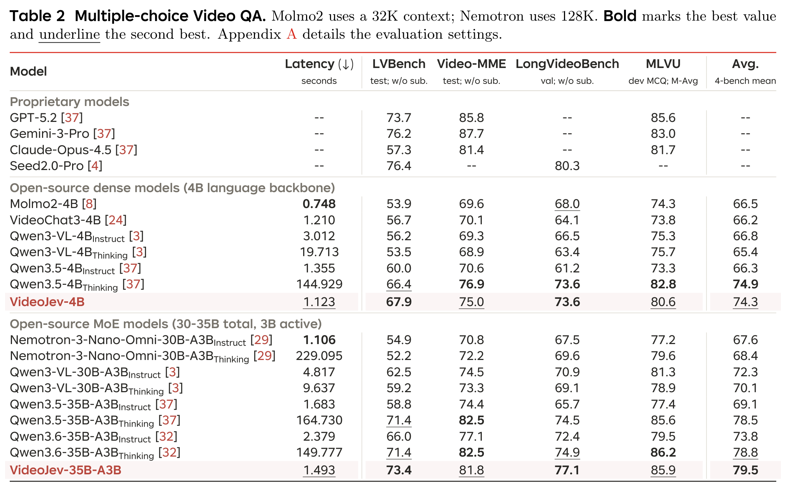
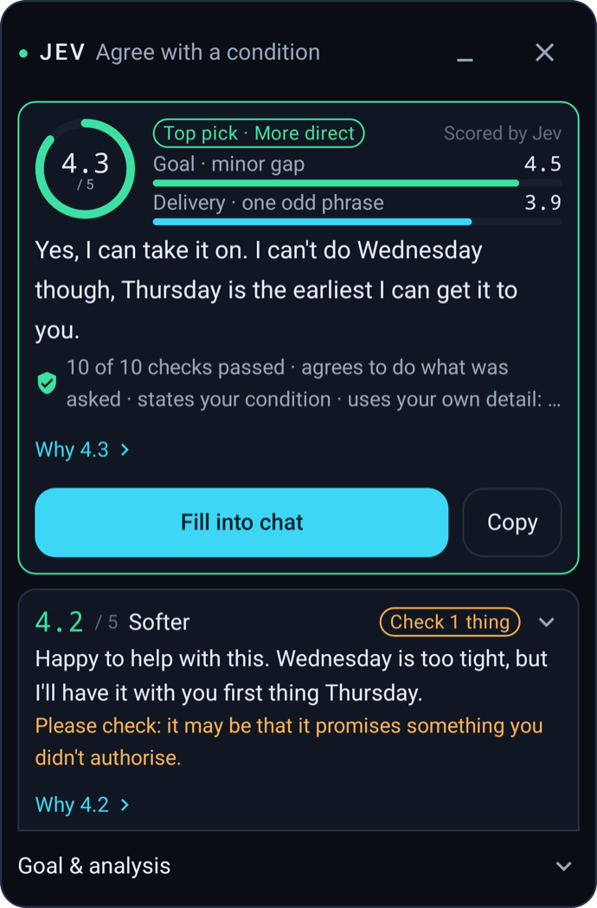
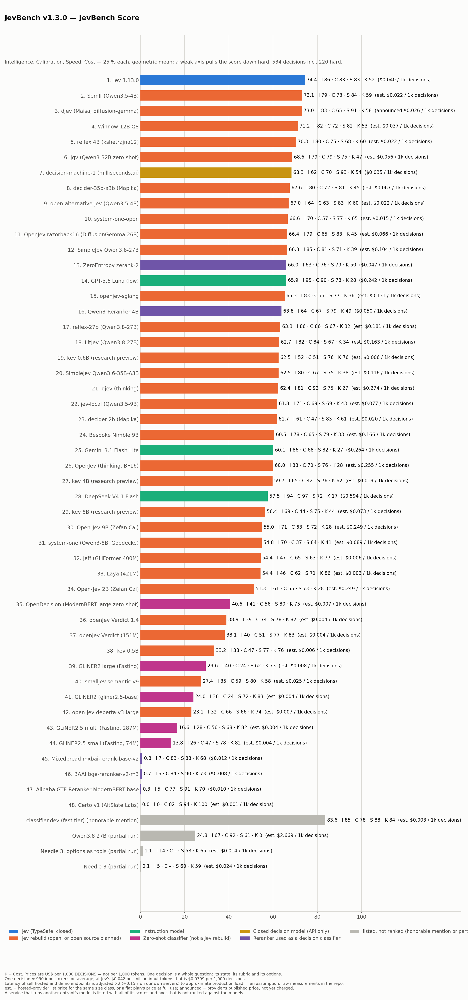
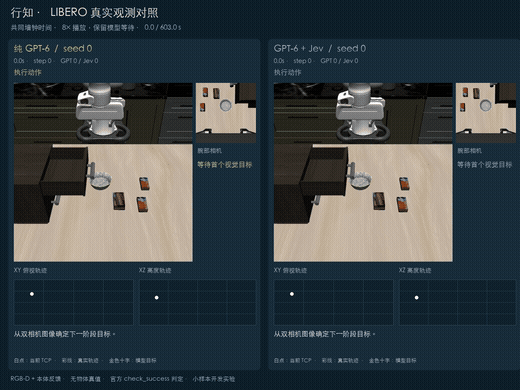
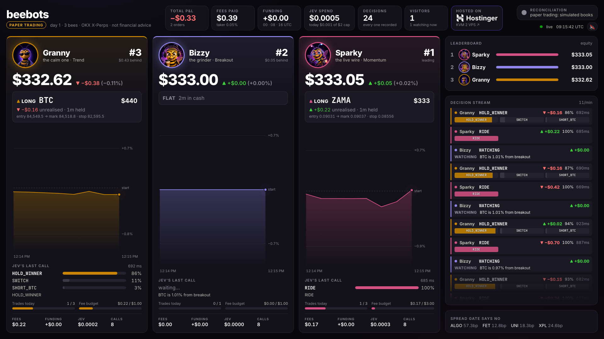
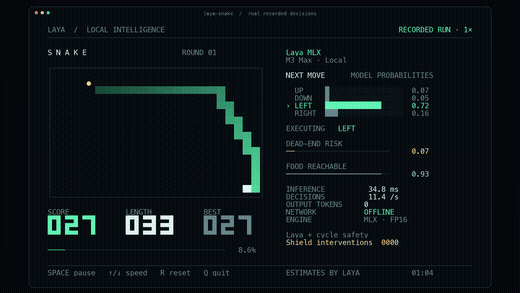
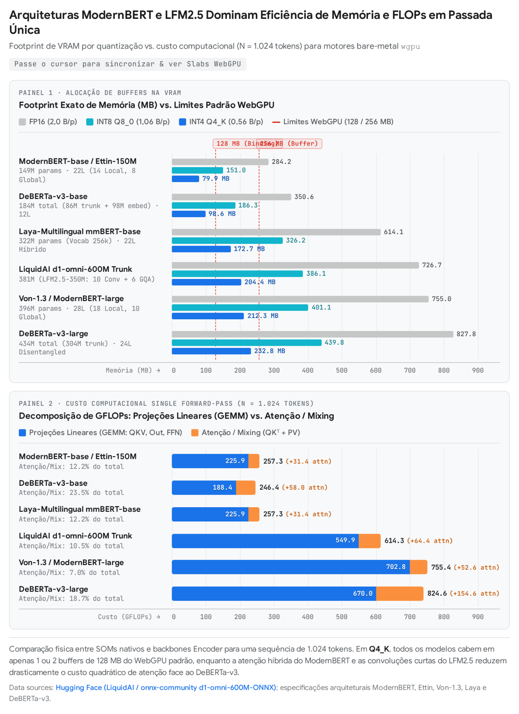

  

<h1 align="center">Awesome Jev Live</h1>

<b>Индекс Jev с оценкой доказательности, который перестраивается каждые два часа.</b>

  
  
  
  
  
  

<a href="../README.md">English</a> · <a href="README.zh-CN.md">简体中文</a> · <a href="README.zh-TW.md">繁體中文</a> · <a href="README.ja.md">日本語</a> · <a href="README.ko.md">한국어</a> · <a href="README.es.md">Español</a> · <a href="README.fr.md">Français</a> · <a href="README.de.md">Deutsch</a> · <a href="README.pt-BR.md">Português (Brasil)</a> · <b>Русский</b> · <a href="README.it.md">Italiano</a> · <a href="README.ar.md">العربية</a> · <a href="README.hi.md">हिन्दी</a> · <a href="README.tr.md">Türkçe</a> · <a href="README.vi.md">Tiếng Việt</a> · <a href="README.th.md">ไทย</a> · <a href="README.id.md">Bahasa Indonesia</a> · <a href="README.pl.md">Polski</a> · <a href="README.nl.md">Nederlands</a> · <a href="README.uk.md">Українська</a>

> [!NOTE]
> **Живой индекс** · Последняя синхронизация: `2026-11-19T20:26:38+08:00` (UTC+8)
> · Записей: **810** · Новых за цикл: **6** · Языки реализации: **25**

Каждая запись ниже была собрана, отфильтрована и перепроверена конвейером в этом репозитории. Числа и метки времени берутся из источников, а не из снимка, составленного вручную.

## 🔥 Выбор момента — первый в каждой категории

По одной записи на категорию, отсортированной по уровню доказательности и звёздам; пересчитывается при каждой синхронизации. Это рейтинг, а не рекомендация; каждый выбор ведёт к полной карточке. Предпочтение отдаётся проектам с опубликованным скриншотом или записью, чтобы блок оставался наглядным.

<table>
<tr>
<td width="50%" valign="top">
<b>🏛️ <a href="https://github.com/typesafe-ai/skills">typesafe-ai/skills</a></b>
⭐2908 · ✅ official
Навыки агента для разработки с помощью TypeSafe System One API
</td>
<td width="50%" valign="top">

<b>🧰 <a href="https://github.com/john-rocky/coreai-kit">john-rocky/coreai-kit</a></b>
⭐126 · Swift · 👁️ observed
Swift SDK for running chat, vision and speech models on iPhone and Mac with Apple&#x27;s Core AI. Model download and caching, FoundationModels integration, and runnable…
</td>
</tr>
<tr>
<td width="50%" valign="top">

<b>🤖 <a href="https://github.com/gargpratyush/jev-router">gargpratyush/jev-router</a></b>
⭐671 · JavaScript · 🔎 inferred
Маршрутизация к самой дешёвой модели в claude code для вашей задачи с помощью jev-router
</td>
<td width="50%" valign="top">

<b>🛡️ <a href="https://github.com/dharmeshgurnani/codeotter">dharmeshgurnani/codeotter</a></b>
⭐4 · TypeScript · 👁️ observed
Autonomous, self-hosted AI code reviews, calibrated scoring gauges, and merge gates from any open model.
</td>
</tr>
<tr>
<td width="50%" valign="top">

<b>🧪 <a href="https://github.com/Mapika/decider">Mapika/decider</a></b>
⭐1057 · Python · 👁️ observed
Семейство моделей в стиле System One, дообученных на основе Qwen3.5, предназначенных для типизированных решений за один проход с калиброванными вероятностями.
</td>
<td width="50%" valign="top">

<b>🔬 <a href="https://github.com/r-ms/mini-jev">r-ms/mini-jev</a></b>
⭐64 · Python · 🔎 inferred
mini-Jev: как выглядит интерфейс типизированных решений в стиле Jev на замороженной Qwen3-4B — читать логиты буквы варианта вместо генерации JSON. Предварительно…
</td>
</tr>
<tr>
<td width="50%" valign="top">

<b>🎮 <a href="https://github.com/MCG-NJU/VideoJev">MCG-NJU/VideoJev</a></b>
⭐315 · Python · 👁️ observed
VideoJev: System One Model для понимания видео и взаимодействия
</td>
<td width="50%" valign="top">
<b>📰 <a href="https://docs.typesafe.ai/model-jaggedness/jev-1.13">9 типов известных дефектов (jaggedness)</a></b>
⭐0 · ✅ official
Буквальное понимание, **ненадёжный подсчёт**, сравнение дат, многоуровневая косвенность, большие состояния с нерелевантными деталями, состязательный контент,…
</td>
</tr>
</table>

## Содержание

- [Что такое Jev?](#что-такое-jev)
- [Как оцениваются записи](#как-оцениваются-записи)
- [Официальные SDK и инструменты разработчика](#официальные-sdk-и-инструменты-разработчика) — **7**
- [Клиенты, SDK и адаптеры сообщества](#клиенты-sdk-и-адаптеры-сообщества) — **143**
- [Инструменты для агентов: MCP, хуки, гейты и агенты для написания кода](#инструменты-для-агентов-mcp-хуки-гейты-и-агенты-для-написания-кода) — **250**
- [Маршрутизация, защитные правила и согласования](#маршрутизация-защитные-правила-и-согласования) — **63**
- [Оценка, калибровка и бенчмарки](#оценка-калибровка-и-бенчмарки) — **88**
- [Открытые воспроизведения, веса и исследования архитектуры](#открытые-воспроизведения-веса-и-исследования-архитектуры) — **61**
- [Приложения, игры, робототехника и интерактивные демо](#приложения-игры-робототехника-и-интерактивные-демо) — **46**
- [Тексты, обсуждения и смежные списки](#тексты-обсуждения-и-смежные-списки) — **73**
- [Прочие проекты](#прочие-проекты) — **79**
- [Проекты по языку реализации](#проекты-по-языку-реализации)

## Что такое Jev?

Jev — первая **модель System One** от TypeSafe AI. Она не пишет текст. Она принимает состояние плюс вопросы, пространство ответов на которые вы задаёте заранее, и возвращает типизированные значения с распределениями вероятностей, по которым ваш код может ветвиться.

|                           |                                                                                                                                                                                                                    |
| ------------------------- | ------------------------------------------------------------------------------------------------------------------------------------------------------------------------------------------------------------------ |
| **Форма**                 | `state + typed questions` → `constrained answers + probabilities` → `your code`                                                                                                                                    |
| **Примитивы**             | `Choice` (выбрать один из ≤255 вариантов), `Score` (рубрика 2–10), `Noul` (вероятностное да/нет)                                                                                                                   |
| **Эндпоинт**              | `POST https://api.typesafe.ai/v1/systemone`, модель `jev-1.13.0` / псевдоним `jev-latest`                                                                                                                          |
| **Хорошо подходит**       | маршрутизация, триаж, оценивание, модерация, верификация и низколатентные гейты внутри ограниченного рабочего процесса                                                                                             |
| **Известные ограничения** | подсчёт ненадёжен, многоуровневая косвенность слаба, а в официальных материалах названо девять классов неровности. Вывод, валидный по схеме, — не то же самое, что правильное решение; калибруйте на своих данных. |

## Как оцениваются записи

Большинство списков в этой области просто утверждают, что включили проект. Этот говорит, что именно он проверил, и позволяет фильтровать соответственно.

| Класс        | Что это значит                                                                                                                                                                  |
| ------------ | ------------------------------------------------------------------------------------------------------------------------------------------------------------------------------- |
| `official`   | Опубликовано самой TypeSafe AI.                                                                                                                                                 |
| `observed`   | Публичный артефакт, который можно открыть и прочитать: реальный исходный код, реальная конфигурация или явное указание на TypeSafe/Jev в названии репозитория либо в его темах. |
| `inferred`   | Совпадение по неоднозначному признаку плюс подтверждающая лексика, но построчное чтение ещё не проводилось.                                                                     |
| `unverified` | Выглядит связанным, независимо не подтверждено ничего. Указано только для обнаружения.                                                                                          |

## Официальные SDK и инструменты разработчика

Всё, что опубликовано самой TypeSafe. Начните отсюда.

🏛️ <b><a href="https://github.com/typesafe-ai/skills">typesafe-ai/skills</a></b> · ⭐2908 · ✅ official · 26 天 · ⭐+1

##### 📝 Описание

Навыки агента для разработки с помощью TypeSafe System One API

> 💡 Собственные навыки агента поставщика. Поскольку они постоянно обновляются, это наиболее близкий к спецификации источник о том, как TypeSafe предполагает управлять Jev из агента.

##### 📌 Основные сведения

| Поле           | Значение                                     |
| -------------- | -------------------------------------------- |
| Категория      | `Официальные SDK и инструменты разработчика` |
| Доказательства | `official`                                   |

##### 📊 Данные

| Метрика          | Значение      |
| ---------------- | ------------- |
| Звёзды           | **2908** (+1) |
| Последний push   | 2026-10-23    |
| Впервые в списке | 2026-09-18    |

🏛️ <b><a href="https://github.com/typesafe-ai/system-one-adapter-python">typesafe-ai/system-one-adapter-python</a></b> · ⭐410 · Python · ✅ official · 4 天

##### 📝 Описание

Drop-in-замена TypeSafeClient на основе LLM APIs

> 💡 Прямая замена, использующая тот же интерфейс с обычным провайдером LLM. Это честный способ сравнить типизированное решение с промптом A/B-тестированием на собственных данных, прежде чем остановиться на одном из вариантов.

🔧 Обнаружено в коде: `README.md`

##### 📌 Основные сведения

| Поле           | Значение                                     |
| -------------- | -------------------------------------------- |
| Категория      | `Официальные SDK и инструменты разработчика` |
| Доказательства | `official`                                   |
| Язык           | Python                                       |

##### 📊 Данные

| Метрика          | Значение   |
| ---------------- | ---------- |
| Звёзды           | **410**    |
| Последний push   | 2026-11-15 |
| Впервые в списке | 2026-10-23 |

🏛️ <b><a href="https://github.com/typesafe-ai/typesafe-sdk-python">typesafe-ai/typesafe-sdk-python</a></b> · ⭐315 · Python · ✅ official · 8 天

##### 📝 Описание

Официальная библиотека Python для TypeSafe API

> 💡 Синхронные и асинхронные клиенты. Самый быстрый путь от ключа API к типизированному решению и эталон, с которым сравниваются клиенты сообщества.

🔧 Обнаружено в коде: `README.md`

##### 📌 Основные сведения

| Поле           | Значение                                     |
| -------------- | -------------------------------------------- |
| Категория      | `Официальные SDK и инструменты разработчика` |
| Доказательства | `official`                                   |
| Язык           | Python                                       |

##### 📊 Данные

| Метрика          | Значение   |
| ---------------- | ---------- |
| Звёзды           | **315**    |
| Последний push   | 2026-11-11 |
| Впервые в списке | 2026-10-23 |

🏛️ <b><a href="https://github.com/typesafe-ai/typesafe-sdk-js">typesafe-ai/typesafe-sdk-js</a></b> · ⭐288 · TypeScript · ✅ official · 8 天

##### 📝 Описание

Официальная библиотека TypeScript/JavaScript для TypeSafe API

> 💡 Клиент TypeScript, в котором тип ответа выводится из заданного вами вопроса, поэтому несовпадение возвращаемого типа становится ошибкой компиляции, а не неожиданностью во время выполнения.

##### 📌 Основные сведения

| Поле           | Значение                                     |
| -------------- | -------------------------------------------- |
| Категория      | `Официальные SDK и инструменты разработчика` |
| Доказательства | `official`                                   |
| Язык           | TypeScript                                   |

##### 📊 Данные

| Метрика          | Значение   |
| ---------------- | ---------- |
| Звёзды           | **288**    |
| Последний push   | 2026-11-11 |
| Впервые в списке | 2026-10-23 |

🏛️ <b><a href="https://github.com/TypeSafeAI/jev-harness">TypeSafeAI/jev-harness</a></b> · ⭐40 · TypeScript · ✅ official · 2 天

##### 📝 Описание

A custom coding harness for TypeSafe AI's Jev: an LLM proposes, Jev answers narrow questions, code decides, every step leaves a receipt.

##### 📌 Основные сведения

| Поле           | Значение                                     |
| -------------- | -------------------------------------------- |
| Категория      | `Официальные SDK и инструменты разработчика` |
| Доказательства | `official`                                   |
| Язык           | TypeScript                                   |

##### 📊 Данные

| Метрика          | Значение   |
| ---------------- | ---------- |
| Звёзды           | **40**     |
| Последний push   | 2026-11-17 |
| Впервые в списке | 2026-11-18 |

🏷 `agent-harness` · `agentic-coding` · `ai-agents` · `ai-governance` · `ai-safety` · `code-review` · `coding-agent` · `developer-tools`

🏛️ <b><a href="https://github.com/typesafe-ai/WorkflowEvals">typesafe-ai/WorkflowEvals</a></b> · ⭐21 · Python · ✅ official · 5 天

##### 📝 Описание

Опубликован код рабочего процесса evals.typesafe.ai

##### 📌 Основные сведения

| Поле           | Значение                                     |
| -------------- | -------------------------------------------- |
| Категория      | `Официальные SDK и инструменты разработчика` |
| Доказательства | `official`                                   |
| Язык           | Python                                       |

##### 📊 Данные

| Метрика          | Значение   |
| ---------------- | ---------- |
| Звёзды           | **21**     |
| Последний push   | 2026-11-14 |
| Впервые в списке | 2026-10-23 |

🏛️ <b><a href="https://github.com/typesafe-ai/typesafe-ai.github.io">typesafe-ai/typesafe-ai.github.io</a></b> · ⭐2 · HTML · ✅ official · 167 天

##### 📝 Описание

Описание в исходном репозитории не опубликовано.

##### 📌 Основные сведения

| Поле           | Значение                                     |
| -------------- | -------------------------------------------- |
| Категория      | `Официальные SDK и инструменты разработчика` |
| Доказательства | `official`                                   |
| Язык           | HTML                                         |

##### 📊 Данные

| Метрика          | Значение   |
| ---------------- | ---------- |
| Звёзды           | **2**      |
| Последний push   | 2026-06-04 |
| Впервые в списке | 2026-10-23 |

## Клиенты, SDK и адаптеры сообщества

Типизированные клиенты для эндпоинта System One — на стольких языках, сколько успело охватить сообщество.

🧰 <b><a href="https://github.com/realZachi/pg-jev">realZachi/pg-jev</a></b> · ⭐1314 · Shell · 👁️ observed · 43 天

##### 📝 Описание

Задавайте таблицам Postgres вопросы на обычном языке. Расширение PostgreSQL, работающее на основе TypeSafe Jev.

🔧 Обнаружено в коде: `README.md`

##### 📌 Основные сведения

| Поле           | Значение                             |
| -------------- | ------------------------------------ |
| Категория      | `Клиенты, SDK и адаптеры сообщества` |
| Доказательства | `observed`                           |
| Язык           | Shell                                |

##### 📊 Данные

| Метрика          | Значение   |
| ---------------- | ---------- |
| Звёзды           | **1314**   |
| Последний push   | 2026-10-06 |
| Впервые в списке | 2026-10-29 |

🧰 <b><a href="https://github.com/jexp/neo4jev">jexp/neo4jev</a></b> · ⭐189 · Jupyter · 👁️ observed · 62 天

##### 📝 Описание

System One Model Jev от Typesafe.ai, перемещающийся по графу Neo4j с помощью классификатора соседних связей

##### 📌 Основные сведения

| Поле           | Значение                             |
| -------------- | ------------------------------------ |
| Категория      | `Клиенты, SDK и адаптеры сообщества` |
| Доказательства | `observed`                           |
| Язык           | Jupyter                              |

##### 📊 Данные

| Метрика          | Значение   |
| ---------------- | ---------- |
| Звёзды           | **189**    |
| Последний push   | 2026-09-18 |
| Впервые в списке | 2026-10-28 |

🧰 <b><a href="https://github.com/john-rocky/coreai-kit">john-rocky/coreai-kit</a></b> · ⭐126 · Swift · 👁️ observed · 3 天

##### 📝 Описание

Swift SDK for running chat, vision and speech models on iPhone and Mac with Apple's Core AI. Model download and caching, FoundationModels integration, and runnable examples with documented OS, SDK and model requirements.

🔧 Обнаружено в коде: `Sources/CoreAIOps/CoreAI+SystemOne.swift`

##### 📌 Основные сведения

| Поле           | Значение                             |
| -------------- | ------------------------------------ |
| Категория      | `Клиенты, SDK и адаптеры сообщества` |
| Доказательства | `observed`                           |
| Язык           | Swift                                |

##### 📊 Данные

| Метрика          | Значение   |
| ---------------- | ---------- |
| Звёзды           | **126**    |
| Последний push   | 2026-11-16 |
| Впервые в списке | 2026-10-26 |

🏷 `apple` · `apple-core-ai` · `asr` · `core-ai` · `coreai` · `foundation-models` · `ios` · `ios-27`

---

<table><tr><th align="center" width="50%">🖼 Изображение</th><th align="center" width="50%">🎬 Видео</th></tr><tr>
<td align="center" valign="top"></td>
<td align="center" valign="top"> анимированная запись</td>
</tr></table>

🧰 <b><a href="https://github.com/AkashPriyadarshii/jev-curate">AkashPriyadarshii/jev-curate</a></b> · ⭐115 · Rust · 👁️ observed · 7 天

##### 📝 Описание

High-throughput synthetic and pretraining dataset sifter for TypeSafe Jev. Rust streaming core, Parquet and JSONL I/O, typed Choice/Score/Noul judgments, speculative fan-out, 24.0 rows/sec measured.

🔧 Обнаружено в коде: `AGENTS.md`, `site/llms.txt`, `docs/DESIGN.md`

##### 📌 Основные сведения

| Поле           | Значение                             |
| -------------- | ------------------------------------ |
| Категория      | `Клиенты, SDK и адаптеры сообщества` |
| Доказательства | `observed`                           |
| Язык           | Rust                                 |

##### 📊 Данные

| Метрика          | Значение   |
| ---------------- | ---------- |
| Звёзды           | **115**    |
| Последний push   | 2026-11-11 |
| Впервые в списке | 2026-11-05 |

🏷 `arrow` · `cli` · `data-cleaning` · `data-engineering` · `dataset-curation` · `eval-harness` · `fine-tuning` · `jev`

🧰 <b><a href="https://github.com/obie/ruby_decision_model">obie/ruby_decision_model</a></b> · ⭐60 · Ruby · 👁️ observed · 37 天

##### 📝 Описание

Клиент Ruby для моделей принятия решений, таких как Typesafe Jev

🔧 Обнаружено в коде: `README.md`

##### 📌 Основные сведения

| Поле           | Значение                             |
| -------------- | ------------------------------------ |
| Категория      | `Клиенты, SDK и адаптеры сообщества` |
| Доказательства | `observed`                           |
| Язык           | Ruby                                 |

##### 📊 Данные

| Метрика          | Значение   |
| ---------------- | ---------- |
| Звёзды           | **60**     |
| Последний push   | 2026-10-12 |
| Впервые в списке | 2026-10-29 |

🧰 <b><a href="https://github.com/bodepudimuneendra-netizen/ConsciousDB">bodepudimuneendra-netizen/ConsciousDB</a></b> · ⭐56 · Python · 👁️ observed · 17 天

##### 📝 Описание

Не зависящий от базы данных фреймворк Agentic GraphRAG с возможностью замены моделей System One (локальная Laya / облачная Jev). Подключаемый интеллектуальный слой с полным 4-фазным конвейером, непрерывной оценкой и пользовательским обходом A* для любой графовой базы данных.

##### 📌 Основные сведения

| Поле           | Значение                             |
| -------------- | ------------------------------------ |
| Категория      | `Клиенты, SDK и адаптеры сообщества` |
| Доказательства | `observed`                           |
| Язык           | Python                               |

##### 📊 Данные

| Метрика          | Значение   |
| ---------------- | ---------- |
| Звёзды           | **56**     |
| Последний push   | 2026-11-02 |
| Впервые в списке | 2026-11-02 |

🏷 `astar-algorithm` · `eval-harness` · `fine-tuning` · `graphdatabase` · `graprag` · `jev` · `laya` · `neo4j`

🧰 <b><a href="https://github.com/AkashPriyadarshii/jev-superpowers">AkashPriyadarshii/jev-superpowers</a></b> · ⭐39 · HTML · 👁️ observed · 41 天

##### 📝 Описание

Systematic software development framework for AI coding agents upgraded with TypeSafe Jev System One typed decisions

🔧 Обнаружено в коде: `CLAUDE.md`

##### 📌 Основные сведения

| Поле           | Значение                             |
| -------------- | ------------------------------------ |
| Категория      | `Клиенты, SDK и адаптеры сообщества` |
| Доказательства | `observed`                           |
| Язык           | HTML                                 |

##### 📊 Данные

| Метрика          | Значение   |
| ---------------- | ---------- |
| Звёзды           | **39**     |
| Последний push   | 2026-10-08 |
| Впервые в списке | 2026-11-05 |

🏷 `agentic-skills` · `ai-agents` · `antigravity` · `claude-code` · `codex` · `coding-agents` · `cursor` · `developer-tools`

🧰 <b><a href="https://github.com/MrJev/awesome-jev">MrJev/awesome-jev</a></b> · ⭐21 · Python · 👁️ observed · 0 天

##### 📝 Описание

Подборка проектов, интеграций и ресурсов для Jev, модели System One от TypeSafe AI.

##### 📌 Основные сведения

| Поле           | Значение                             |
| -------------- | ------------------------------------ |
| Категория      | `Клиенты, SDK и адаптеры сообщества` |
| Доказательства | `observed`                           |
| Язык           | Python                               |

##### 📊 Данные

| Метрика          | Значение   |
| ---------------- | ---------- |
| Звёзды           | **21**     |
| Последний push   | 2026-11-19 |
| Впервые в списке | 2026-09-18 |

🏷 `ai-agents` · `awesome` · `awesome-list` · `jev` · `mcp` · `typesafe`

🧰 <b><a href="https://github.com/ckaraca/awesome-jev">ckaraca/awesome-jev</a></b> · ⭐18 · Python · 👁️ observed · 2 天

##### 📝 Описание

Отобранный список инструментов, интеграций и экспериментов, созданных на базе Jev, модели System One от TypeSafe AI для быстрых типизированных решений.

##### 📌 Основные сведения

| Поле           | Значение                             |
| -------------- | ------------------------------------ |
| Категория      | `Клиенты, SDK и адаптеры сообщества` |
| Доказательства | `observed`                           |
| Язык           | Python                               |

##### 📊 Данные

| Метрика          | Значение   |
| ---------------- | ---------- |
| Звёзды           | **18**     |
| Последний push   | 2026-11-16 |
| Впервые в списке | 2026-09-19 |

🏷 `ai-agents` · `awesome` · `awesome-list` · `computer-use` · `jev` · `llm` · `system-one` · `typesafe`

🧰 <b><a href="https://github.com/Premo-Cloud/typesafe-sdk-java">Premo-Cloud/typesafe-sdk-java</a></b> · ⭐12 · Java · 👁️ observed · 28 天

##### 📝 Описание

Сообщественный Java SDK для Jev, модели System One от TypeSafe: типизированные вопросы на входе, типизированные ответы с откалиброванными вероятностями на выходе. Java 17+, Spring Boot starter (неофициальный)

##### 📌 Основные сведения

| Поле           | Значение                             |
| -------------- | ------------------------------------ |
| Категория      | `Клиенты, SDK и адаптеры сообщества` |
| Доказательства | `observed`                           |
| Язык           | Java                                 |

##### 📊 Данные

| Метрика          | Значение   |
| ---------------- | ---------- |
| Звёзды           | **12**     |
| Последний push   | 2026-10-21 |
| Впервые в списке | 2026-10-28 |

🏷 `java` · `jev` · `sdk` · `spring-boot` · `system-one` · `system-one-models` · `typesafe`

🧰 <b><a href="https://github.com/PromtEngineer/jev-harness">PromtEngineer/jev-harness</a></b> · ⭐9 · Python · 👁️ observed · 55 天

##### 📝 Описание

Основа агента Pi, построенная вокруг TypeSafe's Jev (модель System One): маршрутизатор, выборщик контекста, шлюз, верификатор. Протестировано на ветках Neon Postgres.

##### 📌 Основные сведения

| Поле           | Значение                             |
| -------------- | ------------------------------------ |
| Категория      | `Клиенты, SDK и адаптеры сообщества` |
| Доказательства | `observed`                           |
| Язык           | Python                               |

##### 📊 Данные

| Метрика          | Значение   |
| ---------------- | ---------- |
| Звёзды           | **9**      |
| Последний push   | 2026-09-24 |
| Впервые в списке | 2026-10-28 |

🧰 <b><a href="https://github.com/Sur-Cai/macos-computer-use-kit">Sur-Cai/macos-computer-use-kit</a></b> · ⭐8 · Python · 👁️ observed · 46 天

##### 📝 Описание

AX-first computer use for AI agents on macOS with optional Jev (TypeSafe System One) semantic guards: calibrated target/input judgments before an irreversible action, decisions kept in code. Accessibility-tree targeting, window-scoped input, clipboard-safe paste, read-back verification. Ships a pip CLI, a pi package and a DeepSeek Harness plugin.

##### 📌 Основные сведения

| Поле           | Значение                             |
| -------------- | ------------------------------------ |
| Категория      | `Клиенты, SDK и адаптеры сообщества` |
| Доказательства | `observed`                           |
| Язык           | Python                               |

##### 📊 Данные

| Метрика          | Значение   |
| ---------------- | ---------- |
| Звёзды           | **8**      |
| Последний push   | 2026-10-03 |
| Впервые в списке | 2026-11-07 |

🏷 `accessibility` · `agent-skills` · `ai-agents` · `claude-code` · `computer-use` · `decision-intelligence` · `desktop-automation` · `dsh-plugin`

🧰 <b><a href="https://github.com/clouatre-labs/decisions-judge-mcp">clouatre-labs/decisions-judge-mcp</a></b> · ⭐5 · JavaScript · 👁️ observed · 0 天

##### 📝 Описание

Типизированные решения для AI-агентов как инструмент MCP: вероятность да/нет (noul), выбор и оценка в одном быстром запросе. Работает на модели TypeSafe System One.

##### 📌 Основные сведения

| Поле           | Значение                             |
| -------------- | ------------------------------------ |
| Категория      | `Клиенты, SDK и адаптеры сообщества` |
| Доказательства | `observed`                           |
| Язык           | JavaScript                           |

##### 📊 Данные

| Метрика          | Значение   |
| ---------------- | ---------- |
| Звёзды           | **5**      |
| Последний push   | 2026-11-18 |
| Впервые в списке | 2026-10-12 |

🏷 `agent` · `ai` · `cli` · `decision-making` · `decisions` · `judge` · `llm` · `mcp`

---

<table><tr><th align="center" width="50%">🖼 Изображение</th><th align="center" width="50%">🎬 Видео</th></tr><tr>
<td align="center" valign="top"></td>
<td align="center" valign="top"> анимированная запись</td>
</tr></table>

🧰 <b><a href="https://github.com/elbruno/ElBruno.AI.Decisions">elbruno/ElBruno.AI.Decisions</a></b> · ⭐5 · C# · 👁️ observed · 1 天

##### 📝 Описание

.NET 10 decision SDK: Choose, Score, and Assess with Microsoft Foundry (Microsoft-Decision-1), native local Ollama System One models, and TypeSafe AI Jev. One API, probabilities instead of paragraphs.

##### 📌 Основные сведения

| Поле           | Значение                             |
| -------------- | ------------------------------------ |
| Категория      | `Клиенты, SDK и адаптеры сообщества` |
| Доказательства | `observed`                           |
| Язык           | C#                                   |

##### 📊 Данные

| Метрика          | Значение   |
| ---------------- | ---------- |
| Звёзды           | **5**      |
| Последний push   | 2026-11-17 |
| Впервые в списке | 2026-11-18 |

🏷 `dotnet` · `dotnet10` · `jev` · `microsoft-extensions-ai` · `nuget`

---

<table><tr><th align="center" width="50%">🖼 Изображение</th><th align="center" width="50%">🎬 Видео</th></tr><tr>
<td align="center" valign="top"></td>
<td align="center" valign="top">медиа не опубликованы</td>
</tr></table>

🧰 <b><a href="https://github.com/Bonzokoles/36_chambers">Bonzokoles/36_chambers</a></b> · Python · 👁️ observed · 27 天

##### 📝 Описание

Федеративный движок поиска знаний для ИИ-агентов. Маршрутизирует запросы по специализированным бэкендам (FTS5, ChromaDB, граф) через оркестратор с приоритетом реестра, маршрутизацией ИИ TypeSafe/Jev и переранжированием доказательств. По умолчанию доступен только для чтения, безопасность заложена в архитектуру.

##### 📌 Основные сведения

| Поле           | Значение                             |
| -------------- | ------------------------------------ |
| Категория      | `Клиенты, SDK и адаптеры сообщества` |
| Доказательства | `observed`                           |
| Язык           | Python                               |

##### 📊 Данные

| Метрика          | Значение   |
| ---------------- | ---------- |
| Звёзды           | **0**      |
| Последний push   | 2026-10-22 |
| Впервые в списке | 2026-10-23 |

🏷 `ai-agents` · `ai-infrastructure` · `chromadb` · `embeddings` · `federated-search` · `fts5` · `information-retrieval` · `jev`

---

<table><tr><th align="center" width="50%">🖼 Изображение</th><th align="center" width="50%">🎬 Видео</th></tr><tr>
<td align="center" valign="top"></td>
<td align="center" valign="top">медиа не опубликованы</td>
</tr></table>

Ресурс подключён по прямой ссылке из исходного репозитория, поскольку лицензия на распространение не заявлена.

🧰 <b><a href="https://github.com/dzhng/jevgrep">dzhng/jevgrep</a></b> · ⭐3250 · TypeScript · 🔎 inferred · 6 天 · ⭐+2

##### 📝 Описание

Находите код, спрашивая, что он делает. CLI для coding agents, использующий Jev для обнаружения релевантных файлов и контекста исходного кода.

##### 📌 Основные сведения

| Поле           | Значение                             |
| -------------- | ------------------------------------ |
| Категория      | `Клиенты, SDK и адаптеры сообщества` |
| Доказательства | `inferred`                           |
| Язык           | TypeScript                           |

##### 📊 Данные

| Метрика          | Значение      |
| ---------------- | ------------- |
| Звёзды           | **3250** (+2) |
| Последний push   | 2026-11-12    |
| Впервые в списке | 2026-11-07    |

🏷 `ai-sdk` · `claude-code` · `cli` · `code-search` · `codex` · `coding-agents` · `context-retrieval` · `developer-tools`

---

<table><tr><th align="center" width="50%">🖼 Изображение</th><th align="center" width="50%">🎬 Видео</th></tr><tr>
<td align="center" valign="top"></td>
<td align="center" valign="top">медиа не опубликованы</td>
</tr></table>

🧰 <b><a href="https://github.com/supercorp-ai/supercov">supercorp-ai/supercov</a></b> · ⭐167 · Rust · 🔎 inferred · 6 天

##### 📝 Описание

Покрытие, безопасность и качество кода для агентов программирования

> 💡 Вердикты о качестве кода и покрытии, представленные как типизированные решения, а не проза, поэтому результат может напрямую блокировать конвейер.

##### 📌 Основные сведения

| Поле           | Значение                             |
| -------------- | ------------------------------------ |
| Категория      | `Клиенты, SDK и адаптеры сообщества` |
| Доказательства | `inferred`                           |
| Язык           | Rust                                 |

##### 📊 Данные

| Метрика          | Значение   |
| ---------------- | ---------- |
| Звёзды           | **167**    |
| Последний push   | 2026-11-13 |
| Впервые в списке | 2026-10-23 |

🏷 `agent-skills` · `claude-code` · `code-coverage` · `code-quality` · `codex` · `coding-agents` · `coverage` · `gemini-cli-extension`

---

<table><tr><th align="center" width="50%">🖼 Изображение</th><th align="center" width="50%">🎬 Видео</th></tr><tr>
<td align="center" valign="top"></td>
<td align="center" valign="top">медиа не опубликованы</td>
</tr></table>

🧰 <b><a href="https://github.com/AkashPriyadarshii/jev-seo">AkashPriyadarshii/jev-seo</a></b> · ⭐105 · Rust · 🔎 inferred · 7 天

##### 📝 Описание

Free Rust SEO and GEO toolkit powered by TypeSafe Jev: 58-rule audits, site crawls, AI citation checks, rank drift, CI gates, 15-tool MCP. Zero cost.

##### 📌 Основные сведения

| Поле           | Значение                             |
| -------------- | ------------------------------------ |
| Категория      | `Клиенты, SDK и адаптеры сообщества` |
| Доказательства | `inferred`                           |
| Язык           | Rust                                 |

##### 📊 Данные

| Метрика          | Значение   |
| ---------------- | ---------- |
| Звёзды           | **105**    |
| Последний push   | 2026-11-11 |
| Впервые в списке | 2026-11-05 |

🏷 `ahrefs-alternative` · `answer-engine-optimization` · `claude-code` · `cli` · `coding-agents` · `generative-engine-optimization` · `geo` · `jev`

---

<table><tr><th align="center" width="50%">🖼 Изображение</th><th align="center" width="50%">🎬 Видео</th></tr><tr>
<td align="center" valign="top"></td>
<td align="center" valign="top">медиа не опубликованы</td>
</tr></table>

<b>Больше в этой категории</b> · 125

- [xingwudao/OpenJev](https://github.com/xingwudao/OpenJev) - OpenJev: независимый Jev-вдохновлённый System One принятия решений API…
- [danieleteti/systemone-delphi](https://github.com/danieleteti/systemone-delphi) - Delphi client for System One models (Jev, tev1 and nimble on Ollama): ask typed…
- [GitHub30/OpenJev](https://github.com/GitHub30/OpenJev) - Модель System One с открытыми весами (совместимая с Jev): калиброванные решения…
- [chussenot/judgment](https://github.com/chussenot/judgment) - Типизированные, калиброванные суждения из моделей System One: решение…
- [CMaintz/jev-dotnet](https://github.com/CMaintz/jev-dotnet) - Неофициальная реализация SDK для .NET модели Jev System One от TypeSafe AI.
- [erik-hedstrom/loadout](https://github.com/erik-hedstrom/loadout) - Выбирайте модель, навыки и серверы MCP для каждой сессии coding-agent из…
- [jqueryscript/awesome-jev](https://github.com/jqueryscript/awesome-jev) - A curated list of TypeSafe Jev resources, SDKs, agents, MCP servers…
- [basi/typesafe-ai-php-client](https://github.com/basi/typesafe-ai-php-client) - PHP client for the typesafe.ai System One API (Jev).
- [chrismarchant/jev-router](https://github.com/chrismarchant/jev-router) - Agent- and harness-agnostic router that offloads parallel-workstream decisions…
- [CMaintz/jev-java](https://github.com/CMaintz/jev-java) - Неофициальный Java SDK для модели System One Jev от TypeSafe AI.
- [cogcloud-ai/cog-typesafe](https://github.com/cogcloud-ai/cog-typesafe) - TypeSafe.
- [gajaguar/typesafe-cli](https://github.com/gajaguar/typesafe-cli) - Unofficial command-line interface for TypeSafe AI System One models, on…
- [JosephHardy91/graph-composition-with-dLLMs](https://github.com/JosephHardy91/graph-composition-with-dLLMs) - A Graph-Compiled Specification RAG system built with **Dagster**, **PostgreSQL…
- [sanketmuchhala/jevgate](https://github.com/sanketmuchhala/jevgate) - Calibrated policy triage and institutional risk routing: a hybrid…
- [ollaya-dev/ollaya](https://github.com/ollaya-dev/ollaya) - Jev-compatible API server for open decision models.
- [juspay/neurolink](https://github.com/juspay/neurolink) - Слой каналов нервной системы ИИ — единый интерфейс, соединяющий нейроны…
- [aaddrick/building-with-typesafe-jev](https://github.com/aaddrick/building-with-typesafe-jev) - Неофициальный навык, который учит агентов программирования создавать проекты с…
- [keltokhy/jgrep](https://github.com/keltokhy/jgrep) - grep, но шаблон — это описание. Фильтрует строки по смыслу с помощью модели…
- [Ying-Kai-Liao/jev-browser](https://github.com/Ying-Kai-Liao/jev-browser) - Автоматизация браузера, где LLM планирует, а Jev (Typesafe System One) решает.
- [qkal/Canny](https://github.com/qkal/Canny) - Не позволяет AI-агентам для программирования заявлять, что работа выполнена…
- [fazlerocks/jevmail](https://github.com/fazlerocks/jevmail) - Сортировка почты Gmail с помощью ИИ и открытым исходным кодом.
- [yzfly/awesome-jev-zh](https://github.com/yzfly/awesome-jev-zh) - 精选-список Jev / TypeSafe System One на китайском: официальные материалы, SDK…
- [AboveColin/HA-Jev](https://github.com/AboveColin/HA-Jev) - Задайте вопрос своему дому и получите число в ответ.
- [sharziki/semdecide](https://github.com/sharziki/semdecide) - Типизированные семантические решения для конвейеров Unix и CI на основе…
- [bladedevoff/stuntd](https://github.com/bladedevoff/stuntd) - Локальный прокси, который изучает типизированные решения LLM вашего приложения…
- [burnigtm/jev-mcp](https://github.com/burnigtm/jev-mcp) - Сервер MCP, добавляющий TypeSafe Jev в цикл программирования в Cursor, Codex и…
- [mlimarenko/IronRAG](https://github.com/mlimarenko/IronRAG) - One-click knowledge system for documents, internal bots, and AI agents.
- [shaharia-lab/jev-cli](https://github.com/shaharia-lab/jev-cli) - Command-line tool for TypeSafe AI.
- [Eliot5566/JEV-Paper-Radar](https://github.com/Eliot5566/JEV-Paper-Radar) - Turn research interests or paper links into a ranked reading list in Claude.
- [dannote/jev](https://github.com/dannote/jev) - TypeSafe Jev для OTP: ответ на Jev из GenServer и сопоставление с образцом по…
- [DevLoops-ai/unified-brain](https://github.com/DevLoops-ai/unified-brain) - System One coding agents: code-level answers in about 10secs for under 2 cents.
- [jwuthri-cloud/SelfJev](https://github.com/jwuthri-cloud/SelfJev) - Self-hosted decision model (selfjev-4b) with a Jev-compatible API: Python SDK…
- [jiangkoumo/ego-decision-layer](https://github.com/jiangkoumo/ego-decision-layer) - Pluggable decision layer for the ego lite browser: one System One (Jev) call…
- [thusinh1969/BrighTO_Router](https://github.com/thusinh1969/BrighTO_Router) - BrighTO LLM Router: free open-source, ultra-fast Rust LLM gateway/router and…
- [arjun988/Kev](https://github.com/arjun988/Kev) - Движок принятия решений System One с открытым исходным кодом.
- [Ray-Hughes/jevalyn](https://github.com/Ray-Hughes/jevalyn) - Слой принятия решений для вашего приложения Rails.
- [CheshiAI/Cheshi](https://github.com/CheshiAI/Cheshi) - Jev-powered conversation memory: find past sessions and revisit decisions with…
- [nouli-ai/nouli](https://github.com/nouli-ai/nouli) - Decision Agent Engine.
- [utk2103/jev-studio](https://github.com/utk2103/jev-studio) - if you.
- [tontoko/jev-browser](https://github.com/tontoko/jev-browser) - Единое обоснованное ядро Jev/Playwright: типизированный SDK, постоянный CLI и…
- [saibimajdi/typesafeai-dotnet-sdk](https://github.com/saibimajdi/typesafeai-dotnet-sdk) - Общественный .NET SDK для TypeSafe AI System One API — типизированные вопросы…
- [Elue-dev/jev_elixir](https://github.com/Elue-dev/jev_elixir) - jev_elixir — это небольшой идиоматичный интерфейс для принятия типизированных…
- [himomohi/aside-jev](https://github.com/himomohi/aside-jev) - Агенты Aside принимают решения с помощью TypeSafe Jev.
- [rcarmo/go-system-one](https://github.com/rcarmo/go-system-one) - when a gopher met Jev.
- [haileyok/typesafe-client](https://github.com/haileyok/typesafe-client) - Неофициальные клиенты Go и Rust для TypeSafe AI System One API (Jev).
- [sumleo/prompt2jev](https://github.com/sumleo/prompt2jev) - Навык агента и CLI, преобразующие естественный язык, промпт LLM или код…
- [wojciechwiesner/jit-context](https://github.com/wojciechwiesner/jit-context) - Architectural Moat: JIT-JEV Context OS — Epistemic runtime &amp; JEV System 1…
- [AIAnytime/Jev-Router](https://github.com/AIAnytime/Jev-Router) - Decision-first, OpenAI-compatible AI router powered by Jev typed decisions.
- [chenrui333/jev-docs](https://github.com/chenrui333/jev-docs) - История Jev / TypeSafe System One APIs, поддерживаемая сообществом, SDKs…
- [devbackend/jevgo](https://github.com/devbackend/jevgo) - Неофициальный клиент Go для TypeSafe AI System One API (Jev) — типизированные…
- [docxology/daf-jev](https://github.com/docxology/daf-jev) - daf-jev: композиционный Python-инструментарий для TypeSafe Jev (System One)…
- [Jev-Engineering/TypeWright](https://github.com/Jev-Engineering/TypeWright) - Declare a decision, compile typed Jev questions, measure them, and ship a JSON…
- [Kadihx/jev-x-kit](https://github.com/Kadihx/jev-x-kit) - Офлайн-слой принятия решений за $0 для агентов программирования: примитивы…
- [akiiwa-games/AgentCompass](https://github.com/akiiwa-games/AgentCompass) - Deterministic multi-agent task router &amp; subscription quota scheduler for Claude…
- [docwilde/doxa](https://github.com/docwilde/doxa) - ΔΟΞΑ: Rust multi-agent terminal for Claude, Codex, GLM and DeepSeek, with…
- [elanthus/news-briefing](https://github.com/elanthus/news-briefing) - A daily news briefing with source links and a public integrity report.
- [illescasDaniel/jev-mem](https://github.com/illescasDaniel/jev-mem) - Long-term memory for AI agents driven by Jev (System One) decisions: no…
- [JimmyWesley/rlcd-gateway](https://github.com/JimmyWesley/rlcd-gateway) - Шлюз для LLMs и моделей принятия решений с самостоятельным размещением.
- [PAI-CUHK/SLEEPJEV](https://github.com/PAI-CUHK/SLEEPJEV) - Типизированные решения среды выполнения в стиле JEV для долгосрочного PSG…
- [robertn702/reasoning-router](https://github.com/robertn702/reasoning-router) - Per-step reasoning effort for coding agents, picked by a classifier, without…
- [zhirschtritt/typesafe-go](https://github.com/zhirschtritt/typesafe-go) - Идиоматичный Go SDK для TypeSafe AI API.
- [AboveColin/jevclient](https://github.com/AboveColin/jevclient) - Асинхронный клиент Python для TypeSafe Jev.
- [Butochnikov/laravel-typesafe-jev](https://github.com/Butochnikov/laravel-typesafe-jev) - Неофициальная интеграция Laravel для TypeSafe Jev AI с типизированными…
- [CompleteTech-LLC-AI-Research/jev-311-heatmap](https://github.com/CompleteTech-LLC-AI-Research/jev-311-heatmap) - NYC 311 complaint heatmaps scored with Jev, from a reproducible pipeline to…
- [coo-quack/jev-pii-checker](https://github.com/coo-quack/jev-pii-checker) - CLI, находящий PII в тексте с помощью TypeSafe Jev: наличие, чувствительность и…
- [frodi-karlsson/onesie](https://github.com/frodi-karlsson/onesie) - Gate scripts and CI on fast, calibrated System One judgments like Jev: a score…
- [Lasimeri/Mechanical-Jev](https://github.com/Lasimeri/Mechanical-Jev) - Сторона запросов Jev (TypeSafe System One: noul, choice, score) в Rust…
- [nshkrdotcom/system_one_sdk](https://github.com/nshkrdotcom/system_one_sdk) - Независимый от провайдера Elixir/BEAM SDK для семантики System One…
- [zerone-agents/jev-model-router](https://github.com/zerone-agents/jev-model-router) - Легковесная маршрутизация моделей для агентов, с совместимостью с OpenAI и…
- [abhisheksharma001/jev-skill](https://github.com/abhisheksharma001/jev-skill) - Agent skill for TypeSafe AI.
- [dsaad68/fuzzy-jev](https://github.com/dsaad68/fuzzy-jev) - A client for OpenRouter&#x27;s decision models, TypeSafe&#x27;s Jev by default: typed…
- [getmissionctrl/hs-jev](https://github.com/getmissionctrl/hs-jev) - Клиент Haskell для System One TypeSafe (Jev), API решений — типизированные…
- [JawzoD3TH/JevApi](https://github.com/JawzoD3TH/JevApi) - JevApi — MCP, Api Client Library and Test Harness for Jev.
- [minorun365/jev-cloud-quiz](https://github.com/minorun365/jev-cloud-quiz) - 三大クラウドの機能名を、TypeSafe AI の System One モデル Jev が確率つきで判定するデモ.
- [NerdishShah/playwright-cli-jev-bakeoff](https://github.com/NerdishShah/playwright-cli-jev-bakeoff) - Сравнение: Playwright CLI против CLI+Jev против Playwright MCP.
- [bitranox/btx-skill-jev-judge](https://github.com/bitranox/btx-skill-jev-judge) - Claude Code plugin and Python CLI: hand a judgment repeated over many items to…
- [emoubarak/jev-check](https://github.com/emoubarak/jev-check) - AI browser agent testing for staging apps: sign in as a real account state…
- [Hyper-AI-Lab/openclaw-jev](https://github.com/Hyper-AI-Lab/openclaw-jev) - Production control plane для OpenClaw agents: маршрутизация intake с Jev…
- [milojarow/jev-skills](https://github.com/milojarow/jev-skills) - Jev (TypeSafe System One) skill and CLI for coding agents: when to use typed…
- [MrKyaw/CognitiveMirror-Jev-MCP](https://github.com/MrKyaw/CognitiveMirror-Jev-MCP) - Cognitive middleware for personal and enterprise AI agents: 14 MCP tools and a…
- [Talya1412/jev-harness](https://github.com/Talya1412/jev-harness) - TypeSafe Jev (System One) integrations for OMP, MCP, Claude Code, and Pi…
- [vijaycinn/el-jev](https://github.com/vijaycinn/el-jev) - High-speed System One decision sidecar &amp; Copilot CLI pre-turn hook powered by…
- [Wrenik/Jev-toolkit-Compiler](https://github.com/Wrenik/Jev-toolkit-Compiler) - Context log, search and a compact/clear advisor for Claude Code.
- [abirshhishirroy/mini-jev](https://github.com/abirshhishirroy/mini-jev) - A custom Jev-style decision model built from scratch on Qwen2.5-3B.
- [AKASHSOMAN/Jev-LangGraph-Decision-Agent](https://github.com/AKASHSOMAN/Jev-LangGraph-Decision-Agent) - A minimal demo showing how to use Jev (System One) as a decision engine inside…
- [arthurcolle/jev-pivot-lab](https://github.com/arthurcolle/jev-pivot-lab) - Jev-routed sub-executor: answers a prompt on the cheapest model and reasoning…
- [AsgardMuninn/jev-norma](https://github.com/AsgardMuninn/jev-norma) - Triaje normativo LatAm con Jev (System One) como gate: normaliza cláusulas de…
- [beardthelion/jev-attack-path](https://github.com/beardthelion/jev-attack-path) - Spec for a web app that traces potential attack paths through a public GitHub…
- [CMaintz/jev-tools](https://github.com/CMaintz/jev-tools) - Инструменты TypeScript, созданные на основе Jev от TypeSafe AI: защитный…
- [codebam/jev-guardrails](https://github.com/codebam/jev-guardrails) - Защитные механизмы для вызовов инструментов агентов на базе Jev: библиотека…
- [gupolicarpo/jev-graphify](https://github.com/gupolicarpo/jev-graphify) - MCP server that gives coding agents the right file, memory or skill for a…
- [heiwa4126/jev-node1](https://github.com/heiwa4126/jev-node1) - Bun で @typesafe-ai/sdk 0.7.0 を使うとエラーになるので、一時的に pnpm と node でやる版.
- [hierichhsu/your-cto-jev](https://github.com/hierichhsu/your-cto-jev) - A sharp-tongued CTO that blocks leaked secrets and destructive commands from AI…
- [HillPhelmuth/JevDotNet](https://github.com/HillPhelmuth/JevDotNet) - c# SDK for &quot;System One&quot; decisions models like Jev.
- [ivanblagdan/jev-cli](https://github.com/ivanblagdan/jev-cli) - Composable CLI for TypeSafe.
- [jfmdev/chatbot-jev-gemini](https://github.com/jfmdev/chatbot-jev-gemini) - A simple AI-first support bot built with TypeSafe&#x27;s Jev and Google&#x27;s Gemini API.
- [kkdev92/jev-dotnet](https://github.com/kkdev92/jev-dotnet) - An unofficial .NET 10 client for Jev, TypeSafe.
- [MrGKanev/lets-make-jev](https://github.com/MrGKanev/lets-make-jev) - Jev tests a simple idea: when an LLM only needs to choose a category, score the…
- [ogarciarevett/jev-py-sdk](https://github.com/ogarciarevett/jev-py-sdk) - Типизированные суждения Jev (noul / choice / score) от TypeSafe для Python…
- [phoenix1331/laravel-jev-hotdog](https://github.com/phoenix1331/laravel-jev-hotdog) - A Laravel 13 playground that tells you whether a photo is a hot dog or not…
- [royalskynet/jev-gate-mcp](https://github.com/royalskynet/jev-gate-mcp) - Управляемый шлюз решений Jev для клиентов GPT, Claude и MCP.
- [sunjongos/jev-typesafe-gatekeeper](https://github.com/sunjongos/jev-typesafe-gatekeeper) - World-Class Pure System 1 AI Decision &amp; 90/10 Hybrid Gatekeeper Skill powered…
- [sususu98/pi-jev-navigator](https://github.com/sususu98/pi-jev-navigator) - Ultra-low-token System One context navigation and precision SOP dispatch engine…
- [SykkoAtHome/MCP_Typesafe_JEV](https://github.com/SykkoAtHome/MCP_Typesafe_JEV) - Domain-agnostic MCP server for TypeSafe Jev (System One) evaluation engine…
- [VianneyMI/python-jev](https://github.com/VianneyMI/python-jev) - Unofficial typed Python SDK for TypeSafe.
- [Yasir-Khan-7/jev-sentinel](https://github.com/Yasir-Khan-7/jev-sentinel) - Защита от prompt injection и ограничения вызовов инструментов для AI-агентов…
- [MiaoWuNYA/rikkahub-sillytavern-android](https://github.com/MiaoWuNYA/rikkahub-sillytavern-android) - 安卓AI聊天端:开箱即聊，无损导入酒馆卡，专属RP模式，高定制主题，创造模式，RAG记忆，缓存强省用量，防空回，主动信息，前端卡支持，QQbot，AI群聊，插件…
- [pithings/advocaat](https://github.com/pithings/advocaat) - Небольшой типобезопасный клиент для вопросов ИИ о ваших данных, работающий на…
- [Brainwires/jevwire](https://github.com/Brainwires/jevwire) - Jev decision layer for agents: MCP server, embeddable DecisionModel library…
- [zhulinchng/jevper](https://github.com/zhulinchng/jevper) - Обёртка классификации в форме Jev (TypeSafe System One) поверх клиентов…
- [getcustomaise/customaise-mcp](https://github.com/getcustomaise/customaise-mcp) - MCP server and CLI that connect AI agents.
- [schainks/system_one_client](https://github.com/schainks/system_one_client) - Клиент Elixir для моделей решений System One: TypeSafe Jev, Cloudflare Clef…
- [doronp/jevc](https://github.com/doronp/jevc) - Compile agent policy prose into deterministic verdict programs: narrow evidence…
- [IKEASven69/dsh-opencli](https://github.com/IKEASven69/dsh-opencli) - 让 dsh 会办事:登录态真实浏览器 × 180 站点结构化命令 + SystemOne 亚秒决策 + 执行真实性判定 + watch 监控.
- [Query-farm/vgi-typesafe](https://github.com/Query-farm/vgi-typesafe) - Рабочий процесс VGI, предоставляющий вопросы TypeSafe System One.
- [iamtalha-arshad/ex_typesafe_ai](https://github.com/iamtalha-arshad/ex_typesafe_ai) - Неофициальный клиент Elixir для TypeSafe AI API — типизированные структуры…
- [y0usaf/typesafe-cli](https://github.com/y0usaf/typesafe-cli) - Задавайте типизированные вопросы Jev из командной строки: ответы noul, choice и…
- [abmohajeri/openrouter-studio](https://github.com/abmohajeri/openrouter-studio) - A local, AI Studio–style web app, CLI and Python library for OpenRouter.
- [DavidObando/Cider](https://github.com/DavidObando/Cider) - A low-level System One decision model library for .NET.
- [geilt/typesafe-cli](https://github.com/geilt/typesafe-cli) - CLI и навык агента для TypeSafe System One (Jev): типизированные суждения…
- [hardkoded/typesafe-sdk-dotnet](https://github.com/hardkoded/typesafe-sdk-dotnet) - Unofficial .NET port of the TypeSafe AI client SDK (typed questions &amp; answers).
- [KratosLee-6/open-source-model-deploy](https://github.com/KratosLee-6/open-source-model-deploy) - 开源大模型部署可行性鉴别工具 · 168 个开源模型动态评估（含 12 个 JEV/System One 决策模型）· 硬件自动检测 ·…
- [MarcelRoozekrans/Minos.NET](https://github.com/MarcelRoozekrans/Minos.NET) - Typed, source-generated decision questions for .NET: one IDecisionClient for…
- [MIt9/laya-cli](https://github.com/MIt9/laya-cli) - Удобный CLI для Laya — типизированные решения (choice/score/noul) для людей и…
- [phiat/typesafe-rust-sdk](https://github.com/phiat/typesafe-rust-sdk) - Unofficial Rust client for TypeSafe.

## Инструменты для агентов: MCP, хуки, гейты и агенты для написания кода

Самая быстрорастущая категория: хуки, MCP-серверы и гейты, которые ставят типизированное решение перед следующим действием агента.

🤖 <b><a href="https://github.com/tamaratran/fast-jev-compaction">tamaratran/fast-jev-compaction</a></b> · ⭐8000 · TypeScript · 👁️ observed · 62 天

##### 📝 Описание

Плагин Claude Code, который заменяет сводку сжатия решениями Jev: каждый вызов инструмента и результат оцениваются в одном быстром запросе, устаревшие удаляются или усекаются, а всё сохранённое остаётся дословным.

> 💡 Заменяет сводку сжатия контекста агента для программирования типизированным решением. Наглядный пример замены одного вызова LLM в существующем конвейере вместо перестройки всего конвейера.

🔧 Обнаружено в коде: `README.md`

##### 📌 Основные сведения

| Поле           | Значение                                                                |
| -------------- | ----------------------------------------------------------------------- |
| Категория      | `Инструменты для агентов: MCP, хуки, гейты и агенты для написания кода` |
| Доказательства | `observed`                                                              |
| Язык           | TypeScript                                                              |

##### 📊 Данные

| Метрика          | Значение   |
| ---------------- | ---------- |
| Звёзды           | **8000**   |
| Последний push   | 2026-09-18 |
| Впервые в списке | 2026-11-08 |

🤖 <b><a href="https://github.com/gargpratyush/jev-router">gargpratyush/jev-router</a></b> · ⭐671 · JavaScript · 🔎 inferred · 61 天

##### 📝 Описание

Маршрутизация к самой дешёвой модели в claude code для вашей задачи с помощью jev-router

> 💡 Каждый ход направляется к самой дешёвой модели, способной его обработать. Канонический сценарий снижения затрат для модели System One.

##### 📌 Основные сведения

| Поле           | Значение                                                                |
| -------------- | ----------------------------------------------------------------------- |
| Категория      | `Инструменты для агентов: MCP, хуки, гейты и агенты для написания кода` |
| Доказательства | `inferred`                                                              |
| Язык           | JavaScript                                                              |

##### 📊 Данные

| Метрика          | Значение   |
| ---------------- | ---------- |
| Звёзды           | **671**    |
| Последний push   | 2026-09-19 |
| Впервые в списке | 2026-11-08 |

---

<table><tr><th align="center" width="50%">🖼 Изображение</th><th align="center" width="50%">🎬 Видео</th></tr><tr>
<td align="center" valign="top"></td>
<td align="center" valign="top">медиа не опубликованы</td>
</tr></table>

🤖 <b><a href="https://github.com/0xNatoshi/jev-codex-router">0xNatoshi/jev-codex-router</a></b> · ⭐275 · JavaScript · 🔎 inferred · 58 天

##### 📝 Описание

Маршрутизация модели и рассуждений для каждого хода в Codex, управляемая Jev (TypeSafe System One): выбирает модель, глубину мышления и режим скорости для каждого хода.

> 💡 Маршрутизация модели и усилия рассуждения для каждого хода для кодингового агента, управляемая типизированными решениями.

##### 📌 Основные сведения

| Поле           | Значение                                                                |
| -------------- | ----------------------------------------------------------------------- |
| Категория      | `Инструменты для агентов: MCP, хуки, гейты и агенты для написания кода` |
| Доказательства | `inferred`                                                              |
| Язык           | JavaScript                                                              |

##### 📊 Данные

| Метрика          | Значение   |
| ---------------- | ---------- |
| Звёзды           | **275**    |
| Последний push   | 2026-09-22 |
| Впервые в списке | 2026-10-28 |

🏷 `ai` · `codex` · `jev` · `llm` · `macos` · `routing` · `typesafe`

🤖 <b><a href="https://github.com/strands-labs/strands-decider">strands-labs/strands-decider</a></b> · ⭐1228 · Python · 👁️ observed · 0 天

##### 📝 Описание

Небольшая быстрая модель принятия решений, или системная модель первого типа, для агентных рабочих процессов. Выбирайте между вариантами или оценивайте по шкале быстрее, чем LLM, с калиброванной уверенностью в каждом решении.

##### 📌 Основные сведения

| Поле           | Значение                                                                |
| -------------- | ----------------------------------------------------------------------- |
| Категория      | `Инструменты для агентов: MCP, хуки, гейты и агенты для написания кода` |
| Доказательства | `observed`                                                              |
| Язык           | Python                                                                  |

##### 📊 Данные

| Метрика          | Значение   |
| ---------------- | ---------- |
| Звёзды           | **1228**   |
| Последний push   | 2026-11-18 |
| Впервые в списке | 2026-10-02 |

🏷 `ai` · `machine-learning` · `natural-language-understanding` · `python` · `strands-agents` · `strands-labs` · `system-one` · `system-one-models`

🤖 <b><a href="https://github.com/thruwire/foreman">thruwire/foreman</a></b> · ⭐829 · Python · 👁️ observed · 34 天

##### 📝 Описание

An agent supervisor and software factory foreman powered by decision models

🔧 Обнаружено в коде: `docs/openrouter.md`

##### 📌 Основные сведения

| Поле           | Значение                                                                |
| -------------- | ----------------------------------------------------------------------- |
| Категория      | `Инструменты для агентов: MCP, хуки, гейты и агенты для написания кода` |
| Доказательства | `observed`                                                              |
| Язык           | Python                                                                  |

##### 📊 Данные

| Метрика          | Значение   |
| ---------------- | ---------- |
| Звёзды           | **829**    |
| Последний push   | 2026-10-15 |
| Впервые в списке | 2026-11-08 |

🏷 `agent-supervision` · `codex` · `jev` · `opencode` · `pi-agent` · `pi-coding-agent` · `pi-durable`

---

<table><tr><th align="center" width="50%">🖼 Изображение</th><th align="center" width="50%">🎬 Видео</th></tr><tr>
<td align="center" valign="top"></td>
<td align="center" valign="top">медиа не опубликованы</td>
</tr></table>

🤖 <b><a href="https://github.com/AnotiaWang/awesome-decision-models">AnotiaWang/awesome-decision-models</a></b> · ⭐722 · Python · 👁️ observed · 6 天

##### 📝 Описание

Подборка моделей принятия решений (System One / типизированные модели принятия решений): размещённые APIs, модели с открытыми весами, среды выполнения, SDKs, приложения, бенчмарки и статьи.

🔧 Обнаружено в коде: `README.md`, `README_zh.md`

##### 📌 Основные сведения

| Поле           | Значение                                                                |
| -------------- | ----------------------------------------------------------------------- |
| Категория      | `Инструменты для агентов: MCP, хуки, гейты и агенты для написания кода` |
| Доказательства | `observed`                                                              |
| Язык           | Python                                                                  |

##### 📊 Данные

| Метрика          | Значение   |
| ---------------- | ---------- |
| Звёзды           | **722**    |
| Последний push   | 2026-11-13 |
| Впервые в списке | 2026-10-02 |

🏷 `ai-agents` · `awesome` · `awesome-list` · `decision-models` · `jev` · `llm` · `system-one` · `typed-decisions`

🤖 <b><a href="https://github.com/AbdelStark/awesome-typesafe-jev">AbdelStark/awesome-typesafe-jev</a></b> · ⭐619 · HTML · 👁️ observed · 17 天

##### 📝 Описание

Awesome Jev: основанный на источниках полевой справочник по модели System One TypeSafe, с SDKs, живыми демо, инструментами агентов и независимыми оценками.

🔧 Обнаружено в коде: `README.md`

##### 📌 Основные сведения

| Поле           | Значение                                                                |
| -------------- | ----------------------------------------------------------------------- |
| Категория      | `Инструменты для агентов: MCP, хуки, гейты и агенты для написания кода` |
| Доказательства | `observed`                                                              |
| Язык           | HTML                                                                    |

##### 📊 Данные

| Метрика          | Значение   |
| ---------------- | ---------- |
| Звёзды           | **619**    |
| Последний push   | 2026-11-01 |
| Впервые в списке | 2026-10-28 |

🏷 `agent-skills` · `ai-agents` · `awesome` · `awesome-jev` · `awesome-list` · `awesome-lists` · `curated-list` · `developer-tools`

🤖 <b><a href="https://github.com/jkudish/jev-mcp">jkudish/jev-mcp</a></b> · ⭐587 · JavaScript · 👁️ observed · 5 天

##### 📝 Описание

Быстрые, дешёвые, типизированные суждения на основе модели TypeSafe Jev от MCP в виде инструментов.

> 💡 Раннее доказательство концепции предоставления Jev через MCP, именно так до него добирается большинство не относящихся к Python цепочек инструментов.

🔧 Обнаружено в коде: `README.md`

##### 📌 Основные сведения

| Поле           | Значение                                                                |
| -------------- | ----------------------------------------------------------------------- |
| Категория      | `Инструменты для агентов: MCP, хуки, гейты и агенты для написания кода` |
| Доказательства | `observed`                                                              |
| Язык           | JavaScript                                                              |

##### 📊 Данные

| Метрика          | Значение   |
| ---------------- | ---------- |
| Звёзды           | **587**    |
| Последний push   | 2026-11-14 |
| Впервые в списке | 2026-10-26 |

🤖 <b><a href="https://github.com/walidboulanouar/awesome-jev-use-cases">walidboulanouar/awesome-jev-use-cases</a></b> · ⭐497 · 👁️ observed · 53 天

##### 📝 Описание

Отличный список вариантов использования TypeSafe AI Jev: 74 демонстрации, ранжированные по числу лайков, более 150 репозиториев GitHub, ограничения, стоимость и примеры API. CC0

🔧 Обнаружено в коде: `README.md`

##### 📌 Основные сведения

| Поле           | Значение                                                                |
| -------------- | ----------------------------------------------------------------------- |
| Категория      | `Инструменты для агентов: MCP, хуки, гейты и агенты для написания кода` |
| Доказательства | `observed`                                                              |

##### 📊 Данные

| Метрика          | Значение   |
| ---------------- | ---------- |
| Звёзды           | **497**    |
| Последний push   | 2026-09-26 |
| Впервые в списке | 2026-10-29 |

🏷 `ai-guardrails` · `ai-router` · `awesome` · `awesome-list` · `classification` · `claude-code` · `decision-model` · `examples`

🤖 <b><a href="https://github.com/RomanSlack/jev-drone">RomanSlack/jev-drone</a></b> · ⭐301 · Python · 👁️ observed · 55 天

##### 📝 Описание

Автономный дрон в MuJoCo, работающий только с камерой, с небольшой моделью суждений (TypeSafe Jev) в контуре на частоте 2,5 Гц

🔧 Обнаружено в коде: `tactics.py`, `tunnel_tactics.py`

##### 📌 Основные сведения

| Поле           | Значение                                                                |
| -------------- | ----------------------------------------------------------------------- |
| Категория      | `Инструменты для агентов: MCP, хуки, гейты и агенты для написания кода` |
| Доказательства | `observed`                                                              |
| Язык           | Python                                                                  |

##### 📊 Данные

| Метрика          | Значение   |
| ---------------- | ---------- |
| Звёзды           | **301**    |
| Последний push   | 2026-09-24 |
| Впервые в списке | 2026-10-29 |

🏷 `autonomous-agents` · `drone` · `mujoco` · `robotics` · `typesafe`

---

<table><tr><th align="center" width="50%">🖼 Изображение</th><th align="center" width="50%">🎬 Видео</th></tr><tr>
<td align="center" valign="top"></td>
<td align="center" valign="top">медиа не опубликованы</td>
</tr></table>

🤖 <b><a href="https://github.com/kraayenjon/awesome-jev">kraayenjon/awesome-jev</a></b> · ⭐207 · 👁️ observed · 53 天

##### 📝 Описание

Отобранный список вариантов использования, проектов, SDKs и ресурсов Jev. Jev — это модель System One от TypeSafe AI для быстрых типизированных решений в программном обеспечении: Choice, Score и Noul с калиброванными вероятностями.

🔧 Обнаружено в коде: `README.md`

##### 📌 Основные сведения

| Поле           | Значение                                                                |
| -------------- | ----------------------------------------------------------------------- |
| Категория      | `Инструменты для агентов: MCP, хуки, гейты и агенты для написания кода` |
| Доказательства | `observed`                                                              |

##### 📊 Данные

| Метрика          | Значение   |
| ---------------- | ---------- |
| Звёзды           | **207**    |
| Последний push   | 2026-09-27 |
| Впервые в списке | 2026-09-19 |

🏷 `agents` · `ai` · `ai-agents` · `api` · `artificial-intelligence` · `automation` · `awesome` · `awesome-list`

🤖 <b><a href="https://github.com/valentynkit/awesome-jev-typesafe">valentynkit/awesome-jev-typesafe</a></b> · ⭐190 · JavaScript · 👁️ observed · 0 天

##### 📝 Описание

Типизированные решения с помощью TypeSafe Jev, первой модели System One

🔧 Обнаружено в коде: `readme.md`, `README.ko.md`, `README.ja.md`, `README.zh-CN.md`

##### 📌 Основные сведения

| Поле           | Значение                                                                |
| -------------- | ----------------------------------------------------------------------- |
| Категория      | `Инструменты для агентов: MCP, хуки, гейты и агенты для написания кода` |
| Доказательства | `observed`                                                              |
| Язык           | JavaScript                                                              |

##### 📊 Данные

| Метрика          | Значение   |
| ---------------- | ---------- |
| Звёзды           | **190**    |
| Последний push   | 2026-11-18 |
| Впервые в списке | 2026-09-19 |

🏷 `ai-agents` · `awesome` · `awesome-list` · `claude-code` · `directory` · `jev` · `llm-agents` · `system-one`

🤖 <b><a href="https://github.com/caijinchun/nanojev-arena">caijinchun/nanojev-arena</a></b> · ⭐7 · HTML · 👁️ observed · 60 天

##### 📝 Описание

NanoJev Snake Arena: battleship 1v4 человек-против-AI + симулятор роя из 100 агентов. Локальная демонстрация модели Jev System-One (мини-реплика с открытым исходным кодом).

##### 📌 Основные сведения

| Поле           | Значение                                                                |
| -------------- | ----------------------------------------------------------------------- |
| Категория      | `Инструменты для агентов: MCP, хуки, гейты и агенты для написания кода` |
| Доказательства | `observed`                                                              |
| Язык           | HTML                                                                    |

##### 📊 Данные

| Метрика          | Значение   |
| ---------------- | ---------- |
| Звёзды           | **7**      |
| Последний push   | 2026-09-19 |
| Впервые в списке | 2026-11-01 |

---

<table><tr><th align="center" width="50%">🖼 Изображение</th><th align="center" width="50%">🎬 Видео</th></tr><tr>
<td align="center" valign="top"></td>
<td align="center" valign="top">медиа не опубликованы</td>
</tr></table>

🤖 <b><a href="https://github.com/dfranco-projects/jev-guardbench">dfranco-projects/jev-guardbench</a></b> · ⭐3 · Python · 👁️ observed · 45 天

##### 📝 Описание

Может ли модель System One (TypeSafe Jev, открытая Kev) заменить LLM-as-judge в обратных вызовах защитных механизмов агента?

##### 📌 Основные сведения

| Поле           | Значение                                                                |
| -------------- | ----------------------------------------------------------------------- |
| Категория      | `Инструменты для агентов: MCP, хуки, гейты и агенты для написания кода` |
| Доказательства | `observed`                                                              |
| Язык           | Python                                                                  |

##### 📊 Данные

| Метрика          | Значение   |
| ---------------- | ---------- |
| Звёзды           | **3**      |
| Последний push   | 2026-10-04 |
| Впервые в списке | 2026-11-04 |

---

<table><tr><th align="center" width="50%">🖼 Изображение</th><th align="center" width="50%">🎬 Видео</th></tr><tr>
<td align="center" valign="top"></td>
<td align="center" valign="top">медиа не опубликованы</td>
</tr></table>

Ресурс подключён по прямой ссылке из исходного репозитория, поскольку лицензия на распространение не заявлена.

🤖 <b><a href="https://github.com/hypler-dev/LNSAT">hypler-dev/LNSAT</a></b> · ⭐1 · TypeScript · 👁️ observed · 1 天

##### 📝 Описание

Building a CPU-first System One engine for evidence-bound review, with a Gateway for policy, human approval, bounded execution, and durable receipts. Pre-release source.

##### 📌 Основные сведения

| Поле           | Значение                                                                |
| -------------- | ----------------------------------------------------------------------- |
| Категория      | `Инструменты для агентов: MCP, хуки, гейты и агенты для написания кода` |
| Доказательства | `observed`                                                              |
| Язык           | TypeScript                                                              |

##### 📊 Данные

| Метрика          | Значение   |
| ---------------- | ---------- |
| Звёзды           | **1**      |
| Последний push   | 2026-11-17 |
| Впервые в списке | 2026-11-16 |

🏷 `access-control` · `agent-security` · `agentic-ai` · `ai-agents` · `ai-governance` · `ai-security` · `audit-trail` · `authorization`

---

<table><tr><th align="center" width="50%">🖼 Изображение</th><th align="center" width="50%">🎬 Видео</th></tr><tr>
<td align="center" valign="top"></td>
<td align="center" valign="top">медиа не опубликованы</td>
</tr></table>

🤖 <b><a href="https://github.com/dolevhayut/resurface">dolevhayut/resurface</a></b> · TypeScript · 👁️ observed · 47 天

##### 📝 Описание

TypeSafe JEV resume screening: LLM пишет вопросы, JEV (модель классификации System One) отвечает на них для каждого резюме в вашей ATS с точной строкой доказательства. В 8× быстрее, в 31× дешевле, чем LLM.

##### 📌 Основные сведения

| Поле           | Значение                                                                |
| -------------- | ----------------------------------------------------------------------- |
| Категория      | `Инструменты для агентов: MCP, хуки, гейты и агенты для написания кода` |
| Доказательства | `observed`                                                              |
| Язык           | TypeScript                                                              |

##### 📊 Данные

| Метрика          | Значение   |
| ---------------- | ---------- |
| Звёзды           | **0**      |
| Последний push   | 2026-10-03 |
| Впервые в списке | 2026-11-01 |

🏷 `ai-recruiting` · `ats` · `candidate-matching` · `classification-model` · `claude` · `decision-model` · `evidence-based-hiring` · `hr-tech`

---

<table><tr><th align="center" width="50%">🖼 Изображение</th><th align="center" width="50%">🎬 Видео</th></tr><tr>
<td align="center" valign="top"></td>
<td align="center" valign="top"> <a href="https://raw.githubusercontent.com/dolevhayut/resurface/main/docs/launch/resurface-launch.mp4">Открыть видео</a></td>
</tr></table>

🤖 <b><a href="https://github.com/browser-use/jev-ultrafast">browser-use/jev-ultrafast</a></b> · ⭐24667 · Python · 🔎 inferred · 8 天 · ⭐+2

##### 📝 Описание

Самый быстрый и дешёвый веб-агент

##### 📌 Основные сведения

| Поле           | Значение                                                                |
| -------------- | ----------------------------------------------------------------------- |
| Категория      | `Инструменты для агентов: MCP, хуки, гейты и агенты для написания кода` |
| Доказательства | `inferred`                                                              |
| Язык           | Python                                                                  |

##### 📊 Данные

| Метрика          | Значение       |
| ---------------- | -------------- |
| Звёзды           | **24667** (+2) |
| Последний push   | 2026-11-11     |
| Впервые в списке | 2026-11-08     |

---

<table><tr><th align="center" width="50%">🖼 Изображение</th><th align="center" width="50%">🎬 Видео</th></tr><tr>
<td align="center" valign="top"></td>
<td align="center" valign="top"> анимированная запись · <a href="https://raw.githubusercontent.com/browser-use/jev-ultrafast/main/docs/demo.mp4">Открыть видео</a></td>
</tr></table>

🤖 <b><a href="https://github.com/jev-chat/jev-chat-jarvis">jev-chat/jev-chat-jarvis</a></b> · ⭐8465 · Kotlin · 🔎 inferred · 13 天 · ⭐+2

##### 📝 Описание

Помощник для принятия решений в чате: прежде чем вы ответите, Jev читает чат, оценивает намерение и риск и составляет ответы, которые вы дополняете одним касанием. Вы нажимаете «Отправить». Android · Windows · macOS · iOS | Инструмент поддержки решений в чате: сначала понять собеседника, потом отвечать; отправлять или нет — решаете вы.

##### 📌 Основные сведения

| Поле           | Значение                                                                |
| -------------- | ----------------------------------------------------------------------- |
| Категория      | `Инструменты для агентов: MCP, хуки, гейты и агенты для написания кода` |
| Доказательства | `inferred`                                                              |
| Язык           | Kotlin                                                                  |

##### 📊 Данные

| Метрика          | Значение      |
| ---------------- | ------------- |
| Звёзды           | **8465** (+2) |
| Последний push   | 2026-11-05    |
| Впервые в списке | 2026-11-08    |

🏷 `accessibility-service` · `ai-assistant` · `android` · `chat-assistant` · `chat-copilot` · `llm` · `ocr` · `qq`

---

<table><tr><th align="center" width="50%">🖼 Изображение</th><th align="center" width="50%">🎬 Видео</th></tr><tr>
<td align="center" valign="top"></td>
<td align="center" valign="top">медиа не опубликованы</td>
</tr></table>

<b>Больше в этой категории</b> · 232

- [tamaratran/jev-pruner](https://github.com/tamaratran/jev-pruner) - Плагин Claude Code: сокращает длинный вывод Bash с помощью TypeSafe Jev, прежде…
- [dbreunig/building-with-jev-skill](https://github.com/dbreunig/building-with-jev-skill) - Навык написания и улучшения программ, вызывающих Jev, модель TypeSafe System One.
- [openlayer-ai/jevals](https://github.com/openlayer-ai/jevals) - Оценка агентов и защитные механизмы как решения Jev: один запрос на…
- [GhalebDweikat/winnow](https://github.com/GhalebDweikat/winnow) - Калиброванное контекстное сито для Claude Code: каждый результат инструмента…
- [PerryLink/jevcore](https://github.com/PerryLink/jevcore) - TypeSafe Jev для DeepSeek Harness, Model Context Protocol и обычного Node…
- [Nisaka520/JevIntent](https://github.com/Nisaka520/JevIntent) - WeChat (плагин FkWeChat): удерживайте сообщение, чтобы проанализировать…
- [andyrewlee/awesome-system-one](https://github.com/andyrewlee/awesome-system-one) - Список моделей System One (также называемых моделями принятия решений): Jev…
- [Li-Evan/awesome-jev](https://github.com/Li-Evan/awesome-jev) - Самая полная галерея того, что люди создают с помощью Jev — модели System One…
- [ChenneyZhuang/laya-browser-agent](https://github.com/ChenneyZhuang/laya-browser-agent) - Локальная альтернатива Jev с открытым исходным кодом: решения браузерного…
- [TrustifAI/typed_evals](https://github.com/TrustifAI/typed_evals) - Fast, typed Python framework for Jev-as-a-Judge/Decision-model evaluation for…
- [tiffygk/jev-mode](https://github.com/tiffygk/jev-mode) - Claude Code/Codex skills, evals, harnesses/context tools, and learning…
- [yohanargentina-oss/Foq](https://github.com/yohanargentina-oss/Foq) - ⚡ Foq — БЕСПЛАТНАЯ локальная альтернатива с открытым исходным кодом Jev.
- [mani-aiml/jev-demos](https://github.com/mani-aiml/jev-demos) - Демонстрации с Jev, моделью System One от TypeSafe, по одной папке на…
- [BYK/jev-mcp](https://github.com/BYK/jev-mcp) - Сервер MCP с приоритетом оценки для TypeSafe.
- [kolawong/fast-compaction-dsh](https://github.com/kolawong/fast-compaction-dsh) - Уплотнение контекста на основе вердиктов для DeepSeek Harness — заменяет…
- [LHCWN/arkui-sem](https://github.com/LHCWN/arkui-sem) - Semantic ArkUI linter for coding agents: catches state and lifecycle bugs that…
- [rajasekharponakala/jev-mcp](https://github.com/rajasekharponakala/jev-mcp) - Сервер MCP, оборачивающий модели TypeSafe Jev System One — типизированные…
- [BFLabsAI/bf-jev-deep-research](https://github.com/BFLabsAI/bf-jev-deep-research) - Навык агента + дословное исследование Jev (TypeSafe AI System One Model)…
- [lewisyang3/LEO](https://github.com/lewisyang3/LEO) - A cost-tiered AI pipeline pairing System One model Jev and Claude Haiku to…
- [Mainakcris7/agent-guardrail-with-jev](https://github.com/Mainakcris7/agent-guardrail-with-jev) - A practical demo of how can we leverage the power of System One Models like Jev…
- [systemonemodels/noulxp](https://github.com/systemonemodels/noulxp) - NoulXP (ранее OpenDXP): открытый стандарт для моделей System One.
- [Abjcodes/SystemOne-Model-Router](https://github.com/Abjcodes/SystemOne-Model-Router) - Jev based model router for codex.
- [CrowBe/weave](https://github.com/CrowBe/weave) - Каркас агента для модели System One.
- [ferrousaurus/system-one-mcp](https://github.com/ferrousaurus/system-one-mcp) - An MCP server that allows Agents to interact with System One models such as Jev.
- [gorock007/jev-atlas](https://github.com/gorock007/jev-atlas) - An independent, evidence-first field guide to Jev.
- [izam-mohammed/decisionsmith](https://github.com/izam-mohammed/decisionsmith) - Use and fine-tune System One models (Jev, Laya) on your data, with an LLM as…
- [jms-dcksn/uipath-jev-guardrail-connector](https://github.com/jms-dcksn/uipath-jev-guardrail-connector) - Коннектор UiPath с собственными правилами безопасности, работающий на модели…
- [lucast4049/openjev](https://github.com/lucast4049/openjev) - Запускайте быстрые, калиброванные типизированные решения на моделях System One…
- [Meirdrarel/mcp-systemone](https://github.com/Meirdrarel/mcp-systemone) - MCP server giving coding agents quick judgment tools.
- [Rams901/amira-brightwater-ai-suite](https://github.com/Rams901/amira-brightwater-ai-suite) - Amira AI Engineer Challenge Suite — Hybrid System-One (TypeSafe Jev 1.14) +…
- [vurihuang/magpie-plugin-openai-decisions](https://github.com/vurihuang/magpie-plugin-openai-decisions) - OpenAI.
- [YaoApp/yao](https://github.com/YaoApp/yao) - ✨ Все ваши агенты и рабочие пространства в одном месте, на каждом принадлежащем…
- [kerpopule/hermes-jev-skills](https://github.com/kerpopule/hermes-jev-skills) - Маршрутизация моделей, память, уплотнение, выбор навыков, работа с компьютером…
- [reticlehq/reticle](https://github.com/reticlehq/reticle) - AI-агенты могут генерировать код, но по-прежнему с трудом понимают, что именно…
- [wy-coliney/jev-browser-use](https://github.com/wy-coliney/jev-browser-use) - Операции в браузере выполняются в 5–10 раз быстрее: Jev нажимает, Codex думает…
- [logicrw/awesome-jev-projects](https://github.com/logicrw/awesome-jev-projects) - Awesome Jev: основанный на источниках радар open-source экосистемы, поиск…
- [devagrawal09/jev-review](https://github.com/devagrawal09/jev-review) - Поэтапный процесс проверки кода и локальная панель мониторинга, созданные с…
- [wuyoscar/jev-skill](https://github.com/wuyoscar/jev-skill) - Потрясающая коллекция вариантов использования, рабочих процессов и навыков…
- [kydlikebtc/awesome-jev](https://github.com/kydlikebtc/awesome-jev) - Launch what you built on Jev, TypeSafe AI.
- [ttlequals0/MinusPod](https://github.com/ttlequals0/MinusPod) - MinusPod — это самостоятельно размещаемый сервер, который удаляет рекламу ещё…
- [OmniJev/Flide](https://github.com/OmniJev/Flide) - 🔥🔥 The extremely fast inference engine for decision model.
- [BillionsBobby/JevRouter](https://github.com/BillionsBobby/JevRouter) - Легковесный маршрутизатор на базе Jev для моделей, инструментов и субагентов.
- [qbeka/jev-job-search](https://github.com/qbeka/jev-job-search) - Find software internships and new-grad jobs, fill the application forms, check…
- [malevrigns/agent-jev](https://github.com/malevrigns/agent-jev) - AgentJev-0.6B — быстрая модель решений «System One» для ИИ-агентов: передайте…
- [vinilana/jev-gateway](https://github.com/vinilana/jev-gateway) - Простой способ использовать jev с вашим агентом программирования для…
- [Heman10x-NGU/openJev-verdict-2.0](https://github.com/Heman10x-NGU/openJev-verdict-2.0) - Калиброванный авторегрессионно-свободный движок решений на 151M, превосходящий…
- [OmniJev/OneJev](https://github.com/OmniJev/OneJev) - 🚀🚀 Мультимодальная модель принятия решений System One, которая дает…
- [Amal-David/awesome-jev](https://github.com/Amal-David/awesome-jev) - Jev демонстраций, проектов, SDKs и навыков со ссылками на исходный код и…
- [fatwang2/awesome-jev](https://github.com/fatwang2/awesome-jev) - Каталог проектов Jev с подтверждёнными источниками и переиспользуемым процессом…
- [jmagly/aiwg](https://github.com/jmagly/aiwg) - Переиспользуемый контекст проекта и специализированные рабочие процессы для уже…
- [luobosibing2/dsh-jev-plugin](https://github.com/luobosibing2/dsh-jev-plugin) - Нативный плагин DeepSeek Harness (DSH), интегрирующий TypeSafe Jev или Decision…
- [ThinkFlowLab/system1-agents](https://github.com/ThinkFlowLab/system1-agents) - Модели принятия решений System 1 (Jev, Laya, Cua-S1) в качестве мозга для…
- [y0usaf/pi-jev](https://github.com/y0usaf/pi-jev) - TypeSafe Jev в качестве слоя принятия решений для агента программирования Pi…
- [Avinash-jetwani/jevmem](https://github.com/Avinash-jetwani/jevmem) - Shared project rules and memory for AI coding agents.
- [kyegomez/open-jev](https://github.com/kyegomez/open-jev) - Проект с открытым исходным кодом, реконструирующий с первых принципов идеи…
- [cookiespiggy/agentic-rl](https://github.com/cookiespiggy/agentic-rl) - Учебник по Agentic RL на Chinese для начинающих с нуля (33 главы): от концепций…
- [UditAkhourii/quicksilver](https://github.com/UditAkhourii/quicksilver) - Навык Claude Code: передаёт массовые решения Jev.
- [Shanghua-Gao/RSI-Jev](https://github.com/Shanghua-Gao/RSI-Jev) - Модели типизированных решений (noul / choice / score), обученные…
- [lawrence3699/jev-style](https://github.com/lawrence3699/jev-style) - JevStyle: local decision models for AI agents.
- [Bodila51/grok-bot-jev](https://github.com/Bodila51/grok-bot-jev) - Подключите TypeSafe Jev к Grok Bot в качестве дешёвого слоя принятия решений…
- [initial-d/ml-quant-trading](https://github.com/initial-d/ml-quant-trading) - Исследование количественных стратегий ML на PyTorch: 213 факторов, коррекция…
- [onlyreadai/onlyread](https://github.com/onlyreadai/onlyread) - Make AI browser agents read-only: a Chrome extension that refuses writes.
- [charlesdove977/claude-x-jev](https://github.com/charlesdove977/claude-x-jev) - Быстрые, дешёвые, типизированные решения для Claude Code.
- [jonathanavis96/jev-kit](https://github.com/jonathanavis96/jev-kit) - Всё необходимое для запуска TypeSafe.
- [akivet/Mica](https://github.com/akivet/Mica) - A 4B decision model: calibrated probabilities for yes/no, choice and score…
- [shitianfang/jev-use](https://github.com/shitianfang/jev-use) - Плагин Claude Code / Codex / pi, передающий шаги агента, не требующие…
- [yikangy873-gif/jev-desktop](https://github.com/yikangy873-gif/jev-desktop) - Выбор действия TypeSafe Jev внутри Codex Computer Use.
- [iamaamir/system-one](https://github.com/iamaamir/system-one) - Независимая от провайдера среда выполнения System One для TypeScript и Pi.
- [TheoOliveira/pi-jev](https://github.com/TheoOliveira/pi-jev) - Семантическая маршрутизация инструментов и типизированные решения System One…
- [alanhuangyoo/OpenJev](https://github.com/alanhuangyoo/OpenJev) - OpenJev: open-source, локальная альтернатива Jev.
- [chuloontop4-code/jev-instance-review](https://github.com/chuloontop4-code/jev-instance-review) - Лучший обозреватель экземпляров Roblox Studio 2026 года: типизированные…
- [native-bond-lab/Jev-Interaction](https://github.com/native-bond-lab/Jev-Interaction) - System-One-controlled full-duplex voice interaction: turn-taking as…
- [FrancoisChastel/jev-code](https://github.com/FrancoisChastel/jev-code) - Jev, классификатор TypeSafe System One, как инструмент внутри Claude Code…
- [intikhab49/open-jev-typed-decision-engine](https://github.com/intikhab49/open-jev-typed-decision-engine) - Открытая реализация TypeSafe Jev: движок типизированных решений объёмом 150 млн…
- [alexei-led/claude-router](https://github.com/alexei-led/claude-router) - Claude Code plugin that picks the model and effort for each turn.
- [everyinfra/jev-radar](https://github.com/everyinfra/jev-radar) - 📡 The most rigorously verified tracker of the Jev (TypeSafe AI System One)…
- [AskTheWay/dsh-jev-interceptor](https://github.com/AskTheWay/dsh-jev-interceptor) - ⚡ Суждение System-1 за миллисекунды для каждого вызова инструмента в DeepSeek…
- [jomatsu/pi-jev-auto-mode](https://github.com/jomatsu/pi-jev-auto-mode) - Автоматический режим на базе Jev (TypeSafe System One) для кодингового агента…
- [abhishek085/open-spark-jev](https://github.com/abhishek085/open-spark-jev) - Локальные модели принятия решений с открытым исходным кодом, вдохновлённые Jev…
- [anpicasso/hermes-jev-approvals](https://github.com/anpicasso/hermes-jev-approvals) - TypeSafe Jev as the reviewer for Hermes Agent smart command approvals.
- [anandi1989/awesome-jev-usecases](https://github.com/anandi1989/awesome-jev-usecases) - Индекс реальных вариантов использования Jev (TypeSafe AI System One)…
- [Singularity-Compute/super-decider](https://github.com/Singularity-Compute/super-decider) - Decisions, not essays: a choice, a yes or no, or a score with a calibrated…
- [erkamyaman/jev-enforce](https://github.com/erkamyaman/jev-enforce) - 📏 Claude Code plugin that makes Claude follow your AGENTS.md: every reply and…
- [paramjeetn/jev-cookbook](https://github.com/paramjeetn/jev-cookbook) - Полная поваренная книга для Jev от TypeSafe AI — более 120 вариантов…
- [green-dalii/pi-shift-router](https://github.com/green-dalii/pi-shift-router) - Маршрутизация моделей для каждого сообщения в кодинговом агенте Pi: небольшой…
- [iamtoomas/JevLint](https://github.com/iamtoomas/JevLint) - Настраиваемый семантический линтинг на основе Jev с суждениями NOUL на уровне…
- [vicfei/awesome-jev-prompts](https://github.com/vicfei/awesome-jev-prompts) - Question patterns, engine selection &amp; ecosystem tracking for typed decision…
- [ajensenwaud/hermes-jev-plugin](https://github.com/ajensenwaud/hermes-jev-plugin) - Инструменты принятия решений TypeSafe Jev (System One) для Hermes Agent…
- [backant-io/jevelry](https://github.com/backant-io/jevelry) - Use Jev everywhere to make &amp; track decisions.
- [daftAI2026/awesome-jev](https://github.com/daftAI2026/awesome-jev) - Подборка проектов TypeSafe Jev / System One GitHub, альтернативы с открытым…
- [win4r/pi-jev-router](https://github.com/win4r/pi-jev-router) - Task-boundary model routing for Pi Coding Agent, powered by TypeSafe Jev.
- [ismaildasci/claude-referee](https://github.com/ismaildasci/claude-referee) - Evidence over eloquence. Unofficial Claude Code plugin that checks &quot;done&quot;…
- [zhangxaochen/dsh-jev](https://github.com/zhangxaochen/dsh-jev) - Набор плагинов Jev (модель принятия решений System One) для DeepSeek Harness…
- [alexei-led/pi-model-router](https://github.com/alexei-led/pi-model-router) - Independent Pi extension for four-tier model routing with optional…
- [ronitgupta138/Local-Jev](https://github.com/ronitgupta138/Local-Jev) - ⚡ 100% offline, zero-cost drop-in alternative to TypeSafe Jev System One…
- [win4r/jev-security-scan](https://github.com/win4r/jev-security-scan) - 使用 TypeSafe Jev 审查 Skill 与 MCP 可疑行为 | Review Agent Skills and MCP code with…
- [anisselbd/jev-phishing-bench](https://github.com/anisselbd/jev-phishing-bench) - Jev (TypeSafe) vs Claude Haiku 4.5 on 2,000 phishing emails: accuracy…
- [inso1337/revl](https://github.com/inso1337/revl) - Язык для безопасной, универсальной пространственно-временной компонуемости…
- [Jessie-QingYu/jev-in-the-wild](https://github.com/Jessie-QingYu/jev-in-the-wild) - Практические варианты использования Jev, проекты с открытым исходным кодом…
- [SergeyBazhmin/krasivo-jev](https://github.com/SergeyBazhmin/krasivo-jev) - Training data and models for &quot;system one&quot; classifiers: one forward pass, no…
- [allenporter/home-assistant-laya](https://github.com/allenporter/home-assistant-laya) - Conversation agent based on Laya, a multilingual, non-autoregressive System 1…
- [frontierlabai/JevHub](https://github.com/frontierlabai/JevHub) - JevHub · Jev 生态热榜 把值得关注的 Jev 项目、教程和讨论，汇到一页。 自动发现 · 每日更新 · 按 Stars 排序 · 中英双语.
- [AlphaPerseii3000/jev-effort-router](https://github.com/AlphaPerseii3000/jev-effort-router) - Per-turn model AND reasoning-effort routing for Hermes Agent on Ollama:Cloud…
- [FazalAAli/jev-robotics-demo](https://github.com/FazalAAli/jev-robotics-demo) - Jev (TypeSafe System One) против Claude Opus 5, управляющего симулированным…
- [jmrenouard/MicroLLM](https://github.com/jmrenouard/MicroLLM) - Local Hybrid System-One Decision Engine.
- [ranjan2829/AskJev](https://github.com/ranjan2829/AskJev) - AskJev — автопилот Jev для любого веб-сайта + защита от необратимых нажатий…
- [reacher-z/Awesome-Jev](https://github.com/reacher-z/Awesome-Jev) - Curated Jev and System One papers, models, datasets, benchmarks and SDKs, with…
- [ZJU-OmniAI/Awesome-Jev](https://github.com/ZJU-OmniAI/Awesome-Jev) - A curated survey of Jev: model foundations, agent applications, and embodied…
- [7starsseeker/dsh-fact-check](https://github.com/7starsseeker/dsh-fact-check) - Fact-checking skill for DeepSeek Harness: multi-source verification against the…
- [PerryLink/laya-mcp](https://github.com/PerryLink/laya-mcp) - MCP server for Laya typed decisions (noul / choice / score): warm model…
- [lgy1027/jevshield](https://github.com/lgy1027/jevshield) - Защитный шлюз для вызовов инструментов ИИ-агентов с задержкой менее 100 мс…
- [abhishekashokvkumar/jev-mcp-dispatcher](https://github.com/abhishekashokvkumar/jev-mcp-dispatcher) - Диспетчер инструментов на естественном языке, полностью работающий на основе…
- [aitofy-dev/jev-awesome-skills](https://github.com/aitofy-dev/jev-awesome-skills) - Навыки Jev с открытым исходным кодом для Claude Code, Codex, Cursor и Grok.
- [laguagu/jev-skills](https://github.com/laguagu/jev-skills) - Practical agent skills and examples for building with Jev.
- [MongLong0214/jev-gate](https://github.com/MongLong0214/jev-gate) - Не для каждой задачи программирования нужна ваша лучшая модель.
- [nanami-0713/dsh-jev-decide](https://github.com/nanami-0713/dsh-jev-decide) - Плагин DSH: зарегистрировать TypeSafe Jev (модель решений System One) как…
- [simota/tenbin](https://github.com/simota/tenbin) - Сервер MCP и навык агента для TypeSafe AI System One API (Jev): разложение…
- [deepansh-saxena/jev-guardrails](https://github.com/deepansh-saxena/jev-guardrails) - Сравнение LLM в роли судьи с TypeSafe Jev для защиты агентов: одинаковые…
- [iDiagoValeta/jev-decision-gate](https://github.com/iDiagoValeta/jev-decision-gate) - LLM permission gate for OpenCode agents.
- [lykeion-tech/lykeion](https://github.com/lykeion-tech/lykeion) - AI-led coordination of scientific research without human verification.
- [mhiqrambg/systemone-decision-mcp](https://github.com/mhiqrambg/systemone-decision-mcp) - Adaptive tool and skill routing for AI Agents.
- [MojoAI-King/jev-paper-trader](https://github.com/MojoAI-King/jev-paper-trader) - Бумажная торговля на реальных рынках Polymarket и Kalshi с фальшивыми $100k…
- [mywwave/cursor-jev](https://github.com/mywwave/cursor-jev) - Плагин Cursor, который маршрутизирует субагентов с помощью TypeSafe Jev и…
- [noetion/dsh-jev](https://github.com/noetion/dsh-jev) - Пакет DSH, регистрирующий jev_ask для ответов TypeSafe Jev noul, choice и score.
- [samtay32/jev-system-architect](https://github.com/samtay32/jev-system-architect) - Навык системной архитектуры для TypeSafe AI Jev/System One — поиск нечётких…
- [SoniaMehta14/paved-gate](https://github.com/SoniaMehta14/paved-gate) - Fast System 1 ingestion gate for AI agent architectures: typed safety, routing…
- [tinypi-extension/tinysubagent](https://github.com/tinypi-extension/tinysubagent) - Minimal herdr-native subagent spawning for pi — markdown agent roles, model…
- [wangkuangkuang/jev-mcp-server](https://github.com/wangkuangkuang/jev-mcp-server) - Сервер MCP для Jev (TypeSafe System One): три официальных типа вопросов…
- [1aifanatic/jev-uipath-coded-agent](https://github.com/1aifanatic/jev-uipath-coded-agent) - Демонстрация FINS: кодируемый агент UiPath для сортировки AML-оповещений, где…
- [7starsseeker/dsh-jev-guard](https://github.com/7starsseeker/dsh-jev-guard) - DeepSeek Harness (DSH) 执行前安全阀门:bash/pwsh 真正执行前先经静态规则 + TypeSafe Jev 语义判定,破坏性操作按…
- [cnrai/openpave-jev](https://github.com/cnrai/openpave-jev) - Навык PAVE для неавторегрессионных моделей принятия решений.
- [darwintechlab/claude-jev](https://github.com/darwintechlab/claude-jev) - Jev System One для Claude Code — типизированные Choice/Noul/Score через…
- [jms-dcksn/jev-pii-guardrail](https://github.com/jms-dcksn/jev-pii-guardrail) - Кодированный агент UiPath с пользовательским правилом защиты от обнаружения PII…
- [muyouzhi6/astrbot_plugin_jev_active_reply](https://github.com/muyouzhi6/astrbot_plugin_jev_active_reply) - Jev主动回复插件 · 作者木有知 · TypeSafe/MindsHub多Key与同人连续补充合并.
- [rahilmavani/piedpiper-jev-buildathon](https://github.com/rahilmavani/piedpiper-jev-buildathon) - Команда piedpiper: failproofai + защитные механизмы Jev, не позволяющие…
- [thiago-lage/jev-claud](https://github.com/thiago-lage/jev-claud) - Decisões tipadas para o código (TypeSafe Jev) e texto livre para pessoas (LLM).
- [zhuyansen/awesome-typesafe-jev](https://github.com/zhuyansen/awesome-typesafe-jev) - Проекты с открытым исходным кодом, созданные на основе decision model Jev от…
- [173787247/dsh-wsl-jev](https://github.com/173787247/dsh-wsl-jev) - DeepSeek Harness WSL plugin: TypeSafe Jev / OpenRouter System One.
- [17671454333/jev-cognitive-mcp](https://github.com/17671454333/jev-cognitive-mcp) - 3+1 Cognitive Hierarchy Toolkit &amp; Model Context Protocol (MCP) Server for…
- [AlekseiUL/jev-broker](https://github.com/AlekseiUL/jev-broker) - JEV Broker: TypeSafe JEV via OpenRouter for Hermes agents | JEV через…
- [bhanuprakashk90-tech/jev-agent-guardrail](https://github.com/bhanuprakashk90-tech/jev-agent-guardrail) - Защитный механизм безопасности в реальном времени и интерактивная панель…
- [bismawy/pi-jev-eye](https://github.com/bismawy/pi-jev-eye) - Сверхкомпактный супервизор для Pi: защитные механизмы regex без токенов…
- [bitskc/honest-jev](https://github.com/bitskc/honest-jev) - A cheap decider for AI agents: command guard, done-claim verification…
- [celolopes/jev-dev-harness](https://github.com/celolopes/jev-dev-harness) - Open-source developer harness and runtime safety toolkit for AI coding agents…
- [charetterat/awesome-jev-essentials](https://github.com/charetterat/awesome-jev-essentials) - Проекты Jev, которые действительно стоят вашего времени — отобраны, сравнены и…
- [d0ng231/jev-gtw](https://github.com/d0ng231/jev-gtw) - JEV Gateway: PII/PHI guardrails for coding agents.
- [davidpobi/JevTown](https://github.com/davidpobi/JevTown) - An Interactive Collection Of AI Game Worlds Where Typesafe Jev Agents Choose…
- [edamlabs/e-jev](https://github.com/edamlabs/e-jev) - A self-hosted Jev with a catalog of decision backends — typed, calibrated…
- [eshitakundu/jev-flow](https://github.com/eshitakundu/jev-flow) - Support-triage inbox where an LLM answers typed questions and a deterministic…
- [Faizullah9181/jev-esketcher](https://github.com/Faizullah9181/jev-esketcher) - Генеративный живописный холст, где Jev, калиброванная модель принятия решений…
- [fivetaku/golla-jev](https://github.com/fivetaku/golla-jev) - 골라제브 — find the pick-one moments in your work and hand them to Jev.
- [frederico-kluser/jev-agent-skill](https://github.com/frederico-kluser/jev-agent-skill) - Типизированные решения за миллисекунды с Jev (System One от TypeSafe) через…
- [hdjekuue/awesome-jev](https://github.com/hdjekuue/awesome-jev) - Самообновляемый трёхъязычный каталог всего, что создано на базе Jev.
- [HimuroSenalyc/Jev-Fog](https://github.com/HimuroSenalyc/Jev-Fog)
- [jbatra-umeey/jev-decisionops](https://github.com/jbatra-umeey/jev-decisionops) - Шесть рабочих процессов принятия решений Jev для agentic AI: маршрутизация…
- [JoaoClemer/jev-lab](https://github.com/JoaoClemer/jev-lab) - Jev (TypeSafe AI) как защитный механизм в реальном времени и предварительный…
- [kittimzhe/dsh-jev-goal-judge](https://github.com/kittimzhe/dsh-jev-goal-judge) - Jev progress judgment between DeepSeek Harness goal rounds — one fan-out per…
- [lijiawei255/jev-tune](https://github.com/lijiawei255/jev-tune) - Jev-inspired calibrated decision &amp; safety shell for typed PID autotuning…
- [masseater/cc-jev-teacher](https://github.com/masseater/cc-jev-teacher) - Claude Code plugin: TypeSafe-judged hooks that make Claude finish the job…
- [MichelePolo/jev-mcp](https://github.com/MichelePolo/jev-mcp) - Сервер MCP, предоставляющий модели решений System One в стиле Jev.
- [xlennart/dsh-auto-review-jev](https://github.com/xlennart/dsh-auto-review-jev) - DeepSeek Harness 审批守护者：权限请求先由审查模型裁决。内置 System One 决策 API 后端.
- [zachshallbetter/claude-jev](https://github.com/zachshallbetter/claude-jev) - Jev (TypeSafe System One) как плагин Claude Code: типизированные решения для…
- [abyakod/JEV_ADK](https://github.com/abyakod/JEV_ADK) - Набор средств разработки агентов для System-One AI: неавторегрессивные…
- [aleksvega/jev-stack](https://github.com/aleksvega/jev-stack) - Одна команда (npx jev-stack) для установки набора инструментов агента на основе…
- [AlienXc137/Support-Ticket-Ai-Agent-with-RAG-Guardrails-and-Jev](https://github.com/AlienXc137/Support-Ticket-Ai-Agent-with-RAG-Guardrails-and-Jev) - Агент, который читает входящие запросы студентов.
- [Antony-12s/hermes-jev-quota-routing](https://github.com/Antony-12s/hermes-jev-quota-routing) - TypeSafe Jev picks the model for Hermes Agent (main chat + subagents) with a…
- [availableservices/jev-router](https://github.com/availableservices/jev-router) - Маршрутизация к самой дешёвой модели в claude code для вашей задачи с помощью…
- [bpmforbusiness/jev-agent-harness](https://github.com/bpmforbusiness/jev-agent-harness) - Руководство по агентскому harness Jev (TypeSafe AI System One) +…
- [cameronb-xano/jev-agent-guardrail](https://github.com/cameronb-xano/jev-agent-guardrail) - Шаблон Xano: Jev-ограничитель вызовов инструментов агента.
- [Covre81/jev-router](https://github.com/Covre81/jev-router) - Local Anthropic-compatible gateway that routes Claude Code traffic across…
- [ddzelal/jev-router-shield](https://github.com/ddzelal/jev-router-shield) - Let Jev pick the Claude model and effort per message in Claude Code, without…
- [duketopceo/jev-compact](https://github.com/duketopceo/jev-compact) - Context compaction for agent harnesses: a decision model scores transcript…
- [dylanfesta/RSS-Sci-Jev-Reader](https://github.com/dylanfesta/RSS-Sci-Jev-Reader) - \[Alpha / Untested\] Multi-platform Tauri v2 scientific journal RSS reader and…
- [eduardo-xyz/jev-browser-mcp](https://github.com/eduardo-xyz/jev-browser-mcp) - MCP tool exposing TypeSafe.
- [fortemate/dicechess-bot-jev](https://github.com/fortemate/dicechess-bot-jev) - Experimental Dice Chess webhook bot powered by TypeSafe Jev, with adaptive…
- [gbesse/jev-proxy](https://github.com/gbesse/jev-proxy) - Policy firewall for MCP tool calls with one-time human approvals and JSONL…
- [HKUST-KnowComp/jev-guardrail](https://github.com/HKUST-KnowComp/jev-guardrail) - Редактируемые деревья политик и классификатор 2B для проверки запросов и…
- [hsaenzG/jev-strands-decision-lab](https://github.com/hsaenzG/jev-strands-decision-lab) - Capa de decisiones para agentes con Strands + Jev (TypeSafe AI): el agente…
- [iamdgarcia/jev-mini-bench](https://github.com/iamdgarcia/jev-mini-bench) - Карманный проводник по волне крошечных моделей решений.
- [jipika/dsh-jev-grep](https://github.com/jipika/dsh-jev-grep) - Плагин для вынесения решений при переполнении поиска для DeepSeek Harness…
- [kevinyin9/next-steps-jev](https://github.com/kevinyin9/next-steps-jev) - Suggested next steps for Claude Code, scored by how much each one helps your…
- [kimanhdev1999/jev-devops-agent-template](https://github.com/kimanhdev1999/jev-devops-agent-template) - DevOps agent template built on Jev (TypeSafe AI) instead of a conventional LLM.
- [kofanlabs/jev-browser-chrome](https://github.com/kofanlabs/jev-browser-chrome) - Fast Jev browser agent for existing signed-in Chrome tabs via a local extension…
- [liyifan2004/obsidian-jev-inbox-router](https://github.com/liyifan2004/obsidian-jev-inbox-router) - Obsidian plugin: route incoming notes to the right folder using JEV.
- [Mfrostbutter/jev-n8n-patterns](https://github.com/Mfrostbutter/jev-n8n-patterns) - Шаблоны Jev (TypeSafe System One) в n8n: проверка PII, защитные ограничения для…
- [mjvmsteixeira/jev-browser-mcp](https://github.com/mjvmsteixeira/jev-browser-mcp) - Agente de browser para o Claude Code: jev-ultrafast + Jev (TypeSafe) com…
- [Mohith26/jev-calibration-audit](https://github.com/Mohith26/jev-calibration-audit) - Independent calibration and selective-agreement audit of Jev vs eight LLMs on…
- [Mrmimee/codex-jev](https://github.com/Mrmimee/codex-jev) - JEV for Codex: structured routing, evidence-backed review, and a six-signal…
- [mxttbennett/jev-relayer](https://github.com/mxttbennett/jev-relayer) - Per-task Jev routing for Claude Code and Codex: inline, subagent or sibling…
- [PeriodBLUE/jev-project-atlas](https://github.com/PeriodBLUE/jev-project-atlas) - A source-verified atlas of GitHub projects built with JEV / TypeSafe System One.
- [phoem/jev-router](https://github.com/phoem/jev-router) - Claude Code mod that asks TypeSafe.
- [pikuto1125-pixel/agy-jev-harness](https://github.com/pikuto1125-pixel/agy-jev-harness) - Self-evolving multi-desk agent harness and drop-in plugin for Google…
- [putraridho/jev-switch](https://github.com/putraridho/jev-switch) - Jev-gated Claude router: Sonnet by default, Opus for hard and security work.
- [raj8525/universal-jev](https://github.com/raj8525/universal-jev) - Универсальный TypeSafe Jev Runtime Plugin и MCP Server для агентов…
- [raniellimontagna/jev-guard-mcp](https://github.com/raniellimontagna/jev-guard-mcp) - A guarded MCP layer for Jev-powered browser decisions with isolated Playwright…
- [rgryta/jev-mcp](https://github.com/rgryta/jev-mcp) - MCP server over TypeSafe.
- [roger-yu-ds/jev-tool-selection](https://github.com/roger-yu-ds/jev-tool-selection) - Measuring AI tool selection on real MCP servers: Jev vs LLMs.
- [royalskynet/jev-gate-lite](https://github.com/royalskynet/jev-gate-lite) - Jev Gate without the local Laya lane: MCP judgment tools, tool-output pruning…
- [Sandesh-S-Dalvi/playwright-jev-testing-refactored](https://github.com/Sandesh-S-Dalvi/playwright-jev-testing-refactored) - Goal-driven Playwright E2E testing where TypeSafe Jev (System One) decides the…
- [shahshahdab/fastcampus-jev](https://github.com/shahshahdab/fastcampus-jev) - Learn to gate tool calls, guardrails, and risky actions with Jev judgment plus…
- [sir-ad/codex-jev-task-router](https://github.com/sir-ad/codex-jev-task-router) - Model, reasoning effort, skill, and bounded worker routing for Codex with…
- [skylence-org/claudecode-jev-marketplace](https://github.com/skylence-org/claudecode-jev-marketplace) - TypeSafe Jev (System One) wired into Claude Code: a decision primitive for…
- [taifoon-io/jev](https://github.com/taifoon-io/jev) - Grade an AI agent&#x27;s job with TypeSafe&#x27;s Jev: did it do the work as the task…
- [thejasrao262003/jev-compositional-uncertainty](https://github.com/thejasrao262003/jev-compositional-uncertainty) - Research on whether AI decision workflows can trust and combine uncertainty…
- [tmbmartell/jev-mcp](https://github.com/tmbmartell/jev-mcp) - Servidor MCP que expõe o Jev (TypeSafe System One) como ferramenta de…
- [ttdua/pi-jev-pilot](https://github.com/ttdua/pi-jev-pilot) - Pi extension that lets Jev, TypeSafe.
- [undowhai113/jev-codeguard](https://github.com/undowhai113/jev-codeguard) - Command firewall, AST security auditor &amp; zero-token git diff verifier for AI…
- [veermshah/jev-calibration-lab](https://github.com/veermshah/jev-calibration-lab) - Independent calibration benchmark for System One decision models (TypeSafe Jev)…
- [vinaychawla-ops/jev-adk-guardrail-example](https://github.com/vinaychawla-ops/jev-adk-guardrail-example) - Jev (TypeSafe decision model) как защитный барьер от рисков внутри…
- [vishalanton16/jev-spotlight](https://github.com/vishalanton16/jev-spotlight) - Handwritten explanations, highlights, and connected arrows on live web pages.
- [xano-community/agent-guardrail-jev](https://github.com/xano-community/agent-guardrail-jev) - Защитный механизм для вызовов инструментов ИИ-агента в Xano: Jev (TypeSafe AI)…
- [yangzhou-chaofan/awesome-jev-prompt](https://github.com/yangzhou-chaofan/awesome-jev-prompt) - последние 100 лучших демонстраций jev (регулярно обновляются) из x / github /…
- [ZeroX-01/jev-atlas](https://github.com/ZeroX-01/jev-atlas) - Постоянно обновляемый общедоступный индекс реальных проектов JEV TypeSafe…
- [rmalde/minecraft-agent](https://github.com/rmalde/minecraft-agent) - Планировщик Astra и контроллер JEV для Minecraft с нативной записью…
- [notque/vexjoy-agent](https://github.com/notque/vexjoy-agent) - AI-агент VexJoy с интеллектуальной маршрутизацией Jev — /do направляет запросы…
- [itsmostafa/system-one-connector](https://github.com/itsmostafa/system-one-connector) - System One MCP-коннектор для быстрой и дешёвой оценки чего угодно.
- [BingoWon/apple-rag-mcp](https://github.com/BingoWon/apple-rag-mcp) - Apple developer docs and WWDC transcripts with RAG retrieval and Jev relevance…
- [keeltrace/hermes-nerve](https://github.com/keeltrace/hermes-nerve) - Nerve — это надзорная нервная система для агентов Hermes, добавляющая…
- [everafterlabs/jes](https://github.com/everafterlabs/jes) - Открытые защитные механизмы для AI-агентов на основе моделей принятия решений…
- [darwintechlab/openjev](https://github.com/darwintechlab/openjev) - OpenJev: плагин Opencode, который заменяет решения для генерации текста на Jev…
- [Mawfyy/jevflow](https://github.com/Mawfyy/jevflow) - Вероятностные решения ИИ как компонуемые примитивы бэкенда — типизированные…
- [romanmeclazcke/codex-sift](https://github.com/romanmeclazcke/codex-sift) - Route each Codex turn to the cheapest model that can handle it, judged by…
- [tamnd/kime](https://github.com/tamnd/kime) - Typed decisions over text in milliseconds.
- [laxtiz/opencode-vllm-sr-auth](https://github.com/laxtiz/opencode-vllm-sr-auth) - vLLM-SR System Duo — System One decision models (choice/noul/score/box/span)…
- [aiden-guan/courtvision](https://github.com/aiden-guan/courtvision) - Real-time basketball computer vision, live stats, TypeSafe Jev decision layer…
- [atostivint/hermes-adaptive-effort](https://github.com/atostivint/hermes-adaptive-effort) - Hermes Agent plugin that uses a System One decision model to set the reasoning…
- [bhavikprit/instinct-ai](https://github.com/bhavikprit/instinct-ai) - ⚡ Универсальная среда выполнения ИИ System-1 и шлюз Dual-Brain.
- [jangtrinh/design-os-generative-ui](https://github.com/jangtrinh/design-os-generative-ui) - Sub-50ms Real-Time Generative UI engine powered by Laya-MLX and TypeSafe JEV…
- [patronus-protect/decision-model-guard](https://github.com/patronus-protect/decision-model-guard) - Guardrails for decision models: stop text inside the content from steering…
- [2skr1996-cloud/kira-ai-plugin-multi-decision](https://github.com/2skr1996-cloud/kira-ai-plugin-multi-decision) - KiraAI 插件：多样化聊天决策（含 JEV）+ 上下文窗口 + 记录页（Beta 测试版）.
- [lcbkmm/laya-thalamus](https://github.com/lcbkmm/laya-thalamus) - Оркестратор решений System1 для ИИ-агентов.
- [semantic-router/dsh-system-one-plugin](https://github.com/semantic-router/dsh-system-one-plugin) - Make your agent think fast and slow. System One for DeepSeek Harness: fast…

## Маршрутизация, защитные правила и согласования

Сценарий в продакшен-форме: направляйте каждый запрос самой дешёвой модели, которая действительно с ним справится, и держите детерминированную проверку результата.

🛡️ <b><a href="https://github.com/HarnessRouter/SystemOneHarness">HarnessRouter/SystemOneHarness</a></b> · ⭐210 · Python · 👁️ observed · 59 天

##### 📝 Описание

Среда System One для моделей System One. Запускайте Jev и другие модели System One локально или напрямую через HarnessRouter.ai.

##### 📌 Основные сведения

| Поле           | Значение                                         |
| -------------- | ------------------------------------------------ |
| Категория      | `Маршрутизация, защитные правила и согласования` |
| Доказательства | `observed`                                       |
| Язык           | Python                                           |

##### 📊 Данные

| Метрика          | Значение   |
| ---------------- | ---------- |
| Звёзды           | **210**    |
| Последний push   | 2026-09-21 |
| Впервые в списке | 2026-10-28 |

🏷 `harness` · `harness-engineering` · `system-one-harness` · `system-one-models`

🛡️ <b><a href="https://github.com/Dicklesworthstone/skillranker">Dicklesworthstone/skillranker</a></b> · ⭐144 · Rust · 👁️ observed · 30 天

##### 📝 Описание

Rust CLI, работающий на основе Jev от TypeSafe.ai, который ранжирует навыки агента для следующего шага, используя контекст активного сеанса. Включает хуки Claude Code, структурированные JSON, воздержание от ответа и локальную обратную связь. Требуется ключ TypeSafe API.

> 💡 Ранжирует навыки агента с помощью типизированного решения. Полезная модель для любой задачи «выбрать из N кандидатов», которая раньше была промптом.

🔧 Обнаружено в коде: `README.md`

##### 📌 Основные сведения

| Поле           | Значение                                         |
| -------------- | ------------------------------------------------ |
| Категория      | `Маршрутизация, защитные правила и согласования` |
| Доказательства | `observed`                                       |
| Язык           | Rust                                             |

##### 📊 Данные

| Метрика          | Значение   |
| ---------------- | ---------- |
| Звёзды           | **144**    |
| Последний push   | 2026-10-19 |
| Впервые в списке | 2026-10-29 |

🏷 `agent-skills` · `ai-agents` · `asupersync` · `claude-code` · `cli` · `developer-tools` · `frankentui` · `jev`

🛡️ <b><a href="https://github.com/Sarim-MBZUAI/awesome-jev-security">Sarim-MBZUAI/awesome-jev-security</a></b> · ⭐8 · 👁️ observed · 3 天

##### 📝 Описание

Curated list of papers on the security, robustness, and safety of TypeSafe Jev / System One models

##### 📌 Основные сведения

| Поле           | Значение                                         |
| -------------- | ------------------------------------------------ |
| Категория      | `Маршрутизация, защитные правила и согласования` |
| Доказательства | `observed`                                       |

##### 📊 Данные

| Метрика          | Значение   |
| ---------------- | ---------- |
| Звёзды           | **8**      |
| Последний push   | 2026-11-15 |
| Впервые в списке | 2026-11-10 |

🛡️ <b><a href="https://github.com/dharmeshgurnani/codeotter">dharmeshgurnani/codeotter</a></b> · ⭐4 · TypeScript · 👁️ observed · 2 天

##### 📝 Описание

Autonomous, self-hosted AI code reviews, calibrated scoring gauges, and merge gates from any open model.

##### 📌 Основные сведения

| Поле           | Значение                                         |
| -------------- | ------------------------------------------------ |
| Категория      | `Маршрутизация, защитные правила и согласования` |
| Доказательства | `observed`                                       |
| Язык           | TypeScript                                       |

##### 📊 Данные

| Метрика          | Значение   |
| ---------------- | ---------- |
| Звёзды           | **4**      |
| Последний push   | 2026-11-17 |
| Впервые в списке | 2026-11-11 |

🏷 `ai-code-review` · `code-review` · `coderabbit` · `developer-tools` · `devops` · `forgejo` · `gguf` · `gitea`

---

<table><tr><th align="center" width="50%">🖼 Изображение</th><th align="center" width="50%">🎬 Видео</th></tr><tr>
<td align="center" valign="top"></td>
<td align="center" valign="top">медиа не опубликованы</td>
</tr></table>

🛡️ <b><a href="https://github.com/baldellimtt/systemone-lab">baldellimtt/systemone-lab</a></b> · ⭐2 · HTML · 👁️ observed · 17 天

##### 📝 Описание

Hands-on System One decision lab: Jev-compatible Noul/Choice/Score over local open-weight Laya, with playground UI, routing/eval examples, and CI smoke tests.

##### 📌 Основные сведения

| Поле           | Значение                                         |
| -------------- | ------------------------------------------------ |
| Категория      | `Маршрутизация, защитные правила и согласования` |
| Доказательства | `observed`                                       |
| Язык           | HTML                                             |

##### 📊 Данные

| Метрика          | Значение   |
| ---------------- | ---------- |
| Звёзды           | **2**      |
| Последний push   | 2026-11-02 |
| Впервые в списке | 2026-11-02 |

🏷 `calibrated-probabilities` · `jev` · `laya` · `system-one-models` · `typed-decisions` · `typesafe`

---

<table><tr><th align="center" width="50%">🖼 Изображение</th><th align="center" width="50%">🎬 Видео</th></tr><tr>
<td align="center" valign="top"></td>
<td align="center" valign="top">медиа не опубликованы</td>
</tr></table>

🛡️ <b><a href="https://github.com/alperenerol/jev-1.13-mini-benchmark">alperenerol/jev-1.13-mini-benchmark</a></b> · ⭐1 · Python · 👁️ observed · 50 天

##### 📝 Описание

Мини-бенчмарк структурированной модели решений jev-1.13 от TypeSafe (OpenRouter Decisions API) на размеченной support-triage: noul/choice/score, согласованность, стоимость, извлеченные уроки

##### 📌 Основные сведения

| Поле           | Значение                                         |
| -------------- | ------------------------------------------------ |
| Категория      | `Маршрутизация, защитные правила и согласования` |
| Доказательства | `observed`                                       |
| Язык           | Python                                           |

##### 📊 Данные

| Метрика          | Значение   |
| ---------------- | ---------- |
| Звёзды           | **1**      |
| Последний push   | 2026-09-29 |
| Впервые в списке | 2026-11-01 |

🛡️ <b><a href="https://github.com/aosus/mirsad">aosus/mirsad</a></b> · ⭐1 · Rust · 👁️ observed · 2 天

##### 📝 Описание

bot for matrix spam filtering using system one models.

##### 📌 Основные сведения

| Поле           | Значение                                         |
| -------------- | ------------------------------------------------ |
| Категория      | `Маршрутизация, защитные правила и согласования` |
| Доказательства | `observed`                                       |
| Язык           | Rust                                             |

##### 📊 Данные

| Метрика          | Значение   |
| ---------------- | ---------- |
| Звёзды           | **1**      |
| Последний push   | 2026-11-16 |
| Впервые в списке | 2026-11-17 |

🛡️ <b><a href="https://github.com/Dominion-Academy/System-One-Models">Dominion-Academy/System-One-Models</a></b> · ⭐1 · Python · 👁️ observed · 9 天

##### 📝 Описание

Code for a course on System One models (Jev, Kev, Laya): LLMs that answer with a choice and a probability instead of free text. Build a support-ticket triage service with Choice, Score and Noul questions, check whether the confidence can be trusted, set thresholds, and run it in production.

##### 📌 Основные сведения

| Поле           | Значение                                         |
| -------------- | ------------------------------------------------ |
| Категория      | `Маршрутизация, защитные правила и согласования` |
| Доказательства | `observed`                                       |
| Язык           | Python                                           |

##### 📊 Данные

| Метрика          | Значение   |
| ---------------- | ---------- |
| Звёзды           | **1**      |
| Последний push   | 2026-11-10 |
| Впервые в списке | 2026-11-04 |

🏷 `calibration` · `jev` · `kev` · `laya` · `python` · `system-design` · `system-one` · `system-one-models`

---

<table><tr><th align="center" width="50%">🖼 Изображение</th><th align="center" width="50%">🎬 Видео</th></tr><tr>
<td align="center" valign="top"></td>
<td align="center" valign="top">медиа не опубликованы</td>
</tr></table>

Ресурс подключён по прямой ссылке из исходного репозитория, поскольку лицензия на распространение не заявлена.

🛡️ <b><a href="https://github.com/chialab/system-one-italian-tests">chialab/system-one-italian-tests</a></b> · Python · 👁️ observed · 3 天

##### 📝 Описание

A suite to test System One AI models against italian inputs

##### 📌 Основные сведения

| Поле           | Значение                                         |
| -------------- | ------------------------------------------------ |
| Категория      | `Маршрутизация, защитные правила и согласования` |
| Доказательства | `observed`                                       |
| Язык           | Python                                           |

##### 📊 Данные

| Метрика          | Значение   |
| ---------------- | ---------- |
| Звёзды           | **0**      |
| Последний push   | 2026-11-16 |
| Впервые в списке | 2026-11-16 |

🏷 `escalation` · `italian` · `jev` · `system-one` · `system-one-models`

🛡️ <b><a href="https://github.com/mgd34msu/goodvibes">mgd34msu/goodvibes</a></b> · TypeScript · 👁️ observed · 0 天

##### 📝 Описание

The Goodvibes platform with integrated System One model support. The decision model for guardrails, safety, etc. is now driven by models like Jev/Clef/Laya and is less reliant on HITL.

##### 📌 Основные сведения

| Поле           | Значение                                         |
| -------------- | ------------------------------------------------ |
| Категория      | `Маршрутизация, защитные правила и согласования` |
| Доказательства | `observed`                                       |
| Язык           | TypeScript                                       |

##### 📊 Данные

| Метрика          | Значение   |
| ---------------- | ---------- |
| Звёзды           | **0**      |
| Последний push   | 2026-11-18 |
| Впервые в списке | 2026-11-09 |

🛡️ <b><a href="https://github.com/nani-stack/gmail-auto-cleanup">nani-stack/gmail-auto-cleanup</a></b> · Python · 👁️ observed · 1 天

##### 📝 Описание

Triage your Gmail inbox with a System One model (Jev or Laya): typed yes/no judgements, probabilities, and reversible actions.

##### 📌 Основные сведения

| Поле           | Значение                                         |
| -------------- | ------------------------------------------------ |
| Категория      | `Маршрутизация, защитные правила и согласования` |
| Доказательства | `observed`                                       |
| Язык           | Python                                           |

##### 📊 Данные

| Метрика          | Значение   |
| ---------------- | ---------- |
| Звёзды           | **0**      |
| Последний push   | 2026-11-17 |
| Впервые в списке | 2026-11-17 |

🏷 `ai` · `automation` · `email` · `email-classification` · `gmail` · `inbox-zero` · `jev` · `laya`

🛡️ <b><a href="https://github.com/NandhaKishorM/laya">NandhaKishorM/laya</a></b> · ⭐35688 · Python · 🔎 inferred · 0 天 · ⭐+5

##### 📝 Описание

Неавторегрессионный движок принятия решений System 1. Типизированный выбор, оценка и решения «да/нет» для любого текста за один прямой проход на более чем 100 языках, с маршрутизатором, выбирающим подходящий чекпойнт для каждого запроса.

##### 📌 Основные сведения

| Поле           | Значение                                         |
| -------------- | ------------------------------------------------ |
| Категория      | `Маршрутизация, защитные правила и согласования` |
| Доказательства | `inferred`                                       |
| Язык           | Python                                           |

##### 📊 Данные

| Метрика          | Значение       |
| ---------------- | -------------- |
| Звёзды           | **35688** (+5) |
| Последний push   | 2026-11-18     |
| Впервые в списке | 2026-09-23     |

🏷 `calibration` · `classification` · `decision-model` · `huggingface` · `jev` · `modernbert` · `multilingual` · `nlp`

---

<table><tr><th align="center" width="50%">🖼 Изображение</th><th align="center" width="50%">🎬 Видео</th></tr><tr>
<td align="center" valign="top"></td>
<td align="center" valign="top">медиа не опубликованы</td>
</tr></table>

🛡️ <b><a href="https://github.com/slavabars/decision-cascade">slavabars/decision-cascade</a></b> · ⭐83 · Python · 🔎 inferred · 0 天

##### 📝 Описание

Local decision engine with typed, calibrated outputs (Noul/Choice/Score): cheap→strong cascade, ECE/Brier calibration, SystemOne protocol interop. Apache-2.0.

##### 📌 Основные сведения

| Поле           | Значение                                         |
| -------------- | ------------------------------------------------ |
| Категория      | `Маршрутизация, защитные правила и согласования` |
| Доказательства | `inferred`                                       |
| Язык           | Python                                           |

##### 📊 Данные

| Метрика          | Значение   |
| ---------------- | ---------- |
| Звёзды           | **83**     |
| Последний push   | 2026-11-18 |
| Впервые в списке | 2026-10-16 |

🏷 `calibration` · `cascade` · `decision-making` · `fastapi` · `llm` · `model-routing` · `pytorch` · `systemone`

---

<table><tr><th align="center" width="50%">🖼 Изображение</th><th align="center" width="50%">🎬 Видео</th></tr><tr>
<td align="center" valign="top"></td>
<td align="center" valign="top"> анимированная запись</td>
</tr></table>

🛡️ <b><a href="https://github.com/gaborishka/jev-canvas">gaborishka/jev-canvas</a></b> · ⭐24 · JavaScript · 🔎 inferred · 61 天

##### 📝 Описание

Рисуйте на холсте tldraw голосом и указывающим пальцем. Jev (TypeSafe System One) определяет действие, цель и место за ~350 мс на произнесённое слово.

##### 📌 Основные сведения

| Поле           | Значение                                         |
| -------------- | ------------------------------------------------ |
| Категория      | `Маршрутизация, защитные правила и согласования` |
| Доказательства | `inferred`                                       |
| Язык           | JavaScript                                       |

##### 📊 Данные

| Метрика          | Значение   |
| ---------------- | ---------- |
| Звёзды           | **24**     |
| Последний push   | 2026-09-19 |
| Впервые в списке | 2026-10-28 |

🏷 `hand-tracking` · `jev` · `mediapipe` · `openrouter` · `tldraw` · `typesafe` · `voice-control` · `web-speech-api`

---

<table><tr><th align="center" width="50%">🖼 Изображение</th><th align="center" width="50%">🎬 Видео</th></tr><tr>
<td align="center" valign="top"></td>
<td align="center" valign="top"> анимированная запись</td>
</tr></table>

🛡️ <b><a href="https://github.com/rupeshpoojary9/poorjev">rupeshpoojary9/poorjev</a></b> · ⭐11 · Python · 🔎 inferred · 59 天

##### 📝 Описание

Open-source, локальная альтернатива Jev: слой решений System One с доказуемо калиброванной уверенностью (ECE 0.170→0.071). Типизированные решения, работает офлайн, без ключа API, без списка ожидания.

##### 📌 Основные сведения

| Поле           | Значение                                         |
| -------------- | ------------------------------------------------ |
| Категория      | `Маршрутизация, защитные правила и согласования` |
| Доказательства | `inferred`                                       |
| Язык           | Python                                           |

##### 📊 Данные

| Метрика          | Значение   |
| ---------------- | ---------- |
| Звёзды           | **11**     |
| Последний push   | 2026-09-21 |
| Впервые в списке | 2026-10-28 |

🏷 `calibration` · `classification` · `conformal-prediction` · `jev` · `jev-alternative` · `llm` · `llm-guardrails` · `local-llm`

---

<table><tr><th align="center" width="50%">🖼 Изображение</th><th align="center" width="50%">🎬 Видео</th></tr><tr>
<td align="center" valign="top"></td>
<td align="center" valign="top">медиа не опубликованы</td>
</tr></table>

🛡️ <b><a href="https://github.com/eulogik/nirnay">eulogik/nirnay</a></b> · ⭐10 · Python · 🔎 inferred · 3 天

##### 📝 Описание

NIRNAY 450M: открытая весовая калиброванная модель принятия решений (Apache-2.0). Классификация намерений Banking77 87.9%, fitted ECE 0.045. Форк Laya плюс концептуальное бутылочное горлышко, указатель от грубого к точному и RLCD. Создано Eulogik.

##### 📌 Основные сведения

| Поле           | Значение                                         |
| -------------- | ------------------------------------------------ |
| Категория      | `Маршрутизация, защитные правила и согласования` |
| Доказательства | `inferred`                                       |
| Язык           | Python                                           |

##### 📊 Данные

| Метрика          | Значение   |
| ---------------- | ---------- |
| Звёзды           | **10**     |
| Последний push   | 2026-11-16 |
| Впервые в списке | 2026-10-01 |

🏷 `apache-2-0` · `banking77` · `calibration` · `concept-bottleneck` · `decision-model` · `edge-ai` · `eulogik` · `guardrails`

---

<table><tr><th align="center" width="50%">🖼 Изображение</th><th align="center" width="50%">🎬 Видео</th></tr><tr>
<td align="center" valign="top"></td>
<td align="center" valign="top">медиа не опубликованы</td>
</tr></table>

🛡️ <b><a href="https://github.com/tomek7667/cbjev">tomek7667/cbjev</a></b> · ⭐5 · Python · 🔎 inferred · 55 天

##### 📝 Описание

Типизированные решения (choice/score/noul) за один проход энкодера — более быстрый и лучше откалиброванный преемник Laya, совместимый с Jev wire

##### 📌 Основные сведения

| Поле           | Значение                                         |
| -------------- | ------------------------------------------------ |
| Категория      | `Маршрутизация, защитные правила и согласования` |
| Доказательства | `inferred`                                       |
| Язык           | Python                                           |

##### 📊 Данные

| Метрика          | Значение   |
| ---------------- | ---------- |
| Звёзды           | **5**      |
| Последний push   | 2026-09-24 |
| Впервые в списке | 2026-11-08 |

🏷 `calibration` · `classification` · `decision-model` · `jev` · `laya` · `llm-guardrails` · `modernbert`

---

<table><tr><th align="center" width="50%">🖼 Изображение</th><th align="center" width="50%">🎬 Видео</th></tr><tr>
<td align="center" valign="top"></td>
<td align="center" valign="top">медиа не опубликованы</td>
</tr></table>

🛡️ <b><a href="https://github.com/ForestMars/Will-It-Jev">ForestMars/Will-It-Jev</a></b> · ⭐3 · Rust · 🔎 inferred · 3 天

##### 📝 Описание

Ultra-low-latency, 6-tier prompt router in Rust to triage traffic between Jev decision heads and generative LLMs

##### 📌 Основные сведения

| Поле           | Значение                                         |
| -------------- | ------------------------------------------------ |
| Категория      | `Маршрутизация, защитные правила и согласования` |
| Доказательства | `inferred`                                       |
| Язык           | Rust                                             |

##### 📊 Данные

| Метрика          | Значение   |
| ---------------- | ---------- |
| Звёзды           | **3**      |
| Последний push   | 2026-11-15 |
| Впервые в списке | 2026-11-15 |

---

<table><tr><th align="center" width="50%">🖼 Изображение</th><th align="center" width="50%">🎬 Видео</th></tr><tr>
<td align="center" valign="top"></td>
<td align="center" valign="top">медиа не опубликованы</td>
</tr></table>

Ресурс подключён по прямой ссылке из исходного репозитория, поскольку лицензия на распространение не заявлена.

<b>Больше в этой категории</b> · 45

- [yusukebe/hono-jev-router](https://github.com/yusukebe/hono-jev-router) - Route HTTP requests by meaning. A semantic router for Hono powered by Jev.
- [zhangcy122/OpenJev](https://github.com/zhangcy122/OpenJev) - Саморазвивающийся когнитивный движок принятия решений и альтернатива TypeSafe…
- [bytelabs-oss/clash-jev](https://github.com/bytelabs-oss/clash-jev) - Бот для Clash Royale без обученной политики: Jev (TypeSafe System One)…
- [vynnlee/jev-mail](https://github.com/vynnlee/jev-mail) - Автономная круглосуточная сортировка Zero-Inbox для Gmail на базе TypeSafe Jev…
- [leofmarciano/groot](https://github.com/leofmarciano/groot) - 🌳 Groot 1 is a open typed-decision model, with a pure Bend engine.
- [Dino-Kupinic/blackrose](https://github.com/Dino-Kupinic/blackrose) - The decision layer for LLM apps.
- [ItsOdeLeo/MLX-Direct-Decider](https://github.com/ItsOdeLeo/MLX-Direct-Decider) - Training-free decision engine for existing MLX models on Apple Silicon.
- [bitnovus/jev-spam-eval](https://github.com/bitnovus/jev-spam-eval) - Фильтрация спама без примеров с вопросами TypeSafe Jev Noul в сравнении с…
- [oluies/jev-vs-spacy](https://github.com/oluies/jev-vs-spacy) - spaCy vs TypeSafe Jev on English spam, support routing and Swedish routing…
- [openwhat007/jev-rerank](https://github.com/openwhat007/jev-rerank) - Переранжирование релевантности для списков запросов и кандидатов с…
- [SENZO-NCEKANA/jev-triage-benchmark](https://github.com/SENZO-NCEKANA/jev-triage-benchmark) - Независимый бенчмарк Jev от TypeSafe против GPT-4.1-mini на 200 размеченных…
- [vicfei/which-jev](https://github.com/vicfei/which-jev) - Scenario-level leaderboard for Jev-class decision models — pick an engine by…
- [adityavsb/narrative-audit-jev](https://github.com/adityavsb/narrative-audit-jev) - OpenRouter benchmark harness: same decision task for rule baselines and pinned…
- [Arwin-K/jev-llm-gateway](https://github.com/Arwin-K/jev-llm-gateway) - a cost-aware LLM gateway with three-tier model routing, optional verification…
- [cnYanqing/mini-jev-moderation](https://github.com/cnYanqing/mini-jev-moderation) - Mini-Jev image moderation v6: inference code, evaluation report, and Hugging…
- [devgomesai/jev-python](https://github.com/devgomesai/jev-python) - Get structured answers instead of generated text examples using a decision…
- [dosorio79/jev_test](https://github.com/dosorio79/jev_test) - Offline-first multilingual CX sentiment routing benchmark.
- [EilinLux/gemini-decisions-and-jev-lab](https://github.com/EilinLux/gemini-decisions-and-jev-lab) - Python + uv test suite for Google.
- [freezetheflame/jev-ecosystem-research](https://github.com/freezetheflame/jev-ecosystem-research) - Jev (TypeSafe AI System One) 生态调研：开源复现规模、JevBench v1.4.2.2…
- [gcipolla1402/jev-smart-router](https://github.com/gcipolla1402/jev-smart-router) - Intelligent routing system powered by JEV / TypeSafe.
- [Haslab-dev/pandu-jev](https://github.com/Haslab-dev/pandu-jev) - Pandu — мини-модель Jev, вдохновлённая Jev.
- [hrtaym1114-github/x-jev-gate](https://github.com/hrtaym1114-github/x-jev-gate) - Шлюз черновиков X на базе TypeSafe Jev (System One): строгие проверки секретов…
- [iJaack/jev-calendar-rust](https://github.com/iJaack/jev-calendar-rust) - Rust backend and public booking gateway for book.jaack.me.
- [jakucermak/pi-jev-router](https://github.com/jakucermak/pi-jev-router) - Opt-in adaptive model routing and assignment scoring for Pi.
- [jasonli0226/jev-benchmark](https://github.com/jasonli0226/jev-benchmark) - Benchmark: Jev decision model (TypeSafe, via OpenRouter) vs local ML on SST-2…
- [kellystuard/jev-gmail-classifier](https://github.com/kellystuard/jev-gmail-classifier) - Google Apps Script, который классифицирует сообщения Gmail с помощью Jev…
- [Khidir782/Beam-jev](https://github.com/Khidir782/Beam-jev) - Calibrated DevOps tool-router distilled from Beam-1.0-501B via RLCD.
- [lijinyi949341-sudo/JevSearch-public](https://github.com/lijinyi949341-sudo/JevSearch-public) - JevSearch: progressive evidence routing for long visual document QA.
- [LuisFX/jev-lead-qualifier](https://github.com/LuisFX/jev-lead-qualifier) - First Read: qualify every inbound lead against an editable ICP with Jev.
- [mani-bellan/jev-apps](https://github.com/mani-bellan/jev-apps) - Pipeline failure triage and a customer support router built on TypeSafe AI.
- [masatoppp/07_Jev-routing-evaluation](https://github.com/masatoppp/07_Jev-routing-evaluation) - Jevを用いたLLM・Web検索・RAGのルーティング実装と、GPT-4.1-miniとの判定精度・処理速度・APIコストの比較検証.
- [mr-kittureddy/AI_Ticket_Routing_JEV](https://github.com/mr-kittureddy/AI_Ticket_Routing_JEV) - Using JEV AI built a Support ticket routing and solution generation with Gemini…
- [Muradmustafayev-03/jev-recovery-router](https://github.com/Muradmustafayev-03/jev-recovery-router) - Маршрутизация намерений с учётом стоимости: выбранная модель убеждений Qwen3…
- [petercr/jev-orchestrator](https://github.com/petercr/jev-orchestrator) - Мини-оркестратор узлов, использующий Jev для маршрутизации к разным LLMs в…
- [rajkundalia/expense-approval-using-jev](https://github.com/rajkundalia/expense-approval-using-jev) - A local-first employee expense reimbursement demo exploring Jev.
- [RicardoZ-kisara/cyber-jev](https://github.com/RicardoZ-kisara/cyber-jev) - Cyber-JEV: matched contrastive fine-tuning for source-code vulnerability…
- [RichardoMrMu/jev-mini](https://github.com/RichardoMrMu/jev-mini) - Проверьте три главных утверждения Jev на собственном GPU.
- [sdogantekin/jev-orchestrator](https://github.com/sdogantekin/jev-orchestrator) - Payment Decision Lab: тест только в режиме симуляции, проверяющий, может ли Jev…
- [shihabalratul/Jev-chess](https://github.com/shihabalratul/Jev-chess) - ♞ Can a decision model play chess? The Jev decision model picks every move and…
- [Sriman-Kabilan/Rag_with_Jev_AI](https://github.com/Sriman-Kabilan/Rag_with_Jev_AI) - Production-grade RAG pipeline combining FAISS + BM25 hybrid search, Jev AI…
- [sunilmehta-si/jev-inference-router](https://github.com/sunilmehta-si/jev-inference-router) - Observable TypeSafe Jev decision routing with local Apple Silicon LLM…
- [THEROCKSSS/awesome-jev](https://github.com/THEROCKSSS/awesome-jev) - Объединённый, дедуплицированный и ежедневно обновляемый каталог проектов Jev /…
- [willirath/2026_jev-box-demo](https://github.com/willirath/2026_jev-box-demo) - Hotdog / not hotdog demo with TypeSafe Jev (noul + box) via OpenRouter.
- [Wu-love-han/ai-jev-filter](https://github.com/Wu-love-han/ai-jev-filter) - JEV 检索台 · 对话式网络信息筛选工作台：官方 /v1/systemone 协议接入、noul/score/choice…
- [sumleo/RLCDAlignBench](https://github.com/sumleo/RLCDAlignBench) - RLCDAlignBench: 44 теста для обнаружения сбоев выравнивания и код для «Just Ask…

## Оценка, калибровка и бенчмарки

Как вообще узнать, что решения достаточно хороши. Калибровка — открытый вопрос в этой экосистеме, и эти проекты её измеряют.

🧪 <b><a href="https://github.com/Mapika/decider">Mapika/decider</a></b> · ⭐1057 · Python · 👁️ observed · 29 天

##### 📝 Описание

Семейство моделей в стиле System One, дообученных на основе Qwen3.5, предназначенных для типизированных решений за один проход с калиброванными вероятностями.

🔧 Обнаружено в коде: `docs/HISTORY.md`, `README.md`

##### 📌 Основные сведения

| Поле           | Значение                         |
| -------------- | -------------------------------- |
| Категория      | `Оценка, калибровка и бенчмарки` |
| Доказательства | `observed`                       |
| Язык           | Python                           |

##### 📊 Данные

| Метрика          | Значение   |
| ---------------- | ---------- |
| Звёзды           | **1057**   |
| Последний push   | 2026-10-20 |
| Впервые в списке | 2026-10-28 |

---

<table><tr><th align="center" width="50%">🖼 Изображение</th><th align="center" width="50%">🎬 Видео</th></tr><tr>
<td align="center" valign="top"></td>
<td align="center" valign="top"> анимированная запись</td>
</tr></table>

🧪 <b><a href="https://github.com/v-modal/awesome-jev-tools">v-modal/awesome-jev-tools</a></b> · ⭐765 · 👁️ observed · 3 天

##### 📝 Описание

Подборка инструментов, созданных для Jev — модели System One типизированных решений от TypeSafe AI.

##### 📌 Основные сведения

| Поле           | Значение                         |
| -------------- | -------------------------------- |
| Категория      | `Оценка, калибровка и бенчмарки` |
| Доказательства | `observed`                       |

##### 📊 Данные

| Метрика          | Значение   |
| ---------------- | ---------- |
| Звёзды           | **765**    |
| Последний push   | 2026-11-15 |
| Впервые в списке | 2026-09-20 |

🏷 `awesome-ai` · `awesome-jev` · `awesome-list` · `awesome-readme` · `calibrated-probabilities` · `jev` · `jev-ai` · `jev-alternative`

🧪 <b><a href="https://github.com/OmniJev/awesome-jev-gallery">OmniJev/awesome-jev-gallery</a></b> · ⭐494 · Python · 👁️ observed · 0 天

##### 📝 Описание

🔥🔥 Awesome Jev: модели, проекты, бенчмарки и независимые оценки с открытым исходным кодом для моделей Jev и System One.

##### 📌 Основные сведения

| Поле           | Значение                         |
| -------------- | -------------------------------- |
| Категория      | `Оценка, калибровка и бенчмарки` |
| Доказательства | `observed`                       |
| Язык           | Python                           |

##### 📊 Данные

| Метрика          | Значение   |
| ---------------- | ---------- |
| Звёзды           | **494**    |
| Последний push   | 2026-11-19 |
| Впервые в списке | 2026-09-20 |

🏷 `awesome` · `awesome-jev` · `awesome-list` · `calibrated-probabilities` · `calibration` · `decision-models` · `jev` · `jev-ai`

🧪 <b><a href="https://github.com/fstandhartinger/jevbench">fstandhartinger/jevbench</a></b> · ⭐350 · Python · 👁️ observed · 35 天

##### 📝 Описание

JevBench от Benchmark Heaven: бенчмарк и таблица лидеров для моделей принятия решений ИИ, измеряющие точность типизированных решений, калибровку, задержку и стоимость.

🔧 Обнаружено в коде: `README.md`

##### 📌 Основные сведения

| Поле           | Значение                         |
| -------------- | -------------------------------- |
| Категория      | `Оценка, калибровка и бенчмарки` |
| Доказательства | `observed`                       |
| Язык           | Python                           |

##### 📊 Данные

| Метрика          | Значение   |
| ---------------- | ---------- |
| Звёзды           | **350**    |
| Последний push   | 2026-10-15 |
| Впервые в списке | 2026-11-08 |

🏷 `ai-benchmark` · `benchmark-heaven` · `calibration` · `decision-models` · `decisionmodels` · `jev` · `jev-compatible` · `jevbench`

---

<table><tr><th align="center" width="50%">🖼 Изображение</th><th align="center" width="50%">🎬 Видео</th></tr><tr>
<td align="center" valign="top"></td>
<td align="center" valign="top">медиа не опубликованы</td>
</tr></table>

🧪 <b><a href="https://github.com/cobusgreyling/Jev">cobusgreyling/Jev</a></b> · ⭐141 · Python · 👁️ observed · 34 天

##### 📝 Описание

Неофициальная витрина TypeSafe Jev — решения System One, а не чат.

🔧 Обнаружено в коде: `README.md`

##### 📌 Основные сведения

| Поле           | Значение                         |
| -------------- | -------------------------------- |
| Категория      | `Оценка, калибровка и бенчмарки` |
| Доказательства | `observed`                       |
| Язык           | Python                           |

##### 📊 Данные

| Метрика          | Значение   |
| ---------------- | ---------- |
| Звёзды           | **141**    |
| Последний push   | 2026-10-15 |
| Впервые в списке | 2026-10-26 |

🏷 `calibrated-decisions` · `jev` · `showcase` · `system-one` · `typesafe`

---

<table><tr><th align="center" width="50%">🖼 Изображение</th><th align="center" width="50%">🎬 Видео</th></tr><tr>
<td align="center" valign="top"></td>
<td align="center" valign="top">медиа не опубликованы</td>
</tr></table>

🧪 <b><a href="https://github.com/ikermoel/open-alternative-jev">ikermoel/open-alternative-jev</a></b> · ⭐80 · Python · 👁️ observed · 55 天

##### 📝 Описание

Альтернатива Jev от TypeSafe с открытым исходным кодом: слой модели в стиле System One, который за один прямой проход выдаёт типизированные калиброванные решения из любой LLM с открытыми весами (HF + vLLM), с честными бенчмарками

##### 📌 Основные сведения

| Поле           | Значение                         |
| -------------- | -------------------------------- |
| Категория      | `Оценка, калибровка и бенчмарки` |
| Доказательства | `observed`                       |
| Язык           | Python                           |

##### 📊 Данные

| Метрика          | Значение   |
| ---------------- | ---------- |
| Звёзды           | **80**     |
| Последний push   | 2026-09-25 |
| Впервые в списке | 2026-10-28 |

🏷 `calibration` · `classification` · `jev` · `jev-alternative` · `llm` · `logprobs` · `open-jev` · `open-source-jev`

🧪 <b><a href="https://github.com/hev/reranker">hev/reranker</a></b> · ⭐20 · Jupyter · 👁️ observed · 3 天

##### 📝 Описание

Используйте Jev (модель System One от TypeSafe) как калиброванный переранжировщик: один вызов, до 30 документов, вероятность для каждого документа. Apache-2.0.

##### 📌 Основные сведения

| Поле           | Значение                         |
| -------------- | -------------------------------- |
| Категория      | `Оценка, калибровка и бенчмарки` |
| Доказательства | `observed`                       |
| Язык           | Jupyter                          |

##### 📊 Данные

| Метрика          | Значение   |
| ---------------- | ---------- |
| Звёзды           | **20**     |
| Последний push   | 2026-11-15 |
| Впервые в списке | 2026-10-28 |

🧪 <b><a href="https://github.com/OmniJev/awesome-jev-papers">OmniJev/awesome-jev-papers</a></b> · ⭐12 · Python · 👁️ observed · 0 天

##### 📝 Описание

🔥🔥 Research papers on Jev, TypeSafe's System One model, and the open models built in its shape.

##### 📌 Основные сведения

| Поле           | Значение                         |
| -------------- | -------------------------------- |
| Категория      | `Оценка, калибровка и бенчмарки` |
| Доказательства | `observed`                       |
| Язык           | Python                           |

##### 📊 Данные

| Метрика          | Значение   |
| ---------------- | ---------- |
| Звёзды           | **12**     |
| Последний push   | 2026-11-19 |
| Впервые в списке | 2026-09-28 |

🏷 `arxiv` · `awesome` · `awesome-list` · `calibration` · `decision-model` · `jev` · `llm` · `paper-list`

🧪 <b><a href="https://github.com/akash-kamat/system-one-gemma">akash-kamat/system-one-gemma</a></b> · ⭐8 · Python · 👁️ observed · 62 天

##### 📝 Описание

Open-source модель принятия решений в стиле Jev System One. Gemma 3 270M с оценочной головой — быстрые, калиброванные решения за один прямой проход. Без генерации текста. Вдохновлено Jev компании TypeSafe.ai.

##### 📌 Основные сведения

| Поле           | Значение                         |
| -------------- | -------------------------------- |
| Категория      | `Оценка, калибровка и бенчмарки` |
| Доказательства | `observed`                       |
| Язык           | Python                           |

##### 📊 Данные

| Метрика          | Значение   |
| ---------------- | ---------- |
| Звёзды           | **8**      |
| Последний push   | 2026-09-18 |
| Впервые в списке | 2026-11-16 |

🏷 `calibration` · `decision-model` · `gemma` · `jev` · `lora` · `machine-learning` · `scoring-model` · `system-one`

🧪 <b><a href="https://github.com/brida-ai/reflexbench">brida-ai/reflexbench</a></b> · ⭐7 · Python · 👁️ observed · 56 天

##### 📝 Описание

ReflexBench — открытый бенчмарк и инструментарий оценки для моделей System One и движков типизированных решений

##### 📌 Основные сведения

| Поле           | Значение                         |
| -------------- | -------------------------------- |
| Категория      | `Оценка, калибровка и бенчмарки` |
| Доказательства | `observed`                       |
| Язык           | Python                           |

##### 📊 Данные

| Метрика          | Значение   |
| ---------------- | ---------- |
| Звёзды           | **7**      |
| Последний push   | 2026-09-24 |
| Впервые в списке | 2026-11-08 |

🏷 `ai-benchmark` · `ai-evaluation` · `benchmark` · `calibration` · `choice` · `decision-models` · `jev` · `laya`

🧪 <b><a href="https://github.com/jburns24/jev-demo">jburns24/jev-demo</a></b> · 👁️ observed · 61 天

##### 📝 Описание

эксперименты с моделью оценки jev-latest

##### 📌 Основные сведения

| Поле           | Значение                         |
| -------------- | -------------------------------- |
| Категория      | `Оценка, калибровка и бенчмарки` |
| Доказательства | `observed`                       |

##### 📊 Данные

| Метрика          | Значение   |
| ---------------- | ---------- |
| Звёзды           | **0**      |
| Последний push   | 2026-09-19 |
| Впервые в списке | 2026-11-01 |

🧪 <b><a href="https://github.com/mahirmalik030/Jev-vs-LLMs">mahirmalik030/Jev-vs-LLMs</a></b> · Python · 👁️ observed · 12 天

##### 📝 Описание

A comparative study of Jev 1.13 and Large Language Models (LLMs) for phishing email detection, evaluating classification performance, probability calibration, inference latency, token consumption, and API costs.

##### 📌 Основные сведения

| Поле           | Значение                         |
| -------------- | -------------------------------- |
| Категория      | `Оценка, калибровка и бенчмарки` |
| Доказательства | `observed`                       |
| Язык           | Python                           |

##### 📊 Данные

| Метрика          | Значение   |
| ---------------- | ---------- |
| Звёзды           | **0**      |
| Последний push   | 2026-11-06 |
| Впервые в списке | 2026-11-04 |

🧪 <b><a href="https://github.com/Shauryagulati/mini-jev">Shauryagulati/mini-jev</a></b> · Jupyter · 👁️ observed · 30 天

##### 📝 Описание

Distilling a calibrated decision model into Qwen3-1.7B: SFT vs. distillation vs. GRPO, plus deployment pitfalls. Free Colab T4.

##### 📌 Основные сведения

| Поле           | Значение                         |
| -------------- | -------------------------------- |
| Категория      | `Оценка, калибровка и бенчмарки` |
| Доказательства | `observed`                       |
| Язык           | Jupyter                          |

##### 📊 Данные

| Метрика          | Значение   |
| ---------------- | ---------- |
| Звёзды           | **0**      |
| Последний push   | 2026-10-19 |
| Впервые в списке | 2026-11-01 |

---

<table><tr><th align="center" width="50%">🖼 Изображение</th><th align="center" width="50%">🎬 Видео</th></tr><tr>
<td align="center" valign="top"></td>
<td align="center" valign="top">медиа не опубликованы</td>
</tr></table>

🧪 <b><a href="https://github.com/nokia-applied-research/AnyJev">nokia-applied-research/AnyJev</a></b> · ⭐1625 · Python · 🔎 inferred · 28 天

##### 📝 Описание

Превратите любой LLM в модель принятия решений в стиле Jev: типизированные решения, реальные вероятности, без обучения. (продолжайте обновлять, приветствуются любые сообщения о проблемах и запросы на PR)

##### 📌 Основные сведения

| Поле           | Значение                         |
| -------------- | -------------------------------- |
| Категория      | `Оценка, калибровка и бенчмарки` |
| Доказательства | `inferred`                       |
| Язык           | Python                           |

##### 📊 Данные

| Метрика          | Значение   |
| ---------------- | ---------- |
| Звёзды           | **1625**   |
| Последний push   | 2026-10-21 |
| Впервые в списке | 2026-09-22 |

🏷 `calibration` · `decision-model` · `jev` · `jev-model` · `llm` · `system-one` · `transformers` · `vllm`

---

<table><tr><th align="center" width="50%">🖼 Изображение</th><th align="center" width="50%">🎬 Видео</th></tr><tr>
<td align="center" valign="top"></td>
<td align="center" valign="top"> анимированная запись</td>
</tr></table>

🧪 <b><a href="https://github.com/allebee/jevk5">allebee/jevk5</a></b> · ⭐169 · Python · 🔎 inferred · 52 天

##### 📝 Описание

JevK5: альтернатива с открытыми весами для TypeSafe Jev. Типизированные решения с вероятностями за один прямой проход; веса и код Apache-2.0.

##### 📌 Основные сведения

| Поле           | Значение                         |
| -------------- | -------------------------------- |
| Категория      | `Оценка, калибровка и бенчмарки` |
| Доказательства | `inferred`                       |
| Язык           | Python                           |

##### 📊 Данные

| Метрика          | Значение   |
| ---------------- | ---------- |
| Звёзды           | **169**    |
| Последний push   | 2026-09-28 |
| Впервые в списке | 2026-10-29 |

🏷 `calibration` · `decision-model` · `jev` · `jev-alternative` · `jevbench` · `lora` · `qwen` · `system-one`

---

<table><tr><th align="center" width="50%">🖼 Изображение</th><th align="center" width="50%">🎬 Видео</th></tr><tr>
<td align="center" valign="top"></td>
<td align="center" valign="top"> анимированная запись · <a href="https://raw.githubusercontent.com/allebee/jevk5/main/docs/demo/jevk5-nvidia-demo.mp4">Открыть видео</a></td>
</tr></table>

🧪 <b><a href="https://github.com/SimpleJev/JevAny">SimpleJev/JevAny</a></b> · ⭐140 · Python · 🔎 inferred · 0 天

##### 📝 Описание

Open infrastructure for training, evaluating, and deploying System 1 decision models across language and multimodal backbones.

##### 📌 Основные сведения

| Поле           | Значение                         |
| -------------- | -------------------------------- |
| Категория      | `Оценка, калибровка и бенчмарки` |
| Доказательства | `inferred`                       |
| Язык           | Python                           |

##### 📊 Данные

| Метрика          | Значение   |
| ---------------- | ---------- |
| Звёзды           | **140**    |
| Последний push   | 2026-11-18 |
| Впервые в списке | 2026-11-17 |

🏷 `decision-making` · `decision-model` · `jev` · `jev-ai` · `jev-model` · `lora` · `multimodal` · `reinforcement-learning`

---

<table><tr><th align="center" width="50%">🖼 Изображение</th><th align="center" width="50%">🎬 Видео</th></tr><tr>
<td align="center" valign="top"></td>
<td align="center" valign="top"> анимированная запись · <a href="https://simplejev.org/JevAny/assets/media/docs/jev-agent-harness.mp4">Открыть видео</a></td>
</tr></table>

🧪 <b><a href="https://github.com/Heman10x-NGU/Verdict-open-jev">Heman10x-NGU/Verdict-open-jev</a></b> · ⭐118 · Python · 🔎 inferred · 28 天

##### 📝 Описание

Неавторегрессионный движок решений на базе ModernBERT (151M) с калиброванной неопределённостью (RLCD), аудитом бенчмарка TypeSafe AI Jev и браузерной площадкой WebGPU

##### 📌 Основные сведения

| Поле           | Значение                         |
| -------------- | -------------------------------- |
| Категория      | `Оценка, калибровка и бенчмарки` |
| Доказательства | `inferred`                       |
| Язык           | Python                           |

##### 📊 Данные

| Метрика          | Значение   |
| ---------------- | ---------- |
| Звёзды           | **118**    |
| Последний push   | 2026-10-21 |
| Впервые в списке | 2026-09-18 |

🏷 `brier-score` · `calibration` · `decision-engine` · `edge-ai` · `gliclass` · `jev` · `modernbert` · `onnx`

---

<table><tr><th align="center" width="50%">🖼 Изображение</th><th align="center" width="50%">🎬 Видео</th></tr><tr>
<td align="center" valign="top"></td>
<td align="center" valign="top">медиа не опубликованы</td>
</tr></table>

Ресурс подключён по прямой ссылке из исходного репозитория, поскольку лицензия на распространение не заявлена.

🧪 <b><a href="https://github.com/ankit-aglawe/tinyjev">ankit-aglawe/tinyjev</a></b> · ⭐29 · Python · 🔎 inferred · 48 天

##### 📝 Описание

Крошечная модель, подобная jev, которая за один прямой проход отвечает на вопросы Choice, Score и Noul и возвращает откалиброванные вероятности. MLX или PyTorch, полностью офлайн, совместима с System One.

##### 📌 Основные сведения

| Поле           | Значение                         |
| -------------- | -------------------------------- |
| Категория      | `Оценка, калибровка и бенчмарки` |
| Доказательства | `inferred`                       |
| Язык           | Python                           |

##### 📊 Данные

| Метрика          | Значение   |
| ---------------- | ---------- |
| Звёзды           | **29**     |
| Последний push   | 2026-10-01 |
| Впервые в списке | 2026-09-23 |

🏷 `decision-model` · `jev` · `jev-model` · `mlx` · `qwen3` · `small-language-models` · `system-one` · `typed-decisions`

---

<table><tr><th align="center" width="50%">🖼 Изображение</th><th align="center" width="50%">🎬 Видео</th></tr><tr>
<td align="center" valign="top"></td>
<td align="center" valign="top"> анимированная запись</td>
</tr></table>

<b>Больше в этой категории</b> · 70

- [patryckalves/jev-no-enem](https://github.com/patryckalves/jev-no-enem) - Воспроизводимый бенчмарк, оценивающий Jev TypeSafe AI (парадигма System One) на…
- [vikawork/decision-models-calibration](https://github.com/vikawork/decision-models-calibration) - Decision APIs measured: Jev 1.14, gpt-6-luna Decisions and Gemini Decision 1 on…
- [buberlo/jev-trader](https://github.com/buberlo/jev-trader) - Система маркет-мейкинга 24/7 вокруг решений Jev (TypeSafe System One)…
- [shibing624/train-jev](https://github.com/shibing624/train-jev) - Обучение моделей принятия решений System 1 в стиле JEV на Qwen3.5 и…
- [sgstq0811/VerdictAD-Jev-AD](https://github.com/sgstq0811/VerdictAD-Jev-AD) - Jev for Anomaly Detection: Training-Free Few-Shot Industrial Anomaly Detection…
- [SamratDuttaOfficial/WaterSheep](https://github.com/SamratDuttaOfficial/WaterSheep) - Модель принятия решений, возвращающая калиброванные ответы на вопросы типа…
- [BrendanH18/jev_fsd](https://github.com/BrendanH18/jev_fsd) - A driving test for AI models, on real Canadian streets, that you can also take…
- [Enntity/sparkscore](https://github.com/Enntity/sparkscore) - Typed, calibrated decisions on one NVIDIA DGX Spark: d3-ultra 27B NVFP4 on…
- [Nhahan/Xevn](https://github.com/Nhahan/Xevn) - A 4B decision model built for Korean.
- [us/jev-local](https://github.com/us/jev-local) - Локальный сервер оценки, совместимый с Jev: POST /v1/systemone с…
- [Algorythm-Canada/OpenJevSwift](https://github.com/Algorythm-Canada/OpenJevSwift) - Native Swift implementation of OpenJev, the Jev-compatible typed-decision…
- [mertkayacs/jevalt](https://github.com/mertkayacs/jevalt) - Three 4B decision models for English, Turkish and German, with per-option…
- [cablehead/jev.nu](https://github.com/cablehead/jev.nu) - Модуль Nushell для TypeSafe System One API: типизированные решения с…
- [wondertwins/jev-benchmark](https://github.com/wondertwins/jev-benchmark) - Бенчмарки и площадка для модели Jev TypeSafe (System One): шахматы и…
- [Yifan-Lan/awesome-jev-robustness](https://github.com/Yifan-Lan/awesome-jev-robustness) - Тесты, аудиты калибровки и исследования режимов отказа Jev.
- [ZhangYiqun018/jev-dimabsa](https://github.com/ZhangYiqun018/jev-dimabsa) - TypeSafe Jev (System One) на DimABSA, SemEval-2026 Task 3 Track A, все три…
- [y0usaf/jev-lm](https://github.com/y0usaf/jev-lm) - Языковая модель на уровне слов, выходной слой которой — Jev: n-граммный…
- [instax-dutta/sysone-bench](https://github.com/instax-dutta/sysone-bench) - Первый независимый очный сравнительный тест моделей принятия решений System One…
- [zamax14/Laya-Finetune](https://github.com/zamax14/Laya-Finetune) - Дообучайте Laya, открытую модель решений System One, для любых задач с…
- [mertkayacs/jevoss](https://github.com/mertkayacs/jevoss) - Evaluation tools for Jev-compatible decision models, covering accuracy…
- [CodyQin/zh-decision-bench](https://github.com/CodyQin/zh-decision-bench) - Первый китайскоязычный калибровочный бенчмарк для моделей принятия решений…
- [mpuig/system-one](https://github.com/mpuig/system-one) - Модель решений System One с открытым исходным кодом — термин Канемана для…
- [tak-bro/local-jev-bench](https://github.com/tak-bro/local-jev-bench) - Локальные модели принятия решений в стиле Jev System One на Mac с Apple…
- [AlanViollier/jev-vs-pii](https://github.com/AlanViollier/jev-vs-pii) - How good is Jev, a decision model, at finding personal information?
- [CosmoIknosLab/EarthJev](https://github.com/CosmoIknosLab/EarthJev) - EarthJev: calibrated, non-generative answers to natural-language questions…
- [etsabary/jev-deterministic-benchmark](https://github.com/etsabary/jev-deterministic-benchmark) - Поведенческий бенчмарк Jev на 1 000 решений в 25 семействах детерминированного…
- [Rushab1/gr-jev](https://github.com/Rushab1/gr-jev) - Code for.
- [Nefelim584/JEV_Judge](https://github.com/Nefelim584/JEV_Judge) - jev-lite: a ModernBERT-based typed decision model (Bool / Choice / Score) with…
- [teyhouse/jev-secret-detection](https://github.com/teyhouse/jev-secret-detection) - Измеряет, насколько хорошо модель RLCD-Jev компании TypeSafe обнаруживает…
- [beskvladimir-create/ru-jev](https://github.com/beskvladimir-create/ru-jev) - Ru-Jev: an open Russian typed-decision model.
- [capitaharlock/jev-clone](https://github.com/capitaharlock/jev-clone) - Open-source Jev clone: a local System One decision model for fast, calibrated…
- [EnesDemir143/jev-laya-benchmark](https://github.com/EnesDemir143/jev-laya-benchmark) - Локальный бенчмарк, сравнивающий TypeSafe Jev и Laya-MLX для структурированной…
- [lewistouchtech/opencode-jev-safe-compact](https://github.com/lewistouchtech/opencode-jev-safe-compact) - JEV-guided context compaction for OpenCode, built on a measured finding: noul…
- [ZZKeepCurious/jev-system-one-survey](https://github.com/ZZKeepCurious/jev-system-one-survey) - System One 决策模型（Jev）技术调研：形态、机制、实现谱系与选型 · Technical survey of System One /…
- [113636xfh/jev-decision-head](https://github.com/113636xfh/jev-decision-head) - A lightweight Jev-style decision head, plus the Strata patches that let one…
- [agarwalastitwa027-svg/mini-jev-multimodal](https://github.com/agarwalastitwa027-svg/mini-jev-multimodal) - Небольшая модель принятия решений по изображениям и тексту: Qwen3-VL-2B + LoRA…
- [ankur287/jev-open-calibration](https://github.com/ankur287/jev-open-calibration) - Rebuilding Jev.
- [betulsimsek/jev-decomposition-tr](https://github.com/betulsimsek/jev-decomposition-tr) - Does splitting a typed-decision question help? Jev vs OpenAI Decisions vs Laya…
- [Chetax/jev-ecommerce-reviews](https://github.com/Chetax/jev-ecommerce-reviews) - E-commerce review classification with TypeSafe.
- [dnakhoa/jev-deferred-crispification](https://github.com/dnakhoa/jev-deferred-crispification) - Позиционная статья: отсутствующие примитивы Hidden-Markov и нечёткой логики в…
- [HikaruEgashira/jev-algorithms](https://github.com/HikaruEgashira/jev-algorithms) - Runtime-agnostic algorithms built on TypeSafe.
- [himalaya-kaushik/mini-jev](https://github.com/himalaya-kaushik/mini-jev) - Где однопроходные модели принятия решений дают сбой: локальная модель в стиле…
- [Holovkat/jev-mark](https://github.com/Holovkat/jev-mark) - Benchmarking Local LLM.
- [humandebri/IC-OpenJev](https://github.com/humandebri/IC-OpenJev) - IC-Verdict: Rust model canister on ICP.
- [n9omi/jev-calibration-audit](https://github.com/n9omi/jev-calibration-audit) - Independent calibration audit of TypeSafe AI.
- [Nijal-AI/jev-lab](https://github.com/Nijal-AI/jev-lab) - Atelier web pour mettre à l.
- [onlyoneaman/jev-eval](https://github.com/onlyoneaman/jev-eval) - TypeSafe: Jev против gpt-5.4-mini и gpt-5.6-luna на четырёх общедоступных…
- [open-factoryai/myJEV](https://github.com/open-factoryai/myJEV) - Превращайте любое состояние в структурированные, откалиброванные решения.
- [Poojithcodes/jev-calibration-study](https://github.com/Poojithcodes/jev-calibration-study) - Comparing Jev.
- [pramodklal/JEV](https://github.com/pramodklal/JEV) - Fast, type-safe AI decision model by TypeSafe AI.
- [rmax-ai/jev-vs-clef](https://github.com/rmax-ai/jev-vs-clef) - Head-to-head stress comparison of Jev (TypeSafe System One) vs Cloudflare Clef…
- [SaiMounicaGudimella/jev-vs-haiku-evaluation](https://github.com/SaiMounicaGudimella/jev-vs-haiku-evaluation) - Comparing specialized decision models and general-purpose LLMs on…
- [soraaa013-ops/jev-eval-lab](https://github.com/soraaa013-ops/jev-eval-lab) - Reproducible evaluation of Jev, typed decision models, and LLM judges.
- [Teddy9710/jev-playground](https://github.com/Teddy9710/jev-playground) - Локальная площадка для TypeSafe System One (Jev): составляйте вопросы…
- [unofficial-equivocation2029/Open-Jev](https://github.com/unofficial-equivocation2029/Open-Jev) - Мгновенно получайте типизированные вероятности решений из контекста и…
- [UpHash-Network/mini-jev](https://github.com/UpHash-Network/mini-jev) - LogitTrail (ранее Mini Jev): проверяемые локальные типизированные решения…
- [xiaohuiyan/awesome-jev-papers](https://github.com/xiaohuiyan/awesome-jev-papers) - Curated arXiv papers on Jev, System One and typed decision models, with…
- [Zayan-droid/Jev](https://github.com/Zayan-droid/Jev) - Calibrated single-pass decision model: typed yes/no, choice and score questions…
- [taeold/djev-run](https://github.com/taeold/djev-run) - Serve the experimental DiffusionGemma-Jev diffusion model on Cloud Run GPUs…
- [kyotofin/tax-doc-classifier](https://github.com/kyotofin/tax-doc-classifier) - Классификатор страниц налоговых документов на основе решений Jev.
- [mohit67890/imajev](https://github.com/mohit67890/imajev) - Открытая модель решений с типизированными ответами в стиле Jev, которая также…
- [hotchpotch/bekko-system-one](https://github.com/hotchpotch/bekko-system-one) - Небольшие модели принятия решений System One (17M–400M) для Yes/No, Choice…
- [mithalouni/system-one-open](https://github.com/mithalouni/system-one-open) - Открытая копия Jev от TypeSafe: типизированные калиброванные решения за один…
- [genai-craft/openvons](https://github.com/genai-craft/openvons) - openvons (open-Jev): 有限選択肢に確率で答える判断層 — テキスト / 画像 / 日本語音声コマンド.
- [arnabgho/rlcd-lite](https://github.com/arnabgho/rlcd-lite) - Упрощённое RL для калиброванных решений: параллельное ограниченное…
- [nomadoor/ComfyUI-TypedDecision](https://github.com/nomadoor/ComfyUI-TypedDecision) - Типизированные решения (noul / choice / score) с калиброванными вероятностями в…
- [mithril-lang/typed-decisions](https://github.com/mithril-lang/typed-decisions) - Модель типизированных решений в стиле Jev.
- [Mangaba-ai/brier](https://github.com/Mangaba-ai/brier) - Brier, by Mangaba AI: typed, calibrated decisions (choice/score/noul) for…
- [KanishkaGD/decision-rerank](https://github.com/KanishkaGD/decision-rerank) - Zero-shot reranking and calibration of decision models (Jev, Laya) on TREC DL…
- [shamazharikh/qwen-rlcd](https://github.com/shamazharikh/qwen-rlcd) - Калиброванная модель решений в стиле Jev (Choice/Score/Noul) на Qwen3.5-0.8B.

## Открытые воспроизведения, веса и исследования архитектуры

Открытые веса, небольшие реплики и работа над архитектурой. Некоторые из них существуют потому, что поведение калибровки не воспроизводится по одним лишь публичным материалам.

🔬 <b><a href="https://github.com/kshetrajna12/reflex">kshetrajna12/reflex</a></b> · ⭐175 · Python · 👁️ observed · 43 天

##### 📝 Описание

Небольшая открытая модель принятия решений: состояние + типизированные вопросы -> откалиброванные вероятности. Воссоздание Jev / System One на Qwen3.5.

> 💡 Открытая модель принятия решений с тем же интерфейсом «состояние плюс типизированный вопрос». Стоит изучить её как образец структуры, даже если вы никогда не будете её запускать.

##### 📌 Основные сведения

| Поле           | Значение                                                    |
| -------------- | ----------------------------------------------------------- |
| Категория      | `Открытые воспроизведения, веса и исследования архитектуры` |
| Доказательства | `observed`                                                  |
| Язык           | Python                                                      |

##### 📊 Данные

| Метрика          | Значение   |
| ---------------- | ---------- |
| Звёзды           | **175**    |
| Последний push   | 2026-10-06 |
| Впервые в списке | 2026-10-28 |

🔬 <b><a href="https://github.com/TianyuCodings/NanoJev">TianyuCodings/NanoJev</a></b> · ⭐2603 · Python · 🔎 inferred · 34 天

##### 📝 Описание

Нано-реплика Jev: параллельные решения, динамические кандидаты и сквозной конвейер обучения.

> 💡 Небольшая реплика структуры параллельных решений. Полезна для изучения архитектуры без стека поставщика; именно благодаря ей несколько утверждений об интерфейсе впервые стали проверяемыми.

##### 📌 Основные сведения

| Поле           | Значение                                                    |
| -------------- | ----------------------------------------------------------- |
| Категория      | `Открытые воспроизведения, веса и исследования архитектуры` |
| Доказательства | `inferred`                                                  |
| Язык           | Python                                                      |

##### 📊 Данные

| Метрика          | Значение   |
| ---------------- | ---------- |
| Звёзды           | **2603**   |
| Последний push   | 2026-10-16 |
| Впервые в списке | 2026-11-08 |

---

<table><tr><th align="center" width="50%">🖼 Изображение</th><th align="center" width="50%">🎬 Видео</th></tr><tr>
<td align="center" valign="top">медиа не опубликованы</td>
<td align="center" valign="top"> анимированная запись</td>
</tr></table>

🔬 <b><a href="https://github.com/r-ms/mini-jev">r-ms/mini-jev</a></b> · ⭐64 · Python · 🔎 inferred · 62 天

##### 📝 Описание

mini-Jev: как выглядит интерфейс типизированных решений в стиле Jev на замороженной Qwen3-4B — читать логиты буквы варианта вместо генерации JSON. Предварительно зарегистрированный эксперимент, результаты, учебный бенч.

> 💡 Самое полезное независимое воспроизведение для чтения: оно показывает, что механизм чтения логитов работает, а также явно предупреждает, что считываемая им доля не является калиброванной вероятностью. Это предупреждение — самая важная оговорка во всей этой экосистеме.

##### 📌 Основные сведения

| Поле           | Значение                                                    |
| -------------- | ----------------------------------------------------------- |
| Категория      | `Открытые воспроизведения, веса и исследования архитектуры` |
| Доказательства | `inferred`                                                  |
| Язык           | Python                                                      |

##### 📊 Данные

| Метрика          | Значение   |
| ---------------- | ---------- |
| Звёзды           | **64**     |
| Последний push   | 2026-09-18 |
| Впервые в списке | 2026-09-18 |

---

<table><tr><th align="center" width="50%">🖼 Изображение</th><th align="center" width="50%">🎬 Видео</th></tr><tr>
<td align="center" valign="top"></td>
<td align="center" valign="top">медиа не опубликованы</td>
</tr></table>

🔬 <b><a href="https://github.com/FBddcz/embodied-jev">FBddcz/embodied-jev</a></b> · ⭐342 · Python · 👁️ observed · 58 天

##### 📝 Описание

EmbodiedJev: рабочая среда для принятия решений роботом в MuJoCo с MiniCPM5-2B, Jev и совместимой моделью APIs

🔧 Обнаружено в коде: `README.md`

##### 📌 Основные сведения

| Поле           | Значение                                                    |
| -------------- | ----------------------------------------------------------- |
| Категория      | `Открытые воспроизведения, веса и исследования архитектуры` |
| Доказательства | `observed`                                                  |
| Язык           | Python                                                      |

##### 📊 Данные

| Метрика          | Значение   |
| ---------------- | ---------- |
| Звёзды           | **342**    |
| Последний push   | 2026-09-22 |
| Впервые в списке | 2026-11-08 |

---

<table><tr><th align="center" width="50%">🖼 Изображение</th><th align="center" width="50%">🎬 Видео</th></tr><tr>
<td align="center" valign="top"></td>
<td align="center" valign="top"> анимированная запись · <a href="https://raw.githubusercontent.com/FBddcz/embodied-jev/main/docs/media/libero-drawer-comparison.mp4">Открыть видео</a></td>
</tr></table>

🔬 <b><a href="https://github.com/imikerussell/beebots">imikerussell/beebots</a></b> · ⭐341 · TypeScript · 👁️ observed · 13 天

##### 📝 Описание

Три пчелы для AI-трейдинга на OKX, каждое решение принимает Jev. По умолчанию используется бумажная торговля. Не является финансовой рекомендацией.

🔧 Обнаружено в коде: `docs/LINKS.md`

##### 📌 Основные сведения

| Поле           | Значение                                                    |
| -------------- | ----------------------------------------------------------- |
| Категория      | `Открытые воспроизведения, веса и исследования архитектуры` |
| Доказательства | `observed`                                                  |
| Язык           | TypeScript                                                  |

##### 📊 Данные

| Метрика          | Значение   |
| ---------------- | ---------- |
| Звёзды           | **341**    |
| Последний push   | 2026-11-05 |
| Впервые в списке | 2026-11-08 |

---

<table><tr><th align="center" width="50%">🖼 Изображение</th><th align="center" width="50%">🎬 Видео</th></tr><tr>
<td align="center" valign="top"></td>
<td align="center" valign="top"> <a href="https://youtu.be/bp_u9Gzp1OU">Смотреть на youtu.be</a> · воспроизведение откроется на сайте-хосте; GitHub не может встроить его напрямую</td>
</tr></table>

🔬 <b><a href="https://github.com/PsiACE/dohnuts">PsiACE/dohnuts</a></b> · ⭐40 · Python · 👁️ observed · 43 天

##### 📝 Описание

Dohnuts создает небольшие мультимодальные модели для прямого принятия решений. -> модель System One

##### 📌 Основные сведения

| Поле           | Значение                                                    |
| -------------- | ----------------------------------------------------------- |
| Категория      | `Открытые воспроизведения, веса и исследования архитектуры` |
| Доказательства | `observed`                                                  |
| Язык           | Python                                                      |

##### 📊 Данные

| Метрика          | Значение   |
| ---------------- | ---------- |
| Звёзды           | **40**     |
| Последний push   | 2026-10-06 |
| Впервые в списке | 2026-09-21 |

🏷 `decision-model` · `jev` · `laya` · `llm` · `lora` · `rlcd` · `system-one` · `typesafe`

---

<table><tr><th align="center" width="50%">🖼 Изображение</th><th align="center" width="50%">🎬 Видео</th></tr><tr>
<td align="center" valign="top"></td>
<td align="center" valign="top">медиа не опубликованы</td>
</tr></table>

🔬 <b><a href="https://github.com/themusebook/clawd-jev-trading-machine">themusebook/clawd-jev-trading-machine</a></b> · ⭐1 · Python · 👁️ observed · 54 天

##### 📝 Описание

clawd-JEV-trading machine: бумажный трейдер JEV-on-Solana. Мозг TypeSafe jev-latest, динамическое пространство действий, режим CoinGecko + память Supermemory, площадки Jupiter/DFlow. Только dry-run.

##### 📌 Основные сведения

| Поле           | Значение                                                    |
| -------------- | ----------------------------------------------------------- |
| Категория      | `Открытые воспроизведения, веса и исследования архитектуры` |
| Доказательства | `observed`                                                  |
| Язык           | Python                                                      |

##### 📊 Данные

| Метрика          | Значение   |
| ---------------- | ---------- |
| Звёзды           | **1**      |
| Последний push   | 2026-09-25 |
| Впервые в списке | 2026-11-01 |

🔬 <b><a href="https://github.com/BipinRajC/Jev-api-experiments">BipinRajC/Jev-api-experiments</a></b> · Python · 👁️ observed · 31 天

##### 📝 Описание

Эмпирические эксперименты и исследование API для модели Jev System One TypeSafe, обученной с использованием RLCD

##### 📌 Основные сведения

| Поле           | Значение                                                    |
| -------------- | ----------------------------------------------------------- |
| Категория      | `Открытые воспроизведения, веса и исследования архитектуры` |
| Доказательства | `observed`                                                  |
| Язык           | Python                                                      |

##### 📊 Данные

| Метрика          | Значение   |
| ---------------- | ---------- |
| Звёзды           | **0**      |
| Последний push   | 2026-10-18 |
| Впервые в списке | 2026-09-22 |

🏷 `api` · `experimental` · `jev` · `rlcd` · `typesafe-ai`

🔬 <b><a href="https://huggingface.co/haohan84/v-jev1.4">haohan84/v-jev1.4</a></b> · model · 👁️ observed · 7 天

##### 📝 Описание

Описание в исходном репозитории не опубликовано.

##### 📌 Основные сведения

| Поле           | Значение                                                    |
| -------------- | ----------------------------------------------------------- |
| Категория      | `Открытые воспроизведения, веса и исследования архитектуры` |
| Доказательства | `observed`                                                  |

##### 📊 Данные

| Метрика          | Значение   |
| ---------------- | ---------- |
| Впервые в списке | 2026-11-12 |

🏷 `transformers` · `safetensors` · `v-jev` · `jev` · `systemone` · `decision-model` · `information-extraction` · `vision`

🔬 <b><a href="https://github.com/Manishekhar001/mini-clm">Manishekhar001/mini-clm</a></b> · Python · 👁️ observed · 1 天

##### 📝 Описание

It is system one model, where it acts as a zero shot classification model.

##### 📌 Основные сведения

| Поле           | Значение                                                    |
| -------------- | ----------------------------------------------------------- |
| Категория      | `Открытые воспроизведения, веса и исследования архитектуры` |
| Доказательства | `observed`                                                  |
| Язык           | Python                                                      |

##### 📊 Данные

| Метрика          | Значение   |
| ---------------- | ---------- |
| Звёзды           | **0**      |
| Последний push   | 2026-11-18 |
| Впервые в списке | 2026-11-18 |

🔬 <b><a href="https://huggingface.co/mradermacher/JEV-9B-GGUF">mradermacher/JEV-9B-GGUF</a></b> · model · 👁️ observed · 5 天

##### 📝 Описание

Описание в исходном репозитории не опубликовано.

##### 📌 Основные сведения

| Поле           | Значение                                                    |
| -------------- | ----------------------------------------------------------- |
| Категория      | `Открытые воспроизведения, веса и исследования архитектуры` |
| Доказательства | `observed`                                                  |

##### 📊 Данные

| Метрика          | Значение   |
| ---------------- | ---------- |
| Впервые в списке | 2026-11-14 |

🏷 `transformers` · `gguf` · `system-one` · `system-two` · `blocks-of-experts` · `typed-decisions` · `decision-model` · `calibrated-probabilities`

🔬 <b><a href="https://github.com/nithiljn/System-One-Models">nithiljn/System-One-Models</a></b> · Python · 👁️ observed · 1 天

##### 📝 Описание

A beginner friendly guide and code examples for Google's Gemini Decisions API (gemini-decision-1) fast System-1 decisions with zero output token cost, explained in English & Tanglish.

##### 📌 Основные сведения

| Поле           | Значение                                                    |
| -------------- | ----------------------------------------------------------- |
| Категория      | `Открытые воспроизведения, веса и исследования архитектуры` |
| Доказательства | `observed`                                                  |
| Язык           | Python                                                      |

##### 📊 Данные

| Метрика          | Значение   |
| ---------------- | ---------- |
| Звёзды           | **0**      |
| Последний push   | 2026-11-17 |
| Впервые в списке | 2026-11-12 |

🔬 <b><a href="https://github.com/mizorewww/laya-mlx">mizorewww/laya-mlx</a></b> · ⭐7111 · Python · 🔎 inferred · 0 天

##### 📝 Описание

Native MLX runtime for Laya typed decision models — 7–14 ms short decisions on M3 Max. No text generation, PyTorch, or cloud API.

##### 📌 Основные сведения

| Поле           | Значение                                                    |
| -------------- | ----------------------------------------------------------- |
| Категория      | `Открытые воспроизведения, веса и исследования архитектуры` |
| Доказательства | `inferred`                                                  |
| Язык           | Python                                                      |

##### 📊 Данные

| Метрика          | Значение   |
| ---------------- | ---------- |
| Звёзды           | **7111**   |
| Последний push   | 2026-11-19 |
| Впервые в списке | 2026-11-16 |

🏷 `apple-silicon` · `decision-model` · `inference` · `laya` · `local-ai` · `machine-learning` · `mlx` · `modernbert`

---

<table><tr><th align="center" width="50%">🖼 Изображение</th><th align="center" width="50%">🎬 Видео</th></tr><tr>
<td align="center" valign="top"></td>
<td align="center" valign="top"> анимированная запись</td>
</tr></table>

🔬 <b><a href="https://github.com/TheoLeeCJ/SemIf-OpenJev">TheoLeeCJ/SemIf-OpenJev</a></b> · ⭐4969 · Python · 🔎 inferred · 56 天

##### 📝 Описание

Семантические ifs на основе открытых моделей, на домашней 3090. Независимый проект; не связан с Jev или TypeSafe.

##### 📌 Основные сведения

| Поле           | Значение                                                    |
| -------------- | ----------------------------------------------------------- |
| Категория      | `Открытые воспроизведения, веса и исследования архитектуры` |
| Доказательства | `inferred`                                                  |
| Язык           | Python                                                      |

##### 📊 Данные

| Метрика          | Значение   |
| ---------------- | ---------- |
| Звёзды           | **4969**   |
| Последний push   | 2026-09-23 |
| Впервые в списке | 2026-10-29 |

---

<table><tr><th align="center" width="50%">🖼 Изображение</th><th align="center" width="50%">🎬 Видео</th></tr><tr>
<td align="center" valign="top"></td>
<td align="center" valign="top"> анимированная запись</td>
</tr></table>

🔬 <b><a href="https://github.com/mode-io/vllm-jev">mode-io/vllm-jev</a></b> · ⭐955 · Python · 🔎 inferred · 27 天

##### 📝 Описание

Нативное обслуживание моделей принятия решений vLLM для Jev

##### 📌 Основные сведения

| Поле           | Значение                                                    |
| -------------- | ----------------------------------------------------------- |
| Категория      | `Открытые воспроизведения, веса и исследования архитектуры` |
| Доказательства | `inferred`                                                  |
| Язык           | Python                                                      |

##### 📊 Данные

| Метрика          | Значение   |
| ---------------- | ---------- |
| Звёзды           | **955**    |
| Последний push   | 2026-10-22 |
| Впервые в списке | 2026-11-08 |

---

<table><tr><th align="center" width="50%">🖼 Изображение</th><th align="center" width="50%">🎬 Видео</th></tr><tr>
<td align="center" valign="top"></td>
<td align="center" valign="top"> анимированная запись · <a href="https://raw.githubusercontent.com/mode-io/vllm-jev/main/docs/assets/valen-video-live.mp4">Открыть видео</a></td>
</tr></table>

🔬 <b><a href="https://github.com/Valen-Team/Valen">Valen-Team/Valen</a></b> · ⭐927 · Python · 🔎 inferred · 3 天 · ⭐+1

##### 📝 Описание

Open multimodal decision models, 0.8B to 27B, for text, images and video. Decide with probabilities over your own candidates and locate with bounding boxes, in place of generated text. Free API, ONNX, GGUF, vLLM and SGLang; fine-tuning code included.

##### 📌 Основные сведения

| Поле           | Значение                                                    |
| -------------- | ----------------------------------------------------------- |
| Категория      | `Открытые воспроизведения, веса и исследования архитектуры` |
| Доказательства | `inferred`                                                  |
| Язык           | Python                                                      |

##### 📊 Данные

| Метрика          | Значение     |
| ---------------- | ------------ |
| Звёзды           | **927** (+1) |
| Последний push   | 2026-11-15   |
| Впервые в списке | 2026-10-29   |

🏷 `decision-model` · `fine-tuning` · `gguf` · `jev` · `multimodal` · `onnx` · `structured-output` · `system-one`

---

<table><tr><th align="center" width="50%">🖼 Изображение</th><th align="center" width="50%">🎬 Видео</th></tr><tr>
<td align="center" valign="top"></td>
<td align="center" valign="top"> анимированная запись</td>
</tr></table>

🔬 <b><a href="https://github.com/featherless-ai/simple-jev">featherless-ai/simple-jev</a></b> · ⭐660 · Python · 🔎 inferred · 7 天

##### 📝 Описание

Превратите любую открытую модель в эндпоинт классификатора/jev

##### 📌 Основные сведения

| Поле           | Значение                                                    |
| -------------- | ----------------------------------------------------------- |
| Категория      | `Открытые воспроизведения, веса и исследования архитектуры` |
| Доказательства | `inferred`                                                  |
| Язык           | Python                                                      |

##### 📊 Данные

| Метрика          | Значение   |
| ---------------- | ---------- |
| Звёзды           | **660**    |
| Последний push   | 2026-11-11 |
| Впервые в списке | 2026-11-08 |

---

<table><tr><th align="center" width="50%">🖼 Изображение</th><th align="center" width="50%">🎬 Видео</th></tr><tr>
<td align="center" valign="top"></td>
<td align="center" valign="top">медиа не опубликованы</td>
</tr></table>

🔬 <b><a href="https://github.com/tomerglick57/Jevstiller">tomerglick57/Jevstiller</a></b> · ⭐81 · Python · 🔎 inferred · 7 天

##### 📝 Описание

Дистиллируйте повторяющуюся задачу классификации Jev в локальную модель на лету — те же ответы, ваше оборудование.

##### 📌 Основные сведения

| Поле           | Значение                                                    |
| -------------- | ----------------------------------------------------------- |
| Категория      | `Открытые воспроизведения, веса и исследования архитектуры` |
| Доказательства | `inferred`                                                  |
| Язык           | Python                                                      |

##### 📊 Данные

| Метрика          | Значение   |
| ---------------- | ---------- |
| Звёзды           | **81**     |
| Последний push   | 2026-11-11 |
| Впервые в списке | 2026-10-29 |

🏷 `classification` · `distillation` · `jev` · `knowledge-distillation` · `llm` · `mlops` · `model-cascade` · `python`

---

<table><tr><th align="center" width="50%">🖼 Изображение</th><th align="center" width="50%">🎬 Видео</th></tr><tr>
<td align="center" valign="top"></td>
<td align="center" valign="top"> анимированная запись</td>
</tr></table>

<b>Больше в этой категории</b> · 43

- [SargeDev/Solar-Decision-JEV-27B-V3](https://huggingface.co/SargeDev/Solar-Decision-JEV-27B-V3)
- [SargeDev/Solar-Decision-JEV-27B-V3-GGUF](https://huggingface.co/SargeDev/Solar-Decision-JEV-27B-V3-GGUF)
- [SargeDev/Solar-Decision-JEV-27B-V3-NVFP4-FP8](https://huggingface.co/SargeDev/Solar-Decision-JEV-27B-V3-NVFP4-FP8)
- [SargeDev/Solar-JEV-27B-GGUF](https://huggingface.co/SargeDev/Solar-JEV-27B-GGUF)
- [social-jev/social-jev-1.7B-preview](https://huggingface.co/social-jev/social-jev-1.7B-preview)
- [wfzyx/von](https://github.com/wfzyx/von) - Модель решений System One с открытым исходным кодом.
- [ekzhang/openjev-sglang](https://github.com/ekzhang/openjev-sglang) - Совместимый с Jev эндпоинт API на основе открытых моделей.
- [mizchi/jev-lint](https://github.com/mizchi/jev-lint) - lint text in code by jev scorerer.
- [hyperspaceai/jevcache](https://github.com/hyperspaceai/jevcache) - Кэш решений для моделей класса TypeSafe Jev — мемоизирует решения, чтобы…
- [mars-tw/jev-trading-command-center](https://github.com/mars-tw/jev-trading-command-center) - Open-source paper-trading research app integrating TypeSafe Jev, animated 3D…
- [alvarobartt/sys1](https://github.com/alvarobartt/sys1) - Молниеносно быстрые структурированные решения для open models на собственном…
- [mattt/AnyDecisionModel](https://github.com/mattt/AnyDecisionModel) - A Swift package for typed decisions from language models.
- [hunkim/solar-mini4-jev](https://github.com/hunkim/solar-mini4-jev)
- [Xiaooolong/vev](https://github.com/Xiaooolong/vev) - Jev-like decision models that can also see images — open weights on Qwen3.5…
- [amithgc/local-jev](https://github.com/amithgc/local-jev) - Локальный офлайн-сервер System One, совместимый с TypeSafe.
- [OpenLAIR/lev](https://github.com/OpenLAIR/lev) - Lev: Thinking Fast and Deep with Looped Decision Models.
- [whyashthakker/awesome-jev-use-cases](https://github.com/whyashthakker/awesome-jev-use-cases) - Отличный список вариантов использования Jev.
- [ljwwwiop/JEV-mini](https://github.com/ljwwwiop/JEV-mini) - JEV-mini — минимальный учебный проект для обучения быстрой модели принятия…
- [pCwOrM/werr](https://github.com/pCwOrM/werr) - Zero-memory System-1 decision engine &amp; TypeSafe Jev runtime powered by…
- [deep-diver/mini-jev](https://github.com/deep-diver/mini-jev)
- [skydiving94/klint](https://github.com/skydiving94/klint) - Декларативный семантический линтер и архитектурный аудитор кода для локальных…
- [yuting-ai/minicpm5-2b-jev](https://github.com/yuting-ai/minicpm5-2b-jev) - MiniCPM5-2B-Jev: высокоскоростная модель решений System 1.
- [AnkitNayak-dev/QJev-1.5B](https://github.com/AnkitNayak-dev/QJev-1.5B) - QJev-1.5B (Qwen2.5-1.5B JEV Decision Model) is an open-weights, high-speed…
- [Frank-Funney/mini-jev](https://github.com/Frank-Funney/mini-jev) - Сверхлёгкий движок структурированных решений для периферийных устройств.
- [welcomeenjoy75-hue/mini-jev](https://github.com/welcomeenjoy75-hue/mini-jev) - Сверхлёгкий движок структурированных решений для периферийных устройств.
- [AbdelStark/reachy-jev](https://github.com/AbdelStark/reachy-jev) - Типизированные примитивы решений Jev для приложений Reachy Mini.
- [AnilDeshpande/jev-youtube-demo](https://github.com/AnilDeshpande/jev-youtube-demo) - Jev (TypeSafe) против GPT-4o-mini: классификация комментариев YouTube с помощью…
- [Dlmily/minimind-jev-dlmily](https://github.com/Dlmily/minimind-jev-dlmily) - MiniMind Jev probability scoring page (GitHub Pages).
- [Drykeeightyeight427/jev-robot-control](https://github.com/Drykeeightyeight427/jev-robot-control) - Сравнение GPT-6 Astra, GPT-4.1 mini и Jev, управляющих xArm7 в MuJoCo с помощью…
- [emilesilvis/jev-experiment](https://github.com/emilesilvis/jev-experiment) - Воспроизводимые эксперименты по классификации Jev и GPT-4o mini, результаты и…
- [gbesse/jev-minimis-watch](https://github.com/gbesse/jev-minimis-watch) - Подготовка обзора совокупных сумм помощи de minimis на основе подтверждённых…
- [jobakk/jev-cj-asap](https://github.com/jobakk/jev-cj-asap) - Сравнительная оценка эссе ASAP моделями Jev (модель принятия решений API)…
- [luckberonne/mini-jev](https://github.com/luckberonne/mini-jev) - Однопроходный классификатор команд shell.
- [MarwaneAit-mouloud/reachy-jev](https://github.com/MarwaneAit-mouloud/reachy-jev) - Reachy Mini contrôle les commandes : modèles de décision (Jev, OpenAI) contre…
- [u007/minicpm5-jev](https://github.com/u007/minicpm5-jev) - MiniCPM5-2B-8bit как совместимая с Jev служба типизированных решений на Apple…
- [Van5hdeep/mini-jev](https://github.com/Van5hdeep/mini-jev) - простая модель, обученная по мотивам jev.
- [vicfei/minimind-jev](https://github.com/vicfei/minimind-jev) - Train your own tiny Jev (System One decision model) — v0.1: frozen Chinese…
- [wangjunxiao/MiniJev](https://github.com/wangjunxiao/MiniJev) - A lightweight and easy-to-follow implementation of Jev.
- [apiplant/laya-rs](https://github.com/apiplant/laya-rs) - Rust-реализация Laya, неавторегрессионного движка typed-decision с задержкой…
- [Astro-Han/decision-head-rlcd](https://github.com/Astro-Han/decision-head-rlcd) - Откуда берётся обобщающая способность модели решений? RLCD на Qwen3.5-4B…
- [smixs/jevchik](https://github.com/smixs/jevchik) - Telegram bot for group chats: karma for useful messages, anti-spam for…
- [vicksiyi/qwen-2.5-1b-rlcd](https://github.com/vicksiyi/qwen-2.5-1b-rlcd) - Демонстрация локальной вероятности решения MLX, полученной из…
- [yangshun2005/laya-cn](https://github.com/yangshun2005/laya-cn) - \[中文化\] Многоязычный нерегрессионный движок решений System 1.

## Приложения, игры, робототехника и интерактивные демо

Игры, роботы, браузеры и дашборды. Демо — это то, что делает утверждения о задержке и стоимости наглядными.

🎮 <b><a href="https://github.com/heyjunpenn/awesome-jev">heyjunpenn/awesome-jev</a></b> · ⭐1082 · Astro · 👁️ observed · 7 天

##### 📝 Описание

A verified, community-maintained catalog of 997 open-source projects built with Jev.

🔧 Обнаружено в коде: `README.md`, `CHANGELOG.md`, `README.ko.md`, `README.es.md`

##### 📌 Основные сведения

| Поле           | Значение                                               |
| -------------- | ------------------------------------------------------ |
| Категория      | `Приложения, игры, робототехника и интерактивные демо` |
| Доказательства | `observed`                                             |
| Язык           | Astro                                                  |

##### 📊 Данные

| Метрика          | Значение   |
| ---------------- | ---------- |
| Звёзды           | **1082**   |
| Последний push   | 2026-11-12 |
| Впервые в списке | 2026-10-29 |

🏷 `astro` · `awesome` · `awesome-jev` · `awesome-list` · `jev` · `typesafe`

🎮 <b><a href="https://github.com/droidrun/mobile-jev">droidrun/mobile-jev</a></b> · ⭐473 · JavaScript · 👁️ observed · 62 天

##### 📝 Описание

Описание в исходном репозитории не опубликовано.

🔧 Обнаружено в коде: `README.md`

##### 📌 Основные сведения

| Поле           | Значение                                               |
| -------------- | ------------------------------------------------------ |
| Категория      | `Приложения, игры, робототехника и интерактивные демо` |
| Доказательства | `observed`                                             |
| Язык           | JavaScript                                             |

##### 📊 Данные

| Метрика          | Значение   |
| ---------------- | ---------- |
| Звёзды           | **473**    |
| Последний push   | 2026-09-17 |
| Впервые в списке | 2026-11-08 |

🎮 <b><a href="https://github.com/MCG-NJU/VideoJev">MCG-NJU/VideoJev</a></b> · ⭐315 · Python · 👁️ observed · 32 天

##### 📝 Описание

VideoJev: System One Model для понимания видео и взаимодействия

##### 📌 Основные сведения

| Поле           | Значение                                               |
| -------------- | ------------------------------------------------------ |
| Категория      | `Приложения, игры, робототехника и интерактивные демо` |
| Доказательства | `observed`                                             |
| Язык           | Python                                                 |

##### 📊 Данные

| Метрика          | Значение   |
| ---------------- | ---------- |
| Звёзды           | **315**    |
| Последний push   | 2026-10-18 |
| Впервые в списке | 2026-10-28 |

---

<table><tr><th align="center" width="50%">🖼 Изображение</th><th align="center" width="50%">🎬 Видео</th></tr><tr>
<td align="center" valign="top"></td>
<td align="center" valign="top">медиа не опубликованы</td>
</tr></table>

🎮 <b><a href="https://github.com/mrnugget/jev-shell-history">mrnugget/jev-shell-history</a></b> · ⭐121 · TypeScript · 👁️ observed · 62 天

##### 📝 Описание

Автодополнение истории zsh в стиле Fish, ранжированное с помощью Jev (TypeSafe)

🔧 Обнаружено в коде: `README.md`

##### 📌 Основные сведения

| Поле           | Значение                                               |
| -------------- | ------------------------------------------------------ |
| Категория      | `Приложения, игры, робототехника и интерактивные демо` |
| Доказательства | `observed`                                             |
| Язык           | TypeScript                                             |

##### 📊 Данные

| Метрика          | Значение   |
| ---------------- | ---------- |
| Звёзды           | **121**    |
| Последний push   | 2026-09-18 |
| Впервые в списке | 2026-10-29 |

---

<table><tr><th align="center" width="50%">🖼 Изображение</th><th align="center" width="50%">🎬 Видео</th></tr><tr>
<td align="center" valign="top"></td>
<td align="center" valign="top"> анимированная запись</td>
</tr></table>

Ресурс подключён по прямой ссылке из исходного репозитория, поскольку лицензия на распространение не заявлена.

🎮 <b><a href="https://github.com/realZachi/typesafe-adblock">realZachi/typesafe-adblock</a></b> · ⭐97 · JavaScript · 👁️ observed · 62 天

##### 📝 Описание

🧹 Забавный проект: расширение Chrome, которое спрашивает у небольшой модели принятия решений ИИ (TypeSafe Jev): «является ли этот элемент DOM рекламой?» — и удаляет его со страницы. BYOK, без бэкенда, не настоящий блокировщик рекламы.

🔧 Обнаружено в коде: `README.md`

##### 📌 Основные сведения

| Поле           | Значение                                               |
| -------------- | ------------------------------------------------------ |
| Категория      | `Приложения, игры, робототехника и интерактивные демо` |
| Доказательства | `observed`                                             |
| Язык           | JavaScript                                             |

##### 📊 Данные

| Метрика          | Значение   |
| ---------------- | ---------- |
| Звёзды           | **97**     |
| Последний push   | 2026-09-17 |
| Впервые в списке | 2026-10-29 |

🎮 <b><a href="https://github.com/zadescoxp/Jev-Trades">zadescoxp/Jev-Trades</a></b> · ⭐74 · Python · 👁️ observed · 54 天

##### 📝 Описание

Торговый бот с совершенно новой первой системной моделью TypeSafe AI под названием Jev

##### 📌 Основные сведения

| Поле           | Значение                                               |
| -------------- | ------------------------------------------------------ |
| Категория      | `Приложения, игры, робототехника и интерактивные демо` |
| Доказательства | `observed`                                             |
| Язык           | Python                                                 |

##### 📊 Данные

| Метрика          | Значение   |
| ---------------- | ---------- |
| Звёзды           | **74**     |
| Последний push   | 2026-09-25 |
| Впервые в списке | 2026-10-21 |

🏷 `automated-testing` · `backtesting` · `crypto-trading-bot-latest` · `trading-bot-ai-automated`

---

<table><tr><th align="center" width="50%">🖼 Изображение</th><th align="center" width="50%">🎬 Видео</th></tr><tr>
<td align="center" valign="top"></td>
<td align="center" valign="top"> анимированная запись</td>
</tr></table>

🎮 <b><a href="https://github.com/dfinke/Jev">dfinke/Jev</a></b> · ⭐11 · PowerShell · 👁️ observed · 34 天

##### 📝 Описание

Решения PowerShell с моделью Jev от TypeSafe AI: https://typesafe.ai/blog/introducing-system-one-models-and-jev

##### 📌 Основные сведения

| Поле           | Значение                                               |
| -------------- | ------------------------------------------------------ |
| Категория      | `Приложения, игры, робототехника и интерактивные демо` |
| Доказательства | `observed`                                             |
| Язык           | PowerShell                                             |

##### 📊 Данные

| Метрика          | Значение   |
| ---------------- | ---------- |
| Звёзды           | **11**     |
| Последний push   | 2026-10-16 |
| Впервые в списке | 2026-10-28 |

---

<table><tr><th align="center" width="50%">🖼 Изображение</th><th align="center" width="50%">🎬 Видео</th></tr><tr>
<td align="center" valign="top"></td>
<td align="center" valign="top">медиа не опубликованы</td>
</tr></table>

🎮 <b><a href="https://github.com/southleft/component-charades">southleft/component-charades</a></b> · ⭐2 · TypeScript · 👁️ observed · 2 天

##### 📝 Описание

A Taboo-style parlour game for design systems, refereed by Jev (TypeSafe System One model)

##### 📌 Основные сведения

| Поле           | Значение                                               |
| -------------- | ------------------------------------------------------ |
| Категория      | `Приложения, игры, робототехника и интерактивные демо` |
| Доказательства | `observed`                                             |
| Язык           | TypeScript                                             |

##### 📊 Данные

| Метрика          | Значение   |
| ---------------- | ---------- |
| Звёзды           | **2**      |
| Последний push   | 2026-11-17 |
| Впервые в списке | 2026-11-19 |

🏷 `design-systems` · `game` · `jev` · `nextjs` · `typesafe`

---

<table><tr><th align="center" width="50%">🖼 Изображение</th><th align="center" width="50%">🎬 Видео</th></tr><tr>
<td align="center" valign="top"></td>
<td align="center" valign="top">медиа не опубликованы</td>
</tr></table>

Ресурс подключён по прямой ссылке из исходного репозитория, поскольку лицензия на распространение не заявлена.

🎮 <b><a href="https://github.com/Omrigotlieb/awesome-jev">Omrigotlieb/awesome-jev</a></b> · ⭐1 · Python · 👁️ observed · 0 天

##### 📝 Описание

Проверенный список проектов с большим количеством скриншотов, созданных на основе Jev — модели System One от TypeSafe AI для типизированных решений

##### 📌 Основные сведения

| Поле           | Значение                                               |
| -------------- | ------------------------------------------------------ |
| Категория      | `Приложения, игры, робототехника и интерактивные демо` |
| Доказательства | `observed`                                             |
| Язык           | Python                                                 |

##### 📊 Данные

| Метрика          | Значение   |
| ---------------- | ---------- |
| Звёзды           | **1**      |
| Последний push   | 2026-11-19 |
| Впервые в списке | 2026-09-21 |

🎮 <b><a href="https://github.com/bobbylite/jev-system-one-model-primitives">bobbylite/jev-system-one-model-primitives</a></b> · TypeScript · 👁️ observed · 40 天

##### 📝 Описание

Базовое демонстрационное приложение для примитивных типов моделей system one, таких как последняя модель принятия решений TypeSafe Jev

##### 📌 Основные сведения

| Поле           | Значение                                               |
| -------------- | ------------------------------------------------------ |
| Категория      | `Приложения, игры, робототехника и интерактивные демо` |
| Доказательства | `observed`                                             |
| Язык           | TypeScript                                             |

##### 📊 Данные

| Метрика          | Значение   |
| ---------------- | ---------- |
| Звёзды           | **0**      |
| Последний push   | 2026-10-09 |
| Впервые в списке | 2026-11-01 |

🎮 <b><a href="https://github.com/chussenot/bryx">chussenot/bryx</a></b> · Rust · 👁️ observed · 2 天

##### 📝 Описание

A single-player Brick game in Rust, rendered natively with wgpu. The game can play itself. With the typesafe feature, a TypeSafe System One model (through the judgment crate)

##### 📌 Основные сведения

| Поле           | Значение                                               |
| -------------- | ------------------------------------------------------ |
| Категория      | `Приложения, игры, робототехника и интерактивные демо` |
| Доказательства | `observed`                                             |
| Язык           | Rust                                                   |

##### 📊 Данные

| Метрика          | Значение   |
| ---------------- | ---------- |
| Звёзды           | **0**      |
| Последний push   | 2026-11-17 |
| Впервые в списке | 2026-11-10 |

---

<table><tr><th align="center" width="50%">🖼 Изображение</th><th align="center" width="50%">🎬 Видео</th></tr><tr>
<td align="center" valign="top"></td>
<td align="center" valign="top">медиа не опубликованы</td>
</tr></table>

🎮 <b><a href="https://github.com/frederico-kluser/som-webcore">frederico-kluser/som-webcore</a></b> · 👁️ observed · 0 天

##### 📝 Описание

Infraestrutura open-source de inferência WebGPU/Wasm32 em passada única para Condicionais Abstratas (JEV) no navegador. RFC/blueprint + memória CoALA.

##### 📌 Основные сведения

| Поле           | Значение                                               |
| -------------- | ------------------------------------------------------ |
| Категория      | `Приложения, игры, робототехника и интерактивные демо` |
| Доказательства | `observed`                                             |

##### 📊 Данные

| Метрика          | Значение   |
| ---------------- | ---------- |
| Звёзды           | **0**      |
| Последний push   | 2026-11-19 |
| Впервые в списке | 2026-11-19 |

🏷 `browser-inference` · `edge-ai` · `jev` · `local-first` · `opfs` · `rust` · `som` · `system-one-models`

---

<table><tr><th align="center" width="50%">🖼 Изображение</th><th align="center" width="50%">🎬 Видео</th></tr><tr>
<td align="center" valign="top"></td>
<td align="center" valign="top">медиа не опубликованы</td>
</tr></table>

🎮 <b><a href="https://github.com/Shivam-Jha96/gsp">Shivam-Jha96/gsp</a></b> · Python · 👁️ observed · 1 天

##### 📝 Описание

Терминал анализа макронастроений на базе ИИ, который в реальном времени читает тысячи срочных мировых финансовых новостей и оценивает их влияние на рынок с помощью пользовательской модели Contrastive-LM System-One на бессерверном GPU!

##### 📌 Основные сведения

| Поле           | Значение                                               |
| -------------- | ------------------------------------------------------ |
| Категория      | `Приложения, игры, робототехника и интерактивные демо` |
| Доказательства | `observed`                                             |
| Язык           | Python                                                 |

##### 📊 Данные

| Метрика          | Значение   |
| ---------------- | ---------- |
| Звёзды           | **0**      |
| Последний push   | 2026-11-18 |
| Впервые в списке | 2026-11-18 |

🏷 `artificial-intelligence-algorithms` · `finance-dashboard` · `stock-analysis` · `stock-market` · `stock-prediction`

---

<table><tr><th align="center" width="50%">🖼 Изображение</th><th align="center" width="50%">🎬 Видео</th></tr><tr>
<td align="center" valign="top"></td>
<td align="center" valign="top">медиа не опубликованы</td>
</tr></table>

Ресурс подключён по прямой ссылке из исходного репозитория, поскольку лицензия на распространение не заявлена.

🎮 <b><a href="https://x.com/tspy/status/2100864234523685146">Xtags — X intent labeller</a></b> · @tspy · 👁️ observed · 62 天

##### 📝 Описание

Xtags: a Chrome extension that labels each post in an X timeline with what it is trying to get from you — inducement, provocation, promotion, machine-generated, persuasion, entertainment, information — drawn as a tag plus a probability right after the timestamp. A side panel reports session counts (seen, judged, correct) and cumulative token cost. The author reports near-instant responses and usable accuracy before any tuning.

➡️ **Original project (manifoldor/xtags)** — [https://github.com/manifoldor/xtags](https://github.com/manifoldor/xtags)

> 💡 Worth reading as a latency argument rather than an accuracy one: labelling a timeline only works if the decision costs less than the scroll, which is the constraint a generative model cannot meet.

##### 📌 Основные сведения

| Поле           | Значение                                               |
| -------------- | ------------------------------------------------------ |
| Категория      | `Приложения, игры, робототехника и интерактивные демо` |
| Доказательства | `observed`                                             |
| Владелец       | [yishan](https://x.com/tspy) · @tspy                   |

##### 📊 Данные

| Метрика          | Значение   |
| ---------------- | ---------- |
| Просмотры        | **9873**   |
| Лайки            | 24         |
| Комментарии      | 11         |
| Опубликовано     | 2026-09-18 |
| Впервые в списке | 2026-09-18 |

🏷 `x`

---

<table><tr><th align="center" width="50%">🖼 Изображение</th><th align="center" width="50%">🎬 Видео</th></tr><tr>
<td align="center" valign="top"></td>
<td align="center" valign="top"> анимированная запись · <a href="https://video.twimg.com/amplify_video/2100858340331200512/vid/avc1/1242x720/ex2FF5-TerVxo9xX.mp4">Открыть видео</a></td>
</tr></table>

🎮 <b><a href="https://github.com/superagents-lab/jev-search">superagents-lab/jev-search</a></b> · ⭐563 · TypeScript · 🔎 inferred · 11 天

##### 📝 Описание

Поиск в интернете с помощью TypeSafe Jev: выбор источников, понимание запросов и ранжирование по релевантности. Создано с помощью Search1API.

##### 📌 Основные сведения

| Поле           | Значение                                               |
| -------------- | ------------------------------------------------------ |
| Категория      | `Приложения, игры, робототехника и интерактивные демо` |
| Доказательства | `inferred`                                             |
| Язык           | TypeScript                                             |

##### 📊 Данные

| Метрика          | Значение   |
| ---------------- | ---------- |
| Звёзды           | **563**    |
| Последний push   | 2026-11-07 |
| Впервые в списке | 2026-10-29 |

---

<table><tr><th align="center" width="50%">🖼 Изображение</th><th align="center" width="50%">🎬 Видео</th></tr><tr>
<td align="center" valign="top"></td>
<td align="center" valign="top">медиа не опубликованы</td>
</tr></table>

🎮 <b><a href="https://github.com/jkudish/jev-browser">jkudish/jev-browser</a></b> · ⭐373 · JavaScript · 🔎 inferred · 1 天

##### 📝 Описание

Использование браузера с помощью модели Jev от Typesafe

##### 📌 Основные сведения

| Поле           | Значение                                               |
| -------------- | ------------------------------------------------------ |
| Категория      | `Приложения, игры, робототехника и интерактивные демо` |
| Доказательства | `inferred`                                             |
| Язык           | JavaScript                                             |

##### 📊 Данные

| Метрика          | Значение   |
| ---------------- | ---------- |
| Звёзды           | **373**    |
| Последний push   | 2026-11-17 |
| Впервые в списке | 2026-10-29 |

---

<table><tr><th align="center" width="50%">🖼 Изображение</th><th align="center" width="50%">🎬 Видео</th></tr><tr>
<td align="center" valign="top"></td>
<td align="center" valign="top"> анимированная запись · <a href="https://raw.githubusercontent.com/jkudish/jev-browser/main/assets/github-demo.mp4">Открыть видео</a></td>
</tr></table>

🎮 <b><a href="https://github.com/hr98w/jev-visual">hr98w/jev-visual</a></b> · ⭐333 · Python · 🔎 inferred · 59 天

##### 📝 Описание

Образовательный визуальный эксперимент по логическому выводу, похожий на Jev, на Apple Silicon: общий контекст, непосредственная оценка кандидатов и локальные визуальные демонстрации.

##### 📌 Основные сведения

| Поле           | Значение                                               |
| -------------- | ------------------------------------------------------ |
| Категория      | `Приложения, игры, робототехника и интерактивные демо` |
| Доказательства | `inferred`                                             |
| Язык           | Python                                                 |

##### 📊 Данные

| Метрика          | Значение   |
| ---------------- | ---------- |
| Звёзды           | **333**    |
| Последний push   | 2026-09-21 |
| Впервые в списке | 2026-11-08 |

---

<table><tr><th align="center" width="50%">🖼 Изображение</th><th align="center" width="50%">🎬 Видео</th></tr><tr>
<td align="center" valign="top"></td>
<td align="center" valign="top"> анимированная запись · <a href="https://github.com/user-attachments/assets/c87c09d8-30d2-4392-b981-d0b5cf1879ae">Открыть видео</a></td>
</tr></table>

🎮 <b><a href="https://github.com/aowang-ai/jev-trade">aowang-ai/jev-trade</a></b> · ⭐228 · TypeScript · 🔎 inferred · 7 天

##### 📝 Описание

Торговый бот Jev в реальном времени на Hyperliquid

##### 📌 Основные сведения

| Поле           | Значение                                               |
| -------------- | ------------------------------------------------------ |
| Категория      | `Приложения, игры, робототехника и интерактивные демо` |
| Доказательства | `inferred`                                             |
| Язык           | TypeScript                                             |

##### 📊 Данные

| Метрика          | Значение   |
| ---------------- | ---------- |
| Звёзды           | **228**    |
| Последний push   | 2026-11-12 |
| Впервые в списке | 2026-10-29 |

🏷 `hyperliquid` · `jev` · `quantitative-finance` · `typesafe`

---

<table><tr><th align="center" width="50%">🖼 Изображение</th><th align="center" width="50%">🎬 Видео</th></tr><tr>
<td align="center" valign="top"></td>
<td align="center" valign="top">медиа не опубликованы</td>
</tr></table>

Ресурс подключён по прямой ссылке из исходного репозитория, поскольку лицензия на распространение не заявлена.

<b>Больше в этой категории</b> · 28

- [maxlbchung/system-one-harness](https://github.com/maxlbchung/system-one-harness) - A computer use harness for system one models.
- [jarrodwatts/jev-trader](https://github.com/jarrodwatts/jev-trader) - Одно решение по торговле с помощью ИИ на каждый блок Monad.
- [moritzkremb/jev-voice-browser](https://github.com/moritzkremb/jev-voice-browser) - Управляйте настоящим браузером голосом.
- [kevinbadi/jev-voice](https://github.com/kevinbadi/jev-voice) - Разговаривайте со своим Mac. Локальный whisper.cpp + один вызов Jev (TypeSafe)…
- [NanmiCoder/jev-arena](https://github.com/NanmiCoder/jev-arena) - Обзор и практическое тестирование модели Jev: преобразование естественного…
- [BudEcosystem/Bud-Decision-Studio](https://github.com/BudEcosystem/Bud-Decision-Studio) - Bud Decision studio — простое в использовании кроссплатформенное настольное…
- [buer2233/jev-ui-test](https://github.com/buer2233/jev-ui-test) - Фреймворк автоматизированного тестирования UI на основе модели принятия решений…
- [bilune/jev-design](https://github.com/bilune/jev-design) - Может ли модель спроектировать dashboard? Консоль, вся дизайн-система которой…
- [emrickgarrett/OneVOneJev](https://github.com/emrickgarrett/OneVOneJev) - Арена 1v1 quickscope Jev — Three.js + TypeSafe System One.
- [justinhe16/trade-jev](https://github.com/justinhe16/trade-jev) - Backtest Jev (TypeSafe) as a BUY/SELL/HOLD trader on NQ L10 order-book data.
- [codelivin/jev-laya-toolkit](https://github.com/codelivin/jev-laya-toolkit) - Dashboard and local proxy for SystemOne decision models - Jev (TypeSafe API)…
- [wizicer/jev_info_site](https://github.com/wizicer/jev_info_site) - Community index of tools, models, and real-world use cases built on Jev.
- [dgarridou/KaLM-Jev](https://github.com/dgarridou/KaLM-Jev) - Запускайте эффективные локальные сервисы Choice, Score и Noul с…
- [Ege-BULUT/jev-play-games](https://github.com/Ege-BULUT/jev-play-games) - Watch TypeSafe.
- [harsha89/jev-demo](https://github.com/harsha89/jev-demo) - Демонстрация классификации электронных писем с помощью TypeSafe JEV: спам…
- [PistachioAIHQ/jev-synergy-screening](https://github.com/PistachioAIHQ/jev-synergy-screening) - Демонстрация проверки аннотаций Jev (TypeSafe System One) × ASReview SYNERGY…
- [Tatuck/jev-boe-demo](https://github.com/Tatuck/jev-boe-demo) - Daily demo applying TypeSafe&#x27;s Jev model to Spain&#x27;s official gazette (BOE).
- [BrendanH18/jev-lab](https://github.com/BrendanH18/jev-lab) - Six small apps and a workbench that show what TypeSafe.
- [lalitsonawane/jev-snake](https://github.com/lalitsonawane/jev-snake) - Snake autoplay powered by TypeSafe Jev (System One).
- [arkulinskis/jev-buddy](https://github.com/arkulinskis/jev-buddy) - Jev Buddy: the developer guide to Jev, the AI decision model.
- [civilnetwork-dev/MagniJev-wasm](https://github.com/civilnetwork-dev/MagniJev-wasm) - Run open-weight Jev-style decision models in the browser.
- [huntsman95/PowerJev](https://github.com/huntsman95/PowerJev) - Powershell Module to interact with /v1/systemone AI Decision Endpoints.
- [krishnakanthb13/JEV-testing](https://github.com/krishnakanthb13/JEV-testing) - PWA test console for Jev (TypeSafe System One) structured-decision primitives…
- [liangkingjin/jev-demo](https://github.com/liangkingjin/jev-demo) - Jev（TypeSafe System One）判定模型演示：Choice / Noul / Score 三原语 + 三档阈值分流，离线可跑.
- [mberliner/jev-lab](https://github.com/mberliner/jev-lab) - Постепенно развивающаяся лаборатория для изучения и демонстрации Jev, модели…
- [netcode001/jev](https://github.com/netcode001/jev) - Неофициальный информационный центр ИИ Jev — руководство по доступу, цены…
- [neurogabo/jev-arena](https://github.com/neurogabo/jev-arena) - Run a Pokémon Champions battle arena locally with Jev, TypeSafe, and Pokémon…
- [sorrycc/typesafe-snake](https://github.com/sorrycc/typesafe-snake) - Snake, автоматически играемый моделью Jev от TypeSafe: один выбор System One на…

## Тексты, обсуждения и смежные списки

Треды о запуске, независимые обзоры и другие подборки в этой области. Этот репозиторий не единственный, и сказать об этом полезнее, чем делать вид обратного.

📰 <b><a href="https://docs.typesafe.ai/model-jaggedness/jev-1.13">9 типов известных дефектов (jaggedness)</a></b> · ✅ official · 62 天

##### 📝 Описание

Буквальное понимание, **ненадёжный подсчёт**, сравнение дат, многоуровневая косвенность, большие состояния с нерелевантными деталями, состязательный контент, противоречия между инструкциями и критериями, структурные инварианты, генерация. Официальная рекомендация: "разбивать на атомарные вопросы и объединять в коде".

> 💡 **Границы возможностей** — это полный список границ, признанных самим поставщиком

##### 📌 Основные сведения

| Поле           | Значение                              |
| -------------- | ------------------------------------- |
| Категория      | `Тексты, обсуждения и смежные списки` |
| Доказательства | `official`                            |

##### 📊 Данные

| Метрика          | Значение   |
| ---------------- | ---------- |
| Впервые в списке | 2026-11-13 |

📰 <b><a href="https://docs.typesafe.ai/cookbooks/consistency_choice_cookbook">`consistency_choice` cookbook официально ответил на вопрос «результаты повторных вызовов меняются»</a></b> · ✅ official · 62 天

##### 📝 Описание

Один и тот же rubric проверки, **8 Choice × 15 повторений для каждого условия**. TypeSafe **raw agree 90,8%** (в 2 из 8 вопросов произошла смена, но **conflicts=0** — смены происходят только между «конкретной меткой» и «uncertain»). **После добавления правила abstention (с помощью `probabilities` требовать top probability ≥ 0.60, иначе `uncertain` передавать человеку) согласованность выросла до 99,2%**, automatic — до 74,2%, **без увеличения числа вызовов модели**. Для сравнения: Haiku t=0 — 100%, Opus 4.8 reasoning — 92,5%, gpt-5.4-mini t=0 — 99,2%. Официальное заявление: это не делает модель уверенной; эти числа отражают **воспроизводимость, а не правильность**; 0.60 — пример стратегии, а производственный порог следует определять по размеченным образцам и стоимости ошибок.

> 💡 **\[DEFINITION-CHANGE\]** Обновлены B5, таблица ключевых чисел, правило 3 в SKILL.md, пункт 6 для запуска и пункт 6 о границах применимости — **ранее этот репозиторий считал «недетерминированность» риском, теперь официально принято правильное решение: управлять ею с помощью abstention**

##### 📌 Основные сведения

| Поле           | Значение                              |
| -------------- | ------------------------------------- |
| Категория      | `Тексты, обсуждения и смежные списки` |
| Доказательства | `official`                            |

##### 📊 Данные

| Метрика          | Значение   |
| ---------------- | ---------- |
| Впервые в списке | 2026-11-13 |

📰 <b><a href="https://docs.typesafe.ai/confidence">Официальное подтверждение семантики confidence</a></b> · ✅ official · 62 天

##### 📝 Описание

Официально прямо сказано, что `confidence` — это **статистика, рассчитанная из распределения `probabilities`**: чем оно более концентрировано, тем выше уверенность; **Noul не содержит confidence**; официально также сказано: «вы не ограничены нашим определением»; порог следует «начинать с консервативного значения и измерять на собственных данных».

> 💡 Записано в файл определений в соответствии с обратной формулой Archer

##### 📌 Основные сведения

| Поле           | Значение                              |
| -------------- | ------------------------------------- |
| Категория      | `Тексты, обсуждения и смежные списки` |
| Доказательства | `official`                            |

##### 📊 Данные

| Метрика          | Значение   |
| ---------------- | ---------- |
| Впервые в списке | 2026-11-13 |

📰 <b><a href="https://www.langchain.com/blog/building-a-harness-with-jev（2026-09-17">Официальная статья LangChain объяснила, «почему категория ограждений для agent стремительно выросла» — , Sydney Runkle &amp; Hunter Lovell）</a></b> · ✅ official

##### 📝 Описание

*"Coding harnesses like claude, codex, cursor have shipped some kind of way to classify dangerous actions… **Up until now, this classifier step has been locked away in the closed source parts of the harness. Now that a cheap and performant classifier model exists, we can take the same pattern and adopt it to all agents!**"*; также приведён пример router (с помощью Jev выбирает модель по пользовательским критериям, сохраняя вероятности в состоянии агента) и *"Jev isn't a drop-in replacement for an LLM"*.

> 💡 **Объясняет наблюдаемое в этом репозитории явление «коммодитизации защитных ограждений»** — благодаря открытию возможностей закрытого harness; записано в библиотеку фрагментов §2.5

##### 📌 Основные сведения

| Поле           | Значение                              |
| -------------- | ------------------------------------- |
| Категория      | `Тексты, обсуждения и смежные списки` |
| Доказательства | `official`                            |

##### 📊 Данные

| Метрика          | Значение   |
| ---------------- | ---------- |
| Впервые в списке | 2026-11-13 |

📰 <b><a href="https://typesafe.ai/team">В TypeSafe добавлена страница Team + в навигацию добавлена точка входа `Enterprise` (сигнал продуктового/коммерческого развития)</a></b> · ✅ official · 61 天

##### 📝 Описание

В TypeSafe добавлена страница Team + в навигацию добавлена точка входа `Enterprise` (сигнал продуктового/коммерческого развития)

> 💡 **\[DEFINITION-CHANGE\]** (факты о команде + сигнал продуктового развития); в `01-系统定义/jev-系统定义.md` добавлены **§6b/6c**; обновлена краткая карточка фактов `references/README.md`

##### 📌 Основные сведения

| Поле           | Значение                              |
| -------------- | ------------------------------------- |
| Категория      | `Тексты, обсуждения и смежные списки` |
| Доказательства | `official`                            |

##### 📊 Данные

| Метрика          | Значение   |
| ---------------- | ---------- |
| Впервые в списке | 2026-11-13 |

📰 <b><a href="https://vercel.com/changelog/typesafe-ai-jev-now-available-on-ai-gateway">Официальный changelog Vercel объявляет о появлении Jev в AI Gateway</a></b> · ✅ official

##### 📝 Описание

Официальный changelog Vercel объявляет о появлении Jev в AI Gateway

> 💡 В библиотеке фрагментов дополнена строка Vercel: **использование AI SDK** (настоящий прирост); **таблицу ключевых чисел менять не нужно** (числа уже есть) → **изменение уровня определений в этом раунде понижено до «нет»**

##### 📌 Основные сведения

| Поле           | Значение                              |
| -------------- | ------------------------------------- |
| Категория      | `Тексты, обсуждения и смежные списки` |
| Доказательства | `official`                            |

##### 📊 Данные

| Метрика          | Значение   |
| ---------------- | ---------- |
| Впервые в списке | 2026-11-13 |

📰 <b><a href="https://docs.typesafe.ai/llms.txt">Обнаружены и собраны 18 официальных практических рецептов cookbook (ранее полностью отсутствовали)</a></b> · ✅ official · 62 天

##### 📝 Описание

`llms.txt`: весь сайт, 111 страниц; ранее локально было 30 страниц, после diff обнаружено **18 рецептов** в `cookbooks/` (с запускаемым кодом, реальными наборами данных и измеренными числами). Каждый загружен отдельно, добавлен `type: official-cookbook` frontmatter.

> 💡 Создана индексная страница `03-能力边界/jev-官方cookbook配方.md`; **это уровень «от принципов к производству»**

##### 📌 Основные сведения

| Поле           | Значение                              |
| -------------- | ------------------------------------- |
| Категория      | `Тексты, обсуждения и смежные списки` |
| Доказательства | `official`                            |

##### 📊 Данные

| Метрика          | Значение   |
| ---------------- | ---------- |
| Впервые в списке | 2026-11-13 |

📰 <b><a href="https://github.com/typesafe-ai/skills（⭐128">Установка официального agent skill `typesafe-ai` — ，MIT）</a></b> · ✅ official · 62 天

##### 📝 Описание

`npx -y skills@latest add typesafe-ai/skills -s typesafe-ai -g -a '*' --copy -y` → установлено в `~/.agents/skills/typesafe-ai/` (одиночный файл SKILL.md, 149 строк / 10 КБ, охватывает 79 агентов). Оценка безопасности: Gen=Safe, Socket=0 alerts, Snyk=Low Risk. Единственный неудачный пункт — Eve (не поддерживает глобальную установку, без последствий).

> 💡 **Сосуществует и дополняет** наш `jev` skill

##### 📌 Основные сведения

| Поле           | Значение                              |
| -------------- | ------------------------------------- |
| Категория      | `Тексты, обсуждения и смежные списки` |
| Доказательства | `official`                            |

##### 📊 Данные

| Метрика          | Значение   |
| ---------------- | ---------- |
| Впервые в списке | 2026-11-13 |

📰 <b><a href="https://docs.typesafe.ai/llms.txt`">Diff официальной документации снова подтверждает валидность — `</a></b> · ✅ official

##### 📝 Описание

В diff этого раунда новых страниц не обнаружено (30 статей + 18 cookbook уже полностью собраны); это подтверждает корректность логики diff у сборщика.

> 💡 Сохранено как фиксированный этап каждого раунда

##### 📌 Основные сведения

| Поле           | Значение                              |
| -------------- | ------------------------------------- |
| Категория      | `Тексты, обсуждения и смежные списки` |
| Доказательства | `official`                            |

##### 📊 Данные

| Метрика          | Значение   |
| ---------------- | ---------- |
| Впервые в списке | 2026-11-13 |

📰 <b><a href="https://docs.typesafe.ai/models">Индекс официальной документации и политики лимитов/контекста/кастомизации полностью проверены</a></b> · ✅ official · 62 天

##### 📝 Описание

Конечная точка `POST https://api.typesafe.ai/v1/systemone`; `jev-1.13.0`, псевдонимы `jev-latest`/`jev-preview`; 64k на запрос, state + вопрос длиной не более 32k; ограничения: 250k tok/s, 1200 req/min и **динамическая регулировка**; только текстовый ввод; Choice≤255, Score 2–10 уровней; **не поддерживает fine-tune, все аккаунты используют один и тот же набор весов**; данные клиентов не используются для обучения; лучше всего работает на английском.

> 💡 **Архитектура/границы возможностей** — записано в `01-系统定义/jev-系统定义.md` и `jev-能力与边界-准确定义.md`

##### 📌 Основные сведения

| Поле           | Значение                              |
| -------------- | ------------------------------------- |
| Категория      | `Тексты, обсуждения и смежные списки` |
| Доказательства | `official`                            |

##### 📊 Данные

| Метрика          | Значение   |
| ---------------- | ---------- |
| Впервые в списке | 2026-11-13 |

📰 <b><a href="https://docs.typesafe.ai/migrating-to-v1">Восполнена отсутствующая официальная страница: миграция на v1 API</a></b> · ✅ official · 62 天

##### 📝 Описание

Конечная точка preview `/preview/evaluation` → стабильная версия **`POST /v1/systemone`**; массив `prompts` → map `questions`; массив `responses` → map `answers`; переименованы поля **`probability`→`noul`, `chosen`→`choice`, `expectation`→`score`**; вероятности choice преобразованы из массива в map; **вероятность score добавлена в v1**; аутентификация не изменилась.

> 💡 Добавлено в индекс `官方文档快照/migrating-to-v1.md`; это также даёт **второй официальный канал обнаружения страниц** (таблица маршрутизации документации официального skill)

##### 📌 Основные сведения

| Поле           | Значение                              |
| -------------- | ------------------------------------- |
| Категория      | `Тексты, обсуждения и смежные списки` |
| Доказательства | `official`                            |

##### 📊 Данные

| Метрика          | Значение   |
| ---------------- | ---------- |
| Впервые в списке | 2026-11-13 |

📰 <b><a href="https://github.com/yibie/awesome-jev">yibie/awesome-jev</a></b> · ⭐2613 · Python · 👁️ observed · 0 天

##### 📝 Описание

Кураторский список общедоступных проектов, интеграций и обсуждений, созданных на основе Jev — модели TypeSafe AI System One для типизированных решений.

##### 📌 Основные сведения

| Поле           | Значение                              |
| -------------- | ------------------------------------- |
| Категория      | `Тексты, обсуждения и смежные списки` |
| Доказательства | `observed`                            |
| Язык           | Python                                |

##### 📊 Данные

| Метрика          | Значение   |
| ---------------- | ---------- |
| Звёзды           | **2613**   |
| Последний push   | 2026-11-19 |
| Впервые в списке | 2026-09-18 |

🏷 `awesome` · `awesome-list` · `jev` · `llm`

<b>Больше в этой категории</b> · 61

- [cobanov/awesome-jev](https://github.com/cobanov/awesome-jev) - Кураторский список проектов с подтверждёнными источниками, созданных с помощью…
- [hellogumbo/awesome-jev](https://github.com/hellogumbo/awesome-jev) - Каталог сообщества проектов, построенных на Jev, модели System One от TypeSafe…
- [Open-sourced jev architecture last year with model,paper and dataset](https://news.ycombinator.com/item?id=49736660) - Теперь все говорят об архитектуре, которая&amp;#x27;s не является авторегрессионной…
- [Show HN: Jev Cards, Can you beat a vision model at a picture quiz?](https://news.ycombinator.com/item?id=50167617) - I built a quiz game around TypeSafe&amp;#x27;s new Jev model, which has vision…
- [What Is RLCD? The Secret Behind Jev](https://news.ycombinator.com/item?id=49829625)
- [aliaihub/awesome-jev-usecases](https://github.com/aliaihub/awesome-jev-usecases) - Подкреплённые доказательствами варианты использования, шаблоны и рекомендации…
- [Anil-matcha/awesome-jev-by-typesafe](https://github.com/Anil-matcha/awesome-jev-by-typesafe) - Evidence-backed use cases, patterns, prompts, and starter code for TypeSafe Jev…
- [Show HN: Fastbrowse, Browser agent that picks clicks with a System One model](https://news.ycombinator.com/item?id=50311029) - Hi HN, I&amp;#x27;m Furqan founder of Nebula.
- [jtnkminimal/awesome-jev](https://github.com/jtnkminimal/awesome-jev) - A curated projects built with Jev, TypeSafe.
- [Show HN: Nouli – A multi-turn decision graph harness for System One models](https://news.ycombinator.com/item?id=50288442) - I&amp;#x27;ve been fine tuning my own decision models lately and I&amp;#x27;ve been…
- [Ask HN: Everyone was Jev-maxxing. Why not CDMs now?](https://news.ycombinator.com/item?id=50242523) - Just a few weeks ago, all that my feed had was people JEV-maxxing.
- [Ask HN: System One models for autonomous agents](https://news.ycombinator.com/item?id=50142037) - I&amp;#x27;ve seen a few impressive demos of Typesafe&amp;#x27;s new paradigm with…
- [Jack and Jill Cut Candidate Screening Costs by 88% with Jev](https://news.ycombinator.com/item?id=50450433)
- [Cutting LLM Token Costs with Currents News API and TypeSafe Jev Pre-Filtering](https://news.ycombinator.com/item?id=50450911)
- [JEV: Type Safe AI](https://news.ycombinator.com/item?id=50106296)
- [RadRebelSam/awesome-jev](https://github.com/RadRebelSam/awesome-jev) - Каталог проектов, созданных на основе Jev, модели System One от TypeSafe AI…
- [Show HN: Decide – Jev decisions in the shell, scripts, and agent skills](https://news.ycombinator.com/item?id=49878492) - Все программы принимают решения. Код обрабатывает детерминированные решения.
- [The Hitchhiker's Guide to System One Models](https://news.ycombinator.com/item?id=50301027)
- [Typesafe.ai Jev Open Source Alternative Qwen-2.5-1B-RLCD](https://news.ycombinator.com/item?id=49734345)
- [ozers/jevsome-projects](https://github.com/ozers/jevsome-projects) - Проекты с открытым исходным кодом, которые доказуемо вызывают Jev, модель…
- [rhc98/awesome-jev](https://github.com/rhc98/awesome-jev) - Проекты, созданные на основе Jev (модели System One от TypeSafe AI), отобранные…
- [108 条声明对照：Jev 的校准并不独特（含作者自我修正）](https://truestandard.ai/blog/jev-accuracy-tested) - Сопоставление 108 утверждений: калибровка Jev не уникальна.
- [\[cellcog.ai 追踪页\]() 自称分层记录 *"claims / concedes / measured / found, dated"* → 与本库锚页设计意图一致，值得长期对照](https://cellcog.ai/blog/jev-typesafe-decision-model) - \[Страница отслеживания cellcog.ai\]() заявляет о послойной записи *.
- [\`calibre\`：独立标定实验证明"阈值参数不跨数据集迁移"](https://github.com/FirasSX914/calibre) - Калибровка Jev независимо измерена на двух размеченных наборах данных…
- [\`classifier.dev\`：建在 Jev 上的免费零样本分类服务（含 agent skill）](https://classifier.dev) - Сервис классификации HTTP с нулевым примером, **без ключа API и аккаунта**;
- [\`clownware/bouncer\` 提供目前最硬的第三方独立标定数据](https://github.com/clownware/bouncer) - Точность/Brier/надёжность по корзинам для 6 вопросов: Brier **0.036–0.149**;
- [\`Jev Judge vs Dimension Scores\`：分解不总是更好（含日语多语证据）](https://agentjournal.dev/blog/llm-judge-vs-feature-extraction/) - Сравнение на трёх задачах классификации: «один прямой вопрос Jev для каждого…
- [\`jevcal\`：最小样本经验值 \< 约 100 条不可信；并多做两件我们没做的事](https://github.com/abhixhek/jevcal) - Подогнать пороги уверенности для каждого вопроса на собственных размеченных…
- [\`kaijia323/dsh-plugin-jev\`：DeepSeek Harness 的 Jev 插件（与本库同环境）](https://github.com/kaijia323/dsh-plugin-jev) - Подключить Jev к DSH, **зарегистрировать нативный инструмент `jev_decide`**…
- [New：\[InfoWorld（2026-09-17）\]() —— 企业媒体视角，用例清单：*"which tool to invoke, which action to take next, whether a request should be approved, when a task…](https://www.infoworld.com/article/4223468/typesafe-ais-new-models-work-with-machines-not-humans.html) - Новое: \[InfoWorld（2026-09-17）\]() —— взгляд корпоративных медиа, список…
- [OOD 校准审计："Jev 知道自己不知道吗？"](https://github.com/scienthoon/jev-ood-calibration)
- [X 上一条新描述口径](https://x.com/testingcatalog/status/2099968075861008781) - Jev описан как *&quot;a small and customizable System One decision model&quot;*, при этом…
- [X： \[@omarsar0\]()（Elvis Saravia, DAIR.AI）独立表述了本库的「铁律 1」](https://x.com/omarsar0/status/2099933100440494105) - *.
- [X：\[@heyDhavall\]() 的简洁概括（*"why make software wait for an LLM to generate paragraphs when it really just needs decisions?"*）](https://x.com/heyDhavall/status/2099926342095798783) - X: краткое резюме от \[@heyDhavall\]().
- [X：拿到本库最具体的单次成本数字 — \[@moritzkremb\]()](https://x.com/moritzkremb) - *.
- [主 HN 帖规模](https://news.ycombinator.com/item?id=49717558) - **1862 points**; комментарии в основном положительные.
- [先例清单：\[ibl.ai\]() 指出 CriticGPT 与 Prometheus 2 都在 2024 年就做"判断模型" → 写进优先权争议页 §4d，与 Laya 的指称分开记；本库判断 Jev 与它们的真实差异是"把判断做成带类型与概率的一等 API"](https://ibl.ai/blog/jev-judge-model-evaluation-not-generation-enterprise) - Список прецедентов: \[ibl.ai\]() указывает, что CriticGPT и Prometheus 2 уже в…
- [创始人第二段"原始初衷"（比第一段更锋利）：Diogo Almeida 经 \[Pat McGuinness Substack\]() 转引](https://patmcguinness.substack.com/p/jev-makes-fast-and-cheap-decisions) - Второй фрагмент основателя об «исходном замысле» (резче первого): Diogo Almeida…
- [又一份"本地 vs 托管"选型实录：\[astgl.com\]()（James Cruce，09-22）—— 421M 开源模型在其 frozen replay 上胜过自制路由；他最终不选 Jev 是因为约束（数据不出本机、可控回退），并主动限定*"whether Laya beats Jev…](https://astgl.com/p/local-laya-vs-hosted-jev-typed-decisions) - Еще один практический отчет выбора «локально vs размещенно»…
- [发现与本库做同一件事的 agent skill：\`decision-first\`](https://github.com/harrymunro/decision-first) - *.
- [发现社区维护的完整索引 \`AbdelStark/awesome-typesafe\`（ 103）](https://github.com/AbdelStark/awesome-typesafe) - Разрозненно собранная нами ранее экосистема сведена в полную карту со…
- [四条精准告诫（已写入 IO 契约 §S8） —— \[Wavect 独立评测\]()：](https://wavect.io/blog/jev-ai-decision-model-review) - Четыре точных предостережения (внесены в IO-контракт §S8) —— \.
- [新用例：上下文压缩（LiteLLM 的 TypeSafe 护栏）](https://github.com/BerriAI/litellm) - `litellm/types/proxy/guardrails/guardrail_hooks/typesafe.py` реализует…
- [独立第三方与我们的术语纪律收敛：\[HarnessRouter（2026-09-20）\]()](https://harnessrouter.ai/blog/what-is-a-system-one-model) - Независимая третья сторона и наша терминологическая дисциплина сходятся…
- [生态跨过一条线：出现 Jev-HTTP-API 兼容的开源服务端](https://github.com/ekzhang/openjev-sglang（⭐**123**）) - *.
- [第 11 份独立评测：克罗地亚语零样本 vs 自己微调的 BERT（\[Senko Rašić\]()，09-22）](https://blog.senko.net/analyzing-jev-a-new-ai-model) - 11-я независимая оценка: хорватский zero-shot vs собственно дообученный BERT…
- [第 12 份独立评测：注入鲁棒性系统测试《Can Jev be jailbroken?》（\[tanh.xyz\]()，14,495 次记录调用，原始记录公开）](https://tanh.xyz/research-notes/jev-prompt-manipulation) - 12-я независимая оценка: системный тест устойчивости к инъекциям «Can Jev be…
- [第 9 份独立评测：\[@juanmacias《Testing TypeSafe's Jev - Legal Corpus》\]()](https://x.com/i/article/2100463318209048850) - 9-й независимый обзор: \.
- [第三方 SDK 覆盖主流服务端语言：HN \`Show HN: Typesafe Java SDK (Unofficial)\`（\[item 49762324\]()）](https://news.ycombinator.com/item?id=49762324) - Вместе с ранее упомянутыми Go / Rust (×3) / Elixir / Ruby (×3) / .NET / Rails…
- [第三方深度解读补充大量可操作实测](https://flaviocopes.com/jev) - ① **Noul 的 0.5 不等于“中等”**，意味着模型无法区分；② **Score 不是测量值**，不要在档位之间插值.
- [第三方独立实测：Classmethod / DevelopersIO](https://dev.classmethod.jp/en/articles/jev-for-llm-model-routing/) - 40 次调用全部成功，10/10 分类正确；中位数 **0.643–0.674…
- [第三方独立实测：Vercel 生产集成（最重要产业证据）](https://x.com/rauchg/status/2100307962262872105) - fx 默认 auto 模式的 safety reviewer 原本运行 GPT Luna，换成 Jev 后 **p95 快 18…
- [财经媒体的独立表态：\[TechStock²《…Its 445× Cost Claim Is Still Self-Tested》\]()（2026-09-17）：*"…leaves the biggest performance numbers dependent on TypeSafe's…](https://ts2.tech/en/typesafe-ai-raises-40-million-for-jev-but-its-445x-cost-claim-is-still-self-tested/) - Независимое мнение финансового СМИ: \.
- [闭环信号：Archer 那篇文章上了 HN —— \`Jev's Architecture Unmasked\`（\[item 49766351\]()，1pt）](https://news.ycombinator.com/item?id=49766351) - 闭环信号：Archer 那篇文章登上了 HN —— `Jev.
- [首个上市公司级集成：\[Aurora Mobile（NASDAQ: JG）的 GPTBots.ai 集成 Jev\]()（09-22）→ *"two-layer AI architecture: one layer that thinks, one layer that…](https://markets.businessinsider.com/news/stocks/aurora-mobile-s-gptbots-ai-integrates-jev-two-layers-of-ai-one-enterprise-platform-1036563338) - Первая интеграция на уровне публичной компании: \.
- [首份关于 Jev 概率的强反证：\`jev-does-not-play-dice\`](https://github.com/KantaHayashiAI/jev-does-not-play-dice) - **Вероятность, сообщаемая Jev, отражает «насколько модель уверена», а не…
- [AppitStudio/awesome-jev](https://github.com/AppitStudio/awesome-jev) - Подобранные ресурсы Jev и запускаемые примеры типизированных решений ИИ.
- [onlyoasis/awesome-jev-cases](https://github.com/onlyoasis/awesome-jev-cases) - Source-linked Jev use cases, open-source projects, and official cookbooks.
- [samTime101/Jev-emoji-reactor](https://github.com/samTime101/Jev-emoji-reactor) - Интегрированная новейшая модель принятия решений jev для классификации эмодзи и…
- [新的优先权主张（与 Laya 无关）：HN \`I built the Jev architecture one year ago and open-sourced it\`（2pts）→ \[r/LocalLLaMA 帖\]()；本轮只登记 URL 与主张，未读原文、不下判断，下一轮核实](https://www.reddit.com/r/LocalLLaMA/comments/1wijo3e/i_literally_built_the_jev_architecture_one_year/) - Новое заявление о приоритете (не связано с Laya): HN `I built the Jev…
- [X 社区：发布日官方账号被钓鱼](https://commondefense.ai/blog/typesafe-x-account-phished) - @typesafeai 在发布日 11:17am 发布后，于 5:43pm 被 CEO 报告遭到盗用，5:54pm 确认是钓鱼攻击，11:49pm…

## Прочие проекты

🧩 <b><a href="https://github.com/Contrastive-LM/CLM">Contrastive-LM/CLM</a></b> · ⭐3211 · Python · 👁️ observed · 44 天

##### 📝 Описание

Contrastive Language Models (CLMs) — это новый класс моделей System One, обученных с контрастивной целью обучения, которая связывает состояния и действия.

##### 📌 Основные сведения

| Поле           | Значение         |
| -------------- | ---------------- |
| Категория      | `Прочие проекты` |
| Доказательства | `observed`       |
| Язык           | Python           |

##### 📊 Данные

| Метрика          | Значение   |
| ---------------- | ---------- |
| Звёзды           | **3211**   |
| Последний push   | 2026-10-05 |
| Впервые в списке | 2026-10-28 |

---

<table><tr><th align="center" width="50%">🖼 Изображение</th><th align="center" width="50%">🎬 Видео</th></tr><tr>
<td align="center" valign="top"></td>
<td align="center" valign="top">медиа не опубликованы</td>
</tr></table>

🧩 <b><a href="https://github.com/shcherbak-ai/contextgem">shcherbak-ai/contextgem</a></b> · ⭐2094 · Python · 👁️ observed · 9 天

##### 📝 Описание

Extract structured data and insights from documents using LLMs and decision models

🔧 Обнаружено в коде: `README.md`

##### 📌 Основные сведения

| Поле           | Значение         |
| -------------- | ---------------- |
| Категория      | `Прочие проекты` |
| Доказательства | `observed`       |
| Язык           | Python           |

##### 📊 Данные

| Метрика          | Значение   |
| ---------------- | ---------- |
| Звёзды           | **2094**   |
| Последний push   | 2026-11-09 |
| Впервые в списке | 2026-11-08 |

🏷 `ai` · `data-extraction` · `decision-models` · `document-ai` · `document-intelligence` · `document-processing` · `generative-ai` · `information-extraction`

🧩 <b><a href="https://github.com/jev-chat/jev-chat-windows">jev-chat/jev-chat-windows</a></b> · ⭐895 · Python · 👁️ observed · 52 天

##### 📝 Описание

JevChat-Windows: помощник для составления ответов, закреплённый рядом с окном чата. Снимок окна + локальная офлайн-модель OCR читают сообщения собеседника → Jev определяет намерение → 3 варианта ответа вставляются одним нажатием, отправка всегда выполняется вручную

🔧 Обнаружено в коде: `README.md`, `jev.spec`, `core/providers.py`

##### 📌 Основные сведения

| Поле           | Значение         |
| -------------- | ---------------- |
| Категория      | `Прочие проекты` |
| Доказательства | `observed`       |
| Язык           | Python           |

##### 📊 Данные

| Метрика          | Значение   |
| ---------------- | ---------- |
| Звёзды           | **895**    |
| Последний push   | 2026-09-28 |
| Впервые в списке | 2026-11-08 |

🏷 `chat-assistant` · `jev` · `llm` · `local-first` · `ocr` · `privacy` · `pyqt` · `python`

---

<table><tr><th align="center" width="50%">🖼 Изображение</th><th align="center" width="50%">🎬 Видео</th></tr><tr>
<td align="center" valign="top"></td>
<td align="center" valign="top">медиа не опубликованы</td>
</tr></table>

Ресурс подключён по прямой ссылке из исходного репозитория, поскольку лицензия на распространение не заявлена.

🧩 <b><a href="https://github.com/razorback16/openjev">razorback16/openjev</a></b> · ⭐796 · Python · 👁️ observed · 37 天

##### 📝 Описание

Открытый, совместимый с Jev сервер решений System One на DiffusionGemma

🔧 Обнаружено в коде: `README.md`

##### 📌 Основные сведения

| Поле           | Значение         |
| -------------- | ---------------- |
| Категория      | `Прочие проекты` |
| Доказательства | `observed`       |
| Язык           | Python           |

##### 📊 Данные

| Метрика          | Значение   |
| ---------------- | ---------- |
| Звёзды           | **796**    |
| Последний push   | 2026-10-13 |
| Впервые в списке | 2026-11-08 |

🧩 <b><a href="https://github.com/datawhalechina/jev-cookbook">datawhalechina/jev-cookbook</a></b> · ⭐679 · Jupyter · 👁️ observed · 20 天

##### 📝 Описание

⚡ Подходящий для китайских новичков вводный курс по Jev｜Пошагово познакомит вас со всем, что касается Jev — лёгкие эксперименты в Jupyter Notebook: от трёх проблемных примитивов до 18 практических рецептов, умный дом с голосовым управлением, оценка моделей и локальная тонкая настройка, чтобы всесторонне освоить парадигму разработки моделей суждений System One

🔧 Обнаружено в коде: `AGENT.md`, `content/sdk/python.md`, `content/sdk/python/usage.md`, `content/models.md`

##### 📌 Основные сведения

| Поле           | Значение         |
| -------------- | ---------------- |
| Категория      | `Прочие проекты` |
| Доказательства | `observed`       |
| Язык           | Jupyter          |

##### 📊 Данные

| Метрика          | Значение   |
| ---------------- | ---------- |
| Звёзды           | **679**    |
| Последний push   | 2026-10-30 |
| Впервые в списке | 2026-11-08 |

---

<table><tr><th align="center" width="50%">🖼 Изображение</th><th align="center" width="50%">🎬 Видео</th></tr><tr>
<td align="center" valign="top"></td>
<td align="center" valign="top">медиа не опубликованы</td>
</tr></table>

Ресурс подключён по прямой ссылке из исходного репозитория, поскольку лицензия на распространение не заявлена.

🧩 <b><a href="https://github.com/logan-markewich/jeff">logan-markewich/jeff</a></b> · ⭐321 · Python · 👁️ observed · 60 天

##### 📝 Описание

Самостоятельно размещаемая замена drop-in для jev от TypeSafe, работающая на базе GliFormer.

🔧 Обнаружено в коде: `README.md`

##### 📌 Основные сведения

| Поле           | Значение         |
| -------------- | ---------------- |
| Категория      | `Прочие проекты` |
| Доказательства | `observed`       |
| Язык           | Python           |

##### 📊 Данные

| Метрика          | Значение   |
| ---------------- | ---------- |
| Звёзды           | **321**    |
| Последний push   | 2026-09-20 |
| Впервые в списке | 2026-10-29 |

🏷 `classification` · `encoder` · `gliner` · `jev` · `typesafe`

🧩 <b><a href="https://github.com/LiQiiiii/Jeva">LiQiiiii/Jeva</a></b> · ⭐234 · Python · 👁️ observed · 32 天

##### 📝 Описание

Jeva: модели System One с нуля

##### 📌 Основные сведения

| Поле           | Значение         |
| -------------- | ---------------- |
| Категория      | `Прочие проекты` |
| Доказательства | `observed`       |
| Язык           | Python           |

##### 📊 Данные

| Метрика          | Значение   |
| ---------------- | ---------- |
| Звёзды           | **234**    |
| Последний push   | 2026-10-17 |
| Впервые в списке | 2026-10-28 |

---

<table><tr><th align="center" width="50%">🖼 Изображение</th><th align="center" width="50%">🎬 Видео</th></tr><tr>
<td align="center" valign="top"></td>
<td align="center" valign="top">медиа не опубликованы</td>
</tr></table>

🧩 <b><a href="https://github.com/brainstormity/Jev-X-Sentiment-Analysis">brainstormity/Jev-X-Sentiment-Analysis</a></b> · ⭐233 · Python · 👁️ observed · 29 天

##### 📝 Описание

An on-demand crypto market intelligence and decision-support terminal powered by TypeSafe AI's System One model

##### 📌 Основные сведения

| Поле           | Значение         |
| -------------- | ---------------- |
| Категория      | `Прочие проекты` |
| Доказательства | `observed`       |
| Язык           | Python           |

##### 📊 Данные

| Метрика          | Значение   |
| ---------------- | ---------- |
| Звёзды           | **233**    |
| Последний push   | 2026-10-21 |
| Впервые в списке | 2026-10-29 |

---

<table><tr><th align="center" width="50%">🖼 Изображение</th><th align="center" width="50%">🎬 Видео</th></tr><tr>
<td align="center" valign="top"></td>
<td align="center" valign="top">медиа не опубликованы</td>
</tr></table>

🧩 <b><a href="https://github.com/brianbell-x/codehygiene">brianbell-x/codehygiene</a></b> · ⭐220 · Python · 👁️ observed · 0 天

##### 📝 Описание

A tiny system one model for code readability and hygiene.

##### 📌 Основные сведения

| Поле           | Значение         |
| -------------- | ---------------- |
| Категория      | `Прочие проекты` |
| Доказательства | `observed`       |
| Язык           | Python           |

##### 📊 Данные

| Метрика          | Значение   |
| ---------------- | ---------- |
| Звёзды           | **220**    |
| Последний push   | 2026-11-19 |
| Впервые в списке | 2026-11-15 |

🧩 <b><a href="https://github.com/Futureppo/typesafe_register">Futureppo/typesafe_register</a></b> · ⭐133 · Python · 👁️ observed · 58 天

##### 📝 Описание

Регистратор typesafe.ai, максимальная оптимизация, бесконечный jev

##### 📌 Основные сведения

| Поле           | Значение         |
| -------------- | ---------------- |
| Категория      | `Прочие проекты` |
| Доказательства | `observed`       |
| Язык           | Python           |

##### 📊 Данные

| Метрика          | Значение   |
| ---------------- | ---------- |
| Звёзды           | **133**    |
| Последний push   | 2026-09-21 |
| Впервые в списке | 2026-10-29 |

---

<table><tr><th align="center" width="50%">🖼 Изображение</th><th align="center" width="50%">🎬 Видео</th></tr><tr>
<td align="center" valign="top"></td>
<td align="center" valign="top">медиа не опубликованы</td>
</tr></table>

🧩 <b><a href="https://github.com/f/jev-leftpad">f/jev-leftpad</a></b> · ⭐85 · JavaScript · 👁️ observed · 24 天

##### 📝 Описание

Дополняет строки слева с помощью TypeSafe AI Jev. По определённым причинам.

🔧 Обнаружено в коде: `README.md`

##### 📌 Основные сведения

| Поле           | Значение         |
| -------------- | ---------------- |
| Категория      | `Прочие проекты` |
| Доказательства | `observed`       |
| Язык           | JavaScript       |

##### 📊 Данные

| Метрика          | Значение   |
| ---------------- | ---------- |
| Звёзды           | **85**     |
| Последний push   | 2026-10-25 |
| Впервые в списке | 2026-10-29 |

🧩 <b><a href="https://github.com/Mushroom-Systems/lichen-v1">Mushroom-Systems/lichen-v1</a></b> · ⭐59 · Python · 👁️ observed · 49 天

##### 📝 Описание

Локальная замена Jev, модели System One от TypeSafe, совместимая с API

##### 📌 Основные сведения

| Поле           | Значение         |
| -------------- | ---------------- |
| Категория      | `Прочие проекты` |
| Доказательства | `observed`       |
| Язык           | Python           |

##### 📊 Данные

| Метрика          | Значение   |
| ---------------- | ---------- |
| Звёзды           | **59**     |
| Последний push   | 2026-09-30 |
| Впервые в списке | 2026-11-03 |

---

<table><tr><th align="center" width="50%">🖼 Изображение</th><th align="center" width="50%">🎬 Видео</th></tr><tr>
<td align="center" valign="top"></td>
<td align="center" valign="top">медиа не опубликованы</td>
</tr></table>

🧩 <b><a href="https://github.com/Carol-lyh/Jeveration">Carol-lyh/Jeveration</a></b> · ⭐34 · Python · 👁️ observed · 0 天 · ⭐+5

##### 📝 Описание

\[arXiv\] Jeveration: System One Models Now Generate. https://arxiv.org/abs/2611.24738

##### 📌 Основные сведения

| Поле           | Значение         |
| -------------- | ---------------- |
| Категория      | `Прочие проекты` |
| Доказательства | `observed`       |
| Язык           | Python           |

##### 📊 Данные

| Метрика          | Значение    |
| ---------------- | ----------- |
| Звёзды           | **34** (+5) |
| Последний push   | 2026-11-19  |
| Впервые в списке | 2026-11-19  |

🏷 `dense-prediction` · `image-generation` · `image-to-image` · `pytorch` · `text-to-image` · `vision-language-model`

---

<table><tr><th align="center" width="50%">🖼 Изображение</th><th align="center" width="50%">🎬 Видео</th></tr><tr>
<td align="center" valign="top"></td>
<td align="center" valign="top">медиа не опубликованы</td>
</tr></table>

🧩 <b><a href="https://github.com/parth-kp/jev-mail-classifier">parth-kp/jev-mail-classifier</a></b> · ⭐25 · Python · 👁️ observed · 59 天

##### 📝 Описание

Классифицируйте входящие письма с помощью Jev (модели System One от TypeSafe) — назначайте метки, перемещайте, отмечайте и отправляйте уведомления, управляя всем через конфигурацию.

##### 📌 Основные сведения

| Поле           | Значение         |
| -------------- | ---------------- |
| Категория      | `Прочие проекты` |
| Доказательства | `observed`       |
| Язык           | Python           |

##### 📊 Данные

| Метрика          | Значение   |
| ---------------- | ---------- |
| Звёзды           | **25**     |
| Последний push   | 2026-09-20 |
| Впервые в списке | 2026-10-28 |

🏷 `classifier` · `email` · `python` · `textual` · `typesafe`

---

<table><tr><th align="center" width="50%">🖼 Изображение</th><th align="center" width="50%">🎬 Видео</th></tr><tr>
<td align="center" valign="top"></td>
<td align="center" valign="top">медиа не опубликованы</td>
</tr></table>

🧩 <b><a href="https://github.com/DreamBlooms/Jev-AutoLaya">DreamBlooms/Jev-AutoLaya</a></b> · ⭐2 · Python · 👁️ observed · 2 天

##### 📝 Описание

One-stop automated decision modeling solution, build your own fine-tuned Laya model in under 30 minutes. | 一站式自动化领域决策模型构建方案，在 30 分钟内构建您自己的 Laya 微调模型

##### 📌 Основные сведения

| Поле           | Значение         |
| -------------- | ---------------- |
| Категория      | `Прочие проекты` |
| Доказательства | `observed`       |
| Язык           | Python           |

##### 📊 Данные

| Метрика          | Значение   |
| ---------------- | ---------- |
| Звёзды           | **2**      |
| Последний push   | 2026-11-16 |
| Впервые в списке | 2026-11-16 |

🏷 `decision-model` · `jev` · `jev-alternative` · `jev-compatible` · `laya` · `system-one` · `system-one-model`

---

<table><tr><th align="center" width="50%">🖼 Изображение</th><th align="center" width="50%">🎬 Видео</th></tr><tr>
<td align="center" valign="top"></td>
<td align="center" valign="top">медиа не опубликованы</td>
</tr></table>

🧩 <b><a href="https://github.com/factbag/factbag">factbag/factbag</a></b> · ⭐1 · TypeScript · 👁️ observed · 1 天

##### 📝 Описание

Combine narrow judgments from System One models with explicit rules in a knowledgebase.

##### 📌 Основные сведения

| Поле           | Значение         |
| -------------- | ---------------- |
| Категория      | `Прочие проекты` |
| Доказательства | `observed`       |
| Язык           | TypeScript       |

##### 📊 Данные

| Метрика          | Значение   |
| ---------------- | ---------- |
| Звёзды           | **1**      |
| Последний push   | 2026-11-18 |
| Впервые в списке | 2026-11-09 |

🏷 `explainability` · `jev` · `knowledge-base` · `logic` · `npm-package` · `provenance` · `rules-engine` · `system-one`

---

<table><tr><th align="center" width="50%">🖼 Изображение</th><th align="center" width="50%">🎬 Видео</th></tr><tr>
<td align="center" valign="top"></td>
<td align="center" valign="top">медиа не опубликованы</td>
</tr></table>

🧩 <b><a href="https://github.com/godatadriven/laya-vs-jev-on-open-food-facts-dataset">godatadriven/laya-vs-jev-on-open-food-facts-dataset</a></b> · ⭐1 · Jupyter · 👁️ observed · 0 天

##### 📝 Описание

2026-10-30 Innovation day project: Laya and Jev

##### 📌 Основные сведения

| Поле           | Значение         |
| -------------- | ---------------- |
| Категория      | `Прочие проекты` |
| Доказательства | `observed`       |
| Язык           | Jupyter          |

##### 📊 Данные

| Метрика          | Значение   |
| ---------------- | ---------- |
| Звёзды           | **1**      |
| Последний push   | 2026-11-18 |
| Впервые в списке | 2026-11-18 |

🏷 `decision-model` · `jev` · `jev-ai` · `laya` · `open-food-facts` · `system-one` · `system-one-models`

---

<table><tr><th align="center" width="50%">🖼 Изображение</th><th align="center" width="50%">🎬 Видео</th></tr><tr>
<td align="center" valign="top"></td>
<td align="center" valign="top">медиа не опубликованы</td>
</tr></table>

Ресурс подключён по прямой ссылке из исходного репозитория, поскольку лицензия на распространение не заявлена.

🧩 <b><a href="https://github.com/jaredpalmer/kev">jaredpalmer/kev</a></b> · ⭐10055 · Python · 🔎 inferred · 4 天 · ⭐+3

##### 📝 Описание

Семейство моделей принятия решений, подобных Jev, построенных на базе Qwen3.5/3.8, которые можно обучать и запускать самостоятельно

##### 📌 Основные сведения

| Поле           | Значение         |
| -------------- | ---------------- |
| Категория      | `Прочие проекты` |
| Доказательства | `inferred`       |
| Язык           | Python           |

##### 📊 Данные

| Метрика          | Значение       |
| ---------------- | -------------- |
| Звёзды           | **10055** (+3) |
| Последний push   | 2026-11-15     |
| Впервые в списке | 2026-11-08     |

🏷 `decision-model` · `jev` · `qwen3`

---

<table><tr><th align="center" width="50%">🖼 Изображение</th><th align="center" width="50%">🎬 Видео</th></tr><tr>
<td align="center" valign="top"></td>
<td align="center" valign="top">медиа не опубликованы</td>
</tr></table>

<b>Больше в этой категории</b> · 61

- [DreamBlooms/dohnuts.cpp](https://github.com/DreamBlooms/dohnuts.cpp) - The same decisions, on CPU. System One model that can run on your Personal…
- [SoundBlaster/SwiftJev](https://github.com/SoundBlaster/SwiftJev) - Фреймворк Swift для доступа к модели Jev System One от TypeSafe.ai.
- [codaaiteam/jev-ai](https://github.com/codaaiteam/jev-ai) - Jev AI quickstart &amp; FAQ — TypeSafe AI.
- [soderlind/ai-provider-for-jev](https://github.com/soderlind/ai-provider-for-jev) - Подключите WordPress к модели TypeSafe Jev System One для структурированных…
- [DreamBlooms/ifReflex.cpp](https://github.com/DreamBlooms/ifReflex.cpp) - Любой LLM может служить моделью принятия решений SystemOne на вашем Personal…
- [gaon12/sysone_trans](https://github.com/gaon12/sysone_trans) - Is it possible system one model to translate?
- [breadn03/system_one_gtav](https://github.com/breadn03/system_one_gtav) - Improving GTA V using System One Models.
- [Chonyoomin/Email-Checker](https://github.com/Chonyoomin/Email-Checker) - Check Gmails for harm with LAYA (System One Model) and Qwen locally.
- [DevItaliya22/jev-chess](https://github.com/DevItaliya22/jev-chess) - Jev.
- [jmschnei/n4c-decision-broker](https://github.com/jmschnei/n4c-decision-broker) - Confidence-governed decision broker over local Ollama System One models…
- [JustinRoderick/jev-test](https://github.com/JustinRoderick/jev-test) - Testing typesafe.ai new model Jev.
- [kasperihallinen/football-ai](https://github.com/kasperihallinen/football-ai) - Comparing a fine-tuned System One model called Von with conventional machine…
- [scholarly360/Microsoft-Decision-1-on-Microsoft-Foundry](https://github.com/scholarly360/Microsoft-Decision-1-on-Microsoft-Foundry) - Microsoft Decision-1 System One Model on Microsoft Foundry.
- [SodaZheng/system-one-model](https://github.com/SodaZheng/system-one-model)
- [TomatenMarc/Sycophancy-System-One-Models](https://github.com/TomatenMarc/Sycophancy-System-One-Models)
- [unbraind/pm-jev](https://github.com/unbraind/pm-jev) - Типизированное принятие решений с приоритетом локального выполнения для…
- [AgriciDaniel/jev-seo](https://github.com/AgriciDaniel/jev-seo) - Живой SEO-аудит любого сайта по одному URL главной страницы, оцениваемый Jev.
- [TypeLLM/TypeLLM](https://github.com/TypeLLM/TypeLLM) - TypeLLM: LLMs с типобезопасной генерацией.
- [feder-cr/jev](https://github.com/feder-cr/jev) - jevos: альтернатива с открытым исходным кодом для Jev и Microsoft-Decision-1.
- [shengjidaguai-china/goutoujunshi-jev-chat](https://github.com/shengjidaguai-china/goutoujunshi-jev-chat) - 狗头军师 Chat: чтение экрана Mac WeChat, анализ отношений и плавающее окно…
- [Sac-Y/Jev-cu](https://github.com/Sac-Y/Jev-cu)
- [TianyuCodings/JevHarness](https://github.com/TianyuCodings/JevHarness) - Созданные LLM специализированные для задач Jev-жгуты с необязательной…
- [jev-chat/jev-chat-jarvis-mac](https://github.com/jev-chat/jev-chat-jarvis-mac) - Помощник в плавающем окне чата (macOS): восприятие экрана + локальная малая…
- [Yinsongxu/LLM2Jev](https://github.com/Yinsongxu/LLM2Jev) - Превращайте локальные языковые модели в структурированные модели принятия…
- [Zefan-Cai/Open-Jev](https://github.com/Zefan-Cai/Open-Jev)
- [dabit3/jev-experiments](https://github.com/dabit3/jev-experiments)
- [1Panel-dev/laya-server](https://github.com/1Panel-dev/laya-server) - Самостоятельно размещаемый API и веб-интерфейс для структурированных моделей…
- [Abhinavexists/lev](https://github.com/Abhinavexists/lev) - Открытая модель принятия решений System One.
- [zfkarl/MedJev](https://github.com/zfkarl/MedJev) - MedJev: A System One Vision-Language Decision Model for Fast and Effective…
- [2951461586/Jev-Register-Tool](https://github.com/2951461586/Jev-Register-Tool) - Полный инструментальный цикл TypeSafe（Jev / System One）: заявка → письмо…
- [I-You-Dream/jev-from-scratch](https://github.com/I-You-Dream/jev-from-scratch) - 从零开源复刻 Jev（System One）决策模型范式，基于 Qwen 基座训练，支持 Choice / Noul 原语，包含推理、微调、ECE…
- [Jev-Engineering/cookbook](https://github.com/Jev-Engineering/cookbook) - Шестьдесят рецептов для ноутбуков для типизированных решений с Jev: шаблоны…
- [yijunyu/jev-rs](https://github.com/yijunyu/jev-rs) - Суждения System One (noul/choice/score) от любого LLM за один prefill — движок…
- [OmniAI-Lab-CUHKSZ/Jev_Survey](https://github.com/OmniAI-Lab-CUHKSZ/Jev_Survey) - Jev-Like Models and Decision Systems: A Survey.
- [nvkudva/ollajev](https://github.com/nvkudva/ollajev) - Запускайте модели принятия решений System One из Hugging Face локально за Jev /…
- [manifoldor/xtags](https://github.com/manifoldor/xtags) - На временной шкале X помечает каждый пост тем, что он пытается заставить вас…
- [botassembly/thinkthen](https://github.com/botassembly/thinkthen) - ThinkThen: код, который знает, что вы имеете в виду.
- [rawwerks/one-system](https://github.com/rawwerks/one-system) - Используйте локальные и размещённые классификаторы, также известные как модели…
- [comoc/jev-minesweeper](https://github.com/comoc/jev-minesweeper) - Демо, в котором TypeSafe Jev (System One) решает «Сапёр» в браузере.
- [XingQiPan/rwkv-jev](https://github.com/XingQiPan/rwkv-jev) - Движок принятия решений в стиле Jev с нулевой генерацией на основе RWKV-7…
- [a3harva/jev-autofill](https://github.com/a3harva/jev-autofill) - Chrome extension that fills job application forms from a local profile.
- [binary-husky/qwen-jev-rsi](https://github.com/binary-husky/qwen-jev-rsi) - System One RSI for True Realtime Control.
- [cfu288/jev-vs-ml-classifiers](https://github.com/cfu288/jev-vs-ml-classifiers) - Насколько хорошо последняя модель JEV справляется по сравнению с классическими…
- [coredweller/MonsterJevActionalizer](https://github.com/coredweller/MonsterJevActionalizer) - Dungeons and Dragons (D&amp;D) Monster decision maker given certain parameters and…
- [demirfahrieren-png/jev-canli-sonuclar](https://github.com/demirfahrieren-png/jev-canli-sonuclar) - Jev canlı sanal işlem sonuçları (sunucu her gün günceller; gerçek emir yok).
- [fanweiya/gomoku-jev](https://github.com/fanweiya/gomoku-jev) - Five-in-a-row vs a Jev AI: Three.js 3D board, orbit camera, stone bowls, win…
- [LiLittleCat/jev-playlist-classify](https://github.com/LiLittleCat/jev-playlist-classify) - Классифицируйте большие плейлисты по языку песен с помощью последней модели Jev…
- [mwmw7/typesafe-jev-handson](https://github.com/mwmw7/typesafe-jev-handson) - 공군 AI 교육용 TypeSafe Jev 핸즈온: 레이더에 뭔가 잡혔다! 전투기를 띄워야 할까?
- [PineappleBingo/jev-radar](https://github.com/PineappleBingo/jev-radar) - TypeSafe Jev 오픈소스 구현을 매일 모아 한국어로 정리하는 레이더 (radar-index/1).
- [ritchieking/jev](https://github.com/ritchieking/jev) - An explainer for Jev, TypeSafe.
- [receptron/laya](https://github.com/receptron/laya) - Запускайте Laya, open-source совместимую с Jev модель решений System-1, из…
- [Rizzo-AI-Academy/rizzo-flow](https://github.com/Rizzo-AI-Academy/rizzo-flow) - Открытая локальная версия Jev: типизированные решения от LLM без генерации…
- [jerryjliu/docjev](https://github.com/jerryjliu/docjev) - Очень быстрый классификатор и разделитель документов на основе Jev.
- [PostHog/jeeves](https://github.com/PostHog/jeeves) - Jeeves – рассуждение улучшает модели принятия решений, подобные Jev.
- [codejunkie99/keel](https://github.com/codejunkie99/keel) - Рабочее пространство для программирования macOS с приоритетом локальной работы…
- [peterfriese/system-one-foundation-models](https://github.com/peterfriese/system-one-foundation-models) - Легковесный нативный мост Swift 6, интегрирующий модель принятия решений Jev…
- [iapp-technology/openthai-systemone](https://github.com/iapp-technology/openthai-systemone) - OpenThai-SystemOne: открытая модель принятия решений System One на Thai +…
- [hawkymisc/typed-decision-bert](https://github.com/hawkymisc/typed-decision-bert) - Неофициальный PoC: движок принятия решений на основе энкодера в стиле BERT…
- [InterfazeAI/lev](https://github.com/InterfazeAI/lev) - Открытая модель принятия решений System One.
- [epergaboni/jevseo](https://github.com/epergaboni/jevseo) - Типизированные оценки SEO, AEO и GEO на основе Jev, модели принятия решений…
- [Temikus/lgtm](https://github.com/Temikus/lgtm) - Score pull requests with System One decision models.

## Проекты по языку реализации

Экосистема сосредоточена в Python и TypeScript, но типизированные клиенты продолжают появляться и на других языках. Эта таблица строится по самим записям.

| Язык       | Записей | Примеры                                                                                                 |
| ---------- | ------- | ------------------------------------------------------------------------------------------------------- |
| Python     | 359     | `typesafe-ai/system-one-adapter-python`, `typesafe-ai/typesafe-sdk-python`, `typesafe-ai/WorkflowEvals` |
| TypeScript | 142     | `typesafe-ai/typesafe-sdk-js`, `TypeSafeAI/jev-harness`, `erik-hedstrom/loadout`                        |
| JavaScript | 72      | `clouatre-labs/decisions-judge-mcp`, `chrismarchant/jev-router`, `Ying-Kai-Liao/jev-browser`            |
| Rust       | 31      | `AkashPriyadarshii/jev-curate`, `chussenot/judgment`, `ollaya-dev/ollaya`                               |
| HTML       | 25      | `typesafe-ai/typesafe-ai.github.io`, `AkashPriyadarshii/jev-superpowers`, `yzfly/awesome-jev-zh`        |
| Jupyter    | 16      | `jexp/neo4jev`, `GitHub30/OpenJev`, `Query-farm/vgi-typesafe`                                           |
| Go         | 11      | `rcarmo/go-system-one`, `devbackend/jevgo`, `JimmyWesley/rlcd-gateway`                                  |
| C#         | 9       | `elbruno/ElBruno.AI.Decisions`, `CMaintz/jev-dotnet`, `saibimajdi/typesafeai-dotnet-sdk`                |
| Elixir     | 5       | `dannote/jev`, `Elue-dev/jev_elixir`, `nshkrdotcom/system_one_sdk`                                      |
| Swift      | 5       | `john-rocky/coreai-kit`, `Algorythm-Canada/OpenJevSwift`, `mattt/AnyDecisionModel`                      |
| Java       | 4       | `Premo-Cloud/typesafe-sdk-java`, `CMaintz/jev-java`, `Nisaka520/JevIntent`                              |
| PHP        | 4       | `basi/typesafe-ai-php-client`, `Butochnikov/laravel-typesafe-jev`, `phoenix1331/laravel-jev-hotdog`     |
| C++        | 3       | `DreamBlooms/dohnuts.cpp`, `DreamBlooms/ifReflex.cpp`, `feder-cr/jev`                                   |
| CSS        | 3       | `yangzhou-chaofan/awesome-jev-prompt`, `RicardoZ-kisara/cyber-jev`, `Dlmily/minimind-jev-dlmily`        |
| PowerShell | 3       | `BFLabsAI/bf-jev-deep-research`, `dfinke/Jev`, `huntsman95/PowerJev`                                    |
| Shell      | 3       | `realZachi/pg-jev`, `milojarow/jev-skills`, `skylence-org/claudecode-jev-marketplace`                   |
| Astro      | 2       | `heyjunpenn/awesome-jev`, `wizicer/jev_info_site`                                                       |
| C          | 2       | `CheshiAI/Cheshi`, `lijiawei255/jev-tune`                                                               |
| Kotlin     | 2       | `MiaoWuNYA/rikkahub-sillytavern-android`, `jev-chat/jev-chat-jarvis`                                    |
| Ruby       | 2       | `obie/ruby_decision_model`, `Ray-Hughes/jevalyn`                                                        |
| TeX        | 2       | `dnakhoa/jev-deferred-crispification`, `xiaohuiyan/awesome-jev-papers`                                  |
| XS         | 2       | `cameronb-xano/jev-agent-guardrail`, `xano-community/agent-guardrail-jev`                               |
| Haskell    | 1       | `getmissionctrl/hs-jev`                                                                                 |
| Nushell    | 1       | `cablehead/jev.nu`                                                                                      |
| Pascal     | 1       | `danieleteti/systemone-delphi`                                                                          |

Учитываются только записи, в которых указан язык. Записи об инфраструктуре, документации и обсуждениях в эту таблицу не входят.

## Участие в проекте

Исправления приветствуются, и это самый быстрый способ улучшить список. Откройте issue или pull request, если запись отнесена не к той категории, оценена неверно или если проект был ошибочно исключён как совпадение имён — именно в этой последней категории автоматические фильтры ошибаются чаще всего. Дополнения лучше вносить, добавляя источник в `scripts/collect.py`, а не правя README, потому что README перегенерируется на каждом цикле.

---

Независимый проект сообщества. Не связан с TypeSafe AI, не поддерживается и не проверяется ею. Поведение продукта, цены, лимиты и псевдонимы моделей меняются без уведомления; всё, на что вы опираетесь, сверяйте с официальной документацией. Ресурсы остаются собственностью своих исходных проектов и воспроизводятся только там, где это допускает лицензия.

Сгенерировано с помощью · 2026-11-19T20:26:38+08:00
