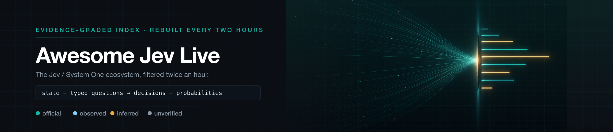
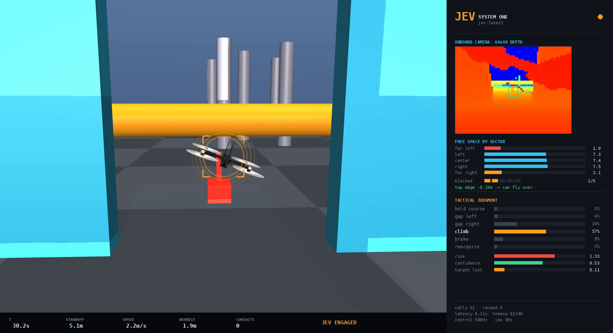
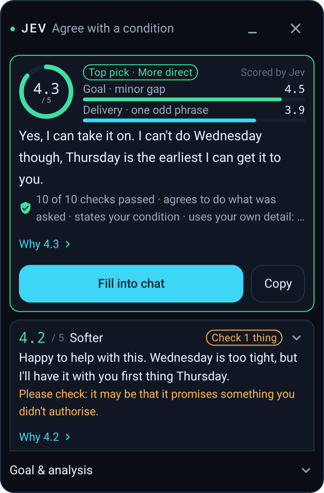
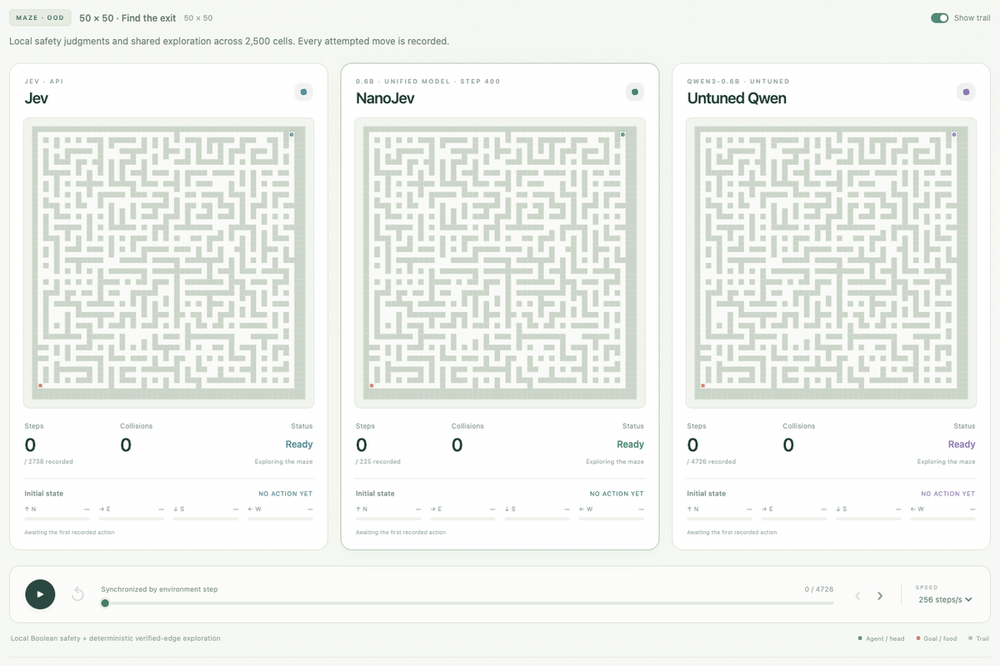
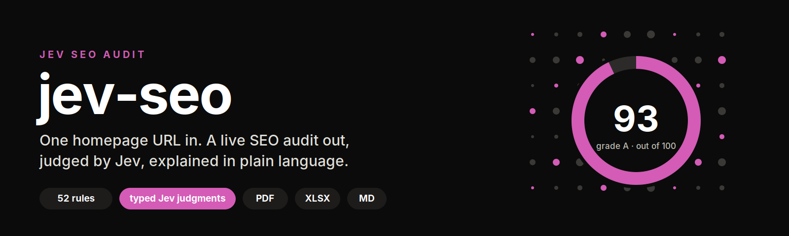
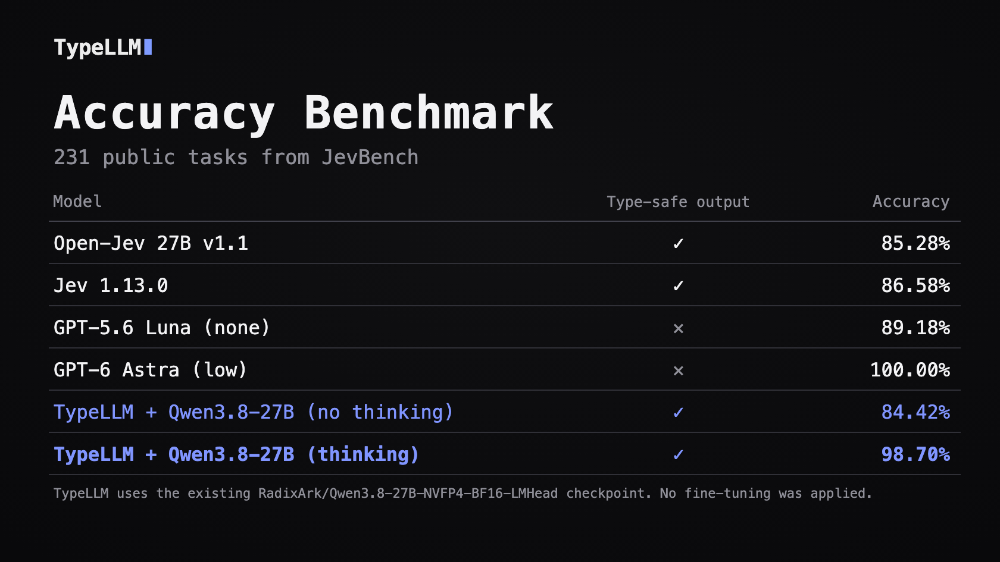

  

<h1 align="center">Awesome Jev Live</h1>

<b>ดัชนี Jev ที่จัดเกรดตามหลักฐาน และสร้างตัวเองใหม่ทุกสองชั่วโมง</b>

  
  
  
  
  
  

<a href="../README.md">English</a> · <a href="README.zh-CN.md">简体中文</a> · <a href="README.zh-TW.md">繁體中文</a> · <a href="README.ja.md">日本語</a> · <a href="README.ko.md">한국어</a> · <a href="README.es.md">Español</a> · <a href="README.fr.md">Français</a> · <a href="README.de.md">Deutsch</a> · <a href="README.pt-BR.md">Português (Brasil)</a> · <a href="README.ru.md">Русский</a> · <a href="README.it.md">Italiano</a> · <a href="README.ar.md">العربية</a> · <a href="README.hi.md">हिन्दी</a> · <a href="README.tr.md">Türkçe</a> · <a href="README.vi.md">Tiếng Việt</a> · <b>ไทย</b> · <a href="README.id.md">Bahasa Indonesia</a> · <a href="README.pl.md">Polski</a> · <a href="README.nl.md">Nederlands</a> · <a href="README.uk.md">Українська</a>

> [!NOTE]
> **ดัชนีสด** · ซิงค์ล่าสุด: `2026-11-18T16:46:38+08:00` (UTC+8)
> · รายการ: **820** · ใหม่ในรอบนี้: **6** · ภาษาที่ใช้พัฒนา: **25**

ทุกรายการด้านล่างถูกรวบรวม กรอง และตรวจซ้ำโดยไปป์ไลน์ในรีโพซิทอรีนี้ ตัวเลขและเวลาประทับมาจากแหล่งข้อมูล ไม่ใช่จากสแนปช็อตที่เขียนด้วยมือ

## 🔥 ตัวเลือกขณะนี้ — อันดับหนึ่งของแต่ละหมวด

หมวดละหนึ่งรายการ จัดอันดับตามระดับหลักฐานและจำนวนดาว คำนวณใหม่ทุกครั้งที่ซิงค์ นี่คือการจัดอันดับ ไม่ใช่การแนะนำ และแต่ละรายการลิงก์ไปยังการ์ดเต็มด้านล่าง ให้ความสำคัญกับโปรเจกต์ที่เผยแพร่ภาพหน้าจอหรือบันทึกหน้าจอ เพื่อให้แถบนี้ยังดูเป็นภาพ

<table>
<tr>
<td width="50%" valign="top">
<b>🏛️ <a href="https://github.com/typesafe-ai/skills">typesafe-ai/skills</a></b>
⭐2905 · ✅ official
ทักษะของเอเจนต์สำหรับการสร้างด้วย TypeSafe System One API
</td>
<td width="50%" valign="top">

<b>🧰 <a href="https://github.com/john-rocky/coreai-kit">john-rocky/coreai-kit</a></b>
⭐126 · Swift · 👁️ observed
Swift SDK สำหรับการรันโมเดลแชต วิชัน และเสียงบน iPhone และ Mac ด้วย Core AI ของ Apple การดาวน์โหลดและแคชโมเดล การผสานรวม FoundationModels…
</td>
</tr>
<tr>
<td width="50%" valign="top">

<b>🤖 <a href="https://github.com/gargpratyush/jev-router">gargpratyush/jev-router</a></b>
⭐670 · JavaScript · 🔎 inferred
กำหนดเส้นทางไปยังโมเดลที่ถูกที่สุดใน claude code สำหรับงานของคุณโดยใช้ jev-router
</td>
<td width="50%" valign="top">

<b>🛡️ <a href="https://github.com/dharmeshgurnani/codeotter">dharmeshgurnani/codeotter</a></b>
⭐3 · TypeScript · 👁️ observed
การตรวจสอบโค้ด AI แบบอัตโนมัติและโฮสต์เอง เกจให้คะแนนที่ผ่านการปรับเทียบ และด่านควบคุมการผสานโค้ดจากโมเดลเปิดใด ๆ
</td>
</tr>
<tr>
<td width="50%" valign="top">

<b>🧪 <a href="https://github.com/Mapika/decider">Mapika/decider</a></b>
⭐1056 · Python · 👁️ observed
ตระกูลโมเดลสไตล์ System One ที่ปรับแต่งละเอียดจาก Qwen3.5 ออกแบบมาสำหรับการตัดสินใจแบบมีชนิดในครั้งเดียวพร้อมความน่าจะเป็นที่ปรับเทียบแล้ว
</td>
<td width="50%" valign="top">

<b>🔬 <a href="https://github.com/r-ms/mini-jev">r-ms/mini-jev</a></b>
⭐64 · Python · 🔎 inferred
mini-Jev: อินเทอร์เฟซการตัดสินใจแบบมีชนิดข้อมูลสไตล์ Jev มีหน้าตาเป็นอย่างไรบน Qwen3-4B ที่ถูกแช่แข็ง — อ่านค่า logits ของตัวอักษรตัวเลือกแทนการสร้าง JSON…
</td>
</tr>
<tr>
<td width="50%" valign="top">

<b>🎮 <a href="https://github.com/MCG-NJU/VideoJev">MCG-NJU/VideoJev</a></b>
⭐313 · Python · 👁️ observed
VideoJev: System One Model สำหรับการทำความเข้าใจและการโต้ตอบกับวิดีโอ
</td>
<td width="50%" valign="top">
<b>📰 <a href="https://docs.typesafe.ai/model-jaggedness/jev-1.13">ข้อบกพร่องที่ทราบ 9 ประเภท (jaggedness)</a></b>
⭐0 · ✅ official
ความเข้าใจตามตัวอักษร, **การนับไม่น่าเชื่อถือ**, การเปรียบเทียบวันที่, การอ้อมหลายระดับ, state ขนาดใหญ่จากรายละเอียดที่ไม่เกี่ยวข้อง, เนื้อหาเชิง adversarial,…
</td>
</tr>
</table>

## สารบัญ

- [Jev คืออะไร?](#jev-คออะไร)
- [การจัดเกรดรายการ](#การจดเกรดรายการ)
- [SDK ทางการและเครื่องมือสำหรับนักพัฒนา](#sdk-ทางการและเครองมอสำหรบนกพฒนา) — **7**
- [ไคลเอนต์ SDK และอะแดปเตอร์จากชุมชน](#ไคลเอนต-sdk-และอะแดปเตอรจากชมชน) — **145**
- [เครื่องมือสำหรับเอเจนต์: MCP ฮุก เกต และเอเจนต์เขียนโค้ด](#เครองมอสำหรบเอเจนต-mcp-ฮก-เกต-และเอเจนตเขยนโคด) — **251**
- [การจัดเส้นทาง การ์ดเรล และการอนุมัติ](#การจดเสนทาง-การดเรล-และการอนมต) — **61**
- [การประเมิน การคาลิเบรต และเบนช์มาร์ก](#การประเมน-การคาลเบรต-และเบนชมารก) — **88**
- [งานจำลองแบบเปิด เวต และงานวิจัยสถาปัตยกรรม](#งานจำลองแบบเปด-เวต-และงานวจยสถาปตยกรรม) — **66**
- [แอปพลิเคชัน เกม หุ่นยนต์ และเดโมแบบโต้ตอบ](#แอปพลเคชน-เกม-หนยนต-และเดโมแบบโตตอบ) — **46**
- [บทความ การสนทนา และรายการที่เกี่ยวข้อง](#บทความ-การสนทนา-และรายการทเกยวของ) — **75**
- [โครงการอื่น ๆ](#โครงการอน-ๆ) — **81**
- [โปรเจกต์ตามภาษาที่ใช้พัฒนา](#โปรเจกตตามภาษาทใชพฒนา)

## Jev คืออะไร?

Jev คือ **System One model** ตัวแรกของ TypeSafe AI มันไม่เขียนข้อความบรรยาย แต่รับสถานะพร้อมคำถามที่คุณกำหนดชุดคำตอบไว้ล่วงหน้า แล้วคืนค่าแบบมีชนิดพร้อมการแจกแจงความน่าจะเป็นที่โค้ดของคุณใช้แยกทางได้

|                   |                                                                                                                                                               |
| ----------------- | ------------------------------------------------------------------------------------------------------------------------------------------------------------- |
| **รูปแบบ**         | `state + typed questions` → `constrained answers + probabilities` → `your code`                                                                               |
| **พื้นฐาน**        | `Choice` (เลือกหนึ่งในไม่เกิน 255 ตัวเลือก), `Score` (รูบริก 2–10), `Noul` (ใช่/ไม่ใช่ เชิงความน่าจะเป็น)                                                            |
| **เอนด์พอยต์**    | `POST https://api.typesafe.ai/v1/systemone`, โมเดล `jev-1.13.0` / นามแฝง `jev-latest`                                                                         |
| **เหมาะกับ**      | การจัดเส้นทาง การคัดแยก การให้คะแนน การกลั่นกรอง การตรวจสอบ และเกตความหน่วงต่ำภายในเวิร์กโฟลว์ที่มีขอบเขต                                                           |
| **ข้อจำกัดที่ทราบ** | การนับไม่น่าเชื่อถือ การอ้างอิงหลายชั้นยังอ่อน และเอกสารทางการระบุความขรุขระไว้เก้าประเภท เอาต์พุตที่ถูกต้องตามสคีมาไม่เท่ากับการตัดสินใจที่ถูกต้อง — ควรคาลิเบรตกับข้อมูลของคุณเอง |

## การจัดเกรดรายการ

รายการส่วนใหญ่ในสายนี้อ้างว่าทุกรายการถูกรวมไว้ ที่นี่บอกว่าตรวจสอบได้จริงมากแค่ไหน แล้วให้คุณกรองตามนั้น

| เกรด         | ความหมาย                                                                                                            |
| ------------ | ------------------------------------------------------------------------------------------------------------------- |
| `official`   | เผยแพร่โดย TypeSafe AI เอง                                                                                           |
| `observed`   | ชิ้นงานสาธารณะที่เปิดอ่านได้ — ซอร์สโค้ดจริง คอนฟิกจริง หรือการประกาศ TypeSafe/Jev อย่างชัดเจนในชื่อหรือหัวข้อของรีโพซิทอรี |
| `inferred`   | จับคู่ได้จากสัญญาณที่คลุมเครือบวกคำศัพท์ที่สอดคล้องกัน แต่ยังไม่ได้อ่านทีละบรรทัด                                              |
| `unverified` | ดูเกี่ยวข้อง แต่ยังไม่มีอะไรยืนยันได้อย่างอิสระ ขึ้นรายการไว้เพื่อการค้นพบเท่านั้น                                               |

## SDK ทางการและเครื่องมือสำหรับนักพัฒนา

ทุกอย่างที่ TypeSafe เผยแพร่เอง เริ่มจากตรงนี้

🏛️ <b><a href="https://github.com/typesafe-ai/skills">typesafe-ai/skills</a></b> · ⭐2905 · ✅ official · 25 天

##### 📝 สรุป

ทักษะของเอเจนต์สำหรับการสร้างด้วย TypeSafe System One API

> 💡 ทักษะเอเจนต์ของผู้จำหน่ายเอง เนื่องจากมีการอัปเดตอย่างต่อเนื่อง จึงเป็นสิ่งที่ใกล้เคียงกับข้อกำหนดมากที่สุดสำหรับวิธีที่ TypeSafe ตั้งใจให้ขับเคลื่อน Jev จากเอเจนต์

##### 📌 ข้อมูลพื้นฐาน

| ฟิลด์   | ค่า                                     |
| ------- | -------------------------------------- |
| หมวดหมู่  | `SDK ทางการและเครื่องมือสำหรับนักพัฒนา` |
| หลักฐาน | `official`                             |

##### 📊 ข้อมูล

| ตัวชี้วัด         | ค่า         |
| ---------------- | ---------- |
| ดาว              | **2905**   |
| push ล่าสุด        | 2026-10-23 |
| ขึ้นรายการครั้งแรก | 2026-09-18 |

🏛️ <b><a href="https://github.com/typesafe-ai/system-one-adapter-python">typesafe-ai/system-one-adapter-python</a></b> · ⭐410 · Python · ✅ official · 3 天

##### 📝 สรุป

ตัวทดแทน TypeSafeClient แบบเสียบใช้งานได้ทันที ซึ่งทำงานบน LLM APIs

> 💡 ตัวทดแทนแบบเสียบใช้งานได้ทันทีที่ใช้ provider LLM ธรรมดากับอินเทอร์เฟซเดียวกัน นี่คือวิธีที่ตรงไปตรงมาในการ A/B เปรียบเทียบการตัดสินใจแบบมีชนิดกับพรอมต์บนข้อมูลของคุณเอง ก่อนตัดสินใจเลือกอย่างใดอย่างหนึ่ง

🔧 พบการใช้งานในโค้ด: `README.md`

##### 📌 ข้อมูลพื้นฐาน

| ฟิลด์   | ค่า                                     |
| ------- | -------------------------------------- |
| หมวดหมู่  | `SDK ทางการและเครื่องมือสำหรับนักพัฒนา` |
| หลักฐาน | `official`                             |
| ภาษา    | Python                                 |

##### 📊 ข้อมูล

| ตัวชี้วัด         | ค่า         |
| ---------------- | ---------- |
| ดาว              | **410**    |
| push ล่าสุด        | 2026-11-15 |
| ขึ้นรายการครั้งแรก | 2026-10-23 |

🏛️ <b><a href="https://github.com/typesafe-ai/typesafe-sdk-python">typesafe-ai/typesafe-sdk-python</a></b> · ⭐315 · Python · ✅ official · 7 天

##### 📝 สรุป

ไลบรารี Python อย่างเป็นทางการสำหรับ TypeSafe API

> 💡 ไคลเอนต์แบบซิงโครนัสและอะซิงโครนัส เส้นทางที่เร็วที่สุดจากคีย์ API ไปสู่การตัดสินใจแบบมีชนิด และเป็นข้อมูลอ้างอิงที่ใช้เปรียบเทียบไคลเอนต์จากชุมชน

🔧 พบการใช้งานในโค้ด: `README.md`

##### 📌 ข้อมูลพื้นฐาน

| ฟิลด์   | ค่า                                     |
| ------- | -------------------------------------- |
| หมวดหมู่  | `SDK ทางการและเครื่องมือสำหรับนักพัฒนา` |
| หลักฐาน | `official`                             |
| ภาษา    | Python                                 |

##### 📊 ข้อมูล

| ตัวชี้วัด         | ค่า         |
| ---------------- | ---------- |
| ดาว              | **315**    |
| push ล่าสุด        | 2026-11-11 |
| ขึ้นรายการครั้งแรก | 2026-10-23 |

🏛️ <b><a href="https://github.com/typesafe-ai/typesafe-sdk-js">typesafe-ai/typesafe-sdk-js</a></b> · ⭐287 · TypeScript · ✅ official · 7 天

##### 📝 สรุป

ไลบรารี TypeScript/JavaScript อย่างเป็นทางการสำหรับ TypeSafe API

> 💡 ไคลเอนต์ TypeScript ที่อนุมานชนิดคำตอบจากคำถามที่คุณถาม ดังนั้นชนิดผลลัพธ์ที่ไม่ตรงกันจะเป็นข้อผิดพลาดขณะคอมไพล์แทนที่จะเป็นเรื่องไม่คาดคิดขณะรันไทม์

##### 📌 ข้อมูลพื้นฐาน

| ฟิลด์   | ค่า                                     |
| ------- | -------------------------------------- |
| หมวดหมู่  | `SDK ทางการและเครื่องมือสำหรับนักพัฒนา` |
| หลักฐาน | `official`                             |
| ภาษา    | TypeScript                             |

##### 📊 ข้อมูล

| ตัวชี้วัด         | ค่า         |
| ---------------- | ---------- |
| ดาว              | **287**    |
| push ล่าสุด        | 2026-11-11 |
| ขึ้นรายการครั้งแรก | 2026-10-23 |

🏛️ <b><a href="https://github.com/TypeSafeAI/jev-harness">TypeSafeAI/jev-harness</a></b> · ⭐40 · TypeScript · ✅ official · 1 天

##### 📝 สรุป

A custom coding harness for TypeSafe AI's Jev: an LLM proposes, Jev answers narrow questions, code decides, every step leaves a receipt.

##### 📌 ข้อมูลพื้นฐาน

| ฟิลด์   | ค่า                                     |
| ------- | -------------------------------------- |
| หมวดหมู่  | `SDK ทางการและเครื่องมือสำหรับนักพัฒนา` |
| หลักฐาน | `official`                             |
| ภาษา    | TypeScript                             |

##### 📊 ข้อมูล

| ตัวชี้วัด         | ค่า         |
| ---------------- | ---------- |
| ดาว              | **40**     |
| push ล่าสุด        | 2026-11-17 |
| ขึ้นรายการครั้งแรก | 2026-11-18 |

🏷 `agent-harness` · `agentic-coding` · `ai-agents` · `ai-governance` · `ai-safety` · `code-review` · `coding-agent` · `developer-tools`

🏛️ <b><a href="https://github.com/typesafe-ai/WorkflowEvals">typesafe-ai/WorkflowEvals</a></b> · ⭐21 · Python · ✅ official · 4 天

##### 📝 สรุป

เผยแพร่โค้ดเวิร์กโฟลว์ evals.typesafe.ai

##### 📌 ข้อมูลพื้นฐาน

| ฟิลด์   | ค่า                                     |
| ------- | -------------------------------------- |
| หมวดหมู่  | `SDK ทางการและเครื่องมือสำหรับนักพัฒนา` |
| หลักฐาน | `official`                             |
| ภาษา    | Python                                 |

##### 📊 ข้อมูล

| ตัวชี้วัด         | ค่า         |
| ---------------- | ---------- |
| ดาว              | **21**     |
| push ล่าสุด        | 2026-11-14 |
| ขึ้นรายการครั้งแรก | 2026-10-23 |

🏛️ <b><a href="https://github.com/typesafe-ai/typesafe-ai.github.io">typesafe-ai/typesafe-ai.github.io</a></b> · ⭐2 · HTML · ✅ official · 166 天

##### 📝 สรุป

ต้นทางไม่ได้เผยแพร่คำอธิบาย

##### 📌 ข้อมูลพื้นฐาน

| ฟิลด์   | ค่า                                     |
| ------- | -------------------------------------- |
| หมวดหมู่  | `SDK ทางการและเครื่องมือสำหรับนักพัฒนา` |
| หลักฐาน | `official`                             |
| ภาษา    | HTML                                   |

##### 📊 ข้อมูล

| ตัวชี้วัด         | ค่า         |
| ---------------- | ---------- |
| ดาว              | **2**      |
| push ล่าสุด        | 2026-06-04 |
| ขึ้นรายการครั้งแรก | 2026-10-23 |

## ไคลเอนต์ SDK และอะแดปเตอร์จากชุมชน

ไคลเอนต์แบบมีชนิดสำหรับเอนด์พอยต์ System One ครอบคลุมภาษาต่าง ๆ เท่าที่ชุมชนทำไปถึง

🧰 <b><a href="https://github.com/ollaya-dev/ollaya">ollaya-dev/ollaya</a></b> · ⭐1471 · Rust · 👁️ observed · 7 天

##### 📝 สรุป

Jev-compatible API server for open decision models. Ollama for decision models: pull and serve 29 model families (Laya, pplx-decider, Clef, Winnow, coba...) locally or self-hosted behind /v1/systemone. The TypeSafe SDK works unchanged: set its base URL and pick an open model. CLI, desktop app, Docker, MCP server, public bench.

🔧 พบการใช้งานในโค้ด: `README.md`, `docs/api.md`

##### 📌 ข้อมูลพื้นฐาน

| ฟิลด์   | ค่า                                  |
| ------- | ----------------------------------- |
| หมวดหมู่  | `ไคลเอนต์ SDK และอะแดปเตอร์จากชุมชน` |
| หลักฐาน | `observed`                          |
| ภาษา    | Rust                                |

##### 📊 ข้อมูล

| ตัวชี้วัด         | ค่า         |
| ---------------- | ---------- |
| ดาว              | **1471**   |
| push ล่าสุด        | 2026-11-10 |
| ขึ้นรายการครั้งแรก | 2026-09-25 |

🏷 `calibration` · `decision-model` · `decision-models` · `inference-server` · `jev` · `jev-alternative` · `jev-compatible` · `laya`

🧰 <b><a href="https://github.com/realZachi/pg-jev">realZachi/pg-jev</a></b> · ⭐1313 · Shell · 👁️ observed · 42 天

##### 📝 สรุป

ถามคำถามเกี่ยวกับตาราง Postgres ของคุณด้วยภาษาธรรมดา ส่วนขยาย PostgreSQL ที่ขับเคลื่อนโดย Jev ของ TypeSafe

🔧 พบการใช้งานในโค้ด: `README.md`

##### 📌 ข้อมูลพื้นฐาน

| ฟิลด์   | ค่า                                  |
| ------- | ----------------------------------- |
| หมวดหมู่  | `ไคลเอนต์ SDK และอะแดปเตอร์จากชุมชน` |
| หลักฐาน | `observed`                          |
| ภาษา    | Shell                               |

##### 📊 ข้อมูล

| ตัวชี้วัด         | ค่า         |
| ---------------- | ---------- |
| ดาว              | **1313**   |
| push ล่าสุด        | 2026-10-06 |
| ขึ้นรายการครั้งแรก | 2026-10-29 |

🧰 <b><a href="https://github.com/jexp/neo4jev">jexp/neo4jev</a></b> · ⭐189 · Jupyter · 👁️ observed · 60 天

##### 📝 สรุป

Typesafe.ai System One Model Jev ที่นำทางกราฟ Neo4j โดยใช้ตัวจัดประเภทบนความสัมพันธ์กับโหนดข้างเคียง

##### 📌 ข้อมูลพื้นฐาน

| ฟิลด์   | ค่า                                  |
| ------- | ----------------------------------- |
| หมวดหมู่  | `ไคลเอนต์ SDK และอะแดปเตอร์จากชุมชน` |
| หลักฐาน | `observed`                          |
| ภาษา    | Jupyter                             |

##### 📊 ข้อมูล

| ตัวชี้วัด         | ค่า         |
| ---------------- | ---------- |
| ดาว              | **189**    |
| push ล่าสุด        | 2026-09-18 |
| ขึ้นรายการครั้งแรก | 2026-10-28 |

🧰 <b><a href="https://github.com/john-rocky/coreai-kit">john-rocky/coreai-kit</a></b> · ⭐126 · Swift · 👁️ observed · 2 天

##### 📝 สรุป

Swift SDK สำหรับการรันโมเดลแชต วิชัน และเสียงบน iPhone และ Mac ด้วย Core AI ของ Apple การดาวน์โหลดและแคชโมเดล การผสานรวม FoundationModels และตัวอย่างที่รันได้พร้อมข้อกำหนดด้าน OS, SDK และโมเดลที่มีเอกสารประกอบ

🔧 พบการใช้งานในโค้ด: `Sources/CoreAIOps/CoreAI+SystemOne.swift`

##### 📌 ข้อมูลพื้นฐาน

| ฟิลด์   | ค่า                                  |
| ------- | ----------------------------------- |
| หมวดหมู่  | `ไคลเอนต์ SDK และอะแดปเตอร์จากชุมชน` |
| หลักฐาน | `observed`                          |
| ภาษา    | Swift                               |

##### 📊 ข้อมูล

| ตัวชี้วัด         | ค่า         |
| ---------------- | ---------- |
| ดาว              | **126**    |
| push ล่าสุด        | 2026-11-16 |
| ขึ้นรายการครั้งแรก | 2026-10-26 |

🏷 `apple` · `apple-core-ai` · `asr` · `core-ai` · `coreai` · `foundation-models` · `ios` · `ios-27`

---

<table><tr><th align="center" width="50%">🖼 รูปภาพ</th><th align="center" width="50%">🎬 วิดีโอ</th></tr><tr>
<td align="center" valign="top"></td>
<td align="center" valign="top"> บันทึกแบบเคลื่อนไหว</td>
</tr></table>

🧰 <b><a href="https://github.com/AkashPriyadarshii/jev-curate">AkashPriyadarshii/jev-curate</a></b> · ⭐113 · Rust · 👁️ observed · 6 天

##### 📝 สรุป

High-throughput synthetic and pretraining dataset sifter for TypeSafe Jev. Rust streaming core, Parquet and JSONL I/O, typed Choice/Score/Noul judgments, speculative fan-out, 24.0 rows/sec measured.

🔧 พบการใช้งานในโค้ด: `AGENTS.md`, `site/llms.txt`, `docs/DESIGN.md`

##### 📌 ข้อมูลพื้นฐาน

| ฟิลด์   | ค่า                                  |
| ------- | ----------------------------------- |
| หมวดหมู่  | `ไคลเอนต์ SDK และอะแดปเตอร์จากชุมชน` |
| หลักฐาน | `observed`                          |
| ภาษา    | Rust                                |

##### 📊 ข้อมูล

| ตัวชี้วัด         | ค่า         |
| ---------------- | ---------- |
| ดาว              | **113**    |
| push ล่าสุด        | 2026-11-11 |
| ขึ้นรายการครั้งแรก | 2026-11-05 |

🏷 `arrow` · `cli` · `data-cleaning` · `data-engineering` · `dataset-curation` · `eval-harness` · `fine-tuning` · `jev`

🧰 <b><a href="https://github.com/obie/ruby_decision_model">obie/ruby_decision_model</a></b> · ⭐60 · Ruby · 👁️ observed · 36 天

##### 📝 สรุป

ไคลเอนต์ Ruby สำหรับโมเดลการตัดสินใจ เช่น Typesafe Jev

🔧 พบการใช้งานในโค้ด: `README.md`

##### 📌 ข้อมูลพื้นฐาน

| ฟิลด์   | ค่า                                  |
| ------- | ----------------------------------- |
| หมวดหมู่  | `ไคลเอนต์ SDK และอะแดปเตอร์จากชุมชน` |
| หลักฐาน | `observed`                          |
| ภาษา    | Ruby                                |

##### 📊 ข้อมูล

| ตัวชี้วัด         | ค่า         |
| ---------------- | ---------- |
| ดาว              | **60**     |
| push ล่าสุด        | 2026-10-12 |
| ขึ้นรายการครั้งแรก | 2026-10-29 |

🧰 <b><a href="https://github.com/bodepudimuneendra-netizen/ConsciousDB">bodepudimuneendra-netizen/ConsciousDB</a></b> · ⭐56 · Python · 👁️ observed · 15 天

##### 📝 สรุป

เฟรมเวิร์ก Agentic GraphRAG ที่ไม่ขึ้นกับฐานข้อมูล โดยใช้โมเดล System One ที่สับเปลี่ยนได้ (Laya ภายในเครื่อง / Jev บนคลาวด์) ชั้นข่าวกรองแบบเสียบแล้วใช้งานได้ทันทีที่ประกอบด้วยไปป์ไลน์ครบ 4 ระยะ การประเมินผลอย่างต่อเนื่อง และการสำรวจแบบ A* ที่กำหนดเองสำหรับฐานข้อมูลกราฟใด ๆ

##### 📌 ข้อมูลพื้นฐาน

| ฟิลด์   | ค่า                                  |
| ------- | ----------------------------------- |
| หมวดหมู่  | `ไคลเอนต์ SDK และอะแดปเตอร์จากชุมชน` |
| หลักฐาน | `observed`                          |
| ภาษา    | Python                              |

##### 📊 ข้อมูล

| ตัวชี้วัด         | ค่า         |
| ---------------- | ---------- |
| ดาว              | **56**     |
| push ล่าสุด        | 2026-11-02 |
| ขึ้นรายการครั้งแรก | 2026-11-02 |

🏷 `astar-algorithm` · `eval-harness` · `fine-tuning` · `graphdatabase` · `graprag` · `jev` · `laya` · `neo4j`

🧰 <b><a href="https://github.com/AkashPriyadarshii/jev-superpowers">AkashPriyadarshii/jev-superpowers</a></b> · ⭐39 · HTML · 👁️ observed · 40 天

##### 📝 สรุป

Systematic software development framework for AI coding agents upgraded with TypeSafe Jev System One typed decisions

🔧 พบการใช้งานในโค้ด: `CLAUDE.md`

##### 📌 ข้อมูลพื้นฐาน

| ฟิลด์   | ค่า                                  |
| ------- | ----------------------------------- |
| หมวดหมู่  | `ไคลเอนต์ SDK และอะแดปเตอร์จากชุมชน` |
| หลักฐาน | `observed`                          |
| ภาษา    | HTML                                |

##### 📊 ข้อมูล

| ตัวชี้วัด         | ค่า         |
| ---------------- | ---------- |
| ดาว              | **39**     |
| push ล่าสุด        | 2026-10-08 |
| ขึ้นรายการครั้งแรก | 2026-11-05 |

🏷 `agentic-skills` · `ai-agents` · `antigravity` · `claude-code` · `codex` · `coding-agents` · `cursor` · `developer-tools`

🧰 <b><a href="https://github.com/MrJev/awesome-jev">MrJev/awesome-jev</a></b> · ⭐21 · Python · 👁️ observed · 0 天

##### 📝 สรุป

รายการคัดสรรของโปรเจกต์ การผสานรวม และทรัพยากรสำหรับ Jev ซึ่งเป็นโมเดล System One ของ TypeSafe AI

##### 📌 ข้อมูลพื้นฐาน

| ฟิลด์   | ค่า                                  |
| ------- | ----------------------------------- |
| หมวดหมู่  | `ไคลเอนต์ SDK และอะแดปเตอร์จากชุมชน` |
| หลักฐาน | `observed`                          |
| ภาษา    | Python                              |

##### 📊 ข้อมูล

| ตัวชี้วัด         | ค่า         |
| ---------------- | ---------- |
| ดาว              | **21**     |
| push ล่าสุด        | 2026-11-17 |
| ขึ้นรายการครั้งแรก | 2026-09-18 |

🏷 `ai-agents` · `awesome` · `awesome-list` · `jev` · `mcp` · `typesafe`

🧰 <b><a href="https://github.com/ckaraca/awesome-jev">ckaraca/awesome-jev</a></b> · ⭐18 · Python · 👁️ observed · 1 天

##### 📝 สรุป

รายการคัดสรรเครื่องมือ การผสานรวม และการทดลองที่สร้างบน Jev ซึ่งเป็นโมเดล System One ของ TypeSafe AI สำหรับการตัดสินใจที่รวดเร็วและมีชนิดข้อมูล

##### 📌 ข้อมูลพื้นฐาน

| ฟิลด์   | ค่า                                  |
| ------- | ----------------------------------- |
| หมวดหมู่  | `ไคลเอนต์ SDK และอะแดปเตอร์จากชุมชน` |
| หลักฐาน | `observed`                          |
| ภาษา    | Python                              |

##### 📊 ข้อมูล

| ตัวชี้วัด         | ค่า         |
| ---------------- | ---------- |
| ดาว              | **18**     |
| push ล่าสุด        | 2026-11-16 |
| ขึ้นรายการครั้งแรก | 2026-09-19 |

🏷 `ai-agents` · `awesome` · `awesome-list` · `computer-use` · `jev` · `llm` · `system-one` · `typesafe`

🧰 <b><a href="https://github.com/Premo-Cloud/typesafe-sdk-java">Premo-Cloud/typesafe-sdk-java</a></b> · ⭐12 · Java · 👁️ observed · 27 天

##### 📝 สรุป

Java SDK ของชุมชนสำหรับ Jev โมเดล System One ของ TypeSafe: ป้อนคำถามแบบมีชนิด รับคำตอบแบบมีชนิดพร้อมความน่าจะเป็นที่ปรับเทียบแล้ว Java 17+, Spring Boot starter (ไม่เป็นทางการ)

##### 📌 ข้อมูลพื้นฐาน

| ฟิลด์   | ค่า                                  |
| ------- | ----------------------------------- |
| หมวดหมู่  | `ไคลเอนต์ SDK และอะแดปเตอร์จากชุมชน` |
| หลักฐาน | `observed`                          |
| ภาษา    | Java                                |

##### 📊 ข้อมูล

| ตัวชี้วัด         | ค่า         |
| ---------------- | ---------- |
| ดาว              | **12**     |
| push ล่าสุด        | 2026-10-21 |
| ขึ้นรายการครั้งแรก | 2026-10-28 |

🏷 `java` · `jev` · `sdk` · `spring-boot` · `system-one` · `system-one-models` · `typesafe`

🧰 <b><a href="https://github.com/PromtEngineer/jev-harness">PromtEngineer/jev-harness</a></b> · ⭐9 · Python · 👁️ observed · 54 天

##### 📝 สรุป

ชุดเครื่องมือเอเจนต์ Pi ที่สร้างขึ้นรอบ TypeSafe's Jev (โมเดล System One): เราเตอร์ ตัวเลือกบริบท เกต และตัวตรวจสอบ ทดสอบบนบรานช์ Neon Postgres

##### 📌 ข้อมูลพื้นฐาน

| ฟิลด์   | ค่า                                  |
| ------- | ----------------------------------- |
| หมวดหมู่  | `ไคลเอนต์ SDK และอะแดปเตอร์จากชุมชน` |
| หลักฐาน | `observed`                          |
| ภาษา    | Python                              |

##### 📊 ข้อมูล

| ตัวชี้วัด         | ค่า         |
| ---------------- | ---------- |
| ดาว              | **9**      |
| push ล่าสุด        | 2026-09-24 |
| ขึ้นรายการครั้งแรก | 2026-10-28 |

🧰 <b><a href="https://github.com/clouatre-labs/decisions-judge-mcp">clouatre-labs/decisions-judge-mcp</a></b> · ⭐5 · JavaScript · 👁️ observed · 0 天

##### 📝 สรุป

การตัดสินแบบมีชนิดสำหรับ AI agents ในฐานะเครื่องมือ MCP: ความน่าจะเป็น yes/no (noul), choice และ score ในคำขอที่รวดเร็วครั้งเดียว รองรับโดยโมเดล TypeSafe System One

##### 📌 ข้อมูลพื้นฐาน

| ฟิลด์   | ค่า                                  |
| ------- | ----------------------------------- |
| หมวดหมู่  | `ไคลเอนต์ SDK และอะแดปเตอร์จากชุมชน` |
| หลักฐาน | `observed`                          |
| ภาษา    | JavaScript                          |

##### 📊 ข้อมูล

| ตัวชี้วัด         | ค่า         |
| ---------------- | ---------- |
| ดาว              | **5**      |
| push ล่าสุด        | 2026-11-17 |
| ขึ้นรายการครั้งแรก | 2026-10-12 |

🏷 `agent` · `ai` · `cli` · `decision-making` · `decisions` · `judge` · `llm` · `mcp`

---

<table><tr><th align="center" width="50%">🖼 รูปภาพ</th><th align="center" width="50%">🎬 วิดีโอ</th></tr><tr>
<td align="center" valign="top"></td>
<td align="center" valign="top"> บันทึกแบบเคลื่อนไหว</td>
</tr></table>

🧰 <b><a href="https://github.com/elbruno/ElBruno.AI.Decisions">elbruno/ElBruno.AI.Decisions</a></b> · ⭐5 · C# · 👁️ observed · 0 天

##### 📝 สรุป

.NET 10 decision SDK: Choose, Score, and Assess with Microsoft Foundry (Microsoft-Decision-1), native local Ollama System One models, and TypeSafe AI Jev. One API, probabilities instead of paragraphs.

##### 📌 ข้อมูลพื้นฐาน

| ฟิลด์   | ค่า                                  |
| ------- | ----------------------------------- |
| หมวดหมู่  | `ไคลเอนต์ SDK และอะแดปเตอร์จากชุมชน` |
| หลักฐาน | `observed`                          |
| ภาษา    | C#                                  |

##### 📊 ข้อมูล

| ตัวชี้วัด         | ค่า         |
| ---------------- | ---------- |
| ดาว              | **5**      |
| push ล่าสุด        | 2026-11-17 |
| ขึ้นรายการครั้งแรก | 2026-11-18 |

🏷 `dotnet` · `dotnet10` · `jev` · `microsoft-extensions-ai` · `nuget`

---

<table><tr><th align="center" width="50%">🖼 รูปภาพ</th><th align="center" width="50%">🎬 วิดีโอ</th></tr><tr>
<td align="center" valign="top"></td>
<td align="center" valign="top">ไม่มีสื่อที่เผยแพร่</td>
</tr></table>

🧰 <b><a href="https://github.com/Bonzokoles/36_chambers">Bonzokoles/36_chambers</a></b> · Python · 👁️ observed · 26 天

##### 📝 สรุป

เอนจินการดึงความรู้แบบสหพันธรัฐสำหรับเอเจนต์ AI กำหนดเส้นทางคำค้นข้ามแบ็กเอนด์เฉพาะทาง (FTS5, ChromaDB, กราฟ) ผ่านตัวประสานงานที่ให้รีจิสทรีเป็นศูนย์กลาง พร้อมการกำหนดเส้นทาง AI TypeSafe/Jev และการจัดอันดับหลักฐานใหม่ โดยค่าเริ่มต้นเป็นแบบอ่านอย่างเดียวและออกแบบให้มีการควบคุมความปลอดภัย

##### 📌 ข้อมูลพื้นฐาน

| ฟิลด์   | ค่า                                  |
| ------- | ----------------------------------- |
| หมวดหมู่  | `ไคลเอนต์ SDK และอะแดปเตอร์จากชุมชน` |
| หลักฐาน | `observed`                          |
| ภาษา    | Python                              |

##### 📊 ข้อมูล

| ตัวชี้วัด         | ค่า         |
| ---------------- | ---------- |
| ดาว              | **0**      |
| push ล่าสุด        | 2026-10-22 |
| ขึ้นรายการครั้งแรก | 2026-10-23 |

🏷 `ai-agents` · `ai-infrastructure` · `chromadb` · `embeddings` · `federated-search` · `fts5` · `information-retrieval` · `jev`

---

<table><tr><th align="center" width="50%">🖼 รูปภาพ</th><th align="center" width="50%">🎬 วิดีโอ</th></tr><tr>
<td align="center" valign="top"></td>
<td align="center" valign="top">ไม่มีสื่อที่เผยแพร่</td>
</tr></table>

ไฟล์ถูกดึงแบบฮอตลิงก์จากรีโพซิทอรีต้นทาง เนื่องจากไม่มีการประกาศสัญญาอนุญาตที่เอื้อต่อการเผยแพร่ต่อ

🧰 <b><a href="https://github.com/dzhng/jevgrep">dzhng/jevgrep</a></b> · ⭐3244 · TypeScript · 🔎 inferred · 5 天 · ⭐+1

##### 📝 สรุป

ค้นหาโค้ดด้วยการถามว่าโค้ดนั้นทำอะไร CLI สำหรับเอเจนต์เขียนโค้ดที่ใช้ Jev เพื่อค้นหาไฟล์ที่เกี่ยวข้องและบริบทของซอร์สโค้ด

##### 📌 ข้อมูลพื้นฐาน

| ฟิลด์   | ค่า                                  |
| ------- | ----------------------------------- |
| หมวดหมู่  | `ไคลเอนต์ SDK และอะแดปเตอร์จากชุมชน` |
| หลักฐาน | `inferred`                          |
| ภาษา    | TypeScript                          |

##### 📊 ข้อมูล

| ตัวชี้วัด         | ค่า            |
| ---------------- | ------------- |
| ดาว              | **3244** (+1) |
| push ล่าสุด        | 2026-11-12    |
| ขึ้นรายการครั้งแรก | 2026-11-07    |

🏷 `ai-sdk` · `claude-code` · `cli` · `code-search` · `codex` · `coding-agents` · `context-retrieval` · `developer-tools`

---

<table><tr><th align="center" width="50%">🖼 รูปภาพ</th><th align="center" width="50%">🎬 วิดีโอ</th></tr><tr>
<td align="center" valign="top"></td>
<td align="center" valign="top">ไม่มีสื่อที่เผยแพร่</td>
</tr></table>

🧰 <b><a href="https://github.com/supercorp-ai/supercov">supercorp-ai/supercov</a></b> · ⭐166 · Rust · 🔎 inferred · 4 天

##### 📝 สรุป

ความครอบคลุม ความปลอดภัย และคุณภาพโค้ดสำหรับเอเจนต์เขียนโค้ด

> 💡 ผลตัดสินคุณภาพโค้ดและความครอบคลุมที่สร้างเป็นการตัดสินใจแบบมีชนิดแทนร้อยแก้ว จึงสามารถใช้ผลลัพธ์ควบคุม pipeline ได้โดยตรง

##### 📌 ข้อมูลพื้นฐาน

| ฟิลด์   | ค่า                                  |
| ------- | ----------------------------------- |
| หมวดหมู่  | `ไคลเอนต์ SDK และอะแดปเตอร์จากชุมชน` |
| หลักฐาน | `inferred`                          |
| ภาษา    | Rust                                |

##### 📊 ข้อมูล

| ตัวชี้วัด         | ค่า         |
| ---------------- | ---------- |
| ดาว              | **166**    |
| push ล่าสุด        | 2026-11-13 |
| ขึ้นรายการครั้งแรก | 2026-10-23 |

🏷 `agent-skills` · `claude-code` · `code-coverage` · `code-quality` · `codex` · `coding-agents` · `coverage` · `gemini-cli-extension`

---

<table><tr><th align="center" width="50%">🖼 รูปภาพ</th><th align="center" width="50%">🎬 วิดีโอ</th></tr><tr>
<td align="center" valign="top"></td>
<td align="center" valign="top">ไม่มีสื่อที่เผยแพร่</td>
</tr></table>

🧰 <b><a href="https://github.com/AkashPriyadarshii/jev-seo">AkashPriyadarshii/jev-seo</a></b> · ⭐105 · Rust · 🔎 inferred · 6 天

##### 📝 สรุป

Free Rust SEO and GEO toolkit powered by TypeSafe Jev: 58-rule audits, site crawls, AI citation checks, rank drift, CI gates, 15-tool MCP. Zero cost.

##### 📌 ข้อมูลพื้นฐาน

| ฟิลด์   | ค่า                                  |
| ------- | ----------------------------------- |
| หมวดหมู่  | `ไคลเอนต์ SDK และอะแดปเตอร์จากชุมชน` |
| หลักฐาน | `inferred`                          |
| ภาษา    | Rust                                |

##### 📊 ข้อมูล

| ตัวชี้วัด         | ค่า         |
| ---------------- | ---------- |
| ดาว              | **105**    |
| push ล่าสุด        | 2026-11-11 |
| ขึ้นรายการครั้งแรก | 2026-11-05 |

🏷 `ahrefs-alternative` · `answer-engine-optimization` · `claude-code` · `cli` · `coding-agents` · `generative-engine-optimization` · `geo` · `jev`

---

<table><tr><th align="center" width="50%">🖼 รูปภาพ</th><th align="center" width="50%">🎬 วิดีโอ</th></tr><tr>
<td align="center" valign="top"></td>
<td align="center" valign="top">ไม่มีสื่อที่เผยแพร่</td>
</tr></table>

<b>เพิ่มเติมในหมวดนี้</b> · 127

- [Sur-Cai/macos-computer-use-kit](https://github.com/Sur-Cai/macos-computer-use-kit) - AX-first computer use for AI agents on macOS with optional Jev.
- [xingwudao/OpenJev](https://github.com/xingwudao/OpenJev) - OpenJev: System One สำหรับการตัดสินใจแบบอิสระที่ได้รับแรงบันดาลใจจาก Jev…
- [danieleteti/systemone-delphi](https://github.com/danieleteti/systemone-delphi) - Delphi client for System One models (Jev, tev1 and nimble on Ollama): ask typed…
- [GitHub30/OpenJev](https://github.com/GitHub30/OpenJev) - โมเดล System One แบบ open-weight (เข้ากันได้กับ Jev): การตัดสินใจ noul / choice…
- [chussenot/judgment](https://github.com/chussenot/judgment) - คำตัดสินที่มีชนิดข้อมูลและผ่านการปรับเทียบจากโมเดล System One…
- [CMaintz/jev-dotnet](https://github.com/CMaintz/jev-dotnet) - SDK อย่างไม่เป็นทางการบน .NET สำหรับโมเดล Jev System One ของ TypeSafe AI…
- [erik-hedstrom/loadout](https://github.com/erik-hedstrom/loadout) - เลือกโมเดล ทักษะ และเซิร์ฟเวอร์ MCP สำหรับแต่ละเซสชันของ coding-agent…
- [jqueryscript/awesome-jev](https://github.com/jqueryscript/awesome-jev) - A curated list of TypeSafe Jev resources, SDKs, agents, MCP servers…
- [chrismarchant/jev-router](https://github.com/chrismarchant/jev-router) - Agent- and harness-agnostic router that offloads parallel-workstream decisions…
- [CMaintz/jev-java](https://github.com/CMaintz/jev-java) - Java SDK อย่างไม่เป็นทางการสำหรับโมเดล System One Jev ของ TypeSafe AI การตัดสิน…
- [cogcloud-ai/cog-typesafe](https://github.com/cogcloud-ai/cog-typesafe) - TypeSafe.
- [gajaguar/typesafe-cli](https://github.com/gajaguar/typesafe-cli) - Unofficial command-line interface for TypeSafe AI System One models, on…
- [JosephHardy91/graph-composition-with-dLLMs](https://github.com/JosephHardy91/graph-composition-with-dLLMs) - A Graph-Compiled Specification RAG system built with **Dagster**, **PostgreSQL…
- [sanketmuchhala/jevgate](https://github.com/sanketmuchhala/jevgate) - Calibrated policy triage and institutional risk routing: a hybrid…
- [juspay/neurolink](https://github.com/juspay/neurolink) - ชั้นท่อของระบบประสาท AI…
- [aaddrick/building-with-typesafe-jev](https://github.com/aaddrick/building-with-typesafe-jev) - ทักษะอย่างไม่เป็นทางการที่สอนเอเจนต์เขียนโค้ดให้สร้างด้วย TypeSafe AI Jev…
- [keltokhy/jgrep](https://github.com/keltokhy/jgrep) - grep แต่รูปแบบคือคำอธิบาย กรองบรรทัดตามความหมายด้วยโมเดลการตัดสินใจ Jev ของ…
- [Ying-Kai-Liao/jev-browser](https://github.com/Ying-Kai-Liao/jev-browser) - ระบบอัตโนมัติเบราว์เซอร์ที่มี LLM เป็นผู้วางแผน และ Jev (Typesafe System One)…
- [qkal/Canny](https://github.com/qkal/Canny) - หยุดเอเจนต์เขียนโค้ด AI ไม่ให้กล่าวอ้างว่างานเสร็จโดยไม่มีหลักฐาน…
- [fazlerocks/jevmail](https://github.com/fazlerocks/jevmail) - ระบบคัดแยกอีเมล AI แบบโอเพนซอร์สสำหรับ Gmail จัดกล่องจดหมายของคุณเป็น…
- [yzfly/awesome-jev-zh](https://github.com/yzfly/awesome-jev-zh) - รายการคัดสรรภาษาจีนของ Jev / TypeSafe System One…
- [AboveColin/HA-Jev](https://github.com/AboveColin/HA-Jev) - ถามคำถามกับบ้านของคุณ แล้วรับตัวเลขกลับมา การผสานรวม Home Assistant สำหรับ…
- [sharziki/semdecide](https://github.com/sharziki/semdecide) - การตัดสินใจเชิงความหมายแบบมีชนิดสำหรับไปป์ไลน์ Unix และ CI ขับเคลื่อนด้วย…
- [bladedevoff/stuntd](https://github.com/bladedevoff/stuntd) - พร็อกซีภายในเครื่องที่เรียนรู้การตัดสินใจแบบมีประเภท LLM ของแอปคุณ…
- [burnigtm/jev-mcp](https://github.com/burnigtm/jev-mcp) - เซิร์ฟเวอร์ MCP ที่นำ TypeSafe Jev เข้าสู่วงจรการเขียนโค้ดใน Cursor, Codex…
- [mlimarenko/IronRAG](https://github.com/mlimarenko/IronRAG) - One-click knowledge system for documents, internal bots, and AI agents.
- [shaharia-lab/jev-cli](https://github.com/shaharia-lab/jev-cli) - เครื่องมือบรรทัดคำสั่งสำหรับโมเดล Jev ของ TypeSafe AI ถามคำถามแบบใช่/ไม่ใช่…
- [Eliot5566/JEV-Paper-Radar](https://github.com/Eliot5566/JEV-Paper-Radar) - Turn research interests or paper links into a ranked reading list in Claude.
- [dannote/jev](https://github.com/dannote/jev) - TypeSafe Jev สำหรับ OTP: ตอบกลับ Jev จาก GenServer และทำ pattern match กับคำตอบ.
- [DevLoops-ai/unified-brain](https://github.com/DevLoops-ai/unified-brain) - System One coding agents: code-level answers in about 10secs for under 2 cents.
- [jwuthri-cloud/SelfJev](https://github.com/jwuthri-cloud/SelfJev) - Self-hosted decision model (selfjev-4b) with a Jev-compatible API: Python SDK…
- [jiangkoumo/ego-decision-layer](https://github.com/jiangkoumo/ego-decision-layer) - Pluggable decision layer for the ego lite browser: one System One (Jev) call…
- [thusinh1969/BrighTO_Router](https://github.com/thusinh1969/BrighTO_Router) - BrighTO LLM Router: free open-source, ultra-fast Rust LLM gateway/router and…
- [arjun988/Kev](https://github.com/arjun988/Kev) - เอ็นจินการตัดสินใจ System One แบบโอเพนซอร์ส choice / score / noul…
- [Ray-Hughes/jevalyn](https://github.com/Ray-Hughes/jevalyn) - ชั้นการตัดสินใจสำหรับแอป Rails ของคุณ ตัวห่อหุ้มแบบเนทีฟสำหรับ Rails รอบ Jev…
- [CheshiAI/Cheshi](https://github.com/CheshiAI/Cheshi) - Jev-powered conversation memory: find past sessions and revisit decisions with…
- [nouli-ai/nouli](https://github.com/nouli-ai/nouli) - Decision Agent Engine.
- [utk2103/jev-studio](https://github.com/utk2103/jev-studio) - if you.
- [tontoko/jev-browser](https://github.com/tontoko/jev-browser) - แกนหลัก Jev/Playwright แบบมีแหล่งอ้างอิงเดียว: SDK แบบมีชนิดข้อมูล, CLI…
- [saibimajdi/typesafeai-dotnet-sdk](https://github.com/saibimajdi/typesafeai-dotnet-sdk) - SDK .NET จากชุมชนสำหรับ TypeSafe AI System One API — คำถาม noul, choice และ…
- [Elue-dev/jev_elixir](https://github.com/Elue-dev/jev_elixir) - jev_elixir คืออินเทอร์เฟซขนาดเล็กตามสำนวนของภาษา…
- [arcships/android-use](https://github.com/arcships/android-use) - Android control for Dim Agent and local MCP clients, with a live screen, native…
- [himomohi/aside-jev](https://github.com/himomohi/aside-jev) - เอเจนต์ Aside ตัดสินใจด้วย TypeSafe Jev (System One: Choice/Score/Noul) ไม่ใช่…
- [rcarmo/go-system-one](https://github.com/rcarmo/go-system-one) - when a gopher met Jev.
- [haileyok/typesafe-client](https://github.com/haileyok/typesafe-client) - ไคลเอนต์ Go และ Rust อย่างไม่เป็นทางการสำหรับ TypeSafe AI System One API (Jev).
- [sumleo/prompt2jev](https://github.com/sumleo/prompt2jev) - ทักษะเอเจนต์และ CLI ที่เปลี่ยนภาษาธรรมชาติ พรอมต์ LLM…
- [AIAnytime/Jev-Router](https://github.com/AIAnytime/Jev-Router) - Decision-first, OpenAI-compatible AI router powered by Jev typed decisions.
- [chenrui333/jev-docs](https://github.com/chenrui333/jev-docs) - ประวัติที่ดูแลโดยชุมชนของ Jev / TypeSafe System One APIs, SDKs, คำแนะนำสำหรับ…
- [devbackend/jevgo](https://github.com/devbackend/jevgo) - ไคลเอนต์ Go อย่างไม่เป็นทางการสำหรับ TypeSafe AI System One API (Jev)…
- [docxology/daf-jev](https://github.com/docxology/daf-jev) - daf-jev: ชุดเครื่องมือ Python ที่ประกอบกันได้สำหรับการตัดสิน API ของ Jev…
- [TraxSharp/Trax](https://github.com/TraxSharp/Trax) - one description of your app, for the whole team.
- [Jev-Engineering/TypeWright](https://github.com/Jev-Engineering/TypeWright) - ประกาศการตัดสินใจ คอมไพล์คำถาม Jev แบบมีชนิด วัดผล และส่งโปรแกรม JSON.
- [Kadihx/jev-x-kit](https://github.com/Kadihx/jev-x-kit) - เลเยอร์การตัดสินใจออฟไลน์ราคา $0 สำหรับเอเจนต์เขียนโค้ด: primitive…
- [akiiwa-games/AgentCompass](https://github.com/akiiwa-games/AgentCompass) - Deterministic multi-agent task router &amp; subscription quota scheduler for Claude…
- [Agnuxo1/Universal-Cognitive-Architecture-JEV-v2](https://github.com/Agnuxo1/Universal-Cognitive-Architecture-JEV-v2) - Executable cognitive architecture: validated graph context, deterministic…
- [docwilde/doxa](https://github.com/docwilde/doxa) - ΔΟΞΑ: Rust multi-agent terminal for Claude, Codex, GLM and DeepSeek, with…
- [elanthus/news-briefing](https://github.com/elanthus/news-briefing) - A daily news briefing with source links and a public integrity report.
- [illescasDaniel/jev-mem](https://github.com/illescasDaniel/jev-mem) - Long-term memory for AI agents driven by Jev (System One) decisions: no…
- [JimmyWesley/rlcd-gateway](https://github.com/JimmyWesley/rlcd-gateway) - เกตเวย์ที่โฮสต์เองสำหรับ LLMs และโมเดลการตัดสินใจ Claude Code, Codex, OpenCode…
- [PAI-CUHK/SLEEPJEV](https://github.com/PAI-CUHK/SLEEPJEV) - การตัดสินใจขณะรันไทม์แบบมีชนิดที่ได้รับแรงบันดาลใจจาก JEV บน PSG ระยะยาว…
- [robertn702/reasoning-router](https://github.com/robertn702/reasoning-router) - Per-step reasoning effort for coding agents, picked by a classifier, without…
- [zhirschtritt/typesafe-go](https://github.com/zhirschtritt/typesafe-go) - Go SDK แบบเป็นธรรมชาติสำหรับ TypeSafe AI API.
- [AboveColin/jevclient](https://github.com/AboveColin/jevclient) - ไคลเอนต์ Python แบบ Async สำหรับ TypeSafe Jev รับคำถามแบบมีชนิด…
- [Butochnikov/laravel-typesafe-jev](https://github.com/Butochnikov/laravel-typesafe-jev) - การผสานรวม Laravel อย่างไม่เป็นทางการสำหรับ TypeSafe Jev AI…
- [coo-quack/jev-pii-checker](https://github.com/coo-quack/jev-pii-checker) - CLI ที่ค้นหา PII ในข้อความด้วย TypeSafe Jev: การมีอยู่ ความละเอียดอ่อน…
- [freepik-company/jev-mcp](https://github.com/freepik-company/jev-mcp) - MCP server for typed decisions with Jev / System One via OpenRouter or TypeSafe.
- [frodi-karlsson/onesie](https://github.com/frodi-karlsson/onesie) - Gate scripts and CI on fast, calibrated System One judgments like Jev: a score…
- [Lasimeri/Mechanical-Jev](https://github.com/Lasimeri/Mechanical-Jev) - ฝั่งการถามของ Jev (TypeSafe System One: noul, choice, score) ใน Rust…
- [nshkrdotcom/system_one_sdk](https://github.com/nshkrdotcom/system_one_sdk) - Elixir/BEAM SDK ที่ไม่ผูกกับ provider สำหรับความหมาย System One: Noul, Choice…
- [zerone-agents/jev-model-router](https://github.com/zerone-agents/jev-model-router) - การกำหนดเส้นทางโมเดลน้ำหนักเบาสำหรับเอเจนต์ พร้อมความเข้ากันได้กับ OpenAI และ…
- [abhisheksharma001/jev-skill](https://github.com/abhisheksharma001/jev-skill) - Agent skill for TypeSafe AI.
- [dsaad68/fuzzy-jev](https://github.com/dsaad68/fuzzy-jev) - A client for OpenRouter&#x27;s decision models, TypeSafe&#x27;s Jev by default: typed…
- [getmissionctrl/hs-jev](https://github.com/getmissionctrl/hs-jev) - ไคลเอนต์ Haskell สำหรับ System One (Jev) ของ TypeSafe — API…
- [JawzoD3TH/JevApi](https://github.com/JawzoD3TH/JevApi) - JevApi — MCP, Api Client Library and Test Harness for Jev.
- [NerdishShah/playwright-cli-jev-bakeoff](https://github.com/NerdishShah/playwright-cli-jev-bakeoff) - การเปรียบเทียบ: Playwright CLI เทียบกับ CLI+Jev เทียบกับ Playwright MCP.
- [exfoca/decision-model-lab-4JEV](https://github.com/exfoca/decision-model-lab-4JEV) - DML is a reproducible harness for evaluating small, local decision models under…
- [Hyper-AI-Lab/openclaw-jev](https://github.com/Hyper-AI-Lab/openclaw-jev) - control plane สำหรับ production สำหรับ OpenClaw agents: การ routing ขาเข้าด้วย…
- [milojarow/jev-skills](https://github.com/milojarow/jev-skills) - Jev (TypeSafe System One) skill and CLI for coding agents: when to use typed…
- [MrKyaw/CognitiveMirror-Jev-MCP](https://github.com/MrKyaw/CognitiveMirror-Jev-MCP) - Cognitive middleware for personal and enterprise AI agents: 14 MCP tools and a…
- [Talya1412/jev-harness](https://github.com/Talya1412/jev-harness) - TypeSafe Jev (System One) integrations for OMP, MCP, Claude Code, and Pi…
- [vijaycinn/el-jev](https://github.com/vijaycinn/el-jev) - High-speed System One decision sidecar &amp; Copilot CLI pre-turn hook powered by…
- [abirshhishirroy/mini-jev](https://github.com/abirshhishirroy/mini-jev) - A custom Jev-style decision model built from scratch on Qwen2.5-3B.
- [AKASHSOMAN/Jev-LangGraph-Decision-Agent](https://github.com/AKASHSOMAN/Jev-LangGraph-Decision-Agent) - A minimal demo showing how to use Jev (System One) as a decision engine inside…
- [arthurcolle/jev-pivot-lab](https://github.com/arthurcolle/jev-pivot-lab) - Jev-routed sub-executor: answers a prompt on the cheapest model and reasoning…
- [AsgardMuninn/jev-norma](https://github.com/AsgardMuninn/jev-norma) - การคัดกรองเชิงกฎระเบียบ LatAm ด้วย Jev (System One) เป็น gate…
- [CMaintz/jev-tools](https://github.com/CMaintz/jev-tools) - เครื่องมือ TypeScript ที่สร้างบน Jev ของ TypeSafe AI…
- [codebam/jev-guardrails](https://github.com/codebam/jev-guardrails) - กลไกป้องกันที่ขับเคลื่อนด้วย Jev สำหรับการเรียกใช้เครื่องมือของเอเจนต์: ไลบรารี…
- [gupolicarpo/jev-graphify](https://github.com/gupolicarpo/jev-graphify) - MCP server that gives coding agents the right file, memory or skill for a…
- [heiwa4126/jev-node1](https://github.com/heiwa4126/jev-node1) - Bun で @typesafe-ai/sdk 0.7.0 を使うとエラーになるので、一時的に pnpm と node でやる版.
- [HillPhelmuth/JevDotNet](https://github.com/HillPhelmuth/JevDotNet) - c# SDK for &quot;System One&quot; decisions models like Jev.
- [ivanblagdan/jev-cli](https://github.com/ivanblagdan/jev-cli) - Composable CLI for TypeSafe.
- [jeppevammenkristensen/jev-runner](https://github.com/jeppevammenkristensen/jev-runner) - Code for querying Jev based on dotnet sdk 11 and C# 15.
- [jfmdev/chatbot-jev-gemini](https://github.com/jfmdev/chatbot-jev-gemini) - A simple AI-first support bot built with TypeSafe&#x27;s Jev and Google&#x27;s Gemini API.
- [kkdev92/jev-dotnet](https://github.com/kkdev92/jev-dotnet) - An unofficial .NET 10 client for Jev, TypeSafe.
- [MrGKanev/lets-make-jev](https://github.com/MrGKanev/lets-make-jev) - Jev tests a simple idea: when an LLM only needs to choose a category, score the…
- [ogarciarevett/jev-py-sdk](https://github.com/ogarciarevett/jev-py-sdk) - การตัดสินของ Jev แบบระบุชนิด (noul / choice / score) จาก TypeSafe สำหรับ Python…
- [phoenix1331/laravel-jev-hotdog](https://github.com/phoenix1331/laravel-jev-hotdog) - A Laravel 13 playground that tells you whether a photo is a hot dog or not…
- [revoirb612/codex-jev-router](https://github.com/revoirb612/codex-jev-router) - A small local-first task router for TypeSafe Jev and Codex CLI.
- [royalskynet/jev-gate-mcp](https://github.com/royalskynet/jev-gate-mcp) - เกตเวย์การตัดสินใจ Jev ที่มีการกำกับดูแลสำหรับไคลเอนต์ GPT, Claude และ MCP.
- [stellar-experimental/stellar-raven-jev](https://github.com/stellar-experimental/stellar-raven-jev) - Retrieve and score Stellar ecosystem source evidence with Jev.
- [sunjongos/jev-typesafe-gatekeeper](https://github.com/sunjongos/jev-typesafe-gatekeeper) - World-Class Pure System 1 AI Decision &amp; 90/10 Hybrid Gatekeeper Skill powered…
- [sususu98/pi-jev-navigator](https://github.com/sususu98/pi-jev-navigator) - Ultra-low-token System One context navigation and precision SOP dispatch engine…
- [SykkoAtHome/MCP_Typesafe_JEV](https://github.com/SykkoAtHome/MCP_Typesafe_JEV) - Domain-agnostic MCP server for TypeSafe Jev (System One) evaluation engine…
- [Twilight-Fanyi/RSI-Jev-v6-1-VL-27B-NPU-model](https://github.com/Twilight-Fanyi/RSI-Jev-v6-1-VL-27B-NPU-model) - RSI-Jev v6.1 VL 27B model-44 vLLM-Ascend adapter and reproducible NPU evidence.
- [VianneyMI/python-jev](https://github.com/VianneyMI/python-jev) - Unofficial typed Python SDK for TypeSafe.
- [vincentlauriat/MailClassification.jev](https://github.com/vincentlauriat/MailClassification.jev) - Semantic classification of Outlook, Gmail and IMAP mailboxes with Jev…
- [Yasir-Khan-7/jev-sentinel](https://github.com/Yasir-Khan-7/jev-sentinel) - การป้องกัน prompt injection และกฎควบคุมการเรียกใช้เครื่องมือสำหรับเอเจนต์ AI…
- [Zuexx/agent-jev-integration](https://github.com/Zuexx/agent-jev-integration) - TypeSafe Jev integrated into Claude Code: routing, escalation, guardrails, evals.
- [MiaoWuNYA/rikkahub-sillytavern-android](https://github.com/MiaoWuNYA/rikkahub-sillytavern-android) - 安卓AI聊天端:开箱即聊，无损导入酒馆卡，专属RP模式，高定制主题，创造模式，RAG记忆，缓存强省用量，防空回，主动信息，前端卡支持，QQbot，AI群聊，插件…
- [pithings/advocaat](https://github.com/pithings/advocaat) - ไคลเอนต์ขนาดเล็กและปลอดภัยด้านชนิดสำหรับถามคำถาม AI เกี่ยวกับข้อมูลของคุณ…
- [Brainwires/jevwire](https://github.com/Brainwires/jevwire) - Jev decision layer for agents: MCP server, embeddable DecisionModel library…
- [zhulinchng/jevper](https://github.com/zhulinchng/jevper) - ตัวห่อการจำแนกรูปทรง Jev (TypeSafe System One) บนไคลเอนต์ที่คล้าย OpenAI.
- [getcustomaise/customaise-mcp](https://github.com/getcustomaise/customaise-mcp) - MCP server and CLI that connect AI agents.
- [schainks/system_one_client](https://github.com/schainks/system_one_client) - ไคลเอนต์ Elixir สำหรับโมเดลการตัดสิน System One: TypeSafe Jev, Cloudflare Clef…
- [doronp/jevc](https://github.com/doronp/jevc) - Compile agent policy prose into deterministic verdict programs: narrow evidence…
- [gilljon/typesafe-ai-rs](https://github.com/gilljon/typesafe-ai-rs) - Rust SDK แบบ async และ blocking ที่เป็นอิสระสำหรับ TypeSafe AI System One API.
- [IKEASven69/dsh-opencli](https://github.com/IKEASven69/dsh-opencli) - 让 dsh 会办事:登录态真实浏览器 × 180 站点结构化命令 + SystemOne 亚秒决策 + 执行真实性判定 + watch 监控.
- [Query-farm/vgi-typesafe](https://github.com/Query-farm/vgi-typesafe) - เวิร์กเกอร์ VGI ที่เปิดเผยคำถาม TypeSafe System One (choice, noul, score) ให้…
- [iamtalha-arshad/ex_typesafe_ai](https://github.com/iamtalha-arshad/ex_typesafe_ai) - ไคลเอนต์ Elixir อย่างไม่เป็นทางการสำหรับ TypeSafe AI API — struct แบบมีชนิด…
- [lirantal/discoprint](https://github.com/lirantal/discoprint) - Classify an artist.
- [y0usaf/typesafe-cli](https://github.com/y0usaf/typesafe-cli) - ถามคำถามแบบมีชนิด Jev จาก shell: คำตอบ noul, choice และ score เป็นตัวเลข…
- [geilt/typesafe-cli](https://github.com/geilt/typesafe-cli) - CLI และทักษะเอเจนต์สำหรับ TypeSafe System One (Jev): การตัดสินแบบมีชนิด Choice…
- [hardkoded/typesafe-sdk-dotnet](https://github.com/hardkoded/typesafe-sdk-dotnet) - Unofficial .NET port of the TypeSafe AI client SDK (typed questions &amp; answers).
- [KratosLee-6/open-source-model-deploy](https://github.com/KratosLee-6/open-source-model-deploy) - 开源大模型部署可行性鉴别工具 · 168 个开源模型动态评估（含 12 个 JEV/System One 决策模型）· 硬件自动检测 ·…
- [MarcelRoozekrans/Minos.NET](https://github.com/MarcelRoozekrans/Minos.NET) - Typed, source-generated decision questions for .NET: one IDecisionClient for…
- [MIt9/laya-cli](https://github.com/MIt9/laya-cli) - CLI ที่ใช้งานสะดวกสำหรับ Laya — การตัดสินใจแบบมีชนิด (choice/score/noul)…
- [phiat/typesafe-rust-sdk](https://github.com/phiat/typesafe-rust-sdk) - Unofficial Rust client for TypeSafe.

## เครื่องมือสำหรับเอเจนต์: MCP ฮุก เกต และเอเจนต์เขียนโค้ด

หมวดที่โตเร็วที่สุด: ฮุก เซิร์ฟเวอร์ MCP และเกตที่วางการตัดสินใจแบบมีชนิดไว้หน้าการกระทำถัดไปของเอเจนต์

🤖 <b><a href="https://github.com/tamaratran/fast-jev-compaction">tamaratran/fast-jev-compaction</a></b> · ⭐7991 · TypeScript · 👁️ observed · 61 天

##### 📝 สรุป

ปลั๊กอิน Code ของ Claude ที่แทนที่สรุปการย่อบริบทด้วยการตัดสินใจ Jev: ทุกการเรียกใช้เครื่องมือและผลลัพธ์จะได้รับการให้คะแนนในคำขอเดียวที่รวดเร็ว รายการที่ล้าสมัยจะถูกทิ้งหรือตัดให้สั้นลง ส่วนทุกอย่างที่เก็บไว้จะคงไว้ตามตัวอักษร

> 💡 แทนที่สรุปการย่อบริบทของเอเจนต์เขียนโค้ดด้วยการตัดสินใจแบบมีชนิดข้อมูล ตัวอย่างที่ชัดเจนของการสลับการเรียกใช้ LLM หนึ่งครั้งในไปป์ไลน์ที่มีอยู่ แทนการสร้างไปป์ไลน์ใหม่ทั้งหมด

🔧 พบการใช้งานในโค้ด: `README.md`

##### 📌 ข้อมูลพื้นฐาน

| ฟิลด์   | ค่า                                                      |
| ------- | ------------------------------------------------------- |
| หมวดหมู่  | `เครื่องมือสำหรับเอเจนต์: MCP ฮุก เกต และเอเจนต์เขียนโค้ด` |
| หลักฐาน | `observed`                                              |
| ภาษา    | TypeScript                                              |

##### 📊 ข้อมูล

| ตัวชี้วัด         | ค่า         |
| ---------------- | ---------- |
| ดาว              | **7991**   |
| push ล่าสุด        | 2026-09-18 |
| ขึ้นรายการครั้งแรก | 2026-11-08 |

🤖 <b><a href="https://github.com/gargpratyush/jev-router">gargpratyush/jev-router</a></b> · ⭐670 · JavaScript · 🔎 inferred · 59 天

##### 📝 สรุป

กำหนดเส้นทางไปยังโมเดลที่ถูกที่สุดใน claude code สำหรับงานของคุณโดยใช้ jev-router

> 💡 กำหนดเส้นทางแต่ละรอบไปยังโมเดลที่ถูกที่สุดซึ่งสามารถจัดการรอบนั้นได้ กรณีการลดต้นทุนแบบมาตรฐานสำหรับโมเดล System One

##### 📌 ข้อมูลพื้นฐาน

| ฟิลด์   | ค่า                                                      |
| ------- | ------------------------------------------------------- |
| หมวดหมู่  | `เครื่องมือสำหรับเอเจนต์: MCP ฮุก เกต และเอเจนต์เขียนโค้ด` |
| หลักฐาน | `inferred`                                              |
| ภาษา    | JavaScript                                              |

##### 📊 ข้อมูล

| ตัวชี้วัด         | ค่า         |
| ---------------- | ---------- |
| ดาว              | **670**    |
| push ล่าสุด        | 2026-09-19 |
| ขึ้นรายการครั้งแรก | 2026-11-08 |

---

<table><tr><th align="center" width="50%">🖼 รูปภาพ</th><th align="center" width="50%">🎬 วิดีโอ</th></tr><tr>
<td align="center" valign="top"></td>
<td align="center" valign="top">ไม่มีสื่อที่เผยแพร่</td>
</tr></table>

🤖 <b><a href="https://github.com/0xNatoshi/jev-codex-router">0xNatoshi/jev-codex-router</a></b> · ⭐275 · JavaScript · 🔎 inferred · 57 天

##### 📝 สรุป

การกำหนดเส้นทางโมเดลและการให้เหตุผลในแต่ละรอบสำหรับ Codex ขับเคลื่อนโดย Jev (TypeSafe System One): เลือกโมเดล ระดับการคิด และโหมดความเร็วสำหรับทุกรอบ

> 💡 การกำหนดเส้นทางโมเดลและความพยายามในการให้เหตุผลในแต่ละรอบสำหรับเอเจนต์เขียนโค้ด ขับเคลื่อนด้วยการตัดสินใจแบบมีชนิดข้อมูล

##### 📌 ข้อมูลพื้นฐาน

| ฟิลด์   | ค่า                                                      |
| ------- | ------------------------------------------------------- |
| หมวดหมู่  | `เครื่องมือสำหรับเอเจนต์: MCP ฮุก เกต และเอเจนต์เขียนโค้ด` |
| หลักฐาน | `inferred`                                              |
| ภาษา    | JavaScript                                              |

##### 📊 ข้อมูล

| ตัวชี้วัด         | ค่า         |
| ---------------- | ---------- |
| ดาว              | **275**    |
| push ล่าสุด        | 2026-09-22 |
| ขึ้นรายการครั้งแรก | 2026-10-28 |

🏷 `ai` · `codex` · `jev` · `llm` · `macos` · `routing` · `typesafe`

🤖 <b><a href="https://github.com/strands-labs/strands-decider">strands-labs/strands-decider</a></b> · ⭐1224 · Python · 👁️ observed · 0 天 · ⭐+1

##### 📝 สรุป

โมเดลการตัดสินใจขนาดเล็กและรวดเร็ว หรือโมเดล System 1 สำหรับเวิร์กโฟลว์แบบเอเจนต์ เลือกระหว่างตัวเลือกต่าง ๆ หรือให้คะแนนตามมาตราส่วนได้เร็วกว่า LLM พร้อมค่าความเชื่อมั่นที่ผ่านการปรับเทียบสำหรับทุกการตัดสินใจ

##### 📌 ข้อมูลพื้นฐาน

| ฟิลด์   | ค่า                                                      |
| ------- | ------------------------------------------------------- |
| หมวดหมู่  | `เครื่องมือสำหรับเอเจนต์: MCP ฮุก เกต และเอเจนต์เขียนโค้ด` |
| หลักฐาน | `observed`                                              |
| ภาษา    | Python                                                  |

##### 📊 ข้อมูล

| ตัวชี้วัด         | ค่า            |
| ---------------- | ------------- |
| ดาว              | **1224** (+1) |
| push ล่าสุด        | 2026-11-17    |
| ขึ้นรายการครั้งแรก | 2026-10-02    |

🏷 `ai` · `machine-learning` · `natural-language-understanding` · `python` · `strands-agents` · `strands-labs` · `system-one` · `system-one-models`

🤖 <b><a href="https://github.com/thruwire/foreman">thruwire/foreman</a></b> · ⭐828 · Python · 👁️ observed · 33 天

##### 📝 สรุป

An agent supervisor and software factory foreman powered by decision models

🔧 พบการใช้งานในโค้ด: `docs/openrouter.md`

##### 📌 ข้อมูลพื้นฐาน

| ฟิลด์   | ค่า                                                      |
| ------- | ------------------------------------------------------- |
| หมวดหมู่  | `เครื่องมือสำหรับเอเจนต์: MCP ฮุก เกต และเอเจนต์เขียนโค้ด` |
| หลักฐาน | `observed`                                              |
| ภาษา    | Python                                                  |

##### 📊 ข้อมูล

| ตัวชี้วัด         | ค่า         |
| ---------------- | ---------- |
| ดาว              | **828**    |
| push ล่าสุด        | 2026-10-15 |
| ขึ้นรายการครั้งแรก | 2026-11-08 |

🏷 `agent-supervision` · `codex` · `jev` · `opencode` · `pi-agent` · `pi-coding-agent` · `pi-durable`

---

<table><tr><th align="center" width="50%">🖼 รูปภาพ</th><th align="center" width="50%">🎬 วิดีโอ</th></tr><tr>
<td align="center" valign="top"></td>
<td align="center" valign="top">ไม่มีสื่อที่เผยแพร่</td>
</tr></table>

🤖 <b><a href="https://github.com/AnotiaWang/awesome-decision-models">AnotiaWang/awesome-decision-models</a></b> · ⭐719 · Python · 👁️ observed · 5 天

##### 📝 สรุป

รายการคัดสรรของโมเดลการตัดสินใจ (System One / โมเดลการตัดสินใจแบบมีชนิด): โมเดลที่โฮสต์ APIs, โมเดลแบบเปิดน้ำหนัก, รันไทม์, SDKs, แอปพลิเคชัน, เบนช์มาร์ก และเอกสารวิจัย

🔧 พบการใช้งานในโค้ด: `README.md`, `README_zh.md`

##### 📌 ข้อมูลพื้นฐาน

| ฟิลด์   | ค่า                                                      |
| ------- | ------------------------------------------------------- |
| หมวดหมู่  | `เครื่องมือสำหรับเอเจนต์: MCP ฮุก เกต และเอเจนต์เขียนโค้ด` |
| หลักฐาน | `observed`                                              |
| ภาษา    | Python                                                  |

##### 📊 ข้อมูล

| ตัวชี้วัด         | ค่า         |
| ---------------- | ---------- |
| ดาว              | **719**    |
| push ล่าสุด        | 2026-11-13 |
| ขึ้นรายการครั้งแรก | 2026-10-02 |

🏷 `ai-agents` · `awesome` · `awesome-list` · `decision-models` · `jev` · `llm` · `system-one` · `typed-decisions`

🤖 <b><a href="https://github.com/AbdelStark/awesome-typesafe-jev">AbdelStark/awesome-typesafe-jev</a></b> · ⭐619 · HTML · 👁️ observed · 16 天

##### 📝 สรุป

Awesome Jev: คู่มือภาคสนามที่มีแหล่งอ้างอิงรองรับสำหรับโมเดล System One ของ TypeSafe พร้อม SDKs, เดโมสด, เครื่องมือเอเจนต์ และการประเมินอิสระ

🔧 พบการใช้งานในโค้ด: `README.md`

##### 📌 ข้อมูลพื้นฐาน

| ฟิลด์   | ค่า                                                      |
| ------- | ------------------------------------------------------- |
| หมวดหมู่  | `เครื่องมือสำหรับเอเจนต์: MCP ฮุก เกต และเอเจนต์เขียนโค้ด` |
| หลักฐาน | `observed`                                              |
| ภาษา    | HTML                                                    |

##### 📊 ข้อมูล

| ตัวชี้วัด         | ค่า         |
| ---------------- | ---------- |
| ดาว              | **619**    |
| push ล่าสุด        | 2026-11-01 |
| ขึ้นรายการครั้งแรก | 2026-10-28 |

🏷 `agent-skills` · `ai-agents` · `awesome` · `awesome-jev` · `awesome-list` · `awesome-lists` · `curated-list` · `developer-tools`

🤖 <b><a href="https://github.com/jkudish/jev-mcp">jkudish/jev-mcp</a></b> · ⭐584 · JavaScript · 👁️ observed · 4 天

##### 📝 สรุป

การตัดสินที่รวดเร็ว ราคาถูก และมีชนิดข้อมูลจากโมเดล Jev ของ TypeSafe ในรูปแบบเครื่องมือ MCP

> 💡 แนวคิดพิสูจน์เบื้องต้นสำหรับการเปิดให้ใช้ Jev ผ่าน MCP ซึ่งเป็นวิธีที่ชุดเครื่องมือที่ไม่ใช่ Python ส่วนใหญ่เข้าถึงสิ่งนี้

🔧 พบการใช้งานในโค้ด: `README.md`

##### 📌 ข้อมูลพื้นฐาน

| ฟิลด์   | ค่า                                                      |
| ------- | ------------------------------------------------------- |
| หมวดหมู่  | `เครื่องมือสำหรับเอเจนต์: MCP ฮุก เกต และเอเจนต์เขียนโค้ด` |
| หลักฐาน | `observed`                                              |
| ภาษา    | JavaScript                                              |

##### 📊 ข้อมูล

| ตัวชี้วัด         | ค่า         |
| ---------------- | ---------- |
| ดาว              | **584**    |
| push ล่าสุด        | 2026-11-14 |
| ขึ้นรายการครั้งแรก | 2026-10-26 |

🤖 <b><a href="https://github.com/walidboulanouar/awesome-jev-use-cases">walidboulanouar/awesome-jev-use-cases</a></b> · ⭐495 · 👁️ observed · 52 天

##### 📝 สรุป

รายการรวม use case ของ TypeSafe AI Jev ที่ยอดเยี่ยม: เดโม 74 รายการจัดอันดับตามไลก์ รีโพซิทอรี GitHub มากกว่า 150 รายการ ข้อจำกัด ค่าใช้จ่าย และตัวอย่าง API CC0

🔧 พบการใช้งานในโค้ด: `README.md`

##### 📌 ข้อมูลพื้นฐาน

| ฟิลด์   | ค่า                                                      |
| ------- | ------------------------------------------------------- |
| หมวดหมู่  | `เครื่องมือสำหรับเอเจนต์: MCP ฮุก เกต และเอเจนต์เขียนโค้ด` |
| หลักฐาน | `observed`                                              |

##### 📊 ข้อมูล

| ตัวชี้วัด         | ค่า         |
| ---------------- | ---------- |
| ดาว              | **495**    |
| push ล่าสุด        | 2026-09-26 |
| ขึ้นรายการครั้งแรก | 2026-10-29 |

🏷 `ai-guardrails` · `ai-router` · `awesome` · `awesome-list` · `classification` · `claude-code` · `decision-model` · `examples`

🤖 <b><a href="https://github.com/RomanSlack/jev-drone">RomanSlack/jev-drone</a></b> · ⭐300 · Python · 👁️ observed · 54 天

##### 📝 สรุป

โดรนอัตโนมัติใน MuJoCo ที่ใช้เฉพาะกล้อง พร้อมโมเดลการตัดสินใจขนาดเล็ก (TypeSafe Jev) ในลูปที่ความถี่ 2.5Hz

🔧 พบการใช้งานในโค้ด: `tactics.py`, `tunnel_tactics.py`

##### 📌 ข้อมูลพื้นฐาน

| ฟิลด์   | ค่า                                                      |
| ------- | ------------------------------------------------------- |
| หมวดหมู่  | `เครื่องมือสำหรับเอเจนต์: MCP ฮุก เกต และเอเจนต์เขียนโค้ด` |
| หลักฐาน | `observed`                                              |
| ภาษา    | Python                                                  |

##### 📊 ข้อมูล

| ตัวชี้วัด         | ค่า         |
| ---------------- | ---------- |
| ดาว              | **300**    |
| push ล่าสุด        | 2026-09-24 |
| ขึ้นรายการครั้งแรก | 2026-10-29 |

🏷 `autonomous-agents` · `drone` · `mujoco` · `robotics` · `typesafe`

---

<table><tr><th align="center" width="50%">🖼 รูปภาพ</th><th align="center" width="50%">🎬 วิดีโอ</th></tr><tr>
<td align="center" valign="top"></td>
<td align="center" valign="top">ไม่มีสื่อที่เผยแพร่</td>
</tr></table>

🤖 <b><a href="https://github.com/kraayenjon/awesome-jev">kraayenjon/awesome-jev</a></b> · ⭐207 · 👁️ observed · 52 天

##### 📝 สรุป

รายการคัดสรรกรณีใช้งาน โปรเจกต์ SDKs และทรัพยากรของ Jev Jev คือโมเดล System One ของ TypeSafe AI สำหรับการตัดสินใจที่รวดเร็วและมีชนิดข้อมูลในซอฟต์แวร์ — Choice, Score และ Noul พร้อมความน่าจะเป็นที่ปรับเทียบแล้ว

🔧 พบการใช้งานในโค้ด: `README.md`

##### 📌 ข้อมูลพื้นฐาน

| ฟิลด์   | ค่า                                                      |
| ------- | ------------------------------------------------------- |
| หมวดหมู่  | `เครื่องมือสำหรับเอเจนต์: MCP ฮุก เกต และเอเจนต์เขียนโค้ด` |
| หลักฐาน | `observed`                                              |

##### 📊 ข้อมูล

| ตัวชี้วัด         | ค่า         |
| ---------------- | ---------- |
| ดาว              | **207**    |
| push ล่าสุด        | 2026-09-27 |
| ขึ้นรายการครั้งแรก | 2026-09-19 |

🏷 `agents` · `ai` · `ai-agents` · `api` · `artificial-intelligence` · `automation` · `awesome` · `awesome-list`

🤖 <b><a href="https://github.com/valentynkit/awesome-jev-typesafe">valentynkit/awesome-jev-typesafe</a></b> · ⭐190 · JavaScript · 👁️ observed · 0 天

##### 📝 สรุป

การตัดสินใจแบบมีชนิดด้วย Jev ของ TypeSafe ซึ่งเป็นโมเดล System One รุ่นแรก

🔧 พบการใช้งานในโค้ด: `readme.md`, `README.ko.md`, `README.ja.md`, `README.zh-CN.md`

##### 📌 ข้อมูลพื้นฐาน

| ฟิลด์   | ค่า                                                      |
| ------- | ------------------------------------------------------- |
| หมวดหมู่  | `เครื่องมือสำหรับเอเจนต์: MCP ฮุก เกต และเอเจนต์เขียนโค้ด` |
| หลักฐาน | `observed`                                              |
| ภาษา    | JavaScript                                              |

##### 📊 ข้อมูล

| ตัวชี้วัด         | ค่า         |
| ---------------- | ---------- |
| ดาว              | **190**    |
| push ล่าสุด        | 2026-11-17 |
| ขึ้นรายการครั้งแรก | 2026-09-19 |

🏷 `ai-agents` · `awesome` · `awesome-list` · `claude-code` · `directory` · `jev` · `llm-agents` · `system-one`

🤖 <b><a href="https://github.com/caijinchun/nanojev-arena">caijinchun/nanojev-arena</a></b> · ⭐7 · HTML · 👁️ observed · 59 天

##### 📝 สรุป

สนามประลอง NanoJev Snake: การรบเรือรบมนุษย์ปะทะ AI แบบ 1 ต่อ 4 + เครื่องจำลองฝูงเอเจนต์ 100 ตัว เดโมในเครื่องของโมเดล Jev System-One (มินิเรพลิกาแบบโอเพนซอร์ส)

##### 📌 ข้อมูลพื้นฐาน

| ฟิลด์   | ค่า                                                      |
| ------- | ------------------------------------------------------- |
| หมวดหมู่  | `เครื่องมือสำหรับเอเจนต์: MCP ฮุก เกต และเอเจนต์เขียนโค้ด` |
| หลักฐาน | `observed`                                              |
| ภาษา    | HTML                                                    |

##### 📊 ข้อมูล

| ตัวชี้วัด         | ค่า         |
| ---------------- | ---------- |
| ดาว              | **7**      |
| push ล่าสุด        | 2026-09-19 |
| ขึ้นรายการครั้งแรก | 2026-11-01 |

---

<table><tr><th align="center" width="50%">🖼 รูปภาพ</th><th align="center" width="50%">🎬 วิดีโอ</th></tr><tr>
<td align="center" valign="top"></td>
<td align="center" valign="top">ไม่มีสื่อที่เผยแพร่</td>
</tr></table>

🤖 <b><a href="https://github.com/dfranco-projects/jev-guardbench">dfranco-projects/jev-guardbench</a></b> · ⭐3 · Python · 👁️ observed · 44 天

##### 📝 สรุป

โมเดล System One (TypeSafe Jev, Kev แบบโอเพนซอร์ส) จะมาแทนที่ LLM-as-judge ในคอลแบ็กการควบคุมของเอเจนต์ได้หรือไม่

##### 📌 ข้อมูลพื้นฐาน

| ฟิลด์   | ค่า                                                      |
| ------- | ------------------------------------------------------- |
| หมวดหมู่  | `เครื่องมือสำหรับเอเจนต์: MCP ฮุก เกต และเอเจนต์เขียนโค้ด` |
| หลักฐาน | `observed`                                              |
| ภาษา    | Python                                                  |

##### 📊 ข้อมูล

| ตัวชี้วัด         | ค่า         |
| ---------------- | ---------- |
| ดาว              | **3**      |
| push ล่าสุด        | 2026-10-04 |
| ขึ้นรายการครั้งแรก | 2026-11-04 |

---

<table><tr><th align="center" width="50%">🖼 รูปภาพ</th><th align="center" width="50%">🎬 วิดีโอ</th></tr><tr>
<td align="center" valign="top"></td>
<td align="center" valign="top">ไม่มีสื่อที่เผยแพร่</td>
</tr></table>

ไฟล์ถูกดึงแบบฮอตลิงก์จากรีโพซิทอรีต้นทาง เนื่องจากไม่มีการประกาศสัญญาอนุญาตที่เอื้อต่อการเผยแพร่ต่อ

🤖 <b><a href="https://github.com/hypler-dev/LNSAT">hypler-dev/LNSAT</a></b> · ⭐1 · TypeScript · 👁️ observed · 0 天

##### 📝 สรุป

Building a CPU-first System One engine for evidence-bound review, with a Gateway for policy, human approval, bounded execution, and durable receipts. Pre-release source.

##### 📌 ข้อมูลพื้นฐาน

| ฟิลด์   | ค่า                                                      |
| ------- | ------------------------------------------------------- |
| หมวดหมู่  | `เครื่องมือสำหรับเอเจนต์: MCP ฮุก เกต และเอเจนต์เขียนโค้ด` |
| หลักฐาน | `observed`                                              |
| ภาษา    | TypeScript                                              |

##### 📊 ข้อมูล

| ตัวชี้วัด         | ค่า         |
| ---------------- | ---------- |
| ดาว              | **1**      |
| push ล่าสุด        | 2026-11-17 |
| ขึ้นรายการครั้งแรก | 2026-11-16 |

🏷 `access-control` · `agent-security` · `agentic-ai` · `ai-agents` · `ai-governance` · `ai-security` · `audit-trail` · `authorization`

---

<table><tr><th align="center" width="50%">🖼 รูปภาพ</th><th align="center" width="50%">🎬 วิดีโอ</th></tr><tr>
<td align="center" valign="top"></td>
<td align="center" valign="top">ไม่มีสื่อที่เผยแพร่</td>
</tr></table>

🤖 <b><a href="https://github.com/dolevhayut/resurface">dolevhayut/resurface</a></b> · TypeScript · 👁️ observed · 46 天

##### 📝 สรุป

การคัดกรองเรซูเม่ JEV ของ TypeSafe: LLM เขียนคำถาม และ JEV (โมเดลการจัดประเภท System One) ตอบคำถามเหล่านั้นสำหรับเรซูเม่ทุกฉบับใน ATS ของคุณพร้อมบรรทัดหลักฐานที่ตรงกัน เร็วกว่า 8 เท่า ถูกกว่า 31 เท่าเมื่อเทียบกับ LLM

##### 📌 ข้อมูลพื้นฐาน

| ฟิลด์   | ค่า                                                      |
| ------- | ------------------------------------------------------- |
| หมวดหมู่  | `เครื่องมือสำหรับเอเจนต์: MCP ฮุก เกต และเอเจนต์เขียนโค้ด` |
| หลักฐาน | `observed`                                              |
| ภาษา    | TypeScript                                              |

##### 📊 ข้อมูล

| ตัวชี้วัด         | ค่า         |
| ---------------- | ---------- |
| ดาว              | **0**      |
| push ล่าสุด        | 2026-10-03 |
| ขึ้นรายการครั้งแรก | 2026-11-01 |

🏷 `ai-recruiting` · `ats` · `candidate-matching` · `classification-model` · `claude` · `decision-model` · `evidence-based-hiring` · `hr-tech`

---

<table><tr><th align="center" width="50%">🖼 รูปภาพ</th><th align="center" width="50%">🎬 วิดีโอ</th></tr><tr>
<td align="center" valign="top"></td>
<td align="center" valign="top"> <a href="https://raw.githubusercontent.com/dolevhayut/resurface/main/docs/launch/resurface-launch.mp4">เปิดวิดีโอ</a></td>
</tr></table>

🤖 <b><a href="https://github.com/browser-use/jev-ultrafast">browser-use/jev-ultrafast</a></b> · ⭐24602 · Python · 🔎 inferred · 7 天 · ⭐+5

##### 📝 สรุป

เว็บเอเจนต์ที่เร็วและถูกที่สุด

##### 📌 ข้อมูลพื้นฐาน

| ฟิลด์   | ค่า                                                      |
| ------- | ------------------------------------------------------- |
| หมวดหมู่  | `เครื่องมือสำหรับเอเจนต์: MCP ฮุก เกต และเอเจนต์เขียนโค้ด` |
| หลักฐาน | `inferred`                                              |
| ภาษา    | Python                                                  |

##### 📊 ข้อมูล

| ตัวชี้วัด         | ค่า             |
| ---------------- | -------------- |
| ดาว              | **24602** (+5) |
| push ล่าสุด        | 2026-11-11     |
| ขึ้นรายการครั้งแรก | 2026-11-08     |

---

<table><tr><th align="center" width="50%">🖼 รูปภาพ</th><th align="center" width="50%">🎬 วิดีโอ</th></tr><tr>
<td align="center" valign="top"></td>
<td align="center" valign="top"> บันทึกแบบเคลื่อนไหว · <a href="https://raw.githubusercontent.com/browser-use/jev-ultrafast/main/docs/demo.mp4">เปิดวิดีโอ</a></td>
</tr></table>

🤖 <b><a href="https://github.com/jev-chat/jev-chat-jarvis">jev-chat/jev-chat-jarvis</a></b> · ⭐8447 · Kotlin · 🔎 inferred · 12 天

##### 📝 สรุป

ผู้ช่วยตัดสินใจสำหรับแชต: ก่อนที่คุณจะตอบ Jev จะอ่านแชต ประเมินเจตนาและความเสี่ยง แล้วร่างคำตอบให้คุณเติมด้วยการแตะครั้งเดียว คุณกดส่ง Android · Windows · macOS · iOS | เครื่องมือช่วยตัดสินใจในการแชต: เข้าใจอีกฝ่ายก่อนแล้วค่อยตอบ จะส่งหรือไม่ขึ้นอยู่กับคุณ

##### 📌 ข้อมูลพื้นฐาน

| ฟิลด์   | ค่า                                                      |
| ------- | ------------------------------------------------------- |
| หมวดหมู่  | `เครื่องมือสำหรับเอเจนต์: MCP ฮุก เกต และเอเจนต์เขียนโค้ด` |
| หลักฐาน | `inferred`                                              |
| ภาษา    | Kotlin                                                  |

##### 📊 ข้อมูล

| ตัวชี้วัด         | ค่า         |
| ---------------- | ---------- |
| ดาว              | **8447**   |
| push ล่าสุด        | 2026-11-05 |
| ขึ้นรายการครั้งแรก | 2026-11-08 |

🏷 `accessibility-service` · `ai-assistant` · `android` · `chat-assistant` · `chat-copilot` · `llm` · `ocr` · `qq`

---

<table><tr><th align="center" width="50%">🖼 รูปภาพ</th><th align="center" width="50%">🎬 วิดีโอ</th></tr><tr>
<td align="center" valign="top"></td>
<td align="center" valign="top">ไม่มีสื่อที่เผยแพร่</td>
</tr></table>

<b>เพิ่มเติมในหมวดนี้</b> · 233

- [dbreunig/building-with-jev-skill](https://github.com/dbreunig/building-with-jev-skill) - ทักษะสำหรับการเขียนและปรับปรุงโปรแกรมที่เรียกใช้ Jev ซึ่งเป็นโมเดล System One…
- [tamaratran/jev-pruner](https://github.com/tamaratran/jev-pruner) - ปลั๊กอิน Claude Code: ตัดเอาต์พุต Bash ที่ยาวให้สั้นลงด้วย TypeSafe Jev…
- [openlayer-ai/jevals](https://github.com/openlayer-ai/jevals) - การประเมิน Agent และ guardrails ในรูปแบบการตัดสินใจ Jev: หนึ่งคำขอต่อหนึ่ง…
- [GhalebDweikat/winnow](https://github.com/GhalebDweikat/winnow) - ตัวกรองบริบทที่ปรับเทียบแล้วสำหรับ Claude Code…
- [PerryLink/jevcore](https://github.com/PerryLink/jevcore) - TypeSafe Jev สำหรับ DeepSeek Harness, Model Context Protocol และ Node แบบปกติ…
- [Nisaka520/JevIntent](https://github.com/Nisaka520/JevIntent) - WeChat (ปลั๊กอิน FkWeChat): กดข้อความค้างเพื่อวิเคราะห์เจตนา / อารมณ์ /…
- [andyrewlee/awesome-system-one](https://github.com/andyrewlee/awesome-system-one) - รายการโมเดล System One (หรือเรียกว่า decision models): Jev ซึ่งเป็นตัวแรก…
- [Li-Evan/awesome-jev](https://github.com/Li-Evan/awesome-jev) - แกลเลอรีที่ครบถ้วนที่สุดของสิ่งที่ผู้คนสร้างด้วย Jev ซึ่งเป็นโมเดล System One…
- [ChenneyZhuang/laya-browser-agent](https://github.com/ChenneyZhuang/laya-browser-agent) - ทางเลือก Jev แบบโอเพนซอร์สที่ทำงานภายในเครื่อง…
- [TrustifAI/typed_evals](https://github.com/TrustifAI/typed_evals) - Fast, typed Python framework for Jev-as-a-Judge/Decision-model evaluation for…
- [tiffygk/jev-mode](https://github.com/tiffygk/jev-mode) - Claude Code/Codex skills, evals, harnesses/context tools, and learning…
- [yohanargentina-oss/Foq](https://github.com/yohanargentina-oss/Foq) - ⚡ Foq — ทางเลือกแบบฟรี ทำงานภายในเครื่อง และโอเพนซอร์สสำหรับ Jev การตัดสินใจ…
- [mani-aiml/jev-demos](https://github.com/mani-aiml/jev-demos) - เดโมด้วย Jev ซึ่งเป็นโมเดล System One ของ TypeSafe โดยมีหนึ่งโฟลเดอร์ต่อเดโม…
- [BYK/jev-mcp](https://github.com/BYK/jev-mcp) - เซิร์ฟเวอร์ MCP ที่ให้ความสำคัญกับการประเมินเป็นอันดับแรกสำหรับ TypeSafe.
- [kolawong/fast-compaction-dsh](https://github.com/kolawong/fast-compaction-dsh) - การย่อบริบทตามคำตัดสินสำหรับ DeepSeek Harness — แทนที่สรุป LLM…
- [LHCWN/arkui-sem](https://github.com/LHCWN/arkui-sem) - Linter ArkUI เชิงความหมายสำหรับเอเจนต์เขียนโค้ด…
- [rajasekharponakala/jev-mcp](https://github.com/rajasekharponakala/jev-mcp) - เซิร์ฟเวอร์ MCP ที่ห่อหุ้มโมเดล Jev System One ของ TypeSafe — การตัดสิน…
- [BFLabsAI/bf-jev-deep-research](https://github.com/BFLabsAI/bf-jev-deep-research) - ทักษะเอเจนต์ + การศึกษาแบบถอดความตรงตัวเกี่ยวกับ Jev.
- [lewisyang3/LEO](https://github.com/lewisyang3/LEO) - A cost-tiered AI pipeline pairing System One model Jev and Claude Haiku to…
- [Mainakcris7/agent-guardrail-with-jev](https://github.com/Mainakcris7/agent-guardrail-with-jev) - A practical demo of how can we leverage the power of System One Models like Jev…
- [systemonemodels/noulxp](https://github.com/systemonemodels/noulxp) - NoulXP (เดิมชื่อ OpenDXP): มาตรฐานเปิดสำหรับโมเดล System One…
- [Abjcodes/SystemOne-Model-Router](https://github.com/Abjcodes/SystemOne-Model-Router) - Jev based model router for codex.
- [CrowBe/weave](https://github.com/CrowBe/weave) - Agent Harness สำหรับโมเดล System One.
- [ferrousaurus/system-one-mcp](https://github.com/ferrousaurus/system-one-mcp) - An MCP server that allows Agents to interact with System One models such as Jev.
- [gorock007/jev-atlas](https://github.com/gorock007/jev-atlas) - An independent, evidence-first field guide to Jev.
- [izam-mohammed/decisionsmith](https://github.com/izam-mohammed/decisionsmith) - Use and fine-tune System One models (Jev, Laya) on your data, with an LLM as…
- [jms-dcksn/uipath-jev-guardrail-connector](https://github.com/jms-dcksn/uipath-jev-guardrail-connector) - ตัวเชื่อมต่อ bring-your-own-guardrail ของ UiPath ที่ขับเคลื่อนด้วยโมเดล…
- [lucast4049/openjev](https://github.com/lucast4049/openjev) - รันการตัดสินใจแบบมีชนิดข้อมูลที่รวดเร็วและปรับเทียบแล้วบนโมเดล System One…
- [Meirdrarel/mcp-systemone](https://github.com/Meirdrarel/mcp-systemone) - MCP server giving coding agents quick judgment tools.
- [nosial/FederationJevGuard](https://github.com/nosial/FederationJevGuard) - A FederationLib plugin that reviews reports, evidence and entities with a…
- [Rams901/amira-brightwater-ai-suite](https://github.com/Rams901/amira-brightwater-ai-suite) - Amira AI Engineer Challenge Suite — Hybrid System-One (TypeSafe Jev 1.14) +…
- [vurihuang/magpie-plugin-openai-decisions](https://github.com/vurihuang/magpie-plugin-openai-decisions) - OpenAI.
- [YaoApp/yao](https://github.com/YaoApp/yao) - ✨ เอเจนต์และเวิร์กสเปซทั้งหมดของคุณในที่เดียว…
- [kerpopule/hermes-jev-skills](https://github.com/kerpopule/hermes-jev-skills) - การกำหนดเส้นทางโมเดลที่ขับเคลื่อนด้วย Jev การจัดการหน่วยความจำ การบีบอัด…
- [reticlehq/reticle](https://github.com/reticlehq/reticle) - เอเจนต์ AI สามารถสร้างโค้ดได้ แต่ยังคงประสบปัญหาในการทำความเข้าใจสิ่งที่ตนสร้าง…
- [wy-coliney/jev-browser-use](https://github.com/wy-coliney/jev-browser-use) - การทำงานของเบราว์เซอร์เร็วขึ้น 5–10 เท่า: Jev คลิก ส่วน Codex คิดและตรวจสอบ…
- [logicrw/awesome-jev-projects](https://github.com/logicrw/awesome-jev-projects) - Jev สุดยอด: เรดาร์ระบบนิเวศโอเพนซอร์สที่มีแหล่งที่มาอ้างอิง…
- [devagrawal09/jev-review](https://github.com/devagrawal09/jev-review) - เวิร์กโฟลว์ตรวจสอบโค้ดแบบเป็นขั้นตอนและแดชบอร์ดภายในเครื่องที่สร้างด้วย…
- [wuyoscar/jev-skill](https://github.com/wuyoscar/jev-skill) - คอลเลกชันสุดยอดของกรณีการใช้งาน Jev เวิร์กโฟลว์ และทักษะของเอเจนต์.
- [kydlikebtc/awesome-jev](https://github.com/kydlikebtc/awesome-jev) - Launch what you built on Jev, TypeSafe AI.
- [ttlequals0/MinusPod](https://github.com/ttlequals0/MinusPod) - MinusPod คือเซิร์ฟเวอร์ที่โฮสต์เอง ซึ่งลบโฆษณาออกก่อนที่คุณจะกดเล่น.
- [OmniJev/Flide](https://github.com/OmniJev/Flide) - 🔥🔥 The extremely fast inference engine for decision model.
- [BillionsBobby/JevRouter](https://github.com/BillionsBobby/JevRouter) - เราเตอร์น้ำหนักเบาที่ขับเคลื่อนด้วย Jev สำหรับโมเดล เครื่องมือ และเอเจนต์ย่อย.
- [qbeka/jev-job-search](https://github.com/qbeka/jev-job-search) - Find software internships and new-grad jobs, fill the application forms, check…
- [malevrigns/agent-jev](https://github.com/malevrigns/agent-jev) - AgentJev-0.6B - โมเดลการตัดสินใจ &#x27;System One&#x27; ความเร็วสูงสำหรับ AI Agents…
- [vinilana/jev-gateway](https://github.com/vinilana/jev-gateway) - วิธีง่าย ๆ ในการใช้ jev…
- [Heman10x-NGU/openJev-verdict-2.0](https://github.com/Heman10x-NGU/openJev-verdict-2.0) - เอนจินการตัดสินใจแบบไม่ใช่การถดถอยอัตโนมัติขนาด 151M ที่ผ่านการปรับเทียบ เอาชนะ…
- [OmniJev/OneJev](https://github.com/OmniJev/OneJev) - 🚀🚀 โมเดลตัดสินใจแบบมัลติโมดัล System One…
- [Amal-David/awesome-jev](https://github.com/Amal-David/awesome-jev) - เดโม โปรเจกต์ Jev SDKs และทักษะ พร้อมลิงก์แหล่งที่มาและแกลเลอรี X ที่คัดสรรแล้ว.
- [fatwang2/awesome-jev](https://github.com/fatwang2/awesome-jev) - ไดเรกทอรีโครงการ Jev ที่มีแหล่งข้อมูลรองรับ…
- [jmagly/aiwg](https://github.com/jmagly/aiwg) - บริบทโครงการและเวิร์กโฟลว์เฉพาะทางที่ใช้ซ้ำได้สำหรับเครื่องมือ AI…
- [luobosibing2/dsh-jev-plugin](https://github.com/luobosibing2/dsh-jev-plugin) - ปลั๊กอิน Native DeepSeek Harness (DSH) ที่ผสานรวม TypeSafe Jev หรือ Decision…
- [ThinkFlowLab/system1-agents](https://github.com/ThinkFlowLab/system1-agents) - โมเดลการตัดสินใจแบบ System 1 (Jev, Laya, Cua-S1) ในฐานะสมองสำหรับเอเจนต์…
- [y0usaf/pi-jev](https://github.com/y0usaf/pi-jev) - TypeSafe Jev เป็นชั้นการตัดสินใจสำหรับเอเจนต์เขียนโค้ด Pi…
- [Avinash-jetwani/jevmem](https://github.com/Avinash-jetwani/jevmem) - Shared project rules and memory for AI coding agents.
- [kyegomez/open-jev](https://github.com/kyegomez/open-jev) - การสร้างแนวคิดเบื้องหลัง TypeSafe AI.
- [cookiespiggy/agentic-rl](https://github.com/cookiespiggy/agentic-rl) - บทเรียน Agentic RL ภาษาจีนสำหรับผู้เริ่มต้นอย่างสมบูรณ์ (33 บท)…
- [UditAkhourii/quicksilver](https://github.com/UditAkhourii/quicksilver) - สกิล Claude Code: มอบการตัดสินใจจำนวนมากให้ Jev เบนช์มาร์ก 12 งานใช้โทเค็น…
- [Shanghua-Gao/RSI-Jev](https://github.com/Shanghua-Gao/RSI-Jev) - โมเดลการตัดสินใจแบบมีชนิด (noul / choice / score)…
- [lawrence3699/jev-style](https://github.com/lawrence3699/jev-style) - JevStyle: local decision models for AI agents.
- [Bodila51/grok-bot-jev](https://github.com/Bodila51/grok-bot-jev) - เชื่อมต่อ TypeSafe Jev กับ Grok Bot เป็นชั้นการตัดสินใจราคาประหยัด…
- [initial-d/ml-quant-trading](https://github.com/initial-d/ml-quant-trading) - การวิจัยเชิงปริมาณด้าน ML ด้วย PyTorch: ปัจจัย 213 รายการ การแก้ไขอคติ…
- [charlesdove977/claude-x-jev](https://github.com/charlesdove977/claude-x-jev) - การตัดสินใจแบบมีชนิดที่รวดเร็วและราคาถูกสำหรับ Claude Code Jev…
- [onlyreadai/onlyread](https://github.com/onlyreadai/onlyread) - Make AI browser agents read-only: a Chrome extension that refuses writes.
- [jonathanavis96/jev-kit](https://github.com/jonathanavis96/jev-kit) - ทุกสิ่งที่จำเป็นสำหรับการรัน TypeSafe.
- [akivet/Mica](https://github.com/akivet/Mica) - A 4B decision model: calibrated probabilities for yes/no, choice and score…
- [shitianfang/jev-use](https://github.com/shitianfang/jev-use) - ปลั๊กอิน Claude Code / Codex / pi…
- [yikangy873-gif/jev-desktop](https://github.com/yikangy873-gif/jev-desktop) - การเลือกการกระทำ TypeSafe Jev ภายใน Codex Computer Use.
- [iamaamir/system-one](https://github.com/iamaamir/system-one) - รันไทม์ System One ที่ไม่ขึ้นกับผู้ให้บริการสำหรับ TypeScript และ Pi.
- [TheoOliveira/pi-jev](https://github.com/TheoOliveira/pi-jev) - การกำหนดเส้นทางเครื่องมือเชิงความหมายและการตัดสินใจ System One…
- [alanhuangyoo/OpenJev](https://github.com/alanhuangyoo/OpenJev) - OpenJev: ทางเลือกโอเพนซอร์สแบบ local แทน Jev โมเดลการตัดสินใจ System-One…
- [chuloontop4-code/jev-instance-review](https://github.com/chuloontop4-code/jev-instance-review) - เครื่องมือตรวจสอบอินสแตนซ์ Roblox Studio ที่ดีที่สุดปี 2026: เกณฑ์ Jev…
- [FrancoisChastel/jev-code](https://github.com/FrancoisChastel/jev-code) - Jev, ตัวจำแนกประเภทของ TypeSafe ที่มี System One ในฐานะเครื่องมือภายใน Claude…
- [native-bond-lab/Jev-Interaction](https://github.com/native-bond-lab/Jev-Interaction) - System-One-controlled full-duplex voice interaction: turn-taking as…
- [intikhab49/open-jev-typed-decision-engine](https://github.com/intikhab49/open-jev-typed-decision-engine) - การจำลองแบบเปิดของ TypeSafe Jev: เอนจินการตัดสินใจแบบมีชนิดข้อมูลขนาด 150M…
- [alexei-led/claude-router](https://github.com/alexei-led/claude-router) - ปลั๊กอินโค้ด Claude ที่เลือกโมเดลและระดับความพยายามสำหรับแต่ละรอบ.
- [everyinfra/jev-radar](https://github.com/everyinfra/jev-radar) - 📡 The most rigorously verified tracker of the Jev (TypeSafe AI System One)…
- [jomatsu/pi-jev-auto-mode](https://github.com/jomatsu/pi-jev-auto-mode) - โหมดอัตโนมัติที่มี Jev (TypeSafe System One) รองรับสำหรับเอเจนต์เขียนโค้ด Pi…
- [AskTheWay/dsh-jev-interceptor](https://github.com/AskTheWay/dsh-jev-interceptor) - ⚡ การตัดสินแบบ System-1 ระดับมิลลิวินาทีสำหรับทุกการเรียกใช้เครื่องมือใน…
- [abhishek085/open-spark-jev](https://github.com/abhishek085/open-spark-jev) - โมเดลการตัดสินใจแบบโอเพนซอร์สและทำงานในเครื่อง ซึ่งได้รับแรงบันดาลใจจาก Jev และ…
- [anpicasso/hermes-jev-approvals](https://github.com/anpicasso/hermes-jev-approvals) - TypeSafe Jev as the reviewer for Hermes Agent smart command approvals.
- [mas-bandwidth/nova-sprint](https://github.com/mas-bandwidth/nova-sprint) - Coordinate AI sprints across different models, harnesses and machines.
- [anandi1989/awesome-jev-usecases](https://github.com/anandi1989/awesome-jev-usecases) - ดัชนี Jev ในโลกจริงที่มีหลักฐานรองรับ (TypeSafe AI System One): รีโพ รูปแบบ…
- [Singularity-Compute/super-decider](https://github.com/Singularity-Compute/super-decider) - Decisions, not essays: a choice, a yes or no, or a score with a calibrated…
- [paramjeetn/jev-cookbook](https://github.com/paramjeetn/jev-cookbook) - ตำราอาหารฉบับสมบูรณ์สำหรับ Jev โดย TypeSafe AI — กรณีการใช้งานมากกว่า 120…
- [erkamyaman/jev-enforce](https://github.com/erkamyaman/jev-enforce) - 📏 Claude Code plugin that makes Claude follow your AGENTS.md: every reply and…
- [green-dalii/pi-shift-router](https://github.com/green-dalii/pi-shift-router) - การกำหนดเส้นทางโมเดลรายเทิร์นสำหรับเอเจนต์เขียนโค้ด Pi…
- [iamtoomas/JevLint](https://github.com/iamtoomas/JevLint) - การตรวจสอบความหมายแบบกำหนดค่าได้ซึ่งขับเคลื่อนโดย Jev พร้อมการตัดสิน NOUL…
- [jerryfane/omp-jev-compaction](https://github.com/jerryfane/omp-jev-compaction) - Drop stale tool output from your omp agent.
- [vicfei/awesome-jev-prompts](https://github.com/vicfei/awesome-jev-prompts) - Question patterns, anti-patterns &amp; calibration notes for typed decision models…
- [ajensenwaud/hermes-jev-plugin](https://github.com/ajensenwaud/hermes-jev-plugin) - เครื่องมือตัดสินใจ TypeSafe Jev (System One) สำหรับ Hermes Agent: jev_check /…
- [backant-io/jevelry](https://github.com/backant-io/jevelry) - Use Jev everywhere to make &amp; track decisions.
- [daftAI2026/awesome-jev](https://github.com/daftAI2026/awesome-jev) - โปรเจกต์ TypeSafe Jev / System One GitHub ที่คัดสรร ทางเลือกแบบโอเพนซอร์ส…
- [win4r/pi-jev-router](https://github.com/win4r/pi-jev-router) - Task-boundary model routing for Pi Coding Agent, powered by TypeSafe Jev.
- [ismaildasci/claude-referee](https://github.com/ismaildasci/claude-referee) - หลักฐานสำคัญกว่าคำพูดสละสลวย ปลั๊กอิน Claude Code…
- [zhangxaochen/dsh-jev](https://github.com/zhangxaochen/dsh-jev) - ชุดปลั๊กอิน Jev (โมเดลการตัดสินใจ System One) สำหรับ DeepSeek Harness (dsh).
- [alexei-led/pi-model-router](https://github.com/alexei-led/pi-model-router) - Independent Pi extension for four-tier model routing with optional…
- [ronitgupta138/Local-Jev](https://github.com/ronitgupta138/Local-Jev) - ⚡ 100% offline, zero-cost drop-in alternative to TypeSafe Jev System One…
- [win4r/jev-security-scan](https://github.com/win4r/jev-security-scan) - 使用 TypeSafe Jev 审查 Skill 与 MCP 可疑行为 | Review Agent Skills and MCP code with…
- [anisselbd/jev-phishing-bench](https://github.com/anisselbd/jev-phishing-bench) - Jev (TypeSafe) vs Claude Haiku 4.5 on 2,000 phishing emails: accuracy…
- [inso1337/revl](https://github.com/inso1337/revl) - ภาษาสำหรับการประกอบเชิงปริภูมิ-เวลาแบบสากลที่ปลอดภัย (Cordis paradigm)…
- [Jessie-QingYu/jev-in-the-wild](https://github.com/Jessie-QingYu/jev-in-the-wild) - กรณีการใช้งาน Jev ในโลกจริง โปรเจกต์โอเพนซอร์ส เบนช์มาร์ก และบทวิจารณ์…
- [SergeyBazhmin/krasivo-jev](https://github.com/SergeyBazhmin/krasivo-jev) - Training data and models for &quot;system one&quot; classifiers: one forward pass, no…
- [allenporter/home-assistant-laya](https://github.com/allenporter/home-assistant-laya) - Conversation agent based on Laya, a multilingual, non-autoregressive System 1…
- [frontierlabai/JevHub](https://github.com/frontierlabai/JevHub) - JevHub · Jev 生态热榜 把值得关注的 Jev 项目、教程和讨论，汇到一页。 自动发现 · 每日更新 · 按 Stars 排序 · 中英双语.
- [AlphaPerseii3000/jev-effort-router](https://github.com/AlphaPerseii3000/jev-effort-router) - การกำหนดเส้นทางโมเดลและระดับความพยายามในการให้เหตุผลต่อเทิร์นสำหรับ Hermes…
- [FazalAAli/jev-robotics-demo](https://github.com/FazalAAli/jev-robotics-demo) - Jev (TypeSafe System One) เทียบกับ Claude Opus 5 ที่ควบคุมแขนหุ่นยนต์จำลองใน…
- [jmrenouard/MicroLLM](https://github.com/jmrenouard/MicroLLM) - Local Hybrid System-One Decision Engine.
- [ranjan2829/AskJev](https://github.com/ranjan2829/AskJev) - AskJev — ระบบอัตโนมัติ Jev สำหรับเว็บไซต์ใดก็ได้ +…
- [reacher-z/Awesome-Jev](https://github.com/reacher-z/Awesome-Jev) - Curated Jev and System One papers, models, datasets, benchmarks and SDKs, with…
- [ZJU-OmniAI/Awesome-Jev](https://github.com/ZJU-OmniAI/Awesome-Jev) - A curated survey of Jev: model foundations, agent applications, and embodied…
- [7starsseeker/dsh-fact-check](https://github.com/7starsseeker/dsh-fact-check) - Fact-checking skill for DeepSeek Harness: multi-source verification against the…
- [lgy1027/jevshield](https://github.com/lgy1027/jevshield) - เกตความปลอดภัยต่ำกว่า 100ms สำหรับการเรียกเครื่องมือของเอเจนต์ AI ขับเคลื่อนโดย…
- [PerryLink/laya-mcp](https://github.com/PerryLink/laya-mcp) - MCP server for Laya typed decisions (noul / choice / score): warm model…
- [abhishekashokvkumar/jev-mcp-dispatcher](https://github.com/abhishekashokvkumar/jev-mcp-dispatcher) - ตัวจ่ายงานเครื่องมือภาษาธรรมชาติ MCP ที่ขับเคลื่อนทั้งหมดโดย TypeSafe.
- [aitofy-dev/jev-awesome-skills](https://github.com/aitofy-dev/jev-awesome-skills) - ทักษะ Jev แบบโอเพนซอร์สสำหรับ Claude Code, Codex, Cursor และ Grok TypeSafe…
- [laguagu/jev-skills](https://github.com/laguagu/jev-skills) - Practical agent skills and examples for building with Jev.
- [MongLong0214/jev-gate](https://github.com/MongLong0214/jev-gate) - ไม่ใช่งานเขียนโค้ดทุกงานที่ต้องใช้โมเดลที่ดีที่สุดของคุณ การ routing…
- [nanami-0713/dsh-jev-decide](https://github.com/nanami-0713/dsh-jev-decide) - ปลั๊กอิน DSH: ลงทะเบียน TypeSafe Jev (โมเดลการตัดสินใจ System One)…
- [simota/tenbin](https://github.com/simota/tenbin) - เซิร์ฟเวอร์ MCP และทักษะเอเจนต์สำหรับ TypeSafe AI System One API (Jev)…
- [deepansh-saxena/jev-guardrails](https://github.com/deepansh-saxena/jev-guardrails) - การเปรียบเทียบ LLM-as-judge กับ TypeSafe Jev สำหรับการป้องกันเอเจนต์…
- [flaviomartil/herdr-jev](https://github.com/flaviomartil/herdr-jev) - Jev-driven multi-model triage and Triad orchestration plugin for Herdr and…
- [mhiqrambg/systemone-decision-mcp](https://github.com/mhiqrambg/systemone-decision-mcp) - Adaptive tool and skill routing for AI Agents.
- [MojoAI-King/jev-paper-trader](https://github.com/MojoAI-King/jev-paper-trader) - การเทรดจำลองในตลาด Polymarket และ Kalshi จริงด้วยเงินปลอม $100k: งานวิจัยของ…
- [mywwave/cursor-jev](https://github.com/mywwave/cursor-jev) - ปลั๊กอิน Cursor ที่กำหนดเส้นทาง subagent ด้วย TypeSafe Jev และเปิดให้ใช้…
- [noetion/dsh-jev](https://github.com/noetion/dsh-jev) - บันเดิล DSH ที่ลงทะเบียน jev_ask สำหรับคำตอบ noul, choice และ score ของ…
- [samtay32/jev-system-architect](https://github.com/samtay32/jev-system-architect) - ทักษะด้านสถาปัตยกรรมระบบสำหรับ TypeSafe AI Jev/System One…
- [SoniaMehta14/paved-gate](https://github.com/SoniaMehta14/paved-gate) - เกตการนำเข้าข้อมูล System 1 ที่รวดเร็วสำหรับสถาปัตยกรรมเอเจนต์ AI…
- [tinypi-extension/tinysubagent](https://github.com/tinypi-extension/tinysubagent) - การสร้าง subagent แบบ herdr-native ขั้นต่ำสำหรับ pi — บทบาทเอเจนต์แบบ markdown…
- [wangkuangkuang/jev-mcp-server](https://github.com/wangkuangkuang/jev-mcp-server) - เซิร์ฟเวอร์ MCP สำหรับ Jev (TypeSafe System One)…
- [1aifanatic/jev-uipath-coded-agent](https://github.com/1aifanatic/jev-uipath-coded-agent) - เดโม FINS: เอเจนต์ที่เขียนโค้ดด้วย UiPath สำหรับคัดแย้งการแจ้งเตือน AML…
- [cnrai/openpave-jev](https://github.com/cnrai/openpave-jev) - ทักษะ PAVE สำหรับโมเดลการตัดสินใจแบบไม่ถดถอยอัตโนมัติ (Jev / Laya / TypeSafe)…
- [darwintechlab/claude-jev](https://github.com/darwintechlab/claude-jev) - Jev System One สำหรับ Claude Code — Choice/Noul/Score แบบมีชนิดผ่าน TypeSafe…
- [jms-dcksn/jev-pii-guardrail](https://github.com/jms-dcksn/jev-pii-guardrail) - เอเจนต์แบบเขียนโค้ดของ UiPath พร้อม guardrail ตรวจจับ PII แบบกำหนดเองที่ขอบเขต…
- [rahilmavani/piedpiper-jev-buildathon](https://github.com/rahilmavani/piedpiper-jev-buildathon) - ทีม piedpiper: failproofai + ราวกันตก Jev ที่หยุดเอเจนต์ Helix IT ไม่ให้ล้มเหลว…
- [thiago-lage/jev-claud](https://github.com/thiago-lage/jev-claud) - Decisões tipadas para o código (TypeSafe Jev) e texto livre para pessoas (LLM).
- [zhuyansen/awesome-typesafe-jev](https://github.com/zhuyansen/awesome-typesafe-jev) - โปรเจกต์โอเพนซอร์สที่สร้างบนโมเดลการตัดสินใจ Jev ของ TypeSafe: รีพลิกาแบบเปิด…
- [173787247/dsh-wsl-jev](https://github.com/173787247/dsh-wsl-jev) - DeepSeek Harness WSL plugin: TypeSafe Jev / OpenRouter System One.
- [17671454333/jev-cognitive-mcp](https://github.com/17671454333/jev-cognitive-mcp) - 3+1 Cognitive Hierarchy Toolkit &amp; Model Context Protocol (MCP) Server for…
- [a742987/JevLens](https://github.com/a742987/JevLens) - Jev decision visualisation and debugging panel for coding agents.
- [Agnuxo1/JEV-ORBITA-BuildArena-S02](https://github.com/Agnuxo1/JEV-ORBITA-BuildArena-S02) - Autonomous, evidence-first engineering system for the BuildArena S02 (Besiege)…
- [AlekseiUL/jev-broker](https://github.com/AlekseiUL/jev-broker) - JEV Broker: TypeSafe JEV via OpenRouter for Hermes agents | JEV через…
- [bhanuprakashk90-tech/jev-agent-guardrail](https://github.com/bhanuprakashk90-tech/jev-agent-guardrail) - ราวกันตกด้านความปลอดภัยแบบเรียลไทม์และแดชบอร์ดตรวจสอบแบบโต้ตอบสำหรับการเรียกใช้เ…
- [bismawy/pi-jev-eye](https://github.com/bismawy/pi-jev-eye) - ซูเปอร์ไวเซอร์แบบกระชับพิเศษสำหรับ Pi: ราวกันตก regex ที่ใช้โทเคนเป็นศูนย์…
- [bitskc/honest-jev](https://github.com/bitskc/honest-jev) - A cheap decider for AI agents: command guard, done-claim verification…
- [celolopes/jev-dev-harness](https://github.com/celolopes/jev-dev-harness) - Open-source developer harness and runtime safety toolkit for AI coding agents…
- [charetterat/awesome-jev-essentials](https://github.com/charetterat/awesome-jev-essentials) - โปรเจกต์ Jev ที่คุ้มค่ากับเวลาของคุณจริง ๆ — คัดเลือก เปรียบเทียบ…
- [d0ng231/jev-gtw](https://github.com/d0ng231/jev-gtw) - JEV Gateway: PII/PHI guardrails for coding agents.
- [davidpobi/JevTown](https://github.com/davidpobi/JevTown) - An Interactive Collection Of AI Game Worlds Where Typesafe Jev Agents Choose…
- [edamlabs/e-jev](https://github.com/edamlabs/e-jev) - A self-hosted Jev with a catalog of decision backends — typed, calibrated…
- [eshitakundu/jev-flow](https://github.com/eshitakundu/jev-flow) - Support-triage inbox where an LLM answers typed questions and a deterministic…
- [Faizullah9181/jev-esketcher](https://github.com/Faizullah9181/jev-esketcher) - ผืนผ้าใบวาดภาพเชิงกำเนิดที่ Jev ซึ่งเป็นโมเดลตัดสินใจที่ปรับเทียบแล้วของ…
- [fivetaku/golla-jev](https://github.com/fivetaku/golla-jev) - 골라제브 — find the pick-one moments in your work and hand them to Jev.
- [frederico-kluser/jev-agent-skill](https://github.com/frederico-kluser/jev-agent-skill) - การตัดสินใจแบบมีชนิดในระดับมิลลิวินาทีด้วย Jev (System One ของ TypeSafe) ผ่าน…
- [hdjekuue/awesome-jev](https://github.com/hdjekuue/awesome-jev) - ไดเรกทอรีสามภาษาที่อัปเดตตัวเองได้ของทุกสิ่งที่สร้างบน Jev.
- [HimuroSenalyc/Jev-Fog](https://github.com/HimuroSenalyc/Jev-Fog)
- [jbatra-umeey/jev-decisionops](https://github.com/jbatra-umeey/jev-decisionops) - เวิร์กโฟลว์การตัดสินใจ Jev แบบสำหรับ AI แบบเอเจนต์: การเลือกเส้นทางโมเดล…
- [JoaoClemer/jev-lab](https://github.com/JoaoClemer/jev-lab) - O Jev (TypeSafe AI)…
- [kittimzhe/dsh-jev-goal-judge](https://github.com/kittimzhe/dsh-jev-goal-judge) - Jev progress judgment between DeepSeek Harness goal rounds — one fan-out per…
- [lijiawei255/jev-tune](https://github.com/lijiawei255/jev-tune) - Jev-inspired calibrated decision &amp; safety shell for typed PID autotuning…
- [masseater/cc-jev-teacher](https://github.com/masseater/cc-jev-teacher) - Claude Code plugin: TypeSafe-judged hooks that make Claude finish the job…
- [MichelePolo/jev-mcp](https://github.com/MichelePolo/jev-mcp) - เซิร์ฟเวอร์ MCP ที่เปิดเผยโมเดลการตัดสินใจรูปแบบ Jev ของ System One.
- [QI-seven33/dsh-jev-mode](https://github.com/QI-seven33/dsh-jev-mode) - Optional JEV decision mode for DeepSeek Harness Desktop: deterministic reads…
- [roma-vibe/jev-governor](https://github.com/roma-vibe/jev-governor) - ม็อด Claude Code: การกำหนดเส้นทางโมเดล/ความพยายามที่นำโดย Jev…
- [xlennart/dsh-auto-review-jev](https://github.com/xlennart/dsh-auto-review-jev) - DeepSeek Harness 审批守护者：权限请求先由审查模型裁决。内置 System One 决策 API 后端.
- [zachshallbetter/claude-jev](https://github.com/zachshallbetter/claude-jev) - Jev (TypeSafe System One) ในฐานะปลั๊กอิน Claude Code: การตัดสินใจแบบ typed…
- [abyakod/JEV_ADK](https://github.com/abyakod/JEV_ADK) - ชุดพัฒนาเอเจนต์สำหรับ System-One AI…
- [alejandroparis17/router-jev](https://github.com/alejandroparis17/router-jev) - Claude Code hook and skill that routes each task to the model best suited to…
- [aleksvega/jev-stack](https://github.com/aleksvega/jev-stack) - คำสั่งเดียว (npx jev-stack) เพื่อติดตั้งชุดเครื่องมือเอเจนต์ที่ขับเคลื่อนด้วย…
- [AlienXc137/Support-Ticket-Ai-Agent-with-RAG-Guardrails-and-Jev](https://github.com/AlienXc137/Support-Ticket-Ai-Agent-with-RAG-Guardrails-and-Jev) - เอเจนต์ที่อ่านคำถามนักเรียนขาเข้า (อีเมล/WhatsApp/ข้อความจากแบบฟอร์ม)…
- [Antony-12s/hermes-jev-quota-routing](https://github.com/Antony-12s/hermes-jev-quota-routing) - TypeSafe Jev picks the model for Hermes Agent (main chat + subagents) with a…
- [availableservices/jev-router](https://github.com/availableservices/jev-router) - กำหนดเส้นทางไปยังโมเดลที่ถูกที่สุดใน claude code สำหรับงานของคุณโดยใช้…
- [avi720/jev-chromium-use](https://github.com/avi720/jev-chromium-use) - Browser automation where a small decision model (TypeSafe Jev), not a frontier…
- [bpmforbusiness/jev-agent-harness](https://github.com/bpmforbusiness/jev-agent-harness) - คู่มือโครงร่างเอเจนต์ Jev (TypeSafe AI System One) + คู่มือวิดีโอ — จากโพสต์…
- [cameronb-xano/jev-agent-guardrail](https://github.com/cameronb-xano/jev-agent-guardrail) - เทมเพลต Xano: กลไกป้องกันการเรียกใช้เครื่องมือของเอเจนต์ Jev Jev…
- [ddzelal/jev-router-shield](https://github.com/ddzelal/jev-router-shield) - Let Jev pick the Claude model and effort per message in Claude Code, without…
- [eduardo-xyz/jev-browser-mcp](https://github.com/eduardo-xyz/jev-browser-mcp) - MCP tool exposing TypeSafe.
- [fortemate/dicechess-bot-jev](https://github.com/fortemate/dicechess-bot-jev) - Experimental Dice Chess webhook bot powered by TypeSafe Jev, with adaptive…
- [gbesse/jev-proxy](https://github.com/gbesse/jev-proxy) - Policy firewall for MCP tool calls with one-time human approvals and JSONL…
- [HKUST-KnowComp/jev-guardrail](https://github.com/HKUST-KnowComp/jev-guardrail) - ต้นไม้นโยบายที่แก้ไขได้และตัวจัดประเภท 2B สำหรับตรวจสอบคำขอและการดำเนินการของ…
- [iamdgarcia/jev-mini-bench](https://github.com/iamdgarcia/jev-mini-bench) - เครื่องมือสำรวจขนาดพกพาสำหรับกระแสโมเดลการตัดสินใจขนาดจิ๋ว.
- [jackchen13755/dsh-jev-kit](https://github.com/jackchen13755/dsh-jev-kit) - Jev decision toolkit for DeepSeek Harness: 22 named typed judgments.
- [jipika/dsh-jev-grep](https://github.com/jipika/dsh-jev-grep) - ปลั๊กอินตัดสินผลการค้นหาจำนวนมากสำหรับ DeepSeek Harness: ripgrep +…
- [kallurayaankit/jev-flight-agent](https://github.com/kallurayaankit/jev-flight-agent) - Browser-use agent that finds flights with Jev (TypeSafe AI).
- [kevinyin9/next-steps-jev](https://github.com/kevinyin9/next-steps-jev) - Suggested next steps for Claude Code, scored by how much each one helps your…
- [kofanlabs/jev-browser-chrome](https://github.com/kofanlabs/jev-browser-chrome) - Fast Jev browser agent for existing signed-in Chrome tabs via a local extension…
- [liyifan2004/obsidian-jev-inbox-router](https://github.com/liyifan2004/obsidian-jev-inbox-router) - Obsidian plugin: route incoming notes to the right folder using JEV.
- [Mfrostbutter/jev-n8n-patterns](https://github.com/Mfrostbutter/jev-n8n-patterns) - รูปแบบ Jev (TypeSafe System One) ใน n8n: การคัดกรอง PII…
- [mjvmsteixeira/jev-browser-mcp](https://github.com/mjvmsteixeira/jev-browser-mcp) - Agente de browser para o Claude Code: jev-ultrafast + Jev (TypeSafe) com…
- [Mohith26/jev-calibration-audit](https://github.com/Mohith26/jev-calibration-audit) - Independent calibration and selective-agreement audit of Jev vs eight LLMs on…
- [Mrmimee/codex-jev](https://github.com/Mrmimee/codex-jev) - JEV for Codex: structured routing, evidence-backed review, and a six-signal…
- [mxttbennett/jev-relayer](https://github.com/mxttbennett/jev-relayer) - Per-task Jev routing for Claude Code and Codex: inline, subagent or sibling…
- [PeriodBLUE/jev-project-atlas](https://github.com/PeriodBLUE/jev-project-atlas) - A source-verified atlas of GitHub projects built with JEV / TypeSafe System One.
- [phoem/jev-router](https://github.com/phoem/jev-router) - Claude Code mod that asks TypeSafe.
- [pikuto1125-pixel/agy-jev-harness](https://github.com/pikuto1125-pixel/agy-jev-harness) - Self-evolving multi-desk agent harness and drop-in plugin for Google…
- [putraridho/jev-switch](https://github.com/putraridho/jev-switch) - Jev-gated Claude router: Sonnet by default, Opus for hard and security work.
- [raj8525/universal-jev](https://github.com/raj8525/universal-jev) - ปลั๊กอินรันไทม์ TypeSafe Jev สากลและเซิร์ฟเวอร์ MCP สำหรับเอเจนต์เขียนโค้ด.
- [raniellimontagna/jev-guard-mcp](https://github.com/raniellimontagna/jev-guard-mcp) - A guarded MCP layer for Jev-powered browser decisions with isolated Playwright…
- [RaulLazaro/dsh-jev-plugin](https://github.com/RaulLazaro/dsh-jev-plugin) - DEPRECATED - no longer maintained. ASK Jev typed questions from DeepSeek…
- [rgryta/jev-mcp](https://github.com/rgryta/jev-mcp) - MCP server over TypeSafe.
- [roger-yu-ds/jev-tool-selection](https://github.com/roger-yu-ds/jev-tool-selection) - Measuring AI tool selection on real MCP servers: Jev vs LLMs.
- [royalskynet/jev-gate-lite](https://github.com/royalskynet/jev-gate-lite) - Jev Gate without the local Laya lane: MCP judgment tools, tool-output pruning…
- [shahshahdab/fastcampus-jev](https://github.com/shahshahdab/fastcampus-jev) - Learn to gate tool calls, guardrails, and risky actions with Jev judgment plus…
- [sir-ad/codex-jev-task-router](https://github.com/sir-ad/codex-jev-task-router) - Model, reasoning effort, skill, and bounded worker routing for Codex with…
- [skylence-org/claudecode-jev-marketplace](https://github.com/skylence-org/claudecode-jev-marketplace) - TypeSafe Jev (System One) wired into Claude Code: a decision primitive for…
- [taifoon-io/jev](https://github.com/taifoon-io/jev) - ให้คะแนนงานของเอเจนต์ AI ด้วย Jev ของ TypeSafe…
- [thejasrao262003/jev-compositional-uncertainty](https://github.com/thejasrao262003/jev-compositional-uncertainty) - Research on whether AI decision workflows can trust and combine uncertainty…
- [tmbmartell/jev-mcp](https://github.com/tmbmartell/jev-mcp) - Servidor MCP que expõe o Jev (TypeSafe System One) como ferramenta de…
- [ttdua/pi-jev-pilot](https://github.com/ttdua/pi-jev-pilot) - Pi extension that lets Jev, TypeSafe.
- [undowhai113/jev-codeguard](https://github.com/undowhai113/jev-codeguard) - Command firewall, AST security auditor &amp; zero-token git diff verifier for AI…
- [veermshah/jev-calibration-lab](https://github.com/veermshah/jev-calibration-lab) - Independent calibration benchmark for System One decision models (TypeSafe Jev)…
- [vinaychawla-ops/jev-adk-guardrail-example](https://github.com/vinaychawla-ops/jev-adk-guardrail-example) - Jev (โมเดลการตัดสินใจ TypeSafe) ในฐานะกลไกป้องกันความเสี่ยงภายใน…
- [vishalanton16/jev-spotlight](https://github.com/vishalanton16/jev-spotlight) - Handwritten explanations, highlights, and connected arrows on live web pages.
- [xano-community/agent-guardrail-jev](https://github.com/xano-community/agent-guardrail-jev) - การ์ดเรลการเรียกเครื่องมือของเอเจนต์ AI สำหรับ Xano: Jev (TypeSafe AI)…
- [yangzhou-chaofan/awesome-jev-prompt](https://github.com/yangzhou-chaofan/awesome-jev-prompt) - โชว์เคส 100 อันดับแรกของ jev ล่าสุด (อัปเดตต่อเนื่อง) จาก x / github /…
- [ZeroX-01/jev-atlas](https://github.com/ZeroX-01/jev-atlas) - ดัชนีสาธารณะที่อัปเดตอย่างต่อเนื่องของโปรเจกต์ JEV จริง TypeSafe วิดีโอ บทความ…
- [rmalde/minecraft-agent](https://github.com/rmalde/minecraft-agent) - ตัววางแผน Astra และตัวควบคุม JEV สำหรับ Minecraft พร้อมการบันทึกแบบเนทีฟ…
- [notque/vexjoy-agent](https://github.com/notque/vexjoy-agent) - เอเจนต์ AI VexJoy พร้อมการกำหนดเส้นทางอัจฉริยะ Jev - /do…
- [itsmostafa/system-one-connector](https://github.com/itsmostafa/system-one-connector) - ตัวเชื่อมต่อ System One MCP สำหรับประเมินอะไรก็ได้อย่างรวดเร็วและประหยัด…
- [BingoWon/apple-rag-mcp](https://github.com/BingoWon/apple-rag-mcp) - Apple developer docs and WWDC transcripts with RAG retrieval and Jev relevance…
- [keeltrace/hermes-nerve](https://github.com/keeltrace/hermes-nerve) - Nerve คือระบบประสาทกำกับดูแลสำหรับเอเจนต์ Hermes…
- [everafterlabs/jes](https://github.com/everafterlabs/jes) - แนวทางป้องกันแบบโอเพนซอร์สสำหรับเอเจนต์ AI ที่ขับเคลื่อนด้วยโมเดลการตัดสินใจ…
- [darwintechlab/openjev](https://github.com/darwintechlab/openjev) - OpenJev: ปลั๊กอิน Opencode ที่แทนที่การตัดสินใจจากการสร้างข้อความด้วย Jev…
- [Mawfyy/jevflow](https://github.com/Mawfyy/jevflow) - การตัดสินใจ AI เชิงความน่าจะเป็นในฐานะ primitive แบ็กเอนด์ที่ประกอบรวมได้…
- [romanmeclazcke/codex-sift](https://github.com/romanmeclazcke/codex-sift) - Route each Codex turn to the cheapest model that can handle it, judged by…
- [tamnd/kime](https://github.com/tamnd/kime) - Typed decisions over text in milliseconds.
- [laxtiz/opencode-vllm-sr-auth](https://github.com/laxtiz/opencode-vllm-sr-auth) - vLLM-SR System Duo — System One decision models (choice/noul/score/box/span)…
- [aiden-guan/courtvision](https://github.com/aiden-guan/courtvision) - Real-time basketball computer vision, live stats, TypeSafe Jev decision layer…
- [bhavikprit/instinct-ai](https://github.com/bhavikprit/instinct-ai) - ⚡ Universal System-1 AI Runtime &amp; Dual-Brain Gateway…
- [jangtrinh/design-os-generative-ui](https://github.com/jangtrinh/design-os-generative-ui) - เอนจิน Generative UI แบบเรียลไทม์ที่มีความหน่วงต่ำกว่า 50ms ขับเคลื่อนโดย…
- [patronus-protect/decision-model-guard](https://github.com/patronus-protect/decision-model-guard) - Guardrails for decision models: stop text inside the content from steering…
- [tearoom1/uniform-spam-words](https://github.com/tearoom1/uniform-spam-words) - Spam guard for Kirby Uniform forms. Weighted word lists and link counting catch…
- [lcbkmm/laya-thalamus](https://github.com/lcbkmm/laya-thalamus) - ตัวประสานงานการตัดสินใจ System1 สำหรับเอเจนต์ AI ใช้ประโยชน์จาก Laya…

## การจัดเส้นทาง การ์ดเรล และการอนุมัติ

กรณีใช้งานแบบงานจริง — ส่งแต่ละคำขอไปยังโมเดลที่ถูกที่สุดซึ่งรับมือได้จริง และคุมผลลัพธ์ด้วยการตรวจสอบที่แน่นอน

🛡️ <b><a href="https://github.com/HarnessRouter/SystemOneHarness">HarnessRouter/SystemOneHarness</a></b> · ⭐209 · Python · 👁️ observed · 57 天

##### 📝 สรุป

ฮาร์เนส System One สำหรับโมเดล System One รัน Jev และโมเดล System One อื่น ๆ ในเครื่องหรือโดยตรงบน HarnessRouter.ai

##### 📌 ข้อมูลพื้นฐาน

| ฟิลด์   | ค่า                                   |
| ------- | ------------------------------------ |
| หมวดหมู่  | `การจัดเส้นทาง การ์ดเรล และการอนุมัติ` |
| หลักฐาน | `observed`                           |
| ภาษา    | Python                               |

##### 📊 ข้อมูล

| ตัวชี้วัด         | ค่า         |
| ---------------- | ---------- |
| ดาว              | **209**    |
| push ล่าสุด        | 2026-09-21 |
| ขึ้นรายการครั้งแรก | 2026-10-28 |

🏷 `harness` · `harness-engineering` · `system-one-harness` · `system-one-models`

🛡️ <b><a href="https://github.com/Dicklesworthstone/skillranker">Dicklesworthstone/skillranker</a></b> · ⭐144 · Rust · 👁️ observed · 29 天 · ⭐+1

##### 📝 สรุป

Rust CLI ที่ขับเคลื่อนโดย Jev จาก TypeSafe.ai ซึ่งจัดอันดับทักษะของเอเจนต์สำหรับขั้นตอนถัดไปโดยใช้บริบทเซสชันแบบสด รวม hooks ของ Claude Code, JSON แบบมีโครงสร้าง, การงดตัดสินใจ และฟีดแบ็กภายในเครื่อง ต้องใช้คีย์ TypeSafe API

> 💡 จัดอันดับทักษะของเอเจนต์ด้วยการตัดสินใจแบบมีชนิดข้อมูล โมเดลที่มีประโยชน์สำหรับปัญหาใด ๆ ที่ต้อง

##### 📌 ข้อมูลพื้นฐาน

| ฟิลด์   | ค่า                                   |
| ------- | ------------------------------------ |
| หมวดหมู่  | `การจัดเส้นทาง การ์ดเรล และการอนุมัติ` |
| หลักฐาน | `observed`                           |
| ภาษา    | Rust                                 |

##### 📊 ข้อมูล

| ตัวชี้วัด         | ค่า           |
| ---------------- | ------------ |
| ดาว              | **144** (+1) |
| push ล่าสุด        | 2026-10-19   |
| ขึ้นรายการครั้งแรก | 2026-10-29   |

🏷 `agent-skills` · `ai-agents` · `asupersync` · `claude-code` · `cli` · `developer-tools` · `frankentui` · `jev`

🛡️ <b><a href="https://github.com/Sarim-MBZUAI/awesome-jev-security">Sarim-MBZUAI/awesome-jev-security</a></b> · ⭐8 · 👁️ observed · 2 天

##### 📝 สรุป

Curated list of papers on the security, robustness, and safety of TypeSafe Jev / System One models

##### 📌 ข้อมูลพื้นฐาน

| ฟิลด์   | ค่า                                   |
| ------- | ------------------------------------ |
| หมวดหมู่  | `การจัดเส้นทาง การ์ดเรล และการอนุมัติ` |
| หลักฐาน | `observed`                           |

##### 📊 ข้อมูล

| ตัวชี้วัด         | ค่า         |
| ---------------- | ---------- |
| ดาว              | **8**      |
| push ล่าสุด        | 2026-11-15 |
| ขึ้นรายการครั้งแรก | 2026-11-10 |

🛡️ <b><a href="https://github.com/dharmeshgurnani/codeotter">dharmeshgurnani/codeotter</a></b> · ⭐3 · TypeScript · 👁️ observed · 1 天

##### 📝 สรุป

การตรวจสอบโค้ด AI แบบอัตโนมัติและโฮสต์เอง เกจให้คะแนนที่ผ่านการปรับเทียบ และด่านควบคุมการผสานโค้ดจากโมเดลเปิดใด ๆ

##### 📌 ข้อมูลพื้นฐาน

| ฟิลด์   | ค่า                                   |
| ------- | ------------------------------------ |
| หมวดหมู่  | `การจัดเส้นทาง การ์ดเรล และการอนุมัติ` |
| หลักฐาน | `observed`                           |
| ภาษา    | TypeScript                           |

##### 📊 ข้อมูล

| ตัวชี้วัด         | ค่า         |
| ---------------- | ---------- |
| ดาว              | **3**      |
| push ล่าสุด        | 2026-11-17 |
| ขึ้นรายการครั้งแรก | 2026-11-11 |

🏷 `ai-code-review` · `code-review` · `coderabbit` · `developer-tools` · `devops` · `forgejo` · `gguf` · `gitea`

---

<table><tr><th align="center" width="50%">🖼 รูปภาพ</th><th align="center" width="50%">🎬 วิดีโอ</th></tr><tr>
<td align="center" valign="top"></td>
<td align="center" valign="top">ไม่มีสื่อที่เผยแพร่</td>
</tr></table>

🛡️ <b><a href="https://github.com/baldellimtt/systemone-lab">baldellimtt/systemone-lab</a></b> · ⭐2 · HTML · 👁️ observed · 16 天

##### 📝 สรุป

Hands-on System One decision lab: Jev-compatible Noul/Choice/Score over local open-weight Laya, with playground UI, routing/eval examples, and CI smoke tests.

##### 📌 ข้อมูลพื้นฐาน

| ฟิลด์   | ค่า                                   |
| ------- | ------------------------------------ |
| หมวดหมู่  | `การจัดเส้นทาง การ์ดเรล และการอนุมัติ` |
| หลักฐาน | `observed`                           |
| ภาษา    | HTML                                 |

##### 📊 ข้อมูล

| ตัวชี้วัด         | ค่า         |
| ---------------- | ---------- |
| ดาว              | **2**      |
| push ล่าสุด        | 2026-11-02 |
| ขึ้นรายการครั้งแรก | 2026-11-02 |

🏷 `calibrated-probabilities` · `jev` · `laya` · `system-one-models` · `typed-decisions` · `typesafe`

---

<table><tr><th align="center" width="50%">🖼 รูปภาพ</th><th align="center" width="50%">🎬 วิดีโอ</th></tr><tr>
<td align="center" valign="top"></td>
<td align="center" valign="top">ไม่มีสื่อที่เผยแพร่</td>
</tr></table>

🛡️ <b><a href="https://github.com/alperenerol/jev-1.13-mini-benchmark">alperenerol/jev-1.13-mini-benchmark</a></b> · ⭐1 · Python · 👁️ observed · 49 天

##### 📝 สรุป

เบนช์มาร์กขนาดเล็กของโมเดลการตัดสินใจแบบมีโครงสร้าง jev-1.13 ของ TypeSafe (OpenRouter Decisions API) บนงานจัดประเภทคำขอสนับสนุนที่มีป้ายกำกับ: noul/choice/score ความสม่ำเสมอ ต้นทุน และบทเรียนที่ได้

##### 📌 ข้อมูลพื้นฐาน

| ฟิลด์   | ค่า                                   |
| ------- | ------------------------------------ |
| หมวดหมู่  | `การจัดเส้นทาง การ์ดเรล และการอนุมัติ` |
| หลักฐาน | `observed`                           |
| ภาษา    | Python                               |

##### 📊 ข้อมูล

| ตัวชี้วัด         | ค่า         |
| ---------------- | ---------- |
| ดาว              | **1**      |
| push ล่าสุด        | 2026-09-29 |
| ขึ้นรายการครั้งแรก | 2026-11-01 |

🛡️ <b><a href="https://github.com/aosus/mirsad">aosus/mirsad</a></b> · ⭐1 · Rust · 👁️ observed · 1 天

##### 📝 สรุป

bot for matrix spam filtering using system one models.

##### 📌 ข้อมูลพื้นฐาน

| ฟิลด์   | ค่า                                   |
| ------- | ------------------------------------ |
| หมวดหมู่  | `การจัดเส้นทาง การ์ดเรล และการอนุมัติ` |
| หลักฐาน | `observed`                           |
| ภาษา    | Rust                                 |

##### 📊 ข้อมูล

| ตัวชี้วัด         | ค่า         |
| ---------------- | ---------- |
| ดาว              | **1**      |
| push ล่าสุด        | 2026-11-16 |
| ขึ้นรายการครั้งแรก | 2026-11-17 |

🛡️ <b><a href="https://github.com/Dominion-Academy/System-One-Models">Dominion-Academy/System-One-Models</a></b> · ⭐1 · Python · 👁️ observed · 7 天

##### 📝 สรุป

Code for a course on System One models (Jev, Kev, Laya): LLMs that answer with a choice and a probability instead of free text. Build a support-ticket triage service with Choice, Score and Noul questions, check whether the confidence can be trusted, set thresholds, and run it in production.

##### 📌 ข้อมูลพื้นฐาน

| ฟิลด์   | ค่า                                   |
| ------- | ------------------------------------ |
| หมวดหมู่  | `การจัดเส้นทาง การ์ดเรล และการอนุมัติ` |
| หลักฐาน | `observed`                           |
| ภาษา    | Python                               |

##### 📊 ข้อมูล

| ตัวชี้วัด         | ค่า         |
| ---------------- | ---------- |
| ดาว              | **1**      |
| push ล่าสุด        | 2026-11-10 |
| ขึ้นรายการครั้งแรก | 2026-11-04 |

🏷 `calibration` · `jev` · `kev` · `laya` · `python` · `system-design` · `system-one` · `system-one-models`

---

<table><tr><th align="center" width="50%">🖼 รูปภาพ</th><th align="center" width="50%">🎬 วิดีโอ</th></tr><tr>
<td align="center" valign="top"></td>
<td align="center" valign="top">ไม่มีสื่อที่เผยแพร่</td>
</tr></table>

ไฟล์ถูกดึงแบบฮอตลิงก์จากรีโพซิทอรีต้นทาง เนื่องจากไม่มีการประกาศสัญญาอนุญาตที่เอื้อต่อการเผยแพร่ต่อ

🛡️ <b><a href="https://github.com/chialab/system-one-italian-tests">chialab/system-one-italian-tests</a></b> · Python · 👁️ observed · 2 天

##### 📝 สรุป

A suite to test System One AI models against italian inputs

##### 📌 ข้อมูลพื้นฐาน

| ฟิลด์   | ค่า                                   |
| ------- | ------------------------------------ |
| หมวดหมู่  | `การจัดเส้นทาง การ์ดเรล และการอนุมัติ` |
| หลักฐาน | `observed`                           |
| ภาษา    | Python                               |

##### 📊 ข้อมูล

| ตัวชี้วัด         | ค่า         |
| ---------------- | ---------- |
| ดาว              | **0**      |
| push ล่าสุด        | 2026-11-16 |
| ขึ้นรายการครั้งแรก | 2026-11-16 |

🏷 `escalation` · `italian` · `jev` · `system-one` · `system-one-models`

🛡️ <b><a href="https://github.com/mgd34msu/goodvibes">mgd34msu/goodvibes</a></b> · TypeScript · 👁️ observed · 0 天

##### 📝 สรุป

The Goodvibes platform with integrated System One model support. The decision model for guardrails, safety, etc. is now driven by models like Jev/Clef/Laya and is less reliant on HITL.

##### 📌 ข้อมูลพื้นฐาน

| ฟิลด์   | ค่า                                   |
| ------- | ------------------------------------ |
| หมวดหมู่  | `การจัดเส้นทาง การ์ดเรล และการอนุมัติ` |
| หลักฐาน | `observed`                           |
| ภาษา    | TypeScript                           |

##### 📊 ข้อมูล

| ตัวชี้วัด         | ค่า         |
| ---------------- | ---------- |
| ดาว              | **0**      |
| push ล่าสุด        | 2026-11-18 |
| ขึ้นรายการครั้งแรก | 2026-11-09 |

🛡️ <b><a href="https://github.com/nani-stack/gmail-auto-cleanup">nani-stack/gmail-auto-cleanup</a></b> · Python · 👁️ observed · 0 天

##### 📝 สรุป

Triage your Gmail inbox with a System One model (Jev or Laya): typed yes/no judgements, probabilities, and reversible actions.

##### 📌 ข้อมูลพื้นฐาน

| ฟิลด์   | ค่า                                   |
| ------- | ------------------------------------ |
| หมวดหมู่  | `การจัดเส้นทาง การ์ดเรล และการอนุมัติ` |
| หลักฐาน | `observed`                           |
| ภาษา    | Python                               |

##### 📊 ข้อมูล

| ตัวชี้วัด         | ค่า         |
| ---------------- | ---------- |
| ดาว              | **0**      |
| push ล่าสุด        | 2026-11-17 |
| ขึ้นรายการครั้งแรก | 2026-11-17 |

🏷 `ai` · `automation` · `email` · `email-classification` · `gmail` · `inbox-zero` · `jev` · `laya`

🛡️ <b><a href="https://github.com/NandhaKishorM/laya">NandhaKishorM/laya</a></b> · ⭐35653 · Python · 🔎 inferred · 0 天 · ⭐+1

##### 📝 สรุป

เอนจินตัดสินใจแบบไม่ใช่การถดถอยเชิงอัตโนมัติ ระบบนี้สามารถตัดสินการเลือก คะแนน และใช่/ไม่ใช่แบบมีชนิดข้อมูลจากข้อความใด ๆ ได้ในการประมวลผลไปข้างหน้าเพียงครั้งเดียว รองรับมากกว่า 100 ภาษา พร้อมเราเตอร์ที่เลือกจุดตรวจสอบที่เหมาะสมสำหรับแต่ละคำขอ

##### 📌 ข้อมูลพื้นฐาน

| ฟิลด์   | ค่า                                   |
| ------- | ------------------------------------ |
| หมวดหมู่  | `การจัดเส้นทาง การ์ดเรล และการอนุมัติ` |
| หลักฐาน | `inferred`                           |
| ภาษา    | Python                               |

##### 📊 ข้อมูล

| ตัวชี้วัด         | ค่า             |
| ---------------- | -------------- |
| ดาว              | **35653** (+1) |
| push ล่าสุด        | 2026-11-18     |
| ขึ้นรายการครั้งแรก | 2026-09-23     |

🏷 `calibration` · `classification` · `decision-model` · `huggingface` · `jev` · `modernbert` · `multilingual` · `nlp`

---

<table><tr><th align="center" width="50%">🖼 รูปภาพ</th><th align="center" width="50%">🎬 วิดีโอ</th></tr><tr>
<td align="center" valign="top"></td>
<td align="center" valign="top">ไม่มีสื่อที่เผยแพร่</td>
</tr></table>

🛡️ <b><a href="https://github.com/slavabars/decision-cascade">slavabars/decision-cascade</a></b> · ⭐80 · Python · 🔎 inferred · 3 天

##### 📝 สรุป

Local decision engine with typed, calibrated outputs (Noul/Choice/Score): cheap→strong cascade, ECE/Brier calibration, SystemOne protocol interop. Apache-2.0.

##### 📌 ข้อมูลพื้นฐาน

| ฟิลด์   | ค่า                                   |
| ------- | ------------------------------------ |
| หมวดหมู่  | `การจัดเส้นทาง การ์ดเรล และการอนุมัติ` |
| หลักฐาน | `inferred`                           |
| ภาษา    | Python                               |

##### 📊 ข้อมูล

| ตัวชี้วัด         | ค่า         |
| ---------------- | ---------- |
| ดาว              | **80**     |
| push ล่าสุด        | 2026-11-14 |
| ขึ้นรายการครั้งแรก | 2026-10-16 |

🏷 `calibration` · `cascade` · `decision-making` · `fastapi` · `llm` · `model-routing` · `pytorch` · `systemone`

---

<table><tr><th align="center" width="50%">🖼 รูปภาพ</th><th align="center" width="50%">🎬 วิดีโอ</th></tr><tr>
<td align="center" valign="top"></td>
<td align="center" valign="top"> บันทึกแบบเคลื่อนไหว</td>
</tr></table>

🛡️ <b><a href="https://github.com/gaborishka/jev-canvas">gaborishka/jev-canvas</a></b> · ⭐24 · JavaScript · 🔎 inferred · 59 天

##### 📝 สรุป

วาดบนผืนผ้าใบ tldraw ด้วยเสียงและนิ้วชี้ Jev (TypeSafe System One) จะตัดสินใจเลือกการกระทำ เป้าหมาย และตำแหน่งในเวลาประมาณ 350 ms ต่อคำที่พูด

##### 📌 ข้อมูลพื้นฐาน

| ฟิลด์   | ค่า                                   |
| ------- | ------------------------------------ |
| หมวดหมู่  | `การจัดเส้นทาง การ์ดเรล และการอนุมัติ` |
| หลักฐาน | `inferred`                           |
| ภาษา    | JavaScript                           |

##### 📊 ข้อมูล

| ตัวชี้วัด         | ค่า         |
| ---------------- | ---------- |
| ดาว              | **24**     |
| push ล่าสุด        | 2026-09-19 |
| ขึ้นรายการครั้งแรก | 2026-10-28 |

🏷 `hand-tracking` · `jev` · `mediapipe` · `openrouter` · `tldraw` · `typesafe` · `voice-control` · `web-speech-api`

---

<table><tr><th align="center" width="50%">🖼 รูปภาพ</th><th align="center" width="50%">🎬 วิดีโอ</th></tr><tr>
<td align="center" valign="top"></td>
<td align="center" valign="top"> บันทึกแบบเคลื่อนไหว</td>
</tr></table>

🛡️ <b><a href="https://github.com/globalmpc/jev-router-effort">globalmpc/jev-router-effort</a></b> · ⭐15 · JavaScript · 🔎 inferred · 0 天

##### 📝 สรุป

ต้นทางไม่ได้เผยแพร่คำอธิบาย

##### 📌 ข้อมูลพื้นฐาน

| ฟิลด์   | ค่า                                   |
| ------- | ------------------------------------ |
| หมวดหมู่  | `การจัดเส้นทาง การ์ดเรล และการอนุมัติ` |
| หลักฐาน | `inferred`                           |
| ภาษา    | JavaScript                           |

##### 📊 ข้อมูล

| ตัวชี้วัด         | ค่า         |
| ---------------- | ---------- |
| ดาว              | **15**     |
| push ล่าสุด        | 2026-11-18 |
| ขึ้นรายการครั้งแรก | 2026-11-18 |

---

<table><tr><th align="center" width="50%">🖼 รูปภาพ</th><th align="center" width="50%">🎬 วิดีโอ</th></tr><tr>
<td align="center" valign="top"></td>
<td align="center" valign="top">ไม่มีสื่อที่เผยแพร่</td>
</tr></table>

🛡️ <b><a href="https://github.com/rupeshpoojary9/poorjev">rupeshpoojary9/poorjev</a></b> · ⭐11 · Python · 🔎 inferred · 58 天

##### 📝 สรุป

ทางเลือก Jev แบบโลคัลและโอเพนซอร์ส: เลเยอร์การตัดสินใจ System One พร้อมความเชื่อมั่นที่ปรับเทียบได้อย่างพิสูจน์ได้ (ECE 0.170→0.071) การตัดสินใจแบบมีชนิดข้อมูล ทำงานออฟไลน์ ไม่ต้องใช้คีย์ API ไม่มี waitlist

##### 📌 ข้อมูลพื้นฐาน

| ฟิลด์   | ค่า                                   |
| ------- | ------------------------------------ |
| หมวดหมู่  | `การจัดเส้นทาง การ์ดเรล และการอนุมัติ` |
| หลักฐาน | `inferred`                           |
| ภาษา    | Python                               |

##### 📊 ข้อมูล

| ตัวชี้วัด         | ค่า         |
| ---------------- | ---------- |
| ดาว              | **11**     |
| push ล่าสุด        | 2026-09-21 |
| ขึ้นรายการครั้งแรก | 2026-10-28 |

🏷 `calibration` · `classification` · `conformal-prediction` · `jev` · `jev-alternative` · `llm` · `llm-guardrails` · `local-llm`

---

<table><tr><th align="center" width="50%">🖼 รูปภาพ</th><th align="center" width="50%">🎬 วิดีโอ</th></tr><tr>
<td align="center" valign="top"></td>
<td align="center" valign="top">ไม่มีสื่อที่เผยแพร่</td>
</tr></table>

🛡️ <b><a href="https://github.com/eulogik/nirnay">eulogik/nirnay</a></b> · ⭐10 · Python · 🔎 inferred · 1 天

##### 📝 สรุป

NIRNAY 450M: โมเดลการตัดสินใจแบบ calibrated ที่มีน้ำหนักเปิด (Apache-2.0) การจำแนก intent ของ Banking77 87.9%, fitted ECE 0.045. ฟอร์ก Laya พร้อม concept bottleneck, coarse-to-fine pointer และ RLCD สร้างโดย Eulogik

##### 📌 ข้อมูลพื้นฐาน

| ฟิลด์   | ค่า                                   |
| ------- | ------------------------------------ |
| หมวดหมู่  | `การจัดเส้นทาง การ์ดเรล และการอนุมัติ` |
| หลักฐาน | `inferred`                           |
| ภาษา    | Python                               |

##### 📊 ข้อมูล

| ตัวชี้วัด         | ค่า         |
| ---------------- | ---------- |
| ดาว              | **10**     |
| push ล่าสุด        | 2026-11-16 |
| ขึ้นรายการครั้งแรก | 2026-10-01 |

🏷 `apache-2-0` · `banking77` · `calibration` · `concept-bottleneck` · `decision-model` · `edge-ai` · `eulogik` · `guardrails`

---

<table><tr><th align="center" width="50%">🖼 รูปภาพ</th><th align="center" width="50%">🎬 วิดีโอ</th></tr><tr>
<td align="center" valign="top"></td>
<td align="center" valign="top">ไม่มีสื่อที่เผยแพร่</td>
</tr></table>

🛡️ <b><a href="https://github.com/tomek7667/cbjev">tomek7667/cbjev</a></b> · ⭐5 · Python · 🔎 inferred · 54 天

##### 📝 สรุป

การตัดสินใจแบบมีชนิด (choice/score/noul) จากการส่งผ่านตัวเข้ารหัสครั้งเดียว — รุ่นต่อจาก Laya ที่เร็วกว่าและปรับเทียบได้ดีกว่า เข้ากันได้กับ Jev wire

##### 📌 ข้อมูลพื้นฐาน

| ฟิลด์   | ค่า                                   |
| ------- | ------------------------------------ |
| หมวดหมู่  | `การจัดเส้นทาง การ์ดเรล และการอนุมัติ` |
| หลักฐาน | `inferred`                           |
| ภาษา    | Python                               |

##### 📊 ข้อมูล

| ตัวชี้วัด         | ค่า         |
| ---------------- | ---------- |
| ดาว              | **5**      |
| push ล่าสุด        | 2026-09-24 |
| ขึ้นรายการครั้งแรก | 2026-11-08 |

🏷 `calibration` · `classification` · `decision-model` · `jev` · `laya` · `llm-guardrails` · `modernbert`

---

<table><tr><th align="center" width="50%">🖼 รูปภาพ</th><th align="center" width="50%">🎬 วิดีโอ</th></tr><tr>
<td align="center" valign="top"></td>
<td align="center" valign="top">ไม่มีสื่อที่เผยแพร่</td>
</tr></table>

<b>เพิ่มเติมในหมวดนี้</b> · 43

- [yusukebe/hono-jev-router](https://github.com/yusukebe/hono-jev-router) - Route HTTP requests by meaning. A semantic router for Hono powered by Jev.
- [zhangcy122/OpenJev](https://github.com/zhangcy122/OpenJev) - เอ็นจินการตัดสินใจเชิงความคิดที่พัฒนาตัวเองได้และทางเลือกแทน TypeSafe Jev…
- [bytelabs-oss/clash-jev](https://github.com/bytelabs-oss/clash-jev) - บอต Clash Royale ที่ไม่มีนโยบายที่ผ่านการฝึก: Jev (TypeSafe System One)…
- [backmeupplz/jev_antispam_bot](https://github.com/backmeupplz/jev_antispam_bot) - @jev_antispam_bot: free, open-source anti-spam bot for Telegram groups that…
- [vynnlee/jev-mail](https://github.com/vynnlee/jev-mail) - การคัดแยก Zero-Inbox อัตโนมัติตลอด 24/7 สำหรับ Gmail ขับเคลื่อนด้วย TypeSafe…
- [leofmarciano/groot](https://github.com/leofmarciano/groot) - 🌳 Groot 1 is a open typed-decision model, with a pure Bend engine.
- [Dino-Kupinic/blackrose](https://github.com/Dino-Kupinic/blackrose) - The decision layer for LLM apps.
- [ItsOdeLeo/MLX-Direct-Decider](https://github.com/ItsOdeLeo/MLX-Direct-Decider) - Training-free decision engine for existing MLX models on Apple Silicon.
- [bitnovus/jev-spam-eval](https://github.com/bitnovus/jev-spam-eval) - การกรองสแปมแบบ zero-shot ด้วยคำถาม TypeSafe Jev Noul…
- [alexzomai/slop-block](https://github.com/alexzomai/slop-block) - Chrome extension that filters your YouTube feed by plain-language smart tags.
- [duyet/aidr](https://github.com/duyet/aidr) - Automated AI News ranking and summary by Jev/LLM powered by AnyRouter.
- [ForestMars/Will-It-Jev](https://github.com/ForestMars/Will-It-Jev) - Ultra-low-latency, 6-tier prompt router in Rust to triage traffic between Jev…
- [openwhat007/jev-rerank](https://github.com/openwhat007/jev-rerank) - การจัดอันดับความเกี่ยวข้องใหม่สำหรับรายการคิวรี/ตัวเลือก ขับเคลื่อนด้วย…
- [Dias8777/mdlt-jev-slm](https://github.com/Dias8777/mdlt-jev-slm) - MDLT (AITU): TypeSafe Jev vs an LLM, and a LoRA fine-tuned Qwen3-0.6B ticket…
- [SENZO-NCEKANA/jev-triage-benchmark](https://github.com/SENZO-NCEKANA/jev-triage-benchmark) - เบนช์มาร์กอิสระของ Jev ของ TypeSafe เทียบกับ GPT-4.1-mini บนคำถามที่มีป้ายกำกับ…
- [adityavsb/narrative-audit-jev](https://github.com/adityavsb/narrative-audit-jev) - OpenRouter benchmark harness: same decision task for rule baselines and pinned…
- [Arwin-K/jev-llm-gateway](https://github.com/Arwin-K/jev-llm-gateway) - a cost-aware LLM gateway with three-tier model routing, optional verification…
- [cnYanqing/mini-jev-moderation](https://github.com/cnYanqing/mini-jev-moderation) - Mini-Jev image moderation v6: inference code, evaluation report, and Hugging…
- [devgomesai/jev-python](https://github.com/devgomesai/jev-python) - Get structured answers instead of generated text examples using a decision…
- [dosorio79/jev_test](https://github.com/dosorio79/jev_test) - Offline-first multilingual CX sentiment routing benchmark.
- [EilinLux/gemini-decisions-and-jev-lab](https://github.com/EilinLux/gemini-decisions-and-jev-lab) - Python + uv test suite for Google.
- [freezetheflame/jev-ecosystem-research](https://github.com/freezetheflame/jev-ecosystem-research) - Jev (TypeSafe AI System One) 生态调研：开源复现规模、JevBench v1.4.2.2…
- [gcipolla1402/jev-smart-router](https://github.com/gcipolla1402/jev-smart-router) - Intelligent routing system powered by JEV / TypeSafe.
- [Haslab-dev/pandu-jev](https://github.com/Haslab-dev/pandu-jev) - Pandu คือโมเดล Jev ขนาดเล็กที่ได้รับแรงบันดาลใจจาก Jev…
- [hrtaym1114-github/x-jev-gate](https://github.com/hrtaym1114-github/x-jev-gate) - เกตฉบับร่าง X ที่ขับเคลื่อนโดย TypeSafe Jev (System One)…
- [jasonli0226/jev-benchmark](https://github.com/jasonli0226/jev-benchmark) - Benchmark: Jev decision model (TypeSafe, via OpenRouter) vs local ML on SST-2…
- [kellystuard/jev-gmail-classifier](https://github.com/kellystuard/jev-gmail-classifier) - Google Apps Script ที่จำแนกข้อความ Gmail ด้วย Jev โมเดล AI เฉพาะการตัดสินใจของ…
- [Khidir782/Beam-jev](https://github.com/Khidir782/Beam-jev) - Calibrated DevOps tool-router distilled from Beam-1.0-501B via RLCD.
- [klara406/jev-dns-filter](https://github.com/klara406/jev-dns-filter) - Design notes: using TypeSafe Jev to classify DNS queries into a dynamic…
- [lijinyi949341-sudo/JevSearch-public](https://github.com/lijinyi949341-sudo/JevSearch-public) - JevSearch: progressive evidence routing for long visual document QA.
- [mani-bellan/jev-apps](https://github.com/mani-bellan/jev-apps) - Pipeline failure triage and a customer support router built on TypeSafe AI.
- [masatoppp/07_Jev-routing-evaluation](https://github.com/masatoppp/07_Jev-routing-evaluation) - Jevを用いたLLM・Web検索・RAGのルーティング実装と、GPT-4.1-miniとの判定精度・処理速度・APIコストの比較検証.
- [Muradmustafayev-03/jev-recovery-router](https://github.com/Muradmustafayev-03/jev-recovery-router) - การกำหนดเส้นทางเจตนาตามต้นทุน: โมเดลความเชื่อ Qwen3 ที่คัดเลือก นักแสดงกู้คืน…
- [petercr/jev-orchestrator](https://github.com/petercr/jev-orchestrator) - ตัวประสานโหนดขนาดเล็กที่ใช้ Jev เพื่อจัดการกำหนดเส้นทางไปยัง LLMs…
- [rajkundalia/expense-approval-using-jev](https://github.com/rajkundalia/expense-approval-using-jev) - A local-first employee expense reimbursement demo exploring Jev.
- [RichardoMrMu/jev-mini](https://github.com/RichardoMrMu/jev-mini) - ทดสอบข้อกล่าวอ้างสำคัญสามประการของ Jev บน GPU ของคุณเอง…
- [sdogantekin/jev-orchestrator](https://github.com/sdogantekin/jev-orchestrator) - Payment Decision Lab: การทดสอบแบบจำลองเท่านั้นเพื่อดูว่า Jev…
- [shivanathd/jev-playground](https://github.com/shivanathd/jev-playground) - BYOK playground for TypeSafe Jev (System One): Choice, Score, Noul examples for…
- [sunilmehta-si/jev-inference-router](https://github.com/sunilmehta-si/jev-inference-router) - Observable TypeSafe Jev decision routing with local Apple Silicon LLM…
- [THEROCKSSS/awesome-jev](https://github.com/THEROCKSSS/awesome-jev) - แค็ตตาล็อก Jev / TypeSafe System One ที่รวมและลบรายการซ้ำ อัปเดตรายวัน…
- [willirath/2026_jev-box-demo](https://github.com/willirath/2026_jev-box-demo) - Hotdog / not hotdog demo with TypeSafe Jev (noul + box) via OpenRouter.
- [Wu-love-han/ai-jev-filter](https://github.com/Wu-love-han/ai-jev-filter) - JEV 检索台 · 对话式网络信息筛选工作台：官方 /v1/systemone 协议接入、noul/score/choice…
- [sumleo/RLCDAlignBench](https://github.com/sumleo/RLCDAlignBench) - RLCDAlignBench: เบนช์มาร์กและโค้ดสำหรับตรวจจับความล้มเหลวด้าน alignment 44…

## การประเมิน การคาลิเบรต และเบนช์มาร์ก

ใครจะรู้ได้ว่าการตัดสินใจเหล่านั้นดีพอ การคาลิเบรตเป็นคำถามเปิดในระบบนิเวศนี้ และนี่คือโปรเจกต์ที่วัดมัน

🧪 <b><a href="https://github.com/Mapika/decider">Mapika/decider</a></b> · ⭐1056 · Python · 👁️ observed · 28 天

##### 📝 สรุป

ตระกูลโมเดลสไตล์ System One ที่ปรับแต่งละเอียดจาก Qwen3.5 ออกแบบมาสำหรับการตัดสินใจแบบมีชนิดในครั้งเดียวพร้อมความน่าจะเป็นที่ปรับเทียบแล้ว

🔧 พบการใช้งานในโค้ด: `docs/HISTORY.md`, `README.md`

##### 📌 ข้อมูลพื้นฐาน

| ฟิลด์   | ค่า                                     |
| ------- | -------------------------------------- |
| หมวดหมู่  | `การประเมิน การคาลิเบรต และเบนช์มาร์ก` |
| หลักฐาน | `observed`                             |
| ภาษา    | Python                                 |

##### 📊 ข้อมูล

| ตัวชี้วัด         | ค่า         |
| ---------------- | ---------- |
| ดาว              | **1056**   |
| push ล่าสุด        | 2026-10-20 |
| ขึ้นรายการครั้งแรก | 2026-10-28 |

---

<table><tr><th align="center" width="50%">🖼 รูปภาพ</th><th align="center" width="50%">🎬 วิดีโอ</th></tr><tr>
<td align="center" valign="top"></td>
<td align="center" valign="top"> บันทึกแบบเคลื่อนไหว</td>
</tr></table>

🧪 <b><a href="https://github.com/v-modal/awesome-jev-tools">v-modal/awesome-jev-tools</a></b> · ⭐764 · 👁️ observed · 2 天

##### 📝 สรุป

รายการเครื่องมือที่คัดสรรมา ซึ่งสร้างขึ้นสำหรับ Jev — โมเดล System One ของ TypeSafe AI สำหรับการตัดสินใจแบบมีชนิดข้อมูล

##### 📌 ข้อมูลพื้นฐาน

| ฟิลด์   | ค่า                                     |
| ------- | -------------------------------------- |
| หมวดหมู่  | `การประเมิน การคาลิเบรต และเบนช์มาร์ก` |
| หลักฐาน | `observed`                             |

##### 📊 ข้อมูล

| ตัวชี้วัด         | ค่า         |
| ---------------- | ---------- |
| ดาว              | **764**    |
| push ล่าสุด        | 2026-11-15 |
| ขึ้นรายการครั้งแรก | 2026-09-20 |

🏷 `awesome-ai` · `awesome-jev` · `awesome-list` · `awesome-readme` · `calibrated-probabilities` · `jev` · `jev-ai` · `jev-alternative`

🧪 <b><a href="https://github.com/OmniJev/awesome-jev-gallery">OmniJev/awesome-jev-gallery</a></b> · ⭐494 · Python · 👁️ observed · 0 天

##### 📝 สรุป

🔥🔥 สุดยอด Jev: โมเดล โครงการ เบนช์มาร์ก และการประเมินอิสระแบบโอเพนซอร์สสำหรับโมเดล Jev และ System One

##### 📌 ข้อมูลพื้นฐาน

| ฟิลด์   | ค่า                                     |
| ------- | -------------------------------------- |
| หมวดหมู่  | `การประเมิน การคาลิเบรต และเบนช์มาร์ก` |
| หลักฐาน | `observed`                             |
| ภาษา    | Python                                 |

##### 📊 ข้อมูล

| ตัวชี้วัด         | ค่า         |
| ---------------- | ---------- |
| ดาว              | **494**    |
| push ล่าสุด        | 2026-11-17 |
| ขึ้นรายการครั้งแรก | 2026-09-20 |

🏷 `awesome` · `awesome-jev` · `awesome-list` · `calibrated-probabilities` · `calibration` · `decision-models` · `jev` · `jev-ai`

🧪 <b><a href="https://github.com/fstandhartinger/jevbench">fstandhartinger/jevbench</a></b> · ⭐347 · Python · 👁️ observed · 34 天

##### 📝 สรุป

JevBench โดย Benchmark Heaven: เบนช์มาร์กและลีดเดอร์บอร์ดสำหรับโมเดลการตัดสินใจ AI ซึ่งวัดความแม่นยำของการตัดสินใจแบบมีชนิด การปรับเทียบ เวลาแฝง และต้นทุน

🔧 พบการใช้งานในโค้ด: `README.md`

##### 📌 ข้อมูลพื้นฐาน

| ฟิลด์   | ค่า                                     |
| ------- | -------------------------------------- |
| หมวดหมู่  | `การประเมิน การคาลิเบรต และเบนช์มาร์ก` |
| หลักฐาน | `observed`                             |
| ภาษา    | Python                                 |

##### 📊 ข้อมูล

| ตัวชี้วัด         | ค่า         |
| ---------------- | ---------- |
| ดาว              | **347**    |
| push ล่าสุด        | 2026-10-15 |
| ขึ้นรายการครั้งแรก | 2026-11-08 |

🏷 `ai-benchmark` · `benchmark-heaven` · `calibration` · `decision-models` · `decisionmodels` · `jev` · `jev-compatible` · `jevbench`

---

<table><tr><th align="center" width="50%">🖼 รูปภาพ</th><th align="center" width="50%">🎬 วิดีโอ</th></tr><tr>
<td align="center" valign="top"></td>
<td align="center" valign="top">ไม่มีสื่อที่เผยแพร่</td>
</tr></table>

🧪 <b><a href="https://github.com/cobusgreyling/Jev">cobusgreyling/Jev</a></b> · ⭐141 · Python · 👁️ observed · 33 天

##### 📝 สรุป

แกลเลอรีแสดงผลงาน TypeSafe Jev อย่างไม่เป็นทางการ — การตัดสินใจ System One ไม่ใช่การแชต

🔧 พบการใช้งานในโค้ด: `README.md`

##### 📌 ข้อมูลพื้นฐาน

| ฟิลด์   | ค่า                                     |
| ------- | -------------------------------------- |
| หมวดหมู่  | `การประเมิน การคาลิเบรต และเบนช์มาร์ก` |
| หลักฐาน | `observed`                             |
| ภาษา    | Python                                 |

##### 📊 ข้อมูล

| ตัวชี้วัด         | ค่า         |
| ---------------- | ---------- |
| ดาว              | **141**    |
| push ล่าสุด        | 2026-10-15 |
| ขึ้นรายการครั้งแรก | 2026-10-26 |

🏷 `calibrated-decisions` · `jev` · `showcase` · `system-one` · `typesafe`

---

<table><tr><th align="center" width="50%">🖼 รูปภาพ</th><th align="center" width="50%">🎬 วิดีโอ</th></tr><tr>
<td align="center" valign="top"></td>
<td align="center" valign="top">ไม่มีสื่อที่เผยแพร่</td>
</tr></table>

🧪 <b><a href="https://github.com/ikermoel/open-alternative-jev">ikermoel/open-alternative-jev</a></b> · ⭐80 · Python · 👁️ observed · 54 天

##### 📝 สรุป

ทางเลือกโอเพนซอร์สสำหรับ Jev ของ TypeSafe: ชั้นโมเดลสไตล์ System One ที่ให้การตัดสินใจแบบมีชนิดข้อมูลและปรับเทียบแล้วจาก LLM แบบ open-weights ใดก็ได้ในการเดินหน้าเพียงครั้งเดียว (HF + vLLM) พร้อมเบนช์มาร์กที่ตรงไปตรงมา

##### 📌 ข้อมูลพื้นฐาน

| ฟิลด์   | ค่า                                     |
| ------- | -------------------------------------- |
| หมวดหมู่  | `การประเมิน การคาลิเบรต และเบนช์มาร์ก` |
| หลักฐาน | `observed`                             |
| ภาษา    | Python                                 |

##### 📊 ข้อมูล

| ตัวชี้วัด         | ค่า         |
| ---------------- | ---------- |
| ดาว              | **80**     |
| push ล่าสุด        | 2026-09-25 |
| ขึ้นรายการครั้งแรก | 2026-10-28 |

🏷 `calibration` · `classification` · `jev` · `jev-alternative` · `llm` · `logprobs` · `open-jev` · `open-source-jev`

🧪 <b><a href="https://github.com/hev/reranker">hev/reranker</a></b> · ⭐20 · Jupyter · 👁️ observed · 2 天

##### 📝 สรุป

ใช้ Jev (โมเดล System One ของ TypeSafe) เป็น reranker ที่ผ่านการปรับเทียบ: เรียกใช้ครั้งเดียว รองรับเอกสารสูงสุด 30 รายการ และให้ค่าความน่าจะเป็นต่อเอกสาร Apache-2.0

##### 📌 ข้อมูลพื้นฐาน

| ฟิลด์   | ค่า                                     |
| ------- | -------------------------------------- |
| หมวดหมู่  | `การประเมิน การคาลิเบรต และเบนช์มาร์ก` |
| หลักฐาน | `observed`                             |
| ภาษา    | Jupyter                                |

##### 📊 ข้อมูล

| ตัวชี้วัด         | ค่า         |
| ---------------- | ---------- |
| ดาว              | **20**     |
| push ล่าสุด        | 2026-11-15 |
| ขึ้นรายการครั้งแรก | 2026-10-28 |

🧪 <b><a href="https://github.com/sgyaqing/verdict">sgyaqing/verdict</a></b> · ⭐13 · Rust · 👁️ observed · 8 天

##### 📝 สรุป

A high-performance serving engine for System One decision models.

##### 📌 ข้อมูลพื้นฐาน

| ฟิลด์   | ค่า                                     |
| ------- | -------------------------------------- |
| หมวดหมู่  | `การประเมิน การคาลิเบรต และเบนช์มาร์ก` |
| หลักฐาน | `observed`                             |
| ภาษา    | Rust                                   |

##### 📊 ข้อมูล

| ตัวชี้วัด         | ค่า         |
| ---------------- | ---------- |
| ดาว              | **13**     |
| push ล่าสุด        | 2026-11-10 |
| ขึ้นรายการครั้งแรก | 2026-11-11 |

🏷 `decider` · `decision-models` · `inference` · `inference-engine` · `inference-server` · `laya` · `laya-mlx` · `model-serving`

🧪 <b><a href="https://github.com/OmniJev/awesome-jev-papers">OmniJev/awesome-jev-papers</a></b> · ⭐12 · Python · 👁️ observed · 0 天

##### 📝 สรุป

🔥🔥 Research papers on Jev, TypeSafe's System One model, and the open models built in its shape.

##### 📌 ข้อมูลพื้นฐาน

| ฟิลด์   | ค่า                                     |
| ------- | -------------------------------------- |
| หมวดหมู่  | `การประเมิน การคาลิเบรต และเบนช์มาร์ก` |
| หลักฐาน | `observed`                             |
| ภาษา    | Python                                 |

##### 📊 ข้อมูล

| ตัวชี้วัด         | ค่า         |
| ---------------- | ---------- |
| ดาว              | **12**     |
| push ล่าสุด        | 2026-11-17 |
| ขึ้นรายการครั้งแรก | 2026-09-28 |

🏷 `arxiv` · `awesome` · `awesome-list` · `calibration` · `decision-model` · `jev` · `llm` · `paper-list`

🧪 <b><a href="https://github.com/akash-kamat/system-one-gemma">akash-kamat/system-one-gemma</a></b> · ⭐8 · Python · 👁️ observed · 61 天

##### 📝 สรุป

โมเดลการตัดสินใจแบบ System One สไตล์ Jev แบบโอเพนซอร์ส Gemma 3 270M พร้อมหัวให้คะแนน — การตัดสินใจที่รวดเร็วและปรับเทียบแล้วในการส่งผ่านไปข้างหน้าครั้งเดียว ไม่มีการสร้างข้อความ ได้แรงบันดาลใจจาก Jev ของ TypeSafe.ai

##### 📌 ข้อมูลพื้นฐาน

| ฟิลด์   | ค่า                                     |
| ------- | -------------------------------------- |
| หมวดหมู่  | `การประเมิน การคาลิเบรต และเบนช์มาร์ก` |
| หลักฐาน | `observed`                             |
| ภาษา    | Python                                 |

##### 📊 ข้อมูล

| ตัวชี้วัด         | ค่า         |
| ---------------- | ---------- |
| ดาว              | **8**      |
| push ล่าสุด        | 2026-09-18 |
| ขึ้นรายการครั้งแรก | 2026-11-16 |

🏷 `calibration` · `decision-model` · `gemma` · `jev` · `lora` · `machine-learning` · `scoring-model` · `system-one`

🧪 <b><a href="https://github.com/brida-ai/reflexbench">brida-ai/reflexbench</a></b> · ⭐7 · Python · 👁️ observed · 55 天

##### 📝 สรุป

ReflexBench — เบนช์มาร์กแบบเปิดและชุดเครื่องมือประเมินสำหรับโมเดล System One และเอ็นจินการตัดสินใจแบบมีชนิด

##### 📌 ข้อมูลพื้นฐาน

| ฟิลด์   | ค่า                                     |
| ------- | -------------------------------------- |
| หมวดหมู่  | `การประเมิน การคาลิเบรต และเบนช์มาร์ก` |
| หลักฐาน | `observed`                             |
| ภาษา    | Python                                 |

##### 📊 ข้อมูล

| ตัวชี้วัด         | ค่า         |
| ---------------- | ---------- |
| ดาว              | **7**      |
| push ล่าสุด        | 2026-09-24 |
| ขึ้นรายการครั้งแรก | 2026-11-08 |

🏷 `ai-benchmark` · `ai-evaluation` · `benchmark` · `calibration` · `choice` · `decision-models` · `jev` · `laya`

🧪 <b><a href="https://github.com/jburns24/jev-demo">jburns24/jev-demo</a></b> · 👁️ observed · 60 天

##### 📝 สรุป

กำลังทดลองกับโมเดลประเมินผล jev-latest

##### 📌 ข้อมูลพื้นฐาน

| ฟิลด์   | ค่า                                     |
| ------- | -------------------------------------- |
| หมวดหมู่  | `การประเมิน การคาลิเบรต และเบนช์มาร์ก` |
| หลักฐาน | `observed`                             |

##### 📊 ข้อมูล

| ตัวชี้วัด         | ค่า         |
| ---------------- | ---------- |
| ดาว              | **0**      |
| push ล่าสุด        | 2026-09-19 |
| ขึ้นรายการครั้งแรก | 2026-11-01 |

🧪 <b><a href="https://github.com/Shauryagulati/mini-jev">Shauryagulati/mini-jev</a></b> · Jupyter · 👁️ observed · 29 天

##### 📝 สรุป

Distilling a calibrated decision model into Qwen3-1.7B: SFT vs. distillation vs. GRPO, plus deployment pitfalls. Free Colab T4.

##### 📌 ข้อมูลพื้นฐาน

| ฟิลด์   | ค่า                                     |
| ------- | -------------------------------------- |
| หมวดหมู่  | `การประเมิน การคาลิเบรต และเบนช์มาร์ก` |
| หลักฐาน | `observed`                             |
| ภาษา    | Jupyter                                |

##### 📊 ข้อมูล

| ตัวชี้วัด         | ค่า         |
| ---------------- | ---------- |
| ดาว              | **0**      |
| push ล่าสุด        | 2026-10-19 |
| ขึ้นรายการครั้งแรก | 2026-11-01 |

---

<table><tr><th align="center" width="50%">🖼 รูปภาพ</th><th align="center" width="50%">🎬 วิดีโอ</th></tr><tr>
<td align="center" valign="top"></td>
<td align="center" valign="top">ไม่มีสื่อที่เผยแพร่</td>
</tr></table>

🧪 <b><a href="https://github.com/nokia-applied-research/AnyJev">nokia-applied-research/AnyJev</a></b> · ⭐1622 · Python · 🔎 inferred · 27 天 · ⭐+1

##### 📝 สรุป

เปลี่ยน LLM ใดๆ ให้เป็นแบบจำลองการตัดสินใจสไตล์ Jev: การตัดสินใจแบบมีชนิดข้อมูล ความน่าจะเป็นจริง ไม่ต้องฝึก (อัปเดตต่อเนื่อง ยินดีรับทุก issue และคำขอ PR)

##### 📌 ข้อมูลพื้นฐาน

| ฟิลด์   | ค่า                                     |
| ------- | -------------------------------------- |
| หมวดหมู่  | `การประเมิน การคาลิเบรต และเบนช์มาร์ก` |
| หลักฐาน | `inferred`                             |
| ภาษา    | Python                                 |

##### 📊 ข้อมูล

| ตัวชี้วัด         | ค่า            |
| ---------------- | ------------- |
| ดาว              | **1622** (+1) |
| push ล่าสุด        | 2026-10-21    |
| ขึ้นรายการครั้งแรก | 2026-09-22    |

🏷 `calibration` · `decision-model` · `jev` · `jev-model` · `llm` · `system-one` · `transformers` · `vllm`

---

<table><tr><th align="center" width="50%">🖼 รูปภาพ</th><th align="center" width="50%">🎬 วิดีโอ</th></tr><tr>
<td align="center" valign="top"></td>
<td align="center" valign="top"> บันทึกแบบเคลื่อนไหว</td>
</tr></table>

🧪 <b><a href="https://github.com/allebee/jevk5">allebee/jevk5</a></b> · ⭐169 · Python · 🔎 inferred · 51 天

##### 📝 สรุป

JevK5: ทางเลือกแบบ open-weight สำหรับ TypeSafe Jev การตัดสินใจแบบมีชนิดพร้อมความน่าจะเป็นใน forward pass เดียว; น้ำหนักและโค้ด Apache-2.0

##### 📌 ข้อมูลพื้นฐาน

| ฟิลด์   | ค่า                                     |
| ------- | -------------------------------------- |
| หมวดหมู่  | `การประเมิน การคาลิเบรต และเบนช์มาร์ก` |
| หลักฐาน | `inferred`                             |
| ภาษา    | Python                                 |

##### 📊 ข้อมูล

| ตัวชี้วัด         | ค่า         |
| ---------------- | ---------- |
| ดาว              | **169**    |
| push ล่าสุด        | 2026-09-28 |
| ขึ้นรายการครั้งแรก | 2026-10-29 |

🏷 `calibration` · `decision-model` · `jev` · `jev-alternative` · `jevbench` · `lora` · `qwen` · `system-one`

---

<table><tr><th align="center" width="50%">🖼 รูปภาพ</th><th align="center" width="50%">🎬 วิดีโอ</th></tr><tr>
<td align="center" valign="top"></td>
<td align="center" valign="top"> บันทึกแบบเคลื่อนไหว · <a href="https://raw.githubusercontent.com/allebee/jevk5/main/docs/demo/jevk5-nvidia-demo.mp4">เปิดวิดีโอ</a></td>
</tr></table>

🧪 <b><a href="https://github.com/SimpleJev/JevAny">SimpleJev/JevAny</a></b> · ⭐138 · Python · 🔎 inferred · 0 天

##### 📝 สรุป

Open infrastructure for training, evaluating, and deploying System 1 decision models across language and multimodal backbones.

##### 📌 ข้อมูลพื้นฐาน

| ฟิลด์   | ค่า                                     |
| ------- | -------------------------------------- |
| หมวดหมู่  | `การประเมิน การคาลิเบรต และเบนช์มาร์ก` |
| หลักฐาน | `inferred`                             |
| ภาษา    | Python                                 |

##### 📊 ข้อมูล

| ตัวชี้วัด         | ค่า         |
| ---------------- | ---------- |
| ดาว              | **138**    |
| push ล่าสุด        | 2026-11-17 |
| ขึ้นรายการครั้งแรก | 2026-11-17 |

🏷 `decision-making` · `decision-model` · `jev` · `jev-ai` · `jev-model` · `lora` · `multimodal` · `reinforcement-learning`

---

<table><tr><th align="center" width="50%">🖼 รูปภาพ</th><th align="center" width="50%">🎬 วิดีโอ</th></tr><tr>
<td align="center" valign="top"></td>
<td align="center" valign="top"> บันทึกแบบเคลื่อนไหว · <a href="https://simplejev.org/JevAny/assets/media/docs/jev-agent-harness.mp4">เปิดวิดีโอ</a></td>
</tr></table>

🧪 <b><a href="https://github.com/Heman10x-NGU/Verdict-open-jev">Heman10x-NGU/Verdict-open-jev</a></b> · ⭐118 · Python · 🔎 inferred · 27 天

##### 📝 สรุป

เอนจินการตัดสินใจแบบไม่ถดถอยอัตโนมัติบน ModernBERT (151M) พร้อมความไม่แน่นอนที่ปรับเทียบแล้ว (RLCD) การตรวจสอบเบนช์มาร์ก TypeSafe AI Jev และสนามทดลอง WebGPU ในเบราว์เซอร์

##### 📌 ข้อมูลพื้นฐาน

| ฟิลด์   | ค่า                                     |
| ------- | -------------------------------------- |
| หมวดหมู่  | `การประเมิน การคาลิเบรต และเบนช์มาร์ก` |
| หลักฐาน | `inferred`                             |
| ภาษา    | Python                                 |

##### 📊 ข้อมูล

| ตัวชี้วัด         | ค่า         |
| ---------------- | ---------- |
| ดาว              | **118**    |
| push ล่าสุด        | 2026-10-21 |
| ขึ้นรายการครั้งแรก | 2026-09-18 |

🏷 `brier-score` · `calibration` · `decision-engine` · `edge-ai` · `gliclass` · `jev` · `modernbert` · `onnx`

---

<table><tr><th align="center" width="50%">🖼 รูปภาพ</th><th align="center" width="50%">🎬 วิดีโอ</th></tr><tr>
<td align="center" valign="top"></td>
<td align="center" valign="top">ไม่มีสื่อที่เผยแพร่</td>
</tr></table>

ไฟล์ถูกดึงแบบฮอตลิงก์จากรีโพซิทอรีต้นทาง เนื่องจากไม่มีการประกาศสัญญาอนุญาตที่เอื้อต่อการเผยแพร่ต่อ

🧪 <b><a href="https://github.com/ankit-aglawe/tinyjev">ankit-aglawe/tinyjev</a></b> · ⭐29 · Python · 🔎 inferred · 47 天

##### 📝 สรุป

โมเดลขนาดเล็กคล้าย jev ที่ตอบคำถาม Choice, Score และ Noul ใน forward pass เดียว และส่งคืนความน่าจะเป็นที่ปรับเทียบแล้ว MLX หรือ PyTorch ออฟไลน์อย่างสมบูรณ์ เข้ากันได้กับ System One

##### 📌 ข้อมูลพื้นฐาน

| ฟิลด์   | ค่า                                     |
| ------- | -------------------------------------- |
| หมวดหมู่  | `การประเมิน การคาลิเบรต และเบนช์มาร์ก` |
| หลักฐาน | `inferred`                             |
| ภาษา    | Python                                 |

##### 📊 ข้อมูล

| ตัวชี้วัด         | ค่า         |
| ---------------- | ---------- |
| ดาว              | **29**     |
| push ล่าสุด        | 2026-10-01 |
| ขึ้นรายการครั้งแรก | 2026-09-23 |

🏷 `decision-model` · `jev` · `jev-model` · `mlx` · `qwen3` · `small-language-models` · `system-one` · `typed-decisions`

---

<table><tr><th align="center" width="50%">🖼 รูปภาพ</th><th align="center" width="50%">🎬 วิดีโอ</th></tr><tr>
<td align="center" valign="top"></td>
<td align="center" valign="top"> บันทึกแบบเคลื่อนไหว</td>
</tr></table>

<b>เพิ่มเติมในหมวดนี้</b> · 70

- [mahirmalik030/Jev-vs-LLMs](https://github.com/mahirmalik030/Jev-vs-LLMs) - A comparative study of Jev 1.13 and Large Language Models (LLMs) for phishing…
- [patryckalves/jev-no-enem](https://github.com/patryckalves/jev-no-enem) - การทดสอบประสิทธิภาพที่ทำซ้ำได้สำหรับประเมิน Jev ของ TypeSafe AI.
- [vikawork/decision-models-calibration](https://github.com/vikawork/decision-models-calibration) - Decision APIs measured: Jev 1.14, gpt-6-luna Decisions and Gemini Decision 1 on…
- [buberlo/jev-trader](https://github.com/buberlo/jev-trader) - ระบบสร้างตลาดตลอด 24/7 รอบการตัดสินใจของ Jev (TypeSafe System One)…
- [shibing624/train-jev](https://github.com/shibing624/train-jev) - ฝึกโมเดลการตัดสินใจ System 1 รูปแบบ JEV บน Qwen3.5 และ Qwen3.8-27B…
- [SamratDuttaOfficial/WaterSheep](https://github.com/SamratDuttaOfficial/WaterSheep) - โมเดลตัดสินใจที่ส่งคืนคำตอบซึ่งปรับเทียบแล้วสำหรับคำถามแบบใช่/ไม่ใช่…
- [BrendanH18/jev_fsd](https://github.com/BrendanH18/jev_fsd) - A driving test for AI models, on real Canadian streets, that you can also take…
- [Enntity/sparkscore](https://github.com/Enntity/sparkscore) - Typed, calibrated decisions on one NVIDIA DGX Spark: d3-ultra 27B NVFP4 on…
- [Nhahan/Xevn](https://github.com/Nhahan/Xevn) - A 4B decision model built for Korean.
- [us/jev-local](https://github.com/us/jev-local) - เซิร์ฟเวอร์ประเมินผลภายในเครื่องที่เข้ากันได้กับ Jev: POST /v1/systemone พร้อม…
- [mertkayacs/jevalt](https://github.com/mertkayacs/jevalt) - Three 4B decision models for English, Turkish and German, with per-option…
- [cablehead/jev.nu](https://github.com/cablehead/jev.nu) - โมดูล Nushell สำหรับ TypeSafe System One API…
- [wondertwins/jev-benchmark](https://github.com/wondertwins/jev-benchmark) - Benchmark และ playground สำหรับโมเดล Jev ของ TypeSafe (System One): หมากรุก…
- [Yifan-Lan/awesome-jev-robustness](https://github.com/Yifan-Lan/awesome-jev-robustness) - การทดสอบ การตรวจสอบการปรับเทียบ และการศึกษารูปแบบความล้มเหลวของ Jev.
- [ZhangYiqun018/jev-dimabsa](https://github.com/ZhangYiqun018/jev-dimabsa) - TypeSafe Jev (System One) บน DimABSA, SemEval-2026 Task 3 Track A…
- [AppliedMachineLearning-Lab/jev-benchmarking](https://github.com/AppliedMachineLearning-Lab/jev-benchmarking)
- [y0usaf/jev-lm](https://github.com/y0usaf/jev-lm) - โมเดลภาษาระดับคำที่ชั้นเอาต์พุตคือ Jev: ตัวร่าง n-gram การตรวจสอบชังก์ Noul…
- [zamax14/Laya-Finetune](https://github.com/zamax14/Laya-Finetune) - ปรับแต่ง Laya ซึ่งเป็นโมเดลการตัดสินใจ System One แบบเปิด…
- [mertkayacs/jevoss](https://github.com/mertkayacs/jevoss) - Evaluation tools for Jev-compatible decision models, covering accuracy…
- [tak-bro/local-jev-bench](https://github.com/tak-bro/local-jev-bench) - โมเดลการตัดสินใจสไตล์ Jev System One แบบทำงานภายในเครื่องบน Mac ที่ใช้ Apple…
- [CodyQin/zh-decision-bench](https://github.com/CodyQin/zh-decision-bench) - ชุดทดสอบการปรับเทียบภาษาจีนชุดแรกสำหรับโมเดลการตัดสินใจ &#x27;System One&#x27; ระดับ Jev…
- [mpuig/system-one](https://github.com/mpuig/system-one) - โมเดลการตัดสินใจ System One แบบโอเพนซอร์ส — คำศัพท์ของ Kahneman…
- [AlanViollier/jev-vs-pii](https://github.com/AlanViollier/jev-vs-pii) - How good is Jev, a decision model, at finding personal information?
- [CosmoIknosLab/EarthJev](https://github.com/CosmoIknosLab/EarthJev) - EarthJev: calibrated, non-generative answers to natural-language questions…
- [etsabary/jev-deterministic-benchmark](https://github.com/etsabary/jev-deterministic-benchmark) - เบนช์มาร์กพฤติกรรมของ Jev จากการตัดสินใจ 1,000 รายการ…
- [Rushab1/gr-jev](https://github.com/Rushab1/gr-jev) - Code for.
- [Nefelim584/JEV_Judge](https://github.com/Nefelim584/JEV_Judge) - jev-lite: a ModernBERT-based typed decision model (Bool / Choice / Score) with…
- [teyhouse/jev-secret-detection](https://github.com/teyhouse/jev-secret-detection) - วัดว่าโมเดล RLCD-Jev ของ TypeSafe…
- [beskvladimir-create/ru-jev](https://github.com/beskvladimir-create/ru-jev) - Ru-Jev: an open Russian typed-decision model.
- [EnesDemir143/jev-laya-benchmark](https://github.com/EnesDemir143/jev-laya-benchmark) - เบนช์มาร์กภายในเครื่องเพื่อเปรียบเทียบ TypeSafe Jev และ Laya-MLX…
- [lewistouchtech/opencode-jev-safe-compact](https://github.com/lewistouchtech/opencode-jev-safe-compact) - JEV-guided context compaction for OpenCode, built on a measured finding: noul…
- [ZZKeepCurious/jev-system-one-survey](https://github.com/ZZKeepCurious/jev-system-one-survey) - System One 决策模型（Jev）技术调研：形态、机制、实现谱系与选型 · Technical survey of System One /…
- [113636xfh/jev-decision-head](https://github.com/113636xfh/jev-decision-head) - A lightweight Jev-style decision head, plus the Strata patches that let one…
- [agarwalastitwa027-svg/mini-jev-multimodal](https://github.com/agarwalastitwa027-svg/mini-jev-multimodal) - โมเดลการตัดสินใจภาพ+ข้อความขนาดเล็ก: Qwen3-VL-2B + LoRA + answer head…
- [amatelic/jev](https://github.com/amatelic/jev) - การตัดสินใจด้วย AI ภายในเครื่องแบบบรรทัดเดียว…
- [ankur287/jev-open-calibration](https://github.com/ankur287/jev-open-calibration) - Rebuilding Jev.
- [betulsimsek/jev-decomposition-tr](https://github.com/betulsimsek/jev-decomposition-tr) - Does splitting a typed-decision question help? Jev vs OpenAI Decisions vs Laya…
- [cayoesn/llm-jev-engine](https://github.com/cayoesn/llm-jev-engine) - System-1 Non-Autoregressive Single-Pass Neural Decision Engine with RLCD…
- [Chetax/jev-ecommerce-reviews](https://github.com/Chetax/jev-ecommerce-reviews) - E-commerce review classification with TypeSafe.
- [dnakhoa/jev-deferred-crispification](https://github.com/dnakhoa/jev-deferred-crispification) - เอกสารจุดยืน: primitive แบบ Hidden-Markov และ fuzzy ที่ขาดหายไปจาก Jev…
- [himalaya-kaushik/mini-jev](https://github.com/himalaya-kaushik/mini-jev) - จุดที่โมเดลการตัดสินใจแบบผ่านครั้งเดียวล้มเหลว: โมเดลสไตล์ Jev ภายในเครื่อง +…
- [Holovkat/jev-mark](https://github.com/Holovkat/jev-mark) - Benchmarking Local LLM.
- [humandebri/IC-OpenJev](https://github.com/humandebri/IC-OpenJev) - IC-Verdict: Rust model canister on ICP.
- [n9omi/jev-calibration-audit](https://github.com/n9omi/jev-calibration-audit) - Independent calibration audit of TypeSafe AI.
- [Nijal-AI/jev-lab](https://github.com/Nijal-AI/jev-lab) - Atelier web pour mettre à l.
- [onlyoneaman/jev-eval](https://github.com/onlyoneaman/jev-eval) - Jev ของ TypeSafe เทียบกับ gpt-5.4-mini และ gpt-5.6-luna…
- [open-factoryai/myJEV](https://github.com/open-factoryai/myJEV) - เปลี่ยนสถานะใด ๆ ให้เป็นการตัดสินใจแบบมีโครงสร้างและปรับเทียบแล้ว…
- [paulrobertdoherty/HLE-Diamond-Jev-Solver](https://github.com/paulrobertdoherty/HLE-Diamond-Jev-Solver) - An experiment where I tried to use Jev and a harness to improve HLEDiamond…
- [Poojithcodes/jev-calibration-study](https://github.com/Poojithcodes/jev-calibration-study) - Comparing Jev.
- [pramodklal/JEV](https://github.com/pramodklal/JEV) - Fast, type-safe AI decision model by TypeSafe AI.
- [rmax-ai/jev-vs-clef](https://github.com/rmax-ai/jev-vs-clef) - Head-to-head stress comparison of Jev (TypeSafe System One) vs Cloudflare Clef…
- [SaiMounicaGudimella/jev-vs-haiku-evaluation](https://github.com/SaiMounicaGudimella/jev-vs-haiku-evaluation) - Comparing specialized decision models and general-purpose LLMs on…
- [soraaa013-ops/jev-eval-lab](https://github.com/soraaa013-ops/jev-eval-lab) - Reproducible evaluation of Jev, typed decision models, and LLM judges.
- [Teddy9710/jev-playground](https://github.com/Teddy9710/jev-playground) - สนามทดลองภายในเครื่องสำหรับ TypeSafe System One (Jev): ประกอบคำถาม…
- [unofficial-equivocation2029/Open-Jev](https://github.com/unofficial-equivocation2029/Open-Jev) - รับค่าความน่าจะเป็นของการตัดสินใจแบบมีประเภทจากบริบทและตัวเลือกได้ทันที—โดยไม่ต้…
- [UpHash-Network/mini-jev](https://github.com/UpHash-Network/mini-jev) - LogitTrail (เดิมคือ Mini Jev)…
- [xiaohuiyan/awesome-jev-papers](https://github.com/xiaohuiyan/awesome-jev-papers) - Curated arXiv papers on Jev, System One and typed decision models, with…
- [Zayan-droid/Jev](https://github.com/Zayan-droid/Jev) - Calibrated single-pass decision model: typed yes/no, choice and score questions…
- [taeold/djev-run](https://github.com/taeold/djev-run) - Serve the experimental DiffusionGemma-Jev diffusion model on Cloud Run GPUs…
- [kyotofin/tax-doc-classifier](https://github.com/kyotofin/tax-doc-classifier) - ตัวจำแนกหน้าเอกสารภาษีที่สร้างบนการตัดสินใจของ Jev ความแม่นยำแบบเข้มงวด 100%…
- [mohit67890/imajev](https://github.com/mohit67890/imajev) - โมเดลการตัดสินใจแบบมีชนิดสไตล์ Jev แบบโอเพนที่รับภาพได้ด้วย: ป้อนภาพถ่าย +…
- [hotchpotch/bekko-system-one](https://github.com/hotchpotch/bekko-system-one) - โมเดลการตัดสินใจ System One ขนาดเล็ก (17M–400M) สำหรับ Yes/No, Choice, Score…
- [mithalouni/system-one-open](https://github.com/mithalouni/system-one-open) - รีพลิกาแบบเปิดของ Jev ของ TypeSafe…
- [genai-craft/openvons](https://github.com/genai-craft/openvons) - openvons (open-Jev): ชั้นการตัดสินที่ตอบตัวเลือกจำกัดด้วยความน่าจะเป็น…
- [arnabgho/rlcd-lite](https://github.com/arnabgho/rlcd-lite) - RL แบบง่ายสำหรับการตัดสินใจที่ปรับเทียบแล้ว: การถอดรหัส JSON…
- [nomadoor/ComfyUI-TypedDecision](https://github.com/nomadoor/ComfyUI-TypedDecision) - การตัดสินใจแบบมีชนิด (noul / choice / score)…
- [mithril-lang/typed-decisions](https://github.com/mithril-lang/typed-decisions) - โมเดลการตัดสินใจแบบมีชนิดรูปทรง Jev.
- [Mangaba-ai/brier](https://github.com/Mangaba-ai/brier) - Brier, by Mangaba AI: typed, calibrated decisions (choice/score/noul) for…
- [KanishkaGD/decision-rerank](https://github.com/KanishkaGD/decision-rerank) - Zero-shot reranking and calibration of decision models (Jev, Laya) on TREC DL…
- [shamazharikh/qwen-rlcd](https://github.com/shamazharikh/qwen-rlcd) - โมเดลการตัดสินใจที่ปรับเทียบแล้วสไตล์ Jev (Choice/Score/Noul) บน Qwen3.5-0.8B.

## งานจำลองแบบเปิด เวต และงานวิจัยสถาปัตยกรรม

เวตเปิด งานจำลองขนาดเล็ก และงานสถาปัตยกรรม หลายโปรเจกต์มีอยู่เพราะพฤติกรรมการคาลิเบรตจำลองขึ้นใหม่จากเอกสารสาธารณะเพียงอย่างเดียวไม่ได้

🔬 <b><a href="https://github.com/kshetrajna12/reflex">kshetrajna12/reflex</a></b> · ⭐175 · Python · 👁️ observed · 42 天

##### 📝 สรุป

โมเดลการตัดสินใจแบบเปิดขนาดเล็ก: สถานะ + คำถามแบบมีชนิดข้อมูล -> ความน่าจะเป็นที่ผ่านการปรับเทียบ การสร้างใหม่ของ Jev / System One บน Qwen3.5

> 💡 โมเดลการตัดสินใจแบบเปิดที่มีอินเทอร์เฟซสถานะบวกคำถามแบบมีชนิดข้อมูลเดียวกัน ควรอ่านไว้เป็นข้อมูลอ้างอิงด้านโครงสร้าง แม้ว่าคุณจะไม่เคยรันมันก็ตาม

##### 📌 ข้อมูลพื้นฐาน

| ฟิลด์   | ค่า                                           |
| ------- | -------------------------------------------- |
| หมวดหมู่  | `งานจำลองแบบเปิด เวต และงานวิจัยสถาปัตยกรรม` |
| หลักฐาน | `observed`                                   |
| ภาษา    | Python                                       |

##### 📊 ข้อมูล

| ตัวชี้วัด         | ค่า         |
| ---------------- | ---------- |
| ดาว              | **175**    |
| push ล่าสุด        | 2026-10-06 |
| ขึ้นรายการครั้งแรก | 2026-10-28 |

🔬 <b><a href="https://github.com/TianyuCodings/NanoJev">TianyuCodings/NanoJev</a></b> · ⭐2602 · Python · 🔎 inferred · 33 天

##### 📝 สรุป

แบบจำลองขนาดนาโนของ Jev: การตัดสินใจแบบขนาน ตัวเลือกแบบไดนามิก และไปป์ไลน์การฝึกแบบครบวงจร

> 💡 แบบจำลองขนาดเล็กของโครงสร้างการตัดสินใจแบบขนาน มีประโยชน์สำหรับอ่านสถาปัตยกรรมโดยไม่ต้องใช้สแตกของผู้จำหน่าย และเป็นวิธีที่ทำให้ข้อกล่าวอ้างหลายประการเกี่ยวกับอินเทอร์เฟซตรวจสอบได้เป็นครั้งแรก

##### 📌 ข้อมูลพื้นฐาน

| ฟิลด์   | ค่า                                           |
| ------- | -------------------------------------------- |
| หมวดหมู่  | `งานจำลองแบบเปิด เวต และงานวิจัยสถาปัตยกรรม` |
| หลักฐาน | `inferred`                                   |
| ภาษา    | Python                                       |

##### 📊 ข้อมูล

| ตัวชี้วัด         | ค่า         |
| ---------------- | ---------- |
| ดาว              | **2602**   |
| push ล่าสุด        | 2026-10-16 |
| ขึ้นรายการครั้งแรก | 2026-11-08 |

---

<table><tr><th align="center" width="50%">🖼 รูปภาพ</th><th align="center" width="50%">🎬 วิดีโอ</th></tr><tr>
<td align="center" valign="top">ไม่มีสื่อที่เผยแพร่</td>
<td align="center" valign="top"> บันทึกแบบเคลื่อนไหว</td>
</tr></table>

🔬 <b><a href="https://github.com/r-ms/mini-jev">r-ms/mini-jev</a></b> · ⭐64 · Python · 🔎 inferred · 60 天

##### 📝 สรุป

mini-Jev: อินเทอร์เฟซการตัดสินใจแบบมีชนิดข้อมูลสไตล์ Jev มีหน้าตาเป็นอย่างไรบน Qwen3-4B ที่ถูกแช่แข็ง — อ่านค่า logits ของตัวอักษรตัวเลือกแทนการสร้าง JSON การทดลองที่ลงทะเบียนไว้ล่วงหน้า ผลลัพธ์ และม้านั่งทดลองเพื่อการเรียนรู้

> 💡 การทำซ้ำอย่างอิสระที่มีประโยชน์ที่สุดสำหรับอ่าน: แสดงกลไกการอ่าน logits ที่ทำงานได้จริง และเตือนอย่างชัดเจนว่าสัดส่วนที่อ่านออกมานั้นไม่ใช่ความน่าจะเป็นที่ปรับเทียบแล้ว คำเตือนนี้เป็นข้อควรระวังที่สำคัญที่สุดเพียงข้อเดียวในระบบนิเวศนี้

##### 📌 ข้อมูลพื้นฐาน

| ฟิลด์   | ค่า                                           |
| ------- | -------------------------------------------- |
| หมวดหมู่  | `งานจำลองแบบเปิด เวต และงานวิจัยสถาปัตยกรรม` |
| หลักฐาน | `inferred`                                   |
| ภาษา    | Python                                       |

##### 📊 ข้อมูล

| ตัวชี้วัด         | ค่า         |
| ---------------- | ---------- |
| ดาว              | **64**     |
| push ล่าสุด        | 2026-09-18 |
| ขึ้นรายการครั้งแรก | 2026-09-18 |

---

<table><tr><th align="center" width="50%">🖼 รูปภาพ</th><th align="center" width="50%">🎬 วิดีโอ</th></tr><tr>
<td align="center" valign="top"></td>
<td align="center" valign="top">ไม่มีสื่อที่เผยแพร่</td>
</tr></table>

🔬 <b><a href="https://github.com/FBddcz/embodied-jev">FBddcz/embodied-jev</a></b> · ⭐342 · Python · 👁️ observed · 56 天

##### 📝 สรุป

EmbodiedJev: เวิร์กเบนช์การตัดสินใจหุ่นยนต์ MuJoCo พร้อม MiniCPM5-2B, Jev และโมเดลที่เข้ากันได้กับ APIs

🔧 พบการใช้งานในโค้ด: `README.md`

##### 📌 ข้อมูลพื้นฐาน

| ฟิลด์   | ค่า                                           |
| ------- | -------------------------------------------- |
| หมวดหมู่  | `งานจำลองแบบเปิด เวต และงานวิจัยสถาปัตยกรรม` |
| หลักฐาน | `observed`                                   |
| ภาษา    | Python                                       |

##### 📊 ข้อมูล

| ตัวชี้วัด         | ค่า         |
| ---------------- | ---------- |
| ดาว              | **342**    |
| push ล่าสุด        | 2026-09-22 |
| ขึ้นรายการครั้งแรก | 2026-11-08 |

---

<table><tr><th align="center" width="50%">🖼 รูปภาพ</th><th align="center" width="50%">🎬 วิดีโอ</th></tr><tr>
<td align="center" valign="top"></td>
<td align="center" valign="top"> บันทึกแบบเคลื่อนไหว · <a href="https://raw.githubusercontent.com/FBddcz/embodied-jev/main/docs/media/libero-drawer-comparison.mp4">เปิดวิดีโอ</a></td>
</tr></table>

🔬 <b><a href="https://github.com/imikerussell/beebots">imikerussell/beebots</a></b> · ⭐341 · TypeScript · 👁️ observed · 12 天

##### 📝 สรุป

บอทเทรด AI สามตัวบน OKX ทุกการตัดสินใจโดย Jev การเทรดจำลองเป็นค่าเริ่มต้น ไม่ใช่คำแนะนำทางการเงิน

🔧 พบการใช้งานในโค้ด: `docs/LINKS.md`

##### 📌 ข้อมูลพื้นฐาน

| ฟิลด์   | ค่า                                           |
| ------- | -------------------------------------------- |
| หมวดหมู่  | `งานจำลองแบบเปิด เวต และงานวิจัยสถาปัตยกรรม` |
| หลักฐาน | `observed`                                   |
| ภาษา    | TypeScript                                   |

##### 📊 ข้อมูล

| ตัวชี้วัด         | ค่า         |
| ---------------- | ---------- |
| ดาว              | **341**    |
| push ล่าสุด        | 2026-11-05 |
| ขึ้นรายการครั้งแรก | 2026-11-08 |

---

<table><tr><th align="center" width="50%">🖼 รูปภาพ</th><th align="center" width="50%">🎬 วิดีโอ</th></tr><tr>
<td align="center" valign="top"></td>
<td align="center" valign="top"> <a href="https://youtu.be/bp_u9Gzp1OU">รับชมบน youtu.be</a> · การเล่นจะเปิดบนเว็บไซต์ต้นทาง GitHub ไม่สามารถฝังแบบอินไลน์ได้</td>
</tr></table>

🔬 <b><a href="https://github.com/PsiACE/dohnuts">PsiACE/dohnuts</a></b> · ⭐40 · Python · 👁️ observed · 42 天

##### 📝 สรุป

Dohnuts สร้างโมเดล multimodal ขนาดเล็กสำหรับการตัดสินใจโดยตรง -> โมเดล System One

##### 📌 ข้อมูลพื้นฐาน

| ฟิลด์   | ค่า                                           |
| ------- | -------------------------------------------- |
| หมวดหมู่  | `งานจำลองแบบเปิด เวต และงานวิจัยสถาปัตยกรรม` |
| หลักฐาน | `observed`                                   |
| ภาษา    | Python                                       |

##### 📊 ข้อมูล

| ตัวชี้วัด         | ค่า         |
| ---------------- | ---------- |
| ดาว              | **40**     |
| push ล่าสุด        | 2026-10-06 |
| ขึ้นรายการครั้งแรก | 2026-09-21 |

🏷 `decision-model` · `jev` · `laya` · `llm` · `lora` · `rlcd` · `system-one` · `typesafe`

---

<table><tr><th align="center" width="50%">🖼 รูปภาพ</th><th align="center" width="50%">🎬 วิดีโอ</th></tr><tr>
<td align="center" valign="top"></td>
<td align="center" valign="top">ไม่มีสื่อที่เผยแพร่</td>
</tr></table>

🔬 <b><a href="https://github.com/themusebook/clawd-jev-trading-machine">themusebook/clawd-jev-trading-machine</a></b> · ⭐1 · Python · 👁️ observed · 53 天

##### 📝 สรุป

เครื่องเทรด clawd-JEV: paper trader ของ JEV-on-Solana สมอง TypeSafe jev-latest พื้นที่การกระทำแบบไดนามิก regime จาก CoinGecko + หน่วยความจำ Supermemory ตลาด Jupiter/DFlow ทดลองรันเท่านั้น

##### 📌 ข้อมูลพื้นฐาน

| ฟิลด์   | ค่า                                           |
| ------- | -------------------------------------------- |
| หมวดหมู่  | `งานจำลองแบบเปิด เวต และงานวิจัยสถาปัตยกรรม` |
| หลักฐาน | `observed`                                   |
| ภาษา    | Python                                       |

##### 📊 ข้อมูล

| ตัวชี้วัด         | ค่า         |
| ---------------- | ---------- |
| ดาว              | **1**      |
| push ล่าสุด        | 2026-09-25 |
| ขึ้นรายการครั้งแรก | 2026-11-01 |

🔬 <b><a href="https://github.com/BipinRajC/Jev-api-experiments">BipinRajC/Jev-api-experiments</a></b> · Python · 👁️ observed · 30 天

##### 📝 สรุป

การทดลองเชิงประจักษ์และการวิจัย API สำหรับโมเดล System One Jev ของ TypeSafe ที่ฝึกโดยใช้ RLCD

##### 📌 ข้อมูลพื้นฐาน

| ฟิลด์   | ค่า                                           |
| ------- | -------------------------------------------- |
| หมวดหมู่  | `งานจำลองแบบเปิด เวต และงานวิจัยสถาปัตยกรรม` |
| หลักฐาน | `observed`                                   |
| ภาษา    | Python                                       |

##### 📊 ข้อมูล

| ตัวชี้วัด         | ค่า         |
| ---------------- | ---------- |
| ดาว              | **0**      |
| push ล่าสุด        | 2026-10-18 |
| ขึ้นรายการครั้งแรก | 2026-09-22 |

🏷 `api` · `experimental` · `jev` · `rlcd` · `typesafe-ai`

🔬 <b><a href="https://huggingface.co/haohan84/v-jev1.4">haohan84/v-jev1.4</a></b> · model · 👁️ observed · 6 天

##### 📝 สรุป

ต้นทางไม่ได้เผยแพร่คำอธิบาย

##### 📌 ข้อมูลพื้นฐาน

| ฟิลด์   | ค่า                                           |
| ------- | -------------------------------------------- |
| หมวดหมู่  | `งานจำลองแบบเปิด เวต และงานวิจัยสถาปัตยกรรม` |
| หลักฐาน | `observed`                                   |

##### 📊 ข้อมูล

| ตัวชี้วัด         | ค่า         |
| ---------------- | ---------- |
| ขึ้นรายการครั้งแรก | 2026-11-12 |

🏷 `transformers` · `safetensors` · `v-jev` · `jev` · `systemone` · `decision-model` · `information-extraction` · `vision`

🔬 <b><a href="https://github.com/Manishekhar001/mini-clm">Manishekhar001/mini-clm</a></b> · Python · 👁️ observed · 0 天

##### 📝 สรุป

It is system one model, where it acts as a zero shot classification model.

##### 📌 ข้อมูลพื้นฐาน

| ฟิลด์   | ค่า                                           |
| ------- | -------------------------------------------- |
| หมวดหมู่  | `งานจำลองแบบเปิด เวต และงานวิจัยสถาปัตยกรรม` |
| หลักฐาน | `observed`                                   |
| ภาษา    | Python                                       |

##### 📊 ข้อมูล

| ตัวชี้วัด         | ค่า         |
| ---------------- | ---------- |
| ดาว              | **0**      |
| push ล่าสุด        | 2026-11-18 |
| ขึ้นรายการครั้งแรก | 2026-11-18 |

🔬 <b><a href="https://huggingface.co/mradermacher/JEV-9B-GGUF">mradermacher/JEV-9B-GGUF</a></b> · model · 👁️ observed · 4 天

##### 📝 สรุป

ต้นทางไม่ได้เผยแพร่คำอธิบาย

##### 📌 ข้อมูลพื้นฐาน

| ฟิลด์   | ค่า                                           |
| ------- | -------------------------------------------- |
| หมวดหมู่  | `งานจำลองแบบเปิด เวต และงานวิจัยสถาปัตยกรรม` |
| หลักฐาน | `observed`                                   |

##### 📊 ข้อมูล

| ตัวชี้วัด         | ค่า         |
| ---------------- | ---------- |
| ขึ้นรายการครั้งแรก | 2026-11-14 |

🏷 `transformers` · `gguf` · `system-one` · `system-two` · `blocks-of-experts` · `typed-decisions` · `decision-model` · `calibrated-probabilities`

🔬 <b><a href="https://github.com/nithiljn/System-One-Models">nithiljn/System-One-Models</a></b> · Python · 👁️ observed · 0 天

##### 📝 สรุป

A beginner friendly guide and code examples for Google's Gemini Decisions API (gemini-decision-1) fast System-1 decisions with zero output token cost, explained in English & Tanglish.

##### 📌 ข้อมูลพื้นฐาน

| ฟิลด์   | ค่า                                           |
| ------- | -------------------------------------------- |
| หมวดหมู่  | `งานจำลองแบบเปิด เวต และงานวิจัยสถาปัตยกรรม` |
| หลักฐาน | `observed`                                   |
| ภาษา    | Python                                       |

##### 📊 ข้อมูล

| ตัวชี้วัด         | ค่า         |
| ---------------- | ---------- |
| ดาว              | **0**      |
| push ล่าสุด        | 2026-11-17 |
| ขึ้นรายการครั้งแรก | 2026-11-12 |

🔬 <b><a href="https://github.com/mizorewww/laya-mlx">mizorewww/laya-mlx</a></b> · ⭐7107 · Python · 🔎 inferred · 0 天

##### 📝 สรุป

Native MLX runtime for Laya typed decision models — 7–14 ms short decisions on M3 Max. No text generation, PyTorch, or cloud API.

##### 📌 ข้อมูลพื้นฐาน

| ฟิลด์   | ค่า                                           |
| ------- | -------------------------------------------- |
| หมวดหมู่  | `งานจำลองแบบเปิด เวต และงานวิจัยสถาปัตยกรรม` |
| หลักฐาน | `inferred`                                   |
| ภาษา    | Python                                       |

##### 📊 ข้อมูล

| ตัวชี้วัด         | ค่า         |
| ---------------- | ---------- |
| ดาว              | **7107**   |
| push ล่าสุด        | 2026-11-17 |
| ขึ้นรายการครั้งแรก | 2026-11-16 |

🏷 `apple-silicon` · `decision-model` · `inference` · `laya` · `local-ai` · `machine-learning` · `mlx` · `modernbert`

---

<table><tr><th align="center" width="50%">🖼 รูปภาพ</th><th align="center" width="50%">🎬 วิดีโอ</th></tr><tr>
<td align="center" valign="top"></td>
<td align="center" valign="top"> บันทึกแบบเคลื่อนไหว</td>
</tr></table>

🔬 <b><a href="https://github.com/TheoLeeCJ/SemIf-OpenJev">TheoLeeCJ/SemIf-OpenJev</a></b> · ⭐4964 · Python · 🔎 inferred · 55 天

##### 📝 สรุป

Semantic ifs จากโมเดลโอเพนซอร์ส บน 3090 ที่บ้าน เป็นอิสระ ไม่เกี่ยวข้องกับ Jev หรือ TypeSafe

##### 📌 ข้อมูลพื้นฐาน

| ฟิลด์   | ค่า                                           |
| ------- | -------------------------------------------- |
| หมวดหมู่  | `งานจำลองแบบเปิด เวต และงานวิจัยสถาปัตยกรรม` |
| หลักฐาน | `inferred`                                   |
| ภาษา    | Python                                       |

##### 📊 ข้อมูล

| ตัวชี้วัด         | ค่า         |
| ---------------- | ---------- |
| ดาว              | **4964**   |
| push ล่าสุด        | 2026-09-23 |
| ขึ้นรายการครั้งแรก | 2026-10-29 |

---

<table><tr><th align="center" width="50%">🖼 รูปภาพ</th><th align="center" width="50%">🎬 วิดีโอ</th></tr><tr>
<td align="center" valign="top"></td>
<td align="center" valign="top"> บันทึกแบบเคลื่อนไหว</td>
</tr></table>

🔬 <b><a href="https://github.com/mode-io/vllm-jev">mode-io/vllm-jev</a></b> · ⭐954 · Python · 🔎 inferred · 26 天

##### 📝 สรุป

การให้บริการโมเดลการตัดสินใจ vLLM แบบเนทีฟสำหรับ Jev

##### 📌 ข้อมูลพื้นฐาน

| ฟิลด์   | ค่า                                           |
| ------- | -------------------------------------------- |
| หมวดหมู่  | `งานจำลองแบบเปิด เวต และงานวิจัยสถาปัตยกรรม` |
| หลักฐาน | `inferred`                                   |
| ภาษา    | Python                                       |

##### 📊 ข้อมูล

| ตัวชี้วัด         | ค่า         |
| ---------------- | ---------- |
| ดาว              | **954**    |
| push ล่าสุด        | 2026-10-22 |
| ขึ้นรายการครั้งแรก | 2026-11-08 |

---

<table><tr><th align="center" width="50%">🖼 รูปภาพ</th><th align="center" width="50%">🎬 วิดีโอ</th></tr><tr>
<td align="center" valign="top"></td>
<td align="center" valign="top"> บันทึกแบบเคลื่อนไหว · <a href="https://raw.githubusercontent.com/mode-io/vllm-jev/main/docs/assets/valen-video-live.mp4">เปิดวิดีโอ</a></td>
</tr></table>

🔬 <b><a href="https://github.com/Valen-Team/Valen">Valen-Team/Valen</a></b> · ⭐925 · Python · 🔎 inferred · 2 天 · ⭐+2

##### 📝 สรุป

Open multimodal decision models, 0.8B to 27B, for text, images and video. Decide with probabilities over your own candidates and locate with bounding boxes, in place of generated text. Free API, ONNX, GGUF, vLLM and SGLang; fine-tuning code included.

##### 📌 ข้อมูลพื้นฐาน

| ฟิลด์   | ค่า                                           |
| ------- | -------------------------------------------- |
| หมวดหมู่  | `งานจำลองแบบเปิด เวต และงานวิจัยสถาปัตยกรรม` |
| หลักฐาน | `inferred`                                   |
| ภาษา    | Python                                       |

##### 📊 ข้อมูล

| ตัวชี้วัด         | ค่า           |
| ---------------- | ------------ |
| ดาว              | **925** (+2) |
| push ล่าสุด        | 2026-11-15   |
| ขึ้นรายการครั้งแรก | 2026-10-29   |

🏷 `decision-model` · `fine-tuning` · `gguf` · `jev` · `multimodal` · `onnx` · `structured-output` · `system-one`

---

<table><tr><th align="center" width="50%">🖼 รูปภาพ</th><th align="center" width="50%">🎬 วิดีโอ</th></tr><tr>
<td align="center" valign="top"></td>
<td align="center" valign="top"> บันทึกแบบเคลื่อนไหว</td>
</tr></table>

🔬 <b><a href="https://github.com/featherless-ai/simple-jev">featherless-ai/simple-jev</a></b> · ⭐660 · Python · 🔎 inferred · 6 天

##### 📝 สรุป

เปลี่ยนโมเดลเปิดใด ๆ ให้เป็นปลายทางตัวจำแนก/jev

##### 📌 ข้อมูลพื้นฐาน

| ฟิลด์   | ค่า                                           |
| ------- | -------------------------------------------- |
| หมวดหมู่  | `งานจำลองแบบเปิด เวต และงานวิจัยสถาปัตยกรรม` |
| หลักฐาน | `inferred`                                   |
| ภาษา    | Python                                       |

##### 📊 ข้อมูล

| ตัวชี้วัด         | ค่า         |
| ---------------- | ---------- |
| ดาว              | **660**    |
| push ล่าสุด        | 2026-11-11 |
| ขึ้นรายการครั้งแรก | 2026-11-08 |

---

<table><tr><th align="center" width="50%">🖼 รูปภาพ</th><th align="center" width="50%">🎬 วิดีโอ</th></tr><tr>
<td align="center" valign="top"></td>
<td align="center" valign="top">ไม่มีสื่อที่เผยแพร่</td>
</tr></table>

🔬 <b><a href="https://github.com/tomerglick57/Jevstiller">tomerglick57/Jevstiller</a></b> · ⭐82 · Python · 🔎 inferred · 6 天 · ⭐+1

##### 📝 สรุป

กลั่นงานการจำแนกประเภท Jev ที่ทำซ้ำให้เป็นโมเดลภายในเครื่องได้ทันที — คำตอบเหมือนเดิม บนฮาร์ดแวร์ของคุณ

##### 📌 ข้อมูลพื้นฐาน

| ฟิลด์   | ค่า                                           |
| ------- | -------------------------------------------- |
| หมวดหมู่  | `งานจำลองแบบเปิด เวต และงานวิจัยสถาปัตยกรรม` |
| หลักฐาน | `inferred`                                   |
| ภาษา    | Python                                       |

##### 📊 ข้อมูล

| ตัวชี้วัด         | ค่า          |
| ---------------- | ----------- |
| ดาว              | **82** (+1) |
| push ล่าสุด        | 2026-11-11  |
| ขึ้นรายการครั้งแรก | 2026-10-29  |

🏷 `classification` · `distillation` · `jev` · `knowledge-distillation` · `llm` · `mlops` · `model-cascade` · `python`

---

<table><tr><th align="center" width="50%">🖼 รูปภาพ</th><th align="center" width="50%">🎬 วิดีโอ</th></tr><tr>
<td align="center" valign="top"></td>
<td align="center" valign="top"> บันทึกแบบเคลื่อนไหว</td>
</tr></table>

<b>เพิ่มเติมในหมวดนี้</b> · 48

- [SargeDev/Solar-Decision-JEV-27B](https://huggingface.co/SargeDev/Solar-Decision-JEV-27B)
- [SargeDev/Solar-Decision-JEV-27B-GGUF](https://huggingface.co/SargeDev/Solar-Decision-JEV-27B-GGUF)
- [SargeDev/Solar-Decision-JEV-27B-V3](https://huggingface.co/SargeDev/Solar-Decision-JEV-27B-V3)
- [SargeDev/Solar-Decision-JEV-27B-V3-GGUF](https://huggingface.co/SargeDev/Solar-Decision-JEV-27B-V3-GGUF)
- [SargeDev/Solar-Decision-JEV-27B-V3-NVFP4-FP8](https://huggingface.co/SargeDev/Solar-Decision-JEV-27B-V3-NVFP4-FP8)
- [SargeDev/Solar-JEV-27B](https://huggingface.co/SargeDev/Solar-JEV-27B)
- [SargeDev/Solar-JEV-27B-GGUF](https://huggingface.co/SargeDev/Solar-JEV-27B-GGUF)
- [social-jev/social-jev-1.7B-preview](https://huggingface.co/social-jev/social-jev-1.7B-preview)
- [stephenlb/system-one-model](https://huggingface.co/stephenlb/system-one-model)
- [wfzyx/von](https://github.com/wfzyx/von) - โมเดลการตัดสินใจ System One แบบโอเพนซอร์ส ไม่ถึง 15 มิลลิวินาที…
- [ekzhang/openjev-sglang](https://github.com/ekzhang/openjev-sglang) - ปลายทาง API ที่เข้ากันได้กับ Jev ซึ่งอิงจากโมเดลเปิด…
- [hyperspaceai/jevcache](https://github.com/hyperspaceai/jevcache) - แคชการตัดสินใจสำหรับโมเดลระดับ TypeSafe Jev…
- [mars-tw/jev-trading-command-center](https://github.com/mars-tw/jev-trading-command-center) - Open-source paper-trading research app integrating TypeSafe Jev, animated 3D…
- [alvarobartt/sys1](https://github.com/alvarobartt/sys1) - การตัดสินใจแบบมีโครงสร้างที่โฮสต์เองและรวดเร็วอย่างยิ่งสำหรับโมเดลแบบเปิด พร้อม…
- [mattt/AnyDecisionModel](https://github.com/mattt/AnyDecisionModel) - A Swift package for typed decisions from language models.
- [hunkim/solar-mini4-jev](https://github.com/hunkim/solar-mini4-jev)
- [Xiaooolong/vev](https://github.com/Xiaooolong/vev) - Jev-like decision models that can also see images — open weights on Qwen3.5…
- [amithgc/local-jev](https://github.com/amithgc/local-jev) - เซิร์ฟเวอร์ System One ในเครื่องและออฟไลน์ที่เข้ากันได้กับ Jev API ของ TypeSafe…
- [OpenLAIR/lev](https://github.com/OpenLAIR/lev) - Lev: Thinking Fast and Deep with Looped Decision Models.
- [whyashthakker/awesome-jev-use-cases](https://github.com/whyashthakker/awesome-jev-use-cases) - รายการรวมกรณีการใช้งาน Jev เปรียบเทียบกับโมเดล GPT (LLMs)…
- [ljwwwiop/JEV-mini](https://github.com/ljwwwiop/JEV-mini) - JEV-mini เป็นโปรเจกต์การเรียนรู้ขนาดเล็กสำหรับฝึกโมเดลการตัดสินใจที่รวดเร็ว.
- [pCwOrM/werr](https://github.com/pCwOrM/werr) - Zero-memory System-1 decision engine &amp; TypeSafe Jev runtime powered by…
- [deep-diver/mini-jev](https://github.com/deep-diver/mini-jev)
- [skydiving94/klint](https://github.com/skydiving94/klint) - semantic linter แบบ declarative และตัวตรวจสอบโค้ดเชิงสถาปัตยกรรมสำหรับโมเดล kev…
- [yuting-ai/minicpm5-2b-jev](https://github.com/yuting-ai/minicpm5-2b-jev) - MiniCPM5-2B-Jev: โมเดลการตัดสินใจ System 1 ความเร็วสูง.
- [AnkitNayak-dev/QJev-1.5B](https://github.com/AnkitNayak-dev/QJev-1.5B) - QJev-1.5B (Qwen2.5-1.5B JEV Decision Model) is an open-weights, high-speed…
- [Frank-Funney/mini-jev](https://github.com/Frank-Funney/mini-jev) - เอนจินการตัดสินใจแบบมีโครงสร้างที่เบามากสำหรับอุปกรณ์ edge 零依赖 &lt;10MB 11378 QPS.
- [welcomeenjoy75-hue/mini-jev](https://github.com/welcomeenjoy75-hue/mini-jev) - เอนจินการตัดสินใจแบบมีโครงสร้างที่เบามากสำหรับอุปกรณ์ edge.
- [AbdelStark/reachy-jev](https://github.com/AbdelStark/reachy-jev) - องค์ประกอบพื้นฐานการตัดสินใจแบบมีชนิดข้อมูล Jev สำหรับแอปพลิเคชัน Reachy Mini.
- [AnilDeshpande/jev-youtube-demo](https://github.com/AnilDeshpande/jev-youtube-demo) - Jev (TypeSafe) เทียบกับ GPT-4o-mini: การจำแนกความคิดเห็น YouTube…
- [bwanyu1/diffusion-jev-qwen3-vl](https://github.com/bwanyu1/diffusion-jev-qwen3-vl) - Diffusion-Jev: Qwen3-VL-4B converted into a discrete diffusion language model…
- [Dlmily/minimind-jev-dlmily](https://github.com/Dlmily/minimind-jev-dlmily) - MiniMind Jev probability scoring page (GitHub Pages).
- [Drykeeightyeight427/jev-robot-control](https://github.com/Drykeeightyeight427/jev-robot-control) - เปรียบเทียบ GPT-6 Astra, GPT-4.1 mini และ Jev ที่ควบคุม xArm7 ใน MuJoCo…
- [emilesilvis/jev-experiment](https://github.com/emilesilvis/jev-experiment) - การทดลองการจำแนกประเภทของ Jev และ GPT-4o mini ที่ทำซ้ำได้ ผลการค้นพบ…
- [gbesse/jev-minimis-watch](https://github.com/gbesse/jev-minimis-watch) - เตรียมการทบทวนการสะสมความช่วยเหลือ de minimis จากองค์ประกอบที่มีแหล่งอ้างอิง.
- [jobakk/jev-cj-asap](https://github.com/jobakk/jev-cj-asap) - การตัดสินเชิงเปรียบเทียบเรียงความ ASAP โดย Jev (API โมเดลการตัดสินใจ)…
- [luckberonne/mini-jev](https://github.com/luckberonne/mini-jev) - ตัวจำแนกคำสั่ง shell แบบผ่านครั้งเดียว.
- [MarwaneAit-mouloud/reachy-jev](https://github.com/MarwaneAit-mouloud/reachy-jev) - Reachy Mini contrôle les commandes : modèles de décision (Jev, OpenAI) contre…
- [RevanthM/lean-jev-bridge](https://github.com/RevanthM/lean-jev-bridge) - Matha Labs research: TypeSafe-shaped probabilistic proposals with a…
- [u007/minicpm5-jev](https://github.com/u007/minicpm5-jev) - MiniCPM5-2B-8bit ในฐานะบริการการตัดสินใจแบบมีชนิดข้อมูลที่เข้ากันได้กับ Jev บน…
- [Van5hdeep/mini-jev](https://github.com/Van5hdeep/mini-jev) - โมเดลง่าย ๆ ที่ฝึกจากแรงบันดาลใจของ jev.
- [vicfei/minimind-jev](https://github.com/vicfei/minimind-jev) - Train your own tiny Jev (System One decision model) — v0.1: frozen Chinese…
- [wangjunxiao/MiniJev](https://github.com/wangjunxiao/MiniJev) - A lightweight and easy-to-follow implementation of Jev.
- [apiplant/laya-rs](https://github.com/apiplant/laya-rs) - การนำ Laya มาสร้างใหม่ด้วย Rust, เอนจินการตัดสินใจแบบระบุชนิดที่ไม่ใช่…
- [Astro-Han/decision-head-rlcd](https://github.com/Astro-Han/decision-head-rlcd) - การทำให้เป็นทั่วไปของโมเดลการตัดสินใจมาจากไหน? RLCD บน Qwen3.5-4B…
- [smixs/jevchik](https://github.com/smixs/jevchik) - Telegram bot for group chats: karma for useful messages, anti-spam for…
- [vicksiyi/qwen-2.5-1b-rlcd](https://github.com/vicksiyi/qwen-2.5-1b-rlcd) - เดโมความน่าจะเป็นการตัดสินใจ MLX ภายในเครื่อง ซึ่งพัฒนาจาก…
- [yangshun2005/laya-cn](https://github.com/yangshun2005/laya-cn) - \[ปรับเป็นภาษาจีน\] เอ็นจินการตัดสินใจ System 1 แบบหลายภาษาและไม่ใช้…

## แอปพลิเคชัน เกม หุ่นยนต์ และเดโมแบบโต้ตอบ

เกม หุ่นยนต์ เบราว์เซอร์ และแดชบอร์ด เดโมคือสิ่งที่ทำให้ข้ออ้างเรื่องความหน่วงและต้นทุนอ่านออก

🎮 <b><a href="https://github.com/jarrodwatts/jev-trader">jarrodwatts/jev-trader</a></b> · ⭐3141 · TypeScript · 👁️ observed · 36 天

##### 📝 สรุป

การตัดสินใจซื้อขายด้วย AI หนึ่งครั้งต่อบล็อก Monad Jev บน Kuru MON-USDC

🔧 พบการใช้งานในโค้ด: `SPEC.md`

##### 📌 ข้อมูลพื้นฐาน

| ฟิลด์   | ค่า                                       |
| ------- | ---------------------------------------- |
| หมวดหมู่  | `แอปพลิเคชัน เกม หุ่นยนต์ และเดโมแบบโต้ตอบ` |
| หลักฐาน | `observed`                               |
| ภาษา    | TypeScript                               |

##### 📊 ข้อมูล

| ตัวชี้วัด         | ค่า         |
| ---------------- | ---------- |
| ดาว              | **3141**   |
| push ล่าสุด        | 2026-10-13 |
| ขึ้นรายการครั้งแรก | 2026-11-08 |

🎮 <b><a href="https://github.com/heyjunpenn/awesome-jev">heyjunpenn/awesome-jev</a></b> · ⭐1080 · Astro · 👁️ observed · 6 天

##### 📝 สรุป

A verified, community-maintained catalog of 997 open-source projects built with Jev.

🔧 พบการใช้งานในโค้ด: `README.md`, `CHANGELOG.md`, `README.ko.md`, `README.es.md`

##### 📌 ข้อมูลพื้นฐาน

| ฟิลด์   | ค่า                                       |
| ------- | ---------------------------------------- |
| หมวดหมู่  | `แอปพลิเคชัน เกม หุ่นยนต์ และเดโมแบบโต้ตอบ` |
| หลักฐาน | `observed`                               |
| ภาษา    | Astro                                    |

##### 📊 ข้อมูล

| ตัวชี้วัด         | ค่า         |
| ---------------- | ---------- |
| ดาว              | **1080**   |
| push ล่าสุด        | 2026-11-12 |
| ขึ้นรายการครั้งแรก | 2026-10-29 |

🏷 `astro` · `awesome` · `awesome-jev` · `awesome-list` · `jev` · `typesafe`

🎮 <b><a href="https://github.com/droidrun/mobile-jev">droidrun/mobile-jev</a></b> · ⭐471 · JavaScript · 👁️ observed · 61 天

##### 📝 สรุป

ต้นทางไม่ได้เผยแพร่คำอธิบาย

🔧 พบการใช้งานในโค้ด: `README.md`

##### 📌 ข้อมูลพื้นฐาน

| ฟิลด์   | ค่า                                       |
| ------- | ---------------------------------------- |
| หมวดหมู่  | `แอปพลิเคชัน เกม หุ่นยนต์ และเดโมแบบโต้ตอบ` |
| หลักฐาน | `observed`                               |
| ภาษา    | JavaScript                               |

##### 📊 ข้อมูล

| ตัวชี้วัด         | ค่า         |
| ---------------- | ---------- |
| ดาว              | **471**    |
| push ล่าสุด        | 2026-09-17 |
| ขึ้นรายการครั้งแรก | 2026-11-08 |

🎮 <b><a href="https://github.com/MCG-NJU/VideoJev">MCG-NJU/VideoJev</a></b> · ⭐313 · Python · 👁️ observed · 31 天 · ⭐+1

##### 📝 สรุป

VideoJev: System One Model สำหรับการทำความเข้าใจและการโต้ตอบกับวิดีโอ

##### 📌 ข้อมูลพื้นฐาน

| ฟิลด์   | ค่า                                       |
| ------- | ---------------------------------------- |
| หมวดหมู่  | `แอปพลิเคชัน เกม หุ่นยนต์ และเดโมแบบโต้ตอบ` |
| หลักฐาน | `observed`                               |
| ภาษา    | Python                                   |

##### 📊 ข้อมูล

| ตัวชี้วัด         | ค่า           |
| ---------------- | ------------ |
| ดาว              | **313** (+1) |
| push ล่าสุด        | 2026-10-18   |
| ขึ้นรายการครั้งแรก | 2026-10-28   |

---

<table><tr><th align="center" width="50%">🖼 รูปภาพ</th><th align="center" width="50%">🎬 วิดีโอ</th></tr><tr>
<td align="center" valign="top"></td>
<td align="center" valign="top">ไม่มีสื่อที่เผยแพร่</td>
</tr></table>

🎮 <b><a href="https://github.com/mrnugget/jev-shell-history">mrnugget/jev-shell-history</a></b> · ⭐121 · TypeScript · 👁️ observed · 61 天

##### 📝 สรุป

คำแนะนำอัตโนมัติสำหรับประวัติ zsh แบบ Fish-style จัดอันดับโดย Jev (TypeSafe)

🔧 พบการใช้งานในโค้ด: `README.md`

##### 📌 ข้อมูลพื้นฐาน

| ฟิลด์   | ค่า                                       |
| ------- | ---------------------------------------- |
| หมวดหมู่  | `แอปพลิเคชัน เกม หุ่นยนต์ และเดโมแบบโต้ตอบ` |
| หลักฐาน | `observed`                               |
| ภาษา    | TypeScript                               |

##### 📊 ข้อมูล

| ตัวชี้วัด         | ค่า         |
| ---------------- | ---------- |
| ดาว              | **121**    |
| push ล่าสุด        | 2026-09-18 |
| ขึ้นรายการครั้งแรก | 2026-10-29 |

---

<table><tr><th align="center" width="50%">🖼 รูปภาพ</th><th align="center" width="50%">🎬 วิดีโอ</th></tr><tr>
<td align="center" valign="top"></td>
<td align="center" valign="top"> บันทึกแบบเคลื่อนไหว</td>
</tr></table>

ไฟล์ถูกดึงแบบฮอตลิงก์จากรีโพซิทอรีต้นทาง เนื่องจากไม่มีการประกาศสัญญาอนุญาตที่เอื้อต่อการเผยแพร่ต่อ

🎮 <b><a href="https://github.com/realZachi/typesafe-adblock">realZachi/typesafe-adblock</a></b> · ⭐97 · JavaScript · 👁️ observed · 61 天

##### 📝 สรุป

🧹 โปรเจกต์สนุก ๆ: ส่วนขยาย Chrome ที่ถามโมเดลการตัดสินใจ AI ขนาดเล็ก (TypeSafe Jev) ว่า "องค์ประกอบ DOM นี้เป็นโฆษณาหรือไม่?" แล้วนำออกจากหน้าเว็บ BYOK ไม่มีแบ็กเอนด์ และไม่ใช่ตัวบล็อกโฆษณาจริง

🔧 พบการใช้งานในโค้ด: `README.md`

##### 📌 ข้อมูลพื้นฐาน

| ฟิลด์   | ค่า                                       |
| ------- | ---------------------------------------- |
| หมวดหมู่  | `แอปพลิเคชัน เกม หุ่นยนต์ และเดโมแบบโต้ตอบ` |
| หลักฐาน | `observed`                               |
| ภาษา    | JavaScript                               |

##### 📊 ข้อมูล

| ตัวชี้วัด         | ค่า         |
| ---------------- | ---------- |
| ดาว              | **97**     |
| push ล่าสุด        | 2026-09-17 |
| ขึ้นรายการครั้งแรก | 2026-10-29 |

🎮 <b><a href="https://github.com/zadescoxp/Jev-Trades">zadescoxp/Jev-Trades</a></b> · ⭐73 · Python · 👁️ observed · 53 天

##### 📝 สรุป

บอตซื้อขายที่มีโมเดลระบบแรกของ TypeSafe AI ใหม่ล่าสุด ซึ่งมีชื่อว่า Jev

##### 📌 ข้อมูลพื้นฐาน

| ฟิลด์   | ค่า                                       |
| ------- | ---------------------------------------- |
| หมวดหมู่  | `แอปพลิเคชัน เกม หุ่นยนต์ และเดโมแบบโต้ตอบ` |
| หลักฐาน | `observed`                               |
| ภาษา    | Python                                   |

##### 📊 ข้อมูล

| ตัวชี้วัด         | ค่า         |
| ---------------- | ---------- |
| ดาว              | **73**     |
| push ล่าสุด        | 2026-09-25 |
| ขึ้นรายการครั้งแรก | 2026-10-21 |

🏷 `automated-testing` · `backtesting` · `crypto-trading-bot-latest` · `trading-bot-ai-automated`

---

<table><tr><th align="center" width="50%">🖼 รูปภาพ</th><th align="center" width="50%">🎬 วิดีโอ</th></tr><tr>
<td align="center" valign="top"></td>
<td align="center" valign="top"> บันทึกแบบเคลื่อนไหว</td>
</tr></table>

🎮 <b><a href="https://github.com/dfinke/Jev">dfinke/Jev</a></b> · ⭐11 · PowerShell · 👁️ observed · 32 天

##### 📝 สรุป

การตัดสินใจของ PowerShell ด้วย TypeSafe AI ในโมเดล Jev: https://typesafe.ai/blog/introducing-system-one-models-and-jev

##### 📌 ข้อมูลพื้นฐาน

| ฟิลด์   | ค่า                                       |
| ------- | ---------------------------------------- |
| หมวดหมู่  | `แอปพลิเคชัน เกม หุ่นยนต์ และเดโมแบบโต้ตอบ` |
| หลักฐาน | `observed`                               |
| ภาษา    | PowerShell                               |

##### 📊 ข้อมูล

| ตัวชี้วัด         | ค่า         |
| ---------------- | ---------- |
| ดาว              | **11**     |
| push ล่าสุด        | 2026-10-16 |
| ขึ้นรายการครั้งแรก | 2026-10-28 |

---

<table><tr><th align="center" width="50%">🖼 รูปภาพ</th><th align="center" width="50%">🎬 วิดีโอ</th></tr><tr>
<td align="center" valign="top"></td>
<td align="center" valign="top">ไม่มีสื่อที่เผยแพร่</td>
</tr></table>

🎮 <b><a href="https://github.com/Omrigotlieb/awesome-jev">Omrigotlieb/awesome-jev</a></b> · ⭐1 · Python · 👁️ observed · 0 天

##### 📝 สรุป

รายการ awesome ที่ผ่านการตรวจสอบและมีภาพหน้าจอจำนวนมากของโปรเจกต์ที่สร้างบน Jev — โมเดล System One ของ TypeSafe AI สำหรับการตัดสินใจแบบมีชนิด

##### 📌 ข้อมูลพื้นฐาน

| ฟิลด์   | ค่า                                       |
| ------- | ---------------------------------------- |
| หมวดหมู่  | `แอปพลิเคชัน เกม หุ่นยนต์ และเดโมแบบโต้ตอบ` |
| หลักฐาน | `observed`                               |
| ภาษา    | Python                                   |

##### 📊 ข้อมูล

| ตัวชี้วัด         | ค่า         |
| ---------------- | ---------- |
| ดาว              | **1**      |
| push ล่าสุด        | 2026-11-18 |
| ขึ้นรายการครั้งแรก | 2026-09-21 |

🎮 <b><a href="https://github.com/bobbylite/jev-system-one-model-primitives">bobbylite/jev-system-one-model-primitives</a></b> · TypeScript · 👁️ observed · 39 天

##### 📝 สรุป

แอปตัวอย่างพื้นฐานเพื่อสาธิตชนิดข้อมูลพื้นฐานสำหรับโมเดล system one เช่น โมเดลการตัดสินใจ Jev ล่าสุดของ TypeSafe

##### 📌 ข้อมูลพื้นฐาน

| ฟิลด์   | ค่า                                       |
| ------- | ---------------------------------------- |
| หมวดหมู่  | `แอปพลิเคชัน เกม หุ่นยนต์ และเดโมแบบโต้ตอบ` |
| หลักฐาน | `observed`                               |
| ภาษา    | TypeScript                               |

##### 📊 ข้อมูล

| ตัวชี้วัด         | ค่า         |
| ---------------- | ---------- |
| ดาว              | **0**      |
| push ล่าสุด        | 2026-10-09 |
| ขึ้นรายการครั้งแรก | 2026-11-01 |

🎮 <b><a href="https://github.com/chussenot/bryx">chussenot/bryx</a></b> · Rust · 👁️ observed · 1 天

##### 📝 สรุป

A single-player Brick game in Rust, rendered natively with wgpu. The game can play itself. With the typesafe feature, a TypeSafe System One model (through the judgment crate)

##### 📌 ข้อมูลพื้นฐาน

| ฟิลด์   | ค่า                                       |
| ------- | ---------------------------------------- |
| หมวดหมู่  | `แอปพลิเคชัน เกม หุ่นยนต์ และเดโมแบบโต้ตอบ` |
| หลักฐาน | `observed`                               |
| ภาษา    | Rust                                     |

##### 📊 ข้อมูล

| ตัวชี้วัด         | ค่า         |
| ---------------- | ---------- |
| ดาว              | **0**      |
| push ล่าสุด        | 2026-11-17 |
| ขึ้นรายการครั้งแรก | 2026-11-10 |

---

<table><tr><th align="center" width="50%">🖼 รูปภาพ</th><th align="center" width="50%">🎬 วิดีโอ</th></tr><tr>
<td align="center" valign="top"></td>
<td align="center" valign="top">ไม่มีสื่อที่เผยแพร่</td>
</tr></table>

🎮 <b><a href="https://github.com/maxlbchung/system-one-harness">maxlbchung/system-one-harness</a></b> · Python · 👁️ observed · 1 天

##### 📝 สรุป

A computer use harness for system one models

##### 📌 ข้อมูลพื้นฐาน

| ฟิลด์   | ค่า                                       |
| ------- | ---------------------------------------- |
| หมวดหมู่  | `แอปพลิเคชัน เกม หุ่นยนต์ และเดโมแบบโต้ตอบ` |
| หลักฐาน | `observed`                               |
| ภาษา    | Python                                   |

##### 📊 ข้อมูล

| ตัวชี้วัด         | ค่า         |
| ---------------- | ---------- |
| ดาว              | **0**      |
| push ล่าสุด        | 2026-11-16 |
| ขึ้นรายการครั้งแรก | 2026-11-17 |

🎮 <b><a href="https://github.com/Shivam-Jha96/gsp">Shivam-Jha96/gsp</a></b> · Python · 👁️ observed · 0 天 · **NEW**

##### 📝 สรุป

เทอร์มินัลวิเคราะห์ความรู้สึกมหภาคที่ขับเคลื่อนด้วย AI ซึ่งอ่านเหตุการณ์ข่าวการเงินทั่วโลกด่วนหลายพันรายการแบบเรียลไทม์ ให้คะแนนผลกระทบต่อตลาดโดยใช้โมเดล Contrastive-LM System-One แบบกำหนดเองบน GPU แบบ serverless!

##### 📌 ข้อมูลพื้นฐาน

| ฟิลด์   | ค่า                                       |
| ------- | ---------------------------------------- |
| หมวดหมู่  | `แอปพลิเคชัน เกม หุ่นยนต์ และเดโมแบบโต้ตอบ` |
| หลักฐาน | `observed`                               |
| ภาษา    | Python                                   |

##### 📊 ข้อมูล

| ตัวชี้วัด         | ค่า         |
| ---------------- | ---------- |
| ดาว              | **0**      |
| push ล่าสุด        | 2026-11-18 |
| ขึ้นรายการครั้งแรก | 2026-11-18 |

🏷 `artificial-intelligence-algorithms` · `finance-dashboard` · `stock-analysis` · `stock-market` · `stock-prediction`

---

<table><tr><th align="center" width="50%">🖼 รูปภาพ</th><th align="center" width="50%">🎬 วิดีโอ</th></tr><tr>
<td align="center" valign="top"></td>
<td align="center" valign="top">ไม่มีสื่อที่เผยแพร่</td>
</tr></table>

ไฟล์ถูกดึงแบบฮอตลิงก์จากรีโพซิทอรีต้นทาง เนื่องจากไม่มีการประกาศสัญญาอนุญาตที่เอื้อต่อการเผยแพร่ต่อ

🎮 <b><a href="https://x.com/tspy/status/2100864234523685146">Xtags — X intent labeller</a></b> · @tspy · 👁️ observed · 61 天

##### 📝 สรุป

Xtags: a Chrome extension that labels each post in an X timeline with what it is trying to get from you — inducement, provocation, promotion, machine-generated, persuasion, entertainment, information — drawn as a tag plus a probability right after the timestamp. A side panel reports session counts (seen, judged, correct) and cumulative token cost. The author reports near-instant responses and usable accuracy before any tuning.

➡️ **Original project (manifoldor/xtags)** — [https://github.com/manifoldor/xtags](https://github.com/manifoldor/xtags)

> 💡 Worth reading as a latency argument rather than an accuracy one: labelling a timeline only works if the decision costs less than the scroll, which is the constraint a generative model cannot meet.

##### 📌 ข้อมูลพื้นฐาน

| ฟิลด์   | ค่า                                       |
| ------- | ---------------------------------------- |
| หมวดหมู่  | `แอปพลิเคชัน เกม หุ่นยนต์ และเดโมแบบโต้ตอบ` |
| หลักฐาน | `observed`                               |
| เจ้าของ  | [yishan](https://x.com/tspy) · @tspy     |

##### 📊 ข้อมูล

| ตัวชี้วัด         | ค่า         |
| ---------------- | ---------- |
| จำนวนดู           | **9873**   |
| ถูกใจ             | 24         |
| ความคิดเห็น      | 11         |
| เผยแพร่เมื่อ       | 2026-09-18 |
| ขึ้นรายการครั้งแรก | 2026-09-18 |

🏷 `x`

---

<table><tr><th align="center" width="50%">🖼 รูปภาพ</th><th align="center" width="50%">🎬 วิดีโอ</th></tr><tr>
<td align="center" valign="top"></td>
<td align="center" valign="top"> บันทึกแบบเคลื่อนไหว · <a href="https://video.twimg.com/amplify_video/2100858340331200512/vid/avc1/1242x720/ex2FF5-TerVxo9xX.mp4">เปิดวิดีโอ</a></td>
</tr></table>

🎮 <b><a href="https://github.com/superagents-lab/jev-search">superagents-lab/jev-search</a></b> · ⭐562 · TypeScript · 🔎 inferred · 10 天

##### 📝 สรุป

ค้นหาเว็บด้วย Jev ของ TypeSafe: การเลือกแหล่งที่มา การทำความเข้าใจคำค้นหา และการจัดอันดับความเกี่ยวข้อง สร้างด้วย Search1API

##### 📌 ข้อมูลพื้นฐาน

| ฟิลด์   | ค่า                                       |
| ------- | ---------------------------------------- |
| หมวดหมู่  | `แอปพลิเคชัน เกม หุ่นยนต์ และเดโมแบบโต้ตอบ` |
| หลักฐาน | `inferred`                               |
| ภาษา    | TypeScript                               |

##### 📊 ข้อมูล

| ตัวชี้วัด         | ค่า         |
| ---------------- | ---------- |
| ดาว              | **562**    |
| push ล่าสุด        | 2026-11-07 |
| ขึ้นรายการครั้งแรก | 2026-10-29 |

---

<table><tr><th align="center" width="50%">🖼 รูปภาพ</th><th align="center" width="50%">🎬 วิดีโอ</th></tr><tr>
<td align="center" valign="top"></td>
<td align="center" valign="top">ไม่มีสื่อที่เผยแพร่</td>
</tr></table>

🎮 <b><a href="https://github.com/jkudish/jev-browser">jkudish/jev-browser</a></b> · ⭐373 · JavaScript · 🔎 inferred · 0 天

##### 📝 สรุป

การใช้เบราว์เซอร์โดยใช้โมเดล Jev ของ Typesafe

##### 📌 ข้อมูลพื้นฐาน

| ฟิลด์   | ค่า                                       |
| ------- | ---------------------------------------- |
| หมวดหมู่  | `แอปพลิเคชัน เกม หุ่นยนต์ และเดโมแบบโต้ตอบ` |
| หลักฐาน | `inferred`                               |
| ภาษา    | JavaScript                               |

##### 📊 ข้อมูล

| ตัวชี้วัด         | ค่า         |
| ---------------- | ---------- |
| ดาว              | **373**    |
| push ล่าสุด        | 2026-11-17 |
| ขึ้นรายการครั้งแรก | 2026-10-29 |

---

<table><tr><th align="center" width="50%">🖼 รูปภาพ</th><th align="center" width="50%">🎬 วิดีโอ</th></tr><tr>
<td align="center" valign="top"></td>
<td align="center" valign="top"> บันทึกแบบเคลื่อนไหว · <a href="https://raw.githubusercontent.com/jkudish/jev-browser/main/assets/github-demo.mp4">เปิดวิดีโอ</a></td>
</tr></table>

🎮 <b><a href="https://github.com/hr98w/jev-visual">hr98w/jev-visual</a></b> · ⭐333 · Python · 🔎 inferred · 57 天 · ⭐+1

##### 📝 สรุป

การทดลองอนุมานภาพเชิงการศึกษาที่คล้าย Jev บน Apple Silicon: บริบทที่ใช้ร่วมกัน การให้คะแนนตัวเลือกโดยตรง และเดโมภาพภายในเครื่อง

##### 📌 ข้อมูลพื้นฐาน

| ฟิลด์   | ค่า                                       |
| ------- | ---------------------------------------- |
| หมวดหมู่  | `แอปพลิเคชัน เกม หุ่นยนต์ และเดโมแบบโต้ตอบ` |
| หลักฐาน | `inferred`                               |
| ภาษา    | Python                                   |

##### 📊 ข้อมูล

| ตัวชี้วัด         | ค่า           |
| ---------------- | ------------ |
| ดาว              | **333** (+1) |
| push ล่าสุด        | 2026-09-21   |
| ขึ้นรายการครั้งแรก | 2026-11-08   |

---

<table><tr><th align="center" width="50%">🖼 รูปภาพ</th><th align="center" width="50%">🎬 วิดีโอ</th></tr><tr>
<td align="center" valign="top"></td>
<td align="center" valign="top"> บันทึกแบบเคลื่อนไหว · <a href="https://github.com/user-attachments/assets/c87c09d8-30d2-4392-b981-d0b5cf1879ae">เปิดวิดีโอ</a></td>
</tr></table>

🎮 <b><a href="https://github.com/aowang-ai/jev-trade">aowang-ai/jev-trade</a></b> · ⭐227 · TypeScript · 🔎 inferred · 6 天

##### 📝 สรุป

เทรดเดอร์ Jev แบบเรียลไทม์บน Hyperliquid

##### 📌 ข้อมูลพื้นฐาน

| ฟิลด์   | ค่า                                       |
| ------- | ---------------------------------------- |
| หมวดหมู่  | `แอปพลิเคชัน เกม หุ่นยนต์ และเดโมแบบโต้ตอบ` |
| หลักฐาน | `inferred`                               |
| ภาษา    | TypeScript                               |

##### 📊 ข้อมูล

| ตัวชี้วัด         | ค่า         |
| ---------------- | ---------- |
| ดาว              | **227**    |
| push ล่าสุด        | 2026-11-12 |
| ขึ้นรายการครั้งแรก | 2026-10-29 |

🏷 `hyperliquid` · `jev` · `quantitative-finance` · `typesafe`

---

<table><tr><th align="center" width="50%">🖼 รูปภาพ</th><th align="center" width="50%">🎬 วิดีโอ</th></tr><tr>
<td align="center" valign="top"></td>
<td align="center" valign="top">ไม่มีสื่อที่เผยแพร่</td>
</tr></table>

ไฟล์ถูกดึงแบบฮอตลิงก์จากรีโพซิทอรีต้นทาง เนื่องจากไม่มีการประกาศสัญญาอนุญาตที่เอื้อต่อการเผยแพร่ต่อ

<b>เพิ่มเติมในหมวดนี้</b> · 28

- [moritzkremb/jev-voice-browser](https://github.com/moritzkremb/jev-voice-browser) - ควบคุมเบราว์เซอร์จริงด้วยเสียง Jev (TypeSafe System One)…
- [kevinbadi/jev-voice](https://github.com/kevinbadi/jev-voice) - พูดคุยกับ Mac ของคุณ Local whisper.cpp + การเรียก Jev (TypeSafe)…
- [NanmiCoder/jev-arena](https://github.com/NanmiCoder/jev-arena) - คำแนะนำและผลทดสอบจริงของโมเดล Jev…
- [BudEcosystem/Bud-Decision-Studio](https://github.com/BudEcosystem/Bud-Decision-Studio) - Bud Decision studio…
- [buer2233/jev-ui-test](https://github.com/buer2233/jev-ui-test) - เฟรมเวิร์กทดสอบ UI อัตโนมัติที่ขับเคลื่อนด้วยโมเดลการตัดสินใจ Jev…
- [bilune/jev-design](https://github.com/bilune/jev-design) - โมเดลสามารถออกแบบแดชบอร์ดได้หรือไม่?
- [guanxuyu-sv/Visual-Jev](https://github.com/guanxuyu-sv/Visual-Jev)
- [emrickgarrett/OneVOneJev](https://github.com/emrickgarrett/OneVOneJev) - สนามประลอง quickscope Jev แบบ 1v1 — Three.js + TypeSafe System One.
- [justinhe16/trade-jev](https://github.com/justinhe16/trade-jev) - Backtest Jev (TypeSafe) as a BUY/SELL/HOLD trader on NQ L10 order-book data.
- [joch/jevman](https://github.com/joch/jevman) - Pac-Man driven by the jev decision model.
- [andletenkov/decisium](https://github.com/andletenkov/decisium) - Semantic UI testing with decision models.
- [codelivin/jev-laya-toolkit](https://github.com/codelivin/jev-laya-toolkit) - Dashboard and local proxy for SystemOne decision models - Jev (TypeSafe API)…
- [wizicer/jev_info_site](https://github.com/wizicer/jev_info_site) - Community index of tools, models, and real-world use cases built on Jev.
- [dgarridou/KaLM-Jev](https://github.com/dgarridou/KaLM-Jev) - เรียกใช้บริการ Choice, Score และ Noul ในเครื่องอย่างมีประสิทธิภาพด้วย…
- [harsha89/jev-demo](https://github.com/harsha89/jev-demo) - ตัวอย่างการสาธิต JEV ของ TypeSafe สำหรับจัดประเภทอีเมล: สแปม (noul), หมวดหมู่…
- [PistachioAIHQ/jev-synergy-screening](https://github.com/PistachioAIHQ/jev-synergy-screening) - Jev (TypeSafe System One) × เดโมคัดกรองบทคัดย่อ ASReview SYNERGY — Choice/Noul…
- [Tatuck/jev-boe-demo](https://github.com/Tatuck/jev-boe-demo) - Daily demo applying TypeSafe&#x27;s Jev model to Spain&#x27;s official gazette (BOE).
- [BrendanH18/jev-lab](https://github.com/BrendanH18/jev-lab) - Six small apps and a workbench that show what TypeSafe.
- [lalitsonawane/jev-snake](https://github.com/lalitsonawane/jev-snake) - Snake autoplay powered by TypeSafe Jev (System One).
- [arkulinskis/jev-buddy](https://github.com/arkulinskis/jev-buddy) - Jev Buddy: the developer guide to Jev, the AI decision model.
- [civilnetwork-dev/MagniJev-wasm](https://github.com/civilnetwork-dev/MagniJev-wasm) - Run open-weight Jev-style decision models in the browser.
- [huntsman95/PowerJev](https://github.com/huntsman95/PowerJev) - Powershell Module to interact with /v1/systemone AI Decision Endpoints.
- [krishnakanthb13/JEV-testing](https://github.com/krishnakanthb13/JEV-testing) - PWA test console for Jev (TypeSafe System One) structured-decision primitives…
- [liangkingjin/jev-demo](https://github.com/liangkingjin/jev-demo) - Jev（TypeSafe System One）判定模型演示：Choice / Noul / Score 三原语 + 三档阈值分流，离线可跑.
- [lucaslenglet/JevPlayground](https://github.com/lucaslenglet/JevPlayground) - A local playground for a Jev model.
- [mberliner/jev-lab](https://github.com/mberliner/jev-lab) - ห้องปฏิบัติการแบบก้าวหน้าเพื่อเรียนรู้และสาธิต Jev…
- [neurogabo/jev-arena](https://github.com/neurogabo/jev-arena) - Run a Pokémon Champions battle arena locally with Jev, TypeSafe, and Pokémon…
- [sorrycc/typesafe-snake](https://github.com/sorrycc/typesafe-snake) - Snake เล่นอัตโนมัติโดยโมเดล Jev ของ TypeSafe: หนึ่งตัวเลือก System One…

## บทความ การสนทนา และรายการที่เกี่ยวข้อง

เธรดเปิดตัว บทความอิสระ และรายการคัดสรรอื่น ๆ ในสายนี้ รีโพซิทอรีนี้ไม่ใช่รายการเดียว และการพูดเช่นนั้นมีประโยชน์กว่าการแกล้งทำเป็นอย่างอื่น

📰 <b><a href="https://docs.typesafe.ai/model-jaggedness/jev-1.13">ข้อบกพร่องที่ทราบ 9 ประเภท (jaggedness)</a></b> · ✅ official · 61 天

##### 📝 สรุป

ความเข้าใจตามตัวอักษร, **การนับไม่น่าเชื่อถือ**, การเปรียบเทียบวันที่, การอ้อมหลายระดับ, state ขนาดใหญ่จากรายละเอียดที่ไม่เกี่ยวข้อง, เนื้อหาเชิง adversarial, คำสั่งขัดแย้งกับ criteria, invariants เชิงโครงสร้าง, การสร้างเนื้อหา คำแนะนำอย่างเป็นทางการคือ "แยกเป็นคำถามเชิงอะตอมแล้วประกอบในโค้ด"

> 💡 **ขอบเขตความสามารถ**——นี่คือรายการขอบเขตที่ผู้ผลิตยอมรับเอง และได้บันทึกครบถ้วนแล้ว

##### 📌 ข้อมูลพื้นฐาน

| ฟิลด์   | ค่า                                    |
| ------- | ------------------------------------- |
| หมวดหมู่  | `บทความ การสนทนา และรายการที่เกี่ยวข้อง` |
| หลักฐาน | `official`                            |

##### 📊 ข้อมูล

| ตัวชี้วัด         | ค่า         |
| ---------------- | ---------- |
| ขึ้นรายการครั้งแรก | 2026-11-13 |

📰 <b><a href="https://docs.typesafe.ai/cookbooks/consistency_choice_cookbook">`consistency_choice` cookbook อย่างเป็นทางการตอบคำถามว่า &quot;ผลลัพธ์จากการเรียกซ้ำจะเปลี่ยนอย่างไร&quot; อย่างเป็นทางการแล้ว</a></b> · ✅ official · 61 天

##### 📝 สรุป

rubric ตรวจสอบเดียวกัน, **Choice 8 รายการ × ทำซ้ำ 15 ครั้งต่อเงื่อนไข** TypeSafe **raw agree 90.8%** (มี 2 จาก 8 ข้อที่พลิก แต่ **conflicts=0** —— การพลิกเกิดเฉพาะระหว่าง 「ป้ายกำกับเฉพาะ ↔ uncertain」) **เมื่อเพิ่มกฎ abstention หนึ่งข้อ (ใช้ `probabilities` กำหนดให้ top probability ≥ 0.60 มิฉะนั้น `uncertain` ส่งต่อให้มนุษย์) อัตราความสอดคล้องเพิ่มเป็น 99.2%**, automatic 74.2%, **ไม่เพิ่มการเรียกโมเดล** เทียบกับ: Haiku t=0 100%, Opus 4.8 reasoning 92.5%, gpt-5.4-mini t=0 99.2% แถลงการณ์ทางการ: สิ่งนี้ไม่ได้ทำให้โมเดล deterministic; ตัวเลขเหล่านี้คือ**ความสามารถในการทำซ้ำ ไม่ใช่ความถูกต้อง**; 0.60 เป็นกลยุทธ์ตัวอย่าง threshold ใน production ต้องกำหนดด้วยตัวอย่างที่มี label และต้นทุน

> 💡 **\[DEFINITION-CHANGE\]** เขียนย้อน B5, ตารางตัวเลขสำคัญ, กฎเหล็ก 3 ใน SKILL.md และข้อ 6 ของการ上线, ข้อ 6 ของขอบเขตความเหมาะสม——**ก่อนหน้านี้ repo นี้บันทึก "non-determinism" เป็นความเสี่ยง ตอนนี้เปลี่ยนเป็นคำตอบทางการที่ถูกต้อง: จัดการมันด้วย abstention**

##### 📌 ข้อมูลพื้นฐาน

| ฟิลด์   | ค่า                                    |
| ------- | ------------------------------------- |
| หมวดหมู่  | `บทความ การสนทนา และรายการที่เกี่ยวข้อง` |
| หลักฐาน | `official`                            |

##### 📊 ข้อมูล

| ตัวชี้วัด         | ค่า         |
| ---------------- | ---------- |
| ขึ้นรายการครั้งแรก | 2026-11-13 |

📰 <b><a href="https://docs.typesafe.ai/confidence">การยืนยันความหมายอย่างเป็นทางการของ confidence</a></b> · ✅ official · 61 天

##### 📝 สรุป

ทางการระบุชัดว่า `confidence` คือ**สถิติที่คำนวณจากการแจกแจง `probabilities`** ยิ่งการแจกแจงกระจุกตัวยิ่งแน่นอน; **Noul ไม่มี confidence**; ทางการระบุชัดว่า "คุณไม่ได้ถูกล็อกไว้กับนิยามของเรา"; threshold ควร "เริ่มจากค่าที่อนุรักษ์นิยม แล้ววัดบนข้อมูลของคุณเอง"

> 💡 สอดคล้องกับสูตรย้อนกลับของ Archer และเขียนลงไฟล์นิยามแล้ว

##### 📌 ข้อมูลพื้นฐาน

| ฟิลด์   | ค่า                                    |
| ------- | ------------------------------------- |
| หมวดหมู่  | `บทความ การสนทนา และรายการที่เกี่ยวข้อง` |
| หลักฐาน | `official`                            |

##### 📊 ข้อมูล

| ตัวชี้วัด         | ค่า         |
| ---------------- | ---------- |
| ขึ้นรายการครั้งแรก | 2026-11-13 |

📰 <b><a href="https://www.langchain.com/blog/building-a-harness-with-jev（2026-09-17">บล็อกโพสต์อย่างเป็นทางการของ LangChain อธิบายว่า &quot;ทำไมหมวดหมู่ agent guardrail จึงเติบโตอย่างรวดเร็ว&quot; — โดย Sydney Runkle &amp; Hunter Lovell）</a></b> · ✅ official

##### 📝 สรุป

*"Coding harnesses like claude, codex, cursor have shipped some kind of way to classify dangerous actions… **Up until now, this classifier step has been locked away in the closed source parts of the harness. Now that a cheap and performant classifier model exists, we can take the same pattern and adopt it to all agents!**"*; และให้ตัวอย่าง router (ใช้ Jev เลือกโมเดลตามมาตรฐานที่กำหนดเอง เก็บความน่าจะเป็นไว้ใน agent state) พร้อม *"Jev isn't a drop-in replacement for an LLM"*

> 💡 **อธิบายปรากฏการณ์ "guardrail กลายเป็น commodity" ที่ repo นี้สังเกตเห็น**——สาเหตุคือคุณสมบัติของ harness แบบ closed-source ถูกทำให้เป็น open-source; เขียนลงคลัง snippets §2.5 แล้ว

##### 📌 ข้อมูลพื้นฐาน

| ฟิลด์   | ค่า                                    |
| ------- | ------------------------------------- |
| หมวดหมู่  | `บทความ การสนทนา และรายการที่เกี่ยวข้อง` |
| หลักฐาน | `official`                            |

##### 📊 ข้อมูล

| ตัวชี้วัด         | ค่า         |
| ---------------- | ---------- |
| ขึ้นรายการครั้งแรก | 2026-11-13 |

📰 <b><a href="https://typesafe.ai/team">TypeSafe เพิ่มหน้า Team + navigation เพิ่มทางเข้า `Enterprise` (สัญญาณ productization/commercialization)</a></b> · ✅ official · 60 天

##### 📝 สรุป

TypeSafe เพิ่มหน้า Team + navigation เพิ่มทางเข้า `Enterprise` (สัญญาณ productization/commercialization)

> 💡 **\[DEFINITION-CHANGE\]** (ข้อเท็จจริงทีม + สัญญาณ productization); `01-系统定义/jev-系统定义.md` เพิ่ม **§6b/6c**; `references/README.md` อัปเดตการ์ดข้อเท็จจริงแบบเร็ว

##### 📌 ข้อมูลพื้นฐาน

| ฟิลด์   | ค่า                                    |
| ------- | ------------------------------------- |
| หมวดหมู่  | `บทความ การสนทนา และรายการที่เกี่ยวข้อง` |
| หลักฐาน | `official`                            |

##### 📊 ข้อมูล

| ตัวชี้วัด         | ค่า         |
| ---------------- | ---------- |
| ขึ้นรายการครั้งแรก | 2026-11-13 |

📰 <b><a href="https://vercel.com/changelog/typesafe-ai-jev-now-available-on-ai-gateway">changelog ทางการของ Vercel ประกาศว่า Jev ขึ้น AI Gateway</a></b> · ✅ official

##### 📝 สรุป

changelog ทางการของ Vercel ประกาศว่า Jev ขึ้น AI Gateway

> 💡 เติมบรรทัด Vercel ในคลัง snippets ด้วย **การใช้งาน AI SDK** (ส่วนเพิ่มจริง); **ไม่ต้องแก้ตารางตัวเลขสำคัญ** (มีตัวเลขอยู่แล้ว) → **การเปลี่ยนแปลงระดับนิยามรอบนี้ถูกลดระดับเป็น "ไม่ใช่"**

##### 📌 ข้อมูลพื้นฐาน

| ฟิลด์   | ค่า                                    |
| ------- | ------------------------------------- |
| หมวดหมู่  | `บทความ การสนทนา และรายการที่เกี่ยวข้อง` |
| หลักฐาน | `official`                            |

##### 📊 ข้อมูล

| ตัวชี้วัด         | ค่า         |
| ---------------- | ---------- |
| ขึ้นรายการครั้งแรก | 2026-11-13 |

📰 <b><a href="https://docs.typesafe.ai/llms.txt">ค้นพบและรวบรวมสูตรปฏิบัติจาก cookbook อย่างเป็นทางการ 18 รายการ（ก่อนหน้านี้ไม่มีเลย）</a></b> · ✅ official · 61 天

##### 📝 สรุป

`llms.txt` ทั้งไซต์ 111 หน้า; เดิมในเครื่องมี 30 หน้า หลัง diff พบ **18 สูตร** ภายใต้ `cookbooks/` (รวมโค้ดที่รันได้ ชุดข้อมูลจริง ตัวเลขที่วัดจริง) ดึงทีละบทความและเพิ่ม `type: official-cookbook` frontmatter

> 💡 สร้างหน้า index `03-能力边界/jev-官方cookbook配方.md` ใหม่; **นี่คือชั้นที่ "จากหลักการไปสู่ production"**

##### 📌 ข้อมูลพื้นฐาน

| ฟิลด์   | ค่า                                    |
| ------- | ------------------------------------- |
| หมวดหมู่  | `บทความ การสนทนา และรายการที่เกี่ยวข้อง` |
| หลักฐาน | `official`                            |

##### 📊 ข้อมูล

| ตัวชี้วัด         | ค่า         |
| ---------------- | ---------- |
| ขึ้นรายการครั้งแรก | 2026-11-13 |

📰 <b><a href="https://github.com/typesafe-ai/skills（⭐128">ติดตั้ง agent skill อย่างเป็นทางการ `typesafe-ai` — โดย MIT）</a></b> · ✅ official · 61 天

##### 📝 สรุป

`npx -y skills@latest add typesafe-ai/skills -s typesafe-ai -g -a '*' --copy -y` → ติดตั้งลง `~/.agents/skills/typesafe-ai/` (ไฟล์เดียว SKILL.md, 149 บรรทัด / 10 KB, ครอบคลุม agent 79 ตัว) การประเมินความปลอดภัย: Gen=Safe, Socket=0 alerts, Snyk=Low Risk รายการที่ล้มเหลวรายการเดียวคือ Eve (ไม่รองรับการติดตั้ง global ไม่มีผลกระทบ)

> 💡 อยู่ร่วมและเสริมกันกับ skill `jev` ของเรา

##### 📌 ข้อมูลพื้นฐาน

| ฟิลด์   | ค่า                                    |
| ------- | ------------------------------------- |
| หมวดหมู่  | `บทความ การสนทนา และรายการที่เกี่ยวข้อง` |
| หลักฐาน | `official`                            |

##### 📊 ข้อมูล

| ตัวชี้วัด         | ค่า         |
| ---------------- | ---------- |
| ขึ้นรายการครั้งแรก | 2026-11-13 |

📰 <b><a href="https://docs.typesafe.ai/llms.txt`">diff ของเอกสารอย่างเป็นทางการยืนยันประสิทธิผลอีกครั้ง — `</a></b> · ✅ official

##### 📝 สรุป

diff รอบนี้ไม่พบหน้าใหม่ (30 บทความ + 18 cookbook ครบแล้ว); แสดงว่า logic diff ของ collector ถูกต้อง

> 💡 เก็บไว้เป็นขั้นตอนประจำทุก รอบ

##### 📌 ข้อมูลพื้นฐาน

| ฟิลด์   | ค่า                                    |
| ------- | ------------------------------------- |
| หมวดหมู่  | `บทความ การสนทนา และรายการที่เกี่ยวข้อง` |
| หลักฐาน | `official`                            |

##### 📊 ข้อมูล

| ตัวชี้วัด         | ค่า         |
| ---------------- | ---------- |
| ขึ้นรายการครั้งแรก | 2026-11-13 |

📰 <b><a href="https://docs.typesafe.ai/models">ตรวจสอบดัชนีเอกสารอย่างเป็นทางการและนโยบายด้านการจำกัดอัตรา/บริบท/การปรับแต่งทั้งหมดแล้ว</a></b> · ✅ official · 61 天

##### 📝 สรุป

endpoint `POST https://api.typesafe.ai/v1/systemone`; `jev-1.13.0`, alias `jev-latest`/`jev-preview`; 64k/คำขอ, state+คำถามยาวสุด 32k; rate limit 250k tok/s, 1200 req/min และ**ปรับแบบไดนามิก**; input เฉพาะข้อความ; Choice≤255, Score 2–10 ระดับ; **ไม่ fine-tune, ทุก account ใช้ weights ชุดเดียวกัน**; ไม่ใช้ข้อมูลลูกค้าในการ train; ภาษาอังกฤษแม่นที่สุด

> 💡 **สถาปัตยกรรม/ขอบเขตความสามารถ**——เขียนลง `01-系统定义/jev-系统定义.md` และ `jev-能力与边界-准确定义.md`

##### 📌 ข้อมูลพื้นฐาน

| ฟิลด์   | ค่า                                    |
| ------- | ------------------------------------- |
| หมวดหมู่  | `บทความ การสนทนา และรายการที่เกี่ยวข้อง` |
| หลักฐาน | `official`                            |

##### 📊 ข้อมูล

| ตัวชี้วัด         | ค่า         |
| ---------------- | ---------- |
| ขึ้นรายการครั้งแรก | 2026-11-13 |

📰 <b><a href="https://docs.typesafe.ai/migrating-to-v1">เติมหน้าทางการที่ขาดหาย: ย้ายไปยัง v1 API</a></b> · ✅ official · 61 天

##### 📝 สรุป

preview endpoint `/preview/evaluation` → stable version **`POST /v1/systemone`**; array `prompts` → map `questions`; array `responses` → map `answers`; เปลี่ยนชื่อ field **`probability`→`noul`, `chosen`→`choice`, `expectation`→`score`**; probability ของ choice เปลี่ยนจาก array เป็น map; **probability ของ score เป็นของใหม่ใน v1**; authentication ไม่เปลี่ยน

> 💡 บันทึกเข้า `官方文档快照/migrating-to-v1.md`; สิ่งนี้ยังให้**ช่องทางค้นพบหน้าทางการแบบที่สอง** (ตาราง route เอกสารของ skill ทางการ)

##### 📌 ข้อมูลพื้นฐาน

| ฟิลด์   | ค่า                                    |
| ------- | ------------------------------------- |
| หมวดหมู่  | `บทความ การสนทนา และรายการที่เกี่ยวข้อง` |
| หลักฐาน | `official`                            |

##### 📊 ข้อมูล

| ตัวชี้วัด         | ค่า         |
| ---------------- | ---------- |
| ขึ้นรายการครั้งแรก | 2026-11-13 |

📰 <b><a href="https://github.com/yibie/awesome-jev">yibie/awesome-jev</a></b> · ⭐2609 · Python · 👁️ observed · 0 天 · ⭐+1

##### 📝 สรุป

รายการโครงการสาธารณะ การผสานรวม และการพูดคุยที่สร้างขึ้นบน Jev — โมเดล System One ของ TypeSafe AI สำหรับการตัดสินใจแบบมีชนิดข้อมูลที่ผ่านการคัดสรร

##### 📌 ข้อมูลพื้นฐาน

| ฟิลด์   | ค่า                                    |
| ------- | ------------------------------------- |
| หมวดหมู่  | `บทความ การสนทนา และรายการที่เกี่ยวข้อง` |
| หลักฐาน | `observed`                            |
| ภาษา    | Python                                |

##### 📊 ข้อมูล

| ตัวชี้วัด         | ค่า            |
| ---------------- | ------------- |
| ดาว              | **2609** (+1) |
| push ล่าสุด        | 2026-11-18    |
| ขึ้นรายการครั้งแรก | 2026-09-18    |

🏷 `awesome` · `awesome-list` · `jev` · `llm`

<b>เพิ่มเติมในหมวดนี้</b> · 63

- [cobanov/awesome-jev](https://github.com/cobanov/awesome-jev) - รายการโครงการที่สร้างด้วย Jev ซึ่งมีแหล่งที่มาอ้างอิงและผ่านการคัดสรร…
- [We’re releasing Jev 1.14.0 along with experimental features for dreamers](https://news.ycombinator.com/item?id=50095353)
- [hellogumbo/awesome-jev](https://github.com/hellogumbo/awesome-jev) - ไดเรกทอรีชุมชนของโปรเจกต์ที่สร้างบน Jev ซึ่งใช้โมเดล System One ของ TypeSafe AI.
- [Open-sourced jev architecture last year with model,paper and dataset](https://news.ycombinator.com/item?id=49736660) - ตอนนี้ทุกคนพูดถึงสถาปัตยกรรมที่ไม่ใช่แบบออโตรีเกรสซีฟและคาดการณ์ความน่าจะเป็นได้…
- [Show HN: Jev Cards, Can you beat a vision model at a picture quiz?](https://news.ycombinator.com/item?id=50167617) - I built a quiz game around TypeSafe&amp;#x27;s new Jev model, which has vision…
- [What Is RLCD? The Secret Behind Jev](https://news.ycombinator.com/item?id=49829625)
- [Document Review with Unsiloed and TypeSafe Jev](https://news.ycombinator.com/item?id=50068443)
- [aliaihub/awesome-jev-usecases](https://github.com/aliaihub/awesome-jev-usecases) - กรณีใช้งาน รูปแบบ และคำแนะนำที่มีหลักฐานรองรับสำหรับการสร้างด้วย Jev…
- [Show HN: Fastbrowse, Browser agent that picks clicks with a System One model](https://news.ycombinator.com/item?id=50311029) - Hi HN, I&amp;#x27;m Furqan founder of Nebula.
- [jtnkminimal/awesome-jev](https://github.com/jtnkminimal/awesome-jev) - โครงการคัดสรรที่สร้างด้วย Jev ซึ่งใช้โมเดล System One ของ TypeSafe.
- [Show HN: Nouli – A multi-turn decision graph harness for System One models](https://news.ycombinator.com/item?id=50288442) - I&amp;#x27;ve been fine tuning my own decision models lately and I&amp;#x27;ve been…
- [Ask HN: Everyone was Jev-maxxing. Why not CDMs now?](https://news.ycombinator.com/item?id=50242523) - Just a few weeks ago, all that my feed had was people JEV-maxxing.
- [Ask HN: System One models for autonomous agents](https://news.ycombinator.com/item?id=50142037) - I&amp;#x27;ve seen a few impressive demos of Typesafe&amp;#x27;s new paradigm with…
- [Jack and Jill Cut Candidate Screening Costs by 88% with Jev](https://news.ycombinator.com/item?id=50450433)
- [Cutting LLM Token Costs with Currents News API and TypeSafe Jev Pre-Filtering](https://news.ycombinator.com/item?id=50450911)
- [JEV: Type Safe AI](https://news.ycombinator.com/item?id=50106296)
- [RadRebelSam/awesome-jev](https://github.com/RadRebelSam/awesome-jev) - ไดเรกทอรีโปรเจกต์ที่สร้างบน Jev ซึ่งเป็นโมเดล System One ของ TypeSafe AI…
- [Show HN: Decide – Jev decisions in the shell, scripts, and agent skills](https://news.ycombinator.com/item?id=49878492) - ซอฟต์แวร์ทั้งหมดล้วนตัดสินใจ โค้ดจัดการสิ่งที่กำหนดแน่นอน โมเดลตัดสินใจอย่าง…
- [The Hitchhiker's Guide to System One Models](https://news.ycombinator.com/item?id=50301027)
- [Typesafe.ai Jev Open Source Alternative Qwen-2.5-1B-RLCD](https://news.ycombinator.com/item?id=49734345)
- [ozers/jevsome-projects](https://github.com/ozers/jevsome-projects) - โปรเจกต์โอเพนซอร์สที่พิสูจน์ได้ว่าเรียกใช้ Jev ซึ่งเป็นโมเดล System One ของ…
- [rhc98/awesome-jev](https://github.com/rhc98/awesome-jev) - โปรเจกต์ที่สร้างบน Jev (โมเดล System One ของ TypeSafe AI) คัดสรรโดย Jev เอง.
- [108 条声明对照：Jev 的校准并不独特（含作者自我修正）](https://truestandard.ai/blog/jev-accuracy-tested) - เปรียบเทียบ 108 statement: calibration ของ Jev ไม่ได้มีเอกลักษณ์เฉพาะ…
- [\[cellcog.ai 追踪页\]() 自称分层记录 *"claims / concedes / measured / found, dated"* → 与本库锚页设计意图一致，值得长期对照](https://cellcog.ai/blog/jev-typesafe-decision-model) - \[หน้าติดตาม cellcog.ai\]() อ้างว่าบันทึกแบบแบ่งชั้น *.
- [\`calibre\`：独立标定实验证明"阈值参数不跨数据集迁移"](https://github.com/FirasSX914/calibre) - วัด calibration ของ Jev อย่างอิสระบน dataset ที่มี label สองชุด.
- [\`classifier.dev\`：建在 Jev 上的免费零样本分类服务（含 agent skill）](https://classifier.dev) - บริการ classification HTTP แบบ zero-shot ที่**ไม่มี key API, ไม่มี account**;
- [\`clownware/bouncer\` 提供目前最硬的第三方独立标定数据](https://github.com/clownware/bouncer) - accuracy/Brier/ความน่าเชื่อถือราย bucket ของ 6 คำถาม: Brier **0.036–0.149**;
- [\`Jev Judge vs Dimension Scores\`：分解不总是更好（含日语多语证据）](https://agentjournal.dev/blog/llm-judge-vs-feature-extraction/) - เปรียบเทียบ &quot;หนึ่งคำถาม Jev แบบตรงต่อหนึ่งโจทย์&quot; vs.
- [\`jevcal\`：最小样本经验值 \< 约 100 条不可信；并多做两件我们没做的事](https://github.com/abhixhek/jevcal) - ปรับให้พอดีกับ threshold ความมั่นใจต่อคำถามบนข้อมูลที่มีป้ายกำกับของตนเอง →…
- [\`kaijia323/dsh-plugin-jev\`：DeepSeek Harness 的 Jev 插件（与本库同环境）](https://github.com/kaijia323/dsh-plugin-jev) - เชื่อม Jev เข้ากับ DSH, **ลงทะเบียนเครื่องมือเนทีฟ `jev_decide`**.
- [New：\[InfoWorld（2026-09-17）\]() —— 企业媒体视角，用例清单：*"which tool to invoke, which action to take next, whether a request should be approved, when a task…](https://www.infoworld.com/article/4223468/typesafe-ais-new-models-work-with-machines-not-humans.html) - ใหม่: \[InfoWorld（2026-09-17）\]() —— มุมมองจากสื่อองค์กร รายการกรณีใช้งาน…
- [OOD 校准审计："Jev 知道自己不知道吗？"](https://github.com/scienthoon/jev-ood-calibration)
- [X 上一条新描述口径](https://x.com/testingcatalog/status/2099968075861008781) - อธิบาย Jev ว่าเป็น *&quot;a small and customizable System One decision model&quot;*…
- [X： \[@omarsar0\]()（Elvis Saravia, DAIR.AI）独立表述了本库的「铁律 1」](https://x.com/omarsar0/status/2099933100440494105) - *.
- [X：\[@heyDhavall\]() 的简洁概括（*"why make software wait for an LLM to generate paragraphs when it really just needs decisions?"*）](https://x.com/heyDhavall/status/2099926342095798783) - X: สรุปกระชับของ \[@heyDhavall\]().
- [X：拿到本库最具体的单次成本数字 — \[@moritzkremb\]()](https://x.com/moritzkremb) - *.
- [主 HN 帖规模](https://news.ycombinator.com/item?id=49717558) - **1862 points**; ความคิดเห็นส่วนใหญ่เป็นไปในทางบวก (เดโม doom เจ๋ง ท่าทีดี)…
- [先例清单：\[ibl.ai\]() 指出 CriticGPT 与 Prometheus 2 都在 2024 年就做"判断模型" → 写进优先权争议页 §4d，与 Laya 的指称分开记；本库判断 Jev 与它们的真实差异是"把判断做成带类型与概率的一等 API"](https://ibl.ai/blog/jev-judge-model-evaluation-not-generation-enterprise) - รายการตัวอย่างก่อนหน้า: \[ibl.ai\]() ชี้ว่า CriticGPT และ Prometheus 2 ต่างก็ทำ…
- [创始人第二段"原始初衷"（比第一段更锋利）：Diogo Almeida 经 \[Pat McGuinness Substack\]() 转引](https://patmcguinness.substack.com/p/jev-makes-fast-and-cheap-decisions) - ย่อหน้าที่สองของผู้ก่อตั้งเกี่ยวกับ &quot;เจตนาแรกเริ่ม&quot; (คมกว่าย่อหน้าแรก): Diogo…
- [又一份"本地 vs 托管"选型实录：\[astgl.com\]()（James Cruce，09-22）—— 421M 开源模型在其 frozen replay 上胜过自制路由；他最终不选 Jev 是因为约束（数据不出本机、可控回退），并主动限定*"whether Laya beats Jev…](https://astgl.com/p/local-laya-vs-hosted-jev-typed-decisions) - บันทึกการเลือก &quot;ภายในเครื่อง vs โฮสต์&quot; อีกฉบับ: \[astgl.com\]().
- [发现与本库做同一件事的 agent skill：\`decision-first\`](https://github.com/harrymunro/decision-first) - *.
- [发现社区维护的完整索引 \`AbdelStark/awesome-typesafe\`（ 103）](https://github.com/AbdelStark/awesome-typesafe) - เติมเต็มระบบนิเวศที่เราเก็บรวบรวมไว้อย่างกระจัดกระจายก่อนหน้านี้ให้เป็นแผนภาพสมบ…
- [四条精准告诫（已写入 IO 契约 §S8） —— \[Wavect 独立评测\]()：](https://wavect.io/blog/jev-ai-decision-model-review) - คำเตือนที่แม่นยำสี่ข้อ (เขียนลงในสัญญา IO §S8 แล้ว) —— \.
- [新用例：上下文压缩（LiteLLM 的 TypeSafe 护栏）](https://github.com/BerriAI/litellm) - `litellm/types/proxy/guardrails/guardrail_hooks/typesafe.py` implement…
- [独立第三方与我们的术语纪律收敛：\[HarnessRouter（2026-09-20）\]()](https://harnessrouter.ai/blog/what-is-a-system-one-model) - บุคคลที่สามอิสระและวินัยด้านคำศัพท์ของเรามาบรรจบกัน…
- [生态跨过一条线：出现 Jev-HTTP-API 兼容的开源服务端](https://github.com/ekzhang/openjev-sglang（⭐**123**）) - *.
- [第 11 份独立评测：克罗地亚语零样本 vs 自己微调的 BERT（\[Senko Rašić\]()，09-22）](https://blog.senko.net/analyzing-jev-a-new-ai-model) - การประเมินอิสระฉบับที่ 11: zero-shot ภาษาโครเอเชียเทียบกับ BERT ที่ปรับจูนเอง…
- [第 12 份独立评测：注入鲁棒性系统测试《Can Jev be jailbroken?》（\[tanh.xyz\]()，14,495 次记录调用，原始记录公开）](https://tanh.xyz/research-notes/jev-prompt-manipulation) - การประเมินอิสระครั้งที่ 12: การทดสอบระบบความทนทานต่อการฉีดคำสั่ง «Can Jev be…
- [第 9 份独立评测：\[@juanmacias《Testing TypeSafe's Jev - Legal Corpus》\]()](https://x.com/i/article/2100463318209048850) - การประเมินอิสระครั้งที่ 9: \.
- [第三方 SDK 覆盖主流服务端语言：HN \`Show HN: Typesafe Java SDK (Unofficial)\`（\[item 49762324\]()）](https://news.ycombinator.com/item?id=49762324) - เพิ่ม Go / Rust (×3) / Elixir / Ruby (×3) / .NET / Rails ที่กล่าวถึงก่อนหน้านี้…
- [第三方深度解读补充大量可操作实测](https://flaviocopes.com/jev) - ① **ค่า 0.5 ของ Noul ไม่ได้เท่ากับ «ปานกลาง»** แต่หมายถึงโมเดลแยกแยะไม่ได้;
- [第三方独立实测：Classmethod / DevelopersIO](https://dev.classmethod.jp/en/articles/jev-for-llm-model-routing/) - การเรียกใช้ 40 ครั้งสำเร็จทั้งหมด และจำแนกถูกต้อง 10/10 ครั้ง;
- [第三方独立实测：Vercel 生产集成（最重要产业证据）](https://x.com/rauchg/status/2100307962262872105) - ตัวตรวจสอบความปลอดภัยของ safety reviewer ในโหมด auto เริ่มต้นของ fx เดิมใช้ GPT…
- [财经媒体的独立表态：\[TechStock²《…Its 445× Cost Claim Is Still Self-Tested》\]()（2026-09-17）：*"…leaves the biggest performance numbers dependent on TypeSafe's…](https://ts2.tech/en/typesafe-ai-raises-40-million-for-jev-but-its-445x-cost-claim-is-still-self-tested/) - ความเห็นอิสระจากสื่อการเงิน: \.
- [闭环信号：Archer 那篇文章上了 HN —— \`Jev's Architecture Unmasked\`（\[item 49766351\]()，1pt）](https://news.ycombinator.com/item?id=49766351) - สัญญาณของวงจรปิด: บทความของ Archer ขึ้น HN แล้ว — `Jev.
- [首个上市公司级集成：\[Aurora Mobile（NASDAQ: JG）的 GPTBots.ai 集成 Jev\]()（09-22）→ *"two-layer AI architecture: one layer that thinks, one layer that…](https://markets.businessinsider.com/news/stocks/aurora-mobile-s-gptbots-ai-integrates-jev-two-layers-of-ai-one-enterprise-platform-1036563338) - การผสานรวมระดับบริษัทจดทะเบียนครั้งแรก: \.
- [首份关于 Jev 概率的强反证：\`jev-does-not-play-dice\`](https://github.com/KantaHayashiAI/jev-does-not-play-dice) - **ความน่าจะเป็นที่ Jev รายงานสะท้อนว่า «โมเดลมั่นใจเพียงใด» ไม่ใช่…
- [AppitStudio/awesome-jev](https://github.com/AppitStudio/awesome-jev) - ทรัพยากร Jev ที่คัดสรรและตัวอย่างที่รันได้สำหรับการตัดสินใจ AI แบบมีชนิด.
- [onlyoasis/awesome-jev-cases](https://github.com/onlyoasis/awesome-jev-cases) - Source-linked Jev use cases, open-source projects, and official cookbooks.
- [shiiivvaam/jev-hub](https://github.com/shiiivvaam/jev-hub) - Jev Hub: ready-to-run Jev examples and cost data.
- [samTime101/Jev-emoji-reactor](https://github.com/samTime101/Jev-emoji-reactor) - ผสานโมเดลการตัดสินใจล่าสุด jev เพื่อจำแนกอีโมจิโดยอ่านความหมายของข้อความ.
- [新的优先权主张（与 Laya 无关）：HN \`I built the Jev architecture one year ago and open-sourced it\`（2pts）→ \[r/LocalLLaMA 帖\]()；本轮只登记 URL 与主张，未读原文、不下判断，下一轮核实](https://www.reddit.com/r/LocalLLaMA/comments/1wijo3e/i_literally_built_the_jev_architecture_one_year/) - ข้ออ้างเรื่องลำดับความสำคัญใหม่ (ไม่เกี่ยวข้องกับ Laya): HN `I built the Jev…
- [X 社区：发布日官方账号被钓鱼](https://commondefense.ai/blog/typesafe-x-account-phished) - หลังจาก @typesafeai เผยแพร่ในวันเปิดตัวเวลา 11:17am เวลา 5:43pm CEO…

## โครงการอื่น ๆ

🧩 <b><a href="https://github.com/Contrastive-LM/CLM">Contrastive-LM/CLM</a></b> · ⭐3209 · Python · 👁️ observed · 43 天

##### 📝 สรุป

Contrastive Language Models (CLMs) เป็นโมเดล System One ประเภทใหม่ที่ฝึกด้วยวัตถุประสงค์การเรียนรู้แบบคอนทราสทีฟ ซึ่งเชื่อมโยงสถานะและการกระทำเข้าด้วยกัน

##### 📌 ข้อมูลพื้นฐาน

| ฟิลด์   | ค่า             |
| ------- | -------------- |
| หมวดหมู่  | `โครงการอื่น ๆ` |
| หลักฐาน | `observed`     |
| ภาษา    | Python         |

##### 📊 ข้อมูล

| ตัวชี้วัด         | ค่า         |
| ---------------- | ---------- |
| ดาว              | **3209**   |
| push ล่าสุด        | 2026-10-05 |
| ขึ้นรายการครั้งแรก | 2026-10-28 |

---

<table><tr><th align="center" width="50%">🖼 รูปภาพ</th><th align="center" width="50%">🎬 วิดีโอ</th></tr><tr>
<td align="center" valign="top"></td>
<td align="center" valign="top">ไม่มีสื่อที่เผยแพร่</td>
</tr></table>

🧩 <b><a href="https://github.com/shcherbak-ai/contextgem">shcherbak-ai/contextgem</a></b> · ⭐2094 · Python · 👁️ observed · 8 天

##### 📝 สรุป

Extract structured data and insights from documents using LLMs and decision models

🔧 พบการใช้งานในโค้ด: `README.md`

##### 📌 ข้อมูลพื้นฐาน

| ฟิลด์   | ค่า             |
| ------- | -------------- |
| หมวดหมู่  | `โครงการอื่น ๆ` |
| หลักฐาน | `observed`     |
| ภาษา    | Python         |

##### 📊 ข้อมูล

| ตัวชี้วัด         | ค่า         |
| ---------------- | ---------- |
| ดาว              | **2094**   |
| push ล่าสุด        | 2026-11-09 |
| ขึ้นรายการครั้งแรก | 2026-11-08 |

🏷 `ai` · `data-extraction` · `decision-models` · `document-ai` · `document-intelligence` · `document-processing` · `generative-ai` · `information-extraction`

🧩 <b><a href="https://github.com/jev-chat/jev-chat-windows">jev-chat/jev-chat-windows</a></b> · ⭐894 · Python · 👁️ observed · 50 天

##### 📝 สรุป

JevChat-Windows: ตัวช่วยเสนอคำตอบที่ติดอยู่ข้างหน้าต่างแชต ภาพหน้าต่าง + OCR แบบออฟไลน์ในเครื่องอ่านทำความเข้าใจข้อความของอีกฝ่าย → Jev ระบุเจตนา → กรอกคำตอบที่เป็นไปได้ 3 รายการด้วยคลิกเดียว การส่งทำด้วยตนเองเสมอ

🔧 พบการใช้งานในโค้ด: `README.md`, `jev.spec`, `core/providers.py`

##### 📌 ข้อมูลพื้นฐาน

| ฟิลด์   | ค่า             |
| ------- | -------------- |
| หมวดหมู่  | `โครงการอื่น ๆ` |
| หลักฐาน | `observed`     |
| ภาษา    | Python         |

##### 📊 ข้อมูล

| ตัวชี้วัด         | ค่า         |
| ---------------- | ---------- |
| ดาว              | **894**    |
| push ล่าสุด        | 2026-09-28 |
| ขึ้นรายการครั้งแรก | 2026-11-08 |

🏷 `chat-assistant` · `jev` · `llm` · `local-first` · `ocr` · `privacy` · `pyqt` · `python`

---

<table><tr><th align="center" width="50%">🖼 รูปภาพ</th><th align="center" width="50%">🎬 วิดีโอ</th></tr><tr>
<td align="center" valign="top"></td>
<td align="center" valign="top">ไม่มีสื่อที่เผยแพร่</td>
</tr></table>

ไฟล์ถูกดึงแบบฮอตลิงก์จากรีโพซิทอรีต้นทาง เนื่องจากไม่มีการประกาศสัญญาอนุญาตที่เอื้อต่อการเผยแพร่ต่อ

🧩 <b><a href="https://github.com/razorback16/openjev">razorback16/openjev</a></b> · ⭐794 · Python · 👁️ observed · 36 天

##### 📝 สรุป

เซิร์ฟเวอร์การตัดสินใจ System One แบบเปิดที่เข้ากันได้กับ Jev บน DiffusionGemma

🔧 พบการใช้งานในโค้ด: `README.md`

##### 📌 ข้อมูลพื้นฐาน

| ฟิลด์   | ค่า             |
| ------- | -------------- |
| หมวดหมู่  | `โครงการอื่น ๆ` |
| หลักฐาน | `observed`     |
| ภาษา    | Python         |

##### 📊 ข้อมูล

| ตัวชี้วัด         | ค่า         |
| ---------------- | ---------- |
| ดาว              | **794**    |
| push ล่าสุด        | 2026-10-13 |
| ขึ้นรายการครั้งแรก | 2026-11-08 |

🧩 <b><a href="https://github.com/datawhalechina/jev-cookbook">datawhalechina/jev-cookbook</a></b> · ⭐673 · Jupyter · 👁️ observed · 19 天 · ⭐+1

##### 📝 สรุป

⚡ บทเรียนเริ่มต้น Jev ที่เหมาะสำหรับผู้เริ่มต้นชาวจีน｜พาคุณทำความเข้าใจทุกสิ่งเกี่ยวกับ Jev แบบทีละขั้น—ทดลองได้ง่ายด้วย Jupyter Notebook ตั้งแต่ primitive ของคำถาม 3 แบบ ไปจนถึงสูตรการใช้งานจริง 18 บท, บ้านอัจฉริยะด้วยเสียง, การประเมินโมเดล และการปรับแต่งโมเดลในเครื่อง เพื่อทำความเข้าใจกระบวนทัศน์การพัฒนาโมเดลตัดสินใจ System One อย่างครบถ้วน

🔧 พบการใช้งานในโค้ด: `AGENT.md`, `content/sdk/python.md`, `content/sdk/python/usage.md`, `content/models.md`

##### 📌 ข้อมูลพื้นฐาน

| ฟิลด์   | ค่า             |
| ------- | -------------- |
| หมวดหมู่  | `โครงการอื่น ๆ` |
| หลักฐาน | `observed`     |
| ภาษา    | Jupyter        |

##### 📊 ข้อมูล

| ตัวชี้วัด         | ค่า           |
| ---------------- | ------------ |
| ดาว              | **673** (+1) |
| push ล่าสุด        | 2026-10-30   |
| ขึ้นรายการครั้งแรก | 2026-11-08   |

---

<table><tr><th align="center" width="50%">🖼 รูปภาพ</th><th align="center" width="50%">🎬 วิดีโอ</th></tr><tr>
<td align="center" valign="top"></td>
<td align="center" valign="top">ไม่มีสื่อที่เผยแพร่</td>
</tr></table>

ไฟล์ถูกดึงแบบฮอตลิงก์จากรีโพซิทอรีต้นทาง เนื่องจากไม่มีการประกาศสัญญาอนุญาตที่เอื้อต่อการเผยแพร่ต่อ

🧩 <b><a href="https://github.com/logan-markewich/jeff">logan-markewich/jeff</a></b> · ⭐321 · Python · 👁️ observed · 59 天

##### 📝 สรุป

สิ่งทดแทนแบบติดตั้งบนโฮสต์เองสำหรับ jev ของ TypeSafe ที่ใช้งานแทนกันได้ทันที ขับเคลื่อนด้วย GliFormer

🔧 พบการใช้งานในโค้ด: `README.md`

##### 📌 ข้อมูลพื้นฐาน

| ฟิลด์   | ค่า             |
| ------- | -------------- |
| หมวดหมู่  | `โครงการอื่น ๆ` |
| หลักฐาน | `observed`     |
| ภาษา    | Python         |

##### 📊 ข้อมูล

| ตัวชี้วัด         | ค่า         |
| ---------------- | ---------- |
| ดาว              | **321**    |
| push ล่าสุด        | 2026-09-20 |
| ขึ้นรายการครั้งแรก | 2026-10-29 |

🏷 `classification` · `encoder` · `gliner` · `jev` · `typesafe`

🧩 <b><a href="https://github.com/LiQiiiii/Jeva">LiQiiiii/Jeva</a></b> · ⭐234 · Python · 👁️ observed · 31 天

##### 📝 สรุป

Jeva: โมเดล System One จากหลักการพื้นฐาน

##### 📌 ข้อมูลพื้นฐาน

| ฟิลด์   | ค่า             |
| ------- | -------------- |
| หมวดหมู่  | `โครงการอื่น ๆ` |
| หลักฐาน | `observed`     |
| ภาษา    | Python         |

##### 📊 ข้อมูล

| ตัวชี้วัด         | ค่า         |
| ---------------- | ---------- |
| ดาว              | **234**    |
| push ล่าสุด        | 2026-10-17 |
| ขึ้นรายการครั้งแรก | 2026-10-28 |

---

<table><tr><th align="center" width="50%">🖼 รูปภาพ</th><th align="center" width="50%">🎬 วิดีโอ</th></tr><tr>
<td align="center" valign="top"></td>
<td align="center" valign="top">ไม่มีสื่อที่เผยแพร่</td>
</tr></table>

🧩 <b><a href="https://github.com/brainstormity/Jev-X-Sentiment-Analysis">brainstormity/Jev-X-Sentiment-Analysis</a></b> · ⭐232 · Python · 👁️ observed · 28 天

##### 📝 สรุป

An on-demand crypto market intelligence and decision-support terminal powered by TypeSafe AI's System One model

##### 📌 ข้อมูลพื้นฐาน

| ฟิลด์   | ค่า             |
| ------- | -------------- |
| หมวดหมู่  | `โครงการอื่น ๆ` |
| หลักฐาน | `observed`     |
| ภาษา    | Python         |

##### 📊 ข้อมูล

| ตัวชี้วัด         | ค่า         |
| ---------------- | ---------- |
| ดาว              | **232**    |
| push ล่าสุด        | 2026-10-21 |
| ขึ้นรายการครั้งแรก | 2026-10-29 |

---

<table><tr><th align="center" width="50%">🖼 รูปภาพ</th><th align="center" width="50%">🎬 วิดีโอ</th></tr><tr>
<td align="center" valign="top"></td>
<td align="center" valign="top">ไม่มีสื่อที่เผยแพร่</td>
</tr></table>

🧩 <b><a href="https://github.com/brianbell-x/codehygiene">brianbell-x/codehygiene</a></b> · ⭐208 · Python · 👁️ observed · 0 天

##### 📝 สรุป

A tiny system one model for code readability and hygiene.

##### 📌 ข้อมูลพื้นฐาน

| ฟิลด์   | ค่า             |
| ------- | -------------- |
| หมวดหมู่  | `โครงการอื่น ๆ` |
| หลักฐาน | `observed`     |
| ภาษา    | Python         |

##### 📊 ข้อมูล

| ตัวชี้วัด         | ค่า         |
| ---------------- | ---------- |
| ดาว              | **208**    |
| push ล่าสุด        | 2026-11-18 |
| ขึ้นรายการครั้งแรก | 2026-11-15 |

🧩 <b><a href="https://github.com/Futureppo/typesafe_register">Futureppo/typesafe_register</a></b> · ⭐133 · Python · 👁️ observed · 57 天

##### 📝 สรุป

เครื่องมือสร้างบัญชี typesafe.ai ปรับให้เหมาะสมอย่างสูงสุด และ jev ไม่จำกัด

##### 📌 ข้อมูลพื้นฐาน

| ฟิลด์   | ค่า             |
| ------- | -------------- |
| หมวดหมู่  | `โครงการอื่น ๆ` |
| หลักฐาน | `observed`     |
| ภาษา    | Python         |

##### 📊 ข้อมูล

| ตัวชี้วัด         | ค่า         |
| ---------------- | ---------- |
| ดาว              | **133**    |
| push ล่าสุด        | 2026-09-21 |
| ขึ้นรายการครั้งแรก | 2026-10-29 |

---

<table><tr><th align="center" width="50%">🖼 รูปภาพ</th><th align="center" width="50%">🎬 วิดีโอ</th></tr><tr>
<td align="center" valign="top"></td>
<td align="center" valign="top">ไม่มีสื่อที่เผยแพร่</td>
</tr></table>

🧩 <b><a href="https://github.com/f/jev-leftpad">f/jev-leftpad</a></b> · ⭐85 · JavaScript · 👁️ observed · 23 天

##### 📝 สรุป

เติมสตริงทางซ้ายด้วย Jev ของ TypeSafe AI ด้วยเหตุผลบางอย่าง

🔧 พบการใช้งานในโค้ด: `README.md`

##### 📌 ข้อมูลพื้นฐาน

| ฟิลด์   | ค่า             |
| ------- | -------------- |
| หมวดหมู่  | `โครงการอื่น ๆ` |
| หลักฐาน | `observed`     |
| ภาษา    | JavaScript     |

##### 📊 ข้อมูล

| ตัวชี้วัด         | ค่า         |
| ---------------- | ---------- |
| ดาว              | **85**     |
| push ล่าสุด        | 2026-10-25 |
| ขึ้นรายการครั้งแรก | 2026-10-29 |

🧩 <b><a href="https://github.com/Mushroom-Systems/lichen-v1">Mushroom-Systems/lichen-v1</a></b> · ⭐59 · Python · 👁️ observed · 48 天

##### 📝 สรุป

ทางเลือกในเครื่องที่เข้ากันได้กับ API สำหรับโมเดล System One ของ Jev, TypeSafe

##### 📌 ข้อมูลพื้นฐาน

| ฟิลด์   | ค่า             |
| ------- | -------------- |
| หมวดหมู่  | `โครงการอื่น ๆ` |
| หลักฐาน | `observed`     |
| ภาษา    | Python         |

##### 📊 ข้อมูล

| ตัวชี้วัด         | ค่า         |
| ---------------- | ---------- |
| ดาว              | **59**     |
| push ล่าสุด        | 2026-09-30 |
| ขึ้นรายการครั้งแรก | 2026-11-03 |

---

<table><tr><th align="center" width="50%">🖼 รูปภาพ</th><th align="center" width="50%">🎬 วิดีโอ</th></tr><tr>
<td align="center" valign="top"></td>
<td align="center" valign="top">ไม่มีสื่อที่เผยแพร่</td>
</tr></table>

🧩 <b><a href="https://github.com/parth-kp/jev-mail-classifier">parth-kp/jev-mail-classifier</a></b> · ⭐25 · Python · 👁️ observed · 58 天

##### 📝 สรุป

จำแนกประเภทกล่องจดหมายของคุณด้วย Jev (โมเดล System One ของ TypeSafe) — ติดแท็ก ย้าย ตั้งค่าสถานะ และแจ้งเตือน ทั้งหมดขับเคลื่อนด้วยการกำหนดค่า

##### 📌 ข้อมูลพื้นฐาน

| ฟิลด์   | ค่า             |
| ------- | -------------- |
| หมวดหมู่  | `โครงการอื่น ๆ` |
| หลักฐาน | `observed`     |
| ภาษา    | Python         |

##### 📊 ข้อมูล

| ตัวชี้วัด         | ค่า         |
| ---------------- | ---------- |
| ดาว              | **25**     |
| push ล่าสุด        | 2026-09-20 |
| ขึ้นรายการครั้งแรก | 2026-10-28 |

🏷 `classifier` · `email` · `python` · `textual` · `typesafe`

---

<table><tr><th align="center" width="50%">🖼 รูปภาพ</th><th align="center" width="50%">🎬 วิดีโอ</th></tr><tr>
<td align="center" valign="top"></td>
<td align="center" valign="top">ไม่มีสื่อที่เผยแพร่</td>
</tr></table>

🧩 <b><a href="https://github.com/DreamBlooms/Jev-AutoLaya">DreamBlooms/Jev-AutoLaya</a></b> · ⭐2 · Python · 👁️ observed · 1 天

##### 📝 สรุป

One-stop automated decision modeling solution, build your own fine-tuned Laya model in under 30 minutes. | 一站式自动化领域决策模型构建方案，在 30 分钟内构建您自己的 Laya 微调模型

##### 📌 ข้อมูลพื้นฐาน

| ฟิลด์   | ค่า             |
| ------- | -------------- |
| หมวดหมู่  | `โครงการอื่น ๆ` |
| หลักฐาน | `observed`     |
| ภาษา    | Python         |

##### 📊 ข้อมูล

| ตัวชี้วัด         | ค่า         |
| ---------------- | ---------- |
| ดาว              | **2**      |
| push ล่าสุด        | 2026-11-16 |
| ขึ้นรายการครั้งแรก | 2026-11-16 |

🏷 `decision-model` · `jev` · `jev-alternative` · `jev-compatible` · `laya` · `system-one` · `system-one-model`

---

<table><tr><th align="center" width="50%">🖼 รูปภาพ</th><th align="center" width="50%">🎬 วิดีโอ</th></tr><tr>
<td align="center" valign="top"></td>
<td align="center" valign="top">ไม่มีสื่อที่เผยแพร่</td>
</tr></table>

🧩 <b><a href="https://github.com/factbag/factbag">factbag/factbag</a></b> · ⭐1 · TypeScript · 👁️ observed · 0 天

##### 📝 สรุป

Combine narrow judgments from System One models with explicit rules in a knowledgebase.

##### 📌 ข้อมูลพื้นฐาน

| ฟิลด์   | ค่า             |
| ------- | -------------- |
| หมวดหมู่  | `โครงการอื่น ๆ` |
| หลักฐาน | `observed`     |
| ภาษา    | TypeScript     |

##### 📊 ข้อมูล

| ตัวชี้วัด         | ค่า         |
| ---------------- | ---------- |
| ดาว              | **1**      |
| push ล่าสุด        | 2026-11-18 |
| ขึ้นรายการครั้งแรก | 2026-11-09 |

🏷 `explainability` · `jev` · `knowledge-base` · `logic` · `npm-package` · `provenance` · `rules-engine` · `system-one`

---

<table><tr><th align="center" width="50%">🖼 รูปภาพ</th><th align="center" width="50%">🎬 วิดีโอ</th></tr><tr>
<td align="center" valign="top"></td>
<td align="center" valign="top">ไม่มีสื่อที่เผยแพร่</td>
</tr></table>

🧩 <b><a href="https://github.com/jaredpalmer/kev">jaredpalmer/kev</a></b> · ⭐10042 · Python · 🔎 inferred · 3 天 · ⭐+2

##### 📝 สรุป

ตระกูลโมเดลการตัดสินใจที่คล้าย Jev ซึ่งสร้างบน Qwen3.5/3.8 และคุณสามารถฝึกและรันได้ด้วยตนเอง

##### 📌 ข้อมูลพื้นฐาน

| ฟิลด์   | ค่า             |
| ------- | -------------- |
| หมวดหมู่  | `โครงการอื่น ๆ` |
| หลักฐาน | `inferred`     |
| ภาษา    | Python         |

##### 📊 ข้อมูล

| ตัวชี้วัด         | ค่า             |
| ---------------- | -------------- |
| ดาว              | **10042** (+2) |
| push ล่าสุด        | 2026-11-15     |
| ขึ้นรายการครั้งแรก | 2026-11-08     |

🏷 `decision-model` · `jev` · `qwen3`

---

<table><tr><th align="center" width="50%">🖼 รูปภาพ</th><th align="center" width="50%">🎬 วิดีโอ</th></tr><tr>
<td align="center" valign="top"></td>
<td align="center" valign="top">ไม่มีสื่อที่เผยแพร่</td>
</tr></table>

🧩 <b><a href="https://github.com/AgriciDaniel/jev-seo">AgriciDaniel/jev-seo</a></b> · ⭐989 · Python · 🔎 inferred · 57 天

##### 📝 สรุป

การตรวจสอบ SEO แบบสดสำหรับเว็บไซต์ใดก็ได้จาก URL หน้าแรกเพียงรายการเดียว โดยตัดสินโดย Jev รายงานในรูปแบบ PDF, XLSX และ Markdown

##### 📌 ข้อมูลพื้นฐาน

| ฟิลด์   | ค่า             |
| ------- | -------------- |
| หมวดหมู่  | `โครงการอื่น ๆ` |
| หลักฐาน | `inferred`     |
| ภาษา    | Python         |

##### 📊 ข้อมูล

| ตัวชี้วัด         | ค่า         |
| ---------------- | ---------- |
| ดาว              | **989**    |
| push ล่าสุด        | 2026-09-22 |
| ขึ้นรายการครั้งแรก | 2026-11-08 |

---

<table><tr><th align="center" width="50%">🖼 รูปภาพ</th><th align="center" width="50%">🎬 วิดีโอ</th></tr><tr>
<td align="center" valign="top"></td>
<td align="center" valign="top">ไม่มีสื่อที่เผยแพร่</td>
</tr></table>

🧩 <b><a href="https://github.com/TypeLLM/TypeLLM">TypeLLM/TypeLLM</a></b> · ⭐982 · Python · 🔎 inferred · 23 天

##### 📝 สรุป

TypeLLM: LLMs พร้อมการสร้างผลลัพธ์ที่ปลอดภัยด้านชนิดข้อมูล

##### 📌 ข้อมูลพื้นฐาน

| ฟิลด์   | ค่า             |
| ------- | -------------- |
| หมวดหมู่  | `โครงการอื่น ๆ` |
| หลักฐาน | `inferred`     |
| ภาษา    | Python         |

##### 📊 ข้อมูล

| ตัวชี้วัด         | ค่า         |
| ---------------- | ---------- |
| ดาว              | **982**    |
| push ล่าสุด        | 2026-10-25 |
| ขึ้นรายการครั้งแรก | 2026-11-08 |

🏷 `ai` · `jev` · `llms` · `types`

---

<table><tr><th align="center" width="50%">🖼 รูปภาพ</th><th align="center" width="50%">🎬 วิดีโอ</th></tr><tr>
<td align="center" valign="top"></td>
<td align="center" valign="top">ไม่มีสื่อที่เผยแพร่</td>
</tr></table>

<b>เพิ่มเติมในหมวดนี้</b> · 63

- [DreamBlooms/dohnuts.cpp](https://github.com/DreamBlooms/dohnuts.cpp) - การตัดสินใจเดียวกัน บน CPU โมเดล System One ที่รันบน Personal Computer ของคุณได้.
- [SoundBlaster/SwiftJev](https://github.com/SoundBlaster/SwiftJev) - เฟรมเวิร์ก Swift สำหรับเข้าถึงโมเดล Jev System One โดย TypeSafe.ai.
- [codaaiteam/jev-ai](https://github.com/codaaiteam/jev-ai) - Jev AI quickstart &amp; FAQ — TypeSafe AI.
- [soderlind/ai-provider-for-jev](https://github.com/soderlind/ai-provider-for-jev) - เชื่อมต่อ WordPress กับโมเดล Jev System One ของ TypeSafe…
- [DreamBlooms/ifReflex.cpp](https://github.com/DreamBlooms/ifReflex.cpp) - LLM ใด ๆ ก็สามารถทำหน้าที่เป็นโมเดลตัดสินใจ SystemOne บน Personal Computer…
- [gaon12/sysone_trans](https://github.com/gaon12/sysone_trans) - Is it possible system one model to translate?
- [breadn03/system_one_gtav](https://github.com/breadn03/system_one_gtav) - Improving GTA V using System One Models.
- [DevItaliya22/jev-chess](https://github.com/DevItaliya22/jev-chess) - Jev.
- [jmschnei/n4c-decision-broker](https://github.com/jmschnei/n4c-decision-broker) - Confidence-governed decision broker over local Ollama System One models…
- [oneryalcin/hunch](https://github.com/oneryalcin/hunch) - dbt for judgments: declarative, tested, versioned semantic decisions powered by…
- [scholarly360/Microsoft-Decision-1-on-Microsoft-Foundry](https://github.com/scholarly360/Microsoft-Decision-1-on-Microsoft-Foundry) - Microsoft Decision-1 System One Model on Microsoft Foundry.
- [SodaZheng/system-one-model](https://github.com/SodaZheng/system-one-model)
- [TomatenMarc/Sycophancy-System-One-Models](https://github.com/TomatenMarc/Sycophancy-System-One-Models)
- [unbraind/pm-jev](https://github.com/unbraind/pm-jev) - การตัดสินใจแบบมีชนิดข้อมูลและให้ความสำคัญกับการทำงานภายในเครื่องสำหรับรายการ pm…
- [feder-cr/jev](https://github.com/feder-cr/jev) - jevos: ทางเลือกโอเพนซอร์สสำหรับ Jev และ Microsoft-Decision-1…
- [shengjidaguai-china/goutoujunshi-jev-chat](https://github.com/shengjidaguai-china/goutoujunshi-jev-chat) - 狗头军师 Chat: การอ่านหน้าจอ WeChat บน Mac, การวิเคราะห์ความสัมพันธ์…
- [Sac-Y/Jev-cu](https://github.com/Sac-Y/Jev-cu)
- [TianyuCodings/JevHarness](https://github.com/TianyuCodings/JevHarness) - ฮาร์เนส Jev เฉพาะงานที่สร้างโดย LLM…
- [jev-chat/jev-chat-jarvis-mac](https://github.com/jev-chat/jev-chat-jarvis-mac) - ผู้ช่วยหน้าต่างลอยสำหรับแชต (macOS): รับรู้หน้าจอ +…
- [Yinsongxu/LLM2Jev](https://github.com/Yinsongxu/LLM2Jev) - เปลี่ยนโมเดลภาษาท้องถิ่นให้เป็นโมเดลการตัดสินใจแบบมีโครงสร้างสไตล์ Jev…
- [Zefan-Cai/Open-Jev](https://github.com/Zefan-Cai/Open-Jev)
- [dabit3/jev-experiments](https://github.com/dabit3/jev-experiments)
- [1Panel-dev/laya-server](https://github.com/1Panel-dev/laya-server) - API และเว็บอินเทอร์เฟซแบบโฮสต์เองสำหรับโมเดลการตัดสินใจแบบมีโครงสร้างของ Laya…
- [Abhinavexists/lev](https://github.com/Abhinavexists/lev) - โมเดลการตัดสินใจแบบเปิด System One.
- [2951461586/Jev-Register-Tool](https://github.com/2951461586/Jev-Register-Tool) - เครื่องมือครบวงจรสำหรับการสมัคร TypeSafe（Jev / System One） → ยืนยันอีเมล →…
- [I-You-Dream/jev-from-scratch](https://github.com/I-You-Dream/jev-from-scratch) - 从零开源复刻 Jev（System One）决策模型范式，基于 Qwen 基座训练，支持 Choice / Noul 原语，包含推理、微调、ECE…
- [Jev-Engineering/cookbook](https://github.com/Jev-Engineering/cookbook) - สูตรในโน้ตบุ๊ก 60 สูตรสำหรับการตัดสินใจแบบมีชนิดข้อมูลด้วย Jev: รูปแบบ Choice…
- [yijunyu/jev-rs](https://github.com/yijunyu/jev-rs) - การตัดสิน System One (noul/choice/score) จาก LLM ใดก็ได้ใน prefill เดียว…
- [OmniAI-Lab-CUHKSZ/Jev_Survey](https://github.com/OmniAI-Lab-CUHKSZ/Jev_Survey) - Jev-Like Models and Decision Systems: A Survey.
- [nvkudva/ollajev](https://github.com/nvkudva/ollajev) - รันโมเดลการตัดสินใจ System One จาก Hugging Face ในเครื่องหลัง Jev / System One…
- [Kevthetech143/super-jev](https://github.com/Kevthetech143/super-jev) - A small, extensible decision-to-action harness for TypeSafe Jev.
- [manifoldor/xtags](https://github.com/manifoldor/xtags) - บนไทม์ไลน์ของ X ระบุในแต่ละโพสต์ว่าผู้โพสต์ต้องการให้คุณทำอะไร การตัดสินมาจาก…
- [botassembly/thinkthen](https://github.com/botassembly/thinkthen) - ThinkThen: โค้ดที่รู้ว่าคุณหมายถึงอะไร.
- [rawwerks/one-system](https://github.com/rawwerks/one-system) - ใช้ตัวจำแนกประเภทในเครื่องและแบบโฮสต์ หรือที่เรียกว่าโมเดลการตัดสินใจ…
- [comoc/jev-minesweeper](https://github.com/comoc/jev-minesweeper) - เดโมที่ให้ TypeSafe Jev (System One) แก้เกม Minesweeper บนเบราว์เซอร์.
- [zfkarl/MedJev](https://github.com/zfkarl/MedJev) - MedJev: A System One Vision-Language Decision Model for Fast and Effective…
- [XingQiPan/rwkv-jev](https://github.com/XingQiPan/rwkv-jev) - เอ็นจินการตัดสินใจแบบไม่สร้างผลลัพธ์สไตล์ Jev ที่อิง RWKV-7 (g1k-1b)…
- [yamadashy/jev-labeler-action](https://github.com/yamadashy/jev-labeler-action) - Zero-config AI issue labeling with TypeSafe.
- [binary-husky/qwen-jev-rsi](https://github.com/binary-husky/qwen-jev-rsi) - System One RSI for True Realtime Control.
- [cfu288/jev-vs-ml-classifiers](https://github.com/cfu288/jev-vs-ml-classifiers) - โมเดล JEV รุ่นล่าสุดทำได้ดีเพียงใดเมื่อเทียบกับโมเดลตัวจำแนกแบบ ML คลาสสิก…
- [coredweller/MonsterJevActionalizer](https://github.com/coredweller/MonsterJevActionalizer) - Dungeons and Dragons (D&amp;D) Monster decision maker given certain parameters and…
- [demirfahrieren-png/jev-canli-sonuclar](https://github.com/demirfahrieren-png/jev-canli-sonuclar) - Jev canlı sanal işlem sonuçları (sunucu her gün günceller; gerçek emir yok).
- [engkimo/scikit-jev](https://github.com/engkimo/scikit-jev) - Probability-preserving scikit-learn estimators for TypeSafe System One and Jev.
- [guiinow/Jev-LLM-callibration](https://github.com/guiinow/Jev-LLM-callibration) - Avaliação da calibração de confiança do Jev e de LLMs generativos em…
- [lawsirlawsir-png/jev-holdem](https://github.com/lawsirlawsir-png/jev-holdem) - Heads-up no-limit Texas hold.
- [LiLittleCat/jev-playlist-classify](https://github.com/LiLittleCat/jev-playlist-classify) - จำแนกเพลย์ลิสต์ขนาดใหญ่ตามภาษาของเพลงด้วยโมเดล Jev รุ่นล่าสุดของ TypeSafe AI.
- [mission-control-panel/jev-tic-tac-toe](https://github.com/mission-control-panel/jev-tic-tac-toe) - React Tic-Tac-Toe powered by TypeSafe Jev System One decisions.
- [mwmw7/typesafe-jev-handson](https://github.com/mwmw7/typesafe-jev-handson) - 공군 AI 교육용 TypeSafe Jev 핸즈온: 레이더에 뭔가 잡혔다! 전투기를 띄워야 할까?
- [PineappleBingo/jev-radar](https://github.com/PineappleBingo/jev-radar) - TypeSafe Jev 오픈소스 구현을 매일 모아 한국어로 정리하는 레이더 (radar-index/1).
- [Xm-Coding/jev-pr-classifier](https://github.com/Xm-Coding/jev-pr-classifier) - Classifying code PR into certain types by JEV model.
- [ZachG88/jev_fraud_experiment](https://github.com/ZachG88/jev_fraud_experiment) - An experiment using Jev-type models for fraud detection.
- [receptron/laya](https://github.com/receptron/laya) - รัน Laya โมเดลการตัดสินใจ System-1 แบบโอเพนซอร์สที่เข้ากันได้กับ Jev จาก…
- [Rizzo-AI-Academy/rizzo-flow](https://github.com/Rizzo-AI-Academy/rizzo-flow) - แนวทางแบบเปิดและทำงานภายในเครื่องสำหรับ Jev: การตัดสินใจแบบมีชนิดข้อมูลจาก LLM…
- [jerryjliu/docjev](https://github.com/jerryjliu/docjev) - ตัวจำแนก/ตัวแบ่งเอกสารที่เร็วมากโดยใช้ Jev.
- [PostHog/jeeves](https://github.com/PostHog/jeeves) - Jeeves – การให้เหตุผลช่วยปรับปรุงโมเดลการตัดสินใจแบบ Jev.
- [codejunkie99/keel](https://github.com/codejunkie99/keel) - พื้นที่ทำงานเขียนโค้ดแบบ macOS ที่ให้ความสำคัญกับโลคัลเป็นอันดับแรก พร้อม Laya…
- [peterfriese/system-one-foundation-models](https://github.com/peterfriese/system-one-foundation-models) - บริดจ์ Swift 6 แบบเนทีฟน้ำหนักเบา ที่ผสานโมเดลการตัดสินใจ Jev System One ของ…
- [iapp-technology/openthai-systemone](https://github.com/iapp-technology/openthai-systemone) - OpenThai-SystemOne: โมเดลการตัดสินใจ System One แบบเปิดภาษาไทย + อังกฤษ.
- [spring-ai-community/spring-ai-typesafe](https://github.com/spring-ai-community/spring-ai-typesafe) - Archived: moved to Spring AI and Spring AI Decision Extensions.
- [hawkymisc/typed-decision-bert](https://github.com/hawkymisc/typed-decision-bert) - PoC อย่างไม่เป็นทางการ: เอ็นจินการตัดสินใจตัวเข้ารหัสสไตล์ BERT…
- [InterfazeAI/lev](https://github.com/InterfazeAI/lev) - โมเดลการตัดสินใจแบบเปิด System One.
- [epergaboni/jevseo](https://github.com/epergaboni/jevseo) - การประเมิน SEO, AEO และ GEO แบบมีชนิดที่ขับเคลื่อนด้วย Jev…
- [Temikus/lgtm](https://github.com/Temikus/lgtm) - Score pull requests with System One decision models.

## โปรเจกต์ตามภาษาที่ใช้พัฒนา

ระบบนิเวศกระจุกตัวอยู่ใน Python และ TypeScript แต่ไคลเอนต์แบบมีชนิดยังปรากฏในภาษาอื่นเรื่อย ๆ ตารางนี้สร้างจากตัวรายการเอง

| ภาษา       | รายการ | ตัวอย่าง                                                                                                 |
| ---------- | ------ | ------------------------------------------------------------------------------------------------------- |
| Python     | 354    | `typesafe-ai/system-one-adapter-python`, `typesafe-ai/typesafe-sdk-python`, `typesafe-ai/WorkflowEvals` |
| TypeScript | 141    | `typesafe-ai/typesafe-sdk-js`, `TypeSafeAI/jev-harness`, `erik-hedstrom/loadout`                        |
| JavaScript | 75     | `clouatre-labs/decisions-judge-mcp`, `chrismarchant/jev-router`, `Ying-Kai-Liao/jev-browser`            |
| Rust       | 32     | `ollaya-dev/ollaya`, `AkashPriyadarshii/jev-curate`, `chussenot/judgment`                               |
| HTML       | 28     | `typesafe-ai/typesafe-ai.github.io`, `AkashPriyadarshii/jev-superpowers`, `yzfly/awesome-jev-zh`        |
| Jupyter    | 15     | `jexp/neo4jev`, `GitHub30/OpenJev`, `Query-farm/vgi-typesafe`                                           |
| Go         | 13     | `rcarmo/go-system-one`, `devbackend/jevgo`, `JimmyWesley/rlcd-gateway`                                  |
| C#         | 12     | `elbruno/ElBruno.AI.Decisions`, `CMaintz/jev-dotnet`, `saibimajdi/typesafeai-dotnet-sdk`                |
| Elixir     | 5      | `dannote/jev`, `Elue-dev/jev_elixir`, `nshkrdotcom/system_one_sdk`                                      |
| Java       | 5      | `Premo-Cloud/typesafe-sdk-java`, `CMaintz/jev-java`, `Nisaka520/JevIntent`                              |
| PHP        | 5      | `Butochnikov/laravel-typesafe-jev`, `phoenix1331/laravel-jev-hotdog`, `nosial/FederationJevGuard`       |
| Swift      | 4      | `john-rocky/coreai-kit`, `mattt/AnyDecisionModel`, `SoundBlaster/SwiftJev`                              |
| C++        | 3      | `DreamBlooms/dohnuts.cpp`, `DreamBlooms/ifReflex.cpp`, `feder-cr/jev`                                   |
| PowerShell | 3      | `BFLabsAI/bf-jev-deep-research`, `dfinke/Jev`, `huntsman95/PowerJev`                                    |
| Shell      | 3      | `realZachi/pg-jev`, `milojarow/jev-skills`, `skylence-org/claudecode-jev-marketplace`                   |
| Astro      | 2      | `heyjunpenn/awesome-jev`, `wizicer/jev_info_site`                                                       |
| C          | 2      | `CheshiAI/Cheshi`, `lijiawei255/jev-tune`                                                               |
| CSS        | 2      | `yangzhou-chaofan/awesome-jev-prompt`, `Dlmily/minimind-jev-dlmily`                                     |
| Kotlin     | 2      | `MiaoWuNYA/rikkahub-sillytavern-android`, `jev-chat/jev-chat-jarvis`                                    |
| Ruby       | 2      | `obie/ruby_decision_model`, `Ray-Hughes/jevalyn`                                                        |
| TeX        | 2      | `dnakhoa/jev-deferred-crispification`, `xiaohuiyan/awesome-jev-papers`                                  |
| XS         | 2      | `cameronb-xano/jev-agent-guardrail`, `xano-community/agent-guardrail-jev`                               |
| Haskell    | 1      | `getmissionctrl/hs-jev`                                                                                 |
| Nushell    | 1      | `cablehead/jev.nu`                                                                                      |
| Pascal     | 1      | `danieleteti/systemone-delphi`                                                                          |

นับเฉพาะรายการที่ระบุภาษา ส่วนรายการที่เป็นโครงสร้างพื้นฐาน เอกสาร และการสนทนาไม่รวมอยู่ในตารางนี้

## การมีส่วนร่วม

ยินดีรับการแก้ไข และนั่นเป็นวิธีที่เร็วที่สุดในการปรับปรุงรายการนี้ เปิด issue หรือ pull request หากรายการถูกจัดหมวดผิด ให้เกรดผิด หรือมีโปรเจกต์ถูกตัดออกผิดเพราะเข้าใจว่าเป็นชื่อที่ชนกัน — หมวดหลังนี้คือจุดที่ตัวกรองอัตโนมัติมีโอกาสผิดมากที่สุด วิธีเพิ่มรายการที่ดีที่สุดคือเพิ่มแหล่งข้อมูลใน `scripts/collect.py` แทนการแก้ README เพราะ README ถูกสร้างใหม่ทุกรอบ

---

โปรเจกต์ชุมชนอิสระ ไม่มีความเกี่ยวข้อง ไม่ได้รับการรับรอง และไม่ได้รับการตรวจทานโดย TypeSafe AI พฤติกรรมผลิตภัณฑ์ ราคา ขีดจำกัด และนามแฝงโมเดลเปลี่ยนแปลงได้โดยไม่แจ้งล่วงหน้า โปรดตรวจสอบสิ่งที่เป็นข้อสำคัญกับเอกสารทางการ ไฟล์ต่าง ๆ ยังเป็นทรัพย์สินของโปรเจกต์ต้นทาง และถูกทำซ้ำเฉพาะเมื่อสัญญาอนุญาตเอื้อให้เท่านั้น

สร้างโดย · 2026-11-18T16:46:38+08:00
