

  

<h1 align="center">Awesome Jev Live</h1>

<b>Kendini her iki saatte bir yeniden kuran, kanıt derecelendirmeli Jev dizini.</b>

  
  
  
  
  
  

<a href="../README.md">English</a> · <a href="README.zh-CN.md">简体中文</a> · <a href="README.zh-TW.md">繁體中文</a> · <a href="README.ja.md">日本語</a> · <a href="README.ko.md">한국어</a> · <a href="README.es.md">Español</a> · <a href="README.fr.md">Français</a> · <a href="README.de.md">Deutsch</a> · <a href="README.pt-BR.md">Português (Brasil)</a> · <a href="README.ru.md">Русский</a> · <a href="README.it.md">Italiano</a> · <a href="README.ar.md">العربية</a> · <a href="README.hi.md">हिन्दी</a> · <b>Türkçe</b> · <a href="README.vi.md">Tiếng Việt</a> · <a href="README.th.md">ไทย</a> · <a href="README.id.md">Bahasa Indonesia</a> · <a href="README.pl.md">Polski</a> · <a href="README.nl.md">Nederlands</a> · <a href="README.uk.md">Українська</a>

> [!NOTE]
> **Canlı dizin** · Son eşitleme: `2026-11-24T15:33:26+08:00` (UTC+8)
> · Kayıt: **703** · Bu turda yeni: **8** · Uygulama dilleri: **24**

Aşağıdaki her kayıt bu depodaki iş akışı tarafından toplandı, filtrelendi ve yeniden kontrol edildi. Sayılar ve zaman damgaları elle yazılmış bir anlık görüntüden değil, kaynaklardan gelir.

## 🔥 Günün seçkisi — her kategorinin birincisi

Her kategoriden bir kayıt; kanıt düzeyi ve yıldıza göre sıralanır, her eşitlemede yeniden hesaplanır. Bu bir sıralamadır, tavsiye değil; her seçim aşağıdaki tam kartına bağlanır. Ekran görüntüsü veya kayıt yayınlayan projeler tercih edilir; böylece şerit görsel kalır.

<table>
<tr>
<td width="50%" valign="top">
<b>🏛️ <a href="https://github.com/typesafe-ai/skills">typesafe-ai/skills</a></b>
⭐2918 · ✅ official
TypeSafe&#x27;ın System One API ile geliştirme için aracı becerileri
</td>
<td width="50%" valign="top">
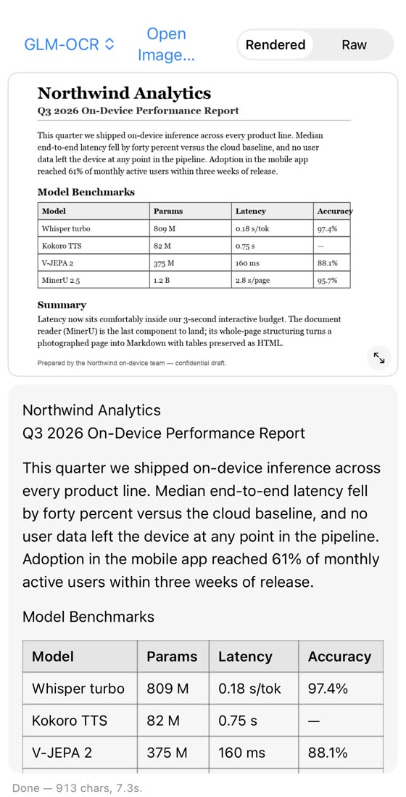
<b>🧰 <a href="https://github.com/john-rocky/coreai-kit">john-rocky/coreai-kit</a></b>
⭐127 · Swift · 👁️ observed
Apple&#x27;ın Core AI&#x27;ı ile iPhone ve Mac üzerinde sohbet, görme ve konuşma modellerini çalıştırmak için Swift SDK. Model indirme ve önbelleğe alma, FoundationModels…
</td>
</tr>
<tr>
<td width="50%" valign="top">

<b>🤖 <a href="https://github.com/gargpratyush/jev-router">gargpratyush/jev-router</a></b>
⭐673 · JavaScript · 🔎 inferred
jev-router kullanarak göreviniz için claude code&#x27;daki en ucuz modele yönlendirin
</td>
<td width="50%" valign="top">

<b>🛡️ <a href="https://github.com/dharmeshgurnani/codeotter">dharmeshgurnani/codeotter</a></b>
⭐5 · TypeScript · 👁️ observed
Herhangi bir açık modelden otonom, kendi kendine barındırılan yapay zekâ kod incelemeleri, kalibre edilmiş puanlama göstergeleri ve birleştirme kapıları.
</td>
</tr>
<tr>
<td width="50%" valign="top">

<b>🧪 <a href="https://github.com/Mapika/decider">Mapika/decider</a></b>
⭐1034 · Python · 👁️ observed
Qwen3.5&#x27;ten ince ayarlanmış, kalibre edilmiş olasılıklarla tek geçişli tipli kararlar için tasarlanmış System One tarzı model ailesi.
</td>
<td width="50%" valign="top">

<b>🔬 <a href="https://github.com/r-ms/mini-jev">r-ms/mini-jev</a></b>
⭐64 · Python · 🔎 inferred
mini-Jev: dondurulmuş bir Qwen3-4B üzerinde Jev tarzı tür belirtilmiş karar arayüzünün nasıl göründüğü — JSON üretmek yerine seçenek harfinin logit&#x27;lerini okuyun.…
</td>
</tr>
<tr>
<td width="50%" valign="top">

<b>🎮 <a href="https://github.com/MCG-NJU/VideoJev">MCG-NJU/VideoJev</a></b>
⭐318 · Python · 👁️ observed
VideoJev: Video Anlama ve Etkileşim için System One Model
</td>
<td width="50%" valign="top">
<b>📰 <a href="https://docs.typesafe.ai/model-jaggedness/jev-1.13">Bilinen 9 kusur türü (jaggedness)</a></b>
⭐0 · ✅ official
Kelimesi kelimesine yorumlama, **güvenilmez sayım**, tarih karşılaştırması, çok seviyeli dolaylılık, ilgisiz ayrıntılardan oluşan büyük state, karşıt içerik,…
</td>
</tr>
</table>

## İçindekiler

- [Jev nedir?](#jev-nedir)
- [Kayıtlar nasıl derecelendirilir](#kayıtlar-nasıl-derecelendirilir)
- [Resmî SDK'lar ve geliştirici araçları](#resmî-sdklar-ve-geliştirici-araçları) — **7**
- [Topluluk istemcileri, SDK'lar ve bağdaştırıcılar](#topluluk-istemcileri-sdklar-ve-bağdaştırıcılar) — **117**
- [Ajan araçları: MCP, kancalar, geçitler ve kodlama ajanları](#ajan-araçları-mcp-kancalar-geçitler-ve-kodlama-ajanları) — **224**
- [Yönlendirme, koruma kuralları ve onaylar](#yönlendirme-koruma-kuralları-ve-onaylar) — **52**
- [Değerlendirme, kalibrasyon ve kıyaslamalar](#değerlendirme-kalibrasyon-ve-kıyaslamalar) — **78**
- [Açık yeniden üretimler, ağırlıklar ve mimari araştırması](#açık-yeniden-üretimler-ağırlıklar-ve-mimari-araştırması) — **35**
- [Uygulamalar, oyunlar, robotik ve etkileşimli demolar](#uygulamalar-oyunlar-robotik-ve-etkileşimli-demolar) — **38**
- [Yazılar, tartışmalar ve kardeş listeler](#yazılar-tartışmalar-ve-kardeş-listeler) — **75**
- [Diğer projeler](#diğer-projeler) — **77**
- [Uygulama diline göre projeler](#uygulama-diline-göre-projeler)

## Jev nedir?

Jev, TypeSafe AI'ın ilk **System One modelidir**. Düzyazı yazmaz. Bir durum ile cevap uzayını önceden sizin tanımladığınız soruları alır ve kodunuzun dallanabileceği olasılık dağılımlarıyla birlikte tipli değerler döndürür.

|                       |                                                                                                                                                                                                |
| --------------------- | ---------------------------------------------------------------------------------------------------------------------------------------------------------------------------------------------- |
| **Biçim**             | `state + typed questions` → `constrained answers + probabilities` → `your code`                                                                                                                |
| **Temel öğeler**      | `Choice` (≤255 seçenekten birini seçer), `Score` (2–10 arası bir rubrik), `Noul` (olasılıksal evet/hayır)                                                                                      |
| **Uç nokta**          | `POST https://api.typesafe.ai/v1/systemone`, model `jev-1.13.0` / takma ad `jev-latest`                                                                                                        |
| **Uygun kullanımlar** | sınırlı bir iş akışı içinde yönlendirme, triyaj, puanlama, moderasyon, doğrulama ve düşük gecikmeli geçitler                                                                                   |
| **Bilinen sınırlar**  | sayma güvenilir değil, çok katmanlı dolaylılık zayıf ve resmî materyal dokuz sınıf pürüzlülük adlandırıyor. Şema-geçerli çıktı doğru kararla aynı şey değildir — kendi verinizle kalibre edin. |

## Kayıtlar nasıl derecelendirilir

Bu alandaki çoğu liste dahil ettiğini iddia eder. Bu liste gerçekte ne kadarını doğruladığını söyler ve buna göre filtrelemenize izin verir.

| Derece       | Anlamı                                                                                                                                              |
| ------------ | --------------------------------------------------------------------------------------------------------------------------------------------------- |
| `official`   | TypeSafe AI'ın kendisi tarafından yayımlandı.                                                                                                       |
| `observed`   | Açılıp okunabilen kamuya açık bir artefakt — gerçek kaynak kodu, gerçek yapılandırma ya da depo adında veya konusunda açık bir TypeSafe/Jev beyanı. |
| `inferred`   | Belirsiz bir sinyal ile onu destekleyen sözcük dağarcığı üzerinden eşleşti, ancak henüz satır satır okunmadı.                                       |
| `unverified` | İlgili görünüyor, bağımsız olarak doğrulanmış hiçbir şey yok. Yalnızca keşif amacıyla listelendi.                                                   |

## Resmî SDK&#x27;lar ve geliştirici araçları

TypeSafe'in kendi yayımladığı her şey. Buradan başlayın.

🏛️ <b><a href="https://github.com/typesafe-ai/skills">typesafe-ai/skills</a></b> · ⭐2918 · ✅ official · 31 天

##### 📝 Özet

TypeSafe'ın System One API ile geliştirme için aracı becerileri

> 💡 Tedarikçinin kendi aracı becerileri. Sürekli güncellendiği için TypeSafe'ın Jev'in bir aracıdan nasıl yönlendirilmesini amaçladığına dair bir belirtime en yakın şeydir.

##### 📌 Temel bilgiler

| Alan     | Değer                                        |
| -------- | -------------------------------------------- |
| Kategori | `Resmî SDK&#x27;lar ve geliştirici araçları` |
| Kanıt    | `official`                                   |

##### 📊 Veri

| Ölçüt          | Değer      |
| -------------- | ---------- |
| Yıldız         | **2918**   |
| Son push       | 2026-10-23 |
| İlk listelenme | 2026-09-18 |

🏛️ <b><a href="https://github.com/typesafe-ai/system-one-adapter-python">typesafe-ai/system-one-adapter-python</a></b> · ⭐410 · Python · ✅ official · 9 天

##### 📝 Özet

LLM APIs tarafından desteklenen tak-çalıştır TypeSafeClient alternatifi

> 💡 Aynı arayüzü sıradan bir LLM sağlayıcısıyla destekleyen tak-çalıştır alternatif. Kendi verileriniz üzerinde, herhangi birine karar vermeden önce, tür bilgili bir kararı bir istemle A/B test etmenin dürüst yolu.

🔧 Kodda kullanıldığı tespit edildi: `README.md`

##### 📌 Temel bilgiler

| Alan     | Değer                                        |
| -------- | -------------------------------------------- |
| Kategori | `Resmî SDK&#x27;lar ve geliştirici araçları` |
| Kanıt    | `official`                                   |
| Dil      | Python                                       |

##### 📊 Veri

| Ölçüt          | Değer      |
| -------------- | ---------- |
| Yıldız         | **410**    |
| Son push       | 2026-11-15 |
| İlk listelenme | 2026-10-23 |

🏛️ <b><a href="https://github.com/typesafe-ai/typesafe-sdk-python">typesafe-ai/typesafe-sdk-python</a></b> · ⭐316 · Python · ✅ official · 13 天

##### 📝 Özet

TypeSafe API için resmî Python kitaplığı

> 💡 Senkron ve asenkron istemciler. Bir API anahtarından tür bilgili bir karara giden en hızlı yol ve topluluk istemcilerinin karşılaştırıldığı referans.

🔧 Kodda kullanıldığı tespit edildi: `README.md`

##### 📌 Temel bilgiler

| Alan     | Değer                                        |
| -------- | -------------------------------------------- |
| Kategori | `Resmî SDK&#x27;lar ve geliştirici araçları` |
| Kanıt    | `official`                                   |
| Dil      | Python                                       |

##### 📊 Veri

| Ölçüt          | Değer      |
| -------------- | ---------- |
| Yıldız         | **316**    |
| Son push       | 2026-11-11 |
| İlk listelenme | 2026-10-23 |

🏛️ <b><a href="https://github.com/typesafe-ai/typesafe-sdk-js">typesafe-ai/typesafe-sdk-js</a></b> · ⭐288 · TypeScript · ✅ official · 13 天

##### 📝 Özet

TypeSafe API için resmî TypeScript/JavaScript kitaplığı

> 💡 Yanıt türünün sorduğunuz sorudan çıkarıldığı TypeScript istemcisi; böylece uyumsuz bir dönüş türü çalışma zamanı sürprizi yerine derleme hatası olur.

##### 📌 Temel bilgiler

| Alan     | Değer                                        |
| -------- | -------------------------------------------- |
| Kategori | `Resmî SDK&#x27;lar ve geliştirici araçları` |
| Kanıt    | `official`                                   |
| Dil      | TypeScript                                   |

##### 📊 Veri

| Ölçüt          | Değer      |
| -------------- | ---------- |
| Yıldız         | **288**    |
| Son push       | 2026-11-11 |
| İlk listelenme | 2026-10-23 |

🏛️ <b><a href="https://github.com/TypeSafeAI/jev-harness">TypeSafeAI/jev-harness</a></b> · ⭐41 · TypeScript · ✅ official · 7 天

##### 📝 Özet

A custom coding harness for TypeSafe AI's Jev: an LLM proposes, Jev answers narrow questions, code decides, every step leaves a receipt.

##### 📌 Temel bilgiler

| Alan     | Değer                                        |
| -------- | -------------------------------------------- |
| Kategori | `Resmî SDK&#x27;lar ve geliştirici araçları` |
| Kanıt    | `official`                                   |
| Dil      | TypeScript                                   |

##### 📊 Veri

| Ölçüt          | Değer      |
| -------------- | ---------- |
| Yıldız         | **41**     |
| Son push       | 2026-11-17 |
| İlk listelenme | 2026-11-18 |

🏷 `agent-harness` · `agentic-coding` · `ai-agents` · `ai-governance` · `ai-safety` · `code-review` · `coding-agent` · `developer-tools`

🏛️ <b><a href="https://github.com/typesafe-ai/WorkflowEvals">typesafe-ai/WorkflowEvals</a></b> · ⭐22 · Python · ✅ official · 10 天

##### 📝 Özet

evals.typesafe.ai iş akışı kodu yayımlandı

##### 📌 Temel bilgiler

| Alan     | Değer                                        |
| -------- | -------------------------------------------- |
| Kategori | `Resmî SDK&#x27;lar ve geliştirici araçları` |
| Kanıt    | `official`                                   |
| Dil      | Python                                       |

##### 📊 Veri

| Ölçüt          | Değer      |
| -------------- | ---------- |
| Yıldız         | **22**     |
| Son push       | 2026-11-14 |
| İlk listelenme | 2026-10-23 |

🏛️ <b><a href="https://github.com/typesafe-ai/typesafe-ai.github.io">typesafe-ai/typesafe-ai.github.io</a></b> · ⭐2 · HTML · ✅ official · 172 天

##### 📝 Özet

Üst kaynakta açıklama yayımlanmamış.

##### 📌 Temel bilgiler

| Alan     | Değer                                        |
| -------- | -------------------------------------------- |
| Kategori | `Resmî SDK&#x27;lar ve geliştirici araçları` |
| Kanıt    | `official`                                   |
| Dil      | HTML                                         |

##### 📊 Veri

| Ölçüt          | Değer      |
| -------------- | ---------- |
| Yıldız         | **2**      |
| Son push       | 2026-06-04 |
| İlk listelenme | 2026-10-23 |

## Topluluk istemcileri, SDK&#x27;lar ve bağdaştırıcılar

System One uç noktası için tipli istemciler; topluluğun sıra geldiği ölçüde çok dilde.

🧰 <b><a href="https://github.com/realZachi/pg-jev">realZachi/pg-jev</a></b> · ⭐1317 · Shell · 👁️ observed · 48 天

##### 📝 Özet

Postgres tablolarınıza düz dille sorular sorun. TypeSafe'nin Jev tarafından desteklenen bir PostgreSQL uzantısı.

🔧 Kodda kullanıldığı tespit edildi: `README.md`

##### 📌 Temel bilgiler

| Alan     | Değer                                                   |
| -------- | ------------------------------------------------------- |
| Kategori | `Topluluk istemcileri, SDK&#x27;lar ve bağdaştırıcılar` |
| Kanıt    | `observed`                                              |
| Dil      | Shell                                                   |

##### 📊 Veri

| Ölçüt          | Değer      |
| -------------- | ---------- |
| Yıldız         | **1317**   |
| Son push       | 2026-10-06 |
| İlk listelenme | 2026-10-29 |

🧰 <b><a href="https://github.com/jexp/neo4jev">jexp/neo4jev</a></b> · ⭐190 · Jupyter · 👁️ observed · 66 天

##### 📝 Özet

Typesafe.ai System One Model Jev, komşu ilişkiler üzerinde bir sınıflandırıcı kullanarak Neo4j grafiğinde gezinir

##### 📌 Temel bilgiler

| Alan     | Değer                                                   |
| -------- | ------------------------------------------------------- |
| Kategori | `Topluluk istemcileri, SDK&#x27;lar ve bağdaştırıcılar` |
| Kanıt    | `observed`                                              |
| Dil      | Jupyter                                                 |

##### 📊 Veri

| Ölçüt          | Değer      |
| -------------- | ---------- |
| Yıldız         | **190**    |
| Son push       | 2026-09-18 |
| İlk listelenme | 2026-10-28 |

🧰 <b><a href="https://github.com/qkal/Canny">qkal/Canny</a></b> · ⭐135 · TypeScript · 👁️ observed · 11 天

##### 📝 Özet

AI kodlama aracılarına kanıt olmadan işin tamamlandığını iddia etmelerini engeller. Belirleyici kancalar karar verir, TypeSafe'ın Jev'i tavsiyede bulunur. Yalnızca eklemeli defter, sıfır çalışma zamanı bağımlılığı.

🔧 Kodda kullanıldığı tespit edildi: `README.md`

##### 📌 Temel bilgiler

| Alan     | Değer                                                   |
| -------- | ------------------------------------------------------- |
| Kategori | `Topluluk istemcileri, SDK&#x27;lar ve bağdaştırıcılar` |
| Kanıt    | `observed`                                              |
| Dil      | TypeScript                                              |

##### 📊 Veri

| Ölçüt          | Değer      |
| -------------- | ---------- |
| Yıldız         | **135**    |
| Son push       | 2026-11-13 |
| İlk listelenme | 2026-10-29 |

🏷 `agent-hooks` · `ai-agents` · `claude-code` · `claude-code-hooks` · `codex` · `codex-cli` · `guardrails` · `jev`

🧰 <b><a href="https://github.com/john-rocky/coreai-kit">john-rocky/coreai-kit</a></b> · ⭐127 · Swift · 👁️ observed · 8 天

##### 📝 Özet

Apple'ın Core AI'ı ile iPhone ve Mac üzerinde sohbet, görme ve konuşma modellerini çalıştırmak için Swift SDK. Model indirme ve önbelleğe alma, FoundationModels entegrasyonu ve belgelenmiş işletim sistemi, SDK ve model gereksinimleriyle çalıştırılabilir örnekler.

🔧 Kodda kullanıldığı tespit edildi: `Sources/CoreAIOps/CoreAI+SystemOne.swift`

##### 📌 Temel bilgiler

| Alan     | Değer                                                   |
| -------- | ------------------------------------------------------- |
| Kategori | `Topluluk istemcileri, SDK&#x27;lar ve bağdaştırıcılar` |
| Kanıt    | `observed`                                              |
| Dil      | Swift                                                   |

##### 📊 Veri

| Ölçüt          | Değer      |
| -------------- | ---------- |
| Yıldız         | **127**    |
| Son push       | 2026-11-16 |
| İlk listelenme | 2026-10-26 |

🏷 `apple` · `apple-core-ai` · `asr` · `core-ai` · `coreai` · `foundation-models` · `ios` · `ios-27`

---

<table><tr><th align="center" width="50%">🖼 Görsel</th><th align="center" width="50%">🎬 Video</th></tr><tr>
<td align="center" valign="top"></td>
<td align="center" valign="top"> hareketli kayıt</td>
</tr></table>

🧰 <b><a href="https://github.com/AkashPriyadarshii/jev-curate">AkashPriyadarshii/jev-curate</a></b> · ⭐116 · Rust · 👁️ observed · 12 天

##### 📝 Özet

High-throughput synthetic and pretraining dataset sifter for TypeSafe Jev. Rust streaming core, Parquet and JSONL I/O, typed Choice/Score/Noul judgments, speculative fan-out, 24.0 rows/sec measured.

🔧 Kodda kullanıldığı tespit edildi: `AGENTS.md`, `site/llms.txt`, `docs/DESIGN.md`

##### 📌 Temel bilgiler

| Alan     | Değer                                                   |
| -------- | ------------------------------------------------------- |
| Kategori | `Topluluk istemcileri, SDK&#x27;lar ve bağdaştırıcılar` |
| Kanıt    | `observed`                                              |
| Dil      | Rust                                                    |

##### 📊 Veri

| Ölçüt          | Değer      |
| -------------- | ---------- |
| Yıldız         | **116**    |
| Son push       | 2026-11-11 |
| İlk listelenme | 2026-11-05 |

🏷 `arrow` · `cli` · `data-cleaning` · `data-engineering` · `dataset-curation` · `eval-harness` · `fine-tuning` · `jev`

🧰 <b><a href="https://github.com/yzfly/awesome-jev-zh">yzfly/awesome-jev-zh</a></b> · ⭐97 · HTML · 👁️ observed · 0 天

##### 📝 Özet

Jev / TypeSafe System One Çince seçki listesi: resmî kaynaklar, SDK, popüler uygulamalar, Agent araçları, açık kaynak yeniden uygulamaları ve bağımsız değerlendirmeler; Çince başlangıç kılavuzlarıyla birlikte, popüler GitHub projelerini her gün otomatik olarak derler.

🔧 Kodda kullanıldığı tespit edildi: `docs/quickstart.md`

##### 📌 Temel bilgiler

| Alan     | Değer                                                   |
| -------- | ------------------------------------------------------- |
| Kategori | `Topluluk istemcileri, SDK&#x27;lar ve bağdaştırıcılar` |
| Kanıt    | `observed`                                              |
| Dil      | HTML                                                    |

##### 📊 Veri

| Ölçüt          | Değer      |
| -------------- | ---------- |
| Yıldız         | **97**     |
| Son push       | 2026-11-24 |
| İlk listelenme | 2026-09-18 |

🏷 `ai-agent` · `awesome` · `awesome-list` · `chinese` · `jev` · `llm` · `structured-output` · `system-one`

🧰 <b><a href="https://github.com/obie/ruby_decision_model">obie/ruby_decision_model</a></b> · ⭐61 · Ruby · 👁️ observed · 42 天

##### 📝 Özet

Typesafe Jev gibi karar modelleri için Ruby istemcisi

🔧 Kodda kullanıldığı tespit edildi: `README.md`

##### 📌 Temel bilgiler

| Alan     | Değer                                                   |
| -------- | ------------------------------------------------------- |
| Kategori | `Topluluk istemcileri, SDK&#x27;lar ve bağdaştırıcılar` |
| Kanıt    | `observed`                                              |
| Dil      | Ruby                                                    |

##### 📊 Veri

| Ölçüt          | Değer      |
| -------------- | ---------- |
| Yıldız         | **61**     |
| Son push       | 2026-10-12 |
| İlk listelenme | 2026-10-29 |

🧰 <b><a href="https://github.com/bodepudimuneendra-netizen/ConsciousDB">bodepudimuneendra-netizen/ConsciousDB</a></b> · ⭐56 · Python · 👁️ observed · 21 天

##### 📝 Özet

Değiştirilebilir System One modelleri (yerel Laya / bulut Jev) kullanan, veritabanından bağımsız bir Agentic GraphRAG çerçevesi. Herhangi bir grafik veritabanı için eksiksiz 4 aşamalı işlem hattı, sürekli değerlendirme ve özel A* dolaşımı sunan tak-çalıştır bir zekâ katmanı.

##### 📌 Temel bilgiler

| Alan     | Değer                                                   |
| -------- | ------------------------------------------------------- |
| Kategori | `Topluluk istemcileri, SDK&#x27;lar ve bağdaştırıcılar` |
| Kanıt    | `observed`                                              |
| Dil      | Python                                                  |

##### 📊 Veri

| Ölçüt          | Değer      |
| -------------- | ---------- |
| Yıldız         | **56**     |
| Son push       | 2026-11-02 |
| İlk listelenme | 2026-11-20 |

🏷 `astar-algorithm` · `eval-harness` · `fine-tuning` · `graphdatabase` · `graprag` · `jev` · `laya` · `neo4j`

🧰 <b><a href="https://github.com/AkashPriyadarshii/jev-superpowers">AkashPriyadarshii/jev-superpowers</a></b> · ⭐40 · HTML · 👁️ observed · 46 天

##### 📝 Özet

Systematic software development framework for AI coding agents upgraded with TypeSafe Jev System One typed decisions

🔧 Kodda kullanıldığı tespit edildi: `CLAUDE.md`

##### 📌 Temel bilgiler

| Alan     | Değer                                                   |
| -------- | ------------------------------------------------------- |
| Kategori | `Topluluk istemcileri, SDK&#x27;lar ve bağdaştırıcılar` |
| Kanıt    | `observed`                                              |
| Dil      | HTML                                                    |

##### 📊 Veri

| Ölçüt          | Değer      |
| -------------- | ---------- |
| Yıldız         | **40**     |
| Son push       | 2026-10-08 |
| İlk listelenme | 2026-11-05 |

🏷 `agentic-skills` · `ai-agents` · `antigravity` · `claude-code` · `codex` · `coding-agents` · `cursor` · `developer-tools`

🧰 <b><a href="https://github.com/MrJev/awesome-jev">MrJev/awesome-jev</a></b> · ⭐21 · Python · 👁️ observed · 0 天

##### 📝 Özet

Jev, TypeSafe AI'in System One modeli için derlenmiş proje, entegrasyon ve kaynak listesi.

##### 📌 Temel bilgiler

| Alan     | Değer                                                   |
| -------- | ------------------------------------------------------- |
| Kategori | `Topluluk istemcileri, SDK&#x27;lar ve bağdaştırıcılar` |
| Kanıt    | `observed`                                              |
| Dil      | Python                                                  |

##### 📊 Veri

| Ölçüt          | Değer      |
| -------------- | ---------- |
| Yıldız         | **21**     |
| Son push       | 2026-11-24 |
| İlk listelenme | 2026-09-18 |

🏷 `ai-agents` · `awesome` · `awesome-list` · `jev` · `mcp` · `typesafe`

🧰 <b><a href="https://github.com/ckaraca/awesome-jev">ckaraca/awesome-jev</a></b> · ⭐18 · Python · 👁️ observed · 0 天

##### 📝 Özet

Hızlı, yazım denetimli kararlar için TypeSafe AI's System One modeli olan Jev üzerine kurulmuş araçlar, entegrasyonlar ve denemelerden derlenmiş bir liste.

##### 📌 Temel bilgiler

| Alan     | Değer                                                   |
| -------- | ------------------------------------------------------- |
| Kategori | `Topluluk istemcileri, SDK&#x27;lar ve bağdaştırıcılar` |
| Kanıt    | `observed`                                              |
| Dil      | Python                                                  |

##### 📊 Veri

| Ölçüt          | Değer      |
| -------------- | ---------- |
| Yıldız         | **18**     |
| Son push       | 2026-11-23 |
| İlk listelenme | 2026-09-19 |

🏷 `ai-agents` · `awesome` · `awesome-list` · `computer-use` · `jev` · `llm` · `system-one` · `typesafe`

🧰 <b><a href="https://github.com/Premo-Cloud/typesafe-sdk-java">Premo-Cloud/typesafe-sdk-java</a></b> · ⭐12 · Java · 👁️ observed · 33 天

##### 📝 Özet

Topluluk Java SDK for Jev, TypeSafe'ın System One modeli: türlendirilmiş sorular girer, kalibre edilmiş olasılıklarla türlendirilmiş yanıtlar çıkar. Java 17+, Spring Boot starter (resmî olmayan)

##### 📌 Temel bilgiler

| Alan     | Değer                                                   |
| -------- | ------------------------------------------------------- |
| Kategori | `Topluluk istemcileri, SDK&#x27;lar ve bağdaştırıcılar` |
| Kanıt    | `observed`                                              |
| Dil      | Java                                                    |

##### 📊 Veri

| Ölçüt          | Değer      |
| -------------- | ---------- |
| Yıldız         | **12**     |
| Son push       | 2026-10-21 |
| İlk listelenme | 2026-10-28 |

🏷 `java` · `jev` · `sdk` · `spring-boot` · `system-one` · `system-one-models` · `typesafe`

🧰 <b><a href="https://github.com/clouatre-labs/decisions-judge-mcp">clouatre-labs/decisions-judge-mcp</a></b> · ⭐5 · JavaScript · 👁️ observed · 0 天

##### 📝 Özet

Bir MCP aracı olarak AI aracıları için türü belirli kararlar: tek bir hızlı istekte evet/hayır olasılığı (noul), seçim ve puan. TypeSafe System One modeli tarafından desteklenir.

##### 📌 Temel bilgiler

| Alan     | Değer                                                   |
| -------- | ------------------------------------------------------- |
| Kategori | `Topluluk istemcileri, SDK&#x27;lar ve bağdaştırıcılar` |
| Kanıt    | `observed`                                              |
| Dil      | JavaScript                                              |

##### 📊 Veri

| Ölçüt          | Değer      |
| -------------- | ---------- |
| Yıldız         | **5**      |
| Son push       | 2026-11-24 |
| İlk listelenme | 2026-10-12 |

🏷 `agent` · `ai` · `cli` · `decision-making` · `decisions` · `judge` · `llm` · `mcp`

---

<table><tr><th align="center" width="50%">🖼 Görsel</th><th align="center" width="50%">🎬 Video</th></tr><tr>
<td align="center" valign="top"></td>
<td align="center" valign="top"> hareketli kayıt</td>
</tr></table>

🧰 <b><a href="https://github.com/elbruno/ElBruno.AI.Decisions">elbruno/ElBruno.AI.Decisions</a></b> · ⭐5 · C# · 👁️ observed · 4 天

##### 📝 Özet

.NET 10 decision SDK: Choose, Score, and Assess with Microsoft Foundry (Microsoft-Decision-1), native local Ollama System One models, and TypeSafe AI Jev. One API, probabilities instead of paragraphs.

##### 📌 Temel bilgiler

| Alan     | Değer                                                   |
| -------- | ------------------------------------------------------- |
| Kategori | `Topluluk istemcileri, SDK&#x27;lar ve bağdaştırıcılar` |
| Kanıt    | `observed`                                              |
| Dil      | C#                                                      |

##### 📊 Veri

| Ölçüt          | Değer      |
| -------------- | ---------- |
| Yıldız         | **5**      |
| Son push       | 2026-11-19 |
| İlk listelenme | 2026-11-18 |

🏷 `dotnet` · `dotnet10` · `jev` · `microsoft-extensions-ai` · `nuget`

---

<table><tr><th align="center" width="50%">🖼 Görsel</th><th align="center" width="50%">🎬 Video</th></tr><tr>
<td align="center" valign="top"></td>
<td align="center" valign="top">medya yayımlanmamış</td>
</tr></table>

🧰 <b><a href="https://github.com/agent-ix/sapho">agent-ix/sapho</a></b> · ⭐2 · Rust · 👁️ observed · 0 天

##### 📝 Özet

Compound decisions with System One models like Jev: ask small questions, combine the answers with rules you write in a decision graph. Rust library and CLI.

##### 📌 Temel bilgiler

| Alan     | Değer                                                   |
| -------- | ------------------------------------------------------- |
| Kategori | `Topluluk istemcileri, SDK&#x27;lar ve bağdaştırıcılar` |
| Kanıt    | `observed`                                              |
| Dil      | Rust                                                    |

##### 📊 Veri

| Ölçüt          | Değer      |
| -------------- | ---------- |
| Yıldız         | **2**      |
| Son push       | 2026-11-23 |
| İlk listelenme | 2026-11-23 |

🏷 `ai` · `cli` · `clm` · `code-review` · `dag` · `decision-engine` · `decision-graph` · `fuzzy-logic`

---

<table><tr><th align="center" width="50%">🖼 Görsel</th><th align="center" width="50%">🎬 Video</th></tr><tr>
<td align="center" valign="top"></td>
<td align="center" valign="top">medya yayımlanmamış</td>
</tr></table>

🧰 <b><a href="https://github.com/rbalch/ouija">rbalch/ouija</a></b> · Rust · 👁️ observed · 0 天

##### 📝 Özet

CLI tool for interacting with system one models from command line.

##### 📌 Temel bilgiler

| Alan     | Değer                                                   |
| -------- | ------------------------------------------------------- |
| Kategori | `Topluluk istemcileri, SDK&#x27;lar ve bağdaştırıcılar` |
| Kanıt    | `observed`                                              |
| Dil      | Rust                                                    |

##### 📊 Veri

| Ölçüt          | Değer      |
| -------------- | ---------- |
| Yıldız         | **0**      |
| Son push       | 2026-11-23 |
| İlk listelenme | 2026-11-24 |

---

<table><tr><th align="center" width="50%">🖼 Görsel</th><th align="center" width="50%">🎬 Video</th></tr><tr>
<td align="center" valign="top"></td>
<td align="center" valign="top">medya yayımlanmamış</td>
</tr></table>

🧰 <b><a href="https://github.com/dzhng/jevgrep">dzhng/jevgrep</a></b> · ⭐3263 · TypeScript · 🔎 inferred · 11 天 · ⭐+1

##### 📝 Özet

Ne yaptığını sorarak kodu bulun. İlgili dosyaları ve kaynak bağlamını keşfetmek için Jev kullanan, kodlama ajanları için bir CLI.

##### 📌 Temel bilgiler

| Alan     | Değer                                                   |
| -------- | ------------------------------------------------------- |
| Kategori | `Topluluk istemcileri, SDK&#x27;lar ve bağdaştırıcılar` |
| Kanıt    | `inferred`                                              |
| Dil      | TypeScript                                              |

##### 📊 Veri

| Ölçüt          | Değer         |
| -------------- | ------------- |
| Yıldız         | **3263** (+1) |
| Son push       | 2026-11-12    |
| İlk listelenme | 2026-11-07    |

🏷 `ai-sdk` · `claude-code` · `cli` · `code-search` · `codex` · `coding-agents` · `context-retrieval` · `developer-tools`

---

<table><tr><th align="center" width="50%">🖼 Görsel</th><th align="center" width="50%">🎬 Video</th></tr><tr>
<td align="center" valign="top"></td>
<td align="center" valign="top">medya yayımlanmamış</td>
</tr></table>

🧰 <b><a href="https://github.com/supercorp-ai/supercov">supercorp-ai/supercov</a></b> · ⭐169 · Rust · 🔎 inferred · 0 天

##### 📝 Özet

Coverage for coding agents

> 💡 Kod kalitesi ve kapsam sonuçları, düzyazı yerine tür bilgili kararlar olarak üretilir; böylece sonuç doğrudan bir işlem hattını geçitlendirebilir.

##### 📌 Temel bilgiler

| Alan     | Değer                                                   |
| -------- | ------------------------------------------------------- |
| Kategori | `Topluluk istemcileri, SDK&#x27;lar ve bağdaştırıcılar` |
| Kanıt    | `inferred`                                              |
| Dil      | Rust                                                    |

##### 📊 Veri

| Ölçüt          | Değer      |
| -------------- | ---------- |
| Yıldız         | **169**    |
| Son push       | 2026-11-24 |
| İlk listelenme | 2026-10-23 |

🏷 `agent-skills` · `claude-code` · `code-coverage` · `code-quality` · `codex` · `coding-agents` · `coverage` · `gemini-cli-extension`

---

<table><tr><th align="center" width="50%">🖼 Görsel</th><th align="center" width="50%">🎬 Video</th></tr><tr>
<td align="center" valign="top"></td>
<td align="center" valign="top">medya yayımlanmamış</td>
</tr></table>

🧰 <b><a href="https://github.com/marcreichel/laya-php">marcreichel/laya-php</a></b> · ⭐116 · PHP · 🔎 inferred · 0 天

##### 📝 Özet

Classify text in PHP without an LLM bill: typed decisions in 100+ languages, self-hosted. Laravel-ready SDK for Laya, a Jev AI alternative.

##### 📌 Temel bilgiler

| Alan     | Değer                                                   |
| -------- | ------------------------------------------------------- |
| Kategori | `Topluluk istemcileri, SDK&#x27;lar ve bağdaştırıcılar` |
| Kanıt    | `inferred`                                              |
| Dil      | PHP                                                     |

##### 📊 Veri

| Ölçüt          | Değer      |
| -------------- | ---------- |
| Yıldız         | **116**    |
| Son push       | 2026-11-23 |
| İlk listelenme | 2026-11-23 |

🏷 `ai` · `classification` · `decision-engine` · `decision-model` · `jev` · `jev-ai` · `jev-api` · `laravel`

---

<table><tr><th align="center" width="50%">🖼 Görsel</th><th align="center" width="50%">🎬 Video</th></tr><tr>
<td align="center" valign="top">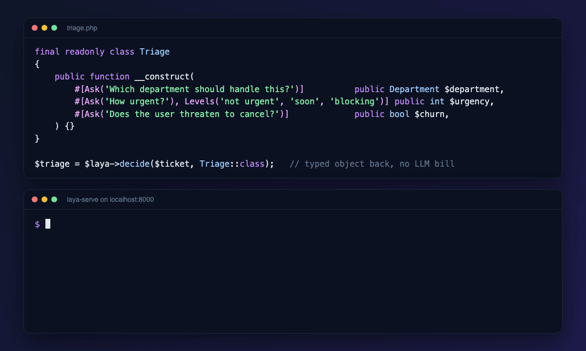</td>
<td align="center" valign="top"> hareketli kayıt</td>
</tr></table>

🧰 <b><a href="https://github.com/AkashPriyadarshii/jev-seo">AkashPriyadarshii/jev-seo</a></b> · ⭐108 · Rust · 🔎 inferred · 12 天

##### 📝 Özet

Free Rust SEO and GEO toolkit powered by TypeSafe Jev: 58-rule audits, site crawls, AI citation checks, rank drift, CI gates, 15-tool MCP. Zero cost.

##### 📌 Temel bilgiler

| Alan     | Değer                                                   |
| -------- | ------------------------------------------------------- |
| Kategori | `Topluluk istemcileri, SDK&#x27;lar ve bağdaştırıcılar` |
| Kanıt    | `inferred`                                              |
| Dil      | Rust                                                    |

##### 📊 Veri

| Ölçüt          | Değer      |
| -------------- | ---------- |
| Yıldız         | **108**    |
| Son push       | 2026-11-11 |
| İlk listelenme | 2026-11-05 |

🏷 `ahrefs-alternative` · `answer-engine-optimization` · `claude-code` · `cli` · `coding-agents` · `generative-engine-optimization` · `geo` · `jev`

---

<table><tr><th align="center" width="50%">🖼 Görsel</th><th align="center" width="50%">🎬 Video</th></tr><tr>
<td align="center" valign="top"></td>
<td align="center" valign="top">medya yayımlanmamış</td>
</tr></table>

🧰 <b><a href="https://github.com/AboveColin/HA-Jev">AboveColin/HA-Jev</a></b> · ⭐90 · Python · 🔎 inferred · 11 天

##### 📝 Özet

Evinize bir soru sorun, karşılığında bir sayı alın. TypeSafe Jev için Home Assistant entegrasyonu: sensör olarak tipli yanıtlar, otomasyonlar için dört eylem ve Assist için bir konuşma aracısı.

##### 📌 Temel bilgiler

| Alan     | Değer                                                   |
| -------- | ------------------------------------------------------- |
| Kategori | `Topluluk istemcileri, SDK&#x27;lar ve bağdaştırıcılar` |
| Kanıt    | `inferred`                                              |
| Dil      | Python                                                  |

##### 📊 Veri

| Ölçüt          | Değer      |
| -------------- | ---------- |
| Yıldız         | **90**     |
| Son push       | 2026-11-12 |
| İlk listelenme | 2026-10-29 |

🏷 `ai` · `assist` · `conversation` · `custom-components` · `decision-model` · `hacs` · `home-assistant` · `home-automation`

---

<table><tr><th align="center" width="50%">🖼 Görsel</th><th align="center" width="50%">🎬 Video</th></tr><tr>
<td align="center" valign="top">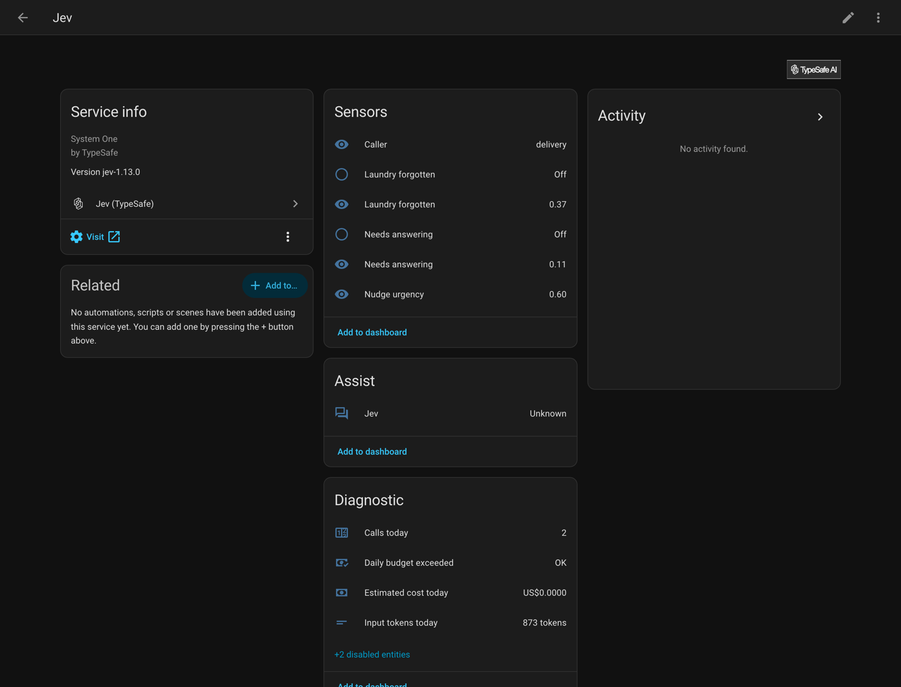</td>
<td align="center" valign="top">medya yayımlanmamış</td>
</tr></table>

🧰 <b><a href="https://github.com/bladedevoff/stuntd">bladedevoff/stuntd</a></b> · ⭐76 · Python · 🔎 inferred · 43 天

##### 📝 Özet

Uygulamanızın yazılı LLM kararlarını öğrenen ve bunları bir Laya head ile yanıtlayan yerel proxy. Jev ve OpenAI uyumlu.

##### 📌 Temel bilgiler

| Alan     | Değer                                                   |
| -------- | ------------------------------------------------------- |
| Kategori | `Topluluk istemcileri, SDK&#x27;lar ve bağdaştırıcılar` |
| Kanıt    | `inferred`                                              |
| Dil      | Python                                                  |

##### 📊 Veri

| Ölçüt          | Değer      |
| -------------- | ---------- |
| Yıldız         | **76**     |
| Son push       | 2026-10-11 |
| İlk listelenme | 2026-10-29 |

🏷 `claude-code` · `distillation` · `jev` · `laya` · `llm` · `llm-proxy` · `local-inference` · `openai-compatible`

---

<table><tr><th align="center" width="50%">🖼 Görsel</th><th align="center" width="50%">🎬 Video</th></tr><tr>
<td align="center" valign="top">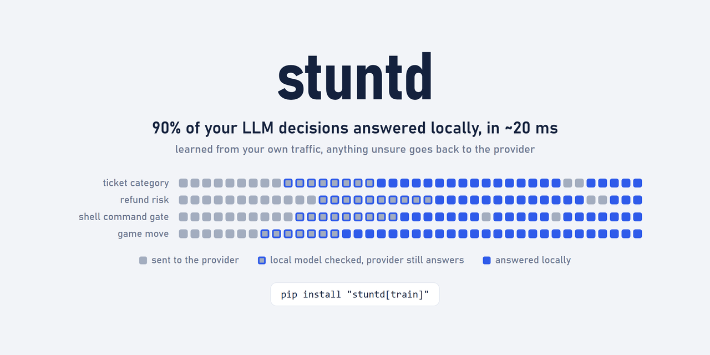</td>
<td align="center" valign="top">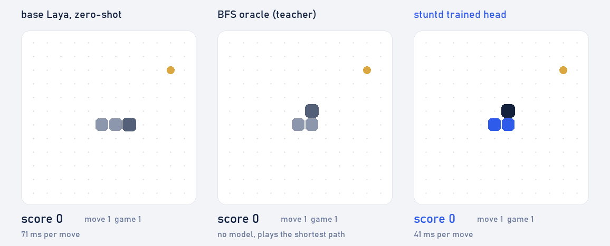 hareketli kayıt</td>
</tr></table>

<b>Bu kategoride daha fazla</b> · 95

- [PromtEngineer/jev-harness](https://github.com/PromtEngineer/jev-harness) - TypeSafe.
- [Sur-Cai/macos-computer-use-kit](https://github.com/Sur-Cai/macos-computer-use-kit) - AX-first computer use for AI agents on macOS with optional Jev.
- [xingwudao/OpenJev](https://github.com/xingwudao/OpenJev) - OpenJev: TypeSafe.ai kavramlarına dayanan, Jev esinli bağımsız bir System One…
- [danieleteti/systemone-delphi](https://github.com/danieleteti/systemone-delphi) - Delphi client for System One models (Jev, tev1 and nimble on Ollama): ask typed…
- [chussenot/judgment](https://github.com/chussenot/judgment) - System One modellerinden yazılı, kalibre edilmiş yargılar: .jud dosyası olarak…
- [GitHub30/OpenJev](https://github.com/GitHub30/OpenJev) - Açık ağırlıklı System One modeli (Jev uyumlu): tek ileri geçişte, metin üretimi…
- [erik-hedstrom/loadout](https://github.com/erik-hedstrom/loadout) - Her kodlama aracısı oturumu için model, beceriler ve MCP sunucularını, herhangi…
- [jqueryscript/awesome-jev](https://github.com/jqueryscript/awesome-jev) - A curated list of TypeSafe Jev resources, SDKs, agents, MCP servers…
- [andyrossa/ai-search-copilot](https://github.com/andyrossa/ai-search-copilot) - Jev, TypeSafe AI.
- [basi/typesafe-ai-php-client](https://github.com/basi/typesafe-ai-php-client) - PHP client for the typesafe.ai System One API (Jev).
- [gajaguar/typesafe-cli](https://github.com/gajaguar/typesafe-cli) - Unofficial command-line interface for TypeSafe AI System One models, on…
- [romain-cll/reflex-rag](https://github.com/romain-cll/reflex-rag) - A retrieval loop judged by a system-one model (Jev) instead of an LLM.
- [sanketmuchhala/jevgate](https://github.com/sanketmuchhala/jevgate) - Calibrated policy triage and institutional risk routing: a hybrid…
- [ollaya-dev/ollaya](https://github.com/ollaya-dev/ollaya) - Jev-compatible API server for open decision models.
- [juspay/neurolink](https://github.com/juspay/neurolink) - Bir AI sinir sisteminin boru katmanı — üç çıkarım türünde sağlayıcı nöronlarını…
- [aaddrick/building-with-typesafe-jev](https://github.com/aaddrick/building-with-typesafe-jev) - Kodlama aracılarına TypeSafe AI.
- [keltokhy/jgrep](https://github.com/keltokhy/jgrep) - grep, ancak desen bir açıklamadır. Satırları anlamına göre TypeSafe.
- [Ying-Kai-Liao/jev-browser](https://github.com/Ying-Kai-Liao/jev-browser) - Bir LLM&#x27;ın planladığı ve Jev&#x27;in (Typesafe System One) karar verdiği tarayıcı…
- [fazlerocks/jevmail](https://github.com/fazlerocks/jevmail) - Gmail için açık kaynaklı AI e-posta triyajı.
- [sharziki/semdecide](https://github.com/sharziki/semdecide) - TypeSafe AI Jev tarafından desteklenen, Unix işlem hatları ve CI için tipli…
- [burnigtm/jev-mcp](https://github.com/burnigtm/jev-mcp) - Cursor, Codex ve herhangi bir MCP istemcisinde TypeSafe Jev.
- [Eliot5566/JEV-Paper-Radar](https://github.com/Eliot5566/JEV-Paper-Radar) - Turn research interests or paper links into a ranked reading list in Claude.
- [mattn/go-jev](https://github.com/mattn/go-jev) - Go SDK and CLI for TypeSafe Jev: typed decisions (yes/no, choice, score) from a…
- [dannote/jev](https://github.com/dannote/jev) - OTP için TypeSafe Jev: Bir GenServer.
- [DevLoops-ai/unified-brain](https://github.com/DevLoops-ai/unified-brain) - System One coding agents: code-level answers in about 10secs for under 2 cents.
- [jwuthri-cloud/SelfJev](https://github.com/jwuthri-cloud/SelfJev) - Self-hosted decision model (selfjev-4b) with a Jev-compatible API: Python SDK…
- [jiangkoumo/ego-decision-layer](https://github.com/jiangkoumo/ego-decision-layer) - Pluggable decision layer for the ego lite browser: one System One (Jev) call…
- [thusinh1969/BrighTO_Router](https://github.com/thusinh1969/BrighTO_Router) - BrighTO LLM Router: free open-source, ultra-fast Rust LLM gateway/router and…
- [arjun988/Kev](https://github.com/arjun988/Kev) - Açık kaynaklı System One karar motoru.
- [Ray-Hughes/jevalyn](https://github.com/Ray-Hughes/jevalyn) - Rails uygulamanız için karar katmanı. TypeSafe.
- [nouli-ai/nouli](https://github.com/nouli-ai/nouli) - Decision Agent Engine.
- [pambrose/jev4k](https://github.com/pambrose/jev4k) - A Kotlin Multiplatform DSL and client for TypeSafe.
- [saibimajdi/typesafeai-dotnet-sdk](https://github.com/saibimajdi/typesafeai-dotnet-sdk) - TypeSafe AI System One API için topluluk .NET SDK — yapılandırılmış, güven…
- [Elue-dev/jev_elixir](https://github.com/Elue-dev/jev_elixir) - jev_elixir, Jev ile türlendirilmiş kararlar almak için küçük ve deyimsel bir…
- [himomohi/aside-jev](https://github.com/himomohi/aside-jev) - Aside ajanları TypeSafe Jev ile karar verir (System One: Choice/Score/Noul).
- [haileyok/typesafe-client](https://github.com/haileyok/typesafe-client) - TypeSafe AI System One API (Jev) için resmi olmayan Go ve Rust istemcileri.
- [sumleo/prompt2jev](https://github.com/sumleo/prompt2jev) - Doğal dili, bir LLM istemini veya bunu çalıştıran kodu TypeSafe Jev kararına…
- [AIAnytime/Jev-Router](https://github.com/AIAnytime/Jev-Router) - Decision-first, OpenAI-compatible AI router powered by Jev typed decisions.
- [chenrui333/jev-docs](https://github.com/chenrui333/jev-docs) - Jev / TypeSafe System One APIs, SDKs, aracı yönergeleri ve mühendislik en iyi…
- [devbackend/jevgo](https://github.com/devbackend/jevgo) - TypeSafe AI System One API (Jev) için resmî olmayan Go istemcisi — yazılı…
- [docxology/daf-jev](https://github.com/docxology/daf-jev) - daf-jev: TypeSafe&#x27;ın Jev (System One) karar API&#x27;ü için birleştirilebilir Python…
- [kataras/jev](https://github.com/kataras/jev) - A Go client for the TypeSafe AI.
- [TraxSharp/Trax](https://github.com/TraxSharp/Trax) - one description of your app, for the whole team.
- [Kadihx/jev-x-kit](https://github.com/Kadihx/jev-x-kit) - Kodlama aracıları için çevrimdışı 0 $ karar katmanı: Choice/Score/Noul…
- [Jev-Engineering/TypeWright](https://github.com/Jev-Engineering/TypeWright) - Bir karar bildirin, türlendirilmiş Jev sorularını derleyin, bunları ölçün ve…
- [brida-ai/sdk](https://github.com/brida-ai/sdk) - Official TypeScript SDK for the Brida platform.
- [docwilde/doxa](https://github.com/docwilde/doxa) - ΔΟΞΑ is a Rust multi-agent terminal for Claude, Codex, Gemini via Google…
- [JimmyWesley/rlcd-gateway](https://github.com/JimmyWesley/rlcd-gateway) - LLMs ve karar modelleri için kendi sunucunuzda çalıştırabileceğiniz ağ geçidi.
- [PAI-CUHK/SLEEPJEV](https://github.com/PAI-CUHK/SLEEPJEV) - Uzun ufuklu PSG üzerinde JEV esinli tür bilgili çalışma zamanı kararları…
- [robertn702/reasoning-router](https://github.com/robertn702/reasoning-router) - Per-step reasoning effort for coding agents, picked by a classifier, without…
- [zhirschtritt/typesafe-go](https://github.com/zhirschtritt/typesafe-go) - TypeSafe AI API için deyimsel Go SDK.
- [AboveColin/jevclient](https://github.com/AboveColin/jevclient) - TypeSafe Jev için asenkron Python istemcisi.
- [Butochnikov/laravel-typesafe-jev](https://github.com/Butochnikov/laravel-typesafe-jev) - Tür bilgili yanıtlar, asenkron istekler, kapsamlı bağımlılık enjeksiyonu ve…
- [coo-quack/jev-pii-checker](https://github.com/coo-quack/jev-pii-checker) - Metinlerde PII bulan CLI: varlık, hassasiyet ve bulunan aralıklar için TypeSafe…
- [frodi-karlsson/onesie](https://github.com/frodi-karlsson/onesie) - Gate scripts and CI on fast, calibrated System One judgments like Jev: a score…
- [Lasimeri/Mechanical-Jev](https://github.com/Lasimeri/Mechanical-Jev) - Rust içindeki Jev.
- [nshkrdotcom/system_one_sdk](https://github.com/nshkrdotcom/system_one_sdk) - System One semantiği için sağlayıcıdan bağımsız Elixir/BEAM SDK: tür bilgili…
- [zerone-agents/jev-model-router](https://github.com/zerone-agents/jev-model-router) - OpenAI ve Anthropic API uyumluluğuna sahip, otomatik model seçimi ve bir…
- [abhisheksharma001/jev-skill](https://github.com/abhisheksharma001/jev-skill) - Agent skill for TypeSafe AI.
- [dsaad68/fuzzy-jev](https://github.com/dsaad68/fuzzy-jev) - A client for OpenRouter&#x27;s decision models, TypeSafe&#x27;s Jev by default: typed…
- [getmissionctrl/hs-jev](https://github.com/getmissionctrl/hs-jev) - TypeSafe&#x27;in System One (Jev) karar API&#x27;ı için Haskell istemcisi — http-client…
- [JawzoD3TH/JevApi](https://github.com/JawzoD3TH/JevApi) - JevApi — MCP, Api Client Library and Test Harness for Jev.
- [minorun365/jev-cloud-quiz](https://github.com/minorun365/jev-cloud-quiz) - 三大クラウドの機能名を、TypeSafe AI の System One モデル Jev が確率つきで判定するデモ.
- [Hyper-AI-Lab/openclaw-jev](https://github.com/Hyper-AI-Lab/openclaw-jev) - OpenClaw ajanları için üretim kontrol düzlemi: Jev ile alım yönlendirme…
- [milojarow/jev-skills](https://github.com/milojarow/jev-skills) - Jev (TypeSafe System One) skill and CLI for coding agents: when to use typed…
- [MrKyaw/CognitiveMirror-Jev-MCP](https://github.com/MrKyaw/CognitiveMirror-Jev-MCP) - Cognitive middleware for personal and enterprise AI agents: 14 MCP tools and a…
- [Talya1412/jev-harness](https://github.com/Talya1412/jev-harness) - TypeSafe Jev (System One) integrations for OMP, MCP, Claude Code, and Pi…
- [vijaycinn/el-jev](https://github.com/vijaycinn/el-jev) - High-speed System One decision sidecar &amp; Copilot CLI pre-turn hook powered by…
- [abirshhishirroy/mini-jev](https://github.com/abirshhishirroy/mini-jev) - A custom Jev-style decision model built from scratch on Qwen2.5-3B.
- [CMaintz/jev-tools](https://github.com/CMaintz/jev-tools) - TypeSafe AI.
- [codebam/jev-guardrails](https://github.com/codebam/jev-guardrails) - Ajan araç çağrıları için Jev destekli korumalar: kütüphane, yerel…
- [hierichhsu/your-cto-jev](https://github.com/hierichhsu/your-cto-jev) - A sharp-tongued CTO that blocks leaked secrets and destructive commands from AI…
- [jackzhang0925/35b-jev](https://github.com/jackzhang0925/35b-jev) - RL post-training with a decision-model-shaped reward.
- [kkdev92/jev-dotnet](https://github.com/kkdev92/jev-dotnet) - An unofficial .NET 10 client for Jev, TypeSafe.
- [mdimamhosen/jev](https://github.com/mdimamhosen/jev) - One endpoint for every model, one CLI for every MCP.
- [sususu98/pi-jev-navigator](https://github.com/sususu98/pi-jev-navigator) - Ultra-low-token System One context navigation and precision SOP dispatch engine…
- [SykkoAtHome/MCP_Typesafe_JEV](https://github.com/SykkoAtHome/MCP_Typesafe_JEV) - Domain-agnostic MCP server for TypeSafe Jev (System One) evaluation engine…
- [xiaocongyu66/llama.cpp-jev-adapter](https://github.com/xiaocongyu66/llama.cpp-jev-adapter) - Native llama.cpp support for JoyFox JEV decision models.
- [Yasir-Khan-7/jev-sentinel](https://github.com/Yasir-Khan-7/jev-sentinel) - LangChain / LangGraph AI ajanları için prompt injection koruması ve araç…
- [zavaii/jev-code-review](https://github.com/zavaii/jev-code-review) - Offline-first, budget-bounded code review screening with TypeSafe Jev.
- [pithings/advocaat](https://github.com/pithings/advocaat) - TypeSafe Jev tarafından desteklenen, verileriniz hakkında AI.
- [zhulinchng/jevper](https://github.com/zhulinchng/jevper) - OpenAI benzeri istemciler üzerinde Jev biçimli (TypeSafe System One)…
- [getcustomaise/customaise-mcp](https://github.com/getcustomaise/customaise-mcp) - MCP server and CLI that connect AI agents.
- [schainks/system_one_client](https://github.com/schainks/system_one_client) - System One karar modelleri için Elixir istemcisi: TypeSafe Jev, Cloudflare…
- [VBS2004/jevcut](https://github.com/VBS2004/jevcut) - Auto-clipper that turns long videos (podcasts, talks, essays, comedy) into…
- [IKEASven69/dsh-opencli](https://github.com/IKEASven69/dsh-opencli) - 让 dsh 会办事:登录态真实浏览器 × 180 站点结构化命令 + SystemOne 亚秒决策 + 执行真实性判定 + watch 监控.
- [Query-farm/vgi-typesafe](https://github.com/Query-farm/vgi-typesafe) - TypeSafe System One sorusunu DuckDB/SQL.
- [iamtalha-arshad/ex_typesafe_ai](https://github.com/iamtalha-arshad/ex_typesafe_ai) - TypeSafe AI API için resmî olmayan Elixir istemcisi — tür bilgili yapılar…
- [y0usaf/typesafe-cli](https://github.com/y0usaf/typesafe-cli) - Kabuktan Jev tür bilgili soru sorun: noul, choice ve score yanıtları düzyazı…
- [geilt/typesafe-cli](https://github.com/geilt/typesafe-cli) - TypeSafe System One (Jev) için CLI ve aracı becerisi: tür bilgili Choice, Score…
- [KratosLee-6/open-source-model-deploy](https://github.com/KratosLee-6/open-source-model-deploy) - 开源大模型部署可行性鉴别工具 · 168 个开源模型动态评估（含 12 个 JEV/System One 决策模型）· 硬件自动检测 ·…
- [MarcelRoozekrans/Minos.NET](https://github.com/MarcelRoozekrans/Minos.NET) - Typed, source-generated decision questions for .NET: one IDecisionClient for…
- [MIt9/laya-cli](https://github.com/MIt9/laya-cli) - Laya için kullanımı kolay CLI — İnsanlar ve AI Aracıları için tür bilgili…
- [phiat/typesafe-rust-sdk](https://github.com/phiat/typesafe-rust-sdk) - Unofficial Rust client for TypeSafe.
- [Ridlo543/systemone-judge](https://github.com/Ridlo543/systemone-judge) - Universal Model Context Protocol (MCP) server and CLI runner for TypeSafe Jev…

## Ajan araçları: MCP, kancalar, geçitler ve kodlama ajanları

En hızlı büyüyen kategori: bir ajanın sonraki eyleminin önüne tipli bir karar koyan kancalar, MCP sunucuları ve geçitler.

🤖 <b><a href="https://github.com/tamaratran/fast-jev-compaction">tamaratran/fast-jev-compaction</a></b> · ⭐8017 · TypeScript · 🔎 inferred · 67 天 · ⭐-1

##### 📝 Özet

Claude sıkıştırma özetini Jev kararıyla değiştiren Code eklentisi: her araç çağrısı ve sonucu tek bir hızlı istekte puanlanır, eskimiş olanlar kaldırılır veya kısaltılır, korunan her şey aynen bırakılır.

> 💡 Bir kodlama aracısının bağlam sıkıştırma özetini tür belirtilmiş bir kararla değiştirir. Mevcut bir işlem hattını yeniden oluşturmak yerine, bu işlem hattındaki tek bir LLM çağrısını değiştirmenin temiz bir örneğidir.

##### 📌 Temel bilgiler

| Alan     | Değer                                                        |
| -------- | ------------------------------------------------------------ |
| Kategori | `Ajan araçları: MCP, kancalar, geçitler ve kodlama ajanları` |
| Kanıt    | `inferred`                                                   |
| Dil      | TypeScript                                                   |

##### 📊 Veri

| Ölçüt          | Değer         |
| -------------- | ------------- |
| Yıldız         | **8017** (-1) |
| Son push       | 2026-09-18    |
| İlk listelenme | 2026-11-08    |

🤖 <b><a href="https://github.com/gargpratyush/jev-router">gargpratyush/jev-router</a></b> · ⭐673 · JavaScript · 🔎 inferred · 65 天

##### 📝 Özet

jev-router kullanarak göreviniz için claude code'daki en ucuz modele yönlendirin

> 💡 Her turu, onu işleyebilecek en ucuz modele yönlendirir. Bir System One modeli için temel maliyet azaltma kullanım alanıdır.

##### 📌 Temel bilgiler

| Alan     | Değer                                                        |
| -------- | ------------------------------------------------------------ |
| Kategori | `Ajan araçları: MCP, kancalar, geçitler ve kodlama ajanları` |
| Kanıt    | `inferred`                                                   |
| Dil      | JavaScript                                                   |

##### 📊 Veri

| Ölçüt          | Değer      |
| -------------- | ---------- |
| Yıldız         | **673**    |
| Son push       | 2026-09-19 |
| İlk listelenme | 2026-11-08 |

---

<table><tr><th align="center" width="50%">🖼 Görsel</th><th align="center" width="50%">🎬 Video</th></tr><tr>
<td align="center" valign="top"></td>
<td align="center" valign="top">medya yayımlanmamış</td>
</tr></table>

🤖 <b><a href="https://github.com/0xNatoshi/jev-codex-router">0xNatoshi/jev-codex-router</a></b> · ⭐275 · JavaScript · 🔎 inferred · 63 天

##### 📝 Özet

Codex için tur başına model ve akıl yürütme yönlendirmesi; Jev (TypeSafe System One) tarafından yönlendirilir: her tur için modeli, düşünme derinliğini ve hız modunu seçer.

> 💡 Tür belirtilmiş kararlarla yönlendirilen bir kodlama aracısı için tur başına model ve akıl yürütme çabası yönlendirmesi.

##### 📌 Temel bilgiler

| Alan     | Değer                                                        |
| -------- | ------------------------------------------------------------ |
| Kategori | `Ajan araçları: MCP, kancalar, geçitler ve kodlama ajanları` |
| Kanıt    | `inferred`                                                   |
| Dil      | JavaScript                                                   |

##### 📊 Veri

| Ölçüt          | Değer      |
| -------------- | ---------- |
| Yıldız         | **275**    |
| Son push       | 2026-09-22 |
| İlk listelenme | 2026-10-28 |

🏷 `ai` · `codex` · `jev` · `llm` · `macos` · `routing` · `typesafe`

🤖 <b><a href="https://github.com/strands-labs/strands-decider">strands-labs/strands-decider</a></b> · ⭐1269 · Python · 👁️ observed · 0 天 · ⭐+2

##### 📝 Özet

Ajan tabanlı iş akışları için küçük, hızlı bir karar modeli veya System 1 modeli. Her kararda kalibre edilmiş güven düzeyiyle seçenekler arasında seçim yapın veya bir ölçek üzerinde bir LLM'dan daha hızlı puan verin.

##### 📌 Temel bilgiler

| Alan     | Değer                                                        |
| -------- | ------------------------------------------------------------ |
| Kategori | `Ajan araçları: MCP, kancalar, geçitler ve kodlama ajanları` |
| Kanıt    | `observed`                                                   |
| Dil      | Python                                                       |

##### 📊 Veri

| Ölçüt          | Değer         |
| -------------- | ------------- |
| Yıldız         | **1269** (+2) |
| Son push       | 2026-11-24    |
| İlk listelenme | 2026-10-02    |

🏷 `ai` · `machine-learning` · `natural-language-understanding` · `python` · `strands-agents` · `strands-labs` · `system-one` · `system-one-models`

---

<table><tr><th align="center" width="50%">🖼 Görsel</th><th align="center" width="50%">🎬 Video</th></tr><tr>
<td align="center" valign="top"></td>
<td align="center" valign="top">medya yayımlanmamış</td>
</tr></table>

🤖 <b><a href="https://github.com/thruwire/foreman">thruwire/foreman</a></b> · ⭐833 · Python · 👁️ observed · 39 天

##### 📝 Özet

An agent supervisor and software factory foreman powered by decision models

🔧 Kodda kullanıldığı tespit edildi: `docs/openrouter.md`

##### 📌 Temel bilgiler

| Alan     | Değer                                                        |
| -------- | ------------------------------------------------------------ |
| Kategori | `Ajan araçları: MCP, kancalar, geçitler ve kodlama ajanları` |
| Kanıt    | `observed`                                                   |
| Dil      | Python                                                       |

##### 📊 Veri

| Ölçüt          | Değer      |
| -------------- | ---------- |
| Yıldız         | **833**    |
| Son push       | 2026-10-15 |
| İlk listelenme | 2026-11-08 |

🏷 `agent-supervision` · `codex` · `jev` · `opencode` · `pi-agent` · `pi-coding-agent` · `pi-durable`

---

<table><tr><th align="center" width="50%">🖼 Görsel</th><th align="center" width="50%">🎬 Video</th></tr><tr>
<td align="center" valign="top"></td>
<td align="center" valign="top">medya yayımlanmamış</td>
</tr></table>

🤖 <b><a href="https://github.com/AbdelStark/awesome-typesafe-jev">AbdelStark/awesome-typesafe-jev</a></b> · ⭐620 · HTML · 👁️ observed · 22 天

##### 📝 Özet

Awesome Jev: TypeSafe'in System One modeline yönelik, SDKs, canlı demolar, ajan araçları ve bağımsız değerlendirmeler içeren kaynak destekli bir saha rehberi.

🔧 Kodda kullanıldığı tespit edildi: `README.md`

##### 📌 Temel bilgiler

| Alan     | Değer                                                        |
| -------- | ------------------------------------------------------------ |
| Kategori | `Ajan araçları: MCP, kancalar, geçitler ve kodlama ajanları` |
| Kanıt    | `observed`                                                   |
| Dil      | HTML                                                         |

##### 📊 Veri

| Ölçüt          | Değer      |
| -------------- | ---------- |
| Yıldız         | **620**    |
| Son push       | 2026-11-01 |
| İlk listelenme | 2026-10-28 |

🏷 `agent-skills` · `ai-agents` · `awesome` · `awesome-jev` · `awesome-list` · `awesome-lists` · `curated-list` · `developer-tools`

🤖 <b><a href="https://github.com/walidboulanouar/awesome-jev-use-cases">walidboulanouar/awesome-jev-use-cases</a></b> · ⭐498 · 👁️ observed · 58 天

##### 📝 Özet

TypeSafe AI Jev kullanım örneklerinin harika listesi: beğeniye göre sıralanmış 74 demo, 150'den fazla GitHub deposu, sınırlar, maliyet ve API örnekleri. CC0

🔧 Kodda kullanıldığı tespit edildi: `README.md`

##### 📌 Temel bilgiler

| Alan     | Değer                                                        |
| -------- | ------------------------------------------------------------ |
| Kategori | `Ajan araçları: MCP, kancalar, geçitler ve kodlama ajanları` |
| Kanıt    | `observed`                                                   |

##### 📊 Veri

| Ölçüt          | Değer      |
| -------------- | ---------- |
| Yıldız         | **498**    |
| Son push       | 2026-09-26 |
| İlk listelenme | 2026-10-29 |

🏷 `ai-guardrails` · `ai-router` · `awesome` · `awesome-list` · `classification` · `claude-code` · `decision-model` · `examples`

🤖 <b><a href="https://github.com/RomanSlack/jev-drone">RomanSlack/jev-drone</a></b> · ⭐305 · Python · 👁️ observed · 60 天

##### 📝 Özet

2,5 Hz hızında döngüde küçük bir yargı modeli (TypeSafe Jev) bulunan, yalnızca kamerayla çalışan otonom drone; MuJoCo üzerinde

🔧 Kodda kullanıldığı tespit edildi: `tactics.py`, `tunnel_tactics.py`

##### 📌 Temel bilgiler

| Alan     | Değer                                                        |
| -------- | ------------------------------------------------------------ |
| Kategori | `Ajan araçları: MCP, kancalar, geçitler ve kodlama ajanları` |
| Kanıt    | `observed`                                                   |
| Dil      | Python                                                       |

##### 📊 Veri

| Ölçüt          | Değer      |
| -------------- | ---------- |
| Yıldız         | **305**    |
| Son push       | 2026-09-24 |
| İlk listelenme | 2026-10-29 |

🏷 `autonomous-agents` · `drone` · `mujoco` · `robotics` · `typesafe`

---

<table><tr><th align="center" width="50%">🖼 Görsel</th><th align="center" width="50%">🎬 Video</th></tr><tr>
<td align="center" valign="top"></td>
<td align="center" valign="top">medya yayımlanmamış</td>
</tr></table>

🤖 <b><a href="https://github.com/Amal-David/awesome-jev">Amal-David/awesome-jev</a></b> · ⭐249 · Python · 👁️ observed · 0 天

##### 📝 Özet

Jev demoları, projeleri, SDKs ve becerileri, kaynak bağlantıları ve seçilmiş bir X galerisiyle.

🔧 Kodda kullanıldığı tespit edildi: `templates/README.md`

##### 📌 Temel bilgiler

| Alan     | Değer                                                        |
| -------- | ------------------------------------------------------------ |
| Kategori | `Ajan araçları: MCP, kancalar, geçitler ve kodlama ajanları` |
| Kanıt    | `observed`                                                   |
| Dil      | Python                                                       |

##### 📊 Veri

| Ölçüt          | Değer      |
| -------------- | ---------- |
| Yıldız         | **249**    |
| Son push       | 2026-11-24 |
| İlk listelenme | 2026-09-27 |

🏷 `agent-skills` · `awesome-ai` · `awesome-list` · `browser-use` · `claude-code` · `codex` · `coding-agent` · `computer-use`

🤖 <b><a href="https://github.com/kraayenjon/awesome-jev">kraayenjon/awesome-jev</a></b> · ⭐208 · 👁️ observed · 58 天

##### 📝 Özet

Jev kullanım alanları, projeleri, SDKs ve kaynaklarından derlenmiş bir liste. Jev, yazılımda hızlı, yazım denetimli kararlar için TypeSafe AI's System One modelidir — kalibre edilmiş olasılıklarla Choice, Score ve Noul.

🔧 Kodda kullanıldığı tespit edildi: `README.md`

##### 📌 Temel bilgiler

| Alan     | Değer                                                        |
| -------- | ------------------------------------------------------------ |
| Kategori | `Ajan araçları: MCP, kancalar, geçitler ve kodlama ajanları` |
| Kanıt    | `observed`                                                   |

##### 📊 Veri

| Ölçüt          | Değer      |
| -------------- | ---------- |
| Yıldız         | **208**    |
| Son push       | 2026-09-27 |
| İlk listelenme | 2026-09-19 |

🏷 `agents` · `ai` · `ai-agents` · `api` · `artificial-intelligence` · `automation` · `awesome` · `awesome-list`

🤖 <b><a href="https://github.com/valentynkit/awesome-jev-typesafe">valentynkit/awesome-jev-typesafe</a></b> · ⭐190 · JavaScript · 👁️ observed · 0 天

##### 📝 Özet

TypeSafe's Jev ile yazım denetimli kararlar, ilk System One modeli

🔧 Kodda kullanıldığı tespit edildi: `readme.md`, `README.ko.md`, `README.ja.md`, `README.zh-CN.md`

##### 📌 Temel bilgiler

| Alan     | Değer                                                        |
| -------- | ------------------------------------------------------------ |
| Kategori | `Ajan araçları: MCP, kancalar, geçitler ve kodlama ajanları` |
| Kanıt    | `observed`                                                   |
| Dil      | JavaScript                                                   |

##### 📊 Veri

| Ölçüt          | Değer      |
| -------------- | ---------- |
| Yıldız         | **190**    |
| Son push       | 2026-11-23 |
| İlk listelenme | 2026-09-19 |

🏷 `ai-agents` · `awesome` · `awesome-list` · `claude-code` · `directory` · `jev` · `llm-agents` · `system-one`

🤖 <b><a href="https://github.com/tamaratran/jev-pruner">tamaratran/jev-pruner</a></b> · ⭐170 · TypeScript · 👁️ observed · 54 天

##### 📝 Özet

Claude Code eklentisi: uzun Bash çıktısını model görmeden önce TypeSafe Jev ile kısaltır

🔧 Kodda kullanıldığı tespit edildi: `README.md`

##### 📌 Temel bilgiler

| Alan     | Değer                                                        |
| -------- | ------------------------------------------------------------ |
| Kategori | `Ajan araçları: MCP, kancalar, geçitler ve kodlama ajanları` |
| Kanıt    | `observed`                                                   |
| Dil      | TypeScript                                                   |

##### 📊 Veri

| Ölçüt          | Değer      |
| -------------- | ---------- |
| Yıldız         | **170**    |
| Son push       | 2026-09-30 |
| İlk listelenme | 2026-10-29 |

🤖 <b><a href="https://github.com/abhishekswe/agent-fastpath">abhishekswe/agent-fastpath</a></b> · ⭐7 · TypeScript · 👁️ observed · 10 天

##### 📝 Özet

Jev MCP server: a decision layer for coding agents, built on TypeSafe Jev (System One model). Ship gates, risk checks, file triage that keeps files out of context, and a safe headless browser, with calibrated confidence. For Claude Code, Codex, Cursor.

##### 📌 Temel bilgiler

| Alan     | Değer                                                        |
| -------- | ------------------------------------------------------------ |
| Kategori | `Ajan araçları: MCP, kancalar, geçitler ve kodlama ajanları` |
| Kanıt    | `observed`                                                   |
| Dil      | TypeScript                                                   |

##### 📊 Veri

| Ölçüt          | Değer      |
| -------------- | ---------- |
| Yıldız         | **7**      |
| Son push       | 2026-11-13 |
| İlk listelenme | 2026-11-21 |

🏷 `agentic-ai` · `ai-agents` · `browser-automation` · `claude-code` · `codex` · `coding-agent` · `context-engineering` · `cursor`

---

<table><tr><th align="center" width="50%">🖼 Görsel</th><th align="center" width="50%">🎬 Video</th></tr><tr>
<td align="center" valign="top"></td>
<td align="center" valign="top">medya yayımlanmamış</td>
</tr></table>

🤖 <b><a href="https://github.com/dfranco-projects/jev-guardbench">dfranco-projects/jev-guardbench</a></b> · ⭐3 · Python · 👁️ observed · 50 天

##### 📝 Özet

Bir System One modeli (TypeSafe Jev, açık kaynak Kev), ajan güvenlik bariyeri geri çağrılarında bir LLM-as-judge'ın yerini alabilir mi?

##### 📌 Temel bilgiler

| Alan     | Değer                                                        |
| -------- | ------------------------------------------------------------ |
| Kategori | `Ajan araçları: MCP, kancalar, geçitler ve kodlama ajanları` |
| Kanıt    | `observed`                                                   |
| Dil      | Python                                                       |

##### 📊 Veri

| Ölçüt          | Değer      |
| -------------- | ---------- |
| Yıldız         | **3**      |
| Son push       | 2026-10-04 |
| İlk listelenme | 2026-11-04 |

---

<table><tr><th align="center" width="50%">🖼 Görsel</th><th align="center" width="50%">🎬 Video</th></tr><tr>
<td align="center" valign="top"></td>
<td align="center" valign="top">medya yayımlanmamış</td>
</tr></table>

Yeniden dağıtım lisansı belirtilmediği için varlık üst depodan doğrudan bağlanmıştır.

🤖 <b><a href="https://github.com/hypler-dev/LNSAT">hypler-dev/LNSAT</a></b> · ⭐1 · TypeScript · 👁️ observed · 2 天

##### 📝 Özet

Building a CPU-first System One engine for evidence-bound review, with a Gateway for policy, human approval, bounded execution, and durable receipts. Pre-release source.

##### 📌 Temel bilgiler

| Alan     | Değer                                                        |
| -------- | ------------------------------------------------------------ |
| Kategori | `Ajan araçları: MCP, kancalar, geçitler ve kodlama ajanları` |
| Kanıt    | `observed`                                                   |
| Dil      | TypeScript                                                   |

##### 📊 Veri

| Ölçüt          | Değer      |
| -------------- | ---------- |
| Yıldız         | **1**      |
| Son push       | 2026-11-22 |
| İlk listelenme | 2026-11-16 |

🏷 `access-control` · `agent-security` · `agentic-ai` · `ai-agents` · `ai-governance` · `ai-security` · `audit-trail` · `authorization`

---

<table><tr><th align="center" width="50%">🖼 Görsel</th><th align="center" width="50%">🎬 Video</th></tr><tr>
<td align="center" valign="top"></td>
<td align="center" valign="top">medya yayımlanmamış</td>
</tr></table>

🤖 <b><a href="https://github.com/light-cheng/Light-Decision-MCP">light-cheng/Light-Decision-MCP</a></b> · ⭐1 · JavaScript · 👁️ observed · 3 天

##### 📝 Özet

Multi-backend Decision MCP & Magpie plugin for System One models (Gemini Decision, Jev, Perplexity, OpenRouter & local models) with local fallback & setup wizard. | 支持多云端与本地决策模型的 MCP 与 Magpie 插件，内置熔断降级、后台管理与硬件推荐向导。

##### 📌 Temel bilgiler

| Alan     | Değer                                                        |
| -------- | ------------------------------------------------------------ |
| Kategori | `Ajan araçları: MCP, kancalar, geçitler ve kodlama ajanları` |
| Kanıt    | `observed`                                                   |
| Dil      | JavaScript                                                   |

##### 📊 Veri

| Ölçüt          | Değer      |
| -------------- | ---------- |
| Yıldız         | **1**      |
| Son push       | 2026-11-20 |
| İlk listelenme | 2026-11-20 |

🏷 `decision-model` · `gemini-decision` · `local-ai` · `magpie` · `magpie-plugin` · `mcp` · `system-one`

---

<table><tr><th align="center" width="50%">🖼 Görsel</th><th align="center" width="50%">🎬 Video</th></tr><tr>
<td align="center" valign="top"></td>
<td align="center" valign="top">medya yayımlanmamış</td>
</tr></table>

🤖 <b><a href="https://github.com/samstealth/system-one-model-tweaks">samstealth/system-one-model-tweaks</a></b> · Python · 👁️ observed · 0 天

##### 📝 Özet

Five measured upgrades to CLM-8B, an open System One decision model: better tool choice and routing, a faster quantized backbone, smaller heads, and what failed along the way.

##### 📌 Temel bilgiler

| Alan     | Değer                                                        |
| -------- | ------------------------------------------------------------ |
| Kategori | `Ajan araçları: MCP, kancalar, geçitler ve kodlama ajanları` |
| Kanıt    | `observed`                                                   |
| Dil      | Python                                                       |

##### 📊 Veri

| Ölçüt          | Değer      |
| -------------- | ---------- |
| Yıldız         | **0**      |
| Son push       | 2026-11-24 |
| İlk listelenme | 2026-11-22 |

🏷 `contrastive-learning` · `decision-model` · `embeddings` · `intent-routing` · `llm-agents` · `matryoshka` · `model-merging` · `pytorch`

---

<table><tr><th align="center" width="50%">🖼 Görsel</th><th align="center" width="50%">🎬 Video</th></tr><tr>
<td align="center" valign="top">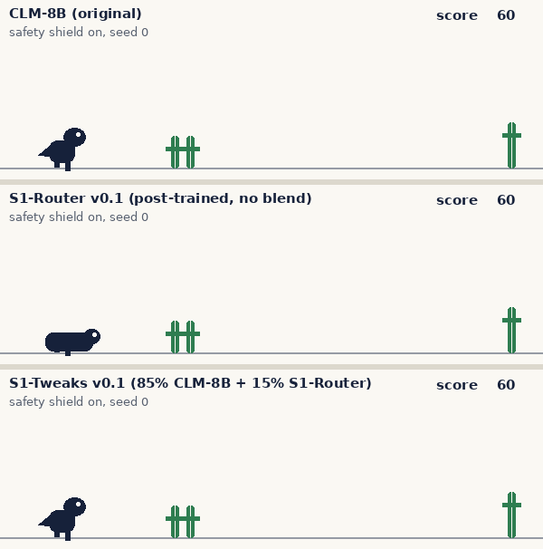</td>
<td align="center" valign="top"> hareketli kayıt</td>
</tr></table>

🤖 <b><a href="https://github.com/browser-use/jev-ultrafast">browser-use/jev-ultrafast</a></b> · ⭐24717 · Python · 🔎 inferred · 13 天 · ⭐+2

##### 📝 Özet

En hızlı ve en ucuz web aracısı

##### 📌 Temel bilgiler

| Alan     | Değer                                                        |
| -------- | ------------------------------------------------------------ |
| Kategori | `Ajan araçları: MCP, kancalar, geçitler ve kodlama ajanları` |
| Kanıt    | `inferred`                                                   |
| Dil      | Python                                                       |

##### 📊 Veri

| Ölçüt          | Değer          |
| -------------- | -------------- |
| Yıldız         | **24717** (+2) |
| Son push       | 2026-11-11     |
| İlk listelenme | 2026-11-08     |

---

<table><tr><th align="center" width="50%">🖼 Görsel</th><th align="center" width="50%">🎬 Video</th></tr><tr>
<td align="center" valign="top"></td>
<td align="center" valign="top"> hareketli kayıt · <a href="https://raw.githubusercontent.com/browser-use/jev-ultrafast/main/docs/demo.mp4">Videoyu aç</a></td>
</tr></table>

🤖 <b><a href="https://github.com/jev-chat/jev-chat-jarvis">jev-chat/jev-chat-jarvis</a></b> · ⭐8501 · Kotlin · 🔎 inferred · 18 天 · ⭐+1

##### 📝 Özet

Sohbet karar asistanı: yanıt vermeden önce Jev sohbeti okur, niyeti ve riski değerlendirir ve tek dokunuşla dolduracağınız yanıt taslakları hazırlar. Gönder’e basarsınız. Android · Windows · macOS · iOS | Sohbet destekli karar aracı: karşı tarafı önce anlayın, sonra yanıt verin; gönderip göndermemek size kalmış.

##### 📌 Temel bilgiler

| Alan     | Değer                                                        |
| -------- | ------------------------------------------------------------ |
| Kategori | `Ajan araçları: MCP, kancalar, geçitler ve kodlama ajanları` |
| Kanıt    | `inferred`                                                   |
| Dil      | Kotlin                                                       |

##### 📊 Veri

| Ölçüt          | Değer         |
| -------------- | ------------- |
| Yıldız         | **8501** (+1) |
| Son push       | 2026-11-05    |
| İlk listelenme | 2026-11-08    |

🏷 `accessibility-service` · `ai-assistant` · `android` · `chat-assistant` · `chat-copilot` · `llm` · `ocr` · `qq`

---

<table><tr><th align="center" width="50%">🖼 Görsel</th><th align="center" width="50%">🎬 Video</th></tr><tr>
<td align="center" valign="top">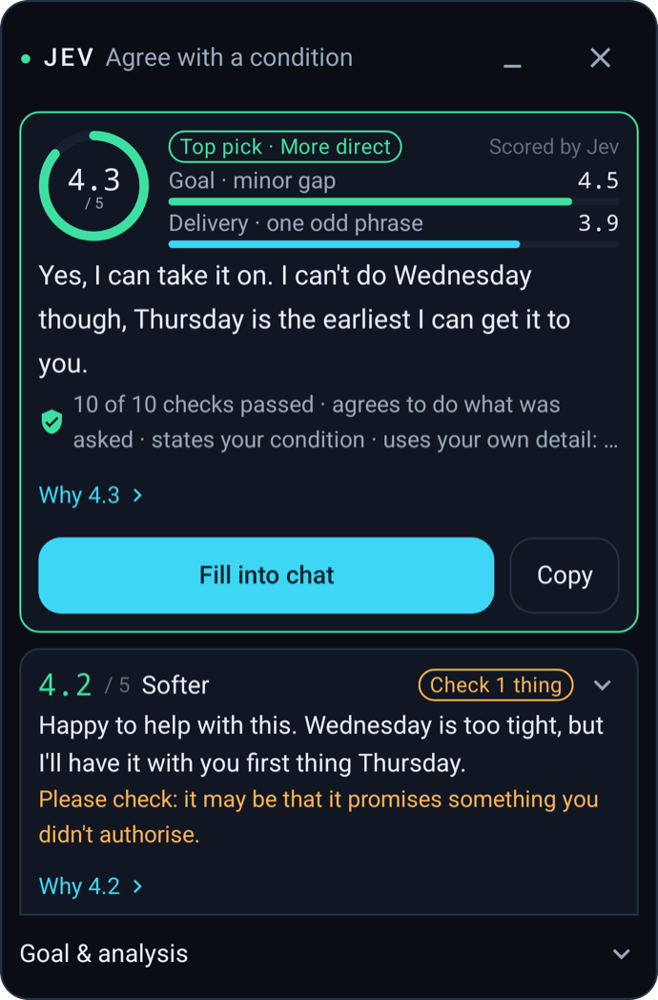</td>
<td align="center" valign="top">medya yayımlanmamış</td>
</tr></table>

🤖 <b><a href="https://github.com/YaoApp/yao">YaoApp/yao</a></b> · ⭐8345 · Go · 🔎 inferred · 0 天 · ⭐+2

##### 📝 Özet

✨ Tüm ajanlarınız ve çalışma alanlarınız, sahip olduğunuz her cihazda tek bir yerde. Görevleri masaüstünden, mobilden, tarayıcıdan veya API üzerinden erişilebilen bir panoda takip edin. Kendi sunucunuzda barındırın.

##### 📌 Temel bilgiler

| Alan     | Değer                                                        |
| -------- | ------------------------------------------------------------ |
| Kategori | `Ajan araçları: MCP, kancalar, geçitler ve kodlama ajanları` |
| Kanıt    | `inferred`                                                   |
| Dil      | Go                                                           |

##### 📊 Veri

| Ölçüt          | Değer         |
| -------------- | ------------- |
| Yıldız         | **8345** (+2) |
| Son push       | 2026-11-23    |
| İlk listelenme | 2026-11-08    |

🏷 `agent-harness` · `agent-orchestration` · `agent-skills` · `agent-workspaces` · `ai-agents` · `ai-native` · `claude-code` · `coding-agent`

---

<table><tr><th align="center" width="50%">🖼 Görsel</th><th align="center" width="50%">🎬 Video</th></tr><tr>
<td align="center" valign="top"></td>
<td align="center" valign="top">medya yayımlanmamış</td>
</tr></table>

Yeniden dağıtım lisansı belirtilmediği için varlık üst depodan doğrudan bağlanmıştır.

🤖 <b><a href="https://github.com/kerpopule/hermes-jev-skills">kerpopule/hermes-jev-skills</a></b> · ⭐1364 · Python · 🔎 inferred · 5 天

##### 📝 Özet

Hermes aracıları için Jev destekli model yönlendirme, bellek, sıkıştırma, beceri seçimi, bilgisayar ve tarayıcı kullanımı (ayrıca Claude Code ve Codex)

##### 📌 Temel bilgiler

| Alan     | Değer                                                        |
| -------- | ------------------------------------------------------------ |
| Kategori | `Ajan araçları: MCP, kancalar, geçitler ve kodlama ajanları` |
| Kanıt    | `inferred`                                                   |
| Dil      | Python                                                       |

##### 📊 Veri

| Ölçüt          | Değer      |
| -------------- | ---------- |
| Yıldız         | **1364**   |
| Son push       | 2026-11-18 |
| İlk listelenme | 2026-11-08 |

---

<table><tr><th align="center" width="50%">🖼 Görsel</th><th align="center" width="50%">🎬 Video</th></tr><tr>
<td align="center" valign="top">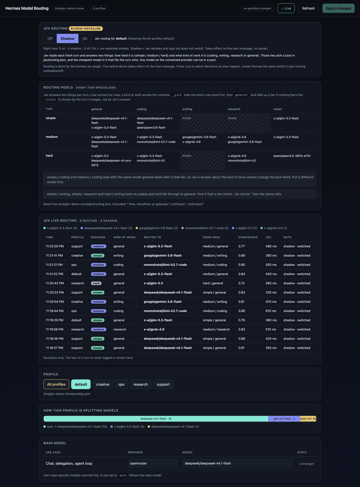</td>
<td align="center" valign="top">medya yayımlanmamış</td>
</tr></table>

🤖 <b><a href="https://github.com/reticlehq/reticle">reticlehq/reticle</a></b> · ⭐1330 · TypeScript · 🔎 inferred · 0 天

##### 📝 Özet

AI ajanları kod üretebilir, ancak oluşturduklarını anlamakta hâlâ zorlanır. Reticle, web ve masaüstü uygulamalarına Jev tarzı makineye özgü çalışma zamanı algısı getirir.

##### 📌 Temel bilgiler

| Alan     | Değer                                                        |
| -------- | ------------------------------------------------------------ |
| Kategori | `Ajan araçları: MCP, kancalar, geçitler ve kodlama ajanları` |
| Kanıt    | `inferred`                                                   |
| Dil      | TypeScript                                                   |

##### 📊 Veri

| Ölçüt          | Değer      |
| -------------- | ---------- |
| Yıldız         | **1330**   |
| Son push       | 2026-11-23 |
| İlk listelenme | 2026-10-26 |

🏷 `agent-skill` · `agent-skills` · `agent-testing` · `agent-verification` · `ai-testing-tool` · `automated-testing` · `claude-code` · `claude-skills`

---

<table><tr><th align="center" width="50%">🖼 Görsel</th><th align="center" width="50%">🎬 Video</th></tr><tr>
<td align="center" valign="top"></td>
<td align="center" valign="top"> hareketli kayıt</td>
</tr></table>

Yeniden dağıtım lisansı belirtilmediği için varlık üst depodan doğrudan bağlanmıştır.

<b>Bu kategoride daha fazla</b> · 202

- [dbreunig/building-with-jev-skill](https://github.com/dbreunig/building-with-jev-skill) - Jev, TypeSafe.
- [openlayer-ai/jevals](https://github.com/openlayer-ai/jevals) - Jev kararları olarak ajan değerlendirmeleri ve koruma kuralları: iz başına bir…
- [GhalebDweikat/winnow](https://github.com/GhalebDweikat/winnow) - Claude Code için kalibre edilmiş bir bağlam eleği: her araç sonucu bağlama…
- [andyrewlee/awesome-system-one](https://github.com/andyrewlee/awesome-system-one) - Karar modelleri olarak da adlandırılan System One modellerinin listesi: ilki…
- [Nisaka520/JevIntent](https://github.com/Nisaka520/JevIntent) - 微信（FkWeChat eklentisi）：mesajı basılı tutarak niyeti / duyguyu / yanıt tutumunu…
- [Li-Evan/awesome-jev](https://github.com/Li-Evan/awesome-jev) - İnsanların Jev, TypeSafe.
- [ChenneyZhuang/laya-browser-agent](https://github.com/ChenneyZhuang/laya-browser-agent) - Yerel, açık kaynaklı Jev alternatifi: kendi makinenizde Laya.
- [TrustifAI/typed_evals](https://github.com/TrustifAI/typed_evals) - Fast, typed Python framework for Jev-as-a-Judge/Decision-model evaluation for…
- [tiffygk/jev-mode](https://github.com/tiffygk/jev-mode) - Claude Code/Codex skills, evals, harnesses/context tools, and learning…
- [yohanargentina-oss/Foq](https://github.com/yohanargentina-oss/Foq) - ⚡ Foq — Jev.
- [mani-aiml/jev-demos](https://github.com/mani-aiml/jev-demos) - Jev, TypeSafe.
- [brida-ai/reflex](https://github.com/brida-ai/reflex) - Open schemas, recipes, templates, examples and agent tooling for Brida Reflex.
- [BYK/jev-mcp](https://github.com/BYK/jev-mcp) - TypeSafe.
- [LHCWN/arkui-sem](https://github.com/LHCWN/arkui-sem) - Kodlama ajanları için anlamsal ArkUI linter.
- [rajasekharponakala/jev-mcp](https://github.com/rajasekharponakala/jev-mcp) - TypeSafe.
- [BFLabsAI/bf-jev-deep-research](https://github.com/BFLabsAI/bf-jev-deep-research) - Jev (TypeSafe AI System One Model) hakkında Agent Skill + kelimesi kelimesine…
- [JiaWeiXie/jev-enhanced-plugin](https://github.com/JiaWeiXie/jev-enhanced-plugin) - A Claude Code plugin that takes skills already in use and adds one thing to…
- [Mainakcris7/agent-guardrail-with-jev](https://github.com/Mainakcris7/agent-guardrail-with-jev) - A practical demo of how can we leverage the power of System One Models like Jev…
- [systemonemodels/noulxp](https://github.com/systemonemodels/noulxp) - NoulXP (eski adıyla OpenDXP): System One modelleri için açık standart.
- [Abjcodes/SystemOne-Model-Router](https://github.com/Abjcodes/SystemOne-Model-Router) - Jev based model router for codex.
- [BargLabs/jev-judge-calibration](https://github.com/BargLabs/jev-judge-calibration) - Preregistered calibration test of TypeSafe Jev 1.13 as a judge of agent…
- [CrowBe/weave](https://github.com/CrowBe/weave) - System One modeli için Agent Harness.
- [gorock007/jev-atlas](https://github.com/gorock007/jev-atlas) - An independent, evidence-first field guide to Jev.
- [izam-mohammed/decisionsmith](https://github.com/izam-mohammed/decisionsmith) - Use and fine-tune System One models (Jev, Laya) on your data, with an LLM as…
- [jms-dcksn/uipath-jev-guardrail-connector](https://github.com/jms-dcksn/uipath-jev-guardrail-connector) - TypeSafe Jev System One modeliyle desteklenen UiPath kendi guardrail.
- [jonra/atlas-jev](https://github.com/jonra/atlas-jev) - Build a security-specialised, Jev-compatible System One model from open weights…
- [knowlet/agentworld-web-simulator](https://github.com/knowlet/agentworld-web-simulator) - An entire internet — search, pages &amp; links — hallucinated on the fly by the…
- [lucast4049/openjev](https://github.com/lucast4049/openjev) - Açık System One modellerinde Jev uyumlu bir API ile hızlı, kalibre edilmiş…
- [Meirdrarel/mcp-systemone](https://github.com/Meirdrarel/mcp-systemone) - MCP server giving coding agents quick judgment tools.
- [nosial/FederationJevGuard](https://github.com/nosial/FederationJevGuard) - A FederationLib plugin that reviews reports, evidence and entities with a…
- [SebastianDrako/SOMe-Agents](https://github.com/SebastianDrako/SOMe-Agents) - System One Model Agents (SOMe Agents).
- [vurihuang/magpie-plugin-openai-decisions](https://github.com/vurihuang/magpie-plugin-openai-decisions) - OpenAI.
- [wy-coliney/jev-browser-use](https://github.com/wy-coliney/jev-browser-use) - Tarayıcı işlemleri 5–10 kat daha hızlı: Jev tıklar, Codex düşünür ve doğrular.
- [logicrw/awesome-jev-projects](https://github.com/logicrw/awesome-jev-projects) - Harika Jev: kaynaklarla desteklenen açık kaynak ekosistemi radarı, sade dille…
- [AnotiaWang/awesome-decision-models](https://github.com/AnotiaWang/awesome-decision-models) - Karar modellerinin (System One / tiplendirilmiş karar modelleri) derlenmiş bir…
- [devagrawal09/jev-review](https://github.com/devagrawal09/jev-review) - TypeSafe Jev ile oluşturulmuş aşamalı kod inceleme iş akışı ve yerel pano.
- [wuyoscar/jev-skill](https://github.com/wuyoscar/jev-skill) - Jev kullanım örnekleri, iş akışları ve aracı becerilerinden oluşan harika bir…
- [kydlikebtc/awesome-jev](https://github.com/kydlikebtc/awesome-jev) - Launch what you built on Jev, TypeSafe AI.
- [jkudish/jev-mcp](https://github.com/jkudish/jev-mcp) - TypeSafe.
- [OmniJev/Flide](https://github.com/OmniJev/Flide) - 🔥🔥 The extremely fast inference engine for decision model.
- [ttlequals0/MinusPod](https://github.com/ttlequals0/MinusPod) - MinusPod, siz oynat düğmesine basmadan önce reklamları kaldıran, kendi…
- [BillionsBobby/JevRouter](https://github.com/BillionsBobby/JevRouter) - Modeller, araçlar ve alt aracılar için Jev destekli hafif bir yönlendirici.
- [qbeka/jev-job-search](https://github.com/qbeka/jev-job-search) - Find software internships and new-grad jobs, fill the application forms, check…
- [malevrigns/agent-jev](https://github.com/malevrigns/agent-jev) - AgentJev-0.6B — AI ajanları için hızlı bir &#x27;System One&#x27; karar modeli: herhangi…
- [vinilana/jev-gateway](https://github.com/vinilana/jev-gateway) - Araç çağırma akıl yürütmesi için jev.
- [Heman10x-NGU/openJev-verdict-2.0](https://github.com/Heman10x-NGU/openJev-verdict-2.0) - TypeSafe Jev ve LocalLLaMA/typed-decisions üzerinde Laya.
- [OmniJev/OneJev](https://github.com/OmniJev/OneJev) - 🚀🚀 Ekranlar, fotoğraflar, video ve metin hakkında yazılı sorulara tek bir ileri…
- [fatwang2/awesome-jev](https://github.com/fatwang2/awesome-jev) - Kaynaklarla desteklenen bir Jev proje dizini ve yeniden kullanılabilir…
- [jmagly/aiwg](https://github.com/jmagly/aiwg) - Zaten kullandığınız AI araçları için yeniden kullanılabilir proje bağlamı ve…
- [luobosibing2/dsh-jev-plugin](https://github.com/luobosibing2/dsh-jev-plugin) - Native DeepSeek Harness (DSH) eklentisi;
- [ThinkFlowLab/system1-agents](https://github.com/ThinkFlowLab/system1-agents) - Ajanlar için beyin olarak System 1 karar modelleri (Jev, Laya, Cua-S1)…
- [y0usaf/pi-jev](https://github.com/y0usaf/pi-jev) - Pi kodlama aracısı için karar katmanı olarak TypeSafe Jev: ölçümlenmiş bir araç…
- [kyegomez/open-jev](https://github.com/kyegomez/open-jev) - TypeSafe AI&#x27;ın Jev&#x27;inin ardındaki fikirlerin, ilkelerden başlayarak yeniden…
- [cookiespiggy/agentic-rl](https://github.com/cookiespiggy/agentic-rl) - Agentic RL Çince başlangıç seviyesine yönelik sıfırdan eğitim (33 bölüm)…
- [Shanghua-Gao/RSI-Jev](https://github.com/Shanghua-Gao/RSI-Jev) - AI ajanlarının kendi kendini geliştiren döngüsüyle eğitilen tür belirtilmiş…
- [UditAkhourii/quicksilver](https://github.com/UditAkhourii/quicksilver) - Claude Code becerisi: toplu yargı gerektiren kararları Jev.
- [lawrence3699/jev-style](https://github.com/lawrence3699/jev-style) - JevStyle: local decision models for AI agents.
- [native-bond-lab/Jev-Interaction](https://github.com/native-bond-lab/Jev-Interaction) - System-One-controlled full-duplex voice interaction: turn-taking as…
- [initial-d/ml-quant-trading](https://github.com/initial-d/ml-quant-trading) - PyTorch ML nicel araştırması: 213 faktör, yanlılık düzeltmesi, portföy…
- [PerryLink/jevcore](https://github.com/PerryLink/jevcore) - DeepSeek Harness, Model Context Protocol ve yalın Node için TypeSafe Jev;
- [charlesdove977/claude-x-jev](https://github.com/charlesdove977/claude-x-jev) - Claude Code için hızlı, ucuz ve tipli kararlar.
- [jonathanavis96/jev-kit](https://github.com/jonathanavis96/jev-kit) - TypeSafe&#x27;ın Jev&#x27;ini Claude Code ile çalıştırmak için ihtiyacınız olan her şey…
- [shitianfang/jev-use](https://github.com/shitianfang/jev-use) - Claude Code / Codex / pi eklentisi; metin çıktısı gerektirmeyen aracı…
- [akivet/Mica](https://github.com/akivet/Mica) - A 4B decision model: calibrated probabilities for yes/no, choice and score…
- [yikangy873-gif/jev-desktop](https://github.com/yikangy873-gif/jev-desktop) - Codex Computer Use içinde TypeSafe Jev eylem seçimi.
- [iamaamir/system-one](https://github.com/iamaamir/system-one) - TypeScript ve Pi için sağlayıcıdan bağımsız System One çalışma zamanı.
- [alanhuangyoo/OpenJev](https://github.com/alanhuangyoo/OpenJev) - OpenJev: Jev için açık kaynaklı, yerel alternatif.
- [TheoOliveira/pi-jev](https://github.com/TheoOliveira/pi-jev) - TypeSafe Jev kullanarak Pi kodlama aracısı için anlamsal araç yönlendirmesi ve…
- [chuloontop4-code/jev-instance-review](https://github.com/chuloontop4-code/jev-instance-review) - En İyi Roblox Studio Instance İnceleyicisi 2026: Yazılı Jev Kriterleri ve Kesin…
- [FrancoisChastel/jev-code](https://github.com/FrancoisChastel/jev-code) - Jev, TypeSafe.
- [intikhab49/open-jev-typed-decision-engine](https://github.com/intikhab49/open-jev-typed-decision-engine) - TypeSafe Jev.
- [alexei-led/claude-router](https://github.com/alexei-led/claude-router) - Claude Code eklentisi, Jev, Clef, OpenAI veya yerel bir Ollama…
- [everyinfra/jev-radar](https://github.com/everyinfra/jev-radar) - 📡 The most rigorously verified tracker of the Jev (TypeSafe AI System One)…
- [AskTheWay/dsh-jev-interceptor](https://github.com/AskTheWay/dsh-jev-interceptor) - ⚡ DeepSeek Harness içindeki her araç çağrısı için milisaniyelik System-1…
- [jomatsu/pi-jev-auto-mode](https://github.com/jomatsu/pi-jev-auto-mode) - Pi kodlama aracısı için Jev (TypeSafe System One) destekli otomatik mod: bash…
- [abhishek085/open-spark-jev](https://github.com/abhishek085/open-spark-jev) - TypeSafe.
- [teo-nex/jev-codex-harness](https://github.com/teo-nex/jev-codex-harness)
- [mas-bandwidth/nova-sprint](https://github.com/mas-bandwidth/nova-sprint) - Coordinate AI sprints across different models, harnesses and machines.
- [anandi1989/awesome-jev-usecases](https://github.com/anandi1989/awesome-jev-usecases) - Gerçek dünyadaki Jev (TypeSafe AI System One) kullanım örneklerinin kanıt…
- [Singularity-Compute/super-decider](https://github.com/Singularity-Compute/super-decider) - Decisions, not essays: a choice, a yes or no, or a score with a calibrated…
- [erkamyaman/jev-enforce](https://github.com/erkamyaman/jev-enforce) - 📏 Claude Code plugin that makes Claude follow your AGENTS.md: every reply and…
- [paramjeetn/jev-cookbook](https://github.com/paramjeetn/jev-cookbook) - TypeSafe AI tarafından hazırlanan Jev için eksiksiz yemek kitabı — 120.
- [iamtoomas/JevLint](https://github.com/iamtoomas/JevLint) - Dosya düzeyinde NOUL yargıları ve magic-strings eklentisiyle Jev tarafından…
- [vicfei/awesome-jev-prompts](https://github.com/vicfei/awesome-jev-prompts) - Question patterns, engine selection &amp; ecosystem tracking for typed decision…
- [ajensenwaud/hermes-jev-plugin](https://github.com/ajensenwaud/hermes-jev-plugin) - Hermes Agent için TypeSafe Jev (System One) karar araçları: jev_check /…
- [daftAI2026/awesome-jev](https://github.com/daftAI2026/awesome-jev) - Seçkili TypeSafe Jev / System One GitHub projeleri, açık kaynak alternatifleri…
- [Nyarlathoteppppp/pi-heed](https://github.com/Nyarlathoteppppp/pi-heed) - Runtime constraints for the pi coding agent: checks every side-effecting tool…
- [win4r/pi-jev-router](https://github.com/win4r/pi-jev-router) - Task-boundary model routing for Pi Coding Agent, powered by TypeSafe Jev.
- [zhangxaochen/dsh-jev](https://github.com/zhangxaochen/dsh-jev) - DeepSeek Harness (dsh) için Jev (System One karar modeli) eklenti paketi.
- [alexei-led/pi-model-router](https://github.com/alexei-led/pi-model-router) - Independent Pi extension for four-tier model routing with optional…
- [ronitgupta138/Local-Jev](https://github.com/ronitgupta138/Local-Jev) - ⚡ 100% offline, zero-cost drop-in alternative to TypeSafe Jev System One…
- [assistant-ui/jevia](https://github.com/assistant-ui/jevia) - outcome-aware &amp; adaptive model routing for coding agents with deterministic…
- [Jessie-QingYu/jev-in-the-wild](https://github.com/Jessie-QingYu/jev-in-the-wild) - Gerçek dünyadaki Jev kullanım alanları, açık kaynak projeleri, kıyaslamalar ve…
- [jmrenouard/MicroLLM](https://github.com/jmrenouard/MicroLLM) - Local Hybrid System-One Decision Engine.
- [SergeyBazhmin/krasivo-jev](https://github.com/SergeyBazhmin/krasivo-jev) - Training data and models for &quot;system one&quot; classifiers: one forward pass, no…
- [the-sof/home-assistant-typesafe-conversation-agent](https://github.com/the-sof/home-assistant-typesafe-conversation-agent) - Home Assistant voice agent powered by a System One decision model.
- [allenporter/home-assistant-laya](https://github.com/allenporter/home-assistant-laya) - Conversation agent based on Laya, a multilingual, non-autoregressive System 1…
- [AlphaPerseii3000/jev-effort-router](https://github.com/AlphaPerseii3000/jev-effort-router) - Ollama:Cloud üzerinde Hermes Agent için tur başına model VE akıl yürütme çabası…
- [Civalski/claujev](https://github.com/Civalski/claujev) - Jev (TypeSafe AI) as a second pair of eyes for Claude Code: request triage…
- [FazalAAli/jev-robotics-demo](https://github.com/FazalAAli/jev-robotics-demo) - MuJoCo.
- [PerryLink/laya-mcp](https://github.com/PerryLink/laya-mcp) - MCP server for Laya typed decisions (noul / choice / score): warm model…
- [ranjan2829/AskJev](https://github.com/ranjan2829/AskJev) - AskJev — herhangi bir web sitesi için Jev otomatik pilotu + geri döndürülemez…
- [reacher-z/Awesome-Jev](https://github.com/reacher-z/Awesome-Jev) - Curated Jev and System One papers, models, datasets, benchmarks and SDKs, with…
- [7starsseeker/dsh-fact-check](https://github.com/7starsseeker/dsh-fact-check) - Fact-checking skill for DeepSeek Harness: multi-source verification against the…
- [lgy1027/jevshield](https://github.com/lgy1027/jevshield) - TypeSafe.
- [simota/tenbin](https://github.com/simota/tenbin) - TypeSafe AI System One API için MCP sunucusu ve aracı becerisi (Jev): bir…
- [abhishekashokvkumar/jev-mcp-dispatcher](https://github.com/abhishekashokvkumar/jev-mcp-dispatcher) - Tamamen TypeSafe&#x27;in Jev&#x27;si tarafından desteklenen doğal dil MCP araç dağıtıcısı…
- [aitofy-dev/jev-awesome-skills](https://github.com/aitofy-dev/jev-awesome-skills) - Claude Code, Codex, Cursor ve Grok için açık kaynaklı Jev becerileri.
- [atvari-eu/opencode-decisions](https://github.com/atvari-eu/opencode-decisions) - OpenCode plugin for decision models (System One, Jev): automatic decisions…
- [laguagu/jev-skills](https://github.com/laguagu/jev-skills) - Practical agent skills and examples for building with Jev.
- [MongLong0214/jev-gate](https://github.com/MongLong0214/jev-gate) - Her kodlama görevi en iyi modelinizi gerektirmez.
- [nanami-0713/dsh-jev-decide](https://github.com/nanami-0713/dsh-jev-decide) - DSH eklentisi: TypeSafe Jev.
- [supermanc417-alt/awesome-jev-hub](https://github.com/supermanc417-alt/awesome-jev-hub) - Jev / TypeSafe &quot;System One&quot; model ekosisteminin seçilmiş merkezi — kavramlar…
- [7starsseeker/dsh-jev-guard](https://github.com/7starsseeker/dsh-jev-guard) - DeepSeek Harness (DSH) 执行前安全阀门:bash/pwsh 真正执行前先经静态规则 + TypeSafe Jev 语义判定,破坏性操作按…
- [deepansh-saxena/jev-guardrails](https://github.com/deepansh-saxena/jev-guardrails) - Aracı korumaları için LLM-hakem ile TypeSafe Jev karşılaştırması: aynı…
- [mywwave/cursor-jev](https://github.com/mywwave/cursor-jev) - Alt ajanları TypeSafe Jev ile yönlendiren ve Choice, Score ile Noul.
- [noetion/dsh-jev](https://github.com/noetion/dsh-jev) - TypeSafe Jev noul, choice ve score yanıtlarını kaydeden DSH paketi.
- [samtay32/jev-system-architect](https://github.com/samtay32/jev-system-architect) - TypeSafe AI Jev/System One için sistem mimarisi becerisi — belirsiz anlamsal…
- [SoniaMehta14/paved-gate](https://github.com/SoniaMehta14/paved-gate) - AI ajanı mimarileri için hızlı System 1 alım kapısı: herhangi bir şey bir…
- [tinypi-extension/tinysubagent](https://github.com/tinypi-extension/tinysubagent) - Minimal herdr-native and Rex subagent spawning for pi — markdown agent roles…
- [vahidkaargar/jade-decision-governance](https://github.com/vahidkaargar/jade-decision-governance) - Adaptive decision governance for AI agents using TypeSafe Jev: journaled…
- [wangkuangkuang/jev-mcp-server](https://github.com/wangkuangkuang/jev-mcp-server) - Jev (TypeSafe System One) için MCP sunucusu: üç resmî soru türü — choice…
- [1aifanatic/jev-uipath-coded-agent](https://github.com/1aifanatic/jev-uipath-coded-agent) - FINS demosu: her kararın bir LLM yerine TypeSafe.
- [cnrai/openpave-jev](https://github.com/cnrai/openpave-jev) - Özyinelemeli olmayan karar modelleri (Jev / Laya / TypeSafe) için PAVE…
- [darwintechlab/claude-jev](https://github.com/darwintechlab/claude-jev) - Claude Code için Jev System One — canlı TypeSafe API aracılığıyla tür…
- [guanghuang/coding-router-jev](https://github.com/guanghuang/coding-router-jev) - TypeScript/Bun launcher routing Codex turns through JEV with model and…
- [hdjekuue/awesome-jev](https://github.com/hdjekuue/awesome-jev) - Jev (TypeSafe AI System One) üzerine kurulmuş her şeyin kendini güncelleyen, üç…
- [jms-dcksn/jev-pii-guardrail](https://github.com/jms-dcksn/jev-pii-guardrail) - LLM sınırında özel PII algılama guardrail.
- [MojoAI-King/jev-paper-trader](https://github.com/MojoAI-King/jev-paper-trader) - Gerçek Polymarket ve Kalshi piyasalarında sahte 100 bin dolarla kâğıt üzerinde…
- [rahilmavani/piedpiper-jev-buildathon](https://github.com/rahilmavani/piedpiper-jev-buildathon) - Team piedpiper: Helix IT aracısının başarısız olmasını engelleyen failproofai +…
- [zhuyansen/awesome-typesafe-jev](https://github.com/zhuyansen/awesome-typesafe-jev) - TypeSafe.
- [173787247/dsh-wsl-jev](https://github.com/173787247/dsh-wsl-jev) - DeepSeek Harness WSL plugin: TypeSafe Jev / OpenRouter System One.
- [17671454333/jev-cognitive-mcp](https://github.com/17671454333/jev-cognitive-mcp) - 3+1 Cognitive Hierarchy Toolkit &amp; Model Context Protocol (MCP) Server for…
- [bhanuprakashk90-tech/jev-agent-guardrail](https://github.com/bhanuprakashk90-tech/jev-agent-guardrail) - TypeSafe AI.
- [bismawy/pi-jev-eye](https://github.com/bismawy/pi-jev-eye) - Pi için ultra yalın denetleyici: sıfır belirteçli regex koruma kuralları, test…
- [bitskc/honest-jev](https://github.com/bitskc/honest-jev) - A cheap decider for AI agents: command guard, done-claim verification…
- [bpmforbusiness/jev-agent-harness](https://github.com/bpmforbusiness/jev-agent-harness) - Jev (TypeSafe AI System One) ajan harness kılavuzu + video el kitabı…
- [charetterat/awesome-jev-essentials](https://github.com/charetterat/awesome-jev-essentials) - Zamanınıza gerçekten değen Jev projeleri — seçildi, karşılaştırıldı ve güncel…
- [d0ng231/jev-gtw](https://github.com/d0ng231/jev-gtw) - JEV Gateway: PII/PHI guardrails for coding agents.
- [DarkisuSu/Jev-Claude-Router](https://github.com/DarkisuSu/Jev-Claude-Router) - Claude için Jev destekli bir model yönlendirme ve beceri seçimi MOD.
- [edamlabs/e-jev](https://github.com/edamlabs/e-jev) - A self-hosted Jev with a catalog of decision backends — typed, calibrated…
- [eshitakundu/jev-flow](https://github.com/eshitakundu/jev-flow) - Support-triage inbox where an LLM answers typed questions and a deterministic…
- [Faizullah9181/jev-esketcher](https://github.com/Faizullah9181/jev-esketcher) - Jev, TypeSafe.
- [fivetaku/golla-jev](https://github.com/fivetaku/golla-jev) - 골라제브 — find the pick-one moments in your work and hand them to Jev.
- [jbatra-umeey/jev-decisionops](https://github.com/jbatra-umeey/jev-decisionops) - Aracı tabanlı yapay zekâ için altı Jev karar iş akışı: model yönlendirme…
- [JoaoClemer/jev-lab](https://github.com/JoaoClemer/jev-lab) - Jev (TypeSafe AI), iş amaçlı konuşma aracıları için gerçek zamanlı koruma ve ön…
- [lijiawei255/jev-tune](https://github.com/lijiawei255/jev-tune) - Jev-inspired calibrated decision &amp; safety shell for typed PID autotuning…
- [masseater/cc-jev-teacher](https://github.com/masseater/cc-jev-teacher) - Claude Code plugin: TypeSafe-judged hooks that make Claude finish the job…
- [MichelePolo/jev-mcp](https://github.com/MichelePolo/jev-mcp) - Jev tarzı System One karar modellerini (Ollama /v1/systemone) araçlar olarak…
- [putraridho/jev-switch](https://github.com/putraridho/jev-switch) - Jev-gated Claude router: Sonnet by default, Opus for hard and security work.
- [xlennart/dsh-auto-review-jev](https://github.com/xlennart/dsh-auto-review-jev) - DeepSeek Harness 审批守护者：权限请求先由审查模型裁决。内置 System One 决策 API 后端.
- [zachshallbetter/claude-jev](https://github.com/zachshallbetter/claude-jev) - Bir Claude Code eklentisi olarak Jev (TypeSafe System One): sıralama…
- [aayushhzz/jev-lite](https://github.com/aayushhzz/jev-lite) - Jev Lite: a small local decision API for agents, with typed choice, score, and…
- [abyakod/JEV_ADK](https://github.com/abyakod/JEV_ADK) - System-One AI için Agent Development Kit: TypeSafe AI&#x27;nin Jev&#x27;i tarafından…
- [alejandroparis17/router-jev](https://github.com/alejandroparis17/router-jev) - Claude Code hook and skill that routes each task to the model best suited to…
- [aleksvega/jev-stack](https://github.com/aleksvega/jev-stack) - Jev destekli ajan araç setini yüklemek için tek komut (npx jev-stack): bağlam…
- [AlienXc137/Support-Ticket-Ai-Agent-with-RAG-Guardrails-and-Jev](https://github.com/AlienXc137/Support-Ticket-Ai-Agent-with-RAG-Guardrails-and-Jev) - Gelen öğrenci sorgularını (e-posta/WhatsApp/form metni) okuyan, bunları…
- [Antony-12s/hermes-jev-quota-routing](https://github.com/Antony-12s/hermes-jev-quota-routing) - TypeSafe Jev picks the model for Hermes Agent (main chat + subagents) with a…
- [cameronb-xano/jev-agent-guardrail](https://github.com/cameronb-xano/jev-agent-guardrail) - Xano şablonu: Jev ajan araç çağrısı güvenlik katmanı.
- [Covre81/jev-router](https://github.com/Covre81/jev-router) - Local Anthropic-compatible gateway that routes Claude Code traffic across…
- [danekkalivoda/jev-skill](https://github.com/danekkalivoda/jev-skill) - Agent skill: route subagent tasks to the cheapest capable model via TypeSafe Jev.
- [danieljohnmorris/omp-jev-router](https://github.com/danieljohnmorris/omp-jev-router) - MOVED to https://github.com/danieljohnmorris/omp-plugins (plugins/jev-router).
- [danielmaciejpytel/jev-lanepilot](https://github.com/danielmaciejpytel/jev-lanepilot) - Bounded Jev routing for Codex and Claude Code, with explicit policies, one…
- [gusiqbal/claude-model-jev](https://github.com/gusiqbal/claude-model-jev) - JEV-style typed decision system for selecting the optimal Claude model.
- [HKUST-KnowComp/jev-guardrail](https://github.com/HKUST-KnowComp/jev-guardrail) - Agent istekleri ve eylem incelemesi için düzenlenebilir politika ağaçları ve 2B…
- [kangshifu1/jev-skills-market](https://github.com/kangshifu1/jev-skills-market) - Community Jev skill market and assistant for automation testing, finance…
- [kevinyin9/next-steps-jev](https://github.com/kevinyin9/next-steps-jev) - Suggested next steps for Claude Code, scored by how much each one helps your…
- [lbke/langchain-jev-tool-calling](https://github.com/lbke/langchain-jev-tool-calling) - Experiment a tool calling loop with Jev as the tool calling model.
- [Mfrostbutter/jev-n8n-patterns](https://github.com/Mfrostbutter/jev-n8n-patterns) - n8n.
- [Mohith26/jev-calibration-audit](https://github.com/Mohith26/jev-calibration-audit) - Independent calibration and selective-agreement audit of Jev vs eight LLMs on…
- [mxttbennett/jev-relayer](https://github.com/mxttbennett/jev-relayer) - Per-task Jev routing for Claude Code and Codex: inline, subagent or sibling…
- [PeriodBLUE/jev-project-atlas](https://github.com/PeriodBLUE/jev-project-atlas) - A source-verified atlas of GitHub projects built with JEV / TypeSafe System One.
- [phoem/jev-router](https://github.com/phoem/jev-router) - Claude Code mod that asks TypeSafe.
- [Sandesh-S-Dalvi/playwright-jev-testing-refactored](https://github.com/Sandesh-S-Dalvi/playwright-jev-testing-refactored) - Goal-driven Playwright E2E testing where TypeSafe Jev (System One) decides the…
- [shahshahdab/fastcampus-jev](https://github.com/shahshahdab/fastcampus-jev) - Learn to gate tool calls, guardrails, and risky actions with Jev judgment plus…
- [siso-os/jev-agent-skills](https://github.com/siso-os/jev-agent-skills) - Ajanınız için muhafazakâr bir ikinci görüş: taşınabilir yetenekler olarak amaç…
- [skylence-org/claudecode-jev-marketplace](https://github.com/skylence-org/claudecode-jev-marketplace) - TypeSafe Jev (System One) wired into Claude Code: a decision primitive for…
- [StarDust0083-GP03/jev-router-for-pi](https://github.com/StarDust0083-GP03/jev-router-for-pi) - Tiered virtual model router for the Pi coding agent: one classifier score per…
- [superjammy/JevExperiment](https://github.com/superjammy/JevExperiment) - Decide first, generate second: Jev decision-model triage in front of Claude…
- [ttdua/pi-jev-pilot](https://github.com/ttdua/pi-jev-pilot) - Pi extension that lets Jev, TypeSafe.
- [vamshibobby/jev-tau2-harness](https://github.com/vamshibobby/jev-tau2-harness) - Replication code and runs for.
- [veermshah/jev-calibration-lab](https://github.com/veermshah/jev-calibration-lab) - Independent calibration benchmark for System One decision models (TypeSafe Jev)…
- [vinaychawla-ops/jev-adk-guardrail-example](https://github.com/vinaychawla-ops/jev-adk-guardrail-example) - Bir Google ADK ajanının before_tool_callback.
- [Vultwo/dsh-jev-auto-approve](https://github.com/Vultwo/dsh-jev-auto-approve) - Jev-backed auto-approval for DeepSeek Harness with an English settings page for…
- [xano-community/agent-guardrail-jev](https://github.com/xano-community/agent-guardrail-jev) - Xano için yapay zekâ aracı çağrısı güvenlik katmanı: Jev (TypeSafe AI) her…
- [ZeroX-01/jev-atlas](https://github.com/ZeroX-01/jev-atlas) - Gerçek TypeSafe JEV projelerinin, videolarının, makalelerinin ve açık kaynak…
- [rmalde/minecraft-agent](https://github.com/rmalde/minecraft-agent) - Minecraft için Astra planner ve JEV controller;
- [notque/vexjoy-agent](https://github.com/notque/vexjoy-agent) - Jev Akıllı Yönlendirmeli VexJoy AI Agent - /do, düz İngilizce istekleri doğru…
- [itsmostafa/system-one-connector](https://github.com/itsmostafa/system-one-connector) - Her şeyi hızlı ve ucuz bir şekilde değerlendirmek için System One MCP…
- [keeltrace/hermes-nerve](https://github.com/keeltrace/hermes-nerve) - Nerve, Hermes ajanları için denetleyici bir sinir sistemidir;
- [gogoymh/git-ontology-agent](https://github.com/gogoymh/git-ontology-agent) - Talk to your agent mid-task: every request is a git branch, an ontology decides…
- [everafterlabs/jes](https://github.com/everafterlabs/jes) - Jev gibi karar modelleriyle desteklenen yapay zekâ ajanları için açık kaynaklı…
- [Mawfyy/jevflow](https://github.com/Mawfyy/jevflow) - Birleştirilebilir arka uç ilkelleri olarak olasılıksal AI kararları — tür…
- [darwintechlab/openjev](https://github.com/darwintechlab/openjev) - OpenJev: Metin oluşturma kararlarını Jev (TypeSafe System One) ile değiştiren…
- [romanmeclazcke/codex-sift](https://github.com/romanmeclazcke/codex-sift) - Route each Codex turn to the cheapest model that can handle it, judged by…
- [tamnd/kime](https://github.com/tamnd/kime) - Typed decisions over text in milliseconds.
- [laxtiz/opencode-vllm-sr-auth](https://github.com/laxtiz/opencode-vllm-sr-auth) - vLLM-SR System Duo — System One decision models (choice/noul/score/box/span)…
- [patronus-protect/decision-model-guard](https://github.com/patronus-protect/decision-model-guard) - Guardrails for decision models: stop text inside the content from steering…
- [bhavikprit/instinct-ai](https://github.com/bhavikprit/instinct-ai) - ⚡ Evrensel System-1 AI Çalışma Zamanı ve Çift Beyinli Ağ Geçidi.
- [DataZooDE/anofox-decide](https://github.com/DataZooDE/anofox-decide) - DuckDB extension: evaluate natural-language predicates and answer sets with…
- [2skr1996-cloud/kira-ai-plugin-multi-decision](https://github.com/2skr1996-cloud/kira-ai-plugin-multi-decision) - KiraAI 插件：多样化聊天决策（含 JEV）+ 上下文窗口 + 记录页（Beta 测试版）.
- [lcbkmm/laya-thalamus](https://github.com/lcbkmm/laya-thalamus) - Yapay zekâ ajanları için bir System1 karar orkestratörü.

## Yönlendirme, koruma kuralları ve onaylar

Üretim biçimli kullanım senaryosu — her isteği gerçekten kaldırabilecek en ucuz modele gönderin ve sonuç üzerinde deterministik bir kontrol tutun.

🛡️ <b><a href="https://github.com/HarnessRouter/SystemOneHarness">HarnessRouter/SystemOneHarness</a></b> · ⭐211 · Python · 👁️ observed · 63 天

##### 📝 Özet

System One modelleri için System One test koşum sistemi. Jev ve diğer System One modellerini yerel olarak veya doğrudan HarnessRouter.ai üzerinde çalıştırın.

##### 📌 Temel bilgiler

| Alan     | Değer                                      |
| -------- | ------------------------------------------ |
| Kategori | `Yönlendirme, koruma kuralları ve onaylar` |
| Kanıt    | `observed`                                 |
| Dil      | Python                                     |

##### 📊 Veri

| Ölçüt          | Değer      |
| -------------- | ---------- |
| Yıldız         | **211**    |
| Son push       | 2026-09-21 |
| İlk listelenme | 2026-11-20 |

🏷 `harness` · `harness-engineering` · `system-one-harness` · `system-one-models`

🛡️ <b><a href="https://github.com/Dicklesworthstone/skillranker">Dicklesworthstone/skillranker</a></b> · ⭐149 · Rust · 👁️ observed · 35 天

##### 📝 Özet

TypeSafe.ai tarafından Jev ile desteklenen Rust CLI. Canlı oturum bağlamını kullanarak bir sonraki adım için ajan becerilerini sıralar. Claude Code kancalarını, yapılandırılmış JSON, çekimser kalmayı ve yerel geri bildirimi içerir. Bir TypeSafe API anahtarı gerektirir.

> 💡 Aracı becerilerini tür belirtilmiş bir kararla sıralar. Daha önce bir istem olan her türlü

🔧 Kodda kullanıldığı tespit edildi: `README.md`

##### 📌 Temel bilgiler

| Alan     | Değer                                      |
| -------- | ------------------------------------------ |
| Kategori | `Yönlendirme, koruma kuralları ve onaylar` |
| Kanıt    | `observed`                                 |
| Dil      | Rust                                       |

##### 📊 Veri

| Ölçüt          | Değer      |
| -------------- | ---------- |
| Yıldız         | **149**    |
| Son push       | 2026-10-19 |
| İlk listelenme | 2026-10-29 |

🏷 `agent-skills` · `ai-agents` · `asupersync` · `claude-code` · `cli` · `developer-tools` · `frankentui` · `jev`

🛡️ <b><a href="https://github.com/Sarim-MBZUAI/awesome-jev-security">Sarim-MBZUAI/awesome-jev-security</a></b> · ⭐9 · 👁️ observed · 1 天

##### 📝 Özet

Curated list of papers on the security, robustness, and safety of TypeSafe Jev / System One models

##### 📌 Temel bilgiler

| Alan     | Değer                                      |
| -------- | ------------------------------------------ |
| Kategori | `Yönlendirme, koruma kuralları ve onaylar` |
| Kanıt    | `observed`                                 |

##### 📊 Veri

| Ölçüt          | Değer      |
| -------------- | ---------- |
| Yıldız         | **9**      |
| Son push       | 2026-11-22 |
| İlk listelenme | 2026-11-10 |

🛡️ <b><a href="https://github.com/dharmeshgurnani/codeotter">dharmeshgurnani/codeotter</a></b> · ⭐5 · TypeScript · 👁️ observed · 0 天

##### 📝 Özet

Herhangi bir açık modelden otonom, kendi kendine barındırılan yapay zekâ kod incelemeleri, kalibre edilmiş puanlama göstergeleri ve birleştirme kapıları.

##### 📌 Temel bilgiler

| Alan     | Değer                                      |
| -------- | ------------------------------------------ |
| Kategori | `Yönlendirme, koruma kuralları ve onaylar` |
| Kanıt    | `observed`                                 |
| Dil      | TypeScript                                 |

##### 📊 Veri

| Ölçüt          | Değer      |
| -------------- | ---------- |
| Yıldız         | **5**      |
| Son push       | 2026-11-23 |
| İlk listelenme | 2026-11-11 |

🏷 `ai-code-review` · `code-review` · `coderabbit` · `coderabbit-alternative` · `developer-tools` · `devops` · `forgejo` · `gguf`

---

<table><tr><th align="center" width="50%">🖼 Görsel</th><th align="center" width="50%">🎬 Video</th></tr><tr>
<td align="center" valign="top"></td>
<td align="center" valign="top">medya yayımlanmamış</td>
</tr></table>

🛡️ <b><a href="https://github.com/baldellimtt/systemone-lab">baldellimtt/systemone-lab</a></b> · ⭐2 · HTML · 👁️ observed · 21 天

##### 📝 Özet

Hands-on System One decision lab: Jev-compatible Noul/Choice/Score over local open-weight Laya, with playground UI, routing/eval examples, and CI smoke tests.

##### 📌 Temel bilgiler

| Alan     | Değer                                      |
| -------- | ------------------------------------------ |
| Kategori | `Yönlendirme, koruma kuralları ve onaylar` |
| Kanıt    | `observed`                                 |
| Dil      | HTML                                       |

##### 📊 Veri

| Ölçüt          | Değer      |
| -------------- | ---------- |
| Yıldız         | **2**      |
| Son push       | 2026-11-02 |
| İlk listelenme | 2026-11-02 |

🏷 `calibrated-probabilities` · `jev` · `laya` · `system-one-models` · `typed-decisions` · `typesafe`

---

<table><tr><th align="center" width="50%">🖼 Görsel</th><th align="center" width="50%">🎬 Video</th></tr><tr>
<td align="center" valign="top"></td>
<td align="center" valign="top">medya yayımlanmamış</td>
</tr></table>

🛡️ <b><a href="https://github.com/Dominion-Academy/System-One-Models">Dominion-Academy/System-One-Models</a></b> · ⭐1 · Python · 👁️ observed · 2 天

##### 📝 Özet

Code for a course on System One models (Jev, Kev, Laya): LLMs that answer with a choice and a probability instead of free text. Build a support-ticket triage service with Choice, Score and Noul questions, check whether the confidence can be trusted, set thresholds, and run it in production.

##### 📌 Temel bilgiler

| Alan     | Değer                                      |
| -------- | ------------------------------------------ |
| Kategori | `Yönlendirme, koruma kuralları ve onaylar` |
| Kanıt    | `observed`                                 |
| Dil      | Python                                     |

##### 📊 Veri

| Ölçüt          | Değer      |
| -------------- | ---------- |
| Yıldız         | **1**      |
| Son push       | 2026-11-21 |
| İlk listelenme | 2026-11-04 |

🏷 `calibration` · `jev` · `kev` · `laya` · `python` · `system-design` · `system-one` · `system-one-models`

---

<table><tr><th align="center" width="50%">🖼 Görsel</th><th align="center" width="50%">🎬 Video</th></tr><tr>
<td align="center" valign="top"></td>
<td align="center" valign="top">medya yayımlanmamış</td>
</tr></table>

Yeniden dağıtım lisansı belirtilmediği için varlık üst depodan doğrudan bağlanmıştır.

🛡️ <b><a href="https://github.com/chialab/system-one-italian-tests">chialab/system-one-italian-tests</a></b> · Python · 👁️ observed · 7 天

##### 📝 Özet

A suite to test System One AI models against italian inputs

##### 📌 Temel bilgiler

| Alan     | Değer                                      |
| -------- | ------------------------------------------ |
| Kategori | `Yönlendirme, koruma kuralları ve onaylar` |
| Kanıt    | `observed`                                 |
| Dil      | Python                                     |

##### 📊 Veri

| Ölçüt          | Değer      |
| -------------- | ---------- |
| Yıldız         | **0**      |
| Son push       | 2026-11-16 |
| İlk listelenme | 2026-11-16 |

🏷 `escalation` · `italian` · `jev` · `system-one` · `system-one-models`

🛡️ <b><a href="https://github.com/mgd34msu/goodvibes">mgd34msu/goodvibes</a></b> · TypeScript · 👁️ observed · 1 天

##### 📝 Özet

The Goodvibes platform with integrated System One model support. The decision model for guardrails, safety, etc. is now driven by models like Jev/Clef/Laya and is less reliant on HITL.

##### 📌 Temel bilgiler

| Alan     | Değer                                      |
| -------- | ------------------------------------------ |
| Kategori | `Yönlendirme, koruma kuralları ve onaylar` |
| Kanıt    | `observed`                                 |
| Dil      | TypeScript                                 |

##### 📊 Veri

| Ölçüt          | Değer      |
| -------------- | ---------- |
| Yıldız         | **0**      |
| Son push       | 2026-11-23 |
| İlk listelenme | 2026-11-09 |

🛡️ <b><a href="https://github.com/nani-stack/gmail-auto-cleanup">nani-stack/gmail-auto-cleanup</a></b> · Python · 👁️ observed · 6 天

##### 📝 Özet

Triage your Gmail inbox with a System One model (Jev or Laya): typed yes/no judgements, probabilities, and reversible actions.

##### 📌 Temel bilgiler

| Alan     | Değer                                      |
| -------- | ------------------------------------------ |
| Kategori | `Yönlendirme, koruma kuralları ve onaylar` |
| Kanıt    | `observed`                                 |
| Dil      | Python                                     |

##### 📊 Veri

| Ölçüt          | Değer      |
| -------------- | ---------- |
| Yıldız         | **0**      |
| Son push       | 2026-11-17 |
| İlk listelenme | 2026-11-17 |

🏷 `ai` · `automation` · `email` · `email-classification` · `gmail` · `inbox-zero` · `jev` · `laya`

🛡️ <b><a href="https://github.com/soh-arch/percentile-ranked-triage">soh-arch/percentile-ranked-triage</a></b> · Python · 👁️ observed · 0 天

##### 📝 Özet

System One model で大量の案件を優先度順に並べ、緊急性を色で伝える仕組み（percentile-ranked triage）

##### 📌 Temel bilgiler

| Alan     | Değer                                      |
| -------- | ------------------------------------------ |
| Kategori | `Yönlendirme, koruma kuralları ve onaylar` |
| Kanıt    | `observed`                                 |
| Dil      | Python                                     |

##### 📊 Veri

| Ölçüt          | Değer      |
| -------------- | ---------- |
| Yıldız         | **0**      |
| Son push       | 2026-11-23 |
| İlk listelenme | 2026-11-24 |

---

<table><tr><th align="center" width="50%">🖼 Görsel</th><th align="center" width="50%">🎬 Video</th></tr><tr>
<td align="center" valign="top"></td>
<td align="center" valign="top"> hareketli kayıt</td>
</tr></table>

Yeniden dağıtım lisansı belirtilmediği için varlık üst depodan doğrudan bağlanmıştır.

🛡️ <b><a href="https://github.com/NandhaKishorM/laya">NandhaKishorM/laya</a></b> · ⭐35890 · Python · 🔎 inferred · 0 天 · ⭐+8

##### 📝 Özet

Otokorelasyonsuz Sistem 1 karar motoru. Tek bir ileri geçişte, 100'den fazla dilde, her türlü metin üzerinde tür belirtilmiş seçim, puan ve evet/hayır kararları; her istek için doğru kontrol noktasını seçen bir yönlendiriciyle.

##### 📌 Temel bilgiler

| Alan     | Değer                                      |
| -------- | ------------------------------------------ |
| Kategori | `Yönlendirme, koruma kuralları ve onaylar` |
| Kanıt    | `inferred`                                 |
| Dil      | Python                                     |

##### 📊 Veri

| Ölçüt          | Değer          |
| -------------- | -------------- |
| Yıldız         | **35890** (+8) |
| Son push       | 2026-11-23     |
| İlk listelenme | 2026-09-23     |

🏷 `calibration` · `classification` · `decision-model` · `huggingface` · `jev` · `modernbert` · `multilingual` · `nlp`

---

<table><tr><th align="center" width="50%">🖼 Görsel</th><th align="center" width="50%">🎬 Video</th></tr><tr>
<td align="center" valign="top"></td>
<td align="center" valign="top">medya yayımlanmamış</td>
</tr></table>

🛡️ <b><a href="https://github.com/zhangcy122/OpenJev">zhangcy122/OpenJev</a></b> · ⭐45 · Python · 🔎 inferred · 56 天

##### 📝 Özet

Kendini geliştiren bilişsel karar motoru ve TypeSafe Jev alternatifi. %100 seçenek sırası değişmezliğine sahip, müzakereci karar döngüsü ('önce keşfet, sonra kristalleştir' Sistem 2→1). Open LLMs, Laya (ModernBERT) ve kalibre edilmiş logprob'lara ve uyarlanabilir güvenlik korumalarına sahip ticari Jev için tür bilgili olasılıksal API (Choice, Noul, Score).

##### 📌 Temel bilgiler

| Alan     | Değer                                      |
| -------- | ------------------------------------------ |
| Kategori | `Yönlendirme, koruma kuralları ve onaylar` |
| Kanıt    | `inferred`                                 |
| Dil      | Python                                     |

##### 📊 Veri

| Ölçüt          | Değer      |
| -------------- | ---------- |
| Yıldız         | **45**     |
| Son push       | 2026-09-29 |
| İlk listelenme | 2026-11-21 |

🛡️ <b><a href="https://github.com/gaborishka/jev-canvas">gaborishka/jev-canvas</a></b> · ⭐24 · JavaScript · 🔎 inferred · 65 天

##### 📝 Özet

Sesiniz ve işaret parmağınızla bir tldraw tuvali üzerinde çizim yapın. Jev (TypeSafe System One), eylemi, hedefi ve yeri söylenen kelime başına yaklaşık 350 ms içinde belirler.

##### 📌 Temel bilgiler

| Alan     | Değer                                      |
| -------- | ------------------------------------------ |
| Kategori | `Yönlendirme, koruma kuralları ve onaylar` |
| Kanıt    | `inferred`                                 |
| Dil      | JavaScript                                 |

##### 📊 Veri

| Ölçüt          | Değer      |
| -------------- | ---------- |
| Yıldız         | **24**     |
| Son push       | 2026-09-19 |
| İlk listelenme | 2026-10-28 |

🏷 `hand-tracking` · `jev` · `mediapipe` · `openrouter` · `tldraw` · `typesafe` · `voice-control` · `web-speech-api`

---

<table><tr><th align="center" width="50%">🖼 Görsel</th><th align="center" width="50%">🎬 Video</th></tr><tr>
<td align="center" valign="top"></td>
<td align="center" valign="top"> hareketli kayıt</td>
</tr></table>

🛡️ <b><a href="https://github.com/slavabars/decision-cascade">slavabars/decision-cascade</a></b> · ⭐24 · Python · 🔎 inferred · 3 天

##### 📝 Özet

Local decision engine with typed, calibrated outputs (Noul/Choice/Score): cheap→strong cascade, ECE/Brier calibration, SystemOne protocol interop. Apache-2.0.

##### 📌 Temel bilgiler

| Alan     | Değer                                      |
| -------- | ------------------------------------------ |
| Kategori | `Yönlendirme, koruma kuralları ve onaylar` |
| Kanıt    | `inferred`                                 |
| Dil      | Python                                     |

##### 📊 Veri

| Ölçüt          | Değer      |
| -------------- | ---------- |
| Yıldız         | **24**     |
| Son push       | 2026-11-20 |
| İlk listelenme | 2026-10-16 |

🏷 `calibration` · `cascade` · `decision-making` · `fastapi` · `huggingface` · `llm` · `model-routing` · `pytorch`

---

<table><tr><th align="center" width="50%">🖼 Görsel</th><th align="center" width="50%">🎬 Video</th></tr><tr>
<td align="center" valign="top"></td>
<td align="center" valign="top"> hareketli kayıt</td>
</tr></table>

🛡️ <b><a href="https://github.com/da-vinci-noob/pi-jev-model-router">da-vinci-noob/pi-jev-model-router</a></b> · ⭐15 · TypeScript · 🔎 inferred · 3 天

##### 📝 Özet

Route pi prompts to task-appropriate model tiers with TypeSafe Jev typed judgments. Budget-aware, with automatic fallback.

##### 📌 Temel bilgiler

| Alan     | Değer                                      |
| -------- | ------------------------------------------ |
| Kategori | `Yönlendirme, koruma kuralları ve onaylar` |
| Kanıt    | `inferred`                                 |
| Dil      | TypeScript                                 |

##### 📊 Veri

| Ölçüt          | Değer      |
| -------------- | ---------- |
| Yıldız         | **15**     |
| Son push       | 2026-11-20 |
| İlk listelenme | 2026-11-21 |

---

<table><tr><th align="center" width="50%">🖼 Görsel</th><th align="center" width="50%">🎬 Video</th></tr><tr>
<td align="center" valign="top"></td>
<td align="center" valign="top">medya yayımlanmamış</td>
</tr></table>

🛡️ <b><a href="https://github.com/rupeshpoojary9/poorjev">rupeshpoojary9/poorjev</a></b> · ⭐11 · Python · 🔎 inferred · 64 天

##### 📝 Özet

Açık kaynaklı, yerel Jev alternatifi: kanıtlanabilir biçimde kalibre edilmiş güvene sahip bir System One karar katmanı (ECE 0.170→0.071). Türü belirtilmiş kararlar, çevrimdışı çalışır, API anahtarı ve bekleme listesi gerekmez.

##### 📌 Temel bilgiler

| Alan     | Değer                                      |
| -------- | ------------------------------------------ |
| Kategori | `Yönlendirme, koruma kuralları ve onaylar` |
| Kanıt    | `inferred`                                 |
| Dil      | Python                                     |

##### 📊 Veri

| Ölçüt          | Değer      |
| -------------- | ---------- |
| Yıldız         | **11**     |
| Son push       | 2026-09-21 |
| İlk listelenme | 2026-10-28 |

🏷 `calibration` · `classification` · `conformal-prediction` · `jev` · `jev-alternative` · `llm` · `llm-guardrails` · `local-llm`

---

<table><tr><th align="center" width="50%">🖼 Görsel</th><th align="center" width="50%">🎬 Video</th></tr><tr>
<td align="center" valign="top"></td>
<td align="center" valign="top">medya yayımlanmamış</td>
</tr></table>

🛡️ <b><a href="https://github.com/eulogik/nirnay">eulogik/nirnay</a></b> · ⭐10 · Python · 🔎 inferred · 7 天

##### 📝 Özet

NIRNAY 450M: açık ağırlıklı kalibre edilmiş karar modeli (Apache-2.0). Banking77 intent classification 87.9%, fitted ECE 0.045. Laya fork artı kavram darboğazı, kabadan inceye pointer ve RLCD. Eulogik tarafından oluşturuldu.

##### 📌 Temel bilgiler

| Alan     | Değer                                      |
| -------- | ------------------------------------------ |
| Kategori | `Yönlendirme, koruma kuralları ve onaylar` |
| Kanıt    | `inferred`                                 |
| Dil      | Python                                     |

##### 📊 Veri

| Ölçüt          | Değer      |
| -------------- | ---------- |
| Yıldız         | **10**     |
| Son push       | 2026-11-16 |
| İlk listelenme | 2026-10-01 |

🏷 `apache-2-0` · `banking77` · `calibration` · `concept-bottleneck` · `decision-model` · `edge-ai` · `eulogik` · `guardrails`

---

<table><tr><th align="center" width="50%">🖼 Görsel</th><th align="center" width="50%">🎬 Video</th></tr><tr>
<td align="center" valign="top"></td>
<td align="center" valign="top">medya yayımlanmamış</td>
</tr></table>

🛡️ <b><a href="https://github.com/tomek7667/cbjev">tomek7667/cbjev</a></b> · ⭐6 · Python · 🔎 inferred · 60 天

##### 📝 Özet

Tek kodlayıcı geçişinden tür bilgili kararlar (choice/score/noul) — Laya'nın daha hızlı, daha iyi kalibre edilmiş halefi, Jev kablo uyumlu

##### 📌 Temel bilgiler

| Alan     | Değer                                      |
| -------- | ------------------------------------------ |
| Kategori | `Yönlendirme, koruma kuralları ve onaylar` |
| Kanıt    | `inferred`                                 |
| Dil      | Python                                     |

##### 📊 Veri

| Ölçüt          | Değer      |
| -------------- | ---------- |
| Yıldız         | **6**      |
| Son push       | 2026-09-24 |
| İlk listelenme | 2026-11-21 |

🏷 `calibration` · `classification` · `decision-model` · `jev` · `laya` · `llm-guardrails` · `modernbert`

---

<table><tr><th align="center" width="50%">🖼 Görsel</th><th align="center" width="50%">🎬 Video</th></tr><tr>
<td align="center" valign="top"></td>
<td align="center" valign="top">medya yayımlanmamış</td>
</tr></table>

🛡️ <b><a href="https://github.com/ForestMars/Will-It-Jev">ForestMars/Will-It-Jev</a></b> · ⭐3 · Rust · 🔎 inferred · 8 天

##### 📝 Özet

Ultra-low-latency, 6-tier prompt router in Rust to triage traffic between Jev decision heads and generative LLMs

##### 📌 Temel bilgiler

| Alan     | Değer                                      |
| -------- | ------------------------------------------ |
| Kategori | `Yönlendirme, koruma kuralları ve onaylar` |
| Kanıt    | `inferred`                                 |
| Dil      | Rust                                       |

##### 📊 Veri

| Ölçüt          | Değer      |
| -------------- | ---------- |
| Yıldız         | **3**      |
| Son push       | 2026-11-15 |
| İlk listelenme | 2026-11-15 |

---

<table><tr><th align="center" width="50%">🖼 Görsel</th><th align="center" width="50%">🎬 Video</th></tr><tr>
<td align="center" valign="top"></td>
<td align="center" valign="top">medya yayımlanmamış</td>
</tr></table>

Yeniden dağıtım lisansı belirtilmediği için varlık üst depodan doğrudan bağlanmıştır.

🛡️ <b><a href="https://github.com/oluies/jev-vs-spacy">oluies/jev-vs-spacy</a></b> · ⭐3 · Python · 🔎 inferred · 0 天

##### 📝 Özet

spaCy vs TypeSafe Jev on English spam, support routing and Swedish routing, evaluated in Braintrust

##### 📌 Temel bilgiler

| Alan     | Değer                                      |
| -------- | ------------------------------------------ |
| Kategori | `Yönlendirme, koruma kuralları ve onaylar` |
| Kanıt    | `inferred`                                 |
| Dil      | Python                                     |

##### 📊 Veri

| Ölçüt          | Değer      |
| -------------- | ---------- |
| Yıldız         | **3**      |
| Son push       | 2026-11-23 |
| İlk listelenme | 2026-11-19 |

---

<table><tr><th align="center" width="50%">🖼 Görsel</th><th align="center" width="50%">🎬 Video</th></tr><tr>
<td align="center" valign="top">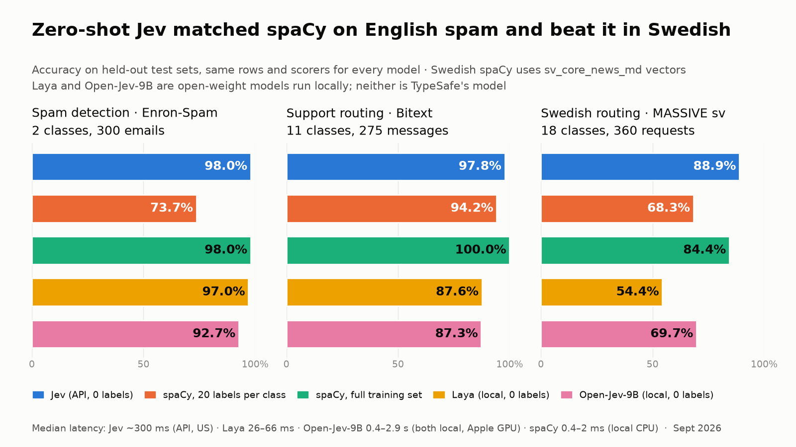</td>
<td align="center" valign="top">medya yayımlanmamış</td>
</tr></table>

🛡️ <b><a href="https://github.com/openwhat007/jev-rerank">openwhat007/jev-rerank</a></b> · ⭐2 · Python · 🔎 inferred · 58 天

##### 📝 Özet

TypeSafe'ın Jev Noul ilkel yapısıyla desteklenen sorgu/adaya göre yeniden sıralama. OpenRouter ve doğrudan TypeSafe API desteklenir.

##### 📌 Temel bilgiler

| Alan     | Değer                                      |
| -------- | ------------------------------------------ |
| Kategori | `Yönlendirme, koruma kuralları ve onaylar` |
| Kanıt    | `inferred`                                 |
| Dil      | Python                                     |

##### 📊 Veri

| Ölçüt          | Değer      |
| -------------- | ---------- |
| Yıldız         | **2**      |
| Son push       | 2026-09-26 |
| İlk listelenme | 2026-11-21 |

---

<table><tr><th align="center" width="50%">🖼 Görsel</th><th align="center" width="50%">🎬 Video</th></tr><tr>
<td align="center" valign="top"></td>
<td align="center" valign="top">medya yayımlanmamış</td>
</tr></table>

Yeniden dağıtım lisansı belirtilmediği için varlık üst depodan doğrudan bağlanmıştır.

🛡️ <b><a href="https://github.com/sdogantekin/jev-orchestrator">sdogantekin/jev-orchestrator</a></b> · ⭐1 · TypeScript · 🔎 inferred · 5 天

##### 📝 Özet

Ödeme Kararı Laboratuvarı: Jev'ın (TypeSafe'in karar modeli) kural tabanlı PSP yönlendirmesinin yerini alıp alamayacağının yalnızca simülasyona dayalı testi. Gerçek ödemelere asla dokunmaz.

##### 📌 Temel bilgiler

| Alan     | Değer                                      |
| -------- | ------------------------------------------ |
| Kategori | `Yönlendirme, koruma kuralları ve onaylar` |
| Kanıt    | `inferred`                                 |
| Dil      | TypeScript                                 |

##### 📊 Veri

| Ölçüt          | Değer      |
| -------------- | ---------- |
| Yıldız         | **1**      |
| Son push       | 2026-11-18 |
| İlk listelenme | 2026-11-11 |

🏷 `decision-making` · `experiment` · `fintech` · `llm` · `nextjs` · `payment-orchestration` · `payment-routing` · `payments`

---

<table><tr><th align="center" width="50%">🖼 Görsel</th><th align="center" width="50%">🎬 Video</th></tr><tr>
<td align="center" valign="top">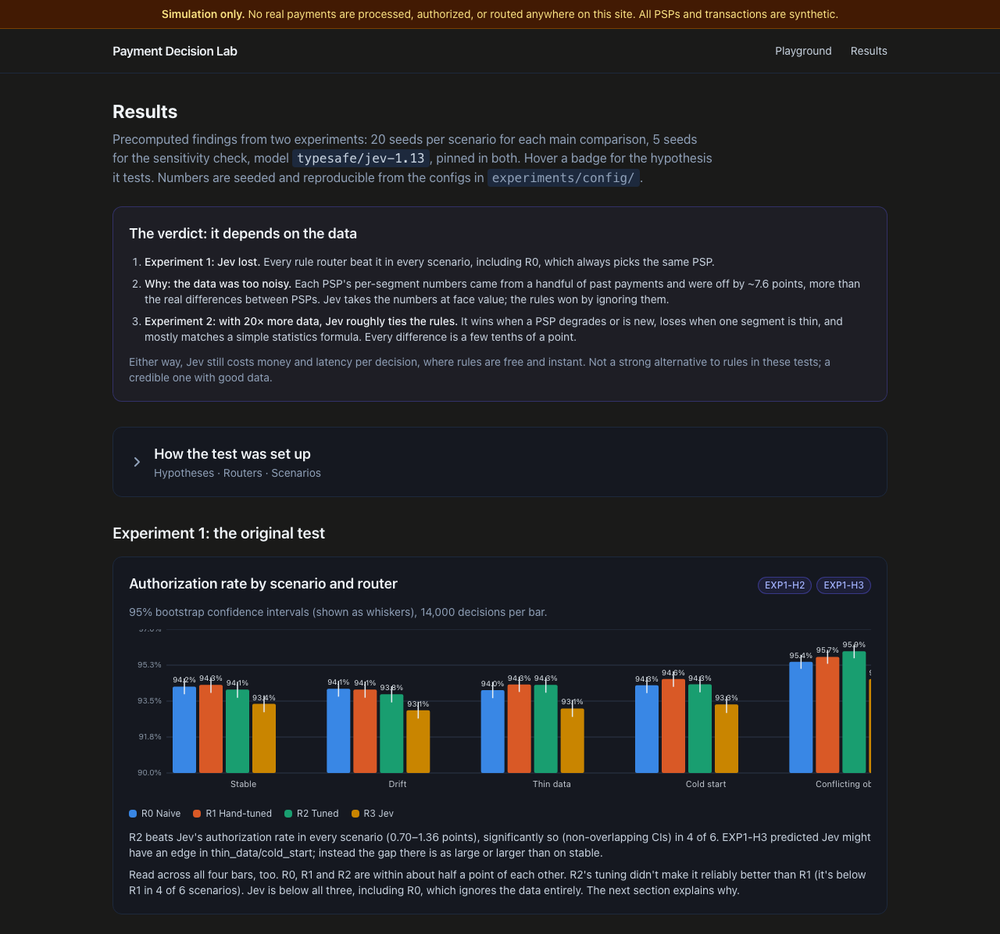</td>
<td align="center" valign="top">medya yayımlanmamış</td>
</tr></table>

<b>Bu kategoride daha fazla</b> · 30

- [bytelabs-oss/clash-jev](https://github.com/bytelabs-oss/clash-jev) - Eğitilmiş politikası olmayan bir Clash Royale botu: Jev (TypeSafe System One)…
- [vynnlee/jev-mail](https://github.com/vynnlee/jev-mail) - TypeSafe Jev System One tarafından desteklenen otonom 7/24 Zero-Inbox Gmail…
- [leofmarciano/groot](https://github.com/leofmarciano/groot) - 🌳 Groot 1 is a open typed-decision model, with a pure Bend engine.
- [hyspacex/jev-router](https://github.com/hyspacex/jev-router) - Route OpenAI-style chat requests to a model and reasoning effort, using…
- [umstek/zero-shot-ie-bench](https://github.com/umstek/zero-shot-ie-bench) - 60 zero-shot information-extraction &amp; classification systems (57 benchmarked)…
- [Dino-Kupinic/blackrose](https://github.com/Dino-Kupinic/blackrose) - The decision layer for LLM apps.
- [bitnovus/jev-spam-eval](https://github.com/bitnovus/jev-spam-eval) - TypeSafe Jev Noul sorusuyla sıfır atışlı spam filtreleme;
- [danvega/jev-comment-moderation](https://github.com/danvega/jev-comment-moderation) - Comment moderation with the Spring AI 2.1 Decision API and TypeSafe Jev.
- [Nhat-Nguyet/guardrail-chatbot-jev](https://github.com/Nhat-Nguyet/guardrail-chatbot-jev) - Content safety guardrails for AI chatbots: input, output and whole-conversation…
- [adityavsb/narrative-audit-jev](https://github.com/adityavsb/narrative-audit-jev) - OpenRouter benchmark harness: same decision task for rule baselines and pinned…
- [amarpai/flight-logs-non-generative-decision-using-jev](https://github.com/amarpai/flight-logs-non-generative-decision-using-jev) - Demo of using Jev to classify aircraft maintenance logs and flag potential…
- [arterialist/jev-robot](https://github.com/arterialist/jev-robot) - A Unitree G1 in MuJoCo with JEV reflexes, Gemini planning, and a live browser…
- [Arwin-K/jev-llm-gateway](https://github.com/Arwin-K/jev-llm-gateway) - a cost-aware LLM gateway with three-tier model routing, optional verification…
- [AutoPasha/jev-inbox-triage](https://github.com/AutoPasha/jev-inbox-triage) - Сортировка 40 обращений на модели Jev через Polza.ai за 0,84 ₽: скрипт…
- [dosorio79/jev_test](https://github.com/dosorio79/jev_test) - Offline-first multilingual CX sentiment routing benchmark.
- [freezetheflame/jev-ecosystem-research](https://github.com/freezetheflame/jev-ecosystem-research) - Jev (TypeSafe AI System One) 生态调研：开源复现规模、JevBench v1.4.2.2…
- [jakucermak/pi-jev-router](https://github.com/jakucermak/pi-jev-router) - Opt-in adaptive model routing and assignment scoring for Pi.
- [jangsik1986-bot/jev-sim](https://github.com/jangsik1986-bot/jev-sim) - Daily JEV topic-router pipeline simulation (mobile 9:16) for GitHub Pages.
- [Khidir782/Beam-jev](https://github.com/Khidir782/Beam-jev) - Calibrated DevOps tool-router distilled from Beam-1.0-501B via RLCD.
- [LuisFX/jev-lead-qualifier](https://github.com/LuisFX/jev-lead-qualifier) - First Read: qualify every inbound lead against an editable ICP with Jev.
- [mani-bellan/jev-apps](https://github.com/mani-bellan/jev-apps) - Pipeline failure triage and a customer support router built on TypeSafe AI.
- [mr-kittureddy/AI_Ticket_Routing_JEV](https://github.com/mr-kittureddy/AI_Ticket_Routing_JEV) - Using JEV AI built a Support ticket routing and solution generation with Gemini…
- [Muradmustafayev-03/jev-recovery-router](https://github.com/Muradmustafayev-03/jev-recovery-router) - Maliyete göre koşullanan niyet yönlendirme: seçilmiş Qwen3 inanç modeli…
- [PerseoAgencyAutomations/n8n-nodes-jev-gate](https://github.com/PerseoAgencyAutomations/n8n-nodes-jev-gate) - Nó da comunidade do n8n para o Jev (TypeSafe), com portão de confiança: segue…
- [petercr/jev-orchestrator](https://github.com/petercr/jev-orchestrator) - Zorluğa göre farklı LLMs hedeflerine yönlendirmeyi yönetmek için Jev kullanan…
- [SarathChandraBellam/jev-vs-llm-ticket-router](https://github.com/SarathChandraBellam/jev-vs-llm-ticket-router) - Benchmark: TypeSafe Jev vs traditional LLM on support-ticket routing accuracy…
- [smg1024/jev-router](https://github.com/smg1024/jev-router) - Pi extension: jev/auto virtual model that routes tasks to a physical model and…
- [sunilmehta-si/jev-inference-router](https://github.com/sunilmehta-si/jev-inference-router) - Observable TypeSafe Jev decision routing with local Apple Silicon LLM…
- [THEROCKSSS/awesome-jev](https://github.com/THEROCKSSS/awesome-jev) - Jev / TypeSafe System One projelerinin birleştirilmiş, yinelenenleri…
- [sumleo/RLCDAlignBench](https://github.com/sumleo/RLCDAlignBench) - RLCDAlignBench: &#x27;Just Ask Jev&#x27; için 44 hizalama hatası tespit karşılaştırması…

## Değerlendirme, kalibrasyon ve kıyaslamalar

Kararların iyi olduğunu insan nereden bilsin? Kalibrasyon bu ekosistemde açık sorudur ve bunlar onu ölçen projelerdir.

🧪 <b><a href="https://github.com/Mapika/decider">Mapika/decider</a></b> · ⭐1034 · Python · 👁️ observed · 34 天

##### 📝 Özet

Qwen3.5'ten ince ayarlanmış, kalibre edilmiş olasılıklarla tek geçişli tipli kararlar için tasarlanmış System One tarzı model ailesi.

🔧 Kodda kullanıldığı tespit edildi: `docs/HISTORY.md`, `README.md`

##### 📌 Temel bilgiler

| Alan     | Değer                                        |
| -------- | -------------------------------------------- |
| Kategori | `Değerlendirme, kalibrasyon ve kıyaslamalar` |
| Kanıt    | `observed`                                   |
| Dil      | Python                                       |

##### 📊 Veri

| Ölçüt          | Değer      |
| -------------- | ---------- |
| Yıldız         | **1034**   |
| Son push       | 2026-10-20 |
| İlk listelenme | 2026-11-20 |

---

<table><tr><th align="center" width="50%">🖼 Görsel</th><th align="center" width="50%">🎬 Video</th></tr><tr>
<td align="center" valign="top"></td>
<td align="center" valign="top"> hareketli kayıt</td>
</tr></table>

🧪 <b><a href="https://github.com/v-modal/awesome-jev-tools">v-modal/awesome-jev-tools</a></b> · ⭐537 · 👁️ observed · 8 天

##### 📝 Özet

Jev için oluşturulmuş seçkili araç listesi — TypeSafe AI's System One typed decisions modeli.

##### 📌 Temel bilgiler

| Alan     | Değer                                        |
| -------- | -------------------------------------------- |
| Kategori | `Değerlendirme, kalibrasyon ve kıyaslamalar` |
| Kanıt    | `observed`                                   |

##### 📊 Veri

| Ölçüt          | Değer      |
| -------------- | ---------- |
| Yıldız         | **537**    |
| Son push       | 2026-11-15 |
| İlk listelenme | 2026-09-20 |

🏷 `awesome-ai` · `awesome-jev` · `awesome-list` · `awesome-readme` · `calibrated-probabilities` · `jev` · `jev-ai` · `jev-alternative`

🧪 <b><a href="https://github.com/OmniJev/awesome-jev-gallery">OmniJev/awesome-jev-gallery</a></b> · ⭐495 · Python · 👁️ observed · 0 天

##### 📝 Özet

🔥🔥 Harika Jev: Jev ve System One modelleri için açık kaynaklı modeller, projeler, karşılaştırma testleri ve bağımsız değerlendirmeler.

##### 📌 Temel bilgiler

| Alan     | Değer                                        |
| -------- | -------------------------------------------- |
| Kategori | `Değerlendirme, kalibrasyon ve kıyaslamalar` |
| Kanıt    | `observed`                                   |
| Dil      | Python                                       |

##### 📊 Veri

| Ölçüt          | Değer      |
| -------------- | ---------- |
| Yıldız         | **495**    |
| Son push       | 2026-11-23 |
| İlk listelenme | 2026-09-20 |

🏷 `awesome` · `awesome-jev` · `awesome-list` · `calibrated-probabilities` · `calibration` · `decision-models` · `jev` · `jev-ai`

🧪 <b><a href="https://github.com/fstandhartinger/jevbench">fstandhartinger/jevbench</a></b> · ⭐353 · Python · 👁️ observed · 40 天

##### 📝 Özet

Benchmark Heaven tarafından geliştirilen JevBench: tipli karar doğruluğunu, kalibrasyonu, gecikmeyi ve maliyeti ölçen AI karar modelleri için benchmark ve liderlik tablosu.

🔧 Kodda kullanıldığı tespit edildi: `README.md`

##### 📌 Temel bilgiler

| Alan     | Değer                                        |
| -------- | -------------------------------------------- |
| Kategori | `Değerlendirme, kalibrasyon ve kıyaslamalar` |
| Kanıt    | `observed`                                   |
| Dil      | Python                                       |

##### 📊 Veri

| Ölçüt          | Değer      |
| -------------- | ---------- |
| Yıldız         | **353**    |
| Son push       | 2026-10-15 |
| İlk listelenme | 2026-11-08 |

🏷 `ai-benchmark` · `benchmark-heaven` · `calibration` · `decision-models` · `decisionmodels` · `jev` · `jev-compatible` · `jevbench`

---

<table><tr><th align="center" width="50%">🖼 Görsel</th><th align="center" width="50%">🎬 Video</th></tr><tr>
<td align="center" valign="top"></td>
<td align="center" valign="top">medya yayımlanmamış</td>
</tr></table>

🧪 <b><a href="https://github.com/cobusgreyling/Jev">cobusgreyling/Jev</a></b> · ⭐142 · Python · 👁️ observed · 39 天

##### 📝 Özet

Gayriresmî TypeSafe Jev vitrini — sohbet değil, System One karar.

🔧 Kodda kullanıldığı tespit edildi: `README.md`

##### 📌 Temel bilgiler

| Alan     | Değer                                        |
| -------- | -------------------------------------------- |
| Kategori | `Değerlendirme, kalibrasyon ve kıyaslamalar` |
| Kanıt    | `observed`                                   |
| Dil      | Python                                       |

##### 📊 Veri

| Ölçüt          | Değer      |
| -------------- | ---------- |
| Yıldız         | **142**    |
| Son push       | 2026-10-15 |
| İlk listelenme | 2026-10-26 |

🏷 `calibrated-decisions` · `jev` · `showcase` · `system-one` · `typesafe`

---

<table><tr><th align="center" width="50%">🖼 Görsel</th><th align="center" width="50%">🎬 Video</th></tr><tr>
<td align="center" valign="top"></td>
<td align="center" valign="top">medya yayımlanmamış</td>
</tr></table>

🧪 <b><a href="https://github.com/ikermoel/open-alternative-jev">ikermoel/open-alternative-jev</a></b> · ⭐82 · Python · 👁️ observed · 60 天

##### 📝 Özet

TypeSafe's Jev için açık kaynaklı alternatif: tek ileri geçişte herhangi bir açık ağırlıklı LLM'ten yazım denetimli, kalibre edilmiş kararlar sağlayan System One tarzı bir model katmanı (HF + vLLM), dürüst kıyaslamalarla

##### 📌 Temel bilgiler

| Alan     | Değer                                        |
| -------- | -------------------------------------------- |
| Kategori | `Değerlendirme, kalibrasyon ve kıyaslamalar` |
| Kanıt    | `observed`                                   |
| Dil      | Python                                       |

##### 📊 Veri

| Ölçüt          | Değer      |
| -------------- | ---------- |
| Yıldız         | **82**     |
| Son push       | 2026-09-25 |
| İlk listelenme | 2026-10-28 |

🏷 `calibration` · `classification` · `jev` · `jev-alternative` · `llm` · `logprobs` · `open-jev` · `open-source-jev`

🧪 <b><a href="https://github.com/hev/reranker">hev/reranker</a></b> · ⭐20 · Jupyter · 👁️ observed · 8 天

##### 📝 Özet

Jev'ı (TypeSafe'in System One modeli) kalibre edilmiş bir yeniden sıralayıcı olarak kullanın: tek çağrı, en fazla 30 belge ve belge başına bir olasılık. Apache-2.0.

##### 📌 Temel bilgiler

| Alan     | Değer                                        |
| -------- | -------------------------------------------- |
| Kategori | `Değerlendirme, kalibrasyon ve kıyaslamalar` |
| Kanıt    | `observed`                                   |
| Dil      | Jupyter                                      |

##### 📊 Veri

| Ölçüt          | Değer      |
| -------------- | ---------- |
| Yıldız         | **20**     |
| Son push       | 2026-11-15 |
| İlk listelenme | 2026-10-28 |

🧪 <b><a href="https://github.com/OmniJev/awesome-jev-papers">OmniJev/awesome-jev-papers</a></b> · ⭐13 · Python · 👁️ observed · 0 天

##### 📝 Özet

🔥🔥 Research papers on Jev, TypeSafe's System One model, and the open models built in its shape.

##### 📌 Temel bilgiler

| Alan     | Değer                                        |
| -------- | -------------------------------------------- |
| Kategori | `Değerlendirme, kalibrasyon ve kıyaslamalar` |
| Kanıt    | `observed`                                   |
| Dil      | Python                                       |

##### 📊 Veri

| Ölçüt          | Değer      |
| -------------- | ---------- |
| Yıldız         | **13**     |
| Son push       | 2026-11-23 |
| İlk listelenme | 2026-09-28 |

🏷 `arxiv` · `awesome` · `awesome-list` · `calibration` · `decision-model` · `jev` · `llm` · `paper-list`

🧪 <b><a href="https://github.com/akash-kamat/system-one-gemma">akash-kamat/system-one-gemma</a></b> · ⭐8 · Python · 👁️ observed · 67 天

##### 📝 Özet

Açık kaynak Jev tarzı System One karar modeli. Puanlama başlığına sahip Gemma 3 270M — tek bir ileri geçişte hızlı ve kalibre edilmiş kararlar. Metin üretimi yoktur. TypeSafe.ai'nin Jev modelinden esinlenilmiştir.

##### 📌 Temel bilgiler

| Alan     | Değer                                        |
| -------- | -------------------------------------------- |
| Kategori | `Değerlendirme, kalibrasyon ve kıyaslamalar` |
| Kanıt    | `observed`                                   |
| Dil      | Python                                       |

##### 📊 Veri

| Ölçüt          | Değer      |
| -------------- | ---------- |
| Yıldız         | **8**      |
| Son push       | 2026-09-18 |
| İlk listelenme | 2026-11-16 |

🏷 `calibration` · `decision-model` · `gemma` · `jev` · `lora` · `machine-learning` · `scoring-model` · `system-one`

🧪 <b><a href="https://github.com/brida-ai/reflexbench">brida-ai/reflexbench</a></b> · ⭐7 · Python · 👁️ observed · 1 天

##### 📝 Özet

ReflexBench — System One modelleri ve tür bilgili karar motorları için açık karşılaştırma ve değerlendirme altyapısı

##### 📌 Temel bilgiler

| Alan     | Değer                                        |
| -------- | -------------------------------------------- |
| Kategori | `Değerlendirme, kalibrasyon ve kıyaslamalar` |
| Kanıt    | `observed`                                   |
| Dil      | Python                                       |

##### 📊 Veri

| Ölçüt          | Değer      |
| -------------- | ---------- |
| Yıldız         | **7**      |
| Son push       | 2026-11-22 |
| İlk listelenme | 2026-11-21 |

🏷 `ai-benchmark` · `ai-evaluation` · `benchmark` · `calibration` · `choice` · `decision-models` · `jev` · `laya`

🧪 <b><a href="https://github.com/EventumAI/jev-builds">EventumAI/jev-builds</a></b> · 👁️ observed · 0 天

##### 📝 Özet

Decision model builds: Jev, TypeSafe's System One model, measured against a baseline by engineers who build with Eventum.

##### 📌 Temel bilgiler

| Alan     | Değer                                        |
| -------- | -------------------------------------------- |
| Kategori | `Değerlendirme, kalibrasyon ve kıyaslamalar` |
| Kanıt    | `observed`                                   |

##### 📊 Veri

| Ölçüt          | Değer      |
| -------------- | ---------- |
| Yıldız         | **0**      |
| Son push       | 2026-11-24 |
| İlk listelenme | 2026-11-24 |

🏷 `decision-models` · `evaluation` · `jev` · `system-one` · `typesafe`

🧪 <b><a href="https://github.com/mahirmalik030/Jev-vs-LLMs">mahirmalik030/Jev-vs-LLMs</a></b> · Python · 👁️ observed · 17 天

##### 📝 Özet

A comparative study of Jev 1.13 and Large Language Models (LLMs) for phishing email detection, evaluating classification performance, probability calibration, inference latency, token consumption, and API costs.

##### 📌 Temel bilgiler

| Alan     | Değer                                        |
| -------- | -------------------------------------------- |
| Kategori | `Değerlendirme, kalibrasyon ve kıyaslamalar` |
| Kanıt    | `observed`                                   |
| Dil      | Python                                       |

##### 📊 Veri

| Ölçüt          | Değer      |
| -------------- | ---------- |
| Yıldız         | **0**      |
| Son push       | 2026-11-06 |
| İlk listelenme | 2026-11-04 |

🧪 <b><a href="https://github.com/nokia-applied-research/AnyJev">nokia-applied-research/AnyJev</a></b> · ⭐1639 · Python · 🔎 inferred · 33 天

##### 📝 Özet

Herhangi bir LLM öğesini Jev tarzı bir karar modeline dönüştürün: tür belirtilmiş kararlar, gerçek olasılıklar, eğitim yok. (güncellemeleri sürdürün, her türlü issue ve PR talebine açığız)

##### 📌 Temel bilgiler

| Alan     | Değer                                        |
| -------- | -------------------------------------------- |
| Kategori | `Değerlendirme, kalibrasyon ve kıyaslamalar` |
| Kanıt    | `inferred`                                   |
| Dil      | Python                                       |

##### 📊 Veri

| Ölçüt          | Değer      |
| -------------- | ---------- |
| Yıldız         | **1639**   |
| Son push       | 2026-10-21 |
| İlk listelenme | 2026-09-22 |

🏷 `calibration` · `decision-model` · `jev` · `jev-model` · `llm` · `system-one` · `transformers` · `vllm`

---

<table><tr><th align="center" width="50%">🖼 Görsel</th><th align="center" width="50%">🎬 Video</th></tr><tr>
<td align="center" valign="top"></td>
<td align="center" valign="top">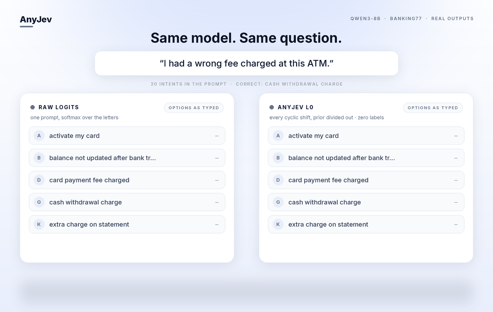 hareketli kayıt</td>
</tr></table>

🧪 <b><a href="https://github.com/allebee/jevk5">allebee/jevk5</a></b> · ⭐170 · Python · 🔎 inferred · 57 天

##### 📝 Özet

JevK5: TypeSafe Jev için açık ağırlıklı alternatif. Tek bir ileri geçişte olasılıklarla tipli kararlar; Apache-2.0 ağırlıkları ve kodu.

##### 📌 Temel bilgiler

| Alan     | Değer                                        |
| -------- | -------------------------------------------- |
| Kategori | `Değerlendirme, kalibrasyon ve kıyaslamalar` |
| Kanıt    | `inferred`                                   |
| Dil      | Python                                       |

##### 📊 Veri

| Ölçüt          | Değer      |
| -------------- | ---------- |
| Yıldız         | **170**    |
| Son push       | 2026-09-28 |
| İlk listelenme | 2026-10-29 |

🏷 `calibration` · `decision-model` · `jev` · `jev-alternative` · `jevbench` · `lora` · `qwen` · `system-one`

---

<table><tr><th align="center" width="50%">🖼 Görsel</th><th align="center" width="50%">🎬 Video</th></tr><tr>
<td align="center" valign="top"></td>
<td align="center" valign="top"> hareketli kayıt · <a href="https://raw.githubusercontent.com/allebee/jevk5/main/docs/demo/jevk5-nvidia-demo.mp4">Videoyu aç</a></td>
</tr></table>

🧪 <b><a href="https://github.com/SimpleJev/JevAny">SimpleJev/JevAny</a></b> · ⭐144 · Python · 🔎 inferred · 0 天

##### 📝 Özet

Open infrastructure for training, evaluating, and deploying System 1 decision models across language and multimodal backbones.

##### 📌 Temel bilgiler

| Alan     | Değer                                        |
| -------- | -------------------------------------------- |
| Kategori | `Değerlendirme, kalibrasyon ve kıyaslamalar` |
| Kanıt    | `inferred`                                   |
| Dil      | Python                                       |

##### 📊 Veri

| Ölçüt          | Değer      |
| -------------- | ---------- |
| Yıldız         | **144**    |
| Son push       | 2026-11-23 |
| İlk listelenme | 2026-11-24 |

🏷 `decision-making` · `decision-model` · `jev` · `jev-ai` · `jev-model` · `lora` · `multimodal` · `reinforcement-learning`

---

<table><tr><th align="center" width="50%">🖼 Görsel</th><th align="center" width="50%">🎬 Video</th></tr><tr>
<td align="center" valign="top"></td>
<td align="center" valign="top">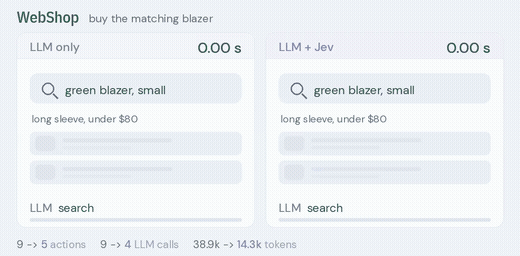 hareketli kayıt · <a href="https://simplejev.org/JevAny/assets/media/docs/jev-agent-harness.mp4">Videoyu aç</a></td>
</tr></table>

🧪 <b><a href="https://github.com/Heman10x-NGU/Verdict-open-jev">Heman10x-NGU/Verdict-open-jev</a></b> · ⭐119 · Python · 🔎 inferred · 33 天

##### 📝 Özet

Kalibre edilmiş belirsizlik (RLCD), TypeSafe AI Jev kıyaslama denetimi ve tarayıcı içi WebGPU oyun alanına sahip ModernBERT (151M) üzerinde otoregresif olmayan karar motoru

##### 📌 Temel bilgiler

| Alan     | Değer                                        |
| -------- | -------------------------------------------- |
| Kategori | `Değerlendirme, kalibrasyon ve kıyaslamalar` |
| Kanıt    | `inferred`                                   |
| Dil      | Python                                       |

##### 📊 Veri

| Ölçüt          | Değer      |
| -------------- | ---------- |
| Yıldız         | **119**    |
| Son push       | 2026-10-21 |
| İlk listelenme | 2026-09-18 |

🏷 `brier-score` · `calibration` · `decision-engine` · `edge-ai` · `gliclass` · `jev` · `modernbert` · `onnx`

---

<table><tr><th align="center" width="50%">🖼 Görsel</th><th align="center" width="50%">🎬 Video</th></tr><tr>
<td align="center" valign="top"></td>
<td align="center" valign="top">medya yayımlanmamış</td>
</tr></table>

Yeniden dağıtım lisansı belirtilmediği için varlık üst depodan doğrudan bağlanmıştır.

🧪 <b><a href="https://github.com/manjunathshiva/opendecider">manjunathshiva/opendecider</a></b> · ⭐42 · Python · 🔎 inferred · 5 天

##### 📝 Özet

Open, calibrated System 1 decision models: typed choice / score / yes-no answers with a probability for every option. 400M to 80B; CPU, NVIDIA, Apple Silicon, LM Studio, Ollama and vLLM.

##### 📌 Temel bilgiler

| Alan     | Değer                                        |
| -------- | -------------------------------------------- |
| Kategori | `Değerlendirme, kalibrasyon ve kıyaslamalar` |
| Kanıt    | `inferred`                                   |
| Dil      | Python                                       |

##### 📊 Veri

| Ölçüt          | Değer      |
| -------------- | ---------- |
| Yıldız         | **42**     |
| Son push       | 2026-11-18 |
| İlk listelenme | 2026-11-23 |

🏷 `apple-silicon` · `calibration` · `classification` · `decision-model` · `gguf` · `huggingface` · `llm` · `mlx`

---

<table><tr><th align="center" width="50%">🖼 Görsel</th><th align="center" width="50%">🎬 Video</th></tr><tr>
<td align="center" valign="top">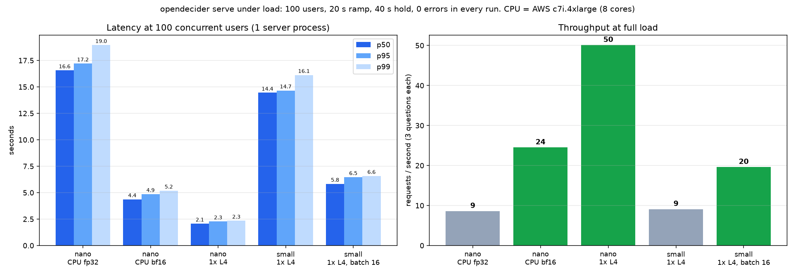</td>
<td align="center" valign="top">medya yayımlanmamış</td>
</tr></table>

🧪 <b><a href="https://github.com/ankit-aglawe/tinyjev">ankit-aglawe/tinyjev</a></b> · ⭐29 · Python · 🔎 inferred · 53 天

##### 📝 Özet

Tek ileri geçişte Choice, Score ve Noul sorularını yanıtlayan ve kalibre edilmiş olasılıkları döndüren küçük, jev benzeri model. MLX veya PyTorch, tamamen çevrimdışı, System One uyumlu.

##### 📌 Temel bilgiler

| Alan     | Değer                                        |
| -------- | -------------------------------------------- |
| Kategori | `Değerlendirme, kalibrasyon ve kıyaslamalar` |
| Kanıt    | `inferred`                                   |
| Dil      | Python                                       |

##### 📊 Veri

| Ölçüt          | Değer      |
| -------------- | ---------- |
| Yıldız         | **29**     |
| Son push       | 2026-10-01 |
| İlk listelenme | 2026-09-23 |

🏷 `decision-model` · `jev` · `jev-model` · `mlx` · `qwen3` · `small-language-models` · `system-one` · `typed-decisions`

---

<table><tr><th align="center" width="50%">🖼 Görsel</th><th align="center" width="50%">🎬 Video</th></tr><tr>
<td align="center" valign="top"></td>
<td align="center" valign="top"> hareketli kayıt</td>
</tr></table>

🧪 <b><a href="https://github.com/shibing624/train-jev">shibing624/train-jev</a></b> · ⭐21 · Python · 🔎 inferred · 31 天

##### 📝 Özet

Qwen3.5 ve Qwen3.8-27B üzerinde JEV tarzı System 1 karar modelleri eğitin: 24 yuvalı karar başlığı, KL damıtımı, kalibrasyon ve sunum. Qwen üzerinde JEV tarzı System 1 karar modelleri eğitimi.

##### 📌 Temel bilgiler

| Alan     | Değer                                        |
| -------- | -------------------------------------------- |
| Kategori | `Değerlendirme, kalibrasyon ve kıyaslamalar` |
| Kanıt    | `inferred`                                   |
| Dil      | Python                                       |

##### 📊 Veri

| Ölçüt          | Değer      |
| -------------- | ---------- |
| Yıldız         | **21**     |
| Son push       | 2026-10-23 |
| İlk listelenme | 2026-11-04 |

🏷 `calibration` · `decision-model` · `distillation` · `fine-tuning` · `llm` · `lora` · `nlp` · `pytorch`

---

<table><tr><th align="center" width="50%">🖼 Görsel</th><th align="center" width="50%">🎬 Video</th></tr><tr>
<td align="center" valign="top"></td>
<td align="center" valign="top">medya yayımlanmamış</td>
</tr></table>

🧪 <b><a href="https://github.com/Enntity/sparkscore">Enntity/sparkscore</a></b> · ⭐16 · Python · 🔎 inferred · 4 天

##### 📝 Özet

Typed, calibrated decisions on one NVIDIA DGX Spark: d3-ultra 27B NVFP4 on Atlas, JevBench public 90.9% at p50 146 ms, every question in one engine pass.

##### 📌 Temel bilgiler

| Alan     | Değer                                        |
| -------- | -------------------------------------------- |
| Kategori | `Değerlendirme, kalibrasyon ve kıyaslamalar` |
| Kanıt    | `inferred`                                   |
| Dil      | Python                                       |

##### 📊 Veri

| Ölçüt          | Değer      |
| -------------- | ---------- |
| Yıldız         | **16**     |
| Son push       | 2026-11-20 |
| İlk listelenme | 2026-11-10 |

🏷 `calibration` · `decision-model` · `dgx-spark` · `gb10` · `jev` · `llm-inference` · `nvfp4`

---

<table><tr><th align="center" width="50%">🖼 Görsel</th><th align="center" width="50%">🎬 Video</th></tr><tr>
<td align="center" valign="top">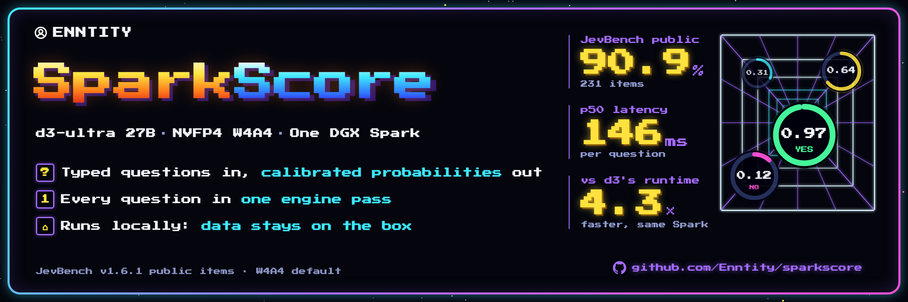</td>
<td align="center" valign="top">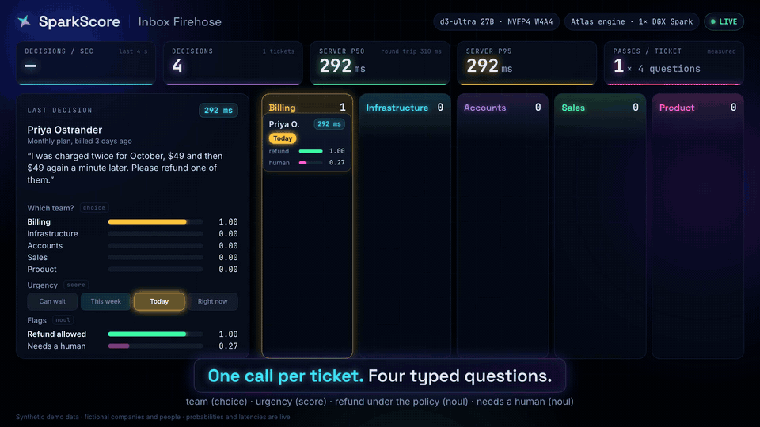 hareketli kayıt</td>
</tr></table>

🧪 <b><a href="https://github.com/BrendanH18/jev_fsd">BrendanH18/jev_fsd</a></b> · ⭐13 · JavaScript · 🔎 inferred · 0 天

##### 📝 Özet

A driving test for AI models, on real Canadian streets, that you can also take yourself.

##### 📌 Temel bilgiler

| Alan     | Değer                                        |
| -------- | -------------------------------------------- |
| Kategori | `Değerlendirme, kalibrasyon ve kıyaslamalar` |
| Kanıt    | `inferred`                                   |
| Dil      | JavaScript                                   |

##### 📊 Veri

| Ölçüt          | Değer      |
| -------------- | ---------- |
| Yıldız         | **13**     |
| Son push       | 2026-11-23 |
| İlk listelenme | 2026-10-23 |

🏷 `ai` · `benchmark` · `driving-simulator` · `javascript` · `jev` · `openstreetmap` · `python` · `self-driving`

---

<table><tr><th align="center" width="50%">🖼 Görsel</th><th align="center" width="50%">🎬 Video</th></tr><tr>
<td align="center" valign="top">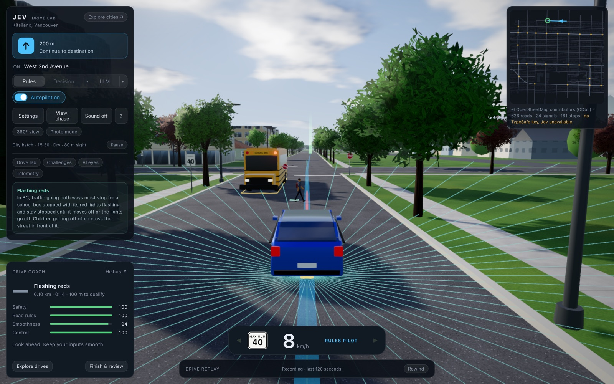</td>
<td align="center" valign="top">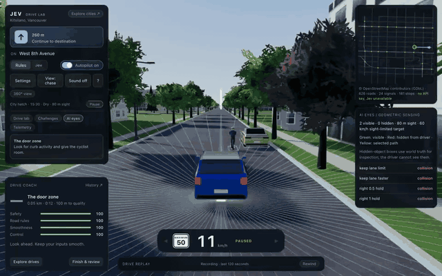 hareketli kayıt</td>
</tr></table>

🧪 <b><a href="https://github.com/Algorythm-Canada/OpenJevSwift">Algorythm-Canada/OpenJevSwift</a></b> · ⭐10 · Swift · 🔎 inferred · 5 天

##### 📝 Özet

Native Swift implementation of OpenJev, the Jev-compatible typed-decision server: yes/no, choice and score answers read from model probabilities, on Apple silicon Macs and in iPhone apps. Serves Verdict, Laya, DiffusionGemma and JevK5. Apache-2.0.

##### 📌 Temel bilgiler

| Alan     | Değer                                        |
| -------- | -------------------------------------------- |
| Kategori | `Değerlendirme, kalibrasyon ve kıyaslamalar` |
| Kanıt    | `inferred`                                   |
| Dil      | Swift                                        |

##### 📊 Veri

| Ölçüt          | Değer      |
| -------------- | ---------- |
| Yıldız         | **10**     |
| Son push       | 2026-11-18 |
| İlk listelenme | 2026-11-19 |

🏷 `apple-silicon` · `coreml` · `decision-model` · `diffusiongemma` · `ios` · `jev` · `laya` · `llm`

---

<table><tr><th align="center" width="50%">🖼 Görsel</th><th align="center" width="50%">🎬 Video</th></tr><tr>
<td align="center" valign="top"></td>
<td align="center" valign="top"> hareketli kayıt</td>
</tr></table>

<b>Bu kategoride daha fazla</b> · 56

- [patryckalves/jev-no-enem](https://github.com/patryckalves/jev-no-enem) - Brezilya&#x27;nın ENEM 2025 standart sınavında TypeSafe AI&#x27;ın Jev.
- [vikawork/decision-models-calibration](https://github.com/vikawork/decision-models-calibration) - Decision APIs measured: Jev 1.14, gpt-6-luna Decisions and Gemini Decision 1 on…
- [buberlo/jev-trader](https://github.com/buberlo/jev-trader) - Jev (TypeSafe System One) kararları etrafında 7/24 piyasa yapıcılığı sistemi…
- [SamratDuttaOfficial/WaterSheep](https://github.com/SamratDuttaOfficial/WaterSheep) - Evet/hayır, seçim, puan ve çok etiketli sorulara kalibre edilmiş yanıtlar…
- [Nhahan/Xevn](https://github.com/Nhahan/Xevn) - A 4B decision model built for Korean.
- [us/jev-local](https://github.com/us/jev-local) - Yerel Jev uyumlu değerlendirme sunucusu: tür bilgili noul/choice/score ile POST…
- [mertkayacs/jevalt](https://github.com/mertkayacs/jevalt) - Three 4B decision models for English, Turkish and German, with per-option…
- [cablehead/jev.nu](https://github.com/cablehead/jev.nu) - TypeSafe System One API için Nushell modülü: kalibre edilmiş olasılıklara sahip…
- [Yifan-Lan/awesome-jev-robustness](https://github.com/Yifan-Lan/awesome-jev-robustness) - Jev (TypeSafe System One) testleri, kalibrasyon denetimleri ve hata modu…
- [y0usaf/jev-lm](https://github.com/y0usaf/jev-lm) - Çıktı katmanı Jev olan sözcük düzeyinde dil modeli: n-gram taslağı, Noul parça…
- [instax-dutta/sysone-bench](https://github.com/instax-dutta/sysone-bench) - Baytları özdeş girdiler üzerinde System One karar modellerinin (Laya ve Jev)…
- [zamax14/Laya-Finetune](https://github.com/zamax14/Laya-Finetune) - Açık System One karar modeli Laya.
- [mertkayacs/jevoss](https://github.com/mertkayacs/jevoss) - Evaluation tools for Jev-compatible decision models, covering accuracy…
- [bloosiee/jev-rag-toolbox](https://github.com/bloosiee/jev-rag-toolbox) - Train and evaluate Jev decisions for evidence sufficiency and search necessity.
- [CodyQin/zh-decision-bench](https://github.com/CodyQin/zh-decision-bench) - Jev sınıfı &#x27;System One&#x27; karar modelleri için Çince ilk kalibrasyon…
- [mpuig/system-one](https://github.com/mpuig/system-one) - Hızlı ve otomatik yargı yetisi için Kahneman.
- [tak-bro/local-jev-bench](https://github.com/tak-bro/local-jev-bench) - Apple Silicon Mac.
- [CosmoIknosLab/EarthJev](https://github.com/CosmoIknosLab/EarthJev) - EarthJev: calibrated, non-generative answers to natural-language questions…
- [etsabary/jev-deterministic-benchmark](https://github.com/etsabary/jev-deterministic-benchmark) - 25 deterministik akıl yürütme ailesinde Jev için 1.000 kararlı davranış…
- [jacquescogal/viva-recall](https://github.com/jacquescogal/viva-recall) - Flashcards you answer in your own words, marked by a decision model (Jev) you…
- [Rushab1/gr-jev](https://github.com/Rushab1/gr-jev) - Code for.
- [teyhouse/jev-secret-detection](https://github.com/teyhouse/jev-secret-detection) - TypeSafe.
- [beskvladimir-create/ru-jev](https://github.com/beskvladimir-create/ru-jev) - Ru-Jev: an open Russian typed-decision model.
- [EnesDemir143/jev-laya-benchmark](https://github.com/EnesDemir143/jev-laya-benchmark) - Yapılandırılmış sorun sınıflandırması için TypeSafe Jev ve Laya-MLX…
- [lewistouchtech/opencode-jev-safe-compact](https://github.com/lewistouchtech/opencode-jev-safe-compact) - JEV-guided context compaction for OpenCode, built on a measured finding: noul…
- [marchexe/jev-evaluation-lab](https://github.com/marchexe/jev-evaluation-lab) - A web app using TypeSafe Jev to classify AI systems by use case, personal data…
- [xiaohuiyan/awesome-jev-papers](https://github.com/xiaohuiyan/awesome-jev-papers) - Curated arXiv papers on Jev, System One and typed decision models, with…
- [aaaldo/opencode-jev](https://github.com/aaaldo/opencode-jev) - Standalone OpenClaw decision provider for OpenCode Jev models, returning typed…
- [agarwalastitwa027-svg/mini-jev-multimodal](https://github.com/agarwalastitwa027-svg/mini-jev-multimodal) - Küçük görüntü+metin karar modeli: Qwen3-VL-2B + LoRA + yanıt başlığı…
- [ankur287/jev-open-calibration](https://github.com/ankur287/jev-open-calibration) - Rebuilding Jev.
- [ArsalanKaleem/sindhi-JEV](https://github.com/ArsalanKaleem/sindhi-JEV) - A small (7M-parameter) checker for Sindhi OCR: given a scanned word or line and…
- [betulsimsek/jev-decomposition-tr](https://github.com/betulsimsek/jev-decomposition-tr) - Does splitting a typed-decision question help? Jev vs OpenAI Decisions vs Laya…
- [cayoesn/llm-jev-engine](https://github.com/cayoesn/llm-jev-engine) - System-1 Non-Autoregressive Single-Pass Neural Decision Engine with RLCD…
- [Chetax/jev-ecommerce-reviews](https://github.com/Chetax/jev-ecommerce-reviews) - E-commerce review classification with TypeSafe.
- [dnakhoa/jev-deferred-crispification](https://github.com/dnakhoa/jev-deferred-crispification) - Konum belgesi: TypeSafe AI.
- [humandebri/IC-OpenJev](https://github.com/humandebri/IC-OpenJev) - IC-Verdict: Rust model canister on ICP.
- [n9omi/jev-calibration-audit](https://github.com/n9omi/jev-calibration-audit) - Independent calibration audit of TypeSafe AI.
- [Nijal-AI/jev-lab](https://github.com/Nijal-AI/jev-lab) - Atelier web pour mettre à l.
- [omnaiduu/jev](https://github.com/omnaiduu/jev) - Gemma 4 E4B + one LoRA per dataset picks an answer with an honest confidence %.
- [open-factoryai/myJEV](https://github.com/open-factoryai/myJEV) - Her durumu yapılandırılmış, kalibre edilmiş kararlara dönüştürün.
- [Poojithcodes/jev-calibration-study](https://github.com/Poojithcodes/jev-calibration-study) - Comparing Jev.
- [unofficial-equivocation2029/Open-Jev](https://github.com/unofficial-equivocation2029/Open-Jev) - Bağlam ve adaylardan tipli karar olasılıklarını anında alın—otoregresif üretim…
- [yasumorishima/jev-baseball](https://github.com/yasumorishima/jev-baseball) - Testing TypeSafe Jev (a decision-only model) on MLB judgement tasks against…
- [Zayan-droid/Jev](https://github.com/Zayan-droid/Jev) - Calibrated single-pass decision model: typed yes/no, choice and score questions…
- [taeold/djev-run](https://github.com/taeold/djev-run) - Serve the experimental DiffusionGemma-Jev diffusion model on Cloud Run GPUs…
- [kyotofin/tax-doc-classifier](https://github.com/kyotofin/tax-doc-classifier) - Jev kararları üzerine kurulmuş vergi belgesi sayfası sınıflandırıcısı.
- [mohit67890/imajev](https://github.com/mohit67890/imajev) - Görüntüleri de alan, Jev tarzı açık kaynaklı tipli karar modeli: fotoğraf +…
- [hotchpotch/bekko-system-one](https://github.com/hotchpotch/bekko-system-one) - Evet/Hayır, Choice, Score ve yeniden sıralama için küçük System One karar…
- [mithalouni/system-one-open](https://github.com/mithalouni/system-one-open) - TypeSafe&#x27;s Jev&#x27;in açık kopyası: Gemma 4 E2B / Gemma 3 270M (Modal) üzerinde tek…
- [genai-craft/openvons](https://github.com/genai-craft/openvons) - openvons (open-Jev): Sınırlı seçeneklere olasılıkla yanıt veren karar katmanı…
- [nibzard/decision-model-benchmark](https://github.com/nibzard/decision-model-benchmark) - Bağımsız, yeniden üretilebilir kıyaslama: bir karar modeli (jev), sekiz kısıtlı…
- [arnabgho/rlcd-lite](https://github.com/arnabgho/rlcd-lite) - Kalibre Edilmiş Kararlar için Basitleştirilmiş RL: paralel kısıtlı JSON kod…
- [nomadoor/ComfyUI-TypedDecision](https://github.com/nomadoor/ComfyUI-TypedDecision) - Metin kodlayıcı motoru üzerinde ComfyUI.
- [mithril-lang/typed-decisions](https://github.com/mithril-lang/typed-decisions) - ModernBERT / DeBERTa / LLaDA-MoE üzerinde, Jev biçimli tür bilgili karar modeli…
- [Mangaba-ai/brier](https://github.com/Mangaba-ai/brier) - Brier, by Mangaba AI: typed, calibrated decisions (choice/score/noul) for…
- [shamazharikh/qwen-rlcd](https://github.com/shamazharikh/qwen-rlcd) - Qwen3.5-0.8B üzerinde Jev tarzı kalibre edilmiş karar modeli (Choice/Score/Noul).

## Açık yeniden üretimler, ağırlıklar ve mimari araştırması

Açık ağırlıklar, küçük kopyalar ve mimari çalışmaları. Bunlardan birkaçı, kalibrasyon davranışının yalnızca kamuya açık materyalden yeniden üretilememesi yüzünden var.

🔬 <b><a href="https://github.com/kshetrajna12/reflex">kshetrajna12/reflex</a></b> · ⭐175 · Python · 👁️ observed · 48 天

##### 📝 Özet

Küçük ve açık bir karar modeli: durum + tür belirtilmiş sorular -> kalibre edilmiş olasılıklar. Qwen3.5 üzerinde bir Jev / System One yeniden oluşturması.

> 💡 Aynı durum-artı-tür-belirtilmiş-soru arayüzüne sahip açık bir karar modeli. Hiç çalıştırmasanız bile biçim referansı olarak okumaya değerdir.

##### 📌 Temel bilgiler

| Alan     | Değer                                                      |
| -------- | ---------------------------------------------------------- |
| Kategori | `Açık yeniden üretimler, ağırlıklar ve mimari araştırması` |
| Kanıt    | `observed`                                                 |
| Dil      | Python                                                     |

##### 📊 Veri

| Ölçüt          | Değer      |
| -------------- | ---------- |
| Yıldız         | **175**    |
| Son push       | 2026-10-06 |
| İlk listelenme | 2026-11-20 |

🔬 <b><a href="https://github.com/TianyuCodings/NanoJev">TianyuCodings/NanoJev</a></b> · ⭐2606 · Python · 🔎 inferred · 39 天

##### 📝 Özet

Jev'ın nano kopyası: paralel kararlar, dinamik adaylar ve uçtan uca eğitim işlem hattı.

> 💡 Paralel karar biçiminin küçük bir kopyası. Tedarikçi yığını olmadan mimariyi anlamak için kullanışlıdır ve arayüzle ilgili çeşitli iddiaların ilk kez doğrulanabilir hâle gelmesini sağlamıştır.

##### 📌 Temel bilgiler

| Alan     | Değer                                                      |
| -------- | ---------------------------------------------------------- |
| Kategori | `Açık yeniden üretimler, ağırlıklar ve mimari araştırması` |
| Kanıt    | `inferred`                                                 |
| Dil      | Python                                                     |

##### 📊 Veri

| Ölçüt          | Değer      |
| -------------- | ---------- |
| Yıldız         | **2606**   |
| Son push       | 2026-10-16 |
| İlk listelenme | 2026-11-08 |

---

<table><tr><th align="center" width="50%">🖼 Görsel</th><th align="center" width="50%">🎬 Video</th></tr><tr>
<td align="center" valign="top">medya yayımlanmamış</td>
<td align="center" valign="top"> hareketli kayıt</td>
</tr></table>

🔬 <b><a href="https://github.com/r-ms/mini-jev">r-ms/mini-jev</a></b> · ⭐64 · Python · 🔎 inferred · 66 天

##### 📝 Özet

mini-Jev: dondurulmuş bir Qwen3-4B üzerinde Jev tarzı tür belirtilmiş karar arayüzünün nasıl göründüğü — JSON üretmek yerine seçenek harfinin logit'lerini okuyun. Önceden kaydedilmiş deney, sonuçlar, öğretim tezgâhı.

> 💡 Okunabilecek en yararlı bağımsız yeniden üretim: logit'leri okuma mekanizmasının çalıştığını gösteriyor ve ayrıca okuduğu payın kalibre edilmiş bir olasılık olmadığı konusunda açıkça uyarıyor. Bu uyarı, bu ekosistemdeki en önemli tek çekincedir.

##### 📌 Temel bilgiler

| Alan     | Değer                                                      |
| -------- | ---------------------------------------------------------- |
| Kategori | `Açık yeniden üretimler, ağırlıklar ve mimari araştırması` |
| Kanıt    | `inferred`                                                 |
| Dil      | Python                                                     |

##### 📊 Veri

| Ölçüt          | Değer      |
| -------------- | ---------- |
| Yıldız         | **64**     |
| Son push       | 2026-09-18 |
| İlk listelenme | 2026-09-18 |

---

<table><tr><th align="center" width="50%">🖼 Görsel</th><th align="center" width="50%">🎬 Video</th></tr><tr>
<td align="center" valign="top"></td>
<td align="center" valign="top">medya yayımlanmamış</td>
</tr></table>

🔬 <b><a href="https://github.com/FBddcz/embodied-jev">FBddcz/embodied-jev</a></b> · ⭐342 · Python · 👁️ observed · 62 天

##### 📝 Özet

EmbodiedJev: MiniCPM5-2B, Jev ve uyumlu model APIs ile MuJoCo robot karar çalışma tezgâhı

🔧 Kodda kullanıldığı tespit edildi: `README.md`

##### 📌 Temel bilgiler

| Alan     | Değer                                                      |
| -------- | ---------------------------------------------------------- |
| Kategori | `Açık yeniden üretimler, ağırlıklar ve mimari araştırması` |
| Kanıt    | `observed`                                                 |
| Dil      | Python                                                     |

##### 📊 Veri

| Ölçüt          | Değer      |
| -------------- | ---------- |
| Yıldız         | **342**    |
| Son push       | 2026-09-22 |
| İlk listelenme | 2026-11-08 |

---

<table><tr><th align="center" width="50%">🖼 Görsel</th><th align="center" width="50%">🎬 Video</th></tr><tr>
<td align="center" valign="top"></td>
<td align="center" valign="top"> hareketli kayıt · <a href="https://raw.githubusercontent.com/FBddcz/embodied-jev/main/docs/media/libero-drawer-comparison.mp4">Videoyu aç</a></td>
</tr></table>

🔬 <b><a href="https://github.com/PsiACE/dohnuts">PsiACE/dohnuts</a></b> · ⭐40 · Python · 👁️ observed · 48 天

##### 📝 Özet

Dohnuts, doğrudan kararlar için küçük multimodal modeller oluşturur. -> System One modeli

##### 📌 Temel bilgiler

| Alan     | Değer                                                      |
| -------- | ---------------------------------------------------------- |
| Kategori | `Açık yeniden üretimler, ağırlıklar ve mimari araştırması` |
| Kanıt    | `observed`                                                 |
| Dil      | Python                                                     |

##### 📊 Veri

| Ölçüt          | Değer      |
| -------------- | ---------- |
| Yıldız         | **40**     |
| Son push       | 2026-10-06 |
| İlk listelenme | 2026-09-21 |

🏷 `decision-model` · `jev` · `laya` · `llm` · `lora` · `rlcd` · `system-one` · `typesafe`

---

<table><tr><th align="center" width="50%">🖼 Görsel</th><th align="center" width="50%">🎬 Video</th></tr><tr>
<td align="center" valign="top"></td>
<td align="center" valign="top">medya yayımlanmamış</td>
</tr></table>

🔬 <b><a href="https://github.com/evan-py-chen/jev-survey">evan-py-chen/jev-survey</a></b> · ⭐1 · TeX · 👁️ observed · 2 天

##### 📝 Özet

Jev Üzerine Bir İnceleme: Önceki Araştırmalar, Uyarlama Maliyetleri ve System One Modellerinin Kanıtları (preprint, v0.5)

##### 📌 Temel bilgiler

| Alan     | Değer                                                      |
| -------- | ---------------------------------------------------------- |
| Kategori | `Açık yeniden üretimler, ağırlıklar ve mimari araştırması` |
| Kanıt    | `observed`                                                 |
| Dil      | TeX                                                        |

##### 📊 Veri

| Ölçüt          | Değer      |
| -------------- | ---------- |
| Yıldız         | **1**      |
| Son push       | 2026-11-21 |
| İlk listelenme | 2026-11-22 |

🔬 <b><a href="https://github.com/BipinRajC/Jev-api-experiments">BipinRajC/Jev-api-experiments</a></b> · Python · 👁️ observed · 36 天

##### 📝 Özet

RLCD kullanılarak eğitilmiş TypeSafe'in Jev System One modeli için ampirik deneyler ve API araştırması

##### 📌 Temel bilgiler

| Alan     | Değer                                                      |
| -------- | ---------------------------------------------------------- |
| Kategori | `Açık yeniden üretimler, ağırlıklar ve mimari araştırması` |
| Kanıt    | `observed`                                                 |
| Dil      | Python                                                     |

##### 📊 Veri

| Ölçüt          | Değer      |
| -------------- | ---------- |
| Yıldız         | **0**      |
| Son push       | 2026-10-18 |
| İlk listelenme | 2026-09-22 |

🏷 `api` · `experimental` · `jev` · `rlcd` · `typesafe-ai`

🔬 <b><a href="https://github.com/Manishekhar001/mini-clm">Manishekhar001/mini-clm</a></b> · Python · 👁️ observed · 1 天

##### 📝 Özet

It is system one model, where it acts as a zero shot classification model.

##### 📌 Temel bilgiler

| Alan     | Değer                                                      |
| -------- | ---------------------------------------------------------- |
| Kategori | `Açık yeniden üretimler, ağırlıklar ve mimari araştırması` |
| Kanıt    | `observed`                                                 |
| Dil      | Python                                                     |

##### 📊 Veri

| Ölçüt          | Değer      |
| -------------- | ---------- |
| Yıldız         | **0**      |
| Son push       | 2026-11-23 |
| İlk listelenme | 2026-11-18 |

🔬 <b><a href="https://huggingface.co/mradermacher/JEV-9B-GGUF">mradermacher/JEV-9B-GGUF</a></b> · model · 👁️ observed · 10 天

##### 📝 Özet

Üst kaynakta açıklama yayımlanmamış.

##### 📌 Temel bilgiler

| Alan     | Değer                                                      |
| -------- | ---------------------------------------------------------- |
| Kategori | `Açık yeniden üretimler, ağırlıklar ve mimari araştırması` |
| Kanıt    | `observed`                                                 |

##### 📊 Veri

| Ölçüt          | Değer      |
| -------------- | ---------- |
| İlk listelenme | 2026-11-14 |

🏷 `transformers` · `gguf` · `system-one` · `system-two` · `blocks-of-experts` · `typed-decisions` · `decision-model` · `calibrated-probabilities`

🔬 <b><a href="https://github.com/terrense/Jev-Distillation-SFT-Qwen">terrense/Jev-Distillation-SFT-Qwen</a></b> · Python · 👁️ observed · 0 天

##### 📝 Özet

intent classification model

##### 📌 Temel bilgiler

| Alan     | Değer                                                      |
| -------- | ---------------------------------------------------------- |
| Kategori | `Açık yeniden üretimler, ağırlıklar ve mimari araştırması` |
| Kanıt    | `observed`                                                 |
| Dil      | Python                                                     |

##### 📊 Veri

| Ölçüt          | Değer      |
| -------------- | ---------- |
| Yıldız         | **0**      |
| Son push       | 2026-11-24 |
| İlk listelenme | 2026-11-24 |

🔬 <b><a href="https://github.com/mizorewww/laya-mlx">mizorewww/laya-mlx</a></b> · ⭐7121 · Python · 🔎 inferred · 0 天

##### 📝 Özet

Native MLX runtime for Laya typed decision models — 7–14 ms short decisions on M3 Max. No text generation, PyTorch, or cloud API.

##### 📌 Temel bilgiler

| Alan     | Değer                                                      |
| -------- | ---------------------------------------------------------- |
| Kategori | `Açık yeniden üretimler, ağırlıklar ve mimari araştırması` |
| Kanıt    | `inferred`                                                 |
| Dil      | Python                                                     |

##### 📊 Veri

| Ölçüt          | Değer      |
| -------------- | ---------- |
| Yıldız         | **7121**   |
| Son push       | 2026-11-24 |
| İlk listelenme | 2026-11-16 |

🏷 `apple-silicon` · `decision-model` · `inference` · `laya` · `local-ai` · `machine-learning` · `mlx` · `modernbert`

---

<table><tr><th align="center" width="50%">🖼 Görsel</th><th align="center" width="50%">🎬 Video</th></tr><tr>
<td align="center" valign="top"></td>
<td align="center" valign="top"> hareketli kayıt</td>
</tr></table>

🔬 <b><a href="https://github.com/TheoLeeCJ/SemIf-OpenJev">TheoLeeCJ/SemIf-OpenJev</a></b> · ⭐4976 · Python · 🔎 inferred · 61 天 · ⭐+1

##### 📝 Özet

Evdeki 3090 üzerinde açık modellerden anlamsal if ifadeleri. Bağımsızdır; Jev veya TypeSafe ile bağlantılı değildir.

##### 📌 Temel bilgiler

| Alan     | Değer                                                      |
| -------- | ---------------------------------------------------------- |
| Kategori | `Açık yeniden üretimler, ağırlıklar ve mimari araştırması` |
| Kanıt    | `inferred`                                                 |
| Dil      | Python                                                     |

##### 📊 Veri

| Ölçüt          | Değer         |
| -------------- | ------------- |
| Yıldız         | **4976** (+1) |
| Son push       | 2026-09-23    |
| İlk listelenme | 2026-10-29    |

---

<table><tr><th align="center" width="50%">🖼 Görsel</th><th align="center" width="50%">🎬 Video</th></tr><tr>
<td align="center" valign="top"></td>
<td align="center" valign="top"> hareketli kayıt</td>
</tr></table>

🔬 <b><a href="https://github.com/mode-io/vllm-jev">mode-io/vllm-jev</a></b> · ⭐956 · Python · 🔎 inferred · 32 天

##### 📝 Özet

Jev karar modelleri için yerel vLLM sunumu

##### 📌 Temel bilgiler

| Alan     | Değer                                                      |
| -------- | ---------------------------------------------------------- |
| Kategori | `Açık yeniden üretimler, ağırlıklar ve mimari araştırması` |
| Kanıt    | `inferred`                                                 |
| Dil      | Python                                                     |

##### 📊 Veri

| Ölçüt          | Değer      |
| -------------- | ---------- |
| Yıldız         | **956**    |
| Son push       | 2026-10-22 |
| İlk listelenme | 2026-11-08 |

---

<table><tr><th align="center" width="50%">🖼 Görsel</th><th align="center" width="50%">🎬 Video</th></tr><tr>
<td align="center" valign="top"></td>
<td align="center" valign="top"> hareketli kayıt · <a href="https://raw.githubusercontent.com/mode-io/vllm-jev/main/docs/assets/valen-video-live.mp4">Videoyu aç</a></td>
</tr></table>

🔬 <b><a href="https://github.com/Valen-Team/Valen">Valen-Team/Valen</a></b> · ⭐935 · Python · 🔎 inferred · 8 天

##### 📝 Özet

Open multimodal decision models, 0.8B to 27B, for text, images and video. Decide with probabilities over your own candidates and locate with bounding boxes, in place of generated text. Free API, ONNX, GGUF, vLLM and SGLang; fine-tuning code included.

##### 📌 Temel bilgiler

| Alan     | Değer                                                      |
| -------- | ---------------------------------------------------------- |
| Kategori | `Açık yeniden üretimler, ağırlıklar ve mimari araştırması` |
| Kanıt    | `inferred`                                                 |
| Dil      | Python                                                     |

##### 📊 Veri

| Ölçüt          | Değer      |
| -------------- | ---------- |
| Yıldız         | **935**    |
| Son push       | 2026-11-15 |
| İlk listelenme | 2026-10-29 |

🏷 `decision-model` · `fine-tuning` · `gguf` · `jev` · `multimodal` · `onnx` · `structured-output` · `system-one`

---

<table><tr><th align="center" width="50%">🖼 Görsel</th><th align="center" width="50%">🎬 Video</th></tr><tr>
<td align="center" valign="top"></td>
<td align="center" valign="top"> hareketli kayıt</td>
</tr></table>

🔬 <b><a href="https://github.com/featherless-ai/simple-jev">featherless-ai/simple-jev</a></b> · ⭐660 · Python · 🔎 inferred · 12 天

##### 📝 Özet

Herhangi bir açık modeli bir sınıflandırıcı/jev uç noktasına dönüştürün

##### 📌 Temel bilgiler

| Alan     | Değer                                                      |
| -------- | ---------------------------------------------------------- |
| Kategori | `Açık yeniden üretimler, ağırlıklar ve mimari araştırması` |
| Kanıt    | `inferred`                                                 |
| Dil      | Python                                                     |

##### 📊 Veri

| Ölçüt          | Değer      |
| -------------- | ---------- |
| Yıldız         | **660**    |
| Son push       | 2026-11-11 |
| İlk listelenme | 2026-11-08 |

---

<table><tr><th align="center" width="50%">🖼 Görsel</th><th align="center" width="50%">🎬 Video</th></tr><tr>
<td align="center" valign="top"></td>
<td align="center" valign="top">medya yayımlanmamış</td>
</tr></table>

🔬 <b><a href="https://github.com/tomerglick57/Jevstiller">tomerglick57/Jevstiller</a></b> · ⭐85 · Python · 🔎 inferred · 12 天

##### 📝 Özet

Tekrarlanan bir Jev sınıflandırma görevini anında yerel bir modele damıtın — aynı yanıtlar, sizin donanımınız.

##### 📌 Temel bilgiler

| Alan     | Değer                                                      |
| -------- | ---------------------------------------------------------- |
| Kategori | `Açık yeniden üretimler, ağırlıklar ve mimari araştırması` |
| Kanıt    | `inferred`                                                 |
| Dil      | Python                                                     |

##### 📊 Veri

| Ölçüt          | Değer      |
| -------------- | ---------- |
| Yıldız         | **85**     |
| Son push       | 2026-11-11 |
| İlk listelenme | 2026-10-29 |

🏷 `classification` · `distillation` · `jev` · `knowledge-distillation` · `llm` · `mlops` · `model-cascade` · `python`

---

<table><tr><th align="center" width="50%">🖼 Görsel</th><th align="center" width="50%">🎬 Video</th></tr><tr>
<td align="center" valign="top"></td>
<td align="center" valign="top"> hareketli kayıt</td>
</tr></table>

🔬 <b><a href="https://github.com/alvarobartt/sys1">alvarobartt/sys1</a></b> · ⭐62 · Rust · 🔎 inferred · 15 天

##### 📝 Özet

TypeSafe AI uyumlu bir API ile açık modeller için son derece hızlı, kendi sunucunuzda barındırılan yapılandırılmış kararlar; Rust ile yazılmıştır.

##### 📌 Temel bilgiler

| Alan     | Değer                                                      |
| -------- | ---------------------------------------------------------- |
| Kategori | `Açık yeniden üretimler, ağırlıklar ve mimari araştırması` |
| Kanıt    | `inferred`                                                 |
| Dil      | Rust                                                       |

##### 📊 Veri

| Ölçüt          | Değer      |
| -------------- | ---------- |
| Yıldız         | **62**     |
| Son push       | 2026-11-08 |
| İlk listelenme | 2026-10-29 |

🏷 `clef` · `decision-model` · `decisions-api` · `huggingface` · `inference-server` · `jev` · `laya` · `self-hosted`

---

<table><tr><th align="center" width="50%">🖼 Görsel</th><th align="center" width="50%">🎬 Video</th></tr><tr>
<td align="center" valign="top"></td>
<td align="center" valign="top">medya yayımlanmamış</td>
</tr></table>

🔬 <b><a href="https://github.com/Xiaooolong/vev">Xiaooolong/vev</a></b> · ⭐34 · Python · 🔎 inferred · 17 天

##### 📝 Özet

Jev-like decision models that can also see images — open weights on Qwen3.5, run on your own GPU

##### 📌 Temel bilgiler

| Alan     | Değer                                                      |
| -------- | ---------------------------------------------------------- |
| Kategori | `Açık yeniden üretimler, ağırlıklar ve mimari araştırması` |
| Kanıt    | `inferred`                                                 |
| Dil      | Python                                                     |

##### 📊 Veri

| Ölçüt          | Değer      |
| -------------- | ---------- |
| Yıldız         | **34**     |
| Son push       | 2026-11-06 |
| İlk listelenme | 2026-11-06 |

🏷 `classification` · `decision-model` · `jev` · `judgment-model` · `systemone` · `typesafe-jev` · `vision-jev` · `vision-language-model`

---

<table><tr><th align="center" width="50%">🖼 Görsel</th><th align="center" width="50%">🎬 Video</th></tr><tr>
<td align="center" valign="top">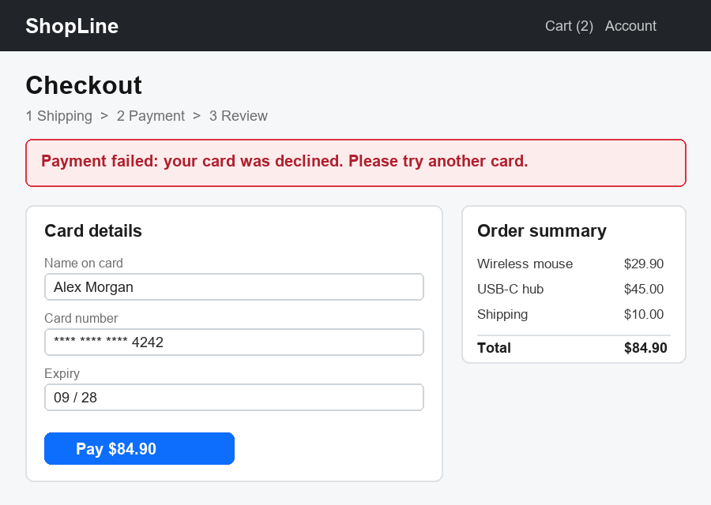</td>
<td align="center" valign="top">medya yayımlanmamış</td>
</tr></table>

🔬 <b><a href="https://github.com/amithgc/local-jev">amithgc/local-jev</a></b> · ⭐31 · Python · 🔎 inferred · 63 天

##### 📝 Özet

TypeSafe'ın Jev API ile uyumlu, yerel ve çevrimdışı bir System One sunucusu. Küçük açık modellerle tür belirtilmiş evet/hayır, kategori ve puan sorularını yanıtlar.

##### 📌 Temel bilgiler

| Alan     | Değer                                                      |
| -------- | ---------------------------------------------------------- |
| Kategori | `Açık yeniden üretimler, ağırlıklar ve mimari araştırması` |
| Kanıt    | `inferred`                                                 |
| Dil      | Python                                                     |

##### 📊 Veri

| Ölçüt          | Değer      |
| -------------- | ---------- |
| Yıldız         | **31**     |
| Son push       | 2026-09-21 |
| İlk listelenme | 2026-10-28 |

---

<table><tr><th align="center" width="50%">🖼 Görsel</th><th align="center" width="50%">🎬 Video</th></tr><tr>
<td align="center" valign="top">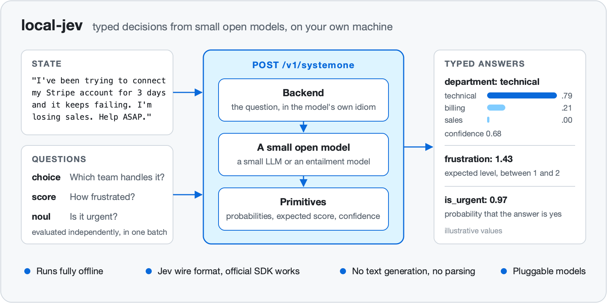</td>
<td align="center" valign="top">medya yayımlanmamış</td>
</tr></table>

🔬 <b><a href="https://github.com/OpenLAIR/lev">OpenLAIR/lev</a></b> · ⭐27 · Python · 🔎 inferred · 36 天

##### 📝 Özet

Lev: Thinking Fast and Deep with Looped Decision Models. One checkpoint, multiple depths: System 1.5 decision models that think in loops, not tokens.

##### 📌 Temel bilgiler

| Alan     | Değer                                                      |
| -------- | ---------------------------------------------------------- |
| Kategori | `Açık yeniden üretimler, ağırlıklar ve mimari araştırması` |
| Kanıt    | `inferred`                                                 |
| Dil      | Python                                                     |

##### 📊 Veri

| Ölçüt          | Değer      |
| -------------- | ---------- |
| Yıldız         | **27**     |
| Son push       | 2026-10-19 |
| İlk listelenme | 2026-11-20 |

🏷 `adaptive-computation` · `adaptive-depth` · `decision-models` · `early-exit` · `huggingface` · `jev` · `jev-api` · `jev-model`

---

<table><tr><th align="center" width="50%">🖼 Görsel</th><th align="center" width="50%">🎬 Video</th></tr><tr>
<td align="center" valign="top">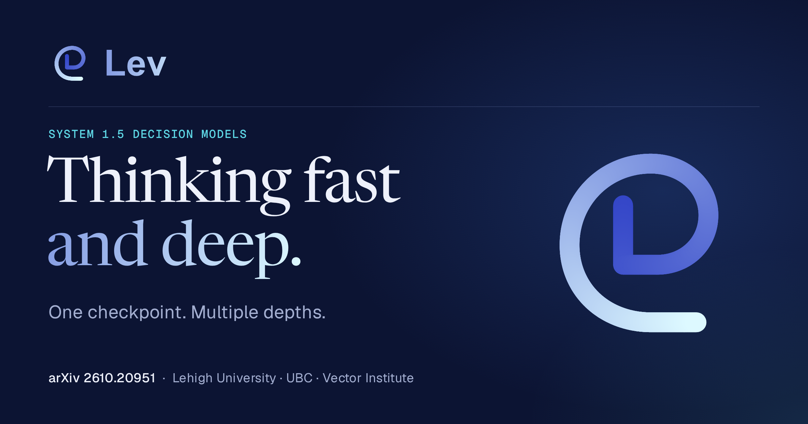</td>
<td align="center" valign="top">medya yayımlanmamış</td>
</tr></table>

🔬 <b><a href="https://github.com/skydiving94/klint">skydiving94/klint</a></b> · ⭐5 · Python · 🔎 inferred · 3 天

##### 📝 Özet

Yerel açık ağırlıklı kev ve uzak System One (/v1/systemone) modelleri için bildirimsel anlamsal linter ve mimari kod denetçisi.

##### 📌 Temel bilgiler

| Alan     | Değer                                                      |
| -------- | ---------------------------------------------------------- |
| Kategori | `Açık yeniden üretimler, ağırlıklar ve mimari araştırması` |
| Kanıt    | `inferred`                                                 |
| Dil      | Python                                                     |

##### 📊 Veri

| Ölçüt          | Değer      |
| -------------- | ---------- |
| Yıldız         | **5**      |
| Son push       | 2026-11-21 |
| İlk listelenme | 2026-11-02 |

🏷 `ast` · `code-audit` · `kev` · `linter` · `python` · `react` · `software-architecture` · `static-analysis`

---

<table><tr><th align="center" width="50%">🖼 Görsel</th><th align="center" width="50%">🎬 Video</th></tr><tr>
<td align="center" valign="top">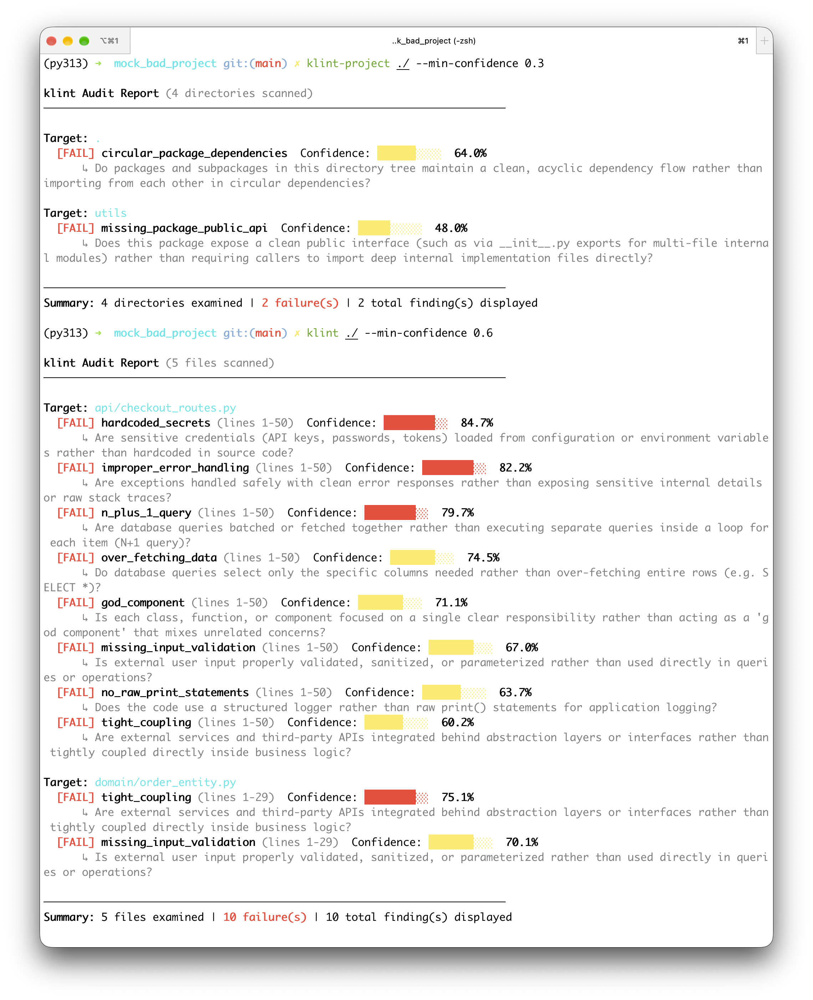</td>
<td align="center" valign="top">medya yayımlanmamış</td>
</tr></table>

🔬 <b><a href="https://github.com/imikerussell/beebots">imikerussell/beebots</a></b> · ⭐342 · TypeScript · ❓ unverified · 18 天

##### 📝 Özet

OKX üzerinde üç yapay zekâ işlem arısı; her karar Jev tarafından verilir. Varsayılan olarak kâğıt üzerinde işlem yapar. Finansal tavsiye değildir.

##### 📌 Temel bilgiler

| Alan     | Değer                                                      |
| -------- | ---------------------------------------------------------- |
| Kategori | `Açık yeniden üretimler, ağırlıklar ve mimari araştırması` |
| Kanıt    | `unverified`                                               |
| Dil      | TypeScript                                                 |

##### 📊 Veri

| Ölçüt          | Değer      |
| -------------- | ---------- |
| Yıldız         | **342**    |
| Son push       | 2026-11-05 |
| İlk listelenme | 2026-11-08 |

---

<table><tr><th align="center" width="50%">🖼 Görsel</th><th align="center" width="50%">🎬 Video</th></tr><tr>
<td align="center" valign="top"></td>
<td align="center" valign="top"> <a href="https://youtu.be/bp_u9Gzp1OU">İzleme yeri youtu.be</a> · oynatma kaynak sitede açılır; GitHub bunu satır içi gömemez</td>
</tr></table>

<b>Bu kategoride daha fazla</b> · 13

- [wfzyx/von](https://github.com/wfzyx/von) - Açık kaynaklı System One karar modeli.
- [ekzhang/openjev-sglang](https://github.com/ekzhang/openjev-sglang) - Açık modellere dayalı, Jev uyumlu API uç noktası (yalnızca prefill).
- [hyperspaceai/jevcache](https://github.com/hyperspaceai/jevcache) - TypeSafe Jev sınıfı modeller için bir karar önbelleği — tekrarları ücretsiz…
- [mars-tw/jev-trading-command-center](https://github.com/mars-tw/jev-trading-command-center) - Open-source paper-trading research app integrating TypeSafe Jev, animated 3D…
- [mattt/AnyDecisionModel](https://github.com/mattt/AnyDecisionModel) - A Swift package for typed decisions from language models.
- [whyashthakker/awesome-jev-use-cases](https://github.com/whyashthakker/awesome-jev-use-cases) - Jev kullanım alanlarının harika listesi.
- [pCwOrM/werr](https://github.com/pCwOrM/werr) - Zero-memory System-1 decision engine &amp; TypeSafe Jev runtime powered by…
- [AnkitNayak-dev/QJev-1.5B](https://github.com/AnkitNayak-dev/QJev-1.5B) - QJev-1.5B (Qwen2.5-1.5B JEV Decision Model) is an open-weights, high-speed…
- [apiplant/laya-rs](https://github.com/apiplant/laya-rs) - Laya.
- [Astro-Han/decision-head-rlcd](https://github.com/Astro-Han/decision-head-rlcd) - Bir karar modelinin genellemesi nereden gelir? Qwen3.5-4B üzerinde RLCD, eğitim…
- [vicksiyi/qwen-2.5-1b-rlcd](https://github.com/vicksiyi/qwen-2.5-1b-rlcd) - Hugging Face üzerinde harshatheg/Qwen-2.5-1B-RLCD modelinden türetilmiş yerel…
- [internet-projects/glide-mlx](https://github.com/internet-projects/glide-mlx) - GLiDE.
- [yangshun2005/laya-cn](https://github.com/yangshun2005/laya-cn) - \[中文化\] Çok dilli, otoregresif olmayan System 1 karar motoru.

## Uygulamalar, oyunlar, robotik ve etkileşimli demolar

Oyunlar, robotlar, tarayıcılar ve panolar. Gecikme ile maliyet iddialarını okunur kılan şey demolardır.

🎮 <b><a href="https://github.com/heyjunpenn/awesome-jev">heyjunpenn/awesome-jev</a></b> · ⭐1101 · Astro · 👁️ observed · 12 天 · ⭐+1

##### 📝 Özet

A verified, community-maintained catalog of 997 open-source projects built with Jev.

🔧 Kodda kullanıldığı tespit edildi: `README.md`, `CHANGELOG.md`, `README.ko.md`, `README.es.md`

##### 📌 Temel bilgiler

| Alan     | Değer                                                  |
| -------- | ------------------------------------------------------ |
| Kategori | `Uygulamalar, oyunlar, robotik ve etkileşimli demolar` |
| Kanıt    | `observed`                                             |
| Dil      | Astro                                                  |

##### 📊 Veri

| Ölçüt          | Değer         |
| -------------- | ------------- |
| Yıldız         | **1101** (+1) |
| Son push       | 2026-11-12    |
| İlk listelenme | 2026-10-29    |

🏷 `astro` · `awesome` · `awesome-jev` · `awesome-list` · `jev` · `typesafe`

🎮 <b><a href="https://github.com/droidrun/mobile-jev">droidrun/mobile-jev</a></b> · ⭐476 · JavaScript · 👁️ observed · 67 天

##### 📝 Özet

Üst kaynakta açıklama yayımlanmamış.

🔧 Kodda kullanıldığı tespit edildi: `README.md`

##### 📌 Temel bilgiler

| Alan     | Değer                                                  |
| -------- | ------------------------------------------------------ |
| Kategori | `Uygulamalar, oyunlar, robotik ve etkileşimli demolar` |
| Kanıt    | `observed`                                             |
| Dil      | JavaScript                                             |

##### 📊 Veri

| Ölçüt          | Değer      |
| -------------- | ---------- |
| Yıldız         | **476**    |
| Son push       | 2026-09-17 |
| İlk listelenme | 2026-11-08 |

🎮 <b><a href="https://github.com/MCG-NJU/VideoJev">MCG-NJU/VideoJev</a></b> · ⭐318 · Python · 👁️ observed · 36 天

##### 📝 Özet

VideoJev: Video Anlama ve Etkileşim için System One Model

##### 📌 Temel bilgiler

| Alan     | Değer                                                  |
| -------- | ------------------------------------------------------ |
| Kategori | `Uygulamalar, oyunlar, robotik ve etkileşimli demolar` |
| Kanıt    | `observed`                                             |
| Dil      | Python                                                 |

##### 📊 Veri

| Ölçüt          | Değer      |
| -------------- | ---------- |
| Yıldız         | **318**    |
| Son push       | 2026-10-18 |
| İlk listelenme | 2026-11-20 |

---

<table><tr><th align="center" width="50%">🖼 Görsel</th><th align="center" width="50%">🎬 Video</th></tr><tr>
<td align="center" valign="top"></td>
<td align="center" valign="top">medya yayımlanmamış</td>
</tr></table>

🎮 <b><a href="https://github.com/mrnugget/jev-shell-history">mrnugget/jev-shell-history</a></b> · ⭐121 · TypeScript · 👁️ observed · 66 天

##### 📝 Özet

Fish tarzı zsh geçmişi otomatik önerileri, Jev (TypeSafe) tarafından sıralanır

🔧 Kodda kullanıldığı tespit edildi: `README.md`

##### 📌 Temel bilgiler

| Alan     | Değer                                                  |
| -------- | ------------------------------------------------------ |
| Kategori | `Uygulamalar, oyunlar, robotik ve etkileşimli demolar` |
| Kanıt    | `observed`                                             |
| Dil      | TypeScript                                             |

##### 📊 Veri

| Ölçüt          | Değer      |
| -------------- | ---------- |
| Yıldız         | **121**    |
| Son push       | 2026-09-18 |
| İlk listelenme | 2026-10-29 |

---

<table><tr><th align="center" width="50%">🖼 Görsel</th><th align="center" width="50%">🎬 Video</th></tr><tr>
<td align="center" valign="top"></td>
<td align="center" valign="top"> hareketli kayıt</td>
</tr></table>

Yeniden dağıtım lisansı belirtilmediği için varlık üst depodan doğrudan bağlanmıştır.

🎮 <b><a href="https://github.com/realZachi/typesafe-adblock">realZachi/typesafe-adblock</a></b> · ⭐97 · JavaScript · 👁️ observed · 67 天

##### 📝 Özet

🧹 Eğlenceli proje: Küçük bir yapay zekâ karar modeline (TypeSafe Jev) "bu DOM öğesi bir reklam mı?" diye soran ve öğeyi sayfadan kaldıran bir Chrome eklentisi. BYOK, arka uç yok, gerçek bir reklam engelleyici değil.

🔧 Kodda kullanıldığı tespit edildi: `README.md`

##### 📌 Temel bilgiler

| Alan     | Değer                                                  |
| -------- | ------------------------------------------------------ |
| Kategori | `Uygulamalar, oyunlar, robotik ve etkileşimli demolar` |
| Kanıt    | `observed`                                             |
| Dil      | JavaScript                                             |

##### 📊 Veri

| Ölçüt          | Değer      |
| -------------- | ---------- |
| Yıldız         | **97**     |
| Son push       | 2026-09-17 |
| İlk listelenme | 2026-10-29 |

🎮 <b><a href="https://github.com/zadescoxp/Jev-Trades">zadescoxp/Jev-Trades</a></b> · ⭐80 · Python · 👁️ observed · 59 天

##### 📝 Özet

TypeSafe AI'ın Jev olarak adlandırılan yepyeni ilk sistem one modeline sahip alım satım botu

##### 📌 Temel bilgiler

| Alan     | Değer                                                  |
| -------- | ------------------------------------------------------ |
| Kategori | `Uygulamalar, oyunlar, robotik ve etkileşimli demolar` |
| Kanıt    | `observed`                                             |
| Dil      | Python                                                 |

##### 📊 Veri

| Ölçüt          | Değer      |
| -------------- | ---------- |
| Yıldız         | **80**     |
| Son push       | 2026-09-25 |
| İlk listelenme | 2026-10-21 |

🏷 `automated-testing` · `backtesting` · `crypto-trading-bot-latest` · `trading-bot-ai-automated`

---

<table><tr><th align="center" width="50%">🖼 Görsel</th><th align="center" width="50%">🎬 Video</th></tr><tr>
<td align="center" valign="top"></td>
<td align="center" valign="top"> hareketli kayıt</td>
</tr></table>

🎮 <b><a href="https://github.com/dfinke/Jev">dfinke/Jev</a></b> · ⭐12 · PowerShell · 👁️ observed · 38 天

##### 📝 Özet

PowerShell kararları, TypeSafe AI'in Jev modeliyle: https://typesafe.ai/blog/introducing-system-one-models-and-jev

##### 📌 Temel bilgiler

| Alan     | Değer                                                  |
| -------- | ------------------------------------------------------ |
| Kategori | `Uygulamalar, oyunlar, robotik ve etkileşimli demolar` |
| Kanıt    | `observed`                                             |
| Dil      | PowerShell                                             |

##### 📊 Veri

| Ölçüt          | Değer      |
| -------------- | ---------- |
| Yıldız         | **12**     |
| Son push       | 2026-10-16 |
| İlk listelenme | 2026-10-28 |

---

<table><tr><th align="center" width="50%">🖼 Görsel</th><th align="center" width="50%">🎬 Video</th></tr><tr>
<td align="center" valign="top"></td>
<td align="center" valign="top">medya yayımlanmamış</td>
</tr></table>

🎮 <b><a href="https://github.com/southleft/component-charades">southleft/component-charades</a></b> · ⭐2 · TypeScript · 👁️ observed · 7 天

##### 📝 Özet

A Taboo-style parlour game for design systems, refereed by Jev (TypeSafe System One model)

##### 📌 Temel bilgiler

| Alan     | Değer                                                  |
| -------- | ------------------------------------------------------ |
| Kategori | `Uygulamalar, oyunlar, robotik ve etkileşimli demolar` |
| Kanıt    | `observed`                                             |
| Dil      | TypeScript                                             |

##### 📊 Veri

| Ölçüt          | Değer      |
| -------------- | ---------- |
| Yıldız         | **2**      |
| Son push       | 2026-11-17 |
| İlk listelenme | 2026-11-19 |

🏷 `design-systems` · `game` · `jev` · `nextjs` · `typesafe`

---

<table><tr><th align="center" width="50%">🖼 Görsel</th><th align="center" width="50%">🎬 Video</th></tr><tr>
<td align="center" valign="top"></td>
<td align="center" valign="top">medya yayımlanmamış</td>
</tr></table>

Yeniden dağıtım lisansı belirtilmediği için varlık üst depodan doğrudan bağlanmıştır.

🎮 <b><a href="https://github.com/Omrigotlieb/awesome-jev">Omrigotlieb/awesome-jev</a></b> · ⭐1 · Python · 👁️ observed · 0 天

##### 📝 Özet

Jev üzerine kurulan, doğrulanmış ve ekran görüntüleri açısından zengin harika projeler listesi — türü belirli kararlar için TypeSafe AI's System One modeli

##### 📌 Temel bilgiler

| Alan     | Değer                                                  |
| -------- | ------------------------------------------------------ |
| Kategori | `Uygulamalar, oyunlar, robotik ve etkileşimli demolar` |
| Kanıt    | `observed`                                             |
| Dil      | Python                                                 |

##### 📊 Veri

| Ölçüt          | Değer      |
| -------------- | ---------- |
| Yıldız         | **1**      |
| Son push       | 2026-11-24 |
| İlk listelenme | 2026-09-21 |

🎮 <b><a href="https://github.com/chussenot/bryx">chussenot/bryx</a></b> · Rust · 👁️ observed · 7 天

##### 📝 Özet

A single-player Brick game in Rust, rendered natively with wgpu. The game can play itself. With the typesafe feature, a TypeSafe System One model (through the judgment crate)

##### 📌 Temel bilgiler

| Alan     | Değer                                                  |
| -------- | ------------------------------------------------------ |
| Kategori | `Uygulamalar, oyunlar, robotik ve etkileşimli demolar` |
| Kanıt    | `observed`                                             |
| Dil      | Rust                                                   |

##### 📊 Veri

| Ölçüt          | Değer      |
| -------------- | ---------- |
| Yıldız         | **0**      |
| Son push       | 2026-11-17 |
| İlk listelenme | 2026-11-10 |

---

<table><tr><th align="center" width="50%">🖼 Görsel</th><th align="center" width="50%">🎬 Video</th></tr><tr>
<td align="center" valign="top"></td>
<td align="center" valign="top">medya yayımlanmamış</td>
</tr></table>

🎮 <b><a href="https://github.com/frederico-kluser/som-webcore">frederico-kluser/som-webcore</a></b> · JavaScript · 👁️ observed · 0 天

##### 📝 Özet

Infraestrutura open-source de inferência WebGPU/Wasm32 em passada única para Condicionais Abstratas (JEV) no navegador. RFC/blueprint + memória CoALA.

##### 📌 Temel bilgiler

| Alan     | Değer                                                  |
| -------- | ------------------------------------------------------ |
| Kategori | `Uygulamalar, oyunlar, robotik ve etkileşimli demolar` |
| Kanıt    | `observed`                                             |
| Dil      | JavaScript                                             |

##### 📊 Veri

| Ölçüt          | Değer      |
| -------------- | ---------- |
| Yıldız         | **0**      |
| Son push       | 2026-11-24 |
| İlk listelenme | 2026-11-24 |

🏷 `browser-inference` · `edge-ai` · `jev` · `local-first` · `opfs` · `rust` · `som` · `system-one-models`

---

<table><tr><th align="center" width="50%">🖼 Görsel</th><th align="center" width="50%">🎬 Video</th></tr><tr>
<td align="center" valign="top">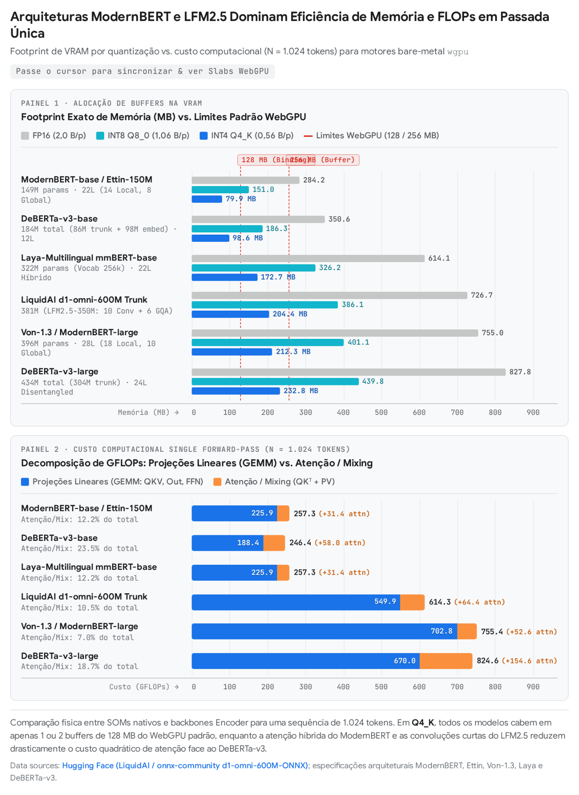</td>
<td align="center" valign="top">medya yayımlanmamış</td>
</tr></table>

🎮 <b><a href="https://github.com/Shivam-Jha96/gsp">Shivam-Jha96/gsp</a></b> · Python · 👁️ observed · 2 天

##### 📝 Özet

Binlerce son dakika küresel finans haber olayını gerçek zamanlı okuyan ve özel bir Contrastive-LM System-One modeli kullanarak sunucusuz bir GPU üzerinde piyasa etkilerini puanlayan AI destekli bir makro duyarlılık analizi terminali!

##### 📌 Temel bilgiler

| Alan     | Değer                                                  |
| -------- | ------------------------------------------------------ |
| Kategori | `Uygulamalar, oyunlar, robotik ve etkileşimli demolar` |
| Kanıt    | `observed`                                             |
| Dil      | Python                                                 |

##### 📊 Veri

| Ölçüt          | Değer      |
| -------------- | ---------- |
| Yıldız         | **0**      |
| Son push       | 2026-11-22 |
| İlk listelenme | 2026-11-18 |

🏷 `artificial-intelligence-algorithms` · `finance-dashboard` · `stock-analysis` · `stock-market` · `stock-prediction`

---

<table><tr><th align="center" width="50%">🖼 Görsel</th><th align="center" width="50%">🎬 Video</th></tr><tr>
<td align="center" valign="top"></td>
<td align="center" valign="top">medya yayımlanmamış</td>
</tr></table>

Yeniden dağıtım lisansı belirtilmediği için varlık üst depodan doğrudan bağlanmıştır.

🎮 <b><a href="https://x.com/tspy/status/2100864234523685146">Xtags — X intent labeller</a></b> · @tspy · 👁️ observed · 66 天

##### 📝 Özet

Xtags: a Chrome extension that labels each post in an X timeline with what it is trying to get from you — inducement, provocation, promotion, machine-generated, persuasion, entertainment, information — drawn as a tag plus a probability right after the timestamp. A side panel reports session counts (seen, judged, correct) and cumulative token cost. The author reports near-instant responses and usable accuracy before any tuning.

➡️ **Original project (manifoldor/xtags)** — [https://github.com/manifoldor/xtags](https://github.com/manifoldor/xtags)

> 💡 Worth reading as a latency argument rather than an accuracy one: labelling a timeline only works if the decision costs less than the scroll, which is the constraint a generative model cannot meet.

##### 📌 Temel bilgiler

| Alan     | Değer                                                  |
| -------- | ------------------------------------------------------ |
| Kategori | `Uygulamalar, oyunlar, robotik ve etkileşimli demolar` |
| Kanıt    | `observed`                                             |
| Sahip    | [yishan](https://x.com/tspy) · @tspy                   |

##### 📊 Veri

| Ölçüt          | Değer      |
| -------------- | ---------- |
| Görüntüleme    | **9873**   |
| Beğeni         | 24         |
| Yorum          | 11         |
| Yayınlandı     | 2026-09-18 |
| İlk listelenme | 2026-09-18 |

🏷 `x`

---

<table><tr><th align="center" width="50%">🖼 Görsel</th><th align="center" width="50%">🎬 Video</th></tr><tr>
<td align="center" valign="top"></td>
<td align="center" valign="top"> hareketli kayıt · <a href="https://video.twimg.com/amplify_video/2100858340331200512/vid/avc1/1242x720/ex2FF5-TerVxo9xX.mp4">Videoyu aç</a></td>
</tr></table>

🎮 <b><a href="https://github.com/superagents-lab/jev-search">superagents-lab/jev-search</a></b> · ⭐563 · TypeScript · 🔎 inferred · 16 天

##### 📝 Özet

TypeSafe'ın Jev'iyle web'de arama yapın: kaynak seçimi, sorgu anlama ve alaka sıralaması. Search1API ile oluşturulmuştur.

##### 📌 Temel bilgiler

| Alan     | Değer                                                  |
| -------- | ------------------------------------------------------ |
| Kategori | `Uygulamalar, oyunlar, robotik ve etkileşimli demolar` |
| Kanıt    | `inferred`                                             |
| Dil      | TypeScript                                             |

##### 📊 Veri

| Ölçüt          | Değer      |
| -------------- | ---------- |
| Yıldız         | **563**    |
| Son push       | 2026-11-07 |
| İlk listelenme | 2026-10-29 |

---

<table><tr><th align="center" width="50%">🖼 Görsel</th><th align="center" width="50%">🎬 Video</th></tr><tr>
<td align="center" valign="top"></td>
<td align="center" valign="top">medya yayımlanmamış</td>
</tr></table>

🎮 <b><a href="https://github.com/jkudish/jev-browser">jkudish/jev-browser</a></b> · ⭐377 · JavaScript · 🔎 inferred · 6 天

##### 📝 Özet

Typesafe'in Jev modelini kullanarak tarayıcı kullanımı

##### 📌 Temel bilgiler

| Alan     | Değer                                                  |
| -------- | ------------------------------------------------------ |
| Kategori | `Uygulamalar, oyunlar, robotik ve etkileşimli demolar` |
| Kanıt    | `inferred`                                             |
| Dil      | JavaScript                                             |

##### 📊 Veri

| Ölçüt          | Değer      |
| -------------- | ---------- |
| Yıldız         | **377**    |
| Son push       | 2026-11-17 |
| İlk listelenme | 2026-10-29 |

---

<table><tr><th align="center" width="50%">🖼 Görsel</th><th align="center" width="50%">🎬 Video</th></tr><tr>
<td align="center" valign="top"></td>
<td align="center" valign="top"> hareketli kayıt · <a href="https://raw.githubusercontent.com/jkudish/jev-browser/main/assets/github-demo.mp4">Videoyu aç</a></td>
</tr></table>

🎮 <b><a href="https://github.com/hr98w/jev-visual">hr98w/jev-visual</a></b> · ⭐334 · Python · 🔎 inferred · 63 天

##### 📝 Özet

Apple Silicon üzerinde eğitim amaçlı Jev benzeri görsel çıkarım deneyi: paylaşılan bağlam, doğrudan aday puanlama ve yerel görsel demolar.

##### 📌 Temel bilgiler

| Alan     | Değer                                                  |
| -------- | ------------------------------------------------------ |
| Kategori | `Uygulamalar, oyunlar, robotik ve etkileşimli demolar` |
| Kanıt    | `inferred`                                             |
| Dil      | Python                                                 |

##### 📊 Veri

| Ölçüt          | Değer      |
| -------------- | ---------- |
| Yıldız         | **334**    |
| Son push       | 2026-09-21 |
| İlk listelenme | 2026-11-08 |

---

<table><tr><th align="center" width="50%">🖼 Görsel</th><th align="center" width="50%">🎬 Video</th></tr><tr>
<td align="center" valign="top"></td>
<td align="center" valign="top"> hareketli kayıt · <a href="https://github.com/user-attachments/assets/c87c09d8-30d2-4392-b981-d0b5cf1879ae">Videoyu aç</a></td>
</tr></table>

🎮 <b><a href="https://github.com/aowang-ai/jev-trade">aowang-ai/jev-trade</a></b> · ⭐228 · TypeScript · 🔎 inferred · 12 天

##### 📝 Özet

Hyperliquid üzerinde canlı Jev trader'ı

##### 📌 Temel bilgiler

| Alan     | Değer                                                  |
| -------- | ------------------------------------------------------ |
| Kategori | `Uygulamalar, oyunlar, robotik ve etkileşimli demolar` |
| Kanıt    | `inferred`                                             |
| Dil      | TypeScript                                             |

##### 📊 Veri

| Ölçüt          | Değer      |
| -------------- | ---------- |
| Yıldız         | **228**    |
| Son push       | 2026-11-12 |
| İlk listelenme | 2026-10-29 |

🏷 `hyperliquid` · `jev` · `quantitative-finance` · `typesafe`

---

<table><tr><th align="center" width="50%">🖼 Görsel</th><th align="center" width="50%">🎬 Video</th></tr><tr>
<td align="center" valign="top"></td>
<td align="center" valign="top">medya yayımlanmamış</td>
</tr></table>

Yeniden dağıtım lisansı belirtilmediği için varlık üst depodan doğrudan bağlanmıştır.

🎮 <b><a href="https://github.com/NanmiCoder/jev-arena">NanmiCoder/jev-arena</a></b> · ⭐126 · JavaScript · 🔎 inferred · 64 天

##### 📝 Özet

Jev 模型介绍与实测：通过 Choice / Score / Noul 将自然语言转为带类型的判断与概率，用于分类、评分和路由；支持与 DeepSeek 等模型对比评论打标、速度与结果，含 CSV/Excel 导入、原速回放与离线报告。

##### 📌 Temel bilgiler

| Alan     | Değer                                                  |
| -------- | ------------------------------------------------------ |
| Kategori | `Uygulamalar, oyunlar, robotik ve etkileşimli demolar` |
| Kanıt    | `inferred`                                             |
| Dil      | JavaScript                                             |

##### 📊 Veri

| Ölçüt          | Değer      |
| -------------- | ---------- |
| Yıldız         | **126**    |
| Son push       | 2026-09-20 |
| İlk listelenme | 2026-11-21 |

---

<table><tr><th align="center" width="50%">🖼 Görsel</th><th align="center" width="50%">🎬 Video</th></tr><tr>
<td align="center" valign="top"></td>
<td align="center" valign="top">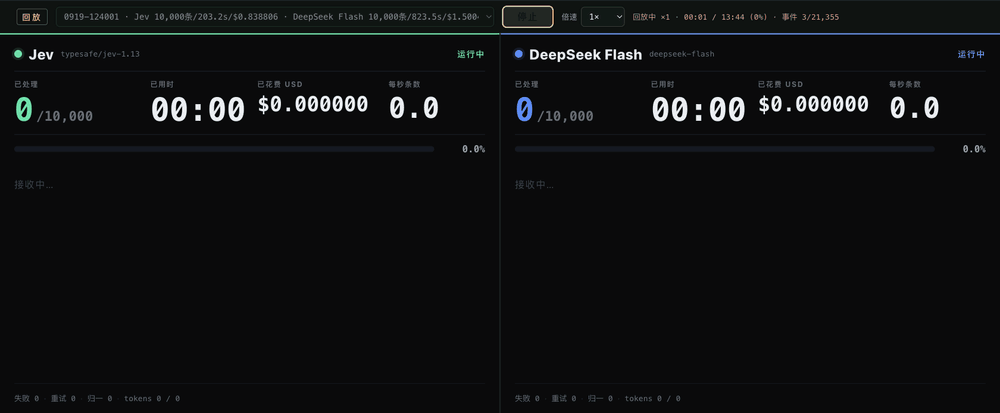 hareketli kayıt</td>
</tr></table>

🎮 <b><a href="https://github.com/BudEcosystem/Bud-Decision-Studio">BudEcosystem/Bud-Decision-Studio</a></b> · ⭐79 · HTML · 🔎 inferred · 45 天

##### 📝 Özet

Bud Decision studio, Jev benzeri modelleri yerel olarak çalıştırmak için kullanımı kolay, platformlar arası bir masaüstü uygulaması ve sunum sistemidir.

##### 📌 Temel bilgiler

| Alan     | Değer                                                  |
| -------- | ------------------------------------------------------ |
| Kategori | `Uygulamalar, oyunlar, robotik ve etkileşimli demolar` |
| Kanıt    | `inferred`                                             |
| Dil      | HTML                                                   |

##### 📊 Veri

| Ölçüt          | Değer      |
| -------------- | ---------- |
| Yıldız         | **79**     |
| Son push       | 2026-10-09 |
| İlk listelenme | 2026-10-29 |

🏷 `decision-models` · `desktop-app` · `jev` · `laya` · `local-ai` · `pytorch` · `system-one` · `tauri`

---

<table><tr><th align="center" width="50%">🖼 Görsel</th><th align="center" width="50%">🎬 Video</th></tr><tr>
<td align="center" valign="top"></td>
<td align="center" valign="top"> <a href="https://raw.githubusercontent.com/BudEcosystem/Bud-Decision-Studio/main/docs/media/demo.mp4">Videoyu aç</a></td>
</tr></table>

Yeniden dağıtım lisansı belirtilmediği için varlık üst depodan doğrudan bağlanmıştır.

🎮 <b><a href="https://github.com/wizicer/jev_info_site">wizicer/jev_info_site</a></b> · ⭐3 · Astro · 🔎 inferred · 0 天

##### 📝 Özet

Community index of tools, models, and real-world use cases built on Jev.

##### 📌 Temel bilgiler

| Alan     | Değer                                                  |
| -------- | ------------------------------------------------------ |
| Kategori | `Uygulamalar, oyunlar, robotik ve etkileşimli demolar` |
| Kanıt    | `inferred`                                             |
| Dil      | Astro                                                  |

##### 📊 Veri

| Ölçüt          | Değer      |
| -------------- | ---------- |
| Yıldız         | **3**      |
| Son push       | 2026-11-24 |
| İlk listelenme | 2026-11-24 |

🏷 `awesome` · `jev` · `jev-ai` · `typesafe-ai`

---

<table><tr><th align="center" width="50%">🖼 Görsel</th><th align="center" width="50%">🎬 Video</th></tr><tr>
<td align="center" valign="top"></td>
<td align="center" valign="top">medya yayımlanmamış</td>
</tr></table>

Yeniden dağıtım lisansı belirtilmediği için varlık üst depodan doğrudan bağlanmıştır.

🎮 <b><a href="https://github.com/Tatuck/jev-boe-demo">Tatuck/jev-boe-demo</a></b> · ⭐2 · TypeScript · 🔎 inferred · 0 天

##### 📝 Özet

Daily demo applying TypeSafe's Jev model to Spain's official gazette (BOE).

##### 📌 Temel bilgiler

| Alan     | Değer                                                  |
| -------- | ------------------------------------------------------ |
| Kategori | `Uygulamalar, oyunlar, robotik ve etkileşimli demolar` |
| Kanıt    | `inferred`                                             |
| Dil      | TypeScript                                             |

##### 📊 Veri

| Ölçüt          | Değer      |
| -------------- | ---------- |
| Yıldız         | **2**      |
| Son push       | 2026-11-23 |
| İlk listelenme | 2026-11-24 |

---

<table><tr><th align="center" width="50%">🖼 Görsel</th><th align="center" width="50%">🎬 Video</th></tr><tr>
<td align="center" valign="top"></td>
<td align="center" valign="top"> hareketli kayıt</td>
</tr></table>

Yeniden dağıtım lisansı belirtilmediği için varlık üst depodan doğrudan bağlanmıştır.

🎮 <b><a href="https://github.com/BrendanH18/jev-lab">BrendanH18/jev-lab</a></b> · ⭐1 · JavaScript · 🔎 inferred · 0 天

##### 📝 Özet

Six small apps and a workbench that show what TypeSafe's Jev (System One) model can do

##### 📌 Temel bilgiler

| Alan     | Değer                                                  |
| -------- | ------------------------------------------------------ |
| Kategori | `Uygulamalar, oyunlar, robotik ve etkileşimli demolar` |
| Kanıt    | `inferred`                                             |
| Dil      | JavaScript                                             |

##### 📊 Veri

| Ölçüt          | Değer      |
| -------------- | ---------- |
| Yıldız         | **1**      |
| Son push       | 2026-11-23 |
| İlk listelenme | 2026-10-24 |

🏷 `ai` · `demo` · `jev` · `typesafe`

---

<table><tr><th align="center" width="50%">🖼 Görsel</th><th align="center" width="50%">🎬 Video</th></tr><tr>
<td align="center" valign="top">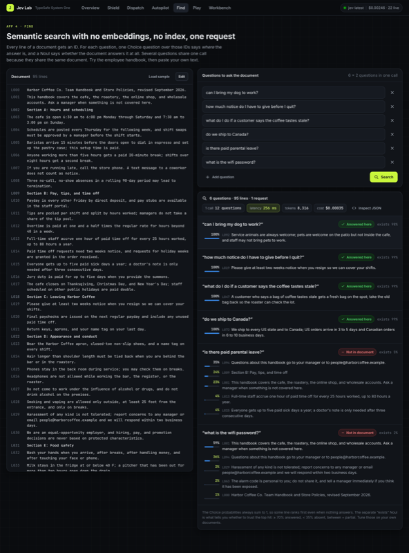</td>
<td align="center" valign="top">medya yayımlanmamış</td>
</tr></table>

<b>Bu kategoride daha fazla</b> · 16

- [jarrodwatts/jev-trader](https://github.com/jarrodwatts/jev-trader) - Her Monad bloğunda bir yapay zekâ işlem kararı. Kuru MON-USDC üzerinde Jev.
- [moritzkremb/jev-voice-browser](https://github.com/moritzkremb/jev-voice-browser) - Gerçek bir tarayıcıyı sesle kontrol edin.
- [kevinbadi/jev-voice](https://github.com/kevinbadi/jev-voice) - Mac.
- [buer2233/jev-ui-test](https://github.com/buer2233/jev-ui-test) - Jev karar modeliyle desteklenen UI otomasyon test çerçevesi:
- [bilune/jev-design](https://github.com/bilune/jev-design) - Bir model bir gösterge paneli tasarlayabilir mi? Tüm tasarım sistemi, tek…
- [emrickgarrett/OneVOneJev](https://github.com/emrickgarrett/OneVOneJev) - 1.
- [codelivin/jev-laya-toolkit](https://github.com/codelivin/jev-laya-toolkit) - Dashboard and local proxy for SystemOne decision models - Jev (TypeSafe API)…
- [dgarridou/KaLM-Jev](https://github.com/dgarridou/KaLM-Jev) - Yapılandırılmış yargılar üretmeden verimli yerel Choice, Score ve Noul…
- [harsha89/jev-demo](https://github.com/harsha89/jev-demo) - TypeSafe JEV.
- [PistachioAIHQ/jev-synergy-screening](https://github.com/PistachioAIHQ/jev-synergy-screening) - Jev (TypeSafe System One) × ASReview SYNERGY özet tarama demosu — Choice/Noul…
- [felixglush/jev-dynamic-ui](https://github.com/felixglush/jev-dynamic-ui) - Dynamically select and prefill banking UI components in under 200ms.
- [huntsman95/PowerJev](https://github.com/huntsman95/PowerJev) - Powershell Module to interact with /v1/systemone AI Decision Endpoints.
- [m407/jev-grep](https://github.com/m407/jev-grep) - Semantic search for log and code fragments using Jev.
- [netcode001/jev](https://github.com/netcode001/jev) - Resmî olmayan Jev AI bilgi merkezi — erişim kılavuzu, fiyatlandırma, ücretsiz…
- [neurogabo/jev-arena](https://github.com/neurogabo/jev-arena) - Run a Pokémon Champions battle arena locally with Jev, TypeSafe, and Pokémon…
- [sorrycc/typesafe-snake](https://github.com/sorrycc/typesafe-snake) - TypeSafe.

## Yazılar, tartışmalar ve kardeş listeler

Lansman başlıkları, bağımsız yazılar ve bu alandaki diğer derlenmiş listeler. Bu depo tek değil ve bunu söylemek aksini varsaymaktan daha yararlı.

📰 <b><a href="https://docs.typesafe.ai/model-jaggedness/jev-1.13">Bilinen 9 kusur türü (jaggedness)</a></b> · ✅ official · 67 天

##### 📝 Özet

Kelimesi kelimesine yorumlama, **güvenilmez sayım**, tarih karşılaştırması, çok seviyeli dolaylılık, ilgisiz ayrıntılardan oluşan büyük state, karşıt içerik, yönergeler ile criteria arasındaki çelişkiler, yapısal değişmezler, üretim. Resmî öneri: "atomik problemlere ayırıp kod içinde birleştirin".

> 💡 **Yetenek sınırları** — bu, sağlayıcının kendi kabul ettiği sınırların eksiksiz listesidir

##### 📌 Temel bilgiler

| Alan     | Değer                                     |
| -------- | ----------------------------------------- |
| Kategori | `Yazılar, tartışmalar ve kardeş listeler` |
| Kanıt    | `official`                                |

##### 📊 Veri

| Ölçüt          | Değer      |
| -------------- | ---------- |
| İlk listelenme | 2026-11-13 |

📰 <b><a href="https://docs.typesafe.ai/cookbooks/consistency_choice_cookbook">`consistency_choice` cookbook&#x27;i resmî olarak &quot;tekrarlanan çağrıların sonuçları değişir mi&quot; sorusunu yanıtladı</a></b> · ✅ official · 67 天

##### 📝 Özet

Aynı inceleme rubric'i, **koşul başına 8 Choice × 15 tekrar**. TypeSafe **ham agree %90,8** (8 sorudan 2'si tersine döndü, ancak **conflicts=0** — tersine dönüşler yalnızca "belirli etiket ↔ uncertain" arasında gerçekleşti). **Bir abstention kuralı eklenince (`probabilities` kullanılarak top probability ≥ 0.60 istenir, aksi halde `uncertain` insan incelemesine aktarılır) tutarlılık %99,2'ye**, automatic %74,2'ye yükseldi; **model çağrıları artmadı**. Karşılaştırma: Haiku t=0 %100, Opus 4.8 reasoning %92,5, gpt-5.4-mini t=0 %99,2. Resmî açıklama: bu, modeli kesin hâle getirmez; bu sayılar **doğruluğu değil tekrarlanabilirliği** gösterir; 0.60 örnek bir stratejidir, üretim eşiği etiketli örnekler ve maliyet kullanılarak belirlenmelidir.

> 💡 **\[DEFINITION-CHANGE\]** B5'i, temel sayılar tablosunu, SKILL.md kural 3'ü ve yayına alma 6. maddesini, uygulanabilirlik sınırları 6. maddesini yeniden yazdı — **bu kütüphane daha önce "belirsizliği" risk olarak kaydediyordu, şimdi resmî doğru yaklaşıma geçti: bunu abstention ile yönetin**

##### 📌 Temel bilgiler

| Alan     | Değer                                     |
| -------- | ----------------------------------------- |
| Kategori | `Yazılar, tartışmalar ve kardeş listeler` |
| Kanıt    | `official`                                |

##### 📊 Veri

| Ölçüt          | Değer      |
| -------------- | ---------- |
| İlk listelenme | 2026-11-13 |

📰 <b><a href="https://docs.typesafe.ai/confidence">confidence için resmî anlam doğrulaması</a></b> · ✅ official · 67 天

##### 📝 Özet

Resmî açıklamaya göre `confidence`, **`probabilities` dağılımından hesaplanan bir istatistiktir**; dağılım ne kadar yoğunlaşmışsa kesinlik o kadar yüksektir; **Noul confidence içermez**; resmî açıklama ayrıca "tanımımıza hapsolmuş değilsiniz" der; eşik "temkinli bir değerden başlayarak kendi veriniz üzerinde ölçülmelidir".

> 💡 Archer'ın ters formülüyle tutarlı, tanım dosyasına yazıldı

##### 📌 Temel bilgiler

| Alan     | Değer                                     |
| -------- | ----------------------------------------- |
| Kategori | `Yazılar, tartışmalar ve kardeş listeler` |
| Kanıt    | `official`                                |

##### 📊 Veri

| Ölçüt          | Değer      |
| -------------- | ---------- |
| İlk listelenme | 2026-11-13 |

📰 <b><a href="https://www.langchain.com/blog/building-a-harness-with-jev（2026-09-17">LangChain&#x27;in resmî blog yazısı &quot;agent guardrail kategorisi neden patlama yaşıyor&quot; sorusunu açıklıyor — , Sydney Runkle &amp; Hunter Lovell)</a></b> · ✅ official

##### 📝 Özet

*"claude, codex, cursor gibi Coding harnesses tehlikeli eylemleri sınıflandırmak için bir tür yöntem kullanıma sundu… **Şimdiye kadar bu sınıflandırıcı adımı harness'in kapalı kaynak bölümlerine kilitlenmişti. Artık ucuz ve performanslı bir sınıflandırıcı model mevcut olduğuna göre aynı kalıbı alıp tüm agent'lara uygulayabiliriz!**"*; ayrıca bir router örneği (özel ölçütlere göre model seçmek için Jev kullanılır, olasılık agent state içinde tutulur) ve *"Jev, bir LLM için drop-in replacement değildir"* sunuyor.

> 💡 **Bu kütüphanenin gözlemlediği "guardrail'lerin ürünleştirilmesi" olgusunu açıkladı** — kapalı kaynak harness özellikleri açık kaynak hâle getirildi; parça kütüphanesi §2.5'e yazıldı

##### 📌 Temel bilgiler

| Alan     | Değer                                     |
| -------- | ----------------------------------------- |
| Kategori | `Yazılar, tartışmalar ve kardeş listeler` |
| Kanıt    | `official`                                |

##### 📊 Veri

| Ölçüt          | Değer      |
| -------------- | ---------- |
| İlk listelenme | 2026-11-13 |

📰 <b><a href="https://typesafe.ai/team">TypeSafe yeni bir Team sayfası ekledi + navigasyona `Enterprise` girişi eklendi (ürünleştirme/ticarileştirme sinyali)</a></b> · ✅ official · 66 天

##### 📝 Özet

TypeSafe yeni bir Team sayfası ekledi + navigasyona `Enterprise` girişi eklendi (ürünleştirme/ticarileştirme sinyali)

> 💡 **\[DEFINITION-CHANGE\]** (ekip olgusu + ürünleştirme sinyali); `01-系统定义/jev-系统定义.md` yeni **§6b/6c** ekledi; `references/README.md` hızlı bilgi kartı güncellendi

##### 📌 Temel bilgiler

| Alan     | Değer                                     |
| -------- | ----------------------------------------- |
| Kategori | `Yazılar, tartışmalar ve kardeş listeler` |
| Kanıt    | `official`                                |

##### 📊 Veri

| Ölçüt          | Değer      |
| -------------- | ---------- |
| İlk listelenme | 2026-11-13 |

📰 <b><a href="https://vercel.com/changelog/typesafe-ai-jev-now-available-on-ai-gateway">Vercel&#x27;in resmî changelog&#x27;u Jev&#x27;ın AI Gateway&#x27;e eklendiğini duyurdu</a></b> · ✅ official

##### 📝 Özet

Vercel'in resmî changelog'u Jev'ın AI Gateway'e eklendiğini duyurdu

> 💡 Parça kütüphanesindeki Vercel satırına **AI SDK kullanımı** eklendi (gerçek artımlı değişiklik); **temel sayılar tablosunda değişiklik gerekmedi** (sayılar zaten mevcut) → **bu turdaki tanım düzeyi değişikliği "hayır" olarak düşürüldü**

##### 📌 Temel bilgiler

| Alan     | Değer                                     |
| -------- | ----------------------------------------- |
| Kategori | `Yazılar, tartışmalar ve kardeş listeler` |
| Kanıt    | `official`                                |

##### 📊 Veri

| Ölçüt          | Değer      |
| -------------- | ---------- |
| İlk listelenme | 2026-11-13 |

📰 <b><a href="https://docs.typesafe.ai/llms.txt">Daha önce tamamen eksik olan 18 resmî cookbook uygulama tarifesi bulundu ve çekildi</a></b> · ✅ official · 67 天

##### 📝 Özet

`llms.txt` genelinde 111 sayfa; yerelde daha önce 30 sayfa vardı, diff sonrasında `cookbooks/` altında **18 tarif** bulundu (çalıştırılabilir kod, gerçek veri kümeleri, ölçülmüş sayılar içeriyor). Her biri çekildi ve `type: official-cookbook` frontmatter eklendi.

> 💡 Yeni `03-能力边界/jev-官方cookbook配方.md` dizin sayfası oluşturuldu; **bu, "ilkelerden üretime geçiş" katmanıdır**

##### 📌 Temel bilgiler

| Alan     | Değer                                     |
| -------- | ----------------------------------------- |
| Kategori | `Yazılar, tartışmalar ve kardeş listeler` |
| Kanıt    | `official`                                |

##### 📊 Veri

| Ölçüt          | Değer      |
| -------------- | ---------- |
| İlk listelenme | 2026-11-13 |

📰 <b><a href="https://github.com/typesafe-ai/skills（⭐128">Resmî agent skill&#x27;i `typesafe-ai` yükle — , MIT)</a></b> · ✅ official · 67 天

##### 📝 Özet

`npx -y skills@latest add typesafe-ai/skills -s typesafe-ai -g -a '*' --copy -y` → `~/.agents/skills/typesafe-ai/` üzerine kuruldu (tek dosyalık SKILL.md, 149 satır / 10 KB, 79 agent'ı kapsar). Güvenlik değerlendirmesi: Gen=Safe, Socket=0 alerts, Snyk=Low Risk. Tek başarısız öğe Eve'dir (genel kurulumu desteklemiyor, etkisi yok).

> 💡 Bizim `jev` skill'imizle **birlikte var olur ve onu tamamlar**

##### 📌 Temel bilgiler

| Alan     | Değer                                     |
| -------- | ----------------------------------------- |
| Kategori | `Yazılar, tartışmalar ve kardeş listeler` |
| Kanıt    | `official`                                |

##### 📊 Veri

| Ölçüt          | Değer      |
| -------------- | ---------- |
| İlk listelenme | 2026-11-13 |

📰 <b><a href="https://docs.typesafe.ai/llms.txt`">Resmî belge diff&#x27;i yeniden etkili olduğunu doğruladı — `</a></b> · ✅ official

##### 📝 Özet

Bu turdaki diff yeni sayfa bulmadı (30 makale + 18 cookbook tamamlandı); bu, toplayıcının diff mantığının doğru olduğunu gösteriyor.

> 💡 Her turda sabit bir adım olarak korundu

##### 📌 Temel bilgiler

| Alan     | Değer                                     |
| -------- | ----------------------------------------- |
| Kategori | `Yazılar, tartışmalar ve kardeş listeler` |
| Kanıt    | `official`                                |

##### 📊 Veri

| Ölçüt          | Değer      |
| -------------- | ---------- |
| İlk listelenme | 2026-11-13 |

📰 <b><a href="https://docs.typesafe.ai/models">Resmî belge dizini ile hız sınırı/bağlam/özelleştirme politikalarının tümü doğrulandı</a></b> · ✅ official · 67 天

##### 📝 Özet

Uç nokta `POST https://api.typesafe.ai/v1/systemone`; `jev-1.13.0`, diğer adı `jev-latest`/`jev-preview`; istek başına 64k, state + en uzun soru 32k; hız sınırı 250k tok/s, 1200 req/min ve **dinamik olarak ayarlanır**; yalnızca metin girdisi; Choice≤255, Score 2–10 aralığı; **fine-tune yapılamaz, tüm hesaplar aynı ağırlık kümesini paylaşır**; müşteri verileri eğitim için kullanılmaz; İngilizce en yüksek doğruluğa sahiptir.

> 💡 **Mimari/yetenek sınırları** — `01-系统定义/jev-系统定义.md` ve `jev-能力与边界-准确定义.md` içine yazıldı

##### 📌 Temel bilgiler

| Alan     | Değer                                     |
| -------- | ----------------------------------------- |
| Kategori | `Yazılar, tartışmalar ve kardeş listeler` |
| Kanıt    | `official`                                |

##### 📊 Veri

| Ölçüt          | Değer      |
| -------------- | ---------- |
| İlk listelenme | 2026-11-13 |

📰 <b><a href="https://docs.typesafe.ai/migrating-to-v1">Eksik resmî sayfa tamamlandı: v1 API sürümüne geçirildi</a></b> · ✅ official · 67 天

##### 📝 Özet

preview uç noktası `/preview/evaluation` → kararlı sürüm **`POST /v1/systemone`**; `prompts` dizisi → `questions` map; `responses` dizisi → `answers` map; alan adları değişti: **`probability`→`noul`, `chosen`→`choice`, `expectation`→`score`**; choice olasılığı diziden map'e dönüştü; **score olasılığı v1 ile eklendi**; kimlik doğrulama değişmedi.

> 💡 `官方文档快照/migrating-to-v1.md` arşive alındı; bu aynı zamanda **resmî sayfa bulmanın ikinci kanalını** (resmî skill'in belge yönlendirme tablosu) sağladı

##### 📌 Temel bilgiler

| Alan     | Değer                                     |
| -------- | ----------------------------------------- |
| Kategori | `Yazılar, tartışmalar ve kardeş listeler` |
| Kanıt    | `official`                                |

##### 📊 Veri

| Ölçüt          | Değer      |
| -------------- | ---------- |
| İlk listelenme | 2026-11-13 |

📰 <b><a href="https://github.com/yibie/awesome-jev">yibie/awesome-jev</a></b> · ⭐2633 · Python · 👁️ observed · 0 天

##### 📝 Özet

Jev üzerine kurulmuş herkese açık projeler, entegrasyonlar ve tartışmalardan derlenmiş bir liste — tür belirtilmiş kararlar için TypeSafe AI'in System One modeli.

##### 📌 Temel bilgiler

| Alan     | Değer                                     |
| -------- | ----------------------------------------- |
| Kategori | `Yazılar, tartışmalar ve kardeş listeler` |
| Kanıt    | `observed`                                |
| Dil      | Python                                    |

##### 📊 Veri

| Ölçüt          | Değer      |
| -------------- | ---------- |
| Yıldız         | **2633**   |
| Son push       | 2026-11-24 |
| İlk listelenme | 2026-09-18 |

🏷 `awesome` · `awesome-list` · `jev` · `llm`

<b>Bu kategoride daha fazla</b> · 63

- [cobanov/awesome-jev](https://github.com/cobanov/awesome-jev) - Jev ile oluşturulmuş, TypeSafe AI.
- [We’re releasing Jev 1.14.0 along with experimental features for dreamers](https://news.ycombinator.com/item?id=50095353)
- [hellogumbo/awesome-jev](https://github.com/hellogumbo/awesome-jev) - Jev üzerinde oluşturulmuş projelerden oluşan, TypeSafe AI.
- [Open-sourced jev architecture last year with model,paper and dataset](https://news.ycombinator.com/item?id=49736660) - Herkes artık &amp;#x27;otomatik regresif olmayan ve JSON şemasıyla ışık hızında…
- [Show HN: Jev Cards, Can you beat a vision model at a picture quiz?](https://news.ycombinator.com/item?id=50167617) - I built a quiz game around TypeSafe&amp;#x27;s new Jev model, which has vision…
- [What Is RLCD? The Secret Behind Jev](https://news.ycombinator.com/item?id=49829625)
- [Document Review with Unsiloed and TypeSafe Jev](https://news.ycombinator.com/item?id=50068443)
- [aliaihub/awesome-jev-usecases](https://github.com/aliaihub/awesome-jev-usecases) - Jev ile, TypeSafe AI.
- [Anil-matcha/awesome-jev-by-typesafe](https://github.com/Anil-matcha/awesome-jev-by-typesafe) - TypeSafe Jev için kanıta dayalı kullanım alanları, kalıplar, istemler ve…
- [Show HN: Fastbrowse, Browser agent that picks clicks with a System One model](https://news.ycombinator.com/item?id=50311029) - Hi HN, I&amp;#x27;m Furqan founder of Nebula.
- [jtnkminimal/awesome-jev](https://github.com/jtnkminimal/awesome-jev) - Jev, TypeSafe.
- [Show HN: Nouli – A multi-turn decision graph harness for System One models](https://news.ycombinator.com/item?id=50288442) - I&amp;#x27;ve been fine tuning my own decision models lately and I&amp;#x27;ve been…
- [Ask HN: Everyone was Jev-maxxing. Why not CDMs now?](https://news.ycombinator.com/item?id=50242523) - Just a few weeks ago, all that my feed had was people JEV-maxxing.
- [Ask HN: System One models for autonomous agents](https://news.ycombinator.com/item?id=50142037) - I&amp;#x27;ve seen a few impressive demos of Typesafe&amp;#x27;s new paradigm with…
- [Jack and Jill Cut Candidate Screening Costs by 88% with Jev](https://news.ycombinator.com/item?id=50450433)
- [Jeyzma is TypeSafeAI minus $850M plus Go/TinyGo/llama.cpp in the browser](https://news.ycombinator.com/item?id=50031093)
- [Cutting LLM Token Costs with Currents News API and TypeSafe Jev Pre-Filtering](https://news.ycombinator.com/item?id=50450911)
- [JEV: Type Safe AI](https://news.ycombinator.com/item?id=50106296)
- [RadRebelSam/awesome-jev](https://github.com/RadRebelSam/awesome-jev) - Jev, TypeSafe AI.
- [Show HN: Decide – Jev decisions in the shell, scripts, and agent skills](https://news.ycombinator.com/item?id=49878492) - Tüm yazılımlar karar verir. Kod, deterministik olanları yönetir.
- [Show HN: We Beat TypeSafe Jev and Released Open-Source Decision Model](https://news.ycombinator.com/item?id=50027132)
- [The Hitchhiker's Guide to System One Models](https://news.ycombinator.com/item?id=50301027)
- [Typesafe.ai Jev Open Source Alternative Qwen-2.5-1B-RLCD](https://news.ycombinator.com/item?id=49734345)
- [ozers/jevsome-projects](https://github.com/ozers/jevsome-projects) - Jev, TypeSafe AI.
- [rhc98/awesome-jev](https://github.com/rhc98/awesome-jev) - Jev üzerine kurulan.
- [108 条声明对照：Jev 的校准并不独特（含作者自我修正）](https://truestandard.ai/blog/jev-accuracy-tested) - 108 iddianın karşılaştırması: Jev.
- [\[cellcog.ai 追踪页\]() 自称分层记录 *"claims / concedes / measured / found, dated"* → 与本库锚页设计意图一致，值得长期对照](https://cellcog.ai/blog/jev-typesafe-decision-model) - \[cellcog.ai takip sayfası\]() kendisini *.
- [\`calibre\`：独立标定实验证明"阈值参数不跨数据集迁移"](https://github.com/FirasSX914/calibre) - İki etiketli veri kümesinde (**Banking77** ve **Web of Science**) Jev…
- [\`classifier.dev\`：建在 Jev 上的免费零样本分类服务（含 agent skill）](https://classifier.dev) - **API key.
- [\`clownware/bouncer\` 提供目前最硬的第三方独立标定数据](https://github.com/clownware/bouncer) - 6 sorunun doğruluğu/Brier/kalibrasyon güvenilirliği: Brier **0.036–0.149**;
- [\`Jev Judge vs Dimension Scores\`：分解不总是更好（含日语多语证据）](https://agentjournal.dev/blog/llm-judge-vs-feature-extraction/) - Üç sınıflandırma görevinde &quot;her soru için doğrudan bir Jev sorusu&quot; ile.
- [\`jevcal\`：最小样本经验值 \< 约 100 条不可信；并多做两件我们没做的事](https://github.com/abhixhek/jevcal) - Kendi etiketli verileri üzerinde soru başına güven eşiklerini uydur → ayırma…
- [\`kaijia323/dsh-plugin-jev\`：DeepSeek Harness 的 Jev 插件（与本库同环境）](https://github.com/kaijia323/dsh-plugin-jev) - Jev öğesini DSH.
- [New：\[InfoWorld（2026-09-17）\]() —— 企业媒体视角，用例清单：*"which tool to invoke, which action to take next, whether a request should be approved, when a task…](https://www.infoworld.com/article/4223468/typesafe-ais-new-models-work-with-machines-not-humans.html) - Yeni: \[InfoWorld（2026-09-17）\]() —— kurumsal medya bakış açısı, kullanım…
- [OOD 校准审计："Jev 知道自己不知道吗？"](https://github.com/scienthoon/jev-ood-calibration)
- [X 上一条新描述口径](https://x.com/testingcatalog/status/2099968075861008781) - Jev öğesini *&quot;a small and customizable System One decision model&quot;* olarak…
- [X： \[@omarsar0\]()（Elvis Saravia, DAIR.AI）独立表述了本库的「铁律 1」](https://x.com/omarsar0/status/2099933100440494105) - *.
- [X：\[@heyDhavall\]() 的简洁概括（*"why make software wait for an LLM to generate paragraphs when it really just needs decisions?"*）](https://x.com/heyDhavall/status/2099926342095798783) - X: \[@heyDhavall\]() tarafından yapılan özlü özet.
- [X：拿到本库最具体的单次成本数字 — \[@moritzkremb\]()](https://x.com/moritzkremb) - *.
- [主 HN 帖规模](https://news.ycombinator.com/item?id=49717558) - **1862 points**; yorumlar çoğunlukla olumlu (doom demosu havalı, tavrı iyi);
- [先例清单：\[ibl.ai\]() 指出 CriticGPT 与 Prometheus 2 都在 2024 年就做"判断模型" → 写进优先权争议页 §4d，与 Laya 的指称分开记；本库判断 Jev 与它们的真实差异是"把判断做成带类型与概率的一等 API"](https://ibl.ai/blog/jev-judge-model-evaluation-not-generation-enterprise) - Öncül listesi: \[ibl.ai\]() CriticGPT ile Prometheus 2.
- [创始人第二段"原始初衷"（比第一段更锋利）：Diogo Almeida 经 \[Pat McGuinness Substack\]() 转引](https://patmcguinness.substack.com/p/jev-makes-fast-and-cheap-decisions) - Kurucunun ikinci paragrafı, &quot;ilk özgün amaç&quot; (birinciden daha keskin): Diogo…
- [又一份"本地 vs 托管"选型实录：\[astgl.com\]()（James Cruce，09-22）—— 421M 开源模型在其 frozen replay 上胜过自制路由；他最终不选 Jev 是因为约束（数据不出本机、可控回退），并主动限定*"whether Laya beats Jev…](https://astgl.com/p/local-laya-vs-hosted-jev-typed-decisions) - Bir başka &quot;yerel vs barındırılan&quot; seçim kaydı: \[astgl.com\]().
- [发现与本库做同一件事的 agent skill：\`decision-first\`](https://github.com/harrymunro/decision-first) - *.
- [发现社区维护的完整索引 \`AbdelStark/awesome-typesafe\`（ 103）](https://github.com/AbdelStark/awesome-typesafe) - Daha önce dağınık biçimde topladığımız ekosistemi, «resmî kaynaklar /…
- [四条精准告诫（已写入 IO 契约 §S8） —— \[Wavect 独立评测\]()：](https://wavect.io/blog/jev-ai-decision-model-review) - Dört kesin uyarı.
- [新用例：上下文压缩（LiteLLM 的 TypeSafe 护栏）](https://github.com/BerriAI/litellm) - `litellm/types/proxy/guardrails/guardrail_hooks/typesafe.py`, **compaction…
- [独立第三方与我们的术语纪律收敛：\[HarnessRouter（2026-09-20）\]()](https://harnessrouter.ai/blog/what-is-a-system-one-model) - Bağımsız üçüncü taraf ile terminoloji disiplinimiz yakınsıyor…
- [生态跨过一条线：出现 Jev-HTTP-API 兼容的开源服务端](https://github.com/ekzhang/openjev-sglang（⭐**123**）) - *.
- [第 11 份独立评测：克罗地亚语零样本 vs 自己微调的 BERT（\[Senko Rašić\]()，09-22）](https://blog.senko.net/analyzing-jev-a-new-ai-model) - 11. bağımsız değerlendirme: sıfır atış Hırvatça ile kendi ince ayarı yapılmış…
- [第 12 份独立评测：注入鲁棒性系统测试《Can Jev be jailbroken?》（\[tanh.xyz\]()，14,495 次记录调用，原始记录公开）](https://tanh.xyz/research-notes/jev-prompt-manipulation) - 12. bağımsız değerlendirme: enjeksiyon dayanıklılığı sistem testi 《Can Jev be…
- [第 9 份独立评测：\[@juanmacias《Testing TypeSafe's Jev - Legal Corpus》\]()](https://x.com/i/article/2100463318209048850) - 9. bağımsız değerlendirme: \.
- [第三方 SDK 覆盖主流服务端语言：HN \`Show HN: Typesafe Java SDK (Unofficial)\`（\[item 49762324\]()）](https://news.ycombinator.com/item?id=49762324) - Daha önceki Go / Rust (×3) / Elixir / Ruby (×3) / .NET / Rails de eklenerek…
- [第三方深度解读补充大量可操作实测](https://flaviocopes.com/jev) - ① **Noul için 0.5, &quot;orta&quot; anlamına gelmez**;
- [第三方独立实测：Classmethod / DevelopersIO](https://dev.classmethod.jp/en/articles/jev-for-llm-model-routing/) - 40 çağrının tamamı başarılı, sınıflandırmaların 10/10.
- [第三方独立实测：Vercel 生产集成（最重要产业证据）](https://x.com/rauchg/status/2100307962262872105) - fx varsayılan auto modundaki safety reviewer başlangıçta GPT Luna.
- [财经媒体的独立表态：\[TechStock²《…Its 445× Cost Claim Is Still Self-Tested》\]()（2026-09-17）：*"…leaves the biggest performance numbers dependent on TypeSafe's…](https://ts2.tech/en/typesafe-ai-raises-40-million-for-jev-but-its-445x-cost-claim-is-still-self-tested/) - Finans medyasının bağımsız görüşü: \.
- [闭环信号：Archer 那篇文章上了 HN —— \`Jev's Architecture Unmasked\`（\[item 49766351\]()，1pt）](https://news.ycombinator.com/item?id=49766351) - Kapalı döngü sinyali: Archer&#x27;ın makalesi HN&#x27;ye çıktı — `Jev.
- [首个上市公司级集成：\[Aurora Mobile（NASDAQ: JG）的 GPTBots.ai 集成 Jev\]()（09-22）→ *"two-layer AI architecture: one layer that thinks, one layer that…](https://markets.businessinsider.com/news/stocks/aurora-mobile-s-gptbots-ai-integrates-jev-two-layers-of-ai-one-enterprise-platform-1036563338) - Halka açık şirket düzeyindeki ilk entegrasyon: \.
- [首份关于 Jev 概率的强反证：\`jev-does-not-play-dice\`](https://github.com/KantaHayashiAI/jev-does-not-play-dice) - **Jev tarafından bildirilen olasılık, &quot;modelin ne kadar emin olduğunu&quot;…
- [AppitStudio/awesome-jev](https://github.com/AppitStudio/awesome-jev) - Türlendirilmiş AI kararları için derlenmiş Jev kaynakları ve çalıştırılabilir…
- [新的优先权主张（与 Laya 无关）：HN \`I built the Jev architecture one year ago and open-sourced it\`（2pts）→ \[r/LocalLLaMA 帖\]()；本轮只登记 URL 与主张，未读原文、不下判断，下一轮核实](https://www.reddit.com/r/LocalLLaMA/comments/1wijo3e/i_literally_built_the_jev_architecture_one_year/) - Yeni öncelik iddiası (Laya ile ilgisiz): HN `I built the Jev architecture one…
- [X 社区：发布日官方账号被钓鱼](https://commondefense.ai/blog/typesafe-x-account-phished) - @typesafeai yayın gününde saat 11:17am&#x27;de paylaşım yaptıktan sonra, 5:43pm&#x27;de…

## Diğer projeler

🧩 <b><a href="https://github.com/Contrastive-LM/CLM">Contrastive-LM/CLM</a></b> · ⭐3216 · Python · 👁️ observed · 49 天

##### 📝 Özet

Contrastive Language Models (CLMs), durumları ve eylemleri birbirine bağlayan karşılaştırmalı öğrenme amacıyla eğitilmiş yeni bir System One modeli sınıfıdır.

##### 📌 Temel bilgiler

| Alan     | Değer            |
| -------- | ---------------- |
| Kategori | `Diğer projeler` |
| Kanıt    | `observed`       |
| Dil      | Python           |

##### 📊 Veri

| Ölçüt          | Değer      |
| -------------- | ---------- |
| Yıldız         | **3216**   |
| Son push       | 2026-10-05 |
| İlk listelenme | 2026-11-20 |

---

<table><tr><th align="center" width="50%">🖼 Görsel</th><th align="center" width="50%">🎬 Video</th></tr><tr>
<td align="center" valign="top"></td>
<td align="center" valign="top">medya yayımlanmamış</td>
</tr></table>

🧩 <b><a href="https://github.com/feder-cr/jev">feder-cr/jev</a></b> · ⭐976 · C++ · 👁️ observed · 36 天

##### 📝 Özet

jevos: Jev ve Microsoft-Decision-1 için açık kaynaklı bir alternatif. Dizüstü bilgisayarınızın CPU'sunda olasılıklarla evet/hayır kararları, seçimler ve puanlar.

🔧 Kodda kullanıldığı tespit edildi: `README.md`

##### 📌 Temel bilgiler

| Alan     | Değer            |
| -------- | ---------------- |
| Kategori | `Diğer projeler` |
| Kanıt    | `observed`       |
| Dil      | C++              |

##### 📊 Veri

| Ölçüt          | Değer      |
| -------------- | ---------- |
| Yıldız         | **976**    |
| Son push       | 2026-10-18 |
| İlk listelenme | 2026-11-08 |

🏷 `ai` · `classification` · `cpu-inference` · `decision-model` · `edge-ai` · `gguf` · `jev` · `jev-alternative`

---

<table><tr><th align="center" width="50%">🖼 Görsel</th><th align="center" width="50%">🎬 Video</th></tr><tr>
<td align="center" valign="top"></td>
<td align="center" valign="top"> hareketli kayıt</td>
</tr></table>

🧩 <b><a href="https://github.com/jev-chat/jev-chat-windows">jev-chat/jev-chat-windows</a></b> · ⭐900 · Python · 👁️ observed · 56 天

##### 📝 Özet

JevChat-Windows: sohbet penceresinin yanında duran yanıt yardımcısı. Pencere ekran görüntüsü + yerel çevrimdışı OCR karşı tarafın mesajını okur → Jev amacı belirler → 3 yanıt adayı tek tıklamayla doldurulur; gönderim her zaman manueldir

🔧 Kodda kullanıldığı tespit edildi: `README.md`, `jev.spec`, `core/providers.py`

##### 📌 Temel bilgiler

| Alan     | Değer            |
| -------- | ---------------- |
| Kategori | `Diğer projeler` |
| Kanıt    | `observed`       |
| Dil      | Python           |

##### 📊 Veri

| Ölçüt          | Değer      |
| -------------- | ---------- |
| Yıldız         | **900**    |
| Son push       | 2026-09-28 |
| İlk listelenme | 2026-11-08 |

🏷 `chat-assistant` · `jev` · `llm` · `local-first` · `ocr` · `privacy` · `pyqt` · `python`

---

<table><tr><th align="center" width="50%">🖼 Görsel</th><th align="center" width="50%">🎬 Video</th></tr><tr>
<td align="center" valign="top"></td>
<td align="center" valign="top">medya yayımlanmamış</td>
</tr></table>

Yeniden dağıtım lisansı belirtilmediği için varlık üst depodan doğrudan bağlanmıştır.

🧩 <b><a href="https://github.com/razorback16/openjev">razorback16/openjev</a></b> · ⭐802 · Python · 👁️ observed · 42 天

##### 📝 Özet

DiffusionGemma üzerinde açık, Jev uyumlu System One karar sunucusu

🔧 Kodda kullanıldığı tespit edildi: `README.md`

##### 📌 Temel bilgiler

| Alan     | Değer            |
| -------- | ---------------- |
| Kategori | `Diğer projeler` |
| Kanıt    | `observed`       |
| Dil      | Python           |

##### 📊 Veri

| Ölçüt          | Değer      |
| -------------- | ---------- |
| Yıldız         | **802**    |
| Son push       | 2026-10-13 |
| İlk listelenme | 2026-11-08 |

🧩 <b><a href="https://github.com/datawhalechina/jev-cookbook">datawhalechina/jev-cookbook</a></b> · ⭐689 · Jupyter · 👁️ observed · 24 天

##### 📝 Özet

⚡ Çinli kullanıcılar için uygun Jev başlangıç eğitimi｜Jev hakkında her şeyi adım adım anlamanı sağlar——Jupyter Notebook ile kolay deneyler; üç tür problem ilkelinden 18 uygulamalı tarife, sesli akıllı ev, model değerlendirmesi ve yerel ince ayara kadar System One yargı modelinin geliştirme paradigmasını kapsamlı biçimde kavra

🔧 Kodda kullanıldığı tespit edildi: `AGENT.md`, `content/sdk/python.md`, `content/sdk/python/usage.md`, `content/models.md`

##### 📌 Temel bilgiler

| Alan     | Değer            |
| -------- | ---------------- |
| Kategori | `Diğer projeler` |
| Kanıt    | `observed`       |
| Dil      | Jupyter          |

##### 📊 Veri

| Ölçüt          | Değer      |
| -------------- | ---------- |
| Yıldız         | **689**    |
| Son push       | 2026-10-30 |
| İlk listelenme | 2026-11-08 |

---

<table><tr><th align="center" width="50%">🖼 Görsel</th><th align="center" width="50%">🎬 Video</th></tr><tr>
<td align="center" valign="top"></td>
<td align="center" valign="top">medya yayımlanmamış</td>
</tr></table>

Yeniden dağıtım lisansı belirtilmediği için varlık üst depodan doğrudan bağlanmıştır.

🧩 <b><a href="https://github.com/logan-markewich/jeff">logan-markewich/jeff</a></b> · ⭐320 · Python · 👁️ observed · 65 天

##### 📝 Özet

TypeSafe's jev için GliFormer destekli, kendi sunucunuzda barındırabileceğiniz, doğrudan kullanılabilir alternatif.

🔧 Kodda kullanıldığı tespit edildi: `README.md`

##### 📌 Temel bilgiler

| Alan     | Değer            |
| -------- | ---------------- |
| Kategori | `Diğer projeler` |
| Kanıt    | `observed`       |
| Dil      | Python           |

##### 📊 Veri

| Ölçüt          | Değer      |
| -------------- | ---------- |
| Yıldız         | **320**    |
| Son push       | 2026-09-20 |
| İlk listelenme | 2026-10-29 |

🏷 `classification` · `encoder` · `gliner` · `jev` · `typesafe`

🧩 <b><a href="https://github.com/brianbell-x/codehygiene">brianbell-x/codehygiene</a></b> · ⭐302 · Python · 👁️ observed · 3 天

##### 📝 Özet

A tiny system one model for code readability and hygiene.

##### 📌 Temel bilgiler

| Alan     | Değer            |
| -------- | ---------------- |
| Kategori | `Diğer projeler` |
| Kanıt    | `observed`       |
| Dil      | Python           |

##### 📊 Veri

| Ölçüt          | Değer      |
| -------------- | ---------- |
| Yıldız         | **302**    |
| Son push       | 2026-11-20 |
| İlk listelenme | 2026-11-15 |

🧩 <b><a href="https://github.com/brainstormity/Jev-X-Sentiment-Analysis">brainstormity/Jev-X-Sentiment-Analysis</a></b> · ⭐235 · Python · 👁️ observed · 34 天

##### 📝 Özet

An on-demand crypto market intelligence and decision-support terminal powered by TypeSafe AI's System One model

##### 📌 Temel bilgiler

| Alan     | Değer            |
| -------- | ---------------- |
| Kategori | `Diğer projeler` |
| Kanıt    | `observed`       |
| Dil      | Python           |

##### 📊 Veri

| Ölçüt          | Değer      |
| -------------- | ---------- |
| Yıldız         | **235**    |
| Son push       | 2026-10-21 |
| İlk listelenme | 2026-10-29 |

---

<table><tr><th align="center" width="50%">🖼 Görsel</th><th align="center" width="50%">🎬 Video</th></tr><tr>
<td align="center" valign="top"></td>
<td align="center" valign="top">medya yayımlanmamış</td>
</tr></table>

🧩 <b><a href="https://github.com/LiQiiiii/Jeva">LiQiiiii/Jeva</a></b> · ⭐234 · Python · 👁️ observed · 37 天

##### 📝 Özet

Jeva: Sıfırdan System One Modelleri

##### 📌 Temel bilgiler

| Alan     | Değer            |
| -------- | ---------------- |
| Kategori | `Diğer projeler` |
| Kanıt    | `observed`       |
| Dil      | Python           |

##### 📊 Veri

| Ölçüt          | Değer      |
| -------------- | ---------- |
| Yıldız         | **234**    |
| Son push       | 2026-10-17 |
| İlk listelenme | 2026-11-20 |

---

<table><tr><th align="center" width="50%">🖼 Görsel</th><th align="center" width="50%">🎬 Video</th></tr><tr>
<td align="center" valign="top"></td>
<td align="center" valign="top">medya yayımlanmamış</td>
</tr></table>

🧩 <b><a href="https://github.com/Carol-lyh/Jeveration">Carol-lyh/Jeveration</a></b> · ⭐154 · Python · 👁️ observed · 0 天 · ⭐+1

##### 📝 Özet

\[arXiv\] Jeveration: System One Models Now Generate. https://arxiv.org/abs/2611.24738

##### 📌 Temel bilgiler

| Alan     | Değer            |
| -------- | ---------------- |
| Kategori | `Diğer projeler` |
| Kanıt    | `observed`       |
| Dil      | Python           |

##### 📊 Veri

| Ölçüt          | Değer        |
| -------------- | ------------ |
| Yıldız         | **154** (+1) |
| Son push       | 2026-11-23   |
| İlk listelenme | 2026-11-19   |

🏷 `dense-prediction` · `image-generation` · `image-to-image` · `pytorch` · `text-to-image` · `vision-language-model`

---

<table><tr><th align="center" width="50%">🖼 Görsel</th><th align="center" width="50%">🎬 Video</th></tr><tr>
<td align="center" valign="top"></td>
<td align="center" valign="top">medya yayımlanmamış</td>
</tr></table>

🧩 <b><a href="https://github.com/Futureppo/typesafe_register">Futureppo/typesafe_register</a></b> · ⭐132 · Python · 👁️ observed · 63 天

##### 📝 Özet

typesafe.ai kayıt aracı, en üst düzeyde optimize edilmiş, sınırsız jev

##### 📌 Temel bilgiler

| Alan     | Değer            |
| -------- | ---------------- |
| Kategori | `Diğer projeler` |
| Kanıt    | `observed`       |
| Dil      | Python           |

##### 📊 Veri

| Ölçüt          | Değer      |
| -------------- | ---------- |
| Yıldız         | **132**    |
| Son push       | 2026-09-21 |
| İlk listelenme | 2026-10-29 |

---

<table><tr><th align="center" width="50%">🖼 Görsel</th><th align="center" width="50%">🎬 Video</th></tr><tr>
<td align="center" valign="top"></td>
<td align="center" valign="top">medya yayımlanmamış</td>
</tr></table>

🧩 <b><a href="https://github.com/peterfriese/system-one-foundation-models">peterfriese/system-one-foundation-models</a></b> · ⭐129 · Swift · 👁️ observed · 10 天

##### 📝 Özet

TypeSafe AI'ın Jev System One karar modelini Apple'ın Foundation Models framework'üne entegre eden hafif, native bir Swift 6 köprüsü.

🔧 Kodda kullanıldığı tespit edildi: `README.md`

##### 📌 Temel bilgiler

| Alan     | Değer            |
| -------- | ---------------- |
| Kategori | `Diğer projeler` |
| Kanıt    | `observed`       |
| Dil      | Swift            |

##### 📊 Veri

| Ölçüt          | Değer      |
| -------------- | ---------- |
| Yıldız         | **129**    |
| Son push       | 2026-11-13 |
| İlk listelenme | 2026-10-28 |

🧩 <b><a href="https://github.com/Mushroom-Systems/lichen-v1">Mushroom-Systems/lichen-v1</a></b> · ⭐59 · Python · 👁️ observed · 54 天

##### 📝 Özet

Jev için yerel, API uyumlu alternatif; TypeSafe'ın System One modeli

##### 📌 Temel bilgiler

| Alan     | Değer            |
| -------- | ---------------- |
| Kategori | `Diğer projeler` |
| Kanıt    | `observed`       |
| Dil      | Python           |

##### 📊 Veri

| Ölçüt          | Değer      |
| -------------- | ---------- |
| Yıldız         | **59**     |
| Son push       | 2026-09-30 |
| İlk listelenme | 2026-11-03 |

---

<table><tr><th align="center" width="50%">🖼 Görsel</th><th align="center" width="50%">🎬 Video</th></tr><tr>
<td align="center" valign="top"></td>
<td align="center" valign="top">medya yayımlanmamış</td>
</tr></table>

🧩 <b><a href="https://github.com/parth-kp/jev-mail-classifier">parth-kp/jev-mail-classifier</a></b> · ⭐25 · Python · 👁️ observed · 64 天

##### 📝 Özet

Gelen kutunuzu Jev (TypeSafe's System One modeli) ile sınıflandırın — etiketleyin, taşıyın, işaretleyin ve bildirim gönderin; tümü yapılandırma odaklıdır.

##### 📌 Temel bilgiler

| Alan     | Değer            |
| -------- | ---------------- |
| Kategori | `Diğer projeler` |
| Kanıt    | `observed`       |
| Dil      | Python           |

##### 📊 Veri

| Ölçüt          | Değer      |
| -------------- | ---------- |
| Yıldız         | **25**     |
| Son push       | 2026-09-20 |
| İlk listelenme | 2026-10-28 |

🏷 `classifier` · `email` · `python` · `textual` · `typesafe`

---

<table><tr><th align="center" width="50%">🖼 Görsel</th><th align="center" width="50%">🎬 Video</th></tr><tr>
<td align="center" valign="top"></td>
<td align="center" valign="top">medya yayımlanmamış</td>
</tr></table>

🧩 <b><a href="https://github.com/DreamBlooms/Jev-AutoLaya">DreamBlooms/Jev-AutoLaya</a></b> · ⭐2 · Python · 👁️ observed · 7 天

##### 📝 Özet

One-stop automated decision modeling solution, build your own fine-tuned Laya model in under 30 minutes. | 一站式自动化领域决策模型构建方案，在 30 分钟内构建您自己的 Laya 微调模型

##### 📌 Temel bilgiler

| Alan     | Değer            |
| -------- | ---------------- |
| Kategori | `Diğer projeler` |
| Kanıt    | `observed`       |
| Dil      | Python           |

##### 📊 Veri

| Ölçüt          | Değer      |
| -------------- | ---------- |
| Yıldız         | **2**      |
| Son push       | 2026-11-16 |
| İlk listelenme | 2026-11-16 |

🏷 `decision-model` · `jev` · `jev-alternative` · `jev-compatible` · `laya` · `system-one` · `system-one-model`

---

<table><tr><th align="center" width="50%">🖼 Görsel</th><th align="center" width="50%">🎬 Video</th></tr><tr>
<td align="center" valign="top"></td>
<td align="center" valign="top">medya yayımlanmamış</td>
</tr></table>

🧩 <b><a href="https://github.com/factbag/factbag">factbag/factbag</a></b> · ⭐2 · TypeScript · 👁️ observed · 0 天

##### 📝 Özet

Combine narrow judgments from System One models with explicit rules in a knowledgebase.

##### 📌 Temel bilgiler

| Alan     | Değer            |
| -------- | ---------------- |
| Kategori | `Diğer projeler` |
| Kanıt    | `observed`       |
| Dil      | TypeScript       |

##### 📊 Veri

| Ölçüt          | Değer      |
| -------------- | ---------- |
| Yıldız         | **2**      |
| Son push       | 2026-11-23 |
| İlk listelenme | 2026-11-09 |

🏷 `explainability` · `jev` · `knowledge-base` · `logic` · `npm-package` · `provenance` · `rules-engine` · `system-one`

---

<table><tr><th align="center" width="50%">🖼 Görsel</th><th align="center" width="50%">🎬 Video</th></tr><tr>
<td align="center" valign="top"></td>
<td align="center" valign="top">medya yayımlanmamış</td>
</tr></table>

🧩 <b><a href="https://github.com/godatadriven/laya-vs-jev-on-open-food-facts-dataset">godatadriven/laya-vs-jev-on-open-food-facts-dataset</a></b> · ⭐1 · Jupyter · 👁️ observed · 5 天

##### 📝 Özet

2026-10-30 Innovation day project: Laya and Jev

##### 📌 Temel bilgiler

| Alan     | Değer            |
| -------- | ---------------- |
| Kategori | `Diğer projeler` |
| Kanıt    | `observed`       |
| Dil      | Jupyter          |

##### 📊 Veri

| Ölçüt          | Değer      |
| -------------- | ---------- |
| Yıldız         | **1**      |
| Son push       | 2026-11-18 |
| İlk listelenme | 2026-11-18 |

🏷 `decision-model` · `jev` · `jev-ai` · `laya` · `open-food-facts` · `system-one` · `system-one-models`

---

<table><tr><th align="center" width="50%">🖼 Görsel</th><th align="center" width="50%">🎬 Video</th></tr><tr>
<td align="center" valign="top"></td>
<td align="center" valign="top">medya yayımlanmamış</td>
</tr></table>

Yeniden dağıtım lisansı belirtilmediği için varlık üst depodan doğrudan bağlanmıştır.

🧩 <b><a href="https://github.com/jaredpalmer/kev">jaredpalmer/kev</a></b> · ⭐10095 · Python · 🔎 inferred · 0 天 · ⭐+2

##### 📝 Özet

Kendi başınıza eğitip çalıştırabileceğiniz, Qwen3.5/3.8 üzerine kurulmuş Jev benzeri karar modelleri ailesi

##### 📌 Temel bilgiler

| Alan     | Değer            |
| -------- | ---------------- |
| Kategori | `Diğer projeler` |
| Kanıt    | `inferred`       |
| Dil      | Python           |

##### 📊 Veri

| Ölçüt          | Değer          |
| -------------- | -------------- |
| Yıldız         | **10095** (+2) |
| Son push       | 2026-11-23     |
| İlk listelenme | 2026-11-08     |

🏷 `decision-model` · `jev` · `qwen3`

---

<table><tr><th align="center" width="50%">🖼 Görsel</th><th align="center" width="50%">🎬 Video</th></tr><tr>
<td align="center" valign="top"></td>
<td align="center" valign="top">medya yayımlanmamış</td>
</tr></table>

🧩 <b><a href="https://github.com/AgriciDaniel/jev-seo">AgriciDaniel/jev-seo</a></b> · ⭐1038 · Python · 🔎 inferred · 63 天

##### 📝 Özet

Jev tarafından değerlendirilen, tek bir ana sayfa URL’sinden herhangi bir web sitesi için canlı SEO denetimi. PDF, XLSX ve Markdown raporları.

##### 📌 Temel bilgiler

| Alan     | Değer            |
| -------- | ---------------- |
| Kategori | `Diğer projeler` |
| Kanıt    | `inferred`       |
| Dil      | Python           |

##### 📊 Veri

| Ölçüt          | Değer      |
| -------------- | ---------- |
| Yıldız         | **1038**   |
| Son push       | 2026-09-22 |
| İlk listelenme | 2026-11-08 |

---

<table><tr><th align="center" width="50%">🖼 Görsel</th><th align="center" width="50%">🎬 Video</th></tr><tr>
<td align="center" valign="top">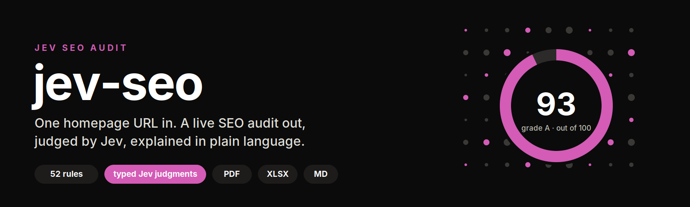</td>
<td align="center" valign="top">medya yayımlanmamış</td>
</tr></table>

🧩 <b><a href="https://github.com/TypeLLM/TypeLLM">TypeLLM/TypeLLM</a></b> · ⭐982 · Python · 🔎 inferred · 29 天

##### 📝 Özet

TypeLLM: tür güvenli üretim ile LLMs

##### 📌 Temel bilgiler

| Alan     | Değer            |
| -------- | ---------------- |
| Kategori | `Diğer projeler` |
| Kanıt    | `inferred`       |
| Dil      | Python           |

##### 📊 Veri

| Ölçüt          | Değer      |
| -------------- | ---------- |
| Yıldız         | **982**    |
| Son push       | 2026-10-25 |
| İlk listelenme | 2026-11-08 |

🏷 `ai` · `jev` · `llms` · `types`

---

<table><tr><th align="center" width="50%">🖼 Görsel</th><th align="center" width="50%">🎬 Video</th></tr><tr>
<td align="center" valign="top">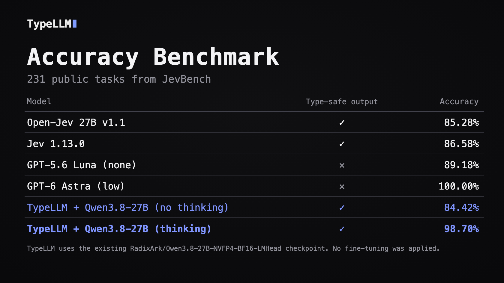</td>
<td align="center" valign="top">medya yayımlanmamış</td>
</tr></table>

🧩 <b><a href="https://github.com/shengjidaguai-china/goutoujunshi-jev-chat">shengjidaguai-china/goutoujunshi-jev-chat</a></b> · ⭐695 · Python · 🔎 inferred · 36 天

##### 📝 Özet

狗头军师 Chat: Mac WeChat ekran okuma, ilişki analizi ve yanıt taslağı kayan penceresi

##### 📌 Temel bilgiler

| Alan     | Değer            |
| -------- | ---------------- |
| Kategori | `Diğer projeler` |
| Kanıt    | `inferred`       |
| Dil      | Python           |

##### 📊 Veri

| Ölçüt          | Değer      |
| -------------- | ---------- |
| Yıldız         | **695**    |
| Son push       | 2026-10-19 |
| İlk listelenme | 2026-11-08 |

---

<table><tr><th align="center" width="50%">🖼 Görsel</th><th align="center" width="50%">🎬 Video</th></tr><tr>
<td align="center" valign="top"></td>
<td align="center" valign="top">medya yayımlanmamış</td>
</tr></table>

🧩 <b><a href="https://github.com/TianyuCodings/JevHarness">TianyuCodings/JevHarness</a></b> · ⭐561 · Python · 🔎 inferred · 39 天

##### 📝 Özet

LLM tarafından yazılmış, göreve özgü Jev koşumları; isteğe bağlı tam yörünge ödül yansıtması ve GEPA evrimiyle.

##### 📌 Temel bilgiler

| Alan     | Değer            |
| -------- | ---------------- |
| Kategori | `Diğer projeler` |
| Kanıt    | `inferred`       |
| Dil      | Python           |

##### 📊 Veri

| Ölçüt          | Değer      |
| -------------- | ---------- |
| Yıldız         | **561**    |
| Son push       | 2026-10-16 |
| İlk listelenme | 2026-11-08 |

---

<table><tr><th align="center" width="50%">🖼 Görsel</th><th align="center" width="50%">🎬 Video</th></tr><tr>
<td align="center" valign="top"></td>
<td align="center" valign="top"> <a href="https://raw.githubusercontent.com/TianyuCodings/JevHarness/main/docs/media/pokemon-comparison.mp4">Videoyu aç</a></td>
</tr></table>

Yeniden dağıtım lisansı belirtilmediği için varlık üst depodan doğrudan bağlanmıştır.

<b>Bu kategoride daha fazla</b> · 55

- [f/jev-leftpad](https://github.com/f/jev-leftpad) - TypeSafe AI&#x27;ın Jev&#x27;iyle dizelerin başına dolgu ekler. Sebebi var.
- [SoundBlaster/SwiftJev](https://github.com/SoundBlaster/SwiftJev) - Swift framework to access Jev System One model by TypeSafe.ai.
- [codaaiteam/jev-ai](https://github.com/codaaiteam/jev-ai) - Jev AI quickstart &amp; FAQ — TypeSafe AI.
- [soderlind/ai-provider-for-jev](https://github.com/soderlind/ai-provider-for-jev) - Yapılandırılmış kararlar (choice, score, noul) için WordPress&#x27;i TypeSafe&#x27;ın Jev…
- [DreamBlooms/ifReflex.cpp](https://github.com/DreamBlooms/ifReflex.cpp) - Herhangi bir LLM, Kişisel Bilgisayarınızda SystemOne karar modeli olarak hizmet…
- [turenlabs/lisa](https://github.com/turenlabs/lisa) - LISA: Leak, Injection &amp; Simplicity Auditor.
- [cookkie03/any-class](https://github.com/cookkie03/any-class) - Zero-token local decision engine for classifying Telegram Saved Messages with…
- [DevItaliya22/jev-chess](https://github.com/DevItaliya22/jev-chess) - Jev.
- [kasperihallinen/football-ai](https://github.com/kasperihallinen/football-ai) - Comparing a fine-tuned System One model called Von with conventional machine…
- [Paveerongar/clef-spam-detection](https://github.com/Paveerongar/clef-spam-detection) - Experiment using the System One model Clef to detect spam vs ham.
- [scholarly360/Microsoft-Decision-1-on-Microsoft-Foundry](https://github.com/scholarly360/Microsoft-Decision-1-on-Microsoft-Foundry) - Microsoft Decision-1 System One Model on Microsoft Foundry.
- [suraj-phanindra/jev-position-audit](https://github.com/suraj-phanindra/jev-position-audit) - Registered audit of position and format sensitivity in the Jev 1.13 decision…
- [TomatenMarc/Sycophancy-System-One-Models](https://github.com/TomatenMarc/Sycophancy-System-One-Models)
- [unbraind/pm-jev](https://github.com/unbraind/pm-jev) - Jev tarzı System One modelleriyle pm öğeleri için türlenmiş, yerel öncelikli…
- [shcherbak-ai/contextgem](https://github.com/shcherbak-ai/contextgem) - Extract structured data and insights from documents using LLMs and decision…
- [Sac-Y/Jev-cu](https://github.com/Sac-Y/Jev-cu)
- [jev-chat/jev-chat-jarvis-mac](https://github.com/jev-chat/jev-chat-jarvis-mac) - Sohbet yüzen pencere yardımcısı (macOS): ekran algılama + amacı ve riski yerel…
- [Yinsongxu/LLM2Jev](https://github.com/Yinsongxu/LLM2Jev) - Yerel dil modellerini Jev tarzı yapılandırılmış karar modellerine dönüştürün.
- [Zefan-Cai/Open-Jev](https://github.com/Zefan-Cai/Open-Jev)
- [dabit3/jev-experiments](https://github.com/dabit3/jev-experiments)
- [zfkarl/MedJev](https://github.com/zfkarl/MedJev) - MedJev: A System One Vision-Language Decision Model for Fast and Effective…
- [1Panel-dev/laya-server](https://github.com/1Panel-dev/laya-server) - Laya.
- [Abhinavexists/lev](https://github.com/Abhinavexists/lev) - Açık bir System One karar modeli.
- [Jev-Engineering/cookbook](https://github.com/Jev-Engineering/cookbook) - Jev ile yazılı kararlar için altmış notebook tarifi: ilk sınıflandırmadan…
- [2951461586/Jev-Register-Tool](https://github.com/2951461586/Jev-Register-Tool) - TypeSafe（Jev / System One）başvuru → onay e-postası → onay alma → kayıt → API…
- [I-You-Dream/jev-from-scratch](https://github.com/I-You-Dream/jev-from-scratch) - 从零开源复刻 Jev（System One）决策模型范式，基于 Qwen 基座训练，支持 Choice / Noul 原语，包含推理、微调、ECE…
- [yijunyu/jev-rs](https://github.com/yijunyu/jev-rs) - Herhangi bir LLM üzerinden tek bir ön doldurmada System One yargısı…
- [nvkudva/ollajev](https://github.com/nvkudva/ollajev) - Hugging Face içinden System One karar modellerini Jev / System One API…
- [Kevthetech143/super-jev](https://github.com/Kevthetech143/super-jev) - A small, extensible decision-to-action harness for TypeSafe Jev.
- [manifoldor/xtags](https://github.com/manifoldor/xtags) - X.
- [usail-hkust/JevLight](https://github.com/usail-hkust/JevLight) - Jev-powered traffic signal control on CityFlow with structured phase and…
- [botassembly/thinkthen](https://github.com/botassembly/thinkthen) - ThinkThen: ne demek istediğinizi bilen kod.
- [rawwerks/one-system](https://github.com/rawwerks/one-system) - Yerel ve barındırılan sınıflandırıcıları, yani karar modellerini, yani Jev…
- [comoc/jev-minesweeper](https://github.com/comoc/jev-minesweeper) - TypeSafe Jev (System One) öğesine tarayıcıdaki Mayın Tarlası.
- [XingQiPan/rwkv-jev](https://github.com/XingQiPan/rwkv-jev) - RWKV-7 (g1k-1b) tabanlı Jev tarzı sıfır üretimli karar motoru: kısıtlı softmax…
- [nima1313/jev-captcha](https://github.com/nima1313/jev-captcha) - Read short image captchas with TypeSafe Jev: length first, any length, case…
- [a3harva/jev-autofill](https://github.com/a3harva/jev-autofill) - Chrome extension that fills job application forms from a local profile.
- [demirfahrieren-png/jev-canli-sonuclar](https://github.com/demirfahrieren-png/jev-canli-sonuclar) - Jev canlı sanal işlem sonuçları (sunucu her gün günceller; gerçek emir yok).
- [fdsfserrrr/mk--JEV-AI-](https://github.com/fdsfserrrr/mk--JEV-AI-) - 获课：jzit.top/26594/mk网-JEV 决策大模型实战，让 AI 从会聊天到能决策.
- [fghdhtfdu/JEV-AI-](https://github.com/fghdhtfdu/JEV-AI-) - 获课：jzit.top/26594/JEV 决策大模型实战，让 AI 从会聊天到能决策.
- [Lasimeri/XKS_Jev-like_Model_Base](https://github.com/Lasimeri/XKS_Jev-like_Model_Base) - Jev-like typed judgments (noul / choice / score) from a local LLM.
- [LinkedInLearning/Build-with-Decision-Models-in-30-Minutes-Jev-Kev-and-the-OpenAI-Decisions-API-29277003](https://github.com/LinkedInLearning/Build-with-Decision-Models-in-30-Minutes-Jev-Kev-and-the-OpenAI-Decisions-API-29277003) - : This is a repo for LinkedIn Learning course: Build with Decision Models in 30…
- [PineappleBingo/jev-radar](https://github.com/PineappleBingo/jev-radar) - TypeSafe Jev 오픈소스 구현을 매일 모아 한국어로 정리하는 레이더 (radar-index/1).
- [rttq/jev_board](https://github.com/rttq/jev_board) - jev board: a local workbench for testing propositions against TypeSafe Jev.
- [Sandesh-S-Dalvi/playwright-jev-testing](https://github.com/Sandesh-S-Dalvi/playwright-jev-testing) - Playwright TypeScript automation testing with TypeSafe Jev as the intelligence…
- [receptron/laya](https://github.com/receptron/laya) - Açık kaynaklı Jev uyumlu System-1 karar modeli Laya.
- [Rizzo-AI-Academy/rizzo-flow](https://github.com/Rizzo-AI-Academy/rizzo-flow) - Jev&#x27;in açık, yerel yorumu: bir LLM&#x27;den tek bir token üretmeden tiplendirilmiş…
- [jerryjliu/docjev](https://github.com/jerryjliu/docjev) - Jev kullanan çok hızlı bir belge sınıflandırıcısı/bölücüsü.
- [PostHog/jeeves](https://github.com/PostHog/jeeves) - Jeeves – Muhakeme, Jev benzeri karar modellerini iyileştirir.
- [codejunkie99/keel](https://github.com/codejunkie99/keel) - Yerel Laya ve isteğe bağlı Jev karar seçimi içeren, yerel öncelikli macOS…
- [iapp-technology/openthai-systemone](https://github.com/iapp-technology/openthai-systemone) - OpenThai-SystemOne: açık kaynaklı Tayca + İngilizce System One karar modeli…
- [hawkymisc/typed-decision-bert](https://github.com/hawkymisc/typed-decision-bert) - Resmî olmayan PoC: tür bilgili karar (noul / choice / score) HTTP API arkasında…
- [InterfazeAI/lev](https://github.com/InterfazeAI/lev) - Açık bir System One karar modeli.
- [epergaboni/jevseo](https://github.com/epergaboni/jevseo) - Bir System One decision model olan Jev tarafından desteklenen türlenmiş SEO…
- [Temikus/lgtm](https://github.com/Temikus/lgtm) - Score pull requests with System One decision models.

## Uygulama diline göre projeler

Ekosistem Python ve TypeScript'te yoğunlaşıyor, ancak tipli istemciler başka dillerde de görünmeye devam ediyor. Bu tablo kayıtların kendisinden üretilir.

| Dil        | Kayıt | Örnekler                                                                                                |
| ---------- | ----- | ------------------------------------------------------------------------------------------------------- |
| Python     | 304   | `typesafe-ai/system-one-adapter-python`, `typesafe-ai/typesafe-sdk-python`, `typesafe-ai/WorkflowEvals` |
| TypeScript | 117   | `typesafe-ai/typesafe-sdk-js`, `TypeSafeAI/jev-harness`, `qkal/Canny`                                   |
| JavaScript | 66    | `clouatre-labs/decisions-judge-mcp`, `Ying-Kai-Liao/jev-browser`, `jiangkoumo/ego-decision-layer`       |
| Rust       | 29    | `AkashPriyadarshii/jev-curate`, `agent-ix/sapho`, `chussenot/judgment`                                  |
| HTML       | 20    | `typesafe-ai/typesafe-ai.github.io`, `yzfly/awesome-jev-zh`, `AkashPriyadarshii/jev-superpowers`        |
| Jupyter    | 13    | `jexp/neo4jev`, `GitHub30/OpenJev`, `Query-farm/vgi-typesafe`                                           |
| Go         | 11    | `mattn/go-jev`, `devbackend/jevgo`, `kataras/jev`                                                       |
| C#         | 6     | `elbruno/ElBruno.AI.Decisions`, `saibimajdi/typesafeai-dotnet-sdk`, `TraxSharp/Trax`                    |
| Elixir     | 5     | `dannote/jev`, `Elue-dev/jev_elixir`, `nshkrdotcom/system_one_sdk`                                      |
| PHP        | 5     | `basi/typesafe-ai-php-client`, `marcreichel/laya-php`, `Butochnikov/laravel-typesafe-jev`               |
| Swift      | 5     | `john-rocky/coreai-kit`, `Algorythm-Canada/OpenJevSwift`, `mattt/AnyDecisionModel`                      |
| C++        | 4     | `xiaocongyu66/llama.cpp-jev-adapter`, `DataZooDE/anofox-decide`, `feder-cr/jev`                         |
| Java       | 4     | `Premo-Cloud/typesafe-sdk-java`, `Nisaka520/JevIntent`, `danvega/jev-comment-moderation`                |
| PowerShell | 3     | `BFLabsAI/bf-jev-deep-research`, `dfinke/Jev`, `huntsman95/PowerJev`                                    |
| Shell      | 3     | `realZachi/pg-jev`, `milojarow/jev-skills`, `skylence-org/claudecode-jev-marketplace`                   |
| TeX        | 3     | `xiaohuiyan/awesome-jev-papers`, `dnakhoa/jev-deferred-crispification`, `evan-py-chen/jev-survey`       |
| Astro      | 2     | `heyjunpenn/awesome-jev`, `wizicer/jev_info_site`                                                       |
| Kotlin     | 2     | `pambrose/jev4k`, `jev-chat/jev-chat-jarvis`                                                            |
| Ruby       | 2     | `obie/ruby_decision_model`, `Ray-Hughes/jevalyn`                                                        |
| XS         | 2     | `cameronb-xano/jev-agent-guardrail`, `xano-community/agent-guardrail-jev`                               |
| C          | 1     | `lijiawei255/jev-tune`                                                                                  |
| Haskell    | 1     | `getmissionctrl/hs-jev`                                                                                 |
| Nushell    | 1     | `cablehead/jev.nu`                                                                                      |
| Pascal     | 1     | `danieleteti/systemone-delphi`                                                                          |

Yalnızca dil belirten kayıtlar sayılır. Altyapı, dokümantasyon ve tartışma kayıtları bu tablonun dışında tutulur.

## Katkıda bulunma

Düzeltmeler memnuniyetle karşılanır ve bu listeyi iyileştirmenin en hızlı yoludur. Bir kayıt yanlış sınıflandırılmış, yanlış derecelendirilmiş ya da bir proje ad çakışması diye hatalı biçimde dışlanmışsa bir issue veya pull request açın — otomatik filtrelerin en çok yanılma olasılığı son kategoridedir. Ekleme yapmanın en iyi yolu README'yi düzenlemek değil, `scripts/collect.py` dosyasına bir kaynak eklemektir; çünkü README her turda yeniden üretilir.

---

Bağımsız topluluk projesi. TypeSafe AI ile bağlantılı değildir; onun tarafından onaylanmamış veya incelenmemiştir. Ürün davranışı, fiyatlandırma, sınırlar ve model takma adları bildirimsiz değişebilir; kritik her şeyi resmî belgelerle doğrulayın. Varlıklar üst projelerinin mülkiyetinde kalır ve yalnızca lisansın izin verdiği yerlerde yeniden üretilir.

Oluşturan · 2026-11-24T15:33:26+08:00
