

  

<h1 align="center">Awesome Jev Live</h1>

<b>Індекс Jev із градацією доказів, який перебудовує себе кожні дві години.</b>

  
  
  
  
  
  

<a href="../README.md">English</a> · <a href="README.zh-CN.md">简体中文</a> · <a href="README.zh-TW.md">繁體中文</a> · <a href="README.ja.md">日本語</a> · <a href="README.ko.md">한국어</a> · <a href="README.es.md">Español</a> · <a href="README.fr.md">Français</a> · <a href="README.de.md">Deutsch</a> · <a href="README.pt-BR.md">Português (Brasil)</a> · <a href="README.ru.md">Русский</a> · <a href="README.it.md">Italiano</a> · <a href="README.ar.md">العربية</a> · <a href="README.hi.md">हिन्दी</a> · <a href="README.tr.md">Türkçe</a> · <a href="README.vi.md">Tiếng Việt</a> · <a href="README.th.md">ไทย</a> · <a href="README.id.md">Bahasa Indonesia</a> · <a href="README.pl.md">Polski</a> · <a href="README.nl.md">Nederlands</a> · <b>Українська</b>

> [!NOTE]
> **Живий індекс** · Остання синхронізація: `2026-11-24T15:33:26+08:00` (UTC+8)
> · Записи: **703** · Нові за цей цикл: **8** · Мови реалізації: **24**

Кожен запис нижче було зібрано, відфільтровано й повторно перевірено конвеєром у цьому репозиторії. Числа та часові позначки походять із джерел, а не з написаного вручну знімка.

## 🔥 Вибір моменту — перший у кожній категорії

Один запис на категорію, відсортований за рівнем доказовості та зірками, перераховується щоразу. Це рейтинг, а не рекомендація; кожен вибір веде до повної картки нижче. Перевага надається проєктам, які опублікували знімок екрана або запис, щоб блок залишався наочним.

<table>
<tr>
<td width="50%" valign="top">
<b>🏛️ <a href="https://github.com/typesafe-ai/skills">typesafe-ai/skills</a></b>
⭐2918 · ✅ official
Навички агента для створення рішень за допомогою TypeSafe System One API
</td>
<td width="50%" valign="top">

<b>🧰 <a href="https://github.com/john-rocky/coreai-kit">john-rocky/coreai-kit</a></b>
⭐127 · Swift · 👁️ observed
Swift SDK for running chat, vision and speech models on iPhone and Mac with Apple&#x27;s Core AI. Model download and caching, FoundationModels integration, and runnable…
</td>
</tr>
<tr>
<td width="50%" valign="top">

<b>🤖 <a href="https://github.com/gargpratyush/jev-router">gargpratyush/jev-router</a></b>
⭐673 · JavaScript · 🔎 inferred
Маршрутизація до найдешевшої моделі в claude code для вашого завдання за допомогою jev-router
</td>
<td width="50%" valign="top">

<b>🛡️ <a href="https://github.com/dharmeshgurnani/codeotter">dharmeshgurnani/codeotter</a></b>
⭐5 · TypeScript · 👁️ observed
Autonomous, self-hosted AI code reviews, calibrated scoring gauges, and merge gates from any open model.
</td>
</tr>
<tr>
<td width="50%" valign="top">
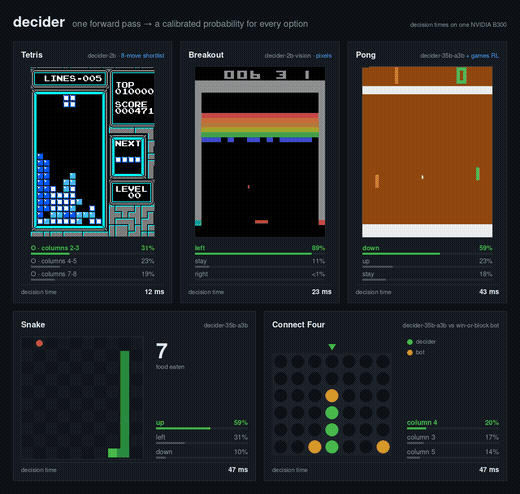
<b>🧪 <a href="https://github.com/Mapika/decider">Mapika/decider</a></b>
⭐1034 · Python · 👁️ observed
Сімейство моделей у стилі System One, донавчених на основі Qwen3.5, призначених для типізованих рішень за один прохід із каліброваними ймовірностями.
</td>
<td width="50%" valign="top">

<b>🔬 <a href="https://github.com/r-ms/mini-jev">r-ms/mini-jev</a></b>
⭐64 · Python · 🔎 inferred
mini-Jev: як виглядає інтерфейс типізованих рішень у стилі Jev на замороженій Qwen3-4B — зчитує логіти літери варіанта замість генерування JSON. Попередньо…
</td>
</tr>
<tr>
<td width="50%" valign="top">

<b>🎮 <a href="https://github.com/MCG-NJU/VideoJev">MCG-NJU/VideoJev</a></b>
⭐318 · Python · 👁️ observed
VideoJev: System One Model для розуміння відео та взаємодії
</td>
<td width="50%" valign="top">
<b>📰 <a href="https://docs.typesafe.ai/model-jaggedness/jev-1.13">9 типів відомих дефектів (jaggedness)</a></b>
⭐0 · ✅ official
Буквальне розуміння, **ненадійний підрахунок**, порівняння дат, багаторівнева непрямість, великий state з нерелевантними деталями, змагальний вміст, суперечність між…
</td>
</tr>
</table>

## Зміст

- [Що таке Jev?](#що-таке-jev)
- [Як оцінюються записи](#як-оцінюються-записи)
- [Офіційні SDK та інструменти для розробників](#офіційні-sdk-та-інструменти-для-розробників) — **7**
- [Клієнти, SDK та адаптери спільноти](#клієнти-sdk-та-адаптери-спільноти) — **117**
- [Інструменти для агентів: MCP, хуки, шлюзи та агенти-програмісти](#інструменти-для-агентів-mcp-хуки-шлюзи-та-агенти-програмісти) — **224**
- [Маршрутизація, запобіжники та затвердження](#маршрутизація-запобіжники-та-затвердження) — **52**
- [Оцінювання, калібрування та бенчмарки](#оцінювання-калібрування-та-бенчмарки) — **78**
- [Відкриті відтворення, ваги та дослідження архітектури](#відкриті-відтворення-ваги-та-дослідження-архітектури) — **35**
- [Застосунки, ігри, робототехніка та інтерактивні демо](#застосунки-ігри-робототехніка-та-інтерактивні-демо) — **38**
- [Тексти, обговорення та споріднені списки](#тексти-обговорення-та-споріднені-списки) — **75**
- [Інші проєкти](#інші-проєкти) — **77**
- [Проєкти за мовою реалізації](#проєкти-за-мовою-реалізації)

## Що таке Jev?

Jev — перша **System One model** від TypeSafe AI. Вона не пише прозу. Вона приймає стан і питання, простір відповідей на які ви задаєте заздалегідь, та повертає типізовані значення з розподілами ймовірностей, на яких ваш код може розгалужуватися.

|                      |                                                                                                                                                                                                                            |
| -------------------- | -------------------------------------------------------------------------------------------------------------------------------------------------------------------------------------------------------------------------- |
| **Форма**            | `state + typed questions` → `constrained answers + probabilities` → `your code`                                                                                                                                            |
| **Примітиви**        | `Choice` (вибір одного з ≤255 варіантів), `Score` (шкала 2–10), `Noul` (імовірнісне так/ні)                                                                                                                                |
| **Ендпойнт**         | `POST https://api.typesafe.ai/v1/systemone`, модель `jev-1.13.0` / псевдонім `jev-latest`                                                                                                                                  |
| **Добре підходить**  | маршрутизація, тріаж, оцінювання, модерація, верифікація та шлюзи з низькою затримкою в межах обмеженого робочого процесу                                                                                                  |
| **Відомі обмеження** | підрахунок ненадійний, багаторівневе непряме звернення слабке, а офіційні матеріали називають дев'ять класів нерівномірності. Валідний за схемою вивід — це не те саме, що правильне рішення: калібруйте на власних даних. |

## Як оцінюються записи

Більшість списків у цій царині лише заявляють про включення. Цей каже, скільки насправді перевірив, і дає вам відфільтрувати відповідно.

| Оцінка       | Що це означає                                                                                                                                       |
| ------------ | --------------------------------------------------------------------------------------------------------------------------------------------------- |
| `official`   | Опубліковано самою TypeSafe AI.                                                                                                                     |
| `observed`   | Публічний артефакт, який можна відкрити й прочитати — справжній код, справжня конфігурація або явна заява TypeSafe/Jev у назві чи темі репозиторію. |
| `inferred`   | Зіставлено за неоднозначною ознакою та супутньою лексикою, але ще не прочитано рядок за рядком.                                                     |
| `unverified` | Виглядає спорідненим, нічого незалежно не підтверджено. Додано лише для пошуку.                                                                     |

## Офіційні SDK та інструменти для розробників

Усе, що публікує сам TypeSafe. Почніть звідси.

🏛️ <b><a href="https://github.com/typesafe-ai/skills">typesafe-ai/skills</a></b> · ⭐2918 · ✅ official · 31 天

##### 📝 Стислий опис

Навички агента для створення рішень за допомогою TypeSafe System One API

> 💡 Власні навички агента постачальника. Оскільки вони постійно оновлюються, це найближче до специфікації того, як TypeSafe планує керувати Jev з агента.

##### 📌 Основні факти

| Поле      | Значення                                      |
| --------- | --------------------------------------------- |
| Категорія | `Офіційні SDK та інструменти для розробників` |
| Докази    | `official`                                    |

##### 📊 Дані

| Метрика         | Значення   |
| --------------- | ---------- |
| Зірки           | **2918**   |
| Останній push   | 2026-10-23 |
| Уперше в списку | 2026-09-18 |

🏛️ <b><a href="https://github.com/typesafe-ai/system-one-adapter-python">typesafe-ai/system-one-adapter-python</a></b> · ⭐410 · Python · ✅ official · 9 天

##### 📝 Стислий опис

Повна заміна TypeSafeClient на основі LLM APIs

> 💡 Повна заміна, яка реалізує той самий інтерфейс за допомогою звичайного провайдера LLM. Це чесний спосіб порівняти типізоване рішення з промптом A/B-тестуванням на власних даних, перш ніж зупинитися на одному з варіантів.

🔧 Виявлено використання в коді: `README.md`

##### 📌 Основні факти

| Поле      | Значення                                      |
| --------- | --------------------------------------------- |
| Категорія | `Офіційні SDK та інструменти для розробників` |
| Докази    | `official`                                    |
| Мова      | Python                                        |

##### 📊 Дані

| Метрика         | Значення   |
| --------------- | ---------- |
| Зірки           | **410**    |
| Останній push   | 2026-11-15 |
| Уперше в списку | 2026-10-23 |

🏛️ <b><a href="https://github.com/typesafe-ai/typesafe-sdk-python">typesafe-ai/typesafe-sdk-python</a></b> · ⭐316 · Python · ✅ official · 13 天

##### 📝 Стислий опис

Офіційна бібліотека Python для TypeSafe API

> 💡 Синхронні та асинхронні клієнти. Найшвидший шлях від ключа API до типізованого рішення та еталон, з яким порівнюють клієнти спільноти.

🔧 Виявлено використання в коді: `README.md`

##### 📌 Основні факти

| Поле      | Значення                                      |
| --------- | --------------------------------------------- |
| Категорія | `Офіційні SDK та інструменти для розробників` |
| Докази    | `official`                                    |
| Мова      | Python                                        |

##### 📊 Дані

| Метрика         | Значення   |
| --------------- | ---------- |
| Зірки           | **316**    |
| Останній push   | 2026-11-11 |
| Уперше в списку | 2026-10-23 |

🏛️ <b><a href="https://github.com/typesafe-ai/typesafe-sdk-js">typesafe-ai/typesafe-sdk-js</a></b> · ⭐288 · TypeScript · ✅ official · 13 天

##### 📝 Стислий опис

Офіційна бібліотека TypeScript/JavaScript для TypeSafe API

> 💡 Клієнт TypeScript, у якому тип відповіді виводиться із запитаного вами питання, тож невідповідний тип повернення спричиняє помилку компіляції, а не несподіванку під час виконання.

##### 📌 Основні факти

| Поле      | Значення                                      |
| --------- | --------------------------------------------- |
| Категорія | `Офіційні SDK та інструменти для розробників` |
| Докази    | `official`                                    |
| Мова      | TypeScript                                    |

##### 📊 Дані

| Метрика         | Значення   |
| --------------- | ---------- |
| Зірки           | **288**    |
| Останній push   | 2026-11-11 |
| Уперше в списку | 2026-10-23 |

🏛️ <b><a href="https://github.com/TypeSafeAI/jev-harness">TypeSafeAI/jev-harness</a></b> · ⭐41 · TypeScript · ✅ official · 7 天

##### 📝 Стислий опис

A custom coding harness for TypeSafe AI's Jev: an LLM proposes, Jev answers narrow questions, code decides, every step leaves a receipt.

##### 📌 Основні факти

| Поле      | Значення                                      |
| --------- | --------------------------------------------- |
| Категорія | `Офіційні SDK та інструменти для розробників` |
| Докази    | `official`                                    |
| Мова      | TypeScript                                    |

##### 📊 Дані

| Метрика         | Значення   |
| --------------- | ---------- |
| Зірки           | **41**     |
| Останній push   | 2026-11-17 |
| Уперше в списку | 2026-11-18 |

🏷 `agent-harness` · `agentic-coding` · `ai-agents` · `ai-governance` · `ai-safety` · `code-review` · `coding-agent` · `developer-tools`

🏛️ <b><a href="https://github.com/typesafe-ai/WorkflowEvals">typesafe-ai/WorkflowEvals</a></b> · ⭐22 · Python · ✅ official · 10 天

##### 📝 Стислий опис

Опубліковано код робочого процесу evals.typesafe.ai

##### 📌 Основні факти

| Поле      | Значення                                      |
| --------- | --------------------------------------------- |
| Категорія | `Офіційні SDK та інструменти для розробників` |
| Докази    | `official`                                    |
| Мова      | Python                                        |

##### 📊 Дані

| Метрика         | Значення   |
| --------------- | ---------- |
| Зірки           | **22**     |
| Останній push   | 2026-11-14 |
| Уперше в списку | 2026-10-23 |

🏛️ <b><a href="https://github.com/typesafe-ai/typesafe-ai.github.io">typesafe-ai/typesafe-ai.github.io</a></b> · ⭐2 · HTML · ✅ official · 172 天

##### 📝 Стислий опис

Опис від початкового проєкту не опубліковано.

##### 📌 Основні факти

| Поле      | Значення                                      |
| --------- | --------------------------------------------- |
| Категорія | `Офіційні SDK та інструменти для розробників` |
| Докази    | `official`                                    |
| Мова      | HTML                                          |

##### 📊 Дані

| Метрика         | Значення   |
| --------------- | ---------- |
| Зірки           | **2**      |
| Останній push   | 2026-06-04 |
| Уперше в списку | 2026-10-23 |

## Клієнти, SDK та адаптери спільноти

Типізовані клієнти для ендпойнта System One — стількома мовами, скількома встигла спільнота.

🧰 <b><a href="https://github.com/realZachi/pg-jev">realZachi/pg-jev</a></b> · ⭐1317 · Shell · 👁️ observed · 48 天

##### 📝 Стислий опис

Ставте запитання до таблиць Postgres звичайною мовою. Розширення PostgreSQL на основі Jev від TypeSafe.

🔧 Виявлено використання в коді: `README.md`

##### 📌 Основні факти

| Поле      | Значення                             |
| --------- | ------------------------------------ |
| Категорія | `Клієнти, SDK та адаптери спільноти` |
| Докази    | `observed`                           |
| Мова      | Shell                                |

##### 📊 Дані

| Метрика         | Значення   |
| --------------- | ---------- |
| Зірки           | **1317**   |
| Останній push   | 2026-10-06 |
| Уперше в списку | 2026-10-29 |

🧰 <b><a href="https://github.com/jexp/neo4jev">jexp/neo4jev</a></b> · ⭐190 · Jupyter · 👁️ observed · 66 天

##### 📝 Стислий опис

Typesafe.ai System One Model Jev, що переміщується графом Neo4j, використовуючи класифікатор для зв’язків із сусідніми вузлами

##### 📌 Основні факти

| Поле      | Значення                             |
| --------- | ------------------------------------ |
| Категорія | `Клієнти, SDK та адаптери спільноти` |
| Докази    | `observed`                           |
| Мова      | Jupyter                              |

##### 📊 Дані

| Метрика         | Значення   |
| --------------- | ---------- |
| Зірки           | **190**    |
| Останній push   | 2026-09-18 |
| Уперше в списку | 2026-10-28 |

🧰 <b><a href="https://github.com/qkal/Canny">qkal/Canny</a></b> · ⭐135 · TypeScript · 👁️ observed · 11 天

##### 📝 Стислий опис

Не дозволяє агентам програмування ШІ заявляти, що роботу виконано, без доказів. Детерміновані хуки приймають рішення, TypeSafe Jev надає рекомендації. Журнал лише для додавання, нуль залежностей під час виконання.

🔧 Виявлено використання в коді: `README.md`

##### 📌 Основні факти

| Поле      | Значення                             |
| --------- | ------------------------------------ |
| Категорія | `Клієнти, SDK та адаптери спільноти` |
| Докази    | `observed`                           |
| Мова      | TypeScript                           |

##### 📊 Дані

| Метрика         | Значення   |
| --------------- | ---------- |
| Зірки           | **135**    |
| Останній push   | 2026-11-13 |
| Уперше в списку | 2026-10-29 |

🏷 `agent-hooks` · `ai-agents` · `claude-code` · `claude-code-hooks` · `codex` · `codex-cli` · `guardrails` · `jev`

🧰 <b><a href="https://github.com/john-rocky/coreai-kit">john-rocky/coreai-kit</a></b> · ⭐127 · Swift · 👁️ observed · 8 天

##### 📝 Стислий опис

Swift SDK for running chat, vision and speech models on iPhone and Mac with Apple's Core AI. Model download and caching, FoundationModels integration, and runnable examples with documented OS, SDK and model requirements.

🔧 Виявлено використання в коді: `Sources/CoreAIOps/CoreAI+SystemOne.swift`

##### 📌 Основні факти

| Поле      | Значення                             |
| --------- | ------------------------------------ |
| Категорія | `Клієнти, SDK та адаптери спільноти` |
| Докази    | `observed`                           |
| Мова      | Swift                                |

##### 📊 Дані

| Метрика         | Значення   |
| --------------- | ---------- |
| Зірки           | **127**    |
| Останній push   | 2026-11-16 |
| Уперше в списку | 2026-10-26 |

🏷 `apple` · `apple-core-ai` · `asr` · `core-ai` · `coreai` · `foundation-models` · `ios` · `ios-27`

---

<table><tr><th align="center" width="50%">🖼 Зображення</th><th align="center" width="50%">🎬 Відео</th></tr><tr>
<td align="center" valign="top"></td>
<td align="center" valign="top"> анімований запис</td>
</tr></table>

🧰 <b><a href="https://github.com/AkashPriyadarshii/jev-curate">AkashPriyadarshii/jev-curate</a></b> · ⭐116 · Rust · 👁️ observed · 12 天

##### 📝 Стислий опис

High-throughput synthetic and pretraining dataset sifter for TypeSafe Jev. Rust streaming core, Parquet and JSONL I/O, typed Choice/Score/Noul judgments, speculative fan-out, 24.0 rows/sec measured.

🔧 Виявлено використання в коді: `AGENTS.md`, `site/llms.txt`, `docs/DESIGN.md`

##### 📌 Основні факти

| Поле      | Значення                             |
| --------- | ------------------------------------ |
| Категорія | `Клієнти, SDK та адаптери спільноти` |
| Докази    | `observed`                           |
| Мова      | Rust                                 |

##### 📊 Дані

| Метрика         | Значення   |
| --------------- | ---------- |
| Зірки           | **116**    |
| Останній push   | 2026-11-11 |
| Уперше в списку | 2026-11-05 |

🏷 `arrow` · `cli` · `data-cleaning` · `data-engineering` · `dataset-curation` · `eval-harness` · `fine-tuning` · `jev`

🧰 <b><a href="https://github.com/yzfly/awesome-jev-zh">yzfly/awesome-jev-zh</a></b> · ⭐97 · HTML · 👁️ observed · 0 天

##### 📝 Стислий опис

Добірний китайськомовний список Jev / TypeSafe System One: офіційні матеріали, SDK, популярні застосунки, інструменти Agent, відтворення відкритого коду та незалежні оцінки, із китайським посібником для початку роботи; щодня автоматично додаються GitHub популярних проєктів.

🔧 Виявлено використання в коді: `docs/quickstart.md`

##### 📌 Основні факти

| Поле      | Значення                             |
| --------- | ------------------------------------ |
| Категорія | `Клієнти, SDK та адаптери спільноти` |
| Докази    | `observed`                           |
| Мова      | HTML                                 |

##### 📊 Дані

| Метрика         | Значення   |
| --------------- | ---------- |
| Зірки           | **97**     |
| Останній push   | 2026-11-24 |
| Уперше в списку | 2026-09-18 |

🏷 `ai-agent` · `awesome` · `awesome-list` · `chinese` · `jev` · `llm` · `structured-output` · `system-one`

🧰 <b><a href="https://github.com/obie/ruby_decision_model">obie/ruby_decision_model</a></b> · ⭐61 · Ruby · 👁️ observed · 42 天

##### 📝 Стислий опис

Клієнт Ruby для моделей рішень, таких як Typesafe Jev

🔧 Виявлено використання в коді: `README.md`

##### 📌 Основні факти

| Поле      | Значення                             |
| --------- | ------------------------------------ |
| Категорія | `Клієнти, SDK та адаптери спільноти` |
| Докази    | `observed`                           |
| Мова      | Ruby                                 |

##### 📊 Дані

| Метрика         | Значення   |
| --------------- | ---------- |
| Зірки           | **61**     |
| Останній push   | 2026-10-12 |
| Уперше в списку | 2026-10-29 |

🧰 <b><a href="https://github.com/bodepudimuneendra-netizen/ConsciousDB">bodepudimuneendra-netizen/ConsciousDB</a></b> · ⭐56 · Python · 👁️ observed · 21 天

##### 📝 Стислий опис

Фреймворк Agentic GraphRAG, незалежний від бази даних, із взаємозамінними моделями System One (локальна Laya / хмарна Jev). Підключний інтелектуальний рівень із повним 4-фазним конвеєром, безперервним оцінюванням і власним обходом A* для будь-якої графової бази даних.

##### 📌 Основні факти

| Поле      | Значення                             |
| --------- | ------------------------------------ |
| Категорія | `Клієнти, SDK та адаптери спільноти` |
| Докази    | `observed`                           |
| Мова      | Python                               |

##### 📊 Дані

| Метрика         | Значення   |
| --------------- | ---------- |
| Зірки           | **56**     |
| Останній push   | 2026-11-02 |
| Уперше в списку | 2026-11-20 |

🏷 `astar-algorithm` · `eval-harness` · `fine-tuning` · `graphdatabase` · `graprag` · `jev` · `laya` · `neo4j`

🧰 <b><a href="https://github.com/AkashPriyadarshii/jev-superpowers">AkashPriyadarshii/jev-superpowers</a></b> · ⭐40 · HTML · 👁️ observed · 46 天

##### 📝 Стислий опис

Systematic software development framework for AI coding agents upgraded with TypeSafe Jev System One typed decisions

🔧 Виявлено використання в коді: `CLAUDE.md`

##### 📌 Основні факти

| Поле      | Значення                             |
| --------- | ------------------------------------ |
| Категорія | `Клієнти, SDK та адаптери спільноти` |
| Докази    | `observed`                           |
| Мова      | HTML                                 |

##### 📊 Дані

| Метрика         | Значення   |
| --------------- | ---------- |
| Зірки           | **40**     |
| Останній push   | 2026-10-08 |
| Уперше в списку | 2026-11-05 |

🏷 `agentic-skills` · `ai-agents` · `antigravity` · `claude-code` · `codex` · `coding-agents` · `cursor` · `developer-tools`

🧰 <b><a href="https://github.com/MrJev/awesome-jev">MrJev/awesome-jev</a></b> · ⭐21 · Python · 👁️ observed · 0 天

##### 📝 Стислий опис

Добірний список проєктів, інтеграцій і ресурсів для Jev, моделі System One від TypeSafe AI.

##### 📌 Основні факти

| Поле      | Значення                             |
| --------- | ------------------------------------ |
| Категорія | `Клієнти, SDK та адаптери спільноти` |
| Докази    | `observed`                           |
| Мова      | Python                               |

##### 📊 Дані

| Метрика         | Значення   |
| --------------- | ---------- |
| Зірки           | **21**     |
| Останній push   | 2026-11-24 |
| Уперше в списку | 2026-09-18 |

🏷 `ai-agents` · `awesome` · `awesome-list` · `jev` · `mcp` · `typesafe`

🧰 <b><a href="https://github.com/ckaraca/awesome-jev">ckaraca/awesome-jev</a></b> · ⭐18 · Python · 👁️ observed · 0 天

##### 📝 Стислий опис

Добірний список інструментів, інтеграцій та експериментів, створених на основі Jev, TypeSafe AI's System One моделі для швидких типізованих рішень.

##### 📌 Основні факти

| Поле      | Значення                             |
| --------- | ------------------------------------ |
| Категорія | `Клієнти, SDK та адаптери спільноти` |
| Докази    | `observed`                           |
| Мова      | Python                               |

##### 📊 Дані

| Метрика         | Значення   |
| --------------- | ---------- |
| Зірки           | **18**     |
| Останній push   | 2026-11-23 |
| Уперше в списку | 2026-09-19 |

🏷 `ai-agents` · `awesome` · `awesome-list` · `computer-use` · `jev` · `llm` · `system-one` · `typesafe`

🧰 <b><a href="https://github.com/Premo-Cloud/typesafe-sdk-java">Premo-Cloud/typesafe-sdk-java</a></b> · ⭐12 · Java · 👁️ observed · 33 天

##### 📝 Стислий опис

Спільнотний Java SDK для Jev, моделі System One від TypeSafe: типізовані запитання на вході, типізовані відповіді з каліброваними ймовірностями на виході. Java 17+, Spring Boot starter (неофіційний)

##### 📌 Основні факти

| Поле      | Значення                             |
| --------- | ------------------------------------ |
| Категорія | `Клієнти, SDK та адаптери спільноти` |
| Докази    | `observed`                           |
| Мова      | Java                                 |

##### 📊 Дані

| Метрика         | Значення   |
| --------------- | ---------- |
| Зірки           | **12**     |
| Останній push   | 2026-10-21 |
| Уперше в списку | 2026-10-28 |

🏷 `java` · `jev` · `sdk` · `spring-boot` · `system-one` · `system-one-models` · `typesafe`

🧰 <b><a href="https://github.com/clouatre-labs/decisions-judge-mcp">clouatre-labs/decisions-judge-mcp</a></b> · ⭐5 · JavaScript · 👁️ observed · 0 天

##### 📝 Стислий опис

Типізовані рішення для AI-агентів як інструмент MCP: імовірність «так/ні» (noul), вибір і оцінка в одному швидкому запиті. Працює на основі моделі TypeSafe System One.

##### 📌 Основні факти

| Поле      | Значення                             |
| --------- | ------------------------------------ |
| Категорія | `Клієнти, SDK та адаптери спільноти` |
| Докази    | `observed`                           |
| Мова      | JavaScript                           |

##### 📊 Дані

| Метрика         | Значення   |
| --------------- | ---------- |
| Зірки           | **5**      |
| Останній push   | 2026-11-24 |
| Уперше в списку | 2026-10-12 |

🏷 `agent` · `ai` · `cli` · `decision-making` · `decisions` · `judge` · `llm` · `mcp`

---

<table><tr><th align="center" width="50%">🖼 Зображення</th><th align="center" width="50%">🎬 Відео</th></tr><tr>
<td align="center" valign="top"></td>
<td align="center" valign="top"> анімований запис</td>
</tr></table>

🧰 <b><a href="https://github.com/elbruno/ElBruno.AI.Decisions">elbruno/ElBruno.AI.Decisions</a></b> · ⭐5 · C# · 👁️ observed · 4 天

##### 📝 Стислий опис

.NET 10 decision SDK: Choose, Score, and Assess with Microsoft Foundry (Microsoft-Decision-1), native local Ollama System One models, and TypeSafe AI Jev. One API, probabilities instead of paragraphs.

##### 📌 Основні факти

| Поле      | Значення                             |
| --------- | ------------------------------------ |
| Категорія | `Клієнти, SDK та адаптери спільноти` |
| Докази    | `observed`                           |
| Мова      | C#                                   |

##### 📊 Дані

| Метрика         | Значення   |
| --------------- | ---------- |
| Зірки           | **5**      |
| Останній push   | 2026-11-19 |
| Уперше в списку | 2026-11-18 |

🏷 `dotnet` · `dotnet10` · `jev` · `microsoft-extensions-ai` · `nuget`

---

<table><tr><th align="center" width="50%">🖼 Зображення</th><th align="center" width="50%">🎬 Відео</th></tr><tr>
<td align="center" valign="top"></td>
<td align="center" valign="top">медіа не опубліковано</td>
</tr></table>

🧰 <b><a href="https://github.com/agent-ix/sapho">agent-ix/sapho</a></b> · ⭐2 · Rust · 👁️ observed · 0 天

##### 📝 Стислий опис

Compound decisions with System One models like Jev: ask small questions, combine the answers with rules you write in a decision graph. Rust library and CLI.

##### 📌 Основні факти

| Поле      | Значення                             |
| --------- | ------------------------------------ |
| Категорія | `Клієнти, SDK та адаптери спільноти` |
| Докази    | `observed`                           |
| Мова      | Rust                                 |

##### 📊 Дані

| Метрика         | Значення   |
| --------------- | ---------- |
| Зірки           | **2**      |
| Останній push   | 2026-11-23 |
| Уперше в списку | 2026-11-23 |

🏷 `ai` · `cli` · `clm` · `code-review` · `dag` · `decision-engine` · `decision-graph` · `fuzzy-logic`

---

<table><tr><th align="center" width="50%">🖼 Зображення</th><th align="center" width="50%">🎬 Відео</th></tr><tr>
<td align="center" valign="top"></td>
<td align="center" valign="top">медіа не опубліковано</td>
</tr></table>

🧰 <b><a href="https://github.com/rbalch/ouija">rbalch/ouija</a></b> · Rust · 👁️ observed · 0 天

##### 📝 Стислий опис

CLI tool for interacting with system one models from command line.

##### 📌 Основні факти

| Поле      | Значення                             |
| --------- | ------------------------------------ |
| Категорія | `Клієнти, SDK та адаптери спільноти` |
| Докази    | `observed`                           |
| Мова      | Rust                                 |

##### 📊 Дані

| Метрика         | Значення   |
| --------------- | ---------- |
| Зірки           | **0**      |
| Останній push   | 2026-11-23 |
| Уперше в списку | 2026-11-24 |

---

<table><tr><th align="center" width="50%">🖼 Зображення</th><th align="center" width="50%">🎬 Відео</th></tr><tr>
<td align="center" valign="top"></td>
<td align="center" valign="top">медіа не опубліковано</td>
</tr></table>

🧰 <b><a href="https://github.com/dzhng/jevgrep">dzhng/jevgrep</a></b> · ⭐3263 · TypeScript · 🔎 inferred · 11 天 · ⭐+1

##### 📝 Стислий опис

Знаходьте код, запитуючи, що він робить. CLI для агентів програмування, який використовує Jev, щоб знаходити релевантні файли та контекст вихідного коду.

##### 📌 Основні факти

| Поле      | Значення                             |
| --------- | ------------------------------------ |
| Категорія | `Клієнти, SDK та адаптери спільноти` |
| Докази    | `inferred`                           |
| Мова      | TypeScript                           |

##### 📊 Дані

| Метрика         | Значення      |
| --------------- | ------------- |
| Зірки           | **3263** (+1) |
| Останній push   | 2026-11-12    |
| Уперше в списку | 2026-11-07    |

🏷 `ai-sdk` · `claude-code` · `cli` · `code-search` · `codex` · `coding-agents` · `context-retrieval` · `developer-tools`

---

<table><tr><th align="center" width="50%">🖼 Зображення</th><th align="center" width="50%">🎬 Відео</th></tr><tr>
<td align="center" valign="top"></td>
<td align="center" valign="top">медіа не опубліковано</td>
</tr></table>

🧰 <b><a href="https://github.com/supercorp-ai/supercov">supercorp-ai/supercov</a></b> · ⭐169 · Rust · 🔎 inferred · 0 天

##### 📝 Стислий опис

Coverage for coding agents

> 💡 Висновки щодо якості коду та покриття, сформовані як типізовані рішення, а не прозовий текст, тому результат можна безпосередньо використовувати для блокування конвеєра.

##### 📌 Основні факти

| Поле      | Значення                             |
| --------- | ------------------------------------ |
| Категорія | `Клієнти, SDK та адаптери спільноти` |
| Докази    | `inferred`                           |
| Мова      | Rust                                 |

##### 📊 Дані

| Метрика         | Значення   |
| --------------- | ---------- |
| Зірки           | **169**    |
| Останній push   | 2026-11-24 |
| Уперше в списку | 2026-10-23 |

🏷 `agent-skills` · `claude-code` · `code-coverage` · `code-quality` · `codex` · `coding-agents` · `coverage` · `gemini-cli-extension`

---

<table><tr><th align="center" width="50%">🖼 Зображення</th><th align="center" width="50%">🎬 Відео</th></tr><tr>
<td align="center" valign="top"></td>
<td align="center" valign="top">медіа не опубліковано</td>
</tr></table>

🧰 <b><a href="https://github.com/marcreichel/laya-php">marcreichel/laya-php</a></b> · ⭐116 · PHP · 🔎 inferred · 0 天

##### 📝 Стислий опис

Classify text in PHP without an LLM bill: typed decisions in 100+ languages, self-hosted. Laravel-ready SDK for Laya, a Jev AI alternative.

##### 📌 Основні факти

| Поле      | Значення                             |
| --------- | ------------------------------------ |
| Категорія | `Клієнти, SDK та адаптери спільноти` |
| Докази    | `inferred`                           |
| Мова      | PHP                                  |

##### 📊 Дані

| Метрика         | Значення   |
| --------------- | ---------- |
| Зірки           | **116**    |
| Останній push   | 2026-11-23 |
| Уперше в списку | 2026-11-23 |

🏷 `ai` · `classification` · `decision-engine` · `decision-model` · `jev` · `jev-ai` · `jev-api` · `laravel`

---

<table><tr><th align="center" width="50%">🖼 Зображення</th><th align="center" width="50%">🎬 Відео</th></tr><tr>
<td align="center" valign="top">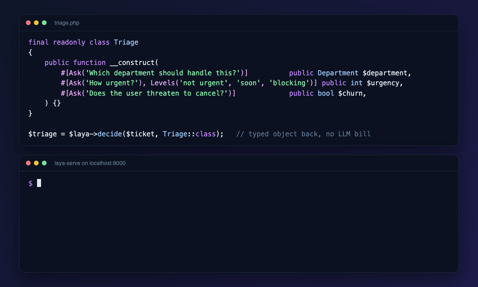</td>
<td align="center" valign="top"> анімований запис</td>
</tr></table>

🧰 <b><a href="https://github.com/AkashPriyadarshii/jev-seo">AkashPriyadarshii/jev-seo</a></b> · ⭐108 · Rust · 🔎 inferred · 12 天

##### 📝 Стислий опис

Free Rust SEO and GEO toolkit powered by TypeSafe Jev: 58-rule audits, site crawls, AI citation checks, rank drift, CI gates, 15-tool MCP. Zero cost.

##### 📌 Основні факти

| Поле      | Значення                             |
| --------- | ------------------------------------ |
| Категорія | `Клієнти, SDK та адаптери спільноти` |
| Докази    | `inferred`                           |
| Мова      | Rust                                 |

##### 📊 Дані

| Метрика         | Значення   |
| --------------- | ---------- |
| Зірки           | **108**    |
| Останній push   | 2026-11-11 |
| Уперше в списку | 2026-11-05 |

🏷 `ahrefs-alternative` · `answer-engine-optimization` · `claude-code` · `cli` · `coding-agents` · `generative-engine-optimization` · `geo` · `jev`

---

<table><tr><th align="center" width="50%">🖼 Зображення</th><th align="center" width="50%">🎬 Відео</th></tr><tr>
<td align="center" valign="top"></td>
<td align="center" valign="top">медіа не опубліковано</td>
</tr></table>

🧰 <b><a href="https://github.com/AboveColin/HA-Jev">AboveColin/HA-Jev</a></b> · ⭐90 · Python · 🔎 inferred · 11 天

##### 📝 Стислий опис

Поставте своєму дому запитання й отримайте число у відповідь. Інтеграція Home Assistant для TypeSafe Jev: типізовані відповіді як сенсори, чотири дії для автоматизацій і розмовний агент для Assist.

##### 📌 Основні факти

| Поле      | Значення                             |
| --------- | ------------------------------------ |
| Категорія | `Клієнти, SDK та адаптери спільноти` |
| Докази    | `inferred`                           |
| Мова      | Python                               |

##### 📊 Дані

| Метрика         | Значення   |
| --------------- | ---------- |
| Зірки           | **90**     |
| Останній push   | 2026-11-12 |
| Уперше в списку | 2026-10-29 |

🏷 `ai` · `assist` · `conversation` · `custom-components` · `decision-model` · `hacs` · `home-assistant` · `home-automation`

---

<table><tr><th align="center" width="50%">🖼 Зображення</th><th align="center" width="50%">🎬 Відео</th></tr><tr>
<td align="center" valign="top">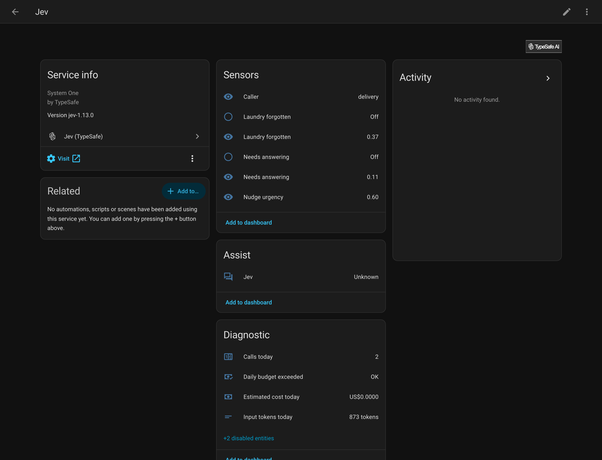</td>
<td align="center" valign="top">медіа не опубліковано</td>
</tr></table>

🧰 <b><a href="https://github.com/bladedevoff/stuntd">bladedevoff/stuntd</a></b> · ⭐76 · Python · 🔎 inferred · 43 天

##### 📝 Стислий опис

Локальний проксі, який навчається на типізованих рішеннях LLM вашого застосунку та відповідає на них за допомогою головки Laya. Сумісний із Jev та OpenAI.

##### 📌 Основні факти

| Поле      | Значення                             |
| --------- | ------------------------------------ |
| Категорія | `Клієнти, SDK та адаптери спільноти` |
| Докази    | `inferred`                           |
| Мова      | Python                               |

##### 📊 Дані

| Метрика         | Значення   |
| --------------- | ---------- |
| Зірки           | **76**     |
| Останній push   | 2026-10-11 |
| Уперше в списку | 2026-10-29 |

🏷 `claude-code` · `distillation` · `jev` · `laya` · `llm` · `llm-proxy` · `local-inference` · `openai-compatible`

---

<table><tr><th align="center" width="50%">🖼 Зображення</th><th align="center" width="50%">🎬 Відео</th></tr><tr>
<td align="center" valign="top">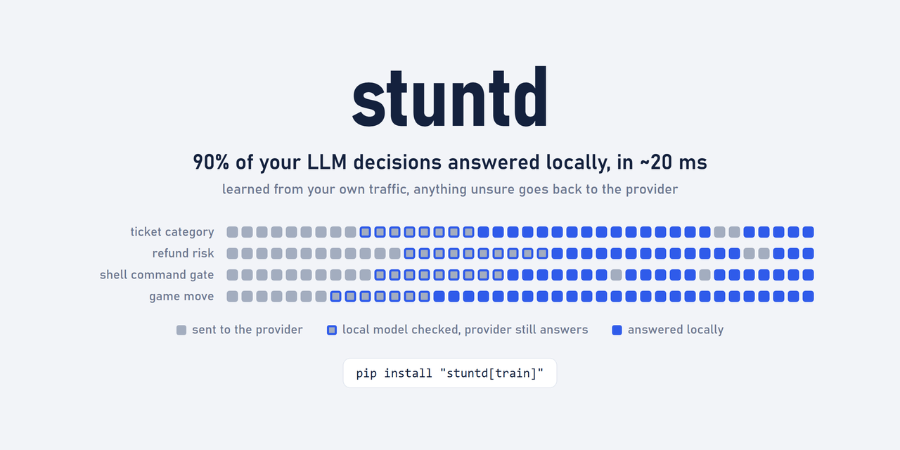</td>
<td align="center" valign="top">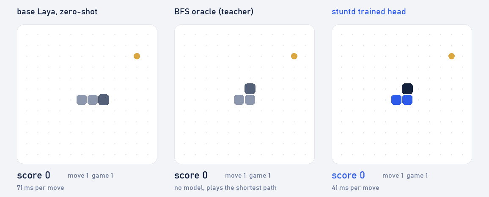 анімований запис</td>
</tr></table>

<b>Більше в цій категорії</b> · 95

- [PromtEngineer/jev-harness](https://github.com/PromtEngineer/jev-harness) - Обв.
- [Sur-Cai/macos-computer-use-kit](https://github.com/Sur-Cai/macos-computer-use-kit) - AX-first computer use for AI agents on macOS with optional Jev.
- [xingwudao/OpenJev](https://github.com/xingwudao/OpenJev) - OpenJev: незалежний Jev-натхненний System One рішень API, заснований на…
- [danieleteti/systemone-delphi](https://github.com/danieleteti/systemone-delphi) - Delphi client for System One models (Jev, tev1 and nimble on Ollama): ask typed…
- [chussenot/judgment](https://github.com/chussenot/judgment) - Типізовані, калібровані судження з моделей System One: рішення, записане як…
- [GitHub30/OpenJev](https://github.com/GitHub30/OpenJev) - Модель System One з відкритими вагами (сумісна з Jev): калібровані рішення noul…
- [erik-hedstrom/loadout](https://github.com/erik-hedstrom/loadout) - Pick the model, skills and MCP servers for each coding-agent session from a…
- [jqueryscript/awesome-jev](https://github.com/jqueryscript/awesome-jev) - A curated list of TypeSafe Jev resources, SDKs, agents, MCP servers…
- [andyrossa/ai-search-copilot](https://github.com/andyrossa/ai-search-copilot) - Добірний список проєктів, інтеграцій і ресурсів для Jev, моделі System One від…
- [basi/typesafe-ai-php-client](https://github.com/basi/typesafe-ai-php-client) - PHP client for the typesafe.ai System One API (Jev).
- [gajaguar/typesafe-cli](https://github.com/gajaguar/typesafe-cli) - Unofficial command-line interface for TypeSafe AI System One models, on…
- [romain-cll/reflex-rag](https://github.com/romain-cll/reflex-rag) - A retrieval loop judged by a system-one model (Jev) instead of an LLM.
- [sanketmuchhala/jevgate](https://github.com/sanketmuchhala/jevgate) - Calibrated policy triage and institutional risk routing: a hybrid…
- [ollaya-dev/ollaya](https://github.com/ollaya-dev/ollaya) - Jev-compatible API server for open decision models.
- [juspay/neurolink](https://github.com/juspay/neurolink) - Шар конвеєра нервової системи ШІ — один інтерфейс, що з.
- [aaddrick/building-with-typesafe-jev](https://github.com/aaddrick/building-with-typesafe-jev) - Неофіційна навичка, яка навчає агентів для написання коду створювати за…
- [keltokhy/jgrep](https://github.com/keltokhy/jgrep) - grep, але шаблон — це опис. Фільтрує рядки за змістом за допомогою моделі…
- [Ying-Kai-Liao/jev-browser](https://github.com/Ying-Kai-Liao/jev-browser) - Автоматизація браузера, де LLM планує, а Jev (Typesafe System One) вирішує.
- [fazlerocks/jevmail](https://github.com/fazlerocks/jevmail) - Сортування електронної пошти Gmail за допомогою ШІ з відкритим кодом.
- [sharziki/semdecide](https://github.com/sharziki/semdecide) - Типізовані семантичні рішення для конвеєрів Unix і CI на основі TypeSafe AI Jev.
- [burnigtm/jev-mcp](https://github.com/burnigtm/jev-mcp) - Сервер MCP, який додає TypeSafe Jev до циклу програмування в Cursor, Codex і…
- [Eliot5566/JEV-Paper-Radar](https://github.com/Eliot5566/JEV-Paper-Radar) - Turn research interests or paper links into a ranked reading list in Claude.
- [mattn/go-jev](https://github.com/mattn/go-jev) - Go SDK and CLI for TypeSafe Jev: typed decisions (yes/no, choice, score) from a…
- [dannote/jev](https://github.com/dannote/jev) - TypeSafe Jev для OTP: відповідайте на Jev з GenServer і зіставляйте шаблон…
- [DevLoops-ai/unified-brain](https://github.com/DevLoops-ai/unified-brain) - System One coding agents: code-level answers in about 10secs for under 2 cents.
- [jwuthri-cloud/SelfJev](https://github.com/jwuthri-cloud/SelfJev) - Self-hosted decision model (selfjev-4b) with a Jev-compatible API: Python SDK…
- [jiangkoumo/ego-decision-layer](https://github.com/jiangkoumo/ego-decision-layer) - Pluggable decision layer for the ego lite browser: one System One (Jev) call…
- [thusinh1969/BrighTO_Router](https://github.com/thusinh1969/BrighTO_Router) - BrighTO LLM Router: free open-source, ultra-fast Rust LLM gateway/router and…
- [arjun988/Kev](https://github.com/arjun988/Kev) - Рушій прийняття рішень System One з відкритим кодом.
- [Ray-Hughes/jevalyn](https://github.com/Ray-Hughes/jevalyn) - Шар рішень для вашого Rails-застосунку.
- [nouli-ai/nouli](https://github.com/nouli-ai/nouli) - Decision Agent Engine.
- [pambrose/jev4k](https://github.com/pambrose/jev4k) - A Kotlin Multiplatform DSL and client for TypeSafe.
- [saibimajdi/typesafeai-dotnet-sdk](https://github.com/saibimajdi/typesafeai-dotnet-sdk) - Спільнотний .NET SDK для TypeSafe AI System One API — типізовані запитання…
- [Elue-dev/jev_elixir](https://github.com/Elue-dev/jev_elixir) - jev_elixir — це невеликий, ідіоматичний інтерфейс для прийняття типізованих…
- [himomohi/aside-jev](https://github.com/himomohi/aside-jev) - Агенти Aside приймають рішення за допомогою TypeSafe Jev.
- [haileyok/typesafe-client](https://github.com/haileyok/typesafe-client) - Неофіційні клієнти Go і Rust для TypeSafe AI System One API (Jev).
- [sumleo/prompt2jev](https://github.com/sumleo/prompt2jev) - Навичка агента та CLI, які перетворюють природну мову, промпт LLM або код, що…
- [AIAnytime/Jev-Router](https://github.com/AIAnytime/Jev-Router) - Decision-first, OpenAI-compatible AI router powered by Jev typed decisions.
- [chenrui333/jev-docs](https://github.com/chenrui333/jev-docs) - Історія Jev / TypeSafe System One APIs, SDKs, рекомендації для агентів та…
- [devbackend/jevgo](https://github.com/devbackend/jevgo) - Неофіційний клієнт Go для TypeSafe AI System One API (Jev) — типізовані…
- [docxology/daf-jev](https://github.com/docxology/daf-jev) - daf-jev: композиційний Python toolkit для TypeSafe.
- [kataras/jev](https://github.com/kataras/jev) - A Go client for the TypeSafe AI.
- [TraxSharp/Trax](https://github.com/TraxSharp/Trax) - one description of your app, for the whole team.
- [Kadihx/jev-x-kit](https://github.com/Kadihx/jev-x-kit) - Офлайн-рівень рішень за $0 для агентів програмування: примітиви…
- [Jev-Engineering/TypeWright](https://github.com/Jev-Engineering/TypeWright) - Declare a decision, compile typed Jev questions, measure them, and ship a JSON…
- [brida-ai/sdk](https://github.com/brida-ai/sdk) - Official TypeScript SDK for the Brida platform.
- [docwilde/doxa](https://github.com/docwilde/doxa) - ΔΟΞΑ is a Rust multi-agent terminal for Claude, Codex, Gemini via Google…
- [JimmyWesley/rlcd-gateway](https://github.com/JimmyWesley/rlcd-gateway) - Шлюз із власним хостингом для LLMs і моделей рішень.
- [PAI-CUHK/SLEEPJEV](https://github.com/PAI-CUHK/SLEEPJEV) - Типізовані рішення під час виконання, натхненні JEV, для довготривалого PSG…
- [robertn702/reasoning-router](https://github.com/robertn702/reasoning-router) - Per-step reasoning effort for coding agents, picked by a classifier, without…
- [zhirschtritt/typesafe-go](https://github.com/zhirschtritt/typesafe-go) - Ідіоматичний Go SDK для TypeSafe AI API.
- [AboveColin/jevclient](https://github.com/AboveColin/jevclient) - Асинхронний клієнт Python для TypeSafe Jev.
- [Butochnikov/laravel-typesafe-jev](https://github.com/Butochnikov/laravel-typesafe-jev) - Неофіційна інтеграція Laravel для TypeSafe Jev AI із типізованими відповідями…
- [coo-quack/jev-pii-checker](https://github.com/coo-quack/jev-pii-checker) - CLI, що знаходить PII у тексті за допомогою TypeSafe Jev: наявність, чутливість…
- [frodi-karlsson/onesie](https://github.com/frodi-karlsson/onesie) - Gate scripts and CI on fast, calibrated System One judgments like Jev: a score…
- [Lasimeri/Mechanical-Jev](https://github.com/Lasimeri/Mechanical-Jev) - The asking side of Jev (TypeSafe System One: noul, choice, score) in Rust…
- [nshkrdotcom/system_one_sdk](https://github.com/nshkrdotcom/system_one_sdk) - Незалежний від провайдера Elixir/BEAM SDK для семантики System One: типізовані…
- [zerone-agents/jev-model-router](https://github.com/zerone-agents/jev-model-router) - Легка маршрутизація моделей для агентів із сумісністю з OpenAI і Anthropic API…
- [abhisheksharma001/jev-skill](https://github.com/abhisheksharma001/jev-skill) - Agent skill for TypeSafe AI.
- [dsaad68/fuzzy-jev](https://github.com/dsaad68/fuzzy-jev) - A client for OpenRouter&#x27;s decision models, TypeSafe&#x27;s Jev by default: typed…
- [getmissionctrl/hs-jev](https://github.com/getmissionctrl/hs-jev) - Клієнт Haskell для рішення API TypeSafe System One (Jev) — типізовані пакетні…
- [JawzoD3TH/JevApi](https://github.com/JawzoD3TH/JevApi) - JevApi — MCP, Api Client Library and Test Harness for Jev.
- [minorun365/jev-cloud-quiz](https://github.com/minorun365/jev-cloud-quiz) - 三大クラウドの機能名を、TypeSafe AI の System One モデル Jev が確率つきで判定するデモ.
- [Hyper-AI-Lab/openclaw-jev](https://github.com/Hyper-AI-Lab/openclaw-jev) - Production control plane для OpenClaw agents: маршрутизація intake за допомогою…
- [milojarow/jev-skills](https://github.com/milojarow/jev-skills) - Jev (TypeSafe System One) skill and CLI for coding agents: when to use typed…
- [MrKyaw/CognitiveMirror-Jev-MCP](https://github.com/MrKyaw/CognitiveMirror-Jev-MCP) - Cognitive middleware for personal and enterprise AI agents: 14 MCP tools and a…
- [Talya1412/jev-harness](https://github.com/Talya1412/jev-harness) - TypeSafe Jev (System One) integrations for OMP, MCP, Claude Code, and Pi…
- [vijaycinn/el-jev](https://github.com/vijaycinn/el-jev) - High-speed System One decision sidecar &amp; Copilot CLI pre-turn hook powered by…
- [abirshhishirroy/mini-jev](https://github.com/abirshhishirroy/mini-jev) - A custom Jev-style decision model built from scratch on Qwen2.5-3B.
- [CMaintz/jev-tools](https://github.com/CMaintz/jev-tools) - Інструменти TypeScript, створені на основі Jev від TypeSafe AI: захисний…
- [codebam/jev-guardrails](https://github.com/codebam/jev-guardrails) - Захисні механізми для викликів інструментів агентів на основі Jev: бібліотека…
- [hierichhsu/your-cto-jev](https://github.com/hierichhsu/your-cto-jev) - A sharp-tongued CTO that blocks leaked secrets and destructive commands from AI…
- [jackzhang0925/35b-jev](https://github.com/jackzhang0925/35b-jev) - RL post-training with a decision-model-shaped reward.
- [kkdev92/jev-dotnet](https://github.com/kkdev92/jev-dotnet) - An unofficial .NET 10 client for Jev, TypeSafe.
- [mdimamhosen/jev](https://github.com/mdimamhosen/jev) - One endpoint for every model, one CLI for every MCP.
- [sususu98/pi-jev-navigator](https://github.com/sususu98/pi-jev-navigator) - Ultra-low-token System One context navigation and precision SOP dispatch engine…
- [SykkoAtHome/MCP_Typesafe_JEV](https://github.com/SykkoAtHome/MCP_Typesafe_JEV) - Domain-agnostic MCP server for TypeSafe Jev (System One) evaluation engine…
- [xiaocongyu66/llama.cpp-jev-adapter](https://github.com/xiaocongyu66/llama.cpp-jev-adapter) - Native llama.cpp support for JoyFox JEV decision models.
- [Yasir-Khan-7/jev-sentinel](https://github.com/Yasir-Khan-7/jev-sentinel) - Захист від prompt injection і обмеження викликів інструментів для AI-агентів…
- [zavaii/jev-code-review](https://github.com/zavaii/jev-code-review) - Offline-first, budget-bounded code review screening with TypeSafe Jev.
- [pithings/advocaat](https://github.com/pithings/advocaat) - Невеликий типобезпечний клієнт для запитань до ШІ про ваші дані, що працює на…
- [zhulinchng/jevper](https://github.com/zhulinchng/jevper) - Обгортка класифікації у формі Jev (TypeSafe System One) над клієнтами…
- [getcustomaise/customaise-mcp](https://github.com/getcustomaise/customaise-mcp) - MCP server and CLI that connect AI agents.
- [schainks/system_one_client](https://github.com/schainks/system_one_client) - Клієнт Elixir для моделей рішень System One: TypeSafe Jev, Cloudflare Clef…
- [VBS2004/jevcut](https://github.com/VBS2004/jevcut) - Auto-clipper that turns long videos (podcasts, talks, essays, comedy) into…
- [IKEASven69/dsh-opencli](https://github.com/IKEASven69/dsh-opencli) - 让 dsh 会办事:登录态真实浏览器 × 180 站点结构化命令 + SystemOne 亚秒决策 + 执行真实性判定 + watch 监控.
- [Query-farm/vgi-typesafe](https://github.com/Query-farm/vgi-typesafe) - Воркер VGI, який надає TypeSafe System One питань (choice, noul, score) у…
- [iamtalha-arshad/ex_typesafe_ai](https://github.com/iamtalha-arshad/ex_typesafe_ai) - Неофіційний клієнт Elixir для TypeSafe AI API — типізовані структури, HTTP на…
- [y0usaf/typesafe-cli](https://github.com/y0usaf/typesafe-cli) - Ставте типізовані питання Jev з оболонки: відповіді noul, choice і score як…
- [geilt/typesafe-cli](https://github.com/geilt/typesafe-cli) - CLI і навичка агента для TypeSafe System One (Jev): типізовані судження Choice…
- [KratosLee-6/open-source-model-deploy](https://github.com/KratosLee-6/open-source-model-deploy) - 开源大模型部署可行性鉴别工具 · 168 个开源模型动态评估（含 12 个 JEV/System One 决策模型）· 硬件自动检测 ·…
- [MarcelRoozekrans/Minos.NET](https://github.com/MarcelRoozekrans/Minos.NET) - Typed, source-generated decision questions for .NET: one IDecisionClient for…
- [MIt9/laya-cli](https://github.com/MIt9/laya-cli) - Зручний CLI для Laya — типізовані рішення (choice/score/noul) для людей і…
- [phiat/typesafe-rust-sdk](https://github.com/phiat/typesafe-rust-sdk) - Unofficial Rust client for TypeSafe.
- [Ridlo543/systemone-judge](https://github.com/Ridlo543/systemone-judge) - Universal Model Context Protocol (MCP) server and CLI runner for TypeSafe Jev…

## Інструменти для агентів: MCP, хуки, шлюзи та агенти-програмісти

Категорія, що зростає найшвидше: хуки, сервери MCP і шлюзи, які ставлять типізоване рішення перед наступною дією агента.

🤖 <b><a href="https://github.com/tamaratran/fast-jev-compaction">tamaratran/fast-jev-compaction</a></b> · ⭐8017 · TypeScript · 🔎 inferred · 67 天 · ⭐-1

##### 📝 Стислий опис

Плагін Claude Code, який замінює підсумок компактифікації на Jev рішень: кожен виклик інструмента та результат оцінюється в одному швидкому запиті, застарілі відкидаються або обрізаються, а все збережене залишається дослівним.

> 💡 Замінює підсумок компактифікації контексту агента програмування на типізоване рішення. Чистий приклад заміни одного виклику LLM в наявному конвеєрі замість перебудови конвеєра.

##### 📌 Основні факти

| Поле      | Значення                                                          |
| --------- | ----------------------------------------------------------------- |
| Категорія | `Інструменти для агентів: MCP, хуки, шлюзи та агенти-програмісти` |
| Докази    | `inferred`                                                        |
| Мова      | TypeScript                                                        |

##### 📊 Дані

| Метрика         | Значення      |
| --------------- | ------------- |
| Зірки           | **8017** (-1) |
| Останній push   | 2026-09-18    |
| Уперше в списку | 2026-11-08    |

🤖 <b><a href="https://github.com/gargpratyush/jev-router">gargpratyush/jev-router</a></b> · ⭐673 · JavaScript · 🔎 inferred · 65 天

##### 📝 Стислий опис

Маршрутизація до найдешевшої моделі в claude code для вашого завдання за допомогою jev-router

> 💡 Спрямовує кожен хід до найдешевшої моделі, здатної його обробити. Канонічний приклад використання System One моделі для зменшення витрат.

##### 📌 Основні факти

| Поле      | Значення                                                          |
| --------- | ----------------------------------------------------------------- |
| Категорія | `Інструменти для агентів: MCP, хуки, шлюзи та агенти-програмісти` |
| Докази    | `inferred`                                                        |
| Мова      | JavaScript                                                        |

##### 📊 Дані

| Метрика         | Значення   |
| --------------- | ---------- |
| Зірки           | **673**    |
| Останній push   | 2026-09-19 |
| Уперше в списку | 2026-11-08 |

---

<table><tr><th align="center" width="50%">🖼 Зображення</th><th align="center" width="50%">🎬 Відео</th></tr><tr>
<td align="center" valign="top"></td>
<td align="center" valign="top">медіа не опубліковано</td>
</tr></table>

🤖 <b><a href="https://github.com/0xNatoshi/jev-codex-router">0xNatoshi/jev-codex-router</a></b> · ⭐275 · JavaScript · 🔎 inferred · 63 天

##### 📝 Стислий опис

Маршрутизація моделі та міркувань для кожного ходу для Codex, керована Jev (TypeSafe System One): обирає модель, глибину міркувань і режим швидкості для кожного ходу.

> 💡 Маршрутизація моделі та інтенсивності міркувань для кожного ходу для агента програмування, керована типізованими рішеннями.

##### 📌 Основні факти

| Поле      | Значення                                                          |
| --------- | ----------------------------------------------------------------- |
| Категорія | `Інструменти для агентів: MCP, хуки, шлюзи та агенти-програмісти` |
| Докази    | `inferred`                                                        |
| Мова      | JavaScript                                                        |

##### 📊 Дані

| Метрика         | Значення   |
| --------------- | ---------- |
| Зірки           | **275**    |
| Останній push   | 2026-09-22 |
| Уперше в списку | 2026-10-28 |

🏷 `ai` · `codex` · `jev` · `llm` · `macos` · `routing` · `typesafe`

🤖 <b><a href="https://github.com/strands-labs/strands-decider">strands-labs/strands-decider</a></b> · ⭐1269 · Python · 👁️ observed · 0 天 · ⭐+2

##### 📝 Стислий опис

Невелика швидка модель ухвалення рішень, або модель System 1, для агентних робочих процесів. Обирайте між варіантами або оцінюйте за шкалою швидше, ніж LLM, із каліброваною впевненістю для кожного рішення.

##### 📌 Основні факти

| Поле      | Значення                                                          |
| --------- | ----------------------------------------------------------------- |
| Категорія | `Інструменти для агентів: MCP, хуки, шлюзи та агенти-програмісти` |
| Докази    | `observed`                                                        |
| Мова      | Python                                                            |

##### 📊 Дані

| Метрика         | Значення      |
| --------------- | ------------- |
| Зірки           | **1269** (+2) |
| Останній push   | 2026-11-24    |
| Уперше в списку | 2026-10-02    |

🏷 `ai` · `machine-learning` · `natural-language-understanding` · `python` · `strands-agents` · `strands-labs` · `system-one` · `system-one-models`

---

<table><tr><th align="center" width="50%">🖼 Зображення</th><th align="center" width="50%">🎬 Відео</th></tr><tr>
<td align="center" valign="top"></td>
<td align="center" valign="top">медіа не опубліковано</td>
</tr></table>

🤖 <b><a href="https://github.com/thruwire/foreman">thruwire/foreman</a></b> · ⭐833 · Python · 👁️ observed · 39 天

##### 📝 Стислий опис

An agent supervisor and software factory foreman powered by decision models

🔧 Виявлено використання в коді: `docs/openrouter.md`

##### 📌 Основні факти

| Поле      | Значення                                                          |
| --------- | ----------------------------------------------------------------- |
| Категорія | `Інструменти для агентів: MCP, хуки, шлюзи та агенти-програмісти` |
| Докази    | `observed`                                                        |
| Мова      | Python                                                            |

##### 📊 Дані

| Метрика         | Значення   |
| --------------- | ---------- |
| Зірки           | **833**    |
| Останній push   | 2026-10-15 |
| Уперше в списку | 2026-11-08 |

🏷 `agent-supervision` · `codex` · `jev` · `opencode` · `pi-agent` · `pi-coding-agent` · `pi-durable`

---

<table><tr><th align="center" width="50%">🖼 Зображення</th><th align="center" width="50%">🎬 Відео</th></tr><tr>
<td align="center" valign="top"></td>
<td align="center" valign="top">медіа не опубліковано</td>
</tr></table>

🤖 <b><a href="https://github.com/AbdelStark/awesome-typesafe-jev">AbdelStark/awesome-typesafe-jev</a></b> · ⭐620 · HTML · 👁️ observed · 22 天

##### 📝 Стислий опис

Awesome Jev: підкріплений джерелами польовий довідник щодо моделі System One TypeSafe, з SDKs, живими демонстраціями, інструментами агентів і незалежними оцінюваннями.

🔧 Виявлено використання в коді: `README.md`

##### 📌 Основні факти

| Поле      | Значення                                                          |
| --------- | ----------------------------------------------------------------- |
| Категорія | `Інструменти для агентів: MCP, хуки, шлюзи та агенти-програмісти` |
| Докази    | `observed`                                                        |
| Мова      | HTML                                                              |

##### 📊 Дані

| Метрика         | Значення   |
| --------------- | ---------- |
| Зірки           | **620**    |
| Останній push   | 2026-11-01 |
| Уперше в списку | 2026-10-28 |

🏷 `agent-skills` · `ai-agents` · `awesome` · `awesome-jev` · `awesome-list` · `awesome-lists` · `curated-list` · `developer-tools`

🤖 <b><a href="https://github.com/walidboulanouar/awesome-jev-use-cases">walidboulanouar/awesome-jev-use-cases</a></b> · ⭐498 · 👁️ observed · 58 天

##### 📝 Стислий опис

Чудовий список варіантів використання TypeSafe AI Jev: 74 демонстрації, упорядковані за вподобаннями, понад 150 репозиторіїв GitHub, обмеження, вартість і приклади API. CC0

🔧 Виявлено використання в коді: `README.md`

##### 📌 Основні факти

| Поле      | Значення                                                          |
| --------- | ----------------------------------------------------------------- |
| Категорія | `Інструменти для агентів: MCP, хуки, шлюзи та агенти-програмісти` |
| Докази    | `observed`                                                        |

##### 📊 Дані

| Метрика         | Значення   |
| --------------- | ---------- |
| Зірки           | **498**    |
| Останній push   | 2026-09-26 |
| Уперше в списку | 2026-10-29 |

🏷 `ai-guardrails` · `ai-router` · `awesome` · `awesome-list` · `classification` · `claude-code` · `decision-model` · `examples`

🤖 <b><a href="https://github.com/RomanSlack/jev-drone">RomanSlack/jev-drone</a></b> · ⭐305 · Python · 👁️ observed · 60 天

##### 📝 Стислий опис

Автономний дрон у MuJoCo, що працює лише з камерою, із невеликою моделлю суджень (TypeSafe Jev) у контурі з частотою 2,5 Гц

🔧 Виявлено використання в коді: `tactics.py`, `tunnel_tactics.py`

##### 📌 Основні факти

| Поле      | Значення                                                          |
| --------- | ----------------------------------------------------------------- |
| Категорія | `Інструменти для агентів: MCP, хуки, шлюзи та агенти-програмісти` |
| Докази    | `observed`                                                        |
| Мова      | Python                                                            |

##### 📊 Дані

| Метрика         | Значення   |
| --------------- | ---------- |
| Зірки           | **305**    |
| Останній push   | 2026-09-24 |
| Уперше в списку | 2026-10-29 |

🏷 `autonomous-agents` · `drone` · `mujoco` · `robotics` · `typesafe`

---

<table><tr><th align="center" width="50%">🖼 Зображення</th><th align="center" width="50%">🎬 Відео</th></tr><tr>
<td align="center" valign="top"></td>
<td align="center" valign="top">медіа не опубліковано</td>
</tr></table>

🤖 <b><a href="https://github.com/Amal-David/awesome-jev">Amal-David/awesome-jev</a></b> · ⭐249 · Python · 👁️ observed · 0 天

##### 📝 Стислий опис

Демонстрації Jev, проєкти, SDKs і навички з посиланнями на вихідний код та відібраною галереєю X.

🔧 Виявлено використання в коді: `templates/README.md`

##### 📌 Основні факти

| Поле      | Значення                                                          |
| --------- | ----------------------------------------------------------------- |
| Категорія | `Інструменти для агентів: MCP, хуки, шлюзи та агенти-програмісти` |
| Докази    | `observed`                                                        |
| Мова      | Python                                                            |

##### 📊 Дані

| Метрика         | Значення   |
| --------------- | ---------- |
| Зірки           | **249**    |
| Останній push   | 2026-11-24 |
| Уперше в списку | 2026-09-27 |

🏷 `agent-skills` · `awesome-ai` · `awesome-list` · `browser-use` · `claude-code` · `codex` · `coding-agent` · `computer-use`

🤖 <b><a href="https://github.com/kraayenjon/awesome-jev">kraayenjon/awesome-jev</a></b> · ⭐208 · 👁️ observed · 58 天

##### 📝 Стислий опис

Добірний список варіантів використання Jev, проєктів, SDKs і ресурсів. Jev — це TypeSafe AI's System One модель для швидких типізованих рішень у програмному забезпеченні — Choice, Score і Noul із каліброваними ймовірностями.

🔧 Виявлено використання в коді: `README.md`

##### 📌 Основні факти

| Поле      | Значення                                                          |
| --------- | ----------------------------------------------------------------- |
| Категорія | `Інструменти для агентів: MCP, хуки, шлюзи та агенти-програмісти` |
| Докази    | `observed`                                                        |

##### 📊 Дані

| Метрика         | Значення   |
| --------------- | ---------- |
| Зірки           | **208**    |
| Останній push   | 2026-09-27 |
| Уперше в списку | 2026-09-19 |

🏷 `agents` · `ai` · `ai-agents` · `api` · `artificial-intelligence` · `automation` · `awesome` · `awesome-list`

🤖 <b><a href="https://github.com/valentynkit/awesome-jev-typesafe">valentynkit/awesome-jev-typesafe</a></b> · ⭐190 · JavaScript · 👁️ observed · 0 天

##### 📝 Стислий опис

Типізовані рішення за допомогою TypeSafe's Jev, першої System One моделі

🔧 Виявлено використання в коді: `readme.md`, `README.ko.md`, `README.ja.md`, `README.zh-CN.md`

##### 📌 Основні факти

| Поле      | Значення                                                          |
| --------- | ----------------------------------------------------------------- |
| Категорія | `Інструменти для агентів: MCP, хуки, шлюзи та агенти-програмісти` |
| Докази    | `observed`                                                        |
| Мова      | JavaScript                                                        |

##### 📊 Дані

| Метрика         | Значення   |
| --------------- | ---------- |
| Зірки           | **190**    |
| Останній push   | 2026-11-23 |
| Уперше в списку | 2026-09-19 |

🏷 `ai-agents` · `awesome` · `awesome-list` · `claude-code` · `directory` · `jev` · `llm-agents` · `system-one`

🤖 <b><a href="https://github.com/tamaratran/jev-pruner">tamaratran/jev-pruner</a></b> · ⭐170 · TypeScript · 👁️ observed · 54 天

##### 📝 Стислий опис

Плагін Claude Code: скорочує довгий вивід Bash за допомогою TypeSafe Jev, перш ніж його побачить модель

🔧 Виявлено використання в коді: `README.md`

##### 📌 Основні факти

| Поле      | Значення                                                          |
| --------- | ----------------------------------------------------------------- |
| Категорія | `Інструменти для агентів: MCP, хуки, шлюзи та агенти-програмісти` |
| Докази    | `observed`                                                        |
| Мова      | TypeScript                                                        |

##### 📊 Дані

| Метрика         | Значення   |
| --------------- | ---------- |
| Зірки           | **170**    |
| Останній push   | 2026-09-30 |
| Уперше в списку | 2026-10-29 |

🤖 <b><a href="https://github.com/abhishekswe/agent-fastpath">abhishekswe/agent-fastpath</a></b> · ⭐7 · TypeScript · 👁️ observed · 10 天

##### 📝 Стислий опис

Jev MCP server: a decision layer for coding agents, built on TypeSafe Jev (System One model). Ship gates, risk checks, file triage that keeps files out of context, and a safe headless browser, with calibrated confidence. For Claude Code, Codex, Cursor.

##### 📌 Основні факти

| Поле      | Значення                                                          |
| --------- | ----------------------------------------------------------------- |
| Категорія | `Інструменти для агентів: MCP, хуки, шлюзи та агенти-програмісти` |
| Докази    | `observed`                                                        |
| Мова      | TypeScript                                                        |

##### 📊 Дані

| Метрика         | Значення   |
| --------------- | ---------- |
| Зірки           | **7**      |
| Останній push   | 2026-11-13 |
| Уперше в списку | 2026-11-21 |

🏷 `agentic-ai` · `ai-agents` · `browser-automation` · `claude-code` · `codex` · `coding-agent` · `context-engineering` · `cursor`

---

<table><tr><th align="center" width="50%">🖼 Зображення</th><th align="center" width="50%">🎬 Відео</th></tr><tr>
<td align="center" valign="top"></td>
<td align="center" valign="top">медіа не опубліковано</td>
</tr></table>

🤖 <b><a href="https://github.com/dfranco-projects/jev-guardbench">dfranco-projects/jev-guardbench</a></b> · ⭐3 · Python · 👁️ observed · 50 天

##### 📝 Стислий опис

Чи може модель System One (TypeSafe Jev, відкритий Kev) замінити LLM-as-judge у callback-функціях обмежень агента?

##### 📌 Основні факти

| Поле      | Значення                                                          |
| --------- | ----------------------------------------------------------------- |
| Категорія | `Інструменти для агентів: MCP, хуки, шлюзи та агенти-програмісти` |
| Докази    | `observed`                                                        |
| Мова      | Python                                                            |

##### 📊 Дані

| Метрика         | Значення   |
| --------------- | ---------- |
| Зірки           | **3**      |
| Останній push   | 2026-10-04 |
| Уперше в списку | 2026-11-04 |

---

<table><tr><th align="center" width="50%">🖼 Зображення</th><th align="center" width="50%">🎬 Відео</th></tr><tr>
<td align="center" valign="top"></td>
<td align="center" valign="top">медіа не опубліковано</td>
</tr></table>

Ресурс підключено гарячим посиланням із вихідного репозиторію, оскільки ліцензію, що дозволяє розповсюдження, не заявлено.

🤖 <b><a href="https://github.com/hypler-dev/LNSAT">hypler-dev/LNSAT</a></b> · ⭐1 · TypeScript · 👁️ observed · 2 天

##### 📝 Стислий опис

Building a CPU-first System One engine for evidence-bound review, with a Gateway for policy, human approval, bounded execution, and durable receipts. Pre-release source.

##### 📌 Основні факти

| Поле      | Значення                                                          |
| --------- | ----------------------------------------------------------------- |
| Категорія | `Інструменти для агентів: MCP, хуки, шлюзи та агенти-програмісти` |
| Докази    | `observed`                                                        |
| Мова      | TypeScript                                                        |

##### 📊 Дані

| Метрика         | Значення   |
| --------------- | ---------- |
| Зірки           | **1**      |
| Останній push   | 2026-11-22 |
| Уперше в списку | 2026-11-16 |

🏷 `access-control` · `agent-security` · `agentic-ai` · `ai-agents` · `ai-governance` · `ai-security` · `audit-trail` · `authorization`

---

<table><tr><th align="center" width="50%">🖼 Зображення</th><th align="center" width="50%">🎬 Відео</th></tr><tr>
<td align="center" valign="top"></td>
<td align="center" valign="top">медіа не опубліковано</td>
</tr></table>

🤖 <b><a href="https://github.com/light-cheng/Light-Decision-MCP">light-cheng/Light-Decision-MCP</a></b> · ⭐1 · JavaScript · 👁️ observed · 3 天

##### 📝 Стислий опис

Multi-backend Decision MCP & Magpie plugin for System One models (Gemini Decision, Jev, Perplexity, OpenRouter & local models) with local fallback & setup wizard. | 支持多云端与本地决策模型的 MCP 与 Magpie 插件，内置熔断降级、后台管理与硬件推荐向导。

##### 📌 Основні факти

| Поле      | Значення                                                          |
| --------- | ----------------------------------------------------------------- |
| Категорія | `Інструменти для агентів: MCP, хуки, шлюзи та агенти-програмісти` |
| Докази    | `observed`                                                        |
| Мова      | JavaScript                                                        |

##### 📊 Дані

| Метрика         | Значення   |
| --------------- | ---------- |
| Зірки           | **1**      |
| Останній push   | 2026-11-20 |
| Уперше в списку | 2026-11-20 |

🏷 `decision-model` · `gemini-decision` · `local-ai` · `magpie` · `magpie-plugin` · `mcp` · `system-one`

---

<table><tr><th align="center" width="50%">🖼 Зображення</th><th align="center" width="50%">🎬 Відео</th></tr><tr>
<td align="center" valign="top"></td>
<td align="center" valign="top">медіа не опубліковано</td>
</tr></table>

🤖 <b><a href="https://github.com/samstealth/system-one-model-tweaks">samstealth/system-one-model-tweaks</a></b> · Python · 👁️ observed · 0 天

##### 📝 Стислий опис

Five measured upgrades to CLM-8B, an open System One decision model: better tool choice and routing, a faster quantized backbone, smaller heads, and what failed along the way.

##### 📌 Основні факти

| Поле      | Значення                                                          |
| --------- | ----------------------------------------------------------------- |
| Категорія | `Інструменти для агентів: MCP, хуки, шлюзи та агенти-програмісти` |
| Докази    | `observed`                                                        |
| Мова      | Python                                                            |

##### 📊 Дані

| Метрика         | Значення   |
| --------------- | ---------- |
| Зірки           | **0**      |
| Останній push   | 2026-11-24 |
| Уперше в списку | 2026-11-22 |

🏷 `contrastive-learning` · `decision-model` · `embeddings` · `intent-routing` · `llm-agents` · `matryoshka` · `model-merging` · `pytorch`

---

<table><tr><th align="center" width="50%">🖼 Зображення</th><th align="center" width="50%">🎬 Відео</th></tr><tr>
<td align="center" valign="top">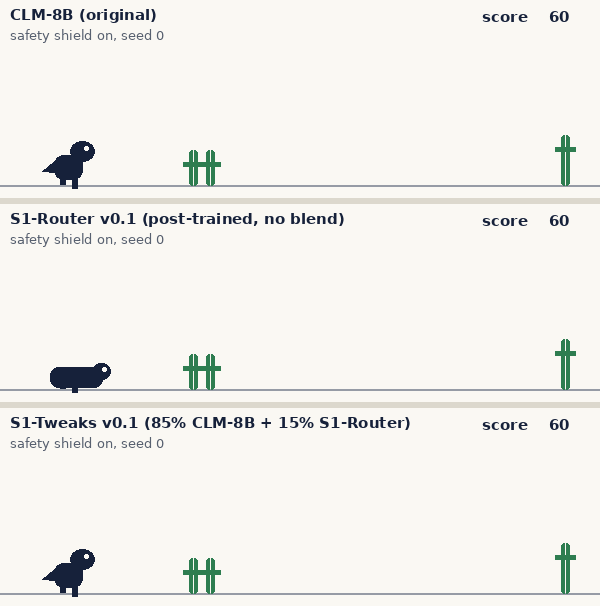</td>
<td align="center" valign="top"> анімований запис</td>
</tr></table>

🤖 <b><a href="https://github.com/browser-use/jev-ultrafast">browser-use/jev-ultrafast</a></b> · ⭐24717 · Python · 🔎 inferred · 13 天 · ⭐+2

##### 📝 Стислий опис

Найшвидший і найдешевший веб-агент

##### 📌 Основні факти

| Поле      | Значення                                                          |
| --------- | ----------------------------------------------------------------- |
| Категорія | `Інструменти для агентів: MCP, хуки, шлюзи та агенти-програмісти` |
| Докази    | `inferred`                                                        |
| Мова      | Python                                                            |

##### 📊 Дані

| Метрика         | Значення       |
| --------------- | -------------- |
| Зірки           | **24717** (+2) |
| Останній push   | 2026-11-11     |
| Уперше в списку | 2026-11-08     |

---

<table><tr><th align="center" width="50%">🖼 Зображення</th><th align="center" width="50%">🎬 Відео</th></tr><tr>
<td align="center" valign="top"></td>
<td align="center" valign="top"> анімований запис · <a href="https://raw.githubusercontent.com/browser-use/jev-ultrafast/main/docs/demo.mp4">Відкрити відео</a></td>
</tr></table>

🤖 <b><a href="https://github.com/jev-chat/jev-chat-jarvis">jev-chat/jev-chat-jarvis</a></b> · ⭐8501 · Kotlin · 🔎 inferred · 18 天 · ⭐+1

##### 📝 Стислий опис

Асистент рішень для чату: перш ніж ви відповісте, Jev читає чат, оцінює намір і ризик та готує чернетки відповідей, які ви заповнюєте одним дотиком. Ви натискаєте «надіслати». Android · Windows · macOS · iOS | Інструмент допомоги в ухваленні рішень у чаті: спершу зрозумійте співрозмовника, а відповідати чи ні — вирішуєте ви.

##### 📌 Основні факти

| Поле      | Значення                                                          |
| --------- | ----------------------------------------------------------------- |
| Категорія | `Інструменти для агентів: MCP, хуки, шлюзи та агенти-програмісти` |
| Докази    | `inferred`                                                        |
| Мова      | Kotlin                                                            |

##### 📊 Дані

| Метрика         | Значення      |
| --------------- | ------------- |
| Зірки           | **8501** (+1) |
| Останній push   | 2026-11-05    |
| Уперше в списку | 2026-11-08    |

🏷 `accessibility-service` · `ai-assistant` · `android` · `chat-assistant` · `chat-copilot` · `llm` · `ocr` · `qq`

---

<table><tr><th align="center" width="50%">🖼 Зображення</th><th align="center" width="50%">🎬 Відео</th></tr><tr>
<td align="center" valign="top">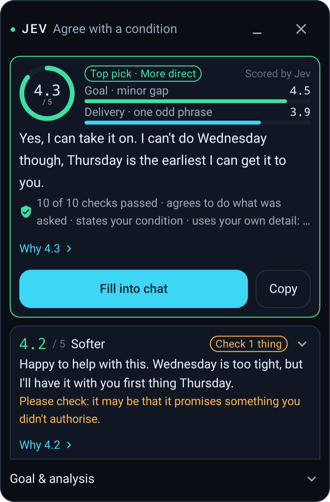</td>
<td align="center" valign="top">медіа не опубліковано</td>
</tr></table>

🤖 <b><a href="https://github.com/YaoApp/yao">YaoApp/yao</a></b> · ⭐8345 · Go · 🔎 inferred · 0 天 · ⭐+2

##### 📝 Стислий опис

✨ Усі ваші агенти та робочі простори в одному місці, на кожному вашому пристрої. Відстежуйте завдання на дошці, доступній із настільного комп’ютера, мобільного пристрою, браузера або API. Самостійне розгортання.

##### 📌 Основні факти

| Поле      | Значення                                                          |
| --------- | ----------------------------------------------------------------- |
| Категорія | `Інструменти для агентів: MCP, хуки, шлюзи та агенти-програмісти` |
| Докази    | `inferred`                                                        |
| Мова      | Go                                                                |

##### 📊 Дані

| Метрика         | Значення      |
| --------------- | ------------- |
| Зірки           | **8345** (+2) |
| Останній push   | 2026-11-23    |
| Уперше в списку | 2026-11-08    |

🏷 `agent-harness` · `agent-orchestration` · `agent-skills` · `agent-workspaces` · `ai-agents` · `ai-native` · `claude-code` · `coding-agent`

---

<table><tr><th align="center" width="50%">🖼 Зображення</th><th align="center" width="50%">🎬 Відео</th></tr><tr>
<td align="center" valign="top"></td>
<td align="center" valign="top">медіа не опубліковано</td>
</tr></table>

Ресурс підключено гарячим посиланням із вихідного репозиторію, оскільки ліцензію, що дозволяє розповсюдження, не заявлено.

🤖 <b><a href="https://github.com/kerpopule/hermes-jev-skills">kerpopule/hermes-jev-skills</a></b> · ⭐1364 · Python · 🔎 inferred · 5 天

##### 📝 Стислий опис

Маршрутизація моделей, пам’ять, ущільнення, вибір навичок, використання комп’ютера та браузера на основі Jev для агентів Hermes (також Claude Code і Codex)

##### 📌 Основні факти

| Поле      | Значення                                                          |
| --------- | ----------------------------------------------------------------- |
| Категорія | `Інструменти для агентів: MCP, хуки, шлюзи та агенти-програмісти` |
| Докази    | `inferred`                                                        |
| Мова      | Python                                                            |

##### 📊 Дані

| Метрика         | Значення   |
| --------------- | ---------- |
| Зірки           | **1364**   |
| Останній push   | 2026-11-18 |
| Уперше в списку | 2026-11-08 |

---

<table><tr><th align="center" width="50%">🖼 Зображення</th><th align="center" width="50%">🎬 Відео</th></tr><tr>
<td align="center" valign="top">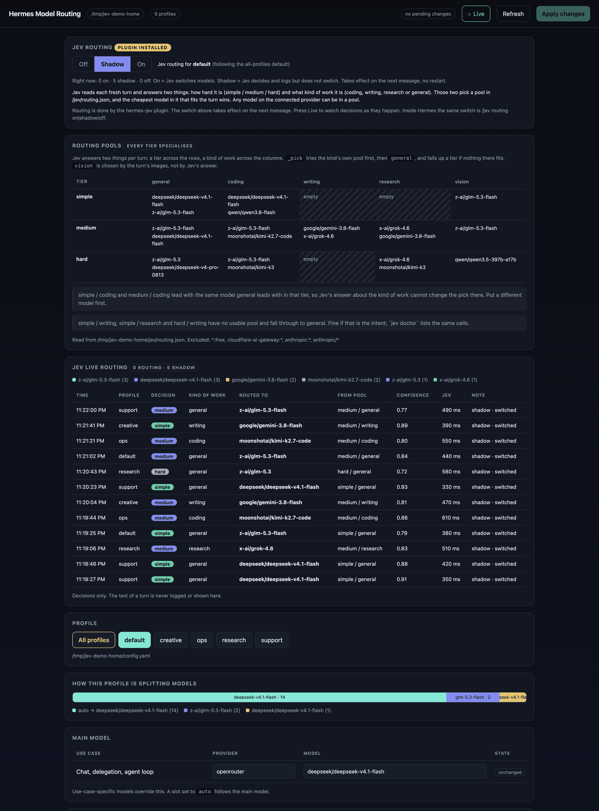</td>
<td align="center" valign="top">медіа не опубліковано</td>
</tr></table>

🤖 <b><a href="https://github.com/reticlehq/reticle">reticlehq/reticle</a></b> · ⭐1330 · TypeScript · 🔎 inferred · 0 天

##### 📝 Стислий опис

AI-агенти можуть генерувати код, але все ще насилу розуміють те, що будують. Reticle приносить сприйняття середовища виконання у стилі Jev, нативне для машин, у веб- і desktop-застосунки.

##### 📌 Основні факти

| Поле      | Значення                                                          |
| --------- | ----------------------------------------------------------------- |
| Категорія | `Інструменти для агентів: MCP, хуки, шлюзи та агенти-програмісти` |
| Докази    | `inferred`                                                        |
| Мова      | TypeScript                                                        |

##### 📊 Дані

| Метрика         | Значення   |
| --------------- | ---------- |
| Зірки           | **1330**   |
| Останній push   | 2026-11-23 |
| Уперше в списку | 2026-10-26 |

🏷 `agent-skill` · `agent-skills` · `agent-testing` · `agent-verification` · `ai-testing-tool` · `automated-testing` · `claude-code` · `claude-skills`

---

<table><tr><th align="center" width="50%">🖼 Зображення</th><th align="center" width="50%">🎬 Відео</th></tr><tr>
<td align="center" valign="top"></td>
<td align="center" valign="top"> анімований запис</td>
</tr></table>

Ресурс підключено гарячим посиланням із вихідного репозиторію, оскільки ліцензію, що дозволяє розповсюдження, не заявлено.

<b>Більше в цій категорії</b> · 202

- [dbreunig/building-with-jev-skill](https://github.com/dbreunig/building-with-jev-skill) - Навичка для написання та вдосконалення програм, які викликають Jev, модель…
- [openlayer-ai/jevals](https://github.com/openlayer-ai/jevals) - Оцінювання агентів і обмеження як рішення Jev: один запит на трасування, частка…
- [GhalebDweikat/winnow](https://github.com/GhalebDweikat/winnow) - Каліброване сито контексту для Claude Code: кожен результат інструмента…
- [andyrewlee/awesome-system-one](https://github.com/andyrewlee/awesome-system-one) - Список моделей System One (також званих моделями прийняття рішень): Jev, перша…
- [Nisaka520/JevIntent](https://github.com/Nisaka520/JevIntent) - WeChat (плагін FkWeChat): утримуйте повідомлення, щоб проаналізувати намір /…
- [Li-Evan/awesome-jev](https://github.com/Li-Evan/awesome-jev) - Найповніша галерея того, що люди створюють за допомогою Jev, моделі System One…
- [ChenneyZhuang/laya-browser-agent](https://github.com/ChenneyZhuang/laya-browser-agent) - Локальна альтернативна система Jev з відкритим кодом: рішення браузерного…
- [TrustifAI/typed_evals](https://github.com/TrustifAI/typed_evals) - Fast, typed Python framework for Jev-as-a-Judge/Decision-model evaluation for…
- [tiffygk/jev-mode](https://github.com/tiffygk/jev-mode) - Claude Code/Codex skills, evals, harnesses/context tools, and learning…
- [yohanargentina-oss/Foq](https://github.com/yohanargentina-oss/Foq) - ⚡ Foq — БЕЗКОШТОВНА локальна альтернатива з відкритим кодом для Jev.
- [mani-aiml/jev-demos](https://github.com/mani-aiml/jev-demos) - Демонстрації з Jev, моделлю System One від TypeSafe, по одній теці на…
- [brida-ai/reflex](https://github.com/brida-ai/reflex) - Open schemas, recipes, templates, examples and agent tooling for Brida Reflex.
- [BYK/jev-mcp](https://github.com/BYK/jev-mcp) - Сервер MCP, орієнтований передусім на оцінювання, для TypeSafe.
- [LHCWN/arkui-sem](https://github.com/LHCWN/arkui-sem) - Семантичний лінтер ArkUI для агентів програмування: виявляє помилки стану й…
- [rajasekharponakala/jev-mcp](https://github.com/rajasekharponakala/jev-mcp) - Сервер MCP, що обгортає моделі TypeSafe Jev System One — типізовані судження…
- [BFLabsAI/bf-jev-deep-research](https://github.com/BFLabsAI/bf-jev-deep-research) - Навичка агента + дослідження verbatim про Jev (TypeSafe AI System One Model)…
- [JiaWeiXie/jev-enhanced-plugin](https://github.com/JiaWeiXie/jev-enhanced-plugin) - A Claude Code plugin that takes skills already in use and adds one thing to…
- [Mainakcris7/agent-guardrail-with-jev](https://github.com/Mainakcris7/agent-guardrail-with-jev) - A practical demo of how can we leverage the power of System One Models like Jev…
- [systemonemodels/noulxp](https://github.com/systemonemodels/noulxp) - NoulXP (formerly OpenDXP): the open standard for System One models.
- [Abjcodes/SystemOne-Model-Router](https://github.com/Abjcodes/SystemOne-Model-Router) - Jev based model router for codex.
- [BargLabs/jev-judge-calibration](https://github.com/BargLabs/jev-judge-calibration) - Preregistered calibration test of TypeSafe Jev 1.13 as a judge of agent…
- [CrowBe/weave](https://github.com/CrowBe/weave) - Оболонка агента для моделі System One.
- [gorock007/jev-atlas](https://github.com/gorock007/jev-atlas) - An independent, evidence-first field guide to Jev.
- [izam-mohammed/decisionsmith](https://github.com/izam-mohammed/decisionsmith) - Use and fine-tune System One models (Jev, Laya) on your data, with an LLM as…
- [jms-dcksn/uipath-jev-guardrail-connector](https://github.com/jms-dcksn/uipath-jev-guardrail-connector) - Конектор UiPath із власними guardrail, побудований на моделі TypeSafe Jev…
- [jonra/atlas-jev](https://github.com/jonra/atlas-jev) - Build a security-specialised, Jev-compatible System One model from open weights…
- [knowlet/agentworld-web-simulator](https://github.com/knowlet/agentworld-web-simulator) - An entire internet — search, pages &amp; links — hallucinated on the fly by the…
- [lucast4049/openjev](https://github.com/lucast4049/openjev) - Запускайте швидкі, калібровані, типізовані рішення на відкритих моделях System…
- [Meirdrarel/mcp-systemone](https://github.com/Meirdrarel/mcp-systemone) - MCP server giving coding agents quick judgment tools.
- [nosial/FederationJevGuard](https://github.com/nosial/FederationJevGuard) - A FederationLib plugin that reviews reports, evidence and entities with a…
- [SebastianDrako/SOMe-Agents](https://github.com/SebastianDrako/SOMe-Agents) - System One Model Agents (SOMe Agents).
- [vurihuang/magpie-plugin-openai-decisions](https://github.com/vurihuang/magpie-plugin-openai-decisions) - OpenAI.
- [wy-coliney/jev-browser-use](https://github.com/wy-coliney/jev-browser-use) - Операції у браузері в 5–10 разів швидші: Jev клацає, Codex думає та перевіряє.
- [logicrw/awesome-jev-projects](https://github.com/logicrw/awesome-jev-projects) - Чудовий Jev: радар екосистеми відкритого коду з підтвердженнями з джерел, пошук…
- [AnotiaWang/awesome-decision-models](https://github.com/AnotiaWang/awesome-decision-models) - Добірний список моделей прийняття рішень.
- [devagrawal09/jev-review](https://github.com/devagrawal09/jev-review) - Поетапний робочий процес перевірки коду та локальна панель моніторингу…
- [wuyoscar/jev-skill](https://github.com/wuyoscar/jev-skill) - Чудова колекція варіантів використання, робочих процесів і навичок агентів для…
- [kydlikebtc/awesome-jev](https://github.com/kydlikebtc/awesome-jev) - Launch what you built on Jev, TypeSafe AI.
- [jkudish/jev-mcp](https://github.com/jkudish/jev-mcp) - Швидкі, дешеві, типізовані оцінки від моделі TypeSafe Jev у вигляді…
- [OmniJev/Flide](https://github.com/OmniJev/Flide) - 🔥🔥 The extremely fast inference engine for decision model.
- [ttlequals0/MinusPod](https://github.com/ttlequals0/MinusPod) - MinusPod — це сервер із власним розгортанням, який видаляє рекламу ще до того…
- [BillionsBobby/JevRouter](https://github.com/BillionsBobby/JevRouter) - Легкий маршрутизатор на основі Jev для моделей, інструментів і субагентів.
- [qbeka/jev-job-search](https://github.com/qbeka/jev-job-search) - Find software internships and new-grad jobs, fill the application forms, check…
- [malevrigns/agent-jev](https://github.com/malevrigns/agent-jev) - AgentJev-0.6B — швидка модель рішень «System One» для AI Agents: передайте їй…
- [vinilana/jev-gateway](https://github.com/vinilana/jev-gateway) - Простий спосіб використовувати jev із вашим агентом кодування для міркувань під…
- [Heman10x-NGU/openJev-verdict-2.0](https://github.com/Heman10x-NGU/openJev-verdict-2.0) - Калібрований 151M неавторегресійний рушій рішень, що перевершує TypeSafe Jev і…
- [OmniJev/OneJev](https://github.com/OmniJev/OneJev) - 🚀🚀 Мультимодальна модель ухвалення рішень System One, яка дає калібровані…
- [fatwang2/awesome-jev](https://github.com/fatwang2/awesome-jev) - Каталог проєктів Jev із підтвердженими джерелами та багаторазово…
- [jmagly/aiwg](https://github.com/jmagly/aiwg) - Reusable project context and specialist workflows for the AI tools you already…
- [luobosibing2/dsh-jev-plugin](https://github.com/luobosibing2/dsh-jev-plugin) - Нативний плагін DeepSeek Harness (DSH), що інтегрує TypeSafe Jev або Decision…
- [ThinkFlowLab/system1-agents](https://github.com/ThinkFlowLab/system1-agents) - Моделі прийняття рішень System 1 (Jev, Laya, Cua-S1) як мозок для агентів…
- [y0usaf/pi-jev](https://github.com/y0usaf/pi-jev) - TypeSafe Jev як рівень прийняття рішень для агента програмування Pi…
- [kyegomez/open-jev](https://github.com/kyegomez/open-jev) - Реконструкція ідей, що лежать в основі TypeSafe AI Jev, з відкритим кодом і…
- [cookiespiggy/agentic-rl](https://github.com/cookiespiggy/agentic-rl) - Підручник з Agentic RL китайською мовою без попередніх знань (33 розділи): від…
- [Shanghua-Gao/RSI-Jev](https://github.com/Shanghua-Gao/RSI-Jev) - Моделі типізованих рішень (noul / choice / score), навчені циклом…
- [UditAkhourii/quicksilver](https://github.com/UditAkhourii/quicksilver) - Навичка Claude Code: передавайте масові рішення Jev.
- [lawrence3699/jev-style](https://github.com/lawrence3699/jev-style) - JevStyle: local decision models for AI agents.
- [native-bond-lab/Jev-Interaction](https://github.com/native-bond-lab/Jev-Interaction) - System-One-controlled full-duplex voice interaction: turn-taking as…
- [initial-d/ml-quant-trading](https://github.com/initial-d/ml-quant-trading) - Кількісні ML-дослідження в PyTorch: 213 факторів, корекція зміщення…
- [PerryLink/jevcore](https://github.com/PerryLink/jevcore) - TypeSafe Jev для DeepSeek Harness, Model Context Protocol і звичайного Node…
- [charlesdove977/claude-x-jev](https://github.com/charlesdove977/claude-x-jev) - Швидкі, дешеві, типізовані рішення для Claude Code.
- [jonathanavis96/jev-kit](https://github.com/jonathanavis96/jev-kit) - Усе необхідне для запуску TypeSafe Jev за допомогою Claude Code: захист…
- [shitianfang/jev-use](https://github.com/shitianfang/jev-use) - Плагін Claude Code / Codex / pi, який передає кроки агента, що не потребують…
- [akivet/Mica](https://github.com/akivet/Mica) - A 4B decision model: calibrated probabilities for yes/no, choice and score…
- [yikangy873-gif/jev-desktop](https://github.com/yikangy873-gif/jev-desktop) - Вибір дій TypeSafe Jev у Codex Computer Use.
- [iamaamir/system-one](https://github.com/iamaamir/system-one) - Незалежне від провайдера середовище виконання System One для TypeScript і Pi.
- [alanhuangyoo/OpenJev](https://github.com/alanhuangyoo/OpenJev) - OpenJev: open-source, локальна альтернатива Jev.
- [TheoOliveira/pi-jev](https://github.com/TheoOliveira/pi-jev) - Семантична маршрутизація інструментів і типізовані рішення System One для…
- [chuloontop4-code/jev-instance-review](https://github.com/chuloontop4-code/jev-instance-review) - Найкращий рецензент екземплярів Roblox Studio 2026: типізовані критерії Jev і…
- [FrancoisChastel/jev-code](https://github.com/FrancoisChastel/jev-code) - Jev, класифікатор TypeSafe System One, як інструмент у Claude Code, Codex, Pi…
- [intikhab49/open-jev-typed-decision-engine](https://github.com/intikhab49/open-jev-typed-decision-engine) - Відкрита реалізація TypeSafe Jev: механізм типізованих рішень на 150 млн…
- [alexei-led/claude-router](https://github.com/alexei-led/claude-router) - Claude Code plugin that picks the model and effort for each turn.
- [everyinfra/jev-radar](https://github.com/everyinfra/jev-radar) - 📡 The most rigorously verified tracker of the Jev (TypeSafe AI System One)…
- [AskTheWay/dsh-jev-interceptor](https://github.com/AskTheWay/dsh-jev-interceptor) - ⚡ Millisecond System-1 judgement for every tool call in DeepSeek Harness…
- [jomatsu/pi-jev-auto-mode](https://github.com/jomatsu/pi-jev-auto-mode) - Режим автоматизації на основі Jev (TypeSafe System One) для агента…
- [abhishek085/open-spark-jev](https://github.com/abhishek085/open-spark-jev) - Open-source локальні моделі ухвалення рішень, натхненні Jev і System One від…
- [teo-nex/jev-codex-harness](https://github.com/teo-nex/jev-codex-harness)
- [mas-bandwidth/nova-sprint](https://github.com/mas-bandwidth/nova-sprint) - Coordinate AI sprints across different models, harnesses and machines.
- [anandi1989/awesome-jev-usecases](https://github.com/anandi1989/awesome-jev-usecases) - Підкріплений доказами індекс реальних use cases Jev (TypeSafe AI System One)…
- [Singularity-Compute/super-decider](https://github.com/Singularity-Compute/super-decider) - Decisions, not essays: a choice, a yes or no, or a score with a calibrated…
- [erkamyaman/jev-enforce](https://github.com/erkamyaman/jev-enforce) - 📏 Claude Code plugin that makes Claude follow your AGENTS.md: every reply and…
- [paramjeetn/jev-cookbook](https://github.com/paramjeetn/jev-cookbook) - Повна кулінарна книга для Jev від TypeSafe AI — понад 120 випадків…
- [iamtoomas/JevLint](https://github.com/iamtoomas/JevLint) - Конфігуроване семантичне linting на основі Jev, із судженнями NOUL на рівні…
- [vicfei/awesome-jev-prompts](https://github.com/vicfei/awesome-jev-prompts) - Question patterns, engine selection &amp; ecosystem tracking for typed decision…
- [ajensenwaud/hermes-jev-plugin](https://github.com/ajensenwaud/hermes-jev-plugin) - Інструменти прийняття рішень TypeSafe Jev (System One) для Hermes Agent…
- [daftAI2026/awesome-jev](https://github.com/daftAI2026/awesome-jev) - Добірка проєктів TypeSafe Jev / System One GitHub, альтернатив із відкритим…
- [Nyarlathoteppppp/pi-heed](https://github.com/Nyarlathoteppppp/pi-heed) - Runtime constraints for the pi coding agent: checks every side-effecting tool…
- [win4r/pi-jev-router](https://github.com/win4r/pi-jev-router) - Task-boundary model routing for Pi Coding Agent, powered by TypeSafe Jev.
- [zhangxaochen/dsh-jev](https://github.com/zhangxaochen/dsh-jev) - Набір плагінів Jev (модель прийняття рішень System One) для DeepSeek Harness…
- [alexei-led/pi-model-router](https://github.com/alexei-led/pi-model-router) - Independent Pi extension for four-tier model routing with optional…
- [ronitgupta138/Local-Jev](https://github.com/ronitgupta138/Local-Jev) - ⚡ 100% offline, zero-cost drop-in alternative to TypeSafe Jev System One…
- [assistant-ui/jevia](https://github.com/assistant-ui/jevia) - outcome-aware &amp; adaptive model routing for coding agents with deterministic…
- [Jessie-QingYu/jev-in-the-wild](https://github.com/Jessie-QingYu/jev-in-the-wild) - Реальні випадки використання Jev, проєкти з відкритим кодом, бенчмарки та…
- [jmrenouard/MicroLLM](https://github.com/jmrenouard/MicroLLM) - Local Hybrid System-One Decision Engine.
- [SergeyBazhmin/krasivo-jev](https://github.com/SergeyBazhmin/krasivo-jev) - Training data and models for &quot;system one&quot; classifiers: one forward pass, no…
- [the-sof/home-assistant-typesafe-conversation-agent](https://github.com/the-sof/home-assistant-typesafe-conversation-agent) - Home Assistant voice agent powered by a System One decision model.
- [allenporter/home-assistant-laya](https://github.com/allenporter/home-assistant-laya) - Conversation agent based on Laya, a multilingual, non-autoregressive System 1…
- [AlphaPerseii3000/jev-effort-router](https://github.com/AlphaPerseii3000/jev-effort-router) - Per-turn model AND reasoning-effort routing for Hermes Agent on Ollama:Cloud…
- [Civalski/claujev](https://github.com/Civalski/claujev) - Jev (TypeSafe AI) as a second pair of eyes for Claude Code: request triage…
- [FazalAAli/jev-robotics-demo](https://github.com/FazalAAli/jev-robotics-demo) - Jev (TypeSafe System One) проти Claude Opus 5, що керує змодельованою…
- [PerryLink/laya-mcp](https://github.com/PerryLink/laya-mcp) - MCP server for Laya typed decisions (noul / choice / score): warm model…
- [ranjan2829/AskJev](https://github.com/ranjan2829/AskJev) - AskJev — автопілот Jev для будь-якого вебсайту + захист від незворотних…
- [reacher-z/Awesome-Jev](https://github.com/reacher-z/Awesome-Jev) - Curated Jev and System One papers, models, datasets, benchmarks and SDKs, with…
- [7starsseeker/dsh-fact-check](https://github.com/7starsseeker/dsh-fact-check) - Fact-checking skill for DeepSeek Harness: multi-source verification against the…
- [lgy1027/jevshield](https://github.com/lgy1027/jevshield) - Захисний шлюз для викликів інструментів агентів ШІ із затримкою менше 100 мс…
- [simota/tenbin](https://github.com/simota/tenbin) - Сервер MCP і навичка агента для TypeSafe AI System One API (Jev): розкладати…
- [abhishekashokvkumar/jev-mcp-dispatcher](https://github.com/abhishekashokvkumar/jev-mcp-dispatcher) - Диспетчер інструментів для природної мови, повністю працює на основі TypeSafe.
- [aitofy-dev/jev-awesome-skills](https://github.com/aitofy-dev/jev-awesome-skills) - Навички Jev з відкритим кодом для Claude Code, Codex, Cursor і Grok.
- [atvari-eu/opencode-decisions](https://github.com/atvari-eu/opencode-decisions) - OpenCode plugin for decision models (System One, Jev): automatic decisions…
- [laguagu/jev-skills](https://github.com/laguagu/jev-skills) - Practical agent skills and examples for building with Jev.
- [MongLong0214/jev-gate](https://github.com/MongLong0214/jev-gate) - Не кожне завдання з кодування потребує вашої найкращої моделі.
- [nanami-0713/dsh-jev-decide](https://github.com/nanami-0713/dsh-jev-decide) - Плагін DSH: зареєструйте TypeSafe Jev (модель рішень System One) як інструмент…
- [supermanc417-alt/awesome-jev-hub](https://github.com/supermanc417-alt/awesome-jev-hub) - A curated hub of the Jev / TypeSafe &quot;System One&quot; model ecosystem — concepts, 51…
- [7starsseeker/dsh-jev-guard](https://github.com/7starsseeker/dsh-jev-guard) - DeepSeek Harness (DSH) 执行前安全阀门:bash/pwsh 真正执行前先经静态规则 + TypeSafe Jev 语义判定,破坏性操作按…
- [deepansh-saxena/jev-guardrails](https://github.com/deepansh-saxena/jev-guardrails) - Порівняння LLM-як-судді з TypeSafe Jev для обмежень агентів: ті самі правила…
- [mywwave/cursor-jev](https://github.com/mywwave/cursor-jev) - Плагін Cursor, який маршрутизує субагентів за допомогою TypeSafe Jev і надає…
- [noetion/dsh-jev](https://github.com/noetion/dsh-jev) - Пакет DSH, який реєструє jev_ask для відповідей TypeSafe Jev noul, choice і…
- [samtay32/jev-system-architect](https://github.com/samtay32/jev-system-architect) - Навичка системної архітектури для TypeSafe AI Jev/System One — знаходить…
- [SoniaMehta14/paved-gate](https://github.com/SoniaMehta14/paved-gate) - Fast System 1 ingestion gate for AI agent architectures: typed safety, routing…
- [tinypi-extension/tinysubagent](https://github.com/tinypi-extension/tinysubagent) - Minimal herdr-native and Rex subagent spawning for pi — markdown agent roles…
- [vahidkaargar/jade-decision-governance](https://github.com/vahidkaargar/jade-decision-governance) - Adaptive decision governance for AI agents using TypeSafe Jev: journaled…
- [wangkuangkuang/jev-mcp-server](https://github.com/wangkuangkuang/jev-mcp-server) - Сервер MCP для Jev (TypeSafe System One): три офіційні типи запитань — choice…
- [1aifanatic/jev-uipath-coded-agent](https://github.com/1aifanatic/jev-uipath-coded-agent) - Демонстрація FINS: агент із кодом UiPath для сортування AML-сповіщень, де кожне…
- [cnrai/openpave-jev](https://github.com/cnrai/openpave-jev) - Навичка PAVE для нерегресивних моделей прийняття рішень.
- [darwintechlab/claude-jev](https://github.com/darwintechlab/claude-jev) - Jev System One для Claude Code — типізовані Choice/Noul/Score через живий…
- [guanghuang/coding-router-jev](https://github.com/guanghuang/coding-router-jev) - TypeScript/Bun launcher routing Codex turns through JEV with model and…
- [hdjekuue/awesome-jev](https://github.com/hdjekuue/awesome-jev) - Самооновлюваний тримовний каталог усього, що створено на основі Jev.
- [jms-dcksn/jev-pii-guardrail](https://github.com/jms-dcksn/jev-pii-guardrail) - Кодований агент UiPath із користувацьким guardrail виявлення PII на межі LLM…
- [MojoAI-King/jev-paper-trader](https://github.com/MojoAI-King/jev-paper-trader) - Paper trading real Polymarket and Kalshi markets with a fake $100k: can Jev +…
- [rahilmavani/piedpiper-jev-buildathon](https://github.com/rahilmavani/piedpiper-jev-buildathon) - Команда piedpiper: failproofai + Jev — запобіжники, які не дають IT-агенту…
- [zhuyansen/awesome-typesafe-jev](https://github.com/zhuyansen/awesome-typesafe-jev) - Проєкти з відкритим кодом, створені на основі моделі рішень Jev TypeSafe…
- [173787247/dsh-wsl-jev](https://github.com/173787247/dsh-wsl-jev) - DeepSeek Harness WSL plugin: TypeSafe Jev / OpenRouter System One.
- [17671454333/jev-cognitive-mcp](https://github.com/17671454333/jev-cognitive-mcp) - 3+1 Cognitive Hierarchy Toolkit &amp; Model Context Protocol (MCP) Server for…
- [bhanuprakashk90-tech/jev-agent-guardrail](https://github.com/bhanuprakashk90-tech/jev-agent-guardrail) - Запобіжник безпеки в реальному часі та інтерактивна панель моніторингу для…
- [bismawy/pi-jev-eye](https://github.com/bismawy/pi-jev-eye) - Ультракомпактний супервізор для Pi: регулярні запобіжники з нульовою кількістю…
- [bitskc/honest-jev](https://github.com/bitskc/honest-jev) - A cheap decider for AI agents: command guard, done-claim verification…
- [bpmforbusiness/jev-agent-harness](https://github.com/bpmforbusiness/jev-agent-harness) - Посібник із каркаса агента Jev (TypeSafe AI System One) + відеопосібник — із…
- [charetterat/awesome-jev-essentials](https://github.com/charetterat/awesome-jev-essentials) - Проєкти Jev, які справді варті вашого часу — відібрані, порівняні, актуальні.
- [d0ng231/jev-gtw](https://github.com/d0ng231/jev-gtw) - JEV Gateway: PII/PHI guardrails for coding agents.
- [DarkisuSu/Jev-Claude-Router](https://github.com/DarkisuSu/Jev-Claude-Router) - Модуль MOD маршрутизації моделей і вибору навичок на основі Jev для Claude.
- [edamlabs/e-jev](https://github.com/edamlabs/e-jev) - A self-hosted Jev with a catalog of decision backends — typed, calibrated…
- [eshitakundu/jev-flow](https://github.com/eshitakundu/jev-flow) - Support-triage inbox where an LLM answers typed questions and a deterministic…
- [Faizullah9181/jev-esketcher](https://github.com/Faizullah9181/jev-esketcher) - Полотно для генеративного живопису, де Jev, калібрована модель ухвалення рішень…
- [fivetaku/golla-jev](https://github.com/fivetaku/golla-jev) - 골라제브 — find the pick-one moments in your work and hand them to Jev.
- [jbatra-umeey/jev-decisionops](https://github.com/jbatra-umeey/jev-decisionops) - Шість робочих процесів прийняття рішень Jev для агентного AI: маршрутизація…
- [JoaoClemer/jev-lab](https://github.com/JoaoClemer/jev-lab) - Jev (TypeSafe AI) як запобіжник у реальному часі та попередній оцінювач…
- [lijiawei255/jev-tune](https://github.com/lijiawei255/jev-tune) - Jev-inspired calibrated decision &amp; safety shell for typed PID autotuning…
- [masseater/cc-jev-teacher](https://github.com/masseater/cc-jev-teacher) - Claude Code plugin: TypeSafe-judged hooks that make Claude finish the job…
- [MichelePolo/jev-mcp](https://github.com/MichelePolo/jev-mcp) - Сервер MCP, що надає моделі рішень Jev-стилю System One (Ollama /v1/systemone)…
- [putraridho/jev-switch](https://github.com/putraridho/jev-switch) - Jev-gated Claude router: Sonnet by default, Opus for hard and security work.
- [xlennart/dsh-auto-review-jev](https://github.com/xlennart/dsh-auto-review-jev) - DeepSeek Harness 审批守护者：权限请求先由审查模型裁决。内置 System One 决策 API 后端.
- [zachshallbetter/claude-jev](https://github.com/zachshallbetter/claude-jev) - Jev (TypeSafe System One) як плагін Claude Code: типізовані рішення для…
- [aayushhzz/jev-lite](https://github.com/aayushhzz/jev-lite) - Jev Lite: a small local decision API for agents, with typed choice, score, and…
- [abyakod/JEV_ADK](https://github.com/abyakod/JEV_ADK) - Комплект розробки агентів для System-One AI: неавторегресивні конвеєри рішень…
- [alejandroparis17/router-jev](https://github.com/alejandroparis17/router-jev) - Claude Code hook and skill that routes each task to the model best suited to…
- [aleksvega/jev-stack](https://github.com/aleksvega/jev-stack) - Одна команда (npx jev-stack) для встановлення набору інструментів агента на…
- [AlienXc137/Support-Ticket-Ai-Agent-with-RAG-Guardrails-and-Jev](https://github.com/AlienXc137/Support-Ticket-Ai-Agent-with-RAG-Guardrails-and-Jev) - Агент, який читає вхідні запити студентів.
- [Antony-12s/hermes-jev-quota-routing](https://github.com/Antony-12s/hermes-jev-quota-routing) - TypeSafe Jev picks the model for Hermes Agent (main chat + subagents) with a…
- [cameronb-xano/jev-agent-guardrail](https://github.com/cameronb-xano/jev-agent-guardrail) - Шаблон Xano: захисний бар.
- [Covre81/jev-router](https://github.com/Covre81/jev-router) - Local Anthropic-compatible gateway that routes Claude Code traffic across…
- [danekkalivoda/jev-skill](https://github.com/danekkalivoda/jev-skill) - Agent skill: route subagent tasks to the cheapest capable model via TypeSafe Jev.
- [danieljohnmorris/omp-jev-router](https://github.com/danieljohnmorris/omp-jev-router) - MOVED to https://github.com/danieljohnmorris/omp-plugins (plugins/jev-router).
- [danielmaciejpytel/jev-lanepilot](https://github.com/danielmaciejpytel/jev-lanepilot) - Bounded Jev routing for Codex and Claude Code, with explicit policies, one…
- [gusiqbal/claude-model-jev](https://github.com/gusiqbal/claude-model-jev) - JEV-style typed decision system for selecting the optimal Claude model.
- [HKUST-KnowComp/jev-guardrail](https://github.com/HKUST-KnowComp/jev-guardrail) - Редаговані дерева політик і класифікатор 2B для перевірки запитів і дій агента.
- [kangshifu1/jev-skills-market](https://github.com/kangshifu1/jev-skills-market) - Community Jev skill market and assistant for automation testing, finance…
- [kevinyin9/next-steps-jev](https://github.com/kevinyin9/next-steps-jev) - Suggested next steps for Claude Code, scored by how much each one helps your…
- [lbke/langchain-jev-tool-calling](https://github.com/lbke/langchain-jev-tool-calling) - Experiment a tool calling loop with Jev as the tool calling model.
- [Mfrostbutter/jev-n8n-patterns](https://github.com/Mfrostbutter/jev-n8n-patterns) - Шаблони Jev (TypeSafe System One) у n8n: перевірка PII, засоби захисту агентів…
- [Mohith26/jev-calibration-audit](https://github.com/Mohith26/jev-calibration-audit) - Independent calibration and selective-agreement audit of Jev vs eight LLMs on…
- [mxttbennett/jev-relayer](https://github.com/mxttbennett/jev-relayer) - Per-task Jev routing for Claude Code and Codex: inline, subagent or sibling…
- [PeriodBLUE/jev-project-atlas](https://github.com/PeriodBLUE/jev-project-atlas) - A source-verified atlas of GitHub projects built with JEV / TypeSafe System One.
- [phoem/jev-router](https://github.com/phoem/jev-router) - Claude Code mod that asks TypeSafe.
- [Sandesh-S-Dalvi/playwright-jev-testing-refactored](https://github.com/Sandesh-S-Dalvi/playwright-jev-testing-refactored) - Goal-driven Playwright E2E testing where TypeSafe Jev (System One) decides the…
- [shahshahdab/fastcampus-jev](https://github.com/shahshahdab/fastcampus-jev) - Learn to gate tool calls, guardrails, and risky actions with Jev judgment plus…
- [siso-os/jev-agent-skills](https://github.com/siso-os/jev-agent-skills) - A conservative second opinion for your agent: intent, completion, routing and…
- [skylence-org/claudecode-jev-marketplace](https://github.com/skylence-org/claudecode-jev-marketplace) - TypeSafe Jev (System One) wired into Claude Code: a decision primitive for…
- [StarDust0083-GP03/jev-router-for-pi](https://github.com/StarDust0083-GP03/jev-router-for-pi) - Tiered virtual model router for the Pi coding agent: one classifier score per…
- [superjammy/JevExperiment](https://github.com/superjammy/JevExperiment) - Decide first, generate second: Jev decision-model triage in front of Claude…
- [ttdua/pi-jev-pilot](https://github.com/ttdua/pi-jev-pilot) - Pi extension that lets Jev, TypeSafe.
- [vamshibobby/jev-tau2-harness](https://github.com/vamshibobby/jev-tau2-harness) - Replication code and runs for.
- [veermshah/jev-calibration-lab](https://github.com/veermshah/jev-calibration-lab) - Independent calibration benchmark for System One decision models (TypeSafe Jev)…
- [vinaychawla-ops/jev-adk-guardrail-example](https://github.com/vinaychawla-ops/jev-adk-guardrail-example) - Jev (TypeSafe модель рішень) як захисний бар.
- [Vultwo/dsh-jev-auto-approve](https://github.com/Vultwo/dsh-jev-auto-approve) - Jev-backed auto-approval for DeepSeek Harness with an English settings page for…
- [xano-community/agent-guardrail-jev](https://github.com/xano-community/agent-guardrail-jev) - Захисний механізм викликів інструментів AI-агента для Xano: Jev (TypeSafe AI)…
- [ZeroX-01/jev-atlas](https://github.com/ZeroX-01/jev-atlas) - Постійно оновлюваний публічний індекс реальних проєктів, відео, статей і…
- [rmalde/minecraft-agent](https://github.com/rmalde/minecraft-agent) - Планувальник Astra та контролер JEV для Minecraft із нативним записом…
- [notque/vexjoy-agent](https://github.com/notque/vexjoy-agent) - VexJoy AI Agent з Jev Intelligent Routing — /do спрямовує запити звичайною…
- [itsmostafa/system-one-connector](https://github.com/itsmostafa/system-one-connector) - Конектор System One MCP для швидкого й дешевого оцінювання будь-чого.
- [keeltrace/hermes-nerve](https://github.com/keeltrace/hermes-nerve) - Nerve — це наглядова нервова система для агентів Hermes, яка додає типізовані…
- [gogoymh/git-ontology-agent](https://github.com/gogoymh/git-ontology-agent) - Talk to your agent mid-task: every request is a git branch, an ontology decides…
- [everafterlabs/jes](https://github.com/everafterlabs/jes) - Засоби захисту з відкритим кодом для AI-агентів на основі моделей прийняття…
- [Mawfyy/jevflow](https://github.com/Mawfyy/jevflow) - Імовірнісні рішення ШІ як компоновані примітиви бекенду — типізовані судження…
- [darwintechlab/openjev](https://github.com/darwintechlab/openjev) - OpenJev: плагін Opencode, який замінює рішення під час генерації тексту на Jev…
- [romanmeclazcke/codex-sift](https://github.com/romanmeclazcke/codex-sift) - Route each Codex turn to the cheapest model that can handle it, judged by…
- [tamnd/kime](https://github.com/tamnd/kime) - Typed decisions over text in milliseconds.
- [laxtiz/opencode-vllm-sr-auth](https://github.com/laxtiz/opencode-vllm-sr-auth) - vLLM-SR System Duo — System One decision models (choice/noul/score/box/span)…
- [patronus-protect/decision-model-guard](https://github.com/patronus-protect/decision-model-guard) - Guardrails for decision models: stop text inside the content from steering…
- [bhavikprit/instinct-ai](https://github.com/bhavikprit/instinct-ai) - ⚡ Універсальний System-1 AI Runtime і шлюз Dual-Brain.
- [DataZooDE/anofox-decide](https://github.com/DataZooDE/anofox-decide) - DuckDB extension: evaluate natural-language predicates and answer sets with…
- [2skr1996-cloud/kira-ai-plugin-multi-decision](https://github.com/2skr1996-cloud/kira-ai-plugin-multi-decision) - KiraAI 插件：多样化聊天决策（含 JEV）+ 上下文窗口 + 记录页（Beta 测试版）.
- [lcbkmm/laya-thalamus](https://github.com/lcbkmm/laya-thalamus) - Оркестратор рішень System1 для AI-агентів.

## Маршрутизація, запобіжники та затвердження

Сценарій у продакшн-формі — спрямовуйте кожен запит до найдешевшої моделі, яка справді з ним упорається, і тримайте детерміновану перевірку результату.

🛡️ <b><a href="https://github.com/HarnessRouter/SystemOneHarness">HarnessRouter/SystemOneHarness</a></b> · ⭐211 · Python · 👁️ observed · 63 天

##### 📝 Стислий опис

Платформа System One для моделей System One. Запускайте Jev та інші моделі System One локально або безпосередньо на HarnessRouter.ai.

##### 📌 Основні факти

| Поле      | Значення                                     |
| --------- | -------------------------------------------- |
| Категорія | `Маршрутизація, запобіжники та затвердження` |
| Докази    | `observed`                                   |
| Мова      | Python                                       |

##### 📊 Дані

| Метрика         | Значення   |
| --------------- | ---------- |
| Зірки           | **211**    |
| Останній push   | 2026-09-21 |
| Уперше в списку | 2026-11-20 |

🏷 `harness` · `harness-engineering` · `system-one-harness` · `system-one-models`

🛡️ <b><a href="https://github.com/Dicklesworthstone/skillranker">Dicklesworthstone/skillranker</a></b> · ⭐149 · Rust · 👁️ observed · 35 天

##### 📝 Стислий опис

Rust CLI на основі Jev від TypeSafe.ai, який ранжує навички агента для наступного кроку, використовуючи контекст поточного сеансу. Включає хуки Claude Code, структуровані JSON, утримання від відповіді та локальний зворотний зв’язок. Потрібен ключ TypeSafe API.

> 💡 Ранжує навички агента за допомогою типізованого рішення. Корисна модель для будь-якої задачі «вибрати серед N кандидатів», яку раніше розв’язували промптом.

🔧 Виявлено використання в коді: `README.md`

##### 📌 Основні факти

| Поле      | Значення                                     |
| --------- | -------------------------------------------- |
| Категорія | `Маршрутизація, запобіжники та затвердження` |
| Докази    | `observed`                                   |
| Мова      | Rust                                         |

##### 📊 Дані

| Метрика         | Значення   |
| --------------- | ---------- |
| Зірки           | **149**    |
| Останній push   | 2026-10-19 |
| Уперше в списку | 2026-10-29 |

🏷 `agent-skills` · `ai-agents` · `asupersync` · `claude-code` · `cli` · `developer-tools` · `frankentui` · `jev`

🛡️ <b><a href="https://github.com/Sarim-MBZUAI/awesome-jev-security">Sarim-MBZUAI/awesome-jev-security</a></b> · ⭐9 · 👁️ observed · 1 天

##### 📝 Стислий опис

Curated list of papers on the security, robustness, and safety of TypeSafe Jev / System One models

##### 📌 Основні факти

| Поле      | Значення                                     |
| --------- | -------------------------------------------- |
| Категорія | `Маршрутизація, запобіжники та затвердження` |
| Докази    | `observed`                                   |

##### 📊 Дані

| Метрика         | Значення   |
| --------------- | ---------- |
| Зірки           | **9**      |
| Останній push   | 2026-11-22 |
| Уперше в списку | 2026-11-10 |

🛡️ <b><a href="https://github.com/dharmeshgurnani/codeotter">dharmeshgurnani/codeotter</a></b> · ⭐5 · TypeScript · 👁️ observed · 0 天

##### 📝 Стислий опис

Autonomous, self-hosted AI code reviews, calibrated scoring gauges, and merge gates from any open model.

##### 📌 Основні факти

| Поле      | Значення                                     |
| --------- | -------------------------------------------- |
| Категорія | `Маршрутизація, запобіжники та затвердження` |
| Докази    | `observed`                                   |
| Мова      | TypeScript                                   |

##### 📊 Дані

| Метрика         | Значення   |
| --------------- | ---------- |
| Зірки           | **5**      |
| Останній push   | 2026-11-23 |
| Уперше в списку | 2026-11-11 |

🏷 `ai-code-review` · `code-review` · `coderabbit` · `coderabbit-alternative` · `developer-tools` · `devops` · `forgejo` · `gguf`

---

<table><tr><th align="center" width="50%">🖼 Зображення</th><th align="center" width="50%">🎬 Відео</th></tr><tr>
<td align="center" valign="top"></td>
<td align="center" valign="top">медіа не опубліковано</td>
</tr></table>

🛡️ <b><a href="https://github.com/baldellimtt/systemone-lab">baldellimtt/systemone-lab</a></b> · ⭐2 · HTML · 👁️ observed · 21 天

##### 📝 Стислий опис

Hands-on System One decision lab: Jev-compatible Noul/Choice/Score over local open-weight Laya, with playground UI, routing/eval examples, and CI smoke tests.

##### 📌 Основні факти

| Поле      | Значення                                     |
| --------- | -------------------------------------------- |
| Категорія | `Маршрутизація, запобіжники та затвердження` |
| Докази    | `observed`                                   |
| Мова      | HTML                                         |

##### 📊 Дані

| Метрика         | Значення   |
| --------------- | ---------- |
| Зірки           | **2**      |
| Останній push   | 2026-11-02 |
| Уперше в списку | 2026-11-02 |

🏷 `calibrated-probabilities` · `jev` · `laya` · `system-one-models` · `typed-decisions` · `typesafe`

---

<table><tr><th align="center" width="50%">🖼 Зображення</th><th align="center" width="50%">🎬 Відео</th></tr><tr>
<td align="center" valign="top"></td>
<td align="center" valign="top">медіа не опубліковано</td>
</tr></table>

🛡️ <b><a href="https://github.com/Dominion-Academy/System-One-Models">Dominion-Academy/System-One-Models</a></b> · ⭐1 · Python · 👁️ observed · 2 天

##### 📝 Стислий опис

Code for a course on System One models (Jev, Kev, Laya): LLMs that answer with a choice and a probability instead of free text. Build a support-ticket triage service with Choice, Score and Noul questions, check whether the confidence can be trusted, set thresholds, and run it in production.

##### 📌 Основні факти

| Поле      | Значення                                     |
| --------- | -------------------------------------------- |
| Категорія | `Маршрутизація, запобіжники та затвердження` |
| Докази    | `observed`                                   |
| Мова      | Python                                       |

##### 📊 Дані

| Метрика         | Значення   |
| --------------- | ---------- |
| Зірки           | **1**      |
| Останній push   | 2026-11-21 |
| Уперше в списку | 2026-11-04 |

🏷 `calibration` · `jev` · `kev` · `laya` · `python` · `system-design` · `system-one` · `system-one-models`

---

<table><tr><th align="center" width="50%">🖼 Зображення</th><th align="center" width="50%">🎬 Відео</th></tr><tr>
<td align="center" valign="top"></td>
<td align="center" valign="top">медіа не опубліковано</td>
</tr></table>

Ресурс підключено гарячим посиланням із вихідного репозиторію, оскільки ліцензію, що дозволяє розповсюдження, не заявлено.

🛡️ <b><a href="https://github.com/chialab/system-one-italian-tests">chialab/system-one-italian-tests</a></b> · Python · 👁️ observed · 7 天

##### 📝 Стислий опис

A suite to test System One AI models against italian inputs

##### 📌 Основні факти

| Поле      | Значення                                     |
| --------- | -------------------------------------------- |
| Категорія | `Маршрутизація, запобіжники та затвердження` |
| Докази    | `observed`                                   |
| Мова      | Python                                       |

##### 📊 Дані

| Метрика         | Значення   |
| --------------- | ---------- |
| Зірки           | **0**      |
| Останній push   | 2026-11-16 |
| Уперше в списку | 2026-11-16 |

🏷 `escalation` · `italian` · `jev` · `system-one` · `system-one-models`

🛡️ <b><a href="https://github.com/mgd34msu/goodvibes">mgd34msu/goodvibes</a></b> · TypeScript · 👁️ observed · 1 天

##### 📝 Стислий опис

The Goodvibes platform with integrated System One model support. The decision model for guardrails, safety, etc. is now driven by models like Jev/Clef/Laya and is less reliant on HITL.

##### 📌 Основні факти

| Поле      | Значення                                     |
| --------- | -------------------------------------------- |
| Категорія | `Маршрутизація, запобіжники та затвердження` |
| Докази    | `observed`                                   |
| Мова      | TypeScript                                   |

##### 📊 Дані

| Метрика         | Значення   |
| --------------- | ---------- |
| Зірки           | **0**      |
| Останній push   | 2026-11-23 |
| Уперше в списку | 2026-11-09 |

🛡️ <b><a href="https://github.com/nani-stack/gmail-auto-cleanup">nani-stack/gmail-auto-cleanup</a></b> · Python · 👁️ observed · 6 天

##### 📝 Стислий опис

Triage your Gmail inbox with a System One model (Jev or Laya): typed yes/no judgements, probabilities, and reversible actions.

##### 📌 Основні факти

| Поле      | Значення                                     |
| --------- | -------------------------------------------- |
| Категорія | `Маршрутизація, запобіжники та затвердження` |
| Докази    | `observed`                                   |
| Мова      | Python                                       |

##### 📊 Дані

| Метрика         | Значення   |
| --------------- | ---------- |
| Зірки           | **0**      |
| Останній push   | 2026-11-17 |
| Уперше в списку | 2026-11-17 |

🏷 `ai` · `automation` · `email` · `email-classification` · `gmail` · `inbox-zero` · `jev` · `laya`

🛡️ <b><a href="https://github.com/soh-arch/percentile-ranked-triage">soh-arch/percentile-ranked-triage</a></b> · Python · 👁️ observed · 0 天

##### 📝 Стислий опис

System One model で大量の案件を優先度順に並べ、緊急性を色で伝える仕組み（percentile-ranked triage）

##### 📌 Основні факти

| Поле      | Значення                                     |
| --------- | -------------------------------------------- |
| Категорія | `Маршрутизація, запобіжники та затвердження` |
| Докази    | `observed`                                   |
| Мова      | Python                                       |

##### 📊 Дані

| Метрика         | Значення   |
| --------------- | ---------- |
| Зірки           | **0**      |
| Останній push   | 2026-11-23 |
| Уперше в списку | 2026-11-24 |

---

<table><tr><th align="center" width="50%">🖼 Зображення</th><th align="center" width="50%">🎬 Відео</th></tr><tr>
<td align="center" valign="top"></td>
<td align="center" valign="top"> анімований запис</td>
</tr></table>

Ресурс підключено гарячим посиланням із вихідного репозиторію, оскільки ліцензію, що дозволяє розповсюдження, не заявлено.

🛡️ <b><a href="https://github.com/NandhaKishorM/laya">NandhaKishorM/laya</a></b> · ⭐35890 · Python · 🔎 inferred · 0 天 · ⭐+8

##### 📝 Стислий опис

Неавторегресійний механізм прийняття рішень System 1. Типізований вибір, оцінювання та рішення «так/ні» для будь-якого тексту за один прямий прохід, більш ніж 100 мовами, з маршрутизатором, який обирає правильний чекпойнт для кожного запиту.

##### 📌 Основні факти

| Поле      | Значення                                     |
| --------- | -------------------------------------------- |
| Категорія | `Маршрутизація, запобіжники та затвердження` |
| Докази    | `inferred`                                   |
| Мова      | Python                                       |

##### 📊 Дані

| Метрика         | Значення       |
| --------------- | -------------- |
| Зірки           | **35890** (+8) |
| Останній push   | 2026-11-23     |
| Уперше в списку | 2026-09-23     |

🏷 `calibration` · `classification` · `decision-model` · `huggingface` · `jev` · `modernbert` · `multilingual` · `nlp`

---

<table><tr><th align="center" width="50%">🖼 Зображення</th><th align="center" width="50%">🎬 Відео</th></tr><tr>
<td align="center" valign="top"></td>
<td align="center" valign="top">медіа не опубліковано</td>
</tr></table>

🛡️ <b><a href="https://github.com/zhangcy122/OpenJev">zhangcy122/OpenJev</a></b> · ⭐45 · Python · 🔎 inferred · 56 天

##### 📝 Стислий опис

Саморозвивний когнітивний рушій прийняття рішень і альтернатива TypeSafe Jev. Дисциплінарний цикл прийняття рішень («спочатку дослідження, потім кристалізація», System 2→1) зі 100% інваріантністю до порядку варіантів. Типізований імовірнісний API (Choice, Noul, Score) для Open LLMs, Laya (ModernBERT) і комерційних Jev із каліброваними logprobs та адаптивними запобіжниками безпеки.

##### 📌 Основні факти

| Поле      | Значення                                     |
| --------- | -------------------------------------------- |
| Категорія | `Маршрутизація, запобіжники та затвердження` |
| Докази    | `inferred`                                   |
| Мова      | Python                                       |

##### 📊 Дані

| Метрика         | Значення   |
| --------------- | ---------- |
| Зірки           | **45**     |
| Останній push   | 2026-09-29 |
| Уперше в списку | 2026-11-21 |

🛡️ <b><a href="https://github.com/gaborishka/jev-canvas">gaborishka/jev-canvas</a></b> · ⭐24 · JavaScript · 🔎 inferred · 65 天

##### 📝 Стислий опис

Малюйте на полотні tldraw за допомогою голосу та вказівного пальця. Jev (TypeSafe System One) визначає дію, ціль і місце приблизно за 350 мс на кожне вимовлене слово.

##### 📌 Основні факти

| Поле      | Значення                                     |
| --------- | -------------------------------------------- |
| Категорія | `Маршрутизація, запобіжники та затвердження` |
| Докази    | `inferred`                                   |
| Мова      | JavaScript                                   |

##### 📊 Дані

| Метрика         | Значення   |
| --------------- | ---------- |
| Зірки           | **24**     |
| Останній push   | 2026-09-19 |
| Уперше в списку | 2026-10-28 |

🏷 `hand-tracking` · `jev` · `mediapipe` · `openrouter` · `tldraw` · `typesafe` · `voice-control` · `web-speech-api`

---

<table><tr><th align="center" width="50%">🖼 Зображення</th><th align="center" width="50%">🎬 Відео</th></tr><tr>
<td align="center" valign="top"></td>
<td align="center" valign="top"> анімований запис</td>
</tr></table>

🛡️ <b><a href="https://github.com/slavabars/decision-cascade">slavabars/decision-cascade</a></b> · ⭐24 · Python · 🔎 inferred · 3 天

##### 📝 Стислий опис

Local decision engine with typed, calibrated outputs (Noul/Choice/Score): cheap→strong cascade, ECE/Brier calibration, SystemOne protocol interop. Apache-2.0.

##### 📌 Основні факти

| Поле      | Значення                                     |
| --------- | -------------------------------------------- |
| Категорія | `Маршрутизація, запобіжники та затвердження` |
| Докази    | `inferred`                                   |
| Мова      | Python                                       |

##### 📊 Дані

| Метрика         | Значення   |
| --------------- | ---------- |
| Зірки           | **24**     |
| Останній push   | 2026-11-20 |
| Уперше в списку | 2026-10-16 |

🏷 `calibration` · `cascade` · `decision-making` · `fastapi` · `huggingface` · `llm` · `model-routing` · `pytorch`

---

<table><tr><th align="center" width="50%">🖼 Зображення</th><th align="center" width="50%">🎬 Відео</th></tr><tr>
<td align="center" valign="top"></td>
<td align="center" valign="top"> анімований запис</td>
</tr></table>

🛡️ <b><a href="https://github.com/da-vinci-noob/pi-jev-model-router">da-vinci-noob/pi-jev-model-router</a></b> · ⭐15 · TypeScript · 🔎 inferred · 3 天

##### 📝 Стислий опис

Route pi prompts to task-appropriate model tiers with TypeSafe Jev typed judgments. Budget-aware, with automatic fallback.

##### 📌 Основні факти

| Поле      | Значення                                     |
| --------- | -------------------------------------------- |
| Категорія | `Маршрутизація, запобіжники та затвердження` |
| Докази    | `inferred`                                   |
| Мова      | TypeScript                                   |

##### 📊 Дані

| Метрика         | Значення   |
| --------------- | ---------- |
| Зірки           | **15**     |
| Останній push   | 2026-11-20 |
| Уперше в списку | 2026-11-21 |

---

<table><tr><th align="center" width="50%">🖼 Зображення</th><th align="center" width="50%">🎬 Відео</th></tr><tr>
<td align="center" valign="top"></td>
<td align="center" valign="top">медіа не опубліковано</td>
</tr></table>

🛡️ <b><a href="https://github.com/rupeshpoojary9/poorjev">rupeshpoojary9/poorjev</a></b> · ⭐11 · Python · 🔎 inferred · 64 天

##### 📝 Стислий опис

Альтернатива Jev з відкритим кодом, що працює локально: рівень прийняття рішень System One з гарантовано каліброваною впевненістю (ECE 0.170→0.071). Типізовані рішення, працює офлайн, ключ API не потрібен, список очікування відсутній.

##### 📌 Основні факти

| Поле      | Значення                                     |
| --------- | -------------------------------------------- |
| Категорія | `Маршрутизація, запобіжники та затвердження` |
| Докази    | `inferred`                                   |
| Мова      | Python                                       |

##### 📊 Дані

| Метрика         | Значення   |
| --------------- | ---------- |
| Зірки           | **11**     |
| Останній push   | 2026-09-21 |
| Уперше в списку | 2026-10-28 |

🏷 `calibration` · `classification` · `conformal-prediction` · `jev` · `jev-alternative` · `llm` · `llm-guardrails` · `local-llm`

---

<table><tr><th align="center" width="50%">🖼 Зображення</th><th align="center" width="50%">🎬 Відео</th></tr><tr>
<td align="center" valign="top"></td>
<td align="center" valign="top">медіа не опубліковано</td>
</tr></table>

🛡️ <b><a href="https://github.com/eulogik/nirnay">eulogik/nirnay</a></b> · ⭐10 · Python · 🔎 inferred · 7 天

##### 📝 Стислий опис

NIRNAY 450M: модель ухвалення рішень із відкритими вагами та калібруванням (Apache-2.0). Класифікація намірів Banking77: 87.9%, підігнаний ECE: 0.045. Форк Laya, доповнений концептуальним вузьким місцем, вказівником від грубого до точного та RLCD. Створено Eulogik.

##### 📌 Основні факти

| Поле      | Значення                                     |
| --------- | -------------------------------------------- |
| Категорія | `Маршрутизація, запобіжники та затвердження` |
| Докази    | `inferred`                                   |
| Мова      | Python                                       |

##### 📊 Дані

| Метрика         | Значення   |
| --------------- | ---------- |
| Зірки           | **10**     |
| Останній push   | 2026-11-16 |
| Уперше в списку | 2026-10-01 |

🏷 `apache-2-0` · `banking77` · `calibration` · `concept-bottleneck` · `decision-model` · `edge-ai` · `eulogik` · `guardrails`

---

<table><tr><th align="center" width="50%">🖼 Зображення</th><th align="center" width="50%">🎬 Відео</th></tr><tr>
<td align="center" valign="top">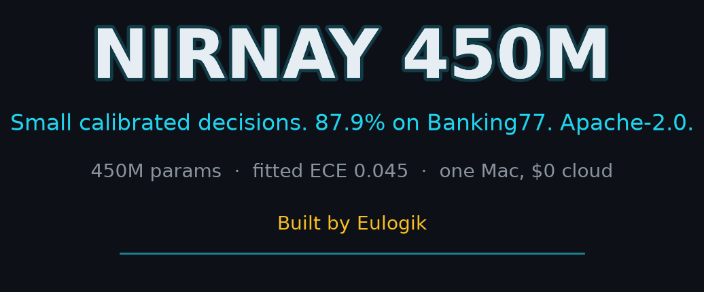</td>
<td align="center" valign="top">медіа не опубліковано</td>
</tr></table>

🛡️ <b><a href="https://github.com/tomek7667/cbjev">tomek7667/cbjev</a></b> · ⭐6 · Python · 🔎 inferred · 60 天

##### 📝 Стислий опис

Типізовані рішення (choice/score/noul) за один прохід енкодера — швидший і краще калібрований наступник Laya, сумісний із Jev wire

##### 📌 Основні факти

| Поле      | Значення                                     |
| --------- | -------------------------------------------- |
| Категорія | `Маршрутизація, запобіжники та затвердження` |
| Докази    | `inferred`                                   |
| Мова      | Python                                       |

##### 📊 Дані

| Метрика         | Значення   |
| --------------- | ---------- |
| Зірки           | **6**      |
| Останній push   | 2026-09-24 |
| Уперше в списку | 2026-11-21 |

🏷 `calibration` · `classification` · `decision-model` · `jev` · `laya` · `llm-guardrails` · `modernbert`

---

<table><tr><th align="center" width="50%">🖼 Зображення</th><th align="center" width="50%">🎬 Відео</th></tr><tr>
<td align="center" valign="top"></td>
<td align="center" valign="top">медіа не опубліковано</td>
</tr></table>

🛡️ <b><a href="https://github.com/ForestMars/Will-It-Jev">ForestMars/Will-It-Jev</a></b> · ⭐3 · Rust · 🔎 inferred · 8 天

##### 📝 Стислий опис

Ultra-low-latency, 6-tier prompt router in Rust to triage traffic between Jev decision heads and generative LLMs

##### 📌 Основні факти

| Поле      | Значення                                     |
| --------- | -------------------------------------------- |
| Категорія | `Маршрутизація, запобіжники та затвердження` |
| Докази    | `inferred`                                   |
| Мова      | Rust                                         |

##### 📊 Дані

| Метрика         | Значення   |
| --------------- | ---------- |
| Зірки           | **3**      |
| Останній push   | 2026-11-15 |
| Уперше в списку | 2026-11-15 |

---

<table><tr><th align="center" width="50%">🖼 Зображення</th><th align="center" width="50%">🎬 Відео</th></tr><tr>
<td align="center" valign="top"></td>
<td align="center" valign="top">медіа не опубліковано</td>
</tr></table>

Ресурс підключено гарячим посиланням із вихідного репозиторію, оскільки ліцензію, що дозволяє розповсюдження, не заявлено.

🛡️ <b><a href="https://github.com/oluies/jev-vs-spacy">oluies/jev-vs-spacy</a></b> · ⭐3 · Python · 🔎 inferred · 0 天

##### 📝 Стислий опис

spaCy vs TypeSafe Jev on English spam, support routing and Swedish routing, evaluated in Braintrust

##### 📌 Основні факти

| Поле      | Значення                                     |
| --------- | -------------------------------------------- |
| Категорія | `Маршрутизація, запобіжники та затвердження` |
| Докази    | `inferred`                                   |
| Мова      | Python                                       |

##### 📊 Дані

| Метрика         | Значення   |
| --------------- | ---------- |
| Зірки           | **3**      |
| Останній push   | 2026-11-23 |
| Уперше в списку | 2026-11-19 |

---

<table><tr><th align="center" width="50%">🖼 Зображення</th><th align="center" width="50%">🎬 Відео</th></tr><tr>
<td align="center" valign="top">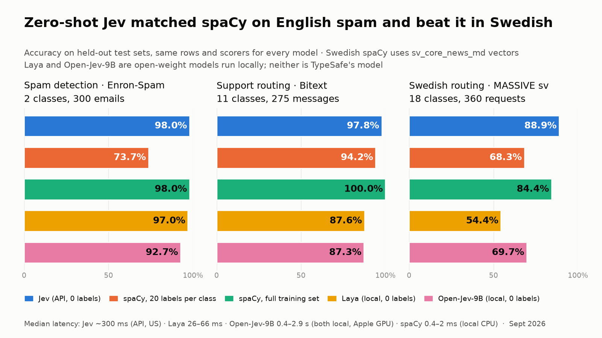</td>
<td align="center" valign="top">медіа не опубліковано</td>
</tr></table>

🛡️ <b><a href="https://github.com/openwhat007/jev-rerank">openwhat007/jev-rerank</a></b> · ⭐2 · Python · 🔎 inferred · 58 天

##### 📝 Стислий опис

Повторне ранжування релевантності для списків запитів/кандидатів на основі примітиву TypeSafe Jev Noul. Підтримуються OpenRouter і прямий API через TypeSafe.

##### 📌 Основні факти

| Поле      | Значення                                     |
| --------- | -------------------------------------------- |
| Категорія | `Маршрутизація, запобіжники та затвердження` |
| Докази    | `inferred`                                   |
| Мова      | Python                                       |

##### 📊 Дані

| Метрика         | Значення   |
| --------------- | ---------- |
| Зірки           | **2**      |
| Останній push   | 2026-09-26 |
| Уперше в списку | 2026-11-21 |

---

<table><tr><th align="center" width="50%">🖼 Зображення</th><th align="center" width="50%">🎬 Відео</th></tr><tr>
<td align="center" valign="top"></td>
<td align="center" valign="top">медіа не опубліковано</td>
</tr></table>

Ресурс підключено гарячим посиланням із вихідного репозиторію, оскільки ліцензію, що дозволяє розповсюдження, не заявлено.

🛡️ <b><a href="https://github.com/sdogantekin/jev-orchestrator">sdogantekin/jev-orchestrator</a></b> · ⭐1 · TypeScript · 🔎 inferred · 5 天

##### 📝 Стислий опис

Payment Decision Lab: тест лише в режимі симуляції, чи може Jev (модель рішень TypeSafe) замінити маршрутизацію PSP на основі правил. Реальні платежі ніколи не обробляються.

##### 📌 Основні факти

| Поле      | Значення                                     |
| --------- | -------------------------------------------- |
| Категорія | `Маршрутизація, запобіжники та затвердження` |
| Докази    | `inferred`                                   |
| Мова      | TypeScript                                   |

##### 📊 Дані

| Метрика         | Значення   |
| --------------- | ---------- |
| Зірки           | **1**      |
| Останній push   | 2026-11-18 |
| Уперше в списку | 2026-11-11 |

🏷 `decision-making` · `experiment` · `fintech` · `llm` · `nextjs` · `payment-orchestration` · `payment-routing` · `payments`

---

<table><tr><th align="center" width="50%">🖼 Зображення</th><th align="center" width="50%">🎬 Відео</th></tr><tr>
<td align="center" valign="top">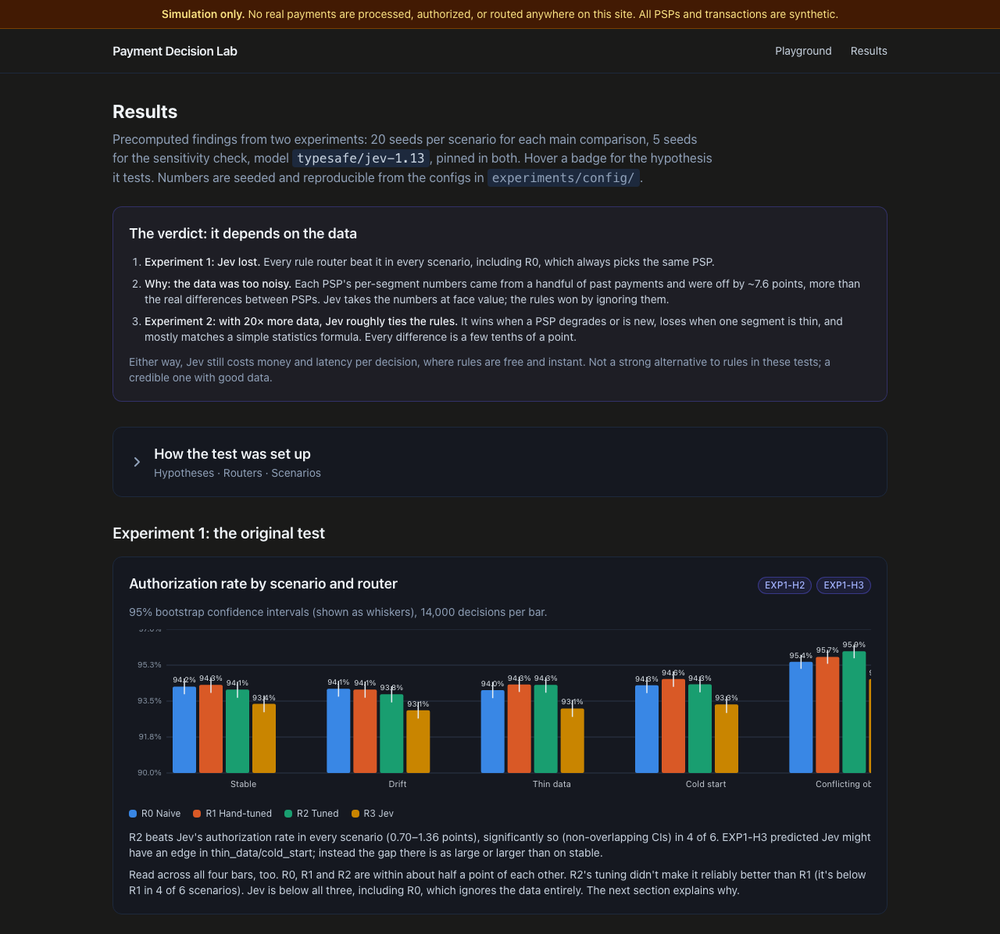</td>
<td align="center" valign="top">медіа не опубліковано</td>
</tr></table>

<b>Більше в цій категорії</b> · 30

- [bytelabs-oss/clash-jev](https://github.com/bytelabs-oss/clash-jev) - Бот Clash Royale без навченої політики: Jev (TypeSafe System One) приймає кожне…
- [vynnlee/jev-mail](https://github.com/vynnlee/jev-mail) - Автономне цілодобове сортування Zero-Inbox для Gmail на основі TypeSafe Jev…
- [leofmarciano/groot](https://github.com/leofmarciano/groot) - 🌳 Groot 1 is a open typed-decision model, with a pure Bend engine.
- [hyspacex/jev-router](https://github.com/hyspacex/jev-router) - Route OpenAI-style chat requests to a model and reasoning effort, using…
- [umstek/zero-shot-ie-bench](https://github.com/umstek/zero-shot-ie-bench) - 60 zero-shot information-extraction &amp; classification systems (57 benchmarked)…
- [Dino-Kupinic/blackrose](https://github.com/Dino-Kupinic/blackrose) - The decision layer for LLM apps.
- [bitnovus/jev-spam-eval](https://github.com/bitnovus/jev-spam-eval) - Фільтрація спаму без прикладів за допомогою запитань TypeSafe Jev Noul у…
- [danvega/jev-comment-moderation](https://github.com/danvega/jev-comment-moderation) - Comment moderation with the Spring AI 2.1 Decision API and TypeSafe Jev.
- [Nhat-Nguyet/guardrail-chatbot-jev](https://github.com/Nhat-Nguyet/guardrail-chatbot-jev) - Content safety guardrails for AI chatbots: input, output and whole-conversation…
- [adityavsb/narrative-audit-jev](https://github.com/adityavsb/narrative-audit-jev) - OpenRouter benchmark harness: same decision task for rule baselines and pinned…
- [amarpai/flight-logs-non-generative-decision-using-jev](https://github.com/amarpai/flight-logs-non-generative-decision-using-jev) - Demo of using Jev to classify aircraft maintenance logs and flag potential…
- [arterialist/jev-robot](https://github.com/arterialist/jev-robot) - A Unitree G1 in MuJoCo with JEV reflexes, Gemini planning, and a live browser…
- [Arwin-K/jev-llm-gateway](https://github.com/Arwin-K/jev-llm-gateway) - a cost-aware LLM gateway with three-tier model routing, optional verification…
- [AutoPasha/jev-inbox-triage](https://github.com/AutoPasha/jev-inbox-triage) - Сортировка 40 обращений на модели Jev через Polza.ai за 0,84 ₽: скрипт…
- [dosorio79/jev_test](https://github.com/dosorio79/jev_test) - Offline-first multilingual CX sentiment routing benchmark.
- [freezetheflame/jev-ecosystem-research](https://github.com/freezetheflame/jev-ecosystem-research) - Jev (TypeSafe AI System One) 生态调研：开源复现规模、JevBench v1.4.2.2…
- [jakucermak/pi-jev-router](https://github.com/jakucermak/pi-jev-router) - Opt-in adaptive model routing and assignment scoring for Pi.
- [jangsik1986-bot/jev-sim](https://github.com/jangsik1986-bot/jev-sim) - Daily JEV topic-router pipeline simulation (mobile 9:16) for GitHub Pages.
- [Khidir782/Beam-jev](https://github.com/Khidir782/Beam-jev) - Calibrated DevOps tool-router distilled from Beam-1.0-501B via RLCD.
- [LuisFX/jev-lead-qualifier](https://github.com/LuisFX/jev-lead-qualifier) - First Read: qualify every inbound lead against an editable ICP with Jev.
- [mani-bellan/jev-apps](https://github.com/mani-bellan/jev-apps) - Pipeline failure triage and a customer support router built on TypeSafe AI.
- [mr-kittureddy/AI_Ticket_Routing_JEV](https://github.com/mr-kittureddy/AI_Ticket_Routing_JEV) - Using JEV AI built a Support ticket routing and solution generation with Gemini…
- [Muradmustafayev-03/jev-recovery-router](https://github.com/Muradmustafayev-03/jev-recovery-router) - Маршрутизація намірів з урахуванням вартості: відібрана модель переконань…
- [PerseoAgencyAutomations/n8n-nodes-jev-gate](https://github.com/PerseoAgencyAutomations/n8n-nodes-jev-gate) - Nó da comunidade do n8n para o Jev (TypeSafe), com portão de confiança: segue…
- [petercr/jev-orchestrator](https://github.com/petercr/jev-orchestrator) - Мініоркестратор вузлів, який використовує Jev для маршрутизації до різних LLMs…
- [SarathChandraBellam/jev-vs-llm-ticket-router](https://github.com/SarathChandraBellam/jev-vs-llm-ticket-router) - Benchmark: TypeSafe Jev vs traditional LLM on support-ticket routing accuracy…
- [smg1024/jev-router](https://github.com/smg1024/jev-router) - Pi extension: jev/auto virtual model that routes tasks to a physical model and…
- [sunilmehta-si/jev-inference-router](https://github.com/sunilmehta-si/jev-inference-router) - Observable TypeSafe Jev decision routing with local Apple Silicon LLM…
- [THEROCKSSS/awesome-jev](https://github.com/THEROCKSSS/awesome-jev) - Merged, deduplicated, daily-updated catalog of Jev / TypeSafe System One…
- [sumleo/RLCDAlignBench](https://github.com/sumleo/RLCDAlignBench) - RLCDAlignBench: 44 бенчмарки виявлення помилок узгодженості та код для «Just…

## Оцінювання, калібрування та бенчмарки

Звідки будь-хто знає, що ці рішення чогось варті. Калібрування — відкрите питання в цій екосистемі, і саме ці проєкти його вимірюють.

🧪 <b><a href="https://github.com/Mapika/decider">Mapika/decider</a></b> · ⭐1034 · Python · 👁️ observed · 34 天

##### 📝 Стислий опис

Сімейство моделей у стилі System One, донавчених на основі Qwen3.5, призначених для типізованих рішень за один прохід із каліброваними ймовірностями.

🔧 Виявлено використання в коді: `docs/HISTORY.md`, `README.md`

##### 📌 Основні факти

| Поле      | Значення                                |
| --------- | --------------------------------------- |
| Категорія | `Оцінювання, калібрування та бенчмарки` |
| Докази    | `observed`                              |
| Мова      | Python                                  |

##### 📊 Дані

| Метрика         | Значення   |
| --------------- | ---------- |
| Зірки           | **1034**   |
| Останній push   | 2026-10-20 |
| Уперше в списку | 2026-11-20 |

---

<table><tr><th align="center" width="50%">🖼 Зображення</th><th align="center" width="50%">🎬 Відео</th></tr><tr>
<td align="center" valign="top"></td>
<td align="center" valign="top"> анімований запис</td>
</tr></table>

🧪 <b><a href="https://github.com/v-modal/awesome-jev-tools">v-modal/awesome-jev-tools</a></b> · ⭐537 · 👁️ observed · 8 天

##### 📝 Стислий опис

Кураторський список інструментів, створених для Jev — моделі System One від TypeSafe AI для типізованих рішень.

##### 📌 Основні факти

| Поле      | Значення                                |
| --------- | --------------------------------------- |
| Категорія | `Оцінювання, калібрування та бенчмарки` |
| Докази    | `observed`                              |

##### 📊 Дані

| Метрика         | Значення   |
| --------------- | ---------- |
| Зірки           | **537**    |
| Останній push   | 2026-11-15 |
| Уперше в списку | 2026-09-20 |

🏷 `awesome-ai` · `awesome-jev` · `awesome-list` · `awesome-readme` · `calibrated-probabilities` · `jev` · `jev-ai` · `jev-alternative`

🧪 <b><a href="https://github.com/OmniJev/awesome-jev-gallery">OmniJev/awesome-jev-gallery</a></b> · ⭐495 · Python · 👁️ observed · 0 天

##### 📝 Стислий опис

🔥🔥 Awesome Jev:  open-source моделі, проєкти, бенчмарки та незалежні оцінювання для моделей Jev і System One.

##### 📌 Основні факти

| Поле      | Значення                                |
| --------- | --------------------------------------- |
| Категорія | `Оцінювання, калібрування та бенчмарки` |
| Докази    | `observed`                              |
| Мова      | Python                                  |

##### 📊 Дані

| Метрика         | Значення   |
| --------------- | ---------- |
| Зірки           | **495**    |
| Останній push   | 2026-11-23 |
| Уперше в списку | 2026-09-20 |

🏷 `awesome` · `awesome-jev` · `awesome-list` · `calibrated-probabilities` · `calibration` · `decision-models` · `jev` · `jev-ai`

🧪 <b><a href="https://github.com/fstandhartinger/jevbench">fstandhartinger/jevbench</a></b> · ⭐353 · Python · 👁️ observed · 40 天

##### 📝 Стислий опис

JevBench від Benchmark Heaven: бенчмарк і таблиця лідерів для моделей рішень ШІ, що вимірюють точність типізованих рішень, калібрування, затримку та вартість.

🔧 Виявлено використання в коді: `README.md`

##### 📌 Основні факти

| Поле      | Значення                                |
| --------- | --------------------------------------- |
| Категорія | `Оцінювання, калібрування та бенчмарки` |
| Докази    | `observed`                              |
| Мова      | Python                                  |

##### 📊 Дані

| Метрика         | Значення   |
| --------------- | ---------- |
| Зірки           | **353**    |
| Останній push   | 2026-10-15 |
| Уперше в списку | 2026-11-08 |

🏷 `ai-benchmark` · `benchmark-heaven` · `calibration` · `decision-models` · `decisionmodels` · `jev` · `jev-compatible` · `jevbench`

---

<table><tr><th align="center" width="50%">🖼 Зображення</th><th align="center" width="50%">🎬 Відео</th></tr><tr>
<td align="center" valign="top"></td>
<td align="center" valign="top">медіа не опубліковано</td>
</tr></table>

🧪 <b><a href="https://github.com/cobusgreyling/Jev">cobusgreyling/Jev</a></b> · ⭐142 · Python · 👁️ observed · 39 天

##### 📝 Стислий опис

Неофіційна вітрина TypeSafe Jev — System One рішень, а не чат.

🔧 Виявлено використання в коді: `README.md`

##### 📌 Основні факти

| Поле      | Значення                                |
| --------- | --------------------------------------- |
| Категорія | `Оцінювання, калібрування та бенчмарки` |
| Докази    | `observed`                              |
| Мова      | Python                                  |

##### 📊 Дані

| Метрика         | Значення   |
| --------------- | ---------- |
| Зірки           | **142**    |
| Останній push   | 2026-10-15 |
| Уперше в списку | 2026-10-26 |

🏷 `calibrated-decisions` · `jev` · `showcase` · `system-one` · `typesafe`

---

<table><tr><th align="center" width="50%">🖼 Зображення</th><th align="center" width="50%">🎬 Відео</th></tr><tr>
<td align="center" valign="top"></td>
<td align="center" valign="top">медіа не опубліковано</td>
</tr></table>

🧪 <b><a href="https://github.com/ikermoel/open-alternative-jev">ikermoel/open-alternative-jev</a></b> · ⭐82 · Python · 👁️ observed · 60 天

##### 📝 Стислий опис

Відкрита альтернатива TypeSafe's Jev: шар моделі в стилі System One, який за один прямий прохід надає типізовані калібровані рішення з будь-якого LLM із відкритими вагами (HF + vLLM), із чесними бенчмарками

##### 📌 Основні факти

| Поле      | Значення                                |
| --------- | --------------------------------------- |
| Категорія | `Оцінювання, калібрування та бенчмарки` |
| Докази    | `observed`                              |
| Мова      | Python                                  |

##### 📊 Дані

| Метрика         | Значення   |
| --------------- | ---------- |
| Зірки           | **82**     |
| Останній push   | 2026-09-25 |
| Уперше в списку | 2026-10-28 |

🏷 `calibration` · `classification` · `jev` · `jev-alternative` · `llm` · `logprobs` · `open-jev` · `open-source-jev`

🧪 <b><a href="https://github.com/hev/reranker">hev/reranker</a></b> · ⭐20 · Jupyter · 👁️ observed · 8 天

##### 📝 Стислий опис

Використовуйте Jev (модель System One від TypeSafe) як калібрований переранжувальник: один виклик, до 30 документів, імовірність для кожного документа. Apache-2.0.

##### 📌 Основні факти

| Поле      | Значення                                |
| --------- | --------------------------------------- |
| Категорія | `Оцінювання, калібрування та бенчмарки` |
| Докази    | `observed`                              |
| Мова      | Jupyter                                 |

##### 📊 Дані

| Метрика         | Значення   |
| --------------- | ---------- |
| Зірки           | **20**     |
| Останній push   | 2026-11-15 |
| Уперше в списку | 2026-10-28 |

🧪 <b><a href="https://github.com/OmniJev/awesome-jev-papers">OmniJev/awesome-jev-papers</a></b> · ⭐13 · Python · 👁️ observed · 0 天

##### 📝 Стислий опис

🔥🔥 Research papers on Jev, TypeSafe's System One model, and the open models built in its shape.

##### 📌 Основні факти

| Поле      | Значення                                |
| --------- | --------------------------------------- |
| Категорія | `Оцінювання, калібрування та бенчмарки` |
| Докази    | `observed`                              |
| Мова      | Python                                  |

##### 📊 Дані

| Метрика         | Значення   |
| --------------- | ---------- |
| Зірки           | **13**     |
| Останній push   | 2026-11-23 |
| Уперше в списку | 2026-09-28 |

🏷 `arxiv` · `awesome` · `awesome-list` · `calibration` · `decision-model` · `jev` · `llm` · `paper-list`

🧪 <b><a href="https://github.com/akash-kamat/system-one-gemma">akash-kamat/system-one-gemma</a></b> · ⭐8 · Python · 👁️ observed · 67 天

##### 📝 Стислий опис

Open-source модель ухвалення рішень у стилі Jev-System One. Gemma 3 270M зі scoring head — швидкі, калібровані рішення за один forward pass. Без генерації тексту. Натхнено Jev від TypeSafe.ai.

##### 📌 Основні факти

| Поле      | Значення                                |
| --------- | --------------------------------------- |
| Категорія | `Оцінювання, калібрування та бенчмарки` |
| Докази    | `observed`                              |
| Мова      | Python                                  |

##### 📊 Дані

| Метрика         | Значення   |
| --------------- | ---------- |
| Зірки           | **8**      |
| Останній push   | 2026-09-18 |
| Уперше в списку | 2026-11-16 |

🏷 `calibration` · `decision-model` · `gemma` · `jev` · `lora` · `machine-learning` · `scoring-model` · `system-one`

🧪 <b><a href="https://github.com/brida-ai/reflexbench">brida-ai/reflexbench</a></b> · ⭐7 · Python · 👁️ observed · 1 天

##### 📝 Стислий опис

ReflexBench — відкритий бенчмарк і засіб оцінювання для моделей System One та рушіїв типізованих рішень

##### 📌 Основні факти

| Поле      | Значення                                |
| --------- | --------------------------------------- |
| Категорія | `Оцінювання, калібрування та бенчмарки` |
| Докази    | `observed`                              |
| Мова      | Python                                  |

##### 📊 Дані

| Метрика         | Значення   |
| --------------- | ---------- |
| Зірки           | **7**      |
| Останній push   | 2026-11-22 |
| Уперше в списку | 2026-11-21 |

🏷 `ai-benchmark` · `ai-evaluation` · `benchmark` · `calibration` · `choice` · `decision-models` · `jev` · `laya`

🧪 <b><a href="https://github.com/EventumAI/jev-builds">EventumAI/jev-builds</a></b> · 👁️ observed · 0 天

##### 📝 Стислий опис

Decision model builds: Jev, TypeSafe's System One model, measured against a baseline by engineers who build with Eventum.

##### 📌 Основні факти

| Поле      | Значення                                |
| --------- | --------------------------------------- |
| Категорія | `Оцінювання, калібрування та бенчмарки` |
| Докази    | `observed`                              |

##### 📊 Дані

| Метрика         | Значення   |
| --------------- | ---------- |
| Зірки           | **0**      |
| Останній push   | 2026-11-24 |
| Уперше в списку | 2026-11-24 |

🏷 `decision-models` · `evaluation` · `jev` · `system-one` · `typesafe`

🧪 <b><a href="https://github.com/mahirmalik030/Jev-vs-LLMs">mahirmalik030/Jev-vs-LLMs</a></b> · Python · 👁️ observed · 17 天

##### 📝 Стислий опис

A comparative study of Jev 1.13 and Large Language Models (LLMs) for phishing email detection, evaluating classification performance, probability calibration, inference latency, token consumption, and API costs.

##### 📌 Основні факти

| Поле      | Значення                                |
| --------- | --------------------------------------- |
| Категорія | `Оцінювання, калібрування та бенчмарки` |
| Докази    | `observed`                              |
| Мова      | Python                                  |

##### 📊 Дані

| Метрика         | Значення   |
| --------------- | ---------- |
| Зірки           | **0**      |
| Останній push   | 2026-11-06 |
| Уперше в списку | 2026-11-04 |

🧪 <b><a href="https://github.com/nokia-applied-research/AnyJev">nokia-applied-research/AnyJev</a></b> · ⭐1639 · Python · 🔎 inferred · 33 天

##### 📝 Стислий опис

Перетворіть будь-який LLM на модель прийняття рішень у стилі Jev: типізовані рішення, реальні ймовірності, без навчання. (продовжуємо оновлювати, вітаємо будь-які повідомлення про проблеми та запити на PR)

##### 📌 Основні факти

| Поле      | Значення                                |
| --------- | --------------------------------------- |
| Категорія | `Оцінювання, калібрування та бенчмарки` |
| Докази    | `inferred`                              |
| Мова      | Python                                  |

##### 📊 Дані

| Метрика         | Значення   |
| --------------- | ---------- |
| Зірки           | **1639**   |
| Останній push   | 2026-10-21 |
| Уперше в списку | 2026-09-22 |

🏷 `calibration` · `decision-model` · `jev` · `jev-model` · `llm` · `system-one` · `transformers` · `vllm`

---

<table><tr><th align="center" width="50%">🖼 Зображення</th><th align="center" width="50%">🎬 Відео</th></tr><tr>
<td align="center" valign="top"></td>
<td align="center" valign="top"> анімований запис</td>
</tr></table>

🧪 <b><a href="https://github.com/allebee/jevk5">allebee/jevk5</a></b> · ⭐170 · Python · 🔎 inferred · 57 天

##### 📝 Стислий опис

JevK5: альтернатива TypeSafe Jev із відкритими вагами. Типізовані рішення з імовірностями за один прямий прохід; ваги та код Apache-2.0.

##### 📌 Основні факти

| Поле      | Значення                                |
| --------- | --------------------------------------- |
| Категорія | `Оцінювання, калібрування та бенчмарки` |
| Докази    | `inferred`                              |
| Мова      | Python                                  |

##### 📊 Дані

| Метрика         | Значення   |
| --------------- | ---------- |
| Зірки           | **170**    |
| Останній push   | 2026-09-28 |
| Уперше в списку | 2026-10-29 |

🏷 `calibration` · `decision-model` · `jev` · `jev-alternative` · `jevbench` · `lora` · `qwen` · `system-one`

---

<table><tr><th align="center" width="50%">🖼 Зображення</th><th align="center" width="50%">🎬 Відео</th></tr><tr>
<td align="center" valign="top"></td>
<td align="center" valign="top"> анімований запис · <a href="https://raw.githubusercontent.com/allebee/jevk5/main/docs/demo/jevk5-nvidia-demo.mp4">Відкрити відео</a></td>
</tr></table>

🧪 <b><a href="https://github.com/SimpleJev/JevAny">SimpleJev/JevAny</a></b> · ⭐144 · Python · 🔎 inferred · 0 天

##### 📝 Стислий опис

Open infrastructure for training, evaluating, and deploying System 1 decision models across language and multimodal backbones.

##### 📌 Основні факти

| Поле      | Значення                                |
| --------- | --------------------------------------- |
| Категорія | `Оцінювання, калібрування та бенчмарки` |
| Докази    | `inferred`                              |
| Мова      | Python                                  |

##### 📊 Дані

| Метрика         | Значення   |
| --------------- | ---------- |
| Зірки           | **144**    |
| Останній push   | 2026-11-23 |
| Уперше в списку | 2026-11-24 |

🏷 `decision-making` · `decision-model` · `jev` · `jev-ai` · `jev-model` · `lora` · `multimodal` · `reinforcement-learning`

---

<table><tr><th align="center" width="50%">🖼 Зображення</th><th align="center" width="50%">🎬 Відео</th></tr><tr>
<td align="center" valign="top"></td>
<td align="center" valign="top"> анімований запис · <a href="https://simplejev.org/JevAny/assets/media/docs/jev-agent-harness.mp4">Відкрити відео</a></td>
</tr></table>

🧪 <b><a href="https://github.com/Heman10x-NGU/Verdict-open-jev">Heman10x-NGU/Verdict-open-jev</a></b> · ⭐119 · Python · 🔎 inferred · 33 天

##### 📝 Стислий опис

Неавторегресивний рушій прийняття рішень на ModernBERT (151M) із каліброваною невизначеністю (RLCD), аудитом бенчмарка TypeSafe AI Jev та браузерним середовищем WebGPU

##### 📌 Основні факти

| Поле      | Значення                                |
| --------- | --------------------------------------- |
| Категорія | `Оцінювання, калібрування та бенчмарки` |
| Докази    | `inferred`                              |
| Мова      | Python                                  |

##### 📊 Дані

| Метрика         | Значення   |
| --------------- | ---------- |
| Зірки           | **119**    |
| Останній push   | 2026-10-21 |
| Уперше в списку | 2026-09-18 |

🏷 `brier-score` · `calibration` · `decision-engine` · `edge-ai` · `gliclass` · `jev` · `modernbert` · `onnx`

---

<table><tr><th align="center" width="50%">🖼 Зображення</th><th align="center" width="50%">🎬 Відео</th></tr><tr>
<td align="center" valign="top"></td>
<td align="center" valign="top">медіа не опубліковано</td>
</tr></table>

Ресурс підключено гарячим посиланням із вихідного репозиторію, оскільки ліцензію, що дозволяє розповсюдження, не заявлено.

🧪 <b><a href="https://github.com/manjunathshiva/opendecider">manjunathshiva/opendecider</a></b> · ⭐42 · Python · 🔎 inferred · 5 天

##### 📝 Стислий опис

Open, calibrated System 1 decision models: typed choice / score / yes-no answers with a probability for every option. 400M to 80B; CPU, NVIDIA, Apple Silicon, LM Studio, Ollama and vLLM.

##### 📌 Основні факти

| Поле      | Значення                                |
| --------- | --------------------------------------- |
| Категорія | `Оцінювання, калібрування та бенчмарки` |
| Докази    | `inferred`                              |
| Мова      | Python                                  |

##### 📊 Дані

| Метрика         | Значення   |
| --------------- | ---------- |
| Зірки           | **42**     |
| Останній push   | 2026-11-18 |
| Уперше в списку | 2026-11-23 |

🏷 `apple-silicon` · `calibration` · `classification` · `decision-model` · `gguf` · `huggingface` · `llm` · `mlx`

---

<table><tr><th align="center" width="50%">🖼 Зображення</th><th align="center" width="50%">🎬 Відео</th></tr><tr>
<td align="center" valign="top">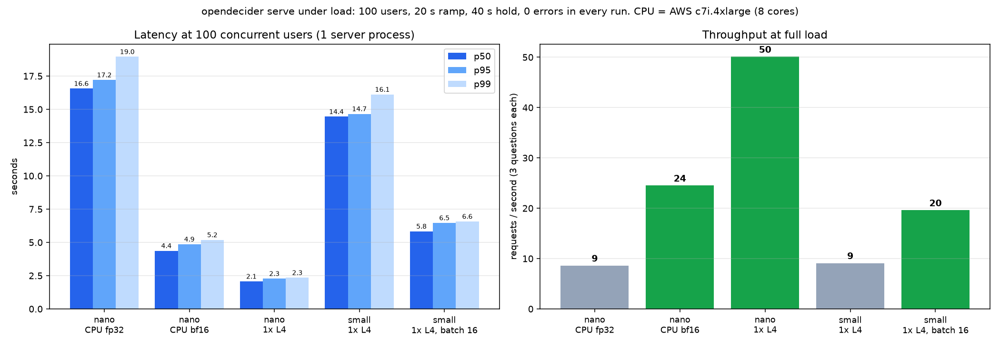</td>
<td align="center" valign="top">медіа не опубліковано</td>
</tr></table>

🧪 <b><a href="https://github.com/ankit-aglawe/tinyjev">ankit-aglawe/tinyjev</a></b> · ⭐29 · Python · 🔎 inferred · 53 天

##### 📝 Стислий опис

Крихітна модель на кшталт jev, яка за один прямий прохід відповідає на запитання Choice, Score і Noul та повертає калібровані ймовірності. MLX або PyTorch, повністю офлайн, сумісна з System One.

##### 📌 Основні факти

| Поле      | Значення                                |
| --------- | --------------------------------------- |
| Категорія | `Оцінювання, калібрування та бенчмарки` |
| Докази    | `inferred`                              |
| Мова      | Python                                  |

##### 📊 Дані

| Метрика         | Значення   |
| --------------- | ---------- |
| Зірки           | **29**     |
| Останній push   | 2026-10-01 |
| Уперше в списку | 2026-09-23 |

🏷 `decision-model` · `jev` · `jev-model` · `mlx` · `qwen3` · `small-language-models` · `system-one` · `typed-decisions`

---

<table><tr><th align="center" width="50%">🖼 Зображення</th><th align="center" width="50%">🎬 Відео</th></tr><tr>
<td align="center" valign="top"></td>
<td align="center" valign="top"> анімований запис</td>
</tr></table>

🧪 <b><a href="https://github.com/shibing624/train-jev">shibing624/train-jev</a></b> · ⭐21 · Python · 🔎 inferred · 31 天

##### 📝 Стислий опис

Навчайте моделі прийняття рішень System 1 у стилі JEV на Qwen3.5 і Qwen3.8-27B: голова прийняття рішень із 24 слотами, дистиляція KL, калібрування та обслуговування. Навчання моделей прийняття рішень System 1 у стилі JEV на Qwen.

##### 📌 Основні факти

| Поле      | Значення                                |
| --------- | --------------------------------------- |
| Категорія | `Оцінювання, калібрування та бенчмарки` |
| Докази    | `inferred`                              |
| Мова      | Python                                  |

##### 📊 Дані

| Метрика         | Значення   |
| --------------- | ---------- |
| Зірки           | **21**     |
| Останній push   | 2026-10-23 |
| Уперше в списку | 2026-11-04 |

🏷 `calibration` · `decision-model` · `distillation` · `fine-tuning` · `llm` · `lora` · `nlp` · `pytorch`

---

<table><tr><th align="center" width="50%">🖼 Зображення</th><th align="center" width="50%">🎬 Відео</th></tr><tr>
<td align="center" valign="top"></td>
<td align="center" valign="top">медіа не опубліковано</td>
</tr></table>

🧪 <b><a href="https://github.com/Enntity/sparkscore">Enntity/sparkscore</a></b> · ⭐16 · Python · 🔎 inferred · 4 天

##### 📝 Стислий опис

Typed, calibrated decisions on one NVIDIA DGX Spark: d3-ultra 27B NVFP4 on Atlas, JevBench public 90.9% at p50 146 ms, every question in one engine pass.

##### 📌 Основні факти

| Поле      | Значення                                |
| --------- | --------------------------------------- |
| Категорія | `Оцінювання, калібрування та бенчмарки` |
| Докази    | `inferred`                              |
| Мова      | Python                                  |

##### 📊 Дані

| Метрика         | Значення   |
| --------------- | ---------- |
| Зірки           | **16**     |
| Останній push   | 2026-11-20 |
| Уперше в списку | 2026-11-10 |

🏷 `calibration` · `decision-model` · `dgx-spark` · `gb10` · `jev` · `llm-inference` · `nvfp4`

---

<table><tr><th align="center" width="50%">🖼 Зображення</th><th align="center" width="50%">🎬 Відео</th></tr><tr>
<td align="center" valign="top">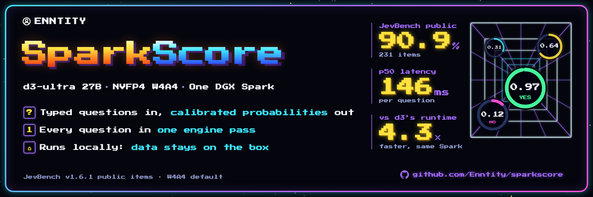</td>
<td align="center" valign="top">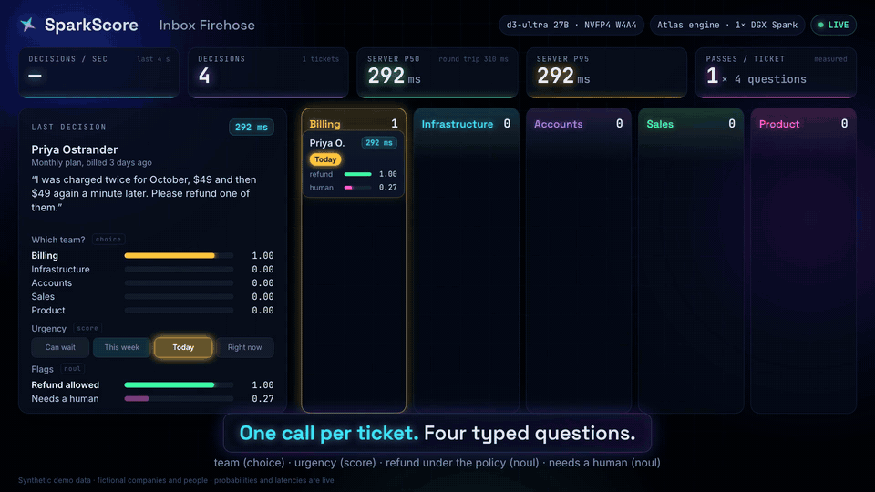 анімований запис</td>
</tr></table>

🧪 <b><a href="https://github.com/BrendanH18/jev_fsd">BrendanH18/jev_fsd</a></b> · ⭐13 · JavaScript · 🔎 inferred · 0 天

##### 📝 Стислий опис

A driving test for AI models, on real Canadian streets, that you can also take yourself.

##### 📌 Основні факти

| Поле      | Значення                                |
| --------- | --------------------------------------- |
| Категорія | `Оцінювання, калібрування та бенчмарки` |
| Докази    | `inferred`                              |
| Мова      | JavaScript                              |

##### 📊 Дані

| Метрика         | Значення   |
| --------------- | ---------- |
| Зірки           | **13**     |
| Останній push   | 2026-11-23 |
| Уперше в списку | 2026-10-23 |

🏷 `ai` · `benchmark` · `driving-simulator` · `javascript` · `jev` · `openstreetmap` · `python` · `self-driving`

---

<table><tr><th align="center" width="50%">🖼 Зображення</th><th align="center" width="50%">🎬 Відео</th></tr><tr>
<td align="center" valign="top"></td>
<td align="center" valign="top"> анімований запис</td>
</tr></table>

🧪 <b><a href="https://github.com/Algorythm-Canada/OpenJevSwift">Algorythm-Canada/OpenJevSwift</a></b> · ⭐10 · Swift · 🔎 inferred · 5 天

##### 📝 Стислий опис

Native Swift implementation of OpenJev, the Jev-compatible typed-decision server: yes/no, choice and score answers read from model probabilities, on Apple silicon Macs and in iPhone apps. Serves Verdict, Laya, DiffusionGemma and JevK5. Apache-2.0.

##### 📌 Основні факти

| Поле      | Значення                                |
| --------- | --------------------------------------- |
| Категорія | `Оцінювання, калібрування та бенчмарки` |
| Докази    | `inferred`                              |
| Мова      | Swift                                   |

##### 📊 Дані

| Метрика         | Значення   |
| --------------- | ---------- |
| Зірки           | **10**     |
| Останній push   | 2026-11-18 |
| Уперше в списку | 2026-11-19 |

🏷 `apple-silicon` · `coreml` · `decision-model` · `diffusiongemma` · `ios` · `jev` · `laya` · `llm`

---

<table><tr><th align="center" width="50%">🖼 Зображення</th><th align="center" width="50%">🎬 Відео</th></tr><tr>
<td align="center" valign="top"></td>
<td align="center" valign="top"> анімований запис</td>
</tr></table>

<b>Більше в цій категорії</b> · 56

- [patryckalves/jev-no-enem](https://github.com/patryckalves/jev-no-enem) - Відтворюваний бенчмарк, що оцінює Jev TypeSafe AI (парадигма System One) на…
- [vikawork/decision-models-calibration](https://github.com/vikawork/decision-models-calibration) - Decision APIs measured: Jev 1.14, gpt-6-luna Decisions and Gemini Decision 1 on…
- [buberlo/jev-trader](https://github.com/buberlo/jev-trader) - Система маркетмейкінгу 24/7 навколо рішень Jev (TypeSafe System One)…
- [SamratDuttaOfficial/WaterSheep](https://github.com/SamratDuttaOfficial/WaterSheep) - Модель для ухвалення рішень, яка повертає калібровані відповіді на запитання…
- [Nhahan/Xevn](https://github.com/Nhahan/Xevn) - A 4B decision model built for Korean.
- [us/jev-local](https://github.com/us/jev-local) - Локальний сервер оцінювання, сумісний із Jev: POST /v1/systemone із…
- [mertkayacs/jevalt](https://github.com/mertkayacs/jevalt) - Three 4B decision models for English, Turkish and German, with per-option…
- [cablehead/jev.nu](https://github.com/cablehead/jev.nu) - Модуль Nushell для TypeSafe System One API: типізовані рішення з каліброваними…
- [Yifan-Lan/awesome-jev-robustness](https://github.com/Yifan-Lan/awesome-jev-robustness) - Тести, аудити калібрування та дослідження режимів відмов Jev.
- [y0usaf/jev-lm](https://github.com/y0usaf/jev-lm) - Мовна модель на рівні слів, вихідний шар якої — Jev: n-грамний чернетковий…
- [instax-dutta/sysone-bench](https://github.com/instax-dutta/sysone-bench) - Перше незалежне пряме порівняльне тестування моделей рішень System One.
- [zamax14/Laya-Finetune](https://github.com/zamax14/Laya-Finetune) - Налаштовуйте Laya, відкриту модель прийняття рішень System One, для будь-якого…
- [mertkayacs/jevoss](https://github.com/mertkayacs/jevoss) - Evaluation tools for Jev-compatible decision models, covering accuracy…
- [bloosiee/jev-rag-toolbox](https://github.com/bloosiee/jev-rag-toolbox) - Train and evaluate Jev decisions for evidence sufficiency and search necessity.
- [CodyQin/zh-decision-bench](https://github.com/CodyQin/zh-decision-bench) - Перший калібрувальний бенчмарк китайською мовою для моделей прийняття рішень…
- [mpuig/system-one](https://github.com/mpuig/system-one) - Модель рішень System One з відкритим кодом — термін Канемана для швидкої…
- [tak-bro/local-jev-bench](https://github.com/tak-bro/local-jev-bench) - Local Jev-style System One decision models on Apple Silicon Macs: AnyJev, Kev…
- [CosmoIknosLab/EarthJev](https://github.com/CosmoIknosLab/EarthJev) - EarthJev: calibrated, non-generative answers to natural-language questions…
- [etsabary/jev-deterministic-benchmark](https://github.com/etsabary/jev-deterministic-benchmark) - Поведінковий бенчмарк Jev на 1 000 рішень у 25 детермінованих сімействах…
- [jacquescogal/viva-recall](https://github.com/jacquescogal/viva-recall) - Flashcards you answer in your own words, marked by a decision model (Jev) you…
- [Rushab1/gr-jev](https://github.com/Rushab1/gr-jev) - Code for.
- [teyhouse/jev-secret-detection](https://github.com/teyhouse/jev-secret-detection) - Вимірює, наскільки добре модель RLCD-Jev TypeSafe виявляє справжні секретні…
- [beskvladimir-create/ru-jev](https://github.com/beskvladimir-create/ru-jev) - Ru-Jev: an open Russian typed-decision model.
- [EnesDemir143/jev-laya-benchmark](https://github.com/EnesDemir143/jev-laya-benchmark) - Локальний бенчмарк, що порівнює TypeSafe Jev і Laya-MLX для структурованої…
- [lewistouchtech/opencode-jev-safe-compact](https://github.com/lewistouchtech/opencode-jev-safe-compact) - JEV-guided context compaction for OpenCode, built on a measured finding: noul…
- [marchexe/jev-evaluation-lab](https://github.com/marchexe/jev-evaluation-lab) - A web app using TypeSafe Jev to classify AI systems by use case, personal data…
- [xiaohuiyan/awesome-jev-papers](https://github.com/xiaohuiyan/awesome-jev-papers) - Curated arXiv papers on Jev, System One and typed decision models, with…
- [aaaldo/opencode-jev](https://github.com/aaaldo/opencode-jev) - Standalone OpenClaw decision provider for OpenCode Jev models, returning typed…
- [agarwalastitwa027-svg/mini-jev-multimodal](https://github.com/agarwalastitwa027-svg/mini-jev-multimodal) - Невелика модель рішень із зображеннями й текстом: Qwen3-VL-2B + LoRA + голова…
- [ankur287/jev-open-calibration](https://github.com/ankur287/jev-open-calibration) - Rebuilding Jev.
- [ArsalanKaleem/sindhi-JEV](https://github.com/ArsalanKaleem/sindhi-JEV) - A small (7M-parameter) checker for Sindhi OCR: given a scanned word or line and…
- [betulsimsek/jev-decomposition-tr](https://github.com/betulsimsek/jev-decomposition-tr) - Does splitting a typed-decision question help? Jev vs OpenAI Decisions vs Laya…
- [cayoesn/llm-jev-engine](https://github.com/cayoesn/llm-jev-engine) - System-1 Non-Autoregressive Single-Pass Neural Decision Engine with RLCD…
- [Chetax/jev-ecommerce-reviews](https://github.com/Chetax/jev-ecommerce-reviews) - E-commerce review classification with TypeSafe.
- [dnakhoa/jev-deferred-crispification](https://github.com/dnakhoa/jev-deferred-crispification) - Позиційний документ: примітиви Hidden-Markov і нечіткі примітиви, яких бракує…
- [humandebri/IC-OpenJev](https://github.com/humandebri/IC-OpenJev) - IC-Verdict: Rust model canister on ICP.
- [n9omi/jev-calibration-audit](https://github.com/n9omi/jev-calibration-audit) - Independent calibration audit of TypeSafe AI.
- [Nijal-AI/jev-lab](https://github.com/Nijal-AI/jev-lab) - Atelier web pour mettre à l.
- [omnaiduu/jev](https://github.com/omnaiduu/jev) - Gemma 4 E4B + one LoRA per dataset picks an answer with an honest confidence %.
- [open-factoryai/myJEV](https://github.com/open-factoryai/myJEV) - Перетворюйте будь-який стан на структуровані калібровані рішення.
- [Poojithcodes/jev-calibration-study](https://github.com/Poojithcodes/jev-calibration-study) - Comparing Jev.
- [unofficial-equivocation2029/Open-Jev](https://github.com/unofficial-equivocation2029/Open-Jev) - Миттєво отримуйте ймовірності типізованих рішень із контексту та кандидатів…
- [yasumorishima/jev-baseball](https://github.com/yasumorishima/jev-baseball) - Testing TypeSafe Jev (a decision-only model) on MLB judgement tasks against…
- [Zayan-droid/Jev](https://github.com/Zayan-droid/Jev) - Calibrated single-pass decision model: typed yes/no, choice and score questions…
- [taeold/djev-run](https://github.com/taeold/djev-run) - Serve the experimental DiffusionGemma-Jev diffusion model on Cloud Run GPUs…
- [kyotofin/tax-doc-classifier](https://github.com/kyotofin/tax-doc-classifier) - Класифікатор сторінок податкових документів, створений на основі рішень Jev.
- [mohit67890/imajev](https://github.com/mohit67890/imajev) - Відкрита модель типізованих рішень у стилі Jev, яка також приймає зображення…
- [hotchpotch/bekko-system-one](https://github.com/hotchpotch/bekko-system-one) - Малі моделі ухвалення рішень System One (17M–400M) для Yes/No, Choice, Score і…
- [mithalouni/system-one-open](https://github.com/mithalouni/system-one-open) - Відкрита копія TypeSafe.
- [genai-craft/openvons](https://github.com/genai-craft/openvons) - openvons (open-Jev): шар прийняття рішень, який відповідає на запитання з…
- [nibzard/decision-model-benchmark](https://github.com/nibzard/decision-model-benchmark) - Independent, reproducible benchmark: a decision model (jev), eight constrained…
- [arnabgho/rlcd-lite](https://github.com/arnabgho/rlcd-lite) - Спрощене RL для каліброваних рішень: паралельне обмежене декодування JSON +…
- [nomadoor/ComfyUI-TypedDecision](https://github.com/nomadoor/ComfyUI-TypedDecision) - Типізовані рішення (noul / choice / score) із каліброваними ймовірностями в…
- [mithril-lang/typed-decisions](https://github.com/mithril-lang/typed-decisions) - Модель типізованих рішень у стилі Jev.
- [Mangaba-ai/brier](https://github.com/Mangaba-ai/brier) - Brier, by Mangaba AI: typed, calibrated decisions (choice/score/noul) for…
- [shamazharikh/qwen-rlcd](https://github.com/shamazharikh/qwen-rlcd) - Калібрована модель рішень у стилі Jev (Choice/Score/Noul) на Qwen3.5-0.8B.

## Відкриті відтворення, ваги та дослідження архітектури

Відкриті ваги, невеликі репліки та робота над архітектурою. Частина з них існує тому, що поведінку калібрування неможливо відтворити лише з публічних матеріалів.

🔬 <b><a href="https://github.com/kshetrajna12/reflex">kshetrajna12/reflex</a></b> · ⭐175 · Python · 👁️ observed · 48 天

##### 📝 Стислий опис

Невелика відкрита модель прийняття рішень: стан + типізовані запитання -> калібровані ймовірності. Відтворення Jev / System One на Qwen3.5.

> 💡 Відкрита модель прийняття рішень із таким самим інтерфейсом «стан плюс типізоване запитання». Варто прочитати як приклад форми, навіть якщо ви ніколи її не запускатимете.

##### 📌 Основні факти

| Поле      | Значення                                                |
| --------- | ------------------------------------------------------- |
| Категорія | `Відкриті відтворення, ваги та дослідження архітектури` |
| Докази    | `observed`                                              |
| Мова      | Python                                                  |

##### 📊 Дані

| Метрика         | Значення   |
| --------------- | ---------- |
| Зірки           | **175**    |
| Останній push   | 2026-10-06 |
| Уперше в списку | 2026-11-20 |

🔬 <b><a href="https://github.com/TianyuCodings/NanoJev">TianyuCodings/NanoJev</a></b> · ⭐2606 · Python · 🔎 inferred · 39 天

##### 📝 Стислий опис

Нанорепліка Jev: паралельні рішення, динамічні кандидати та наскрізний конвеєр навчання.

> 💡 Невелика репліка форми паралельних рішень. Корисна для ознайомлення з архітектурою без стека постачальника; саме завдяки їй кілька тверджень про інтерфейс уперше стали такими, що їх можна було перевірити.

##### 📌 Основні факти

| Поле      | Значення                                                |
| --------- | ------------------------------------------------------- |
| Категорія | `Відкриті відтворення, ваги та дослідження архітектури` |
| Докази    | `inferred`                                              |
| Мова      | Python                                                  |

##### 📊 Дані

| Метрика         | Значення   |
| --------------- | ---------- |
| Зірки           | **2606**   |
| Останній push   | 2026-10-16 |
| Уперше в списку | 2026-11-08 |

---

<table><tr><th align="center" width="50%">🖼 Зображення</th><th align="center" width="50%">🎬 Відео</th></tr><tr>
<td align="center" valign="top">медіа не опубліковано</td>
<td align="center" valign="top"> анімований запис</td>
</tr></table>

🔬 <b><a href="https://github.com/r-ms/mini-jev">r-ms/mini-jev</a></b> · ⭐64 · Python · 🔎 inferred · 66 天

##### 📝 Стислий опис

mini-Jev: як виглядає інтерфейс типізованих рішень у стилі Jev на замороженій Qwen3-4B — зчитує логіти літери варіанта замість генерування JSON. Попередньо зареєстрований експеримент, результати, навчальний стенд.

> 💡 Найкорисніша незалежна репродукція для ознайомлення: вона показує, як працює механізм зчитування логітів, а також прямо попереджає, що частка, яку він зчитує, не є каліброваною ймовірністю. Це попередження — найважливіше застереження в цій екосистемі.

##### 📌 Основні факти

| Поле      | Значення                                                |
| --------- | ------------------------------------------------------- |
| Категорія | `Відкриті відтворення, ваги та дослідження архітектури` |
| Докази    | `inferred`                                              |
| Мова      | Python                                                  |

##### 📊 Дані

| Метрика         | Значення   |
| --------------- | ---------- |
| Зірки           | **64**     |
| Останній push   | 2026-09-18 |
| Уперше в списку | 2026-09-18 |

---

<table><tr><th align="center" width="50%">🖼 Зображення</th><th align="center" width="50%">🎬 Відео</th></tr><tr>
<td align="center" valign="top"></td>
<td align="center" valign="top">медіа не опубліковано</td>
</tr></table>

🔬 <b><a href="https://github.com/FBddcz/embodied-jev">FBddcz/embodied-jev</a></b> · ⭐342 · Python · 👁️ observed · 62 天

##### 📝 Стислий опис

EmbodiedJev: робочий стіл для прийняття рішень роботами MuJoCo з MiniCPM5-2B, Jev і сумісною моделлю APIs

🔧 Виявлено використання в коді: `README.md`

##### 📌 Основні факти

| Поле      | Значення                                                |
| --------- | ------------------------------------------------------- |
| Категорія | `Відкриті відтворення, ваги та дослідження архітектури` |
| Докази    | `observed`                                              |
| Мова      | Python                                                  |

##### 📊 Дані

| Метрика         | Значення   |
| --------------- | ---------- |
| Зірки           | **342**    |
| Останній push   | 2026-09-22 |
| Уперше в списку | 2026-11-08 |

---

<table><tr><th align="center" width="50%">🖼 Зображення</th><th align="center" width="50%">🎬 Відео</th></tr><tr>
<td align="center" valign="top"></td>
<td align="center" valign="top"> анімований запис · <a href="https://raw.githubusercontent.com/FBddcz/embodied-jev/main/docs/media/libero-drawer-comparison.mp4">Відкрити відео</a></td>
</tr></table>

🔬 <b><a href="https://github.com/PsiACE/dohnuts">PsiACE/dohnuts</a></b> · ⭐40 · Python · 👁️ observed · 48 天

##### 📝 Стислий опис

Dohnuts створює невеликі мультимодальні моделі для прямих рішень. -> модель System One

##### 📌 Основні факти

| Поле      | Значення                                                |
| --------- | ------------------------------------------------------- |
| Категорія | `Відкриті відтворення, ваги та дослідження архітектури` |
| Докази    | `observed`                                              |
| Мова      | Python                                                  |

##### 📊 Дані

| Метрика         | Значення   |
| --------------- | ---------- |
| Зірки           | **40**     |
| Останній push   | 2026-10-06 |
| Уперше в списку | 2026-09-21 |

🏷 `decision-model` · `jev` · `laya` · `llm` · `lora` · `rlcd` · `system-one` · `typesafe`

---

<table><tr><th align="center" width="50%">🖼 Зображення</th><th align="center" width="50%">🎬 Відео</th></tr><tr>
<td align="center" valign="top"></td>
<td align="center" valign="top">медіа не опубліковано</td>
</tr></table>

🔬 <b><a href="https://github.com/evan-py-chen/jev-survey">evan-py-chen/jev-survey</a></b> · ⭐1 · TeX · 👁️ observed · 2 天

##### 📝 Стислий опис

A Survey on Jev: Prior Research, Adaptation Costs, and Evidence of System One Models (preprint, v0.5)

##### 📌 Основні факти

| Поле      | Значення                                                |
| --------- | ------------------------------------------------------- |
| Категорія | `Відкриті відтворення, ваги та дослідження архітектури` |
| Докази    | `observed`                                              |
| Мова      | TeX                                                     |

##### 📊 Дані

| Метрика         | Значення   |
| --------------- | ---------- |
| Зірки           | **1**      |
| Останній push   | 2026-11-21 |
| Уперше в списку | 2026-11-22 |

🔬 <b><a href="https://github.com/BipinRajC/Jev-api-experiments">BipinRajC/Jev-api-experiments</a></b> · Python · 👁️ observed · 36 天

##### 📝 Стислий опис

Емпіричні експерименти та дослідження API для моделі Jev System One TypeSafe, навченої з використанням RLCD

##### 📌 Основні факти

| Поле      | Значення                                                |
| --------- | ------------------------------------------------------- |
| Категорія | `Відкриті відтворення, ваги та дослідження архітектури` |
| Докази    | `observed`                                              |
| Мова      | Python                                                  |

##### 📊 Дані

| Метрика         | Значення   |
| --------------- | ---------- |
| Зірки           | **0**      |
| Останній push   | 2026-10-18 |
| Уперше в списку | 2026-09-22 |

🏷 `api` · `experimental` · `jev` · `rlcd` · `typesafe-ai`

🔬 <b><a href="https://github.com/Manishekhar001/mini-clm">Manishekhar001/mini-clm</a></b> · Python · 👁️ observed · 1 天

##### 📝 Стислий опис

It is system one model, where it acts as a zero shot classification model.

##### 📌 Основні факти

| Поле      | Значення                                                |
| --------- | ------------------------------------------------------- |
| Категорія | `Відкриті відтворення, ваги та дослідження архітектури` |
| Докази    | `observed`                                              |
| Мова      | Python                                                  |

##### 📊 Дані

| Метрика         | Значення   |
| --------------- | ---------- |
| Зірки           | **0**      |
| Останній push   | 2026-11-23 |
| Уперше в списку | 2026-11-18 |

🔬 <b><a href="https://huggingface.co/mradermacher/JEV-9B-GGUF">mradermacher/JEV-9B-GGUF</a></b> · model · 👁️ observed · 10 天

##### 📝 Стислий опис

Опис від початкового проєкту не опубліковано.

##### 📌 Основні факти

| Поле      | Значення                                                |
| --------- | ------------------------------------------------------- |
| Категорія | `Відкриті відтворення, ваги та дослідження архітектури` |
| Докази    | `observed`                                              |

##### 📊 Дані

| Метрика         | Значення   |
| --------------- | ---------- |
| Уперше в списку | 2026-11-14 |

🏷 `transformers` · `gguf` · `system-one` · `system-two` · `blocks-of-experts` · `typed-decisions` · `decision-model` · `calibrated-probabilities`

🔬 <b><a href="https://github.com/terrense/Jev-Distillation-SFT-Qwen">terrense/Jev-Distillation-SFT-Qwen</a></b> · Python · 👁️ observed · 0 天

##### 📝 Стислий опис

intent classification model

##### 📌 Основні факти

| Поле      | Значення                                                |
| --------- | ------------------------------------------------------- |
| Категорія | `Відкриті відтворення, ваги та дослідження архітектури` |
| Докази    | `observed`                                              |
| Мова      | Python                                                  |

##### 📊 Дані

| Метрика         | Значення   |
| --------------- | ---------- |
| Зірки           | **0**      |
| Останній push   | 2026-11-24 |
| Уперше в списку | 2026-11-24 |

🔬 <b><a href="https://github.com/mizorewww/laya-mlx">mizorewww/laya-mlx</a></b> · ⭐7121 · Python · 🔎 inferred · 0 天

##### 📝 Стислий опис

Native MLX runtime for Laya typed decision models — 7–14 ms short decisions on M3 Max. No text generation, PyTorch, or cloud API.

##### 📌 Основні факти

| Поле      | Значення                                                |
| --------- | ------------------------------------------------------- |
| Категорія | `Відкриті відтворення, ваги та дослідження архітектури` |
| Докази    | `inferred`                                              |
| Мова      | Python                                                  |

##### 📊 Дані

| Метрика         | Значення   |
| --------------- | ---------- |
| Зірки           | **7121**   |
| Останній push   | 2026-11-24 |
| Уперше в списку | 2026-11-16 |

🏷 `apple-silicon` · `decision-model` · `inference` · `laya` · `local-ai` · `machine-learning` · `mlx` · `modernbert`

---

<table><tr><th align="center" width="50%">🖼 Зображення</th><th align="center" width="50%">🎬 Відео</th></tr><tr>
<td align="center" valign="top"></td>
<td align="center" valign="top"> анімований запис</td>
</tr></table>

🔬 <b><a href="https://github.com/TheoLeeCJ/SemIf-OpenJev">TheoLeeCJ/SemIf-OpenJev</a></b> · ⭐4976 · Python · 🔎 inferred · 61 天 · ⭐+1

##### 📝 Стислий опис

Семантичні ifs із відкритих моделей на домашній 3090. Незалежний проєкт; не пов’язаний із Jev або TypeSafe.

##### 📌 Основні факти

| Поле      | Значення                                                |
| --------- | ------------------------------------------------------- |
| Категорія | `Відкриті відтворення, ваги та дослідження архітектури` |
| Докази    | `inferred`                                              |
| Мова      | Python                                                  |

##### 📊 Дані

| Метрика         | Значення      |
| --------------- | ------------- |
| Зірки           | **4976** (+1) |
| Останній push   | 2026-09-23    |
| Уперше в списку | 2026-10-29    |

---

<table><tr><th align="center" width="50%">🖼 Зображення</th><th align="center" width="50%">🎬 Відео</th></tr><tr>
<td align="center" valign="top"></td>
<td align="center" valign="top"> анімований запис</td>
</tr></table>

🔬 <b><a href="https://github.com/mode-io/vllm-jev">mode-io/vllm-jev</a></b> · ⭐956 · Python · 🔎 inferred · 32 天

##### 📝 Стислий опис

Нативне vLLM обслуговування моделей прийняття рішень Jev

##### 📌 Основні факти

| Поле      | Значення                                                |
| --------- | ------------------------------------------------------- |
| Категорія | `Відкриті відтворення, ваги та дослідження архітектури` |
| Докази    | `inferred`                                              |
| Мова      | Python                                                  |

##### 📊 Дані

| Метрика         | Значення   |
| --------------- | ---------- |
| Зірки           | **956**    |
| Останній push   | 2026-10-22 |
| Уперше в списку | 2026-11-08 |

---

<table><tr><th align="center" width="50%">🖼 Зображення</th><th align="center" width="50%">🎬 Відео</th></tr><tr>
<td align="center" valign="top"></td>
<td align="center" valign="top"> анімований запис · <a href="https://raw.githubusercontent.com/mode-io/vllm-jev/main/docs/assets/valen-video-live.mp4">Відкрити відео</a></td>
</tr></table>

🔬 <b><a href="https://github.com/Valen-Team/Valen">Valen-Team/Valen</a></b> · ⭐935 · Python · 🔎 inferred · 8 天

##### 📝 Стислий опис

Open multimodal decision models, 0.8B to 27B, for text, images and video. Decide with probabilities over your own candidates and locate with bounding boxes, in place of generated text. Free API, ONNX, GGUF, vLLM and SGLang; fine-tuning code included.

##### 📌 Основні факти

| Поле      | Значення                                                |
| --------- | ------------------------------------------------------- |
| Категорія | `Відкриті відтворення, ваги та дослідження архітектури` |
| Докази    | `inferred`                                              |
| Мова      | Python                                                  |

##### 📊 Дані

| Метрика         | Значення   |
| --------------- | ---------- |
| Зірки           | **935**    |
| Останній push   | 2026-11-15 |
| Уперше в списку | 2026-10-29 |

🏷 `decision-model` · `fine-tuning` · `gguf` · `jev` · `multimodal` · `onnx` · `structured-output` · `system-one`

---

<table><tr><th align="center" width="50%">🖼 Зображення</th><th align="center" width="50%">🎬 Відео</th></tr><tr>
<td align="center" valign="top"></td>
<td align="center" valign="top"> анімований запис</td>
</tr></table>

🔬 <b><a href="https://github.com/featherless-ai/simple-jev">featherless-ai/simple-jev</a></b> · ⭐660 · Python · 🔎 inferred · 12 天

##### 📝 Стислий опис

Перетворіть будь-яку відкриту модель на кінцеву точку класифікатора/jev

##### 📌 Основні факти

| Поле      | Значення                                                |
| --------- | ------------------------------------------------------- |
| Категорія | `Відкриті відтворення, ваги та дослідження архітектури` |
| Докази    | `inferred`                                              |
| Мова      | Python                                                  |

##### 📊 Дані

| Метрика         | Значення   |
| --------------- | ---------- |
| Зірки           | **660**    |
| Останній push   | 2026-11-11 |
| Уперше в списку | 2026-11-08 |

---

<table><tr><th align="center" width="50%">🖼 Зображення</th><th align="center" width="50%">🎬 Відео</th></tr><tr>
<td align="center" valign="top"></td>
<td align="center" valign="top">медіа не опубліковано</td>
</tr></table>

🔬 <b><a href="https://github.com/tomerglick57/Jevstiller">tomerglick57/Jevstiller</a></b> · ⭐85 · Python · 🔎 inferred · 12 天

##### 📝 Стислий опис

Дистилюйте повторюване завдання класифікації Jev у локальну модель на льоту — ті самі відповіді, ваше обладнання.

##### 📌 Основні факти

| Поле      | Значення                                                |
| --------- | ------------------------------------------------------- |
| Категорія | `Відкриті відтворення, ваги та дослідження архітектури` |
| Докази    | `inferred`                                              |
| Мова      | Python                                                  |

##### 📊 Дані

| Метрика         | Значення   |
| --------------- | ---------- |
| Зірки           | **85**     |
| Останній push   | 2026-11-11 |
| Уперше в списку | 2026-10-29 |

🏷 `classification` · `distillation` · `jev` · `knowledge-distillation` · `llm` · `mlops` · `model-cascade` · `python`

---

<table><tr><th align="center" width="50%">🖼 Зображення</th><th align="center" width="50%">🎬 Відео</th></tr><tr>
<td align="center" valign="top"></td>
<td align="center" valign="top"> анімований запис</td>
</tr></table>

🔬 <b><a href="https://github.com/alvarobartt/sys1">alvarobartt/sys1</a></b> · ⭐62 · Rust · 🔎 inferred · 15 天

##### 📝 Стислий опис

Блискавично швидкі структуровані рішення для відкритих моделей із власним розгортанням, із сумісним із TypeSafe AI API, написані на Rust.

##### 📌 Основні факти

| Поле      | Значення                                                |
| --------- | ------------------------------------------------------- |
| Категорія | `Відкриті відтворення, ваги та дослідження архітектури` |
| Докази    | `inferred`                                              |
| Мова      | Rust                                                    |

##### 📊 Дані

| Метрика         | Значення   |
| --------------- | ---------- |
| Зірки           | **62**     |
| Останній push   | 2026-11-08 |
| Уперше в списку | 2026-10-29 |

🏷 `clef` · `decision-model` · `decisions-api` · `huggingface` · `inference-server` · `jev` · `laya` · `self-hosted`

---

<table><tr><th align="center" width="50%">🖼 Зображення</th><th align="center" width="50%">🎬 Відео</th></tr><tr>
<td align="center" valign="top"></td>
<td align="center" valign="top">медіа не опубліковано</td>
</tr></table>

🔬 <b><a href="https://github.com/Xiaooolong/vev">Xiaooolong/vev</a></b> · ⭐34 · Python · 🔎 inferred · 17 天

##### 📝 Стислий опис

Jev-like decision models that can also see images — open weights on Qwen3.5, run on your own GPU

##### 📌 Основні факти

| Поле      | Значення                                                |
| --------- | ------------------------------------------------------- |
| Категорія | `Відкриті відтворення, ваги та дослідження архітектури` |
| Докази    | `inferred`                                              |
| Мова      | Python                                                  |

##### 📊 Дані

| Метрика         | Значення   |
| --------------- | ---------- |
| Зірки           | **34**     |
| Останній push   | 2026-11-06 |
| Уперше в списку | 2026-11-06 |

🏷 `classification` · `decision-model` · `jev` · `judgment-model` · `systemone` · `typesafe-jev` · `vision-jev` · `vision-language-model`

---

<table><tr><th align="center" width="50%">🖼 Зображення</th><th align="center" width="50%">🎬 Відео</th></tr><tr>
<td align="center" valign="top">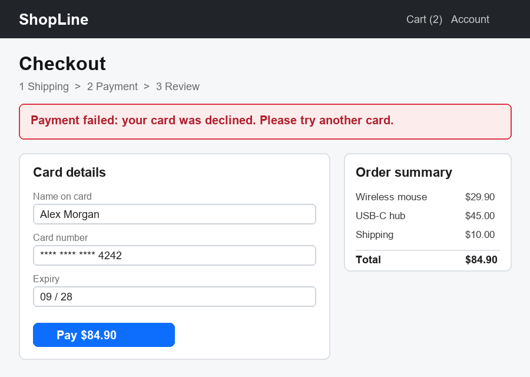</td>
<td align="center" valign="top">медіа не опубліковано</td>
</tr></table>

🔬 <b><a href="https://github.com/amithgc/local-jev">amithgc/local-jev</a></b> · ⭐31 · Python · 🔎 inferred · 63 天

##### 📝 Стислий опис

Локальний офлайн-сервер System One, сумісний із TypeSafe's Jev API. Він відповідає на типізовані запитання «так/ні», категоріальні запитання та запитання на оцінювання за допомогою невеликих моделей із відкритим кодом.

##### 📌 Основні факти

| Поле      | Значення                                                |
| --------- | ------------------------------------------------------- |
| Категорія | `Відкриті відтворення, ваги та дослідження архітектури` |
| Докази    | `inferred`                                              |
| Мова      | Python                                                  |

##### 📊 Дані

| Метрика         | Значення   |
| --------------- | ---------- |
| Зірки           | **31**     |
| Останній push   | 2026-09-21 |
| Уперше в списку | 2026-10-28 |

---

<table><tr><th align="center" width="50%">🖼 Зображення</th><th align="center" width="50%">🎬 Відео</th></tr><tr>
<td align="center" valign="top">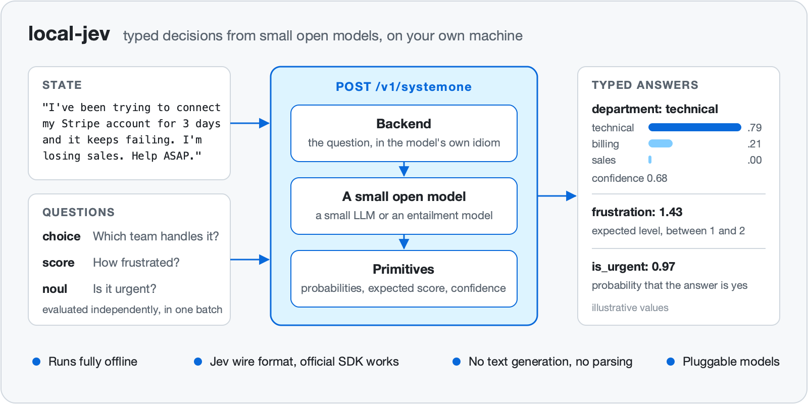</td>
<td align="center" valign="top">медіа не опубліковано</td>
</tr></table>

🔬 <b><a href="https://github.com/OpenLAIR/lev">OpenLAIR/lev</a></b> · ⭐27 · Python · 🔎 inferred · 36 天

##### 📝 Стислий опис

Lev: Thinking Fast and Deep with Looped Decision Models. One checkpoint, multiple depths: System 1.5 decision models that think in loops, not tokens.

##### 📌 Основні факти

| Поле      | Значення                                                |
| --------- | ------------------------------------------------------- |
| Категорія | `Відкриті відтворення, ваги та дослідження архітектури` |
| Докази    | `inferred`                                              |
| Мова      | Python                                                  |

##### 📊 Дані

| Метрика         | Значення   |
| --------------- | ---------- |
| Зірки           | **27**     |
| Останній push   | 2026-10-19 |
| Уперше в списку | 2026-11-20 |

🏷 `adaptive-computation` · `adaptive-depth` · `decision-models` · `early-exit` · `huggingface` · `jev` · `jev-api` · `jev-model`

---

<table><tr><th align="center" width="50%">🖼 Зображення</th><th align="center" width="50%">🎬 Відео</th></tr><tr>
<td align="center" valign="top">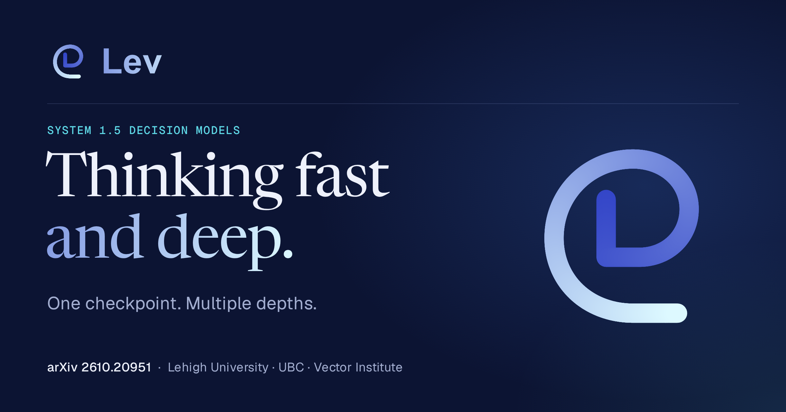</td>
<td align="center" valign="top">медіа не опубліковано</td>
</tr></table>

🔬 <b><a href="https://github.com/skydiving94/klint">skydiving94/klint</a></b> · ⭐5 · Python · 🔎 inferred · 3 天

##### 📝 Стислий опис

Декларативний семантичний лінтер і аудитор архітектури коду для локальних моделей kev із відкритими вагами та віддалених моделей System One (/v1/systemone).

##### 📌 Основні факти

| Поле      | Значення                                                |
| --------- | ------------------------------------------------------- |
| Категорія | `Відкриті відтворення, ваги та дослідження архітектури` |
| Докази    | `inferred`                                              |
| Мова      | Python                                                  |

##### 📊 Дані

| Метрика         | Значення   |
| --------------- | ---------- |
| Зірки           | **5**      |
| Останній push   | 2026-11-21 |
| Уперше в списку | 2026-11-02 |

🏷 `ast` · `code-audit` · `kev` · `linter` · `python` · `react` · `software-architecture` · `static-analysis`

---

<table><tr><th align="center" width="50%">🖼 Зображення</th><th align="center" width="50%">🎬 Відео</th></tr><tr>
<td align="center" valign="top">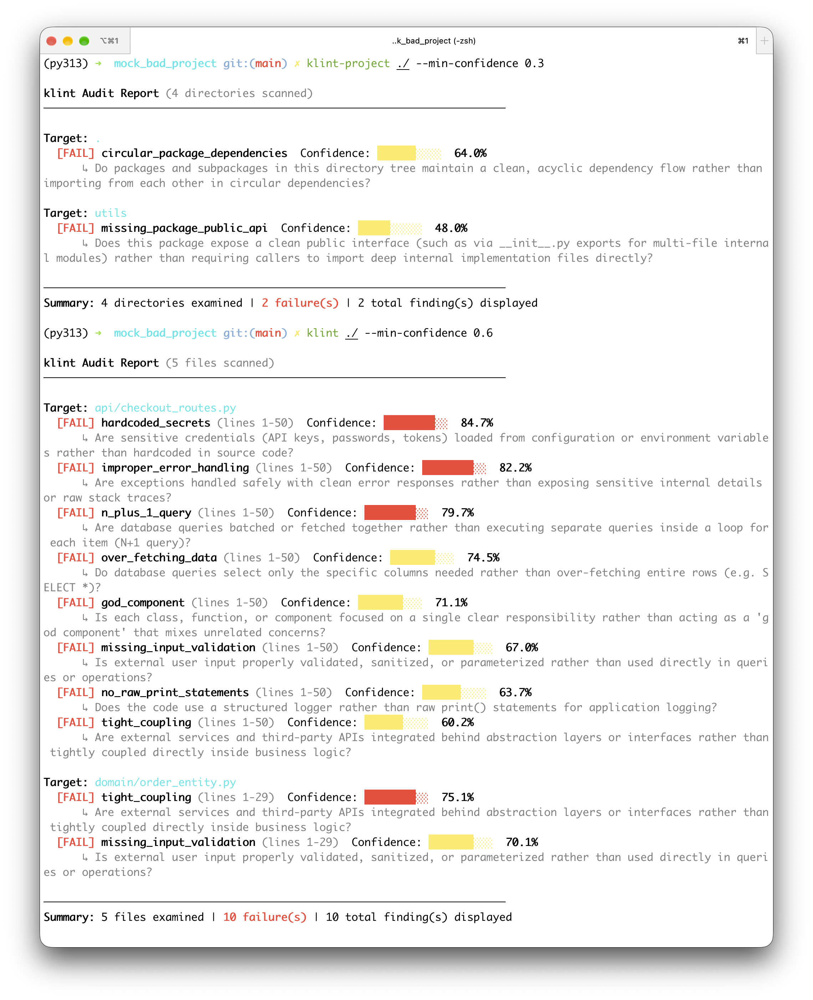</td>
<td align="center" valign="top">медіа не опубліковано</td>
</tr></table>

🔬 <b><a href="https://github.com/imikerussell/beebots">imikerussell/beebots</a></b> · ⭐342 · TypeScript · ❓ unverified · 18 天

##### 📝 Стислий опис

Три бджоли для торгівлі зі штучним інтелектом на OKX, кожне рішення приймає Jev. За замовчуванням — паперова торгівля. Не є фінансовою порадою.

##### 📌 Основні факти

| Поле      | Значення                                                |
| --------- | ------------------------------------------------------- |
| Категорія | `Відкриті відтворення, ваги та дослідження архітектури` |
| Докази    | `unverified`                                            |
| Мова      | TypeScript                                              |

##### 📊 Дані

| Метрика         | Значення   |
| --------------- | ---------- |
| Зірки           | **342**    |
| Останній push   | 2026-11-05 |
| Уперше в списку | 2026-11-08 |

---

<table><tr><th align="center" width="50%">🖼 Зображення</th><th align="center" width="50%">🎬 Відео</th></tr><tr>
<td align="center" valign="top"></td>
<td align="center" valign="top"> <a href="https://youtu.be/bp_u9Gzp1OU">Дивитися на youtu.be</a> · відтворення відкривається на сайті-хості; GitHub не може вбудувати його безпосередньо</td>
</tr></table>

<b>Більше в цій категорії</b> · 13

- [wfzyx/von](https://github.com/wfzyx/von) - Відкрита модель рішень System One. Менше 15 мс, неавторегресивна локальна повна…
- [ekzhang/openjev-sglang](https://github.com/ekzhang/openjev-sglang) - Сумісна з Jev кінцева точка API, заснована на моделях із відкритим кодом.
- [hyperspaceai/jevcache](https://github.com/hyperspaceai/jevcache) - Кеш рішень для моделей класу TypeSafe Jev — мемоізує рішення, щоб повторні…
- [mars-tw/jev-trading-command-center](https://github.com/mars-tw/jev-trading-command-center) - Open-source paper-trading research app integrating TypeSafe Jev, animated 3D…
- [mattt/AnyDecisionModel](https://github.com/mattt/AnyDecisionModel) - A Swift package for typed decisions from language models.
- [whyashthakker/awesome-jev-use-cases](https://github.com/whyashthakker/awesome-jev-use-cases) - Чудовий список варіантів використання Jev.
- [pCwOrM/werr](https://github.com/pCwOrM/werr) - Zero-memory System-1 decision engine &amp; TypeSafe Jev runtime powered by…
- [AnkitNayak-dev/QJev-1.5B](https://github.com/AnkitNayak-dev/QJev-1.5B) - QJev-1.5B (Qwen2.5-1.5B JEV Decision Model) is an open-weights, high-speed…
- [apiplant/laya-rs](https://github.com/apiplant/laya-rs) - Rust перевтілення Laya, неавторегресивного рушія типізованих рішень із…
- [Astro-Han/decision-head-rlcd](https://github.com/Astro-Han/decision-head-rlcd) - Звідки береться узагальнення моделі рішень? RLCD на Qwen3.5-4B, відкладені…
- [vicksiyi/qwen-2.5-1b-rlcd](https://github.com/vicksiyi/qwen-2.5-1b-rlcd) - Демонстрація локальної ймовірності рішення MLX, отримана з…
- [internet-projects/glide-mlx](https://github.com/internet-projects/glide-mlx) - GLiDE.
- [yangshun2005/laya-cn](https://github.com/yangshun2005/laya-cn) - \[中文化\] Багатомовний неавторегресійний рушій рішень System 1.

## Застосунки, ігри, робототехніка та інтерактивні демо

Ігри, роботи, браузери та дашборди. Демо — це те, що робить твердження про затримку та вартість зрозумілими.

🎮 <b><a href="https://github.com/heyjunpenn/awesome-jev">heyjunpenn/awesome-jev</a></b> · ⭐1101 · Astro · 👁️ observed · 12 天 · ⭐+1

##### 📝 Стислий опис

A verified, community-maintained catalog of 997 open-source projects built with Jev.

🔧 Виявлено використання в коді: `README.md`, `CHANGELOG.md`, `README.ko.md`, `README.es.md`

##### 📌 Основні факти

| Поле      | Значення                                               |
| --------- | ------------------------------------------------------ |
| Категорія | `Застосунки, ігри, робототехніка та інтерактивні демо` |
| Докази    | `observed`                                             |
| Мова      | Astro                                                  |

##### 📊 Дані

| Метрика         | Значення      |
| --------------- | ------------- |
| Зірки           | **1101** (+1) |
| Останній push   | 2026-11-12    |
| Уперше в списку | 2026-10-29    |

🏷 `astro` · `awesome` · `awesome-jev` · `awesome-list` · `jev` · `typesafe`

🎮 <b><a href="https://github.com/droidrun/mobile-jev">droidrun/mobile-jev</a></b> · ⭐476 · JavaScript · 👁️ observed · 67 天

##### 📝 Стислий опис

Опис від початкового проєкту не опубліковано.

🔧 Виявлено використання в коді: `README.md`

##### 📌 Основні факти

| Поле      | Значення                                               |
| --------- | ------------------------------------------------------ |
| Категорія | `Застосунки, ігри, робототехніка та інтерактивні демо` |
| Докази    | `observed`                                             |
| Мова      | JavaScript                                             |

##### 📊 Дані

| Метрика         | Значення   |
| --------------- | ---------- |
| Зірки           | **476**    |
| Останній push   | 2026-09-17 |
| Уперше в списку | 2026-11-08 |

🎮 <b><a href="https://github.com/MCG-NJU/VideoJev">MCG-NJU/VideoJev</a></b> · ⭐318 · Python · 👁️ observed · 36 天

##### 📝 Стислий опис

VideoJev: System One Model для розуміння відео та взаємодії

##### 📌 Основні факти

| Поле      | Значення                                               |
| --------- | ------------------------------------------------------ |
| Категорія | `Застосунки, ігри, робототехніка та інтерактивні демо` |
| Докази    | `observed`                                             |
| Мова      | Python                                                 |

##### 📊 Дані

| Метрика         | Значення   |
| --------------- | ---------- |
| Зірки           | **318**    |
| Останній push   | 2026-10-18 |
| Уперше в списку | 2026-11-20 |

---

<table><tr><th align="center" width="50%">🖼 Зображення</th><th align="center" width="50%">🎬 Відео</th></tr><tr>
<td align="center" valign="top"></td>
<td align="center" valign="top">медіа не опубліковано</td>
</tr></table>

🎮 <b><a href="https://github.com/mrnugget/jev-shell-history">mrnugget/jev-shell-history</a></b> · ⭐121 · TypeScript · 👁️ observed · 66 天

##### 📝 Стислий опис

Автопідказки історії zsh у стилі Fish, ранжовані за Jev (TypeSafe)

🔧 Виявлено використання в коді: `README.md`

##### 📌 Основні факти

| Поле      | Значення                                               |
| --------- | ------------------------------------------------------ |
| Категорія | `Застосунки, ігри, робототехніка та інтерактивні демо` |
| Докази    | `observed`                                             |
| Мова      | TypeScript                                             |

##### 📊 Дані

| Метрика         | Значення   |
| --------------- | ---------- |
| Зірки           | **121**    |
| Останній push   | 2026-09-18 |
| Уперше в списку | 2026-10-29 |

---

<table><tr><th align="center" width="50%">🖼 Зображення</th><th align="center" width="50%">🎬 Відео</th></tr><tr>
<td align="center" valign="top"></td>
<td align="center" valign="top"> анімований запис</td>
</tr></table>

Ресурс підключено гарячим посиланням із вихідного репозиторію, оскільки ліцензію, що дозволяє розповсюдження, не заявлено.

🎮 <b><a href="https://github.com/realZachi/typesafe-adblock">realZachi/typesafe-adblock</a></b> · ⭐97 · JavaScript · 👁️ observed · 67 天

##### 📝 Стислий опис

🧹 Розважальний проєкт: розширення Chrome, яке запитує в крихітної моделі рішень ШІ (TypeSafe Jev): «чи є цей елемент DOM рекламою?» — і прибирає його зі сторінки. BYOK, без бекенду, не справжній блокувальник реклами.

🔧 Виявлено використання в коді: `README.md`

##### 📌 Основні факти

| Поле      | Значення                                               |
| --------- | ------------------------------------------------------ |
| Категорія | `Застосунки, ігри, робототехніка та інтерактивні демо` |
| Докази    | `observed`                                             |
| Мова      | JavaScript                                             |

##### 📊 Дані

| Метрика         | Значення   |
| --------------- | ---------- |
| Зірки           | **97**     |
| Останній push   | 2026-09-17 |
| Уперше в списку | 2026-10-29 |

🎮 <b><a href="https://github.com/zadescoxp/Jev-Trades">zadescoxp/Jev-Trades</a></b> · ⭐80 · Python · 👁️ observed · 59 天

##### 📝 Стислий опис

Торговий бот із новою моделлю першої системи TypeSafe AI, названою Jev

##### 📌 Основні факти

| Поле      | Значення                                               |
| --------- | ------------------------------------------------------ |
| Категорія | `Застосунки, ігри, робототехніка та інтерактивні демо` |
| Докази    | `observed`                                             |
| Мова      | Python                                                 |

##### 📊 Дані

| Метрика         | Значення   |
| --------------- | ---------- |
| Зірки           | **80**     |
| Останній push   | 2026-09-25 |
| Уперше в списку | 2026-10-21 |

🏷 `automated-testing` · `backtesting` · `crypto-trading-bot-latest` · `trading-bot-ai-automated`

---

<table><tr><th align="center" width="50%">🖼 Зображення</th><th align="center" width="50%">🎬 Відео</th></tr><tr>
<td align="center" valign="top"></td>
<td align="center" valign="top"> анімований запис</td>
</tr></table>

🎮 <b><a href="https://github.com/dfinke/Jev">dfinke/Jev</a></b> · ⭐12 · PowerShell · 👁️ observed · 38 天

##### 📝 Стислий опис

Рішення PowerShell із моделлю Jev від TypeSafe AI: https://typesafe.ai/blog/introducing-system-one-models-and-jev

##### 📌 Основні факти

| Поле      | Значення                                               |
| --------- | ------------------------------------------------------ |
| Категорія | `Застосунки, ігри, робототехніка та інтерактивні демо` |
| Докази    | `observed`                                             |
| Мова      | PowerShell                                             |

##### 📊 Дані

| Метрика         | Значення   |
| --------------- | ---------- |
| Зірки           | **12**     |
| Останній push   | 2026-10-16 |
| Уперше в списку | 2026-10-28 |

---

<table><tr><th align="center" width="50%">🖼 Зображення</th><th align="center" width="50%">🎬 Відео</th></tr><tr>
<td align="center" valign="top"></td>
<td align="center" valign="top">медіа не опубліковано</td>
</tr></table>

🎮 <b><a href="https://github.com/southleft/component-charades">southleft/component-charades</a></b> · ⭐2 · TypeScript · 👁️ observed · 7 天

##### 📝 Стислий опис

A Taboo-style parlour game for design systems, refereed by Jev (TypeSafe System One model)

##### 📌 Основні факти

| Поле      | Значення                                               |
| --------- | ------------------------------------------------------ |
| Категорія | `Застосунки, ігри, робототехніка та інтерактивні демо` |
| Докази    | `observed`                                             |
| Мова      | TypeScript                                             |

##### 📊 Дані

| Метрика         | Значення   |
| --------------- | ---------- |
| Зірки           | **2**      |
| Останній push   | 2026-11-17 |
| Уперше в списку | 2026-11-19 |

🏷 `design-systems` · `game` · `jev` · `nextjs` · `typesafe`

---

<table><tr><th align="center" width="50%">🖼 Зображення</th><th align="center" width="50%">🎬 Відео</th></tr><tr>
<td align="center" valign="top"></td>
<td align="center" valign="top">медіа не опубліковано</td>
</tr></table>

Ресурс підключено гарячим посиланням із вихідного репозиторію, оскільки ліцензію, що дозволяє розповсюдження, не заявлено.

🎮 <b><a href="https://github.com/Omrigotlieb/awesome-jev">Omrigotlieb/awesome-jev</a></b> · ⭐1 · Python · 👁️ observed · 0 天

##### 📝 Стислий опис

Перевірений список проєктів із великою кількістю знімків екрана, створених на основі Jev — моделі System One від TypeSafe AI для типізованих рішень

##### 📌 Основні факти

| Поле      | Значення                                               |
| --------- | ------------------------------------------------------ |
| Категорія | `Застосунки, ігри, робототехніка та інтерактивні демо` |
| Докази    | `observed`                                             |
| Мова      | Python                                                 |

##### 📊 Дані

| Метрика         | Значення   |
| --------------- | ---------- |
| Зірки           | **1**      |
| Останній push   | 2026-11-24 |
| Уперше в списку | 2026-09-21 |

🎮 <b><a href="https://github.com/chussenot/bryx">chussenot/bryx</a></b> · Rust · 👁️ observed · 7 天

##### 📝 Стислий опис

A single-player Brick game in Rust, rendered natively with wgpu. The game can play itself. With the typesafe feature, a TypeSafe System One model (through the judgment crate)

##### 📌 Основні факти

| Поле      | Значення                                               |
| --------- | ------------------------------------------------------ |
| Категорія | `Застосунки, ігри, робототехніка та інтерактивні демо` |
| Докази    | `observed`                                             |
| Мова      | Rust                                                   |

##### 📊 Дані

| Метрика         | Значення   |
| --------------- | ---------- |
| Зірки           | **0**      |
| Останній push   | 2026-11-17 |
| Уперше в списку | 2026-11-10 |

---

<table><tr><th align="center" width="50%">🖼 Зображення</th><th align="center" width="50%">🎬 Відео</th></tr><tr>
<td align="center" valign="top"></td>
<td align="center" valign="top">медіа не опубліковано</td>
</tr></table>

🎮 <b><a href="https://github.com/frederico-kluser/som-webcore">frederico-kluser/som-webcore</a></b> · JavaScript · 👁️ observed · 0 天

##### 📝 Стислий опис

Infraestrutura open-source de inferência WebGPU/Wasm32 em passada única para Condicionais Abstratas (JEV) no navegador. RFC/blueprint + memória CoALA.

##### 📌 Основні факти

| Поле      | Значення                                               |
| --------- | ------------------------------------------------------ |
| Категорія | `Застосунки, ігри, робототехніка та інтерактивні демо` |
| Докази    | `observed`                                             |
| Мова      | JavaScript                                             |

##### 📊 Дані

| Метрика         | Значення   |
| --------------- | ---------- |
| Зірки           | **0**      |
| Останній push   | 2026-11-24 |
| Уперше в списку | 2026-11-24 |

🏷 `browser-inference` · `edge-ai` · `jev` · `local-first` · `opfs` · `rust` · `som` · `system-one-models`

---

<table><tr><th align="center" width="50%">🖼 Зображення</th><th align="center" width="50%">🎬 Відео</th></tr><tr>
<td align="center" valign="top">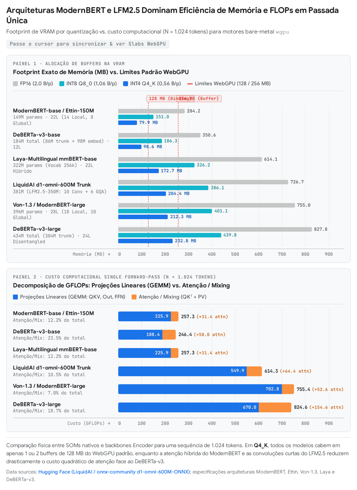</td>
<td align="center" valign="top">медіа не опубліковано</td>
</tr></table>

🎮 <b><a href="https://github.com/Shivam-Jha96/gsp">Shivam-Jha96/gsp</a></b> · Python · 👁️ observed · 2 天

##### 📝 Стислий опис

Термінал аналізу макросентименту на основі ШІ, який у реальному часі читає тисячі термінових глобальних фінансових новин і оцінює їхній вплив на ринок за допомогою спеціальної моделі Contrastive-LM System-One на безсерверному GPU!

##### 📌 Основні факти

| Поле      | Значення                                               |
| --------- | ------------------------------------------------------ |
| Категорія | `Застосунки, ігри, робототехніка та інтерактивні демо` |
| Докази    | `observed`                                             |
| Мова      | Python                                                 |

##### 📊 Дані

| Метрика         | Значення   |
| --------------- | ---------- |
| Зірки           | **0**      |
| Останній push   | 2026-11-22 |
| Уперше в списку | 2026-11-18 |

🏷 `artificial-intelligence-algorithms` · `finance-dashboard` · `stock-analysis` · `stock-market` · `stock-prediction`

---

<table><tr><th align="center" width="50%">🖼 Зображення</th><th align="center" width="50%">🎬 Відео</th></tr><tr>
<td align="center" valign="top"></td>
<td align="center" valign="top">медіа не опубліковано</td>
</tr></table>

Ресурс підключено гарячим посиланням із вихідного репозиторію, оскільки ліцензію, що дозволяє розповсюдження, не заявлено.

🎮 <b><a href="https://x.com/tspy/status/2100864234523685146">Xtags — X intent labeller</a></b> · @tspy · 👁️ observed · 66 天

##### 📝 Стислий опис

Xtags: a Chrome extension that labels each post in an X timeline with what it is trying to get from you — inducement, provocation, promotion, machine-generated, persuasion, entertainment, information — drawn as a tag plus a probability right after the timestamp. A side panel reports session counts (seen, judged, correct) and cumulative token cost. The author reports near-instant responses and usable accuracy before any tuning.

➡️ **Original project (manifoldor/xtags)** — [https://github.com/manifoldor/xtags](https://github.com/manifoldor/xtags)

> 💡 Worth reading as a latency argument rather than an accuracy one: labelling a timeline only works if the decision costs less than the scroll, which is the constraint a generative model cannot meet.

##### 📌 Основні факти

| Поле      | Значення                                               |
| --------- | ------------------------------------------------------ |
| Категорія | `Застосунки, ігри, робототехніка та інтерактивні демо` |
| Докази    | `observed`                                             |
| Власник   | [yishan](https://x.com/tspy) · @tspy                   |

##### 📊 Дані

| Метрика         | Значення   |
| --------------- | ---------- |
| Перегляди       | **9873**   |
| Вподобання      | 24         |
| Коментарі       | 11         |
| Опубліковано    | 2026-09-18 |
| Уперше в списку | 2026-09-18 |

🏷 `x`

---

<table><tr><th align="center" width="50%">🖼 Зображення</th><th align="center" width="50%">🎬 Відео</th></tr><tr>
<td align="center" valign="top"></td>
<td align="center" valign="top"> анімований запис · <a href="https://video.twimg.com/amplify_video/2100858340331200512/vid/avc1/1242x720/ex2FF5-TerVxo9xX.mp4">Відкрити відео</a></td>
</tr></table>

🎮 <b><a href="https://github.com/superagents-lab/jev-search">superagents-lab/jev-search</a></b> · ⭐563 · TypeScript · 🔎 inferred · 16 天

##### 📝 Стислий опис

Пошук у мережі за допомогою Jev від TypeSafe: вибір джерел, розуміння запитів і ранжування релевантності. Створено за допомогою Search1API.

##### 📌 Основні факти

| Поле      | Значення                                               |
| --------- | ------------------------------------------------------ |
| Категорія | `Застосунки, ігри, робототехніка та інтерактивні демо` |
| Докази    | `inferred`                                             |
| Мова      | TypeScript                                             |

##### 📊 Дані

| Метрика         | Значення   |
| --------------- | ---------- |
| Зірки           | **563**    |
| Останній push   | 2026-11-07 |
| Уперше в списку | 2026-10-29 |

---

<table><tr><th align="center" width="50%">🖼 Зображення</th><th align="center" width="50%">🎬 Відео</th></tr><tr>
<td align="center" valign="top"></td>
<td align="center" valign="top">медіа не опубліковано</td>
</tr></table>

🎮 <b><a href="https://github.com/jkudish/jev-browser">jkudish/jev-browser</a></b> · ⭐377 · JavaScript · 🔎 inferred · 6 天

##### 📝 Стислий опис

Використання браузера за допомогою моделі Jev від Typesafe

##### 📌 Основні факти

| Поле      | Значення                                               |
| --------- | ------------------------------------------------------ |
| Категорія | `Застосунки, ігри, робототехніка та інтерактивні демо` |
| Докази    | `inferred`                                             |
| Мова      | JavaScript                                             |

##### 📊 Дані

| Метрика         | Значення   |
| --------------- | ---------- |
| Зірки           | **377**    |
| Останній push   | 2026-11-17 |
| Уперше в списку | 2026-10-29 |

---

<table><tr><th align="center" width="50%">🖼 Зображення</th><th align="center" width="50%">🎬 Відео</th></tr><tr>
<td align="center" valign="top"></td>
<td align="center" valign="top"> анімований запис · <a href="https://raw.githubusercontent.com/jkudish/jev-browser/main/assets/github-demo.mp4">Відкрити відео</a></td>
</tr></table>

🎮 <b><a href="https://github.com/hr98w/jev-visual">hr98w/jev-visual</a></b> · ⭐334 · Python · 🔎 inferred · 63 天

##### 📝 Стислий опис

Навчальний візуальний експеримент з логічним виведенням, подібний до Jev, на Apple Silicon: спільний контекст, пряме оцінювання кандидатів і локальні візуальні демонстрації.

##### 📌 Основні факти

| Поле      | Значення                                               |
| --------- | ------------------------------------------------------ |
| Категорія | `Застосунки, ігри, робототехніка та інтерактивні демо` |
| Докази    | `inferred`                                             |
| Мова      | Python                                                 |

##### 📊 Дані

| Метрика         | Значення   |
| --------------- | ---------- |
| Зірки           | **334**    |
| Останній push   | 2026-09-21 |
| Уперше в списку | 2026-11-08 |

---

<table><tr><th align="center" width="50%">🖼 Зображення</th><th align="center" width="50%">🎬 Відео</th></tr><tr>
<td align="center" valign="top"></td>
<td align="center" valign="top">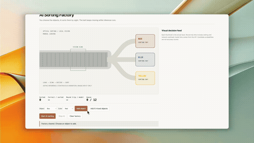 анімований запис · <a href="https://github.com/user-attachments/assets/c87c09d8-30d2-4392-b981-d0b5cf1879ae">Відкрити відео</a></td>
</tr></table>

🎮 <b><a href="https://github.com/aowang-ai/jev-trade">aowang-ai/jev-trade</a></b> · ⭐228 · TypeScript · 🔎 inferred · 12 天

##### 📝 Стислий опис

Трейдер Jev у реальному часі на Hyperliquid

##### 📌 Основні факти

| Поле      | Значення                                               |
| --------- | ------------------------------------------------------ |
| Категорія | `Застосунки, ігри, робототехніка та інтерактивні демо` |
| Докази    | `inferred`                                             |
| Мова      | TypeScript                                             |

##### 📊 Дані

| Метрика         | Значення   |
| --------------- | ---------- |
| Зірки           | **228**    |
| Останній push   | 2026-11-12 |
| Уперше в списку | 2026-10-29 |

🏷 `hyperliquid` · `jev` · `quantitative-finance` · `typesafe`

---

<table><tr><th align="center" width="50%">🖼 Зображення</th><th align="center" width="50%">🎬 Відео</th></tr><tr>
<td align="center" valign="top"></td>
<td align="center" valign="top">медіа не опубліковано</td>
</tr></table>

Ресурс підключено гарячим посиланням із вихідного репозиторію, оскільки ліцензію, що дозволяє розповсюдження, не заявлено.

🎮 <b><a href="https://github.com/NanmiCoder/jev-arena">NanmiCoder/jev-arena</a></b> · ⭐126 · JavaScript · 🔎 inferred · 64 天

##### 📝 Стислий опис

Опис і практичне тестування моделі Jev: перетворення природної мови на типізовані судження та ймовірності за допомогою Choice / Score / Noul для класифікації, оцінювання й маршрутизації; підтримка порівняння з такими моделями, як DeepSeek, для коментування міток, швидкості та результатів, з імпортом CSV/Excel, відтворенням на початковій швидкості та офлайн-звітами.

##### 📌 Основні факти

| Поле      | Значення                                               |
| --------- | ------------------------------------------------------ |
| Категорія | `Застосунки, ігри, робототехніка та інтерактивні демо` |
| Докази    | `inferred`                                             |
| Мова      | JavaScript                                             |

##### 📊 Дані

| Метрика         | Значення   |
| --------------- | ---------- |
| Зірки           | **126**    |
| Останній push   | 2026-09-20 |
| Уперше в списку | 2026-11-21 |

---

<table><tr><th align="center" width="50%">🖼 Зображення</th><th align="center" width="50%">🎬 Відео</th></tr><tr>
<td align="center" valign="top"></td>
<td align="center" valign="top">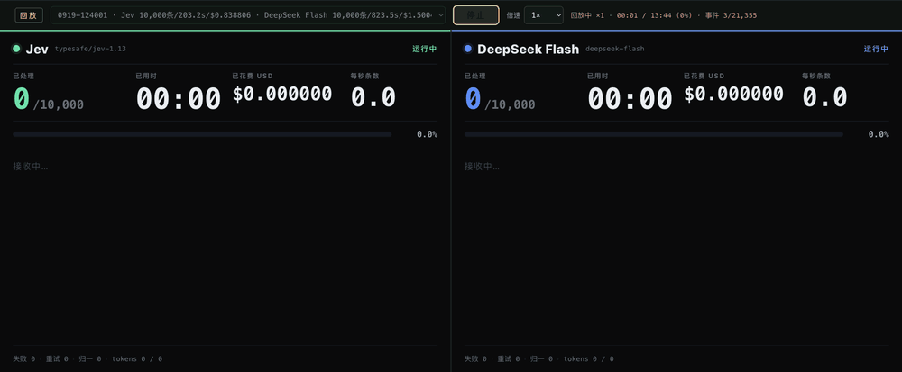 анімований запис</td>
</tr></table>

🎮 <b><a href="https://github.com/BudEcosystem/Bud-Decision-Studio">BudEcosystem/Bud-Decision-Studio</a></b> · ⭐79 · HTML · 🔎 inferred · 45 天

##### 📝 Стислий опис

Bud Decision studio — простий у використанні кросплатформний настільний застосунок і система обслуговування локальних моделей на кшталт Jev.

##### 📌 Основні факти

| Поле      | Значення                                               |
| --------- | ------------------------------------------------------ |
| Категорія | `Застосунки, ігри, робототехніка та інтерактивні демо` |
| Докази    | `inferred`                                             |
| Мова      | HTML                                                   |

##### 📊 Дані

| Метрика         | Значення   |
| --------------- | ---------- |
| Зірки           | **79**     |
| Останній push   | 2026-10-09 |
| Уперше в списку | 2026-10-29 |

🏷 `decision-models` · `desktop-app` · `jev` · `laya` · `local-ai` · `pytorch` · `system-one` · `tauri`

---

<table><tr><th align="center" width="50%">🖼 Зображення</th><th align="center" width="50%">🎬 Відео</th></tr><tr>
<td align="center" valign="top"></td>
<td align="center" valign="top"> <a href="https://raw.githubusercontent.com/BudEcosystem/Bud-Decision-Studio/main/docs/media/demo.mp4">Відкрити відео</a></td>
</tr></table>

Ресурс підключено гарячим посиланням із вихідного репозиторію, оскільки ліцензію, що дозволяє розповсюдження, не заявлено.

🎮 <b><a href="https://github.com/wizicer/jev_info_site">wizicer/jev_info_site</a></b> · ⭐3 · Astro · 🔎 inferred · 0 天

##### 📝 Стислий опис

Community index of tools, models, and real-world use cases built on Jev.

##### 📌 Основні факти

| Поле      | Значення                                               |
| --------- | ------------------------------------------------------ |
| Категорія | `Застосунки, ігри, робототехніка та інтерактивні демо` |
| Докази    | `inferred`                                             |
| Мова      | Astro                                                  |

##### 📊 Дані

| Метрика         | Значення   |
| --------------- | ---------- |
| Зірки           | **3**      |
| Останній push   | 2026-11-24 |
| Уперше в списку | 2026-11-24 |

🏷 `awesome` · `jev` · `jev-ai` · `typesafe-ai`

---

<table><tr><th align="center" width="50%">🖼 Зображення</th><th align="center" width="50%">🎬 Відео</th></tr><tr>
<td align="center" valign="top"></td>
<td align="center" valign="top">медіа не опубліковано</td>
</tr></table>

Ресурс підключено гарячим посиланням із вихідного репозиторію, оскільки ліцензію, що дозволяє розповсюдження, не заявлено.

🎮 <b><a href="https://github.com/Tatuck/jev-boe-demo">Tatuck/jev-boe-demo</a></b> · ⭐2 · TypeScript · 🔎 inferred · 0 天

##### 📝 Стислий опис

Daily demo applying TypeSafe's Jev model to Spain's official gazette (BOE).

##### 📌 Основні факти

| Поле      | Значення                                               |
| --------- | ------------------------------------------------------ |
| Категорія | `Застосунки, ігри, робототехніка та інтерактивні демо` |
| Докази    | `inferred`                                             |
| Мова      | TypeScript                                             |

##### 📊 Дані

| Метрика         | Значення   |
| --------------- | ---------- |
| Зірки           | **2**      |
| Останній push   | 2026-11-23 |
| Уперше в списку | 2026-11-24 |

---

<table><tr><th align="center" width="50%">🖼 Зображення</th><th align="center" width="50%">🎬 Відео</th></tr><tr>
<td align="center" valign="top"></td>
<td align="center" valign="top"> анімований запис</td>
</tr></table>

Ресурс підключено гарячим посиланням із вихідного репозиторію, оскільки ліцензію, що дозволяє розповсюдження, не заявлено.

🎮 <b><a href="https://github.com/BrendanH18/jev-lab">BrendanH18/jev-lab</a></b> · ⭐1 · JavaScript · 🔎 inferred · 0 天

##### 📝 Стислий опис

Six small apps and a workbench that show what TypeSafe's Jev (System One) model can do

##### 📌 Основні факти

| Поле      | Значення                                               |
| --------- | ------------------------------------------------------ |
| Категорія | `Застосунки, ігри, робототехніка та інтерактивні демо` |
| Докази    | `inferred`                                             |
| Мова      | JavaScript                                             |

##### 📊 Дані

| Метрика         | Значення   |
| --------------- | ---------- |
| Зірки           | **1**      |
| Останній push   | 2026-11-23 |
| Уперше в списку | 2026-10-24 |

🏷 `ai` · `demo` · `jev` · `typesafe`

---

<table><tr><th align="center" width="50%">🖼 Зображення</th><th align="center" width="50%">🎬 Відео</th></tr><tr>
<td align="center" valign="top">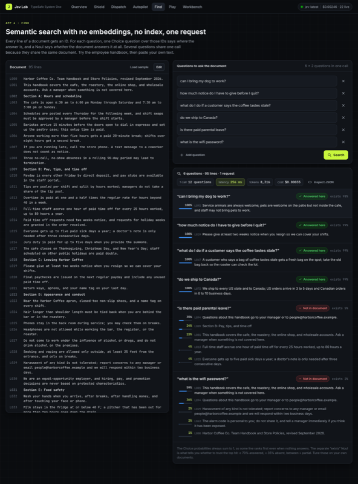</td>
<td align="center" valign="top">медіа не опубліковано</td>
</tr></table>

<b>Більше в цій категорії</b> · 16

- [jarrodwatts/jev-trader](https://github.com/jarrodwatts/jev-trader) - Одне рішення щодо торгівлі зі штучним інтелектом на кожен блок Monad.
- [moritzkremb/jev-voice-browser](https://github.com/moritzkremb/jev-voice-browser) - Керуйте реальним браузером голосом. Jev (TypeSafe System One) визначає намір і…
- [kevinbadi/jev-voice](https://github.com/kevinbadi/jev-voice) - Розмовляйте зі своїм Mac. Локальний whisper.cpp + один виклик Jev (TypeSafe)…
- [buer2233/jev-ui-test](https://github.com/buer2233/jev-ui-test) - Фреймворк автоматизованого тестування UI на основі моделі рішень Jev: не…
- [bilune/jev-design](https://github.com/bilune/jev-design) - Чи може модель розробити дашборд? Консоль, усю дизайн-систему якої під час…
- [emrickgarrett/OneVOneJev](https://github.com/emrickgarrett/OneVOneJev) - Арена швидкого огляду Jev 1v1 — Three.js + TypeSafe System One.
- [codelivin/jev-laya-toolkit](https://github.com/codelivin/jev-laya-toolkit) - Dashboard and local proxy for SystemOne decision models - Jev (TypeSafe API)…
- [dgarridou/KaLM-Jev](https://github.com/dgarridou/KaLM-Jev) - Run efficient local Choice, Score, and Noul services with KaLM-Reranker-V1-R2…
- [harsha89/jev-demo](https://github.com/harsha89/jev-demo) - Демонстрація класифікації електронних листів за допомогою TypeSafe JEV: спам…
- [PistachioAIHQ/jev-synergy-screening](https://github.com/PistachioAIHQ/jev-synergy-screening) - Jev (TypeSafe System One) × демонстрація перевірки рефератів ASReview SYNERGY…
- [felixglush/jev-dynamic-ui](https://github.com/felixglush/jev-dynamic-ui) - Dynamically select and prefill banking UI components in under 200ms.
- [huntsman95/PowerJev](https://github.com/huntsman95/PowerJev) - Powershell Module to interact with /v1/systemone AI Decision Endpoints.
- [m407/jev-grep](https://github.com/m407/jev-grep) - Semantic search for log and code fragments using Jev.
- [netcode001/jev](https://github.com/netcode001/jev) - Неофіційний інформаційний хаб Jev AI — посібник із доступу, ціни, безкоштовний…
- [neurogabo/jev-arena](https://github.com/neurogabo/jev-arena) - Run a Pokémon Champions battle arena locally with Jev, TypeSafe, and Pokémon…
- [sorrycc/typesafe-snake](https://github.com/sorrycc/typesafe-snake) - Snake, автоматично керована моделлю Jev від TypeSafe: один вибір System One за…

## Тексти, обговорення та споріднені списки

Стартові обговорення, незалежні тексти та інші добірки в цій царині. Цей репозиторій не єдиний, і сказати це корисніше, ніж вдавати протилежне.

📰 <b><a href="https://docs.typesafe.ai/model-jaggedness/jev-1.13">9 типів відомих дефектів (jaggedness)</a></b> · ✅ official · 67 天

##### 📝 Стислий опис

Буквальне розуміння, **ненадійний підрахунок**, порівняння дат, багаторівнева непрямість, великий state з нерелевантними деталями, змагальний вміст, суперечність між інструкціями та criteria, структурні інваріанти, генерація. Офіційна рекомендація: "розбити на атомарні запитання й комбінувати в коді".

> 💡 **Межі можливостей** — це перелік меж, визнаний самим постачальником, повністю включено

##### 📌 Основні факти

| Поле      | Значення                                   |
| --------- | ------------------------------------------ |
| Категорія | `Тексти, обговорення та споріднені списки` |
| Докази    | `official`                                 |

##### 📊 Дані

| Метрика         | Значення   |
| --------------- | ---------- |
| Уперше в списку | 2026-11-13 |

📰 <b><a href="https://docs.typesafe.ai/cookbooks/consistency_choice_cookbook">`consistency_choice` cookbook офіційно відповів, що &quot;результати повторних викликів змінюватимуться&quot;</a></b> · ✅ official · 67 天

##### 📝 Стислий опис

Та сама rubric перевірки, **8 Choice × 15 повторів для кожної умови**. TypeSafe **raw agree 90.8%** (у 2 з 8 запитань були перевороти, але **conflicts=0** — перевороти відбувалися лише між «конкретна мітка ↔ uncertain»). **Після додавання правила abstention (за допомогою `probabilities` вимагати top probability ≥ 0.60, інакше `uncertain` передавати людині) узгодженість зросла до 99.2%**, automatic 74.2%, **без збільшення кількості викликів моделі**. Порівняння: Haiku t=0 100%, Opus 4.8 reasoning 92.5%, gpt-5.4-mini t=0 99.2%. Офіційна заява: це не робить модель детермінованою; ці цифри — **повторюваність, а не правильність**; 0.60 — приклад стратегії, виробничий поріг треба визначати на маркованих зразках і вартості.

> 💡 **\[DEFINITION-CHANGE\]** Переписано B5, таблицю ключових чисел, залізне правило 3 у SKILL.md і пункт 6 запуску, пункт 6 меж застосовності — **раніше цей репозиторій позначав "недетермінізм" як ризик, тепер змінено на офіційно правильний підхід: керувати ним через abstention**

##### 📌 Основні факти

| Поле      | Значення                                   |
| --------- | ------------------------------------------ |
| Категорія | `Тексти, обговорення та споріднені списки` |
| Докази    | `official`                                 |

##### 📊 Дані

| Метрика         | Значення   |
| --------------- | ---------- |
| Уперше в списку | 2026-11-13 |

📰 <b><a href="https://docs.typesafe.ai/confidence">Офіційне підтвердження семантики confidence</a></b> · ✅ official · 67 天

##### 📝 Стислий опис

Офіційно прямо сказано, що `confidence` — це **статистика, обчислена з розподілу `probabilities`**: що концентрованіший розподіл, то вища впевненість; **Noul не містить confidence**; офіційно прямо сказано "ви не замкнені на нашому визначенні"; поріг слід "починати з консервативного значення й тестувати на власних даних".

> 💡 Узгоджується зі зворотною формулою Archer, записано у файл визначень

##### 📌 Основні факти

| Поле      | Значення                                   |
| --------- | ------------------------------------------ |
| Категорія | `Тексти, обговорення та споріднені списки` |
| Докази    | `official`                                 |

##### 📊 Дані

| Метрика         | Значення   |
| --------------- | ---------- |
| Уперше в списку | 2026-11-13 |

📰 <b><a href="https://www.langchain.com/blog/building-a-harness-with-jev（2026-09-17">Офіційний допис у блозі LangChain пояснив, &quot;чому вибухнула категорія agent guardrails&quot; — ，Sydney Runkle &amp; Hunter Lovell）</a></b> · ✅ official

##### 📝 Стислий опис

*"Coding harnesses like claude, codex, cursor have shipped some kind of way to classify dangerous actions… **Up until now, this classifier step has been locked away in the closed source parts of the harness. Now that a cheap and performant classifier model exists, we can take the same pattern and adopt it to all agents!**"*; також наведено приклад router (використовує Jev для вибору моделі за користувацькими критеріями, імовірність зберігається в agent state) і *"Jev isn't a drop-in replacement for an LLM"*.

> 💡 **Пояснено спостережене цим репозиторієм явище "комодитизації guardrail"** — причина в тому, що можливість closed-source harness стала open-source; записано до бібліотеки фрагментів §2.5

##### 📌 Основні факти

| Поле      | Значення                                   |
| --------- | ------------------------------------------ |
| Категорія | `Тексти, обговорення та споріднені списки` |
| Докази    | `official`                                 |

##### 📊 Дані

| Метрика         | Значення   |
| --------------- | ---------- |
| Уперше в списку | 2026-11-13 |

📰 <b><a href="https://typesafe.ai/team">TypeSafe додав сторінку Team + у навігацію додано вхід `Enterprise` (сигнал productization/commercialization)</a></b> · ✅ official · 66 天

##### 📝 Стислий опис

TypeSafe додав сторінку Team + у навігацію додано вхід `Enterprise` (сигнал productization/commercialization)

> 💡 **\[DEFINITION-CHANGE\]** (факт про команду + сигнал productization); `01-系统定义/jev-系统定义.md` додано **§6b/6c**; оновлено картку швидких фактів `references/README.md`

##### 📌 Основні факти

| Поле      | Значення                                   |
| --------- | ------------------------------------------ |
| Категорія | `Тексти, обговорення та споріднені списки` |
| Докази    | `official`                                 |

##### 📊 Дані

| Метрика         | Значення   |
| --------------- | ---------- |
| Уперше в списку | 2026-11-13 |

📰 <b><a href="https://vercel.com/changelog/typesafe-ai-jev-now-available-on-ai-gateway">Офіційний changelog Vercel оголосив, що Jev додано в AI Gateway</a></b> · ✅ official

##### 📝 Стислий опис

Офіційний changelog Vercel оголосив, що Jev додано в AI Gateway

> 💡 У рядок Vercel бібліотеки фрагментів додано **використання AI SDK** (справжній інкремент); **таблицю ключових чисел змінювати не потрібно** (цифри вже є) → **зміна рівня визначення в цьому раунді знижена до "ні"**

##### 📌 Основні факти

| Поле      | Значення                                   |
| --------- | ------------------------------------------ |
| Категорія | `Тексти, обговорення та споріднені списки` |
| Докази    | `official`                                 |

##### 📊 Дані

| Метрика         | Значення   |
| --------------- | ---------- |
| Уперше в списку | 2026-11-13 |

📰 <b><a href="https://docs.typesafe.ai/llms.txt">Знайдено й зібрано 18 офіційних практичних рецептів cookbook (раніше повністю відсутніх)</a></b> · ✅ official · 67 天

##### 📝 Стислий опис

`llms.txt` має 111 сторінок на всьому сайті; локально було 30 сторінок, після diff виявлено **18 рецептів** під `cookbooks/` (з виконуваним кодом, реальними наборами даних, виміряними цифрами). Кожну завантажено й додано `type: official-cookbook` frontmatter.

> 💡 Створено індексну сторінку `03-能力边界/jev-官方cookbook配方.md`; **це саме той рівень "від принципів до production"**

##### 📌 Основні факти

| Поле      | Значення                                   |
| --------- | ------------------------------------------ |
| Категорія | `Тексти, обговорення та споріднені списки` |
| Докази    | `official`                                 |

##### 📊 Дані

| Метрика         | Значення   |
| --------------- | ---------- |
| Уперше в списку | 2026-11-13 |

📰 <b><a href="https://github.com/typesafe-ai/skills（⭐128">Встановлення офіційного agent skill `typesafe-ai` — ，MIT）</a></b> · ✅ official · 67 天

##### 📝 Стислий опис

`npx -y skills@latest add typesafe-ai/skills -s typesafe-ai -g -a '*' --copy -y` → встановлено в `~/.agents/skills/typesafe-ai/` (один файл SKILL.md, 149 рядків / 10 KB, охоплює 79 agent). Оцінка безпеки: Gen=Safe, Socket=0 alerts, Snyk=Low Risk. Єдиний невдалий пункт — Eve (не підтримує глобальне встановлення, без впливу).

> 💡 Співіснує й взаємно доповнює наш `jev` skill

##### 📌 Основні факти

| Поле      | Значення                                   |
| --------- | ------------------------------------------ |
| Категорія | `Тексти, обговорення та споріднені списки` |
| Докази    | `official`                                 |

##### 📊 Дані

| Метрика         | Значення   |
| --------------- | ---------- |
| Уперше в списку | 2026-11-13 |

📰 <b><a href="https://docs.typesafe.ai/llms.txt`">Diff офіційної документації знову підтвердив чинність — `</a></b> · ✅ official

##### 📝 Стислий опис

У цьому раунді diff не виявив нових сторінок (30 статей + 18 cookbook уже повні); це показує, що diff-логіка збирача правильна.

> 💡 Зберегти як фіксований крок кожного раунду

##### 📌 Основні факти

| Поле      | Значення                                   |
| --------- | ------------------------------------------ |
| Категорія | `Тексти, обговорення та споріднені списки` |
| Докази    | `official`                                 |

##### 📊 Дані

| Метрика         | Значення   |
| --------------- | ---------- |
| Уперше в списку | 2026-11-13 |

📰 <b><a href="https://docs.typesafe.ai/models">Індекс офіційної документації та політики rate limiting / context / customization повністю перевірено</a></b> · ✅ official · 67 天

##### 📝 Стислий опис

Endpoint `POST https://api.typesafe.ai/v1/systemone`; `jev-1.13.0`, псевдоніми `jev-latest`/`jev-preview`; 64k/запит, state+найдовше запитання 32k; rate limit 250k tok/s, 1200 req/min і **динамічно коригується**; лише текстовий ввід; Choice≤255, Score 2–10 рівнів; **без fine-tune, усі акаунти використовують один і той самий набір ваг**; дані клієнтів не використовуються для навчання; найточніше англійською.

> 💡 **Архітектура/межі можливостей** — записано в `01-系统定义/jev-系统定义.md` і `jev-能力与边界-准确定义.md`

##### 📌 Основні факти

| Поле      | Значення                                   |
| --------- | ------------------------------------------ |
| Категорія | `Тексти, обговорення та споріднені списки` |
| Докази    | `official`                                 |

##### 📊 Дані

| Метрика         | Значення   |
| --------------- | ---------- |
| Уперше в списку | 2026-11-13 |

📰 <b><a href="https://docs.typesafe.ai/migrating-to-v1">Доповнено відсутню офіційну сторінку: міграція на v1 API</a></b> · ✅ official · 67 天

##### 📝 Стислий опис

preview endpoint `/preview/evaluation` → стабільна версія **`POST /v1/systemone`**; масив `prompts` → map `questions`; масив `responses` → map `answers`; перейменовано поля **`probability`→`noul`, `chosen`→`choice`, `expectation`→`score`**; імовірності choice з масиву стали map; **імовірність score — нове у v1**; автентифікація без змін.

> 💡 Внесено до архіву `官方文档快照/migrating-to-v1.md`; це також дає **другий офіційний канал виявлення сторінок** (таблиця маршрутів документації офіційного skill)

##### 📌 Основні факти

| Поле      | Значення                                   |
| --------- | ------------------------------------------ |
| Категорія | `Тексти, обговорення та споріднені списки` |
| Докази    | `official`                                 |

##### 📊 Дані

| Метрика         | Значення   |
| --------------- | ---------- |
| Уперше в списку | 2026-11-13 |

📰 <b><a href="https://github.com/yibie/awesome-jev">yibie/awesome-jev</a></b> · ⭐2633 · Python · 👁️ observed · 0 天

##### 📝 Стислий опис

Кураторський список публічних проєктів, інтеграцій і обговорень, створених на основі Jev — моделі TypeSafe AI System One для типізованих рішень.

##### 📌 Основні факти

| Поле      | Значення                                   |
| --------- | ------------------------------------------ |
| Категорія | `Тексти, обговорення та споріднені списки` |
| Докази    | `observed`                                 |
| Мова      | Python                                     |

##### 📊 Дані

| Метрика         | Значення   |
| --------------- | ---------- |
| Зірки           | **2633**   |
| Останній push   | 2026-11-24 |
| Уперше в списку | 2026-09-18 |

🏷 `awesome` · `awesome-list` · `jev` · `llm`

<b>Більше в цій категорії</b> · 63

- [cobanov/awesome-jev](https://github.com/cobanov/awesome-jev) - Кураторський список проєктів із підтвердженими джерелами, створених за…
- [We’re releasing Jev 1.14.0 along with experimental features for dreamers](https://news.ycombinator.com/item?id=50095353)
- [hellogumbo/awesome-jev](https://github.com/hellogumbo/awesome-jev) - Каталог спільноти проєктів, створених на основі Jev, моделі System One від…
- [Open-sourced jev architecture last year with model,paper and dataset](https://news.ycombinator.com/item?id=49736660) - Усі тепер говорять про архітектуру, яка не є авторегресивною та блискавично…
- [Show HN: Jev Cards, Can you beat a vision model at a picture quiz?](https://news.ycombinator.com/item?id=50167617) - I built a quiz game around TypeSafe&amp;#x27;s new Jev model, which has vision…
- [What Is RLCD? The Secret Behind Jev](https://news.ycombinator.com/item?id=49829625)
- [Document Review with Unsiloed and TypeSafe Jev](https://news.ycombinator.com/item?id=50068443)
- [aliaihub/awesome-jev-usecases](https://github.com/aliaihub/awesome-jev-usecases) - Підкріплені доказами варіанти використання, шаблони та рекомендації зі…
- [Anil-matcha/awesome-jev-by-typesafe](https://github.com/Anil-matcha/awesome-jev-by-typesafe) - Evidence-backed use cases, patterns, prompts, and starter code for TypeSafe Jev…
- [Show HN: Fastbrowse, Browser agent that picks clicks with a System One model](https://news.ycombinator.com/item?id=50311029) - Hi HN, I&amp;#x27;m Furqan founder of Nebula.
- [jtnkminimal/awesome-jev](https://github.com/jtnkminimal/awesome-jev) - A curated projects built with Jev, TypeSafe.
- [Show HN: Nouli – A multi-turn decision graph harness for System One models](https://news.ycombinator.com/item?id=50288442) - I&amp;#x27;ve been fine tuning my own decision models lately and I&amp;#x27;ve been…
- [Ask HN: Everyone was Jev-maxxing. Why not CDMs now?](https://news.ycombinator.com/item?id=50242523) - Just a few weeks ago, all that my feed had was people JEV-maxxing.
- [Ask HN: System One models for autonomous agents](https://news.ycombinator.com/item?id=50142037) - I&amp;#x27;ve seen a few impressive demos of Typesafe&amp;#x27;s new paradigm with…
- [Jack and Jill Cut Candidate Screening Costs by 88% with Jev](https://news.ycombinator.com/item?id=50450433)
- [Jeyzma is TypeSafeAI minus $850M plus Go/TinyGo/llama.cpp in the browser](https://news.ycombinator.com/item?id=50031093)
- [Cutting LLM Token Costs with Currents News API and TypeSafe Jev Pre-Filtering](https://news.ycombinator.com/item?id=50450911)
- [JEV: Type Safe AI](https://news.ycombinator.com/item?id=50106296)
- [RadRebelSam/awesome-jev](https://github.com/RadRebelSam/awesome-jev) - Каталог проєктів, створених на основі Jev, моделі System One від TypeSafe AI…
- [Show HN: Decide – Jev decisions in the shell, scripts, and agent skills](https://news.ycombinator.com/item?id=49878492) - Усе програмне забезпечення ухвалює рішення. Код обробляє детерміновані рішення.
- [Show HN: We Beat TypeSafe Jev and Released Open-Source Decision Model](https://news.ycombinator.com/item?id=50027132)
- [The Hitchhiker's Guide to System One Models](https://news.ycombinator.com/item?id=50301027)
- [Typesafe.ai Jev Open Source Alternative Qwen-2.5-1B-RLCD](https://news.ycombinator.com/item?id=49734345)
- [ozers/jevsome-projects](https://github.com/ozers/jevsome-projects) - Проєкти з відкритим кодом, які підтверджено викликають Jev, модель System One…
- [rhc98/awesome-jev](https://github.com/rhc98/awesome-jev) - Проєкти, створені на основі Jev (моделі System One від TypeSafe AI), відібрані…
- [108 条声明对照：Jev 的校准并不独特（含作者自我修正）](https://truestandard.ai/blog/jev-accuracy-tested) - Порівняння 108 тверджень: калібрування Jev не є унікальним.
- [\[cellcog.ai 追踪页\]() 自称分层记录 *"claims / concedes / measured / found, dated"* → 与本库锚页设计意图一致，值得长期对照](https://cellcog.ai/blog/jev-typesafe-decision-model) - \[сторінка відстеження cellcog.ai\]() заявляє про пошарове фіксування *.
- [\`calibre\`：独立标定实验证明"阈值参数不跨数据集迁移"](https://github.com/FirasSX914/calibre) - Незалежне вимірювання калібрування Jev на двох маркованих наборах даних…
- [\`classifier.dev\`：建在 Jev 上的免费零样本分类服务（含 agent skill）](https://classifier.dev) - Zero-shot сервіс класифікації HTTP **без key API, без акаунта**;
- [\`clownware/bouncer\` 提供目前最硬的第三方独立标定数据](https://github.com/clownware/bouncer) - Точність/Brier/надійність за біннами для 6 запитань: Brier **0.036–0.149**;
- [\`Jev Judge vs Dimension Scores\`：分解不总是更好（含日语多语证据）](https://agentjournal.dev/blog/llm-judge-vs-feature-extraction/) - Порівняння на трьох задачах класифікації:
- [\`jevcal\`：最小样本经验值 \< 约 100 条不可信；并多做两件我们没做的事](https://github.com/abhixhek/jevcal) - Підігнати пороги впевненості для кожного питання на власних розмічених даних →…
- [\`kaijia323/dsh-plugin-jev\`：DeepSeek Harness 的 Jev 插件（与本库同环境）](https://github.com/kaijia323/dsh-plugin-jev) - Під.
- [New：\[InfoWorld（2026-09-17）\]() —— 企业媒体视角，用例清单：*"which tool to invoke, which action to take next, whether a request should be approved, when a task…](https://www.infoworld.com/article/4223468/typesafe-ais-new-models-work-with-machines-not-humans.html) - Нове: \[InfoWorld（2026-09-17）\]() —— погляд корпоративних медіа, список кейсів…
- [OOD 校准审计："Jev 知道自己不知道吗？"](https://github.com/scienthoon/jev-ood-calibration)
- [X 上一条新描述口径](https://x.com/testingcatalog/status/2099968075861008781) - Описує Jev як *&quot;a small and customizable System One decision model&quot;* і чітко…
- [X： \[@omarsar0\]()（Elvis Saravia, DAIR.AI）独立表述了本库的「铁律 1」](https://x.com/omarsar0/status/2099933100440494105) - *.
- [X：\[@heyDhavall\]() 的简洁概括（*"why make software wait for an LLM to generate paragraphs when it really just needs decisions?"*）](https://x.com/heyDhavall/status/2099926342095798783) - X: лаконічне узагальнення від \[@heyDhavall\]().
- [X：拿到本库最具体的单次成本数字 — \[@moritzkremb\]()](https://x.com/moritzkremb) - *.
- [主 HN 帖规模](https://news.ycombinator.com/item?id=49717558) - **1862 points**; коментарі переважно позитивні.
- [先例清单：\[ibl.ai\]() 指出 CriticGPT 与 Prometheus 2 都在 2024 年就做"判断模型" → 写进优先权争议页 §4d，与 Laya 的指称分开记；本库判断 Jev 与它们的真实差异是"把判断做成带类型与概率的一等 API"](https://ibl.ai/blog/jev-judge-model-evaluation-not-generation-enterprise) - Список прецедентів: \[ibl.ai\]() вказує, що CriticGPT і Prometheus 2 ще у 2024…
- [创始人第二段"原始初衷"（比第一段更锋利）：Diogo Almeida 经 \[Pat McGuinness Substack\]() 转引](https://patmcguinness.substack.com/p/jev-makes-fast-and-cheap-decisions) - Друга частина &quot;первинного задуму&quot; засновника (різкіша за першу): Diogo Almeida…
- [又一份"本地 vs 托管"选型实录：\[astgl.com\]()（James Cruce，09-22）—— 421M 开源模型在其 frozen replay 上胜过自制路由；他最终不选 Jev 是因为约束（数据不出本机、可控回退），并主动限定*"whether Laya beats Jev…](https://astgl.com/p/local-laya-vs-hosted-jev-typed-decisions) - Ще один реальний запис вибору &quot;local vs hosted&quot;: \[astgl.com\]().
- [发现与本库做同一件事的 agent skill：\`decision-first\`](https://github.com/harrymunro/decision-first) - *.
- [发现社区维护的完整索引 \`AbdelStark/awesome-typesafe\`（ 103）](https://github.com/AbdelStark/awesome-typesafe) - Зібрану нами раніше розрізнену екосистему доповнено до повної карти зі…
- [四条精准告诫（已写入 IO 契约 §S8） —— \[Wavect 独立评测\]()：](https://wavect.io/blog/jev-ai-decision-model-review) - Чотири точні застереження (вже внесено до IO contract §S8) —— \.
- [新用例：上下文压缩（LiteLLM 的 TypeSafe 护栏）](https://github.com/BerriAI/litellm) - `litellm/types/proxy/guardrails/guardrail_hooks/typesafe.py` реалізував…
- [独立第三方与我们的术语纪律收敛：\[HarnessRouter（2026-09-20）\]()](https://harnessrouter.ai/blog/what-is-a-system-one-model) - Незалежна третя сторона збігається з нашою термінологічною дисципліною…
- [生态跨过一条线：出现 Jev-HTTP-API 兼容的开源服务端](https://github.com/ekzhang/openjev-sglang（⭐**123**）) - *.
- [第 11 份独立评测：克罗地亚语零样本 vs 自己微调的 BERT（\[Senko Rašić\]()，09-22）](https://blog.senko.net/analyzing-jev-a-new-ai-model) - 11-та незалежна оцінка: нульове навчання для хорватської мови проти власноруч…
- [第 12 份独立评测：注入鲁棒性系统测试《Can Jev be jailbroken?》（\[tanh.xyz\]()，14,495 次记录调用，原始记录公开）](https://tanh.xyz/research-notes/jev-prompt-manipulation) - 12-та незалежна оцінка: системне тестування стійкості до ін.
- [第 9 份独立评测：\[@juanmacias《Testing TypeSafe's Jev - Legal Corpus》\]()](https://x.com/i/article/2100463318209048850) - 9-та незалежна оцінка: \.
- [第三方 SDK 覆盖主流服务端语言：HN \`Show HN: Typesafe Java SDK (Unofficial)\`（\[item 49762324\]()）](https://news.ycombinator.com/item?id=49762324) - Додано попередні Go / Rust（×3）/ Elixir / Ruby（×3）/ .NET / Rails，**сторонній SDK…
- [第三方深度解读补充大量可操作实测](https://flaviocopes.com/jev) - ① **0.5 у Noul не означає «середній»**, а означає, що модель не може їх…
- [第三方独立实测：Classmethod / DevelopersIO](https://dev.classmethod.jp/en/articles/jev-for-llm-model-routing/) - Усі 40 викликів успішні, класифікація 10/10 правильна;
- [第三方独立实测：Vercel 生产集成（最重要产业证据）](https://x.com/rauchg/status/2100307962262872105) - У safety reviewer для fx у режимі auto початково використовувався GPT Luna;
- [财经媒体的独立表态：\[TechStock²《…Its 445× Cost Claim Is Still Self-Tested》\]()（2026-09-17）：*"…leaves the biggest performance numbers dependent on TypeSafe's…](https://ts2.tech/en/typesafe-ai-raises-40-million-for-jev-but-its-445x-cost-claim-is-still-self-tested/) - Незалежна заява фінансового медіа: \.
- [闭环信号：Archer 那篇文章上了 HN —— \`Jev's Architecture Unmasked\`（\[item 49766351\]()，1pt）](https://news.ycombinator.com/item?id=49766351) - Сигнал замкненого циклу: стаття Archer потрапила на HN — `Jev.
- [首个上市公司级集成：\[Aurora Mobile（NASDAQ: JG）的 GPTBots.ai 集成 Jev\]()（09-22）→ *"two-layer AI architecture: one layer that thinks, one layer that…](https://markets.businessinsider.com/news/stocks/aurora-mobile-s-gptbots-ai-integrates-jev-two-layers-of-ai-one-enterprise-platform-1036563338) - Перша інтеграція на рівні публічної компанії: \.
- [首份关于 Jev 概率的强反证：\`jev-does-not-play-dice\`](https://github.com/KantaHayashiAI/jev-does-not-play-dice) - **Імовірності, повідомлені Jev, відображають «наскільки модель упевнена», а не…
- [AppitStudio/awesome-jev](https://github.com/AppitStudio/awesome-jev) - Добірка ресурсів Jev і прикладів, придатних до запуску, для типізованих рішень…
- [新的优先权主张（与 Laya 无关）：HN \`I built the Jev architecture one year ago and open-sourced it\`（2pts）→ \[r/LocalLLaMA 帖\]()；本轮只登记 URL 与主张，未读原文、不下判断，下一轮核实](https://www.reddit.com/r/LocalLLaMA/comments/1wijo3e/i_literally_built_the_jev_architecture_one_year/) - Нова заява про пріоритет.
- [X 社区：发布日官方账号被钓鱼](https://commondefense.ai/blog/typesafe-x-account-phished) - Після публікації @typesafeai о 11:17am у день релізу о 5:43pm CEO повідомив про…

## Інші проєкти

🧩 <b><a href="https://github.com/Contrastive-LM/CLM">Contrastive-LM/CLM</a></b> · ⭐3216 · Python · 👁️ observed · 49 天

##### 📝 Стислий опис

Контрастивні мовні моделі (CLMs) — це новий клас моделей System One, навчених із ціллю контрастивного навчання, що поєднує стани та дії.

##### 📌 Основні факти

| Поле      | Значення       |
| --------- | -------------- |
| Категорія | `Інші проєкти` |
| Докази    | `observed`     |
| Мова      | Python         |

##### 📊 Дані

| Метрика         | Значення   |
| --------------- | ---------- |
| Зірки           | **3216**   |
| Останній push   | 2026-10-05 |
| Уперше в списку | 2026-11-20 |

---

<table><tr><th align="center" width="50%">🖼 Зображення</th><th align="center" width="50%">🎬 Відео</th></tr><tr>
<td align="center" valign="top"></td>
<td align="center" valign="top">медіа не опубліковано</td>
</tr></table>

🧩 <b><a href="https://github.com/feder-cr/jev">feder-cr/jev</a></b> · ⭐976 · C++ · 👁️ observed · 36 天

##### 📝 Стислий опис

jevos: альтернатива з відкритим кодом для Jev і Microsoft-Decision-1. Рішення «так/ні», вибір і оцінки з імовірностями на CPU вашого ноутбука.

🔧 Виявлено використання в коді: `README.md`

##### 📌 Основні факти

| Поле      | Значення       |
| --------- | -------------- |
| Категорія | `Інші проєкти` |
| Докази    | `observed`     |
| Мова      | C++            |

##### 📊 Дані

| Метрика         | Значення   |
| --------------- | ---------- |
| Зірки           | **976**    |
| Останній push   | 2026-10-18 |
| Уперше в списку | 2026-11-08 |

🏷 `ai` · `classification` · `cpu-inference` · `decision-model` · `edge-ai` · `gguf` · `jev` · `jev-alternative`

---

<table><tr><th align="center" width="50%">🖼 Зображення</th><th align="center" width="50%">🎬 Відео</th></tr><tr>
<td align="center" valign="top"></td>
<td align="center" valign="top"> анімований запис</td>
</tr></table>

🧩 <b><a href="https://github.com/jev-chat/jev-chat-windows">jev-chat/jev-chat-windows</a></b> · ⭐900 · Python · 👁️ observed · 56 天

##### 📝 Стислий опис

JevChat-Windows: помічник для відповідей, закріплений поруч із вікном чату. Знімок вікна + локальний офлайн OCR читає повідомлення співрозмовника → Jev визначає намір → 3 варіанти вставляються одним натисканням, надсилання завжди виконується вручну

🔧 Виявлено використання в коді: `README.md`, `jev.spec`, `core/providers.py`

##### 📌 Основні факти

| Поле      | Значення       |
| --------- | -------------- |
| Категорія | `Інші проєкти` |
| Докази    | `observed`     |
| Мова      | Python         |

##### 📊 Дані

| Метрика         | Значення   |
| --------------- | ---------- |
| Зірки           | **900**    |
| Останній push   | 2026-09-28 |
| Уперше в списку | 2026-11-08 |

🏷 `chat-assistant` · `jev` · `llm` · `local-first` · `ocr` · `privacy` · `pyqt` · `python`

---

<table><tr><th align="center" width="50%">🖼 Зображення</th><th align="center" width="50%">🎬 Відео</th></tr><tr>
<td align="center" valign="top"></td>
<td align="center" valign="top">медіа не опубліковано</td>
</tr></table>

Ресурс підключено гарячим посиланням із вихідного репозиторію, оскільки ліцензію, що дозволяє розповсюдження, не заявлено.

🧩 <b><a href="https://github.com/razorback16/openjev">razorback16/openjev</a></b> · ⭐802 · Python · 👁️ observed · 42 天

##### 📝 Стислий опис

Відкритий сумісний із Jev сервер рішень System One на DiffusionGemma

🔧 Виявлено використання в коді: `README.md`

##### 📌 Основні факти

| Поле      | Значення       |
| --------- | -------------- |
| Категорія | `Інші проєкти` |
| Докази    | `observed`     |
| Мова      | Python         |

##### 📊 Дані

| Метрика         | Значення   |
| --------------- | ---------- |
| Зірки           | **802**    |
| Останній push   | 2026-10-13 |
| Уперше в списку | 2026-11-08 |

🧩 <b><a href="https://github.com/datawhalechina/jev-cookbook">datawhalechina/jev-cookbook</a></b> · ⭐689 · Jupyter · 👁️ observed · 24 天

##### 📝 Стислий опис

⚡ Вступний посібник для китайських новачків із Jev｜Крок за кроком дізнайтеся все про Jev — легко експериментуйте в Jupyter Notebook: від трьох примітивів запитань до 18 практичних рецептів, голосового розумного будинку, оцінювання моделей і локального донавчання, щоб повністю опанувати парадигму розробки моделей оцінювання System One

🔧 Виявлено використання в коді: `AGENT.md`, `content/sdk/python.md`, `content/sdk/python/usage.md`, `content/models.md`

##### 📌 Основні факти

| Поле      | Значення       |
| --------- | -------------- |
| Категорія | `Інші проєкти` |
| Докази    | `observed`     |
| Мова      | Jupyter        |

##### 📊 Дані

| Метрика         | Значення   |
| --------------- | ---------- |
| Зірки           | **689**    |
| Останній push   | 2026-10-30 |
| Уперше в списку | 2026-11-08 |

---

<table><tr><th align="center" width="50%">🖼 Зображення</th><th align="center" width="50%">🎬 Відео</th></tr><tr>
<td align="center" valign="top"></td>
<td align="center" valign="top">медіа не опубліковано</td>
</tr></table>

Ресурс підключено гарячим посиланням із вихідного репозиторію, оскільки ліцензію, що дозволяє розповсюдження, не заявлено.

🧩 <b><a href="https://github.com/logan-markewich/jeff">logan-markewich/jeff</a></b> · ⭐320 · Python · 👁️ observed · 65 天

##### 📝 Стислий опис

Самостійно розміщувана повна заміна jev від TypeSafe, що працює на основі GliFormer.

🔧 Виявлено використання в коді: `README.md`

##### 📌 Основні факти

| Поле      | Значення       |
| --------- | -------------- |
| Категорія | `Інші проєкти` |
| Докази    | `observed`     |
| Мова      | Python         |

##### 📊 Дані

| Метрика         | Значення   |
| --------------- | ---------- |
| Зірки           | **320**    |
| Останній push   | 2026-09-20 |
| Уперше в списку | 2026-10-29 |

🏷 `classification` · `encoder` · `gliner` · `jev` · `typesafe`

🧩 <b><a href="https://github.com/brianbell-x/codehygiene">brianbell-x/codehygiene</a></b> · ⭐302 · Python · 👁️ observed · 3 天

##### 📝 Стислий опис

A tiny system one model for code readability and hygiene.

##### 📌 Основні факти

| Поле      | Значення       |
| --------- | -------------- |
| Категорія | `Інші проєкти` |
| Докази    | `observed`     |
| Мова      | Python         |

##### 📊 Дані

| Метрика         | Значення   |
| --------------- | ---------- |
| Зірки           | **302**    |
| Останній push   | 2026-11-20 |
| Уперше в списку | 2026-11-15 |

🧩 <b><a href="https://github.com/brainstormity/Jev-X-Sentiment-Analysis">brainstormity/Jev-X-Sentiment-Analysis</a></b> · ⭐235 · Python · 👁️ observed · 34 天

##### 📝 Стислий опис

An on-demand crypto market intelligence and decision-support terminal powered by TypeSafe AI's System One model

##### 📌 Основні факти

| Поле      | Значення       |
| --------- | -------------- |
| Категорія | `Інші проєкти` |
| Докази    | `observed`     |
| Мова      | Python         |

##### 📊 Дані

| Метрика         | Значення   |
| --------------- | ---------- |
| Зірки           | **235**    |
| Останній push   | 2026-10-21 |
| Уперше в списку | 2026-10-29 |

---

<table><tr><th align="center" width="50%">🖼 Зображення</th><th align="center" width="50%">🎬 Відео</th></tr><tr>
<td align="center" valign="top"></td>
<td align="center" valign="top">медіа не опубліковано</td>
</tr></table>

🧩 <b><a href="https://github.com/LiQiiiii/Jeva">LiQiiiii/Jeva</a></b> · ⭐234 · Python · 👁️ observed · 37 天

##### 📝 Стислий опис

Jeva: моделі System One з перших принципів

##### 📌 Основні факти

| Поле      | Значення       |
| --------- | -------------- |
| Категорія | `Інші проєкти` |
| Докази    | `observed`     |
| Мова      | Python         |

##### 📊 Дані

| Метрика         | Значення   |
| --------------- | ---------- |
| Зірки           | **234**    |
| Останній push   | 2026-10-17 |
| Уперше в списку | 2026-11-20 |

---

<table><tr><th align="center" width="50%">🖼 Зображення</th><th align="center" width="50%">🎬 Відео</th></tr><tr>
<td align="center" valign="top">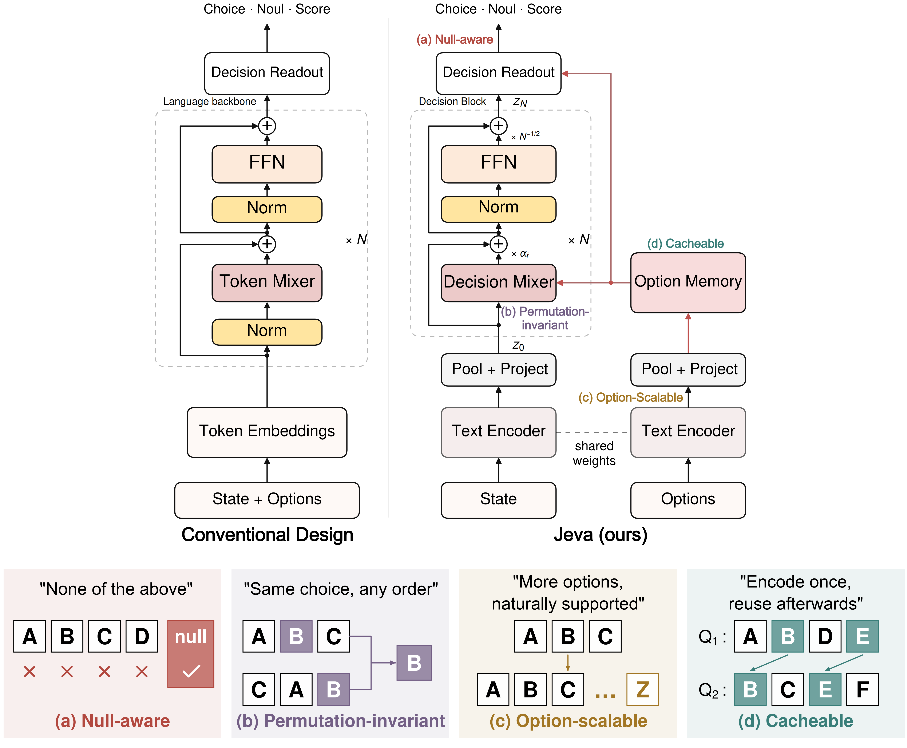</td>
<td align="center" valign="top">медіа не опубліковано</td>
</tr></table>

🧩 <b><a href="https://github.com/Carol-lyh/Jeveration">Carol-lyh/Jeveration</a></b> · ⭐154 · Python · 👁️ observed · 0 天 · ⭐+1

##### 📝 Стислий опис

\[arXiv\] Jeveration: System One Models Now Generate. https://arxiv.org/abs/2611.24738

##### 📌 Основні факти

| Поле      | Значення       |
| --------- | -------------- |
| Категорія | `Інші проєкти` |
| Докази    | `observed`     |
| Мова      | Python         |

##### 📊 Дані

| Метрика         | Значення     |
| --------------- | ------------ |
| Зірки           | **154** (+1) |
| Останній push   | 2026-11-23   |
| Уперше в списку | 2026-11-19   |

🏷 `dense-prediction` · `image-generation` · `image-to-image` · `pytorch` · `text-to-image` · `vision-language-model`

---

<table><tr><th align="center" width="50%">🖼 Зображення</th><th align="center" width="50%">🎬 Відео</th></tr><tr>
<td align="center" valign="top"></td>
<td align="center" valign="top">медіа не опубліковано</td>
</tr></table>

🧩 <b><a href="https://github.com/Futureppo/typesafe_register">Futureppo/typesafe_register</a></b> · ⭐132 · Python · 👁️ observed · 63 天

##### 📝 Стислий опис

Реєстратор typesafe.ai, максимальна оптимізація, необмежений jev

##### 📌 Основні факти

| Поле      | Значення       |
| --------- | -------------- |
| Категорія | `Інші проєкти` |
| Докази    | `observed`     |
| Мова      | Python         |

##### 📊 Дані

| Метрика         | Значення   |
| --------------- | ---------- |
| Зірки           | **132**    |
| Останній push   | 2026-09-21 |
| Уперше в списку | 2026-10-29 |

---

<table><tr><th align="center" width="50%">🖼 Зображення</th><th align="center" width="50%">🎬 Відео</th></tr><tr>
<td align="center" valign="top"></td>
<td align="center" valign="top">медіа не опубліковано</td>
</tr></table>

🧩 <b><a href="https://github.com/peterfriese/system-one-foundation-models">peterfriese/system-one-foundation-models</a></b> · ⭐129 · Swift · 👁️ observed · 10 天

##### 📝 Стислий опис

Легкий, нативний міст Swift 6, що інтегрує модель ухвалення рішень Jev System One від TypeSafe AI у фреймворк Foundation Models від Apple.

🔧 Виявлено використання в коді: `README.md`

##### 📌 Основні факти

| Поле      | Значення       |
| --------- | -------------- |
| Категорія | `Інші проєкти` |
| Докази    | `observed`     |
| Мова      | Swift          |

##### 📊 Дані

| Метрика         | Значення   |
| --------------- | ---------- |
| Зірки           | **129**    |
| Останній push   | 2026-11-13 |
| Уперше в списку | 2026-10-28 |

🧩 <b><a href="https://github.com/Mushroom-Systems/lichen-v1">Mushroom-Systems/lichen-v1</a></b> · ⭐59 · Python · 👁️ observed · 54 天

##### 📝 Стислий опис

Локальна заміна Jev, моделі System One від TypeSafe, сумісна з API

##### 📌 Основні факти

| Поле      | Значення       |
| --------- | -------------- |
| Категорія | `Інші проєкти` |
| Докази    | `observed`     |
| Мова      | Python         |

##### 📊 Дані

| Метрика         | Значення   |
| --------------- | ---------- |
| Зірки           | **59**     |
| Останній push   | 2026-09-30 |
| Уперше в списку | 2026-11-03 |

---

<table><tr><th align="center" width="50%">🖼 Зображення</th><th align="center" width="50%">🎬 Відео</th></tr><tr>
<td align="center" valign="top"></td>
<td align="center" valign="top">медіа не опубліковано</td>
</tr></table>

🧩 <b><a href="https://github.com/parth-kp/jev-mail-classifier">parth-kp/jev-mail-classifier</a></b> · ⭐25 · Python · 👁️ observed · 64 天

##### 📝 Стислий опис

Класифікуйте свою поштову скриньку за допомогою Jev (модель System One від TypeSafe) — додавайте теги, переміщуйте, позначайте прапорцями та надсилайте сповіщення, усе керується конфігурацією.

##### 📌 Основні факти

| Поле      | Значення       |
| --------- | -------------- |
| Категорія | `Інші проєкти` |
| Докази    | `observed`     |
| Мова      | Python         |

##### 📊 Дані

| Метрика         | Значення   |
| --------------- | ---------- |
| Зірки           | **25**     |
| Останній push   | 2026-09-20 |
| Уперше в списку | 2026-10-28 |

🏷 `classifier` · `email` · `python` · `textual` · `typesafe`

---

<table><tr><th align="center" width="50%">🖼 Зображення</th><th align="center" width="50%">🎬 Відео</th></tr><tr>
<td align="center" valign="top"></td>
<td align="center" valign="top">медіа не опубліковано</td>
</tr></table>

🧩 <b><a href="https://github.com/DreamBlooms/Jev-AutoLaya">DreamBlooms/Jev-AutoLaya</a></b> · ⭐2 · Python · 👁️ observed · 7 天

##### 📝 Стислий опис

One-stop automated decision modeling solution, build your own fine-tuned Laya model in under 30 minutes. | 一站式自动化领域决策模型构建方案，在 30 分钟内构建您自己的 Laya 微调模型

##### 📌 Основні факти

| Поле      | Значення       |
| --------- | -------------- |
| Категорія | `Інші проєкти` |
| Докази    | `observed`     |
| Мова      | Python         |

##### 📊 Дані

| Метрика         | Значення   |
| --------------- | ---------- |
| Зірки           | **2**      |
| Останній push   | 2026-11-16 |
| Уперше в списку | 2026-11-16 |

🏷 `decision-model` · `jev` · `jev-alternative` · `jev-compatible` · `laya` · `system-one` · `system-one-model`

---

<table><tr><th align="center" width="50%">🖼 Зображення</th><th align="center" width="50%">🎬 Відео</th></tr><tr>
<td align="center" valign="top"></td>
<td align="center" valign="top">медіа не опубліковано</td>
</tr></table>

🧩 <b><a href="https://github.com/factbag/factbag">factbag/factbag</a></b> · ⭐2 · TypeScript · 👁️ observed · 0 天

##### 📝 Стислий опис

Combine narrow judgments from System One models with explicit rules in a knowledgebase.

##### 📌 Основні факти

| Поле      | Значення       |
| --------- | -------------- |
| Категорія | `Інші проєкти` |
| Докази    | `observed`     |
| Мова      | TypeScript     |

##### 📊 Дані

| Метрика         | Значення   |
| --------------- | ---------- |
| Зірки           | **2**      |
| Останній push   | 2026-11-23 |
| Уперше в списку | 2026-11-09 |

🏷 `explainability` · `jev` · `knowledge-base` · `logic` · `npm-package` · `provenance` · `rules-engine` · `system-one`

---

<table><tr><th align="center" width="50%">🖼 Зображення</th><th align="center" width="50%">🎬 Відео</th></tr><tr>
<td align="center" valign="top"></td>
<td align="center" valign="top">медіа не опубліковано</td>
</tr></table>

🧩 <b><a href="https://github.com/godatadriven/laya-vs-jev-on-open-food-facts-dataset">godatadriven/laya-vs-jev-on-open-food-facts-dataset</a></b> · ⭐1 · Jupyter · 👁️ observed · 5 天

##### 📝 Стислий опис

2026-10-30 Innovation day project: Laya and Jev

##### 📌 Основні факти

| Поле      | Значення       |
| --------- | -------------- |
| Категорія | `Інші проєкти` |
| Докази    | `observed`     |
| Мова      | Jupyter        |

##### 📊 Дані

| Метрика         | Значення   |
| --------------- | ---------- |
| Зірки           | **1**      |
| Останній push   | 2026-11-18 |
| Уперше в списку | 2026-11-18 |

🏷 `decision-model` · `jev` · `jev-ai` · `laya` · `open-food-facts` · `system-one` · `system-one-models`

---

<table><tr><th align="center" width="50%">🖼 Зображення</th><th align="center" width="50%">🎬 Відео</th></tr><tr>
<td align="center" valign="top"></td>
<td align="center" valign="top">медіа не опубліковано</td>
</tr></table>

Ресурс підключено гарячим посиланням із вихідного репозиторію, оскільки ліцензію, що дозволяє розповсюдження, не заявлено.

🧩 <b><a href="https://github.com/jaredpalmer/kev">jaredpalmer/kev</a></b> · ⭐10095 · Python · 🔎 inferred · 0 天 · ⭐+2

##### 📝 Стислий опис

Сімейство моделей прийняття рішень на кшталт Jev, створених на основі Qwen3.5/3.8, які можна навчати й запускати самостійно

##### 📌 Основні факти

| Поле      | Значення       |
| --------- | -------------- |
| Категорія | `Інші проєкти` |
| Докази    | `inferred`     |
| Мова      | Python         |

##### 📊 Дані

| Метрика         | Значення       |
| --------------- | -------------- |
| Зірки           | **10095** (+2) |
| Останній push   | 2026-11-23     |
| Уперше в списку | 2026-11-08     |

🏷 `decision-model` · `jev` · `qwen3`

---

<table><tr><th align="center" width="50%">🖼 Зображення</th><th align="center" width="50%">🎬 Відео</th></tr><tr>
<td align="center" valign="top">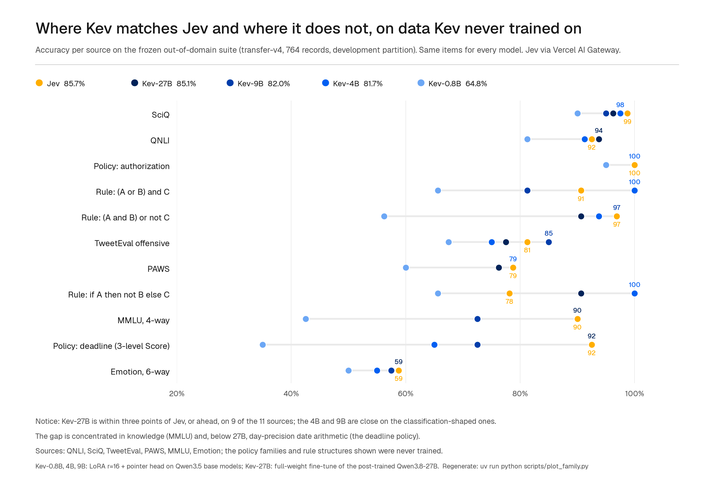</td>
<td align="center" valign="top">медіа не опубліковано</td>
</tr></table>

🧩 <b><a href="https://github.com/AgriciDaniel/jev-seo">AgriciDaniel/jev-seo</a></b> · ⭐1038 · Python · 🔎 inferred · 63 天

##### 📝 Стислий опис

Живий SEO-аудит будь-якого вебсайту за одним URL головної сторінки, оцінений за Jev. Звіти у форматах PDF, XLSX і Markdown.

##### 📌 Основні факти

| Поле      | Значення       |
| --------- | -------------- |
| Категорія | `Інші проєкти` |
| Докази    | `inferred`     |
| Мова      | Python         |

##### 📊 Дані

| Метрика         | Значення   |
| --------------- | ---------- |
| Зірки           | **1038**   |
| Останній push   | 2026-09-22 |
| Уперше в списку | 2026-11-08 |

---

<table><tr><th align="center" width="50%">🖼 Зображення</th><th align="center" width="50%">🎬 Відео</th></tr><tr>
<td align="center" valign="top">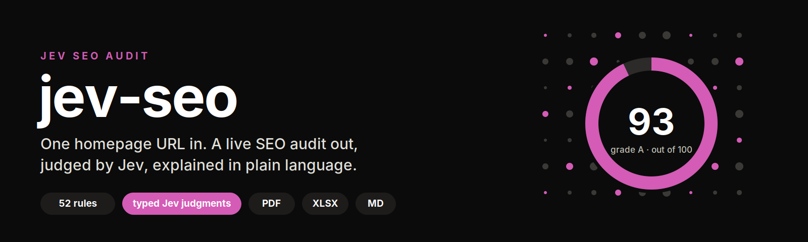</td>
<td align="center" valign="top">медіа не опубліковано</td>
</tr></table>

🧩 <b><a href="https://github.com/TypeLLM/TypeLLM">TypeLLM/TypeLLM</a></b> · ⭐982 · Python · 🔎 inferred · 29 天

##### 📝 Стислий опис

TypeLLM: LLMs із типобезпечною генерацією

##### 📌 Основні факти

| Поле      | Значення       |
| --------- | -------------- |
| Категорія | `Інші проєкти` |
| Докази    | `inferred`     |
| Мова      | Python         |

##### 📊 Дані

| Метрика         | Значення   |
| --------------- | ---------- |
| Зірки           | **982**    |
| Останній push   | 2026-10-25 |
| Уперше в списку | 2026-11-08 |

🏷 `ai` · `jev` · `llms` · `types`

---

<table><tr><th align="center" width="50%">🖼 Зображення</th><th align="center" width="50%">🎬 Відео</th></tr><tr>
<td align="center" valign="top">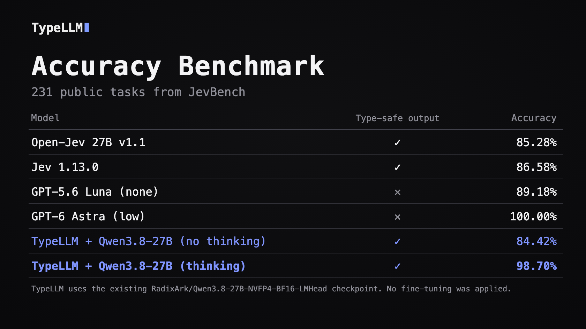</td>
<td align="center" valign="top">медіа не опубліковано</td>
</tr></table>

🧩 <b><a href="https://github.com/shengjidaguai-china/goutoujunshi-jev-chat">shengjidaguai-china/goutoujunshi-jev-chat</a></b> · ⭐695 · Python · 🔎 inferred · 36 天

##### 📝 Стислий опис

狗头军师 Chat: читання екрана 微信 на Mac, аналіз зв’язків і плаваюче вікно чернеток відповідей

##### 📌 Основні факти

| Поле      | Значення       |
| --------- | -------------- |
| Категорія | `Інші проєкти` |
| Докази    | `inferred`     |
| Мова      | Python         |

##### 📊 Дані

| Метрика         | Значення   |
| --------------- | ---------- |
| Зірки           | **695**    |
| Останній push   | 2026-10-19 |
| Уперше в списку | 2026-11-08 |

---

<table><tr><th align="center" width="50%">🖼 Зображення</th><th align="center" width="50%">🎬 Відео</th></tr><tr>
<td align="center" valign="top"></td>
<td align="center" valign="top">медіа не опубліковано</td>
</tr></table>

🧩 <b><a href="https://github.com/TianyuCodings/JevHarness">TianyuCodings/JevHarness</a></b> · ⭐561 · Python · 🔎 inferred · 39 天

##### 📝 Стислий опис

LLM-авторські каркаси Jev для конкретних завдань із необов’язковою рефлексією винагороди за повну траєкторію та еволюцією GEPA.

##### 📌 Основні факти

| Поле      | Значення       |
| --------- | -------------- |
| Категорія | `Інші проєкти` |
| Докази    | `inferred`     |
| Мова      | Python         |

##### 📊 Дані

| Метрика         | Значення   |
| --------------- | ---------- |
| Зірки           | **561**    |
| Останній push   | 2026-10-16 |
| Уперше в списку | 2026-11-08 |

---

<table><tr><th align="center" width="50%">🖼 Зображення</th><th align="center" width="50%">🎬 Відео</th></tr><tr>
<td align="center" valign="top"></td>
<td align="center" valign="top"> <a href="https://raw.githubusercontent.com/TianyuCodings/JevHarness/main/docs/media/pokemon-comparison.mp4">Відкрити відео</a></td>
</tr></table>

Ресурс підключено гарячим посиланням із вихідного репозиторію, оскільки ліцензію, що дозволяє розповсюдження, не заявлено.

<b>Більше в цій категорії</b> · 55

- [f/jev-leftpad](https://github.com/f/jev-leftpad) - Доповнює рядки зліва за допомогою TypeSafe AI Jev. З певних причин.
- [SoundBlaster/SwiftJev](https://github.com/SoundBlaster/SwiftJev) - Фреймворк Swift для доступу до моделі Jev System One від TypeSafe.ai.
- [codaaiteam/jev-ai](https://github.com/codaaiteam/jev-ai) - Jev AI quickstart &amp; FAQ — TypeSafe AI.
- [soderlind/ai-provider-for-jev](https://github.com/soderlind/ai-provider-for-jev) - Підключіть WordPress до моделі TypeSafe.
- [DreamBlooms/ifReflex.cpp](https://github.com/DreamBlooms/ifReflex.cpp) - Будь-яка LLM може працювати як модель прийняття рішень SystemOne на вашому…
- [turenlabs/lisa](https://github.com/turenlabs/lisa) - LISA: Leak, Injection &amp; Simplicity Auditor.
- [cookkie03/any-class](https://github.com/cookkie03/any-class) - Zero-token local decision engine for classifying Telegram Saved Messages with…
- [DevItaliya22/jev-chess](https://github.com/DevItaliya22/jev-chess) - Jev.
- [kasperihallinen/football-ai](https://github.com/kasperihallinen/football-ai) - Comparing a fine-tuned System One model called Von with conventional machine…
- [Paveerongar/clef-spam-detection](https://github.com/Paveerongar/clef-spam-detection) - Experiment using the System One model Clef to detect spam vs ham.
- [scholarly360/Microsoft-Decision-1-on-Microsoft-Foundry](https://github.com/scholarly360/Microsoft-Decision-1-on-Microsoft-Foundry) - Microsoft Decision-1 System One Model on Microsoft Foundry.
- [suraj-phanindra/jev-position-audit](https://github.com/suraj-phanindra/jev-position-audit) - Registered audit of position and format sensitivity in the Jev 1.13 decision…
- [TomatenMarc/Sycophancy-System-One-Models](https://github.com/TomatenMarc/Sycophancy-System-One-Models)
- [unbraind/pm-jev](https://github.com/unbraind/pm-jev) - Типізовані рішення з пріоритетом локального виконання для елементів pm із…
- [shcherbak-ai/contextgem](https://github.com/shcherbak-ai/contextgem) - Extract structured data and insights from documents using LLMs and decision…
- [Sac-Y/Jev-cu](https://github.com/Sac-Y/Jev-cu)
- [jev-chat/jev-chat-jarvis-mac](https://github.com/jev-chat/jev-chat-jarvis-mac) - Помічник у плаваючому вікні чату (macOS): сприйняття екрана + локальна мала…
- [Yinsongxu/LLM2Jev](https://github.com/Yinsongxu/LLM2Jev) - Перетворюйте локальні мовні моделі на структуровані моделі прийняття рішень у…
- [Zefan-Cai/Open-Jev](https://github.com/Zefan-Cai/Open-Jev)
- [dabit3/jev-experiments](https://github.com/dabit3/jev-experiments)
- [zfkarl/MedJev](https://github.com/zfkarl/MedJev) - MedJev: A System One Vision-Language Decision Model for Fast and Effective…
- [1Panel-dev/laya-server](https://github.com/1Panel-dev/laya-server) - Сервер із власним розгортанням API і вебінтерфейс для структурованих моделей…
- [Abhinavexists/lev](https://github.com/Abhinavexists/lev) - Відкрита модель прийняття рішень System One.
- [Jev-Engineering/cookbook](https://github.com/Jev-Engineering/cookbook) - Шістдесят рецептів для ноутбуків для типізованих рішень із Jev: шаблони Choice…
- [2951461586/Jev-Register-Tool](https://github.com/2951461586/Jev-Register-Tool) - TypeSafe（Jev / System One）заявка → лист підтвердження → схвалення → реєстрація…
- [I-You-Dream/jev-from-scratch](https://github.com/I-You-Dream/jev-from-scratch) - 从零开源复刻 Jev（System One）决策模型范式，基于 Qwen 基座训练，支持 Choice / Noul 原语，包含推理、微调、ECE…
- [yijunyu/jev-rs](https://github.com/yijunyu/jev-rs) - Судження System One (noul/choice/score) від будь-якого LLM за один prefill…
- [nvkudva/ollajev](https://github.com/nvkudva/ollajev) - Запускайте моделі рішень System One з Hugging Face локально за Jev / System One…
- [Kevthetech143/super-jev](https://github.com/Kevthetech143/super-jev) - A small, extensible decision-to-action harness for TypeSafe Jev.
- [manifoldor/xtags](https://github.com/manifoldor/xtags) - На часовій шкалі X позначає для кожної публікації, що вона хоче змусити вас…
- [usail-hkust/JevLight](https://github.com/usail-hkust/JevLight) - Jev-powered traffic signal control on CityFlow with structured phase and…
- [botassembly/thinkthen](https://github.com/botassembly/thinkthen) - ThinkThen: код, який розуміє, що ви маєте на увазі.
- [rawwerks/one-system](https://github.com/rawwerks/one-system) - Використовуйте локальні та розміщені класифікатори, також відомі як моделі…
- [comoc/jev-minesweeper](https://github.com/comoc/jev-minesweeper) - Демо, у якому TypeSafe Jev (System One) розв.
- [XingQiPan/rwkv-jev](https://github.com/XingQiPan/rwkv-jev) - Рушій рішень у стилі Jev без генерації на основі RWKV-7 (g1k-1b): обмежений…
- [nima1313/jev-captcha](https://github.com/nima1313/jev-captcha) - Read short image captchas with TypeSafe Jev: length first, any length, case…
- [a3harva/jev-autofill](https://github.com/a3harva/jev-autofill) - Chrome extension that fills job application forms from a local profile.
- [demirfahrieren-png/jev-canli-sonuclar](https://github.com/demirfahrieren-png/jev-canli-sonuclar) - Jev canlı sanal işlem sonuçları (sunucu her gün günceller; gerçek emir yok).
- [fdsfserrrr/mk--JEV-AI-](https://github.com/fdsfserrrr/mk--JEV-AI-) - 获课：jzit.top/26594/mk网-JEV 决策大模型实战，让 AI 从会聊天到能决策.
- [fghdhtfdu/JEV-AI-](https://github.com/fghdhtfdu/JEV-AI-) - 获课：jzit.top/26594/JEV 决策大模型实战，让 AI 从会聊天到能决策.
- [Lasimeri/XKS_Jev-like_Model_Base](https://github.com/Lasimeri/XKS_Jev-like_Model_Base) - Jev-like typed judgments (noul / choice / score) from a local LLM.
- [LinkedInLearning/Build-with-Decision-Models-in-30-Minutes-Jev-Kev-and-the-OpenAI-Decisions-API-29277003](https://github.com/LinkedInLearning/Build-with-Decision-Models-in-30-Minutes-Jev-Kev-and-the-OpenAI-Decisions-API-29277003) - : This is a repo for LinkedIn Learning course: Build with Decision Models in 30…
- [PineappleBingo/jev-radar](https://github.com/PineappleBingo/jev-radar) - TypeSafe Jev 오픈소스 구현을 매일 모아 한국어로 정리하는 레이더 (radar-index/1).
- [rttq/jev_board](https://github.com/rttq/jev_board) - jev board: a local workbench for testing propositions against TypeSafe Jev.
- [Sandesh-S-Dalvi/playwright-jev-testing](https://github.com/Sandesh-S-Dalvi/playwright-jev-testing) - Playwright TypeScript automation testing with TypeSafe Jev as the intelligence…
- [receptron/laya](https://github.com/receptron/laya) - Запускайте Laya, відкриту System-1 модель ухвалення рішень, сумісну з Jev, з…
- [Rizzo-AI-Academy/rizzo-flow](https://github.com/Rizzo-AI-Academy/rizzo-flow) - Відкрита локальна версія Jev: типізовані рішення від LLM без генерування…
- [jerryjliu/docjev](https://github.com/jerryjliu/docjev) - Дуже швидкий класифікатор/роздільник документів на основі Jev.
- [PostHog/jeeves](https://github.com/PostHog/jeeves) - Jeeves – Міркування покращує моделі прийняття рішень, подібні до Jev.
- [codejunkie99/keel](https://github.com/codejunkie99/keel) - Локально-орієнтоване робоче середовище для кодування macOS з локальною Laya та…
- [iapp-technology/openthai-systemone](https://github.com/iapp-technology/openthai-systemone) - OpenThai-SystemOne: відкрита тайська + англійська модель ухвалення рішень…
- [hawkymisc/typed-decision-bert](https://github.com/hawkymisc/typed-decision-bert) - Неофіційний PoC: рушій прийняття рішень на основі енкодера у стилі BERT за…
- [InterfazeAI/lev](https://github.com/InterfazeAI/lev) - Відкрита модель прийняття рішень System One.
- [epergaboni/jevseo](https://github.com/epergaboni/jevseo) - Типізовані SEO-, AEO- та GEO-оцінки на основі Jev, моделі прийняття рішень…
- [Temikus/lgtm](https://github.com/Temikus/lgtm) - Score pull requests with System One decision models.

## Проєкти за мовою реалізації

Екосистема зосереджена на Python і TypeScript, але типізовані клієнти постійно з'являються й іншими мовами. Ця таблиця генерується із самих записів.

| Мова       | Записи | Приклади                                                                                                |
| ---------- | ------ | ------------------------------------------------------------------------------------------------------- |
| Python     | 304    | `typesafe-ai/system-one-adapter-python`, `typesafe-ai/typesafe-sdk-python`, `typesafe-ai/WorkflowEvals` |
| TypeScript | 117    | `typesafe-ai/typesafe-sdk-js`, `TypeSafeAI/jev-harness`, `qkal/Canny`                                   |
| JavaScript | 66     | `clouatre-labs/decisions-judge-mcp`, `Ying-Kai-Liao/jev-browser`, `jiangkoumo/ego-decision-layer`       |
| Rust       | 29     | `AkashPriyadarshii/jev-curate`, `agent-ix/sapho`, `chussenot/judgment`                                  |
| HTML       | 20     | `typesafe-ai/typesafe-ai.github.io`, `yzfly/awesome-jev-zh`, `AkashPriyadarshii/jev-superpowers`        |
| Jupyter    | 13     | `jexp/neo4jev`, `GitHub30/OpenJev`, `Query-farm/vgi-typesafe`                                           |
| Go         | 11     | `mattn/go-jev`, `devbackend/jevgo`, `kataras/jev`                                                       |
| C#         | 6      | `elbruno/ElBruno.AI.Decisions`, `saibimajdi/typesafeai-dotnet-sdk`, `TraxSharp/Trax`                    |
| Elixir     | 5      | `dannote/jev`, `Elue-dev/jev_elixir`, `nshkrdotcom/system_one_sdk`                                      |
| PHP        | 5      | `basi/typesafe-ai-php-client`, `marcreichel/laya-php`, `Butochnikov/laravel-typesafe-jev`               |
| Swift      | 5      | `john-rocky/coreai-kit`, `Algorythm-Canada/OpenJevSwift`, `mattt/AnyDecisionModel`                      |
| C++        | 4      | `xiaocongyu66/llama.cpp-jev-adapter`, `DataZooDE/anofox-decide`, `feder-cr/jev`                         |
| Java       | 4      | `Premo-Cloud/typesafe-sdk-java`, `Nisaka520/JevIntent`, `danvega/jev-comment-moderation`                |
| PowerShell | 3      | `BFLabsAI/bf-jev-deep-research`, `dfinke/Jev`, `huntsman95/PowerJev`                                    |
| Shell      | 3      | `realZachi/pg-jev`, `milojarow/jev-skills`, `skylence-org/claudecode-jev-marketplace`                   |
| TeX        | 3      | `xiaohuiyan/awesome-jev-papers`, `dnakhoa/jev-deferred-crispification`, `evan-py-chen/jev-survey`       |
| Astro      | 2      | `heyjunpenn/awesome-jev`, `wizicer/jev_info_site`                                                       |
| Kotlin     | 2      | `pambrose/jev4k`, `jev-chat/jev-chat-jarvis`                                                            |
| Ruby       | 2      | `obie/ruby_decision_model`, `Ray-Hughes/jevalyn`                                                        |
| XS         | 2      | `cameronb-xano/jev-agent-guardrail`, `xano-community/agent-guardrail-jev`                               |
| C          | 1      | `lijiawei255/jev-tune`                                                                                  |
| Haskell    | 1      | `getmissionctrl/hs-jev`                                                                                 |
| Nushell    | 1      | `cablehead/jev.nu`                                                                                      |
| Pascal     | 1      | `danieleteti/systemone-delphi`                                                                          |

Враховуються лише записи, які вказують мову. Записи про інфраструктуру, документацію та обговорення виключено з цієї таблиці.

## Як долучитися

Виправлення вітаються і є найшвидшим способом поліпшити цей список. Відкрийте issue або pull request, якщо запис неправильно віднесено до категорії, неправильно оцінено, або якщо проєкт помилково виключено як колізію назв — саме в цій категорії автоматичні фільтри найчастіше помиляються. Доповнення найкраще робити, додаючи джерело до `scripts/collect.py`, а не редагуючи README, бо README генерується заново на кожному циклі.

---

Незалежний проєкт спільноти. Не пов'язаний із TypeSafe AI, не схвалений і не перевірений нею. Поведінка продукту, ціни, обмеження та псевдоніми моделей змінюються без попередження; усе критично важливе звіряйте з офіційною документацією. Ресурси залишаються власністю своїх вихідних проєктів і відтворюються лише там, де це дозволяє ліцензія.

Згенеровано за допомогою · 2026-11-24T15:33:26+08:00
