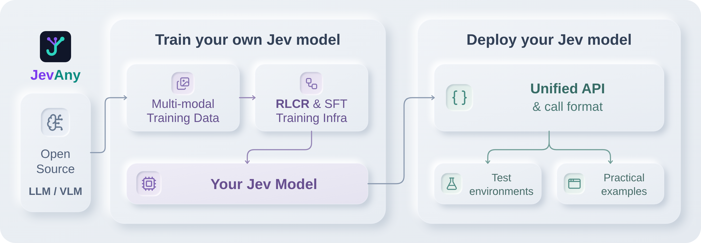
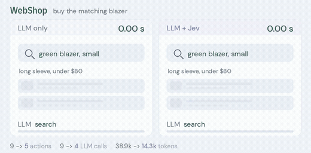
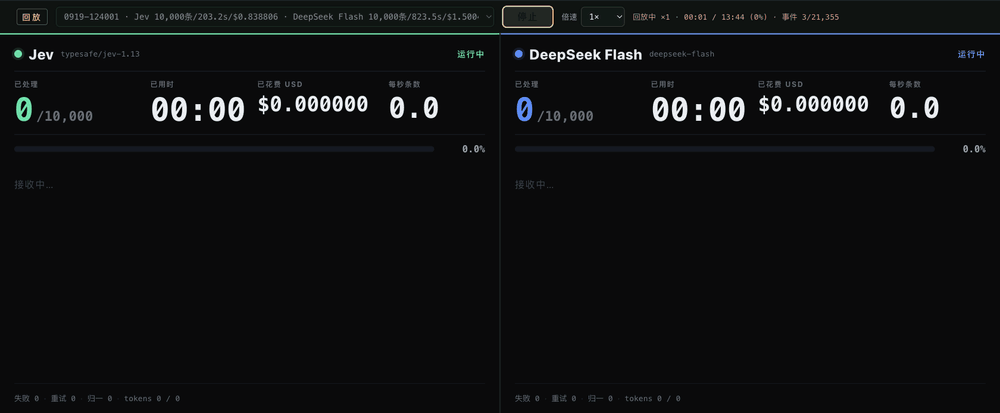

  

<h1 align="center">Awesome Jev Live</h1>

<b>Індекс Jev із градацією доказів, який перебудовує себе кожні дві години.</b>

  
  
  
  
  
  

<a href="../README.md">English</a> · <a href="README.zh-CN.md">简体中文</a> · <a href="README.zh-TW.md">繁體中文</a> · <a href="README.ja.md">日本語</a> · <a href="README.ko.md">한국어</a> · <a href="README.es.md">Español</a> · <a href="README.fr.md">Français</a> · <a href="README.de.md">Deutsch</a> · <a href="README.pt-BR.md">Português (Brasil)</a> · <a href="README.ru.md">Русский</a> · <a href="README.it.md">Italiano</a> · <a href="README.ar.md">العربية</a> · <a href="README.hi.md">हिन्दी</a> · <a href="README.tr.md">Türkçe</a> · <a href="README.vi.md">Tiếng Việt</a> · <a href="README.th.md">ไทย</a> · <a href="README.id.md">Bahasa Indonesia</a> · <a href="README.pl.md">Polski</a> · <a href="README.nl.md">Nederlands</a> · <b>Українська</b>

> [!NOTE]
> **Живий індекс** · Остання синхронізація: `2026-11-12T19:23:26+08:00` (UTC+8)
> · Записи: **816** · Нові за цей цикл: **7** · Мови реалізації: **27**

Кожен запис нижче було зібрано, відфільтровано й повторно перевірено конвеєром у цьому репозиторії. Числа та часові позначки походять із джерел, а не з написаного вручну знімка.

## 🔥 Вибір моменту — перший у кожній категорії

Один запис на категорію, відсортований за рівнем доказовості та зірками, перераховується щоразу. Це рейтинг, а не рекомендація; кожен вибір веде до повної картки нижче. Перевага надається проєктам, які опублікували знімок екрана або запис, щоб блок залишався наочним.

<table>
<tr>
<td width="50%" valign="top">
<b>🏛️ <a href="https://github.com/typesafe-ai/skills">typesafe-ai/skills</a></b>
⭐2893 · ✅ official
Навички агента для створення рішень за допомогою TypeSafe System One API
</td>
<td width="50%" valign="top">

<b>🧰 <a href="https://github.com/john-rocky/coreai-kit">john-rocky/coreai-kit</a></b>
⭐126 · Swift · 👁️ observed
Swift SDK for running chat, vision and speech models on iPhone and Mac with Apple&#x27;s Core AI. Model download and caching, FoundationModels integration, and runnable…
</td>
</tr>
<tr>
<td width="50%" valign="top">

<b>🤖 <a href="https://github.com/gargpratyush/jev-router">gargpratyush/jev-router</a></b>
⭐662 · JavaScript · 🔎 inferred
Маршрутизація до найдешевшої моделі в claude code для вашого завдання за допомогою jev-router
</td>
<td width="50%" valign="top">

<b>🛡️ <a href="https://github.com/dharmeshgurnani/codeotter">dharmeshgurnani/codeotter</a></b>
⭐3 · TypeScript · 👁️ observed
Autonomous, self-hosted AI code reviews, calibrated scoring gauges, and merge gates from any open model.
</td>
</tr>
<tr>
<td width="50%" valign="top">

<b>🧪 <a href="https://github.com/Mapika/decider">Mapika/decider</a></b>
⭐1052 · Python · 👁️ observed
Сімейство моделей у стилі System One, донавчених на основі Qwen3.5, призначених для типізованих рішень за один прохід із каліброваними ймовірностями.
</td>
<td width="50%" valign="top">

<b>🔬 <a href="https://github.com/r-ms/mini-jev">r-ms/mini-jev</a></b>
⭐64 · Python · 🔎 inferred
mini-Jev: як виглядає інтерфейс типізованих рішень у стилі Jev на замороженій Qwen3-4B — зчитує логіти літери варіанта замість генерування JSON. Попередньо…
</td>
</tr>
<tr>
<td width="50%" valign="top">

<b>🎮 <a href="https://github.com/MCG-NJU/VideoJev">MCG-NJU/VideoJev</a></b>
⭐308 · Python · 👁️ observed
VideoJev: System One Model для розуміння відео та взаємодії
</td>
<td width="50%" valign="top">
<b>📰 <a href="https://docs.typesafe.ai/model-jaggedness/jev-1.13">9 типів відомих дефектів (jaggedness)</a></b>
⭐0 · ✅ official
Буквальне розуміння, **ненадійний підрахунок**, порівняння дат, багаторівнева непрямість, великий state з нерелевантними деталями, змагальний вміст, суперечність між…
</td>
</tr>
</table>

## Зміст

- [Що таке Jev?](#що-таке-jev)
- [Як оцінюються записи](#як-оцінюються-записи)
- [Офіційні SDK та інструменти для розробників](#офіційні-sdk-та-інструменти-для-розробників) — **6**
- [Клієнти, SDK та адаптери спільноти](#клієнти-sdk-та-адаптери-спільноти) — **142**
- [Інструменти для агентів: MCP, хуки, шлюзи та агенти-програмісти](#інструменти-для-агентів-mcp-хуки-шлюзи-та-агенти-програмісти) — **252**
- [Маршрутизація, запобіжники та затвердження](#маршрутизація-запобіжники-та-затвердження) — **66**
- [Оцінювання, калібрування та бенчмарки](#оцінювання-калібрування-та-бенчмарки) — **89**
- [Відкриті відтворення, ваги та дослідження архітектури](#відкриті-відтворення-ваги-та-дослідження-архітектури) — **62**
- [Застосунки, ігри, робототехніка та інтерактивні демо](#застосунки-ігри-робототехніка-та-інтерактивні-демо) — **46**
- [Тексти, обговорення та споріднені списки](#тексти-обговорення-та-споріднені-списки) — **75**
- [Інші проєкти](#інші-проєкти) — **78**
- [Проєкти за мовою реалізації](#проєкти-за-мовою-реалізації)

## Що таке Jev?

Jev — перша **System One model** від TypeSafe AI. Вона не пише прозу. Вона приймає стан і питання, простір відповідей на які ви задаєте заздалегідь, та повертає типізовані значення з розподілами ймовірностей, на яких ваш код може розгалужуватися.

|                      |                                                                                                                                                                                                                            |
| -------------------- | -------------------------------------------------------------------------------------------------------------------------------------------------------------------------------------------------------------------------- |
| **Форма**            | `state + typed questions` → `constrained answers + probabilities` → `your code`                                                                                                                                            |
| **Примітиви**        | `Choice` (вибір одного з ≤255 варіантів), `Score` (шкала 2–10), `Noul` (імовірнісне так/ні)                                                                                                                                |
| **Ендпойнт**         | `POST https://api.typesafe.ai/v1/systemone`, модель `jev-1.13.0` / псевдонім `jev-latest`                                                                                                                                  |
| **Добре підходить**  | маршрутизація, тріаж, оцінювання, модерація, верифікація та шлюзи з низькою затримкою в межах обмеженого робочого процесу                                                                                                  |
| **Відомі обмеження** | підрахунок ненадійний, багаторівневе непряме звернення слабке, а офіційні матеріали називають дев'ять класів нерівномірності. Валідний за схемою вивід — це не те саме, що правильне рішення: калібруйте на власних даних. |

## Як оцінюються записи

Більшість списків у цій царині лише заявляють про включення. Цей каже, скільки насправді перевірив, і дає вам відфільтрувати відповідно.

| Оцінка       | Що це означає                                                                                                                                       |
| ------------ | --------------------------------------------------------------------------------------------------------------------------------------------------- |
| `official`   | Опубліковано самою TypeSafe AI.                                                                                                                     |
| `observed`   | Публічний артефакт, який можна відкрити й прочитати — справжній код, справжня конфігурація або явна заява TypeSafe/Jev у назві чи темі репозиторію. |
| `inferred`   | Зіставлено за неоднозначною ознакою та супутньою лексикою, але ще не прочитано рядок за рядком.                                                     |
| `unverified` | Виглядає спорідненим, нічого незалежно не підтверджено. Додано лише для пошуку.                                                                     |

## Офіційні SDK та інструменти для розробників

Усе, що публікує сам TypeSafe. Почніть звідси.

🏛️ <b><a href="https://github.com/typesafe-ai/skills">typesafe-ai/skills</a></b> · ⭐2893 · ✅ official · 19 天

##### 📝 Стислий опис

Навички агента для створення рішень за допомогою TypeSafe System One API

> 💡 Власні навички агента постачальника. Оскільки вони постійно оновлюються, це найближче до специфікації того, як TypeSafe планує керувати Jev з агента.

##### 📌 Основні факти

| Поле      | Значення                                      |
| --------- | --------------------------------------------- |
| Категорія | `Офіційні SDK та інструменти для розробників` |
| Докази    | `official`                                    |

##### 📊 Дані

| Метрика         | Значення   |
| --------------- | ---------- |
| Зірки           | **2893**   |
| Останній push   | 2026-10-23 |
| Уперше в списку | 2026-09-18 |

🏛️ <b><a href="https://github.com/typesafe-ai/system-one-adapter-python">typesafe-ai/system-one-adapter-python</a></b> · ⭐412 · Python · ✅ official · 50 天

##### 📝 Стислий опис

Повна заміна TypeSafeClient на основі LLM APIs

> 💡 Повна заміна, яка реалізує той самий інтерфейс за допомогою звичайного провайдера LLM. Це чесний спосіб порівняти типізоване рішення з промптом A/B-тестуванням на власних даних, перш ніж зупинитися на одному з варіантів.

🔧 Виявлено використання в коді: `README.md`

##### 📌 Основні факти

| Поле      | Значення                                      |
| --------- | --------------------------------------------- |
| Категорія | `Офіційні SDK та інструменти для розробників` |
| Докази    | `official`                                    |
| Мова      | Python                                        |

##### 📊 Дані

| Метрика         | Значення   |
| --------------- | ---------- |
| Зірки           | **412**    |
| Останній push   | 2026-09-22 |
| Уперше в списку | 2026-10-23 |

🏛️ <b><a href="https://github.com/typesafe-ai/typesafe-sdk-python">typesafe-ai/typesafe-sdk-python</a></b> · ⭐313 · Python · ✅ official · 1 天

##### 📝 Стислий опис

Офіційна бібліотека Python для TypeSafe API

> 💡 Синхронні та асинхронні клієнти. Найшвидший шлях від ключа API до типізованого рішення та еталон, з яким порівнюють клієнти спільноти.

🔧 Виявлено використання в коді: `README.md`

##### 📌 Основні факти

| Поле      | Значення                                      |
| --------- | --------------------------------------------- |
| Категорія | `Офіційні SDK та інструменти для розробників` |
| Докази    | `official`                                    |
| Мова      | Python                                        |

##### 📊 Дані

| Метрика         | Значення   |
| --------------- | ---------- |
| Зірки           | **313**    |
| Останній push   | 2026-11-11 |
| Уперше в списку | 2026-10-23 |

🏛️ <b><a href="https://github.com/typesafe-ai/typesafe-sdk-js">typesafe-ai/typesafe-sdk-js</a></b> · ⭐285 · TypeScript · ✅ official · 1 天

##### 📝 Стислий опис

Офіційна бібліотека TypeScript/JavaScript для TypeSafe API

> 💡 Клієнт TypeScript, у якому тип відповіді виводиться із запитаного вами питання, тож невідповідний тип повернення спричиняє помилку компіляції, а не несподіванку під час виконання.

##### 📌 Основні факти

| Поле      | Значення                                      |
| --------- | --------------------------------------------- |
| Категорія | `Офіційні SDK та інструменти для розробників` |
| Докази    | `official`                                    |
| Мова      | TypeScript                                    |

##### 📊 Дані

| Метрика         | Значення   |
| --------------- | ---------- |
| Зірки           | **285**    |
| Останній push   | 2026-11-11 |
| Уперше в списку | 2026-10-23 |

🏛️ <b><a href="https://github.com/typesafe-ai/WorkflowEvals">typesafe-ai/WorkflowEvals</a></b> · ⭐21 · Python · ✅ official · 1 天

##### 📝 Стислий опис

Опубліковано код робочого процесу evals.typesafe.ai

##### 📌 Основні факти

| Поле      | Значення                                      |
| --------- | --------------------------------------------- |
| Категорія | `Офіційні SDK та інструменти для розробників` |
| Докази    | `official`                                    |
| Мова      | Python                                        |

##### 📊 Дані

| Метрика         | Значення   |
| --------------- | ---------- |
| Зірки           | **21**     |
| Останній push   | 2026-11-11 |
| Уперше в списку | 2026-10-23 |

🏛️ <b><a href="https://github.com/typesafe-ai/typesafe-ai.github.io">typesafe-ai/typesafe-ai.github.io</a></b> · ⭐2 · HTML · ✅ official · 160 天

##### 📝 Стислий опис

Опис від початкового проєкту не опубліковано.

##### 📌 Основні факти

| Поле      | Значення                                      |
| --------- | --------------------------------------------- |
| Категорія | `Офіційні SDK та інструменти для розробників` |
| Докази    | `official`                                    |
| Мова      | HTML                                          |

##### 📊 Дані

| Метрика         | Значення   |
| --------------- | ---------- |
| Зірки           | **2**      |
| Останній push   | 2026-06-04 |
| Уперше в списку | 2026-10-23 |

## Клієнти, SDK та адаптери спільноти

Типізовані клієнти для ендпойнта System One — стількома мовами, скількома встигла спільнота.

🧰 <b><a href="https://github.com/jexp/neo4jev">jexp/neo4jev</a></b> · ⭐185 · Jupyter · 👁️ observed · 55 天

##### 📝 Стислий опис

Typesafe.ai System One Model Jev, що переміщується графом Neo4j, використовуючи класифікатор для зв’язків із сусідніми вузлами

##### 📌 Основні факти

| Поле      | Значення                             |
| --------- | ------------------------------------ |
| Категорія | `Клієнти, SDK та адаптери спільноти` |
| Докази    | `observed`                           |
| Мова      | Jupyter                              |

##### 📊 Дані

| Метрика         | Значення   |
| --------------- | ---------- |
| Зірки           | **185**    |
| Останній push   | 2026-09-18 |
| Уперше в списку | 2026-10-28 |

🧰 <b><a href="https://github.com/keltokhy/jgrep">keltokhy/jgrep</a></b> · ⭐141 · Python · 👁️ observed · 25 天

##### 📝 Стислий опис

grep, але шаблон — це опис. Фільтрує рядки за змістом за допомогою моделі рішень TypeSafe Jev: близько 200 мс і одна тисячна цента за рядок.

🔧 Виявлено використання в коді: `README.md`

##### 📌 Основні факти

| Поле      | Значення                             |
| --------- | ------------------------------------ |
| Категорія | `Клієнти, SDK та адаптери спільноти` |
| Докази    | `observed`                           |
| Мова      | Python                               |

##### 📊 Дані

| Метрика         | Значення   |
| --------------- | ---------- |
| Зірки           | **141**    |
| Останній push   | 2026-10-17 |
| Уперше в списку | 2026-10-29 |

🏷 `cli` · `grep` · `jev` · `openrouter` · `semantic-search` · `typesafe`

🧰 <b><a href="https://github.com/qkal/Canny">qkal/Canny</a></b> · ⭐135 · TypeScript · 👁️ observed · 50 天

##### 📝 Стислий опис

Не дозволяє агентам програмування ШІ заявляти, що роботу виконано, без доказів. Детерміновані хуки приймають рішення, TypeSafe Jev надає рекомендації. Журнал лише для додавання, нуль залежностей під час виконання.

🔧 Виявлено використання в коді: `README.md`

##### 📌 Основні факти

| Поле      | Значення                             |
| --------- | ------------------------------------ |
| Категорія | `Клієнти, SDK та адаптери спільноти` |
| Докази    | `observed`                           |
| Мова      | TypeScript                           |

##### 📊 Дані

| Метрика         | Значення   |
| --------------- | ---------- |
| Зірки           | **135**    |
| Останній push   | 2026-09-22 |
| Уперше в списку | 2026-10-29 |

🏷 `agent-hooks` · `ai-agents` · `claude-code` · `claude-code-hooks` · `codex` · `codex-cli` · `guardrails` · `jev`

🧰 <b><a href="https://github.com/john-rocky/coreai-kit">john-rocky/coreai-kit</a></b> · ⭐126 · Swift · 👁️ observed · 0 天

##### 📝 Стислий опис

Swift SDK for running chat, vision and speech models on iPhone and Mac with Apple's Core AI. Model download and caching, FoundationModels integration, and runnable examples with documented OS, SDK and model requirements.

🔧 Виявлено використання в коді: `Sources/CoreAIOps/CoreAI+SystemOne.swift`

##### 📌 Основні факти

| Поле      | Значення                             |
| --------- | ------------------------------------ |
| Категорія | `Клієнти, SDK та адаптери спільноти` |
| Докази    | `observed`                           |
| Мова      | Swift                                |

##### 📊 Дані

| Метрика         | Значення   |
| --------------- | ---------- |
| Зірки           | **126**    |
| Останній push   | 2026-11-11 |
| Уперше в списку | 2026-10-26 |

🏷 `apple` · `apple-core-ai` · `asr` · `core-ai` · `coreai` · `foundation-models` · `ios` · `ios-27`

---

<table><tr><th align="center" width="50%">🖼 Зображення</th><th align="center" width="50%">🎬 Відео</th></tr><tr>
<td align="center" valign="top"></td>
<td align="center" valign="top"> анімований запис</td>
</tr></table>

🧰 <b><a href="https://github.com/yzfly/awesome-jev-zh">yzfly/awesome-jev-zh</a></b> · ⭐93 · HTML · 👁️ observed · 0 天

##### 📝 Стислий опис

Добірний китайськомовний список Jev / TypeSafe System One: офіційні матеріали, SDK, популярні застосунки, інструменти Agent, відтворення відкритого коду та незалежні оцінки, із китайським посібником для початку роботи; щодня автоматично додаються GitHub популярних проєктів.

🔧 Виявлено використання в коді: `docs/quickstart.md`

##### 📌 Основні факти

| Поле      | Значення                             |
| --------- | ------------------------------------ |
| Категорія | `Клієнти, SDK та адаптери спільноти` |
| Докази    | `observed`                           |
| Мова      | HTML                                 |

##### 📊 Дані

| Метрика         | Значення   |
| --------------- | ---------- |
| Зірки           | **93**     |
| Останній push   | 2026-11-12 |
| Уперше в списку | 2026-09-18 |

🏷 `ai-agent` · `awesome` · `awesome-list` · `chinese` · `jev` · `llm` · `structured-output` · `system-one`

🧰 <b><a href="https://github.com/obie/ruby_decision_model">obie/ruby_decision_model</a></b> · ⭐59 · Ruby · 👁️ observed · 30 天

##### 📝 Стислий опис

Клієнт Ruby для моделей рішень, таких як Typesafe Jev

🔧 Виявлено використання в коді: `README.md`

##### 📌 Основні факти

| Поле      | Значення                             |
| --------- | ------------------------------------ |
| Категорія | `Клієнти, SDK та адаптери спільноти` |
| Докази    | `observed`                           |
| Мова      | Ruby                                 |

##### 📊 Дані

| Метрика         | Значення   |
| --------------- | ---------- |
| Зірки           | **59**     |
| Останній push   | 2026-10-12 |
| Уперше в списку | 2026-10-29 |

🧰 <b><a href="https://github.com/bodepudimuneendra-netizen/ConsciousDB">bodepudimuneendra-netizen/ConsciousDB</a></b> · ⭐55 · Python · 👁️ observed · 10 天

##### 📝 Стислий опис

Фреймворк Agentic GraphRAG, незалежний від бази даних, із взаємозамінними моделями System One (локальна Laya / хмарна Jev). Підключний інтелектуальний рівень із повним 4-фазним конвеєром, безперервним оцінюванням і власним обходом A* для будь-якої графової бази даних.

##### 📌 Основні факти

| Поле      | Значення                             |
| --------- | ------------------------------------ |
| Категорія | `Клієнти, SDK та адаптери спільноти` |
| Докази    | `observed`                           |
| Мова      | Python                               |

##### 📊 Дані

| Метрика         | Значення   |
| --------------- | ---------- |
| Зірки           | **55**     |
| Останній push   | 2026-11-02 |
| Уперше в списку | 2026-11-02 |

🏷 `astar-algorithm` · `eval-harness` · `fine-tuning` · `graphdatabase` · `graprag` · `jev` · `laya` · `neo4j`

🧰 <b><a href="https://github.com/shaharia-lab/jev-cli">shaharia-lab/jev-cli</a></b> · ⭐46 · Rust · 👁️ observed · 0 天

##### 📝 Стислий опис

Command-line tool for TypeSafe AI's Jev model. Ask yes/no, multiple-choice and rubric questions about any text and get calibrated probabilities back. Answers become exit codes for shells and CI, JSON for scripts, and MCP tools for AI agents.

🔧 Виявлено використання в коді: `README.md`

##### 📌 Основні факти

| Поле      | Значення                             |
| --------- | ------------------------------------ |
| Категорія | `Клієнти, SDK та адаптери спільноти` |
| Докази    | `observed`                           |
| Мова      | Rust                                 |

##### 📊 Дані

| Метрика         | Значення   |
| --------------- | ---------- |
| Зірки           | **46**     |
| Останній push   | 2026-11-12 |
| Уперше в списку | 2026-11-07 |

🏷 `ai-agents` · `classification` · `cli` · `command-line-tool` · `devtools` · `jev` · `llm` · `mcp`

---

<table><tr><th align="center" width="50%">🖼 Зображення</th><th align="center" width="50%">🎬 Відео</th></tr><tr>
<td align="center" valign="top"></td>
<td align="center" valign="top"> анімований запис</td>
</tr></table>

🧰 <b><a href="https://github.com/MrJev/awesome-jev">MrJev/awesome-jev</a></b> · ⭐21 · Python · 👁️ observed · 0 天

##### 📝 Стислий опис

Добірний список проєктів, інтеграцій і ресурсів для Jev, моделі System One від TypeSafe AI.

##### 📌 Основні факти

| Поле      | Значення                             |
| --------- | ------------------------------------ |
| Категорія | `Клієнти, SDK та адаптери спільноти` |
| Докази    | `observed`                           |
| Мова      | Python                               |

##### 📊 Дані

| Метрика         | Значення   |
| --------------- | ---------- |
| Зірки           | **21**     |
| Останній push   | 2026-11-11 |
| Уперше в списку | 2026-09-18 |

🏷 `ai-agents` · `awesome` · `awesome-list` · `jev` · `mcp` · `typesafe`

🧰 <b><a href="https://github.com/ckaraca/awesome-jev">ckaraca/awesome-jev</a></b> · ⭐18 · Python · 👁️ observed · 2 天

##### 📝 Стислий опис

Добірний список інструментів, інтеграцій та експериментів, створених на основі Jev, TypeSafe AI's System One моделі для швидких типізованих рішень.

##### 📌 Основні факти

| Поле      | Значення                             |
| --------- | ------------------------------------ |
| Категорія | `Клієнти, SDK та адаптери спільноти` |
| Докази    | `observed`                           |
| Мова      | Python                               |

##### 📊 Дані

| Метрика         | Значення   |
| --------------- | ---------- |
| Зірки           | **18**     |
| Останній push   | 2026-11-09 |
| Уперше в списку | 2026-09-19 |

🏷 `ai-agents` · `awesome` · `awesome-list` · `computer-use` · `jev` · `llm` · `system-one` · `typesafe`

🧰 <b><a href="https://github.com/Premo-Cloud/typesafe-sdk-java">Premo-Cloud/typesafe-sdk-java</a></b> · ⭐12 · Java · 👁️ observed · 21 天

##### 📝 Стислий опис

Спільнотний Java SDK для Jev, моделі System One від TypeSafe: типізовані запитання на вході, типізовані відповіді з каліброваними ймовірностями на виході. Java 17+, Spring Boot starter (неофіційний)

##### 📌 Основні факти

| Поле      | Значення                             |
| --------- | ------------------------------------ |
| Категорія | `Клієнти, SDK та адаптери спільноти` |
| Докази    | `observed`                           |
| Мова      | Java                                 |

##### 📊 Дані

| Метрика         | Значення   |
| --------------- | ---------- |
| Зірки           | **12**     |
| Останній push   | 2026-10-21 |
| Уперше в списку | 2026-10-28 |

🏷 `java` · `jev` · `sdk` · `spring-boot` · `system-one` · `system-one-models` · `typesafe`

🧰 <b><a href="https://github.com/PromtEngineer/jev-harness">PromtEngineer/jev-harness</a></b> · ⭐9 · Python · 👁️ observed · 48 天

##### 📝 Стислий опис

Обв’язка Pi-агента на основі TypeSafe's Jev (модель System One): маршрутизатор, вибір контексту, шлюз, верифікатор. Протестовано на гілках Neon Postgres.

##### 📌 Основні факти

| Поле      | Значення                             |
| --------- | ------------------------------------ |
| Категорія | `Клієнти, SDK та адаптери спільноти` |
| Докази    | `observed`                           |
| Мова      | Python                               |

##### 📊 Дані

| Метрика         | Значення   |
| --------------- | ---------- |
| Зірки           | **9**      |
| Останній push   | 2026-09-24 |
| Уперше в списку | 2026-10-28 |

🧰 <b><a href="https://github.com/clouatre-labs/decisions-judge-mcp">clouatre-labs/decisions-judge-mcp</a></b> · ⭐5 · JavaScript · 👁️ observed · 0 天

##### 📝 Стислий опис

Типізовані рішення для AI-агентів як інструмент MCP: імовірність «так/ні» (noul), вибір і оцінка в одному швидкому запиті. Працює на основі моделі TypeSafe System One.

##### 📌 Основні факти

| Поле      | Значення                             |
| --------- | ------------------------------------ |
| Категорія | `Клієнти, SDK та адаптери спільноти` |
| Докази    | `observed`                           |
| Мова      | JavaScript                           |

##### 📊 Дані

| Метрика         | Значення   |
| --------------- | ---------- |
| Зірки           | **5**      |
| Останній push   | 2026-11-11 |
| Уперше в списку | 2026-10-12 |

🏷 `agent` · `ai` · `cli` · `decision-making` · `decisions` · `judge` · `llm` · `mcp`

---

<table><tr><th align="center" width="50%">🖼 Зображення</th><th align="center" width="50%">🎬 Відео</th></tr><tr>
<td align="center" valign="top"></td>
<td align="center" valign="top"> анімований запис</td>
</tr></table>

🧰 <b><a href="https://github.com/elbruno/ElBruno.AI.Decisions">elbruno/ElBruno.AI.Decisions</a></b> · ⭐5 · C# · 👁️ observed · 8 天

##### 📝 Стислий опис

.NET 10 decision SDK: Choose, Score, and Assess with Microsoft Foundry (Microsoft-Decision-1), native local Ollama System One models, and TypeSafe AI Jev. One API, probabilities instead of paragraphs.

##### 📌 Основні факти

| Поле      | Значення                             |
| --------- | ------------------------------------ |
| Категорія | `Клієнти, SDK та адаптери спільноти` |
| Докази    | `observed`                           |
| Мова      | C#                                   |

##### 📊 Дані

| Метрика         | Значення   |
| --------------- | ---------- |
| Зірки           | **5**      |
| Останній push   | 2026-11-03 |
| Уперше в списку | 2026-11-09 |

🏷 `dotnet` · `dotnet10` · `jev` · `microsoft-extensions-ai` · `nuget`

---

<table><tr><th align="center" width="50%">🖼 Зображення</th><th align="center" width="50%">🎬 Відео</th></tr><tr>
<td align="center" valign="top"></td>
<td align="center" valign="top">медіа не опубліковано</td>
</tr></table>

🧰 <b><a href="https://github.com/moeinheidari7829/Kev-Bio">moeinheidari7829/Kev-Bio</a></b> · ⭐5 · Python · 👁️ observed · 5 天

##### 📝 Стислий опис

Official code for "Every Pixel Is an Option: A System One Model for Medical Ultrasound Biometry" (arXiv 2611.03360)

##### 📌 Основні факти

| Поле      | Значення                             |
| --------- | ------------------------------------ |
| Категорія | `Клієнти, SDK та адаптери спільноти` |
| Докази    | `observed`                           |
| Мова      | Python                               |

##### 📊 Дані

| Метрика         | Значення   |
| --------------- | ---------- |
| Зірки           | **5**      |
| Останній push   | 2026-11-07 |
| Уперше в списку | 2026-11-12 |

🏷 `biometry` · `echocardiography` · `jev` · `jev-ai` · `kev` · `medical-imaging` · `system-one` · `ultrasound`

---

<table><tr><th align="center" width="50%">🖼 Зображення</th><th align="center" width="50%">🎬 Відео</th></tr><tr>
<td align="center" valign="top"></td>
<td align="center" valign="top">медіа не опубліковано</td>
</tr></table>

Ресурс підключено гарячим посиланням із вихідного репозиторію, оскільки ліцензію, що дозволяє розповсюдження, не заявлено.

🧰 <b><a href="https://github.com/avalonreset/legends-jev">avalonreset/legends-jev</a></b> · ⭐3 · Python · 👁️ observed · 1 天

##### 📝 Стислий опис

Optical character recognition (OCR), storefront signage verification, bounding-box grounding, and typed computer-use decision CLI powered by TypeSafe Jev 1.14.

##### 📌 Основні факти

| Поле      | Значення                             |
| --------- | ------------------------------------ |
| Категорія | `Клієнти, SDK та адаптери спільноти` |
| Докази    | `observed`                           |
| Мова      | Python                               |

##### 📊 Дані

| Метрика         | Значення   |
| --------------- | ---------- |
| Зірки           | **3**      |
| Останній push   | 2026-11-11 |
| Уперше в списку | 2026-11-11 |

🏷 `bounding-box` · `browser-agent` · `claude-code` · `codex` · `computer-use` · `cto-legends` · `decision-model` · `image-text-extraction`

---

<table><tr><th align="center" width="50%">🖼 Зображення</th><th align="center" width="50%">🎬 Відео</th></tr><tr>
<td align="center" valign="top"></td>
<td align="center" valign="top">медіа не опубліковано</td>
</tr></table>

🧰 <b><a href="https://github.com/Bonzokoles/36_chambers">Bonzokoles/36_chambers</a></b> · Python · 👁️ observed · 20 天

##### 📝 Стислий опис

Federated knowledge retrieval engine for AI agents. Routes queries across specialized backends (FTS5, ChromaDB, graph) via a registry-first orchestrator with TypeSafe/Jev AI routing and evidence re-ranking. Read-only by default, security-gated by design.

##### 📌 Основні факти

| Поле      | Значення                             |
| --------- | ------------------------------------ |
| Категорія | `Клієнти, SDK та адаптери спільноти` |
| Докази    | `observed`                           |
| Мова      | Python                               |

##### 📊 Дані

| Метрика         | Значення   |
| --------------- | ---------- |
| Зірки           | **0**      |
| Останній push   | 2026-10-22 |
| Уперше в списку | 2026-10-23 |

🏷 `ai-agents` · `ai-infrastructure` · `chromadb` · `embeddings` · `federated-search` · `fts5` · `information-retrieval` · `jev`

---

<table><tr><th align="center" width="50%">🖼 Зображення</th><th align="center" width="50%">🎬 Відео</th></tr><tr>
<td align="center" valign="top"></td>
<td align="center" valign="top">медіа не опубліковано</td>
</tr></table>

Ресурс підключено гарячим посиланням із вихідного репозиторію, оскільки ліцензію, що дозволяє розповсюдження, не заявлено.

🧰 <b><a href="https://github.com/dzhng/jevgrep">dzhng/jevgrep</a></b> · ⭐3210 · TypeScript · 🔎 inferred · 0 天 · ⭐-1

##### 📝 Стислий опис

Знаходьте код, запитуючи, що він робить. CLI для агентів програмування, який використовує Jev, щоб знаходити релевантні файли та контекст вихідного коду.

##### 📌 Основні факти

| Поле      | Значення                             |
| --------- | ------------------------------------ |
| Категорія | `Клієнти, SDK та адаптери спільноти` |
| Докази    | `inferred`                           |
| Мова      | TypeScript                           |

##### 📊 Дані

| Метрика         | Значення      |
| --------------- | ------------- |
| Зірки           | **3210** (-1) |
| Останній push   | 2026-11-11    |
| Уперше в списку | 2026-11-07    |

🏷 `ai-sdk` · `claude-code` · `cli` · `code-search` · `codex` · `coding-agents` · `context-retrieval` · `developer-tools`

---

<table><tr><th align="center" width="50%">🖼 Зображення</th><th align="center" width="50%">🎬 Відео</th></tr><tr>
<td align="center" valign="top"></td>
<td align="center" valign="top">медіа не опубліковано</td>
</tr></table>

<b>Більше в цій категорії</b> · 124

- [sumleo/prompt2jev](https://github.com/sumleo/prompt2jev) - Навичка агента та CLI, які перетворюють природну мову, промпт LLM або код, що…
- [Sur-Cai/macos-computer-use-kit](https://github.com/Sur-Cai/macos-computer-use-kit) - AX-first computer use for AI agents on macOS with optional Jev.
- [xingwudao/OpenJev](https://github.com/xingwudao/OpenJev) - OpenJev: незалежний Jev-натхненний System One рішень API, заснований на…
- [danieleteti/systemone-delphi](https://github.com/danieleteti/systemone-delphi) - Delphi client for System One models (Jev, tev1 and nimble on Ollama): ask typed…
- [GitHub30/OpenJev](https://github.com/GitHub30/OpenJev) - Модель System One з відкритими вагами (сумісна з Jev): калібровані рішення noul…
- [chussenot/judgment](https://github.com/chussenot/judgment) - Типізовані, калібровані судження з моделей System One: рішення, записане як…
- [CMaintz/jev-dotnet](https://github.com/CMaintz/jev-dotnet) - Unofficial .NET SDK for TypeSafe AI.
- [erik-hedstrom/loadout](https://github.com/erik-hedstrom/loadout) - Pick the model, skills and MCP servers for each coding-agent session from a…
- [jqueryscript/awesome-jev](https://github.com/jqueryscript/awesome-jev) - A curated list of TypeSafe Jev resources, SDKs, agents, MCP servers…
- [basi/typesafe-ai-php-client](https://github.com/basi/typesafe-ai-php-client) - PHP client for the typesafe.ai System One API (Jev).
- [chrismarchant/jev-router](https://github.com/chrismarchant/jev-router) - Agent- and harness-agnostic router that offloads parallel-workstream decisions…
- [CMaintz/jev-java](https://github.com/CMaintz/jev-java) - Unofficial Java SDK for TypeSafe AI.
- [cogcloud-ai/cog-typesafe](https://github.com/cogcloud-ai/cog-typesafe) - TypeSafe.
- [gajaguar/typesafe-cli](https://github.com/gajaguar/typesafe-cli) - Unofficial command-line interface for TypeSafe AI System One models, on…
- [JosephHardy91/graph-composition-with-dLLMs](https://github.com/JosephHardy91/graph-composition-with-dLLMs) - A Graph-Compiled Specification RAG system built with **Dagster**, **PostgreSQL…
- [sanketmuchhala/jevgate](https://github.com/sanketmuchhala/jevgate) - Calibrated policy triage and institutional risk routing: a hybrid…
- [semperos/typesafe-sdk-gleam](https://github.com/semperos/typesafe-sdk-gleam) - Typesafe.ai (Jev) SDK client in Gleam.
- [wawan93/gojev](https://github.com/wawan93/gojev) - golang implementation of typesafe.ai SDK.
- [ollaya-dev/ollaya](https://github.com/ollaya-dev/ollaya) - Jev-compatible API server for open decision models.
- [realZachi/pg-jev](https://github.com/realZachi/pg-jev) - Ставте запитання до таблиць Postgres звичайною мовою.
- [socai-io/jev-social](https://github.com/socai-io/jev-social) - Агент для дослідження соціальних медіа з відкритим кодом, орієнтований на…
- [juspay/neurolink](https://github.com/juspay/neurolink) - Шар конвеєра нервової системи ШІ — один інтерфейс, що з.
- [supercorp-ai/supercov](https://github.com/supercorp-ai/supercov) - Покриття, безпека та якість коду для агентів програмування.
- [aaddrick/building-with-typesafe-jev](https://github.com/aaddrick/building-with-typesafe-jev) - Неофіційна навичка, яка навчає агентів для написання коду створювати за…
- [Ying-Kai-Liao/jev-browser](https://github.com/Ying-Kai-Liao/jev-browser) - Автоматизація браузера, де LLM планує, а Jev (Typesafe System One) вирішує.
- [AkashPriyadarshii/jev-curate](https://github.com/AkashPriyadarshii/jev-curate) - High-throughput synthetic and pretraining dataset sifter for TypeSafe Jev.
- [fazlerocks/jevmail](https://github.com/fazlerocks/jevmail) - Сортування електронної пошти Gmail за допомогою ШІ з відкритим кодом.
- [AkashPriyadarshii/jev-seo](https://github.com/AkashPriyadarshii/jev-seo) - Free Rust SEO and GEO toolkit powered by TypeSafe Jev: 58-rule audits, site…
- [AboveColin/HA-Jev](https://github.com/AboveColin/HA-Jev) - Поставте своєму дому запитання й отримайте число у відповідь.
- [sharziki/semdecide](https://github.com/sharziki/semdecide) - Типізовані семантичні рішення для конвеєрів Unix і CI на основі TypeSafe AI Jev.
- [bladedevoff/stuntd](https://github.com/bladedevoff/stuntd) - Локальний проксі, який навчається на типізованих рішеннях LLM вашого застосунку…
- [burnigtm/jev-mcp](https://github.com/burnigtm/jev-mcp) - Сервер MCP, який додає TypeSafe Jev до циклу програмування в Cursor, Codex і…
- [mlimarenko/IronRAG](https://github.com/mlimarenko/IronRAG) - One-click knowledge system for documents, internal bots, and AI agents.
- [AkashPriyadarshii/jev-superpowers](https://github.com/AkashPriyadarshii/jev-superpowers) - Systematic software development framework for AI coding agents upgraded with…
- [dannote/jev](https://github.com/dannote/jev) - TypeSafe Jev для OTP: відповідайте на Jev з GenServer і зіставляйте шаблон…
- [agencyenterprise/jev-recipes](https://github.com/agencyenterprise/jev-recipes) - 248 small Jev decisions for JavaScript and TypeScript: route, rerank, gate…
- [DevLoops-ai/unified-brain](https://github.com/DevLoops-ai/unified-brain) - System One coding agents: code-level answers at the score of a Claude Fable 5.1…
- [jwuthri-cloud/SelfJev](https://github.com/jwuthri-cloud/SelfJev) - Self-hosted decision model (selfjev-4b) with a Jev-compatible API: Python SDK…
- [jiangkoumo/ego-decision-layer](https://github.com/jiangkoumo/ego-decision-layer) - Pluggable decision layer for the ego lite browser: one System One (Jev) call…
- [thusinh1969/BrighTO_Router](https://github.com/thusinh1969/BrighTO_Router) - BrighTO LLM Router: free open-source, ultra-fast Rust LLM gateway/router and…
- [arjun988/Kev](https://github.com/arjun988/Kev) - Рушій прийняття рішень System One з відкритим кодом.
- [Ray-Hughes/jevalyn](https://github.com/Ray-Hughes/jevalyn) - Шар рішень для вашого Rails-застосунку.
- [nouli-ai/nouli](https://github.com/nouli-ai/nouli) - A ledger-backed decision network that records AI decisions and connects them to…
- [pambrose/jev4k](https://github.com/pambrose/jev4k) - A Kotlin Multiplatform DSL and client for TypeSafe.
- [saibimajdi/typesafeai-dotnet-sdk](https://github.com/saibimajdi/typesafeai-dotnet-sdk) - Спільнотний .NET SDK для TypeSafe AI System One API — типізовані запитання…
- [Elue-dev/jev_elixir](https://github.com/Elue-dev/jev_elixir) - jev_elixir — це невеликий, ідіоматичний інтерфейс для прийняття типізованих…
- [arcships/android-use](https://github.com/arcships/android-use) - Android control for Dim Agent and local MCP clients, with a live screen, native…
- [haileyok/typesafe-client](https://github.com/haileyok/typesafe-client) - Неофіційні клієнти Go і Rust для TypeSafe AI System One API (Jev).
- [himomohi/aside-jev](https://github.com/himomohi/aside-jev) - Агенти Aside приймають рішення за допомогою TypeSafe Jev.
- [AIAnytime/Jev-Router](https://github.com/AIAnytime/Jev-Router) - Decision-first, OpenAI-compatible AI router powered by Jev typed decisions.
- [chenrui333/jev-docs](https://github.com/chenrui333/jev-docs) - Історія Jev / TypeSafe System One APIs, SDKs, рекомендації для агентів та…
- [devbackend/jevgo](https://github.com/devbackend/jevgo) - Неофіційний клієнт Go для TypeSafe AI System One API (Jev) — типізовані…
- [docxology/daf-jev](https://github.com/docxology/daf-jev) - daf-jev: композиційний Python toolkit для TypeSafe.
- [Kadihx/jev-x-kit](https://github.com/Kadihx/jev-x-kit) - Офлайн-рівень рішень за $0 для агентів програмування: примітиви…
- [akiiwa-games/AgentCompass](https://github.com/akiiwa-games/AgentCompass) - Deterministic multi-agent task router &amp; subscription quota scheduler for Claude…
- [Agnuxo1/Universal-Cognitive-Architecture-JEV-v2](https://github.com/Agnuxo1/Universal-Cognitive-Architecture-JEV-v2) - Executable cognitive architecture: validated graph context, deterministic…
- [JimmyWesley/rlcd-gateway](https://github.com/JimmyWesley/rlcd-gateway) - Шлюз із власним хостингом для LLMs і моделей рішень.
- [vibefilter/filament](https://github.com/vibefilter/filament) - Filter Filament tables with a plain-English statement.
- [zchee/decision-model-sdk-rust](https://github.com/zchee/decision-model-sdk-rust) - Async Rust SDK for decision models served through the System One API, with an…
- [zhirschtritt/typesafe-go](https://github.com/zhirschtritt/typesafe-go) - Ідіоматичний Go SDK для TypeSafe AI API.
- [AboveColin/jevclient](https://github.com/AboveColin/jevclient) - Асинхронний клієнт Python для TypeSafe Jev.
- [AronAxe/GraphPaper](https://github.com/AronAxe/GraphPaper) - A Windows writing studio with knowledge graphs, author voice…
- [Butochnikov/laravel-typesafe-jev](https://github.com/Butochnikov/laravel-typesafe-jev) - Неофіційна інтеграція Laravel для TypeSafe Jev AI із типізованими відповідями…
- [coo-quack/jev-pii-checker](https://github.com/coo-quack/jev-pii-checker) - CLI, що знаходить PII у тексті за допомогою TypeSafe Jev: наявність, чутливість…
- [freepik-company/jev-mcp](https://github.com/freepik-company/jev-mcp) - MCP server for typed decisions with Jev / System One via OpenRouter or TypeSafe.
- [frodi-karlsson/onesie](https://github.com/frodi-karlsson/onesie) - Gate scripts and CI on fast, calibrated System One judgments like Jev: a score…
- [Lasimeri/Mechanical-Jev](https://github.com/Lasimeri/Mechanical-Jev) - The asking side of Jev (TypeSafe System One: noul, choice, score) in Rust…
- [nshkrdotcom/system_one_sdk](https://github.com/nshkrdotcom/system_one_sdk) - Незалежний від провайдера Elixir/BEAM SDK для семантики System One: типізовані…
- [PAI-CUHK/SLEEPJEV](https://github.com/PAI-CUHK/SLEEPJEV) - Типізовані рішення під час виконання, натхненні JEV, для довготривалого PSG…
- [zerone-agents/jev-model-router](https://github.com/zerone-agents/jev-model-router) - Легка маршрутизація моделей для агентів із сумісністю з OpenAI і Anthropic API…
- [abhisheksharma001/jev-skill](https://github.com/abhisheksharma001/jev-skill) - Agent skill for TypeSafe AI.
- [dsaad68/fuzzy-jev](https://github.com/dsaad68/fuzzy-jev) - A client for OpenRouter&#x27;s decision models, TypeSafe&#x27;s Jev by default: typed…
- [getmissionctrl/hs-jev](https://github.com/getmissionctrl/hs-jev) - Клієнт Haskell для рішення API TypeSafe System One (Jev) — типізовані пакетні…
- [NerdishShah/playwright-cli-jev-bakeoff](https://github.com/NerdishShah/playwright-cli-jev-bakeoff) - Bake-off: Playwright CLI vs CLI+Jev vs Playwright MCP.
- [bitranox/btx-skill-jev-judge](https://github.com/bitranox/btx-skill-jev-judge) - Claude Code plugin and Python CLI: hand a judgment repeated over many items to…
- [exfoca/decision-model-lab-4JEV](https://github.com/exfoca/decision-model-lab-4JEV) - DML is a reproducible harness for evaluating small, local decision models under…
- [Hyper-AI-Lab/openclaw-jev](https://github.com/Hyper-AI-Lab/openclaw-jev) - Production control plane для OpenClaw agents: маршрутизація intake за допомогою…
- [MrKyaw/CognitiveMirror-Jev-MCP](https://github.com/MrKyaw/CognitiveMirror-Jev-MCP) - Cognitive middleware for personal and enterprise AI agents: 14 MCP tools and a…
- [Talya1412/jev-harness](https://github.com/Talya1412/jev-harness) - TypeSafe Jev (System One) integrations for OMP, MCP, Claude Code, and Pi…
- [Wrenik/Jev-toolkit-Compiler](https://github.com/Wrenik/Jev-toolkit-Compiler) - Context log, search and a compact/clear advisor for Claude Code.
- [abirshhishirroy/mini-jev](https://github.com/abirshhishirroy/mini-jev) - A custom Jev-style decision model built from scratch on Qwen2.5-3B.
- [Arnabest/embeddinggemma-2-jev](https://github.com/Arnabest/embeddinggemma-2-jev) - Non-destructive Multimodal Base with 7KB Modular Causal Decision Adapter for…
- [AsgardMuninn/jev-norma](https://github.com/AsgardMuninn/jev-norma) - Triaje normativo LatAm con Jev (System One) como gate: normaliza cláusulas de…
- [CMaintz/jev-tools](https://github.com/CMaintz/jev-tools) - Інструменти TypeScript, створені на основі Jev від TypeSafe AI: захисний…
- [codebam/jev-guardrails](https://github.com/codebam/jev-guardrails) - Захисні механізми для викликів інструментів агентів на основі Jev: бібліотека…
- [fan56/dsh-jev-core](https://github.com/fan56/dsh-jev-core) - Shared TypeSafe Jev decision-model client for the dsh ecosystem: strict…
- [HappyHackingSpace/jev](https://github.com/HappyHackingSpace/jev) - Go SDK, CLI, MCP server and agent skill for TypeSafe.
- [heiwa4126/jev-node1](https://github.com/heiwa4126/jev-node1) - Bun で @typesafe-ai/sdk 0.7.0 を使うとエラーになるので、一時的に pnpm と node でやる版.
- [ivanblagdan/jev-cli](https://github.com/ivanblagdan/jev-cli) - Composable CLI for TypeSafe.
- [kkdev92/jev-dotnet](https://github.com/kkdev92/jev-dotnet) - An unofficial .NET 10 client for Jev, TypeSafe.
- [mattbran87/jev-daemon](https://github.com/mattbran87/jev-daemon) - jev: a per-user daemon and CLI that hold TypeSafe keys and send checked…
- [mdimamhosen/jev](https://github.com/mdimamhosen/jev) - One endpoint for every model, one CLI for every MCP.
- [ogarciarevett/jev-py-sdk](https://github.com/ogarciarevett/jev-py-sdk) - Typed Jev judgments (noul / choice / score) from TypeSafe for Python, masked…
- [phoenix1331/laravel-jev-hotdog](https://github.com/phoenix1331/laravel-jev-hotdog) - A Laravel 13 playground that tells you whether a photo is a hot dog or not…
- [pyck-ai/jev-cli](https://github.com/pyck-ai/jev-cli) - Jev.
- [rendydev404/jev-ultrafast](https://github.com/rendydev404/jev-ultrafast) - Ultrafast indexed-DOM browser automation agent &amp; zero-API-key AI CLI runner…
- [revoirb612/codex-jev-router](https://github.com/revoirb612/codex-jev-router) - A small local-first task router for TypeSafe Jev and Codex CLI.
- [royalskynet/jev-gate-mcp](https://github.com/royalskynet/jev-gate-mcp) - Governed Jev decision gateway for GPT, Claude, and MCP clients.
- [shetautnetjer/jev-cli](https://github.com/shetautnetjer/jev-cli) - Clean-room CLI for TypeSafe System One / Jev Decision Contracts, search, and…
- [sunjongos/jev-typesafe-gatekeeper](https://github.com/sunjongos/jev-typesafe-gatekeeper) - World-Class Pure System 1 AI Decision &amp; 90/10 Hybrid Gatekeeper Skill powered…
- [sususu98/pi-jev-navigator](https://github.com/sususu98/pi-jev-navigator) - Ultra-low-token System One context navigation and precision SOP dispatch engine…
- [VianneyMI/python-jev](https://github.com/VianneyMI/python-jev) - Unofficial typed Python SDK for TypeSafe.
- [Yasir-Khan-7/jev-sentinel](https://github.com/Yasir-Khan-7/jev-sentinel) - Захист від prompt injection і обмеження викликів інструментів для AI-агентів…
- [Zuexx/agent-jev-integration](https://github.com/Zuexx/agent-jev-integration) - TypeSafe Jev integrated into Claude Code: routing, escalation, guardrails, evals.
- [rokbenko/quackd](https://github.com/rokbenko/quackd) - One CLI for all your robots. Connect them, command them, and let them work…
- [MiaoWuNYA/rikkahub-sillytavern-android](https://github.com/MiaoWuNYA/rikkahub-sillytavern-android) - 安卓AI聊天端:开箱即聊，无损导入酒馆卡，专属RP模式，高定制主题，缓存强省用量，手机控制，防空回，主动信息，前端卡支持，QQbot，AI群聊，插件系统，强兼容…
- [pithings/advocaat](https://github.com/pithings/advocaat) - Невеликий типобезпечний клієнт для запитань до ШІ про ваші дані, що працює на…
- [Brainwires/jevwire](https://github.com/Brainwires/jevwire) - Jev decision layer for agents: MCP server, embeddable DecisionModel library…
- [zhulinchng/jevper](https://github.com/zhulinchng/jevper) - Обгортка класифікації у формі Jev (TypeSafe System One) над клієнтами…
- [Das-rebel/a3m-router](https://github.com/Das-rebel/a3m-router) - ⚡ Adaptive multi-model LLM router — 80+ providers, Jev System One single-pass…
- [schainks/system_one_client](https://github.com/schainks/system_one_client) - Клієнт Elixir для моделей рішень System One: TypeSafe Jev, Cloudflare Clef…
- [gilljon/typesafe-ai-rs](https://github.com/gilljon/typesafe-ai-rs) - Незалежний асинхронний і блокувальний Rust SDK для TypeSafe AI System One API.
- [IKEASven69/dsh-opencli](https://github.com/IKEASven69/dsh-opencli) - 让 dsh 会办事:登录态真实浏览器 × 180 站点结构化命令 + SystemOne 亚秒决策 + 执行真实性判定 + watch 监控.
- [AutreMachine/bosco](https://github.com/AutreMachine/bosco) - Router and proxy for OpenAI compatible LLMs machines - 1 url to rule them all !
- [cipherTing/sael](https://github.com/cipherTing/sael) - Go client for the TypeSafe System One API (Jev) — the first piece of sael, a…
- [Query-farm/vgi-typesafe](https://github.com/Query-farm/vgi-typesafe) - Воркер VGI, який надає TypeSafe System One питань (choice, noul, score) у…
- [iamtalha-arshad/ex_typesafe_ai](https://github.com/iamtalha-arshad/ex_typesafe_ai) - Неофіційний клієнт Elixir для TypeSafe AI API — типізовані структури, HTTP на…
- [mmornati/system-one-router](https://github.com/mmornati/system-one-router) - A fast System One decision model (Jev or local Laya) picks which LLM answers…
- [y0usaf/typesafe-cli](https://github.com/y0usaf/typesafe-cli) - Ставте типізовані питання Jev з оболонки: відповіді noul, choice і score як…
- [geilt/typesafe-cli](https://github.com/geilt/typesafe-cli) - CLI і навичка агента для TypeSafe System One (Jev): типізовані судження Choice…
- [KratosLee-6/open-source-model-deploy](https://github.com/KratosLee-6/open-source-model-deploy) - 开源大模型部署可行性鉴别工具 · 168 个开源模型动态评估（含 12 个 JEV/System One 决策模型）· 硬件自动检测 ·…
- [MarcelRoozekrans/Minos.NET](https://github.com/MarcelRoozekrans/Minos.NET) - Typed, source-generated decision questions for .NET: one IDecisionClient for…
- [MIt9/laya-cli](https://github.com/MIt9/laya-cli) - Зручний CLI для Laya — типізовані рішення (choice/score/noul) для людей і…
- [phiat/typesafe-rust-sdk](https://github.com/phiat/typesafe-rust-sdk) - Unofficial Rust client for TypeSafe.

## Інструменти для агентів: MCP, хуки, шлюзи та агенти-програмісти

Категорія, що зростає найшвидше: хуки, сервери MCP і шлюзи, які ставлять типізоване рішення перед наступною дією агента.

🤖 <b><a href="https://github.com/tamaratran/fast-jev-compaction">tamaratran/fast-jev-compaction</a></b> · ⭐7953 · TypeScript · 🔎 inferred · 55 天 · ⭐+3

##### 📝 Стислий опис

Плагін Claude Code, який замінює підсумок компактифікації на Jev рішень: кожен виклик інструмента та результат оцінюється в одному швидкому запиті, застарілі відкидаються або обрізаються, а все збережене залишається дослівним.

> 💡 Замінює підсумок компактифікації контексту агента програмування на типізоване рішення. Чистий приклад заміни одного виклику LLM в наявному конвеєрі замість перебудови конвеєра.

##### 📌 Основні факти

| Поле      | Значення                                                          |
| --------- | ----------------------------------------------------------------- |
| Категорія | `Інструменти для агентів: MCP, хуки, шлюзи та агенти-програмісти` |
| Докази    | `inferred`                                                        |
| Мова      | TypeScript                                                        |

##### 📊 Дані

| Метрика         | Значення      |
| --------------- | ------------- |
| Зірки           | **7953** (+3) |
| Останній push   | 2026-09-18    |
| Уперше в списку | 2026-11-08    |

🤖 <b><a href="https://github.com/gargpratyush/jev-router">gargpratyush/jev-router</a></b> · ⭐662 · JavaScript · 🔎 inferred · 54 天

##### 📝 Стислий опис

Маршрутизація до найдешевшої моделі в claude code для вашого завдання за допомогою jev-router

> 💡 Спрямовує кожен хід до найдешевшої моделі, здатної його обробити. Канонічний приклад використання System One моделі для зменшення витрат.

##### 📌 Основні факти

| Поле      | Значення                                                          |
| --------- | ----------------------------------------------------------------- |
| Категорія | `Інструменти для агентів: MCP, хуки, шлюзи та агенти-програмісти` |
| Докази    | `inferred`                                                        |
| Мова      | JavaScript                                                        |

##### 📊 Дані

| Метрика         | Значення   |
| --------------- | ---------- |
| Зірки           | **662**    |
| Останній push   | 2026-09-19 |
| Уперше в списку | 2026-11-08 |

---

<table><tr><th align="center" width="50%">🖼 Зображення</th><th align="center" width="50%">🎬 Відео</th></tr><tr>
<td align="center" valign="top"></td>
<td align="center" valign="top">медіа не опубліковано</td>
</tr></table>

🤖 <b><a href="https://github.com/0xNatoshi/jev-codex-router">0xNatoshi/jev-codex-router</a></b> · ⭐273 · JavaScript · 🔎 inferred · 51 天

##### 📝 Стислий опис

Маршрутизація моделі та міркувань для кожного ходу для Codex, керована Jev (TypeSafe System One): обирає модель, глибину міркувань і режим швидкості для кожного ходу.

> 💡 Маршрутизація моделі та інтенсивності міркувань для кожного ходу для агента програмування, керована типізованими рішеннями.

##### 📌 Основні факти

| Поле      | Значення                                                          |
| --------- | ----------------------------------------------------------------- |
| Категорія | `Інструменти для агентів: MCP, хуки, шлюзи та агенти-програмісти` |
| Докази    | `inferred`                                                        |
| Мова      | JavaScript                                                        |

##### 📊 Дані

| Метрика         | Значення   |
| --------------- | ---------- |
| Зірки           | **273**    |
| Останній push   | 2026-09-22 |
| Уперше в списку | 2026-10-28 |

🏷 `ai` · `codex` · `jev` · `llm` · `macos` · `routing` · `typesafe`

🤖 <b><a href="https://github.com/strands-labs/strands-decider">strands-labs/strands-decider</a></b> · ⭐1142 · Python · 👁️ observed · 0 天 · ⭐+6

##### 📝 Стислий опис

Невелика швидка модель ухвалення рішень, або модель System 1, для агентних робочих процесів. Обирайте між варіантами або оцінюйте за шкалою швидше, ніж LLM, із каліброваною впевненістю для кожного рішення.

##### 📌 Основні факти

| Поле      | Значення                                                          |
| --------- | ----------------------------------------------------------------- |
| Категорія | `Інструменти для агентів: MCP, хуки, шлюзи та агенти-програмісти` |
| Докази    | `observed`                                                        |
| Мова      | Python                                                            |

##### 📊 Дані

| Метрика         | Значення      |
| --------------- | ------------- |
| Зірки           | **1142** (+6) |
| Останній push   | 2026-11-11    |
| Уперше в списку | 2026-10-02    |

🏷 `ai` · `machine-learning` · `natural-language-understanding` · `python` · `strands-agents` · `strands-labs` · `system-one` · `system-one-models`

🤖 <b><a href="https://github.com/thruwire/foreman">thruwire/foreman</a></b> · ⭐824 · Python · 👁️ observed · 27 天

##### 📝 Стислий опис

An agent supervisor and software factory foreman powered by decision models

🔧 Виявлено використання в коді: `docs/openrouter.md`

##### 📌 Основні факти

| Поле      | Значення                                                          |
| --------- | ----------------------------------------------------------------- |
| Категорія | `Інструменти для агентів: MCP, хуки, шлюзи та агенти-програмісти` |
| Докази    | `observed`                                                        |
| Мова      | Python                                                            |

##### 📊 Дані

| Метрика         | Значення   |
| --------------- | ---------- |
| Зірки           | **824**    |
| Останній push   | 2026-10-15 |
| Уперше в списку | 2026-11-08 |

🏷 `agent-supervision` · `codex` · `jev` · `opencode` · `pi-agent` · `pi-coding-agent` · `pi-durable`

---

<table><tr><th align="center" width="50%">🖼 Зображення</th><th align="center" width="50%">🎬 Відео</th></tr><tr>
<td align="center" valign="top"></td>
<td align="center" valign="top">медіа не опубліковано</td>
</tr></table>

🤖 <b><a href="https://github.com/AbdelStark/awesome-typesafe-jev">AbdelStark/awesome-typesafe-jev</a></b> · ⭐616 · HTML · 👁️ observed · 10 天

##### 📝 Стислий опис

Awesome Jev: підкріплений джерелами польовий довідник щодо моделі System One TypeSafe, з SDKs, живими демонстраціями, інструментами агентів і незалежними оцінюваннями.

🔧 Виявлено використання в коді: `README.md`

##### 📌 Основні факти

| Поле      | Значення                                                          |
| --------- | ----------------------------------------------------------------- |
| Категорія | `Інструменти для агентів: MCP, хуки, шлюзи та агенти-програмісти` |
| Докази    | `observed`                                                        |
| Мова      | HTML                                                              |

##### 📊 Дані

| Метрика         | Значення   |
| --------------- | ---------- |
| Зірки           | **616**    |
| Останній push   | 2026-11-01 |
| Уперше в списку | 2026-10-28 |

🏷 `agent-skills` · `ai-agents` · `awesome` · `awesome-jev` · `awesome-list` · `awesome-lists` · `curated-list` · `developer-tools`

🤖 <b><a href="https://github.com/jkudish/jev-mcp">jkudish/jev-mcp</a></b> · ⭐578 · JavaScript · 👁️ observed · 13 天

##### 📝 Стислий опис

Швидкі, дешеві, типізовані оцінки від моделі TypeSafe Jev у вигляді інструментів MCP.

> 💡 Ранній прототип надання доступу до Jev через MCP, саме так до нього звертається більшість ланцюжків інструментів, не пов’язаних із Python.

🔧 Виявлено використання в коді: `README.md`

##### 📌 Основні факти

| Поле      | Значення                                                          |
| --------- | ----------------------------------------------------------------- |
| Категорія | `Інструменти для агентів: MCP, хуки, шлюзи та агенти-програмісти` |
| Докази    | `observed`                                                        |
| Мова      | JavaScript                                                        |

##### 📊 Дані

| Метрика         | Значення   |
| --------------- | ---------- |
| Зірки           | **578**    |
| Останній push   | 2026-10-30 |
| Уперше в списку | 2026-10-26 |

🤖 <b><a href="https://github.com/walidboulanouar/awesome-jev-use-cases">walidboulanouar/awesome-jev-use-cases</a></b> · ⭐491 · 👁️ observed · 46 天

##### 📝 Стислий опис

Чудовий список варіантів використання TypeSafe AI Jev: 74 демонстрації, упорядковані за вподобаннями, понад 150 репозиторіїв GitHub, обмеження, вартість і приклади API. CC0

🔧 Виявлено використання в коді: `README.md`

##### 📌 Основні факти

| Поле      | Значення                                                          |
| --------- | ----------------------------------------------------------------- |
| Категорія | `Інструменти для агентів: MCP, хуки, шлюзи та агенти-програмісти` |
| Докази    | `observed`                                                        |

##### 📊 Дані

| Метрика         | Значення   |
| --------------- | ---------- |
| Зірки           | **491**    |
| Останній push   | 2026-09-26 |
| Уперше в списку | 2026-10-29 |

🏷 `ai-guardrails` · `ai-router` · `awesome` · `awesome-list` · `classification` · `claude-code` · `decision-model` · `examples`

🤖 <b><a href="https://github.com/kraayenjon/awesome-jev">kraayenjon/awesome-jev</a></b> · ⭐207 · 👁️ observed · 46 天

##### 📝 Стислий опис

Добірний список варіантів використання Jev, проєктів, SDKs і ресурсів. Jev — це TypeSafe AI's System One модель для швидких типізованих рішень у програмному забезпеченні — Choice, Score і Noul із каліброваними ймовірностями.

🔧 Виявлено використання в коді: `README.md`

##### 📌 Основні факти

| Поле      | Значення                                                          |
| --------- | ----------------------------------------------------------------- |
| Категорія | `Інструменти для агентів: MCP, хуки, шлюзи та агенти-програмісти` |
| Докази    | `observed`                                                        |

##### 📊 Дані

| Метрика         | Значення   |
| --------------- | ---------- |
| Зірки           | **207**    |
| Останній push   | 2026-09-27 |
| Уперше в списку | 2026-09-19 |

🏷 `agents` · `ai` · `ai-agents` · `api` · `artificial-intelligence` · `automation` · `awesome` · `awesome-list`

🤖 <b><a href="https://github.com/valentynkit/awesome-jev-typesafe">valentynkit/awesome-jev-typesafe</a></b> · ⭐190 · JavaScript · 👁️ observed · 0 天

##### 📝 Стислий опис

Типізовані рішення за допомогою TypeSafe's Jev, першої System One моделі

🔧 Виявлено використання в коді: `readme.md`, `README.ko.md`, `README.ja.md`, `README.zh-CN.md`

##### 📌 Основні факти

| Поле      | Значення                                                          |
| --------- | ----------------------------------------------------------------- |
| Категорія | `Інструменти для агентів: MCP, хуки, шлюзи та агенти-програмісти` |
| Докази    | `observed`                                                        |
| Мова      | JavaScript                                                        |

##### 📊 Дані

| Метрика         | Значення   |
| --------------- | ---------- |
| Зірки           | **190**    |
| Останній push   | 2026-11-11 |
| Уперше в списку | 2026-09-19 |

🏷 `ai-agents` · `awesome` · `awesome-list` · `claude-code` · `directory` · `jev` · `llm-agents` · `system-one`

🤖 <b><a href="https://github.com/dbreunig/building-with-jev-skill">dbreunig/building-with-jev-skill</a></b> · ⭐167 · 👁️ observed · 13 天

##### 📝 Стислий опис

Навичка для написання та вдосконалення програм, які викликають Jev, модель TypeSafe System One

> 💡 Навичка для написання програм, які викликають Jev, а не програму, яка викликає Jev. Відмінність важлива: вона кодує правила проєктування, а не одну їхню реалізацію.

##### 📌 Основні факти

| Поле      | Значення                                                          |
| --------- | ----------------------------------------------------------------- |
| Категорія | `Інструменти для агентів: MCP, хуки, шлюзи та агенти-програмісти` |
| Докази    | `observed`                                                        |

##### 📊 Дані

| Метрика         | Значення   |
| --------------- | ---------- |
| Зірки           | **167**    |
| Останній push   | 2026-10-29 |
| Уперше в списку | 2026-10-28 |

🤖 <b><a href="https://github.com/y0usaf/pi-jev">y0usaf/pi-jev</a></b> · ⭐165 · TypeScript · 👁️ observed · 11 天

##### 📝 Стислий опис

TypeSafe Jev як рівень прийняття рішень для агента програмування Pi: вимірюваний шлюз викликів інструментів і jev_ask для типізованих, каліброваних відповідей

🔧 Виявлено використання в коді: `README.md`

##### 📌 Основні факти

| Поле      | Значення                                                          |
| --------- | ----------------------------------------------------------------- |
| Категорія | `Інструменти для агентів: MCP, хуки, шлюзи та агенти-програмісти` |
| Докази    | `observed`                                                        |
| Мова      | TypeScript                                                        |

##### 📊 Дані

| Метрика         | Значення   |
| --------------- | ---------- |
| Зірки           | **165**    |
| Останній push   | 2026-10-31 |
| Уперше в списку | 2026-10-29 |

🏷 `guardrails` · `jev` · `pi-extension` · `pi-package` · `typesafe`

🤖 <b><a href="https://github.com/Bodila51/grok-bot-jev">Bodila51/grok-bot-jev</a></b> · ⭐133 · Python · 👁️ observed · 44 天

##### 📝 Стислий опис

Підключіть TypeSafe Jev до Grok Bot як дешевий рівень прийняття рішень — обмеження використання, шаблон навички, приклади

🔧 Виявлено використання в коді: `src/jev_client.py`, `src/router.py`

##### 📌 Основні факти

| Поле      | Значення                                                          |
| --------- | ----------------------------------------------------------------- |
| Категорія | `Інструменти для агентів: MCP, хуки, шлюзи та агенти-програмісти` |
| Докази    | `observed`                                                        |
| Мова      | Python                                                            |

##### 📊 Дані

| Метрика         | Значення   |
| --------------- | ---------- |
| Зірки           | **133**    |
| Останній push   | 2026-09-28 |
| Уперше в списку | 2026-10-29 |

🏷 `cursor` · `decision-layer` · `grok-bot` · `jev` · `python` · `typesafe`

---

<table><tr><th align="center" width="50%">🖼 Зображення</th><th align="center" width="50%">🎬 Відео</th></tr><tr>
<td align="center" valign="top"></td>
<td align="center" valign="top">медіа не опубліковано</td>
</tr></table>

🤖 <b><a href="https://github.com/caijinchun/nanojev-arena">caijinchun/nanojev-arena</a></b> · ⭐7 · HTML · 👁️ observed · 53 天

##### 📝 Стислий опис

NanoJev Snake Arena: 1v4 human-vs-AI battleship + 100-agent swarm simulator. Local demo of Jev System-One model (open-source mini replica).

##### 📌 Основні факти

| Поле      | Значення                                                          |
| --------- | ----------------------------------------------------------------- |
| Категорія | `Інструменти для агентів: MCP, хуки, шлюзи та агенти-програмісти` |
| Докази    | `observed`                                                        |
| Мова      | HTML                                                              |

##### 📊 Дані

| Метрика         | Значення   |
| --------------- | ---------- |
| Зірки           | **7**      |
| Останній push   | 2026-09-19 |
| Уперше в списку | 2026-11-01 |

---

<table><tr><th align="center" width="50%">🖼 Зображення</th><th align="center" width="50%">🎬 Відео</th></tr><tr>
<td align="center" valign="top"></td>
<td align="center" valign="top">медіа не опубліковано</td>
</tr></table>

🤖 <b><a href="https://github.com/dfranco-projects/jev-guardbench">dfranco-projects/jev-guardbench</a></b> · ⭐3 · Python · 👁️ observed · 38 天

##### 📝 Стислий опис

Чи може модель System One (TypeSafe Jev, відкритий Kev) замінити LLM-as-judge у callback-функціях обмежень агента?

##### 📌 Основні факти

| Поле      | Значення                                                          |
| --------- | ----------------------------------------------------------------- |
| Категорія | `Інструменти для агентів: MCP, хуки, шлюзи та агенти-програмісти` |
| Докази    | `observed`                                                        |
| Мова      | Python                                                            |

##### 📊 Дані

| Метрика         | Значення   |
| --------------- | ---------- |
| Зірки           | **3**      |
| Останній push   | 2026-10-04 |
| Уперше в списку | 2026-11-04 |

---

<table><tr><th align="center" width="50%">🖼 Зображення</th><th align="center" width="50%">🎬 Відео</th></tr><tr>
<td align="center" valign="top"></td>
<td align="center" valign="top">медіа не опубліковано</td>
</tr></table>

Ресурс підключено гарячим посиланням із вихідного репозиторію, оскільки ліцензію, що дозволяє розповсюдження, не заявлено.

🤖 <b><a href="https://github.com/dolevhayut/resurface">dolevhayut/resurface</a></b> · TypeScript · 👁️ observed · 40 天

##### 📝 Стислий опис

TypeSafe JEV resume screening: LLM writes the questions, JEV (System One classification model) answers them for every resume in your ATS with the exact evidence line. 8× faster, 31× cheaper than an LLM.

##### 📌 Основні факти

| Поле      | Значення                                                          |
| --------- | ----------------------------------------------------------------- |
| Категорія | `Інструменти для агентів: MCP, хуки, шлюзи та агенти-програмісти` |
| Докази    | `observed`                                                        |
| Мова      | TypeScript                                                        |

##### 📊 Дані

| Метрика         | Значення   |
| --------------- | ---------- |
| Зірки           | **0**      |
| Останній push   | 2026-10-03 |
| Уперше в списку | 2026-11-01 |

🏷 `ai-recruiting` · `ats` · `candidate-matching` · `classification-model` · `claude` · `decision-model` · `evidence-based-hiring` · `hr-tech`

---

<table><tr><th align="center" width="50%">🖼 Зображення</th><th align="center" width="50%">🎬 Відео</th></tr><tr>
<td align="center" valign="top"></td>
<td align="center" valign="top"> <a href="https://raw.githubusercontent.com/dolevhayut/resurface/main/docs/launch/resurface-launch.mp4">Відкрити відео</a></td>
</tr></table>

🤖 <b><a href="https://github.com/kaivalpatel6350/jev-docs-agent">kaivalpatel6350/jev-docs-agent</a></b> · Python · 👁️ observed · 2 天

##### 📝 Стислий опис

Goal-driven AI agent that records walkthrough videos of any web app and writes the user guide. Powered by Jev (TypeSafe AI) + Playwright, driven from Claude Desktop via MCP. Open-source alternative to Supademo/Scribe and manual testing.

##### 📌 Основні факти

| Поле      | Значення                                                          |
| --------- | ----------------------------------------------------------------- |
| Категорія | `Інструменти для агентів: MCP, хуки, шлюзи та агенти-програмісти` |
| Докази    | `observed`                                                        |
| Мова      | Python                                                            |

##### 📊 Дані

| Метрика         | Значення   |
| --------------- | ---------- |
| Зірки           | **0**      |
| Останній push   | 2026-11-09 |
| Уперше в списку | 2026-11-10 |

🏷 `ai-agent` · `arcade-alternative` · `browser-automation` · `claude-desktop` · `documentation-generator` · `e2e-testing` · `interactive-demo` · `jev`

---

<table><tr><th align="center" width="50%">🖼 Зображення</th><th align="center" width="50%">🎬 Відео</th></tr><tr>
<td align="center" valign="top"></td>
<td align="center" valign="top"> анімований запис</td>
</tr></table>

🤖 <b><a href="https://github.com/browser-use/jev-ultrafast">browser-use/jev-ultrafast</a></b> · ⭐24444 · Python · 🔎 inferred · 1 天 · ⭐+1

##### 📝 Стислий опис

Найшвидший і найдешевший веб-агент

##### 📌 Основні факти

| Поле      | Значення                                                          |
| --------- | ----------------------------------------------------------------- |
| Категорія | `Інструменти для агентів: MCP, хуки, шлюзи та агенти-програмісти` |
| Докази    | `inferred`                                                        |
| Мова      | Python                                                            |

##### 📊 Дані

| Метрика         | Значення       |
| --------------- | -------------- |
| Зірки           | **24444** (+1) |
| Останній push   | 2026-11-11     |
| Уперше в списку | 2026-11-08     |

---

<table><tr><th align="center" width="50%">🖼 Зображення</th><th align="center" width="50%">🎬 Відео</th></tr><tr>
<td align="center" valign="top"></td>
<td align="center" valign="top"> анімований запис · <a href="https://raw.githubusercontent.com/browser-use/jev-ultrafast/main/docs/demo.mp4">Відкрити відео</a></td>
</tr></table>

<b>Більше в цій категорії</b> · 234

- [Avinash-jetwani/jevmem](https://github.com/Avinash-jetwani/jevmem) - Shared project rules and memory for AI coding agents.
- [openlayer-ai/jevals](https://github.com/openlayer-ai/jevals) - Оцінювання агентів і обмеження як рішення Jev: один запит на трасування, частка…
- [GhalebDweikat/winnow](https://github.com/GhalebDweikat/winnow) - Каліброване сито контексту для Claude Code: кожен результат інструмента…
- [Nisaka520/JevIntent](https://github.com/Nisaka520/JevIntent) - WeChat (плагін FkWeChat): утримуйте повідомлення, щоб проаналізувати намір /…
- [andyrewlee/awesome-system-one](https://github.com/andyrewlee/awesome-system-one) - Список моделей System One (також званих моделями прийняття рішень): Jev, перша…
- [Li-Evan/awesome-jev](https://github.com/Li-Evan/awesome-jev) - Найповніша галерея того, що люди створюють за допомогою Jev, моделі System One…
- [ChenneyZhuang/laya-browser-agent](https://github.com/ChenneyZhuang/laya-browser-agent) - Локальна альтернативна система Jev з відкритим кодом: рішення браузерного…
- [TrustifAI/typed_evals](https://github.com/TrustifAI/typed_evals) - Fast, typed Python framework for Jev-as-a-Judge/Decision-model evaluation for…
- [tiffygk/jev-mode](https://github.com/tiffygk/jev-mode) - Claude Code/Codex skills, evals, harnesses/context tools, and learning…
- [darwintechlab/openjev](https://github.com/darwintechlab/openjev) - OpenJev: плагін Opencode, який замінює рішення під час генерації тексту на Jev…
- [yohanargentina-oss/Foq](https://github.com/yohanargentina-oss/Foq) - ⚡ Foq — БЕЗКОШТОВНА локальна альтернатива з відкритим кодом для Jev.
- [mani-aiml/jev-demos](https://github.com/mani-aiml/jev-demos) - Демонстрації з Jev, моделлю System One від TypeSafe, по одній теці на…
- [tamnd/kime](https://github.com/tamnd/kime) - Typed decisions over text in milliseconds.
- [BYK/jev-mcp](https://github.com/BYK/jev-mcp) - Сервер MCP, орієнтований передусім на оцінювання, для TypeSafe.
- [kolawong/fast-compaction-dsh](https://github.com/kolawong/fast-compaction-dsh) - Verdict-based context compaction for DeepSeek Harness — replaces lossy LLM…
- [LHCWN/arkui-sem](https://github.com/LHCWN/arkui-sem) - Семантичний лінтер ArkUI для агентів програмування: виявляє помилки стану й…
- [rajasekharponakala/jev-mcp](https://github.com/rajasekharponakala/jev-mcp) - Сервер MCP, що обгортає моделі TypeSafe Jev System One — типізовані судження…
- [BFLabsAI/bf-jev-deep-research](https://github.com/BFLabsAI/bf-jev-deep-research) - Навичка агента + дослідження verbatim про Jev (TypeSafe AI System One Model)…
- [lewisyang3/LEO](https://github.com/lewisyang3/LEO) - A cost-tiered AI pipeline pairing System One model Jev and Claude Haiku to…
- [Mainakcris7/agent-guardrail-with-jev](https://github.com/Mainakcris7/agent-guardrail-with-jev) - A practical demo of how can we leverage the power of System One Models like Jev…
- [systemonemodels/noulxp](https://github.com/systemonemodels/noulxp) - NoulXP (formerly OpenDXP): the open standard for System One models.
- [api-evangelist/typesafe-ai](https://github.com/api-evangelist/typesafe-ai) - TypeSafe AI — лабораторія штучного інтелекту в Сан-Франциско, що створює моделі…
- [CrowBe/weave](https://github.com/CrowBe/weave) - Оболонка агента для моделі System One.
- [gsaini/system-one-models-getting-started](https://github.com/gsaini/system-one-models-getting-started) - TypeSafe.
- [jms-dcksn/uipath-jev-guardrail-connector](https://github.com/jms-dcksn/uipath-jev-guardrail-connector) - Конектор UiPath із власними guardrail, побудований на моделі TypeSafe Jev…
- [lucast4049/openjev](https://github.com/lucast4049/openjev) - Запускайте швидкі, калібровані, типізовані рішення на відкритих моделях System…
- [nosial/FederationJevGuard](https://github.com/nosial/FederationJevGuard) - A FederationLib plugin that reviews reports, evidence and entities with a…
- [Rams901/amira-brightwater-ai-suite](https://github.com/Rams901/amira-brightwater-ai-suite) - Amira AI Engineer Challenge Suite — Hybrid System-One (TypeSafe Jev 1.14) +…
- [STAIxBWLB/agent-decide](https://github.com/STAIxBWLB/agent-decide) - Decision layer for the agent family: typed decisions and model routing over…
- [jev-chat/jev-chat-jarvis](https://github.com/jev-chat/jev-chat-jarvis) - Асистент рішень для чату: перш ніж ви відповісте, Jev читає чат, оцінює намір і…
- [YaoApp/yao](https://github.com/YaoApp/yao) - ✨ Усі ваші агенти та робочі простори в одному місці, на кожному вашому…
- [kerpopule/hermes-jev-skills](https://github.com/kerpopule/hermes-jev-skills) - Маршрутизація моделей, пам.
- [reticlehq/reticle](https://github.com/reticlehq/reticle) - AI-агенти можуть генерувати код, але все ще насилу розуміють те, що будують.
- [wy-coliney/jev-browser-use](https://github.com/wy-coliney/jev-browser-use) - Операції у браузері в 5–10 разів швидші: Jev клацає, Codex думає та перевіряє.
- [logicrw/awesome-jev-projects](https://github.com/logicrw/awesome-jev-projects) - Чудовий Jev: радар екосистеми відкритого коду з підтвердженнями з джерел, пошук…
- [AnotiaWang/awesome-decision-models](https://github.com/AnotiaWang/awesome-decision-models) - Добірний список моделей прийняття рішень.
- [devagrawal09/jev-review](https://github.com/devagrawal09/jev-review) - Поетапний робочий процес перевірки коду та локальна панель моніторингу…
- [wuyoscar/jev-skill](https://github.com/wuyoscar/jev-skill) - Чудова колекція варіантів використання, робочих процесів і навичок агентів для…
- [kydlikebtc/awesome-jev](https://github.com/kydlikebtc/awesome-jev) - Launch what you built on Jev, TypeSafe AI.
- [ttlequals0/MinusPod](https://github.com/ttlequals0/MinusPod) - MinusPod — це сервер із власним розгортанням, який видаляє рекламу ще до того…
- [BillionsBobby/JevRouter](https://github.com/BillionsBobby/JevRouter) - Легкий маршрутизатор на основі Jev для моделей, інструментів і субагентів.
- [OmniJev/Flide](https://github.com/OmniJev/Flide) - 🔥🔥 The extremely fast inference engine for decision model.
- [malevrigns/agent-jev](https://github.com/malevrigns/agent-jev) - AgentJev-0.6B — швидка модель рішень «System One» для AI Agents: передайте їй…
- [qbeka/jev-job-search](https://github.com/qbeka/jev-job-search) - Find software internships and new-grad jobs, fill the application forms, check…
- [vinilana/jev-gateway](https://github.com/vinilana/jev-gateway) - Простий спосіб використовувати jev із вашим агентом кодування для міркувань під…
- [Heman10x-NGU/openJev-verdict-2.0](https://github.com/Heman10x-NGU/openJev-verdict-2.0) - Калібрований 151M неавторегресійний рушій рішень, що перевершує TypeSafe Jev і…
- [RomanSlack/jev-drone](https://github.com/RomanSlack/jev-drone) - Автономний дрон у MuJoCo, що працює лише з камерою, із невеликою моделлю…
- [OmniJev/OneJev](https://github.com/OmniJev/OneJev) - 🚀🚀 Мультимодальна модель ухвалення рішень System One, яка дає калібровані…
- [Amal-David/awesome-jev](https://github.com/Amal-David/awesome-jev) - Демонстрації Jev, проєкти, SDKs і навички з посиланнями на вихідний код та…
- [fatwang2/awesome-jev](https://github.com/fatwang2/awesome-jev) - Каталог проєктів Jev із підтвердженими джерелами та багаторазово…
- [jmagly/aiwg](https://github.com/jmagly/aiwg) - Reusable project context and specialist workflows for the AI tools you already…
- [luobosibing2/dsh-jev-plugin](https://github.com/luobosibing2/dsh-jev-plugin) - Нативний плагін DeepSeek Harness (DSH), що інтегрує TypeSafe Jev або Decision…
- [ThinkFlowLab/system1-agents](https://github.com/ThinkFlowLab/system1-agents) - Моделі прийняття рішень System 1 (Jev, Laya, Cua-S1) як мозок для агентів…
- [tamaratran/jev-pruner](https://github.com/tamaratran/jev-pruner) - Плагін Claude Code: скорочує довгий вивід Bash за допомогою TypeSafe Jev, перш…
- [Promethe-us/awesome-jev](https://github.com/Promethe-us/awesome-jev) - A source-backed Jev / System One knowledge map: projects, papers, evaluations…
- [kyegomez/open-jev](https://github.com/kyegomez/open-jev) - Реконструкція ідей, що лежать в основі TypeSafe AI Jev, з відкритим кодом і…
- [cookiespiggy/agentic-rl](https://github.com/cookiespiggy/agentic-rl) - Підручник з Agentic RL китайською мовою без попередніх знань (33 розділи): від…
- [UditAkhourii/quicksilver](https://github.com/UditAkhourii/quicksilver) - Навичка Claude Code: передавайте масові рішення Jev.
- [Shanghua-Gao/RSI-Jev](https://github.com/Shanghua-Gao/RSI-Jev) - Моделі типізованих рішень (noul / choice / score), навчені циклом…
- [lawrence3699/jev-style](https://github.com/lawrence3699/jev-style) - JevStyle: local decision models for AI agents.
- [PerryLink/jevcore](https://github.com/PerryLink/jevcore) - TypeSafe Jev для DeepSeek Harness, Model Context Protocol і звичайного Node…
- [charlesdove977/claude-x-jev](https://github.com/charlesdove977/claude-x-jev) - Швидкі, дешеві, типізовані рішення для Claude Code.
- [angel291592/Intent-Router](https://github.com/angel291592/Intent-Router) - Компілятор намірів для ШІ-агентів — зводить нечіткі запити до типізованих…
- [jonathanavis96/jev-kit](https://github.com/jonathanavis96/jev-kit) - Усе необхідне для запуску TypeSafe Jev за допомогою Claude Code: захист…
- [onlyreadai/onlyread](https://github.com/onlyreadai/onlyread) - Make AI browser agents read-only: a Chrome extension that refuses writes.
- [akivet/Mica](https://github.com/akivet/Mica) - A 4B decision model: calibrated probabilities for yes/no, choice and score…
- [yikangy873-gif/jev-desktop](https://github.com/yikangy873-gif/jev-desktop) - Вибір дій TypeSafe Jev у Codex Computer Use.
- [iamaamir/system-one](https://github.com/iamaamir/system-one) - Незалежне від провайдера середовище виконання System One для TypeScript і Pi.
- [TheoOliveira/pi-jev](https://github.com/TheoOliveira/pi-jev) - Семантична маршрутизація інструментів і типізовані рішення System One для…
- [alanhuangyoo/OpenJev](https://github.com/alanhuangyoo/OpenJev) - OpenJev: open-source, локальна альтернатива Jev.
- [shitianfang/jev-use](https://github.com/shitianfang/jev-use) - Плагін Claude Code / Codex / pi, який передає кроки агента, що не потребують…
- [chuloontop4-code/jev-instance-review](https://github.com/chuloontop4-code/jev-instance-review) - Найкращий рецензент екземплярів Roblox Studio 2026: типізовані критерії Jev і…
- [FrancoisChastel/jev-code](https://github.com/FrancoisChastel/jev-code) - Jev, класифікатор TypeSafe System One, як інструмент у Claude Code, Codex, Pi…
- [DeepAleph/jevreel](https://github.com/DeepAleph/jevreel) - A zero-embedding approach to video intelligence, using Jev: contact sheets +…
- [intikhab49/open-jev-typed-decision-engine](https://github.com/intikhab49/open-jev-typed-decision-engine) - Відкрита реалізація TypeSafe Jev: механізм типізованих рішень на 150 млн…
- [alexei-led/claude-router](https://github.com/alexei-led/claude-router) - Claude Code plugin that picks the model and effort for each turn.
- [Eliot5566/JEV-Paper-Radar](https://github.com/Eliot5566/JEV-Paper-Radar) - Дозвольте Jev щоранку читати кожну нову статтю на arXiv і показувати кілька…
- [everyinfra/jev-radar](https://github.com/everyinfra/jev-radar) - 📡 The most rigorously verified tracker of the Jev (TypeSafe AI System One)…
- [AskTheWay/dsh-jev-interceptor](https://github.com/AskTheWay/dsh-jev-interceptor) - ⚡ Millisecond System-1 judgement for every tool call in DeepSeek Harness…
- [jomatsu/pi-jev-auto-mode](https://github.com/jomatsu/pi-jev-auto-mode) - Режим автоматизації на основі Jev (TypeSafe System One) для агента…
- [sunyasheng/JevGPT](https://github.com/sunyasheng/JevGPT) - JevGPT: Thinking Fast and Slow in Autonomous Research.
- [abhishek085/open-spark-jev](https://github.com/abhishek085/open-spark-jev) - Open-source локальні моделі ухвалення рішень, натхненні Jev і System One від…
- [native-bond-lab/Jev-Interaction](https://github.com/native-bond-lab/Jev-Interaction) - System-One-controlled full-duplex voice interaction: turn-taking as…
- [mas-bandwidth/nova-sprint](https://github.com/mas-bandwidth/nova-sprint) - Coordinate AI sprints across different models, harnesses and machines.
- [NekomyaDev/nudge](https://github.com/NekomyaDev/nudge) - Типізована, відтворювана мова програмування з урахуванням бюджету для агентів…
- [anandi1989/awesome-jev-usecases](https://github.com/anandi1989/awesome-jev-usecases) - Підкріплений доказами індекс реальних use cases Jev (TypeSafe AI System One)…
- [ckorhonen/jev-lint](https://github.com/ckorhonen/jev-lint) - A fuzzy linter for coding agents. It checks the code your agent writes against…
- [Singularity-Compute/super-decider](https://github.com/Singularity-Compute/super-decider) - Decisions, not essays: a choice, a yes or no, or a score with a calibrated…
- [paramjeetn/jev-cookbook](https://github.com/paramjeetn/jev-cookbook) - Повна кулінарна книга для Jev від TypeSafe AI — понад 120 випадків…
- [iamtoomas/JevLint](https://github.com/iamtoomas/JevLint) - Конфігуроване семантичне linting на основі Jev, із судженнями NOUL на рівні…
- [1arley/jev-advisor-gateway](https://github.com/1arley/jev-advisor-gateway) - Local gateway that routes coding-agent tool decisions through Jev and can…
- [ajensenwaud/hermes-jev-plugin](https://github.com/ajensenwaud/hermes-jev-plugin) - Інструменти прийняття рішень TypeSafe Jev (System One) для Hermes Agent…
- [backant-io/jevelry](https://github.com/backant-io/jevelry) - Use Jev everywhere to make &amp; track decisions.
- [daftAI2026/awesome-jev](https://github.com/daftAI2026/awesome-jev) - Добірка проєктів TypeSafe Jev / System One GitHub, альтернатив із відкритим…
- [erkamyaman/jev-enforce](https://github.com/erkamyaman/jev-enforce) - 📏 Claude Code plugin that makes Claude follow your AGENTS.md: every reply and…
- [vicfei/awesome-jev-prompts](https://github.com/vicfei/awesome-jev-prompts) - Question patterns, anti-patterns &amp; calibration notes for typed decision models…
- [caiovicentino/jev-risk-check-provider](https://github.com/caiovicentino/jev-risk-check-provider) - x402 risk-check provider: signed pre-payment verdicts — OFAC, phishing feeds…
- [zhangxaochen/dsh-jev](https://github.com/zhangxaochen/dsh-jev) - Набір плагінів Jev (модель прийняття рішень System One) для DeepSeek Harness…
- [alexei-led/pi-model-router](https://github.com/alexei-led/pi-model-router) - Independent Pi extension for four-tier model routing with optional…
- [assistant-ui/jevia](https://github.com/assistant-ui/jevia) - outcome-aware &amp; adaptive model routing for coding agents with deterministic…
- [ronitgupta138/Local-Jev](https://github.com/ronitgupta138/Local-Jev) - ⚡ 100% offline, zero-cost drop-in alternative to TypeSafe Jev System One…
- [anisselbd/jev-phishing-bench](https://github.com/anisselbd/jev-phishing-bench) - Jev (TypeSafe) vs Claude Haiku 4.5 on 2,000 phishing emails: accuracy…
- [Jessie-QingYu/jev-in-the-wild](https://github.com/Jessie-QingYu/jev-in-the-wild) - Реальні випадки використання Jev, проєкти з відкритим кодом, бенчмарки та…
- [SergeyBazhmin/krasivo-jev](https://github.com/SergeyBazhmin/krasivo-jev) - Training data and models for &quot;system one&quot; classifiers: one forward pass, no…
- [frontierlabai/JevHub](https://github.com/frontierlabai/JevHub) - JevHub · Jev 生态热榜 把值得关注的 Jev 项目、教程和讨论，汇到一页。 自动发现 · 每日更新 · 按 Stars 排序 · 中英双语.
- [AlphaPerseii3000/jev-effort-router](https://github.com/AlphaPerseii3000/jev-effort-router) - Per-turn model AND reasoning-effort routing for Hermes Agent on Ollama:Cloud…
- [Civalski/claujev](https://github.com/Civalski/claujev) - Jev (TypeSafe AI) as a second pair of eyes for Claude Code: request triage…
- [FazalAAli/jev-robotics-demo](https://github.com/FazalAAli/jev-robotics-demo) - Jev (TypeSafe System One) проти Claude Opus 5, що керує змодельованою…
- [inso1337/revl](https://github.com/inso1337/revl) - Мова для безпечної, універсальної просторово-часової компонованості.
- [jmrenouard/MicroLLM](https://github.com/jmrenouard/MicroLLM) - Local Hybrid System-One Decision Engine.
- [ranjan2829/AskJev](https://github.com/ranjan2829/AskJev) - AskJev — автопілот Jev для будь-якого вебсайту + захист від незворотних…
- [reacher-z/Awesome-Jev](https://github.com/reacher-z/Awesome-Jev) - Curated Jev and System One papers, models, datasets, benchmarks and SDKs, with…
- [7starsseeker/dsh-fact-check](https://github.com/7starsseeker/dsh-fact-check) - Fact-checking skill for DeepSeek Harness: multi-source verification against the…
- [lgy1027/jevshield](https://github.com/lgy1027/jevshield) - Захисний шлюз для викликів інструментів агентів ШІ із затримкою менше 100 мс…
- [PerryLink/laya-mcp](https://github.com/PerryLink/laya-mcp) - MCP server for Laya typed decisions (noul / choice / score): warm model…
- [8itlab/reflex-computer-use](https://github.com/8itlab/reflex-computer-use) - Computer use MCP server for Claude Code, Codex and other AI agents.
- [abhishekashokvkumar/jev-mcp-dispatcher](https://github.com/abhishekashokvkumar/jev-mcp-dispatcher) - Диспетчер інструментів для природної мови, повністю працює на основі TypeSafe.
- [aitofy-dev/jev-awesome-skills](https://github.com/aitofy-dev/jev-awesome-skills) - Навички Jev з відкритим кодом для Claude Code, Codex, Cursor і Grok.
- [albri/nxk](https://github.com/albri/nxk) - Your agent can.
- [MongLong0214/jev-gate](https://github.com/MongLong0214/jev-gate) - Не кожне завдання з кодування потребує вашої найкращої моделі.
- [nanami-0713/dsh-jev-decide](https://github.com/nanami-0713/dsh-jev-decide) - Плагін DSH: зареєструйте TypeSafe Jev (модель рішень System One) як інструмент…
- [robokrunch/awesome-jev](https://github.com/robokrunch/awesome-jev) - Добірний список ресурсів для Jev — моделі рішень System One від TypeSafe AI.
- [simota/tenbin](https://github.com/simota/tenbin) - Сервер MCP і навичка агента для TypeSafe AI System One API (Jev): розкладати…
- [supermanc417-alt/awesome-jev-hub](https://github.com/supermanc417-alt/awesome-jev-hub) - A curated hub of the Jev / TypeSafe &quot;System One&quot; model ecosystem — concepts, 51…
- [ardana-ai/ardana](https://github.com/ardana-ai/ardana) - Run System 1 decision models locally. Pull a model by name and get calibrated…
- [deepansh-saxena/jev-guardrails](https://github.com/deepansh-saxena/jev-guardrails) - Порівняння LLM-як-судді з TypeSafe Jev для обмежень агентів: ті самі правила…
- [laguagu/jev-skills](https://github.com/laguagu/jev-skills) - Practical agent skills and examples for building with Jev.
- [MojoAI-King/jev-paper-trader](https://github.com/MojoAI-King/jev-paper-trader) - Paper trading real Polymarket and Kalshi markets with a fake $100k: can Jev +…
- [mywwave/cursor-jev](https://github.com/mywwave/cursor-jev) - Плагін Cursor, який маршрутизує субагентів за допомогою TypeSafe Jev і надає…
- [noetion/dsh-jev](https://github.com/noetion/dsh-jev) - Пакет DSH, який реєструє jev_ask для відповідей TypeSafe Jev noul, choice і…
- [psyb0t/decidealot](https://github.com/psyb0t/decidealot) - Make the call. Run local Laya, Von, CLM or hosted Jev for typed classification…
- [samtay32/jev-system-architect](https://github.com/samtay32/jev-system-architect) - Навичка системної архітектури для TypeSafe AI Jev/System One — знаходить…
- [SoniaMehta14/paved-gate](https://github.com/SoniaMehta14/paved-gate) - Fast System 1 ingestion gate for AI agent architectures: typed safety, routing…
- [tinypi-extension/tinysubagent](https://github.com/tinypi-extension/tinysubagent) - Мінімальне herdr-native створення субагентів для pi — ролі агентів у markdown…
- [wangkuangkuang/jev-mcp-server](https://github.com/wangkuangkuang/jev-mcp-server) - Сервер MCP для Jev (TypeSafe System One): три офіційні типи запитань — choice…
- [ZJU-OmniAI/Awesome-Jev](https://github.com/ZJU-OmniAI/Awesome-Jev) - A curated survey of Jev: model foundations, agent applications, and embodied…
- [1aifanatic/jev-uipath-coded-agent](https://github.com/1aifanatic/jev-uipath-coded-agent) - Демонстрація FINS: агент із кодом UiPath для сортування AML-сповіщень, де кожне…
- [cnrai/openpave-jev](https://github.com/cnrai/openpave-jev) - Навичка PAVE для нерегресивних моделей прийняття рішень.
- [darwintechlab/claude-jev](https://github.com/darwintechlab/claude-jev) - Jev System One для Claude Code — типізовані Choice/Noul/Score через живий…
- [jmflorent/dsh-swarm-jev](https://github.com/jmflorent/dsh-swarm-jev) - A swarm kit for DeepSeek Harness: role personas, a self-hosted System One…
- [jms-dcksn/jev-pii-guardrail](https://github.com/jms-dcksn/jev-pii-guardrail) - Кодований агент UiPath із користувацьким guardrail виявлення PII на межі LLM…
- [rahilmavani/piedpiper-jev-buildathon](https://github.com/rahilmavani/piedpiper-jev-buildathon) - Команда piedpiper: failproofai + Jev — запобіжники, які не дають IT-агенту…
- [zhuyansen/awesome-typesafe-jev](https://github.com/zhuyansen/awesome-typesafe-jev) - Проєкти з відкритим кодом, створені на основі моделі рішень Jev TypeSafe…
- [173787247/dsh-wsl-jev](https://github.com/173787247/dsh-wsl-jev) - DeepSeek Harness WSL plugin: TypeSafe Jev / OpenRouter System One.
- [17671454333/jev-cognitive-mcp](https://github.com/17671454333/jev-cognitive-mcp) - 3+1 Cognitive Hierarchy Toolkit &amp; Model Context Protocol (MCP) Server for…
- [2426269/ComfyUI-Jev-Decision](https://github.com/2426269/ComfyUI-Jev-Decision) - ComfyUI semantic judgement node: Noul/Choice/Score, typed outputs, workflows…
- [a742987/JevLens](https://github.com/a742987/JevLens) - Jev decision visualisation and debugging panel for coding agents.
- [Agnuxo1/JEV-ORBITA-BuildArena-S02](https://github.com/Agnuxo1/JEV-ORBITA-BuildArena-S02) - Autonomous, evidence-first engineering system for the BuildArena S02 (Besiege)…
- [AlekseiUL/jev-broker](https://github.com/AlekseiUL/jev-broker) - JEV Broker: TypeSafe JEV via OpenRouter for Hermes agents | JEV через…
- [bhanuprakashk90-tech/jev-agent-guardrail](https://github.com/bhanuprakashk90-tech/jev-agent-guardrail) - Запобіжник безпеки в реальному часі та інтерактивна панель моніторингу для…
- [bismawy/pi-jev-eye](https://github.com/bismawy/pi-jev-eye) - Ультракомпактний супервізор для Pi: регулярні запобіжники з нульовою кількістю…
- [charetterat/awesome-jev-essentials](https://github.com/charetterat/awesome-jev-essentials) - Проєкти Jev, які справді варті вашого часу — відібрані, порівняні, актуальні.
- [d0ng231/jev-gtw](https://github.com/d0ng231/jev-gtw) - JEV Gateway: PII/PHI guardrails for coding agents.
- [edamlabs/e-jev](https://github.com/edamlabs/e-jev) - A self-hosted Jev with a catalog of decision backends — typed, calibrated…
- [Faizullah9181/jev-esketcher](https://github.com/Faizullah9181/jev-esketcher) - Полотно для генеративного живопису, де Jev, калібрована модель ухвалення рішень…
- [frederico-kluser/jev-agent-skill](https://github.com/frederico-kluser/jev-agent-skill) - Типізовані рішення за мілісекунди за допомогою Jev (System One від TypeSafe)…
- [hectorj2f/jev-router](https://github.com/hectorj2f/jev-router) - Route Claude Code subagents to the right Anthropic model per task, using…
- [hpend2373/bio-discovery-with-jev](https://github.com/hpend2373/bio-discovery-with-jev) - DEG/omics and meta-analysis evidence inspection with local Laya or TypeSafe Jev…
- [jbatra-umeey/jev-decisionops](https://github.com/jbatra-umeey/jev-decisionops) - Шість робочих процесів прийняття рішень Jev для агентного AI: маршрутизація…
- [JoaoClemer/jev-lab](https://github.com/JoaoClemer/jev-lab) - Jev (TypeSafe AI) як запобіжник у реальному часі та попередній оцінювач…
- [keiffff/jev-kit](https://github.com/keiffff/jev-kit) - Jev toolkit for building fast, testable AI decision points for agent…
- [lijiawei255/jev-tune](https://github.com/lijiawei255/jev-tune) - Jev-inspired calibrated decision &amp; safety shell for typed PID autotuning…
- [roma-vibe/jev-governor](https://github.com/roma-vibe/jev-governor) - Мод Claude Code: маршрутизація моделі/зусиль під керуванням Jev, дослівне…
- [twilso24/jev_router](https://github.com/twilso24/jev_router) - Standalone TypeSafe Jev-based auto-routing for Agent Zero.
- [Wrenik/Jev-toolkit-usage](https://github.com/Wrenik/Jev-toolkit-usage) - Judge interface, offline fake judge and a model/effort router for Claude Code…
- [xlennart/dsh-auto-review-jev](https://github.com/xlennart/dsh-auto-review-jev) - DeepSeek Harness 审批守护者：权限请求先由审查模型裁决。内置 System One 决策 API 后端.
- [ab2webco/orca-jev-advisor](https://github.com/ab2webco/orca-jev-advisor) - Jev (TypeSafe)-backed decision layer for Orca Lab: judges what agents are about…
- [abyakod/JEV_ADK](https://github.com/abyakod/JEV_ADK) - Комплект розробки агентів для System-One AI: неавторегресивні конвеєри рішень…
- [alejandroparis17/router-jev](https://github.com/alejandroparis17/router-jev) - Claude Code hook and skill that routes each task to the model best suited to…
- [aleksvega/jev-stack](https://github.com/aleksvega/jev-stack) - Одна команда (npx jev-stack) для встановлення набору інструментів агента на…
- [AlienXc137/Support-Ticket-Ai-Agent-with-RAG-Guardrails-and-Jev](https://github.com/AlienXc137/Support-Ticket-Ai-Agent-with-RAG-Guardrails-and-Jev) - Агент, який читає вхідні запити студентів.
- [Antony-12s/hermes-jev-quota-routing](https://github.com/Antony-12s/hermes-jev-quota-routing) - TypeSafe Jev picks the model for Hermes Agent (main chat + subagents) with a…
- [bpmforbusiness/jev-agent-harness](https://github.com/bpmforbusiness/jev-agent-harness) - Посібник із каркаса агента Jev (TypeSafe AI System One) + відеопосібник — із…
- [BreezeHavana/reliable-jev-paper](https://github.com/BreezeHavana/reliable-jev-paper) - Code and prompts for the clinical agent reliability paper.
- [cameronb-xano/jev-agent-guardrail](https://github.com/cameronb-xano/jev-agent-guardrail) - Шаблон Xano: захисний бар.
- [castorhrio/jev-pi-agent](https://github.com/castorhrio/jev-pi-agent) - Multi-agent coding workbench — hashed context injection, explainable routing…
- [Covre81/jev-router](https://github.com/Covre81/jev-router) - Local Anthropic-compatible gateway that routes Claude Code traffic across…
- [davidpobi/JevTown](https://github.com/davidpobi/JevTown) - An Interactive Collection Of AI Game Worlds Where Typesafe Jev Agents Choose…
- [duketopceo/jev-compact](https://github.com/duketopceo/jev-compact) - Context compaction for agent harnesses: a decision model scores transcript…
- [eduardo-xyz/jev-browser-mcp](https://github.com/eduardo-xyz/jev-browser-mcp) - MCP tool exposing TypeSafe.
- [fortemate/dicechess-bot-jev](https://github.com/fortemate/dicechess-bot-jev) - Experimental Dice Chess webhook bot powered by TypeSafe Jev, with adaptive…
- [gbesse/jev-proxy](https://github.com/gbesse/jev-proxy) - Policy firewall for MCP tool calls with one-time human approvals and JSONL…
- [GilBar2/jev-orchestration](https://github.com/GilBar2/jev-orchestration) - Route coding tasks between Claude Code, Codex and Hermes: pattern, model and…
- [hdjekuue/awesome-jev](https://github.com/hdjekuue/awesome-jev) - Самооновлюваний тримовний каталог усього, що створено на основі Jev.
- [HKUST-KnowComp/jev-guardrail](https://github.com/HKUST-KnowComp/jev-guardrail) - Редаговані дерева політик і класифікатор 2B для перевірки запитів і дій агента.
- [iamdgarcia/jev-mini-bench](https://github.com/iamdgarcia/jev-mini-bench) - Pocket explorer of the tiny decision-model wave.
- [j-ctang/claude-code-jev-prune](https://github.com/j-ctang/claude-code-jev-prune) - Jev Prune for Claude Code: lossless context pruning, compaction and filtering.
- [jipika/dsh-jev-grep](https://github.com/jipika/dsh-jev-grep) - Search-flood adjudication plugin for DeepSeek Harness: ripgrep + TypeSafe Jev…
- [joshaustintech/claude-jev-mods](https://github.com/joshaustintech/claude-jev-mods) - Claude Code mod to use JEV for various tasks.
- [kevinyin9/next-steps-jev](https://github.com/kevinyin9/next-steps-jev) - Suggested next steps for Claude Code, scored by how much each one helps your…
- [kkwelfare/jev-route-screening-public](https://github.com/kkwelfare/jev-route-screening-public) - Експериментальний плагін Hermes Agent для обмежених контрольних точок Jev і…
- [kofanlabs/jev-browser-chrome](https://github.com/kofanlabs/jev-browser-chrome) - Fast Jev browser agent for existing signed-in Chrome tabs via a local extension…
- [liyifan2004/obsidian-jev-inbox-router](https://github.com/liyifan2004/obsidian-jev-inbox-router) - Obsidian plugin: route incoming notes to the right folder using JEV.
- [martinrogersabol-dot/paperclip-plugin-jev-lokalni](https://github.com/martinrogersabol-dot/paperclip-plugin-jev-lokalni) - Local Paperclip plugin: issue triage and browser decisions against local Ornith…
- [Mfrostbutter/jev-n8n-patterns](https://github.com/Mfrostbutter/jev-n8n-patterns) - Шаблони Jev (TypeSafe System One) у n8n: перевірка PII, засоби захисту агентів…
- [MichelePolo/jev-mcp](https://github.com/MichelePolo/jev-mcp) - Сервер MCP, що надає моделі рішень Jev-стилю System One (Ollama /v1/systemone)…
- [Mohith26/jev-calibration-audit](https://github.com/Mohith26/jev-calibration-audit) - Independent calibration and selective-agreement audit of Jev vs eight LLMs on…
- [mommocmoc/jev-usage-router](https://github.com/mommocmoc/jev-usage-router) - 5-action decision router and circuit breaker pattern to prevent agent token…
- [mxttbennett/jev-relayer](https://github.com/mxttbennett/jev-relayer) - Per-task Jev routing for Claude Code and Codex: inline, subagent or sibling…
- [PeriodBLUE/jev-project-atlas](https://github.com/PeriodBLUE/jev-project-atlas) - A source-verified atlas of GitHub projects built with JEV / TypeSafe System One.
- [putraridho/jev-switch](https://github.com/putraridho/jev-switch) - Jev-gated Claude router: Sonnet by default, Opus for hard and security work.
- [raj8525/universal-jev](https://github.com/raj8525/universal-jev) - Універсальний плагін середовища виконання TypeSafe Jev і сервер MCP для агентів…
- [raniellimontagna/jev-guard-mcp](https://github.com/raniellimontagna/jev-guard-mcp) - A guarded MCP layer for Jev-powered browser decisions with isolated Playwright…
- [RaulLazaro/dsh-jev-plugin](https://github.com/RaulLazaro/dsh-jev-plugin) - DEPRECATED - no longer maintained. ASK Jev typed questions from DeepSeek…
- [royalskynet/jev-gate-lite](https://github.com/royalskynet/jev-gate-lite) - Jev Gate without the local Laya lane: MCP judgment tools, tool-output pruning…
- [Sandesh-S-Dalvi/playwright-jev-testing-refactored](https://github.com/Sandesh-S-Dalvi/playwright-jev-testing-refactored) - Goal-driven Playwright E2E testing where TypeSafe Jev (System One) decides the…
- [sglmr/jev-bilingual-ticket-classification](https://github.com/sglmr/jev-bilingual-ticket-classification) - Live head-to-head demo: Jev vs Claude Haiku/Sonnet vs local ML on bilingual…
- [shahshahdab/fastcampus-jev](https://github.com/shahshahdab/fastcampus-jev) - Learn to gate tool calls, guardrails, and risky actions with Jev judgment plus…
- [sir-ad/codex-jev-task-router](https://github.com/sir-ad/codex-jev-task-router) - Model, reasoning effort, skill, and bounded worker routing for Codex with…
- [thejasrao262003/jev-compositional-uncertainty](https://github.com/thejasrao262003/jev-compositional-uncertainty) - Research on whether AI decision workflows can trust and combine uncertainty…
- [tmbmartell/jev-mcp](https://github.com/tmbmartell/jev-mcp) - Servidor MCP que expõe o Jev (TypeSafe System One) como ferramenta de…
- [ttdua/pi-jev-pilot](https://github.com/ttdua/pi-jev-pilot) - Pi extension that lets Jev, TypeSafe.
- [veermshah/jev-calibration-lab](https://github.com/veermshah/jev-calibration-lab) - Independent calibration benchmark for System One decision models (TypeSafe Jev)…
- [vhsgreed/jev-tier-router](https://github.com/vhsgreed/jev-tier-router) - Hermes Agent plugin: per-turn Haiku/Opus routing on the Claude subscription…
- [vinaychawla-ops/jev-adk-guardrail-example](https://github.com/vinaychawla-ops/jev-adk-guardrail-example) - Jev (TypeSafe модель рішень) як захисний бар.
- [wendyeq/dsh-jev-router](https://github.com/wendyeq/dsh-jev-router) - Optional session-pinned Jev routing plugin for DeepSeek Harness.
- [xano-community/agent-guardrail-jev](https://github.com/xano-community/agent-guardrail-jev) - Захисний механізм викликів інструментів AI-агента для Xano: Jev (TypeSafe AI)…
- [xvlihao11/windows-mcp-jev-automation](https://github.com/xvlihao11/windows-mcp-jev-automation) - Windows-MCP × Jev：钉钉日报原生定时发送工作流、版本监听、富文本剪贴板和安全去重.
- [yangzhou-chaofan/awesome-jev-prompt](https://github.com/yangzhou-chaofan/awesome-jev-prompt) - Останні 100 найкращих демонстрацій для jev (постійно оновлюються) з x / github…
- [ZeroX-01/jev-atlas](https://github.com/ZeroX-01/jev-atlas) - Постійно оновлюваний публічний індекс реальних проєктів, відео, статей і…
- [rmalde/minecraft-agent](https://github.com/rmalde/minecraft-agent) - Планувальник Astra та контролер JEV для Minecraft із нативним записом…
- [notque/vexjoy-agent](https://github.com/notque/vexjoy-agent) - VexJoy AI Agent з Jev Intelligent Routing — /do спрямовує запити звичайною…
- [itsmostafa/system-one-connector](https://github.com/itsmostafa/system-one-connector) - Конектор System One MCP для швидкого й дешевого оцінювання будь-чого.
- [keeltrace/hermes-nerve](https://github.com/keeltrace/hermes-nerve) - Nerve — це наглядова нервова система для агентів Hermes, яка додає типізовані…
- [everafterlabs/jes](https://github.com/everafterlabs/jes) - Засоби захисту з відкритим кодом для AI-агентів на основі моделей прийняття…
- [Mawfyy/jevflow](https://github.com/Mawfyy/jevflow) - Імовірнісні рішення ШІ як компоновані примітиви бекенду — типізовані судження…
- [tinyhumansai/tinycomputer](https://github.com/tinyhumansai/tinycomputer) - Decision model (JEV) based harness to perform Desktop &amp; Browser automation.
- [kaustav1996/reflex](https://github.com/kaustav1996/reflex) - A coding agent and personal assistant with System One reflexes (TypeSafe Jev)…
- [laxtiz/opencode-vllm-sr-auth](https://github.com/laxtiz/opencode-vllm-sr-auth) - vLLM-SR System Duo — System One decision models (choice/noul/score/box/span)…
- [bhavikprit/instinct-ai](https://github.com/bhavikprit/instinct-ai) - ⚡ Універсальний System-1 AI Runtime і шлюз Dual-Brain.
- [patronus-protect/decision-model-guard](https://github.com/patronus-protect/decision-model-guard) - Guardrails for decision models: stop text inside the content from steering…
- [atostivint/hermes-adaptive-effort](https://github.com/atostivint/hermes-adaptive-effort) - Hermes Agent plugin that sets the reasoning effort of each request with a…
- [Blackteaxx/DecisionForge](https://github.com/Blackteaxx/DecisionForge) - Every scenario deserves its own decision model.
- [lcbkmm/laya-thalamus](https://github.com/lcbkmm/laya-thalamus) - Оркестратор рішень System1 для AI-агентів.

## Маршрутизація, запобіжники та затвердження

Сценарій у продакшн-формі — спрямовуйте кожен запит до найдешевшої моделі, яка справді з ним упорається, і тримайте детерміновану перевірку результату.

🛡️ <b><a href="https://github.com/HarnessRouter/SystemOneHarness">HarnessRouter/SystemOneHarness</a></b> · ⭐207 · Python · 👁️ observed · 52 天

##### 📝 Стислий опис

Платформа System One для моделей System One. Запускайте Jev та інші моделі System One локально або безпосередньо на HarnessRouter.ai.

🔧 Виявлено використання в коді: `docs/design.md`

##### 📌 Основні факти

| Поле      | Значення                                     |
| --------- | -------------------------------------------- |
| Категорія | `Маршрутизація, запобіжники та затвердження` |
| Докази    | `observed`                                   |
| Мова      | Python                                       |

##### 📊 Дані

| Метрика         | Значення   |
| --------------- | ---------- |
| Зірки           | **207**    |
| Останній push   | 2026-09-21 |
| Уперше в списку | 2026-10-28 |

🏷 `harness` · `harness-engineering` · `system-one-harness` · `system-one-models`

🛡️ <b><a href="https://github.com/Dicklesworthstone/skillranker">Dicklesworthstone/skillranker</a></b> · ⭐141 · Rust · 👁️ observed · 23 天

##### 📝 Стислий опис

Rust CLI на основі Jev від TypeSafe.ai, який ранжує навички агента для наступного кроку, використовуючи контекст поточного сеансу. Включає хуки Claude Code, структуровані JSON, утримання від відповіді та локальний зворотний зв’язок. Потрібен ключ TypeSafe API.

> 💡 Ранжує навички агента за допомогою типізованого рішення. Корисна модель для будь-якої задачі «вибрати серед N кандидатів», яку раніше розв’язували промптом.

🔧 Виявлено використання в коді: `README.md`

##### 📌 Основні факти

| Поле      | Значення                                     |
| --------- | -------------------------------------------- |
| Категорія | `Маршрутизація, запобіжники та затвердження` |
| Докази    | `observed`                                   |
| Мова      | Rust                                         |

##### 📊 Дані

| Метрика         | Значення   |
| --------------- | ---------- |
| Зірки           | **141**    |
| Останній push   | 2026-10-19 |
| Уперше в списку | 2026-10-29 |

🏷 `agent-skills` · `ai-agents` · `asupersync` · `claude-code` · `cli` · `developer-tools` · `frankentui` · `jev`

🛡️ <b><a href="https://github.com/Sarim-MBZUAI/awesome-jev-security">Sarim-MBZUAI/awesome-jev-security</a></b> · ⭐7 · 👁️ observed · 2 天

##### 📝 Стислий опис

Curated list of papers on the security, robustness, and safety of TypeSafe Jev / System One models

##### 📌 Основні факти

| Поле      | Значення                                     |
| --------- | -------------------------------------------- |
| Категорія | `Маршрутизація, запобіжники та затвердження` |
| Докази    | `observed`                                   |

##### 📊 Дані

| Метрика         | Значення   |
| --------------- | ---------- |
| Зірки           | **7**      |
| Останній push   | 2026-11-09 |
| Уперше в списку | 2026-11-10 |

🛡️ <b><a href="https://github.com/dharmeshgurnani/codeotter">dharmeshgurnani/codeotter</a></b> · ⭐3 · TypeScript · 👁️ observed · 2 天

##### 📝 Стислий опис

Autonomous, self-hosted AI code reviews, calibrated scoring gauges, and merge gates from any open model.

##### 📌 Основні факти

| Поле      | Значення                                     |
| --------- | -------------------------------------------- |
| Категорія | `Маршрутизація, запобіжники та затвердження` |
| Докази    | `observed`                                   |
| Мова      | TypeScript                                   |

##### 📊 Дані

| Метрика         | Значення   |
| --------------- | ---------- |
| Зірки           | **3**      |
| Останній push   | 2026-11-10 |
| Уперше в списку | 2026-11-11 |

🏷 `ai-code-review` · `code-review` · `coderabbit` · `developer-tools` · `devops` · `forgejo` · `gguf` · `gitea`

---

<table><tr><th align="center" width="50%">🖼 Зображення</th><th align="center" width="50%">🎬 Відео</th></tr><tr>
<td align="center" valign="top"></td>
<td align="center" valign="top">медіа не опубліковано</td>
</tr></table>

🛡️ <b><a href="https://github.com/baldellimtt/systemone-lab">baldellimtt/systemone-lab</a></b> · ⭐2 · HTML · 👁️ observed · 10 天

##### 📝 Стислий опис

Hands-on System One decision lab: Jev-compatible Noul/Choice/Score over local open-weight Laya, with playground UI, routing/eval examples, and CI smoke tests.

##### 📌 Основні факти

| Поле      | Значення                                     |
| --------- | -------------------------------------------- |
| Категорія | `Маршрутизація, запобіжники та затвердження` |
| Докази    | `observed`                                   |
| Мова      | HTML                                         |

##### 📊 Дані

| Метрика         | Значення   |
| --------------- | ---------- |
| Зірки           | **2**      |
| Останній push   | 2026-11-02 |
| Уперше в списку | 2026-11-02 |

🏷 `calibrated-probabilities` · `jev` · `laya` · `system-one-models` · `typed-decisions` · `typesafe`

---

<table><tr><th align="center" width="50%">🖼 Зображення</th><th align="center" width="50%">🎬 Відео</th></tr><tr>
<td align="center" valign="top"></td>
<td align="center" valign="top">медіа не опубліковано</td>
</tr></table>

🛡️ <b><a href="https://github.com/alperenerol/jev-1.13-mini-benchmark">alperenerol/jev-1.13-mini-benchmark</a></b> · ⭐1 · Python · 👁️ observed · 43 天

##### 📝 Стислий опис

Mini benchmark of TypeSafe's jev-1.13 structured decision model (OpenRouter Decisions API) on labeled support-triage: noul/choice/score, consistency, cost, lessons learned

##### 📌 Основні факти

| Поле      | Значення                                     |
| --------- | -------------------------------------------- |
| Категорія | `Маршрутизація, запобіжники та затвердження` |
| Докази    | `observed`                                   |
| Мова      | Python                                       |

##### 📊 Дані

| Метрика         | Значення   |
| --------------- | ---------- |
| Зірки           | **1**      |
| Останній push   | 2026-09-29 |
| Уперше в списку | 2026-11-01 |

🛡️ <b><a href="https://github.com/2nd1st/Jevsus">2nd1st/Jevsus</a></b> · Python · 👁️ observed · 4 天

##### 📝 Стислий опис

What Jev answers when the only options are true and false. 3,539 statements put to TypeSafe's System One model, one subject swapped at a time — open dataset, runner and every raw response.

##### 📌 Основні факти

| Поле      | Значення                                     |
| --------- | -------------------------------------------- |
| Категорія | `Маршрутизація, запобіжники та затвердження` |
| Докази    | `observed`                                   |
| Мова      | Python                                       |

##### 📊 Дані

| Метрика         | Значення   |
| --------------- | ---------- |
| Зірки           | **0**      |
| Останній push   | 2026-11-07 |
| Уперше в списку | 2026-11-08 |

🏷 `ai-evaluation` · `ai-safety` · `benchmark` · `dataset` · `jev` · `llm` · `open-data` · `typesafe`

🛡️ <b><a href="https://github.com/Dominion-Academy/System-One-Models">Dominion-Academy/System-One-Models</a></b> · Python · 👁️ observed · 1 天

##### 📝 Стислий опис

Code for a course on System One models (Jev, Kev, Laya): LLMs that answer with a choice and a probability instead of free text. Build a support-ticket triage service with Choice, Score and Noul questions, check whether the confidence can be trusted, set thresholds, and run it in production.

##### 📌 Основні факти

| Поле      | Значення                                     |
| --------- | -------------------------------------------- |
| Категорія | `Маршрутизація, запобіжники та затвердження` |
| Докази    | `observed`                                   |
| Мова      | Python                                       |

##### 📊 Дані

| Метрика         | Значення   |
| --------------- | ---------- |
| Зірки           | **0**      |
| Останній push   | 2026-11-10 |
| Уперше в списку | 2026-11-04 |

🏷 `calibration` · `jev` · `kev` · `laya` · `python` · `system-design` · `system-one` · `system-one-models`

---

<table><tr><th align="center" width="50%">🖼 Зображення</th><th align="center" width="50%">🎬 Відео</th></tr><tr>
<td align="center" valign="top"></td>
<td align="center" valign="top">медіа не опубліковано</td>
</tr></table>

Ресурс підключено гарячим посиланням із вихідного репозиторію, оскільки ліцензію, що дозволяє розповсюдження, не заявлено.

🛡️ <b><a href="https://github.com/legido-ai/jev-harness">legido-ai/jev-harness</a></b> · Python · 👁️ observed · 3 天

##### 📝 Стислий опис

Decision harness for System One models: typed questions, calibrated confidence, confidence-routed cascade, audit ledger and eval bands.

##### 📌 Основні факти

| Поле      | Значення                                     |
| --------- | -------------------------------------------- |
| Категорія | `Маршрутизація, запобіжники та затвердження` |
| Докази    | `observed`                                   |
| Мова      | Python                                       |

##### 📊 Дані

| Метрика         | Значення   |
| --------------- | ---------- |
| Зірки           | **0**      |
| Останній push   | 2026-11-09 |
| Уперше в списку | 2026-11-09 |

🛡️ <b><a href="https://github.com/mgd34msu/goodvibes">mgd34msu/goodvibes</a></b> · TypeScript · 👁️ observed · 0 天

##### 📝 Стислий опис

The Goodvibes platform with integrated System One model support. The decision model for guardrails, safety, etc. is now driven by models like Jev/Clef/Laya and is less reliant on HITL.

##### 📌 Основні факти

| Поле      | Значення                                     |
| --------- | -------------------------------------------- |
| Категорія | `Маршрутизація, запобіжники та затвердження` |
| Докази    | `observed`                                   |
| Мова      | TypeScript                                   |

##### 📊 Дані

| Метрика         | Значення   |
| --------------- | ---------- |
| Зірки           | **0**      |
| Останній push   | 2026-11-12 |
| Уперше в списку | 2026-11-09 |

🛡️ <b><a href="https://github.com/NandhaKishorM/laya">NandhaKishorM/laya</a></b> · ⭐35438 · Python · 🔎 inferred · 1 天 · ⭐+7

##### 📝 Стислий опис

Неавторегресійний механізм прийняття рішень System 1. Типізований вибір, оцінювання та рішення «так/ні» для будь-якого тексту за один прямий прохід, більш ніж 100 мовами, з маршрутизатором, який обирає правильний чекпойнт для кожного запиту.

##### 📌 Основні факти

| Поле      | Значення                                     |
| --------- | -------------------------------------------- |
| Категорія | `Маршрутизація, запобіжники та затвердження` |
| Докази    | `inferred`                                   |
| Мова      | Python                                       |

##### 📊 Дані

| Метрика         | Значення       |
| --------------- | -------------- |
| Зірки           | **35438** (+7) |
| Останній push   | 2026-11-10     |
| Уперше в списку | 2026-09-23     |

🏷 `calibration` · `classification` · `decision-model` · `huggingface` · `jev` · `modernbert` · `multilingual` · `nlp`

---

<table><tr><th align="center" width="50%">🖼 Зображення</th><th align="center" width="50%">🎬 Відео</th></tr><tr>
<td align="center" valign="top"></td>
<td align="center" valign="top">медіа не опубліковано</td>
</tr></table>

🛡️ <b><a href="https://github.com/slavabars/decision-cascade">slavabars/decision-cascade</a></b> · ⭐73 · Python · 🔎 inferred · 0 天

##### 📝 Стислий опис

Local decision engine with typed, calibrated outputs (Noul/Choice/Score): cheap→strong cascade, ECE/Brier calibration, SystemOne protocol interop. Apache-2.0.

##### 📌 Основні факти

| Поле      | Значення                                     |
| --------- | -------------------------------------------- |
| Категорія | `Маршрутизація, запобіжники та затвердження` |
| Докази    | `inferred`                                   |
| Мова      | Python                                       |

##### 📊 Дані

| Метрика         | Значення   |
| --------------- | ---------- |
| Зірки           | **73**     |
| Останній push   | 2026-11-11 |
| Уперше в списку | 2026-10-16 |

🏷 `calibration` · `cascade` · `decision-making` · `fastapi` · `llm` · `model-routing` · `pytorch` · `systemone`

---

<table><tr><th align="center" width="50%">🖼 Зображення</th><th align="center" width="50%">🎬 Відео</th></tr><tr>
<td align="center" valign="top"></td>
<td align="center" valign="top"> анімований запис</td>
</tr></table>

🛡️ <b><a href="https://github.com/tshmieldev/sharp">tshmieldev/sharp</a></b> · ⭐32 · TypeScript · 🔎 inferred · 0 天

##### 📝 Стислий опис

Filter your X.com feed with Jev or any LLM

##### 📌 Основні факти

| Поле      | Значення                                     |
| --------- | -------------------------------------------- |
| Категорія | `Маршрутизація, запобіжники та затвердження` |
| Докази    | `inferred`                                   |
| Мова      | TypeScript                                   |

##### 📊 Дані

| Метрика         | Значення   |
| --------------- | ---------- |
| Зірки           | **32**     |
| Останній push   | 2026-11-11 |
| Уперше в списку | 2026-11-12 |

🏷 `ai` · `classification` · `classification-algorithm` · `classification-model` · `classification-models` · `classifier` · `focus-management` · `focus-tool`

---

<table><tr><th align="center" width="50%">🖼 Зображення</th><th align="center" width="50%">🎬 Відео</th></tr><tr>
<td align="center" valign="top"></td>
<td align="center" valign="top"> анімований запис</td>
</tr></table>

🛡️ <b><a href="https://github.com/kenhuangus/jev-usecases">kenhuangus/jev-usecases</a></b> · ⭐28 · Python · 🔎 inferred · 51 天

##### 📝 Стислий опис

Готові до використання TypeSafe Jev (System One) із логікою прийняття рішень, обмеженою рівнем упевненості

##### 📌 Основні факти

| Поле      | Значення                                     |
| --------- | -------------------------------------------- |
| Категорія | `Маршрутизація, запобіжники та затвердження` |
| Докази    | `inferred`                                   |
| Мова      | Python                                       |

##### 📊 Дані

| Метрика         | Значення   |
| --------------- | ---------- |
| Зірки           | **28**     |
| Останній push   | 2026-09-21 |
| Уперше в списку | 2026-10-28 |

---

<table><tr><th align="center" width="50%">🖼 Зображення</th><th align="center" width="50%">🎬 Відео</th></tr><tr>
<td align="center" valign="top"></td>
<td align="center" valign="top">медіа не опубліковано</td>
</tr></table>

🛡️ <b><a href="https://github.com/ilyamk/jev-gmail-ai-spam-filter-and-labeling">ilyamk/jev-gmail-ai-spam-filter-and-labeling</a></b> · ⭐25 · JavaScript · 🔎 inferred · 0 天

##### 📝 Стислий опис

JevMail - Self-hosted AI email classifier for Gmail powered by Jev. Create custom labels, organize your inbox, and filter spam with confidence and cost controls.

##### 📌 Основні факти

| Поле      | Значення                                     |
| --------- | -------------------------------------------- |
| Категорія | `Маршрутизація, запобіжники та затвердження` |
| Докази    | `inferred`                                   |
| Мова      | JavaScript                                   |

##### 📊 Дані

| Метрика         | Значення   |
| --------------- | ---------- |
| Зірки           | **25**     |
| Останній push   | 2026-11-11 |
| Уперше в списку | 2026-11-11 |

🏷 `gmail` · `jev` · `jevmail` · `labeling` · `labeling-tool` · `spam` · `typesafe` · `typesafe-ai`

---

<table><tr><th align="center" width="50%">🖼 Зображення</th><th align="center" width="50%">🎬 Відео</th></tr><tr>
<td align="center" valign="top"></td>
<td align="center" valign="top"> анімований запис · <a href="https://raw.githubusercontent.com/ilyamk/jev-gmail-ai-spam-filter-and-labeling/main/assets/jevmail-screencast.mp4">Відкрити відео</a></td>
</tr></table>

🛡️ <b><a href="https://github.com/gaborishka/jev-canvas">gaborishka/jev-canvas</a></b> · ⭐24 · JavaScript · 🔎 inferred · 54 天

##### 📝 Стислий опис

Малюйте на полотні tldraw за допомогою голосу та вказівного пальця. Jev (TypeSafe System One) визначає дію, ціль і місце приблизно за 350 мс на кожне вимовлене слово.

##### 📌 Основні факти

| Поле      | Значення                                     |
| --------- | -------------------------------------------- |
| Категорія | `Маршрутизація, запобіжники та затвердження` |
| Докази    | `inferred`                                   |
| Мова      | JavaScript                                   |

##### 📊 Дані

| Метрика         | Значення   |
| --------------- | ---------- |
| Зірки           | **24**     |
| Останній push   | 2026-09-19 |
| Уперше в списку | 2026-10-28 |

🏷 `hand-tracking` · `jev` · `mediapipe` · `openrouter` · `tldraw` · `typesafe` · `voice-control` · `web-speech-api`

---

<table><tr><th align="center" width="50%">🖼 Зображення</th><th align="center" width="50%">🎬 Відео</th></tr><tr>
<td align="center" valign="top"></td>
<td align="center" valign="top"> анімований запис</td>
</tr></table>

🛡️ <b><a href="https://github.com/rupeshpoojary9/poorjev">rupeshpoojary9/poorjev</a></b> · ⭐11 · Python · 🔎 inferred · 52 天

##### 📝 Стислий опис

Альтернатива Jev з відкритим кодом, що працює локально: рівень прийняття рішень System One з гарантовано каліброваною впевненістю (ECE 0.170→0.071). Типізовані рішення, працює офлайн, ключ API не потрібен, список очікування відсутній.

##### 📌 Основні факти

| Поле      | Значення                                     |
| --------- | -------------------------------------------- |
| Категорія | `Маршрутизація, запобіжники та затвердження` |
| Докази    | `inferred`                                   |
| Мова      | Python                                       |

##### 📊 Дані

| Метрика         | Значення   |
| --------------- | ---------- |
| Зірки           | **11**     |
| Останній push   | 2026-09-21 |
| Уперше в списку | 2026-10-28 |

🏷 `calibration` · `classification` · `conformal-prediction` · `jev` · `jev-alternative` · `llm` · `llm-guardrails` · `local-llm`

---

<table><tr><th align="center" width="50%">🖼 Зображення</th><th align="center" width="50%">🎬 Відео</th></tr><tr>
<td align="center" valign="top"></td>
<td align="center" valign="top">медіа не опубліковано</td>
</tr></table>

🛡️ <b><a href="https://github.com/eulogik/nirnay">eulogik/nirnay</a></b> · ⭐10 · Python · 🔎 inferred · 37 天

##### 📝 Стислий опис

NIRNAY 450M: модель ухвалення рішень із відкритими вагами та калібруванням (Apache-2.0). Класифікація намірів Banking77: 87.9%, підігнаний ECE: 0.045. Форк Laya, доповнений концептуальним вузьким місцем, вказівником від грубого до точного та RLCD. Створено Eulogik.

##### 📌 Основні факти

| Поле      | Значення                                     |
| --------- | -------------------------------------------- |
| Категорія | `Маршрутизація, запобіжники та затвердження` |
| Докази    | `inferred`                                   |
| Мова      | Python                                       |

##### 📊 Дані

| Метрика         | Значення   |
| --------------- | ---------- |
| Зірки           | **10**     |
| Останній push   | 2026-10-06 |
| Уперше в списку | 2026-10-01 |

🏷 `apache-2-0` · `banking77` · `calibration` · `concept-bottleneck` · `decision-model` · `edge-ai` · `eulogik` · `guardrails`

---

<table><tr><th align="center" width="50%">🖼 Зображення</th><th align="center" width="50%">🎬 Відео</th></tr><tr>
<td align="center" valign="top"></td>
<td align="center" valign="top">медіа не опубліковано</td>
</tr></table>

<b>Більше в цій категорії</b> · 48

- [yusukebe/hono-jev-router](https://github.com/yusukebe/hono-jev-router) - Route HTTP requests by meaning. A semantic router for Hono powered by Jev.
- [zhangcy122/OpenJev](https://github.com/zhangcy122/OpenJev) - Саморозвивний когнітивний рушій прийняття рішень і альтернатива TypeSafe Jev.
- [bytelabs-oss/clash-jev](https://github.com/bytelabs-oss/clash-jev) - Бот Clash Royale без навченої політики: Jev (TypeSafe System One) приймає кожне…
- [vynnlee/jev-mail](https://github.com/vynnlee/jev-mail) - Автономне цілодобове сортування Zero-Inbox для Gmail на основі TypeSafe Jev…
- [leofmarciano/groot](https://github.com/leofmarciano/groot) - 🌳 Groot 1 is a open typed-decision model, with a pure Bend engine.
- [umstek/zero-shot-ie-bench](https://github.com/umstek/zero-shot-ie-bench) - 60 zero-shot information-extraction &amp; classification systems (57 benchmarked)…
- [Dino-Kupinic/blackrose](https://github.com/Dino-Kupinic/blackrose) - The decision layer for LLM apps.
- [ItsOdeLeo/MLX-Direct-Decider](https://github.com/ItsOdeLeo/MLX-Direct-Decider) - Training-free decision engine for existing MLX models on Apple Silicon.
- [tomek7667/cbjev](https://github.com/tomek7667/cbjev) - Типізовані рішення (choice/score/noul) за один прохід енкодера — швидший і…
- [bitnovus/jev-spam-eval](https://github.com/bitnovus/jev-spam-eval) - Фільтрація спаму без прикладів за допомогою запитань TypeSafe Jev Noul у…
- [Davidasx/pi-typesafe-approve](https://github.com/Davidasx/pi-typesafe-approve) - Pi extension: auto-approve routine Bash commands with a System One (Jev)…
- [gazelle93/decision-models-under-pressure](https://github.com/gazelle93/decision-models-under-pressure) - Eight decision models, measured as the candidate list grows, the option order…
- [j1s4nn/jev-adaptive-granularity-WM](https://github.com/j1s4nn/jev-adaptive-granularity-WM) - Official code, locked protocols, and audit artifacts for.
- [duyet/aidr](https://github.com/duyet/aidr) - Automated AI News ranking and summary by Jev/LLM powered by AnyRouter.
- [ForestMars/Will-It-Jev](https://github.com/ForestMars/Will-It-Jev) - Ultra-low-latency, 6-tier prompt router in Rust to triage traffic between Jev…
- [openwhat007/jev-rerank](https://github.com/openwhat007/jev-rerank) - Повторне ранжування релевантності для списків запитів/кандидатів на основі…
- [Dias8777/mdlt-jev-slm](https://github.com/Dias8777/mdlt-jev-slm) - MDLT (AITU): TypeSafe Jev vs an LLM, and a LoRA fine-tuned Qwen3-0.6B ticket…
- [SENZO-NCEKANA/jev-triage-benchmark](https://github.com/SENZO-NCEKANA/jev-triage-benchmark) - Independent benchmark of TypeSafe.
- [adityavsb/narrative-audit-jev](https://github.com/adityavsb/narrative-audit-jev) - OpenRouter benchmark harness: same decision task for rule baselines and pinned…
- [devgomesai/jev-python](https://github.com/devgomesai/jev-python) - Get structured answers instead of generated text examples using a decision…
- [dirnbauer/typo3-webcon-jev](https://github.com/dirnbauer/typo3-webcon-jev) - Typed decisions from TypeSafe AI.
- [dys-org/pi-jev-gate](https://github.com/dys-org/pi-jev-gate) - A fail-closed Jev permission gate for Pi.
- [freezetheflame/jev-ecosystem-research](https://github.com/freezetheflame/jev-ecosystem-research) - Jev (TypeSafe AI System One) 生态调研：开源复现规模、JevBench v1.4.2.2…
- [gcipolla1402/jev-smart-router](https://github.com/gcipolla1402/jev-smart-router) - Intelligent routing system powered by JEV / TypeSafe.
- [Haslab-dev/pandu-jev](https://github.com/Haslab-dev/pandu-jev) - Pandu, is mini Jev model, inspired by Jev.
- [hrtaym1114-github/x-jev-gate](https://github.com/hrtaym1114-github/x-jev-gate) - X draft gate powered by TypeSafe Jev (System One): hard secret checks + Noul…
- [jasonli0226/jev-benchmark](https://github.com/jasonli0226/jev-benchmark) - Benchmark: Jev decision model (TypeSafe, via OpenRouter) vs local ML on SST-2…
- [JDChi/jev-rednote](https://github.com/JDChi/jev-rednote) - 小红书网页版评论过滤 Chrome 扩展。使用 Jev 识别推广引流和发给点点的请求，自动标记或折叠.
- [Joshita-s/ticket-triage-jev](https://github.com/Joshita-s/ticket-triage-jev) - Automated customer ticket triage engine in Python built with TypeSafe Jev…
- [kellystuard/jev-gmail-classifier](https://github.com/kellystuard/jev-gmail-classifier) - Google Apps Script that classifies Gmail messages with Jev, TypeSafe.
- [Khidir782/Beam-jev](https://github.com/Khidir782/Beam-jev) - Calibrated DevOps tool-router distilled from Beam-1.0-501B via RLCD.
- [lymagics/jev-gate](https://github.com/lymagics/jev-gate) - A GitHub Action that fails a pipeline when code breaks a quality rule using Jev…
- [masatoppp/07_Jev-routing-evaluation](https://github.com/masatoppp/07_Jev-routing-evaluation) - Jevを用いたLLM・Web検索・RAGのルーティング実装と、GPT-4.1-miniとの判定精度・処理速度・APIコストの比較検証.
- [morler/pi-jev-core](https://github.com/morler/pi-jev-core) - Minimal Jev judgment core for Pi and other TypeScript apps: noul/choice/score…
- [Muradmustafayev-03/jev-recovery-router](https://github.com/Muradmustafayev-03/jev-recovery-router) - Маршрутизація намірів з урахуванням вартості: відібрана модель переконань…
- [petercr/jev-orchestrator](https://github.com/petercr/jev-orchestrator) - Мініоркестратор вузлів, який використовує Jev для маршрутизації до різних LLMs…
- [rajkundalia/expense-approval-using-jev](https://github.com/rajkundalia/expense-approval-using-jev) - A local-first employee expense reimbursement demo exploring Jev.
- [RichardoMrMu/jev-mini](https://github.com/RichardoMrMu/jev-mini) - Put Jev.
- [sdogantekin/jev-orchestrator](https://github.com/sdogantekin/jev-orchestrator) - Payment Decision Lab: тест лише в режимі симуляції, чи може Jev.
- [shivanathd/jev-playground](https://github.com/shivanathd/jev-playground) - BYOK playground for TypeSafe Jev (System One): Choice, Score, Noul examples for…
- [shloktilokani/TicketLens_Jev_vs_LLM](https://github.com/shloktilokani/TicketLens_Jev_vs_LLM) - Local-first app for classifying fictional ShopKart support tickets with…
- [SMohammed72/jev-support-routing](https://github.com/SMohammed72/jev-support-routing) - Customer-support routing with the jev decision model on OpenRouter;
- [stivelcn/jev-route-releases](https://github.com/stivelcn/jev-route-releases) - JEV Router macOS downloads and release notes. Source code is private.
- [THEROCKSSS/awesome-jev](https://github.com/THEROCKSSS/awesome-jev) - Merged, deduplicated, daily-updated catalog of Jev / TypeSafe System One…
- [tunacetinkaya/Jev-AI](https://github.com/tunacetinkaya/Jev-AI) - Google Form cevaplarını JEV (TypeSafe System One) ile canlı analiz eden…
- [willirath/2026_jev-box-demo](https://github.com/willirath/2026_jev-box-demo) - Hotdog / not hotdog demo with TypeSafe Jev (noul + box) via OpenRouter.
- [Wu-love-han/ai-jev-filter](https://github.com/Wu-love-han/ai-jev-filter) - JEV 检索台 · 对话式网络信息筛选工作台：官方 /v1/systemone 协议接入、noul/score/choice…
- [sumleo/RLCDAlignBench](https://github.com/sumleo/RLCDAlignBench) - RLCDAlignBench: 44 бенчмарки виявлення помилок узгодженості та код для «Just…

## Оцінювання, калібрування та бенчмарки

Звідки будь-хто знає, що ці рішення чогось варті. Калібрування — відкрите питання в цій екосистемі, і саме ці проєкти його вимірюють.

🧪 <b><a href="https://github.com/Mapika/decider">Mapika/decider</a></b> · ⭐1052 · Python · 👁️ observed · 22 天

##### 📝 Стислий опис

Сімейство моделей у стилі System One, донавчених на основі Qwen3.5, призначених для типізованих рішень за один прохід із каліброваними ймовірностями.

🔧 Виявлено використання в коді: `README.md`

##### 📌 Основні факти

| Поле      | Значення                                |
| --------- | --------------------------------------- |
| Категорія | `Оцінювання, калібрування та бенчмарки` |
| Докази    | `observed`                              |
| Мова      | Python                                  |

##### 📊 Дані

| Метрика         | Значення   |
| --------------- | ---------- |
| Зірки           | **1052**   |
| Останній push   | 2026-10-20 |
| Уперше в списку | 2026-10-28 |

---

<table><tr><th align="center" width="50%">🖼 Зображення</th><th align="center" width="50%">🎬 Відео</th></tr><tr>
<td align="center" valign="top"></td>
<td align="center" valign="top"> анімований запис</td>
</tr></table>

🧪 <b><a href="https://github.com/v-modal/awesome-jev-tools">v-modal/awesome-jev-tools</a></b> · ⭐733 · 👁️ observed · 3 天

##### 📝 Стислий опис

Кураторський список інструментів, створених для Jev — моделі System One від TypeSafe AI для типізованих рішень.

##### 📌 Основні факти

| Поле      | Значення                                |
| --------- | --------------------------------------- |
| Категорія | `Оцінювання, калібрування та бенчмарки` |
| Докази    | `observed`                              |

##### 📊 Дані

| Метрика         | Значення   |
| --------------- | ---------- |
| Зірки           | **733**    |
| Останній push   | 2026-11-09 |
| Уперше в списку | 2026-09-20 |

🏷 `awesome-ai` · `awesome-jev` · `awesome-list` · `awesome-readme` · `calibrated-probabilities` · `jev` · `jev-ai` · `jev-alternative`

🧪 <b><a href="https://github.com/OmniJev/awesome-jev-gallery">OmniJev/awesome-jev-gallery</a></b> · ⭐489 · Python · 👁️ observed · 1 天

##### 📝 Стислий опис

🔥🔥 Awesome Jev:  open-source моделі, проєкти, бенчмарки та незалежні оцінювання для моделей Jev і System One.

##### 📌 Основні факти

| Поле      | Значення                                |
| --------- | --------------------------------------- |
| Категорія | `Оцінювання, калібрування та бенчмарки` |
| Докази    | `observed`                              |
| Мова      | Python                                  |

##### 📊 Дані

| Метрика         | Значення   |
| --------------- | ---------- |
| Зірки           | **489**    |
| Останній push   | 2026-11-11 |
| Уперше в списку | 2026-09-20 |

🏷 `awesome` · `awesome-jev` · `awesome-list` · `calibrated-probabilities` · `calibration` · `decision-models` · `jev` · `jev-ai`

🧪 <b><a href="https://github.com/fstandhartinger/jevbench">fstandhartinger/jevbench</a></b> · ⭐341 · Python · 👁️ observed · 28 天

##### 📝 Стислий опис

JevBench від Benchmark Heaven: бенчмарк і таблиця лідерів для моделей рішень ШІ, що вимірюють точність типізованих рішень, калібрування, затримку та вартість.

🔧 Виявлено використання в коді: `README.md`

##### 📌 Основні факти

| Поле      | Значення                                |
| --------- | --------------------------------------- |
| Категорія | `Оцінювання, калібрування та бенчмарки` |
| Докази    | `observed`                              |
| Мова      | Python                                  |

##### 📊 Дані

| Метрика         | Значення   |
| --------------- | ---------- |
| Зірки           | **341**    |
| Останній push   | 2026-10-15 |
| Уперше в списку | 2026-11-08 |

🏷 `ai-benchmark` · `benchmark-heaven` · `calibration` · `decision-models` · `decisionmodels` · `jev` · `jev-compatible` · `jevbench`

---

<table><tr><th align="center" width="50%">🖼 Зображення</th><th align="center" width="50%">🎬 Відео</th></tr><tr>
<td align="center" valign="top"></td>
<td align="center" valign="top">медіа не опубліковано</td>
</tr></table>

🧪 <b><a href="https://github.com/cobusgreyling/Jev">cobusgreyling/Jev</a></b> · ⭐141 · Python · 👁️ observed · 27 天

##### 📝 Стислий опис

Неофіційна вітрина TypeSafe Jev — System One рішень, а не чат.

🔧 Виявлено використання в коді: `README.md`

##### 📌 Основні факти

| Поле      | Значення                                |
| --------- | --------------------------------------- |
| Категорія | `Оцінювання, калібрування та бенчмарки` |
| Докази    | `observed`                              |
| Мова      | Python                                  |

##### 📊 Дані

| Метрика         | Значення   |
| --------------- | ---------- |
| Зірки           | **141**    |
| Останній push   | 2026-10-15 |
| Уперше в списку | 2026-10-26 |

🏷 `calibrated-decisions` · `jev` · `showcase` · `system-one` · `typesafe`

---

<table><tr><th align="center" width="50%">🖼 Зображення</th><th align="center" width="50%">🎬 Відео</th></tr><tr>
<td align="center" valign="top"></td>
<td align="center" valign="top">медіа не опубліковано</td>
</tr></table>

🧪 <b><a href="https://github.com/ikermoel/open-alternative-jev">ikermoel/open-alternative-jev</a></b> · ⭐80 · Python · 👁️ observed · 48 天

##### 📝 Стислий опис

Відкрита альтернатива TypeSafe's Jev: шар моделі в стилі System One, який за один прямий прохід надає типізовані калібровані рішення з будь-якого LLM із відкритими вагами (HF + vLLM), із чесними бенчмарками

##### 📌 Основні факти

| Поле      | Значення                                |
| --------- | --------------------------------------- |
| Категорія | `Оцінювання, калібрування та бенчмарки` |
| Докази    | `observed`                              |
| Мова      | Python                                  |

##### 📊 Дані

| Метрика         | Значення   |
| --------------- | ---------- |
| Зірки           | **80**     |
| Останній push   | 2026-09-25 |
| Уперше в списку | 2026-10-28 |

🏷 `calibration` · `classification` · `jev` · `jev-alternative` · `llm` · `logprobs` · `open-jev` · `open-source-jev`

🧪 <b><a href="https://github.com/hev/reranker">hev/reranker</a></b> · ⭐20 · Python · 👁️ observed · 55 天

##### 📝 Стислий опис

Використовуйте Jev (модель System One від TypeSafe) як калібрований переранжувальник: один виклик, до 30 документів, імовірність для кожного документа. Apache-2.0.

##### 📌 Основні факти

| Поле      | Значення                                |
| --------- | --------------------------------------- |
| Категорія | `Оцінювання, калібрування та бенчмарки` |
| Докази    | `observed`                              |
| Мова      | Python                                  |

##### 📊 Дані

| Метрика         | Значення   |
| --------------- | ---------- |
| Зірки           | **20**     |
| Останній push   | 2026-09-17 |
| Уперше в списку | 2026-10-28 |

🧪 <b><a href="https://github.com/sgyaqing/verdict">sgyaqing/verdict</a></b> · ⭐13 · Rust · 👁️ observed · 2 天

##### 📝 Стислий опис

A high-performance serving engine for System One decision models.

##### 📌 Основні факти

| Поле      | Значення                                |
| --------- | --------------------------------------- |
| Категорія | `Оцінювання, калібрування та бенчмарки` |
| Докази    | `observed`                              |
| Мова      | Rust                                    |

##### 📊 Дані

| Метрика         | Значення   |
| --------------- | ---------- |
| Зірки           | **13**     |
| Останній push   | 2026-11-10 |
| Уперше в списку | 2026-11-11 |

🏷 `decider` · `decision-models` · `inference` · `inference-engine` · `inference-server` · `laya` · `laya-mlx` · `model-serving`

🧪 <b><a href="https://github.com/OmniJev/awesome-jev-papers">OmniJev/awesome-jev-papers</a></b> · ⭐12 · Python · 👁️ observed · 0 天

##### 📝 Стислий опис

🔥🔥 Research papers on Jev, TypeSafe's System One model, and the open models built in its shape.

##### 📌 Основні факти

| Поле      | Значення                                |
| --------- | --------------------------------------- |
| Категорія | `Оцінювання, калібрування та бенчмарки` |
| Докази    | `observed`                              |
| Мова      | Python                                  |

##### 📊 Дані

| Метрика         | Значення   |
| --------------- | ---------- |
| Зірки           | **12**     |
| Останній push   | 2026-11-11 |
| Уперше в списку | 2026-09-28 |

🏷 `arxiv` · `awesome` · `awesome-list` · `calibration` · `decision-model` · `jev` · `llm` · `paper-list`

🧪 <b><a href="https://github.com/akash-kamat/system-one-gemma">akash-kamat/system-one-gemma</a></b> · ⭐7 · Python · 👁️ observed · 55 天

##### 📝 Стислий опис

Open-source модель ухвалення рішень у стилі Jev-System One. Gemma 3 270M зі scoring head — швидкі, калібровані рішення за один forward pass. Без генерації тексту. Натхнено Jev від TypeSafe.ai.

##### 📌 Основні факти

| Поле      | Значення                                |
| --------- | --------------------------------------- |
| Категорія | `Оцінювання, калібрування та бенчмарки` |
| Докази    | `observed`                              |
| Мова      | Python                                  |

##### 📊 Дані

| Метрика         | Значення   |
| --------------- | ---------- |
| Зірки           | **7**      |
| Останній push   | 2026-09-18 |
| Уперше в списку | 2026-10-28 |

🏷 `calibration` · `decision-model` · `gemma` · `jev` · `lora` · `machine-learning` · `scoring-model` · `system-one`

🧪 <b><a href="https://github.com/brida-ai/reflexbench">brida-ai/reflexbench</a></b> · ⭐7 · Python · 👁️ observed · 49 天

##### 📝 Стислий опис

ReflexBench — відкритий бенчмарк і засіб оцінювання для моделей System One та рушіїв типізованих рішень

##### 📌 Основні факти

| Поле      | Значення                                |
| --------- | --------------------------------------- |
| Категорія | `Оцінювання, калібрування та бенчмарки` |
| Докази    | `observed`                              |
| Мова      | Python                                  |

##### 📊 Дані

| Метрика         | Значення   |
| --------------- | ---------- |
| Зірки           | **7**      |
| Останній push   | 2026-09-24 |
| Уперше в списку | 2026-11-08 |

🏷 `ai-benchmark` · `ai-evaluation` · `benchmark` · `calibration` · `choice` · `decision-models` · `jev` · `laya`

🧪 <b><a href="https://github.com/jburns24/jev-demo">jburns24/jev-demo</a></b> · 👁️ observed · 54 天

##### 📝 Стислий опис

playing with jev-latest evaluation model

##### 📌 Основні факти

| Поле      | Значення                                |
| --------- | --------------------------------------- |
| Категорія | `Оцінювання, калібрування та бенчмарки` |
| Докази    | `observed`                              |

##### 📊 Дані

| Метрика         | Значення   |
| --------------- | ---------- |
| Зірки           | **0**      |
| Останній push   | 2026-09-19 |
| Уперше в списку | 2026-11-01 |

🧪 <b><a href="https://github.com/Shauryagulati/mini-jev">Shauryagulati/mini-jev</a></b> · Jupyter · 👁️ observed · 23 天

##### 📝 Стислий опис

Distilling a calibrated decision model into Qwen3-1.7B: SFT vs. distillation vs. GRPO, plus deployment pitfalls. Free Colab T4.

##### 📌 Основні факти

| Поле      | Значення                                |
| --------- | --------------------------------------- |
| Категорія | `Оцінювання, калібрування та бенчмарки` |
| Докази    | `observed`                              |
| Мова      | Jupyter                                 |

##### 📊 Дані

| Метрика         | Значення   |
| --------------- | ---------- |
| Зірки           | **0**      |
| Останній push   | 2026-10-19 |
| Уперше в списку | 2026-11-01 |

---

<table><tr><th align="center" width="50%">🖼 Зображення</th><th align="center" width="50%">🎬 Відео</th></tr><tr>
<td align="center" valign="top"></td>
<td align="center" valign="top">медіа не опубліковано</td>
</tr></table>

🧪 <b><a href="https://github.com/nokia-applied-research/AnyJev">nokia-applied-research/AnyJev</a></b> · ⭐1604 · Python · 🔎 inferred · 21 天

##### 📝 Стислий опис

Перетворіть будь-який LLM на модель прийняття рішень у стилі Jev: типізовані рішення, реальні ймовірності, без навчання. (продовжуємо оновлювати, вітаємо будь-які повідомлення про проблеми та запити на PR)

##### 📌 Основні факти

| Поле      | Значення                                |
| --------- | --------------------------------------- |
| Категорія | `Оцінювання, калібрування та бенчмарки` |
| Докази    | `inferred`                              |
| Мова      | Python                                  |

##### 📊 Дані

| Метрика         | Значення   |
| --------------- | ---------- |
| Зірки           | **1604**   |
| Останній push   | 2026-10-21 |
| Уперше в списку | 2026-09-22 |

🏷 `calibration` · `decision-model` · `jev` · `jev-model` · `llm` · `system-one` · `transformers` · `vllm`

---

<table><tr><th align="center" width="50%">🖼 Зображення</th><th align="center" width="50%">🎬 Відео</th></tr><tr>
<td align="center" valign="top"></td>
<td align="center" valign="top"> анімований запис</td>
</tr></table>

🧪 <b><a href="https://github.com/allebee/jevk5">allebee/jevk5</a></b> · ⭐167 · Python · 🔎 inferred · 45 天

##### 📝 Стислий опис

JevK5: альтернатива TypeSafe Jev із відкритими вагами. Типізовані рішення з імовірностями за один прямий прохід; ваги та код Apache-2.0.

##### 📌 Основні факти

| Поле      | Значення                                |
| --------- | --------------------------------------- |
| Категорія | `Оцінювання, калібрування та бенчмарки` |
| Докази    | `inferred`                              |
| Мова      | Python                                  |

##### 📊 Дані

| Метрика         | Значення   |
| --------------- | ---------- |
| Зірки           | **167**    |
| Останній push   | 2026-09-28 |
| Уперше в списку | 2026-10-29 |

🏷 `calibration` · `decision-model` · `jev` · `jev-alternative` · `jevbench` · `lora` · `qwen` · `system-one`

---

<table><tr><th align="center" width="50%">🖼 Зображення</th><th align="center" width="50%">🎬 Відео</th></tr><tr>
<td align="center" valign="top"></td>
<td align="center" valign="top"> анімований запис · <a href="https://raw.githubusercontent.com/allebee/jevk5/main/docs/demo/jevk5-nvidia-demo.mp4">Відкрити відео</a></td>
</tr></table>

🧪 <b><a href="https://github.com/SimpleJev/JevAny">SimpleJev/JevAny</a></b> · ⭐135 · Python · 🔎 inferred · 0 天

##### 📝 Стислий опис

Open infrastructure for training, evaluating, and deploying System 1 decision models across language and multimodal backbones.

##### 📌 Основні факти

| Поле      | Значення                                |
| --------- | --------------------------------------- |
| Категорія | `Оцінювання, калібрування та бенчмарки` |
| Докази    | `inferred`                              |
| Мова      | Python                                  |

##### 📊 Дані

| Метрика         | Значення   |
| --------------- | ---------- |
| Зірки           | **135**    |
| Останній push   | 2026-11-11 |
| Уперше в списку | 2026-11-12 |

🏷 `decision-making` · `decision-model` · `jev` · `jev-ai` · `jev-model` · `lora` · `multimodal` · `reinforcement-learning`

---

<table><tr><th align="center" width="50%">🖼 Зображення</th><th align="center" width="50%">🎬 Відео</th></tr><tr>
<td align="center" valign="top"></td>
<td align="center" valign="top"> анімований запис · <a href="https://simplejev.org/JevAny/assets/media/docs/jev-agent-harness.mp4">Відкрити відео</a></td>
</tr></table>

🧪 <b><a href="https://github.com/Heman10x-NGU/Verdict-open-jev">Heman10x-NGU/Verdict-open-jev</a></b> · ⭐118 · Python · 🔎 inferred · 21 天

##### 📝 Стислий опис

Неавторегресивний рушій прийняття рішень на ModernBERT (151M) із каліброваною невизначеністю (RLCD), аудитом бенчмарка TypeSafe AI Jev та браузерним середовищем WebGPU

##### 📌 Основні факти

| Поле      | Значення                                |
| --------- | --------------------------------------- |
| Категорія | `Оцінювання, калібрування та бенчмарки` |
| Докази    | `inferred`                              |
| Мова      | Python                                  |

##### 📊 Дані

| Метрика         | Значення   |
| --------------- | ---------- |
| Зірки           | **118**    |
| Останній push   | 2026-10-21 |
| Уперше в списку | 2026-09-18 |

🏷 `brier-score` · `calibration` · `decision-engine` · `edge-ai` · `gliclass` · `jev` · `modernbert` · `onnx`

---

<table><tr><th align="center" width="50%">🖼 Зображення</th><th align="center" width="50%">🎬 Відео</th></tr><tr>
<td align="center" valign="top"></td>
<td align="center" valign="top">медіа не опубліковано</td>
</tr></table>

Ресурс підключено гарячим посиланням із вихідного репозиторію, оскільки ліцензію, що дозволяє розповсюдження, не заявлено.

🧪 <b><a href="https://github.com/ankit-aglawe/tinyjev">ankit-aglawe/tinyjev</a></b> · ⭐29 · Python · 🔎 inferred · 41 天

##### 📝 Стислий опис

Крихітна модель на кшталт jev, яка за один прямий прохід відповідає на запитання Choice, Score і Noul та повертає калібровані ймовірності. MLX або PyTorch, повністю офлайн, сумісна з System One.

##### 📌 Основні факти

| Поле      | Значення                                |
| --------- | --------------------------------------- |
| Категорія | `Оцінювання, калібрування та бенчмарки` |
| Докази    | `inferred`                              |
| Мова      | Python                                  |

##### 📊 Дані

| Метрика         | Значення   |
| --------------- | ---------- |
| Зірки           | **29**     |
| Останній push   | 2026-10-01 |
| Уперше в списку | 2026-09-23 |

🏷 `decision-model` · `jev` · `jev-model` · `mlx` · `qwen3` · `small-language-models` · `system-one` · `typed-decisions`

---

<table><tr><th align="center" width="50%">🖼 Зображення</th><th align="center" width="50%">🎬 Відео</th></tr><tr>
<td align="center" valign="top"></td>
<td align="center" valign="top"> анімований запис</td>
</tr></table>

<b>Більше в цій категорії</b> · 71

- [mahirmalik030/Jev-vs-LLMs](https://github.com/mahirmalik030/Jev-vs-LLMs) - A comparative study of Jev 1.13 and Large Language Models (LLMs) for phishing…
- [patryckalves/jev-no-enem](https://github.com/patryckalves/jev-no-enem) - Відтворюваний бенчмарк, що оцінює Jev TypeSafe AI (парадигма System One) на…
- [Saviskar/schema-mapping-bench](https://github.com/Saviskar/schema-mapping-bench) - Benchmarking lightweight and open-source LLMs and system one models on…
- [shifanthottoli/System-One-Model---CLM](https://github.com/shifanthottoli/System-One-Model---CLM) - Independent reproduction of CLM-8B, an open System One model.
- [buberlo/jev-trader](https://github.com/buberlo/jev-trader) - Система маркетмейкінгу 24/7 навколо рішень Jev (TypeSafe System One)…
- [shibing624/train-jev](https://github.com/shibing624/train-jev) - Навчайте моделі прийняття рішень System 1 у стилі JEV на Qwen3.5 і Qwen3.8-27B…
- [SamratDuttaOfficial/WaterSheep](https://github.com/SamratDuttaOfficial/WaterSheep) - Модель для ухвалення рішень, яка повертає калібровані відповіді на запитання…
- [Nhahan/Xevn](https://github.com/Nhahan/Xevn) - A 4B decision model built for Korean.
- [BrendanH18/jev_fsd](https://github.com/BrendanH18/jev_fsd) - A driving simulator on real OpenStreetMap streets where TypeSafe.
- [us/jev-local](https://github.com/us/jev-local) - Локальний сервер оцінювання, сумісний із Jev: POST /v1/systemone із…
- [Enntity/sparkscore](https://github.com/Enntity/sparkscore) - Typed, calibrated decisions on one NVIDIA DGX Spark: d3-ultra 27B NVFP4 on…
- [cablehead/jev.nu](https://github.com/cablehead/jev.nu) - Модуль Nushell для TypeSafe System One API: типізовані рішення з каліброваними…
- [mertkayacs/jevalt](https://github.com/mertkayacs/jevalt) - Three 4B decision models for English, Turkish and German, with per-option…
- [wondertwins/jev-benchmark](https://github.com/wondertwins/jev-benchmark) - Бенчмарки та майданчик для моделі Jev від TypeSafe (System One): шахи та…
- [Yifan-Lan/awesome-jev-robustness](https://github.com/Yifan-Lan/awesome-jev-robustness) - Тести, аудити калібрування та дослідження режимів відмов Jev.
- [ZhangYiqun018/jev-dimabsa](https://github.com/ZhangYiqun018/jev-dimabsa) - TypeSafe Jev (System One) на DimABSA, SemEval-2026 Task 3 Track A, усі три…
- [y0usaf/jev-lm](https://github.com/y0usaf/jev-lm) - Мовна модель на рівні слів, вихідний шар якої — Jev: n-грамний чернетковий…
- [zamax14/Laya-Finetune](https://github.com/zamax14/Laya-Finetune) - Налаштовуйте Laya, відкриту модель прийняття рішень System One, для будь-якого…
- [mertkayacs/jevoss](https://github.com/mertkayacs/jevoss) - Evaluation tools for Jev-compatible decision models, covering accuracy…
- [tak-bro/local-jev-bench](https://github.com/tak-bro/local-jev-bench) - Local Jev-style System One decision models on Apple Silicon Macs: AnyJev, Kev…
- [CodyQin/zh-decision-bench](https://github.com/CodyQin/zh-decision-bench) - Перший калібрувальний бенчмарк китайською мовою для моделей прийняття рішень…
- [mpuig/system-one](https://github.com/mpuig/system-one) - Модель рішень System One з відкритим кодом — термін Канемана для швидкої…
- [AlanViollier/jev-vs-pii](https://github.com/AlanViollier/jev-vs-pii) - How good is Jev, a decision model, at finding personal information?
- [CosmoIknosLab/EarthJev](https://github.com/CosmoIknosLab/EarthJev) - EarthJev: calibrated, non-generative answers to natural-language questions…
- [etsabary/jev-deterministic-benchmark](https://github.com/etsabary/jev-deterministic-benchmark) - Поведінковий бенчмарк Jev на 1 000 рішень у 25 детермінованих сімействах…
- [Rushab1/gr-jev](https://github.com/Rushab1/gr-jev) - Code for.
- [Nefelim584/JEV_Judge](https://github.com/Nefelim584/JEV_Judge) - jev-lite: a ModernBERT-based typed decision model (Bool / Choice / Score) with…
- [teyhouse/jev-secret-detection](https://github.com/teyhouse/jev-secret-detection) - Вимірює, наскільки добре модель RLCD-Jev TypeSafe виявляє справжні секретні…
- [vortezwohl/JevNER](https://github.com/vortezwohl/JevNER) - Zero-shot multilingual named entity recognition (NER) powered by TypeSafe…
- [beskvladimir-create/ru-jev](https://github.com/beskvladimir-create/ru-jev) - Ru-Jev: an open Russian typed-decision model.
- [EnesDemir143/jev-laya-benchmark](https://github.com/EnesDemir143/jev-laya-benchmark) - Локальний бенчмарк, що порівнює TypeSafe Jev і Laya-MLX для структурованої…
- [lewistouchtech/opencode-jev-safe-compact](https://github.com/lewistouchtech/opencode-jev-safe-compact) - JEV-guided context compaction for OpenCode, built on a measured finding: noul…
- [113636xfh/jev-decision-head](https://github.com/113636xfh/jev-decision-head) - A lightweight Jev-style decision head, plus the Strata patches that let one…
- [acbharath14/ollama-jev-decision-demo](https://github.com/acbharath14/ollama-jev-decision-demo) - Decision models via Ollama (Jev /v1/systemone): ask typed questions — choice…
- [agarwalastitwa027-svg/mini-jev-multimodal](https://github.com/agarwalastitwa027-svg/mini-jev-multimodal) - Невелика модель рішень із зображеннями й текстом: Qwen3-VL-2B + LoRA + голова…
- [amatelic/jev](https://github.com/amatelic/jev) - One-line local AI decisions. Calibrated choice/noul/score from open models.
- [ameya-panchpor/jev-2048](https://github.com/ameya-panchpor/jev-2048) - Does a System One classifier belong in a sequential decision loop? A regret and…
- [ameya690/jev-2048](https://github.com/ameya690/jev-2048) - Does a System One classifier belong in a sequential decision loop? A regret and…
- [ankur287/jev-open-calibration](https://github.com/ankur287/jev-open-calibration) - Rebuilding Jev.
- [betulsimsek/jev-decomposition-tr](https://github.com/betulsimsek/jev-decomposition-tr) - Does splitting a typed-decision question help? Jev vs OpenAI Decisions vs Laya…
- [cayoesn/llm-jev-engine](https://github.com/cayoesn/llm-jev-engine) - System-1 Non-Autoregressive Single-Pass Neural Decision Engine with RLCD…
- [Chetax/jev-ecommerce-reviews](https://github.com/Chetax/jev-ecommerce-reviews) - E-commerce review classification with TypeSafe.
- [devrecated/jev-alternative](https://github.com/devrecated/jev-alternative) - Free, open-source Jev alternative: fine-tune the open Laya decision model on…
- [dnakhoa/jev-deferred-crispification](https://github.com/dnakhoa/jev-deferred-crispification) - Позиційний документ: примітиви Hidden-Markov і нечіткі примітиви, яких бракує…
- [gcipolla1402/jev-2048-strategy-lab](https://github.com/gcipolla1402/jev-2048-strategy-lab) - Laboratório de estratégias e benchmarks do jogo 2048 utilizando JEV / TypeSafe.
- [himalaya-kaushik/mini-jev](https://github.com/himalaya-kaushik/mini-jev) - Where one-pass decision models break: a local Jev-style model + 4 stress tests.
- [lsxblh/open-jev-multiquestion](https://github.com/lsxblh/open-jev-multiquestion) - Qwen3.5-4B + NF4 + LoRA: one forward pass scores multiple questions with…
- [n9omi/jev-calibration-audit](https://github.com/n9omi/jev-calibration-audit) - Independent calibration audit of TypeSafe AI.
- [Nijal-AI/jev-lab](https://github.com/Nijal-AI/jev-lab) - Atelier web pour mettre à l.
- [onlyoneaman/jev-eval](https://github.com/onlyoneaman/jev-eval) - TypeSafe.
- [open-factoryai/myJEV](https://github.com/open-factoryai/myJEV) - Перетворюйте будь-який стан на структуровані калібровані рішення.
- [Poojithcodes/jev-calibration-study](https://github.com/Poojithcodes/jev-calibration-study) - Comparing Jev.
- [Teddy9710/jev-playground](https://github.com/Teddy9710/jev-playground) - Локальне середовище для TypeSafe System One (Jev): створюйте запитання…
- [unofficial-equivocation2029/Open-Jev](https://github.com/unofficial-equivocation2029/Open-Jev) - Миттєво отримуйте ймовірності типізованих рішень із контексту та кандидатів…
- [UpHash-Network/mini-jev](https://github.com/UpHash-Network/mini-jev) - LogitTrail (formerly Mini Jev): inspectable local typed decisions, candidate…
- [xiaohuiyan/awesome-jev-papers](https://github.com/xiaohuiyan/awesome-jev-papers) - Curated arXiv papers on Jev, System One and typed decision models, with…
- [Zayan-droid/Jev](https://github.com/Zayan-droid/Jev) - Calibrated single-pass decision model: typed yes/no, choice and score questions…
- [taeold/djev-run](https://github.com/taeold/djev-run) - Serve the experimental DiffusionGemma-Jev diffusion model on Cloud Run GPUs…
- [kyotofin/tax-doc-classifier](https://github.com/kyotofin/tax-doc-classifier) - Класифікатор сторінок податкових документів, створений на основі рішень Jev.
- [mohit67890/imajev](https://github.com/mohit67890/imajev) - Відкрита модель типізованих рішень у стилі Jev, яка також приймає зображення…
- [hotchpotch/bekko-system-one](https://github.com/hotchpotch/bekko-system-one) - Малі моделі ухвалення рішень System One (17M–400M) для Yes/No, Choice, Score і…
- [mithalouni/system-one-open](https://github.com/mithalouni/system-one-open) - Відкрита копія TypeSafe.
- [genai-craft/openvons](https://github.com/genai-craft/openvons) - openvons (open-Jev): шар прийняття рішень, який відповідає на запитання з…
- [arnabgho/rlcd-lite](https://github.com/arnabgho/rlcd-lite) - Спрощене RL для каліброваних рішень: паралельне обмежене декодування JSON +…
- [nomadoor/ComfyUI-TypedDecision](https://github.com/nomadoor/ComfyUI-TypedDecision) - Типізовані рішення (noul / choice / score) із каліброваними ймовірностями в…
- [itsoltech/basal-rs](https://github.com/itsoltech/basal-rs) - Rust inference engine for Basal models by Remek Kinas.
- [mithril-lang/typed-decisions](https://github.com/mithril-lang/typed-decisions) - Модель типізованих рішень у стилі Jev.
- [Mangaba-ai/brier](https://github.com/Mangaba-ai/brier) - Brier, by Mangaba AI: typed, calibrated decisions (choice/score/noul) for…
- [KanishkaGD/decision-rerank](https://github.com/KanishkaGD/decision-rerank) - Zero-shot reranking and calibration of decision models (Jev, Laya) on TREC DL…
- [shamazharikh/qwen-rlcd](https://github.com/shamazharikh/qwen-rlcd) - Калібрована модель рішень у стилі Jev (Choice/Score/Noul) на Qwen3.5-0.8B.
- [edgelesssys/privatemode-decisions-benchmark](https://github.com/edgelesssys/privatemode-decisions-benchmark) - Benchmarking Jev/Laya/GLM-5.3 Flash for System One-like tasks.

## Відкриті відтворення, ваги та дослідження архітектури

Відкриті ваги, невеликі репліки та робота над архітектурою. Частина з них існує тому, що поведінку калібрування неможливо відтворити лише з публічних матеріалів.

🔬 <b><a href="https://github.com/kshetrajna12/reflex">kshetrajna12/reflex</a></b> · ⭐174 · Python · 👁️ observed · 36 天

##### 📝 Стислий опис

Невелика відкрита модель прийняття рішень: стан + типізовані запитання -> калібровані ймовірності. Відтворення Jev / System One на Qwen3.5.

> 💡 Відкрита модель прийняття рішень із таким самим інтерфейсом «стан плюс типізоване запитання». Варто прочитати як приклад форми, навіть якщо ви ніколи її не запускатимете.

##### 📌 Основні факти

| Поле      | Значення                                                |
| --------- | ------------------------------------------------------- |
| Категорія | `Відкриті відтворення, ваги та дослідження архітектури` |
| Докази    | `observed`                                              |
| Мова      | Python                                                  |

##### 📊 Дані

| Метрика         | Значення   |
| --------------- | ---------- |
| Зірки           | **174**    |
| Останній push   | 2026-10-06 |
| Уперше в списку | 2026-10-28 |

🔬 <b><a href="https://github.com/TianyuCodings/NanoJev">TianyuCodings/NanoJev</a></b> · ⭐2592 · Python · 🔎 inferred · 27 天

##### 📝 Стислий опис

Нанорепліка Jev: паралельні рішення, динамічні кандидати та наскрізний конвеєр навчання.

> 💡 Невелика репліка форми паралельних рішень. Корисна для ознайомлення з архітектурою без стека постачальника; саме завдяки їй кілька тверджень про інтерфейс уперше стали такими, що їх можна було перевірити.

##### 📌 Основні факти

| Поле      | Значення                                                |
| --------- | ------------------------------------------------------- |
| Категорія | `Відкриті відтворення, ваги та дослідження архітектури` |
| Докази    | `inferred`                                              |
| Мова      | Python                                                  |

##### 📊 Дані

| Метрика         | Значення   |
| --------------- | ---------- |
| Зірки           | **2592**   |
| Останній push   | 2026-10-16 |
| Уперше в списку | 2026-11-08 |

---

<table><tr><th align="center" width="50%">🖼 Зображення</th><th align="center" width="50%">🎬 Відео</th></tr><tr>
<td align="center" valign="top">медіа не опубліковано</td>
<td align="center" valign="top"> анімований запис</td>
</tr></table>

🔬 <b><a href="https://github.com/r-ms/mini-jev">r-ms/mini-jev</a></b> · ⭐64 · Python · 🔎 inferred · 54 天

##### 📝 Стислий опис

mini-Jev: як виглядає інтерфейс типізованих рішень у стилі Jev на замороженій Qwen3-4B — зчитує логіти літери варіанта замість генерування JSON. Попередньо зареєстрований експеримент, результати, навчальний стенд.

> 💡 Найкорисніша незалежна репродукція для ознайомлення: вона показує, як працює механізм зчитування логітів, а також прямо попереджає, що частка, яку він зчитує, не є каліброваною ймовірністю. Це попередження — найважливіше застереження в цій екосистемі.

##### 📌 Основні факти

| Поле      | Значення                                                |
| --------- | ------------------------------------------------------- |
| Категорія | `Відкриті відтворення, ваги та дослідження архітектури` |
| Докази    | `inferred`                                              |
| Мова      | Python                                                  |

##### 📊 Дані

| Метрика         | Значення   |
| --------------- | ---------- |
| Зірки           | **64**     |
| Останній push   | 2026-09-18 |
| Уперше в списку | 2026-09-18 |

---

<table><tr><th align="center" width="50%">🖼 Зображення</th><th align="center" width="50%">🎬 Відео</th></tr><tr>
<td align="center" valign="top"></td>
<td align="center" valign="top">медіа не опубліковано</td>
</tr></table>

🔬 <b><a href="https://github.com/FBddcz/embodied-jev">FBddcz/embodied-jev</a></b> · ⭐336 · Python · 👁️ observed · 51 天

##### 📝 Стислий опис

EmbodiedJev: робочий стіл для прийняття рішень роботами MuJoCo з MiniCPM5-2B, Jev і сумісною моделлю APIs

🔧 Виявлено використання в коді: `README.md`

##### 📌 Основні факти

| Поле      | Значення                                                |
| --------- | ------------------------------------------------------- |
| Категорія | `Відкриті відтворення, ваги та дослідження архітектури` |
| Докази    | `observed`                                              |
| Мова      | Python                                                  |

##### 📊 Дані

| Метрика         | Значення   |
| --------------- | ---------- |
| Зірки           | **336**    |
| Останній push   | 2026-09-22 |
| Уперше в списку | 2026-11-08 |

---

<table><tr><th align="center" width="50%">🖼 Зображення</th><th align="center" width="50%">🎬 Відео</th></tr><tr>
<td align="center" valign="top"></td>
<td align="center" valign="top"> анімований запис · <a href="https://raw.githubusercontent.com/FBddcz/embodied-jev/main/docs/media/libero-drawer-comparison.mp4">Відкрити відео</a></td>
</tr></table>

🔬 <b><a href="https://github.com/alvarobartt/sys1">alvarobartt/sys1</a></b> · ⭐62 · Rust · 👁️ observed · 3 天

##### 📝 Стислий опис

Блискавично швидкі структуровані рішення для відкритих моделей із власним розгортанням, із сумісним із TypeSafe AI API, написані на Rust.

🔧 Виявлено використання в коді: `README.md`

##### 📌 Основні факти

| Поле      | Значення                                                |
| --------- | ------------------------------------------------------- |
| Категорія | `Відкриті відтворення, ваги та дослідження архітектури` |
| Докази    | `observed`                                              |
| Мова      | Rust                                                    |

##### 📊 Дані

| Метрика         | Значення   |
| --------------- | ---------- |
| Зірки           | **62**     |
| Останній push   | 2026-11-08 |
| Уперше в списку | 2026-10-29 |

🏷 `clef` · `decision-model` · `decisions-api` · `huggingface` · `inference-server` · `jev` · `laya` · `self-hosted`

---

<table><tr><th align="center" width="50%">🖼 Зображення</th><th align="center" width="50%">🎬 Відео</th></tr><tr>
<td align="center" valign="top"></td>
<td align="center" valign="top">медіа не опубліковано</td>
</tr></table>

🔬 <b><a href="https://github.com/PsiACE/dohnuts">PsiACE/dohnuts</a></b> · ⭐39 · Python · 👁️ observed · 36 天

##### 📝 Стислий опис

Dohnuts створює невеликі мультимодальні моделі для прямих рішень. -> модель System One

##### 📌 Основні факти

| Поле      | Значення                                                |
| --------- | ------------------------------------------------------- |
| Категорія | `Відкриті відтворення, ваги та дослідження архітектури` |
| Докази    | `observed`                                              |
| Мова      | Python                                                  |

##### 📊 Дані

| Метрика         | Значення   |
| --------------- | ---------- |
| Зірки           | **39**     |
| Останній push   | 2026-10-06 |
| Уперше в списку | 2026-09-21 |

🏷 `decision-model` · `jev` · `laya` · `llm` · `lora` · `rlcd` · `system-one` · `typesafe`

---

<table><tr><th align="center" width="50%">🖼 Зображення</th><th align="center" width="50%">🎬 Відео</th></tr><tr>
<td align="center" valign="top"></td>
<td align="center" valign="top">медіа не опубліковано</td>
</tr></table>

🔬 <b><a href="https://github.com/themusebook/clawd-jev-trading-machine">themusebook/clawd-jev-trading-machine</a></b> · ⭐1 · Python · 👁️ observed · 47 天

##### 📝 Стислий опис

clawd-JEV-trading machine: JEV-on-Solana paper trader. TypeSafe jev-latest brain, dynamic action space, CoinGecko regime + Supermemory memory, Jupiter/DFlow venues. Dry-run only.

##### 📌 Основні факти

| Поле      | Значення                                                |
| --------- | ------------------------------------------------------- |
| Категорія | `Відкриті відтворення, ваги та дослідження архітектури` |
| Докази    | `observed`                                              |
| Мова      | Python                                                  |

##### 📊 Дані

| Метрика         | Значення   |
| --------------- | ---------- |
| Зірки           | **1**      |
| Останній push   | 2026-09-25 |
| Уперше в списку | 2026-11-01 |

🔬 <b><a href="https://huggingface.co/adambuttrick/ror-set-point-retriever-e5-base-openalex-jev-distill">adambuttrick/ror-set-point-retriever-e5-base-openalex-jev-distill</a></b> · model · 👁️ observed · 3 天

##### 📝 Стислий опис

Опис від початкового проєкту не опубліковано.

##### 📌 Основні факти

| Поле      | Значення                                                |
| --------- | ------------------------------------------------------- |
| Категорія | `Відкриті відтворення, ваги та дослідження архітектури` |
| Докази    | `observed`                                              |

##### 📊 Дані

| Метрика         | Значення   |
| --------------- | ---------- |
| Уперше в списку | 2026-11-11 |

🏷 `sentence-transformers` · `safetensors` · `xlm-roberta` · `ror` · `affiliations` · `entity-linking` · `retrieval` · `sentence-similarity`

🔬 <b><a href="https://huggingface.co/adambuttrick/ror-set-point-set-model-mmbert-base-openalex-jev-distill">adambuttrick/ror-set-point-set-model-mmbert-base-openalex-jev-distill</a></b> · model · 👁️ observed · 3 天

##### 📝 Стислий опис

Опис від початкового проєкту не опубліковано.

##### 📌 Основні факти

| Поле      | Значення                                                |
| --------- | ------------------------------------------------------- |
| Категорія | `Відкриті відтворення, ваги та дослідження архітектури` |
| Докази    | `observed`                                              |

##### 📊 Дані

| Метрика         | Значення   |
| --------------- | ---------- |
| Уперше в списку | 2026-11-11 |

🏷 `transformers` · `safetensors` · `modernbert` · `feature-extraction` · `ror` · `affiliations` · `entity-linking` · `cross-encoder`

🔬 <b><a href="https://github.com/BipinRajC/Jev-api-experiments">BipinRajC/Jev-api-experiments</a></b> · Python · 👁️ observed · 24 天

##### 📝 Стислий опис

Емпіричні експерименти та дослідження API для моделі Jev System One TypeSafe, навченої з використанням RLCD

##### 📌 Основні факти

| Поле      | Значення                                                |
| --------- | ------------------------------------------------------- |
| Категорія | `Відкриті відтворення, ваги та дослідження архітектури` |
| Докази    | `observed`                                              |
| Мова      | Python                                                  |

##### 📊 Дані

| Метрика         | Значення   |
| --------------- | ---------- |
| Зірки           | **0**      |
| Останній push   | 2026-10-18 |
| Уперше в списку | 2026-09-22 |

🏷 `api` · `experimental` · `jev` · `rlcd` · `typesafe-ai`

🔬 <b><a href="https://huggingface.co/haohan84/v-jev1.4">haohan84/v-jev1.4</a></b> · model · 👁️ observed · 0 天

##### 📝 Стислий опис

Опис від початкового проєкту не опубліковано.

##### 📌 Основні факти

| Поле      | Значення                                                |
| --------- | ------------------------------------------------------- |
| Категорія | `Відкриті відтворення, ваги та дослідження архітектури` |
| Докази    | `observed`                                              |

##### 📊 Дані

| Метрика         | Значення   |
| --------------- | ---------- |
| Уперше в списку | 2026-11-12 |

🏷 `transformers` · `safetensors` · `v-jev` · `jev` · `systemone` · `decision-model` · `information-extraction` · `vision`

🔬 <b><a href="https://huggingface.co/Kay52333/JEV-27B-VL">Kay52333/JEV-27B-VL</a></b> · model · 👁️ observed · 5 天

##### 📝 Стислий опис

Опис від початкового проєкту не опубліковано.

##### 📌 Основні факти

| Поле      | Значення                                                |
| --------- | ------------------------------------------------------- |
| Категорія | `Відкриті відтворення, ваги та дослідження архітектури` |
| Докази    | `observed`                                              |

##### 📊 Дані

| Метрика         | Значення   |
| --------------- | ---------- |
| Уперше в списку | 2026-11-11 |

🏷 `transformers` · `safetensors` · `qwen3_5` · `image-text-to-text` · `jev` · `system-one` · `system-two` · `typed-decisions`

🔬 <b><a href="https://github.com/TheoLeeCJ/SemIf-OpenJev">TheoLeeCJ/SemIf-OpenJev</a></b> · ⭐4949 · Python · 🔎 inferred · 49 天 · ⭐+1

##### 📝 Стислий опис

Семантичні ifs із відкритих моделей на домашній 3090. Незалежний проєкт; не пов’язаний із Jev або TypeSafe.

##### 📌 Основні факти

| Поле      | Значення                                                |
| --------- | ------------------------------------------------------- |
| Категорія | `Відкриті відтворення, ваги та дослідження архітектури` |
| Докази    | `inferred`                                              |
| Мова      | Python                                                  |

##### 📊 Дані

| Метрика         | Значення      |
| --------------- | ------------- |
| Зірки           | **4949** (+1) |
| Останній push   | 2026-09-23    |
| Уперше в списку | 2026-10-29    |

---

<table><tr><th align="center" width="50%">🖼 Зображення</th><th align="center" width="50%">🎬 Відео</th></tr><tr>
<td align="center" valign="top"></td>
<td align="center" valign="top"> анімований запис</td>
</tr></table>

🔬 <b><a href="https://github.com/mode-io/vllm-jev">mode-io/vllm-jev</a></b> · ⭐954 · Python · 🔎 inferred · 20 天

##### 📝 Стислий опис

Нативне vLLM обслуговування моделей прийняття рішень Jev

##### 📌 Основні факти

| Поле      | Значення                                                |
| --------- | ------------------------------------------------------- |
| Категорія | `Відкриті відтворення, ваги та дослідження архітектури` |
| Докази    | `inferred`                                              |
| Мова      | Python                                                  |

##### 📊 Дані

| Метрика         | Значення   |
| --------------- | ---------- |
| Зірки           | **954**    |
| Останній push   | 2026-10-22 |
| Уперше в списку | 2026-11-08 |

---

<table><tr><th align="center" width="50%">🖼 Зображення</th><th align="center" width="50%">🎬 Відео</th></tr><tr>
<td align="center" valign="top"></td>
<td align="center" valign="top"> анімований запис · <a href="https://raw.githubusercontent.com/mode-io/vllm-jev/main/docs/assets/valen-video-live.mp4">Відкрити відео</a></td>
</tr></table>

🔬 <b><a href="https://github.com/featherless-ai/simple-jev">featherless-ai/simple-jev</a></b> · ⭐654 · Python · 🔎 inferred · 0 天

##### 📝 Стислий опис

Перетворіть будь-яку відкриту модель на кінцеву точку класифікатора/jev

##### 📌 Основні факти

| Поле      | Значення                                                |
| --------- | ------------------------------------------------------- |
| Категорія | `Відкриті відтворення, ваги та дослідження архітектури` |
| Докази    | `inferred`                                              |
| Мова      | Python                                                  |

##### 📊 Дані

| Метрика         | Значення   |
| --------------- | ---------- |
| Зірки           | **654**    |
| Останній push   | 2026-11-11 |
| Уперше в списку | 2026-11-08 |

---

<table><tr><th align="center" width="50%">🖼 Зображення</th><th align="center" width="50%">🎬 Відео</th></tr><tr>
<td align="center" valign="top"></td>
<td align="center" valign="top">медіа не опубліковано</td>
</tr></table>

🔬 <b><a href="https://github.com/tomerglick57/Jevstiller">tomerglick57/Jevstiller</a></b> · ⭐80 · Python · 🔎 inferred · 0 天

##### 📝 Стислий опис

Дистилюйте повторюване завдання класифікації Jev у локальну модель на льоту — ті самі відповіді, ваше обладнання.

##### 📌 Основні факти

| Поле      | Значення                                                |
| --------- | ------------------------------------------------------- |
| Категорія | `Відкриті відтворення, ваги та дослідження архітектури` |
| Докази    | `inferred`                                              |
| Мова      | Python                                                  |

##### 📊 Дані

| Метрика         | Значення   |
| --------------- | ---------- |
| Зірки           | **80**     |
| Останній push   | 2026-11-11 |
| Уперше в списку | 2026-10-29 |

🏷 `classification` · `distillation` · `jev` · `knowledge-distillation` · `llm` · `mlops` · `model-cascade` · `python`

---

<table><tr><th align="center" width="50%">🖼 Зображення</th><th align="center" width="50%">🎬 Відео</th></tr><tr>
<td align="center" valign="top"></td>
<td align="center" valign="top"> анімований запис</td>
</tr></table>

🔬 <b><a href="https://github.com/Xiaooolong/vev">Xiaooolong/vev</a></b> · ⭐30 · Python · 🔎 inferred · 6 天

##### 📝 Стислий опис

Jev-like decision models that can also see images — open weights on Qwen3.5, run on your own GPU

##### 📌 Основні факти

| Поле      | Значення                                                |
| --------- | ------------------------------------------------------- |
| Категорія | `Відкриті відтворення, ваги та дослідження архітектури` |
| Докази    | `inferred`                                              |
| Мова      | Python                                                  |

##### 📊 Дані

| Метрика         | Значення   |
| --------------- | ---------- |
| Зірки           | **30**     |
| Останній push   | 2026-11-06 |
| Уперше в списку | 2026-11-06 |

🏷 `classification` · `decision-model` · `jev` · `judgment-model` · `systemone` · `typesafe-jev` · `vision-jev` · `vision-language-model`

---

<table><tr><th align="center" width="50%">🖼 Зображення</th><th align="center" width="50%">🎬 Відео</th></tr><tr>
<td align="center" valign="top"></td>
<td align="center" valign="top">медіа не опубліковано</td>
</tr></table>

🔬 <b><a href="https://github.com/amithgc/local-jev">amithgc/local-jev</a></b> · ⭐28 · Python · 🔎 inferred · 52 天

##### 📝 Стислий опис

Локальний офлайн-сервер System One, сумісний із TypeSafe's Jev API. Він відповідає на типізовані запитання «так/ні», категоріальні запитання та запитання на оцінювання за допомогою невеликих моделей із відкритим кодом.

##### 📌 Основні факти

| Поле      | Значення                                                |
| --------- | ------------------------------------------------------- |
| Категорія | `Відкриті відтворення, ваги та дослідження архітектури` |
| Докази    | `inferred`                                              |
| Мова      | Python                                                  |

##### 📊 Дані

| Метрика         | Значення   |
| --------------- | ---------- |
| Зірки           | **28**     |
| Останній push   | 2026-09-21 |
| Уперше в списку | 2026-10-28 |

---

<table><tr><th align="center" width="50%">🖼 Зображення</th><th align="center" width="50%">🎬 Відео</th></tr><tr>
<td align="center" valign="top"></td>
<td align="center" valign="top">медіа не опубліковано</td>
</tr></table>

<b>Більше в цій категорії</b> · 44

- [nithiljn/System-One-Models](https://github.com/nithiljn/System-One-Models) - A beginner friendly guide and code examples for Google.
- [SargeDev/Solar-Decision-JEV-27B](https://huggingface.co/SargeDev/Solar-Decision-JEV-27B)
- [SargeDev/Solar-Decision-JEV-27B-GGUF](https://huggingface.co/SargeDev/Solar-Decision-JEV-27B-GGUF)
- [SargeDev/Solar-Decision-JEV-27B-V3](https://huggingface.co/SargeDev/Solar-Decision-JEV-27B-V3)
- [SargeDev/Solar-Decision-JEV-27B-V3-GGUF](https://huggingface.co/SargeDev/Solar-Decision-JEV-27B-V3-GGUF)
- [SargeDev/Solar-Decision-JEV-27B-V3-NVFP4-FP8](https://huggingface.co/SargeDev/Solar-Decision-JEV-27B-V3-NVFP4-FP8)
- [SargeDev/Solar-JEV-27B](https://huggingface.co/SargeDev/Solar-JEV-27B)
- [SargeDev/Solar-JEV-27B-GGUF](https://huggingface.co/SargeDev/Solar-JEV-27B-GGUF)
- [social-jev/social-jev-1.7B-preview](https://huggingface.co/social-jev/social-jev-1.7B-preview)
- [stephenlb/system-one-model](https://huggingface.co/stephenlb/system-one-model)
- [wfzyx/von](https://github.com/wfzyx/von) - Відкрита модель рішень System One. Менше 15 мс, неавторегресивна локальна повна…
- [ekzhang/openjev-sglang](https://github.com/ekzhang/openjev-sglang) - Сумісна з Jev кінцева точка API, заснована на моделях із відкритим кодом.
- [hyperspaceai/jevcache](https://github.com/hyperspaceai/jevcache) - Кеш рішень для моделей класу TypeSafe Jev — мемоізує рішення, щоб повторні…
- [mars-tw/jev-trading-command-center](https://github.com/mars-tw/jev-trading-command-center) - Open-source paper-trading research app integrating TypeSafe Jev, animated 3D…
- [hunkim/solar-mini4-jev](https://github.com/hunkim/solar-mini4-jev)
- [OpenLAIR/lev](https://github.com/OpenLAIR/lev) - Lev: Thinking Fast and Deep with Looped Decision Models.
- [whyashthakker/awesome-jev-use-cases](https://github.com/whyashthakker/awesome-jev-use-cases) - Чудовий список варіантів використання Jev.
- [ljwwwiop/JEV-mini](https://github.com/ljwwwiop/JEV-mini) - JEV-mini is a minimal learning project to train a fast decision-making model.
- [pCwOrM/werr](https://github.com/pCwOrM/werr) - Zero-memory System-1 decision engine &amp; TypeSafe Jev runtime powered by…
- [skydiving94/klint](https://github.com/skydiving94/klint) - Декларативний семантичний лінтер і аудитор архітектури коду для локальних…
- [yuting-ai/minicpm5-2b-jev](https://github.com/yuting-ai/minicpm5-2b-jev) - MiniCPM5-2B-Jev: High-Speed System 1 Decision Model.
- [0utKast/Jev_AI](https://github.com/0utKast/Jev_AI) - Curso completo, cuadernos Google Colab y guía bibliográfica sobre Jev.
- [Frank-Funney/mini-jev](https://github.com/Frank-Funney/mini-jev) - A super lightweight structured decision engine for edge devices.
- [welcomeenjoy75-hue/mini-jev](https://github.com/welcomeenjoy75-hue/mini-jev) - A super lightweight structured decision engine for edge devicea.
- [AbdelStark/reachy-jev](https://github.com/AbdelStark/reachy-jev) - Typed Jev decision primitives for Reachy Mini applications.
- [AnilDeshpande/jev-youtube-demo](https://github.com/AnilDeshpande/jev-youtube-demo) - Jev (TypeSafe) vs GPT-4o-mini: classifying YouTube comments with a Judgement…
- [Dlmily/minimind-jev-dlmily](https://github.com/Dlmily/minimind-jev-dlmily) - MiniMind Jev probability scoring page (GitHub Pages).
- [Drykeeightyeight427/jev-robot-control](https://github.com/Drykeeightyeight427/jev-robot-control) - Compare GPT-6 Astra, GPT-4.1 mini, and Jev controlling an xArm7 in MuJoCo via…
- [emilesilvis/jev-experiment](https://github.com/emilesilvis/jev-experiment) - Reproducible Jev and GPT-4o mini classification experiments, findings, and…
- [gbesse/jev-minimis-watch](https://github.com/gbesse/jev-minimis-watch) - Prépare la revue des cumuls d.
- [jobakk/jev-cj-asap](https://github.com/jobakk/jev-cj-asap) - Comparative judgment of ASAP essays by Jev (a decision-model API), gpt-oss-20b…
- [luckberonne/mini-jev](https://github.com/luckberonne/mini-jev) - Clasificador de comandos de shell de una sola pasada.
- [MarwaneAit-mouloud/reachy-jev](https://github.com/MarwaneAit-mouloud/reachy-jev) - Reachy Mini contrôle les commandes : modèles de décision (Jev, OpenAI) contre…
- [paulopasso/jev-test](https://github.com/paulopasso/jev-test) - Reproducible Lift pilot for inverse-dynamics pseudo-actions, Gemini grounding…
- [u007/minicpm5-jev](https://github.com/u007/minicpm5-jev) - MiniCPM5-2B-8bit as a Jev-compatible typed-decision service on Apple Silicon…
- [Van5hdeep/mini-jev](https://github.com/Van5hdeep/mini-jev) - a simple model trained on inspiration of jev.
- [vicfei/minimind-jev](https://github.com/vicfei/minimind-jev) - Train your own tiny Jev (System One decision model) — v0.1: frozen Chinese…
- [wangjunxiao/MiniJev](https://github.com/wangjunxiao/MiniJev) - A lightweight and easy-to-follow implementation of Jev.
- [imikerussell/beebots](https://github.com/imikerussell/beebots) - Три бджоли для торгівлі зі штучним інтелектом на OKX, кожне рішення приймає…
- [apiplant/laya-rs](https://github.com/apiplant/laya-rs) - Rust перевтілення Laya, неавторегресивного рушія типізованих рішень із…
- [Astro-Han/decision-head-rlcd](https://github.com/Astro-Han/decision-head-rlcd) - Звідки береться узагальнення моделі рішень? RLCD на Qwen3.5-4B, відкладені…
- [smixs/jevchik](https://github.com/smixs/jevchik) - Telegram bot for group chats: karma for useful messages, anti-spam for…
- [vicksiyi/qwen-2.5-1b-rlcd](https://github.com/vicksiyi/qwen-2.5-1b-rlcd) - Демонстрація локальної ймовірності рішення MLX, отримана з…
- [yangshun2005/laya-cn](https://github.com/yangshun2005/laya-cn) - \[中文化\] Багатомовний неавторегресійний рушій рішень System 1.

## Застосунки, ігри, робототехніка та інтерактивні демо

Ігри, роботи, браузери та дашборди. Демо — це те, що робить твердження про затримку та вартість зрозумілими.

🎮 <b><a href="https://github.com/heyjunpenn/awesome-jev">heyjunpenn/awesome-jev</a></b> · ⭐1069 · Astro · 👁️ observed · 0 天

##### 📝 Стислий опис

A verified, community-maintained catalog of 997 open-source projects built with Jev.

🔧 Виявлено використання в коді: `public/llms-full.txt`

##### 📌 Основні факти

| Поле      | Значення                                               |
| --------- | ------------------------------------------------------ |
| Категорія | `Застосунки, ігри, робототехніка та інтерактивні демо` |
| Докази    | `observed`                                             |
| Мова      | Astro                                                  |

##### 📊 Дані

| Метрика         | Значення   |
| --------------- | ---------- |
| Зірки           | **1069**   |
| Останній push   | 2026-11-12 |
| Уперше в списку | 2026-10-29 |

🏷 `astro` · `awesome` · `awesome-jev` · `awesome-list` · `jev` · `typesafe`

🎮 <b><a href="https://github.com/MCG-NJU/VideoJev">MCG-NJU/VideoJev</a></b> · ⭐308 · Python · 👁️ observed · 25 天

##### 📝 Стислий опис

VideoJev: System One Model для розуміння відео та взаємодії

##### 📌 Основні факти

| Поле      | Значення                                               |
| --------- | ------------------------------------------------------ |
| Категорія | `Застосунки, ігри, робототехніка та інтерактивні демо` |
| Докази    | `observed`                                             |
| Мова      | Python                                                 |

##### 📊 Дані

| Метрика         | Значення   |
| --------------- | ---------- |
| Зірки           | **308**    |
| Останній push   | 2026-10-18 |
| Уперше в списку | 2026-10-28 |

---

<table><tr><th align="center" width="50%">🖼 Зображення</th><th align="center" width="50%">🎬 Відео</th></tr><tr>
<td align="center" valign="top"></td>
<td align="center" valign="top">медіа не опубліковано</td>
</tr></table>

🎮 <b><a href="https://github.com/mrnugget/jev-shell-history">mrnugget/jev-shell-history</a></b> · ⭐120 · TypeScript · 👁️ observed · 55 天

##### 📝 Стислий опис

Автопідказки історії zsh у стилі Fish, ранжовані за Jev (TypeSafe)

🔧 Виявлено використання в коді: `README.md`

##### 📌 Основні факти

| Поле      | Значення                                               |
| --------- | ------------------------------------------------------ |
| Категорія | `Застосунки, ігри, робототехніка та інтерактивні демо` |
| Докази    | `observed`                                             |
| Мова      | TypeScript                                             |

##### 📊 Дані

| Метрика         | Значення   |
| --------------- | ---------- |
| Зірки           | **120**    |
| Останній push   | 2026-09-18 |
| Уперше в списку | 2026-10-29 |

---

<table><tr><th align="center" width="50%">🖼 Зображення</th><th align="center" width="50%">🎬 Відео</th></tr><tr>
<td align="center" valign="top"></td>
<td align="center" valign="top"> анімований запис</td>
</tr></table>

Ресурс підключено гарячим посиланням із вихідного репозиторію, оскільки ліцензію, що дозволяє розповсюдження, не заявлено.

🎮 <b><a href="https://github.com/realZachi/typesafe-adblock">realZachi/typesafe-adblock</a></b> · ⭐97 · JavaScript · 👁️ observed · 55 天

##### 📝 Стислий опис

🧹 Розважальний проєкт: розширення Chrome, яке запитує в крихітної моделі рішень ШІ (TypeSafe Jev): «чи є цей елемент DOM рекламою?» — і прибирає його зі сторінки. BYOK, без бекенду, не справжній блокувальник реклами.

🔧 Виявлено використання в коді: `README.md`

##### 📌 Основні факти

| Поле      | Значення                                               |
| --------- | ------------------------------------------------------ |
| Категорія | `Застосунки, ігри, робототехніка та інтерактивні демо` |
| Докази    | `observed`                                             |
| Мова      | JavaScript                                             |

##### 📊 Дані

| Метрика         | Значення   |
| --------------- | ---------- |
| Зірки           | **97**     |
| Останній push   | 2026-09-17 |
| Уперше в списку | 2026-10-29 |

🎮 <b><a href="https://github.com/zadescoxp/Jev-Trades">zadescoxp/Jev-Trades</a></b> · ⭐66 · Python · 👁️ observed · 47 天

##### 📝 Стислий опис

Торговий бот із новою моделлю першої системи TypeSafe AI, названою Jev

##### 📌 Основні факти

| Поле      | Значення                                               |
| --------- | ------------------------------------------------------ |
| Категорія | `Застосунки, ігри, робототехніка та інтерактивні демо` |
| Докази    | `observed`                                             |
| Мова      | Python                                                 |

##### 📊 Дані

| Метрика         | Значення   |
| --------------- | ---------- |
| Зірки           | **66**     |
| Останній push   | 2026-09-25 |
| Уперше в списку | 2026-10-21 |

🏷 `automated-testing` · `backtesting` · `crypto-trading-bot-latest` · `trading-bot-ai-automated`

---

<table><tr><th align="center" width="50%">🖼 Зображення</th><th align="center" width="50%">🎬 Відео</th></tr><tr>
<td align="center" valign="top"></td>
<td align="center" valign="top"> анімований запис</td>
</tr></table>

🎮 <b><a href="https://github.com/dfinke/Jev">dfinke/Jev</a></b> · ⭐11 · PowerShell · 👁️ observed · 27 天

##### 📝 Стислий опис

Рішення PowerShell із моделлю Jev від TypeSafe AI: https://typesafe.ai/blog/introducing-system-one-models-and-jev

##### 📌 Основні факти

| Поле      | Значення                                               |
| --------- | ------------------------------------------------------ |
| Категорія | `Застосунки, ігри, робототехніка та інтерактивні демо` |
| Докази    | `observed`                                             |
| Мова      | PowerShell                                             |

##### 📊 Дані

| Метрика         | Значення   |
| --------------- | ---------- |
| Зірки           | **11**     |
| Останній push   | 2026-10-16 |
| Уперше в списку | 2026-10-28 |

---

<table><tr><th align="center" width="50%">🖼 Зображення</th><th align="center" width="50%">🎬 Відео</th></tr><tr>
<td align="center" valign="top"></td>
<td align="center" valign="top">медіа не опубліковано</td>
</tr></table>

🎮 <b><a href="https://github.com/Omrigotlieb/awesome-jev">Omrigotlieb/awesome-jev</a></b> · ⭐1 · Python · 👁️ observed · 0 天

##### 📝 Стислий опис

Перевірений список проєктів із великою кількістю знімків екрана, створених на основі Jev — моделі System One від TypeSafe AI для типізованих рішень

##### 📌 Основні факти

| Поле      | Значення                                               |
| --------- | ------------------------------------------------------ |
| Категорія | `Застосунки, ігри, робототехніка та інтерактивні демо` |
| Докази    | `observed`                                             |
| Мова      | Python                                                 |

##### 📊 Дані

| Метрика         | Значення   |
| --------------- | ---------- |
| Зірки           | **1**      |
| Останній push   | 2026-11-12 |
| Уперше в списку | 2026-09-21 |

🎮 <b><a href="https://github.com/bobbylite/jev-system-one-model-primitives">bobbylite/jev-system-one-model-primitives</a></b> · TypeScript · 👁️ observed · 33 天

##### 📝 Стислий опис

Basic sample app to demonstrate primitive types for system one models like TypeSafe's latest Jev decision model

##### 📌 Основні факти

| Поле      | Значення                                               |
| --------- | ------------------------------------------------------ |
| Категорія | `Застосунки, ігри, робототехніка та інтерактивні демо` |
| Докази    | `observed`                                             |
| Мова      | TypeScript                                             |

##### 📊 Дані

| Метрика         | Значення   |
| --------------- | ---------- |
| Зірки           | **0**      |
| Останній push   | 2026-10-09 |
| Уперше в списку | 2026-11-01 |

🎮 <b><a href="https://github.com/chussenot/bryx">chussenot/bryx</a></b> · Rust · 👁️ observed · 0 天

##### 📝 Стислий опис

A single-player Brick game in Rust, rendered natively with wgpu. The game can play itself. With the typesafe feature, a TypeSafe System One model (through the judgment crate)

##### 📌 Основні факти

| Поле      | Значення                                               |
| --------- | ------------------------------------------------------ |
| Категорія | `Застосунки, ігри, робототехніка та інтерактивні демо` |
| Докази    | `observed`                                             |
| Мова      | Rust                                                   |

##### 📊 Дані

| Метрика         | Значення   |
| --------------- | ---------- |
| Зірки           | **0**      |
| Останній push   | 2026-11-11 |
| Уперше в списку | 2026-11-10 |

---

<table><tr><th align="center" width="50%">🖼 Зображення</th><th align="center" width="50%">🎬 Відео</th></tr><tr>
<td align="center" valign="top"></td>
<td align="center" valign="top">медіа не опубліковано</td>
</tr></table>

🎮 <b><a href="https://github.com/maxlbchung/system-one-harness">maxlbchung/system-one-harness</a></b> · Python · 👁️ observed · 0 天

##### 📝 Стислий опис

A computer use harness for system one models

##### 📌 Основні факти

| Поле      | Значення                                               |
| --------- | ------------------------------------------------------ |
| Категорія | `Застосунки, ігри, робототехніка та інтерактивні демо` |
| Докази    | `observed`                                             |
| Мова      | Python                                                 |

##### 📊 Дані

| Метрика         | Значення   |
| --------------- | ---------- |
| Зірки           | **0**      |
| Останній push   | 2026-11-12 |
| Уперше в списку | 2026-11-12 |

🎮 <b><a href="https://github.com/Shivam-Jha96/gsp">Shivam-Jha96/gsp</a></b> · Python · 👁️ observed · 1 天

##### 📝 Стислий опис

Термінал аналізу макросентименту на основі ШІ, який у реальному часі читає тисячі термінових глобальних фінансових новин і оцінює їхній вплив на ринок за допомогою спеціальної моделі Contrastive-LM System-One на безсерверному GPU!

##### 📌 Основні факти

| Поле      | Значення                                               |
| --------- | ------------------------------------------------------ |
| Категорія | `Застосунки, ігри, робототехніка та інтерактивні демо` |
| Докази    | `observed`                                             |
| Мова      | Python                                                 |

##### 📊 Дані

| Метрика         | Значення   |
| --------------- | ---------- |
| Зірки           | **0**      |
| Останній push   | 2026-11-11 |
| Уперше в списку | 2026-11-07 |

🏷 `artificial-intelligence-algorithms` · `finance-dashboard` · `stock-analysis` · `stock-market` · `stock-prediction`

---

<table><tr><th align="center" width="50%">🖼 Зображення</th><th align="center" width="50%">🎬 Відео</th></tr><tr>
<td align="center" valign="top"></td>
<td align="center" valign="top">медіа не опубліковано</td>
</tr></table>

Ресурс підключено гарячим посиланням із вихідного репозиторію, оскільки ліцензію, що дозволяє розповсюдження, не заявлено.

🎮 <b><a href="https://x.com/tspy/status/2100864234523685146">Xtags — X intent labeller</a></b> · @tspy · 👁️ observed · 55 天

##### 📝 Стислий опис

Xtags: a Chrome extension that labels each post in an X timeline with what it is trying to get from you — inducement, provocation, promotion, machine-generated, persuasion, entertainment, information — drawn as a tag plus a probability right after the timestamp. A side panel reports session counts (seen, judged, correct) and cumulative token cost. The author reports near-instant responses and usable accuracy before any tuning.

➡️ **Original project (manifoldor/xtags)** — [https://github.com/manifoldor/xtags](https://github.com/manifoldor/xtags)

> 💡 Worth reading as a latency argument rather than an accuracy one: labelling a timeline only works if the decision costs less than the scroll, which is the constraint a generative model cannot meet.

##### 📌 Основні факти

| Поле      | Значення                                               |
| --------- | ------------------------------------------------------ |
| Категорія | `Застосунки, ігри, робототехніка та інтерактивні демо` |
| Докази    | `observed`                                             |
| Власник   | [yishan](https://x.com/tspy) · @tspy                   |

##### 📊 Дані

| Метрика         | Значення   |
| --------------- | ---------- |
| Перегляди       | **9873**   |
| Вподобання      | 24         |
| Коментарі       | 11         |
| Опубліковано    | 2026-09-18 |
| Уперше в списку | 2026-09-18 |

🏷 `x`

---

<table><tr><th align="center" width="50%">🖼 Зображення</th><th align="center" width="50%">🎬 Відео</th></tr><tr>
<td align="center" valign="top"></td>
<td align="center" valign="top"> анімований запис · <a href="https://video.twimg.com/amplify_video/2100858340331200512/vid/avc1/1242x720/ex2FF5-TerVxo9xX.mp4">Відкрити відео</a></td>
</tr></table>

🎮 <b><a href="https://github.com/Valen-Team/Valen">Valen-Team/Valen</a></b> · ⭐912 · Python · 🔎 inferred · 0 天

##### 📝 Стислий опис

Open, lightweight multimodal decision models for text, images, and video. Train and run them yourself.

##### 📌 Основні факти

| Поле      | Значення                                               |
| --------- | ------------------------------------------------------ |
| Категорія | `Застосунки, ігри, робототехніка та інтерактивні демо` |
| Докази    | `inferred`                                             |
| Мова      | Python                                                 |

##### 📊 Дані

| Метрика         | Значення   |
| --------------- | ---------- |
| Зірки           | **912**    |
| Останній push   | 2026-11-12 |
| Уперше в списку | 2026-10-29 |

🏷 `decision-model` · `jev` · `system-one` · `typed-decisions`

---

<table><tr><th align="center" width="50%">🖼 Зображення</th><th align="center" width="50%">🎬 Відео</th></tr><tr>
<td align="center" valign="top"></td>
<td align="center" valign="top"> анімований запис</td>
</tr></table>

🎮 <b><a href="https://github.com/superagents-lab/jev-search">superagents-lab/jev-search</a></b> · ⭐559 · TypeScript · 🔎 inferred · 4 天

##### 📝 Стислий опис

Пошук у мережі за допомогою Jev від TypeSafe: вибір джерел, розуміння запитів і ранжування релевантності. Створено за допомогою Search1API.

##### 📌 Основні факти

| Поле      | Значення                                               |
| --------- | ------------------------------------------------------ |
| Категорія | `Застосунки, ігри, робототехніка та інтерактивні демо` |
| Докази    | `inferred`                                             |
| Мова      | TypeScript                                             |

##### 📊 Дані

| Метрика         | Значення   |
| --------------- | ---------- |
| Зірки           | **559**    |
| Останній push   | 2026-11-07 |
| Уперше в списку | 2026-10-29 |

---

<table><tr><th align="center" width="50%">🖼 Зображення</th><th align="center" width="50%">🎬 Відео</th></tr><tr>
<td align="center" valign="top"></td>
<td align="center" valign="top">медіа не опубліковано</td>
</tr></table>

🎮 <b><a href="https://github.com/jkudish/jev-browser">jkudish/jev-browser</a></b> · ⭐368 · JavaScript · 🔎 inferred · 0 天

##### 📝 Стислий опис

Використання браузера за допомогою моделі Jev від Typesafe

##### 📌 Основні факти

| Поле      | Значення                                               |
| --------- | ------------------------------------------------------ |
| Категорія | `Застосунки, ігри, робототехніка та інтерактивні демо` |
| Докази    | `inferred`                                             |
| Мова      | JavaScript                                             |

##### 📊 Дані

| Метрика         | Значення   |
| --------------- | ---------- |
| Зірки           | **368**    |
| Останній push   | 2026-11-11 |
| Уперше в списку | 2026-10-29 |

---

<table><tr><th align="center" width="50%">🖼 Зображення</th><th align="center" width="50%">🎬 Відео</th></tr><tr>
<td align="center" valign="top"></td>
<td align="center" valign="top"> анімований запис · <a href="https://raw.githubusercontent.com/jkudish/jev-browser/main/assets/github-demo.mp4">Відкрити відео</a></td>
</tr></table>

🎮 <b><a href="https://github.com/hr98w/jev-visual">hr98w/jev-visual</a></b> · ⭐331 · Python · 🔎 inferred · 51 天

##### 📝 Стислий опис

Навчальний візуальний експеримент з логічним виведенням, подібний до Jev, на Apple Silicon: спільний контекст, пряме оцінювання кандидатів і локальні візуальні демонстрації.

##### 📌 Основні факти

| Поле      | Значення                                               |
| --------- | ------------------------------------------------------ |
| Категорія | `Застосунки, ігри, робототехніка та інтерактивні демо` |
| Докази    | `inferred`                                             |
| Мова      | Python                                                 |

##### 📊 Дані

| Метрика         | Значення   |
| --------------- | ---------- |
| Зірки           | **331**    |
| Останній push   | 2026-09-21 |
| Уперше в списку | 2026-11-08 |

---

<table><tr><th align="center" width="50%">🖼 Зображення</th><th align="center" width="50%">🎬 Відео</th></tr><tr>
<td align="center" valign="top"></td>
<td align="center" valign="top"> анімований запис · <a href="https://github.com/user-attachments/assets/c87c09d8-30d2-4392-b981-d0b5cf1879ae">Відкрити відео</a></td>
</tr></table>

🎮 <b><a href="https://github.com/aowang-ai/jev-trade">aowang-ai/jev-trade</a></b> · ⭐227 · TypeScript · 🔎 inferred · 0 天

##### 📝 Стислий опис

Трейдер Jev у реальному часі на Hyperliquid

##### 📌 Основні факти

| Поле      | Значення                                               |
| --------- | ------------------------------------------------------ |
| Категорія | `Застосунки, ігри, робототехніка та інтерактивні демо` |
| Докази    | `inferred`                                             |
| Мова      | TypeScript                                             |

##### 📊 Дані

| Метрика         | Значення   |
| --------------- | ---------- |
| Зірки           | **227**    |
| Останній push   | 2026-11-12 |
| Уперше в списку | 2026-10-29 |

🏷 `hyperliquid` · `jev` · `quantitative-finance` · `typesafe`

---

<table><tr><th align="center" width="50%">🖼 Зображення</th><th align="center" width="50%">🎬 Відео</th></tr><tr>
<td align="center" valign="top"></td>
<td align="center" valign="top">медіа не опубліковано</td>
</tr></table>

Ресурс підключено гарячим посиланням із вихідного репозиторію, оскільки ліцензію, що дозволяє розповсюдження, не заявлено.

🎮 <b><a href="https://github.com/NanmiCoder/jev-arena">NanmiCoder/jev-arena</a></b> · ⭐124 · JavaScript · 🔎 inferred · 52 天

##### 📝 Стислий опис

Опис і практичне тестування моделі Jev: перетворення природної мови на типізовані судження та ймовірності за допомогою Choice / Score / Noul для класифікації, оцінювання й маршрутизації; підтримка порівняння з такими моделями, як DeepSeek, для коментування міток, швидкості та результатів, з імпортом CSV/Excel, відтворенням на початковій швидкості та офлайн-звітами.

##### 📌 Основні факти

| Поле      | Значення                                               |
| --------- | ------------------------------------------------------ |
| Категорія | `Застосунки, ігри, робототехніка та інтерактивні демо` |
| Докази    | `inferred`                                             |
| Мова      | JavaScript                                             |

##### 📊 Дані

| Метрика         | Значення   |
| --------------- | ---------- |
| Зірки           | **124**    |
| Останній push   | 2026-09-20 |
| Уперше в списку | 2026-11-08 |

---

<table><tr><th align="center" width="50%">🖼 Зображення</th><th align="center" width="50%">🎬 Відео</th></tr><tr>
<td align="center" valign="top"></td>
<td align="center" valign="top"> анімований запис</td>
</tr></table>

<b>Більше в цій категорії</b> · 28

- [jarrodwatts/jev-trader](https://github.com/jarrodwatts/jev-trader) - Одне рішення щодо торгівлі зі штучним інтелектом на кожен блок Monad.
- [droidrun/mobile-jev](https://github.com/droidrun/mobile-jev)
- [moritzkremb/jev-voice-browser](https://github.com/moritzkremb/jev-voice-browser) - Керуйте реальним браузером голосом. Jev (TypeSafe System One) визначає намір і…
- [kevinbadi/jev-voice](https://github.com/kevinbadi/jev-voice) - Розмовляйте зі своїм Mac. Локальний whisper.cpp + один виклик Jev (TypeSafe)…
- [BudEcosystem/Bud-Decision-Studio](https://github.com/BudEcosystem/Bud-Decision-Studio) - Bud Decision studio — простий у використанні кросплатформний настільний…
- [buer2233/jev-ui-test](https://github.com/buer2233/jev-ui-test) - Фреймворк автоматизованого тестування UI на основі моделі рішень Jev: не…
- [bilune/jev-design](https://github.com/bilune/jev-design) - Чи може модель розробити дашборд? Консоль, усю дизайн-систему якої під час…
- [emrickgarrett/OneVOneJev](https://github.com/emrickgarrett/OneVOneJev) - Арена швидкого огляду Jev 1v1 — Three.js + TypeSafe System One.
- [justinhe16/trade-jev](https://github.com/justinhe16/trade-jev) - Backtest Jev (TypeSafe) as a BUY/SELL/HOLD trader on NQ L10 order-book data.
- [codelivin/jev-laya-toolkit](https://github.com/codelivin/jev-laya-toolkit) - Dashboard and local proxy for SystemOne decision models - Jev (TypeSafe API)…
- [dgarridou/KaLM-Jev](https://github.com/dgarridou/KaLM-Jev) - Run efficient local Choice, Score, and Noul services with KaLM-Reranker-V1-R2…
- [harsha89/jev-demo](https://github.com/harsha89/jev-demo) - Демонстрація класифікації електронних листів за допомогою TypeSafe JEV: спам…
- [PistachioAIHQ/jev-synergy-screening](https://github.com/PistachioAIHQ/jev-synergy-screening) - Jev (TypeSafe System One) × демонстрація перевірки рефератів ASReview SYNERGY…
- [Tatuck/jev-boe-demo](https://github.com/Tatuck/jev-boe-demo) - Daily demo applying TypeSafe&#x27;s Jev model to Spain&#x27;s official gazette (BOE).
- [lalitsonawane/jev-snake](https://github.com/lalitsonawane/jev-snake) - Snake autoplay powered by TypeSafe Jev (System One).
- [arkulinskis/jev-buddy](https://github.com/arkulinskis/jev-buddy) - Jev Buddy: the developer guide to Jev, the AI decision model.
- [arnabdeypolimi/jev_hack](https://github.com/arnabdeypolimi/jev_hack) - Push·Cube: race TypeSafe.
- [BrendanH18/jev-lab](https://github.com/BrendanH18/jev-lab) - Six small apps and a workbench that show what TypeSafe.
- [charles-forsyth/jev-decision-wall](https://github.com/charles-forsyth/jev-decision-wall) - Type anything. 200 yes/no AI judgments light up as a live heatmap in ~200 ms…
- [chyiiiiiiiiiiii/jev-wingman](https://github.com/chyiiiiiiiiiiii/jev-wingman) - Reply suggestions for Slack, Discord, LINE, Telegram, Messenger, Instagram and…
- [giovannirco/jev-playground](https://github.com/giovannirco/jev-playground) - Twenty local sites that show TypeSafe Jev making decisions.
- [krishnakanthb13/JEV-testing](https://github.com/krishnakanthb13/JEV-testing) - PWA test console for Jev (TypeSafe System One) structured-decision primitives…
- [lealvona/jev-playground](https://github.com/lealvona/jev-playground) - Browser playground for JEV-style decision models: edit a context, define the…
- [liangkingjin/jev-demo](https://github.com/liangkingjin/jev-demo) - Jev（TypeSafe System One）判定模型演示：Choice / Noul / Score 三原语 + 三档阈值分流，离线可跑.
- [mberliner/jev-lab](https://github.com/mberliner/jev-lab) - Laboratorio progresivo para aprender y demostrar Jev, el modelo de decisión…
- [netcode001/jev](https://github.com/netcode001/jev) - Неофіційний інформаційний хаб Jev AI — посібник із доступу, ціни, безкоштовний…
- [sorrycc/typesafe-snake](https://github.com/sorrycc/typesafe-snake) - Snake, автоматично керована моделлю Jev від TypeSafe: один вибір System One за…
- [developmentseed/stac-zap](https://github.com/developmentseed/stac-zap) - Zap mode for stac-map: one prompt searches STAC with the jev decision model.

## Тексти, обговорення та споріднені списки

Стартові обговорення, незалежні тексти та інші добірки в цій царині. Цей репозиторій не єдиний, і сказати це корисніше, ніж вдавати протилежне.

📰 <b><a href="https://docs.typesafe.ai/model-jaggedness/jev-1.13">9 типів відомих дефектів (jaggedness)</a></b> · ✅ official · 55 天

##### 📝 Стислий опис

Буквальне розуміння, **ненадійний підрахунок**, порівняння дат, багаторівнева непрямість, великий state з нерелевантними деталями, змагальний вміст, суперечність між інструкціями та criteria, структурні інваріанти, генерація. Офіційна рекомендація: "розбити на атомарні запитання й комбінувати в коді".

> 💡 **Межі можливостей** — це перелік меж, визнаний самим постачальником, повністю включено

##### 📌 Основні факти

| Поле      | Значення                                   |
| --------- | ------------------------------------------ |
| Категорія | `Тексти, обговорення та споріднені списки` |
| Докази    | `official`                                 |

##### 📊 Дані

| Метрика         | Значення   |
| --------------- | ---------- |
| Уперше в списку | 2026-09-20 |

📰 <b><a href="https://docs.typesafe.ai/cookbooks/consistency_choice_cookbook">`consistency_choice` cookbook офіційно відповів, що &quot;результати повторних викликів змінюватимуться&quot;</a></b> · ✅ official · 55 天

##### 📝 Стислий опис

Та сама rubric перевірки, **8 Choice × 15 повторів для кожної умови**. TypeSafe **raw agree 90.8%** (у 2 з 8 запитань були перевороти, але **conflicts=0** — перевороти відбувалися лише між «конкретна мітка ↔ uncertain»). **Після додавання правила abstention (за допомогою `probabilities` вимагати top probability ≥ 0.60, інакше `uncertain` передавати людині) узгодженість зросла до 99.2%**, automatic 74.2%, **без збільшення кількості викликів моделі**. Порівняння: Haiku t=0 100%, Opus 4.8 reasoning 92.5%, gpt-5.4-mini t=0 99.2%. Офіційна заява: це не робить модель детермінованою; ці цифри — **повторюваність, а не правильність**; 0.60 — приклад стратегії, виробничий поріг треба визначати на маркованих зразках і вартості.

> 💡 **\[DEFINITION-CHANGE\]** Переписано B5, таблицю ключових чисел, залізне правило 3 у SKILL.md і пункт 6 запуску, пункт 6 меж застосовності — **раніше цей репозиторій позначав "недетермінізм" як ризик, тепер змінено на офіційно правильний підхід: керувати ним через abstention**

##### 📌 Основні факти

| Поле      | Значення                                   |
| --------- | ------------------------------------------ |
| Категорія | `Тексти, обговорення та споріднені списки` |
| Докази    | `official`                                 |

##### 📊 Дані

| Метрика         | Значення   |
| --------------- | ---------- |
| Уперше в списку | 2026-09-20 |

📰 <b><a href="https://docs.typesafe.ai/confidence">Офіційне підтвердження семантики confidence</a></b> · ✅ official · 55 天

##### 📝 Стислий опис

Офіційно прямо сказано, що `confidence` — це **статистика, обчислена з розподілу `probabilities`**: що концентрованіший розподіл, то вища впевненість; **Noul не містить confidence**; офіційно прямо сказано "ви не замкнені на нашому визначенні"; поріг слід "починати з консервативного значення й тестувати на власних даних".

> 💡 Узгоджується зі зворотною формулою Archer, записано у файл визначень

##### 📌 Основні факти

| Поле      | Значення                                   |
| --------- | ------------------------------------------ |
| Категорія | `Тексти, обговорення та споріднені списки` |
| Докази    | `official`                                 |

##### 📊 Дані

| Метрика         | Значення   |
| --------------- | ---------- |
| Уперше в списку | 2026-09-20 |

📰 <b><a href="https://www.langchain.com/blog/building-a-harness-with-jev（2026-09-17">Офіційний допис у блозі LangChain пояснив, &quot;чому вибухнула категорія agent guardrails&quot; — ，Sydney Runkle &amp; Hunter Lovell）</a></b> · ✅ official

##### 📝 Стислий опис

*"Coding harnesses like claude, codex, cursor have shipped some kind of way to classify dangerous actions… **Up until now, this classifier step has been locked away in the closed source parts of the harness. Now that a cheap and performant classifier model exists, we can take the same pattern and adopt it to all agents!**"*; також наведено приклад router (використовує Jev для вибору моделі за користувацькими критеріями, імовірність зберігається в agent state) і *"Jev isn't a drop-in replacement for an LLM"*.

> 💡 **Пояснено спостережене цим репозиторієм явище "комодитизації guardrail"** — причина в тому, що можливість closed-source harness стала open-source; записано до бібліотеки фрагментів §2.5

##### 📌 Основні факти

| Поле      | Значення                                   |
| --------- | ------------------------------------------ |
| Категорія | `Тексти, обговорення та споріднені списки` |
| Докази    | `official`                                 |

##### 📊 Дані

| Метрика         | Значення   |
| --------------- | ---------- |
| Уперше в списку | 2026-09-20 |

📰 <b><a href="https://typesafe.ai/team">TypeSafe додав сторінку Team + у навігацію додано вхід `Enterprise` (сигнал productization/commercialization)</a></b> · ✅ official · 54 天

##### 📝 Стислий опис

TypeSafe додав сторінку Team + у навігацію додано вхід `Enterprise` (сигнал productization/commercialization)

> 💡 **\[DEFINITION-CHANGE\]** (факт про команду + сигнал productization); `01-系统定义/jev-系统定义.md` додано **§6b/6c**; оновлено картку швидких фактів `references/README.md`

##### 📌 Основні факти

| Поле      | Значення                                   |
| --------- | ------------------------------------------ |
| Категорія | `Тексти, обговорення та споріднені списки` |
| Докази    | `official`                                 |

##### 📊 Дані

| Метрика         | Значення   |
| --------------- | ---------- |
| Уперше в списку | 2026-09-20 |

📰 <b><a href="https://vercel.com/changelog/typesafe-ai-jev-now-available-on-ai-gateway">Офіційний changelog Vercel оголосив, що Jev додано в AI Gateway</a></b> · ✅ official

##### 📝 Стислий опис

Офіційний changelog Vercel оголосив, що Jev додано в AI Gateway

> 💡 У рядок Vercel бібліотеки фрагментів додано **використання AI SDK** (справжній інкремент); **таблицю ключових чисел змінювати не потрібно** (цифри вже є) → **зміна рівня визначення в цьому раунді знижена до "ні"**

##### 📌 Основні факти

| Поле      | Значення                                   |
| --------- | ------------------------------------------ |
| Категорія | `Тексти, обговорення та споріднені списки` |
| Докази    | `official`                                 |

##### 📊 Дані

| Метрика         | Значення   |
| --------------- | ---------- |
| Уперше в списку | 2026-09-20 |

📰 <b><a href="https://docs.typesafe.ai/llms.txt">Знайдено й зібрано 18 офіційних практичних рецептів cookbook (раніше повністю відсутніх)</a></b> · ✅ official · 55 天

##### 📝 Стислий опис

`llms.txt` має 111 сторінок на всьому сайті; локально було 30 сторінок, після diff виявлено **18 рецептів** під `cookbooks/` (з виконуваним кодом, реальними наборами даних, виміряними цифрами). Кожну завантажено й додано `type: official-cookbook` frontmatter.

> 💡 Створено індексну сторінку `03-能力边界/jev-官方cookbook配方.md`; **це саме той рівень "від принципів до production"**

##### 📌 Основні факти

| Поле      | Значення                                   |
| --------- | ------------------------------------------ |
| Категорія | `Тексти, обговорення та споріднені списки` |
| Докази    | `official`                                 |

##### 📊 Дані

| Метрика         | Значення   |
| --------------- | ---------- |
| Уперше в списку | 2026-09-20 |

📰 <b><a href="https://github.com/typesafe-ai/skills（⭐128">Встановлення офіційного agent skill `typesafe-ai` — ，MIT）</a></b> · ✅ official · 55 天

##### 📝 Стислий опис

`npx -y skills@latest add typesafe-ai/skills -s typesafe-ai -g -a '*' --copy -y` → встановлено в `~/.agents/skills/typesafe-ai/` (один файл SKILL.md, 149 рядків / 10 KB, охоплює 79 agent). Оцінка безпеки: Gen=Safe, Socket=0 alerts, Snyk=Low Risk. Єдиний невдалий пункт — Eve (не підтримує глобальне встановлення, без впливу).

> 💡 Співіснує й взаємно доповнює наш `jev` skill

##### 📌 Основні факти

| Поле      | Значення                                   |
| --------- | ------------------------------------------ |
| Категорія | `Тексти, обговорення та споріднені списки` |
| Докази    | `official`                                 |

##### 📊 Дані

| Метрика         | Значення   |
| --------------- | ---------- |
| Уперше в списку | 2026-09-20 |

📰 <b><a href="https://docs.typesafe.ai/llms.txt`">Diff офіційної документації знову підтвердив чинність — `</a></b> · ✅ official

##### 📝 Стислий опис

У цьому раунді diff не виявив нових сторінок (30 статей + 18 cookbook уже повні); це показує, що diff-логіка збирача правильна.

> 💡 Зберегти як фіксований крок кожного раунду

##### 📌 Основні факти

| Поле      | Значення                                   |
| --------- | ------------------------------------------ |
| Категорія | `Тексти, обговорення та споріднені списки` |
| Докази    | `official`                                 |

##### 📊 Дані

| Метрика         | Значення   |
| --------------- | ---------- |
| Уперше в списку | 2026-09-20 |

📰 <b><a href="https://docs.typesafe.ai/models">Індекс офіційної документації та політики rate limiting / context / customization повністю перевірено</a></b> · ✅ official · 55 天

##### 📝 Стислий опис

Endpoint `POST https://api.typesafe.ai/v1/systemone`; `jev-1.13.0`, псевдоніми `jev-latest`/`jev-preview`; 64k/запит, state+найдовше запитання 32k; rate limit 250k tok/s, 1200 req/min і **динамічно коригується**; лише текстовий ввід; Choice≤255, Score 2–10 рівнів; **без fine-tune, усі акаунти використовують один і той самий набір ваг**; дані клієнтів не використовуються для навчання; найточніше англійською.

> 💡 **Архітектура/межі можливостей** — записано в `01-系统定义/jev-系统定义.md` і `jev-能力与边界-准确定义.md`

##### 📌 Основні факти

| Поле      | Значення                                   |
| --------- | ------------------------------------------ |
| Категорія | `Тексти, обговорення та споріднені списки` |
| Докази    | `official`                                 |

##### 📊 Дані

| Метрика         | Значення   |
| --------------- | ---------- |
| Уперше в списку | 2026-09-20 |

📰 <b><a href="https://docs.typesafe.ai/migrating-to-v1">Доповнено відсутню офіційну сторінку: міграція на v1 API</a></b> · ✅ official · 55 天

##### 📝 Стислий опис

preview endpoint `/preview/evaluation` → стабільна версія **`POST /v1/systemone`**; масив `prompts` → map `questions`; масив `responses` → map `answers`; перейменовано поля **`probability`→`noul`, `chosen`→`choice`, `expectation`→`score`**; імовірності choice з масиву стали map; **імовірність score — нове у v1**; автентифікація без змін.

> 💡 Внесено до архіву `官方文档快照/migrating-to-v1.md`; це також дає **другий офіційний канал виявлення сторінок** (таблиця маршрутів документації офіційного skill)

##### 📌 Основні факти

| Поле      | Значення                                   |
| --------- | ------------------------------------------ |
| Категорія | `Тексти, обговорення та споріднені списки` |
| Докази    | `official`                                 |

##### 📊 Дані

| Метрика         | Значення   |
| --------------- | ---------- |
| Уперше в списку | 2026-09-20 |

📰 <b><a href="https://github.com/yibie/awesome-jev">yibie/awesome-jev</a></b> · ⭐2579 · Python · 👁️ observed · 0 天 · ⭐+1

##### 📝 Стислий опис

Кураторський список публічних проєктів, інтеграцій і обговорень, створених на основі Jev — моделі TypeSafe AI System One для типізованих рішень.

##### 📌 Основні факти

| Поле      | Значення                                   |
| --------- | ------------------------------------------ |
| Категорія | `Тексти, обговорення та споріднені списки` |
| Докази    | `observed`                                 |
| Мова      | Python                                     |

##### 📊 Дані

| Метрика         | Значення      |
| --------------- | ------------- |
| Зірки           | **2579** (+1) |
| Останній push   | 2026-11-12    |
| Уперше в списку | 2026-09-18    |

🏷 `awesome` · `awesome-list` · `jev` · `llm`

<b>Більше в цій категорії</b> · 63

- [cobanov/awesome-jev](https://github.com/cobanov/awesome-jev) - Кураторський список проєктів із підтвердженими джерелами, створених за…
- [We’re releasing Jev 1.14.0 along with experimental features for dreamers](https://news.ycombinator.com/item?id=50095353)
- [hellogumbo/awesome-jev](https://github.com/hellogumbo/awesome-jev) - Каталог спільноти проєктів, створених на основі Jev, моделі System One від…
- [Open-sourced jev architecture last year with model,paper and dataset](https://news.ycombinator.com/item?id=49736660) - Усі тепер говорять про архітектуру, яка не є авторегресивною та блискавично…
- [Show HN: Jev Cards, Can you beat a vision model at a picture quiz?](https://news.ycombinator.com/item?id=50167617) - I built a quiz game around TypeSafe&amp;#x27;s new Jev model, which has vision…
- [What Is RLCD? The Secret Behind Jev](https://news.ycombinator.com/item?id=49829625)
- [Document Review with Unsiloed and TypeSafe Jev](https://news.ycombinator.com/item?id=50068443)
- [aliaihub/awesome-jev-usecases](https://github.com/aliaihub/awesome-jev-usecases) - Підкріплені доказами варіанти використання, шаблони та рекомендації зі…
- [Show HN: Fastbrowse, Browser agent that picks clicks with a System One model](https://news.ycombinator.com/item?id=50311029) - Hi HN, I&amp;#x27;m Furqan founder of Nebula.
- [Show HN: Thread Police eliminates stray replies in Slack channels with Jev](https://news.ycombinator.com/item?id=50457264)
- [jtnkminimal/awesome-jev](https://github.com/jtnkminimal/awesome-jev) - A curated projects built with Jev, TypeSafe.
- [Show HN: Nouli – A multi-turn decision graph harness for System One models](https://news.ycombinator.com/item?id=50288442) - I&amp;#x27;ve been fine tuning my own decision models lately and I&amp;#x27;ve been…
- [Ask HN: Everyone was Jev-maxxing. Why not CDMs now?](https://news.ycombinator.com/item?id=50242523) - Just a few weeks ago, all that my feed had was people JEV-maxxing.
- [Ask HN: System One models for autonomous agents](https://news.ycombinator.com/item?id=50142037) - I&amp;#x27;ve seen a few impressive demos of Typesafe&amp;#x27;s new paradigm with…
- [Jack and Jill Cut Candidate Screening Costs by 88% with Jev](https://news.ycombinator.com/item?id=50450433)
- [Cutting LLM Token Costs with Currents News API and TypeSafe Jev Pre-Filtering](https://news.ycombinator.com/item?id=50450911)
- [JEV: Type Safe AI](https://news.ycombinator.com/item?id=50106296)
- [RadRebelSam/awesome-jev](https://github.com/RadRebelSam/awesome-jev) - Каталог проєктів, створених на основі Jev, моделі System One від TypeSafe AI…
- [Show HN: Decide – Jev decisions in the shell, scripts, and agent skills](https://news.ycombinator.com/item?id=49878492) - Усе програмне забезпечення ухвалює рішення. Код обробляє детерміновані рішення.
- [The Hitchhiker's Guide to System One Models](https://news.ycombinator.com/item?id=50301027)
- [Typesafe.ai Jev Open Source Alternative Qwen-2.5-1B-RLCD](https://news.ycombinator.com/item?id=49734345)
- [ozers/jevsome-projects](https://github.com/ozers/jevsome-projects) - Проєкти з відкритим кодом, які підтверджено викликають Jev, модель System One…
- [rhc98/awesome-jev](https://github.com/rhc98/awesome-jev) - Проєкти, створені на основі Jev (моделі System One від TypeSafe AI), відібрані…
- [108 条声明对照：Jev 的校准并不独特（含作者自我修正）](https://truestandard.ai/blog/jev-accuracy-tested) - Порівняння 108 тверджень: калібрування Jev не є унікальним.
- [\[cellcog.ai 追踪页\]() 自称分层记录 *"claims / concedes / measured / found, dated"* → 与本库锚页设计意图一致，值得长期对照](https://cellcog.ai/blog/jev-typesafe-decision-model) - \[сторінка відстеження cellcog.ai\]() заявляє про пошарове фіксування *.
- [\`calibre\`：独立标定实验证明"阈值参数不跨数据集迁移"](https://github.com/FirasSX914/calibre) - Незалежне вимірювання калібрування Jev на двох маркованих наборах даних…
- [\`classifier.dev\`：建在 Jev 上的免费零样本分类服务（含 agent skill）](https://classifier.dev) - Zero-shot сервіс класифікації HTTP **без key API, без акаунта**;
- [\`clownware/bouncer\` 提供目前最硬的第三方独立标定数据](https://github.com/clownware/bouncer) - Точність/Brier/надійність за біннами для 6 запитань: Brier **0.036–0.149**;
- [\`Jev Judge vs Dimension Scores\`：分解不总是更好（含日语多语证据）](https://agentjournal.dev/blog/llm-judge-vs-feature-extraction/) - Порівняння на трьох задачах класифікації:
- [\`jevcal\`：最小样本经验值 \< 约 100 条不可信；并多做两件我们没做的事](https://github.com/abhixhek/jevcal) - Підігнати пороги впевненості для кожного питання на власних розмічених даних →…
- [\`kaijia323/dsh-plugin-jev\`：DeepSeek Harness 的 Jev 插件（与本库同环境）](https://github.com/kaijia323/dsh-plugin-jev) - Під.
- [New：\[InfoWorld（2026-09-17）\]() —— 企业媒体视角，用例清单：*"which tool to invoke, which action to take next, whether a request should be approved, when a task…](https://www.infoworld.com/article/4223468/typesafe-ais-new-models-work-with-machines-not-humans.html) - Нове: \[InfoWorld（2026-09-17）\]() —— погляд корпоративних медіа, список кейсів…
- [OOD 校准审计："Jev 知道自己不知道吗？"](https://github.com/scienthoon/jev-ood-calibration)
- [X 上一条新描述口径](https://x.com/testingcatalog/status/2099968075861008781) - Описує Jev як *&quot;a small and customizable System One decision model&quot;* і чітко…
- [X： \[@omarsar0\]()（Elvis Saravia, DAIR.AI）独立表述了本库的「铁律 1」](https://x.com/omarsar0/status/2099933100440494105) - *.
- [X：\[@heyDhavall\]() 的简洁概括（*"why make software wait for an LLM to generate paragraphs when it really just needs decisions?"*）](https://x.com/heyDhavall/status/2099926342095798783) - X: лаконічне узагальнення від \[@heyDhavall\]().
- [X：拿到本库最具体的单次成本数字 — \[@moritzkremb\]()](https://x.com/moritzkremb) - *.
- [主 HN 帖规模](https://news.ycombinator.com/item?id=49717558) - **1862 points**; коментарі переважно позитивні.
- [先例清单：\[ibl.ai\]() 指出 CriticGPT 与 Prometheus 2 都在 2024 年就做"判断模型" → 写进优先权争议页 §4d，与 Laya 的指称分开记；本库判断 Jev 与它们的真实差异是"把判断做成带类型与概率的一等 API"](https://ibl.ai/blog/jev-judge-model-evaluation-not-generation-enterprise) - Список прецедентів: \[ibl.ai\]() вказує, що CriticGPT і Prometheus 2 ще у 2024…
- [创始人第二段"原始初衷"（比第一段更锋利）：Diogo Almeida 经 \[Pat McGuinness Substack\]() 转引](https://patmcguinness.substack.com/p/jev-makes-fast-and-cheap-decisions) - Друга частина &quot;первинного задуму&quot; засновника (різкіша за першу): Diogo Almeida…
- [又一份"本地 vs 托管"选型实录：\[astgl.com\]()（James Cruce，09-22）—— 421M 开源模型在其 frozen replay 上胜过自制路由；他最终不选 Jev 是因为约束（数据不出本机、可控回退），并主动限定*"whether Laya beats Jev…](https://astgl.com/p/local-laya-vs-hosted-jev-typed-decisions) - Ще один реальний запис вибору &quot;local vs hosted&quot;: \[astgl.com\]().
- [发现与本库做同一件事的 agent skill：\`decision-first\`](https://github.com/harrymunro/decision-first) - *.
- [发现社区维护的完整索引 \`AbdelStark/awesome-typesafe\`（ 103）](https://github.com/AbdelStark/awesome-typesafe) - Зібрану нами раніше розрізнену екосистему доповнено до повної карти зі…
- [四条精准告诫（已写入 IO 契约 §S8） —— \[Wavect 独立评测\]()：](https://wavect.io/blog/jev-ai-decision-model-review) - Чотири точні застереження (вже внесено до IO contract §S8) —— \.
- [新用例：上下文压缩（LiteLLM 的 TypeSafe 护栏）](https://github.com/BerriAI/litellm) - `litellm/types/proxy/guardrails/guardrail_hooks/typesafe.py` реалізував…
- [独立第三方与我们的术语纪律收敛：\[HarnessRouter（2026-09-20）\]()](https://harnessrouter.ai/blog/what-is-a-system-one-model) - Незалежна третя сторона збігається з нашою термінологічною дисципліною…
- [生态跨过一条线：出现 Jev-HTTP-API 兼容的开源服务端](https://github.com/ekzhang/openjev-sglang（⭐**123**）) - *.
- [第 11 份独立评测：克罗地亚语零样本 vs 自己微调的 BERT（\[Senko Rašić\]()，09-22）](https://blog.senko.net/analyzing-jev-a-new-ai-model) - 11-та незалежна оцінка: нульове навчання для хорватської мови проти власноруч…
- [第 12 份独立评测：注入鲁棒性系统测试《Can Jev be jailbroken?》（\[tanh.xyz\]()，14,495 次记录调用，原始记录公开）](https://tanh.xyz/research-notes/jev-prompt-manipulation) - 12-та незалежна оцінка: системне тестування стійкості до ін.
- [第 9 份独立评测：\[@juanmacias《Testing TypeSafe's Jev - Legal Corpus》\]()](https://x.com/i/article/2100463318209048850) - 9-та незалежна оцінка: \.
- [第三方 SDK 覆盖主流服务端语言：HN \`Show HN: Typesafe Java SDK (Unofficial)\`（\[item 49762324\]()）](https://news.ycombinator.com/item?id=49762324) - Додано попередні Go / Rust（×3）/ Elixir / Ruby（×3）/ .NET / Rails，**сторонній SDK…
- [第三方深度解读补充大量可操作实测](https://flaviocopes.com/jev) - ① **0.5 у Noul не означає «середній»**, а означає, що модель не може їх…
- [第三方独立实测：Classmethod / DevelopersIO](https://dev.classmethod.jp/en/articles/jev-for-llm-model-routing/) - Усі 40 викликів успішні, класифікація 10/10 правильна;
- [第三方独立实测：Vercel 生产集成（最重要产业证据）](https://x.com/rauchg/status/2100307962262872105) - У safety reviewer для fx у режимі auto початково використовувався GPT Luna;
- [财经媒体的独立表态：\[TechStock²《…Its 445× Cost Claim Is Still Self-Tested》\]()（2026-09-17）：*"…leaves the biggest performance numbers dependent on TypeSafe's…](https://ts2.tech/en/typesafe-ai-raises-40-million-for-jev-but-its-445x-cost-claim-is-still-self-tested/) - Незалежна заява фінансового медіа: \.
- [闭环信号：Archer 那篇文章上了 HN —— \`Jev's Architecture Unmasked\`（\[item 49766351\]()，1pt）](https://news.ycombinator.com/item?id=49766351) - Сигнал замкненого циклу: стаття Archer потрапила на HN — `Jev.
- [首个上市公司级集成：\[Aurora Mobile（NASDAQ: JG）的 GPTBots.ai 集成 Jev\]()（09-22）→ *"two-layer AI architecture: one layer that thinks, one layer that…](https://markets.businessinsider.com/news/stocks/aurora-mobile-s-gptbots-ai-integrates-jev-two-layers-of-ai-one-enterprise-platform-1036563338) - Перша інтеграція на рівні публічної компанії: \.
- [首份关于 Jev 概率的强反证：\`jev-does-not-play-dice\`](https://github.com/KantaHayashiAI/jev-does-not-play-dice) - **Імовірності, повідомлені Jev, відображають «наскільки модель упевнена», а не…
- [AppitStudio/awesome-jev](https://github.com/AppitStudio/awesome-jev) - Добірка ресурсів Jev і прикладів, придатних до запуску, для типізованих рішень…
- [onlyoasis/awesome-jev-cases](https://github.com/onlyoasis/awesome-jev-cases) - Source-linked Jev use cases, open-source projects, and official cookbooks.
- [samTime101/Jev-emoji-reactor](https://github.com/samTime101/Jev-emoji-reactor) - integrated latest decision making model jev to classify emoji reading the…
- [新的优先权主张（与 Laya 无关）：HN \`I built the Jev architecture one year ago and open-sourced it\`（2pts）→ \[r/LocalLLaMA 帖\]()；本轮只登记 URL 与主张，未读原文、不下判断，下一轮核实](https://www.reddit.com/r/LocalLLaMA/comments/1wijo3e/i_literally_built_the_jev_architecture_one_year/) - Нова заява про пріоритет.
- [X 社区：发布日官方账号被钓鱼](https://commondefense.ai/blog/typesafe-x-account-phished) - Після публікації @typesafeai о 11:17am у день релізу о 5:43pm CEO повідомив про…

## Інші проєкти

🧩 <b><a href="https://github.com/Contrastive-LM/CLM">Contrastive-LM/CLM</a></b> · ⭐3191 · Python · 👁️ observed · 37 天

##### 📝 Стислий опис

Контрастивні мовні моделі (CLMs) — це новий клас моделей System One, навчених із ціллю контрастивного навчання, що поєднує стани та дії.

##### 📌 Основні факти

| Поле      | Значення       |
| --------- | -------------- |
| Категорія | `Інші проєкти` |
| Докази    | `observed`     |
| Мова      | Python         |

##### 📊 Дані

| Метрика         | Значення   |
| --------------- | ---------- |
| Зірки           | **3191**   |
| Останній push   | 2026-10-05 |
| Уперше в списку | 2026-10-28 |

---

<table><tr><th align="center" width="50%">🖼 Зображення</th><th align="center" width="50%">🎬 Відео</th></tr><tr>
<td align="center" valign="top"></td>
<td align="center" valign="top">медіа не опубліковано</td>
</tr></table>

🧩 <b><a href="https://github.com/feder-cr/jev">feder-cr/jev</a></b> · ⭐962 · C++ · 👁️ observed · 24 天

##### 📝 Стислий опис

jevos: альтернатива з відкритим кодом для Jev і Microsoft-Decision-1. Рішення «так/ні», вибір і оцінки з імовірностями на CPU вашого ноутбука.

🔧 Виявлено використання в коді: `README.md`

##### 📌 Основні факти

| Поле      | Значення       |
| --------- | -------------- |
| Категорія | `Інші проєкти` |
| Докази    | `observed`     |
| Мова      | C++            |

##### 📊 Дані

| Метрика         | Значення   |
| --------------- | ---------- |
| Зірки           | **962**    |
| Останній push   | 2026-10-18 |
| Уперше в списку | 2026-11-08 |

🏷 `ai` · `classification` · `cpu-inference` · `decision-model` · `edge-ai` · `gguf` · `jev` · `jev-alternative`

---

<table><tr><th align="center" width="50%">🖼 Зображення</th><th align="center" width="50%">🎬 Відео</th></tr><tr>
<td align="center" valign="top"></td>
<td align="center" valign="top"> анімований запис</td>
</tr></table>

🧩 <b><a href="https://github.com/jev-chat/jev-chat-windows">jev-chat/jev-chat-windows</a></b> · ⭐884 · Python · 👁️ observed · 44 天

##### 📝 Стислий опис

JevChat-Windows: помічник для відповідей, закріплений поруч із вікном чату. Знімок вікна + локальний офлайн OCR читає повідомлення співрозмовника → Jev визначає намір → 3 варіанти вставляються одним натисканням, надсилання завжди виконується вручну

🔧 Виявлено використання в коді: `README.md`

##### 📌 Основні факти

| Поле      | Значення       |
| --------- | -------------- |
| Категорія | `Інші проєкти` |
| Докази    | `observed`     |
| Мова      | Python         |

##### 📊 Дані

| Метрика         | Значення   |
| --------------- | ---------- |
| Зірки           | **884**    |
| Останній push   | 2026-09-28 |
| Уперше в списку | 2026-11-08 |

🏷 `chat-assistant` · `jev` · `llm` · `local-first` · `ocr` · `privacy` · `pyqt` · `python`

---

<table><tr><th align="center" width="50%">🖼 Зображення</th><th align="center" width="50%">🎬 Відео</th></tr><tr>
<td align="center" valign="top"></td>
<td align="center" valign="top">медіа не опубліковано</td>
</tr></table>

Ресурс підключено гарячим посиланням із вихідного репозиторію, оскільки ліцензію, що дозволяє розповсюдження, не заявлено.

🧩 <b><a href="https://github.com/datawhalechina/jev-cookbook">datawhalechina/jev-cookbook</a></b> · ⭐649 · Jupyter · 👁️ observed · 13 天

##### 📝 Стислий опис

⚡ Вступний посібник для китайських новачків із Jev｜Крок за кроком дізнайтеся все про Jev — легко експериментуйте в Jupyter Notebook: від трьох примітивів запитань до 18 практичних рецептів, голосового розумного будинку, оцінювання моделей і локального донавчання, щоб повністю опанувати парадигму розробки моделей оцінювання System One

🔧 Виявлено використання в коді: `AGENT.md`, `content/api.md`, `content/sdk/python.md`, `content/sdk/python/usage.md`

##### 📌 Основні факти

| Поле      | Значення       |
| --------- | -------------- |
| Категорія | `Інші проєкти` |
| Докази    | `observed`     |
| Мова      | Jupyter        |

##### 📊 Дані

| Метрика         | Значення   |
| --------------- | ---------- |
| Зірки           | **649**    |
| Останній push   | 2026-10-30 |
| Уперше в списку | 2026-11-08 |

---

<table><tr><th align="center" width="50%">🖼 Зображення</th><th align="center" width="50%">🎬 Відео</th></tr><tr>
<td align="center" valign="top"></td>
<td align="center" valign="top">медіа не опубліковано</td>
</tr></table>

Ресурс підключено гарячим посиланням із вихідного репозиторію, оскільки ліцензію, що дозволяє розповсюдження, не заявлено.

🧩 <b><a href="https://github.com/Yinsongxu/LLM2Jev">Yinsongxu/LLM2Jev</a></b> · ⭐491 · Python · 👁️ observed · 27 天

##### 📝 Стислий опис

Перетворюйте локальні мовні моделі на структуровані моделі прийняття рішень у стилі Jev. Отримуйте результати з тексту та зображень лише за допомогою попереднього заповнення — без посимвольного декодування.

🔧 Виявлено використання в коді: `README.md`

##### 📌 Основні факти

| Поле      | Значення       |
| --------- | -------------- |
| Категорія | `Інші проєкти` |
| Докази    | `observed`     |
| Мова      | Python         |

##### 📊 Дані

| Метрика         | Значення   |
| --------------- | ---------- |
| Зірки           | **491**    |
| Останній push   | 2026-10-16 |
| Уперше в списку | 2026-11-08 |

🏷 `jev` · `llm` · `mllm`

---

<table><tr><th align="center" width="50%">🖼 Зображення</th><th align="center" width="50%">🎬 Відео</th></tr><tr>
<td align="center" valign="top"></td>
<td align="center" valign="top"> анімований запис</td>
</tr></table>

🧩 <b><a href="https://github.com/brainstormity/Jev-X-Sentiment-Analysis">brainstormity/Jev-X-Sentiment-Analysis</a></b> · ⭐232 · Python · 👁️ observed · 22 天

##### 📝 Стислий опис

An on-demand crypto market intelligence and decision-support terminal powered by TypeSafe AI's System One model

##### 📌 Основні факти

| Поле      | Значення       |
| --------- | -------------- |
| Категорія | `Інші проєкти` |
| Докази    | `observed`     |
| Мова      | Python         |

##### 📊 Дані

| Метрика         | Значення   |
| --------------- | ---------- |
| Зірки           | **232**    |
| Останній push   | 2026-10-21 |
| Уперше в списку | 2026-10-29 |

---

<table><tr><th align="center" width="50%">🖼 Зображення</th><th align="center" width="50%">🎬 Відео</th></tr><tr>
<td align="center" valign="top"></td>
<td align="center" valign="top">медіа не опубліковано</td>
</tr></table>

🧩 <b><a href="https://github.com/LiQiiiii/Jeva">LiQiiiii/Jeva</a></b> · ⭐232 · Python · 👁️ observed · 25 天

##### 📝 Стислий опис

Jeva: моделі System One з перших принципів

##### 📌 Основні факти

| Поле      | Значення       |
| --------- | -------------- |
| Категорія | `Інші проєкти` |
| Докази    | `observed`     |
| Мова      | Python         |

##### 📊 Дані

| Метрика         | Значення   |
| --------------- | ---------- |
| Зірки           | **232**    |
| Останній push   | 2026-10-17 |
| Уперше в списку | 2026-10-28 |

---

<table><tr><th align="center" width="50%">🖼 Зображення</th><th align="center" width="50%">🎬 Відео</th></tr><tr>
<td align="center" valign="top"></td>
<td align="center" valign="top">медіа не опубліковано</td>
</tr></table>

🧩 <b><a href="https://github.com/Futureppo/typesafe_register">Futureppo/typesafe_register</a></b> · ⭐133 · Python · 👁️ observed · 51 天

##### 📝 Стислий опис

Реєстратор typesafe.ai, максимальна оптимізація, необмежений jev

##### 📌 Основні факти

| Поле      | Значення       |
| --------- | -------------- |
| Категорія | `Інші проєкти` |
| Докази    | `observed`     |
| Мова      | Python         |

##### 📊 Дані

| Метрика         | Значення   |
| --------------- | ---------- |
| Зірки           | **133**    |
| Останній push   | 2026-09-21 |
| Уперше в списку | 2026-10-29 |

---

<table><tr><th align="center" width="50%">🖼 Зображення</th><th align="center" width="50%">🎬 Відео</th></tr><tr>
<td align="center" valign="top"></td>
<td align="center" valign="top">медіа не опубліковано</td>
</tr></table>

🧩 <b><a href="https://github.com/peterfriese/system-one-foundation-models">peterfriese/system-one-foundation-models</a></b> · ⭐126 · Swift · 👁️ observed · 34 天

##### 📝 Стислий опис

Легкий, нативний міст Swift 6, що інтегрує модель ухвалення рішень Jev System One від TypeSafe AI у фреймворк Foundation Models від Apple.

🔧 Виявлено використання в коді: `README.md`

##### 📌 Основні факти

| Поле      | Значення       |
| --------- | -------------- |
| Категорія | `Інші проєкти` |
| Докази    | `observed`     |
| Мова      | Swift          |

##### 📊 Дані

| Метрика         | Значення   |
| --------------- | ---------- |
| Зірки           | **126**    |
| Останній push   | 2026-10-09 |
| Уперше в списку | 2026-10-28 |

🧩 <b><a href="https://github.com/f/jev-leftpad">f/jev-leftpad</a></b> · ⭐85 · JavaScript · 👁️ observed · 17 天

##### 📝 Стислий опис

Доповнює рядки зліва за допомогою TypeSafe AI Jev. З певних причин.

🔧 Виявлено використання в коді: `README.md`

##### 📌 Основні факти

| Поле      | Значення       |
| --------- | -------------- |
| Категорія | `Інші проєкти` |
| Докази    | `observed`     |
| Мова      | JavaScript     |

##### 📊 Дані

| Метрика         | Значення   |
| --------------- | ---------- |
| Зірки           | **85**     |
| Останній push   | 2026-10-25 |
| Уперше в списку | 2026-10-29 |

🧩 <b><a href="https://github.com/Mushroom-Systems/lichen-v1">Mushroom-Systems/lichen-v1</a></b> · ⭐59 · Python · 👁️ observed · 42 天

##### 📝 Стислий опис

Локальна заміна Jev, моделі System One від TypeSafe, сумісна з API

##### 📌 Основні факти

| Поле      | Значення       |
| --------- | -------------- |
| Категорія | `Інші проєкти` |
| Докази    | `observed`     |
| Мова      | Python         |

##### 📊 Дані

| Метрика         | Значення   |
| --------------- | ---------- |
| Зірки           | **59**     |
| Останній push   | 2026-09-30 |
| Уперше в списку | 2026-11-03 |

---

<table><tr><th align="center" width="50%">🖼 Зображення</th><th align="center" width="50%">🎬 Відео</th></tr><tr>
<td align="center" valign="top"></td>
<td align="center" valign="top">медіа не опубліковано</td>
</tr></table>

🧩 <b><a href="https://github.com/hawkymisc/typed-decision-bert">hawkymisc/typed-decision-bert</a></b> · ⭐35 · Python · 👁️ observed · 51 天

##### 📝 Стислий опис

Неофіційний PoC: рушій прийняття рішень на основі енкодера у стилі BERT за типізованим HTTP API рішень (noul / choice / score). Не пов’язано з TypeSafe.

🔧 Виявлено використання в коді: `README.md`

##### 📌 Основні факти

| Поле      | Значення       |
| --------- | -------------- |
| Категорія | `Інші проєкти` |
| Докази    | `observed`     |
| Мова      | Python         |

##### 📊 Дані

| Метрика         | Значення   |
| --------------- | ---------- |
| Зірки           | **35**     |
| Останній push   | 2026-09-22 |
| Уперше в списку | 2026-11-08 |

🧩 <b><a href="https://github.com/parth-kp/jev-mail-classifier">parth-kp/jev-mail-classifier</a></b> · ⭐25 · Python · 👁️ observed · 52 天

##### 📝 Стислий опис

Класифікуйте свою поштову скриньку за допомогою Jev (модель System One від TypeSafe) — додавайте теги, переміщуйте, позначайте прапорцями та надсилайте сповіщення, усе керується конфігурацією.

##### 📌 Основні факти

| Поле      | Значення       |
| --------- | -------------- |
| Категорія | `Інші проєкти` |
| Докази    | `observed`     |
| Мова      | Python         |

##### 📊 Дані

| Метрика         | Значення   |
| --------------- | ---------- |
| Зірки           | **25**     |
| Останній push   | 2026-09-20 |
| Уперше в списку | 2026-10-28 |

🏷 `classifier` · `email` · `python` · `textual` · `typesafe`

---

<table><tr><th align="center" width="50%">🖼 Зображення</th><th align="center" width="50%">🎬 Відео</th></tr><tr>
<td align="center" valign="top"></td>
<td align="center" valign="top">медіа не опубліковано</td>
</tr></table>

🧩 <b><a href="https://github.com/factbag/factbag">factbag/factbag</a></b> · ⭐1 · TypeScript · 👁️ observed · 0 天

##### 📝 Стислий опис

Combine narrow judgments from System One models with explicit rules in a knowledgebase.

##### 📌 Основні факти

| Поле      | Значення       |
| --------- | -------------- |
| Категорія | `Інші проєкти` |
| Докази    | `observed`     |
| Мова      | TypeScript     |

##### 📊 Дані

| Метрика         | Значення   |
| --------------- | ---------- |
| Зірки           | **1**      |
| Останній push   | 2026-11-12 |
| Уперше в списку | 2026-11-09 |

🏷 `explainability` · `jev` · `knowledge-base` · `logic` · `npm-package` · `provenance` · `rules-engine` · `system-one`

---

<table><tr><th align="center" width="50%">🖼 Зображення</th><th align="center" width="50%">🎬 Відео</th></tr><tr>
<td align="center" valign="top"></td>
<td align="center" valign="top">медіа не опубліковано</td>
</tr></table>

🧩 <b><a href="https://github.com/jaredpalmer/kev">jaredpalmer/kev</a></b> · ⭐9961 · Python · 🔎 inferred · 1 天 · ⭐+4

##### 📝 Стислий опис

Сімейство моделей прийняття рішень на кшталт Jev, створених на основі Qwen3.5/3.8, які можна навчати й запускати самостійно

##### 📌 Основні факти

| Поле      | Значення       |
| --------- | -------------- |
| Категорія | `Інші проєкти` |
| Докази    | `inferred`     |
| Мова      | Python         |

##### 📊 Дані

| Метрика         | Значення      |
| --------------- | ------------- |
| Зірки           | **9961** (+4) |
| Останній push   | 2026-11-10    |
| Уперше в списку | 2026-11-08    |

🏷 `decision-model` · `jev` · `qwen3`

---

<table><tr><th align="center" width="50%">🖼 Зображення</th><th align="center" width="50%">🎬 Відео</th></tr><tr>
<td align="center" valign="top"></td>
<td align="center" valign="top">медіа не опубліковано</td>
</tr></table>

🧩 <b><a href="https://github.com/TypeLLM/TypeLLM">TypeLLM/TypeLLM</a></b> · ⭐981 · Python · 🔎 inferred · 17 天

##### 📝 Стислий опис

TypeLLM: LLMs із типобезпечною генерацією

##### 📌 Основні факти

| Поле      | Значення       |
| --------- | -------------- |
| Категорія | `Інші проєкти` |
| Докази    | `inferred`     |
| Мова      | Python         |

##### 📊 Дані

| Метрика         | Значення   |
| --------------- | ---------- |
| Зірки           | **981**    |
| Останній push   | 2026-10-25 |
| Уперше в списку | 2026-11-08 |

🏷 `ai` · `jev` · `llms` · `types`

---

<table><tr><th align="center" width="50%">🖼 Зображення</th><th align="center" width="50%">🎬 Відео</th></tr><tr>
<td align="center" valign="top"></td>
<td align="center" valign="top">медіа не опубліковано</td>
</tr></table>

🧩 <b><a href="https://github.com/AgriciDaniel/jev-seo">AgriciDaniel/jev-seo</a></b> · ⭐769 · Python · 🔎 inferred · 51 天

##### 📝 Стислий опис

Живий SEO-аудит будь-якого вебсайту за одним URL головної сторінки, оцінений за Jev. Звіти у форматах PDF, XLSX і Markdown.

##### 📌 Основні факти

| Поле      | Значення       |
| --------- | -------------- |
| Категорія | `Інші проєкти` |
| Докази    | `inferred`     |
| Мова      | Python         |

##### 📊 Дані

| Метрика         | Значення   |
| --------------- | ---------- |
| Зірки           | **769**    |
| Останній push   | 2026-09-22 |
| Уперше в списку | 2026-11-08 |

---

<table><tr><th align="center" width="50%">🖼 Зображення</th><th align="center" width="50%">🎬 Відео</th></tr><tr>
<td align="center" valign="top"></td>
<td align="center" valign="top">медіа не опубліковано</td>
</tr></table>

🧩 <b><a href="https://github.com/shengjidaguai-china/goutoujunshi-jev-chat">shengjidaguai-china/goutoujunshi-jev-chat</a></b> · ⭐627 · Python · 🔎 inferred · 24 天

##### 📝 Стислий опис

狗头军师 Chat: читання екрана 微信 на Mac, аналіз зв’язків і плаваюче вікно чернеток відповідей

##### 📌 Основні факти

| Поле      | Значення       |
| --------- | -------------- |
| Категорія | `Інші проєкти` |
| Докази    | `inferred`     |
| Мова      | Python         |

##### 📊 Дані

| Метрика         | Значення   |
| --------------- | ---------- |
| Зірки           | **627**    |
| Останній push   | 2026-10-19 |
| Уперше в списку | 2026-11-08 |

---

<table><tr><th align="center" width="50%">🖼 Зображення</th><th align="center" width="50%">🎬 Відео</th></tr><tr>
<td align="center" valign="top"></td>
<td align="center" valign="top">медіа не опубліковано</td>
</tr></table>

<b>Більше в цій категорії</b> · 60

- [madxmike/gallant](https://github.com/madxmike/gallant) - Gallant is a customizable linter built to utilize Decision Models.
- [SoundBlaster/SwiftJev](https://github.com/SoundBlaster/SwiftJev) - Фреймворк Swift для доступу до моделі Jev System One від TypeSafe.ai.
- [codaaiteam/jev-ai](https://github.com/codaaiteam/jev-ai) - Jev AI quickstart &amp; FAQ — TypeSafe AI.
- [soderlind/ai-provider-for-jev](https://github.com/soderlind/ai-provider-for-jev) - Підключіть WordPress до моделі TypeSafe.
- [Shristi1611/systemone-testbed](https://github.com/Shristi1611/systemone-testbed) - A security test environment for Jev-compatible decision models.
- [DreamBlooms/ifReflex.cpp](https://github.com/DreamBlooms/ifReflex.cpp) - Будь-яка LLM може працювати як модель прийняття рішень SystemOne на вашому…
- [turenlabs/lisa](https://github.com/turenlabs/lisa) - LISA: Leak, Injection &amp; Simplicity Auditor.
- [DevItaliya22/jev-chess](https://github.com/DevItaliya22/jev-chess) - Jev.
- [FrancescoDesiderato/Devfest_SystemOneModel](https://github.com/FrancescoDesiderato/Devfest_SystemOneModel) - Repository of Code for GDG DevFest 2026 Talk about &quot;System One Models&quot;.
- [frontendmeta/system-one-modes](https://github.com/frontendmeta/system-one-modes) - Building system one model entirely from scratch.
- [justintout/systemone](https://github.com/justintout/systemone) - Неофіційний модуль Go для взаємодії з Jev та іншими моделями System One.
- [oneryalcin/hunch](https://github.com/oneryalcin/hunch) - dbt for judgments: declarative, tested, versioned semantic decisions powered by…
- [opensystemoneorg/opensystemone](https://github.com/opensystemoneorg/opensystemone) - An open specification for System One model APIs.
- [prashu-asp/Systemonemodels](https://github.com/prashu-asp/Systemonemodels)
- [unbraind/pm-jev](https://github.com/unbraind/pm-jev) - Типізовані рішення з пріоритетом локального виконання для елементів pm із…
- [shcherbak-ai/contextgem](https://github.com/shcherbak-ai/contextgem) - Extract structured data and insights from documents using LLMs and decision…
- [Sac-Y/Jev-cu](https://github.com/Sac-Y/Jev-cu)
- [TianyuCodings/JevHarness](https://github.com/TianyuCodings/JevHarness) - LLM-авторські каркаси Jev для конкретних завдань із необов.
- [jev-chat/jev-chat-jarvis-mac](https://github.com/jev-chat/jev-chat-jarvis-mac) - Помічник у плаваючому вікні чату (macOS): сприйняття екрана + локальна мала…
- [Zefan-Cai/Open-Jev](https://github.com/Zefan-Cai/Open-Jev)
- [dabit3/jev-experiments](https://github.com/dabit3/jev-experiments)
- [logan-markewich/jeff](https://github.com/logan-markewich/jeff) - Самостійно розміщувана повна заміна jev від TypeSafe, що працює на основі…
- [1Panel-dev/laya-server](https://github.com/1Panel-dev/laya-server) - Сервер із власним розгортанням API і вебінтерфейс для структурованих моделей…
- [Abhinavexists/lev](https://github.com/Abhinavexists/lev) - Відкрита модель прийняття рішень System One.
- [2951461586/Jev-Register-Tool](https://github.com/2951461586/Jev-Register-Tool) - TypeSafe（Jev / System One）заявка → лист підтвердження → схвалення → реєстрація…
- [I-You-Dream/jev-from-scratch](https://github.com/I-You-Dream/jev-from-scratch) - 从零开源复刻 Jev（System One）决策模型范式，基于 Qwen 基座训练，支持 Choice / Noul 原语，包含推理、微调、ECE…
- [Jev-Engineering/cookbook](https://github.com/Jev-Engineering/cookbook) - Шістдесят рецептів для ноутбуків для типізованих рішень із Jev: шаблони Choice…
- [yijunyu/jev-rs](https://github.com/yijunyu/jev-rs) - Судження System One (noul/choice/score) від будь-якого LLM за один prefill…
- [nvkudva/ollajev](https://github.com/nvkudva/ollajev) - Запускайте моделі рішень System One з Hugging Face локально за Jev / System One…
- [manifoldor/xtags](https://github.com/manifoldor/xtags) - На часовій шкалі X позначає для кожної публікації, що вона хоче змусити вас…
- [botassembly/thinkthen](https://github.com/botassembly/thinkthen) - ThinkThen: код, який розуміє, що ви маєте на увазі.
- [rawwerks/one-system](https://github.com/rawwerks/one-system) - Використовуйте локальні та розміщені класифікатори, також відомі як моделі…
- [comoc/jev-minesweeper](https://github.com/comoc/jev-minesweeper) - Демо, у якому TypeSafe Jev (System One) розв.
- [mandu5/jevcompat](https://github.com/mandu5/jevcompat) - A testable spec and conformance suite for Jev-compatible (TypeSafe System One)…
- [XingQiPan/rwkv-jev](https://github.com/XingQiPan/rwkv-jev) - Рушій рішень у стилі Jev без генерації на основі RWKV-7 (g1k-1b): обмежений…
- [Shearerbeard/jev-driver](https://github.com/Shearerbeard/jev-driver) - Typed Rust driver for TypeSafe AI.
- [chenxianfu1378817/jev-shortcuts-config](https://github.com/chenxianfu1378817/jev-shortcuts-config) - Remote configuration for JEV iOS Shortcuts.
- [daikumatan/jev_kev_spam_handson](https://github.com/daikumatan/jev_kev_spam_handson) - 判断モデル Jev（TypeSafe AI）と Kev（OSS）で SMS スパム判定を試すハンズオン（Jupyter ノートブック）.
- [dsk1134162538-hash/jev-quant](https://github.com/dsk1134162538-hash/jev-quant) - A股低吸模拟盘：规则选股 + Jev 公告/消息面过滤 + 影子账户对照 + 桌面面板.
- [binary-husky/qwen-jev-rsi](https://github.com/binary-husky/qwen-jev-rsi) - System One RSI for True Realtime Control.
- [cfu288/jev-vs-ml-classifiers](https://github.com/cfu288/jev-vs-ml-classifiers) - How well does the latest JEV model do against classical ML classifier models…
- [engkimo/scikit-jev](https://github.com/engkimo/scikit-jev) - Probability-preserving scikit-learn estimators for TypeSafe System One and Jev.
- [jasonsuhari/razer-jev](https://github.com/jasonsuhari/razer-jev) - Colour a Razer Cobra mouse by what Jev sees under the pointer.
- [keyanwu256-eng/Jev-Korean-Sentiment-Analysis](https://github.com/keyanwu256-eng/Jev-Korean-Sentiment-Analysis) - Jev를 활용한 한국어 혼합 감성 리뷰 분류 및 판단 기준 비교 프로젝트.
- [LiLittleCat/jev-playlist-classify](https://github.com/LiLittleCat/jev-playlist-classify) - Classify large playlists by song language with TypeSafe AI.
- [luw2007/pi-jev-suggest](https://github.com/luw2007/pi-jev-suggest) - Pi extension: JEV classifies your next coding intent and offers one fixed reply…
- [mission-control-panel/jev-tic-tac-toe](https://github.com/mission-control-panel/jev-tic-tac-toe) - React Tic-Tac-Toe powered by TypeSafe Jev System One decisions.
- [mxdmichael1-code/jev-slide-switcher](https://github.com/mxdmichael1-code/jev-slide-switcher) - A local PowerPoint rehearsal prototype exploring structured JEV decisions.
- [PineappleBingo/jev-radar](https://github.com/PineappleBingo/jev-radar) - TypeSafe Jev 오픈소스 구현을 매일 모아 한국어로 정리하는 레이더 (radar-index/1).
- [romankulev/jev-pre-llm](https://github.com/romankulev/jev-pre-llm) - Cheap intent decisions before the LLM: solver picks, code runs, else falls…
- [receptron/laya](https://github.com/receptron/laya) - Запускайте Laya, відкриту System-1 модель ухвалення рішень, сумісну з Jev, з…
- [Rizzo-AI-Academy/rizzo-flow](https://github.com/Rizzo-AI-Academy/rizzo-flow) - Відкрита локальна версія Jev: типізовані рішення від LLM без генерування…
- [razorback16/openjev](https://github.com/razorback16/openjev) - Відкритий сумісний із Jev сервер рішень System One на DiffusionGemma.
- [jerryjliu/docjev](https://github.com/jerryjliu/docjev) - Дуже швидкий класифікатор/роздільник документів на основі Jev.
- [PostHog/jeeves](https://github.com/PostHog/jeeves) - Jeeves – Міркування покращує моделі прийняття рішень, подібні до Jev.
- [codejunkie99/keel](https://github.com/codejunkie99/keel) - Локально-орієнтоване робоче середовище для кодування macOS з локальною Laya та…
- [iapp-technology/openthai-systemone](https://github.com/iapp-technology/openthai-systemone) - OpenThai-SystemOne: відкрита тайська + англійська модель ухвалення рішень…
- [InterfazeAI/lev](https://github.com/InterfazeAI/lev) - Відкрита модель прийняття рішень System One.
- [epergaboni/jevseo](https://github.com/epergaboni/jevseo) - Типізовані SEO-, AEO- та GEO-оцінки на основі Jev, моделі прийняття рішень…
- [moudrkat/probascope](https://github.com/moudrkat/probascope) - Jev-like decision models running natively on your Android phone, with a look…

## Проєкти за мовою реалізації

Екосистема зосереджена на Python і TypeScript, але типізовані клієнти постійно з'являються й іншими мовами. Ця таблиця генерується із самих записів.

| Мова       | Записи | Приклади                                                                                                |
| ---------- | ------ | ------------------------------------------------------------------------------------------------------- |
| Python     | 362    | `typesafe-ai/system-one-adapter-python`, `typesafe-ai/typesafe-sdk-python`, `typesafe-ai/WorkflowEvals` |
| TypeScript | 127    | `typesafe-ai/typesafe-sdk-js`, `qkal/Canny`, `erik-hedstrom/loadout`                                    |
| JavaScript | 72     | `clouatre-labs/decisions-judge-mcp`, `chrismarchant/jev-router`, `socai-io/jev-social`                  |
| Rust       | 34     | `shaharia-lab/jev-cli`, `chussenot/judgment`, `ollaya-dev/ollaya`                                       |
| HTML       | 32     | `typesafe-ai/typesafe-ai.github.io`, `yzfly/awesome-jev-zh`, `AkashPriyadarshii/jev-superpowers`        |
| Go         | 17     | `wawan93/gojev`, `devbackend/jevgo`, `JimmyWesley/rlcd-gateway`                                         |
| Jupyter    | 13     | `jexp/neo4jev`, `GitHub30/OpenJev`, `Mainakcris7/agent-guardrail-with-jev`                              |
| PHP        | 7      | `basi/typesafe-ai-php-client`, `vibefilter/filament`, `Butochnikov/laravel-typesafe-jev`                |
| C#         | 5      | `elbruno/ElBruno.AI.Decisions`, `CMaintz/jev-dotnet`, `saibimajdi/typesafeai-dotnet-sdk`                |
| Elixir     | 5      | `dannote/jev`, `Elue-dev/jev_elixir`, `nshkrdotcom/system_one_sdk`                                      |
| Swift      | 5      | `john-rocky/coreai-kit`, `chyiiiiiiiiiiii/jev-wingman`, `peterfriese/system-one-foundation-models`      |
| Java       | 4      | `Premo-Cloud/typesafe-sdk-java`, `CMaintz/jev-java`, `Nisaka520/JevIntent`                              |
| Kotlin     | 3      | `pambrose/jev4k`, `MiaoWuNYA/rikkahub-sillytavern-android`, `jev-chat/jev-chat-jarvis`                  |
| C++        | 2      | `feder-cr/jev`, `DreamBlooms/ifReflex.cpp`                                                              |
| CSS        | 2      | `yangzhou-chaofan/awesome-jev-prompt`, `Dlmily/minimind-jev-dlmily`                                     |
| PowerShell | 2      | `BFLabsAI/bf-jev-deep-research`, `dfinke/Jev`                                                           |
| Ruby       | 2      | `obie/ruby_decision_model`, `Ray-Hughes/jevalyn`                                                        |
| TeX        | 2      | `dnakhoa/jev-deferred-crispification`, `xiaohuiyan/awesome-jev-papers`                                  |
| XS         | 2      | `cameronb-xano/jev-agent-guardrail`, `xano-community/agent-guardrail-jev`                               |
| Astro      | 1      | `heyjunpenn/awesome-jev`                                                                                |
| C          | 1      | `lijiawei255/jev-tune`                                                                                  |
| Gleam      | 1      | `semperos/typesafe-sdk-gleam`                                                                           |
| Haskell    | 1      | `getmissionctrl/hs-jev`                                                                                 |
| Nushell    | 1      | `cablehead/jev.nu`                                                                                      |
| Pascal     | 1      | `danieleteti/systemone-delphi`                                                                          |
| Shell      | 1      | `realZachi/pg-jev`                                                                                      |
| Vue        | 1      | `moudrkat/probascope`                                                                                   |

Враховуються лише записи, які вказують мову. Записи про інфраструктуру, документацію та обговорення виключено з цієї таблиці.

## Як долучитися

Виправлення вітаються і є найшвидшим способом поліпшити цей список. Відкрийте issue або pull request, якщо запис неправильно віднесено до категорії, неправильно оцінено, або якщо проєкт помилково виключено як колізію назв — саме в цій категорії автоматичні фільтри найчастіше помиляються. Доповнення найкраще робити, додаючи джерело до `scripts/collect.py`, а не редагуючи README, бо README генерується заново на кожному циклі.

---

Незалежний проєкт спільноти. Не пов'язаний із TypeSafe AI, не схвалений і не перевірений нею. Поведінка продукту, ціни, обмеження та псевдоніми моделей змінюються без попередження; усе критично важливе звіряйте з офіційною документацією. Ресурси залишаються власністю своїх вихідних проєктів і відтворюються лише там, де це дозволяє ліцензія.

Згенеровано за допомогою · 2026-11-12T19:23:26+08:00
