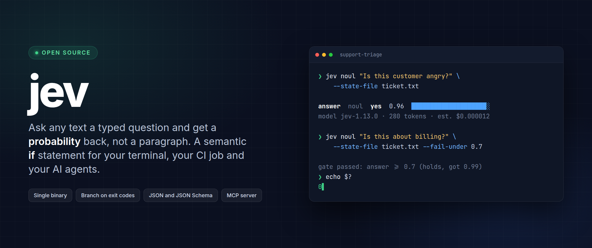
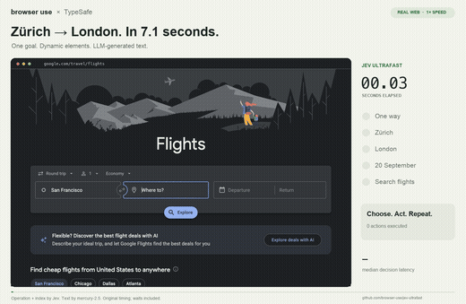
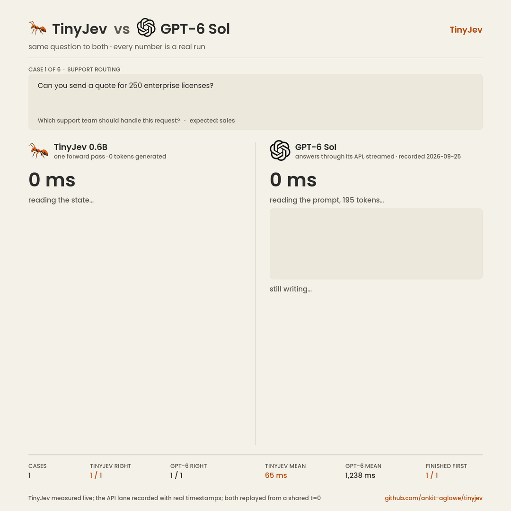
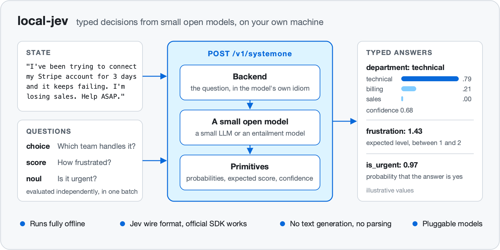
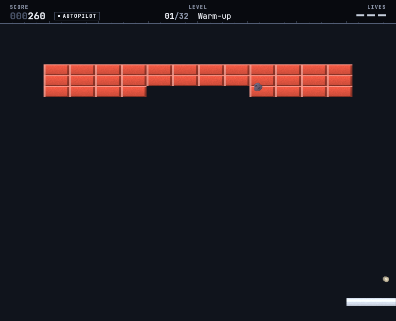
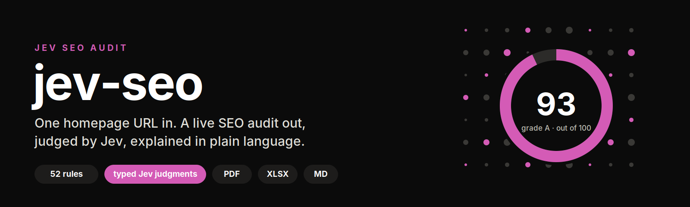

  

<h1 align="center">Awesome Jev Live</h1>

<b>每两小时自我重建的 Jev 证据分级索引。</b>

  
  
  
  
  
  

<a href="../README.md">English</a> · <b>简体中文</b> · <a href="README.zh-TW.md">繁體中文</a> · <a href="README.ja.md">日本語</a> · <a href="README.ko.md">한국어</a> · <a href="README.es.md">Español</a> · <a href="README.fr.md">Français</a> · <a href="README.de.md">Deutsch</a> · <a href="README.pt-BR.md">Português (Brasil)</a> · <a href="README.ru.md">Русский</a> · <a href="README.it.md">Italiano</a> · <a href="README.ar.md">العربية</a> · <a href="README.hi.md">हिन्दी</a> · <a href="README.tr.md">Türkçe</a> · <a href="README.vi.md">Tiếng Việt</a> · <a href="README.th.md">ไทย</a> · <a href="README.id.md">Bahasa Indonesia</a> · <a href="README.pl.md">Polski</a> · <a href="README.nl.md">Nederlands</a> · <a href="README.uk.md">Українська</a>

> [!NOTE]
> **实时索引** · 上次同步: `2026-11-11T23:29:28+08:00` (UTC+8)
> · 条目: **825** · 本轮新增: **25** · 实现语言: **26**

以下每个条目都由本仓库的流水线采集、筛选并复核。数字与时间戳均来自数据源，而非手工编写的快照。

## 🔥 本期精选 · 每个领域的第一名

每个领域取一名，按证据等级与 Star 数排名，每次同步重新计算。这是排名而非推荐；每个精选都链接到下方的完整条目。优先选择发布了截图或录屏的项目，以保证版面可视化。

<table>
<tr>
<td width="50%" valign="top">
<b>🏛️ <a href="https://github.com/typesafe-ai/skills">typesafe-ai/skills</a></b>
⭐2892 · ✅ official
用于使用 TypeSafe 的 System One API 进行构建的代理技能
</td>
<td width="50%" valign="top">

<b>🧰 <a href="https://github.com/john-rocky/coreai-kit">john-rocky/coreai-kit</a></b>
⭐126 · Swift · 👁️ observed
Swift SDK for running chat, vision and speech models on iPhone and Mac with Apple&#x27;s Core AI. Model download and caching, FoundationModels integration, and runnable…
</td>
</tr>
<tr>
<td width="50%" valign="top">

<b>🤖 <a href="https://github.com/gargpratyush/jev-router">gargpratyush/jev-router</a></b>
⭐662 · JavaScript · 🔎 inferred
使用 jev-router 为你的任务路由到 claude code 中最便宜的模型
</td>
<td width="50%" valign="top">

<b>🛡️ <a href="https://github.com/dharmeshgurnani/codeotter">dharmeshgurnani/codeotter</a></b>
⭐3 · TypeScript · 👁️ observed
Autonomous, self-hosted AI code reviews, calibrated scoring gauges, and merge gates from any open model.
</td>
</tr>
<tr>
<td width="50%" valign="top">

<b>🧪 <a href="https://github.com/Mapika/decider">Mapika/decider</a></b>
⭐1051 · Python · 👁️ observed
一系列从 Qwen3.5 微调而来的 System One 风格模型，专为通过校准概率进行一次性类型化决策而设计。
</td>
<td width="50%" valign="top">

<b>🔬 <a href="https://github.com/r-ms/mini-jev">r-ms/mini-jev</a></b>
⭐64 · Python · 🔎 inferred
mini-Jev：在冻结的 Qwen3-4B 上，Jev 风格的类型化决策接口是什么样子——读取选项字母的 logits，而不是生成 JSON。预注册实验、结果、教学基准。
</td>
</tr>
<tr>
<td width="50%" valign="top">

<b>🎮 <a href="https://github.com/MCG-NJU/VideoJev">MCG-NJU/VideoJev</a></b>
⭐308 · Python · 👁️ observed
VideoJev：用于视频理解和交互的 System One Model
</td>
<td width="50%" valign="top">
<b>📰 <a href="https://docs.typesafe.ai/model-jaggedness/jev-1.13">9 类已知缺陷（jaggedness）</a></b>
⭐0 · ✅ official
字面理解、**计数不可靠**、日期比较、多级间接、无关细节大 state、对抗内容、指令与 criteria 矛盾、结构性不变量、生成。官方建议&quot;拆成原子问题在代码里组合&quot;。
</td>
</tr>
</table>

## 目录

- [Jev 是什么？](#jev-是什么)
- [条目分级方式](#条目分级方式)
- [官方 SDK 与开发者工具](#官方-sdk-与开发者工具) — **6**
- [社区客户端、SDK 与适配器](#社区客户端sdk-与适配器) — **147**
- [Agent 工具链：MCP、钩子、门禁与编码 Agent](#agent-工具链mcp钩子门禁与编码-agent) — **254**
- [路由、护栏与审批](#路由护栏与审批) — **62**
- [评估、校准与基准测试](#评估校准与基准测试) — **89**
- [开放复现、权重与架构研究](#开放复现权重与架构研究) — **63**
- [应用、游戏、机器人与交互演示](#应用游戏机器人与交互演示) — **46**
- [文章、讨论与同类列表](#文章讨论与同类列表) — **79**
- [其他项目](#其他项目) — **79**
- [按实现语言划分的项目](#按实现语言划分的项目)

## Jev 是什么？

Jev 是 TypeSafe AI 的第一个 **System One model**。它不写散文。它接收一个状态，加上由你预先定义答案空间的问题，并返回带有概率分布的类型化取值，供你的代码据此分支。

|                |                                                                                                                              |
| -------------- | ---------------------------------------------------------------------------------------------------------------------------- |
| **形态：**     | `state + typed questions` → `constrained answers + probabilities` → `your code`                                              |
| **原语：**     | `Choice`（从 ≤255 个选项中选一个）、`Score`（2–10 分的评分表）、`Noul`（概率化的是／否）                                     |
| **端点：**     | `POST https://api.typesafe.ai/v1/systemone`，模型 `jev-1.13.0` / 别名 `jev-latest`                                           |
| **适用场景：** | 有界工作流中的路由、分诊、评分、内容审核、校验以及低延迟门禁                                                                 |
| **已知局限：** | 计数不可靠，多级间接推理较弱，官方材料列出了九类锯齿状能力缺口。输出符合 schema 并不等于决策正确——请在你自己的数据上做校准。 |

## 条目分级方式

这一领域的大多数列表只是宣称收录。本列表会说明它究竟核实到什么程度，再让你据此筛选。

| 等级         | 含义                                                                                         |
| ------------ | -------------------------------------------------------------------------------------------- |
| `official`   | 由 TypeSafe AI 官方发布。                                                                    |
| `observed`   | 可打开并阅读的公开产物——真实的源码、真实的配置，或仓库名称／主题中明确的 TypeSafe/Jev 声明。 |
| `inferred`   | 基于一个模糊信号加上相互印证的用语匹配，但尚未逐行阅读。                                     |
| `unverified` | 看上去相关，但未经任何独立确认。仅为便于发现而收录。                                         |

## 官方 SDK 与开发者工具

全部由 TypeSafe 官方发布。从这里开始。

🏛️ <b><a href="https://github.com/typesafe-ai/skills">typesafe-ai/skills</a></b> · ⭐2892 · ✅ official · 18 天

##### 📝 简介

用于使用 TypeSafe 的 System One API 进行构建的代理技能

> 💡 供应商自己的代理技能。由于它会持续更新，因此它最接近一份说明 TypeSafe 打算如何让代理驱动 Jev 的规范。

##### 📌 基本信息

| 字段 | 值                      |
| ---- | ----------------------- |
| 分类 | `官方 SDK 与开发者工具` |
| 证据 | `official`              |

##### 📊 数据

| 指标     | 值         |
| -------- | ---------- |
| Star 数  | **2892**   |
| 最近推送 | 2026-10-23 |
| 首次收录 | 2026-09-18 |

🏛️ <b><a href="https://github.com/typesafe-ai/system-one-adapter-python">typesafe-ai/system-one-adapter-python</a></b> · ⭐412 · Python · ✅ official · 50 天

##### 📝 简介

由 LLM APIs 支持的可直接替换 TypeSafeClient

> 💡 可直接替换的实现，使用普通的 LLM 提供商支持相同接口。这是在你自己的数据上，将类型化决策与提示进行 A/B 测试、然后再决定采用哪一种的诚实方式。

🔧 在代码中的使用: `README.md`

##### 📌 基本信息

| 字段 | 值                      |
| ---- | ----------------------- |
| 分类 | `官方 SDK 与开发者工具` |
| 证据 | `official`              |
| 语言 | Python                  |

##### 📊 数据

| 指标     | 值         |
| -------- | ---------- |
| Star 数  | **412**    |
| 最近推送 | 2026-09-22 |
| 首次收录 | 2026-10-23 |

🏛️ <b><a href="https://github.com/typesafe-ai/typesafe-sdk-python">typesafe-ai/typesafe-sdk-python</a></b> · ⭐313 · Python · ✅ official · 0 天

##### 📝 简介

面向 TypeSafe API 的官方 Python 库

> 💡 同步和异步客户端。从 API 密钥到类型化决策的最快路径，也是社区客户端用来进行比较的参考实现。

🔧 在代码中的使用: `README.md`

##### 📌 基本信息

| 字段 | 值                      |
| ---- | ----------------------- |
| 分类 | `官方 SDK 与开发者工具` |
| 证据 | `official`              |
| 语言 | Python                  |

##### 📊 数据

| 指标     | 值         |
| -------- | ---------- |
| Star 数  | **313**    |
| 最近推送 | 2026-11-11 |
| 首次收录 | 2026-10-23 |

🏛️ <b><a href="https://github.com/typesafe-ai/typesafe-sdk-js">typesafe-ai/typesafe-sdk-js</a></b> · ⭐285 · TypeScript · ✅ official · 0 天

##### 📝 简介

面向 TypeSafe API 的官方 TypeScript/JavaScript 库

> 💡 TypeScript 客户端，答案类型根据你提出的问题推断，因此类型不匹配会成为编译错误，而不是运行时意外。

##### 📌 基本信息

| 字段 | 值                      |
| ---- | ----------------------- |
| 分类 | `官方 SDK 与开发者工具` |
| 证据 | `official`              |
| 语言 | TypeScript              |

##### 📊 数据

| 指标     | 值         |
| -------- | ---------- |
| Star 数  | **285**    |
| 最近推送 | 2026-11-11 |
| 首次收录 | 2026-10-23 |

🏛️ <b><a href="https://github.com/typesafe-ai/WorkflowEvals">typesafe-ai/WorkflowEvals</a></b> · ⭐21 · Python · ✅ official · 0 天

##### 📝 简介

已发布 evals.typesafe.ai 工作流代码

##### 📌 基本信息

| 字段 | 值                      |
| ---- | ----------------------- |
| 分类 | `官方 SDK 与开发者工具` |
| 证据 | `official`              |
| 语言 | Python                  |

##### 📊 数据

| 指标     | 值         |
| -------- | ---------- |
| Star 数  | **21**     |
| 最近推送 | 2026-11-11 |
| 首次收录 | 2026-10-23 |

🏛️ <b><a href="https://github.com/typesafe-ai/typesafe-ai.github.io">typesafe-ai/typesafe-ai.github.io</a></b> · ⭐2 · HTML · ✅ official · 160 天

##### 📝 简介

上游未发布描述。

##### 📌 基本信息

| 字段 | 值                      |
| ---- | ----------------------- |
| 分类 | `官方 SDK 与开发者工具` |
| 证据 | `official`              |
| 语言 | HTML                    |

##### 📊 数据

| 指标     | 值         |
| -------- | ---------- |
| Star 数  | **2**      |
| 最近推送 | 2026-06-04 |
| 首次收录 | 2026-10-23 |

## 社区客户端、SDK 与适配器

面向 System One 端点的类型化客户端，覆盖社区已经着手的各种语言。

🧰 <b><a href="https://github.com/jexp/neo4jev">jexp/neo4jev</a></b> · ⭐185 · Jupyter · 👁️ observed · 54 天 · ⭐+1

##### 📝 简介

Typesafe.ai System One Model Jev 通过使用相邻关系分类器来导航 Neo4j 图

##### 📌 基本信息

| 字段 | 值                         |
| ---- | -------------------------- |
| 分类 | `社区客户端、SDK 与适配器` |
| 证据 | `observed`                 |
| 语言 | Jupyter                    |

##### 📊 数据

| 指标     | 值           |
| -------- | ------------ |
| Star 数  | **185** (+1) |
| 最近推送 | 2026-09-18   |
| 首次收录 | 2026-10-28   |

🧰 <b><a href="https://github.com/keltokhy/jgrep">keltokhy/jgrep</a></b> · ⭐141 · Python · 👁️ observed · 25 天

##### 📝 简介

grep，但模式是描述。使用 TypeSafe 的 Jev 决策模型按含义筛选行：每行约 200 毫秒，成本为千分之一美分。

🔧 在代码中的使用: `README.md`

##### 📌 基本信息

| 字段 | 值                         |
| ---- | -------------------------- |
| 分类 | `社区客户端、SDK 与适配器` |
| 证据 | `observed`                 |
| 语言 | Python                     |

##### 📊 数据

| 指标     | 值         |
| -------- | ---------- |
| Star 数  | **141**    |
| 最近推送 | 2026-10-17 |
| 首次收录 | 2026-10-29 |

🏷 `cli` · `grep` · `jev` · `openrouter` · `semantic-search` · `typesafe`

🧰 <b><a href="https://github.com/qkal/Canny">qkal/Canny</a></b> · ⭐135 · TypeScript · 👁️ observed · 49 天

##### 📝 简介

阻止 AI 编码代理在没有证据的情况下声称工作已完成。由确定性钩子做出决策，TypeSafe 的 Jev 提供建议。仅追加账本，零运行时依赖。

🔧 在代码中的使用: `README.md`

##### 📌 基本信息

| 字段 | 值                         |
| ---- | -------------------------- |
| 分类 | `社区客户端、SDK 与适配器` |
| 证据 | `observed`                 |
| 语言 | TypeScript                 |

##### 📊 数据

| 指标     | 值         |
| -------- | ---------- |
| Star 数  | **135**    |
| 最近推送 | 2026-09-22 |
| 首次收录 | 2026-10-29 |

🏷 `agent-hooks` · `ai-agents` · `claude-code` · `claude-code-hooks` · `codex` · `codex-cli` · `guardrails` · `jev`

🧰 <b><a href="https://github.com/john-rocky/coreai-kit">john-rocky/coreai-kit</a></b> · ⭐126 · Swift · 👁️ observed · 0 天

##### 📝 简介

Swift SDK for running chat, vision and speech models on iPhone and Mac with Apple's Core AI. Model download and caching, FoundationModels integration, and runnable examples with documented OS, SDK and model requirements.

🔧 在代码中的使用: `Sources/CoreAIOps/CoreAI+SystemOne.swift`

##### 📌 基本信息

| 字段 | 值                         |
| ---- | -------------------------- |
| 分类 | `社区客户端、SDK 与适配器` |
| 证据 | `observed`                 |
| 语言 | Swift                      |

##### 📊 数据

| 指标     | 值         |
| -------- | ---------- |
| Star 数  | **126**    |
| 最近推送 | 2026-11-11 |
| 首次收录 | 2026-10-26 |

🏷 `apple` · `apple-core-ai` · `asr` · `core-ai` · `coreai` · `foundation-models` · `ios` · `ios-27`

---

<table><tr><th align="center" width="50%">🖼 图片</th><th align="center" width="50%">🎬 视频</th></tr><tr>
<td align="center" valign="top"></td>
<td align="center" valign="top"> 动态录屏</td>
</tr></table>

🧰 <b><a href="https://github.com/yzfly/awesome-jev-zh">yzfly/awesome-jev-zh</a></b> · ⭐93 · HTML · 👁️ observed · 0 天

##### 📝 简介

Jev / TypeSafe System One 中文精选列表：官方资料、SDK、爆款应用、Agent 工具、开源复现与独立评测，附中文上手指南，每日自动收录 GitHub 热门项目。

🔧 在代码中的使用: `docs/quickstart.md`

##### 📌 基本信息

| 字段 | 值                         |
| ---- | -------------------------- |
| 分类 | `社区客户端、SDK 与适配器` |
| 证据 | `observed`                 |
| 语言 | HTML                       |

##### 📊 数据

| 指标     | 值         |
| -------- | ---------- |
| Star 数  | **93**     |
| 最近推送 | 2026-11-11 |
| 首次收录 | 2026-09-18 |

🏷 `ai-agent` · `awesome` · `awesome-list` · `chinese` · `jev` · `llm` · `structured-output` · `system-one`

🧰 <b><a href="https://github.com/obie/ruby_decision_model">obie/ruby_decision_model</a></b> · ⭐59 · Ruby · 👁️ observed · 29 天

##### 📝 简介

用于决策模型（如 Typesafe Jev）的 Ruby 客户端

🔧 在代码中的使用: `README.md`

##### 📌 基本信息

| 字段 | 值                         |
| ---- | -------------------------- |
| 分类 | `社区客户端、SDK 与适配器` |
| 证据 | `observed`                 |
| 语言 | Ruby                       |

##### 📊 数据

| 指标     | 值         |
| -------- | ---------- |
| Star 数  | **59**     |
| 最近推送 | 2026-10-12 |
| 首次收录 | 2026-10-29 |

🧰 <b><a href="https://github.com/bodepudimuneendra-netizen/ConsciousDB">bodepudimuneendra-netizen/ConsciousDB</a></b> · ⭐55 · Python · 👁️ observed · 9 天 · ⭐+1

##### 📝 简介

一个与数据库无关的 Agentic GraphRAG 框架，使用可替换的 System One 模型（本地 Laya / 云端 Jev）。一个即插即用的智能层，提供完整的 4 阶段管道、持续评估，以及适用于任何图数据库的自定义 A* 遍历。

##### 📌 基本信息

| 字段 | 值                         |
| ---- | -------------------------- |
| 分类 | `社区客户端、SDK 与适配器` |
| 证据 | `observed`                 |
| 语言 | Python                     |

##### 📊 数据

| 指标     | 值          |
| -------- | ----------- |
| Star 数  | **55** (+1) |
| 最近推送 | 2026-11-02  |
| 首次收录 | 2026-11-02  |

🏷 `astar-algorithm` · `eval-harness` · `fine-tuning` · `graphdatabase` · `graprag` · `jev` · `laya` · `neo4j`

🧰 <b><a href="https://github.com/shaharia-lab/jev-cli">shaharia-lab/jev-cli</a></b> · ⭐45 · Rust · 👁️ observed · 1 天

##### 📝 简介

Command-line tool for TypeSafe AI's Jev model. Ask yes/no, multiple-choice and rubric questions about any text and get calibrated probabilities back. Answers become exit codes for shells and CI, JSON for scripts, and MCP tools for AI agents.

🔧 在代码中的使用: `README.md`

##### 📌 基本信息

| 字段 | 值                         |
| ---- | -------------------------- |
| 分类 | `社区客户端、SDK 与适配器` |
| 证据 | `observed`                 |
| 语言 | Rust                       |

##### 📊 数据

| 指标     | 值         |
| -------- | ---------- |
| Star 数  | **45**     |
| 最近推送 | 2026-11-09 |
| 首次收录 | 2026-11-07 |

🏷 `ai-agents` · `classification` · `cli` · `command-line-tool` · `devtools` · `jev` · `llm` · `mcp`

---

<table><tr><th align="center" width="50%">🖼 图片</th><th align="center" width="50%">🎬 视频</th></tr><tr>
<td align="center" valign="top"></td>
<td align="center" valign="top"> 动态录屏</td>
</tr></table>

🧰 <b><a href="https://github.com/MrJev/awesome-jev">MrJev/awesome-jev</a></b> · ⭐21 · Python · 👁️ observed · 0 天

##### 📝 简介

Jev、TypeSafe AI 的 System One 模型的项目、集成和资源精选列表。

##### 📌 基本信息

| 字段 | 值                         |
| ---- | -------------------------- |
| 分类 | `社区客户端、SDK 与适配器` |
| 证据 | `observed`                 |
| 语言 | Python                     |

##### 📊 数据

| 指标     | 值         |
| -------- | ---------- |
| Star 数  | **21**     |
| 最近推送 | 2026-11-11 |
| 首次收录 | 2026-09-18 |

🏷 `ai-agents` · `awesome` · `awesome-list` · `jev` · `mcp` · `typesafe`

🧰 <b><a href="https://github.com/ckaraca/awesome-jev">ckaraca/awesome-jev</a></b> · ⭐18 · Python · 👁️ observed · 2 天

##### 📝 简介

基于 Jev、TypeSafe AI 的 System One 模型构建的工具、集成和实验精选列表，用于快速的类型化决策。

##### 📌 基本信息

| 字段 | 值                         |
| ---- | -------------------------- |
| 分类 | `社区客户端、SDK 与适配器` |
| 证据 | `observed`                 |
| 语言 | Python                     |

##### 📊 数据

| 指标     | 值         |
| -------- | ---------- |
| Star 数  | **18**     |
| 最近推送 | 2026-11-09 |
| 首次收录 | 2026-09-19 |

🏷 `ai-agents` · `awesome` · `awesome-list` · `computer-use` · `jev` · `llm` · `system-one` · `typesafe`

🧰 <b><a href="https://github.com/Premo-Cloud/typesafe-sdk-java">Premo-Cloud/typesafe-sdk-java</a></b> · ⭐12 · Java · 👁️ observed · 20 天

##### 📝 简介

面向 Jev、TypeSafe 的 System One 模型的社区 Java SDK：输入类型化问题，输出带校准概率的类型化答案。Java 17+，Spring Boot starter（非官方）

##### 📌 基本信息

| 字段 | 值                         |
| ---- | -------------------------- |
| 分类 | `社区客户端、SDK 与适配器` |
| 证据 | `observed`                 |
| 语言 | Java                       |

##### 📊 数据

| 指标     | 值         |
| -------- | ---------- |
| Star 数  | **12**     |
| 最近推送 | 2026-10-21 |
| 首次收录 | 2026-10-28 |

🏷 `java` · `jev` · `sdk` · `spring-boot` · `system-one` · `system-one-models` · `typesafe`

🧰 <b><a href="https://github.com/PromtEngineer/jev-harness">PromtEngineer/jev-harness</a></b> · ⭐9 · Python · 👁️ observed · 47 天

##### 📝 简介

围绕 TypeSafe 的 Jev（System One 模型）构建的 Pi 智能体工具框架：路由器、上下文选择器、门控器、验证器。在 Neon Postgres 分支上经过测试。

##### 📌 基本信息

| 字段 | 值                         |
| ---- | -------------------------- |
| 分类 | `社区客户端、SDK 与适配器` |
| 证据 | `observed`                 |
| 语言 | Python                     |

##### 📊 数据

| 指标     | 值         |
| -------- | ---------- |
| Star 数  | **9**      |
| 最近推送 | 2026-09-24 |
| 首次收录 | 2026-10-28 |

🧰 <b><a href="https://github.com/clouatre-labs/decisions-judge-mcp">clouatre-labs/decisions-judge-mcp</a></b> · ⭐5 · JavaScript · 👁️ observed · 0 天

##### 📝 简介

将 AI 代理的类型化决策作为 MCP 工具：在一次快速请求中返回是/否概率（noul）、选项和分数。由 TypeSafe System One 模型提供支持。

##### 📌 基本信息

| 字段 | 值                         |
| ---- | -------------------------- |
| 分类 | `社区客户端、SDK 与适配器` |
| 证据 | `observed`                 |
| 语言 | JavaScript                 |

##### 📊 数据

| 指标     | 值         |
| -------- | ---------- |
| Star 数  | **5**      |
| 最近推送 | 2026-11-11 |
| 首次收录 | 2026-10-12 |

🏷 `agent` · `ai` · `cli` · `decision-making` · `decisions` · `judge` · `llm` · `mcp`

---

<table><tr><th align="center" width="50%">🖼 图片</th><th align="center" width="50%">🎬 视频</th></tr><tr>
<td align="center" valign="top"></td>
<td align="center" valign="top"> 动态录屏</td>
</tr></table>

🧰 <b><a href="https://github.com/elbruno/ElBruno.AI.Decisions">elbruno/ElBruno.AI.Decisions</a></b> · ⭐5 · C# · 👁️ observed · 8 天

##### 📝 简介

.NET 10 decision SDK: Choose, Score, and Assess with Microsoft Foundry (Microsoft-Decision-1), native local Ollama System One models, and TypeSafe AI Jev. One API, probabilities instead of paragraphs.

##### 📌 基本信息

| 字段 | 值                         |
| ---- | -------------------------- |
| 分类 | `社区客户端、SDK 与适配器` |
| 证据 | `observed`                 |
| 语言 | C#                         |

##### 📊 数据

| 指标     | 值         |
| -------- | ---------- |
| Star 数  | **5**      |
| 最近推送 | 2026-11-03 |
| 首次收录 | 2026-11-09 |

🏷 `dotnet` · `dotnet10` · `jev` · `microsoft-extensions-ai` · `nuget`

---

<table><tr><th align="center" width="50%">🖼 图片</th><th align="center" width="50%">🎬 视频</th></tr><tr>
<td align="center" valign="top"></td>
<td align="center" valign="top">未发布媒体</td>
</tr></table>

🧰 <b><a href="https://github.com/moeinheidari7829/Kev-Bio">moeinheidari7829/Kev-Bio</a></b> · ⭐5 · Python · 👁️ observed · 4 天

##### 📝 简介

Official code for "Every Pixel Is an Option: A System One Model for Medical Ultrasound Biometry" (arXiv 2611.03360)

##### 📌 基本信息

| 字段 | 值                         |
| ---- | -------------------------- |
| 分类 | `社区客户端、SDK 与适配器` |
| 证据 | `observed`                 |
| 语言 | Python                     |

##### 📊 数据

| 指标     | 值         |
| -------- | ---------- |
| Star 数  | **5**      |
| 最近推送 | 2026-11-07 |
| 首次收录 | 2026-11-07 |

🏷 `biometry` · `echocardiography` · `jev` · `jev-ai` · `kev` · `medical-imaging` · `system-one` · `ultrasound`

---

<table><tr><th align="center" width="50%">🖼 图片</th><th align="center" width="50%">🎬 视频</th></tr><tr>
<td align="center" valign="top"></td>
<td align="center" valign="top">未发布媒体</td>
</tr></table>

由于上游未声明再分发许可，资源直接引用上游仓库的链接。

🧰 <b><a href="https://github.com/avalonreset/legends-jev">avalonreset/legends-jev</a></b> · ⭐3 · Python · 👁️ observed · 0 天

##### 📝 简介

Optical character recognition (OCR), storefront signage verification, bounding-box grounding, and typed computer-use decision CLI powered by TypeSafe Jev 1.14.

##### 📌 基本信息

| 字段 | 值                         |
| ---- | -------------------------- |
| 分类 | `社区客户端、SDK 与适配器` |
| 证据 | `observed`                 |
| 语言 | Python                     |

##### 📊 数据

| 指标     | 值         |
| -------- | ---------- |
| Star 数  | **3**      |
| 最近推送 | 2026-11-11 |
| 首次收录 | 2026-11-11 |

🏷 `bounding-box` · `browser-agent` · `claude-code` · `codex` · `computer-use` · `cto-legends` · `decision-model` · `image-text-extraction`

---

<table><tr><th align="center" width="50%">🖼 图片</th><th align="center" width="50%">🎬 视频</th></tr><tr>
<td align="center" valign="top"></td>
<td align="center" valign="top">未发布媒体</td>
</tr></table>

🧰 <b><a href="https://github.com/Bonzokoles/36_chambers">Bonzokoles/36_chambers</a></b> · Python · 👁️ observed · 19 天

##### 📝 简介

Federated knowledge retrieval engine for AI agents. Routes queries across specialized backends (FTS5, ChromaDB, graph) via a registry-first orchestrator with TypeSafe/Jev AI routing and evidence re-ranking. Read-only by default, security-gated by design.

##### 📌 基本信息

| 字段 | 值                         |
| ---- | -------------------------- |
| 分类 | `社区客户端、SDK 与适配器` |
| 证据 | `observed`                 |
| 语言 | Python                     |

##### 📊 数据

| 指标     | 值         |
| -------- | ---------- |
| Star 数  | **0**      |
| 最近推送 | 2026-10-22 |
| 首次收录 | 2026-10-23 |

🏷 `ai-agents` · `ai-infrastructure` · `chromadb` · `embeddings` · `federated-search` · `fts5` · `information-retrieval` · `jev`

---

<table><tr><th align="center" width="50%">🖼 图片</th><th align="center" width="50%">🎬 视频</th></tr><tr>
<td align="center" valign="top"></td>
<td align="center" valign="top">未发布媒体</td>
</tr></table>

由于上游未声明再分发许可，资源直接引用上游仓库的链接。

🧰 <b><a href="https://github.com/dzhng/jevgrep">dzhng/jevgrep</a></b> · ⭐3210 · TypeScript · 🔎 inferred · 0 天

##### 📝 简介

通过询问代码的作用来查找代码。一个用于编码代理的 CLI，使用 Jev 来发现相关文件和源代码上下文。

##### 📌 基本信息

| 字段 | 值                         |
| ---- | -------------------------- |
| 分类 | `社区客户端、SDK 与适配器` |
| 证据 | `inferred`                 |
| 语言 | TypeScript                 |

##### 📊 数据

| 指标     | 值         |
| -------- | ---------- |
| Star 数  | **3210**   |
| 最近推送 | 2026-11-11 |
| 首次收录 | 2026-11-07 |

🏷 `ai-sdk` · `claude-code` · `cli` · `code-search` · `codex` · `coding-agents` · `context-retrieval` · `developer-tools`

---

<table><tr><th align="center" width="50%">🖼 图片</th><th align="center" width="50%">🎬 视频</th></tr><tr>
<td align="center" valign="top"></td>
<td align="center" valign="top">未发布媒体</td>
</tr></table>

<b>本分类更多条目</b> · 129

- [sumleo/prompt2jev](https://github.com/sumleo/prompt2jev) - 代理技能和 CLI，将自然语言、LLM 提示或运行它的代码转换为 TypeSafe Jev 决策：类型化状态、Choice/Score/Noul…
- [Sur-Cai/macos-computer-use-kit](https://github.com/Sur-Cai/macos-computer-use-kit) - AX-first computer use for AI agents on macOS with optional Jev。
- [xingwudao/OpenJev](https://github.com/xingwudao/OpenJev) - OpenJev：一个受 Jev 启发、基于 TypeSafe.ai 概念的独立 System One 决策 API.
- [danieleteti/systemone-delphi](https://github.com/danieleteti/systemone-delphi) - Delphi client for System One models (Jev, tev1 and nimble on Ollama): ask typed…
- [GitHub30/OpenJev](https://github.com/GitHub30/OpenJev) - 开放权重 System One 模型（兼容 Jev）：通过一次前向传递校准 noul / choice / score 决策，不生成文本.
- [ziyu/system-one-sdk](https://github.com/ziyu/system-one-sdk) - Unified interface wrapper for system one models。
- [chez-shanpu/typesafeai-go](https://github.com/chez-shanpu/typesafeai-go) - Go SDK for TypeSafe AI API https://docs.typesafe.ai/api。
- [chussenot/judgment](https://github.com/chussenot/judgment) - 来自 System One 模型的类型化、经过校准的判断：将决策写入 .jud 文件或 Rust 类型，由模型回答，在读取前进行验证，无需密钥即可测试.
- [CMaintz/jev-dotnet](https://github.com/CMaintz/jev-dotnet) - Unofficial .NET SDK for TypeSafe AI。
- [erik-hedstrom/loadout](https://github.com/erik-hedstrom/loadout) - Pick the model, skills and MCP servers for each coding-agent session from a…
- [jqueryscript/awesome-jev](https://github.com/jqueryscript/awesome-jev) - A curated list of TypeSafe Jev resources, SDKs, agents, MCP servers…
- [basi/typesafe-ai-php-client](https://github.com/basi/typesafe-ai-php-client) - PHP client for the typesafe.ai System One API (Jev)。
- [chrismarchant/jev-router](https://github.com/chrismarchant/jev-router) - Agent- and harness-agnostic router that offloads parallel-workstream decisions…
- [CMaintz/jev-java](https://github.com/CMaintz/jev-java) - Unofficial Java SDK for TypeSafe AI。
- [cogcloud-ai/cog-typesafe](https://github.com/cogcloud-ai/cog-typesafe) - TypeSafe。
- [gajaguar/typesafe-cli](https://github.com/gajaguar/typesafe-cli) - Unofficial command-line interface for TypeSafe AI System One models, on…
- [JosephHardy91/graph-composition-with-dLLMs](https://github.com/JosephHardy91/graph-composition-with-dLLMs) - A Graph-Compiled Specification RAG system built with **Dagster**, **PostgreSQL…
- [sanketmuchhala/jevgate](https://github.com/sanketmuchhala/jevgate) - Calibrated policy triage and institutional risk routing: a hybrid…
- [semperos/typesafe-sdk-gleam](https://github.com/semperos/typesafe-sdk-gleam) - Typesafe.ai (Jev) SDK client in Gleam。
- [wawan93/gojev](https://github.com/wawan93/gojev) - golang implementation of typesafe.ai SDK。
- [ollaya-dev/ollaya](https://github.com/ollaya-dev/ollaya) - Jev-compatible API server for open decision models.
- [realZachi/pg-jev](https://github.com/realZachi/pg-jev) - 用自然语言向你的 Postgres 表提问。一个由 TypeSafe 的 Jev 驱动的 PostgreSQL 扩展.
- [socai-io/jev-social](https://github.com/socai-io/jev-social) - 面向开源、优先本地运行的 Instagram、TikTok 和 LinkedIn 社交媒体研究代理.
- [juspay/neurolink](https://github.com/juspay/neurolink) - AI 神经系统的管道层——一个接口将提供商神经元连接到你的应用，跨越三种推理类型：generate、stream，以及经过校准的 decide。
- [supercorp-ai/supercov](https://github.com/supercorp-ai/supercov) - 面向编码代理的覆盖率、安全性和代码质量。
- [aaddrick/building-with-typesafe-jev](https://github.com/aaddrick/building-with-typesafe-jev) - 非官方技能，教会编码代理使用 TypeSafe AI 的 Jev 进行构建：类型化决策、校准置信度，以及来自 150 多个社区项目的先例.
- [Ying-Kai-Liao/jev-browser](https://github.com/Ying-Kai-Liao/jev-browser) - 浏览器自动化，其中 LLM 负责规划，Jev（Typesafe System One）负责决策。库、CLI 和 MCP 服务器.
- [nidhi-singh02/agent-router](https://github.com/nidhi-singh02/agent-router) - CLI that picks Cursor, Claude Code, Codex, or OpenCode + model/effort for a…
- [AkashPriyadarshii/jev-curate](https://github.com/AkashPriyadarshii/jev-curate) - High-throughput synthetic and pretraining dataset sifter for TypeSafe Jev.
- [fazlerocks/jevmail](https://github.com/fazlerocks/jevmail) - 用于 Gmail 的开源 AI 邮件分流工具。通过 Vercel AI Gateway，使用 Jev、TypeSafe AI…
- [AkashPriyadarshii/jev-seo](https://github.com/AkashPriyadarshii/jev-seo) - Free Rust SEO and GEO toolkit powered by TypeSafe Jev: 58-rule audits, site…
- [AboveColin/HA-Jev](https://github.com/AboveColin/HA-Jev) - 向你的房子提问，获得一个数字。适用于 TypeSafe Jev 的 Home Assistant 集成：将类型化答案作为传感器，为自动化提供四种操作，以及用于…
- [sharziki/semdecide](https://github.com/sharziki/semdecide) - 由 TypeSafe AI Jev 驱动的、用于 Unix 管道和 CI 的类型化语义决策.
- [bladedevoff/stuntd](https://github.com/bladedevoff/stuntd) - 本地代理，可学习你的应用的带类型 LLM 决策，并用 Laya head 回答。兼容 Jev 和 OpenAI.
- [burnigtm/jev-mcp](https://github.com/burnigtm/jev-mcp) - MCP 服务器，将 TypeSafe Jev 放入 Cursor、Codex 以及任何 MCP 客户端的编码循环中。
- [mlimarenko/IronRAG](https://github.com/mlimarenko/IronRAG) - One-click knowledge system for documents, internal bots, and AI agents。
- [AkashPriyadarshii/jev-superpowers](https://github.com/AkashPriyadarshii/jev-superpowers) - Systematic software development framework for AI coding agents upgraded with…
- [dannote/jev](https://github.com/dannote/jev) - 用于 OTP 的 TypeSafe Jev：从 GenServer 回复 Jev，并对其答案进行模式匹配。
- [DevLoops-ai/unified-brain](https://github.com/DevLoops-ai/unified-brain) - System One coding agents: code-level answers at the score of a Claude Fable 5.1…
- [jwuthri-cloud/SelfJev](https://github.com/jwuthri-cloud/SelfJev) - Self-hosted decision model (selfjev-4b) with a Jev-compatible API: Python SDK…
- [jiangkoumo/ego-decision-layer](https://github.com/jiangkoumo/ego-decision-layer) - Pluggable decision layer for the ego lite browser: one System One (Jev) call…
- [agencyenterprise/jev-recipes](https://github.com/agencyenterprise/jev-recipes) - 248 small Jev decisions for JavaScript and TypeScript: route, rerank, gate…
- [thusinh1969/BrighTO_Router](https://github.com/thusinh1969/BrighTO_Router) - BrighTO LLM Router: free open-source, ultra-fast Rust LLM gateway/router and…
- [arjun988/Kev](https://github.com/arjun988/Kev) - 开源 System One 决策引擎。具有校准概率的类型化 choice / score / noul.
- [Ray-Hughes/jevalyn](https://github.com/Ray-Hughes/jevalyn) - Rails 应用的决策层。围绕 TypeSafe 的 Jev System One API 构建的 Rails 原生封装：在控制流中实现有类型、经过校准的决策.
- [nouli-ai/nouli](https://github.com/nouli-ai/nouli) - A ledger-backed decision network that records AI decisions and connects them to…
- [KiritoKing/midscene-jev-runner](https://github.com/KiritoKing/midscene-jev-runner) - Community-maintained JEV runner integration for Midscene Test。
- [pambrose/jev4k](https://github.com/pambrose/jev4k) - A Kotlin Multiplatform DSL and client for TypeSafe。
- [saibimajdi/typesafeai-dotnet-sdk](https://github.com/saibimajdi/typesafeai-dotnet-sdk) - 面向 TypeSafe AI System One API 的社区 .NET SDK——提供类型化的 noul、choice 和 score…
- [Elue-dev/jev_elixir](https://github.com/Elue-dev/jev_elixir) - jev_elixir 是一个小巧且符合惯用法的接口，用于使用 Jev 做出类型化决策.
- [arcships/android-use](https://github.com/arcships/android-use) - Android control for Dim Agent and local MCP clients, with a live screen, native…
- [haileyok/typesafe-client](https://github.com/haileyok/typesafe-client) - 用于 TypeSafe AI System One API（Jev）的非官方 Go 和 Rust 客户端。
- [chenrui333/jev-docs](https://github.com/chenrui333/jev-docs) - 由社区维护的 Jev / TypeSafe System One APIs、SDKs、代理指导和工程最佳实践历史记录.
- [devbackend/jevgo](https://github.com/devbackend/jevgo) - 非官方 Go 客户端，适用于 TypeSafe AI System One API（Jev）——输入类型化问题，输出经过校准的答案.
- [himomohi/aside-jev](https://github.com/himomohi/aside-jev) - Aside 代理使用 TypeSafe Jev（System One：Choice/Score/Noul）进行决策.
- [AIAnytime/Jev-Router](https://github.com/AIAnytime/Jev-Router) - Decision-first, OpenAI-compatible AI router powered by Jev typed decisions.
- [docxology/daf-jev](https://github.com/docxology/daf-jev) - daf-jev：用于 TypeSafe 的 Python 可组合工具包，提供其 Jev（System One）决策…
- [Kadihx/jev-x-kit](https://github.com/Kadihx/jev-x-kit) - 面向编码代理的离线 $0 决策层：Choice/Score/Noul 基础组件、BELKI 置信度守门器、超前规划、红队测试、研究和 RLVR…
- [rusharlabs/house-party-protocol](https://github.com/rusharlabs/house-party-protocol) - A local harness that orchestrates agent teams on Claude Code and Codex CLI and…
- [Agnuxo1/Universal-Cognitive-Architecture-JEV-v2](https://github.com/Agnuxo1/Universal-Cognitive-Architecture-JEV-v2) - Executable cognitive architecture: validated graph context, deterministic…
- [akiiwa-games/AgentCompass](https://github.com/akiiwa-games/AgentCompass) - Deterministic multi-agent task router &amp; subscription quota scheduler for Claude…
- [JimmyWesley/rlcd-gateway](https://github.com/JimmyWesley/rlcd-gateway) - 面向 LLMs 和决策模型的自托管网关。Claude Code、Codex、OpenCode 以及任何 OpenAI/Anthropic SDK…
- [vibefilter/filament](https://github.com/vibefilter/filament) - Filter Filament tables with a plain-English statement.
- [zchee/decision-model-sdk-rust](https://github.com/zchee/decision-model-sdk-rust) - Async Rust SDK for decision models served through the System One API, with an…
- [zhirschtritt/typesafe-go](https://github.com/zhirschtritt/typesafe-go) - 面向 TypeSafe AI API 的惯用 Go SDK。
- [AboveColin/jevclient](https://github.com/AboveColin/jevclient) - 用于 TypeSafe Jev 的异步 Python 客户端。输入类型化问题，输出概率和选择，无需解析散文文本.
- [AronAxe/GraphPaper](https://github.com/AronAxe/GraphPaper) - A Windows writing studio with knowledge graphs, author voice…
- [Butochnikov/laravel-typesafe-jev](https://github.com/Butochnikov/laravel-typesafe-jev) - 非官方 Laravel 集成，用于 TypeSafe Jev AI，支持类型化响应、异步请求、作用域依赖注入和测试伪造.
- [coo-quack/jev-pii-checker](https://github.com/coo-quack/jev-pii-checker) - CLI，使用 TypeSafe Jev 在文本中查找 PII：存在性、敏感性和定位的跨度。
- [freepik-company/jev-mcp](https://github.com/freepik-company/jev-mcp) - MCP server for typed decisions with Jev / System One via OpenRouter or TypeSafe。
- [frodi-karlsson/onesie](https://github.com/frodi-karlsson/onesie) - Gate scripts and CI on fast, calibrated System One judgments like Jev: a score…
- [Lasimeri/Mechanical-Jev](https://github.com/Lasimeri/Mechanical-Jev) - The asking side of Jev (TypeSafe System One: noul, choice, score) in Rust…
- [nshkrdotcom/system_one_sdk](https://github.com/nshkrdotcom/system_one_sdk) - 提供商中立的 Elixir/BEAM SDK，用于 System One 语义：类型化 Noul、Choice 和 Score…
- [PAI-CUHK/SLEEPJEV](https://github.com/PAI-CUHK/SLEEPJEV) - 受 JEV 启发的长时程 PSG 类型化运行时决策：可复用的过夜编码、稀疏检索以及 Choice/Noul/Score 概率.
- [zerone-agents/jev-model-router](https://github.com/zerone-agents/jev-model-router) - 面向代理的轻量级模型路由，兼容 OpenAI 和 Anthropic API，支持自动模型选择和管理 CLI.
- [abhisheksharma001/jev-skill](https://github.com/abhisheksharma001/jev-skill) - Agent skill for TypeSafe AI。
- [dsaad68/fuzzy-jev](https://github.com/dsaad68/fuzzy-jev) - A client for OpenRouter&#x27;s decision models, TypeSafe&#x27;s Jev by default: typed…
- [getmissionctrl/hs-jev](https://github.com/getmissionctrl/hs-jev) - 用于 TypeSafe 的 System One（Jev）决策 API 的 Haskell 客户端——通过 http-client 提供类型化、批量化的…
- [NerdishShah/playwright-cli-jev-bakeoff](https://github.com/NerdishShah/playwright-cli-jev-bakeoff) - Bake-off: Playwright CLI vs CLI+Jev vs Playwright MCP。
- [bitranox/btx-skill-jev-judge](https://github.com/bitranox/btx-skill-jev-judge) - Claude Code plugin and Python CLI: hand a judgment repeated over many items to…
- [exfoca/decision-model-lab-4JEV](https://github.com/exfoca/decision-model-lab-4JEV) - DML is a reproducible harness for evaluating small, local decision models under…
- [Hyper-AI-Lab/openclaw-jev](https://github.com/Hyper-AI-Lab/openclaw-jev) - 用于 OpenClaw agent 的生产控制平面：使用 Jev 的摄取路由、Temporal 编排、每次回复前的 Process Evaluator…
- [MrKyaw/CognitiveMirror-Jev-MCP](https://github.com/MrKyaw/CognitiveMirror-Jev-MCP) - Cognitive middleware for personal and enterprise AI agents: 14 MCP tools and a…
- [Talya1412/jev-harness](https://github.com/Talya1412/jev-harness) - TypeSafe Jev (System One) integrations for OMP, MCP, Claude Code, and Pi…
- [Wrenik/Jev-toolkit-Compiler](https://github.com/Wrenik/Jev-toolkit-Compiler) - Context log, search and a compact/clear advisor for Claude Code.
- [abirshhishirroy/mini-jev](https://github.com/abirshhishirroy/mini-jev) - A custom Jev-style decision model built from scratch on Qwen2.5-3B.
- [CMaintz/jev-tools](https://github.com/CMaintz/jev-tools) - 基于 TypeSafe AI 的 Jev 构建的 TypeScript 工具：智能体工具调用护栏、GitHub 问题分类 Action，以及批量分类…
- [codebam/jev-guardrails](https://github.com/codebam/jev-guardrails) - 由 Jev 支持的代理工具调用防护：库、原生 OpenCode/Hermes/DeepSeek Harness 钩子，以及托管的评估额度服务.
- [fan56/dsh-jev-core](https://github.com/fan56/dsh-jev-core) - Shared TypeSafe Jev decision-model client for the dsh ecosystem: strict…
- [HappyHackingSpace/jev](https://github.com/HappyHackingSpace/jev) - Go SDK, CLI, MCP server and agent skill for TypeSafe。
- [heiwa4126/jev-node1](https://github.com/heiwa4126/jev-node1) - Bun で @typesafe-ai/sdk 0.7.0 を使うとエラーになるので、一時的に pnpm と node でやる版。
- [hierichhsu/your-cto-jev](https://github.com/hierichhsu/your-cto-jev) - A sharp-tongued CTO that blocks leaked secrets and destructive commands from AI…
- [ivanblagdan/jev-cli](https://github.com/ivanblagdan/jev-cli) - Composable CLI for TypeSafe。
- [kkdev92/jev-dotnet](https://github.com/kkdev92/jev-dotnet) - An unofficial .NET 10 client for Jev, TypeSafe。
- [ksilyanov/jev-php](https://github.com/ksilyanov/jev-php) - Minimal PHP client for TypeSafe Jev (via Cloudflare Workers AI), with Laravel…
- [mattbran87/jev-daemon](https://github.com/mattbran87/jev-daemon) - jev: a per-user daemon and CLI that hold TypeSafe keys and send checked…
- [mdimamhosen/jev](https://github.com/mdimamhosen/jev) - One endpoint for every model, one CLI for every MCP.
- [ogarciarevett/jev-py-sdk](https://github.com/ogarciarevett/jev-py-sdk) - Typed Jev judgments (noul / choice / score) from TypeSafe for Python, masked…
- [phoenix1331/laravel-jev-hotdog](https://github.com/phoenix1331/laravel-jev-hotdog) - A Laravel 13 playground that tells you whether a photo is a hot dog or not…
- [pyck-ai/jev-cli](https://github.com/pyck-ai/jev-cli) - Jev。
- [revoirb612/codex-jev-router](https://github.com/revoirb612/codex-jev-router) - A small local-first task router for TypeSafe Jev and Codex CLI.
- [royalskynet/jev-gate-mcp](https://github.com/royalskynet/jev-gate-mcp) - Governed Jev decision gateway for GPT, Claude, and MCP clients。
- [Sealkeeper/jev-chat-private](https://github.com/Sealkeeper/jev-chat-private) - Jev 聊天助手 Windows 二次开发：接私有/自建 OpenAI 兼容接口，人格与语料只留在本地、不入库。
- [shetautnetjer/jev-cli](https://github.com/shetautnetjer/jev-cli) - Clean-room CLI for TypeSafe System One / Jev Decision Contracts, search, and…
- [sunjongos/jev-typesafe-gatekeeper](https://github.com/sunjongos/jev-typesafe-gatekeeper) - World-Class Pure System 1 AI Decision &amp; 90/10 Hybrid Gatekeeper Skill powered…
- [sususu98/pi-jev-navigator](https://github.com/sususu98/pi-jev-navigator) - Ultra-low-token System One context navigation and precision SOP dispatch engine…
- [VianneyMI/python-jev](https://github.com/VianneyMI/python-jev) - Unofficial typed Python SDK for TypeSafe。
- [Yasir-Khan-7/jev-sentinel](https://github.com/Yasir-Khan-7/jev-sentinel) - 面向 LangChain / LangGraph AI 智能体的提示注入防护和工具调用护栏.
- [Zuexx/agent-jev-integration](https://github.com/Zuexx/agent-jev-integration) - TypeSafe Jev integrated into Claude Code: routing, escalation, guardrails, evals。
- [StartLuxLabs/StartLux-Prism](https://github.com/StartLuxLabs/StartLux-Prism) - Fast, exact inference for StartLux-Decision models on NVIDIA GPUs: the released…
- [rokbenko/quackd](https://github.com/rokbenko/quackd) - One CLI for all your robots. Connect them, command them, and let them work…
- [MiaoWuNYA/rikkahub-sillytavern-android](https://github.com/MiaoWuNYA/rikkahub-sillytavern-android) - 安卓AI聊天端:开箱即聊，无损导入酒馆卡，缓存强省用量，手机操控，专属RP模式，防空回，主动信息，前端卡支持，高定制主题，QQbot，AI群聊，插件系统，强兼容…
- [pithings/advocaat](https://github.com/pithings/advocaat) - 一个小型、类型安全的客户端，用于询问 AI 关于你的数据的问题，由 TypeSafe Jev 驱动.
- [Brainwires/jevwire](https://github.com/Brainwires/jevwire) - Jev decision layer for agents: MCP server, embeddable DecisionModel library…
- [zhulinchng/jevper](https://github.com/zhulinchng/jevper) - OpenAI 类客户端之上的 Jev 形状（TypeSafe System One）分类包装器。
- [schainks/system_one_client](https://github.com/schainks/system_one_client) - 用于 System One 决策模型的 Elixir 客户端：TypeSafe Jev、Cloudflare Clef、OpenRouter、自托管（CLM）.
- [gilljon/typesafe-ai-rs](https://github.com/gilljon/typesafe-ai-rs) - 用于 TypeSafe AI System One API 的独立异步和阻塞式 Rust SDK。
- [IKEASven69/dsh-opencli](https://github.com/IKEASven69/dsh-opencli) - 让 dsh 会办事:登录态真实浏览器 × 180 站点结构化命令 + SystemOne 亚秒决策 + 执行真实性判定 + watch 监控.
- [AutreMachine/bosco](https://github.com/AutreMachine/bosco) - Router and proxy for OpenAI compatible LLMs machines - 1 url to rule them all !
- [cipherTing/sael](https://github.com/cipherTing/sael) - Go client for the TypeSafe System One API (Jev) — the first piece of sael, a…
- [Query-farm/vgi-typesafe](https://github.com/Query-farm/vgi-typesafe) - 一个 VGI worker，将 TypeSafe System One 问题（choice、noul、score）作为可进行 LATERAL…
- [mmornati/system-one-router](https://github.com/mmornati/system-one-router) - A fast System One decision model (Jev or local Laya) picks which LLM answers…
- [y0usaf/typesafe-cli](https://github.com/y0usaf/typesafe-cli) - 从 shell 提问 Jev 个类型化问题：noul、choice 和 score 答案以数字而非 prose 返回。
- [geilt/typesafe-cli](https://github.com/geilt/typesafe-cli) - 用于 TypeSafe System One（Jev）的 CLI 和代理技能：类型化 Choice、Score 和 Noul 判断.
- [iamtalha-arshad/ex_typesafe_ai](https://github.com/iamtalha-arshad/ex_typesafe_ai) - 面向 TypeSafe AI API 的非官方 Elixir 客户端——类型化结构体、基于 Req 且支持重试的 HTTP，以及便捷的…
- [KratosLee-6/open-source-model-deploy](https://github.com/KratosLee-6/open-source-model-deploy) - 开源大模型部署可行性鉴别工具 · 168 个开源模型动态评估（含 12 个 JEV/System One 决策模型）· 硬件自动检测 ·…
- [MarcelRoozekrans/Minos.NET](https://github.com/MarcelRoozekrans/Minos.NET) - Typed, source-generated decision questions for .NET: one IDecisionClient for…
- [MIt9/laya-cli](https://github.com/MIt9/laya-cli) - 适用于 Laya 的便捷 CLI——面向人类和 AI 代理的类型化决策（choice/score/noul），支持 pexels-cli 流水线的流式批处理模式。
- [phiat/typesafe-rust-sdk](https://github.com/phiat/typesafe-rust-sdk) - Unofficial Rust client for TypeSafe。

## Agent 工具链：MCP、钩子、门禁与编码 Agent

增长最快的分类：在 Agent 的下一个动作之前插入类型化决策的钩子、MCP 服务器与门禁。

🤖 <b><a href="https://github.com/tamaratran/fast-jev-compaction">tamaratran/fast-jev-compaction</a></b> · ⭐7944 · TypeScript · 🔎 inferred · 54 天 · ⭐+2

##### 📝 简介

Claude Code 插件，用 Jev 决策替代压缩摘要：每个工具调用和结果都会在一次快速请求中评分，过时的会被丢弃或截断，保留下来的内容保持原样。

> 💡 用类型化决策替代编码代理的上下文压缩摘要。这是一个清晰示例：在现有流水线中替换一次 LLM 调用，而不是重建流水线。

##### 📌 基本信息

| 字段 | 值                                          |
| ---- | ------------------------------------------- |
| 分类 | `Agent 工具链：MCP、钩子、门禁与编码 Agent` |
| 证据 | `inferred`                                  |
| 语言 | TypeScript                                  |

##### 📊 数据

| 指标     | 值            |
| -------- | ------------- |
| Star 数  | **7944** (+2) |
| 最近推送 | 2026-09-18    |
| 首次收录 | 2026-11-08    |

🤖 <b><a href="https://github.com/gargpratyush/jev-router">gargpratyush/jev-router</a></b> · ⭐662 · JavaScript · 🔎 inferred · 53 天 · ⭐+1

##### 📝 简介

使用 jev-router 为你的任务路由到 claude code 中最便宜的模型

> 💡 将每一轮路由到能够处理该轮的最便宜模型。System One 模型的典型降本用例。

##### 📌 基本信息

| 字段 | 值                                          |
| ---- | ------------------------------------------- |
| 分类 | `Agent 工具链：MCP、钩子、门禁与编码 Agent` |
| 证据 | `inferred`                                  |
| 语言 | JavaScript                                  |

##### 📊 数据

| 指标     | 值           |
| -------- | ------------ |
| Star 数  | **662** (+1) |
| 最近推送 | 2026-09-19   |
| 首次收录 | 2026-11-08   |

---

<table><tr><th align="center" width="50%">🖼 图片</th><th align="center" width="50%">🎬 视频</th></tr><tr>
<td align="center" valign="top"></td>
<td align="center" valign="top">未发布媒体</td>
</tr></table>

🤖 <b><a href="https://github.com/0xNatoshi/jev-codex-router">0xNatoshi/jev-codex-router</a></b> · ⭐274 · JavaScript · 🔎 inferred · 50 天

##### 📝 简介

由 Jev（TypeSafe System One）驱动的 Codex 逐轮模型和推理路由：为每一轮选择模型、思考深度和速度模式。

> 💡 由类型化决策驱动的编程代理逐轮模型和推理强度路由。

##### 📌 基本信息

| 字段 | 值                                          |
| ---- | ------------------------------------------- |
| 分类 | `Agent 工具链：MCP、钩子、门禁与编码 Agent` |
| 证据 | `inferred`                                  |
| 语言 | JavaScript                                  |

##### 📊 数据

| 指标     | 值         |
| -------- | ---------- |
| Star 数  | **274**    |
| 最近推送 | 2026-09-22 |
| 首次收录 | 2026-10-28 |

🏷 `ai` · `codex` · `jev` · `llm` · `macos` · `routing` · `typesafe`

🤖 <b><a href="https://github.com/strands-labs/strands-decider">strands-labs/strands-decider</a></b> · ⭐1072 · Python · 👁️ observed · 1 天 · ⭐+10

##### 📝 简介

用于代理工作流的小型、快速决策模型，或称 system one 模型。在比 LLM 更快的情况下进行选项选择或量表评分，并为每个决策提供经过校准的置信度。

##### 📌 基本信息

| 字段 | 值                                          |
| ---- | ------------------------------------------- |
| 分类 | `Agent 工具链：MCP、钩子、门禁与编码 Agent` |
| 证据 | `observed`                                  |
| 语言 | Python                                      |

##### 📊 数据

| 指标     | 值             |
| -------- | -------------- |
| Star 数  | **1072** (+10) |
| 最近推送 | 2026-11-09     |
| 首次收录 | 2026-10-02     |

🏷 `ai` · `machine-learning` · `natural-language-understanding` · `python` · `strands-agents` · `strands-labs` · `system-one` · `system-one-models`

🤖 <b><a href="https://github.com/thruwire/foreman">thruwire/foreman</a></b> · ⭐822 · Python · 👁️ observed · 27 天

##### 📝 简介

An agent supervisor and software factory foreman powered by decision models

🔧 在代码中的使用: `docs/openrouter.md`

##### 📌 基本信息

| 字段 | 值                                          |
| ---- | ------------------------------------------- |
| 分类 | `Agent 工具链：MCP、钩子、门禁与编码 Agent` |
| 证据 | `observed`                                  |
| 语言 | Python                                      |

##### 📊 数据

| 指标     | 值         |
| -------- | ---------- |
| Star 数  | **822**    |
| 最近推送 | 2026-10-15 |
| 首次收录 | 2026-11-08 |

🏷 `agent-supervision` · `codex` · `jev` · `opencode` · `pi-agent` · `pi-coding-agent` · `pi-durable`

---

<table><tr><th align="center" width="50%">🖼 图片</th><th align="center" width="50%">🎬 视频</th></tr><tr>
<td align="center" valign="top"></td>
<td align="center" valign="top">未发布媒体</td>
</tr></table>

🤖 <b><a href="https://github.com/AbdelStark/awesome-typesafe-jev">AbdelStark/awesome-typesafe-jev</a></b> · ⭐616 · HTML · 👁️ observed · 9 天

##### 📝 简介

Awesome Jev：一份有来源支撑的实地指南，介绍 TypeSafe 的 System One 模型，包含 SDKs、实时演示、agent 工具和独立评估。

🔧 在代码中的使用: `README.md`

##### 📌 基本信息

| 字段 | 值                                          |
| ---- | ------------------------------------------- |
| 分类 | `Agent 工具链：MCP、钩子、门禁与编码 Agent` |
| 证据 | `observed`                                  |
| 语言 | HTML                                        |

##### 📊 数据

| 指标     | 值         |
| -------- | ---------- |
| Star 数  | **616**    |
| 最近推送 | 2026-11-01 |
| 首次收录 | 2026-10-28 |

🏷 `agent-skills` · `ai-agents` · `awesome` · `awesome-jev` · `awesome-list` · `awesome-lists` · `curated-list` · `developer-tools`

🤖 <b><a href="https://github.com/jkudish/jev-mcp">jkudish/jev-mcp</a></b> · ⭐578 · JavaScript · 👁️ observed · 12 天

##### 📝 简介

来自 TypeSafe 的 Jev 模型的快速、低成本、类型化判断，作为 MCP 工具提供。

> 💡 通过 MCP 暴露 Jev 的早期概念验证，这是大多数非 Python 工具链访问它的方式。

🔧 在代码中的使用: `README.md`

##### 📌 基本信息

| 字段 | 值                                          |
| ---- | ------------------------------------------- |
| 分类 | `Agent 工具链：MCP、钩子、门禁与编码 Agent` |
| 证据 | `observed`                                  |
| 语言 | JavaScript                                  |

##### 📊 数据

| 指标     | 值         |
| -------- | ---------- |
| Star 数  | **578**    |
| 最近推送 | 2026-10-30 |
| 首次收录 | 2026-10-26 |

🤖 <b><a href="https://github.com/walidboulanouar/awesome-jev-use-cases">walidboulanouar/awesome-jev-use-cases</a></b> · ⭐491 · 👁️ observed · 45 天

##### 📝 简介

TypeSafe AI Jev 用例的 Awesome 列表：74 个按点赞数排序的演示、150+ 个 GitHub 仓库、限制、成本和 API 示例。CC0

🔧 在代码中的使用: `README.md`

##### 📌 基本信息

| 字段 | 值                                          |
| ---- | ------------------------------------------- |
| 分类 | `Agent 工具链：MCP、钩子、门禁与编码 Agent` |
| 证据 | `observed`                                  |

##### 📊 数据

| 指标     | 值         |
| -------- | ---------- |
| Star 数  | **491**    |
| 最近推送 | 2026-09-26 |
| 首次收录 | 2026-10-29 |

🏷 `ai-guardrails` · `ai-router` · `awesome` · `awesome-list` · `classification` · `claude-code` · `decision-model` · `examples`

🤖 <b><a href="https://github.com/kraayenjon/awesome-jev">kraayenjon/awesome-jev</a></b> · ⭐207 · 👁️ observed · 45 天 · ⭐+1

##### 📝 简介

Jev 用例、项目、SDKs 和资源的精选列表。Jev 是 TypeSafe AI 的 System One 模型，用于在软件中进行快速、类型化决策——Choice、Score 和 Noul，并带有校准概率。

🔧 在代码中的使用: `README.md`

##### 📌 基本信息

| 字段 | 值                                          |
| ---- | ------------------------------------------- |
| 分类 | `Agent 工具链：MCP、钩子、门禁与编码 Agent` |
| 证据 | `observed`                                  |

##### 📊 数据

| 指标     | 值           |
| -------- | ------------ |
| Star 数  | **207** (+1) |
| 最近推送 | 2026-09-27   |
| 首次收录 | 2026-09-19   |

🏷 `agents` · `ai` · `ai-agents` · `api` · `artificial-intelligence` · `automation` · `awesome` · `awesome-list`

🤖 <b><a href="https://github.com/valentynkit/awesome-jev-typesafe">valentynkit/awesome-jev-typesafe</a></b> · ⭐190 · JavaScript · 👁️ observed · 0 天

##### 📝 简介

使用 TypeSafe 的 Jev 进行类型化决策，第一个 System One 模型

🔧 在代码中的使用: `readme.md`, `README.ko.md`, `README.ja.md`, `README.zh-CN.md`

##### 📌 基本信息

| 字段 | 值                                          |
| ---- | ------------------------------------------- |
| 分类 | `Agent 工具链：MCP、钩子、门禁与编码 Agent` |
| 证据 | `observed`                                  |
| 语言 | JavaScript                                  |

##### 📊 数据

| 指标     | 值         |
| -------- | ---------- |
| Star 数  | **190**    |
| 最近推送 | 2026-11-11 |
| 首次收录 | 2026-09-19 |

🏷 `ai-agents` · `awesome` · `awesome-list` · `claude-code` · `directory` · `jev` · `llm-agents` · `system-one`

🤖 <b><a href="https://github.com/dbreunig/building-with-jev-skill">dbreunig/building-with-jev-skill</a></b> · ⭐167 · 👁️ observed · 12 天

##### 📝 简介

用于编写和改进调用 Jev、TypeSafe 的 System One 模型的程序的技能

> 💡 用于编写调用 Jev 而非调用 Jev 的程序的技能。这一区别很重要：它编码的是设计规则，而不是规则的某一种实现。

##### 📌 基本信息

| 字段 | 值                                          |
| ---- | ------------------------------------------- |
| 分类 | `Agent 工具链：MCP、钩子、门禁与编码 Agent` |
| 证据 | `observed`                                  |

##### 📊 数据

| 指标     | 值         |
| -------- | ---------- |
| Star 数  | **167**    |
| 最近推送 | 2026-10-29 |
| 首次收录 | 2026-10-28 |

🤖 <b><a href="https://github.com/y0usaf/pi-jev">y0usaf/pi-jev</a></b> · ⭐165 · TypeScript · 👁️ observed · 11 天

##### 📝 简介

将 TypeSafe Jev 用作 Pi 编码代理的决策层：经过测量的工具调用门控，加上用于类型化、校准答案的 jev_ask

🔧 在代码中的使用: `README.md`

##### 📌 基本信息

| 字段 | 值                                          |
| ---- | ------------------------------------------- |
| 分类 | `Agent 工具链：MCP、钩子、门禁与编码 Agent` |
| 证据 | `observed`                                  |
| 语言 | TypeScript                                  |

##### 📊 数据

| 指标     | 值         |
| -------- | ---------- |
| Star 数  | **165**    |
| 最近推送 | 2026-10-31 |
| 首次收录 | 2026-10-29 |

🏷 `guardrails` · `jev` · `pi-extension` · `pi-package` · `typesafe`

🤖 <b><a href="https://github.com/Bodila51/grok-bot-jev">Bodila51/grok-bot-jev</a></b> · ⭐133 · Python · 👁️ observed · 43 天

##### 📝 简介

将 TypeSafe Jev 连接到 Grok Bot，作为低成本决策层——用量门控、技能模板和示例

🔧 在代码中的使用: `src/jev_client.py`

##### 📌 基本信息

| 字段 | 值                                          |
| ---- | ------------------------------------------- |
| 分类 | `Agent 工具链：MCP、钩子、门禁与编码 Agent` |
| 证据 | `observed`                                  |
| 语言 | Python                                      |

##### 📊 数据

| 指标     | 值         |
| -------- | ---------- |
| Star 数  | **133**    |
| 最近推送 | 2026-09-28 |
| 首次收录 | 2026-10-29 |

🏷 `cursor` · `decision-layer` · `grok-bot` · `jev` · `python` · `typesafe`

---

<table><tr><th align="center" width="50%">🖼 图片</th><th align="center" width="50%">🎬 视频</th></tr><tr>
<td align="center" valign="top"></td>
<td align="center" valign="top">未发布媒体</td>
</tr></table>

🤖 <b><a href="https://github.com/caijinchun/nanojev-arena">caijinchun/nanojev-arena</a></b> · ⭐7 · HTML · 👁️ observed · 52 天

##### 📝 简介

NanoJev Snake Arena: 1v4 human-vs-AI battleship + 100-agent swarm simulator. Local demo of Jev System-One model (open-source mini replica).

##### 📌 基本信息

| 字段 | 值                                          |
| ---- | ------------------------------------------- |
| 分类 | `Agent 工具链：MCP、钩子、门禁与编码 Agent` |
| 证据 | `observed`                                  |
| 语言 | HTML                                        |

##### 📊 数据

| 指标     | 值         |
| -------- | ---------- |
| Star 数  | **7**      |
| 最近推送 | 2026-09-19 |
| 首次收录 | 2026-11-01 |

---

<table><tr><th align="center" width="50%">🖼 图片</th><th align="center" width="50%">🎬 视频</th></tr><tr>
<td align="center" valign="top"></td>
<td align="center" valign="top">未发布媒体</td>
</tr></table>

🤖 <b><a href="https://github.com/dfranco-projects/jev-guardbench">dfranco-projects/jev-guardbench</a></b> · ⭐3 · Python · 👁️ observed · 37 天

##### 📝 简介

System One 模型（TypeSafe Jev，开源 Kev）能否在智能体护栏回调中替代作为判断器的 LLM？

##### 📌 基本信息

| 字段 | 值                                          |
| ---- | ------------------------------------------- |
| 分类 | `Agent 工具链：MCP、钩子、门禁与编码 Agent` |
| 证据 | `observed`                                  |
| 语言 | Python                                      |

##### 📊 数据

| 指标     | 值         |
| -------- | ---------- |
| Star 数  | **3**      |
| 最近推送 | 2026-10-04 |
| 首次收录 | 2026-11-04 |

---

<table><tr><th align="center" width="50%">🖼 图片</th><th align="center" width="50%">🎬 视频</th></tr><tr>
<td align="center" valign="top"></td>
<td align="center" valign="top">未发布媒体</td>
</tr></table>

由于上游未声明再分发许可，资源直接引用上游仓库的链接。

🤖 <b><a href="https://github.com/dolevhayut/resurface">dolevhayut/resurface</a></b> · TypeScript · 👁️ observed · 39 天

##### 📝 简介

TypeSafe JEV resume screening: LLM writes the questions, JEV (System One classification model) answers them for every resume in your ATS with the exact evidence line. 8× faster, 31× cheaper than an LLM.

##### 📌 基本信息

| 字段 | 值                                          |
| ---- | ------------------------------------------- |
| 分类 | `Agent 工具链：MCP、钩子、门禁与编码 Agent` |
| 证据 | `observed`                                  |
| 语言 | TypeScript                                  |

##### 📊 数据

| 指标     | 值         |
| -------- | ---------- |
| Star 数  | **0**      |
| 最近推送 | 2026-10-03 |
| 首次收录 | 2026-11-01 |

🏷 `ai-recruiting` · `ats` · `candidate-matching` · `classification-model` · `claude` · `decision-model` · `evidence-based-hiring` · `hr-tech`

---

<table><tr><th align="center" width="50%">🖼 图片</th><th align="center" width="50%">🎬 视频</th></tr><tr>
<td align="center" valign="top"></td>
<td align="center" valign="top"> <a href="https://raw.githubusercontent.com/dolevhayut/resurface/main/docs/launch/resurface-launch.mp4">打开视频</a></td>
</tr></table>

🤖 <b><a href="https://github.com/kaivalpatel6350/jev-docs-agent">kaivalpatel6350/jev-docs-agent</a></b> · Python · 👁️ observed · 2 天

##### 📝 简介

Goal-driven AI agent that records walkthrough videos of any web app and writes the user guide. Powered by Jev (TypeSafe AI) + Playwright, driven from Claude Desktop via MCP. Open-source alternative to Supademo/Scribe and manual testing.

##### 📌 基本信息

| 字段 | 值                                          |
| ---- | ------------------------------------------- |
| 分类 | `Agent 工具链：MCP、钩子、门禁与编码 Agent` |
| 证据 | `observed`                                  |
| 语言 | Python                                      |

##### 📊 数据

| 指标     | 值         |
| -------- | ---------- |
| Star 数  | **0**      |
| 最近推送 | 2026-11-09 |
| 首次收录 | 2026-11-10 |

🏷 `ai-agent` · `arcade-alternative` · `browser-automation` · `claude-desktop` · `documentation-generator` · `e2e-testing` · `interactive-demo` · `jev`

---

<table><tr><th align="center" width="50%">🖼 图片</th><th align="center" width="50%">🎬 视频</th></tr><tr>
<td align="center" valign="top"></td>
<td align="center" valign="top"> 动态录屏</td>
</tr></table>

🤖 <b><a href="https://github.com/browser-use/jev-ultrafast">browser-use/jev-ultrafast</a></b> · ⭐24418 · Python · 🔎 inferred · 0 天 · ⭐+7

##### 📝 简介

最快且最便宜的网页代理

##### 📌 基本信息

| 字段 | 值                                          |
| ---- | ------------------------------------------- |
| 分类 | `Agent 工具链：MCP、钩子、门禁与编码 Agent` |
| 证据 | `inferred`                                  |
| 语言 | Python                                      |

##### 📊 数据

| 指标     | 值             |
| -------- | -------------- |
| Star 数  | **24418** (+7) |
| 最近推送 | 2026-11-11     |
| 首次收录 | 2026-11-08     |

---

<table><tr><th align="center" width="50%">🖼 图片</th><th align="center" width="50%">🎬 视频</th></tr><tr>
<td align="center" valign="top"></td>
<td align="center" valign="top"> 动态录屏 · <a href="https://raw.githubusercontent.com/browser-use/jev-ultrafast/main/docs/demo.mp4">打开视频</a></td>
</tr></table>

<b>本分类更多条目</b> · 236

- [Avinash-jetwani/jevmem](https://github.com/Avinash-jetwani/jevmem) - Shared project rules and memory for AI coding agents.
- [openlayer-ai/jevals](https://github.com/openlayer-ai/jevals) - 将智能体评估和护栏作为Jev决策：每条追踪只需一个请求，成本不到一美分，速度足够快，可用于智能体循环。在本地使用 Kev 或 Laya 运行.
- [GhalebDweikat/winnow](https://github.com/GhalebDweikat/winnow) - 用于 Claude Code 的校准上下文筛网：每个工具结果在进入上下文之前都由 System One 模型判断.
- [Nisaka520/JevIntent](https://github.com/Nisaka520/JevIntent) - 微信（FkWeChat 插件）：长按消息分析意图 / 情绪 / 回复姿态，只在本机弹提示，对方无感知。
- [andyrewlee/awesome-system-one](https://github.com/andyrewlee/awesome-system-one) - System One 模型列表（也称为决策模型）：Jev（首个模型），以及开放和托管的替代方案、代理、工具、SDKs 和基准测试.
- [Li-Evan/awesome-jev](https://github.com/Li-Evan/awesome-jev) - 最完整的 Jev 作品展示库，展示 TypeSafe 的 System One 模型：按场景整理的 3,400…
- [ChenneyZhuang/laya-browser-agent](https://github.com/ChenneyZhuang/laya-browser-agent) - 本地开源的 Jev 替代方案：在你自己的机器上使用 Laya（System One 模型）进行浏览器代理决策。无需云服务，也无需 API 密钥.
- [TrustifAI/typed_evals](https://github.com/TrustifAI/typed_evals) - Fast, typed Python framework for Jev-as-a-Judge/Decision-model evaluation for…
- [tiffygk/jev-mode](https://github.com/tiffygk/jev-mode) - Claude Code/Codex skills, evals, harnesses/context tools, and learning…
- [darwintechlab/openjev](https://github.com/darwintechlab/openjev) - OpenJev：一个 Opencode 插件，用 Jev（TypeSafe System One）替代文本生成决策.
- [yohanargentina-oss/Foq](https://github.com/yohanargentina-oss/Foq) - ⚡ Foq——Jev 的免费、本地、开源替代方案。约 25 毫秒完成有类型的 System 1 决策——无需候补名单、无需云端、无需按 token 付费.
- [mani-aiml/jev-demos](https://github.com/mani-aiml/jev-demos) - 使用 Jev 和 TypeSafe 的 System One 模型的演示，每个演示对应一个文件夹。The Agentic Enterprise 视频背后的代码.
- [BYK/jev-mcp](https://github.com/BYK/jev-mcp) - 一个评估优先的 MCP 服务器，用于 TypeSafe 的 Jev，这是一个返回带概率的类型化判断（noul、choice、score）而非生成文本的…
- [kolawong/fast-compaction-dsh](https://github.com/kolawong/fast-compaction-dsh) - Verdict-based context compaction for DeepSeek Harness — replaces lossy LLM…
- [LHCWN/arkui-sem](https://github.com/LHCWN/arkui-sem) - Semantic ArkUI linter for coding agents: catches state and lifecycle bugs that…
- [rajasekharponakala/jev-mcp](https://github.com/rajasekharponakala/jev-mcp) - 封装 TypeSafe 的 Jev System One 模型的 MCP 服务器——为 AI agents 提供类型化的 noul/choice/score…
- [BFLabsAI/bf-jev-deep-research](https://github.com/BFLabsAI/bf-jev-deep-research) - 关于 Jev（TypeSafe AI System One Model）的智能体技能 + 逐字…
- [Mainakcris7/agent-guardrail-with-jev](https://github.com/Mainakcris7/agent-guardrail-with-jev) - A practical demo of how can we leverage the power of System One Models like Jev…
- [systemonemodels/noulxp](https://github.com/systemonemodels/noulxp) - NoulXP (formerly OpenDXP): the open standard for System One models.
- [api-evangelist/typesafe-ai](https://github.com/api-evangelist/typesafe-ai) - TypeSafe AI 是一家位于 San Francisco 的 AI 实验室，正在构建 System One 模型…
- [CrowBe/weave](https://github.com/CrowBe/weave) - 适用于 System One 模型的 Agent Harness。
- [gsaini/system-one-models-getting-started](https://github.com/gsaini/system-one-models-getting-started) - TypeSafe。
- [jms-dcksn/uipath-jev-guardrail-connector](https://github.com/jms-dcksn/uipath-jev-guardrail-connector) - 由 TypeSafe Jev System One 模型支持的 UiPath 自带防护栏连接器：以自然语言描述的代理策略，以经过校准的概率强制执行.
- [lucast4049/openjev](https://github.com/lucast4049/openjev) - 使用与 Jev 兼容的 API，在开放 System One 模型上运行快速、经过校准的类型化决策.
- [nosial/FederationJevGuard](https://github.com/nosial/FederationJevGuard) - A FederationLib plugin that reviews reports, evidence and entities with a…
- [STAIxBWLB/agent-decide](https://github.com/STAIxBWLB/agent-decide) - Decision layer for the agent family: typed decisions and model routing over…
- [jev-chat/jev-chat-jarvis](https://github.com/jev-chat/jev-chat-jarvis) - The chat decision assistant: before you reply, Jev reads the chat, judges…
- [YaoApp/yao](https://github.com/YaoApp/yao) - ✨ 将你的所有 agents 和 workspaces 集中在一处，在你拥有的每台设备上使用。在看板上跟踪任务，可从桌面端、移动端、浏览器或 API 访问.
- [kerpopule/hermes-jev-skills](https://github.com/kerpopule/hermes-jev-skills) - 由 Jev 驱动的 Hermes 代理模型路由、记忆、压缩、技能选择、计算机和浏览器使用（也支持 Claude Code 和 Codex）。
- [reticlehq/reticle](https://github.com/reticlehq/reticle) - AI 代理可以生成代码，但仍然难以理解它们所构建的内容。Reticle 为 Web 和桌面应用程序带来 Jev 风格的机器原生运行时感知.
- [wy-coliney/jev-browser-use](https://github.com/wy-coliney/jev-browser-use) - 浏览器操作快 5–10 倍：Jev 负责点击，Codex 负责思考和验证。在 EZCollegeApp 构建.
- [logicrw/awesome-jev-projects](https://github.com/logicrw/awesome-jev-projects) - 优秀 Jev：有来源支持的开源生态雷达、通俗易懂的项目发现和自动 GitHub 同步。
- [AnotiaWang/awesome-decision-models](https://github.com/AnotiaWang/awesome-decision-models) - 精选的决策模型列表（System One / typed decision models）：托管的…
- [devagrawal09/jev-review](https://github.com/devagrawal09/jev-review) - 使用 TypeSafe Jev 构建的分阶段代码审查工作流和本地仪表板.
- [wuyoscar/jev-skill](https://github.com/wuyoscar/jev-skill) - 一个很棒的 Jev 用例、工作流和代理技能集合.
- [kydlikebtc/awesome-jev](https://github.com/kydlikebtc/awesome-jev) - Launch what you built on Jev, TypeSafe AI。
- [ttlequals0/MinusPod](https://github.com/ttlequals0/MinusPod) - MinusPod 是一个自托管服务器，在你点击播放之前就移除广告。
- [BillionsBobby/JevRouter](https://github.com/BillionsBobby/JevRouter) - 一个由 Jev 驱动的轻量级路由器，用于模型、工具和子代理。
- [OmniJev/Flide](https://github.com/OmniJev/Flide) - 🔥🔥 The extremely fast inference engine for decision model。
- [malevrigns/agent-jev](https://github.com/malevrigns/agent-jev) - AgentJev-0.6B——面向 AI Agent 的快速“System One”决策模型：输入任意非结构化状态（差异、轨迹、日志）和结构化问题，在一次约…
- [qbeka/jev-job-search](https://github.com/qbeka/jev-job-search) - Find software internships and new-grad jobs, fill the application forms, check…
- [vinilana/jev-gateway](https://github.com/vinilana/jev-gateway) - 一种将 jev 与你的编码代理配合使用以进行工具调用推理的简单方式。
- [Heman10x-NGU/openJev-verdict-2.0](https://github.com/Heman10x-NGU/openJev-verdict-2.0) - 经过校准的 151M 非自回归决策引擎，在 LocalLLaMA/typed-decisions 上击败 TypeSafe Jev 和 Laya。
- [RomanSlack/jev-drone](https://github.com/RomanSlack/jev-drone) - 仅使用摄像头的 MuJoCo 自主无人机，在 2.5Hz 下将小型判断模型（TypeSafe Jev）置于控制回路中。
- [OmniJev/OneJev](https://github.com/OmniJev/OneJev) - 🚀🚀 一个多模态 System One 决策模型，可在一次前向传递中对有关屏幕、照片、视频和文本的类型化问题给出校准后的答案.
- [Amal-David/awesome-jev](https://github.com/Amal-David/awesome-jev) - Jev 演示、项目、SDKs 和技能，附带源链接以及精选的 X 画廊.
- [fatwang2/awesome-jev](https://github.com/fatwang2/awesome-jev) - 一个有来源支持的 Jev 项目目录，配有可复用的仅限 Jev 的 GitHub 审查工作流.
- [jmagly/aiwg](https://github.com/jmagly/aiwg) - Reusable project context and specialist workflows for the AI tools you already…
- [luobosibing2/dsh-jev-plugin](https://github.com/luobosibing2/dsh-jev-plugin) - 原生 DeepSeek Harness (DSH) 插件，将 TypeSafe Jev 或类似 luna 的 Decision api…
- [JamesANZ/JevPromptShield](https://github.com/JamesANZ/JevPromptShield) - Protect LLM agents against malicious prompts using JEV。
- [ThinkFlowLab/system1-agents](https://github.com/ThinkFlowLab/system1-agents) - 作为智能体大脑的 System 1 决策模型（Jev、Laya、Cua-S1）：浏览器使用、计算机使用、游戏和机器人。
- [tamaratran/jev-pruner](https://github.com/tamaratran/jev-pruner) - Claude Code 插件：在模型看到冗长的 Bash 输出之前，使用 TypeSafe Jev 对其进行精简。
- [Promethe-us/awesome-jev](https://github.com/Promethe-us/awesome-jev) - A source-backed Jev / System One knowledge map: projects, papers, evaluations…
- [cookiespiggy/agentic-rl](https://github.com/cookiespiggy/agentic-rl) - Agentic RL 中文零基础教程（33 章）：从概念到 GRPO 实战，含 TRL 最小可跑示例；26–33…
- [kyegomez/open-jev](https://github.com/kyegomez/open-jev) - 以第一性原理为基础开源重构 TypeSafe AI 的 Jev 背后理念，使用 pytorch 编写。
- [UditAkhourii/quicksilver](https://github.com/UditAkhourii/quicksilver) - Claude Code 技能：将批量判断交给 Jev。在 12 项任务基准测试中减少 86% 的 Claude 令牌，速度最高提升 20 倍.
- [Shanghua-Gao/RSI-Jev](https://github.com/Shanghua-Gao/RSI-Jev) - 类型化决策模型（noul / choice / score），由 AI 代理的自我改进循环训练而成——包括检查点、生成这些模型的代码，以及每个失败的版本.
- [lawrence3699/jev-style](https://github.com/lawrence3699/jev-style) - JevStyle: local decision models for AI agents.
- [PerryLink/jevcore](https://github.com/PerryLink/jevcore) - 面向 DeepSeek Harness、Model Context Protocol 和普通 Node 的 TypeSafe…
- [charlesdove977/claude-x-jev](https://github.com/charlesdove977/claude-x-jev) - 用于 Claude Code 的快速、低成本、类型化决策。Jev（OpenRouter 上 TypeSafe 的决策模型）以每项 0.3…
- [angel291592/Intent-Router](https://github.com/angel291592/Intent-Router) - 面向 AI agents 的意图编译器——将模糊请求收敛为类型化的 IntentSpec 契约（在路由前进行探测、询问或停止），作为路由器和类似 Jev 与…
- [jonathanavis96/jev-kit](https://github.com/jonathanavis96/jev-kit) - 运行 TypeSafe 的 Jev 所需的一切，配合 Claude Code…
- [akivet/Mica](https://github.com/akivet/Mica) - A 4B decision model: calibrated probabilities for yes/no, choice and score…
- [yikangy873-gif/jev-desktop](https://github.com/yikangy873-gif/jev-desktop) - 在 Codex Computer Use 中进行 TypeSafe Jev 操作选择。
- [iamaamir/system-one](https://github.com/iamaamir/system-one) - 面向 TypeScript 和 Pi 的提供商中立 System One 运行时。
- [TheoOliveira/pi-jev](https://github.com/TheoOliveira/pi-jev) - 使用 TypeSafe Jev 为 Pi 编码代理提供语义工具路由和类型化 System One 决策。
- [alanhuangyoo/OpenJev](https://github.com/alanhuangyoo/OpenJev) - OpenJev：Jev 的开源本地替代方案。System-One 决策模型：输入类型化问题，输出校准概率；适用于通用决策和浏览器代理步骤.
- [chuloontop4-code/jev-instance-review](https://github.com/chuloontop4-code/jev-instance-review) - 2026 年最佳 Roblox Studio 实例审查器：类型化 Jev 标准与精确引用。
- [shitianfang/jev-use](https://github.com/shitianfang/jev-use) - Claude Code / Codex / pi 插件，将不需要文本输出的代理步骤交给 Jev（TypeSafe 的判断模型）——测得的 p50 约为 230…
- [FrancoisChastel/jev-code](https://github.com/FrancoisChastel/jev-code) - Jev，TypeSafe 的 System One 分类器，作为 Claude Code、Codex、Pi 和 OpenCode…
- [onlyreadai/onlyread](https://github.com/onlyreadai/onlyread) - Make AI browser agents read-only: a Chrome extension that refuses writes。
- [DeepAleph/jevreel](https://github.com/DeepAleph/jevreel) - A zero-embedding approach to video intelligence, using Jev: contact sheets +…
- [intikhab49/open-jev-typed-decision-engine](https://github.com/intikhab49/open-jev-typed-decision-engine) - TypeSafe Jev 的开放复现：一个 150M 类型化决策引擎（noul/choice/score 在一次非自回归传递中完成，校准置信度）.
- [alexei-led/claude-router](https://github.com/alexei-led/claude-router) - Claude Code plugin that picks the model and effort for each turn。
- [Eliot5566/JEV-Paper-Radar](https://github.com/Eliot5566/JEV-Paper-Radar) - 让Jev每天早晨阅读每一篇新发布的 arXiv 论文，并筛选出你应该阅读的少数论文。用通俗英语描述兴趣，提供校准概率，约 0.06 美元/天，分叉后即可运行.
- [everyinfra/jev-radar](https://github.com/everyinfra/jev-radar) - 📡 The most rigorously verified tracker of the Jev (TypeSafe AI System One)…
- [AskTheWay/dsh-jev-interceptor](https://github.com/AskTheWay/dsh-jev-interceptor) - ⚡ Millisecond System-1 judgement for every tool call in DeepSeek Harness…
- [jomatsu/pi-jev-auto-mode](https://github.com/jomatsu/pi-jev-auto-mode) - 由 Jev（TypeSafe System One）支持的 Pi 编码代理自动模式：在语义上自动批准 bash、write 和 edit…
- [abhishek085/open-spark-jev](https://github.com/abhishek085/open-spark-jev) - 受 TypeSafe 的 Jev 和 System One 启发的开源本地决策模型——基于 Qwen3 为 NVIDIA DGX Spark 构建.
- [sunyasheng/JevGPT](https://github.com/sunyasheng/JevGPT) - JevGPT: Thinking Fast and Slow in Autonomous Research。
- [mas-bandwidth/nova-sprint](https://github.com/mas-bandwidth/nova-sprint) - Coordinate AI sprints across different models, harnesses and machines.
- [NekomyaDev/nudge](https://github.com/NekomyaDev/nudge) - 一种面向 LLM agents 的类型化、可重放、预算感知的编程语言。编译到 Python 和 TypeScript.
- [anandi1989/awesome-jev-usecases](https://github.com/anandi1989/awesome-jev-usecases) - 真实世界 Jev（TypeSafe AI System One）用例的证据支持索引：仓库、模式、基准测试和实测结果。
- [ckorhonen/jev-lint](https://github.com/ckorhonen/jev-lint) - A fuzzy linter for coding agents. It checks the code your agent writes against…
- [Singularity-Compute/super-decider](https://github.com/Singularity-Compute/super-decider) - Decisions, not essays: a choice, a yes or no, or a score with a calibrated…
- [NicoSKOOL/jev-internal-links](https://github.com/NicoSKOOL/jev-internal-links) - Claude Code skill: find every internal link your site is missing, decided by…
- [paramjeetn/jev-cookbook](https://github.com/paramjeetn/jev-cookbook) - TypeSafe AI 为 Jev 编写的完整食谱——120 多个用例、10 个可运行示例、4 种组合模式，以及针对全球首个 System One AI…
- [iamtoomas/JevLint](https://github.com/iamtoomas/JevLint) - 由 Jev 驱动的可配置语义 lint，具有文件级 NOUL 判断和 magic-strings 插件.
- [1arley/jev-advisor-gateway](https://github.com/1arley/jev-advisor-gateway) - Local gateway that routes coding-agent tool decisions through Jev and can…
- [ajensenwaud/hermes-jev-plugin](https://github.com/ajensenwaud/hermes-jev-plugin) - Hermes Agent 的 TypeSafe Jev（System One）决策工具：jev_check / jev_route / jev_score /…
- [backant-io/jevelry](https://github.com/backant-io/jevelry) - Use Jev everywhere to make &amp; track decisions。
- [daftAI2026/awesome-jev](https://github.com/daftAI2026/awesome-jev) - 精选的 TypeSafe Jev / System One GitHub 项目、开源替代品和 Jev 新闻。
- [vicfei/awesome-jev-prompts](https://github.com/vicfei/awesome-jev-prompts) - Question patterns, anti-patterns &amp; calibration notes for typed decision models…
- [caiovicentino/jev-risk-check-provider](https://github.com/caiovicentino/jev-risk-check-provider) - x402 risk-check provider: signed pre-payment verdicts — OFAC, phishing feeds…
- [erkamyaman/jev-enforce](https://github.com/erkamyaman/jev-enforce) - 📏 Claude Code plugin that makes Claude follow your AGENTS.md: every reply and…
- [zhangxaochen/dsh-jev](https://github.com/zhangxaochen/dsh-jev) - 用于 DeepSeek Harness（dsh）的 Jev（System One 决策模型）插件套件。
- [assistant-ui/jevia](https://github.com/assistant-ui/jevia) - outcome-aware &amp; adaptive model routing for coding agents with deterministic…
- [ronitgupta138/Local-Jev](https://github.com/ronitgupta138/Local-Jev) - ⚡ 100% offline, zero-cost drop-in alternative to TypeSafe Jev System One…
- [alexei-led/pi-model-router](https://github.com/alexei-led/pi-model-router) - Independent Pi extension for four-tier model routing with optional…
- [anisselbd/jev-phishing-bench](https://github.com/anisselbd/jev-phishing-bench) - Jev (TypeSafe) vs Claude Haiku 4.5 on 2,000 phishing emails: accuracy…
- [Jessie-QingYu/jev-in-the-wild](https://github.com/Jessie-QingYu/jev-in-the-wild) - Jev 的真实世界用例、开源项目、基准测试和批评——人们实际如何使用 TypeSafe AI 的 Jev，以及它在哪些方面会失败。机器可读，每日更新.
- [SergeyBazhmin/krasivo-jev](https://github.com/SergeyBazhmin/krasivo-jev) - Training data and models for &quot;system one&quot; classifiers: one forward pass, no…
- [allenporter/home-assistant-laya](https://github.com/allenporter/home-assistant-laya) - Conversation agent based on Laya, a multilingual, non-autoregressive System 1…
- [frontierlabai/JevHub](https://github.com/frontierlabai/JevHub) - JevHub · Jev 生态热榜 把值得关注的 Jev 项目、教程和讨论，汇到一页。 自动发现 · 每日更新 · 按 Stars 排序 · 中英双语。
- [Civalski/claujev](https://github.com/Civalski/claujev) - Jev (TypeSafe AI) as a second pair of eyes for Claude Code: request triage…
- [FazalAAli/jev-robotics-demo](https://github.com/FazalAAli/jev-robotics-demo) - Jev（TypeSafe System One）与Claude Opus 5 驱动 MuJoCo 中的模拟机械臂。
- [inso1337/revl](https://github.com/inso1337/revl) - 一种用于安全、通用时空可组合性（Cordis 范式）和编排的语言.
- [jmrenouard/MicroLLM](https://github.com/jmrenouard/MicroLLM) - Local Hybrid System-One Decision Engine。
- [ranjan2829/AskJev](https://github.com/ranjan2829/AskJev) - AskJev——适用于任何网站的 Jev 自动驾驶 + 不可逆点击防护（TypeSafe System One，而非 Claude）。
- [reacher-z/Awesome-Jev](https://github.com/reacher-z/Awesome-Jev) - Curated Jev and System One papers, models, datasets, benchmarks and SDKs, with…
- [native-bond-lab/Jev-Interaction](https://github.com/native-bond-lab/Jev-Interaction) - System-One-controlled full-duplex voice interaction: turn-taking as…
- [PenDraga/paperless-jev](https://github.com/PenDraga/paperless-jev) - Classifies the Paperless-ngx inbox with TypeSafe Jev or a local model (Ollama)…
- [7starsseeker/dsh-fact-check](https://github.com/7starsseeker/dsh-fact-check) - Fact-checking skill for DeepSeek Harness: multi-source verification against the…
- [lgy1027/jevshield](https://github.com/lgy1027/jevshield) - 面向 AI 代理工具调用的亚 100ms 安全门，由 TypeSafe 的 Jev（System-1）决策模型驱动.
- [PerryLink/laya-mcp](https://github.com/PerryLink/laya-mcp) - MCP server for Laya typed decisions (noul / choice / score): warm model…
- [8itlab/reflex-computer-use](https://github.com/8itlab/reflex-computer-use) - Computer use MCP server for Claude Code, Codex and other AI agents.
- [abhishekashokvkumar/jev-mcp-dispatcher](https://github.com/abhishekashokvkumar/jev-mcp-dispatcher) - 完全由 TypeSafe 的 Jev 驱动的自然语言 MCP 工具分发器——没有通用 LLM.
- [aitofy-dev/jev-awesome-skills](https://github.com/aitofy-dev/jev-awesome-skills) - 适用于 Claude Code、Codex、Cursor 和 Grok 的开源 Jev 技能.
- [albri/nxk](https://github.com/albri/nxk) - Your agent can。
- [MongLong0214/jev-gate](https://github.com/MongLong0214/jev-gate) - 并非每个编码任务都需要你最好的模型。用于 Claude Code 的实验性 Jev 驱动模型路由 — V3 原型现已可运行，V4 在任务边界进行路由.
- [nanami-0713/dsh-jev-decide](https://github.com/nanami-0713/dsh-jev-decide) - DSH plugin: register TypeSafe Jev (System One decision model) as an agent tool…
- [NicoSKOOL/jev-cannibalization](https://github.com/NicoSKOOL/jev-cannibalization) - Claude Code skill: find searches where Google shows the wrong one of your…
- [robokrunch/awesome-jev](https://github.com/robokrunch/awesome-jev) - 一份面向 Jev 的精选资源列表——TypeSafe AI 的 System One 决策模型。由 RoboKrunch 维护.
- [simota/tenbin](https://github.com/simota/tenbin) - 面向 TypeSafe AI System One API（Jev）的 MCP 服务器和代理技能：将一个判断分解为 Choice / Score / Noul…
- [supermanc417-alt/awesome-jev-hub](https://github.com/supermanc417-alt/awesome-jev-hub) - A curated hub of the Jev / TypeSafe &quot;System One&quot; model ecosystem — concepts, 51…
- [ardana-ai/ardana](https://github.com/ardana-ai/ardana) - Run System 1 decision models locally. Pull a model by name and get calibrated…
- [deepansh-saxena/jev-guardrails](https://github.com/deepansh-saxena/jev-guardrails) - 比较用于代理护栏的 LLM-as-judge 与 TypeSafe Jev：相同规则、相同代理，按成本、延迟、校准和覆盖率衡量.
- [flaviomartil/herdr-jev](https://github.com/flaviomartil/herdr-jev) - Jev-driven multi-model triage and Triad orchestration plugin for Herdr and…
- [laguagu/jev-skills](https://github.com/laguagu/jev-skills) - Practical agent skills and examples for building with Jev.
- [MojoAI-King/jev-paper-trader](https://github.com/MojoAI-King/jev-paper-trader) - Paper trading real Polymarket and Kalshi markets with a fake $100k: can Jev +…
- [mywwave/cursor-jev](https://github.com/mywwave/cursor-jev) - Cursor 插件，使用 TypeSafe Jev 路由子 agents，并将 Choice、Score 和 Noul 暴露为 MCP 工具.
- [noetion/dsh-jev](https://github.com/noetion/dsh-jev) - 注册 jev_ask 以提供 TypeSafe Jev noul、choice 和 score 答案的 DSH bundle.
- [psyb0t/decidealot](https://github.com/psyb0t/decidealot) - Make the call. Run local Laya, Von, CLM or hosted Jev for typed classification…
- [samtay32/jev-system-architect](https://github.com/samtay32/jev-system-architect) - 面向 TypeSafe AI Jev/System One 的系统架构技能——找出模糊的语义判断，并将其转化为小型 Choice/Score/Noul 原语.
- [tinypi-extension/tinysubagent](https://github.com/tinypi-extension/tinysubagent) - Minimal herdr-native subagent spawning for pi — markdown agent roles, model…
- [wangkuangkuang/jev-mcp-server](https://github.com/wangkuangkuang/jev-mcp-server) - MCP 的 Jev 服务器（TypeSafe System One）：三种官方问题类型——choice、score、noul——以及批量分类.
- [1aifanatic/jev-uipath-coded-agent](https://github.com/1aifanatic/jev-uipath-coded-agent) - FINS 演示：用于 AML 警报分流的 UiPath 编码 agent，其中每个决策都由 TypeSafe 的 Jev…
- [cnrai/openpave-jev](https://github.com/cnrai/openpave-jev) - 面向非自回归决策模型（Jev / Laya / TypeSafe）的 PAVE 技能：带类型的 Choice、Score 和 Noul 答案及经过校准的概率。
- [darwintechlab/claude-jev](https://github.com/darwintechlab/claude-jev) - 面向 Claude Code 的 Jev System One——通过实时 TypeSafe API 提供类型化的…
- [guanghuang/coding-router-jev](https://github.com/guanghuang/coding-router-jev) - TypeScript/Bun launcher routing Codex turns through JEV with model and…
- [jmflorent/dsh-swarm-jev](https://github.com/jmflorent/dsh-swarm-jev) - A swarm kit for DeepSeek Harness: role personas, a self-hosted System One…
- [jms-dcksn/jev-pii-guardrail](https://github.com/jms-dcksn/jev-pii-guardrail) - 一个 UiPath 编码代理，在 LLM 边界上配备自定义 PII 检测防护栏，并以 TypeSafe Jev 模型作为 LangChain…
- [rahilmavani/piedpiper-jev-buildathon](https://github.com/rahilmavani/piedpiper-jev-buildathon) - Team piedpiper：failproofai + Jev 防护栏，阻止 Helix IT agent 失败（Jev Buildathon）。
- [zhuyansen/awesome-typesafe-jev](https://github.com/zhuyansen/awesome-typesafe-jev) - Open-source projects built on TypeSafe。
- [ZJU-OmniAI/Awesome-Jev](https://github.com/ZJU-OmniAI/Awesome-Jev) - A curated survey of Jev: model foundations, agent applications, and embodied…
- [173787247/dsh-wsl-jev](https://github.com/173787247/dsh-wsl-jev) - DeepSeek Harness WSL plugin: TypeSafe Jev / OpenRouter System One。
- [17671454333/jev-cognitive-mcp](https://github.com/17671454333/jev-cognitive-mcp) - 3+1 Cognitive Hierarchy Toolkit &amp; Model Context Protocol (MCP) Server for…
- [2426269/ComfyUI-Jev-Decision](https://github.com/2426269/ComfyUI-Jev-Decision) - ComfyUI semantic judgement node: Noul/Choice/Score, typed outputs, workflows…
- [a742987/JevLens](https://github.com/a742987/JevLens) - Jev decision visualisation and debugging panel for coding agents.
- [Agnuxo1/JEV-ORBITA-BuildArena-S02](https://github.com/Agnuxo1/JEV-ORBITA-BuildArena-S02) - Autonomous, evidence-first engineering system for the BuildArena S02 (Besiege)…
- [AlekseiUL/jev-broker](https://github.com/AlekseiUL/jev-broker) - JEV Broker: TypeSafe JEV via OpenRouter for Hermes agents | JEV через…
- [bhanuprakashk90-tech/jev-agent-guardrail](https://github.com/bhanuprakashk90-tech/jev-agent-guardrail) - 由 TypeSafe AI 的 Jev 模型驱动的 AI agent 工具调用实时安全防护栏和交互式监控仪表板.
- [bismawy/pi-jev-eye](https://github.com/bismawy/pi-jev-eye) - 用于 Pi 的超精简监督器：零 token 正则防护栏、测试验证跟踪，以及 TypeSafe Jev 语义 slop 门禁.
- [charetterat/awesome-jev-essentials](https://github.com/charetterat/awesome-jev-essentials) - 真正值得你花时间的 Jev 项目 — 已挑选、已比较、保持最新.
- [d0ng231/jev-gtw](https://github.com/d0ng231/jev-gtw) - JEV Gateway: PII/PHI guardrails for coding agents.
- [edamlabs/e-jev](https://github.com/edamlabs/e-jev) - A self-hosted Jev with a catalog of decision backends — typed, calibrated…
- [Faizullah9181/jev-esketcher](https://github.com/Faizullah9181/jev-esketcher) - 生成式绘画画布，其中 Jev，TypeSafe 的校准决策模型，为 105 个程序化草图选择绘画材料和调色板.
- [frederico-kluser/jev-agent-skill](https://github.com/frederico-kluser/jev-agent-skill) - 使用 Jev（TypeSafe 的 System One）通过 OpenRouter 在几毫秒内完成类型化决策——输入 state 以及…
- [hectorj2f/jev-router](https://github.com/hectorj2f/jev-router) - Route Claude Code subagents to the right Anthropic model per task, using…
- [jbatra-umeey/jev-decisionops](https://github.com/jbatra-umeey/jev-decisionops) - 面向代理式 AI 的六种 Jev 决策工作流：模型路由、护栏、工具调用闸门、重排序、输出评估和基于置信度的自主性.
- [JoaoClemer/jev-lab](https://github.com/JoaoClemer/jev-lab) - Jev（TypeSafe AI）作为实时防护栏，以及作为业务对话 agents 的预评估器.
- [keiffff/jev-kit](https://github.com/keiffff/jev-kit) - Jev toolkit for building fast, testable AI decision points for agent…
- [kitoutou999/firefox-jev-mcp](https://github.com/kitoutou999/firefox-jev-mcp) - Serveur MCP pour piloter Firefox avec Claude : Jev (TypeSafe) choisit les…
- [lijiawei255/jev-tune](https://github.com/lijiawei255/jev-tune) - Jev-inspired calibrated decision &amp; safety shell for typed PID autotuning…
- [majiayu000/awesome-jev](https://github.com/majiayu000/awesome-jev) - A curated list of Jev / TypeSafe System One projects, SDKs, tutorials, and…
- [masseater/cc-jev-teacher](https://github.com/masseater/cc-jev-teacher) - Claude Code plugin: TypeSafe-judged hooks that make Claude finish the job…
- [pnguyennhatha-ux/trend-radar-jev-treg](https://github.com/pnguyennhatha-ux/trend-radar-jev-treg) - Trend Radar fork + Jev/Treg skills for ecom research and ads intel。
- [roma-vibe/jev-governor](https://github.com/roma-vibe/jev-governor) - Claude Code mod：由 Jev 引导的模型/工作量路由、逐字上下文压缩和输出修剪，以降低长会话成本。
- [thiago-lage/jev-claud](https://github.com/thiago-lage/jev-claud) - Decisões tipadas para o código (TypeSafe Jev) e texto livre para pessoas (LLM).
- [twilso24/jev_router](https://github.com/twilso24/jev_router) - Standalone TypeSafe Jev-based auto-routing for Agent Zero。
- [Wrenik/Jev-toolkit-usage](https://github.com/Wrenik/Jev-toolkit-usage) - Judge interface, offline fake judge and a model/effort router for Claude Code…
- [xlennart/dsh-auto-review-jev](https://github.com/xlennart/dsh-auto-review-jev) - DeepSeek Harness 审批守护者：权限请求先由审查模型裁决。内置 System One 决策 API 后端。
- [01Joseph-Hwang10/pi-jev-router-pro](https://github.com/01Joseph-Hwang10/pi-jev-router-pro) - Single-surface TypeSafe Jev model router for the Pi coding agent: one virtual…
- [abyakod/JEV_ADK](https://github.com/abyakod/JEV_ADK) - 用于 System-One AI 的代理开发套件：由 TypeSafe AI 的 Jev 驱动的亚 100ms 非自回归决策流水线、防护栏和双脑代理编排器。
- [alejandroparis17/router-jev](https://github.com/alejandroparis17/router-jev) - Claude Code hook and skill that routes each task to the model best suited to…
- [aleksvega/jev-stack](https://github.com/aleksvega/jev-stack) - 一个命令（npx jev-stack）安装由 Jev 驱动的代理工具集：上下文压缩、pre-push 防护栏、0.5s 浏览器代理、技能路由器、CDP 启动器。
- [AlienXc137/Support-Ticket-Ai-Agent-with-RAG-Guardrails-and-Jev](https://github.com/AlienXc137/Support-Ticket-Ai-Agent-with-RAG-Guardrails-and-Jev) - 一个代理，用于读取收到的学生查询（email/WhatsApp/表单文本），对其分类（退款、批次访问、付款、技术、学术疑问），从知识库起草回复，并决定：自动回复…
- [Antony-12s/hermes-jev-quota-routing](https://github.com/Antony-12s/hermes-jev-quota-routing) - TypeSafe Jev picks the model for Hermes Agent (main chat + subagents) with a…
- [bpmforbusiness/jev-agent-harness](https://github.com/bpmforbusiness/jev-agent-harness) - Jev（TypeSafe AI System One）代理工具指南 + 视频手册——来自 LangChain 的“Building a Harness…
- [cameronb-xano/jev-agent-guardrail](https://github.com/cameronb-xano/jev-agent-guardrail) - Xano 模板：Jev代理工具调用护栏。Jev负责决策，Xano 负责执行.
- [castorhrio/jev-pi-agent](https://github.com/castorhrio/jev-pi-agent) - Multi-agent coding workbench — hashed context injection, explainable routing…
- [Covre81/jev-router](https://github.com/Covre81/jev-router) - Local Anthropic-compatible gateway that routes Claude Code traffic across…
- [davidpobi/JevTown](https://github.com/davidpobi/JevTown) - An Interactive Collection Of AI Game Worlds Where Typesafe Jev Agents Choose…
- [duketopceo/jev-compact](https://github.com/duketopceo/jev-compact) - Context compaction for agent harnesses: a decision model scores transcript…
- [eduardo-xyz/jev-browser-mcp](https://github.com/eduardo-xyz/jev-browser-mcp) - MCP tool exposing TypeSafe。
- [fortemate/dicechess-bot-jev](https://github.com/fortemate/dicechess-bot-jev) - Experimental Dice Chess webhook bot powered by TypeSafe Jev, with adaptive…
- [gbesse/jev-proxy](https://github.com/gbesse/jev-proxy) - Policy firewall for MCP tool calls with one-time human approvals and JSONL…
- [GilBar2/jev-orchestration](https://github.com/GilBar2/jev-orchestration) - Route coding tasks between Claude Code, Codex and Hermes: pattern, model and…
- [hdjekuue/awesome-jev](https://github.com/hdjekuue/awesome-jev) - 基于 Jev（TypeSafe AI System One）构建的一切内容的自更新三语目录——类型化决策、校准概率。由 AI 使用免费模型策展.
- [HKUST-KnowComp/jev-guardrail](https://github.com/HKUST-KnowComp/jev-guardrail) - 用于代理请求和操作审查的可编辑策略树和 2B 分类器。仅提供网站.
- [iamdgarcia/jev-mini-bench](https://github.com/iamdgarcia/jev-mini-bench) - Pocket explorer of the tiny decision-model wave。
- [j-ctang/claude-code-jev-prune](https://github.com/j-ctang/claude-code-jev-prune) - Jev Prune for Claude Code: lossless context pruning, compaction and filtering。
- [jipika/dsh-jev-grep](https://github.com/jipika/dsh-jev-grep) - Search-flood adjudication plugin for DeepSeek Harness: ripgrep + TypeSafe Jev…
- [kevinyin9/next-steps-jev](https://github.com/kevinyin9/next-steps-jev) - Suggested next steps for Claude Code, scored by how much each one helps your…
- [kkwelfare/jev-route-screening-public](https://github.com/kkwelfare/jev-route-screening-public) - Hermes Agent 的实验性插件，用于有界的Jev检查点和咨询性质的路由筛选.
- [kofanlabs/jev-browser-chrome](https://github.com/kofanlabs/jev-browser-chrome) - Fast Jev browser agent for existing signed-in Chrome tabs via a local extension…
- [liyifan2004/obsidian-jev-inbox-router](https://github.com/liyifan2004/obsidian-jev-inbox-router) - Obsidian plugin: route incoming notes to the right folder using JEV。
- [Mfrostbutter/jev-n8n-patterns](https://github.com/Mfrostbutter/jev-n8n-patterns) - n8n 中的 Jev（TypeSafe System One）模式：PII 筛查、代理和编码代理防护、工作流评估。合成数据，MIT.
- [MichelePolo/jev-mcp](https://github.com/MichelePolo/jev-mcp) - 将 Jev 风格的 System One 决策模型（Ollama /v1/systemone）作为工具公开的 MCP 服务器。
- [Mohith26/jev-calibration-audit](https://github.com/Mohith26/jev-calibration-audit) - Independent calibration and selective-agreement audit of Jev vs eight LLMs on…
- [mommocmoc/jev-usage-router](https://github.com/mommocmoc/jev-usage-router) - 5-action decision router and circuit breaker pattern to prevent agent token…
- [mxttbennett/jev-relayer](https://github.com/mxttbennett/jev-relayer) - Per-task Jev routing for Claude Code and Codex: inline, subagent or sibling…
- [PeriodBLUE/jev-project-atlas](https://github.com/PeriodBLUE/jev-project-atlas) - A source-verified atlas of GitHub projects built with JEV / TypeSafe System One。
- [putraridho/jev-switch](https://github.com/putraridho/jev-switch) - Jev-gated Claude router: Sonnet by default, Opus for hard and security work。
- [raj8525/universal-jev](https://github.com/raj8525/universal-jev) - Universal TypeSafe Jev Runtime Plugin &amp; MCP Server for Coding Agents。
- [RaulLazaro/dsh-jev-plugin](https://github.com/RaulLazaro/dsh-jev-plugin) - DEPRECATED - no longer maintained. ASK Jev typed questions from DeepSeek…
- [royalskynet/jev-gate-lite](https://github.com/royalskynet/jev-gate-lite) - Jev Gate without the local Laya lane: MCP judgment tools, tool-output pruning…
- [Sandesh-S-Dalvi/playwright-jev-testing-refactored](https://github.com/Sandesh-S-Dalvi/playwright-jev-testing-refactored) - Goal-driven Playwright E2E testing where TypeSafe Jev (System One) decides the…
- [shahshahdab/fastcampus-jev](https://github.com/shahshahdab/fastcampus-jev) - Learn to gate tool calls, guardrails, and risky actions with Jev judgment plus…
- [taifoon-io/jev](https://github.com/taifoon-io/jev) - Grade an AI agent&#x27;s job with TypeSafe&#x27;s Jev: did it do the work as the task…
- [thejasrao262003/jev-compositional-uncertainty](https://github.com/thejasrao262003/jev-compositional-uncertainty) - Research on whether AI decision workflows can trust and combine uncertainty…
- [tmbmartell/jev-mcp](https://github.com/tmbmartell/jev-mcp) - Servidor MCP que expõe o Jev (TypeSafe System One) como ferramenta de…
- [ttdua/pi-jev-pilot](https://github.com/ttdua/pi-jev-pilot) - Pi extension that lets Jev, TypeSafe。
- [veermshah/jev-calibration-lab](https://github.com/veermshah/jev-calibration-lab) - Independent calibration benchmark for System One decision models (TypeSafe Jev)…
- [vhsgreed/jev-tier-router](https://github.com/vhsgreed/jev-tier-router) - Hermes Agent plugin: per-turn Haiku/Opus routing on the Claude subscription…
- [vinaychawla-ops/jev-adk-guardrail-example](https://github.com/vinaychawla-ops/jev-adk-guardrail-example) - 将 Jev（TypeSafe 决策模型）作为 Google ADK 代理 before_tool_callback 中的风险防护。包含可运行示例和测试.
- [wendyeq/dsh-jev-router](https://github.com/wendyeq/dsh-jev-router) - Optional session-pinned Jev routing plugin for DeepSeek Harness。
- [xano-community/agent-guardrail-jev](https://github.com/xano-community/agent-guardrail-jev) - 适用于 Xano 的 AI 代理工具调用防护机制：Jev（TypeSafe AI）评判每次调用；Xano 允许、阻止调用，或将其保留给人工审核.
- [xvlihao11/windows-mcp-jev-automation](https://github.com/xvlihao11/windows-mcp-jev-automation) - Windows-MCP × Jev：钉钉日报原生定时发送工作流、版本监听、富文本剪贴板和安全去重。
- [yangzhou-chaofan/awesome-jev-prompt](https://github.com/yangzhou-chaofan/awesome-jev-prompt) - 来自 x / github / 最新来源的 jev 最新前 100 个展示项目（持续更新）。
- [ZeroX-01/jev-atlas](https://github.com/ZeroX-01/jev-atlas) - 持续更新的公开索引，收录真实的 TypeSafe JEV 项目、视频、文章和开源演示.
- [rmalde/minecraft-agent](https://github.com/rmalde/minecraft-agent) - Minecraft 的 Astra 规划器和 JEV 控制器，支持原生录制、经过测试的路线和运行验证.
- [notque/vexjoy-agent](https://github.com/notque/vexjoy-agent) - 配备 Jev 智能路由的 VexJoy AI Agent——/do 将纯英语请求路由给合适的专业代理，并通过评审、测试和学习循环来把控工作.
- [itsmostafa/system-one-connector](https://github.com/itsmostafa/system-one-connector) - 用于快速、低成本评估任何内容的 System One MCP 连接器。让你的 AI 智能体直接访问以下模型：Jev、D1、CLM 和 Laya。
- [keeltrace/hermes-nerve](https://github.com/keeltrace/hermes-nerve) - Nerve 是 Hermes 代理的监督神经系统，增加了类型化的 System One 决策、排序、验证、令牌感知式监督，以及由 TypeSafe Jev 或…
- [everafterlabs/jes](https://github.com/everafterlabs/jes) - 由 Jev 等决策模型驱动的 AI 智能体开源防护机制；检查提示词、检索内容、工具调用和响应中的提示词注入、越狱以及机密/PII 泄露.
- [Mawfyy/jevflow](https://github.com/Mawfyy/jevflow) - 可组合的后端基础组件形式的概率 AI 决策——类型化判断（noul/score/choice）、确定性阈值和可解释工作流.
- [tinyhumansai/tinycomputer](https://github.com/tinyhumansai/tinycomputer) - Decision model (JEV) based harness to perform Desktop &amp; Browser automation.
- [tamnd/kime](https://github.com/tamnd/kime) - Typed decisions over text in milliseconds.
- [kaustav1996/reflex](https://github.com/kaustav1996/reflex) - A coding agent and personal assistant with System One reflexes (TypeSafe Jev)…
- [laxtiz/opencode-vllm-sr-auth](https://github.com/laxtiz/opencode-vllm-sr-auth) - vLLM-SR System Duo — System One decision models (choice/noul/score/box/span)…
- [reindent/jauvex](https://github.com/reindent/jauvex) - Your coding agents, side by side, by voice.
- [bhavikprit/instinct-ai](https://github.com/bhavikprit/instinct-ai) - ⚡ 通用 System-1 AI 运行时与双脑网关。为代理提供亚 15ms 的校准决策（noul、choice、score）.
- [patronus-protect/decision-model-guard](https://github.com/patronus-protect/decision-model-guard) - Guardrails for decision models: stop text inside the content from steering…
- [atostivint/hermes-adaptive-effort](https://github.com/atostivint/hermes-adaptive-effort) - Hermes Agent plugin that sets the reasoning effort of each request with a…
- [lcbkmm/laya-thalamus](https://github.com/lcbkmm/laya-thalamus) - 面向 AI agents 的 System1 决策编排器。利用 Laya 进行快速本地工具路由，在置信度较低时自动回退到 LLM.

## 路由、护栏与审批

最贴近生产形态的用法——把每个请求发给确实能处理它的最便宜模型，并对结果保留确定性校验。

🛡️ <b><a href="https://github.com/HarnessRouter/SystemOneHarness">HarnessRouter/SystemOneHarness</a></b> · ⭐207 · Python · 👁️ observed · 51 天

##### 📝 简介

用于System One模型的System One测试框架。在本地运行Jev及其他System One模型，或直接在 HarnessRouter.ai 上运行。

🔧 在代码中的使用: `docs/design.md`

##### 📌 基本信息

| 字段 | 值                 |
| ---- | ------------------ |
| 分类 | `路由、护栏与审批` |
| 证据 | `observed`         |
| 语言 | Python             |

##### 📊 数据

| 指标     | 值         |
| -------- | ---------- |
| Star 数  | **207**    |
| 最近推送 | 2026-09-21 |
| 首次收录 | 2026-10-28 |

🏷 `harness` · `harness-engineering` · `system-one-harness` · `system-one-models`

🛡️ <b><a href="https://github.com/Dicklesworthstone/skillranker">Dicklesworthstone/skillranker</a></b> · ⭐141 · Rust · 👁️ observed · 22 天

##### 📝 简介

由 TypeSafe.ai 的 Jev 驱动的 Rust CLI，使用实时会话上下文为下一步操作排列代理技能。包括 Claude Code 钩子、结构化 JSON、弃答和本地反馈。需要一个 TypeSafe API 密钥。

> 💡 使用类型化决策为代理技能排序。适用于任何此前通过提示词解决的

🔧 在代码中的使用: `README.md`

##### 📌 基本信息

| 字段 | 值                 |
| ---- | ------------------ |
| 分类 | `路由、护栏与审批` |
| 证据 | `observed`         |
| 语言 | Rust               |

##### 📊 数据

| 指标     | 值         |
| -------- | ---------- |
| Star 数  | **141**    |
| 最近推送 | 2026-10-19 |
| 首次收录 | 2026-10-29 |

🏷 `agent-skills` · `ai-agents` · `asupersync` · `claude-code` · `cli` · `developer-tools` · `frankentui` · `jev`

🛡️ <b><a href="https://github.com/Sarim-MBZUAI/awesome-jev-security">Sarim-MBZUAI/awesome-jev-security</a></b> · ⭐7 · 👁️ observed · 2 天

##### 📝 简介

Curated list of papers on the security, robustness, and safety of TypeSafe Jev / System One models

##### 📌 基本信息

| 字段 | 值                 |
| ---- | ------------------ |
| 分类 | `路由、护栏与审批` |
| 证据 | `observed`         |

##### 📊 数据

| 指标     | 值         |
| -------- | ---------- |
| Star 数  | **7**      |
| 最近推送 | 2026-11-09 |
| 首次收录 | 2026-11-10 |

🛡️ <b><a href="https://github.com/dharmeshgurnani/codeotter">dharmeshgurnani/codeotter</a></b> · ⭐3 · TypeScript · 👁️ observed · 1 天

##### 📝 简介

Autonomous, self-hosted AI code reviews, calibrated scoring gauges, and merge gates from any open model.

##### 📌 基本信息

| 字段 | 值                 |
| ---- | ------------------ |
| 分类 | `路由、护栏与审批` |
| 证据 | `observed`         |
| 语言 | TypeScript         |

##### 📊 数据

| 指标     | 值         |
| -------- | ---------- |
| Star 数  | **3**      |
| 最近推送 | 2026-11-10 |
| 首次收录 | 2026-11-11 |

🏷 `ai-code-review` · `code-review` · `coderabbit` · `developer-tools` · `devops` · `forgejo` · `gguf` · `gitea`

---

<table><tr><th align="center" width="50%">🖼 图片</th><th align="center" width="50%">🎬 视频</th></tr><tr>
<td align="center" valign="top"></td>
<td align="center" valign="top">未发布媒体</td>
</tr></table>

🛡️ <b><a href="https://github.com/baldellimtt/systemone-lab">baldellimtt/systemone-lab</a></b> · ⭐2 · HTML · 👁️ observed · 9 天

##### 📝 简介

Hands-on System One decision lab: Jev-compatible Noul/Choice/Score over local open-weight Laya, with playground UI, routing/eval examples, and CI smoke tests.

##### 📌 基本信息

| 字段 | 值                 |
| ---- | ------------------ |
| 分类 | `路由、护栏与审批` |
| 证据 | `observed`         |
| 语言 | HTML               |

##### 📊 数据

| 指标     | 值         |
| -------- | ---------- |
| Star 数  | **2**      |
| 最近推送 | 2026-11-02 |
| 首次收录 | 2026-11-02 |

🏷 `calibrated-probabilities` · `jev` · `laya` · `system-one-models` · `typed-decisions` · `typesafe`

---

<table><tr><th align="center" width="50%">🖼 图片</th><th align="center" width="50%">🎬 视频</th></tr><tr>
<td align="center" valign="top"></td>
<td align="center" valign="top">未发布媒体</td>
</tr></table>

🛡️ <b><a href="https://github.com/alperenerol/jev-1.13-mini-benchmark">alperenerol/jev-1.13-mini-benchmark</a></b> · ⭐1 · Python · 👁️ observed · 43 天

##### 📝 简介

Mini benchmark of TypeSafe's jev-1.13 structured decision model (OpenRouter Decisions API) on labeled support-triage: noul/choice/score, consistency, cost, lessons learned

##### 📌 基本信息

| 字段 | 值                 |
| ---- | ------------------ |
| 分类 | `路由、护栏与审批` |
| 证据 | `observed`         |
| 语言 | Python             |

##### 📊 数据

| 指标     | 值         |
| -------- | ---------- |
| Star 数  | **1**      |
| 最近推送 | 2026-09-29 |
| 首次收录 | 2026-11-01 |

🛡️ <b><a href="https://github.com/2nd1st/Jevsus">2nd1st/Jevsus</a></b> · Python · 👁️ observed · 3 天

##### 📝 简介

What Jev answers when the only options are true and false. 3,539 statements put to TypeSafe's System One model, one subject swapped at a time — open dataset, runner and every raw response.

##### 📌 基本信息

| 字段 | 值                 |
| ---- | ------------------ |
| 分类 | `路由、护栏与审批` |
| 证据 | `observed`         |
| 语言 | Python             |

##### 📊 数据

| 指标     | 值         |
| -------- | ---------- |
| Star 数  | **0**      |
| 最近推送 | 2026-11-07 |
| 首次收录 | 2026-11-08 |

🏷 `ai-evaluation` · `ai-safety` · `benchmark` · `dataset` · `jev` · `llm` · `open-data` · `typesafe`

🛡️ <b><a href="https://github.com/Dominion-Academy/System-One-Models">Dominion-Academy/System-One-Models</a></b> · Python · 👁️ observed · 1 天

##### 📝 简介

Code for a course on System One models (Jev, Kev, Laya): LLMs that answer with a choice and a probability instead of free text. Build a support-ticket triage service with Choice, Score and Noul questions, check whether the confidence can be trusted, set thresholds, and run it in production.

##### 📌 基本信息

| 字段 | 值                 |
| ---- | ------------------ |
| 分类 | `路由、护栏与审批` |
| 证据 | `observed`         |
| 语言 | Python             |

##### 📊 数据

| 指标     | 值         |
| -------- | ---------- |
| Star 数  | **0**      |
| 最近推送 | 2026-11-10 |
| 首次收录 | 2026-11-04 |

🏷 `calibration` · `jev` · `kev` · `laya` · `python` · `system-design` · `system-one` · `system-one-models`

---

<table><tr><th align="center" width="50%">🖼 图片</th><th align="center" width="50%">🎬 视频</th></tr><tr>
<td align="center" valign="top"></td>
<td align="center" valign="top">未发布媒体</td>
</tr></table>

由于上游未声明再分发许可，资源直接引用上游仓库的链接。

🛡️ <b><a href="https://github.com/legido-ai/jev-harness">legido-ai/jev-harness</a></b> · Python · 👁️ observed · 2 天

##### 📝 简介

Decision harness for System One models: typed questions, calibrated confidence, confidence-routed cascade, audit ledger and eval bands.

##### 📌 基本信息

| 字段 | 值                 |
| ---- | ------------------ |
| 分类 | `路由、护栏与审批` |
| 证据 | `observed`         |
| 语言 | Python             |

##### 📊 数据

| 指标     | 值         |
| -------- | ---------- |
| Star 数  | **0**      |
| 最近推送 | 2026-11-09 |
| 首次收录 | 2026-11-09 |

🛡️ <b><a href="https://github.com/mgd34msu/goodvibes">mgd34msu/goodvibes</a></b> · TypeScript · 👁️ observed · 0 天

##### 📝 简介

The Goodvibes platform with integrated System One model support. The decision model for guardrails, safety, etc. is now driven by models like Jev/Clef/Laya and is less reliant on HITL.

##### 📌 基本信息

| 字段 | 值                 |
| ---- | ------------------ |
| 分类 | `路由、护栏与审批` |
| 证据 | `observed`         |
| 语言 | TypeScript         |

##### 📊 数据

| 指标     | 值         |
| -------- | ---------- |
| Star 数  | **0**      |
| 最近推送 | 2026-11-11 |
| 首次收录 | 2026-11-09 |

🛡️ <b><a href="https://github.com/nani-stack/gmail-auto-cleanup">nani-stack/gmail-auto-cleanup</a></b> · Python · 👁️ observed · 9 天

##### 📝 简介

Triage your Gmail inbox with a System One model (Jev or Laya): typed yes/no judgements, probabilities, and reversible actions.

##### 📌 基本信息

| 字段 | 值                 |
| ---- | ------------------ |
| 分类 | `路由、护栏与审批` |
| 证据 | `observed`         |
| 语言 | Python             |

##### 📊 数据

| 指标     | 值         |
| -------- | ---------- |
| Star 数  | **0**      |
| 最近推送 | 2026-11-02 |
| 首次收录 | 2026-11-02 |

🏷 `ai` · `automation` · `email` · `email-classification` · `gmail` · `inbox-zero` · `jev` · `laya`

🛡️ <b><a href="https://github.com/NandhaKishorM/laya">NandhaKishorM/laya</a></b> · ⭐35397 · Python · 🔎 inferred · 0 天 · ⭐+7

##### 📝 简介

非自回归 System 1 决策引擎。可在单次前向传递中，对任何文本进行类型化选择、评分和是/否决策，支持 100+ 种语言，并带有一个可按请求选择正确 checkpoint 的路由器。

##### 📌 基本信息

| 字段 | 值                 |
| ---- | ------------------ |
| 分类 | `路由、护栏与审批` |
| 证据 | `inferred`         |
| 语言 | Python             |

##### 📊 数据

| 指标     | 值             |
| -------- | -------------- |
| Star 数  | **35397** (+7) |
| 最近推送 | 2026-11-10     |
| 首次收录 | 2026-09-23     |

🏷 `calibration` · `classification` · `decision-model` · `huggingface` · `jev` · `modernbert` · `multilingual` · `nlp`

---

<table><tr><th align="center" width="50%">🖼 图片</th><th align="center" width="50%">🎬 视频</th></tr><tr>
<td align="center" valign="top"></td>
<td align="center" valign="top">未发布媒体</td>
</tr></table>

🛡️ <b><a href="https://github.com/slavabars/decision-cascade">slavabars/decision-cascade</a></b> · ⭐73 · Python · 🔎 inferred · 0 天

##### 📝 简介

Local decision engine with typed, calibrated outputs (Noul/Choice/Score): cheap→strong cascade, ECE/Brier calibration, SystemOne protocol interop. Apache-2.0.

##### 📌 基本信息

| 字段 | 值                 |
| ---- | ------------------ |
| 分类 | `路由、护栏与审批` |
| 证据 | `inferred`         |
| 语言 | Python             |

##### 📊 数据

| 指标     | 值         |
| -------- | ---------- |
| Star 数  | **73**     |
| 最近推送 | 2026-11-11 |
| 首次收录 | 2026-10-16 |

🏷 `calibration` · `cascade` · `decision-making` · `fastapi` · `llm` · `model-routing` · `pytorch` · `systemone`

---

<table><tr><th align="center" width="50%">🖼 图片</th><th align="center" width="50%">🎬 视频</th></tr><tr>
<td align="center" valign="top"></td>
<td align="center" valign="top"> 动态录屏</td>
</tr></table>

🛡️ <b><a href="https://github.com/kenhuangus/jev-usecases">kenhuangus/jev-usecases</a></b> · ⭐28 · Python · 🔎 inferred · 51 天 · ⭐+1

##### 📝 简介

用于生产环境的 TypeSafe Jev（System One）用例测试框架，采用置信度门控的决策逻辑

##### 📌 基本信息

| 字段 | 值                 |
| ---- | ------------------ |
| 分类 | `路由、护栏与审批` |
| 证据 | `inferred`         |
| 语言 | Python             |

##### 📊 数据

| 指标     | 值          |
| -------- | ----------- |
| Star 数  | **28** (+1) |
| 最近推送 | 2026-09-21  |
| 首次收录 | 2026-10-28  |

---

<table><tr><th align="center" width="50%">🖼 图片</th><th align="center" width="50%">🎬 视频</th></tr><tr>
<td align="center" valign="top"></td>
<td align="center" valign="top">未发布媒体</td>
</tr></table>

🛡️ <b><a href="https://github.com/ilyamk/jev-gmail-ai-spam-filter-and-labeling">ilyamk/jev-gmail-ai-spam-filter-and-labeling</a></b> · ⭐25 · JavaScript · 🔎 inferred · 0 天

##### 📝 简介

JevMail - Self-hosted AI email classifier for Gmail powered by Jev. Create custom labels, organize your inbox, and filter spam with confidence and cost controls.

##### 📌 基本信息

| 字段 | 值                 |
| ---- | ------------------ |
| 分类 | `路由、护栏与审批` |
| 证据 | `inferred`         |
| 语言 | JavaScript         |

##### 📊 数据

| 指标     | 值         |
| -------- | ---------- |
| Star 数  | **25**     |
| 最近推送 | 2026-11-11 |
| 首次收录 | 2026-11-11 |

🏷 `gmail` · `jev` · `jevmail` · `labeling` · `labeling-tool` · `spam` · `typesafe` · `typesafe-ai`

---

<table><tr><th align="center" width="50%">🖼 图片</th><th align="center" width="50%">🎬 视频</th></tr><tr>
<td align="center" valign="top"></td>
<td align="center" valign="top"> 动态录屏 · <a href="https://raw.githubusercontent.com/ilyamk/jev-gmail-ai-spam-filter-and-labeling/main/assets/jevmail-screencast.mp4">打开视频</a></td>
</tr></table>

🛡️ <b><a href="https://github.com/gaborishka/jev-canvas">gaborishka/jev-canvas</a></b> · ⭐24 · JavaScript · 🔎 inferred · 53 天

##### 📝 简介

用你的声音和指点手指在 tldraw 画布上绘制。Jev（TypeSafe System One）以每个口述词约 350 ms 的速度决定动作、目标和位置。

##### 📌 基本信息

| 字段 | 值                 |
| ---- | ------------------ |
| 分类 | `路由、护栏与审批` |
| 证据 | `inferred`         |
| 语言 | JavaScript         |

##### 📊 数据

| 指标     | 值         |
| -------- | ---------- |
| Star 数  | **24**     |
| 最近推送 | 2026-09-19 |
| 首次收录 | 2026-10-28 |

🏷 `hand-tracking` · `jev` · `mediapipe` · `openrouter` · `tldraw` · `typesafe` · `voice-control` · `web-speech-api`

---

<table><tr><th align="center" width="50%">🖼 图片</th><th align="center" width="50%">🎬 视频</th></tr><tr>
<td align="center" valign="top"></td>
<td align="center" valign="top"> 动态录屏</td>
</tr></table>

🛡️ <b><a href="https://github.com/rupeshpoojary9/poorjev">rupeshpoojary9/poorjev</a></b> · ⭐11 · Python · 🔎 inferred · 51 天

##### 📝 简介

开源、本地 Jev 替代方案：一个 System One 决策层，具有可证明已校准的置信度（ECE 0.170→0.071）。类型化决策，可离线运行，无需 API 密钥，无需候补名单。

##### 📌 基本信息

| 字段 | 值                 |
| ---- | ------------------ |
| 分类 | `路由、护栏与审批` |
| 证据 | `inferred`         |
| 语言 | Python             |

##### 📊 数据

| 指标     | 值         |
| -------- | ---------- |
| Star 数  | **11**     |
| 最近推送 | 2026-09-21 |
| 首次收录 | 2026-10-28 |

🏷 `calibration` · `classification` · `conformal-prediction` · `jev` · `jev-alternative` · `llm` · `llm-guardrails` · `local-llm`

---

<table><tr><th align="center" width="50%">🖼 图片</th><th align="center" width="50%">🎬 视频</th></tr><tr>
<td align="center" valign="top"></td>
<td align="center" valign="top">未发布媒体</td>
</tr></table>

🛡️ <b><a href="https://github.com/eulogik/nirnay">eulogik/nirnay</a></b> · ⭐10 · Python · 🔎 inferred · 36 天

##### 📝 简介

NIRNAY 450M：开放权重的校准决策模型（Apache-2.0）。Banking77 意图分类 87.9%，拟合 ECE 0.045。Laya 分支加上概念瓶颈、由粗到细的指针和 RLCD。由 Eulogik 构建。

##### 📌 基本信息

| 字段 | 值                 |
| ---- | ------------------ |
| 分类 | `路由、护栏与审批` |
| 证据 | `inferred`         |
| 语言 | Python             |

##### 📊 数据

| 指标     | 值         |
| -------- | ---------- |
| Star 数  | **10**     |
| 最近推送 | 2026-10-06 |
| 首次收录 | 2026-10-01 |

🏷 `apache-2-0` · `banking77` · `calibration` · `concept-bottleneck` · `decision-model` · `edge-ai` · `eulogik` · `guardrails`

---

<table><tr><th align="center" width="50%">🖼 图片</th><th align="center" width="50%">🎬 视频</th></tr><tr>
<td align="center" valign="top"></td>
<td align="center" valign="top">未发布媒体</td>
</tr></table>

<b>本分类更多条目</b> · 44

- [zhangcy122/OpenJev](https://github.com/zhangcy122/OpenJev) - 自我进化的认知决策引擎与 TypeSafe Jev 替代方案。具有 100% 选项顺序不变性的审 deliberative…
- [bytelabs-oss/clash-jev](https://github.com/bytelabs-oss/clash-jev) - 一个没有训练策略的 Clash Royale 机器人：Jev（TypeSafe System One）根据实时游戏状态做出每个决策。
- [vynnlee/jev-mail](https://github.com/vynnlee/jev-mail) - 由 TypeSafe Jev System One 驱动的 Gmail 自主 24/7 Zero-Inbox 分流。
- [leofmarciano/groot](https://github.com/leofmarciano/groot) - 🌳 Groot 1 is a open typed-decision model, with a pure Bend engine.
- [umstek/zero-shot-ie-bench](https://github.com/umstek/zero-shot-ie-bench) - 60 zero-shot information-extraction &amp; classification systems (57 benchmarked)…
- [Dino-Kupinic/blackrose](https://github.com/Dino-Kupinic/blackrose) - The decision layer for LLM apps。
- [ItsOdeLeo/MLX-Direct-Decider](https://github.com/ItsOdeLeo/MLX-Direct-Decider) - Training-free decision engine for existing MLX models on Apple Silicon.
- [tomek7667/cbjev](https://github.com/tomek7667/cbjev) - 一次编码器遍历即可获得类型化决策（choice/score/noul）——Laya 的更快、校准更优的后继者，兼容 Jev wire。
- [bitnovus/jev-spam-eval](https://github.com/bitnovus/jev-spam-eval) - 使用 TypeSafe Jev Noul 问题进行零样本垃圾邮件过滤，并与 TF-IDF 基线进行比较。
- [Davidasx/pi-typesafe-approve](https://github.com/Davidasx/pi-typesafe-approve) - Pi extension: auto-approve routine Bash commands with a System One (Jev)…
- [gazelle93/decision-models-under-pressure](https://github.com/gazelle93/decision-models-under-pressure) - Eight decision models, measured as the candidate list grows, the option order…
- [j1s4nn/jev-adaptive-granularity-WM](https://github.com/j1s4nn/jev-adaptive-granularity-WM) - Official code, locked protocols, and audit artifacts for。
- [duyet/aidr](https://github.com/duyet/aidr) - Automated AI News ranking and summary by Jev/LLM powered by AnyRouter.
- [ForestMars/Will-It-Jev](https://github.com/ForestMars/Will-It-Jev) - Ultra-low-latency, 6-tier prompt router in Rust to triage traffic between Jev…
- [openwhat007/jev-rerank](https://github.com/openwhat007/jev-rerank) - 查询/候选列表的相关性重排序，由 TypeSafe 的 Jev Noul 原语驱动。支持 OpenRouter 和 TypeSafe 直接 API.
- [Dias8777/mdlt-jev-slm](https://github.com/Dias8777/mdlt-jev-slm) - MDLT (AITU): TypeSafe Jev vs an LLM, and a LoRA fine-tuned Qwen3-0.6B ticket…
- [SENZO-NCEKANA/jev-triage-benchmark](https://github.com/SENZO-NCEKANA/jev-triage-benchmark) - Independent benchmark of TypeSafe。
- [adityavsb/narrative-audit-jev](https://github.com/adityavsb/narrative-audit-jev) - OpenRouter benchmark harness: same decision task for rule baselines and pinned…
- [devgomesai/jev-python](https://github.com/devgomesai/jev-python) - Get structured answers instead of generated text examples using a decision…
- [dirnbauer/typo3-webcon-jev](https://github.com/dirnbauer/typo3-webcon-jev) - Typed decisions from TypeSafe AI。
- [freezetheflame/jev-ecosystem-research](https://github.com/freezetheflame/jev-ecosystem-research) - Jev (TypeSafe AI System One) 生态调研：开源复现规模、JevBench v1.4.2.2…
- [Haslab-dev/pandu-jev](https://github.com/Haslab-dev/pandu-jev) - Pandu, is mini Jev model, inspired by Jev.
- [hrtaym1114-github/x-jev-gate](https://github.com/hrtaym1114-github/x-jev-gate) - X draft gate powered by TypeSafe Jev (System One): hard secret checks + Noul…
- [jasonli0226/jev-benchmark](https://github.com/jasonli0226/jev-benchmark) - Benchmark: Jev decision model (TypeSafe, via OpenRouter) vs local ML on SST-2…
- [Joshita-s/ticket-triage-jev](https://github.com/Joshita-s/ticket-triage-jev) - Automated customer ticket triage engine in Python built with TypeSafe Jev…
- [kellystuard/jev-gmail-classifier](https://github.com/kellystuard/jev-gmail-classifier) - Google Apps Script that classifies Gmail messages with Jev, TypeSafe。
- [Khidir782/Beam-jev](https://github.com/Khidir782/Beam-jev) - Calibrated DevOps tool-router distilled from Beam-1.0-501B via RLCD.
- [Loule95450/jev-free-router](https://github.com/Loule95450/jev-free-router) - 基于免费 OpenCode Zen + Go 模型的动态逐轮模型路由器（gargpratyush/jev-router 的分支）。
- [masatoppp/07_Jev-routing-evaluation](https://github.com/masatoppp/07_Jev-routing-evaluation) - Jevを用いたLLM・Web検索・RAGのルーティング実装と、GPT-4.1-miniとの判定精度・処理速度・APIコストの比較検証。
- [morler/pi-jev-core](https://github.com/morler/pi-jev-core) - Minimal Jev judgment core for Pi and other TypeScript apps: noul/choice/score…
- [Muradmustafayev-03/jev-recovery-router](https://github.com/Muradmustafayev-03/jev-recovery-router) - 成本条件化的意图路由：选定的 Qwen3 信念模型、恢复执行器、可复现的基准测试和推理.
- [petercr/jev-orchestrator](https://github.com/petercr/jev-orchestrator) - 一个迷你 node 编排器，使用 Jev 根据难度处理到不同 LLMs 的路由.
- [rajkundalia/expense-approval-using-jev](https://github.com/rajkundalia/expense-approval-using-jev) - A local-first employee expense reimbursement demo exploring Jev。
- [RichardoMrMu/jev-mini](https://github.com/RichardoMrMu/jev-mini) - Put Jev。
- [sdogantekin/jev-orchestrator](https://github.com/sdogantekin/jev-orchestrator) - 支付决策实验室：仅用于模拟的测试，用于判断 Jev（TypeSafe 的决策模型）能否取代基于规则的 PSP 路由。绝不接触真实支付.
- [shivanathd/jev-playground](https://github.com/shivanathd/jev-playground) - BYOK playground for TypeSafe Jev (System One): Choice, Score, Noul examples for…
- [shloktilokani/TicketLens_Jev_vs_LLM](https://github.com/shloktilokani/TicketLens_Jev_vs_LLM) - Local-first app for classifying fictional ShopKart support tickets with…
- [SMohammed72/jev-support-routing](https://github.com/SMohammed72/jev-support-routing) - Customer-support routing with the jev decision model on OpenRouter;
- [stivelcn/jev-route-releases](https://github.com/stivelcn/jev-route-releases) - JEV Router macOS downloads and release notes. Source code is private.
- [THEROCKSSS/awesome-jev](https://github.com/THEROCKSSS/awesome-jev) - Merged, deduplicated, daily-updated catalog of Jev / TypeSafe System One…
- [tunacetinkaya/Jev-AI](https://github.com/tunacetinkaya/Jev-AI) - Google Form cevaplarını JEV (TypeSafe System One) ile canlı analiz eden…
- [willirath/2026_jev-box-demo](https://github.com/willirath/2026_jev-box-demo) - Hotdog / not hotdog demo with TypeSafe Jev (noul + box) via OpenRouter。
- [Wu-love-han/ai-jev-filter](https://github.com/Wu-love-han/ai-jev-filter) - JEV 检索台 · 对话式网络信息筛选工作台：官方 /v1/systemone 协议接入、noul/score/choice…
- [sumleo/RLCDAlignBench](https://github.com/sumleo/RLCDAlignBench) - RLCDAlignBench：44 个对齐失败检测基准，以及“Just Ask Jev”的代码（RLCD 个用于检测 AI 对齐失败的零样本检测器）。

## 评估、校准与基准测试

人们凭什么知道这些决策是否可靠。校准是这个生态中尚未解决的问题，而这些项目正是在度量它。

🧪 <b><a href="https://github.com/Mapika/decider">Mapika/decider</a></b> · ⭐1051 · Python · 👁️ observed · 22 天 · ⭐+1

##### 📝 简介

一系列从 Qwen3.5 微调而来的 System One 风格模型，专为通过校准概率进行一次性类型化决策而设计。

🔧 在代码中的使用: `README.md`

##### 📌 基本信息

| 字段 | 值                     |
| ---- | ---------------------- |
| 分类 | `评估、校准与基准测试` |
| 证据 | `observed`             |
| 语言 | Python                 |

##### 📊 数据

| 指标     | 值            |
| -------- | ------------- |
| Star 数  | **1051** (+1) |
| 最近推送 | 2026-10-20    |
| 首次收录 | 2026-10-28    |

---

<table><tr><th align="center" width="50%">🖼 图片</th><th align="center" width="50%">🎬 视频</th></tr><tr>
<td align="center" valign="top"></td>
<td align="center" valign="top"> 动态录屏</td>
</tr></table>

🧪 <b><a href="https://github.com/v-modal/awesome-jev-tools">v-modal/awesome-jev-tools</a></b> · ⭐733 · 👁️ observed · 2 天

##### 📝 简介

为 Jev 构建的精选工具列表 — TypeSafe AI 的用于类型化决策的 System One 模型。

##### 📌 基本信息

| 字段 | 值                     |
| ---- | ---------------------- |
| 分类 | `评估、校准与基准测试` |
| 证据 | `observed`             |

##### 📊 数据

| 指标     | 值         |
| -------- | ---------- |
| Star 数  | **733**    |
| 最近推送 | 2026-11-09 |
| 首次收录 | 2026-09-20 |

🏷 `awesome-ai` · `awesome-jev` · `awesome-list` · `awesome-readme` · `calibrated-probabilities` · `jev` · `jev-ai` · `jev-alternative`

🧪 <b><a href="https://github.com/OmniJev/awesome-jev-gallery">OmniJev/awesome-jev-gallery</a></b> · ⭐489 · Python · 👁️ observed · 0 天 · ⭐+1

##### 📝 简介

🔥🔥 Awesome Jev：面向 Jev 和 System One 模型的开源模型、项目、基准测试和独立评估。

##### 📌 基本信息

| 字段 | 值                     |
| ---- | ---------------------- |
| 分类 | `评估、校准与基准测试` |
| 证据 | `observed`             |
| 语言 | Python                 |

##### 📊 数据

| 指标     | 值           |
| -------- | ------------ |
| Star 数  | **489** (+1) |
| 最近推送 | 2026-11-11   |
| 首次收录 | 2026-09-20   |

🏷 `awesome` · `awesome-jev` · `awesome-list` · `calibrated-probabilities` · `calibration` · `decision-models` · `jev` · `jev-ai`

🧪 <b><a href="https://github.com/fstandhartinger/jevbench">fstandhartinger/jevbench</a></b> · ⭐339 · Python · 👁️ observed · 27 天

##### 📝 简介

Benchmark Heaven 推出的 JevBench：用于 AI 决策模型的基准测试与排行榜，衡量类型化决策准确率、校准度、延迟和成本。

🔧 在代码中的使用: `README.md`

##### 📌 基本信息

| 字段 | 值                     |
| ---- | ---------------------- |
| 分类 | `评估、校准与基准测试` |
| 证据 | `observed`             |
| 语言 | Python                 |

##### 📊 数据

| 指标     | 值         |
| -------- | ---------- |
| Star 数  | **339**    |
| 最近推送 | 2026-10-15 |
| 首次收录 | 2026-11-08 |

🏷 `ai-benchmark` · `benchmark-heaven` · `calibration` · `decision-models` · `decisionmodels` · `jev` · `jev-compatible` · `jevbench`

---

<table><tr><th align="center" width="50%">🖼 图片</th><th align="center" width="50%">🎬 视频</th></tr><tr>
<td align="center" valign="top"></td>
<td align="center" valign="top">未发布媒体</td>
</tr></table>

🧪 <b><a href="https://github.com/cobusgreyling/Jev">cobusgreyling/Jev</a></b> · ⭐141 · Python · 👁️ observed · 27 天

##### 📝 简介

非官方 TypeSafe Jev 展示——System One 个决策，而不是聊天。

🔧 在代码中的使用: `README.md`

##### 📌 基本信息

| 字段 | 值                     |
| ---- | ---------------------- |
| 分类 | `评估、校准与基准测试` |
| 证据 | `observed`             |
| 语言 | Python                 |

##### 📊 数据

| 指标     | 值         |
| -------- | ---------- |
| Star 数  | **141**    |
| 最近推送 | 2026-10-15 |
| 首次收录 | 2026-10-26 |

🏷 `calibrated-decisions` · `jev` · `showcase` · `system-one` · `typesafe`

---

<table><tr><th align="center" width="50%">🖼 图片</th><th align="center" width="50%">🎬 视频</th></tr><tr>
<td align="center" valign="top"></td>
<td align="center" valign="top">未发布媒体</td>
</tr></table>

🧪 <b><a href="https://github.com/ikermoel/open-alternative-jev">ikermoel/open-alternative-jev</a></b> · ⭐80 · Python · 👁️ observed · 47 天

##### 📝 简介

TypeSafe 的 Jev 的开源替代方案：一种 System One 风格的模型层，可在一次前向传递中，从任何开放权重 LLM（HF + vLLM）提供类型化、校准后的决策，并附带诚实的基准测试

##### 📌 基本信息

| 字段 | 值                     |
| ---- | ---------------------- |
| 分类 | `评估、校准与基准测试` |
| 证据 | `observed`             |
| 语言 | Python                 |

##### 📊 数据

| 指标     | 值         |
| -------- | ---------- |
| Star 数  | **80**     |
| 最近推送 | 2026-09-25 |
| 首次收录 | 2026-10-28 |

🏷 `calibration` · `classification` · `jev` · `jev-alternative` · `llm` · `logprobs` · `open-jev` · `open-source-jev`

🧪 <b><a href="https://github.com/hev/reranker">hev/reranker</a></b> · ⭐20 · Python · 👁️ observed · 54 天

##### 📝 简介

将 Jev（TypeSafe 的 System One 模型）用作校准后的重排序器：一次调用，最多处理 30 个文档，每个文档获得一个概率。Apache-2.0。

##### 📌 基本信息

| 字段 | 值                     |
| ---- | ---------------------- |
| 分类 | `评估、校准与基准测试` |
| 证据 | `observed`             |
| 语言 | Python                 |

##### 📊 数据

| 指标     | 值         |
| -------- | ---------- |
| Star 数  | **20**     |
| 最近推送 | 2026-09-17 |
| 首次收录 | 2026-10-28 |

🧪 <b><a href="https://github.com/sgyaqing/verdict">sgyaqing/verdict</a></b> · ⭐13 · Rust · 👁️ observed · 1 天

##### 📝 简介

A high-performance serving engine for System One decision models.

##### 📌 基本信息

| 字段 | 值                     |
| ---- | ---------------------- |
| 分类 | `评估、校准与基准测试` |
| 证据 | `observed`             |
| 语言 | Rust                   |

##### 📊 数据

| 指标     | 值         |
| -------- | ---------- |
| Star 数  | **13**     |
| 最近推送 | 2026-11-10 |
| 首次收录 | 2026-11-11 |

🏷 `decider` · `decision-models` · `inference` · `inference-engine` · `inference-server` · `laya` · `laya-mlx` · `model-serving`

🧪 <b><a href="https://github.com/OmniJev/awesome-jev-papers">OmniJev/awesome-jev-papers</a></b> · ⭐12 · Python · 👁️ observed · 0 天

##### 📝 简介

🔥🔥 Research papers on Jev, TypeSafe's System One model, and the open models built in its shape.

##### 📌 基本信息

| 字段 | 值                     |
| ---- | ---------------------- |
| 分类 | `评估、校准与基准测试` |
| 证据 | `observed`             |
| 语言 | Python                 |

##### 📊 数据

| 指标     | 值         |
| -------- | ---------- |
| Star 数  | **12**     |
| 最近推送 | 2026-11-11 |
| 首次收录 | 2026-09-28 |

🏷 `arxiv` · `awesome` · `awesome-list` · `calibration` · `decision-model` · `jev` · `llm` · `paper-list`

🧪 <b><a href="https://github.com/akash-kamat/system-one-gemma">akash-kamat/system-one-gemma</a></b> · ⭐7 · Python · 👁️ observed · 54 天

##### 📝 简介

开源 Jev 风格的 System One 决策模型。Gemma 3 270M 配备评分头——通过单次前向传递实现快速、校准的决策。不生成文本。受 TypeSafe.ai 的 Jev 启发。

##### 📌 基本信息

| 字段 | 值                     |
| ---- | ---------------------- |
| 分类 | `评估、校准与基准测试` |
| 证据 | `observed`             |
| 语言 | Python                 |

##### 📊 数据

| 指标     | 值         |
| -------- | ---------- |
| Star 数  | **7**      |
| 最近推送 | 2026-09-18 |
| 首次收录 | 2026-10-28 |

🏷 `calibration` · `decision-model` · `gemma` · `jev` · `lora` · `machine-learning` · `scoring-model` · `system-one`

🧪 <b><a href="https://github.com/brida-ai/reflexbench">brida-ai/reflexbench</a></b> · ⭐7 · Python · 👁️ observed · 48 天

##### 📝 简介

ReflexBench——面向 System One 模型和类型化决策引擎的开放基准与评估工具

##### 📌 基本信息

| 字段 | 值                     |
| ---- | ---------------------- |
| 分类 | `评估、校准与基准测试` |
| 证据 | `observed`             |
| 语言 | Python                 |

##### 📊 数据

| 指标     | 值         |
| -------- | ---------- |
| Star 数  | **7**      |
| 最近推送 | 2026-09-24 |
| 首次收录 | 2026-11-08 |

🏷 `ai-benchmark` · `ai-evaluation` · `benchmark` · `calibration` · `choice` · `decision-models` · `jev` · `laya`

🧪 <b><a href="https://github.com/jburns24/jev-demo">jburns24/jev-demo</a></b> · 👁️ observed · 53 天

##### 📝 简介

playing with jev-latest evaluation model

##### 📌 基本信息

| 字段 | 值                     |
| ---- | ---------------------- |
| 分类 | `评估、校准与基准测试` |
| 证据 | `observed`             |

##### 📊 数据

| 指标     | 值         |
| -------- | ---------- |
| Star 数  | **0**      |
| 最近推送 | 2026-09-19 |
| 首次收录 | 2026-11-01 |

🧪 <b><a href="https://github.com/Shauryagulati/mini-jev">Shauryagulati/mini-jev</a></b> · Jupyter · 👁️ observed · 22 天

##### 📝 简介

Distilling a calibrated decision model into Qwen3-1.7B: SFT vs. distillation vs. GRPO, plus deployment pitfalls. Free Colab T4.

##### 📌 基本信息

| 字段 | 值                     |
| ---- | ---------------------- |
| 分类 | `评估、校准与基准测试` |
| 证据 | `observed`             |
| 语言 | Jupyter                |

##### 📊 数据

| 指标     | 值         |
| -------- | ---------- |
| Star 数  | **0**      |
| 最近推送 | 2026-10-19 |
| 首次收录 | 2026-11-01 |

---

<table><tr><th align="center" width="50%">🖼 图片</th><th align="center" width="50%">🎬 视频</th></tr><tr>
<td align="center" valign="top"></td>
<td align="center" valign="top">未发布媒体</td>
</tr></table>

🧪 <b><a href="https://github.com/nokia-applied-research/AnyJev">nokia-applied-research/AnyJev</a></b> · ⭐1602 · Python · 🔎 inferred · 20 天 · ⭐+1

##### 📝 简介

将任何 LLM 转换为 Jev 风格的决策模型：类型化决策、真实概率、无需训练。（持续更新，欢迎提交任何 issue 和 PR 请求）

##### 📌 基本信息

| 字段 | 值                     |
| ---- | ---------------------- |
| 分类 | `评估、校准与基准测试` |
| 证据 | `inferred`             |
| 语言 | Python                 |

##### 📊 数据

| 指标     | 值            |
| -------- | ------------- |
| Star 数  | **1602** (+1) |
| 最近推送 | 2026-10-21    |
| 首次收录 | 2026-09-22    |

🏷 `calibration` · `decision-model` · `jev` · `jev-model` · `llm` · `system-one` · `transformers` · `vllm`

---

<table><tr><th align="center" width="50%">🖼 图片</th><th align="center" width="50%">🎬 视频</th></tr><tr>
<td align="center" valign="top"></td>
<td align="center" valign="top"> 动态录屏</td>
</tr></table>

🧪 <b><a href="https://github.com/allebee/jevk5">allebee/jevk5</a></b> · ⭐167 · Python · 🔎 inferred · 44 天

##### 📝 简介

JevK5：TypeSafe Jev 的开放权重替代方案。一次前向传递即可获得带概率的类型化决策；提供 Apache-2.0 权重和代码。

##### 📌 基本信息

| 字段 | 值                     |
| ---- | ---------------------- |
| 分类 | `评估、校准与基准测试` |
| 证据 | `inferred`             |
| 语言 | Python                 |

##### 📊 数据

| 指标     | 值         |
| -------- | ---------- |
| Star 数  | **167**    |
| 最近推送 | 2026-09-28 |
| 首次收录 | 2026-10-29 |

🏷 `calibration` · `decision-model` · `jev` · `jev-alternative` · `jevbench` · `lora` · `qwen` · `system-one`

---

<table><tr><th align="center" width="50%">🖼 图片</th><th align="center" width="50%">🎬 视频</th></tr><tr>
<td align="center" valign="top"></td>
<td align="center" valign="top"> 动态录屏 · <a href="https://raw.githubusercontent.com/allebee/jevk5/main/docs/demo/jevk5-nvidia-demo.mp4">打开视频</a></td>
</tr></table>

🧪 <b><a href="https://github.com/Heman10x-NGU/Verdict-open-jev">Heman10x-NGU/Verdict-open-jev</a></b> · ⭐118 · Python · 🔎 inferred · 20 天

##### 📝 简介

ModernBERT（151M）上的非自回归决策引擎，具有校准不确定性（RLCD）、TypeSafe AI Jev 基准审计，以及浏览器内 WebGPU playground

##### 📌 基本信息

| 字段 | 值                     |
| ---- | ---------------------- |
| 分类 | `评估、校准与基准测试` |
| 证据 | `inferred`             |
| 语言 | Python                 |

##### 📊 数据

| 指标     | 值         |
| -------- | ---------- |
| Star 数  | **118**    |
| 最近推送 | 2026-10-21 |
| 首次收录 | 2026-09-18 |

🏷 `brier-score` · `calibration` · `decision-engine` · `edge-ai` · `gliclass` · `jev` · `modernbert` · `onnx`

---

<table><tr><th align="center" width="50%">🖼 图片</th><th align="center" width="50%">🎬 视频</th></tr><tr>
<td align="center" valign="top"></td>
<td align="center" valign="top">未发布媒体</td>
</tr></table>

由于上游未声明再分发许可，资源直接引用上游仓库的链接。

🧪 <b><a href="https://github.com/manjunathshiva/opendecider">manjunathshiva/opendecider</a></b> · ⭐41 · Python · 🔎 inferred · 0 天

##### 📝 简介

Open, calibrated System 1 decision models: typed choice / score / yes-no answers with a probability for every option. 400M to 80B; CPU, NVIDIA, Apple Silicon, LM Studio, Ollama and vLLM.

##### 📌 基本信息

| 字段 | 值                     |
| ---- | ---------------------- |
| 分类 | `评估、校准与基准测试` |
| 证据 | `inferred`             |
| 语言 | Python                 |

##### 📊 数据

| 指标     | 值         |
| -------- | ---------- |
| Star 数  | **41**     |
| 最近推送 | 2026-11-11 |
| 首次收录 | 2026-11-04 |

🏷 `apple-silicon` · `calibration` · `classification` · `decision-model` · `gguf` · `huggingface` · `llm` · `mlx`

---

<table><tr><th align="center" width="50%">🖼 图片</th><th align="center" width="50%">🎬 视频</th></tr><tr>
<td align="center" valign="top"></td>
<td align="center" valign="top">未发布媒体</td>
</tr></table>

🧪 <b><a href="https://github.com/ankit-aglawe/tinyjev">ankit-aglawe/tinyjev</a></b> · ⭐29 · Python · 🔎 inferred · 40 天

##### 📝 简介

一个微型 jev 类模型，可在一次前向传递中回答 Choice、Score 和 Noul 问题，并返回校准后的概率。MLX 或 PyTorch，完全离线，兼容 System One。

##### 📌 基本信息

| 字段 | 值                     |
| ---- | ---------------------- |
| 分类 | `评估、校准与基准测试` |
| 证据 | `inferred`             |
| 语言 | Python                 |

##### 📊 数据

| 指标     | 值         |
| -------- | ---------- |
| Star 数  | **29**     |
| 最近推送 | 2026-10-01 |
| 首次收录 | 2026-09-23 |

🏷 `decision-model` · `jev` · `jev-model` · `mlx` · `qwen3` · `small-language-models` · `system-one` · `typed-decisions`

---

<table><tr><th align="center" width="50%">🖼 图片</th><th align="center" width="50%">🎬 视频</th></tr><tr>
<td align="center" valign="top"></td>
<td align="center" valign="top"> 动态录屏</td>
</tr></table>

<b>本分类更多条目</b> · 71

- [mahirmalik030/Jev-vs-LLMs](https://github.com/mahirmalik030/Jev-vs-LLMs) - A comparative study of Jev 1.13 and Large Language Models (LLMs) for phishing…
- [patryckalves/jev-no-enem](https://github.com/patryckalves/jev-no-enem) - 可复现的基准测试，用于评估 TypeSafe AI 的 Jev（System One 范式）在巴西 ENEM 2025 标准化考试上的表现.
- [Saviskar/schema-mapping-bench](https://github.com/Saviskar/schema-mapping-bench) - Benchmarking lightweight and open-source LLMs and system one models on…
- [shifanthottoli/System-One-Model---CLM](https://github.com/shifanthottoli/System-One-Model---CLM) - Independent reproduction of CLM-8B, an open System One model.
- [buberlo/jev-trader](https://github.com/buberlo/jev-trader) - 围绕 Jev（TypeSafe System One）决策的 24/7 做市系统：确定性状态、校准后的判断、硬性风险否决.
- [shibing624/train-jev](https://github.com/shibing624/train-jev) - Train JEV-style System 1 decision models on Qwen3.5 and Qwen3.8-27B: 24-slot…
- [SamratDuttaOfficial/WaterSheep](https://github.com/SamratDuttaOfficial/WaterSheep) - 一个为是/否、选择、评分和多标签问题返回校准答案的决策模型.
- [Nhahan/Xevn](https://github.com/Nhahan/Xevn) - A 4B decision model built for Korean.
- [BrendanH18/jev_fsd](https://github.com/BrendanH18/jev_fsd) - A driving simulator on real OpenStreetMap streets where TypeSafe。
- [us/jev-local](https://github.com/us/jev-local) - 本地兼容 Jev 的评估服务器：POST /v1/systemone，支持类型化 noul/choice/score、开放权重、无需等待列表。
- [Enntity/sparkscore](https://github.com/Enntity/sparkscore) - Typed, calibrated decisions on one NVIDIA DGX Spark: d3-ultra 27B NVFP4 on…
- [cablehead/jev.nu](https://github.com/cablehead/jev.nu) - 用于 TypeSafe System One API 的 Nushell 模块：带校准概率的类型化决策。
- [mertkayacs/jevalt](https://github.com/mertkayacs/jevalt) - Three 4B decision models for English, Turkish and German, with per-option…
- [wondertwins/jev-benchmark](https://github.com/wondertwins/jev-benchmark) - TypeSafe 的 Jev（System One）模型的基准测试和 playground：国际象棋，以及用于语音转文本游戏 NPC 的“玩家正在与谁交谈”测试。
- [Yifan-Lan/awesome-jev-robustness](https://github.com/Yifan-Lan/awesome-jev-robustness) - 对 Jev（TypeSafe System One）的测试、校准审计和故障模式研究：锯齿性、一致性、注入和弃答.
- [ZhangYiqun018/jev-dimabsa](https://github.com/ZhangYiqun018/jev-dimabsa) - 在 DimABSA、SemEval-2026 Task 3 Track A 上的 TypeSafe Jev（System One），涵盖全部三个子任务：V/A…
- [y0usaf/jev-lm](https://github.com/y0usaf/jev-lm) - 一个词级语言模型，其输出层为 Jev：n-gram 起草器、Noul 分块验证、每 token 比特数评估。
- [zamax14/Laya-Finetune](https://github.com/zamax14/Laya-Finetune) - 微调 Laya（开放的 System One 决策模型），以适用于任何类型化决策任务：合成数据、RLCD、校准和长上下文.
- [mertkayacs/jevoss](https://github.com/mertkayacs/jevoss) - Evaluation tools for Jev-compatible decision models, covering accuracy…
- [tak-bro/local-jev-bench](https://github.com/tak-bro/local-jev-bench) - Local Jev-style System One decision models on Apple Silicon Macs: AnyJev, Kev…
- [CodyQin/zh-decision-bench](https://github.com/CodyQin/zh-decision-bench) - 首个面向 Jev 类“System One”决策模型的中文校准基准：数据集（CC BY 4.0）、包含 Jev 和 NeoHorse 在内的 5…
- [mpuig/system-one](https://github.com/mpuig/system-one) - 一个开源的 System One 决策模型——这是 Kahneman 对快速、自动化判断能力的称呼.
- [AlanViollier/jev-vs-pii](https://github.com/AlanViollier/jev-vs-pii) - How good is Jev, a decision model, at finding personal information?
- [CosmoIknosLab/EarthJev](https://github.com/CosmoIknosLab/EarthJev) - EarthJev: calibrated, non-generative answers to natural-language questions…
- [etsabary/jev-deterministic-benchmark](https://github.com/etsabary/jev-deterministic-benchmark) - Jev 在 25 个确定性推理家族上的 1,000 决策行为基准.
- [Rushab1/gr-jev](https://github.com/Rushab1/gr-jev) - Code for。
- [Nefelim584/JEV_Judge](https://github.com/Nefelim584/JEV_Judge) - jev-lite: a ModernBERT-based typed decision model (Bool / Choice / Score) with…
- [nexscope-ai/jev-amazon-keyword-checker](https://github.com/nexscope-ai/jev-amazon-keyword-checker) - Find Amazon keyword ideas with Nexscope and evaluate their relevance to listing…
- [teyhouse/jev-secret-detection](https://github.com/teyhouse/jev-secret-detection) - 衡量 TypeSafe 的 RLCD-Jev 模型在文件片段中发现真实秘密凭证的能力。
- [vortezwohl/JevNER](https://github.com/vortezwohl/JevNER) - Zero-shot multilingual named entity recognition (NER) powered by TypeSafe…
- [EnesDemir143/jev-laya-benchmark](https://github.com/EnesDemir143/jev-laya-benchmark) - 比较 TypeSafe Jev 和 Laya-MLX 进行结构化 issue 分类的本地基准。
- [lewistouchtech/opencode-jev-safe-compact](https://github.com/lewistouchtech/opencode-jev-safe-compact) - JEV-guided context compaction for OpenCode, built on a measured finding: noul…
- [marchexe/jev-evaluation-lab](https://github.com/marchexe/jev-evaluation-lab) - A web app using TypeSafe Jev to classify AI systems by use case, personal data…
- [113636xfh/jev-decision-head](https://github.com/113636xfh/jev-decision-head) - A lightweight Jev-style decision head, plus the Strata patches that let one…
- [acbharath14/ollama-jev-decision-demo](https://github.com/acbharath14/ollama-jev-decision-demo) - Decision models via Ollama (Jev /v1/systemone): ask typed questions — choice…
- [agarwalastitwa027-svg/mini-jev-multimodal](https://github.com/agarwalastitwa027-svg/mini-jev-multimodal) - 小型图像+文本决策模型：Qwen3-VL-2B + LoRA + answer head 在一次前向传递中为你的选项评分（无需生成）.
- [amatelic/jev](https://github.com/amatelic/jev) - One-line local AI decisions. Calibrated choice/noul/score from open models.
- [ameya690/jev-2048](https://github.com/ameya690/jev-2048) - Does a System One classifier belong in a sequential decision loop? A regret and…
- [ankur287/jev-open-calibration](https://github.com/ankur287/jev-open-calibration) - Rebuilding Jev。
- [beskvladimir-create/ru-jev](https://github.com/beskvladimir-create/ru-jev) - Ru-Jev: an open Russian typed-decision model.
- [betulsimsek/jev-decomposition-tr](https://github.com/betulsimsek/jev-decomposition-tr) - Does splitting a typed-decision question help? Jev vs OpenAI Decisions vs Laya…
- [cayoesn/llm-jev-engine](https://github.com/cayoesn/llm-jev-engine) - System-1 Non-Autoregressive Single-Pass Neural Decision Engine with RLCD…
- [Chetax/jev-ecommerce-reviews](https://github.com/Chetax/jev-ecommerce-reviews) - E-commerce review classification with TypeSafe。
- [devrecated/jev-alternative](https://github.com/devrecated/jev-alternative) - Free, open-source Jev alternative: fine-tune the open Laya decision model on…
- [dnakhoa/jev-deferred-crispification](https://github.com/dnakhoa/jev-deferred-crispification) - 立场论文：TypeSafe AI 的 Jev 和 System-One 决策模型中缺失的隐马尔可夫与模糊原语.
- [himalaya-kaushik/mini-jev](https://github.com/himalaya-kaushik/mini-jev) - Where one-pass decision models break: a local Jev-style model + 4 stress tests。
- [lsxblh/open-jev-multiquestion](https://github.com/lsxblh/open-jev-multiquestion) - Qwen3.5-4B + NF4 + LoRA: one forward pass scores multiple questions with…
- [n9omi/jev-calibration-audit](https://github.com/n9omi/jev-calibration-audit) - Independent calibration audit of TypeSafe AI。
- [Nijal-AI/jev-lab](https://github.com/Nijal-AI/jev-lab) - Atelier web pour mettre à l。
- [onlyoneaman/jev-eval](https://github.com/onlyoneaman/jev-eval) - TypeSafe。
- [open-factoryai/myJEV](https://github.com/open-factoryai/myJEV) - 将任意状态转换为结构化、经过校准的决策。开源 System One playground：类型化问题（choice / score / noul）→…
- [Poojithcodes/jev-calibration-study](https://github.com/Poojithcodes/jev-calibration-study) - Comparing Jev。
- [Teddy9710/jev-playground](https://github.com/Teddy9710/jev-playground) - 用于 TypeSafe System One（Jev）的本地 playground：在浏览器中组合 Choice/Noul/Score 问题，调用实时…
- [unofficial-equivocation2029/Open-Jev](https://github.com/unofficial-equivocation2029/Open-Jev) - 从上下文和候选项即时获取类型化决策概率——无需自回归生成或 JSON 解析.
- [UpHash-Network/mini-jev](https://github.com/UpHash-Network/mini-jev) - LogitTrail (formerly Mini Jev): inspectable local typed decisions, candidate…
- [xiaohuiyan/awesome-jev-papers](https://github.com/xiaohuiyan/awesome-jev-papers) - Curated arXiv papers on Jev, System One and typed decision models, with…
- [Zayan-droid/Jev](https://github.com/Zayan-droid/Jev) - Calibrated single-pass decision model: typed yes/no, choice and score questions…
- [taeold/djev-run](https://github.com/taeold/djev-run) - Serve the experimental DiffusionGemma-Jev diffusion model on Cloud Run GPUs…
- [kyotofin/tax-doc-classifier](https://github.com/kyotofin/tax-doc-classifier) - 基于 Jev 决策构建的税务文档页面分类器。在 261 份 IRS 表单上实现 100% 严格准确率，每页约 0.001 美元.
- [mohit67890/imajev](https://github.com/mohit67890/imajev) - 开放的 Jev 风格类型化决策模型，也可接收图像：输入照片 + 应用状态 + 类型化问题，在本地输出校准后的概率.
- [hotchpotch/bekko-system-one](https://github.com/hotchpotch/bekko-system-one) - 用于 Yes/No、Choice、Score 和重排序的小型 System One 决策模型（17M–400M）.
- [mithalouni/system-one-open](https://github.com/mithalouni/system-one-open) - TypeSafe 的 Jev 开放复现：在 Gemma 4 E2B / Gemma 3 270M（Modal）上通过一次前向传递完成类型化校准决策。
- [genai-craft/openvons](https://github.com/genai-craft/openvons) - openvons (open-Jev): 有限選択肢に確率で答える判断層 — テキスト / 画像 / 日本語音声コマンド。
- [arnabgho/rlcd-lite](https://github.com/arnabgho/rlcd-lite) - 用于校准决策的简化 RL：并行受约束 JSON 解码 + GRPO，结合 proper-scoring-rule 奖励 + 校准评估（Jev/RLCD 重建）。
- [nomadoor/ComfyUI-TypedDecision](https://github.com/nomadoor/ComfyUI-TypedDecision) - ComfyUI 中具有校准概率的类型化决策（noul / choice / score），运行于文本编码器引擎。目前为 imajev.
- [itsoltech/basal-rs](https://github.com/itsoltech/basal-rs) - Rust inference engine for Basal models by Remek Kinas.
- [mithril-lang/typed-decisions](https://github.com/mithril-lang/typed-decisions) - Jev 形状的类型化决策模型（状态 + Choice/Score/Noul 问题 -&gt; 校准概率，一次遍历），运行于 ModernBERT / DeBERTa…
- [Mangaba-ai/brier](https://github.com/Mangaba-ai/brier) - Brier, by Mangaba AI: typed, calibrated decisions (choice/score/noul) for…
- [KanishkaGD/decision-rerank](https://github.com/KanishkaGD/decision-rerank) - Zero-shot reranking and calibration of decision models (Jev, Laya) on TREC DL…
- [shamazharikh/qwen-rlcd](https://github.com/shamazharikh/qwen-rlcd) - Jev 风格的校准决策模型（Choice/Score/Noul），运行于 Qwen3.5-0.8B。
- [edgelesssys/privatemode-decisions-benchmark](https://github.com/edgelesssys/privatemode-decisions-benchmark) - Benchmarking Jev/Laya/GLM-5.3 Flash for System One-like tasks。

## 开放复现、权重与架构研究

开放权重、小型复刻与架构研究。其中若干项目的存在，是因为仅凭公开材料无法复现其校准行为。

🔬 <b><a href="https://github.com/kshetrajna12/reflex">kshetrajna12/reflex</a></b> · ⭐173 · Python · 👁️ observed · 35 天

##### 📝 简介

一个小型开放决策模型：状态 + 类型化问题 -> 校准概率。在 Qwen3.5 上重新实现 Jev / System One。

> 💡 一个具有相同

##### 📌 基本信息

| 字段 | 值                         |
| ---- | -------------------------- |
| 分类 | `开放复现、权重与架构研究` |
| 证据 | `observed`                 |
| 语言 | Python                     |

##### 📊 数据

| 指标     | 值         |
| -------- | ---------- |
| Star 数  | **173**    |
| 最近推送 | 2026-10-06 |
| 首次收录 | 2026-10-28 |

🔬 <b><a href="https://github.com/TianyuCodings/NanoJev">TianyuCodings/NanoJev</a></b> · ⭐2591 · Python · 🔎 inferred · 26 天

##### 📝 简介

Jev 的纳米级复刻：并行决策、动态候选项，以及端到端训练流水线。

> 💡 并行决策形态的一个小型复刻。适合在不依赖供应商技术栈的情况下阅读架构，也正是通过它，关于该接口的若干声明首次变得可验证。

##### 📌 基本信息

| 字段 | 值                         |
| ---- | -------------------------- |
| 分类 | `开放复现、权重与架构研究` |
| 证据 | `inferred`                 |
| 语言 | Python                     |

##### 📊 数据

| 指标     | 值         |
| -------- | ---------- |
| Star 数  | **2591**   |
| 最近推送 | 2026-10-16 |
| 首次收录 | 2026-11-08 |

---

<table><tr><th align="center" width="50%">🖼 图片</th><th align="center" width="50%">🎬 视频</th></tr><tr>
<td align="center" valign="top">未发布媒体</td>
<td align="center" valign="top"> 动态录屏</td>
</tr></table>

🔬 <b><a href="https://github.com/r-ms/mini-jev">r-ms/mini-jev</a></b> · ⭐64 · Python · 🔎 inferred · 54 天

##### 📝 简介

mini-Jev：在冻结的 Qwen3-4B 上，Jev 风格的类型化决策接口是什么样子——读取选项字母的 logits，而不是生成 JSON。预注册实验、结果、教学基准。

> 💡 最值得阅读的独立复现：它展示了读取 logits 的机制确实有效，同时也明确警告说读出的份额并不是校准概率。这个警告是该生态系统中最重要的单一注意事项。

##### 📌 基本信息

| 字段 | 值                         |
| ---- | -------------------------- |
| 分类 | `开放复现、权重与架构研究` |
| 证据 | `inferred`                 |
| 语言 | Python                     |

##### 📊 数据

| 指标     | 值         |
| -------- | ---------- |
| Star 数  | **64**     |
| 最近推送 | 2026-09-18 |
| 首次收录 | 2026-09-18 |

---

<table><tr><th align="center" width="50%">🖼 图片</th><th align="center" width="50%">🎬 视频</th></tr><tr>
<td align="center" valign="top"></td>
<td align="center" valign="top">未发布媒体</td>
</tr></table>

🔬 <b><a href="https://github.com/FBddcz/embodied-jev">FBddcz/embodied-jev</a></b> · ⭐336 · Python · 👁️ observed · 50 天

##### 📝 简介

EmbodiedJev：使用 MiniCPM5-2B、Jev 和兼容模型 APIs 的 MuJoCo 机器人决策工作台

🔧 在代码中的使用: `README.md`

##### 📌 基本信息

| 字段 | 值                         |
| ---- | -------------------------- |
| 分类 | `开放复现、权重与架构研究` |
| 证据 | `observed`                 |
| 语言 | Python                     |

##### 📊 数据

| 指标     | 值         |
| -------- | ---------- |
| Star 数  | **336**    |
| 最近推送 | 2026-09-22 |
| 首次收录 | 2026-11-08 |

---

<table><tr><th align="center" width="50%">🖼 图片</th><th align="center" width="50%">🎬 视频</th></tr><tr>
<td align="center" valign="top"></td>
<td align="center" valign="top"> 动态录屏 · <a href="https://raw.githubusercontent.com/FBddcz/embodied-jev/main/docs/media/libero-drawer-comparison.mp4">打开视频</a></td>
</tr></table>

🔬 <b><a href="https://github.com/alvarobartt/sys1">alvarobartt/sys1</a></b> · ⭐62 · Rust · 👁️ observed · 3 天

##### 📝 简介

为开放模型提供极速、自托管的结构化决策，带有兼容 TypeSafe AI 的 API，使用 Rust 编写。

🔧 在代码中的使用: `README.md`

##### 📌 基本信息

| 字段 | 值                         |
| ---- | -------------------------- |
| 分类 | `开放复现、权重与架构研究` |
| 证据 | `observed`                 |
| 语言 | Rust                       |

##### 📊 数据

| 指标     | 值         |
| -------- | ---------- |
| Star 数  | **62**     |
| 最近推送 | 2026-11-08 |
| 首次收录 | 2026-10-29 |

🏷 `clef` · `decision-model` · `decisions-api` · `huggingface` · `inference-server` · `jev` · `laya` · `self-hosted`

---

<table><tr><th align="center" width="50%">🖼 图片</th><th align="center" width="50%">🎬 视频</th></tr><tr>
<td align="center" valign="top"></td>
<td align="center" valign="top">未发布媒体</td>
</tr></table>

🔬 <b><a href="https://github.com/PsiACE/dohnuts">PsiACE/dohnuts</a></b> · ⭐39 · Python · 👁️ observed · 36 天

##### 📝 简介

Dohnuts 构建用于直接决策的小型多模态模型。-> System One 模型

##### 📌 基本信息

| 字段 | 值                         |
| ---- | -------------------------- |
| 分类 | `开放复现、权重与架构研究` |
| 证据 | `observed`                 |
| 语言 | Python                     |

##### 📊 数据

| 指标     | 值         |
| -------- | ---------- |
| Star 数  | **39**     |
| 最近推送 | 2026-10-06 |
| 首次收录 | 2026-09-21 |

🏷 `decision-model` · `jev` · `laya` · `llm` · `lora` · `rlcd` · `system-one` · `typesafe`

---

<table><tr><th align="center" width="50%">🖼 图片</th><th align="center" width="50%">🎬 视频</th></tr><tr>
<td align="center" valign="top"></td>
<td align="center" valign="top">未发布媒体</td>
</tr></table>

🔬 <b><a href="https://github.com/Endgame-Labs/understudy">Endgame-Labs/understudy</a></b> · ⭐7 · Rust · 👁️ observed · 3 天

##### 📝 简介

A drop-in, CPU-only proxy for System One models (Jev, Rune, Clef). It learns each repeated question from the lead, then answers it itself.

##### 📌 基本信息

| 字段 | 值                         |
| ---- | -------------------------- |
| 分类 | `开放复现、权重与架构研究` |
| 证据 | `observed`                 |
| 语言 | Rust                       |

##### 📊 数据

| 指标     | 值         |
| -------- | ---------- |
| Star 数  | **7**      |
| 最近推送 | 2026-11-07 |
| 首次收录 | 2026-11-03 |

🏷 `classification` · `cpu-inference` · `decision-model` · `distillation` · `llm` · `proxy` · `rust`

🔬 <b><a href="https://github.com/themusebook/clawd-jev-trading-machine">themusebook/clawd-jev-trading-machine</a></b> · ⭐1 · Python · 👁️ observed · 46 天

##### 📝 简介

clawd-JEV-trading machine: JEV-on-Solana paper trader. TypeSafe jev-latest brain, dynamic action space, CoinGecko regime + Supermemory memory, Jupiter/DFlow venues. Dry-run only.

##### 📌 基本信息

| 字段 | 值                         |
| ---- | -------------------------- |
| 分类 | `开放复现、权重与架构研究` |
| 证据 | `observed`                 |
| 语言 | Python                     |

##### 📊 数据

| 指标     | 值         |
| -------- | ---------- |
| Star 数  | **1**      |
| 最近推送 | 2026-09-25 |
| 首次收录 | 2026-11-01 |

🔬 <b><a href="https://huggingface.co/adambuttrick/ror-set-point-retriever-e5-base-openalex-jev-distill">adambuttrick/ror-set-point-retriever-e5-base-openalex-jev-distill</a></b> · model · 👁️ observed · 2 天

##### 📝 简介

上游未发布描述。

##### 📌 基本信息

| 字段 | 值                         |
| ---- | -------------------------- |
| 分类 | `开放复现、权重与架构研究` |
| 证据 | `observed`                 |

##### 📊 数据

| 指标     | 值         |
| -------- | ---------- |
| 首次收录 | 2026-11-11 |

🏷 `sentence-transformers` · `safetensors` · `xlm-roberta` · `ror` · `affiliations` · `entity-linking` · `retrieval` · `sentence-similarity`

🔬 <b><a href="https://huggingface.co/adambuttrick/ror-set-point-set-model-mmbert-base-openalex-jev-distill">adambuttrick/ror-set-point-set-model-mmbert-base-openalex-jev-distill</a></b> · model · 👁️ observed · 2 天

##### 📝 简介

上游未发布描述。

##### 📌 基本信息

| 字段 | 值                         |
| ---- | -------------------------- |
| 分类 | `开放复现、权重与架构研究` |
| 证据 | `observed`                 |

##### 📊 数据

| 指标     | 值         |
| -------- | ---------- |
| 首次收录 | 2026-11-11 |

🏷 `transformers` · `safetensors` · `modernbert` · `feature-extraction` · `ror` · `affiliations` · `entity-linking` · `cross-encoder`

🔬 <b><a href="https://github.com/BipinRajC/Jev-api-experiments">BipinRajC/Jev-api-experiments</a></b> · Python · 👁️ observed · 23 天

##### 📝 简介

使用 RLCD 训练的 TypeSafe 的 Jev System One 模型的实证实验和 API 研究

##### 📌 基本信息

| 字段 | 值                         |
| ---- | -------------------------- |
| 分类 | `开放复现、权重与架构研究` |
| 证据 | `observed`                 |
| 语言 | Python                     |

##### 📊 数据

| 指标     | 值         |
| -------- | ---------- |
| Star 数  | **0**      |
| 最近推送 | 2026-10-18 |
| 首次收录 | 2026-09-22 |

🏷 `api` · `experimental` · `jev` · `rlcd` · `typesafe-ai`

🔬 <b><a href="https://huggingface.co/Kay52333/JEV-27B-VL">Kay52333/JEV-27B-VL</a></b> · model · 👁️ observed · 4 天

##### 📝 简介

上游未发布描述。

##### 📌 基本信息

| 字段 | 值                         |
| ---- | -------------------------- |
| 分类 | `开放复现、权重与架构研究` |
| 证据 | `observed`                 |

##### 📊 数据

| 指标     | 值         |
| -------- | ---------- |
| 首次收录 | 2026-11-11 |

🏷 `transformers` · `safetensors` · `qwen3_5` · `image-text-to-text` · `jev` · `system-one` · `system-two` · `typed-decisions`

🔬 <b><a href="https://github.com/TheoLeeCJ/SemIf-OpenJev">TheoLeeCJ/SemIf-OpenJev</a></b> · ⭐4946 · Python · 🔎 inferred · 48 天 · ⭐+1

##### 📝 简介

来自开放模型的语义 ifs，在家用 3090 上运行。独立项目；不隶属于 Jev 或 TypeSafe。

##### 📌 基本信息

| 字段 | 值                         |
| ---- | -------------------------- |
| 分类 | `开放复现、权重与架构研究` |
| 证据 | `inferred`                 |
| 语言 | Python                     |

##### 📊 数据

| 指标     | 值            |
| -------- | ------------- |
| Star 数  | **4946** (+1) |
| 最近推送 | 2026-09-23    |
| 首次收录 | 2026-10-29    |

---

<table><tr><th align="center" width="50%">🖼 图片</th><th align="center" width="50%">🎬 视频</th></tr><tr>
<td align="center" valign="top"></td>
<td align="center" valign="top"> 动态录屏</td>
</tr></table>

🔬 <b><a href="https://github.com/mode-io/vllm-jev">mode-io/vllm-jev</a></b> · ⭐954 · Python · 🔎 inferred · 19 天

##### 📝 简介

为 Jev 决策模型提供原生 vLLM 服务

##### 📌 基本信息

| 字段 | 值                         |
| ---- | -------------------------- |
| 分类 | `开放复现、权重与架构研究` |
| 证据 | `inferred`                 |
| 语言 | Python                     |

##### 📊 数据

| 指标     | 值         |
| -------- | ---------- |
| Star 数  | **954**    |
| 最近推送 | 2026-10-22 |
| 首次收录 | 2026-11-08 |

---

<table><tr><th align="center" width="50%">🖼 图片</th><th align="center" width="50%">🎬 视频</th></tr><tr>
<td align="center" valign="top"></td>
<td align="center" valign="top"> 动态录屏 · <a href="https://raw.githubusercontent.com/mode-io/vllm-jev/main/docs/assets/valen-video-live.mp4">打开视频</a></td>
</tr></table>

🔬 <b><a href="https://github.com/featherless-ai/simple-jev">featherless-ai/simple-jev</a></b> · ⭐652 · Python · 🔎 inferred · 0 天 · ⭐+1

##### 📝 简介

将任意开放模型转换为分类器/jev 端点

##### 📌 基本信息

| 字段 | 值                         |
| ---- | -------------------------- |
| 分类 | `开放复现、权重与架构研究` |
| 证据 | `inferred`                 |
| 语言 | Python                     |

##### 📊 数据

| 指标     | 值           |
| -------- | ------------ |
| Star 数  | **652** (+1) |
| 最近推送 | 2026-11-11   |
| 首次收录 | 2026-11-08   |

---

<table><tr><th align="center" width="50%">🖼 图片</th><th align="center" width="50%">🎬 视频</th></tr><tr>
<td align="center" valign="top"></td>
<td align="center" valign="top">未发布媒体</td>
</tr></table>

🔬 <b><a href="https://github.com/tomerglick57/Jevstiller">tomerglick57/Jevstiller</a></b> · ⭐80 · Python · 🔎 inferred · 0 天

##### 📝 简介

将重复的 Jev 分类任务即时蒸馏到本地模型中——相同的答案，使用你的硬件。

##### 📌 基本信息

| 字段 | 值                         |
| ---- | -------------------------- |
| 分类 | `开放复现、权重与架构研究` |
| 证据 | `inferred`                 |
| 语言 | Python                     |

##### 📊 数据

| 指标     | 值         |
| -------- | ---------- |
| Star 数  | **80**     |
| 最近推送 | 2026-11-11 |
| 首次收录 | 2026-10-29 |

🏷 `classification` · `distillation` · `jev` · `knowledge-distillation` · `llm` · `mlops` · `model-cascade` · `python`

---

<table><tr><th align="center" width="50%">🖼 图片</th><th align="center" width="50%">🎬 视频</th></tr><tr>
<td align="center" valign="top"></td>
<td align="center" valign="top"> 动态录屏</td>
</tr></table>

🔬 <b><a href="https://github.com/Xiaooolong/vev">Xiaooolong/vev</a></b> · ⭐30 · Python · 🔎 inferred · 5 天

##### 📝 简介

Jev-like decision models that can also see images — open weights on Qwen3.5, run on your own GPU

##### 📌 基本信息

| 字段 | 值                         |
| ---- | -------------------------- |
| 分类 | `开放复现、权重与架构研究` |
| 证据 | `inferred`                 |
| 语言 | Python                     |

##### 📊 数据

| 指标     | 值         |
| -------- | ---------- |
| Star 数  | **30**     |
| 最近推送 | 2026-11-06 |
| 首次收录 | 2026-11-06 |

🏷 `classification` · `decision-model` · `jev` · `judgment-model` · `systemone` · `typesafe-jev` · `vision-jev` · `vision-language-model`

---

<table><tr><th align="center" width="50%">🖼 图片</th><th align="center" width="50%">🎬 视频</th></tr><tr>
<td align="center" valign="top"></td>
<td align="center" valign="top">未发布媒体</td>
</tr></table>

🔬 <b><a href="https://github.com/amithgc/local-jev">amithgc/local-jev</a></b> · ⭐28 · Python · 🔎 inferred · 51 天

##### 📝 简介

一个本地离线的 System One 服务器，兼容 TypeSafe 的 Jev API。它使用小型开放模型回答类型化的是/否、类别和评分问题。

##### 📌 基本信息

| 字段 | 值                         |
| ---- | -------------------------- |
| 分类 | `开放复现、权重与架构研究` |
| 证据 | `inferred`                 |
| 语言 | Python                     |

##### 📊 数据

| 指标     | 值         |
| -------- | ---------- |
| Star 数  | **28**     |
| 最近推送 | 2026-09-21 |
| 首次收录 | 2026-10-28 |

---

<table><tr><th align="center" width="50%">🖼 图片</th><th align="center" width="50%">🎬 视频</th></tr><tr>
<td align="center" valign="top"></td>
<td align="center" valign="top">未发布媒体</td>
</tr></table>

<b>本分类更多条目</b> · 45

- [SargeDev/Solar-Decision-JEV-27B](https://huggingface.co/SargeDev/Solar-Decision-JEV-27B)
- [SargeDev/Solar-Decision-JEV-27B-GGUF](https://huggingface.co/SargeDev/Solar-Decision-JEV-27B-GGUF)
- [SargeDev/Solar-Decision-JEV-27B-V3](https://huggingface.co/SargeDev/Solar-Decision-JEV-27B-V3)
- [SargeDev/Solar-Decision-JEV-27B-V3-GGUF](https://huggingface.co/SargeDev/Solar-Decision-JEV-27B-V3-GGUF)
- [SargeDev/Solar-Decision-JEV-27B-V3-NVFP4-FP8](https://huggingface.co/SargeDev/Solar-Decision-JEV-27B-V3-NVFP4-FP8)
- [SargeDev/Solar-JEV-27B](https://huggingface.co/SargeDev/Solar-JEV-27B)
- [SargeDev/Solar-JEV-27B-GGUF](https://huggingface.co/SargeDev/Solar-JEV-27B-GGUF)
- [social-jev/social-jev-1.7B-preview](https://huggingface.co/social-jev/social-jev-1.7B-preview)
- [stephenlb/system-one-model](https://huggingface.co/stephenlb/system-one-model)
- [wfzyx/von](https://github.com/wfzyx/von) - 开源的 System One 决策模型。延迟低于 15ms、非自回归、可在本地直接替代 TypeSafe Jev.
- [ekzhang/openjev-sglang](https://github.com/ekzhang/openjev-sglang) - 基于开放模型的 Jev 兼容 API 端点（仅预填充）。
- [hyperspaceai/jevcache](https://github.com/hyperspaceai/jevcache) - 用于 TypeSafe Jev 类模型的决策缓存——记忆决策，使重复决策免费、确定且可共享。一个 2 MB 二进制文件.
- [mars-tw/jev-trading-command-center](https://github.com/mars-tw/jev-trading-command-center) - Open-source paper-trading research app integrating TypeSafe Jev, animated 3D…
- [mattt/AnyDecisionModel](https://github.com/mattt/AnyDecisionModel) - A Swift package for typed decisions from language models。
- [hunkim/solar-mini4-jev](https://github.com/hunkim/solar-mini4-jev)
- [OpenLAIR/lev](https://github.com/OpenLAIR/lev) - Lev: Thinking Fast and Deep with Looped Decision Models.
- [whyashthakker/awesome-jev-use-cases](https://github.com/whyashthakker/awesome-jev-use-cases) - Jev 用例精选列表。对比 GPT Models（LLMs）在成本和速度方面的表现.
- [dongtsi/awesome-trustworthy-jev](https://github.com/dongtsi/awesome-trustworthy-jev) - Jev+Security Resources | Jev+安全相关论文资料集合: Papers, projects, and other resources…
- [ljwwwiop/JEV-mini](https://github.com/ljwwwiop/JEV-mini) - JEV-mini is a minimal learning project to train a fast decision-making model.
- [pCwOrM/werr](https://github.com/pCwOrM/werr) - Zero-memory System-1 decision engine &amp; TypeSafe Jev runtime powered by…
- [skydiving94/klint](https://github.com/skydiving94/klint) - 用于本地开放权重 kev 和远程 System One (/v1/systemone) 模型的声明式语义检查器和架构代码审计器.
- [yuting-ai/minicpm5-2b-jev](https://github.com/yuting-ai/minicpm5-2b-jev) - MiniCPM5-2B-Jev: High-Speed System 1 Decision Model。
- [0utKast/Jev_AI](https://github.com/0utKast/Jev_AI) - Curso completo, cuadernos Google Colab y guía bibliográfica sobre Jev。
- [Frank-Funney/mini-jev](https://github.com/Frank-Funney/mini-jev) - A super lightweight structured decision engine for edge devices.
- [welcomeenjoy75-hue/mini-jev](https://github.com/welcomeenjoy75-hue/mini-jev) - A super lightweight structured decision engine for edge devicea。
- [AbdelStark/reachy-jev](https://github.com/AbdelStark/reachy-jev) - Typed Jev decision primitives for Reachy Mini applications.
- [AnilDeshpande/jev-youtube-demo](https://github.com/AnilDeshpande/jev-youtube-demo) - Jev (TypeSafe) vs GPT-4o-mini: classifying YouTube comments with a Judgement…
- [Dlmily/minimind-jev-dlmily](https://github.com/Dlmily/minimind-jev-dlmily) - MiniMind Jev probability scoring page (GitHub Pages)。
- [Drykeeightyeight427/jev-robot-control](https://github.com/Drykeeightyeight427/jev-robot-control) - Compare GPT-6 Astra, GPT-4.1 mini, and Jev controlling an xArm7 in MuJoCo via…
- [emilesilvis/jev-experiment](https://github.com/emilesilvis/jev-experiment) - Reproducible Jev and GPT-4o mini classification experiments, findings, and…
- [gbesse/jev-minimis-watch](https://github.com/gbesse/jev-minimis-watch) - Prépare la revue des cumuls d。
- [jobakk/jev-cj-asap](https://github.com/jobakk/jev-cj-asap) - Comparative judgment of ASAP essays by Jev (a decision-model API), gpt-oss-20b…
- [luckberonne/mini-jev](https://github.com/luckberonne/mini-jev) - Clasificador de comandos de shell de una sola pasada。
- [MarwaneAit-mouloud/reachy-jev](https://github.com/MarwaneAit-mouloud/reachy-jev) - Reachy Mini contrôle les commandes : modèles de décision (Jev, OpenAI) contre…
- [u007/minicpm5-jev](https://github.com/u007/minicpm5-jev) - MiniCPM5-2B-8bit as a Jev-compatible typed-decision service on Apple Silicon…
- [Van5hdeep/mini-jev](https://github.com/Van5hdeep/mini-jev) - a simple model trained on inspiration of jev。
- [vicfei/minimind-jev](https://github.com/vicfei/minimind-jev) - Train your own tiny Jev (System One decision model) — v0.1: frozen Chinese…
- [wangjunxiao/MiniJev](https://github.com/wangjunxiao/MiniJev) - A lightweight and easy-to-follow implementation of Jev.
- [imikerussell/beebots](https://github.com/imikerussell/beebots) - OKX 上的三只 AI 交易蜜蜂，每个决策都由 Jev 作出。默认使用模拟交易。不构成金融建议.
- [apiplant/laya-rs](https://github.com/apiplant/laya-rs) - Laya 的 Rust 重新实现，一个低于 35ms 的非自回归类型化决策引擎。
- [Astro-Han/decision-head-rlcd](https://github.com/Astro-Han/decision-head-rlcd) - 决策模型的泛化能力从何而来？在 Qwen3.5-4B 上进行的 RLCD，按训练数据覆盖率分组的留出集、JevBench 和三个外部测试套件.
- [1000luca/FlexDM](https://github.com/1000luca/FlexDM) - FlexDM: Layer-1 inference engine。
- [smixs/jevchik](https://github.com/smixs/jevchik) - Telegram bot for group chats: karma for useful messages, anti-spam for…
- [vicksiyi/qwen-2.5-1b-rlcd](https://github.com/vicksiyi/qwen-2.5-1b-rlcd) - 源自 harshatheg/Qwen-2.5-1B-RLCD 的本地 MLX 决策概率演示，运行于 Hugging Face。
- [yangshun2005/laya-cn](https://github.com/yangshun2005/laya-cn) - \[中文化\] Multilingual, non-autoregressive System 1 decision engine.

## 应用、游戏、机器人与交互演示

游戏、机器人、浏览器与仪表盘。正是演示让延迟与成本的说法变得可读。

🎮 <b><a href="https://github.com/heyjunpenn/awesome-jev">heyjunpenn/awesome-jev</a></b> · ⭐1067 · Astro · 👁️ observed · 23 天

##### 📝 简介

A verified, community-maintained catalog of 992 open-source projects built with Jev.

🔧 在代码中的使用: `README.md`, `CHANGELOG.md`, `README.ko.md`, `README.es.md`

##### 📌 基本信息

| 字段 | 值                             |
| ---- | ------------------------------ |
| 分类 | `应用、游戏、机器人与交互演示` |
| 证据 | `observed`                     |
| 语言 | Astro                          |

##### 📊 数据

| 指标     | 值         |
| -------- | ---------- |
| Star 数  | **1067**   |
| 最近推送 | 2026-10-19 |
| 首次收录 | 2026-10-29 |

🏷 `astro` · `awesome` · `awesome-jev` · `awesome-list` · `jev` · `typesafe`

🎮 <b><a href="https://github.com/MCG-NJU/VideoJev">MCG-NJU/VideoJev</a></b> · ⭐308 · Python · 👁️ observed · 24 天

##### 📝 简介

VideoJev：用于视频理解和交互的 System One Model

##### 📌 基本信息

| 字段 | 值                             |
| ---- | ------------------------------ |
| 分类 | `应用、游戏、机器人与交互演示` |
| 证据 | `observed`                     |
| 语言 | Python                         |

##### 📊 数据

| 指标     | 值         |
| -------- | ---------- |
| Star 数  | **308**    |
| 最近推送 | 2026-10-18 |
| 首次收录 | 2026-10-28 |

---

<table><tr><th align="center" width="50%">🖼 图片</th><th align="center" width="50%">🎬 视频</th></tr><tr>
<td align="center" valign="top"></td>
<td align="center" valign="top">未发布媒体</td>
</tr></table>

🎮 <b><a href="https://github.com/mrnugget/jev-shell-history">mrnugget/jev-shell-history</a></b> · ⭐120 · TypeScript · 👁️ observed · 54 天

##### 📝 简介

按 Jev（TypeSafe）排序的 Fish 风格 zsh 历史记录自动建议

🔧 在代码中的使用: `README.md`

##### 📌 基本信息

| 字段 | 值                             |
| ---- | ------------------------------ |
| 分类 | `应用、游戏、机器人与交互演示` |
| 证据 | `observed`                     |
| 语言 | TypeScript                     |

##### 📊 数据

| 指标     | 值         |
| -------- | ---------- |
| Star 数  | **120**    |
| 最近推送 | 2026-09-18 |
| 首次收录 | 2026-10-29 |

---

<table><tr><th align="center" width="50%">🖼 图片</th><th align="center" width="50%">🎬 视频</th></tr><tr>
<td align="center" valign="top"></td>
<td align="center" valign="top"> 动态录屏</td>
</tr></table>

由于上游未声明再分发许可，资源直接引用上游仓库的链接。

🎮 <b><a href="https://github.com/realZachi/typesafe-adblock">realZachi/typesafe-adblock</a></b> · ⭐97 · JavaScript · 👁️ observed · 54 天

##### 📝 简介

🧹 趣味项目：一个 Chrome 扩展，询问小型 AI 决策模型（TypeSafe Jev）“这个 DOM 元素是广告吗？”，然后将其从页面上移除。BYOK，无后端，不是真正的广告拦截器。

🔧 在代码中的使用: `README.md`

##### 📌 基本信息

| 字段 | 值                             |
| ---- | ------------------------------ |
| 分类 | `应用、游戏、机器人与交互演示` |
| 证据 | `observed`                     |
| 语言 | JavaScript                     |

##### 📊 数据

| 指标     | 值         |
| -------- | ---------- |
| Star 数  | **97**     |
| 最近推送 | 2026-09-17 |
| 首次收录 | 2026-10-29 |

🎮 <b><a href="https://github.com/zadescoxp/Jev-Trades">zadescoxp/Jev-Trades</a></b> · ⭐65 · Python · 👁️ observed · 46 天

##### 📝 简介

交易机器人，使用全新 TypeSafe AI 的首个 system one 模型，命名为 Jev

##### 📌 基本信息

| 字段 | 值                             |
| ---- | ------------------------------ |
| 分类 | `应用、游戏、机器人与交互演示` |
| 证据 | `observed`                     |
| 语言 | Python                         |

##### 📊 数据

| 指标     | 值         |
| -------- | ---------- |
| Star 数  | **65**     |
| 最近推送 | 2026-09-25 |
| 首次收录 | 2026-10-21 |

🏷 `automated-testing` · `backtesting` · `crypto-trading-bot-latest` · `trading-bot-ai-automated`

---

<table><tr><th align="center" width="50%">🖼 图片</th><th align="center" width="50%">🎬 视频</th></tr><tr>
<td align="center" valign="top"></td>
<td align="center" valign="top"> 动态录屏</td>
</tr></table>

🎮 <b><a href="https://github.com/dfinke/Jev">dfinke/Jev</a></b> · ⭐11 · PowerShell · 👁️ observed · 26 天

##### 📝 简介

使用 TypeSafe AI 的 Jev 模型进行 PowerShell 决策：https://typesafe.ai/blog/introducing-system-one-models-and-jev

##### 📌 基本信息

| 字段 | 值                             |
| ---- | ------------------------------ |
| 分类 | `应用、游戏、机器人与交互演示` |
| 证据 | `observed`                     |
| 语言 | PowerShell                     |

##### 📊 数据

| 指标     | 值         |
| -------- | ---------- |
| Star 数  | **11**     |
| 最近推送 | 2026-10-16 |
| 首次收录 | 2026-10-28 |

---

<table><tr><th align="center" width="50%">🖼 图片</th><th align="center" width="50%">🎬 视频</th></tr><tr>
<td align="center" valign="top"></td>
<td align="center" valign="top">未发布媒体</td>
</tr></table>

🎮 <b><a href="https://github.com/chris-wozniczek/jev-voice-control">chris-wozniczek/jev-voice-control</a></b> · ⭐7 · Swift · 👁️ observed · 50 天

##### 📝 简介

用语音控制你的 Mac。语音 → Jev（TypeSafe AI System One 模型）带类型决策 → macOS 操作。菜单栏 Swift 应用。

##### 📌 基本信息

| 字段 | 值                             |
| ---- | ------------------------------ |
| 分类 | `应用、游戏、机器人与交互演示` |
| 证据 | `observed`                     |
| 语言 | Swift                          |

##### 📊 数据

| 指标     | 值         |
| -------- | ---------- |
| Star 数  | **7**      |
| 最近推送 | 2026-09-21 |
| 首次收录 | 2026-10-28 |

🏷 `computer-use` · `cua` · `jev` · `jev-ai` · `jev-api` · `jev-model` · `voice` · `voice-recognition`

🎮 <b><a href="https://github.com/Omrigotlieb/awesome-jev">Omrigotlieb/awesome-jev</a></b> · ⭐1 · Python · 👁️ observed · 0 天

##### 📝 简介

经过验证、富含截图的 Jev 项目精选列表——TypeSafe AI 的用于类型化决策的 System One 模型

##### 📌 基本信息

| 字段 | 值                             |
| ---- | ------------------------------ |
| 分类 | `应用、游戏、机器人与交互演示` |
| 证据 | `observed`                     |
| 语言 | Python                         |

##### 📊 数据

| 指标     | 值         |
| -------- | ---------- |
| Star 数  | **1**      |
| 最近推送 | 2026-11-11 |
| 首次收录 | 2026-09-21 |

🎮 <b><a href="https://github.com/Anshul261/SystemOne_Demos">Anshul261/SystemOne_Demos</a></b> · Python · 👁️ observed · 13 天

##### 📝 简介

Using Jev/SystemOne Models to build use cases

##### 📌 基本信息

| 字段 | 值                             |
| ---- | ------------------------------ |
| 分类 | `应用、游戏、机器人与交互演示` |
| 证据 | `observed`                     |
| 语言 | Python                         |

##### 📊 数据

| 指标     | 值         |
| -------- | ---------- |
| Star 数  | **0**      |
| 最近推送 | 2026-10-29 |
| 首次收录 | 2026-10-26 |

🎮 <b><a href="https://github.com/bobbylite/jev-system-one-model-primitives">bobbylite/jev-system-one-model-primitives</a></b> · TypeScript · 👁️ observed · 32 天

##### 📝 简介

Basic sample app to demonstrate primitive types for system one models like TypeSafe's latest Jev decision model

##### 📌 基本信息

| 字段 | 值                             |
| ---- | ------------------------------ |
| 分类 | `应用、游戏、机器人与交互演示` |
| 证据 | `observed`                     |
| 语言 | TypeScript                     |

##### 📊 数据

| 指标     | 值         |
| -------- | ---------- |
| Star 数  | **0**      |
| 最近推送 | 2026-10-09 |
| 首次收录 | 2026-11-01 |

🎮 <b><a href="https://github.com/chussenot/bryx">chussenot/bryx</a></b> · Rust · 👁️ observed · 0 天

##### 📝 简介

A single-player Brick game in Rust, rendered natively with wgpu. The game can play itself. With the typesafe feature, a TypeSafe System One model (through the judgment crate)

##### 📌 基本信息

| 字段 | 值                             |
| ---- | ------------------------------ |
| 分类 | `应用、游戏、机器人与交互演示` |
| 证据 | `observed`                     |
| 语言 | Rust                           |

##### 📊 数据

| 指标     | 值         |
| -------- | ---------- |
| Star 数  | **0**      |
| 最近推送 | 2026-11-11 |
| 首次收录 | 2026-11-10 |

---

<table><tr><th align="center" width="50%">🖼 图片</th><th align="center" width="50%">🎬 视频</th></tr><tr>
<td align="center" valign="top"></td>
<td align="center" valign="top">未发布媒体</td>
</tr></table>

🎮 <b><a href="https://github.com/matsuikentaro1/jev-title-abstract-screening">matsuikentaro1/jev-title-abstract-screening</a></b> · Python · 👁️ observed · 4 天

##### 📝 简介

Title and abstract screening for systematic reviews with Jev, a System One model

##### 📌 基本信息

| 字段 | 值                             |
| ---- | ------------------------------ |
| 分类 | `应用、游戏、机器人与交互演示` |
| 证据 | `observed`                     |
| 语言 | Python                         |

##### 📊 数据

| 指标     | 值         |
| -------- | ---------- |
| Star 数  | **0**      |
| 最近推送 | 2026-11-07 |
| 首次收录 | 2026-11-06 |

🎮 <b><a href="https://github.com/Shivam-Jha96/gsp">Shivam-Jha96/gsp</a></b> · Python · 👁️ observed · 0 天

##### 📝 简介

一个由 AI 驱动的宏观情绪分析终端，实时读取数千条突发全球金融新闻事件，并使用服务器无关 GPU 上的自定义 Contrastive-LM System-One 模型评估其市场影响！

##### 📌 基本信息

| 字段 | 值                             |
| ---- | ------------------------------ |
| 分类 | `应用、游戏、机器人与交互演示` |
| 证据 | `observed`                     |
| 语言 | Python                         |

##### 📊 数据

| 指标     | 值         |
| -------- | ---------- |
| Star 数  | **0**      |
| 最近推送 | 2026-11-11 |
| 首次收录 | 2026-11-07 |

🏷 `artificial-intelligence-algorithms` · `finance-dashboard` · `stock-analysis` · `stock-market` · `stock-prediction`

---

<table><tr><th align="center" width="50%">🖼 图片</th><th align="center" width="50%">🎬 视频</th></tr><tr>
<td align="center" valign="top"></td>
<td align="center" valign="top">未发布媒体</td>
</tr></table>

由于上游未声明再分发许可，资源直接引用上游仓库的链接。

🎮 <b><a href="https://x.com/tspy/status/2100864234523685146">Xtags — X 帖子意图标注插件</a></b> · @tspy · 👁️ observed · 54 天

##### 📝 简介

Xtags：一个 Chrome 插件，在 X 时间线上给每条帖子标出「它想让你干什么」——诱导、挑拨、推销、机器生成、说服、娱乐、告知——以「标签 + 概率」的形式画在时间戳之后。右侧面板汇报本次会话的统计（总计 / 跳过 / 看过 / 判定 / 对了 / 失败）与累计 Token 花费。作者称几乎秒级响应，且在未细调的情况下分类已相当准。

➡️ **原项目（manifoldor/xtags）** — [https://github.com/manifoldor/xtags](https://github.com/manifoldor/xtags)

> 💡 它的价值不在准确率而在延迟论证：要让「滚动时逐条标注」成立，单次判断必须比滚动本身更便宜——这正是生成式模型无法满足的约束。

##### 📌 基本信息

| 字段   | 值                                   |
| ------ | ------------------------------------ |
| 分类   | `应用、游戏、机器人与交互演示`       |
| 证据   | `observed`                           |
| 所有者 | [yishan](https://x.com/tspy) · @tspy |

##### 📊 数据

| 指标     | 值         |
| -------- | ---------- |
| 浏览     | **9873**   |
| 点赞数   | 24         |
| 评论数   | 11         |
| 发布     | 2026-09-18 |
| 首次收录 | 2026-09-18 |

🏷 `x`

---

<table><tr><th align="center" width="50%">🖼 图片</th><th align="center" width="50%">🎬 视频</th></tr><tr>
<td align="center" valign="top"></td>
<td align="center" valign="top"> 动态录屏 · <a href="https://video.twimg.com/amplify_video/2100858340331200512/vid/avc1/1242x720/ex2FF5-TerVxo9xX.mp4">打开视频</a></td>
</tr></table>

🎮 <b><a href="https://github.com/Valen-Team/Valen">Valen-Team/Valen</a></b> · ⭐909 · Python · 🔎 inferred · 0 天

##### 📝 简介

Open, lightweight multimodal decision models for text, images, and video. Train and run them yourself.

##### 📌 基本信息

| 字段 | 值                             |
| ---- | ------------------------------ |
| 分类 | `应用、游戏、机器人与交互演示` |
| 证据 | `inferred`                     |
| 语言 | Python                         |

##### 📊 数据

| 指标     | 值         |
| -------- | ---------- |
| Star 数  | **909**    |
| 最近推送 | 2026-11-11 |
| 首次收录 | 2026-10-29 |

🏷 `decision-model` · `jev` · `system-one` · `typed-decisions`

---

<table><tr><th align="center" width="50%">🖼 图片</th><th align="center" width="50%">🎬 视频</th></tr><tr>
<td align="center" valign="top"></td>
<td align="center" valign="top"> 动态录屏</td>
</tr></table>

🎮 <b><a href="https://github.com/superagents-lab/jev-search">superagents-lab/jev-search</a></b> · ⭐559 · TypeScript · 🔎 inferred · 3 天

##### 📝 简介

使用 TypeSafe 的 Jev 搜索网页：来源选择、查询理解和相关性排序。使用 Search1API 构建。

##### 📌 基本信息

| 字段 | 值                             |
| ---- | ------------------------------ |
| 分类 | `应用、游戏、机器人与交互演示` |
| 证据 | `inferred`                     |
| 语言 | TypeScript                     |

##### 📊 数据

| 指标     | 值         |
| -------- | ---------- |
| Star 数  | **559**    |
| 最近推送 | 2026-11-07 |
| 首次收录 | 2026-10-29 |

---

<table><tr><th align="center" width="50%">🖼 图片</th><th align="center" width="50%">🎬 视频</th></tr><tr>
<td align="center" valign="top"></td>
<td align="center" valign="top">未发布媒体</td>
</tr></table>

🎮 <b><a href="https://github.com/jkudish/jev-browser">jkudish/jev-browser</a></b> · ⭐368 · JavaScript · 🔎 inferred · 4 天

##### 📝 简介

使用 Typesafe 的 Jev 模型操作浏览器

##### 📌 基本信息

| 字段 | 值                             |
| ---- | ------------------------------ |
| 分类 | `应用、游戏、机器人与交互演示` |
| 证据 | `inferred`                     |
| 语言 | JavaScript                     |

##### 📊 数据

| 指标     | 值         |
| -------- | ---------- |
| Star 数  | **368**    |
| 最近推送 | 2026-11-06 |
| 首次收录 | 2026-10-29 |

---

<table><tr><th align="center" width="50%">🖼 图片</th><th align="center" width="50%">🎬 视频</th></tr><tr>
<td align="center" valign="top"></td>
<td align="center" valign="top"> 动态录屏 · <a href="https://raw.githubusercontent.com/jkudish/jev-browser/main/assets/github-demo.mp4">打开视频</a></td>
</tr></table>

🎮 <b><a href="https://github.com/hr98w/jev-visual">hr98w/jev-visual</a></b> · ⭐330 · Python · 🔎 inferred · 51 天

##### 📝 简介

在 Apple Silicon 上进行的教育性 Jev 类视觉推理实验：共享上下文、直接候选评分和本地视觉演示。

##### 📌 基本信息

| 字段 | 值                             |
| ---- | ------------------------------ |
| 分类 | `应用、游戏、机器人与交互演示` |
| 证据 | `inferred`                     |
| 语言 | Python                         |

##### 📊 数据

| 指标     | 值         |
| -------- | ---------- |
| Star 数  | **330**    |
| 最近推送 | 2026-09-21 |
| 首次收录 | 2026-11-08 |

---

<table><tr><th align="center" width="50%">🖼 图片</th><th align="center" width="50%">🎬 视频</th></tr><tr>
<td align="center" valign="top"></td>
<td align="center" valign="top"> 动态录屏 · <a href="https://github.com/user-attachments/assets/c87c09d8-30d2-4392-b981-d0b5cf1879ae">打开视频</a></td>
</tr></table>

<b>本分类更多条目</b> · 28

- [jarrodwatts/jev-trader](https://github.com/jarrodwatts/jev-trader) - 每个 Monad 区块做出一个 AI 交易决策。在 Kuru MON-USDC 上的 Jev.
- [droidrun/mobile-jev](https://github.com/droidrun/mobile-jev)
- [moritzkremb/jev-voice-browser](https://github.com/moritzkremb/jev-voice-browser) - 通过语音控制真实浏览器。Jev（TypeSafe System One）在每个语音单词约 300 毫秒内决定意图和目标；Playwright…
- [aowang-ai/jev-trade](https://github.com/aowang-ai/jev-trade) - Hyperliquid 上的实时 Jev 交易者。
- [kevinbadi/jev-voice](https://github.com/kevinbadi/jev-voice) - 与 Mac 对话。本地 whisper.cpp + 每条命令一次 Jev（TypeSafe）调用 + macOS 自动化.
- [NanmiCoder/jev-arena](https://github.com/NanmiCoder/jev-arena) - Jev 模型介绍与实测：通过 Choice / Score / Noul 将自然语言转为带类型的判断与概率，用于分类、评分和路由；支持与 DeepSeek…
- [BudEcosystem/Bud-Decision-Studio](https://github.com/BudEcosystem/Bud-Decision-Studio) - Bud Decision studio 是一个易于使用的跨平台桌面应用程序和服务系统，用于在本地运行类似 Jev 的模型.
- [buer2233/jev-ui-test](https://github.com/buer2233/jev-ui-test) - Jev 决策模型驱动的 UI 自动化测试框架：不生成「下一步做什么」的文字，而是在候选元素里直接打分；一句话写用例，pytest 执行，Allure…
- [bilune/jev-design](https://github.com/bilune/jev-design) - 模型能设计仪表板吗？一个控制台，其整个设计系统由 Jev 在运行时根据一句话简介生成.
- [emrickgarrett/OneVOneJev](https://github.com/emrickgarrett/OneVOneJev) - 1v1 Jev quickscope 竞技场——Three.js + TypeSafe System One。
- [andletenkov/decisium](https://github.com/andletenkov/decisium) - Semantic UI testing with decision models.
- [codelivin/jev-laya-toolkit](https://github.com/codelivin/jev-laya-toolkit) - Dashboard and local proxy for SystemOne decision models - Jev (TypeSafe API)…
- [dgarridou/KaLM-Jev](https://github.com/dgarridou/KaLM-Jev) - Run efficient local Choice, Score, and Noul services with KaLM-Reranker-V1-R2…
- [harsha89/jev-demo](https://github.com/harsha89/jev-demo) - TypeSafe JEV 对电子邮件进行分类的展示：垃圾邮件（noul）、类别（choice）和紧急程度（score）——Next.js + MUI 应用及…
- [PistachioAIHQ/jev-synergy-screening](https://github.com/PistachioAIHQ/jev-synergy-screening) - Jev（TypeSafe System One）× ASReview SYNERGY 摘要筛选演示——Choice/Noul 与金标准标签。
- [lalitsonawane/jev-snake](https://github.com/lalitsonawane/jev-snake) - Snake autoplay powered by TypeSafe Jev (System One)。
- [arkulinskis/jev-buddy](https://github.com/arkulinskis/jev-buddy) - Jev Buddy: the developer guide to Jev, the AI decision model。
- [arnabdeypolimi/jev_hack](https://github.com/arnabdeypolimi/jev_hack) - Push·Cube: race TypeSafe。
- [BrendanH18/jev-lab](https://github.com/BrendanH18/jev-lab) - Six small apps and a workbench that show what TypeSafe。
- [charles-forsyth/jev-decision-wall](https://github.com/charles-forsyth/jev-decision-wall) - Type anything. 200 yes/no AI judgments light up as a live heatmap in ~200 ms…
- [chyiiiiiiiiiiii/jev-wingman](https://github.com/chyiiiiiiiiiiii/jev-wingman) - Reply suggestions for Slack, Discord, LINE, Telegram, Messenger, Instagram and…
- [gm2211/jev-polls](https://github.com/gm2211/jev-polls) - Make decisions by simulating polls (using many Jevs)。
- [krishnakanthb13/JEV-testing](https://github.com/krishnakanthb13/JEV-testing) - PWA test console for Jev (TypeSafe System One) structured-decision primitives…
- [liangkingjin/jev-demo](https://github.com/liangkingjin/jev-demo) - Jev（TypeSafe System One）判定模型演示：Choice / Noul / Score 三原语 + 三档阈值分流，离线可跑。
- [mberliner/jev-lab](https://github.com/mberliner/jev-lab) - Laboratorio progresivo para aprender y demostrar Jev, el modelo de decisión…
- [netcode001/jev](https://github.com/netcode001/jev) - 非官方 Jev AI 信息中心——访问指南、定价和免费 BYOK Playground。在线地址：jev-ai.live。
- [Sandesh-S-Dalvi/playwright-jev-demo](https://github.com/Sandesh-S-Dalvi/playwright-jev-demo) - Playwright + TypeSafe Jev (System One) decision-map demo for semantic test…
- [sorrycc/typesafe-snake](https://github.com/sorrycc/typesafe-snake) - 由 TypeSafe 的 Jev 模型自动游玩的 Snake：每个 tick 做出一个 System One 选择，合法走法和事实在代码中生成。

## 文章、讨论与同类列表

发布帖、独立报道以及本领域的其他精选列表。本仓库并非唯一，说明这一点比假装不是更有用。

📰 <b><a href="https://docs.typesafe.ai/model-jaggedness/jev-1.13">9 类已知缺陷（jaggedness）</a></b> · ✅ official · 54 天

##### 📝 简介

字面理解、**计数不可靠**、日期比较、多级间接、无关细节大 state、对抗内容、指令与 criteria 矛盾、结构性不变量、生成。官方建议"拆成原子问题在代码里组合"。

> 💡 **能力边界**——这是厂商自认的边界清单，已完整收录

##### 📌 基本信息

| 字段 | 值                     |
| ---- | ---------------------- |
| 分类 | `文章、讨论与同类列表` |
| 证据 | `official`             |

##### 📊 数据

| 指标     | 值         |
| -------- | ---------- |
| 首次收录 | 2026-09-20 |

📰 <b><a href="https://docs.typesafe.ai/cookbooks/consistency_choice_cookbook">`consistency_choice` cookbook 正式回答了&quot;重复调用结果会变&quot;</a></b> · ✅ official · 54 天

##### 📝 简介

同一审核 rubric、**8 个 Choice × 每条件重复 15 次**。TypeSafe **raw agree 90.8%**（8 题有 2 题翻转，但 **conflicts=0** —— 翻转只发生在「具体标签 ↔ uncertain」之间）。**加一条 abstention 规则（用 `probabilities` 要求 top probability ≥ 0.60，否则 `uncertain` 转人工）后一致率升到 99.2%**，automatic 74.2%，**不增加模型调用**。对照：Haiku t=0 100%、Opus 4.8 reasoning 92.5%、gpt-5.4-mini t=0 99.2%。官方声明：这不使模型确定；这些数字是**重复性不是正确性**；0.60 是示例策略，生产阈值要用带标签样本与代价定。

> 💡 **\[DEFINITION-CHANGE\]** 回写了 B5、关键数字表、SKILL.md 铁律 3 与上线第 6 项、适用性边界第 6 项——**本库此前把"非确定性"记为风险，现改为官方的正解：用 abstention 管理它**

##### 📌 基本信息

| 字段 | 值                     |
| ---- | ---------------------- |
| 分类 | `文章、讨论与同类列表` |
| 证据 | `official`             |

##### 📊 数据

| 指标     | 值         |
| -------- | ---------- |
| 首次收录 | 2026-09-20 |

📰 <b><a href="https://docs.typesafe.ai/confidence">confidence 的官方语义确认</a></b> · ✅ official · 54 天

##### 📝 简介

官方明说 `confidence` 是**从 `probabilities` 分布算出的统计量**，分布越集中越确定；**Noul 不带 confidence**；官方明说"你没有被锁死在我们的定义上"；阈值应"从保守值开始、在你自己数据上测"。

> 💡 与 Archer 的逆向公式一致，写入定义文件

##### 📌 基本信息

| 字段 | 值                     |
| ---- | ---------------------- |
| 分类 | `文章、讨论与同类列表` |
| 证据 | `official`             |

##### 📊 数据

| 指标     | 值         |
| -------- | ---------- |
| 首次收录 | 2026-09-20 |

📰 <b><a href="https://www.langchain.com/blog/building-a-harness-with-jev（2026-09-17">LangChain 官方博文解释了&quot;为什么 agent 护栏品类爆发&quot; — ，Sydney Runkle &amp; Hunter Lovell）</a></b> · ✅ official

##### 📝 简介

*"Coding harnesses like claude, codex, cursor have shipped some kind of way to classify dangerous actions… **Up until now, this classifier step has been locked away in the closed source parts of the harness. Now that a cheap and performant classifier model exists, we can take the same pattern and adopt it to all agents!**"*；并给出 router 示例（用 Jev 按自定义标准选模型，概率保留在 agent state）与 *"Jev isn't a drop-in replacement for an LLM"*。

> 💡 **解释了本库观察到的"护栏目用品化"现象**——致因为闭源 harness 特性被开源化；已写入片段库 §2.5

##### 📌 基本信息

| 字段 | 值                     |
| ---- | ---------------------- |
| 分类 | `文章、讨论与同类列表` |
| 证据 | `official`             |

##### 📊 数据

| 指标     | 值         |
| -------- | ---------- |
| 首次收录 | 2026-09-20 |

📰 <b><a href="https://typesafe.ai/team">TypeSafe 新增 Team 页 + 导航新增 `Enterprise` 入口（产品化/商业化信号）</a></b> · ✅ official · 53 天

##### 📝 简介

TypeSafe 新增 Team 页 + 导航新增 `Enterprise` 入口（产品化/商业化信号）

> 💡 **\[DEFINITION-CHANGE\]**（团队事实 + 产品化信号）；`01-系统定义/jev-系统定义.md` 新增 **§6b/6c**；`references/README.md` 快速事实卡更新

##### 📌 基本信息

| 字段 | 值                     |
| ---- | ---------------------- |
| 分类 | `文章、讨论与同类列表` |
| 证据 | `official`             |

##### 📊 数据

| 指标     | 值         |
| -------- | ---------- |
| 首次收录 | 2026-09-20 |

📰 <b><a href="https://vercel.com/changelog/typesafe-ai-jev-now-available-on-ai-gateway">Vercel 官方 changelog 宣布 Jev 上架 AI Gateway</a></b> · ✅ official

##### 📝 简介

Vercel 官方 changelog 宣布 Jev 上架 AI Gateway

> 💡 片段库 Vercel 行补 **AI SDK 用法**（真正的增量）；**关键数字表无需改动**（数字已有）→ **本轮定义级变更降级为"否"**

##### 📌 基本信息

| 字段 | 值                     |
| ---- | ---------------------- |
| 分类 | `文章、讨论与同类列表` |
| 证据 | `official`             |

##### 📊 数据

| 指标     | 值         |
| -------- | ---------- |
| 首次收录 | 2026-09-20 |

📰 <b><a href="https://docs.typesafe.ai/llms.txt">发现并抓取 18 篇官方 cookbook 实战配方（此前完全缺失）</a></b> · ✅ official · 54 天

##### 📝 简介

`llms.txt` 全站 111 页；本地原有 30 页，diff 后发现 `cookbooks/` 下 **18 篇配方**（含可跑代码、真实数据集、实测数字）。逐篇拉取并加 `type: official-cookbook` frontmatter。

> 💡 新建 `03-能力边界/jev-官方cookbook配方.md` 索引页；**这是"从原理走到生产"的那一层**

##### 📌 基本信息

| 字段 | 值                     |
| ---- | ---------------------- |
| 分类 | `文章、讨论与同类列表` |
| 证据 | `official`             |

##### 📊 数据

| 指标     | 值         |
| -------- | ---------- |
| 首次收录 | 2026-09-20 |

📰 <b><a href="https://github.com/typesafe-ai/skills（⭐128">安装官方 agent skill `typesafe-ai` — ，MIT）</a></b> · ✅ official · 54 天

##### 📝 简介

`npx -y skills@latest add typesafe-ai/skills -s typesafe-ai -g -a '*' --copy -y` → 安装到 `~/.agents/skills/typesafe-ai/`（单文件 SKILL.md，149 行 / 10 KB，覆盖 79 个 agent）。安全评估：Gen=Safe、Socket=0 alerts、Snyk=Low Risk。唯一失败项是 Eve（不支持全局安装，无影响）。

> 💡 与我们的 `jev` skill **并存互补**

##### 📌 基本信息

| 字段 | 值                     |
| ---- | ---------------------- |
| 分类 | `文章、讨论与同类列表` |
| 证据 | `official`             |

##### 📊 数据

| 指标     | 值         |
| -------- | ---------- |
| 首次收录 | 2026-09-20 |

📰 <b><a href="https://docs.typesafe.ai/llms.txt`">官方文档 diff 再次验证有效 — `</a></b> · ✅ official

##### 📝 简介

本轮 diff 未发现新增页（30 篇 + 18 cookbook 已齐）；说明采集器的 diff 逻辑正确。

> 💡 保留为每轮固定步骤

##### 📌 基本信息

| 字段 | 值                     |
| ---- | ---------------------- |
| 分类 | `文章、讨论与同类列表` |
| 证据 | `official`             |

##### 📊 数据

| 指标     | 值         |
| -------- | ---------- |
| 首次收录 | 2026-09-20 |

📰 <b><a href="https://docs.typesafe.ai/models">官方文档索引与限流/上下文/定制政策全部核实</a></b> · ✅ official · 54 天

##### 📝 简介

端点 `POST https://api.typesafe.ai/v1/systemone`；`jev-1.13.0`，别名 `jev-latest`/`jev-preview`；64k/请求、state+最长问题 32k；限流 250k tok/s、1200 req/min 且**动态调整**；仅文本输入；Choice≤255、Score 2–10 档；**不 fine-tune、所有账号共用同一套权重**；不用客户数据训练；英语最准。

> 💡 **架构/能力边界**——写入 `01-系统定义/jev-系统定义.md` 与 `jev-能力与边界-准确定义.md`

##### 📌 基本信息

| 字段 | 值                     |
| ---- | ---------------------- |
| 分类 | `文章、讨论与同类列表` |
| 证据 | `official`             |

##### 📊 数据

| 指标     | 值         |
| -------- | ---------- |
| 首次收录 | 2026-09-20 |

📰 <b><a href="https://docs.typesafe.ai/migrating-to-v1">补齐官方缺失页：迁移到 v1 API</a></b> · ✅ official · 54 天

##### 📝 简介

preview 端点 `/preview/evaluation` → 稳定版 **`POST /v1/systemone`**；`prompts` 数组 → `questions` map；`responses` 数组 → `answers` map；字段改名 **`probability`→`noul`、`chosen`→`choice`、`expectation`→`score`**；choice 概率由数组变 map；**score 概率为 v1 新增**；认证不变。

> 💡 入档 `官方文档快照/migrating-to-v1.md`；这也给出了**第二种官方页发现渠道**（官方 skill 的文档路由表）

##### 📌 基本信息

| 字段 | 值                     |
| ---- | ---------------------- |
| 分类 | `文章、讨论与同类列表` |
| 证据 | `official`             |

##### 📊 数据

| 指标     | 值         |
| -------- | ---------- |
| 首次收录 | 2026-09-20 |

📰 <b><a href="https://github.com/yibie/awesome-jev">yibie/awesome-jev</a></b> · ⭐2571 · Python · 👁️ observed · 0 天 · ⭐+1

##### 📝 简介

基于 Jev 构建的公共项目、集成和讨论精选列表——TypeSafe AI 用于类型化决策的 System One 模型。

##### 📌 基本信息

| 字段 | 值                     |
| ---- | ---------------------- |
| 分类 | `文章、讨论与同类列表` |
| 证据 | `observed`             |
| 语言 | Python                 |

##### 📊 数据

| 指标     | 值            |
| -------- | ------------- |
| Star 数  | **2571** (+1) |
| 最近推送 | 2026-11-11    |
| 首次收录 | 2026-09-18    |

🏷 `awesome` · `awesome-list` · `jev` · `llm`

<b>本分类更多条目</b> · 67

- [cobanov/awesome-jev](https://github.com/cobanov/awesome-jev) - 一个精选且有来源支持的项目列表，这些项目使用 Jev、TypeSafe AI 的用于类型化决策的 System One 模型构建.
- [Typesafe AI raises $870M at $7.5B](https://news.ycombinator.com/item?id=50023450)
- [We’re releasing Jev 1.14.0 along with experimental features for dreamers](https://news.ycombinator.com/item?id=50095353)
- [hellogumbo/awesome-jev](https://github.com/hellogumbo/awesome-jev) - 一个由社区维护的项目目录，这些项目基于 Jev、TypeSafe AI 的 System One 模型构建.
- [Open-sourced jev architecture last year with model,paper and dataset](https://news.ycombinator.com/item?id=49736660) - 现在大家都在讨论这样一种架构：它不是自回归的，并且使用 json schema 以极快速度预测概率.
- [Show HN: Jev Cards, Can you beat a vision model at a picture quiz?](https://news.ycombinator.com/item?id=50167617) - I built a quiz game around TypeSafe&amp;#x27;s new Jev model, which has vision…
- [What Is RLCD? The Secret Behind Jev](https://news.ycombinator.com/item?id=49829625)
- [Document Review with Unsiloed and TypeSafe Jev](https://news.ycombinator.com/item?id=50068443)
- [aliaihub/awesome-jev-usecases](https://github.com/aliaihub/awesome-jev-usecases) - 使用 Jev、TypeSafe AI 的 System One 模型进行构建时的有证据支持的使用场景、模式和指导。每项声明都标注了来源.
- [Show HN: Fastbrowse, Browser agent that picks clicks with a System One model](https://news.ycombinator.com/item?id=50311029) - Hi HN, I&amp;#x27;m Furqan founder of Nebula.
- [TypeSafe started the decision-model category;OpenAI and AWS did it in 3 weeks](https://news.ycombinator.com/item?id=50003920)
- [jtnkminimal/awesome-jev](https://github.com/jtnkminimal/awesome-jev) - A curated projects built with Jev, TypeSafe。
- [Show HN: jev-bisect – Find answers with Jev via bisection search](https://news.ycombinator.com/item?id=50010094) - ! pip install jev-bisect ! export…
- [Show HN: Nouli – A multi-turn decision graph harness for System One models](https://news.ycombinator.com/item?id=50288442) - I&amp;#x27;ve been fine tuning my own decision models lately and I&amp;#x27;ve been…
- [Ask HN: Everyone was Jev-maxxing. Why not CDMs now?](https://news.ycombinator.com/item?id=50242523) - Just a few weeks ago, all that my feed had was people JEV-maxxing.
- [Ask HN: System One models for autonomous agents](https://news.ycombinator.com/item?id=50142037) - I&amp;#x27;ve seen a few impressive demos of Typesafe&amp;#x27;s new paradigm with…
- [Jack and Jill Cut Candidate Screening Costs by 88% with Jev](https://news.ycombinator.com/item?id=50450433)
- [Jeyzma is TypeSafeAI minus $850M plus Go/TinyGo/llama.cpp in the browser](https://news.ycombinator.com/item?id=50031093)
- [Cutting LLM Token Costs with Currents News API and TypeSafe Jev Pre-Filtering](https://news.ycombinator.com/item?id=50450911)
- [JEV: Type Safe AI](https://news.ycombinator.com/item?id=50106296)
- [RadRebelSam/awesome-jev](https://github.com/RadRebelSam/awesome-jev) - 由爬虫维护的 Jev 项目目录，这些项目基于 TypeSafe AI 的 System One 模型构建.
- [Show HN: Decide – Jev decisions in the shell, scripts, and agent skills](https://news.ycombinator.com/item?id=49878492) - 所有软件都会做决策。Code 处理确定性的决策。像 Jev 这样的决策模型处理需要判断的决策。决策模型接收上下文和带有固定选项集的问题，并返回带校准概率的答案.
- [Show HN: We Beat TypeSafe Jev and Released Open-Source Decision Model](https://news.ycombinator.com/item?id=50027132)
- [The Hitchhiker's Guide to System One Models](https://news.ycombinator.com/item?id=50301027)
- [Typesafe.ai Jev Open Source Alternative Qwen-2.5-1B-RLCD](https://news.ycombinator.com/item?id=49734345)
- [ozers/jevsome-projects](https://github.com/ozers/jevsome-projects) - 能够证明调用 Jev、TypeSafe AI 的 System One 模型的开源项目。每个条目都链接到能够证明这一点的代码行。每日刷新.
- [rhc98/awesome-jev](https://github.com/rhc98/awesome-jev) - 基于 Jev（TypeSafe AI 的 System One 模型）构建的项目，由 Jev 自身策划.
- [108 条声明对照：Jev 的校准并不独特（含作者自我修正）](https://truestandard.ai/blog/jev-accuracy-tested)
- [\[cellcog.ai 追踪页\]() 自称分层记录 *"claims / concedes / measured / found, dated"* → 与本库锚页设计意图一致，值得长期对照](https://cellcog.ai/blog/jev-typesafe-decision-model)
- [\`calibre\`：独立标定实验证明"阈值参数不跨数据集迁移"](https://github.com/FirasSX914/calibre) - 在两个带标签数据集（**Banking77** 与 **Web of Science**）上独立测量 Jev 校准，**协议在出结果前冻结**，原始…
- [\`classifier.dev\`：建在 Jev 上的免费零样本分类服务（含 agent skill）](https://classifier.dev) - **无 API key、无账号**的零样本分类 HTTP 服务；提供 `openapi.json`(OpenAPI 3.1) 与…
- [\`clownware/bouncer\` 提供目前最硬的第三方独立标定数据](https://github.com/clownware/bouncer) - 6 个问题的准确率/Brier/分桶可靠度：Brier **0.036–0.149**；高置信桶（0.9–1.0）多为 100%。
- [\`Jev Judge vs Dimension Scores\`：分解不总是更好（含日语多语证据）](https://agentjournal.dev/blog/llm-judge-vs-feature-extraction/) - 三个分类任务上对比&quot;每题一个直接 Jev 问题&quot; vs &quot;12–14 个打分维度 + 本地拟合权重&quot;；**5,477 条测试行、3,410 万输入…
- [\`jevcal\`：最小样本经验值 \< 约 100 条不可信；并多做两件我们没做的事](https://github.com/abhixhek/jevcal) - 在自有带标签数据上拟合每问题置信度阈值 → 留出集验证 → **估算回退流量** → **在 CI 里复查已锁定阈值**.
- [\`kaijia323/dsh-plugin-jev\`：DeepSeek Harness 的 Jev 插件（与本库同环境）](https://github.com/kaijia323/dsh-plugin-jev) - 把 Jev 接进 DSH，**注册原生工具 `jev_decide`**。
- [New：\[InfoWorld（2026-09-17）\]() —— 企业媒体视角，用例清单：*"which tool to invoke, which action to take next, whether a request should be approved, when a task…](https://www.infoworld.com/article/4223468/typesafe-ais-new-models-work-with-machines-not-humans.html)
- [OOD 校准审计："Jev 知道自己不知道吗？"](https://github.com/scienthoon/jev-ood-calibration)
- [RonVeen/Introducing-Jev](https://github.com/RonVeen/Introducing-Jev) - Source code my Jev releated blog post…
- [X 上一条新描述口径](https://x.com/testingcatalog/status/2099968075861008781) - 把 Jev 描述为 *&quot;a small and customizable System One decision model&quot;*，并明确 *。
- [X： \[@omarsar0\]()（Elvis Saravia, DAIR.AI）独立表述了本库的「铁律 1」](https://x.com/omarsar0/status/2099933100440494105) - *。
- [X：\[@heyDhavall\]() 的简洁概括（*"why make software wait for an LLM to generate paragraphs when it really just needs decisions?"*）](https://x.com/heyDhavall/status/2099926342095798783)
- [X：拿到本库最具体的单次成本数字 — \[@moritzkremb\]()](https://x.com/moritzkremb) - *。
- [主 HN 帖规模](https://news.ycombinator.com/item?id=49717558) - **1862 points**；评论里正面为主（doom demo 酷、态度好），有一条被广泛引用的猜测。
- [先例清单：\[ibl.ai\]() 指出 CriticGPT 与 Prometheus 2 都在 2024 年就做"判断模型" → 写进优先权争议页 §4d，与 Laya 的指称分开记；本库判断 Jev 与它们的真实差异是"把判断做成带类型与概率的一等 API"](https://ibl.ai/blog/jev-judge-model-evaluation-not-generation-enterprise)
- [创始人第二段"原始初衷"（比第一段更锋利）：Diogo Almeida 经 \[Pat McGuinness Substack\]() 转引](https://patmcguinness.substack.com/p/jev-makes-fast-and-cheap-decisions)
- [又一份"本地 vs 托管"选型实录：\[astgl.com\]()（James Cruce，09-22）—— 421M 开源模型在其 frozen replay 上胜过自制路由；他最终不选 Jev 是因为约束（数据不出本机、可控回退），并主动限定*"whether Laya beats Jev…](https://astgl.com/p/local-laya-vs-hosted-jev-typed-decisions)
- [发现与本库做同一件事的 agent skill：\`decision-first\`](https://github.com/harrymunro/decision-first) - *。
- [发现社区维护的完整索引 \`AbdelStark/awesome-typesafe\`（ 103）](https://github.com/AbdelStark/awesome-typesafe) - 把我们此前零散收集的生态补成一张完整的图，结构为「官方资源 / 客户端与集成 / agent 与开发者工具 / 浏览器 agent / 游戏机器人与交互…
- [四条精准告诫（已写入 IO 契约 §S8） —— \[Wavect 独立评测\]()：](https://wavect.io/blog/jev-ai-decision-model-review)
- [新用例：上下文压缩（LiteLLM 的 TypeSafe 护栏）](https://github.com/BerriAI/litellm) - `litellm/types/proxy/guardrails/guardrail_hooks/typesafe.py` 实现了 **compaction…
- [独立第三方与我们的术语纪律收敛：\[HarnessRouter（2026-09-20）\]()](https://harnessrouter.ai/blog/what-is-a-system-one-model)
- [生态跨过一条线：出现 Jev-HTTP-API 兼容的开源服务端](https://github.com/ekzhang/openjev-sglang（⭐**123**）) - *。
- [第 11 份独立评测：克罗地亚语零样本 vs 自己微调的 BERT（\[Senko Rašić\]()，09-22）](https://blog.senko.net/analyzing-jev-a-new-ai-model)
- [第 12 份独立评测：注入鲁棒性系统测试《Can Jev be jailbroken?》（\[tanh.xyz\]()，14,495 次记录调用，原始记录公开）](https://tanh.xyz/research-notes/jev-prompt-manipulation)
- [第 9 份独立评测：\[@juanmacias《Testing TypeSafe's Jev - Legal Corpus》\]()](https://x.com/i/article/2100463318209048850)
- [第三方 SDK 覆盖主流服务端语言：HN \`Show HN: Typesafe Java SDK (Unofficial)\`（\[item 49762324\]()）](https://news.ycombinator.com/item?id=49762324) - 加上此前的 Go / Rust（×3）/ Elixir / Ruby（×3）/ .NET / Rails，**第三方 SDK 已覆盖主流服务端语言**。
- [第三方深度解读补充大量可操作实测](https://flaviocopes.com/jev) - ① **Noul 的 0.5 不等于&quot;中等&quot;**，意味模型分不出来；② **Score 不是测量**，不要在档位间插值。
- [第三方独立实测：Classmethod / DevelopersIO](https://dev.classmethod.jp/en/articles/jev-for-llm-model-routing/) - 40 次调用全成功、10/10 分类正确；median **0.643–0.674…
- [第三方独立实测：Vercel 生产集成（最重要产业证据）](https://x.com/rauchg/status/2100307962262872105) - fx 默认 auto 模式的 safety reviewer 原跑 GPT Luna，换 Jev 后 **p95 快 18× 且更准**；。
- [财经媒体的独立表态：\[TechStock²《…Its 445× Cost Claim Is Still Self-Tested》\]()（2026-09-17）：*"…leaves the biggest performance numbers dependent on TypeSafe's…](https://ts2.tech/en/typesafe-ai-raises-40-million-for-jev-but-its-445x-cost-claim-is-still-self-tested/)
- [闭环信号：Archer 那篇文章上了 HN —— \`Jev's Architecture Unmasked\`（\[item 49766351\]()，1pt）](https://news.ycombinator.com/item?id=49766351)
- [首个上市公司级集成：\[Aurora Mobile（NASDAQ: JG）的 GPTBots.ai 集成 Jev\]()（09-22）→ *"two-layer AI architecture: one layer that thinks, one layer that…](https://markets.businessinsider.com/news/stocks/aurora-mobile-s-gptbots-ai-integrates-jev-two-layers-of-ai-one-enterprise-platform-1036563338)
- [首份关于 Jev 概率的强反证：\`jev-does-not-play-dice\`](https://github.com/KantaHayashiAI/jev-does-not-play-dice) - **Jev 报出的概率反映「模型有多确定」，不反映「世界有多随机」**。实测——公平六面骰 Choice：参考 16.7%、**Jev 报…
- [AppitStudio/awesome-jev](https://github.com/AppitStudio/awesome-jev) - 精选的 Jev 资源和可运行示例，用于类型化 AI 决策.
- [samTime101/Jev-emoji-reactor](https://github.com/samTime101/Jev-emoji-reactor) - integrated latest decision making model jev to classify emoji reading the…
- [新的优先权主张（与 Laya 无关）：HN \`I built the Jev architecture one year ago and open-sourced it\`（2pts）→ \[r/LocalLLaMA 帖\]()；本轮只登记 URL 与主张，未读原文、不下判断，下一轮核实](https://www.reddit.com/r/LocalLLaMA/comments/1wijo3e/i_literally_built_the_jev_architecture_one_year/)
- [X 社区：发布日官方账号被钓鱼](https://commondefense.ai/blog/typesafe-x-account-phished) - @typesafeai 在发布日 11:17am 发布后，5:43pm 被 CEO 报告被盗，5:54pm 确认钓鱼，11:49pm 夺回。

## 其他项目

🧩 <b><a href="https://github.com/Contrastive-LM/CLM">Contrastive-LM/CLM</a></b> · ⭐3186 · Python · 👁️ observed · 36 天 · ⭐+1

##### 📝 简介

对比语言模型（CLM）是一类新的System One模型，使用将状态与动作连接起来的对比学习目标进行训练。

##### 📌 基本信息

| 字段 | 值         |
| ---- | ---------- |
| 分类 | `其他项目` |
| 证据 | `observed` |
| 语言 | Python     |

##### 📊 数据

| 指标     | 值            |
| -------- | ------------- |
| Star 数  | **3186** (+1) |
| 最近推送 | 2026-10-05    |
| 首次收录 | 2026-10-28    |

---

<table><tr><th align="center" width="50%">🖼 图片</th><th align="center" width="50%">🎬 视频</th></tr><tr>
<td align="center" valign="top"></td>
<td align="center" valign="top">未发布媒体</td>
</tr></table>

🧩 <b><a href="https://github.com/feder-cr/jev">feder-cr/jev</a></b> · ⭐959 · C++ · 👁️ observed · 23 天 · ⭐+1

##### 📝 简介

jevos：一个开源的 Jev 和 Microsoft-Decision-1 替代方案。在笔记本电脑的 CPU 上，利用概率进行是/否决策、选择和评分。

🔧 在代码中的使用: `README.md`

##### 📌 基本信息

| 字段 | 值         |
| ---- | ---------- |
| 分类 | `其他项目` |
| 证据 | `observed` |
| 语言 | C++        |

##### 📊 数据

| 指标     | 值           |
| -------- | ------------ |
| Star 数  | **959** (+1) |
| 最近推送 | 2026-10-18   |
| 首次收录 | 2026-11-08   |

🏷 `ai` · `classification` · `cpu-inference` · `decision-model` · `edge-ai` · `gguf` · `jev` · `jev-alternative`

---

<table><tr><th align="center" width="50%">🖼 图片</th><th align="center" width="50%">🎬 视频</th></tr><tr>
<td align="center" valign="top"></td>
<td align="center" valign="top"> 动态录屏</td>
</tr></table>

🧩 <b><a href="https://github.com/jev-chat/jev-chat-windows">jev-chat/jev-chat-windows</a></b> · ⭐883 · Python · 👁️ observed · 44 天 · ⭐+1

##### 📝 简介

JevChat-Windows：聊天窗口旁挂的回复辅助。窗口截图 + 本地离线 OCR 读对方消息 → Jev 判断意图 → 3 条候选一键填入，发送永远手动

🔧 在代码中的使用: `README.md`

##### 📌 基本信息

| 字段 | 值         |
| ---- | ---------- |
| 分类 | `其他项目` |
| 证据 | `observed` |
| 语言 | Python     |

##### 📊 数据

| 指标     | 值           |
| -------- | ------------ |
| Star 数  | **883** (+1) |
| 最近推送 | 2026-09-28   |
| 首次收录 | 2026-11-08   |

🏷 `chat-assistant` · `jev` · `llm` · `local-first` · `ocr` · `privacy` · `pyqt` · `python`

---

<table><tr><th align="center" width="50%">🖼 图片</th><th align="center" width="50%">🎬 视频</th></tr><tr>
<td align="center" valign="top"></td>
<td align="center" valign="top">未发布媒体</td>
</tr></table>

由于上游未声明再分发许可，资源直接引用上游仓库的链接。

🧩 <b><a href="https://github.com/datawhalechina/jev-cookbook">datawhalechina/jev-cookbook</a></b> · ⭐647 · Jupyter · 👁️ observed · 12 天 · ⭐+1

##### 📝 简介

⚡ 适合中国宝宝的 Jev 入门教程｜手把手带你了解关于 Jev 的一切——Jupyter Notebook 轻松实验，从三种问题原语到 18 篇实战配方、语音智能家居、模型评测与本地微调，全面掌握 System One 判断模型的开发范式

🔧 在代码中的使用: `AGENT.md`, `content/api.md`, `content/sdk/python.md`, `content/sdk/python/usage.md`

##### 📌 基本信息

| 字段 | 值         |
| ---- | ---------- |
| 分类 | `其他项目` |
| 证据 | `observed` |
| 语言 | Jupyter    |

##### 📊 数据

| 指标     | 值           |
| -------- | ------------ |
| Star 数  | **647** (+1) |
| 最近推送 | 2026-10-30   |
| 首次收录 | 2026-11-08   |

---

<table><tr><th align="center" width="50%">🖼 图片</th><th align="center" width="50%">🎬 视频</th></tr><tr>
<td align="center" valign="top"></td>
<td align="center" valign="top">未发布媒体</td>
</tr></table>

由于上游未声明再分发许可，资源直接引用上游仓库的链接。

🧩 <b><a href="https://github.com/Yinsongxu/LLM2Jev">Yinsongxu/LLM2Jev</a></b> · ⭐490 · Python · 👁️ observed · 26 天

##### 📝 简介

将本地语言模型转变为 Jev 风格的结构化决策模型。仅通过 prefill 从文本和图像获得结果——无需逐 token 解码。

🔧 在代码中的使用: `README.md`

##### 📌 基本信息

| 字段 | 值         |
| ---- | ---------- |
| 分类 | `其他项目` |
| 证据 | `observed` |
| 语言 | Python     |

##### 📊 数据

| 指标     | 值         |
| -------- | ---------- |
| Star 数  | **490**    |
| 最近推送 | 2026-10-16 |
| 首次收录 | 2026-11-08 |

🏷 `jev` · `llm` · `mllm`

---

<table><tr><th align="center" width="50%">🖼 图片</th><th align="center" width="50%">🎬 视频</th></tr><tr>
<td align="center" valign="top"></td>
<td align="center" valign="top"> 动态录屏</td>
</tr></table>

🧩 <b><a href="https://github.com/logan-markewich/jeff">logan-markewich/jeff</a></b> · ⭐318 · Python · 👁️ observed · 52 天

##### 📝 简介

一个自托管的 TypeSafe 的 jev 即插即用替代品，由 GliFormer 驱动。

🔧 在代码中的使用: `README.md`

##### 📌 基本信息

| 字段 | 值         |
| ---- | ---------- |
| 分类 | `其他项目` |
| 证据 | `observed` |
| 语言 | Python     |

##### 📊 数据

| 指标     | 值         |
| -------- | ---------- |
| Star 数  | **318**    |
| 最近推送 | 2026-09-20 |
| 首次收录 | 2026-10-29 |

🏷 `classification` · `encoder` · `gliner` · `jev` · `typesafe`

🧩 <b><a href="https://github.com/brainstormity/Jev-X-Sentiment-Analysis">brainstormity/Jev-X-Sentiment-Analysis</a></b> · ⭐232 · Python · 👁️ observed · 21 天

##### 📝 简介

An on-demand crypto market intelligence and decision-support terminal powered by TypeSafe AI's System One model

##### 📌 基本信息

| 字段 | 值         |
| ---- | ---------- |
| 分类 | `其他项目` |
| 证据 | `observed` |
| 语言 | Python     |

##### 📊 数据

| 指标     | 值         |
| -------- | ---------- |
| Star 数  | **232**    |
| 最近推送 | 2026-10-21 |
| 首次收录 | 2026-10-29 |

---

<table><tr><th align="center" width="50%">🖼 图片</th><th align="center" width="50%">🎬 视频</th></tr><tr>
<td align="center" valign="top"></td>
<td align="center" valign="top">未发布媒体</td>
</tr></table>

🧩 <b><a href="https://github.com/LiQiiiii/Jeva">LiQiiiii/Jeva</a></b> · ⭐232 · Python · 👁️ observed · 25 天

##### 📝 简介

Jeva: System One Models from First Principles

##### 📌 基本信息

| 字段 | 值         |
| ---- | ---------- |
| 分类 | `其他项目` |
| 证据 | `observed` |
| 语言 | Python     |

##### 📊 数据

| 指标     | 值         |
| -------- | ---------- |
| Star 数  | **232**    |
| 最近推送 | 2026-10-17 |
| 首次收录 | 2026-10-28 |

---

<table><tr><th align="center" width="50%">🖼 图片</th><th align="center" width="50%">🎬 视频</th></tr><tr>
<td align="center" valign="top"></td>
<td align="center" valign="top">未发布媒体</td>
</tr></table>

🧩 <b><a href="https://github.com/Futureppo/typesafe_register">Futureppo/typesafe_register</a></b> · ⭐133 · Python · 👁️ observed · 50 天

##### 📝 简介

typesafe.ai注册机，极致优化，无限jev

##### 📌 基本信息

| 字段 | 值         |
| ---- | ---------- |
| 分类 | `其他项目` |
| 证据 | `observed` |
| 语言 | Python     |

##### 📊 数据

| 指标     | 值         |
| -------- | ---------- |
| Star 数  | **133**    |
| 最近推送 | 2026-09-21 |
| 首次收录 | 2026-10-29 |

---

<table><tr><th align="center" width="50%">🖼 图片</th><th align="center" width="50%">🎬 视频</th></tr><tr>
<td align="center" valign="top"></td>
<td align="center" valign="top">未发布媒体</td>
</tr></table>

🧩 <b><a href="https://github.com/peterfriese/system-one-foundation-models">peterfriese/system-one-foundation-models</a></b> · ⭐126 · Swift · 👁️ observed · 33 天

##### 📝 简介

一个轻量级、原生的 Swift 6 桥接器，将 TypeSafe AI 的 Jev System One 决策模型集成到 Apple 的 Foundation Models 框架中。

🔧 在代码中的使用: `README.md`

##### 📌 基本信息

| 字段 | 值         |
| ---- | ---------- |
| 分类 | `其他项目` |
| 证据 | `observed` |
| 语言 | Swift      |

##### 📊 数据

| 指标     | 值         |
| -------- | ---------- |
| Star 数  | **126**    |
| 最近推送 | 2026-10-09 |
| 首次收录 | 2026-10-28 |

🧩 <b><a href="https://github.com/f/jev-leftpad">f/jev-leftpad</a></b> · ⭐85 · JavaScript · 👁️ observed · 16 天

##### 📝 简介

使用 TypeSafe AI 的 Jev 为字符串添加左填充。原因不明。

🔧 在代码中的使用: `README.md`

##### 📌 基本信息

| 字段 | 值         |
| ---- | ---------- |
| 分类 | `其他项目` |
| 证据 | `observed` |
| 语言 | JavaScript |

##### 📊 数据

| 指标     | 值         |
| -------- | ---------- |
| Star 数  | **85**     |
| 最近推送 | 2026-10-25 |
| 首次收录 | 2026-10-29 |

🧩 <b><a href="https://github.com/Mushroom-Systems/lichen-v1">Mushroom-Systems/lichen-v1</a></b> · ⭐59 · Python · 👁️ observed · 41 天

##### 📝 简介

Jev 的本地、API 兼容替代品，TypeSafe 的 System One 模型

##### 📌 基本信息

| 字段 | 值         |
| ---- | ---------- |
| 分类 | `其他项目` |
| 证据 | `observed` |
| 语言 | Python     |

##### 📊 数据

| 指标     | 值         |
| -------- | ---------- |
| Star 数  | **59**     |
| 最近推送 | 2026-09-30 |
| 首次收录 | 2026-11-03 |

---

<table><tr><th align="center" width="50%">🖼 图片</th><th align="center" width="50%">🎬 视频</th></tr><tr>
<td align="center" valign="top"></td>
<td align="center" valign="top">未发布媒体</td>
</tr></table>

🧩 <b><a href="https://github.com/parth-kp/jev-mail-classifier">parth-kp/jev-mail-classifier</a></b> · ⭐25 · Python · 👁️ observed · 51 天

##### 📝 简介

使用 Jev（TypeSafe 的 System One 模型）对你的收件箱进行分类 — 打标签、移动、标记并通知，全部由配置驱动。

##### 📌 基本信息

| 字段 | 值         |
| ---- | ---------- |
| 分类 | `其他项目` |
| 证据 | `observed` |
| 语言 | Python     |

##### 📊 数据

| 指标     | 值         |
| -------- | ---------- |
| Star 数  | **25**     |
| 最近推送 | 2026-09-20 |
| 首次收录 | 2026-10-28 |

🏷 `classifier` · `email` · `python` · `textual` · `typesafe`

---

<table><tr><th align="center" width="50%">🖼 图片</th><th align="center" width="50%">🎬 视频</th></tr><tr>
<td align="center" valign="top"></td>
<td align="center" valign="top">未发布媒体</td>
</tr></table>

🧩 <b><a href="https://github.com/factbag/factbag">factbag/factbag</a></b> · ⭐1 · TypeScript · 👁️ observed · 0 天

##### 📝 简介

Combine narrow judgments from System One models with explicit rules in a knowledgebase.

##### 📌 基本信息

| 字段 | 值         |
| ---- | ---------- |
| 分类 | `其他项目` |
| 证据 | `observed` |
| 语言 | TypeScript |

##### 📊 数据

| 指标     | 值         |
| -------- | ---------- |
| Star 数  | **1**      |
| 最近推送 | 2026-11-11 |
| 首次收录 | 2026-11-09 |

🏷 `explainability` · `jev` · `knowledge-base` · `logic` · `npm-package` · `provenance` · `rules-engine` · `system-one`

---

<table><tr><th align="center" width="50%">🖼 图片</th><th align="center" width="50%">🎬 视频</th></tr><tr>
<td align="center" valign="top"></td>
<td align="center" valign="top">未发布媒体</td>
</tr></table>

🧩 <b><a href="https://github.com/amadzai/think-fast-jev">amadzai/think-fast-jev</a></b> · Python · 👁️ observed · 3 天

##### 📝 简介

System One models vs an LLM at the decision steps of answering crypto market questions

##### 📌 基本信息

| 字段 | 值         |
| ---- | ---------- |
| 分类 | `其他项目` |
| 证据 | `observed` |
| 语言 | Python     |

##### 📊 数据

| 指标     | 值         |
| -------- | ---------- |
| Star 数  | **0**      |
| 最近推送 | 2026-11-08 |
| 首次收录 | 2026-10-30 |

🏷 `jev` · `kev`

---

<table><tr><th align="center" width="50%">🖼 图片</th><th align="center" width="50%">🎬 视频</th></tr><tr>
<td align="center" valign="top"></td>
<td align="center" valign="top">未发布媒体</td>
</tr></table>

由于上游未声明再分发许可，资源直接引用上游仓库的链接。

🧩 <b><a href="https://github.com/jaredpalmer/kev">jaredpalmer/kev</a></b> · ⭐9947 · Python · 🔎 inferred · 1 天 · ⭐+4

##### 📝 简介

基于 Qwen3.5/3.8 构建的 Jev 类决策模型家族，你可以自行训练和运行

##### 📌 基本信息

| 字段 | 值         |
| ---- | ---------- |
| 分类 | `其他项目` |
| 证据 | `inferred` |
| 语言 | Python     |

##### 📊 数据

| 指标     | 值            |
| -------- | ------------- |
| Star 数  | **9947** (+4) |
| 最近推送 | 2026-11-10    |
| 首次收录 | 2026-11-08    |

🏷 `decision-model` · `jev` · `qwen3`

---

<table><tr><th align="center" width="50%">🖼 图片</th><th align="center" width="50%">🎬 视频</th></tr><tr>
<td align="center" valign="top"></td>
<td align="center" valign="top">未发布媒体</td>
</tr></table>

🧩 <b><a href="https://github.com/TypeLLM/TypeLLM">TypeLLM/TypeLLM</a></b> · ⭐981 · Python · 🔎 inferred · 17 天

##### 📝 简介

TypeLLM：具有类型安全生成的 LLMs

##### 📌 基本信息

| 字段 | 值         |
| ---- | ---------- |
| 分类 | `其他项目` |
| 证据 | `inferred` |
| 语言 | Python     |

##### 📊 数据

| 指标     | 值         |
| -------- | ---------- |
| Star 数  | **981**    |
| 最近推送 | 2026-10-25 |
| 首次收录 | 2026-11-08 |

🏷 `ai` · `jev` · `llms` · `types`

---

<table><tr><th align="center" width="50%">🖼 图片</th><th align="center" width="50%">🎬 视频</th></tr><tr>
<td align="center" valign="top"></td>
<td align="center" valign="top">未发布媒体</td>
</tr></table>

🧩 <b><a href="https://github.com/AgriciDaniel/jev-seo">AgriciDaniel/jev-seo</a></b> · ⭐766 · Python · 🔎 inferred · 50 天

##### 📝 简介

从一个主页 URL 对任何网站进行实时 SEO 审核，由 Jev 评判。PDF、XLSX 和 Markdown 报告。

##### 📌 基本信息

| 字段 | 值         |
| ---- | ---------- |
| 分类 | `其他项目` |
| 证据 | `inferred` |
| 语言 | Python     |

##### 📊 数据

| 指标     | 值         |
| -------- | ---------- |
| Star 数  | **766**    |
| 最近推送 | 2026-09-22 |
| 首次收录 | 2026-11-08 |

---

<table><tr><th align="center" width="50%">🖼 图片</th><th align="center" width="50%">🎬 视频</th></tr><tr>
<td align="center" valign="top"></td>
<td align="center" valign="top">未发布媒体</td>
</tr></table>

<b>本分类更多条目</b> · 61

- [hawkymisc/typed-decision-bert](https://github.com/hawkymisc/typed-decision-bert) - 非官方 PoC：一个 BERT 风格的编码器决策引擎，位于类型化决策（noul / choice / score）HTTP API 之后.
- [DreamBlooms/dohnuts.cpp](https://github.com/DreamBlooms/dohnuts.cpp) - The same decisions, on CPU. System One model that can run on your Personal…
- [SoundBlaster/SwiftJev](https://github.com/SoundBlaster/SwiftJev) - 用于访问 TypeSafe.ai 的 Jev System One 模型的 Swift 框架。
- [codaaiteam/jev-ai](https://github.com/codaaiteam/jev-ai) - Jev AI quickstart &amp; FAQ — TypeSafe AI。
- [soderlind/ai-provider-for-jev](https://github.com/soderlind/ai-provider-for-jev) - 将 WordPress 连接到 TypeSafe 的 Jev System One 模型，以进行结构化决策（choice、score、noul）.
- [Shristi1611/systemone-testbed](https://github.com/Shristi1611/systemone-testbed) - A security test environment for Jev-compatible decision models。
- [DreamBlooms/ifReflex.cpp](https://github.com/DreamBlooms/ifReflex.cpp) - 任何 LLM 都可以在你的个人电脑上作为 SystemOne 决策模型运行。并支持 LLaDA-MoE/DiffusionGemma.
- [turenlabs/lisa](https://github.com/turenlabs/lisa) - LISA: Leak, Injection &amp; Simplicity Auditor.
- [DevItaliya22/jev-chess](https://github.com/DevItaliya22/jev-chess) - Jev。
- [FrancescoDesiderato/Devfest_SystemOneModel](https://github.com/FrancescoDesiderato/Devfest_SystemOneModel) - Repository of Code for GDG DevFest 2026 Talk about &quot;System One Models&quot;。
- [frontendmeta/system-one-modes](https://github.com/frontendmeta/system-one-modes) - Building system one model entirely from scratch。
- [justintout/systemone](https://github.com/justintout/systemone) - 一个非官方的 Go 模块，用于与 Jev 及其他 System One 模型交互。
- [oneryalcin/hunch](https://github.com/oneryalcin/hunch) - dbt for judgments: declarative, tested, versioned semantic decisions powered by…
- [opensystemoneorg/opensystemone](https://github.com/opensystemoneorg/opensystemone) - An open specification for System One model APIs.
- [prashu-asp/Systemonemodels](https://github.com/prashu-asp/Systemonemodels)
- [unbraind/pm-jev](https://github.com/unbraind/pm-jev) - 面向 pm 项目的类型化、本地优先决策，使用 Jev 风格的 System One 模型。
- [shcherbak-ai/contextgem](https://github.com/shcherbak-ai/contextgem) - Extract structured data and insights from documents using LLMs and decision…
- [Sac-Y/Jev-cu](https://github.com/Sac-Y/Jev-cu)
- [shengjidaguai-china/goutoujunshi-jev-chat](https://github.com/shengjidaguai-china/goutoujunshi-jev-chat) - 狗头军师 Chat：Mac 微信读屏、关系分析与回复草稿悬浮窗。
- [TianyuCodings/JevHarness](https://github.com/TianyuCodings/JevHarness) - 由 LLM 编写的面向特定任务的 Jev 测试框架，支持可选的完整轨迹奖励反思和 GEPA 演进.
- [jev-chat/jev-chat-jarvis-mac](https://github.com/jev-chat/jev-chat-jarvis-mac) - 聊天悬浮窗助手（macOS）：屏幕感知 + 本地小模型判断意图与风险，按话术生成回复候选。纯只读.
- [Zefan-Cai/Open-Jev](https://github.com/Zefan-Cai/Open-Jev)
- [dabit3/jev-experiments](https://github.com/dabit3/jev-experiments)
- [1Panel-dev/laya-server](https://github.com/1Panel-dev/laya-server) - 一个自托管的 API 及 Web 界面，用于 Laya 的结构化决策模型，兼容 TypeSafe Jev API 格式.
- [Abhinavexists/lev](https://github.com/Abhinavexists/lev) - 一个开放的 System One 决策模型。
- [2951461586/Jev-Register-Tool](https://github.com/2951461586/Jev-Register-Tool) - TypeSafe（Jev / System One）申请 → 确认邮件 → 获批 → 注册 → 建 API Key 全链路工具，纯 HTTP 无浏览器。
- [I-You-Dream/jev-from-scratch](https://github.com/I-You-Dream/jev-from-scratch) - 从零开源复刻 Jev（System One）决策模型范式，基于 Qwen 基座训练，支持 Choice / Noul 原语，包含推理、微调、ECE…
- [Jev-Engineering/cookbook](https://github.com/Jev-Engineering/cookbook) - 使用 Jev 进行类型化决策的六十个笔记本配方：从首次分类到闭环控制的 Choice、Noul 和 Score 模式。
- [yijunyu/jev-rs](https://github.com/yijunyu/jev-rs) - 在一次预填充中从任意 LLM 获取 System One 个判断（noul/choice/score）——一个兼容 Rust、Jev 的…
- [nvkudva/ollajev](https://github.com/nvkudva/ollajev) - 在本地通过 Jev / System One API 运行来自 Hugging Face 的 System One 决策模型，采用 Ollama 风格。
- [manifoldor/xtags](https://github.com/manifoldor/xtags) - 在 X 的时间线上，给每条帖子标出它想让你干什么。判断来自 Jev，一个只返回概率、不生成文本的模型.
- [rawwerks/one-system](https://github.com/rawwerks/one-system) - 通过单一 TypeSafe API 使用本地和托管分类器，也称决策模型，也称类 Jev 模型。
- [botassembly/thinkthen](https://github.com/botassembly/thinkthen) - ThinkThen：懂你所想的代码。
- [comoc/jev-minesweeper](https://github.com/comoc/jev-minesweeper) - TypeSafe Jev (System One) にブラウザ上のマインスイーパーを解かせるデモ。
- [mandu5/jevcompat](https://github.com/mandu5/jevcompat) - A testable spec and conformance suite for Jev-compatible (TypeSafe System One)…
- [XingQiPan/rwkv-jev](https://github.com/XingQiPan/rwkv-jev) - 基于 RWKV-7 (g1k-1b) 的 Jev 式零生成决策引擎：受限 softmax 直读概率分布，支持 noul/choice/score…
- [Shearerbeard/jev-driver](https://github.com/Shearerbeard/jev-driver) - Typed Rust driver for TypeSafe AI。
- [chenxianfu1378817/jev-shortcuts-config](https://github.com/chenxianfu1378817/jev-shortcuts-config) - Remote configuration for JEV iOS Shortcuts。
- [dsk1134162538-hash/jev-quant](https://github.com/dsk1134162538-hash/jev-quant) - A股低吸模拟盘：规则选股 + Jev 公告/消息面过滤 + 影子账户对照 + 桌面面板。
- [binary-husky/qwen-jev-rsi](https://github.com/binary-husky/qwen-jev-rsi) - System One RSI for True Realtime Control.
- [cfu288/jev-vs-ml-classifiers](https://github.com/cfu288/jev-vs-ml-classifiers) - How well does the latest JEV model do against classical ML classifier models…
- [coredweller/MonsterJevActionalizer](https://github.com/coredweller/MonsterJevActionalizer) - Dungeons and Dragons (D&amp;D) Monster decision maker given certain parameters and…
- [daikumatan/jev_kev_spam_handson](https://github.com/daikumatan/jev_kev_spam_handson) - 判断モデル Jev（TypeSafe AI）と Kev（OSS）で SMS スパム判定を試すハンズオン（Jupyter ノートブック）。
- [engkimo/scikit-jev](https://github.com/engkimo/scikit-jev) - Probability-preserving scikit-learn estimators for TypeSafe System One and Jev。
- [gisbi-kim/jev-decision-atlas](https://github.com/gisbi-kim/jev-decision-atlas) - Jev와 System One을 배우는 한국어 입문 강의와 게임·로봇 사례 8편 — RT616。
- [keyanwu256-eng/Jev-Korean-Sentiment-Analysis](https://github.com/keyanwu256-eng/Jev-Korean-Sentiment-Analysis) - Jev를 활용한 한국어 혼합 감성 리뷰 분류 및 판단 기준 비교 프로젝트。
- [LiLittleCat/jev-playlist-classify](https://github.com/LiLittleCat/jev-playlist-classify) - Classify large playlists by song language with TypeSafe AI。
- [luw2007/pi-jev-suggest](https://github.com/luw2007/pi-jev-suggest) - Pi extension: JEV classifies your next coding intent and offers one fixed reply…
- [mission-control-panel/jev-tic-tac-toe](https://github.com/mission-control-panel/jev-tic-tac-toe) - React Tic-Tac-Toe powered by TypeSafe Jev System One decisions.
- [mxdmichael1-code/jev-slide-switcher](https://github.com/mxdmichael1-code/jev-slide-switcher) - A local PowerPoint rehearsal prototype exploring structured JEV decisions.
- [PineappleBingo/jev-radar](https://github.com/PineappleBingo/jev-radar) - TypeSafe Jev 오픈소스 구현을 매일 모아 한국어로 정리하는 레이더 (radar-index/1)。
- [social-jev/social-jev.github.io](https://github.com/social-jev/social-jev.github.io) - Project website for social-jev classification foundation models and package…
- [receptron/laya](https://github.com/receptron/laya) - 通过 ONNX Runtime 从 Node.js / TypeScript 运行 Laya，这个开源的 Jev 兼容 System-1 决策模型。
- [Rizzo-AI-Academy/rizzo-flow](https://github.com/Rizzo-AI-Academy/rizzo-flow) - Jev 的开放、本地化版本：来自 LLM 的类型化决策，不生成单个 token。
- [razorback16/openjev](https://github.com/razorback16/openjev) - 基于 DiffusionGemma 的开放、兼容 Jev 的 System One 决策服务器。
- [jerryjliu/docjev](https://github.com/jerryjliu/docjev) - 使用 Jev 的超快速文档分类器/拆分器。
- [PostHog/jeeves](https://github.com/PostHog/jeeves) - Jeeves – 推理改进类似 Jev 的决策模型。
- [codejunkie99/keel](https://github.com/codejunkie99/keel) - 本地优先的 macOS 编码工作区，配备本地 Laya 和可选的 Jev 决策选择。
- [iapp-technology/openthai-systemone](https://github.com/iapp-technology/openthai-systemone) - OpenThai-SystemOne：开放的泰语 + 英语 System One 决策模型（0.8B、256 路槽位头、Apache-2.0）。
- [InterfazeAI/lev](https://github.com/InterfazeAI/lev) - 一个开放的 System One 决策模型。
- [epergaboni/jevseo](https://github.com/epergaboni/jevseo) - 由 Jev（一种 System One 决策模型）驱动的带类型 SEO、AEO 和 GEO 判断。规则由代码掌控，含义由模型掌控.

## 按实现语言划分的项目

该生态集中在 Python 与 TypeScript，但其他语言的类型化客户端也在不断出现。本表由条目本身生成。

| 语言       | 条目 | 示例                                                                                                    |
| ---------- | ---- | ------------------------------------------------------------------------------------------------------- |
| Python     | 361  | `typesafe-ai/system-one-adapter-python`, `typesafe-ai/typesafe-sdk-python`, `typesafe-ai/WorkflowEvals` |
| TypeScript | 133  | `typesafe-ai/typesafe-sdk-js`, `qkal/Canny`, `erik-hedstrom/loadout`                                    |
| JavaScript | 71   | `clouatre-labs/decisions-judge-mcp`, `ziyu/system-one-sdk`, `chrismarchant/jev-router`                  |
| Rust       | 35   | `shaharia-lab/jev-cli`, `chussenot/judgment`, `ollaya-dev/ollaya`                                       |
| HTML       | 31   | `typesafe-ai/typesafe-ai.github.io`, `yzfly/awesome-jev-zh`, `AkashPriyadarshii/jev-superpowers`        |
| Go         | 17   | `chez-shanpu/typesafeai-go`, `wawan93/gojev`, `devbackend/jevgo`                                        |
| Jupyter    | 12   | `jexp/neo4jev`, `GitHub30/OpenJev`, `Mainakcris7/agent-guardrail-with-jev`                              |
| PHP        | 8    | `basi/typesafe-ai-php-client`, `vibefilter/filament`, `Butochnikov/laravel-typesafe-jev`                |
| Swift      | 6    | `john-rocky/coreai-kit`, `mattt/AnyDecisionModel`, `chris-wozniczek/jev-voice-control`                  |
| C#         | 5    | `elbruno/ElBruno.AI.Decisions`, `CMaintz/jev-dotnet`, `saibimajdi/typesafeai-dotnet-sdk`                |
| Elixir     | 5    | `dannote/jev`, `Elue-dev/jev_elixir`, `nshkrdotcom/system_one_sdk`                                      |
| Java       | 5    | `Premo-Cloud/typesafe-sdk-java`, `CMaintz/jev-java`, `Nisaka520/JevIntent`                              |
| C++        | 3    | `feder-cr/jev`, `DreamBlooms/dohnuts.cpp`, `DreamBlooms/ifReflex.cpp`                                   |
| CSS        | 3    | `yangzhou-chaofan/awesome-jev-prompt`, `Dlmily/minimind-jev-dlmily`, `social-jev/social-jev.github.io`  |
| Kotlin     | 3    | `pambrose/jev4k`, `MiaoWuNYA/rikkahub-sillytavern-android`, `jev-chat/jev-chat-jarvis`                  |
| PowerShell | 2    | `BFLabsAI/bf-jev-deep-research`, `dfinke/Jev`                                                           |
| Ruby       | 2    | `obie/ruby_decision_model`, `Ray-Hughes/jevalyn`                                                        |
| TeX        | 2    | `dnakhoa/jev-deferred-crispification`, `xiaohuiyan/awesome-jev-papers`                                  |
| XS         | 2    | `cameronb-xano/jev-agent-guardrail`, `xano-community/agent-guardrail-jev`                               |
| Astro      | 1    | `heyjunpenn/awesome-jev`                                                                                |
| C          | 1    | `lijiawei255/jev-tune`                                                                                  |
| Gleam      | 1    | `semperos/typesafe-sdk-gleam`                                                                           |
| Haskell    | 1    | `getmissionctrl/hs-jev`                                                                                 |
| Nushell    | 1    | `cablehead/jev.nu`                                                                                      |
| Pascal     | 1    | `danieleteti/systemone-delphi`                                                                          |
| Shell      | 1    | `realZachi/pg-jev`                                                                                      |

仅统计声明了语言的条目。基础设施、文档与讨论类条目不计入本表。

## 贡献指南

欢迎指正，这是改进本列表最快的方式。如果条目归类有误、分级有误，或某个项目被错误地当作名称冲突而排除，请提交 issue 或 pull request——最后一类正是自动过滤器最容易出错的地方。新增条目最好通过向 `scripts/collect.py` 添加数据源来完成，而不是直接编辑 README，因为 README 每轮都会重新生成。

---

独立社区项目。与 TypeSafe AI 无隶属关系，未获其背书或审阅。产品行为、定价、限制与模型别名均可能随时变更；任何关键依赖请以官方文档为准。资源归其上游项目所有，仅在许可允许的情况下被转载。

生成者 · 2026-11-11T23:29:28+08:00
