

  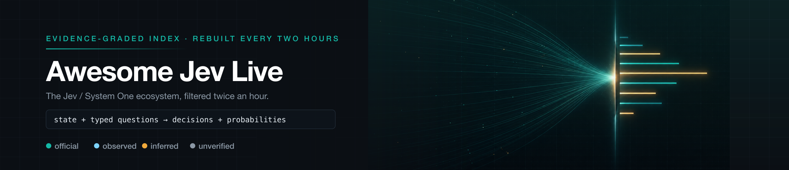

<h1 align="center">Awesome Jev Live</h1>

<b>每兩小時自我重建的 Jev 證據分級索引。</b>

  
  
  
  
  
  

<a href="../README.md">English</a> · <a href="README.zh-CN.md">简体中文</a> · <b>繁體中文</b> · <a href="README.ja.md">日本語</a> · <a href="README.ko.md">한국어</a> · <a href="README.es.md">Español</a> · <a href="README.fr.md">Français</a> · <a href="README.de.md">Deutsch</a> · <a href="README.pt-BR.md">Português (Brasil)</a> · <a href="README.ru.md">Русский</a> · <a href="README.it.md">Italiano</a> · <a href="README.ar.md">العربية</a> · <a href="README.hi.md">हिन्दी</a> · <a href="README.tr.md">Türkçe</a> · <a href="README.vi.md">Tiếng Việt</a> · <a href="README.th.md">ไทย</a> · <a href="README.id.md">Bahasa Indonesia</a> · <a href="README.pl.md">Polski</a> · <a href="README.nl.md">Nederlands</a> · <a href="README.uk.md">Українська</a>

> [!NOTE]
> **即時索引** · 上次同步: `2026-11-05T12:08:26+08:00` (UTC+8)
> · 條目: **820** · 本輪新增: **54** · 實作語言: **27**

以下每個條目都由本儲存庫的管線收集、篩選並複查。數字與時間戳記均來自資料來源，而非手工撰寫的快照。

## 🔥 本期精選 · 各領域第一名

每個領域取一名，依證據等級與 Star 數排名，每次同步重新計算。這是排名而非推薦；每個精選都連到下方的完整條目。優先選擇發佈了截圖或錄影的專案，以保證版面可視化。

<table>
<tr>
<td width="50%" valign="top">
<b>🏛️ <a href="https://github.com/typesafe-ai/skills">typesafe-ai/skills</a></b>
⭐2876 · ✅ official
使用 TypeSafe 的 System One API 進行建置的代理技能
</td>
<td width="50%" valign="top">
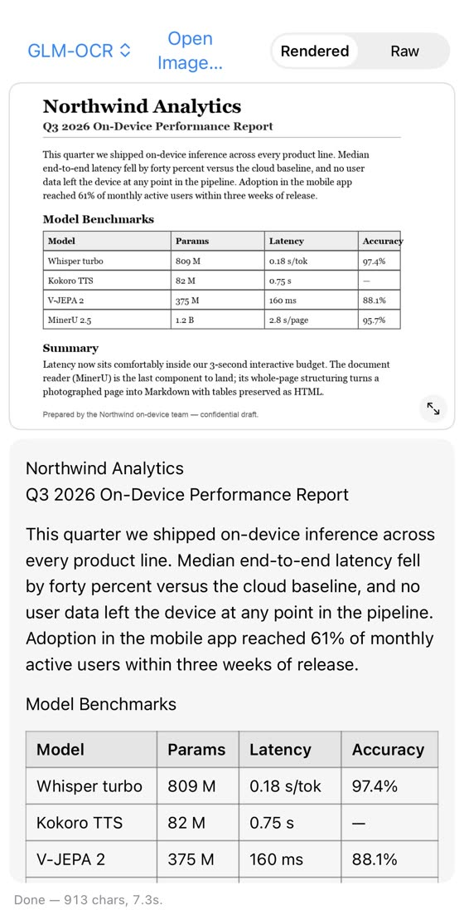
<b>🧰 <a href="https://github.com/john-rocky/coreai-kit">john-rocky/coreai-kit</a></b>
⭐123 · Swift · 👁️ observed
Swift SDK for running chat, vision and speech models on iPhone and Mac with Apple&#x27;s Core AI. Model download and caching, FoundationModels integration, and runnable…
</td>
</tr>
<tr>
<td width="50%" valign="top">
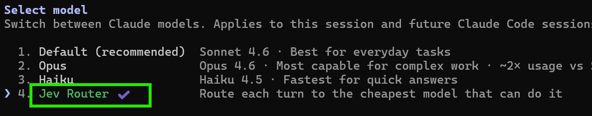
<b>🤖 <a href="https://github.com/gargpratyush/jev-router">gargpratyush/jev-router</a></b>
⭐654 · JavaScript · 🔎 inferred
使用 jev-router 將 claude code 中的工作路由至最便宜的模型
</td>
<td width="50%" valign="top">

<b>🛡️ <a href="https://github.com/dharmeshgurnani/CodeOtter">dharmeshgurnani/CodeOtter</a></b>
⭐3 · JavaScript · 👁️ observed
Autonomous, self-hosted AI code reviews, calibrated scoring gauges, and merge gates from any open model.
</td>
</tr>
<tr>
<td width="50%" valign="top">
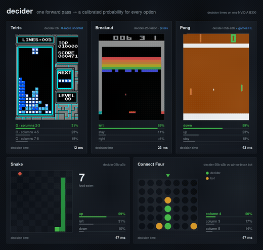
<b>🧪 <a href="https://github.com/Mapika/decider">Mapika/decider</a></b>
⭐1170 · Python · 👁️ observed
一系列從 Qwen3.5 微調而來的 System One 風格模型，專為具校準機率的單次通過型別化決策而設計。
</td>
<td width="50%" valign="top">
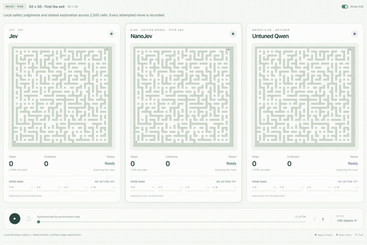
<b>🔬 <a href="https://github.com/TianyuCodings/NanoJev">TianyuCodings/NanoJev</a></b>
⭐2578 · Python · 🔎 inferred
Jev 的奈米級複製品：平行決策、動態候選項目，以及端到端訓練管線。
</td>
</tr>
<tr>
<td width="50%" valign="top">

<b>🎮 <a href="https://github.com/superagents-lab/jev-search">superagents-lab/jev-search</a></b>
⭐552 · TypeScript · 👁️ observed
使用 TypeSafe 的 Jev 搜尋網路：來源選擇、查詢理解與相關性排序。使用 Search1API 建置。
</td>
<td width="50%" valign="top">
<b>📰 <a href="https://docs.typesafe.ai/model-jaggedness/jev-1.13">9 類已知缺陷（jaggedness）</a></b>
⭐0 · ✅ official
字面理解、**計數不可靠**、日期比較、多級間接、無關細節大 state、對抗內容、指令與 criteria 矛盾、結構性不變量、生成。官方建議「拆成原子問題在程式碼裡組合」。
</td>
</tr>
</table>

## 目錄

- [Jev 是什麼？](#jev-是什麼)
- [條目分級方式](#條目分級方式)
- [官方 SDK 與開發者工具](#官方-sdk-與開發者工具) — **7**
- [社群客戶端、SDK 與轉接器](#社群客戶端sdk-與轉接器) — **141**
- [Agent 工具鏈：MCP、鉤子、閘門與編碼 Agent](#agent-工具鏈mcp鉤子閘門與編碼-agent) — **236**
- [路由、護欄與核准](#路由護欄與核准) — **59**
- [評估、校準與基準測試](#評估校準與基準測試) — **95**
- [開放重現、權重與架構研究](#開放重現權重與架構研究) — **62**
- [應用程式、遊戲、機器人與互動示範](#應用程式遊戲機器人與互動示範) — **46**
- [文章、討論與同類清單](#文章討論與同類清單) — **80**
- [其他專案](#其他專案) — **94**
- [依實作語言劃分的專案](#依實作語言劃分的專案)

## Jev 是什麼？

Jev 是 TypeSafe AI 的第一個 **System One model**。它不寫散文。它接收一個狀態，加上由你事先定義答案空間的問題，並回傳帶有機率分布的型別化數值，讓你的程式碼據以分支。

|                  |                                                                                                                              |
| ---------------- | ---------------------------------------------------------------------------------------------------------------------------- |
| **形態：**       | `state + typed questions` → `constrained answers + probabilities` → `your code`                                              |
| **基本元件：**   | `Choice`（從 ≤255 個選項中選一個）、`Score`（2–10 分的評分規準）、`Noul`（機率化的是／否）                                   |
| **端點：**       | `POST https://api.typesafe.ai/v1/systemone`，模型 `jev-1.13.0` / 別名 `jev-latest`                                           |
| **適合的場景：** | 有界工作流程中的路由、分診、評分、內容審核、驗證與低延遲閘門                                                                 |
| **已知限制：**   | 計數並不可靠，多層間接推理較弱，官方資料列出九類鋸齒狀能力缺口。輸出符合 schema 並不等於判斷正確——請在你自己的資料上做校準。 |

## 條目分級方式

這個領域的大多數清單只宣稱收錄。本清單會說明它究竟驗證到什麼程度，再讓你據此篩選。

| 等級         | 含義                                                                                             |
| ------------ | ------------------------------------------------------------------------------------------------ |
| `official`   | 由 TypeSafe AI 官方發布。                                                                        |
| `observed`   | 可開啟並閱讀的公開產物——真實的原始碼、真實的設定，或儲存庫名稱／主題中明確的 TypeSafe/Jev 宣告。 |
| `inferred`   | 以模糊訊號加上相互印證的用語比對而得，但尚未逐行閱讀。                                           |
| `unverified` | 看似相關，但未經任何獨立確認。僅為便於發現而收錄。                                               |

## 官方 SDK 與開發者工具

全數由 TypeSafe 官方發布。從這裡開始。

🏛️ <b><a href="https://github.com/typesafe-ai/skills">typesafe-ai/skills</a></b> · ⭐2876 · ✅ official · 12 天

##### 📝 摘要

使用 TypeSafe 的 System One API 進行建置的代理技能

> 💡 供應商自有的代理技能。由於它持續更新，因此最接近 TypeSafe 如何打算從代理驅動 Jev 的規格。

##### 📌 基本資訊

| 欄位 | 值                      |
| ---- | ----------------------- |
| 分類 | `官方 SDK 與開發者工具` |
| 證據 | `official`              |

##### 📊 資料

| 指標     | 值         |
| -------- | ---------- |
| Star 數  | **2876**   |
| 最近推送 | 2026-10-23 |
| 首次收錄 | 2026-09-18 |

🏛️ <b><a href="https://github.com/typesafe-ai/system-one-adapter-python">typesafe-ai/system-one-adapter-python</a></b> · ⭐407 · Python · ✅ official · 43 天

##### 📝 摘要

由 LLM APIs 支援的隨插即用 TypeSafeClient 替代品

> 💡 以普通 LLM 提供者支援相同介面的隨插即用替代品。這是在投入任一方案之前，使用你自己的資料，將型別化決策與提示進行 A/B 測試的誠實方式。

🔧 於程式碼中發現使用: `README.md`

##### 📌 基本資訊

| 欄位 | 值                      |
| ---- | ----------------------- |
| 分類 | `官方 SDK 與開發者工具` |
| 證據 | `official`              |
| 語言 | Python                  |

##### 📊 資料

| 指標     | 值         |
| -------- | ---------- |
| Star 數  | **407**    |
| 最近推送 | 2026-09-22 |
| 首次收錄 | 2026-10-23 |

🏛️ <b><a href="https://github.com/typesafe-ai/typesafe-sdk-python">typesafe-ai/typesafe-sdk-python</a></b> · ⭐308 · Python · ✅ official · 21 天

##### 📝 摘要

用於 TypeSafe API 的官方 Python 函式庫

> 💡 同步與非同步用戶端。從 API 金鑰到型別化決策的最快路徑，也是社群用戶端用來比較的參考實作。

🔧 於程式碼中發現使用: `README.md`

##### 📌 基本資訊

| 欄位 | 值                      |
| ---- | ----------------------- |
| 分類 | `官方 SDK 與開發者工具` |
| 證據 | `official`              |
| 語言 | Python                  |

##### 📊 資料

| 指標     | 值         |
| -------- | ---------- |
| Star 數  | **308**    |
| 最近推送 | 2026-10-14 |
| 首次收錄 | 2026-10-23 |

🏛️ <b><a href="https://github.com/typesafe-ai/typesafe-sdk-js">typesafe-ai/typesafe-sdk-js</a></b> · ⭐284 · TypeScript · ✅ official · 21 天

##### 📝 摘要

用於 TypeSafe API 的官方 TypeScript/JavaScript 函式庫

> 💡 TypeScript 用戶端會從你提出的問題推斷答案型別，因此不相符的回傳型別會成為編譯錯誤，而不是執行階段的意外。

##### 📌 基本資訊

| 欄位 | 值                      |
| ---- | ----------------------- |
| 分類 | `官方 SDK 與開發者工具` |
| 證據 | `official`              |
| 語言 | TypeScript              |

##### 📊 資料

| 指標     | 值         |
| -------- | ---------- |
| Star 數  | **284**    |
| 最近推送 | 2026-10-14 |
| 首次收錄 | 2026-10-23 |

🏛️ <b><a href="https://github.com/TypeSafeAI/jev-harness">TypeSafeAI/jev-harness</a></b> · ⭐38 · TypeScript · ✅ official · 1 天 · ⭐+1

##### 📝 摘要

A custom coding harness for TypeSafe AI's Jev: an LLM proposes, Jev answers narrow questions, code decides, every step leaves a receipt.

##### 📌 基本資訊

| 欄位 | 值                      |
| ---- | ----------------------- |
| 分類 | `官方 SDK 與開發者工具` |
| 證據 | `official`              |
| 語言 | TypeScript              |

##### 📊 資料

| 指標     | 值          |
| -------- | ----------- |
| Star 數  | **38** (+1) |
| 最近推送 | 2026-11-03  |
| 首次收錄 | 2026-11-03  |

🏷 `agent-harness` · `agentic-coding` · `ai-agents` · `ai-governance` · `ai-safety` · `code-review` · `coding-agent` · `developer-tools`

🏛️ <b><a href="https://github.com/typesafe-ai/WorkflowEvals">typesafe-ai/WorkflowEvals</a></b> · ⭐21 · Python · ✅ official · 36 天

##### 📝 摘要

evals.typesafe.ai 工作流程程式碼已發布

##### 📌 基本資訊

| 欄位 | 值                      |
| ---- | ----------------------- |
| 分類 | `官方 SDK 與開發者工具` |
| 證據 | `official`              |
| 語言 | Python                  |

##### 📊 資料

| 指標     | 值         |
| -------- | ---------- |
| Star 數  | **21**     |
| 最近推送 | 2026-09-29 |
| 首次收錄 | 2026-10-23 |

🏛️ <b><a href="https://github.com/typesafe-ai/typesafe-ai.github.io">typesafe-ai/typesafe-ai.github.io</a></b> · ⭐2 · HTML · ✅ official · 153 天

##### 📝 摘要

上游未發布說明。

##### 📌 基本資訊

| 欄位 | 值                      |
| ---- | ----------------------- |
| 分類 | `官方 SDK 與開發者工具` |
| 證據 | `official`              |
| 語言 | HTML                    |

##### 📊 資料

| 指標     | 值         |
| -------- | ---------- |
| Star 數  | **2**      |
| 最近推送 | 2026-06-04 |
| 首次收錄 | 2026-10-23 |

## 社群客戶端、SDK 與轉接器

針對 System One 端點的型別化客戶端，涵蓋社群已經著手的各種語言。

🧰 <b><a href="https://github.com/jexp/neo4jev">jexp/neo4jev</a></b> · ⭐182 · Jupyter · 👁️ observed · 47 天 · ⭐-1

##### 📝 摘要

Typesafe.ai System One Model Jev 透過使用相鄰關係分類器瀏覽 Neo4j 圖譜

##### 📌 基本資訊

| 欄位 | 值                         |
| ---- | -------------------------- |
| 分類 | `社群客戶端、SDK 與轉接器` |
| 證據 | `observed`                 |
| 語言 | Jupyter                    |

##### 📊 資料

| 指標     | 值           |
| -------- | ------------ |
| Star 數  | **182** (-1) |
| 最近推送 | 2026-09-18   |
| 首次收錄 | 2026-10-28   |

🧰 <b><a href="https://github.com/keltokhy/jgrep">keltokhy/jgrep</a></b> · ⭐140 · Python · 👁️ observed · 18 天

##### 📝 摘要

grep，但模式是一段描述。使用 TypeSafe 的 Jev 決策模型依意義篩選行：每行約 200 ms，成本為一美分的千分之一。

🔧 於程式碼中發現使用: `README.md`

##### 📌 基本資訊

| 欄位 | 值                         |
| ---- | -------------------------- |
| 分類 | `社群客戶端、SDK 與轉接器` |
| 證據 | `observed`                 |
| 語言 | Python                     |

##### 📊 資料

| 指標     | 值         |
| -------- | ---------- |
| Star 數  | **140**    |
| 最近推送 | 2026-10-17 |
| 首次收錄 | 2026-10-29 |

🏷 `cli` · `grep` · `jev` · `openrouter` · `semantic-search` · `typesafe`

🧰 <b><a href="https://github.com/qkal/Canny">qkal/Canny</a></b> · ⭐133 · TypeScript · 👁️ observed · 43 天 · ⭐+1

##### 📝 摘要

阻止 AI coding agent 在沒有證據的情況下宣稱工作已完成。由確定性 hooks 做決策，TypeSafe 的 Jev 提供建議。僅可附加的帳本，零執行階段相依性。

🔧 於程式碼中發現使用: `README.md`

##### 📌 基本資訊

| 欄位 | 值                         |
| ---- | -------------------------- |
| 分類 | `社群客戶端、SDK 與轉接器` |
| 證據 | `observed`                 |
| 語言 | TypeScript                 |

##### 📊 資料

| 指標     | 值           |
| -------- | ------------ |
| Star 數  | **133** (+1) |
| 最近推送 | 2026-09-22   |
| 首次收錄 | 2026-10-29   |

🏷 `agent-hooks` · `ai-agents` · `claude-code` · `claude-code-hooks` · `codex` · `codex-cli` · `guardrails` · `jev`

🧰 <b><a href="https://github.com/john-rocky/coreai-kit">john-rocky/coreai-kit</a></b> · ⭐123 · Swift · 👁️ observed · 0 天

##### 📝 摘要

Swift SDK for running chat, vision and speech models on iPhone and Mac with Apple's Core AI. Model download and caching, FoundationModels integration, and runnable examples with documented OS, SDK and model requirements.

🔧 於程式碼中發現使用: `Sources/CoreAIOps/CoreAI+SystemOne.swift`

##### 📌 基本資訊

| 欄位 | 值                         |
| ---- | -------------------------- |
| 分類 | `社群客戶端、SDK 與轉接器` |
| 證據 | `observed`                 |
| 語言 | Swift                      |

##### 📊 資料

| 指標     | 值         |
| -------- | ---------- |
| Star 數  | **123**    |
| 最近推送 | 2026-11-05 |
| 首次收錄 | 2026-10-26 |

🏷 `apple` · `apple-core-ai` · `asr` · `core-ai` · `coreai` · `foundation-models` · `ios` · `ios-27`

---

<table><tr><th align="center" width="50%">🖼 圖片</th><th align="center" width="50%">🎬 影片</th></tr><tr>
<td align="center" valign="top"></td>
<td align="center" valign="top">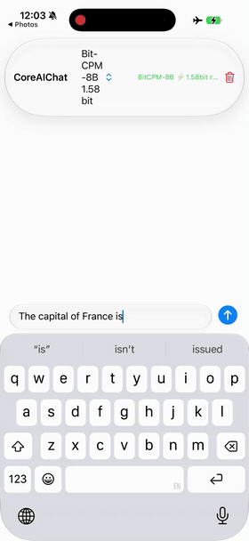 動態錄影</td>
</tr></table>

🧰 <b><a href="https://github.com/yzfly/awesome-jev-zh">yzfly/awesome-jev-zh</a></b> · ⭐89 · HTML · 👁️ observed · 0 天

##### 📝 摘要

Jev / TypeSafe System One 中文精選列表：官方資料、SDK、熱門應用程式、Agent 工具、開源重現與獨立評測，附中文入門指南，每日自動收錄 GitHub 熱門專案。

🔧 於程式碼中發現使用: `docs/quickstart.md`

##### 📌 基本資訊

| 欄位 | 值                         |
| ---- | -------------------------- |
| 分類 | `社群客戶端、SDK 與轉接器` |
| 證據 | `observed`                 |
| 語言 | HTML                       |

##### 📊 資料

| 指標     | 值         |
| -------- | ---------- |
| Star 數  | **89**     |
| 最近推送 | 2026-11-05 |
| 首次收錄 | 2026-09-18 |

🏷 `ai-agent` · `awesome` · `awesome-list` · `chinese` · `jev` · `llm` · `structured-output` · `system-one`

🧰 <b><a href="https://github.com/obie/ruby_decision_model">obie/ruby_decision_model</a></b> · ⭐58 · Ruby · 👁️ observed · 23 天

##### 📝 摘要

適用於 Typesafe Jev 等決策模型的 Ruby 用戶端

🔧 於程式碼中發現使用: `README.md`

##### 📌 基本資訊

| 欄位 | 值                         |
| ---- | -------------------------- |
| 分類 | `社群客戶端、SDK 與轉接器` |
| 證據 | `observed`                 |
| 語言 | Ruby                       |

##### 📊 資料

| 指標     | 值         |
| -------- | ---------- |
| Star 數  | **58**     |
| 最近推送 | 2026-10-12 |
| 首次收錄 | 2026-10-29 |

🧰 <b><a href="https://github.com/bodepudimuneendra-netizen/ConsciousDB">bodepudimuneendra-netizen/ConsciousDB</a></b> · ⭐54 · Python · 👁️ observed · 2 天

##### 📝 摘要

一個與資料庫無關的 Agentic GraphRAG 框架，使用可替換的 System One 模型（本機 Laya / 雲端 Jev）。一個隨插即用的智慧層，具備完整的 4 階段流程、持續評估，以及適用於任何圖形資料庫的自訂 A* 遍歷。

##### 📌 基本資訊

| 欄位 | 值                         |
| ---- | -------------------------- |
| 分類 | `社群客戶端、SDK 與轉接器` |
| 證據 | `observed`                 |
| 語言 | Python                     |

##### 📊 資料

| 指標     | 值         |
| -------- | ---------- |
| Star 數  | **54**     |
| 最近推送 | 2026-11-02 |
| 首次收錄 | 2026-11-02 |

🏷 `astar-algorithm` · `eval-harness` · `fine-tuning` · `graphdatabase` · `graprag` · `jev` · `laya` · `neo4j`

🧰 <b><a href="https://github.com/MrJev/awesome-jev">MrJev/awesome-jev</a></b> · ⭐20 · Python · 👁️ observed · 0 天

##### 📝 摘要

為 Jev、TypeSafe AI 的 System One 模型整理的專案、整合與資源清單。

##### 📌 基本資訊

| 欄位 | 值                         |
| ---- | -------------------------- |
| 分類 | `社群客戶端、SDK 與轉接器` |
| 證據 | `observed`                 |
| 語言 | Python                     |

##### 📊 資料

| 指標     | 值         |
| -------- | ---------- |
| Star 數  | **20**     |
| 最近推送 | 2026-11-04 |
| 首次收錄 | 2026-09-18 |

🏷 `ai-agents` · `awesome` · `awesome-list` · `jev` · `mcp` · `typesafe`

🧰 <b><a href="https://github.com/ckaraca/awesome-jev">ckaraca/awesome-jev</a></b> · ⭐17 · Python · 👁️ observed · 2 天

##### 📝 摘要

精選的工具、整合與實驗清單，皆建構於 Jev（TypeSafe AI 的 System One 模型）之上，用於快速、具型別的決策。

##### 📌 基本資訊

| 欄位 | 值                         |
| ---- | -------------------------- |
| 分類 | `社群客戶端、SDK 與轉接器` |
| 證據 | `observed`                 |
| 語言 | Python                     |

##### 📊 資料

| 指標     | 值         |
| -------- | ---------- |
| Star 數  | **17**     |
| 最近推送 | 2026-11-02 |
| 首次收錄 | 2026-09-19 |

🏷 `ai-agents` · `awesome` · `awesome-list` · `computer-use` · `jev` · `llm` · `system-one` · `typesafe`

🧰 <b><a href="https://github.com/Premo-Cloud/typesafe-sdk-java">Premo-Cloud/typesafe-sdk-java</a></b> · ⭐12 · Java · 👁️ observed · 14 天

##### 📝 摘要

社群 Java SDK，用於 Jev，即 TypeSafe 的 System One 模型：輸入型別化問題，輸出帶有校準後機率的型別化答案。Java 17+、Spring Boot starter（非官方）

##### 📌 基本資訊

| 欄位 | 值                         |
| ---- | -------------------------- |
| 分類 | `社群客戶端、SDK 與轉接器` |
| 證據 | `observed`                 |
| 語言 | Java                       |

##### 📊 資料

| 指標     | 值         |
| -------- | ---------- |
| Star 數  | **12**     |
| 最近推送 | 2026-10-21 |
| 首次收錄 | 2026-10-28 |

🏷 `java` · `jev` · `sdk` · `spring-boot` · `system-one` · `system-one-models` · `typesafe`

🧰 <b><a href="https://github.com/PromtEngineer/jev-harness">PromtEngineer/jev-harness</a></b> · ⭐10 · Python · 👁️ observed · 41 天

##### 📝 摘要

圍繞 TypeSafe 的 Jev（System One 模型）打造的 Pi 代理工具組：路由器、內容選擇器、閘門、驗證器。在 Neon Postgres 分支上進行測試。

##### 📌 基本資訊

| 欄位 | 值                         |
| ---- | -------------------------- |
| 分類 | `社群客戶端、SDK 與轉接器` |
| 證據 | `observed`                 |
| 語言 | Python                     |

##### 📊 資料

| 指標     | 值         |
| -------- | ---------- |
| Star 數  | **10**     |
| 最近推送 | 2026-09-24 |
| 首次收錄 | 2026-10-28 |

🧰 <b><a href="https://github.com/clouatre-labs/decisions-judge-mcp">clouatre-labs/decisions-judge-mcp</a></b> · ⭐5 · JavaScript · 👁️ observed · 2 天

##### 📝 摘要

將 AI 代理程式的具型別決策作為 MCP 工具：在一次快速請求中取得是／否機率（noul）、選擇和評分。由 TypeSafe System One 模型支援。

##### 📌 基本資訊

| 欄位 | 值                         |
| ---- | -------------------------- |
| 分類 | `社群客戶端、SDK 與轉接器` |
| 證據 | `observed`                 |
| 語言 | JavaScript                 |

##### 📊 資料

| 指標     | 值         |
| -------- | ---------- |
| Star 數  | **5**      |
| 最近推送 | 2026-11-02 |
| 首次收錄 | 2026-10-12 |

🏷 `agent` · `ai` · `cli` · `decision-making` · `decisions` · `judge` · `llm` · `mcp`

---

<table><tr><th align="center" width="50%">🖼 圖片</th><th align="center" width="50%">🎬 影片</th></tr><tr>
<td align="center" valign="top"></td>
<td align="center" valign="top"> 動態錄影</td>
</tr></table>

🧰 <b><a href="https://github.com/elbruno/ElBruno.AI.Decisions">elbruno/ElBruno.AI.Decisions</a></b> · ⭐5 · C# · 👁️ observed · 1 天

##### 📝 摘要

.NET 10 decision SDK: Choose, Score, and Assess with Microsoft Foundry (Microsoft-Decision-1), native local Ollama System One models, and TypeSafe AI Jev. One API, probabilities instead of paragraphs.

##### 📌 基本資訊

| 欄位 | 值                         |
| ---- | -------------------------- |
| 分類 | `社群客戶端、SDK 與轉接器` |
| 證據 | `observed`                 |
| 語言 | C#                         |

##### 📊 資料

| 指標     | 值         |
| -------- | ---------- |
| Star 數  | **5**      |
| 最近推送 | 2026-11-03 |
| 首次收錄 | 2026-11-03 |

🏷 `dotnet` · `dotnet10` · `jev` · `microsoft-extensions-ai` · `nuget`

---

<table><tr><th align="center" width="50%">🖼 圖片</th><th align="center" width="50%">🎬 影片</th></tr><tr>
<td align="center" valign="top"></td>
<td align="center" valign="top">未發布媒體</td>
</tr></table>

🧰 <b><a href="https://github.com/avalonreset/legends-jev">avalonreset/legends-jev</a></b> · ⭐3 · Python · 👁️ observed · 0 天

##### 📝 摘要

Optical character recognition (OCR), storefront signage verification, bounding-box grounding, and typed computer-use decision CLI powered by TypeSafe Jev 1.14.

##### 📌 基本資訊

| 欄位 | 值                         |
| ---- | -------------------------- |
| 分類 | `社群客戶端、SDK 與轉接器` |
| 證據 | `observed`                 |
| 語言 | Python                     |

##### 📊 資料

| 指標     | 值         |
| -------- | ---------- |
| Star 數  | **3**      |
| 最近推送 | 2026-11-04 |
| 首次收錄 | 2026-11-04 |

🏷 `bounding-box` · `browser-agent` · `claude-code` · `codex` · `computer-use` · `cto-legends` · `decision-model` · `image-text-extraction`

---

<table><tr><th align="center" width="50%">🖼 圖片</th><th align="center" width="50%">🎬 影片</th></tr><tr>
<td align="center" valign="top">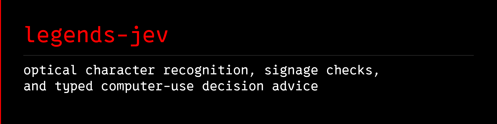</td>
<td align="center" valign="top">未發布媒體</td>
</tr></table>

🧰 <b><a href="https://github.com/Bonzokoles/36_chambers">Bonzokoles/36_chambers</a></b> · Python · 👁️ observed · 13 天

##### 📝 摘要

Federated knowledge retrieval engine for AI agents. Routes queries across specialized backends (FTS5, ChromaDB, graph) via a registry-first orchestrator with TypeSafe/Jev AI routing and evidence re-ranking. Read-only by default, security-gated by design.

##### 📌 基本資訊

| 欄位 | 值                         |
| ---- | -------------------------- |
| 分類 | `社群客戶端、SDK 與轉接器` |
| 證據 | `observed`                 |
| 語言 | Python                     |

##### 📊 資料

| 指標     | 值         |
| -------- | ---------- |
| Star 數  | **0**      |
| 最近推送 | 2026-10-22 |
| 首次收錄 | 2026-10-23 |

🏷 `ai-agents` · `ai-infrastructure` · `chromadb` · `embeddings` · `federated-search` · `fts5` · `information-retrieval` · `jev`

---

<table><tr><th align="center" width="50%">🖼 圖片</th><th align="center" width="50%">🎬 影片</th></tr><tr>
<td align="center" valign="top"></td>
<td align="center" valign="top">未發布媒體</td>
</tr></table>

由於上游未宣告再散布授權，資源直接連結至上游儲存庫。

🧰 <b><a href="https://github.com/OpenByteInc/QuantDinger">OpenByteInc/QuantDinger</a></b> · ⭐13530 · Python · 🔎 inferred · 0 天 · ⭐+21

##### 📝 摘要

開源 AI 交易作業系統、代理交易與氛圍交易，整合 Jev System One。研究、建構 Python 策略，並在加密貨幣、股票與外匯市場進行回測及模擬／實盤交易。推出你自己的多租戶交易 SaaS，內建使用者管理、計費、付款與結算功能。

##### 📌 基本資訊

| 欄位 | 值                         |
| ---- | -------------------------- |
| 分類 | `社群客戶端、SDK 與轉接器` |
| 證據 | `inferred`                 |
| 語言 | Python                     |

##### 📊 資料

| 指標     | 值              |
| -------- | --------------- |
| Star 數  | **13530** (+21) |
| 最近推送 | 2026-11-05      |
| 首次收錄 | 2026-09-20      |

🏷 `agent` · `backtesting` · `binance` · `crypto` · `exchange` · `finance` · `fintech` · `forex`

---

<table><tr><th align="center" width="50%">🖼 圖片</th><th align="center" width="50%">🎬 影片</th></tr><tr>
<td align="center" valign="top"></td>
<td align="center" valign="top">未發布媒體</td>
</tr></table>

🧰 <b><a href="https://github.com/dzhng/jevgrep">dzhng/jevgrep</a></b> · ⭐3174 · TypeScript · 🔎 inferred · 0 天 · ⭐+2

##### 📝 摘要

透過詢問程式碼的作用來尋找程式碼。這是一個用於編碼代理的 CLI，使用 Jev 來發現相關檔案和原始碼脈絡。

##### 📌 基本資訊

| 欄位 | 值                         |
| ---- | -------------------------- |
| 分類 | `社群客戶端、SDK 與轉接器` |
| 證據 | `inferred`                 |
| 語言 | TypeScript                 |

##### 📊 資料

| 指標     | 值            |
| -------- | ------------- |
| Star 數  | **3174** (+2) |
| 最近推送 | 2026-11-04    |
| 首次收錄 | 2026-10-29    |

🏷 `ai-sdk` · `claude-code` · `cli` · `code-search` · `codex` · `coding-agents` · `context-retrieval` · `developer-tools`

---

<table><tr><th align="center" width="50%">🖼 圖片</th><th align="center" width="50%">🎬 影片</th></tr><tr>
<td align="center" valign="top">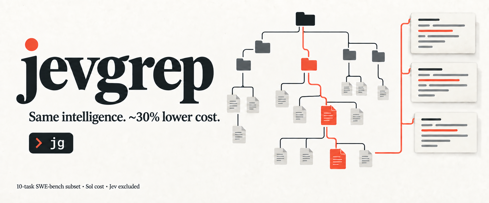</td>
<td align="center" valign="top">未發布媒體</td>
</tr></table>

🧰 <b><a href="https://github.com/socai-io/jev-social">socai-io/jev-social</a></b> · ⭐197 · JavaScript · 🔎 inferred · 3 天 · ⭐+1

##### 📝 摘要

開源、本地優先的 Instagram、TikTok 和 LinkedIn 社群媒體研究代理。Jev 路由唯讀步驟；socai CLI 擷取引用的瀏覽器證據。

##### 📌 基本資訊

| 欄位 | 值                         |
| ---- | -------------------------- |
| 分類 | `社群客戶端、SDK 與轉接器` |
| 證據 | `inferred`                 |
| 語言 | JavaScript                 |

##### 📊 資料

| 指標     | 值           |
| -------- | ------------ |
| Star 數  | **197** (+1) |
| 最近推送 | 2026-11-01   |
| 首次收錄 | 2026-11-02   |

🏷 `agent-skills` · `ai-agents` · `browser-agent` · `browser-automation` · `decision-model` · `deep-research` · `instagram` · `jev`

---

<table><tr><th align="center" width="50%">🖼 圖片</th><th align="center" width="50%">🎬 影片</th></tr><tr>
<td align="center" valign="top"></td>
<td align="center" valign="top"> 動態錄影</td>
</tr></table>

<b>本分類更多項目</b> · 123

- [xingwudao/OpenJev](https://github.com/xingwudao/OpenJev) - OpenJev：一個受 Jev 啟發、基於 TypeSafe.ai 概念的獨立 System One 決策 API.
- [frodi-karlsson/onesie](https://github.com/frodi-karlsson/onesie) - An expressive Unix-pipeable CLI for System One models like Jev。
- [GitHub30/OpenJev](https://github.com/GitHub30/OpenJev) - 開放權重的 System One 模型（相容於 Jev）：透過一次前向傳播取得經校準的 noul / choice / score 決策，不生成文字.
- [chussenot/judgment](https://github.com/chussenot/judgment) - 來自 System One 模型的型別化、經校準判斷：將決策寫成 .jud 檔案或 Rust 型別，由模型回答，在讀取前完成驗證，無需金鑰即可測試.
- [CMaintz/jev-dotnet](https://github.com/CMaintz/jev-dotnet) - Unofficial .NET SDK for TypeSafe AI。
- [danieleteti/systemone-delphi](https://github.com/danieleteti/systemone-delphi) - Delphi client for System One models (Jev, tev1 and nimble on Ollama): ask typed…
- [erik-hedstrom/loadout](https://github.com/erik-hedstrom/loadout) - Pick the model, skills and MCP servers for each coding-agent session from a…
- [jqueryscript/awesome-jev](https://github.com/jqueryscript/awesome-jev) - A curated list of TypeSafe Jev resources, SDKs, agents, MCP servers…
- [basi/typesafe-ai-php-client](https://github.com/basi/typesafe-ai-php-client) - PHP client for the typesafe.ai System One API (Jev)。
- [CMaintz/jev-java](https://github.com/CMaintz/jev-java) - Unofficial Java SDK for TypeSafe AI。
- [JosephHardy91/graph-composition-with-dLLMs](https://github.com/JosephHardy91/graph-composition-with-dLLMs) - A Graph-Compiled Specification RAG system built with **Dagster**, **PostgreSQL…
- [sanketmuchhala/jevgate](https://github.com/sanketmuchhala/jevgate) - Calibrated policy triage and institutional risk routing: a hybrid…
- [ollaya-dev/ollaya](https://github.com/ollaya-dev/ollaya) - Jev-compatible API server for open decision models.
- [realZachi/pg-jev](https://github.com/realZachi/pg-jev) - 以自然語言詢問你的 Postgres 資料表問題。由 TypeSafe 的 Jev 驅動的 PostgreSQL 擴充功能.
- [sutro-sh/jev-align](https://github.com/sutro-sh/jev-align) - 使用 Jev 和 GEPA，從人類回饋建構經校準的 AI Functions.
- [supercorp-ai/supercov](https://github.com/supercorp-ai/supercov) - 用於程式碼代理的覆蓋率、安全性與程式碼品質。
- [juspay/neurolink](https://github.com/juspay/neurolink) - AI 神經系統的管道層 — 一個介面，跨三種推論類型將供應商神經元連接到你的應用程式：generate、stream，以及校準過的 decide。
- [aaddrick/building-with-typesafe-jev](https://github.com/aaddrick/building-with-typesafe-jev) - 非官方技能，教導 coding agents 使用 TypeSafe AI 的 Jev 建構：類型化決策、校準信心，以及來自 150+ 個社群專案的先前技術.
- [Ying-Kai-Liao/jev-browser](https://github.com/Ying-Kai-Liao/jev-browser) - 瀏覽器自動化，其中 LLM 負責規劃，Jev（Typesafe System One）負責決策。程式庫、CLI 與 MCP 伺服器.
- [AkashPriyadarshii/jev-curate](https://github.com/AkashPriyadarshii/jev-curate) - High-throughput synthetic and pretraining dataset sifter for TypeSafe Jev.
- [fazlerocks/jevmail](https://github.com/fazlerocks/jevmail) - Gmail 的開源 AI 電子郵件分流工具。透過 Vercel AI Gateway 使用 Jev、TypeSafe AI…
- [AkashPriyadarshii/jev-seo](https://github.com/AkashPriyadarshii/jev-seo) - Free Rust SEO and GEO toolkit powered by TypeSafe Jev: 58-rule audits, site…
- [AboveColin/HA-Jev](https://github.com/AboveColin/HA-Jev) - 向你的房屋提出問題，取得一個數字。適用於 TypeSafe Jev 的 Home Assistant 整合：將類型化答案作為感測器、提供四種自動化動作，以及供…
- [sharziki/semdecide](https://github.com/sharziki/semdecide) - 由 TypeSafe AI Jev 驅動的 Unix pipeline 與 CI 類型化語意決策.
- [bladedevoff/stuntd](https://github.com/bladedevoff/stuntd) - 本機代理，會學習你應用程式的具型別 LLM 決策，並以 Laya head 回答。相容於 Jev 和 OpenAI.
- [burnigtm/jev-mcp](https://github.com/burnigtm/jev-mcp) - MCP 伺服器，讓 TypeSafe Jev 在 Cursor、Codex 及任何 MCP 用戶端中加入 coding loop。
- [mlimarenko/IronRAG](https://github.com/mlimarenko/IronRAG) - One-click knowledge system for documents, internal bots, and AI agents。
- [shaharia-lab/jev-cli](https://github.com/shaharia-lab/jev-cli) - Command-line tool for TypeSafe AI。
- [AkashPriyadarshii/jev-superpowers](https://github.com/AkashPriyadarshii/jev-superpowers) - Systematic software development framework for AI coding agents upgraded with…
- [dannote/jev](https://github.com/dannote/jev) - 用於 OTP 的 TypeSafe Jev：從 GenServer 回覆 Jev 並對其答案進行模式比對。
- [DevLoops-ai/unified-brain](https://github.com/DevLoops-ai/unified-brain) - System One Coding Agents: code-level answers at the same score as Claude Fable…
- [jwuthri-cloud/SelfJev](https://github.com/jwuthri-cloud/SelfJev) - Self-hosted decision model (selfjev-4b) with a Jev-compatible API: Python SDK…
- [jiangkoumo/ego-decision-layer](https://github.com/jiangkoumo/ego-decision-layer) - Pluggable decision layer for the ego lite browser: one System One (Jev) call…
- [thusinh1969/BrighTO_Router](https://github.com/thusinh1969/BrighTO_Router) - BrighTO LLM Router: free open-source, ultra-fast Rust LLM gateway/router and…
- [arjun988/Kev](https://github.com/arjun988/Kev) - 開源 System One 決策引擎。具備校準機率的型別化 choice / score / noul.
- [Ray-Hughes/jevalyn](https://github.com/Ray-Hughes/jevalyn) - Rails 應用程式的決策層。圍繞 TypeSafe 的 Jev System One API 建構的 Rails…
- [nouli-ai/nouli](https://github.com/nouli-ai/nouli) - A ledger-backed decision network that records AI decisions and connects them to…
- [tontoko/jev-browser](https://github.com/tontoko/jev-browser) - One grounded Jev/Playwright core: typed SDK, persistent CLI, and MCP server…
- [saibimajdi/typesafeai-dotnet-sdk](https://github.com/saibimajdi/typesafeai-dotnet-sdk) - 用於 TypeSafe AI System One API 的社群 .NET SDK——以具型別方式提出 noul、choice 與 score…
- [Elue-dev/jev_elixir](https://github.com/Elue-dev/jev_elixir) - jev_elixir 是一個小巧、符合 Elixir 慣用風格的介面，用於使用 Jev 建立具型別的決策.
- [sumleo/prompt2jev](https://github.com/sumleo/prompt2jev) - 代理技能與 CLI，可將自然語言、LLM 提示，或執行它的程式碼，轉成 TypeSafe Jev 決策：型別化狀態、Choice/Score/Noul…
- [devbackend/jevgo](https://github.com/devbackend/jevgo) - 適用於 TypeSafe AI System One API（Jev）的非官方 Go 用戶端——輸入具型別的問題，輸出經校準的答案.
- [haileyok/typesafe-client](https://github.com/haileyok/typesafe-client) - TypeSafe AI System One API（Jev）的非官方 Go 和 Rust 用戶端。
- [himomohi/aside-jev](https://github.com/himomohi/aside-jev) - Aside 代理使用 TypeSafe Jev（System One：Choice/Score/Noul）進行決策.
- [chenrui333/jev-docs](https://github.com/chenrui333/jev-docs) - 由社群維護的 Jev／TypeSafe System One APIs、SDKs、代理程式指南和工程最佳實務歷史.
- [docxology/daf-jev](https://github.com/docxology/daf-jev) - daf-jev：適用於 TypeSafe 的 Python 可組合工具組，用於其 Jev（System One）決策 API…
- [sanamhub/typesafe-dotnet](https://github.com/sanamhub/typesafe-dotnet) - Unofficial .NET client for the TypeSafe AI System One API。
- [illescasDaniel/jev-mem](https://github.com/illescasDaniel/jev-mem) - Long-term memory for AI agents driven by Jev (System One) decisions: no…
- [JimmyWesley/rlcd-gateway](https://github.com/JimmyWesley/rlcd-gateway) - 用於 LLMs 與決策模型的自託管閘道。Claude Code、Codex、OpenCode 以及任何 OpenAI/Anthropic SDK…
- [Kadihx/jev-x-kit](https://github.com/Kadihx/jev-x-kit) - 用於程式碼代理的離線 $0 決策層：Choice/Score/Noul 原語、BELKI 信心守門員、超規劃、紅隊測試、研究與 RLVR 自我改進——作為…
- [vibefilter/filament](https://github.com/vibefilter/filament) - Filter Filament tables with a plain-English statement.
- [zhirschtritt/typesafe-go](https://github.com/zhirschtritt/typesafe-go) - 用於 TypeSafe AI API 的慣用 Go SDK。
- [AIAnytime/Jev-Router](https://github.com/AIAnytime/Jev-Router) - Decision-first, OpenAI-compatible AI router powered by Jev typed decisions.
- [akiiwa-games/AgentCompass](https://github.com/akiiwa-games/AgentCompass) - Deterministic multi-agent task router &amp; subscription quota scheduler for Claude…
- [Butochnikov/laravel-typesafe-jev](https://github.com/Butochnikov/laravel-typesafe-jev) - 用於 TypeSafe Jev AI 的非官方 Laravel 整合，具備型別化回應、非同步請求、限定範圍相依注入與測試替身.
- [coo-quack/jev-pii-checker](https://github.com/coo-quack/jev-pii-checker) - CLI 可在文字中尋找 PII，並提供 TypeSafe Jev：存在性、敏感度與定位範圍。
- [Lasimeri/Mechanical-Jev](https://github.com/Lasimeri/Mechanical-Jev) - The asking side of Jev (TypeSafe System One: noul, choice, score) in Rust…
- [nshkrdotcom/system_one_sdk](https://github.com/nshkrdotcom/system_one_sdk) - 供應商中立的 Elixir/BEAM SDK，用於 System One 語意：型別化 Noul、Choice 與 Score…
- [PAI-CUHK/SLEEPJEV](https://github.com/PAI-CUHK/SLEEPJEV) - 受 JEV 啟發、針對長時域 PSG 的型別化執行階段決策：可重複使用的隔夜編碼、稀疏檢索，以及 Choice/Noul/Score 機率.
- [zerone-agents/jev-model-router](https://github.com/zerone-agents/jev-model-router) - 適用於代理程式的輕量模型路由，具備 OpenAI 和 Anthropic API 相容性、自動模型選擇，以及管理 CLI.
- [AboveColin/jevclient](https://github.com/AboveColin/jevclient) - 適用於 TypeSafe Jev 的非同步 Python 用戶端。輸入具型別問題，輸出機率與選項，無需解析散文.
- [dsaad68/fuzzy-jev](https://github.com/dsaad68/fuzzy-jev) - A client for OpenRouter&#x27;s decision models, TypeSafe&#x27;s Jev by default: typed…
- [getmissionctrl/hs-jev](https://github.com/getmissionctrl/hs-jev) - 適用於 TypeSafe 的 System One（Jev）決策 API 的 Haskell 用戶端——透過 http-client 提供具型別、批次化的…
- [maxtrezzi/jev4s](https://github.com/maxtrezzi/jev4s) - Typed Scala client for Jev (TypeSafe AI): typed questions, typed answers…
- [minorun365/jev-cloud-quiz](https://github.com/minorun365/jev-cloud-quiz) - 三大クラウドの機能名を、TypeSafe AI の System One モデル Jev が確率つきで判定するデモ。
- [MrKyaw/CognitiveMirror-Jev-MCP](https://github.com/MrKyaw/CognitiveMirror-Jev-MCP) - Cognitive middleware for personal and enterprise AI agents: 14 MCP tools and a…
- [NerdishShah/playwright-cli-jev-bakeoff](https://github.com/NerdishShah/playwright-cli-jev-bakeoff) - Bake-off: Playwright CLI vs CLI+Jev vs Playwright MCP。
- [amidabuddha/jev-decision-mcp](https://github.com/amidabuddha/jev-decision-mcp) - Local MCP server for TypeSafe Jev typed decisions, with Codex integration。
- [apixly-ai/jev-filter](https://github.com/apixly-ai/jev-filter) - Typed semantic filtering for AI agents: turn retrieved records, code and logs…
- [bojansandhaus/dsh-jev-mcp](https://github.com/bojansandhaus/dsh-jev-mcp) - TypeSafe Jev decision tools for DeepSeek Harness: dependency-free client…
- [darup67/jev-client](https://github.com/darup67/jev-client) - Shared Typesafe judgement client used by zillow-agent and coin-launch-agent。
- [exfoca/decision-model-lab-4JEV](https://github.com/exfoca/decision-model-lab-4JEV) - DML is a reproducible harness for evaluating small, local decision models under…
- [Hyper-AI-Lab/openclaw-jev](https://github.com/Hyper-AI-Lab/openclaw-jev) - OpenClaw agents 的生產控制平面：使用 Jev 進行接收路由、Temporal 編排、每次回覆前的 Process Evaluator…
- [swami8791/jev-judge-mcp](https://github.com/swami8791/jev-judge-mcp) - Owner-private ChatGPT integration for TypeSafe Jev structured evaluations.
- [abirshhishirroy/mini-jev](https://github.com/abirshhishirroy/mini-jev) - A custom Jev-style decision model built from scratch on Qwen2.5-3B.
- [CMaintz/jev-tools](https://github.com/CMaintz/jev-tools) - 建構於 TypeSafe AI 的 Jev 之上的 TypeScript 工具：代理工具呼叫防護欄、GitHub 問題分流 Action，以及大量分類…
- [codebam/jev-guardrails](https://github.com/codebam/jev-guardrails) - 由 Jev 支援的代理工具呼叫防護欄：函式庫、原生 OpenCode/Hermes/DeepSeek Harness 鉤子，以及託管的評估額度服務.
- [david1gp/jev](https://github.com/david1gp/jev) - Result-based TypeSafe System One, Cloudflare Clef, and OpenAI Decisions client…
- [Errr0rr404/jev-trader](https://github.com/Errr0rr404/jev-trader) - Local CLI and web desk. Robinhood Agentic MCP is the tape. TypeSafe Jev votes.
- [HappyHackingSpace/jev](https://github.com/HappyHackingSpace/jev) - Go SDK, CLI, MCP server and agent skill for TypeSafe。
- [ivanblagdan/jev-cli](https://github.com/ivanblagdan/jev-cli) - Composable CLI for TypeSafe。
- [jeppevammenkristensen/jev-runner](https://github.com/jeppevammenkristensen/jev-runner) - Code for querying Jev based on dotnet sdk 11 and C# 15。
- [jmurray10/jev_naics](https://github.com/jmurray10/jev_naics) - A classical PEAS agent that codes a business description to one of 1,012 NAICS…
- [kkdev92/jev-dotnet](https://github.com/kkdev92/jev-dotnet) - An unofficial .NET 10 client for Jev, TypeSafe。
- [mattbran87/jev-daemon](https://github.com/mattbran87/jev-daemon) - jev: a per-user daemon and CLI that hold TypeSafe keys and send checked…
- [mrodgersjs-web/jev-route](https://github.com/mrodgersjs-web/jev-route) - Deterministic routing-policy CLI in Rust: task and candidates in, choice +…
- [Murat-Selim/jev_doc_router](https://github.com/Murat-Selim/jev_doc_router) - Spring Boot PDF question-answering assistant with RAG/CAG routing and…
- [offneves/jev-pr-reviewer](https://github.com/offneves/jev-pr-reviewer) - A local CLI to analyze Pull Request / Merge Request diffs, obtain structured…
- [ogarciarevett/jev-py-sdk](https://github.com/ogarciarevett/jev-py-sdk) - Typed Jev judgments (noul / choice / score) from TypeSafe for Python, masked…
- [phoenix1331/laravel-jev-hotdog](https://github.com/phoenix1331/laravel-jev-hotdog) - A Laravel 13 playground that tells you whether a photo is a hot dog or not…
- [pyck-ai/jev-cli](https://github.com/pyck-ai/jev-cli) - Jev。
- [Ridlo543/jev-judge](https://github.com/Ridlo543/jev-judge) - Universal Model Context Protocol (MCP) server and CLI runner for TypeSafe Jev…
- [royalskynet/jev-gate-mcp](https://github.com/royalskynet/jev-gate-mcp) - Governed Jev decision gateway for GPT, Claude, and MCP clients。
- [shetautnetjer/jev-cli](https://github.com/shetautnetjer/jev-cli) - Clean-room CLI for TypeSafe System One / Jev Decision Contracts, search, and…
- [sunjongos/jev-typesafe-gatekeeper](https://github.com/sunjongos/jev-typesafe-gatekeeper) - World-Class Pure System 1 AI Decision &amp; 90/10 Hybrid Gatekeeper Skill powered…
- [SykkoAtHome/MCP_Typesafe_JEV](https://github.com/SykkoAtHome/MCP_Typesafe_JEV) - Domain-agnostic MCP server for TypeSafe Jev (System One) evaluation engine…
- [VianneyMI/python-jev](https://github.com/VianneyMI/python-jev) - Unofficial typed Python SDK for TypeSafe。
- [vilinski/jev](https://github.com/vilinski/jev) - 用於 System One 決策模型的 CLI：輸入 typed questions，輸出經校準機率，API key 不暴露給呼叫方。
- [Yasir-Khan-7/jev-sentinel](https://github.com/Yasir-Khan-7/jev-sentinel) - LangChain / LangGraph AI agents 的 prompt injection 防護與工具呼叫護欄.
- [Zuexx/agent-jev-integration](https://github.com/Zuexx/agent-jev-integration) - TypeSafe Jev integrated into Claude Code: routing, escalation, guardrails, evals。
- [rokbenko/quackd](https://github.com/rokbenko/quackd) - One CLI for all your robots. Connect them, command them, and let them work…
- [StartLuxLabs/StartLux-Prism](https://github.com/StartLuxLabs/StartLux-Prism) - Fast, exact inference for StartLux-Decision models on NVIDIA GPUs: the released…
- [MiaoWuNYA/rikkahub-sillytavern-android](https://github.com/MiaoWuNYA/rikkahub-sillytavern-android) - 安卓AI聊天端:开箱即聊，无损导入酒馆卡，缓存强省用量，Jev…
- [pithings/advocaat](https://github.com/pithings/advocaat) - 一個小型且具型別安全的用戶端，用於詢問 AI 關於資料的問題，由 TypeSafe Jev 驅動.
- [giuliosmall/pg_typesafe](https://github.com/giuliosmall/pg_typesafe) - 用於 TypeSafe AI（Jev）類別分類的 pre-alpha PostgreSQL 擴充功能。
- [Brainwires/jevwire](https://github.com/Brainwires/jevwire) - Jev decision layer for agents: MCP server, embeddable DecisionModel library…
- [zhulinchng/jevper](https://github.com/zhulinchng/jevper) - OpenAI 類 clients 之上的 Jev 形狀（TypeSafe System One）分類 wrapper。
- [schainks/system_one_client](https://github.com/schainks/system_one_client) - 適用於 System One 決策模型的 Elixir 用戶端：TypeSafe Jev、Cloudflare…
- [gilljon/typesafe-ai-rs](https://github.com/gilljon/typesafe-ai-rs) - 適用於 TypeSafe AI System One API 的獨立非同步與阻塞式 Rust SDK。
- [AutreMachine/bosco](https://github.com/AutreMachine/bosco) - Router and proxy for OpenAI compatible LLMs machines - 1 url to rule them all !
- [cipherTing/sael](https://github.com/cipherTing/sael) - Go client for the TypeSafe System One API (Jev) — the first piece of sael, a…
- [IKEASven69/dsh-opencli](https://github.com/IKEASven69/dsh-opencli) - 让 dsh 会办事:登录态真实浏览器 × 180 站点结构化命令 + SystemOne 亚秒决策 + 执行真实性判定 + watch 监控.
- [Query-farm/vgi-typesafe](https://github.com/Query-farm/vgi-typesafe) - 一個 VGI worker，將 TypeSafe System One 問題（choice、noul、score）作為可 LATERAL join…
- [zcoder-run/rust-sysone](https://github.com/zcoder-run/rust-sysone) - System One TypeSafe AI Rust Client (unofficial)。
- [fini/warped-sys1-lab](https://github.com/fini/warped-sys1-lab) - Jev (TypeSafe System One) experiment lab: SvelteKit workbench and CLI。
- [lirantal/discoprint](https://github.com/lirantal/discoprint) - Classify an artist。
- [y0usaf/typesafe-cli](https://github.com/y0usaf/typesafe-cli) - 從 shell 詢問 Jev 型別化問題：noul、choice 與 score 答案以數字呈現，而非散文。
- [geilt/typesafe-cli](https://github.com/geilt/typesafe-cli) - 用於 TypeSafe System One（Jev）的 CLI 與代理技能：型別化 Choice、Score 與 Noul 判斷.
- [iamtalha-arshad/ex_typesafe_ai](https://github.com/iamtalha-arshad/ex_typesafe_ai) - 用於 TypeSafe AI API 的非官方 Elixir 用戶端——型別化結構、基於 Req 且具重試功能的 HTTP，以及易用的…
- [KratosLee-6/open-source-model-deploy](https://github.com/KratosLee-6/open-source-model-deploy) - 开源大模型部署可行性鉴别工具 · 168 个开源模型动态评估（含 12 个 JEV/System One 决策模型）· 硬件自动检测 ·…
- [MarcelRoozekrans/Minos.NET](https://github.com/MarcelRoozekrans/Minos.NET) - Typed, source-generated decision questions for .NET: one IDecisionClient for…
- [MIt9/laya-cli](https://github.com/MIt9/laya-cli) - 適用於 Laya 的人體工學 CLI——供人類與 AI Agent 使用的具型別決策（choice/score/noul），支援 pexels-cli…
- [phiat/typesafe-rust-sdk](https://github.com/phiat/typesafe-rust-sdk) - Unofficial Rust client for TypeSafe。

## Agent 工具鏈：MCP、鉤子、閘門與編碼 Agent

成長最快的分類：在 Agent 的下一個動作之前放入型別化判斷的鉤子、MCP 伺服器與閘門。

🤖 <b><a href="https://github.com/tamaratran/fast-jev-compaction">tamaratran/fast-jev-compaction</a></b> · ⭐7849 · TypeScript · 🔎 inferred · 47 天 · ⭐+9

##### 📝 摘要

Claude Code 外掛程式，以 Jev 個決策取代壓縮摘要：每次工具呼叫與結果都在一次快速請求中評分，過時的內容會被捨棄或截短，保留的內容則完全維持原樣。

> 💡 以具型別的決策取代編碼代理的上下文壓縮摘要。這是將現有管線中的一次 LLM 呼叫替換掉，而非重新建構整條管線的簡潔範例。

##### 📌 基本資訊

| 欄位 | 值                                          |
| ---- | ------------------------------------------- |
| 分類 | `Agent 工具鏈：MCP、鉤子、閘門與編碼 Agent` |
| 證據 | `inferred`                                  |
| 語言 | TypeScript                                  |

##### 📊 資料

| 指標     | 值            |
| -------- | ------------- |
| Star 數  | **7849** (+9) |
| 最近推送 | 2026-09-18    |
| 首次收錄 | 2026-10-29    |

🤖 <b><a href="https://github.com/gargpratyush/jev-router">gargpratyush/jev-router</a></b> · ⭐654 · JavaScript · 🔎 inferred · 46 天 · ⭐+2

##### 📝 摘要

使用 jev-router 將 claude code 中的工作路由至最便宜的模型

> 💡 將每一輪對話路由至能夠處理該輪的最便宜模型。這是 System One 模型最典型的降低成本使用案例。

##### 📌 基本資訊

| 欄位 | 值                                          |
| ---- | ------------------------------------------- |
| 分類 | `Agent 工具鏈：MCP、鉤子、閘門與編碼 Agent` |
| 證據 | `inferred`                                  |
| 語言 | JavaScript                                  |

##### 📊 資料

| 指標     | 值           |
| -------- | ------------ |
| Star 數  | **654** (+2) |
| 最近推送 | 2026-09-19   |
| 首次收錄 | 2026-10-29   |

---

<table><tr><th align="center" width="50%">🖼 圖片</th><th align="center" width="50%">🎬 影片</th></tr><tr>
<td align="center" valign="top"></td>
<td align="center" valign="top">未發布媒體</td>
</tr></table>

🤖 <b><a href="https://github.com/0xNatoshi/jev-codex-router">0xNatoshi/jev-codex-router</a></b> · ⭐273 · JavaScript · 🔎 inferred · 43 天

##### 📝 摘要

針對 Codex 的逐回合模型與推理路由，由 Jev（TypeSafe System One）驅動：為每個回合選擇模型、思考深度與速度模式。

> 💡 針對編碼代理的逐回合模型與推理投入路由，由型別化決策驅動。

##### 📌 基本資訊

| 欄位 | 值                                          |
| ---- | ------------------------------------------- |
| 分類 | `Agent 工具鏈：MCP、鉤子、閘門與編碼 Agent` |
| 證據 | `inferred`                                  |
| 語言 | JavaScript                                  |

##### 📊 資料

| 指標     | 值         |
| -------- | ---------- |
| Star 數  | **273**    |
| 最近推送 | 2026-09-22 |
| 首次收錄 | 2026-10-28 |

🏷 `ai` · `codex` · `jev` · `llm` · `macos` · `routing` · `typesafe`

🤖 <b><a href="https://github.com/thruwire/foreman">thruwire/foreman</a></b> · ⭐810 · Python · 👁️ observed · 20 天 · ⭐+2

##### 📝 摘要

An agent supervisor and software factory foreman powered by decision models

🔧 於程式碼中發現使用: `docs/openrouter.md`

##### 📌 基本資訊

| 欄位 | 值                                          |
| ---- | ------------------------------------------- |
| 分類 | `Agent 工具鏈：MCP、鉤子、閘門與編碼 Agent` |
| 證據 | `observed`                                  |
| 語言 | Python                                      |

##### 📊 資料

| 指標     | 值           |
| -------- | ------------ |
| Star 數  | **810** (+2) |
| 最近推送 | 2026-10-15   |
| 首次收錄 | 2026-10-29   |

🏷 `agent-supervision` · `codex` · `jev` · `opencode` · `pi-agent` · `pi-coding-agent` · `pi-durable`

---

<table><tr><th align="center" width="50%">🖼 圖片</th><th align="center" width="50%">🎬 影片</th></tr><tr>
<td align="center" valign="top"></td>
<td align="center" valign="top">未發布媒體</td>
</tr></table>

🤖 <b><a href="https://github.com/strands-labs/strands-decider">strands-labs/strands-decider</a></b> · ⭐762 · Python · 👁️ observed · 0 天 · ⭐+3

##### 📝 摘要

適用於代理程式工作流程的小型快速決策模型，或稱 System 1 模型。在每個決策上都具備經過校準的信心度，讓你能比 LLM 更快地在選項間挑選或依量表評分。

##### 📌 基本資訊

| 欄位 | 值                                          |
| ---- | ------------------------------------------- |
| 分類 | `Agent 工具鏈：MCP、鉤子、閘門與編碼 Agent` |
| 證據 | `observed`                                  |
| 語言 | Python                                      |

##### 📊 資料

| 指標     | 值           |
| -------- | ------------ |
| Star 數  | **762** (+3) |
| 最近推送 | 2026-11-04   |
| 首次收錄 | 2026-10-02   |

🏷 `ai` · `machine-learning` · `natural-language-understanding` · `python` · `strands-agents` · `strands-labs` · `system-one` · `system-one-models`

🤖 <b><a href="https://github.com/AbdelStark/awesome-typesafe-jev">AbdelStark/awesome-typesafe-jev</a></b> · ⭐615 · HTML · 👁️ observed · 3 天 · ⭐+1

##### 📝 摘要

Awesome Jev：一份有來源支持的 TypeSafe 的 System One 模型實地指南，包含 SDKs、即時示範、agent 工具與獨立評估。

🔧 於程式碼中發現使用: `README.md`

##### 📌 基本資訊

| 欄位 | 值                                          |
| ---- | ------------------------------------------- |
| 分類 | `Agent 工具鏈：MCP、鉤子、閘門與編碼 Agent` |
| 證據 | `observed`                                  |
| 語言 | HTML                                        |

##### 📊 資料

| 指標     | 值           |
| -------- | ------------ |
| Star 數  | **615** (+1) |
| 最近推送 | 2026-11-01   |
| 首次收錄 | 2026-10-28   |

🏷 `agent-skills` · `ai-agents` · `awesome` · `awesome-jev` · `awesome-list` · `awesome-lists` · `curated-list` · `developer-tools`

🤖 <b><a href="https://github.com/jkudish/jev-mcp">jkudish/jev-mcp</a></b> · ⭐570 · JavaScript · 👁️ observed · 6 天 · ⭐+1

##### 📝 摘要

來自 TypeSafe 的 Jev 模型的快速、低成本、具型別判斷，作為 MCP 工具。

> 💡 透過 MCP 公開 Jev 的早期概念驗證；這是大多數非 Python 工具鏈接觸它的方式。

🔧 於程式碼中發現使用: `README.md`

##### 📌 基本資訊

| 欄位 | 值                                          |
| ---- | ------------------------------------------- |
| 分類 | `Agent 工具鏈：MCP、鉤子、閘門與編碼 Agent` |
| 證據 | `observed`                                  |
| 語言 | JavaScript                                  |

##### 📊 資料

| 指標     | 值           |
| -------- | ------------ |
| Star 數  | **570** (+1) |
| 最近推送 | 2026-10-30   |
| 首次收錄 | 2026-10-26   |

🤖 <b><a href="https://github.com/walidboulanouar/awesome-jev-use-cases">walidboulanouar/awesome-jev-use-cases</a></b> · ⭐481 · 👁️ observed · 39 天 · ⭐+1

##### 📝 摘要

TypeSafe AI Jev 使用案例的 Awesome 清單：74 個依 likes 排名的 demos、150+ 個 GitHub repos、限制、成本與 API 範例。CC0

🔧 於程式碼中發現使用: `README.md`

##### 📌 基本資訊

| 欄位 | 值                                          |
| ---- | ------------------------------------------- |
| 分類 | `Agent 工具鏈：MCP、鉤子、閘門與編碼 Agent` |
| 證據 | `observed`                                  |

##### 📊 資料

| 指標     | 值           |
| -------- | ------------ |
| Star 數  | **481** (+1) |
| 最近推送 | 2026-09-26   |
| 首次收錄 | 2026-10-29   |

🏷 `ai-guardrails` · `ai-router` · `awesome` · `awesome-list` · `classification` · `claude-code` · `decision-model` · `examples`

🤖 <b><a href="https://github.com/kraayenjon/awesome-jev">kraayenjon/awesome-jev</a></b> · ⭐204 · 👁️ observed · 38 天

##### 📝 摘要

精選的 Jev 使用案例、專案、SDKs 與資源清單。Jev 是 TypeSafe AI 用於軟體中快速、具型別決策的 System One 模型——具有校準機率的 Choice、Score 與 Noul。

🔧 於程式碼中發現使用: `README.md`

##### 📌 基本資訊

| 欄位 | 值                                          |
| ---- | ------------------------------------------- |
| 分類 | `Agent 工具鏈：MCP、鉤子、閘門與編碼 Agent` |
| 證據 | `observed`                                  |

##### 📊 資料

| 指標     | 值         |
| -------- | ---------- |
| Star 數  | **204**    |
| 最近推送 | 2026-09-27 |
| 首次收錄 | 2026-09-19 |

🏷 `agents` · `ai` · `ai-agents` · `api` · `artificial-intelligence` · `automation` · `awesome` · `awesome-list`

🤖 <b><a href="https://github.com/valentynkit/awesome-jev-typesafe">valentynkit/awesome-jev-typesafe</a></b> · ⭐188 · JavaScript · 👁️ observed · 0 天

##### 📝 摘要

使用 TypeSafe 的 Jev 進行具型別的決策，首個 System One 模型

🔧 於程式碼中發現使用: `readme.md`, `README.ko.md`, `README.ja.md`, `README.zh-CN.md`

##### 📌 基本資訊

| 欄位 | 值                                          |
| ---- | ------------------------------------------- |
| 分類 | `Agent 工具鏈：MCP、鉤子、閘門與編碼 Agent` |
| 證據 | `observed`                                  |
| 語言 | JavaScript                                  |

##### 📊 資料

| 指標     | 值         |
| -------- | ---------- |
| Star 數  | **188**    |
| 最近推送 | 2026-11-04 |
| 首次收錄 | 2026-09-19 |

🏷 `ai-agents` · `awesome` · `awesome-list` · `claude-code` · `directory` · `jev` · `llm-agents` · `system-one`

🤖 <b><a href="https://github.com/y0usaf/pi-jev">y0usaf/pi-jev</a></b> · ⭐168 · TypeScript · 👁️ observed · 4 天 · ⭐-1

##### 📝 摘要

將 TypeSafe Jev 作為 Pi coding agent 的決策層：經測量的工具呼叫閘門，加上 jev_ask，以取得具類型且經校準的答案

🔧 於程式碼中發現使用: `README.md`

##### 📌 基本資訊

| 欄位 | 值                                          |
| ---- | ------------------------------------------- |
| 分類 | `Agent 工具鏈：MCP、鉤子、閘門與編碼 Agent` |
| 證據 | `observed`                                  |
| 語言 | TypeScript                                  |

##### 📊 資料

| 指標     | 值           |
| -------- | ------------ |
| Star 數  | **168** (-1) |
| 最近推送 | 2026-10-31   |
| 首次收錄 | 2026-10-29   |

🏷 `guardrails` · `jev` · `pi-extension` · `pi-package` · `typesafe`

🤖 <b><a href="https://github.com/tamaratran/jev-pruner">tamaratran/jev-pruner</a></b> · ⭐167 · TypeScript · 👁️ observed · 35 天

##### 📝 摘要

Claude Code 外掛：在模型看到冗長的 Bash 輸出前，使用 TypeSafe Jev 將其精簡

🔧 於程式碼中發現使用: `README.md`

##### 📌 基本資訊

| 欄位 | 值                                          |
| ---- | ------------------------------------------- |
| 分類 | `Agent 工具鏈：MCP、鉤子、閘門與編碼 Agent` |
| 證據 | `observed`                                  |
| 語言 | TypeScript                                  |

##### 📊 資料

| 指標     | 值         |
| -------- | ---------- |
| Star 數  | **167**    |
| 最近推送 | 2026-09-30 |
| 首次收錄 | 2026-10-29 |

🤖 <b><a href="https://github.com/Shanghua-Gao/RSI-Jev">Shanghua-Gao/RSI-Jev</a></b> · ⭐133 · HTML · 👁️ observed · 25 天 · ⭐+1

##### 📝 摘要

由 AI 代理程式的自我改進迴圈訓練的具型別決策模型（noul / choice / score）——檢查點、產生這些模型的程式碼，以及每個失敗的版本。

🔧 於程式碼中發現使用: `docs/inference.md`

##### 📌 基本資訊

| 欄位 | 值                                          |
| ---- | ------------------------------------------- |
| 分類 | `Agent 工具鏈：MCP、鉤子、閘門與編碼 Agent` |
| 證據 | `observed`                                  |
| 語言 | HTML                                        |

##### 📊 資料

| 指標     | 值           |
| -------- | ------------ |
| Star 數  | **133** (+1) |
| 最近推送 | 2026-10-10   |
| 首次收錄 | 2026-09-26   |

🏷 `ai-agents` · `autonomous-research` · `decision-model` · `jev` · `llm` · `recursive-self-improvement` · `system-one` · `typed-decisions`

---

<table><tr><th align="center" width="50%">🖼 圖片</th><th align="center" width="50%">🎬 影片</th></tr><tr>
<td align="center" valign="top">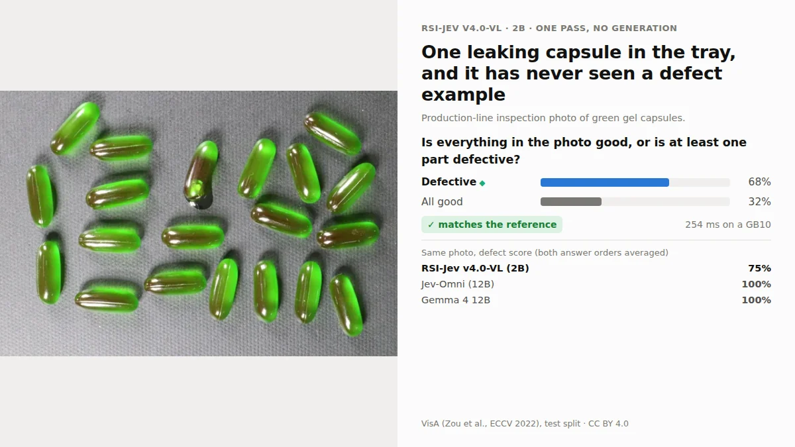</td>
<td align="center" valign="top">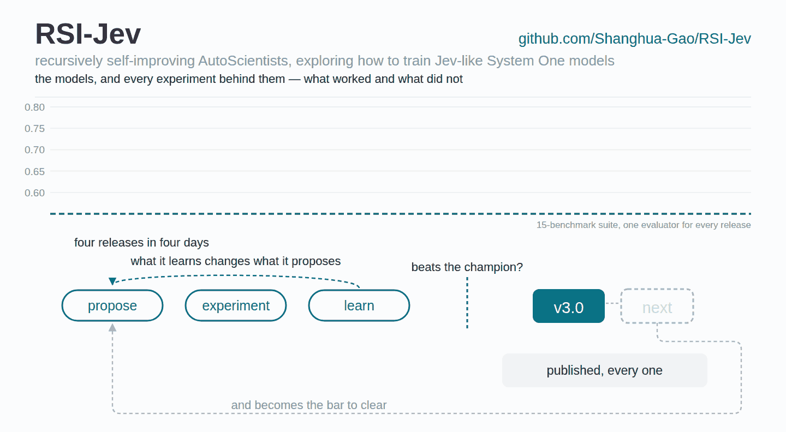 動態錄影</td>
</tr></table>

🤖 <b><a href="https://github.com/Bodila51/grok-bot-jev">Bodila51/grok-bot-jev</a></b> · ⭐130 · Python · 👁️ observed · 37 天

##### 📝 摘要

將 TypeSafe Jev 連接至 Grok Bot，作為低成本決策層 — 使用量閘門、技能範本、範例

🔧 於程式碼中發現使用: `src/jev_client.py`

##### 📌 基本資訊

| 欄位 | 值                                          |
| ---- | ------------------------------------------- |
| 分類 | `Agent 工具鏈：MCP、鉤子、閘門與編碼 Agent` |
| 證據 | `observed`                                  |
| 語言 | Python                                      |

##### 📊 資料

| 指標     | 值         |
| -------- | ---------- |
| Star 數  | **130**    |
| 最近推送 | 2026-09-28 |
| 首次收錄 | 2026-10-29 |

🏷 `cursor` · `decision-layer` · `grok-bot` · `jev` · `python` · `typesafe`

---

<table><tr><th align="center" width="50%">🖼 圖片</th><th align="center" width="50%">🎬 影片</th></tr><tr>
<td align="center" valign="top"></td>
<td align="center" valign="top">未發布媒體</td>
</tr></table>

🤖 <b><a href="https://github.com/KikeVen/zerikai_memory">KikeVen/zerikai_memory</a></b> · ⭐36 · Python · 👁️ observed · 1 天

##### 📝 摘要

A standalone local-only Python MCP server that gives any IDE persistent, workspace-isolated memory. works with any IDE supporting MCP servers

🔧 於程式碼中發現使用: `jev/client.py`

##### 📌 基本資訊

| 欄位 | 值                                          |
| ---- | ------------------------------------------- |
| 分類 | `Agent 工具鏈：MCP、鉤子、閘門與編碼 Agent` |
| 證據 | `observed`                                  |
| 語言 | Python                                      |

##### 📊 資料

| 指標     | 值         |
| -------- | ---------- |
| Star 數  | **36**     |
| 最近推送 | 2026-11-04 |
| 首次收錄 | 2026-11-04 |

🏷 `ai` · `ai-tools` · `chromadb` · `deepseek-v4-pro` · `jev` · `judgment` · `lexical` · `mcp`

---

<table><tr><th align="center" width="50%">🖼 圖片</th><th align="center" width="50%">🎬 影片</th></tr><tr>
<td align="center" valign="top">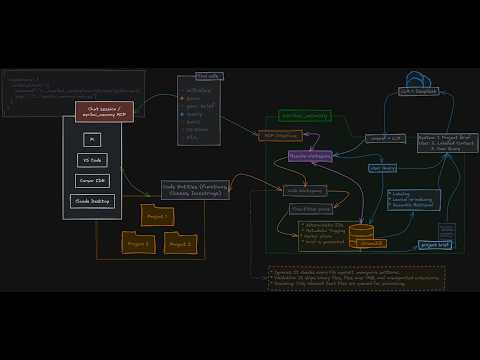</td>
<td align="center" valign="top"> <a href="https://img.youtube.com/vi/sk8x-nbF0Cs/0.jpg">觀看平台 img.youtube.com</a> · 播放會在主機網站開啟；GitHub 無法內嵌播放</td>
</tr></table>

🤖 <b><a href="https://github.com/caijinchun/nanojev-arena">caijinchun/nanojev-arena</a></b> · ⭐7 · HTML · 👁️ observed · 46 天

##### 📝 摘要

NanoJev Snake Arena: 1v4 human-vs-AI battleship + 100-agent swarm simulator. Local demo of Jev System-One model (open-source mini replica).

##### 📌 基本資訊

| 欄位 | 值                                          |
| ---- | ------------------------------------------- |
| 分類 | `Agent 工具鏈：MCP、鉤子、閘門與編碼 Agent` |
| 證據 | `observed`                                  |
| 語言 | HTML                                        |

##### 📊 資料

| 指標     | 值         |
| -------- | ---------- |
| Star 數  | **7**      |
| 最近推送 | 2026-09-19 |
| 首次收錄 | 2026-11-01 |

---

<table><tr><th align="center" width="50%">🖼 圖片</th><th align="center" width="50%">🎬 影片</th></tr><tr>
<td align="center" valign="top"></td>
<td align="center" valign="top">未發布媒體</td>
</tr></table>

🤖 <b><a href="https://github.com/dfranco-projects/jev-guardbench">dfranco-projects/jev-guardbench</a></b> · ⭐3 · Python · 👁️ observed · 31 天

##### 📝 摘要

System One 模型（TypeSafe Jev，開源 Kev）能否在 agent guardrail callbacks 中取代 LLM-as-judge？

##### 📌 基本資訊

| 欄位 | 值                                          |
| ---- | ------------------------------------------- |
| 分類 | `Agent 工具鏈：MCP、鉤子、閘門與編碼 Agent` |
| 證據 | `observed`                                  |
| 語言 | Python                                      |

##### 📊 資料

| 指標     | 值         |
| -------- | ---------- |
| Star 數  | **3**      |
| 最近推送 | 2026-10-04 |
| 首次收錄 | 2026-11-04 |

---

<table><tr><th align="center" width="50%">🖼 圖片</th><th align="center" width="50%">🎬 影片</th></tr><tr>
<td align="center" valign="top"></td>
<td align="center" valign="top">未發布媒體</td>
</tr></table>

由於上游未宣告再散布授權，資源直接連結至上游儲存庫。

🤖 <b><a href="https://github.com/dolevhayut/resurface">dolevhayut/resurface</a></b> · TypeScript · 👁️ observed · 32 天

##### 📝 摘要

TypeSafe JEV resume screening: LLM writes the questions, JEV (System One classification model) answers them for every resume in your ATS with the exact evidence line. 8× faster, 31× cheaper than an LLM.

##### 📌 基本資訊

| 欄位 | 值                                          |
| ---- | ------------------------------------------- |
| 分類 | `Agent 工具鏈：MCP、鉤子、閘門與編碼 Agent` |
| 證據 | `observed`                                  |
| 語言 | TypeScript                                  |

##### 📊 資料

| 指標     | 值         |
| -------- | ---------- |
| Star 數  | **0**      |
| 最近推送 | 2026-10-03 |
| 首次收錄 | 2026-11-01 |

🏷 `ai-recruiting` · `ats` · `candidate-matching` · `classification-model` · `claude` · `decision-model` · `evidence-based-hiring` · `hr-tech`

---

<table><tr><th align="center" width="50%">🖼 圖片</th><th align="center" width="50%">🎬 影片</th></tr><tr>
<td align="center" valign="top">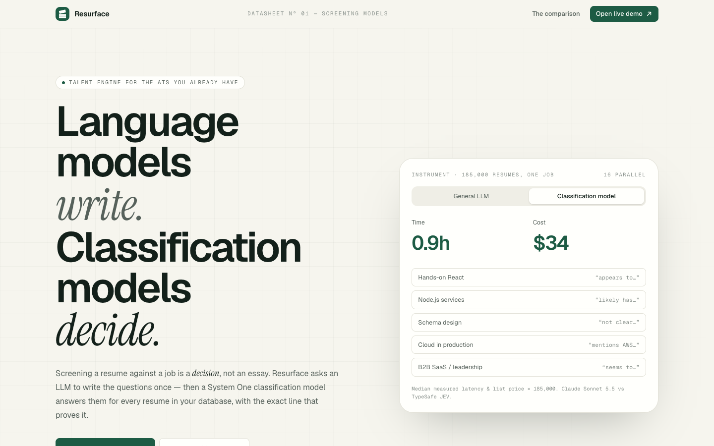</td>
<td align="center" valign="top"> <a href="https://raw.githubusercontent.com/dolevhayut/resurface/main/docs/launch/resurface-launch.mp4">開啟影片</a></td>
</tr></table>

<b>本分類更多項目</b> · 218

- [dbreunig/building-with-jev-skill](https://github.com/dbreunig/building-with-jev-skill) - 用於撰寫及改進呼叫 Jev（TypeSafe 的 System One 模型）之程式的技能。
- [Avinash-jetwani/jevmem](https://github.com/Avinash-jetwani/jevmem) - jevmem 將你的 Claude Code 聊天中的決策、規則與失敗方法儲存至儲存庫中的 JEVMEM.md，並在下一次工作階段帶回相關內容.
- [GhalebDweikat/winnow](https://github.com/GhalebDweikat/winnow) - 用於 Claude Code 的校準式上下文篩網：每個工具結果進入上下文前，都會由 System One 模型判斷.
- [openlayer-ai/jevals](https://github.com/openlayer-ai/jevals) - 將 Agent 評估與護欄作為 Jev 決策：每個 trace 一個請求，成本不到一美分，速度足以支援 agent 迴圈.
- [Nisaka520/JevIntent](https://github.com/Nisaka520/JevIntent) - 微信（FkWeChat 外掛）：長按訊息分析意圖／情緒／回覆姿態，只在本機彈出提示，對方無感知。
- [andyrewlee/awesome-system-one](https://github.com/andyrewlee/awesome-system-one) - System One 個模型的清單（也稱為決策模型）：Jev（首個），以及開源和託管替代方案、代理、工具、SDKs 與基準測試.
- [Li-Evan/awesome-jev](https://github.com/Li-Evan/awesome-jev) - 最完整的 Jev、TypeSafe 的 System One 模型作品集：3,400 多個專案、示範與依情境整理的說明文章，每項都附有原始連結、圖片與描述.
- [ChenneyZhuang/laya-browser-agent](https://github.com/ChenneyZhuang/laya-browser-agent) - 本機、開放原始碼的 Jev 替代方案：在你自己的機器上，使用 Laya（System One 模型）進行瀏覽器代理決策。不需要雲端，也不需要 API 金鑰.
- [TrustifAI/typed_evals](https://github.com/TrustifAI/typed_evals) - Fast, typed Python framework for Jev-as-a-Judge/Decision-model evaluation for…
- [tiffygk/jev-mode](https://github.com/tiffygk/jev-mode) - Claude Code/Codex skills, evals, harnesses/context tools, and learning…
- [darwintechlab/openjev](https://github.com/darwintechlab/openjev) - OpenJev：一個 Opencode 外掛程式，使用 Jev（TypeSafe System One）取代文字生成決策.
- [yohanargentina-oss/Foq](https://github.com/yohanargentina-oss/Foq) - ⚡ Foq — Jev 的免費、本機、開源替代方案。約 25 ms 內完成型別化 System 1 決策 — 無等候名單、無雲端、無按 token 計費.
- [mani-aiml/jev-demos](https://github.com/mani-aiml/jev-demos) - 使用 Jev、TypeSafe 的 System One 模型的示範，每個示範各自位於一個資料夾.
- [kolawong/fast-compaction-dsh](https://github.com/kolawong/fast-compaction-dsh) - Verdict-based context compaction for DeepSeek Harness — replaces lossy LLM…
- [BYK/jev-mcp](https://github.com/BYK/jev-mcp) - 以評估優先的 MCP 伺服器，適用於 TypeSafe 的 Jev，這是一個會回傳具型別判斷（noul、choice、score）及其機率，而非生成文字的…
- [rajasekharponakala/jev-mcp](https://github.com/rajasekharponakala/jev-mcp) - 包裝 TypeSafe 的 Jev System One 模型的 MCP 伺服器——為 AI Agent 提供具型別的 noul/choice/score 判斷。
- [BFLabsAI/bf-jev-deep-research](https://github.com/BFLabsAI/bf-jev-deep-research) - Agent Skill + 關於 Jev。
- [Mainakcris7/agent-guardrail-with-jev](https://github.com/Mainakcris7/agent-guardrail-with-jev) - A practical demo of how can we leverage the power of System One Models like Jev…
- [QuaanNguyen/xor](https://github.com/QuaanNguyen/xor) - plugin for OpenCode harness - blocks tool calls outside of scope using a…
- [andrevandal/pi-classifier-tools-skills](https://github.com/andrevandal/pi-classifier-tools-skills) - An extension for pi and Oh My Pi (omp) that classifies each incoming prompt…
- [api-evangelist/typesafe-ai](https://github.com/api-evangelist/typesafe-ai) - TypeSafe AI 是一家位於 San Francisco 的 AI 實驗室，正在打造 System One…
- [CrowBe/weave](https://github.com/CrowBe/weave) - 適用於System One模型的代理程式工具框架。
- [gorock007/jev-atlas](https://github.com/gorock007/jev-atlas) - An independent, evidence-first field guide to Jev。
- [gsaini/system-one-models-getting-started](https://github.com/gsaini/system-one-models-getting-started) - TypeSafe。
- [izam-mohammed/decisionsmith](https://github.com/izam-mohammed/decisionsmith) - Use and fine-tune System One models (Jev, Laya) on your data, with an LLM as…
- [JiaWeiXie/jev-enhanced-plugin](https://github.com/JiaWeiXie/jev-enhanced-plugin) - A Claude Code plugin that takes skills already in use and adds one thing to…
- [jms-dcksn/uipath-jev-guardrail-connector](https://github.com/jms-dcksn/uipath-jev-guardrail-connector) - 由 TypeSafe Jev System One 模型支援的 UiPath 自帶防護欄連接器：以自然語言描述的代理原則，透過經校準的機率強制執行.
- [lucast4049/openjev](https://github.com/lucast4049/openjev) - 使用 Jev 相容的 API，在開放 System One 模型上執行快速、校準、具型別的決策.
- [browser-use/jev-ultrafast](https://github.com/browser-use/jev-ultrafast) - 最快且最便宜的網頁代理。
- [YaoApp/yao](https://github.com/YaoApp/yao) - ✨ 將你所有的 agents 和 workspaces 集中一處，並可在你擁有的每台裝置上使用。在看板上追蹤任務，可從桌面、行動裝置、瀏覽器或 API 存取.
- [jev-chat/jev-chat-jarvis](https://github.com/jev-chat/jev-chat-jarvis) - 聊天決策助理：在你回覆前，Jev 會閱讀聊天內容、判斷意圖與風險，並草擬你只需點一下即可填入的回覆。由你按下傳送.
- [reticlehq/reticle](https://github.com/reticlehq/reticle) - AI 代理可以產生程式碼，但仍難以理解自己建構的內容。Reticle 將 Jev 風格的機器原生執行階段感知能力帶入網頁與桌面應用程式.
- [kerpopule/hermes-jev-skills](https://github.com/kerpopule/hermes-jev-skills) - 由 Jev 驅動的模型路由、記憶體、壓縮、技能選擇、電腦與瀏覽器使用功能，適用於 Hermes 代理（也適用於 Claude Code 與 Codex）。
- [wy-coliney/jev-browser-use](https://github.com/wy-coliney/jev-browser-use) - 瀏覽器操作速度提升 5–10 倍：Jev 負責點擊，Codex 負責思考與驗證。於 EZCollegeApp 建置.
- [logicrw/awesome-jev-projects](https://github.com/logicrw/awesome-jev-projects) - Awesome Jev：有來源依據的開源生態系雷達、白話專案探索，以及自動 GitHub 同步。
- [devagrawal09/jev-review](https://github.com/devagrawal09/jev-review) - 使用 TypeSafe Jev 建置的分階段程式碼審查工作流程與本機儀表板.
- [AnotiaWang/awesome-decision-models](https://github.com/AnotiaWang/awesome-decision-models) - 精選的決策模型清單（System One／具型別的決策模型）：託管的 APIs、開放權重模型、執行環境、SDKs、應用程式、基準測試和論文.
- [wuyoscar/jev-skill](https://github.com/wuyoscar/jev-skill) - 一個很棒的 Jev 使用案例、工作流程與代理技能集合.
- [kydlikebtc/awesome-jev](https://github.com/kydlikebtc/awesome-jev) - Public resources for Jev, TypeSafe AI。
- [ttlequals0/MinusPod](https://github.com/ttlequals0/MinusPod) - MinusPod 是一個自架伺服器，讓你在按下播放前就移除廣告。
- [BillionsBobby/JevRouter](https://github.com/BillionsBobby/JevRouter) - 一個由 Jev 驅動的輕量路由器，用於模型、工具與子代理。
- [malevrigns/agent-jev](https://github.com/malevrigns/agent-jev) - AgentJev-0.6B——適用於 AI 代理程式的快速「System One」決策模型：輸入任何非結構化狀態（差異、追蹤記錄、日誌）與結構化問題，在一次約…
- [vinilana/jev-gateway](https://github.com/vinilana/jev-gateway) - 一種將 jev 與你的編碼代理搭配使用，以進行工具呼叫推理的簡易方式。
- [Heman10x-NGU/openJev-verdict-2.0](https://github.com/Heman10x-NGU/openJev-verdict-2.0) - 經校準的 151M 非自回歸決策引擎，在 LocalLLaMA/typed-decisions 上擊敗 TypeSafe Jev 與 Laya。
- [RomanSlack/jev-drone](https://github.com/RomanSlack/jev-drone) - 僅使用攝影機的 MuJoCo 自主無人機，搭配小型判斷模型（TypeSafe Jev）以 2.5Hz 在迴路中運作。
- [Amal-David/awesome-jev](https://github.com/Amal-David/awesome-jev) - Jev 示範、專案、SDKs 與技能，附有來源連結及精選的 X 圖庫.
- [fatwang2/awesome-jev](https://github.com/fatwang2/awesome-jev) - 一個有來源依據的 Jev 專案目錄，搭配可重複使用、僅限 Jev 的 GitHub 審查流程.
- [jmagly/aiwg](https://github.com/jmagly/aiwg) - Reusable project context and specialist workflows for the AI tools you already…
- [OmniJev/OneJev](https://github.com/OmniJev/OneJev) - 🚀🚀 一個多模態 System One 決策模型，可在一次前向傳遞中，對關於螢幕、照片、影片和文字的型別化問題給出校準過的答案.
- [luobosibing2/dsh-jev-plugin](https://github.com/luobosibing2/dsh-jev-plugin) - 原生 DeepSeek Harness（DSH）外掛，將 TypeSafe Jev 或類似 luna 的 Decision api…
- [ThinkFlowLab/system1-agents](https://github.com/ThinkFlowLab/system1-agents) - 作為代理程式大腦的 System 1 決策模型（Jev、Laya、Cua-S1）：瀏覽器操作、電腦操作、遊戲與機器人技術。
- [cookiespiggy/agentic-rl](https://github.com/cookiespiggy/agentic-rl) - Agentic RL 中文零基礎教程（33 章）：從概念到 GRPO 實戰，含 TRL 最小可執行範例；第 26–33…
- [UditAkhourii/quicksilver](https://github.com/UditAkhourii/quicksilver) - Claude Code 技能：將大量判斷交給 Jev。在 12 項任務基準測試中減少 86% 的 Claude token，速度最高提升 20 倍.
- [kyegomez/open-jev](https://github.com/kyegomez/open-jev) - 以 pytorch 編寫，從第一性原理出發，對 TypeSafe AI 的 Jev 背後理念進行的開源重建。
- [initial-d/ml-quant-trading](https://github.com/initial-d/ml-quant-trading) - PyTorch ML 量化研究：213 個因子、偏差校正、投資組合最佳化、回測，以及 System-One/Jev 風格的決策.
- [PerryLink/jevcore](https://github.com/PerryLink/jevcore) - 適用於 DeepSeek Harness、Model Context Protocol 和純 Node 的 TypeSafe…
- [jonathanavis96/jev-kit](https://github.com/jonathanavis96/jev-kit) - 執行 TypeSafe 的 Jev 所需的一切，搭配 Claude…
- [charlesdove977/claude-x-jev](https://github.com/charlesdove977/claude-x-jev) - 適用於 Claude Code 的快速、低成本、類型化決策。Jev（OpenRouter 上 TypeSafe 的決策模型）以每個項目 0.3…
- [akivet/Mica](https://github.com/akivet/Mica) - A 4B decision model: calibrated probabilities for yes/no, choice and score…
- [yikangy873-gif/jev-desktop](https://github.com/yikangy873-gif/jev-desktop) - Codex Computer Use 內的 TypeSafe Jev 動作選擇。
- [iamaamir/system-one](https://github.com/iamaamir/system-one) - 適用於 TypeScript 和 Pi、供應商中立的 System One 執行環境。
- [TheoOliveira/pi-jev](https://github.com/TheoOliveira/pi-jev) - 使用 TypeSafe Jev 為 Pi 編碼代理提供語意工具路由與型別化 System One 決策。
- [alanhuangyoo/OpenJev](https://github.com/alanhuangyoo/OpenJev) - OpenJev：Jev 的開源本機替代方案。System-One 決策模型：輸入型別化問題，輸出校準機率；適用於一般決策與瀏覽器代理步驟.
- [chuloontop4-code/jev-instance-review](https://github.com/chuloontop4-code/jev-instance-review) - 2026 年最佳 Roblox Studio 執行個體審查器：型別化 Jev 準則與精確引用。
- [shitianfang/jev-use](https://github.com/shitianfang/jev-use) - Claude Code / Codex / pi 外掛，將不需要文字輸出的代理程式步驟交給 Jev（TypeSafe 的判斷模型）— 經測量的 p50 約…
- [FrancoisChastel/jev-code](https://github.com/FrancoisChastel/jev-code) - Jev，TypeSafe 的 System One 分類器，作為 Claude Code、Codex、Pi 與 OpenCode…
- [lawrence3699/jev-style](https://github.com/lawrence3699/jev-style) - JevStyle: local decision models for AI agents.
- [intikhab49/open-jev-typed-decision-engine](https://github.com/intikhab49/open-jev-typed-decision-engine) - TypeSafe Jev 的開放重現：一個 150M 型別化決策引擎（在一次非自回歸傳遞中完成 noul/choice/score，具校準信心度）.
- [alexei-led/claude-router](https://github.com/alexei-led/claude-router) - Claude Code plugin that picks the model and effort for each turn。
- [everyinfra/jev-radar](https://github.com/everyinfra/jev-radar) - 📡 The most rigorously verified tracker of the Jev (TypeSafe AI System One)…
- [jomatsu/pi-jev-auto-mode](https://github.com/jomatsu/pi-jev-auto-mode) - 由 Jev（TypeSafe System One）支援的 Pi 編碼代理自動模式：以語意方式自動核准 bash、write 和 edit…
- [AskTheWay/dsh-jev-interceptor](https://github.com/AskTheWay/dsh-jev-interceptor) - ⚡ Millisecond System-1 judgement for every tool call in DeepSeek Harness…
- [abhishek085/open-spark-jev](https://github.com/abhishek085/open-spark-jev) - 受 TypeSafe 的 Jev 和 System One 啟發的開源本機決策模型——基於 Qwen3，為 NVIDIA DGX Spark 建構.
- [NekomyaDev/nudge](https://github.com/NekomyaDev/nudge) - 面向 LLM 代理程式的具型別、可重播且具預算感知的程式語言。編譯至 Python 與 TypeScript.
- [anandi1989/awesome-jev-usecases](https://github.com/anandi1989/awesome-jev-usecases) - 有證據支持的真實世界 Jev（TypeSafe AI System One）使用案例索引：儲存庫、模式、基準測試與實測結果。
- [Singularity-Compute/super-decider](https://github.com/Singularity-Compute/super-decider) - Decisions, not essays: a choice, a yes or no, or a score with a calibrated…
- [paramjeetn/jev-cookbook](https://github.com/paramjeetn/jev-cookbook) - TypeSafe AI 為 Jev 打造的完整食譜集——120 多個使用案例、10 個可執行範例、4 種組合模式，以及針對全球首個 System One AI…
- [1arley/jev-advisor-gateway](https://github.com/1arley/jev-advisor-gateway) - Local gateway that routes coding-agent tool decisions through Jev and can…
- [daftAI2026/awesome-jev](https://github.com/daftAI2026/awesome-jev) - 精選 TypeSafe Jev / System One GitHub 專案、開源替代方案與 Jev 新聞。
- [iamtoomas/JevLint](https://github.com/iamtoomas/JevLint) - 由 Jev 驅動的可設定語意 linting，具備檔案層級 NOUL 判斷與 magic-strings 外掛.
- [muxso/Shepherd](https://github.com/muxso/Shepherd) - Shepherd is an end-to-end AI Software Engineering platform that supervises the…
- [sunyasheng/JevGPT](https://github.com/sunyasheng/JevGPT) - JevGPT: Thinking Fast and Slow in Autonomous Research。
- [vicfei/awesome-jev-prompts](https://github.com/vicfei/awesome-jev-prompts) - Question patterns, anti-patterns &amp; calibration notes for typed decision models…
- [ajensenwaud/hermes-jev-plugin](https://github.com/ajensenwaud/hermes-jev-plugin) - 用於 Hermes Agent 的 TypeSafe Jev（System One）決策工具：jev_check / jev_route /…
- [caiovicentino/jev-risk-check-provider](https://github.com/caiovicentino/jev-risk-check-provider) - x402 risk-check provider: signed pre-payment verdicts — OFAC, phishing feeds…
- [zhangxaochen/dsh-jev](https://github.com/zhangxaochen/dsh-jev) - 適用於 DeepSeek Harness（dsh）的 Jev（System One 決策模型）外掛套件。
- [ronitgupta138/Local-Jev](https://github.com/ronitgupta138/Local-Jev) - ⚡ 100% offline, zero-cost drop-in alternative to TypeSafe Jev System One…
- [alexei-led/pi-model-router](https://github.com/alexei-led/pi-model-router) - Independent Pi extension for four-tier model routing with optional…
- [anisselbd/jev-phishing-bench](https://github.com/anisselbd/jev-phishing-bench) - Jev (TypeSafe) vs Claude Haiku 4.5 on 2,000 phishing emails: accuracy…
- [assistant-ui/jevia](https://github.com/assistant-ui/jevia) - outcome-aware &amp; adaptive model routing for coding agents with deterministic…
- [SergeyBazhmin/krasivo-jev](https://github.com/SergeyBazhmin/krasivo-jev) - Training data and models for &quot;system one&quot; classifiers: one forward pass, no…
- [inso1337/revl](https://github.com/inso1337/revl) - 一種用於安全、通用時空可組合性（Cordis paradigm）與編排的語言.
- [Jessie-QingYu/jev-in-the-wild](https://github.com/Jessie-QingYu/jev-in-the-wild) - 真實世界的 Jev 使用案例、開源專案、基準測試與批評——人們實際使用 TypeSafe AI 的 Jev 打造了什麼，以及它在哪些地方失效.
- [jmrenouard/MicroLLM](https://github.com/jmrenouard/MicroLLM) - Local Hybrid System-One Decision Engine。
- [ranjan2829/AskJev](https://github.com/ranjan2829/AskJev) - AskJev — 適用於任何網站的 Jev 自動駕駛 + 不可逆點擊防護（TypeSafe System One，而非 Claude）。
- [Civalski/claujev](https://github.com/Civalski/claujev) - Jev (TypeSafe AI) as a second pair of eyes for Claude Code: request triage…
- [coderexpert123/jev-browser-wingman](https://github.com/coderexpert123/jev-browser-wingman) - Browser automation where TypeSafe。
- [FazalAAli/jev-robotics-demo](https://github.com/FazalAAli/jev-robotics-demo) - Jev（TypeSafe System One）對比 Claude Opus 5，在 MuJoCo 中操控模擬機械手臂。
- [legostin/jev-mcp](https://github.com/legostin/jev-mcp) - MCP server that lets Claude Code, Codex &amp; AI agents drive a real Chrome browser…
- [reacher-z/Awesome-Jev](https://github.com/reacher-z/Awesome-Jev) - Curated Jev and System One papers, models, datasets, benchmarks and SDKs, with…
- [7starsseeker/dsh-fact-check](https://github.com/7starsseeker/dsh-fact-check) - Fact-checking skill for DeepSeek Harness: multi-source verification against the…
- [lgy1027/jevshield](https://github.com/lgy1027/jevshield) - 由 TypeSafe 的 Jev（System-1）決策模型驅動、用於 AI 代理工具呼叫的低於 100ms 安全閘門.
- [PerryLink/laya-mcp](https://github.com/PerryLink/laya-mcp) - MCP server for Laya typed decisions (noul / choice / score): warm model…
- [8itlab/reflex-computer-use](https://github.com/8itlab/reflex-computer-use) - Computer use MCP server for Claude Code, Codex and other AI agents.
- [abhishekashokvkumar/jev-mcp-dispatcher](https://github.com/abhishekashokvkumar/jev-mcp-dispatcher) - 完全由 TypeSafe 的 Jev 驅動的自然語言 MCP 工具分派器——沒有通用 LLM.
- [King4s/Jev-AI-Skill](https://github.com/King4s/Jev-AI-Skill) - One AI skill + MCP server for Claude Code, Codex and Hermes: Jev (TypeSafe)…
- [MojoAI-King/jev-paper-trader](https://github.com/MojoAI-King/jev-paper-trader) - Paper trading real Polymarket and Kalshi markets with a fake $100k: can Jev +…
- [MongLong0214/jev-gate](https://github.com/MongLong0214/jev-gate) - 並非每個程式設計任務都需要你最好的模型。為 Claude Code 提供由 Jev 驅動的實驗性模型路由 — V3 原型現已可執行，V4 會在任務邊界路由.
- [nanami-0713/dsh-jev-decide](https://github.com/nanami-0713/dsh-jev-decide) - DSH 外掛：將 TypeSafe Jev（System One 決策模型）註冊為代理程式工具——jev_decide…
- [simota/tenbin](https://github.com/simota/tenbin) - 用於 TypeSafe AI System One API（Jev）的 MCP 伺服器與代理技能：將判斷分解為 Choice / Score / Noul…
- [aitofy-dev/jev-awesome-skills](https://github.com/aitofy-dev/jev-awesome-skills) - 適用於 Claude Code、Codex、Cursor 與 Grok 的開源 Jev 技能.
- [ardana-ai/ardana](https://github.com/ardana-ai/ardana) - Run System 1 decision models locally. Pull a model by name and get calibrated…
- [deepansh-saxena/jev-guardrails](https://github.com/deepansh-saxena/jev-guardrails) - 比較以 LLM 作為裁判與 TypeSafe Jev 的代理程式防護：相同規則、相同代理程式，並測量成本、延遲、校準度和涵蓋率.
- [gordan-code/dsh-jev-advisor](https://github.com/gordan-code/dsh-jev-advisor) - Jev (TypeSafe System One) gives the human a second opinion, not the agent.
- [holny/evolve-router](https://github.com/holny/evolve-router) - Stop burning premium model tokens on simple prompts. Save tokens.
- [hugues-vnsgn/jev-ios-bridge](https://github.com/hugues-vnsgn/jev-ios-bridge) - Bridge that lets Claude Code verify an iOS app on a simulator, with TypeSafe。
- [mywwave/cursor-jev](https://github.com/mywwave/cursor-jev) - 透過 TypeSafe Jev 路由子 Agent 並將 Choice、Score 與 Noul 公開為 MCP 工具的 Cursor 外掛.
- [noetion/dsh-jev](https://github.com/noetion/dsh-jev) - 註冊 jev_ask 以取得 TypeSafe Jev noul、choice 與 score 答案的 DSH 套件.
- [robokrunch/awesome-jev](https://github.com/robokrunch/awesome-jev) - 由 RoboKrunch 維護的 Jev——TypeSafe AI 的 System One 決策模型——精選資源清單.
- [samtay32/jev-system-architect](https://github.com/samtay32/jev-system-architect) - 適用於 TypeSafe AI Jev/System One 的系統架構技能——找出模糊的語意判斷，並將其轉化為小型 Choice/Score/Noul 原語.
- [SoniaMehta14/paved-gate](https://github.com/SoniaMehta14/paved-gate) - Fast System 1 ingestion gate for AI agent architectures: typed safety, routing…
- [supermanc417-alt/awesome-jev-hub](https://github.com/supermanc417-alt/awesome-jev-hub) - A curated hub of the Jev / TypeSafe &quot;System One&quot; model ecosystem — concepts, 51…
- [tinypi-extension/tinysubagent](https://github.com/tinypi-extension/tinysubagent) - Minimal herdr-native subagent spawning for pi — markdown agent roles, model…
- [wangkuangkuang/jev-mcp-server](https://github.com/wangkuangkuang/jev-mcp-server) - 適用於 Jev（TypeSafe System One）的 MCP 伺服器：三種官方問題類型——choice、score、noul——另加批次分類.
- [1aifanatic/jev-uipath-coded-agent](https://github.com/1aifanatic/jev-uipath-coded-agent) - FINS 示範：用於 AML 警示分流的 UiPath 程式化 Agent，其中每個決策都由 TypeSafe 的 Jev…
- [cnrai/openpave-jev](https://github.com/cnrai/openpave-jev) - 適用於非自回歸決策模型（Jev / Laya / TypeSafe）的 PAVE 技能：具型別的 Choice、Score 與 Noul 回答，以及經校準的機率。
- [darwintechlab/claude-jev](https://github.com/darwintechlab/claude-jev) - 適用於 Claude Code 的 Jev System One——透過即時 TypeSafe API 提供具型別的…
- [guanghuang/coding-router-jev](https://github.com/guanghuang/coding-router-jev) - TypeScript/Bun launcher routing Codex turns through JEV with model and…
- [jms-dcksn/jev-pii-guardrail](https://github.com/jms-dcksn/jev-pii-guardrail) - 一個 UiPath 編碼代理，在 LLM 邊界上使用自訂 PII 偵測防護欄，並以 TypeSafe Jev 模型作為 LangChain…
- [majiayu000/awesome-jev](https://github.com/majiayu000/awesome-jev) - 精選的 Jev／TypeSafe System One 專案、SDKs、教學與評估清單。英文和簡體中文.
- [rahilmavani/piedpiper-jev-buildathon](https://github.com/rahilmavani/piedpiper-jev-buildathon) - Team piedpiper：failproofai + Jev guardrails，阻止 Helix IT 代理失敗（Jev Buildathon）。
- [173787247/dsh-wsl-jev](https://github.com/173787247/dsh-wsl-jev) - DeepSeek Harness WSL plugin: TypeSafe Jev / OpenRouter System One。
- [17671454333/jev-cognitive-mcp](https://github.com/17671454333/jev-cognitive-mcp) - 3+1 Cognitive Hierarchy Toolkit &amp; Model Context Protocol (MCP) Server for…
- [2426269/ComfyUI-Jev-Decision](https://github.com/2426269/ComfyUI-Jev-Decision) - ComfyUI semantic judgement node: Noul/Choice/Score, typed outputs, workflows…
- [a742987/JevLens](https://github.com/a742987/JevLens) - Jev decision visualisation and debugging panel for coding agents.
- [AwesomeJev/AwesomeJev.github.io](https://github.com/AwesomeJev/AwesomeJev.github.io) - Website for reacher-z/Awesome-Jev: bilingual Jev research papers, typed…
- [bhanuprakashk90-tech/jev-agent-guardrail](https://github.com/bhanuprakashk90-tech/jev-agent-guardrail) - 由 TypeSafe AI 的 Jev 模型驅動的 AI 代理工具呼叫即時安全 guardrail 與互動式監控儀表板.
- [bismawy/pi-jev-eye](https://github.com/bismawy/pi-jev-eye) - 用於 Pi 的超精簡監督器：零 token regex guardrails、測試驗證追蹤，以及 TypeSafe Jev 語義 slop 門控.
- [charetterat/awesome-jev-essentials](https://github.com/charetterat/awesome-jev-essentials) - 真正值得你花時間的 Jev 專案 — 已挑選、比較並保持最新.
- [d0ng231/jev-gtw](https://github.com/d0ng231/jev-gtw) - JEV Gateway: PII/PHI guardrails for coding agents.
- [DarkisuSu/Jev-Claude-Router](https://github.com/DarkisuSu/Jev-Claude-Router) - A Jev-powered model routing and skill selection MOD for Claude.
- [edamlabs/e-jev](https://github.com/edamlabs/e-jev) - A self-hosted Jev with a pluggable decision-backend fleet — typed, calibrated…
- [eshitakundu/jev-flow](https://github.com/eshitakundu/jev-flow) - Support-triage inbox where an LLM answers typed questions and a deterministic…
- [Faizullah9181/jev-esketcher](https://github.com/Faizullah9181/jev-esketcher) - 生成式繪畫畫布，其中 Jev，TypeSafe 的校準決策模型，為 105 個程序式草圖挑選繪畫材料與色彩調色盤.
- [frederico-kluser/jev-agent-skill](https://github.com/frederico-kluser/jev-agent-skill) - 透過 OpenRouter，使用 Jev（TypeSafe 的 System One）在幾毫秒內完成具型別的決策——輸入 state +…
- [hectorj2f/jev-router](https://github.com/hectorj2f/jev-router) - Route Claude Code subagents to the right Anthropic model per task, using…
- [jbatra-umeey/jev-decisionops](https://github.com/jbatra-umeey/jev-decisionops) - 適用於代理式 AI 的六種 Jev 決策工作流程：模型路由、防護機制、工具呼叫閘控、重新排序、輸出評估，以及基於信心的自主性.
- [JoaoClemer/jev-lab](https://github.com/JoaoClemer/jev-lab) - O Jev（TypeSafe AI）作為即時 guardrail，以及作為商務對話代理的預評估器.
- [keiffff/jev-kit](https://github.com/keiffff/jev-kit) - Jev toolkit for building fast, testable AI decision points for agent…
- [kitoutou999/firefox-jev-mcp](https://github.com/kitoutou999/firefox-jev-mcp) - Serveur MCP pour piloter Firefox avec Claude : Jev (TypeSafe) choisit les…
- [lijiawei255/jev-tune](https://github.com/lijiawei255/jev-tune) - Jev-inspired calibrated decision &amp; safety shell for typed PID autotuning…
- [masseater/cc-jev-teacher](https://github.com/masseater/cc-jev-teacher) - Claude Code plugin: TypeSafe-judged hooks that make Claude finish the job…
- [Thneoly/r2r-jev](https://github.com/Thneoly/r2r-jev) - Persistent governance for AI agents — turn Jev judgments into replayable…
- [zhuyansen/awesome-typesafe-jev](https://github.com/zhuyansen/awesome-typesafe-jev) - 建置於 TypeSafe 的 Jev 決策模型之上的開源專案：開放複製品、代理程式、開發工具、SDKs 和 MCP 伺服器、應用程式.
- [01Joseph-Hwang10/pi-jev-router-pro](https://github.com/01Joseph-Hwang10/pi-jev-router-pro) - Single-surface TypeSafe Jev model router for the Pi coding agent: one virtual…
- [abyakod/JEV_ADK](https://github.com/abyakod/JEV_ADK) - System-One AI 的 Agent Development Kit：由 TypeSafe AI 的 Jev 驅動的低於 100ms…
- [aleksvega/jev-stack](https://github.com/aleksvega/jev-stack) - 一個命令（npx jev-stack）即可安裝由 Jev 驅動的 agent 工具集：情境壓縮、pre-push guardrail、0.5 秒…
- [AlienXc137/Support-Ticket-Ai-Agent-with-RAG-Guardrails-and-Jev](https://github.com/AlienXc137/Support-Ticket-Ai-Agent-with-RAG-Guardrails-and-Jev) - 一個…
- [antirepas/GoGoJevMCP](https://github.com/antirepas/GoGoJevMCP) - This is a small side project where I built an MCP server with a collection of…
- [ashp15205/jev-laya-system-1](https://github.com/ashp15205/jev-laya-system-1) - jev-laya-system-1: Security &amp; calibration middleware for System 1 AI models…
- [bpmforbusiness/jev-agent-harness](https://github.com/bpmforbusiness/jev-agent-harness) - Jev（TypeSafe AI System One）agent harness 指南 + 影片手冊 — 來自 LangChain「Building a…
- [c2c-Ride/JEV_sees](https://github.com/c2c-Ride/JEV_sees) - Give JEV vision with JEV Sees: detect and track objects in images, video, and…
- [cameronb-xano/jev-agent-guardrail](https://github.com/cameronb-xano/jev-agent-guardrail) - Xano template：Jev 代理 tool-call guardrail。Jev 做決策，Xano 負責執行.
- [Caph-dev/pi-jev-router](https://github.com/Caph-dev/pi-jev-router) - Jev-routed two-phase virtual model for pi: plan on a strong model, implement on…
- [castorhrio/jev-pi-agent](https://github.com/castorhrio/jev-pi-agent) - Multi-agent coding workbench — hashed context injection, explainable routing…
- [chaoguang668/dsh-jev-screen](https://github.com/chaoguang668/dsh-jev-screen) - Jev-powered semantic pre-screening for local files in DeepSeek Harness: code…
- [Covre81/jev-router](https://github.com/Covre81/jev-router) - Local Anthropic-compatible gateway that routes Claude Code traffic across…
- [davidpobi/JevTown](https://github.com/davidpobi/JevTown) - An Interactive Collection Of AI Game Worlds Where Typesafe Jev Agents Choose…
- [dereknex/fast-jev-compaction](https://github.com/dereknex/fast-jev-compaction) - Claude Code&amp; pi plugin that replaces the compaction summary with Jev&amp;clef…
- [eduardo-xyz/jev-browser-mcp](https://github.com/eduardo-xyz/jev-browser-mcp) - MCP tool exposing TypeSafe。
- [forrestneo/jev-sim](https://github.com/forrestneo/jev-sim) - jev-sim: Jev-style typed decisions (Choice/Noul/Score) on the ZCode session…
- [HangChi/JevRouter](https://github.com/HangChi/JevRouter) - 让 LLM 理解任务、让 Jev 做带概率的路由决策、再由显式策略控制执行的 Agent 运行时：Jev 决定下一步，策略引擎决定能不能执行.
- [hdjekuue/awesome-jev](https://github.com/hdjekuue/awesome-jev) - 基於 Jev（TypeSafe AI System One）建立的自動更新三語目錄，涵蓋所有內容 — 具型別的決策與校準機率。由免費模型進行 AI 策展.
- [HKUST-KnowComp/jev-guardrail](https://github.com/HKUST-KnowComp/jev-guardrail) - 可編輯的政策樹與用於 agent 請求和動作審查的 2B 分類器。僅限網站.
- [hojeongna/jev-agent-memory](https://github.com/hojeongna/jev-agent-memory) - No vector DB. A fast decision model routes and picks your agent。
- [iamdgarcia/jev-mini-bench](https://github.com/iamdgarcia/jev-mini-bench) - Pocket explorer of the tiny decision-model wave。
- [jipika/dsh-jev-grep](https://github.com/jipika/dsh-jev-grep) - Search-flood adjudication plugin for DeepSeek Harness: ripgrep + TypeSafe Jev…
- [kangshifu1/jev-skills-market](https://github.com/kangshifu1/jev-skills-market) - Community Jev skill market and assistant for automation testing, finance…
- [KeepGlide/master-jev-hook](https://github.com/KeepGlide/master-jev-hook) - Hooks and MCP that make Claude Code, Claude Desktop and Codex delegate…
- [kevinyin9/next-steps-jev](https://github.com/kevinyin9/next-steps-jev) - Suggested next steps for Claude Code, scored by how much each one helps your…
- [kkwelfare/jev-route-screening-public](https://github.com/kkwelfare/jev-route-screening-public) - Hermes Agent 的實驗性外掛，用於受限的 Jev 檢查點與建議性路由篩選.
- [liyifan2004/obsidian-jev-inbox-router](https://github.com/liyifan2004/obsidian-jev-inbox-router) - Obsidian plugin: route incoming notes to the right folder using JEV。
- [Mfrostbutter/jev-n8n-patterns](https://github.com/Mfrostbutter/jev-n8n-patterns) - n8n 中的 Jev（TypeSafe System One）模式：PII 篩選、agent 與 coding-agent 防護措施、工作流程評估.
- [MichelePolo/jev-mcp](https://github.com/MichelePolo/jev-mcp) - 公開 Jev 風格 System One 決策模型（Ollama /v1/systemone）作為工具的 MCP 伺服器。
- [miketropi/pi-jev-model-manager](https://github.com/miketropi/pi-jev-model-manager) - Pi coding agent extension: Jev-powered model routing with a native TUI model…
- [mxttbennett/jev-relay](https://github.com/mxttbennett/jev-relay) - Per-task routing for Claude Code and Codex: inline, subagent or sibling…
- [PeriodBLUE/jev-project-atlas](https://github.com/PeriodBLUE/jev-project-atlas) - A source-verified atlas of GitHub projects built with JEV / TypeSafe System One。
- [QuesoMan/jev-router](https://github.com/QuesoMan/jev-router) - Claude Code mod: routes every turn, subagent and ultracode workflow agent to a…
- [Sandesh-S-Dalvi/playwright-jev-testing-refactored](https://github.com/Sandesh-S-Dalvi/playwright-jev-testing-refactored) - Goal-driven Playwright E2E testing where TypeSafe Jev (System One) decides the…
- [shahshahdab/fastcampus-jev](https://github.com/shahshahdab/fastcampus-jev) - Learn to gate tool calls, guardrails, and risky actions with Jev judgment plus…
- [skylence-org/claudecode-jev-marketplace](https://github.com/skylence-org/claudecode-jev-marketplace) - TypeSafe Jev (System One) wired into Claude Code: a decision primitive for…
- [thejasrao262003/jev-compositional-uncertainty](https://github.com/thejasrao262003/jev-compositional-uncertainty) - Research on whether AI decision workflows can trust and combine uncertainty…
- [theroich/opencode-jev-pruner](https://github.com/theroich/opencode-jev-pruner) - OpenCode V2 plugin: dynamic context pruning for MCP tools and skills using Jev…
- [tmbmartell/jev-mcp](https://github.com/tmbmartell/jev-mcp) - Servidor MCP que expõe o Jev (TypeSafe System One) como ferramenta de…
- [veermshah/jev-calibration-lab](https://github.com/veermshah/jev-calibration-lab) - Independent calibration benchmark for System One decision models (TypeSafe Jev)…
- [vinaychawla-ops/jev-adk-guardrail-example](https://github.com/vinaychawla-ops/jev-adk-guardrail-example) - Jev（TypeSafe 決策模型）作為 Google ADK agent 的 before_tool_callback 中的風險防護措施.
- [WaynezProg/jev-kit](https://github.com/WaynezProg/jev-kit) - Source-bound evidence checks and bounded Jev judgments for coding agents via…
- [wendyeq/dsh-jev-router](https://github.com/wendyeq/dsh-jev-router) - Optional session-pinned Jev routing plugin for DeepSeek Harness。
- [Wrenik/jev-toolkit](https://github.com/Wrenik/jev-toolkit) - Experiment: a judgement model (TypeSafe Jev) next to Claude.
- [xano-community/agent-guardrail-jev](https://github.com/xano-community/agent-guardrail-jev) - 適用於 Xano 的 AI 代理程式工具呼叫防護機制：Jev（TypeSafe AI）判斷每次呼叫；Xano 允許、阻擋或將其擱置以供人工審查.
- [xiaoyaner0201/hermes-jev-thread-status](https://github.com/xiaoyaner0201/hermes-jev-thread-status) - Jev-powered Discord thread status titles for Hermes Agent: \[Running\] →…
- [yangzhou-chaofan/awesome-jev-prompt](https://github.com/yangzhou-chaofan/awesome-jev-prompt) - 來自 x / github / 最新來源的 jev 最新百大展示案例（持續更新）。
- [Yomiamy/jev-mobile-mcp](https://github.com/Yomiamy/jev-mobile-mcp) - a mcp by jev decision and ocr detection for device testing。
- [ZeroX-01/jev-atlas](https://github.com/ZeroX-01/jev-atlas) - 持續更新的公開索引，收錄真實的 TypeSafe JEV 專案、影片、文章與開源示範.
- [rmalde/minecraft-agent](https://github.com/rmalde/minecraft-agent) - 用於 Minecraft 的 Astra 規劃器與 JEV 控制器，具備原生錄製、經測試的路線與執行驗證.
- [notque/vexjoy-agent](https://github.com/notque/vexjoy-agent) - 具備 Jev 智慧路由的 VexJoy AI Agent——/do 會將白話英文請求路由至適合的專業代理，並透過審查、測試與學習迴圈控管工作.
- [itsmostafa/system-one-connector](https://github.com/itsmostafa/system-one-connector) - System One MCP 連接器，可快速且低成本地評估任何事物。讓你的 AI agent 直接存取以下模型：Jev、D1、CLM 和 Laya。
- [keeltrace/hermes-nerve](https://github.com/keeltrace/hermes-nerve) - Nerve 是 Hermes 代理的監督神經系統，加入具型別的 System One 決策、排名、驗證、具備 token 感知能力的監督，以及由…
- [everafterlabs/jes](https://github.com/everafterlabs/jes) - 由 Jev 等決策模型驅動、適用於 AI 代理的開源防護機制；檢查提示、擷取的內容、工具呼叫和回應，以防範提示注入、越獄以及機密／PII 洩漏.
- [Mawfyy/jevflow](https://github.com/Mawfyy/jevflow) - 作為可組合後端原語的機率式 AI 決策——型別化判斷（noul/score/choice）、確定性閾值與可解釋工作流程.
- [47vigen/catherd](https://github.com/47vigen/catherd) - Herds coding agents: autopilot builds from your own Claude Code session…
- [tamnd/kime](https://github.com/tamnd/kime) - Typed decisions over text in milliseconds.
- [kaustav1996/reflex](https://github.com/kaustav1996/reflex) - A coding agent and personal assistant with System One reflexes (TypeSafe Jev)…
- [laxtiz/opencode-vllm-sr-auth](https://github.com/laxtiz/opencode-vllm-sr-auth) - vLLM-SR Decision — System One decision models (choice/noul/score/box) for…
- [bhavikprit/instinct-ai](https://github.com/bhavikprit/instinct-ai) - ⚡ 通用 System-1 AI 執行階段與雙腦閘道。用於代理的低於 15ms 校準決策（noul、choice、score）.
- [patronus-protect/decision-model-guard](https://github.com/patronus-protect/decision-model-guard) - Guardrails for decision models: stop text inside the content from steering…
- [chaosxingxc-orion/nga](https://github.com/chaosxingxc-orion/nga) - NGA (Next Generation Agent) on openJiuwen: Jev-like decision models, S1 + S2…
- [lcbkmm/laya-thalamus](https://github.com/lcbkmm/laya-thalamus) - 供 AI Agent 使用的 System1 決策協調器。利用 Laya 進行快速本機工具路由，在信心度低時自動回退至 LLM.

## 路由、護欄與核准

最貼近生產環境的用法——把每個請求送到確實能處理它的最便宜模型，並對結果保留確定性檢查。

🛡️ <b><a href="https://github.com/HarnessRouter/SystemOneHarness">HarnessRouter/SystemOneHarness</a></b> · ⭐206 · Python · 👁️ observed · 44 天

##### 📝 摘要

用於 System One 模型的 System One 測試框架。在本機或直接於 HarnessRouter.ai 上執行 Jev 及其他 System One 模型。

🔧 於程式碼中發現使用: `docs/design.md`

##### 📌 基本資訊

| 欄位 | 值                 |
| ---- | ------------------ |
| 分類 | `路由、護欄與核准` |
| 證據 | `observed`         |
| 語言 | Python             |

##### 📊 資料

| 指標     | 值         |
| -------- | ---------- |
| Star 數  | **206**    |
| 最近推送 | 2026-09-21 |
| 首次收錄 | 2026-10-28 |

🏷 `harness` · `harness-engineering` · `system-one-harness` · `system-one-models`

🛡️ <b><a href="https://github.com/Dicklesworthstone/skillranker">Dicklesworthstone/skillranker</a></b> · ⭐139 · Rust · 👁️ observed · 16 天 · ⭐+1

##### 📝 摘要

由 TypeSafe.ai 的 Jev 驅動的 Rust CLI，使用即時工作階段上下文為下一步排列代理技能。包含 Claude Code hooks、結構化 JSON、棄權功能與本機回饋。需要一組 TypeSafe API 金鑰。

> 💡 以型別化決策為代理技能排名。對任何先前是提示詞的「在 N 個候選者中選擇」問題都很有用的模型。

🔧 於程式碼中發現使用: `README.md`

##### 📌 基本資訊

| 欄位 | 值                 |
| ---- | ------------------ |
| 分類 | `路由、護欄與核准` |
| 證據 | `observed`         |
| 語言 | Rust               |

##### 📊 資料

| 指標     | 值           |
| -------- | ------------ |
| Star 數  | **139** (+1) |
| 最近推送 | 2026-10-19   |
| 首次收錄 | 2026-10-29   |

🏷 `agent-skills` · `ai-agents` · `asupersync` · `claude-code` · `cli` · `developer-tools` · `frankentui` · `jev`

🛡️ <b><a href="https://github.com/Sarim-MBZUAI/awesome-jev-security">Sarim-MBZUAI/awesome-jev-security</a></b> · ⭐7 · 👁️ observed · 13 天

##### 📝 摘要

Curated list of papers on the security, robustness, and safety of TypeSafe Jev / System One models

##### 📌 基本資訊

| 欄位 | 值                 |
| ---- | ------------------ |
| 分類 | `路由、護欄與核准` |
| 證據 | `observed`         |

##### 📊 資料

| 指標     | 值         |
| -------- | ---------- |
| Star 數  | **7**      |
| 最近推送 | 2026-10-22 |
| 首次收錄 | 2026-10-28 |

🛡️ <b><a href="https://github.com/dharmeshgurnani/CodeOtter">dharmeshgurnani/CodeOtter</a></b> · ⭐3 · JavaScript · 👁️ observed · 3 天

##### 📝 摘要

Autonomous, self-hosted AI code reviews, calibrated scoring gauges, and merge gates from any open model.

##### 📌 基本資訊

| 欄位 | 值                 |
| ---- | ------------------ |
| 分類 | `路由、護欄與核准` |
| 證據 | `observed`         |
| 語言 | JavaScript         |

##### 📊 資料

| 指標     | 值         |
| -------- | ---------- |
| Star 數  | **3**      |
| 最近推送 | 2026-11-01 |
| 首次收錄 | 2026-11-01 |

🏷 `ai-code-review` · `code-review` · `coderabbit` · `developer-tools` · `devops` · `forgejo` · `gguf` · `gitea`

---

<table><tr><th align="center" width="50%">🖼 圖片</th><th align="center" width="50%">🎬 影片</th></tr><tr>
<td align="center" valign="top"></td>
<td align="center" valign="top">未發布媒體</td>
</tr></table>

🛡️ <b><a href="https://github.com/baldellimtt/systemone-lab">baldellimtt/systemone-lab</a></b> · ⭐2 · HTML · 👁️ observed · 2 天

##### 📝 摘要

Hands-on System One decision lab: Jev-compatible Noul/Choice/Score over local open-weight Laya, with playground UI, routing/eval examples, and CI smoke tests.

##### 📌 基本資訊

| 欄位 | 值                 |
| ---- | ------------------ |
| 分類 | `路由、護欄與核准` |
| 證據 | `observed`         |
| 語言 | HTML               |

##### 📊 資料

| 指標     | 值         |
| -------- | ---------- |
| Star 數  | **2**      |
| 最近推送 | 2026-11-02 |
| 首次收錄 | 2026-11-02 |

🏷 `calibrated-probabilities` · `jev` · `laya` · `system-one-models` · `typed-decisions` · `typesafe`

---

<table><tr><th align="center" width="50%">🖼 圖片</th><th align="center" width="50%">🎬 影片</th></tr><tr>
<td align="center" valign="top"></td>
<td align="center" valign="top">未發布媒體</td>
</tr></table>

🛡️ <b><a href="https://github.com/alperenerol/jev-1.13-mini-benchmark">alperenerol/jev-1.13-mini-benchmark</a></b> · ⭐1 · Python · 👁️ observed · 36 天

##### 📝 摘要

Mini benchmark of TypeSafe's jev-1.13 structured decision model (OpenRouter Decisions API) on labeled support-triage: noul/choice/score, consistency, cost, lessons learned

##### 📌 基本資訊

| 欄位 | 值                 |
| ---- | ------------------ |
| 分類 | `路由、護欄與核准` |
| 證據 | `observed`         |
| 語言 | Python             |

##### 📊 資料

| 指標     | 值         |
| -------- | ---------- |
| Star 數  | **1**      |
| 最近推送 | 2026-09-29 |
| 首次收錄 | 2026-11-01 |

🛡️ <b><a href="https://github.com/aosus/mirsad">aosus/mirsad</a></b> · ⭐1 · Rust · 👁️ observed · 1 天

##### 📝 摘要

bot for matrix spam filtering using system one models.

##### 📌 基本資訊

| 欄位 | 值                 |
| ---- | ------------------ |
| 分類 | `路由、護欄與核准` |
| 證據 | `observed`         |
| 語言 | Rust               |

##### 📊 資料

| 指標     | 值         |
| -------- | ---------- |
| Star 數  | **1**      |
| 最近推送 | 2026-11-03 |
| 首次收錄 | 2026-11-03 |

🛡️ <b><a href="https://github.com/nani-stack/gmail-auto-cleanup">nani-stack/gmail-auto-cleanup</a></b> · Python · 👁️ observed · 2 天

##### 📝 摘要

Triage your Gmail inbox with a System One model (Jev or Laya): typed yes/no judgements, probabilities, and reversible actions.

##### 📌 基本資訊

| 欄位 | 值                 |
| ---- | ------------------ |
| 分類 | `路由、護欄與核准` |
| 證據 | `observed`         |
| 語言 | Python             |

##### 📊 資料

| 指標     | 值         |
| -------- | ---------- |
| Star 數  | **0**      |
| 最近推送 | 2026-11-02 |
| 首次收錄 | 2026-11-02 |

🏷 `ai` · `automation` · `email` · `email-classification` · `gmail` · `inbox-zero` · `jev` · `laya`

🛡️ <b><a href="https://github.com/NandhaKishorM/laya">NandhaKishorM/laya</a></b> · ⭐35021 · Python · 🔎 inferred · 1 天 · ⭐+23

##### 📝 摘要

非自回歸式 System 1 決策引擎。可在單次前向傳遞中，針對任何文字進行型別化選擇、評分與是/否決策，支援 100+ 種語言，並具備可為每個請求挑選正確 checkpoint 的 router。

##### 📌 基本資訊

| 欄位 | 值                 |
| ---- | ------------------ |
| 分類 | `路由、護欄與核准` |
| 證據 | `inferred`         |
| 語言 | Python             |

##### 📊 資料

| 指標     | 值              |
| -------- | --------------- |
| Star 數  | **35021** (+23) |
| 最近推送 | 2026-11-03      |
| 首次收錄 | 2026-09-23      |

🏷 `calibration` · `classification` · `decision-model` · `huggingface` · `jev` · `modernbert` · `multilingual` · `nlp`

---

<table><tr><th align="center" width="50%">🖼 圖片</th><th align="center" width="50%">🎬 影片</th></tr><tr>
<td align="center" valign="top">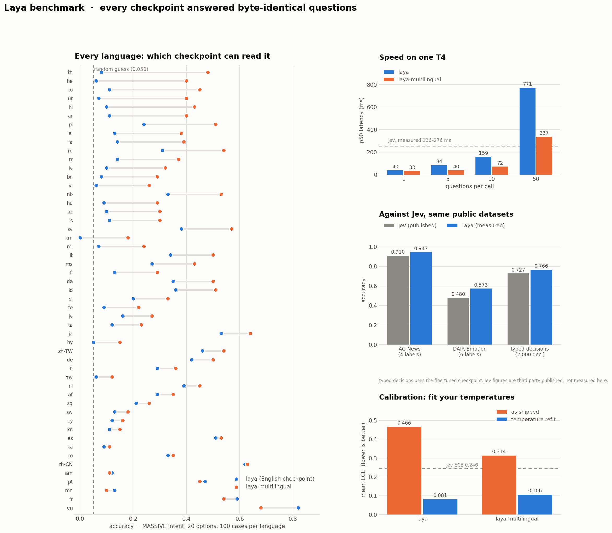</td>
<td align="center" valign="top">未發布媒體</td>
</tr></table>

🛡️ <b><a href="https://github.com/slavabars/decision-cascade">slavabars/decision-cascade</a></b> · ⭐78 · Python · 🔎 inferred · 6 天

##### 📝 摘要

Local decision engine with typed, calibrated outputs (Noul/Choice/Score): cheap→strong cascade, ECE/Brier calibration, SystemOne protocol interop. Apache-2.0.

##### 📌 基本資訊

| 欄位 | 值                 |
| ---- | ------------------ |
| 分類 | `路由、護欄與核准` |
| 證據 | `inferred`         |
| 語言 | Python             |

##### 📊 資料

| 指標     | 值         |
| -------- | ---------- |
| Star 數  | **78**     |
| 最近推送 | 2026-10-29 |
| 首次收錄 | 2026-10-16 |

🏷 `calibration` · `cascade` · `decision-making` · `fastapi` · `llm` · `model-routing` · `pytorch` · `systemone`

🛡️ <b><a href="https://github.com/zhangcy122/OpenJev">zhangcy122/OpenJev</a></b> · ⭐44 · Python · 🔎 inferred · 36 天

##### 📝 摘要

自我演化的認知決策引擎與 TypeSafe Jev 替代方案。審議式決策飛輪（「先探索，後結晶」System 2→1），具備 100% 選項順序不變性。用於 Open LLMs、Laya (ModernBERT) 與商業 Jev 的型別化機率式 API（Choice、Noul、Score），具備校準後的 logprobs 與自適應安全防護。

##### 📌 基本資訊

| 欄位 | 值                 |
| ---- | ------------------ |
| 分類 | `路由、護欄與核准` |
| 證據 | `inferred`         |
| 語言 | Python             |

##### 📊 資料

| 指標     | 值         |
| -------- | ---------- |
| Star 數  | **44**     |
| 最近推送 | 2026-09-29 |
| 首次收錄 | 2026-10-23 |

🛡️ <b><a href="https://github.com/bytelabs-oss/clash-jev">bytelabs-oss/clash-jev</a></b> · ⭐35 · Python · 🔎 inferred · 21 天

##### 📝 摘要

一個沒有訓練策略的 Clash Royale 機器人：Jev（TypeSafe System One）根據即時遊戲狀態做出每個決策

##### 📌 基本資訊

| 欄位 | 值                 |
| ---- | ------------------ |
| 分類 | `路由、護欄與核准` |
| 證據 | `inferred`         |
| 語言 | Python             |

##### 📊 資料

| 指標     | 值         |
| -------- | ---------- |
| Star 數  | **35**     |
| 最近推送 | 2026-10-14 |
| 首次收錄 | 2026-10-26 |

🛡️ <b><a href="https://github.com/kenhuangus/jev-usecases">kenhuangus/jev-usecases</a></b> · ⭐27 · Python · 🔎 inferred · 44 天

##### 📝 摘要

具備信心閘控決策邏輯的生產環境 TypeSafe Jev (System One) 使用案例測試框架

##### 📌 基本資訊

| 欄位 | 值                 |
| ---- | ------------------ |
| 分類 | `路由、護欄與核准` |
| 證據 | `inferred`         |
| 語言 | Python             |

##### 📊 資料

| 指標     | 值         |
| -------- | ---------- |
| Star 數  | **27**     |
| 最近推送 | 2026-09-21 |
| 首次收錄 | 2026-10-28 |

---

<table><tr><th align="center" width="50%">🖼 圖片</th><th align="center" width="50%">🎬 影片</th></tr><tr>
<td align="center" valign="top">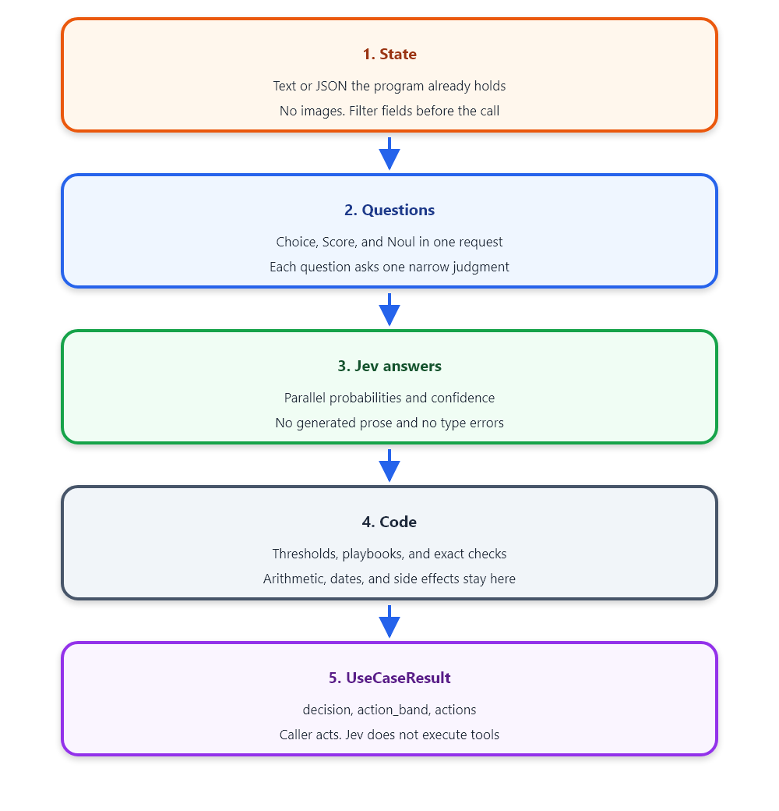</td>
<td align="center" valign="top">未發布媒體</td>
</tr></table>

🛡️ <b><a href="https://github.com/gaborishka/jev-canvas">gaborishka/jev-canvas</a></b> · ⭐22 · JavaScript · 🔎 inferred · 46 天

##### 📝 摘要

用你的聲音和指向手指在 tldraw 畫布上繪圖。Jev（TypeSafe System One）會以每個口述詞約 350 ms 的速度決定動作、目標和位置。

##### 📌 基本資訊

| 欄位 | 值                 |
| ---- | ------------------ |
| 分類 | `路由、護欄與核准` |
| 證據 | `inferred`         |
| 語言 | JavaScript         |

##### 📊 資料

| 指標     | 值         |
| -------- | ---------- |
| Star 數  | **22**     |
| 最近推送 | 2026-09-19 |
| 首次收錄 | 2026-10-28 |

🏷 `hand-tracking` · `jev` · `mediapipe` · `openrouter` · `tldraw` · `typesafe` · `voice-control` · `web-speech-api`

---

<table><tr><th align="center" width="50%">🖼 圖片</th><th align="center" width="50%">🎬 影片</th></tr><tr>
<td align="center" valign="top">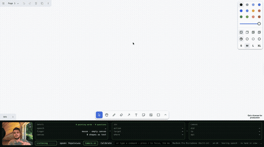</td>
<td align="center" valign="top">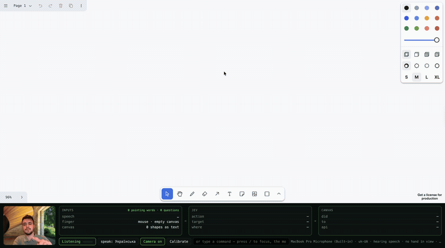 動態錄影</td>
</tr></table>

🛡️ <b><a href="https://github.com/rupeshpoojary9/poorjev">rupeshpoojary9/poorjev</a></b> · ⭐11 · Python · 🔎 inferred · 44 天

##### 📝 摘要

開源、本機的 Jev 替代方案：一個 System One 決策層，具備可證明校準的信心（ECE 0.170→0.071）。型別化決策、可離線執行、不需要 API key、無需候補名單。

##### 📌 基本資訊

| 欄位 | 值                 |
| ---- | ------------------ |
| 分類 | `路由、護欄與核准` |
| 證據 | `inferred`         |
| 語言 | Python             |

##### 📊 資料

| 指標     | 值         |
| -------- | ---------- |
| Star 數  | **11**     |
| 最近推送 | 2026-09-21 |
| 首次收錄 | 2026-10-28 |

🏷 `calibration` · `classification` · `conformal-prediction` · `jev` · `jev-alternative` · `llm` · `llm-guardrails` · `local-llm`

---

<table><tr><th align="center" width="50%">🖼 圖片</th><th align="center" width="50%">🎬 影片</th></tr><tr>
<td align="center" valign="top">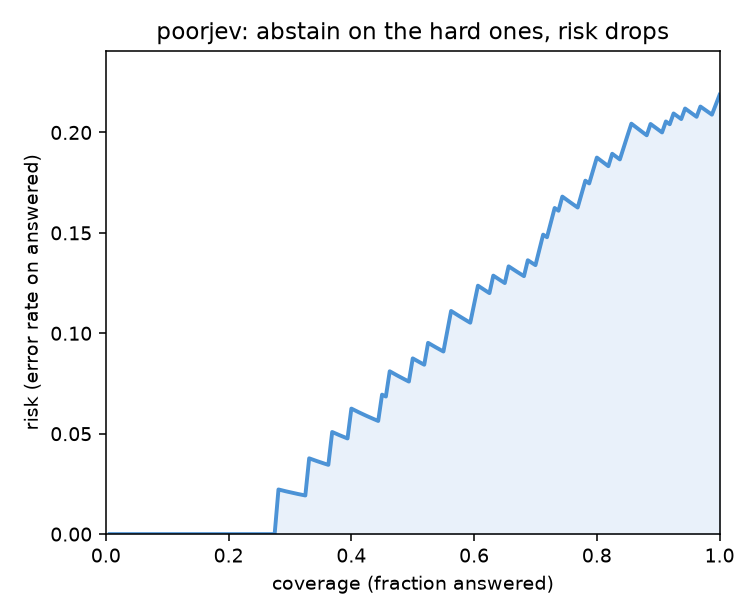</td>
<td align="center" valign="top">未發布媒體</td>
</tr></table>

🛡️ <b><a href="https://github.com/eulogik/nirnay">eulogik/nirnay</a></b> · ⭐10 · Python · 🔎 inferred · 29 天

##### 📝 摘要

NIRNAY 450M：開放權重的校準決策模型（Apache-2.0）。Banking77 意圖分類準確率 87.9%，擬合 ECE 0.045。Laya 分支加上概念瓶頸、由粗到細的指標器和RLCD。由 Eulogik 打造。

##### 📌 基本資訊

| 欄位 | 值                 |
| ---- | ------------------ |
| 分類 | `路由、護欄與核准` |
| 證據 | `inferred`         |
| 語言 | Python             |

##### 📊 資料

| 指標     | 值         |
| -------- | ---------- |
| Star 數  | **10**     |
| 最近推送 | 2026-10-06 |
| 首次收錄 | 2026-10-01 |

🏷 `apache-2-0` · `banking77` · `calibration` · `concept-bottleneck` · `decision-model` · `edge-ai` · `eulogik` · `guardrails`

---

<table><tr><th align="center" width="50%">🖼 圖片</th><th align="center" width="50%">🎬 影片</th></tr><tr>
<td align="center" valign="top">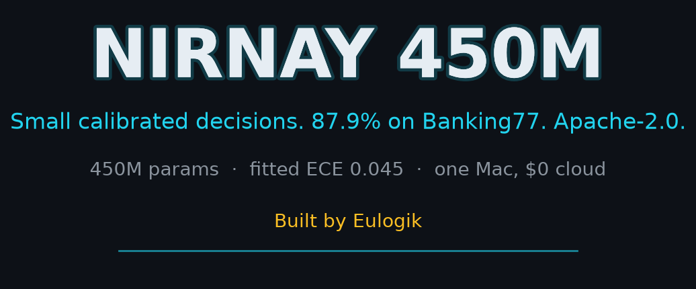</td>
<td align="center" valign="top">未發布媒體</td>
</tr></table>

🛡️ <b><a href="https://github.com/tomek7667/cbjev">tomek7667/cbjev</a></b> · ⭐5 · Python · 🔎 inferred · 41 天

##### 📝 摘要

由一次編碼器通過產生的型別化決策（choice/score/noul）——比 Laya 更快、校準更佳的後繼者，與 Jev wire 相容

##### 📌 基本資訊

| 欄位 | 值                 |
| ---- | ------------------ |
| 分類 | `路由、護欄與核准` |
| 證據 | `inferred`         |
| 語言 | Python             |

##### 📊 資料

| 指標     | 值         |
| -------- | ---------- |
| Star 數  | **5**      |
| 最近推送 | 2026-09-24 |
| 首次收錄 | 2026-10-23 |

🏷 `calibration` · `classification` · `decision-model` · `jev` · `laya` · `llm-guardrails` · `modernbert`

---

<table><tr><th align="center" width="50%">🖼 圖片</th><th align="center" width="50%">🎬 影片</th></tr><tr>
<td align="center" valign="top"></td>
<td align="center" valign="top">未發布媒體</td>
</tr></table>

🛡️ <b><a href="https://github.com/gazelle93/decision-models-under-pressure">gazelle93/decision-models-under-pressure</a></b> · ⭐4 · Python · 🔎 inferred · 16 天

##### 📝 摘要

Eight decision models, measured as the candidate list grows, the option order changes, and the wrong answers stop being obvious.

##### 📌 基本資訊

| 欄位 | 值                 |
| ---- | ------------------ |
| 分類 | `路由、護欄與核准` |
| 證據 | `inferred`         |
| 語言 | Python             |

##### 📊 資料

| 指標     | 值         |
| -------- | ---------- |
| Star 數  | **4**      |
| 最近推送 | 2026-10-19 |
| 首次收錄 | 2026-11-04 |

🏷 `calibration` · `decision-models` · `intent-classification` · `jev` · `laya` · `llm` · `model-comparison` · `openrouter`

---

<table><tr><th align="center" width="50%">🖼 圖片</th><th align="center" width="50%">🎬 影片</th></tr><tr>
<td align="center" valign="top"></td>
<td align="center" valign="top">未發布媒體</td>
</tr></table>

由於上游未宣告再散布授權，資源直接連結至上游儲存庫。

<b>本分類更多項目</b> · 41

- [backmeupplz/jev_antispam_bot](https://github.com/backmeupplz/jev_antispam_bot) - Minimal grammY Telegram anti-spam bot powered by TypeSafe Jev。
- [leofmarciano/groot](https://github.com/leofmarciano/groot) - 🌳 Groot 1 is a open typed-decision model, with a pure Bend engine.
- [vynnlee/jev-mail](https://github.com/vynnlee/jev-mail) - 由 TypeSafe Jev System One 驅動的 Gmail 自主 24/7 Zero-Inbox 分流。
- [hyspacex/jev-router](https://github.com/hyspacex/jev-router) - Route OpenAI-style chat requests to a model and reasoning effort, using…
- [amyrmahdy/decima](https://github.com/amyrmahdy/decima) - Small local judges and guards for LLM apps: calibrated decisions…
- [bitnovus/jev-spam-eval](https://github.com/bitnovus/jev-spam-eval) - 使用 TypeSafe Jev Noul 問題進行零樣本垃圾郵件過濾，並與 TF-IDF 基線比較。
- [Davidasx/pi-typesafe-approve](https://github.com/Davidasx/pi-typesafe-approve) - Pi extension: auto-approve routine Bash commands with a System One (Jev)…
- [ForestMars/Will-It-Jev](https://github.com/ForestMars/Will-It-Jev) - Ultra-low-latency, 6-tier prompt router in Rust to triage traffic between Jev…
- [mcgalleg/grokbot-jev-jobs](https://github.com/mcgalleg/grokbot-jev-jobs) - Scores public job postings against my resume using TypeSafe。
- [openwhat007/jev-rerank](https://github.com/openwhat007/jev-rerank) - 針對查詢／候選清單的相關性重新排序，由 TypeSafe 的 Jev Noul 原語驅動。支援 OpenRouter 與 TypeSafe 直接 API.
- [akamai-developers/jev-model-router](https://github.com/akamai-developers/jev-model-router) - A simple contextual model router build with Jev, Spin and TypeScript。
- [SENZO-NCEKANA/jev-triage-benchmark](https://github.com/SENZO-NCEKANA/jev-triage-benchmark) - Independent benchmark of TypeSafe。
- [adityavsb/narrative-audit-jev](https://github.com/adityavsb/narrative-audit-jev) - OpenRouter benchmark harness: same decision task for rule baselines and pinned…
- [ahmed35636/jev-triage](https://github.com/ahmed35636/jev-triage) - Windows event classification and confidence-aware review routing with TypeSafe…
- [budityw23/fhir_jev](https://github.com/budityw23/fhir_jev) - Typed AI decision layer for FHIR R4 data using TypeSafe AI。
- [CapCurious/jev-threshold-lab](https://github.com/CapCurious/jev-threshold-lab) - Fit act, review and escalate thresholds per question from labeled data with…
- [dtduc-git/jev-packs](https://github.com/dtduc-git/jev-packs) - Evidence-gated registry of Jev question packs — curated questions, golden cases…
- [elcann7/jev-issue-triage](https://github.com/elcann7/jev-issue-triage) - GitHub Action that labels and prioritizes new issues with TypeSafe。
- [freezetheflame/jev-ecosystem-research](https://github.com/freezetheflame/jev-ecosystem-research) - Jev (TypeSafe AI System One) 生态调研：开源复现规模、JevBench v1.4.2.2…
- [Haslab-dev/pandu-jev](https://github.com/Haslab-dev/pandu-jev) - Pandu, is mini Jev model, inspired by Jev.
- [hrtaym1114-github/x-jev-gate](https://github.com/hrtaym1114-github/x-jev-gate) - X draft gate powered by TypeSafe Jev (System One): hard secret checks + Noul…
- [jasonli0226/jev-benchmark](https://github.com/jasonli0226/jev-benchmark) - Benchmark: Jev decision model (TypeSafe, via OpenRouter) vs local ML on SST-2…
- [Joshita-s/ticket-triage-jev](https://github.com/Joshita-s/ticket-triage-jev) - Automated customer ticket triage engine in Python built with TypeSafe Jev…
- [kellystuard/jev-gmail-classifier](https://github.com/kellystuard/jev-gmail-classifier) - Google Apps Script that classifies Gmail messages with Jev, TypeSafe。
- [Khidir782/Beam-jev](https://github.com/Khidir782/Beam-jev) - Calibrated DevOps tool-router distilled from Beam-1.0-501B via RLCD.
- [Loule95450/jev-free-router](https://github.com/Loule95450/jev-free-router) - 建基於免費 OpenCode Zen + Go 模型的動態逐回合模型路由器（gargpratyush/jev-router 的分支）。
- [Madheshvivekanandan/jev-vs-cosine](https://github.com/Madheshvivekanandan/jev-vs-cosine) - Do you need TypeSafe。
- [masatoppp/07_Jev-routing-evaluation](https://github.com/masatoppp/07_Jev-routing-evaluation) - Jevを用いたLLM・Web検索・RAGのルーティング実装と、GPT-4.1-miniとの判定精度・処理速度・APIコストの比較検証。
- [mohameddhameem/systemone-jev](https://github.com/mohameddhameem/systemone-jev) - Typed-decision routers between a small and a large LLM, fine-tuned from nano-jev。
- [morler/pi-jev-core](https://github.com/morler/pi-jev-core) - Minimal Jev judgment core for Pi and other TypeScript apps: noul/choice/score…
- [Muradmustafayev-03/jev-recovery-router](https://github.com/Muradmustafayev-03/jev-recovery-router) - 成本條件式意圖路由：選定的 Qwen3 信念模型、復原行動者、可重現的基準測試與推論.
- [petercr/jev-orchestrator](https://github.com/petercr/jev-orchestrator) - 一個迷你節點編排器，使用 Jev 根據難度將路由導向不同的 LLMs.
- [ragman53/pi-jev-orchestrator](https://github.com/ragman53/pi-jev-orchestrator) - Cache-aware Jev model orchestration for Pi with sticky routing and safe…
- [rajkundalia/expense-approval-using-jev](https://github.com/rajkundalia/expense-approval-using-jev) - A local-first employee expense reimbursement demo exploring Jev。
- [RichardoMrMu/jev-mini](https://github.com/RichardoMrMu/jev-mini) - Put Jev。
- [shivanathd/jev-playground](https://github.com/shivanathd/jev-playground) - BYOK playground for TypeSafe Jev (System One): Choice, Score, Noul examples for…
- [stivelcn/jev-route-releases](https://github.com/stivelcn/jev-route-releases) - JEV Router macOS downloads and release notes. Source code is private.
- [THEROCKSSS/awesome-jev](https://github.com/THEROCKSSS/awesome-jev) - Merged, deduplicated, daily-updated catalog of Jev / TypeSafe System One…
- [willirath/2026_jev-box-demo](https://github.com/willirath/2026_jev-box-demo) - Hotdog / not hotdog demo with TypeSafe Jev (noul + box) via OpenRouter。
- [Wu-love-han/ai-jev-filter](https://github.com/Wu-love-han/ai-jev-filter) - JEV 检索台 · 对话式网络信息筛选工作台：官方 /v1/systemone 协议接入、noul/score/choice…
- [sumleo/RLCDAlignBench](https://github.com/sumleo/RLCDAlignBench) - RLCDAlignBench：44 個對齊失敗偵測基準與「Just Ask Jev」的程式碼（AI 對齊失敗的 RLCD 零樣本偵測器）。

## 評估、校準與基準測試

人們憑什麼知道這些判斷是否可靠。校準是這個生態系尚未解決的問題，而這些專案正是在量測它。

🧪 <b><a href="https://github.com/Mapika/decider">Mapika/decider</a></b> · ⭐1170 · Python · 👁️ observed · 15 天

##### 📝 摘要

一系列從 Qwen3.5 微調而來的 System One 風格模型，專為具校準機率的單次通過型別化決策而設計。

🔧 於程式碼中發現使用: `docs/HISTORY.md`, `README.md`

##### 📌 基本資訊

| 欄位 | 值                     |
| ---- | ---------------------- |
| 分類 | `評估、校準與基準測試` |
| 證據 | `observed`             |
| 語言 | Python                 |

##### 📊 資料

| 指標     | 值         |
| -------- | ---------- |
| Star 數  | **1170**   |
| 最近推送 | 2026-10-20 |
| 首次收錄 | 2026-10-28 |

---

<table><tr><th align="center" width="50%">🖼 圖片</th><th align="center" width="50%">🎬 影片</th></tr><tr>
<td align="center" valign="top"></td>
<td align="center" valign="top">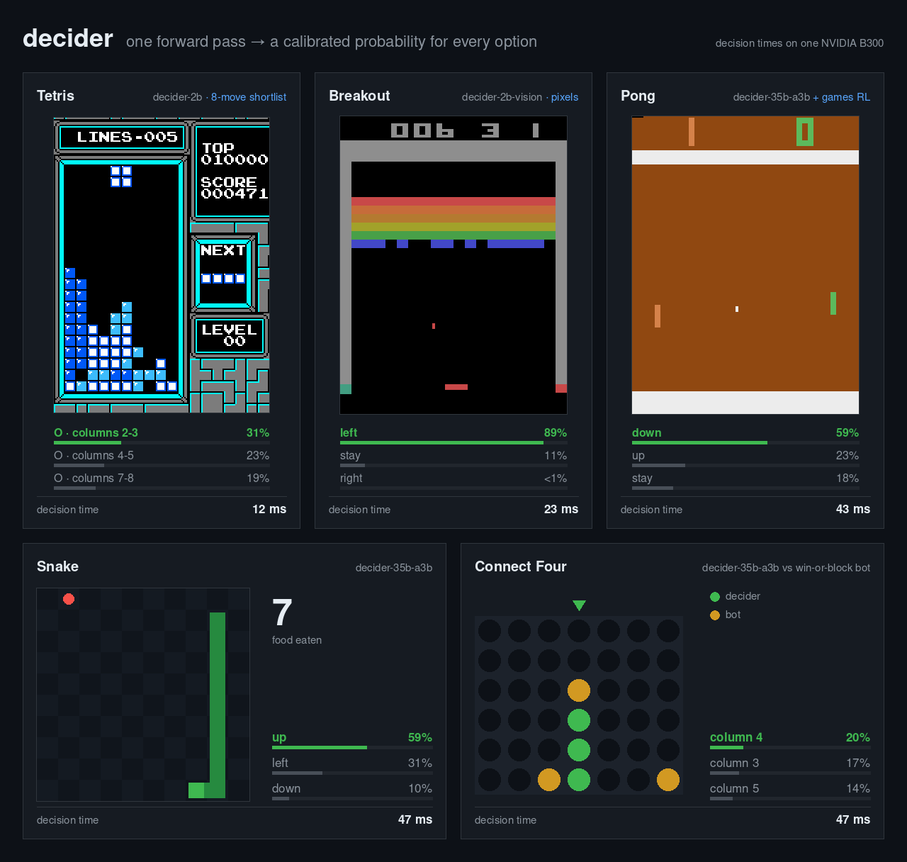 動態錄影</td>
</tr></table>

🧪 <b><a href="https://github.com/v-modal/awesome-jev-tools">v-modal/awesome-jev-tools</a></b> · ⭐754 · 👁️ observed · 1 天

##### 📝 摘要

為 Jev 打造的工具精選清單——TypeSafe AI 用於具型別決策的 System One 模型。

##### 📌 基本資訊

| 欄位 | 值                     |
| ---- | ---------------------- |
| 分類 | `評估、校準與基準測試` |
| 證據 | `observed`             |

##### 📊 資料

| 指標     | 值         |
| -------- | ---------- |
| Star 數  | **754**    |
| 最近推送 | 2026-11-03 |
| 首次收錄 | 2026-09-20 |

🏷 `awesome-ai` · `awesome-jev` · `awesome-list` · `awesome-readme` · `calibrated-probabilities` · `jev` · `jev-ai` · `jev-alternative`

🧪 <b><a href="https://github.com/OmniJev/awesome-jev-gallery">OmniJev/awesome-jev-gallery</a></b> · ⭐481 · Python · 👁️ observed · 0 天

##### 📝 摘要

🔥🔥 Awesome Jev：用於 Jev 和 System One 模型的開源模型、專案、基準測試與獨立評估。

##### 📌 基本資訊

| 欄位 | 值                     |
| ---- | ---------------------- |
| 分類 | `評估、校準與基準測試` |
| 證據 | `observed`             |
| 語言 | Python                 |

##### 📊 資料

| 指標     | 值         |
| -------- | ---------- |
| Star 數  | **481**    |
| 最近推送 | 2026-11-04 |
| 首次收錄 | 2026-09-20 |

🏷 `awesome` · `awesome-jev` · `awesome-list` · `calibrated-probabilities` · `calibration` · `decision-models` · `jev` · `jev-ai`

🧪 <b><a href="https://github.com/fstandhartinger/jevbench">fstandhartinger/jevbench</a></b> · ⭐330 · Python · 👁️ observed · 21 天 · ⭐-1

##### 📝 摘要

Benchmark Heaven 推出的 JevBench：AI 決策模型的基準測試與排行榜，用於測量類型化決策準確度、校準度、延遲與成本。

🔧 於程式碼中發現使用: `README.md`

##### 📌 基本資訊

| 欄位 | 值                     |
| ---- | ---------------------- |
| 分類 | `評估、校準與基準測試` |
| 證據 | `observed`             |
| 語言 | Python                 |

##### 📊 資料

| 指標     | 值           |
| -------- | ------------ |
| Star 數  | **330** (-1) |
| 最近推送 | 2026-10-15   |
| 首次收錄 | 2026-10-29   |

🏷 `ai-benchmark` · `benchmark-heaven` · `calibration` · `decision-models` · `decisionmodels` · `jev` · `jev-compatible` · `jevbench`

---

<table><tr><th align="center" width="50%">🖼 圖片</th><th align="center" width="50%">🎬 影片</th></tr><tr>
<td align="center" valign="top">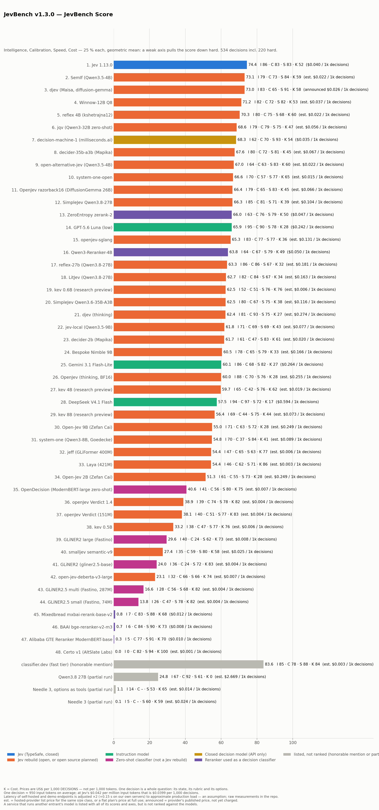</td>
<td align="center" valign="top">未發布媒體</td>
</tr></table>

🧪 <b><a href="https://github.com/cobusgreyling/Jev">cobusgreyling/Jev</a></b> · ⭐140 · Python · 👁️ observed · 20 天

##### 📝 摘要

非官方 TypeSafe Jev 展示——System One 個決策，而非聊天。

🔧 於程式碼中發現使用: `README.md`

##### 📌 基本資訊

| 欄位 | 值                     |
| ---- | ---------------------- |
| 分類 | `評估、校準與基準測試` |
| 證據 | `observed`             |
| 語言 | Python                 |

##### 📊 資料

| 指標     | 值         |
| -------- | ---------- |
| Star 數  | **140**    |
| 最近推送 | 2026-10-15 |
| 首次收錄 | 2026-10-26 |

🏷 `calibrated-decisions` · `jev` · `showcase` · `system-one` · `typesafe`

---

<table><tr><th align="center" width="50%">🖼 圖片</th><th align="center" width="50%">🎬 影片</th></tr><tr>
<td align="center" valign="top"></td>
<td align="center" valign="top">未發布媒體</td>
</tr></table>

🧪 <b><a href="https://github.com/ikermoel/open-alternative-jev">ikermoel/open-alternative-jev</a></b> · ⭐76 · Python · 👁️ observed · 41 天

##### 📝 摘要

TypeSafe 的 Jev 的開源替代方案：一個 System One 風格的模型層，可在單次前向傳播中，從任何開放權重 LLM（HF + vLLM）提供具型別且經校準的決策，並提供誠實的基準測試

##### 📌 基本資訊

| 欄位 | 值                     |
| ---- | ---------------------- |
| 分類 | `評估、校準與基準測試` |
| 證據 | `observed`             |
| 語言 | Python                 |

##### 📊 資料

| 指標     | 值         |
| -------- | ---------- |
| Star 數  | **76**     |
| 最近推送 | 2026-09-25 |
| 首次收錄 | 2026-10-28 |

🏷 `calibration` · `classification` · `jev` · `jev-alternative` · `llm` · `logprobs` · `open-jev` · `open-source-jev`

🧪 <b><a href="https://github.com/hev/reranker">hev/reranker</a></b> · ⭐19 · Python · 👁️ observed · 48 天

##### 📝 摘要

將 Jev（TypeSafe 的 System One 模型）用作經校準的重新排名器：一次呼叫，最多 30 份文件，每份文件一個機率。Apache-2.0。

##### 📌 基本資訊

| 欄位 | 值                     |
| ---- | ---------------------- |
| 分類 | `評估、校準與基準測試` |
| 證據 | `observed`             |
| 語言 | Python                 |

##### 📊 資料

| 指標     | 值         |
| -------- | ---------- |
| Star 數  | **19**     |
| 最近推送 | 2026-09-17 |
| 首次收錄 | 2026-10-28 |

🧪 <b><a href="https://github.com/OmniJev/awesome-jev-papers">OmniJev/awesome-jev-papers</a></b> · ⭐12 · Python · 👁️ observed · 0 天 · ⭐+1

##### 📝 摘要

🔥🔥 Research papers on Jev, TypeSafe's System One model, and the open models built in its shape.

##### 📌 基本資訊

| 欄位 | 值                     |
| ---- | ---------------------- |
| 分類 | `評估、校準與基準測試` |
| 證據 | `observed`             |
| 語言 | Python                 |

##### 📊 資料

| 指標     | 值          |
| -------- | ----------- |
| Star 數  | **12** (+1) |
| 最近推送 | 2026-11-04  |
| 首次收錄 | 2026-09-28  |

🏷 `arxiv` · `awesome` · `awesome-list` · `calibration` · `decision-model` · `jev` · `llm` · `paper-list`

🧪 <b><a href="https://github.com/akash-kamat/system-one-gemma">akash-kamat/system-one-gemma</a></b> · ⭐7 · Python · 👁️ observed · 47 天

##### 📝 摘要

開源的 Jev 風格 System One 決策模型。Gemma 3 270M 搭配評分頭——在單次前向傳遞中快速產生經校準的決策。不生成文字。受 TypeSafe.ai 的 Jev 啟發。

##### 📌 基本資訊

| 欄位 | 值                     |
| ---- | ---------------------- |
| 分類 | `評估、校準與基準測試` |
| 證據 | `observed`             |
| 語言 | Python                 |

##### 📊 資料

| 指標     | 值         |
| -------- | ---------- |
| Star 數  | **7**      |
| 最近推送 | 2026-09-18 |
| 首次收錄 | 2026-10-28 |

🏷 `calibration` · `decision-model` · `gemma` · `jev` · `lora` · `machine-learning` · `scoring-model` · `system-one`

🧪 <b><a href="https://github.com/brida-ai/reflexbench">brida-ai/reflexbench</a></b> · ⭐6 · Python · 👁️ observed · 42 天

##### 📝 摘要

ReflexBench —— 用於 System One 模型與型別化決策引擎的開放基準與評估框架

##### 📌 基本資訊

| 欄位 | 值                     |
| ---- | ---------------------- |
| 分類 | `評估、校準與基準測試` |
| 證據 | `observed`             |
| 語言 | Python                 |

##### 📊 資料

| 指標     | 值         |
| -------- | ---------- |
| Star 數  | **6**      |
| 最近推送 | 2026-09-24 |
| 首次收錄 | 2026-10-23 |

🏷 `ai-benchmark` · `ai-evaluation` · `benchmark` · `calibration` · `choice` · `decision-models` · `jev` · `laya`

🧪 <b><a href="https://github.com/debuffjp/decidekit">debuffjp/decidekit</a></b> · ⭐6 · TypeScript · 👁️ observed · 2 天

##### 📝 摘要

A System One model in the browser: typed, calibrated text decisions on the user's device. Learns from an LLM when it isn't sure.

##### 📌 基本資訊

| 欄位 | 值                     |
| ---- | ---------------------- |
| 分類 | `評估、校準與基準測試` |
| 證據 | `observed`             |
| 語言 | TypeScript             |

##### 📊 資料

| 指標     | 值         |
| -------- | ---------- |
| Star 數  | **6**      |
| 最近推送 | 2026-11-02 |
| 首次收錄 | 2026-11-02 |

🏷 `classification` · `decision-model` · `llm` · `system-one` · `typescript`

🧪 <b><a href="https://github.com/bydeng01/scientific-decision-eval">bydeng01/scientific-decision-eval</a></b> · ⭐4 · HTML · 👁️ observed · 0 天

##### 📝 摘要

Code and data for evaluating Jev, a System One model, on scientific decisions and how its choices affect downstream results. arXiv:2609.24965

##### 📌 基本資訊

| 欄位 | 值                     |
| ---- | ---------------------- |
| 分類 | `評估、校準與基準測試` |
| 證據 | `observed`             |
| 語言 | HTML                   |

##### 📊 資料

| 指標     | 值         |
| -------- | ---------- |
| Star 數  | **4**      |
| 最近推送 | 2026-11-04 |
| 首次收錄 | 2026-10-27 |

🏷 `jev` · `jev-ai` · `jev-model` · `jevbench` · `system-one` · `system-one-model` · `system-one-models`

🧪 <b><a href="https://github.com/Shauryagulati/mini-jev">Shauryagulati/mini-jev</a></b> · Jupyter · 👁️ observed · 16 天

##### 📝 摘要

Distilling a calibrated decision model into Qwen3-1.7B: SFT vs. distillation vs. GRPO, plus deployment pitfalls. Free Colab T4.

##### 📌 基本資訊

| 欄位 | 值                     |
| ---- | ---------------------- |
| 分類 | `評估、校準與基準測試` |
| 證據 | `observed`             |
| 語言 | Jupyter                |

##### 📊 資料

| 指標     | 值         |
| -------- | ---------- |
| Star 數  | **0**      |
| 最近推送 | 2026-10-19 |
| 首次收錄 | 2026-11-01 |

---

<table><tr><th align="center" width="50%">🖼 圖片</th><th align="center" width="50%">🎬 影片</th></tr><tr>
<td align="center" valign="top">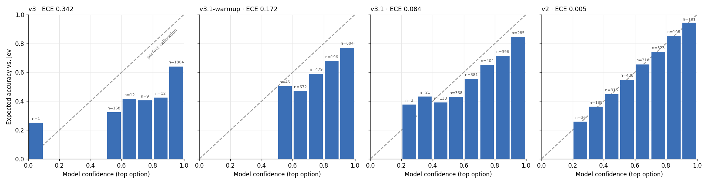</td>
<td align="center" valign="top">未發布媒體</td>
</tr></table>

🧪 <b><a href="https://github.com/nokia-applied-research/AnyJev">nokia-applied-research/AnyJev</a></b> · ⭐1584 · Python · 🔎 inferred · 14 天

##### 📝 摘要

將任何 LLM 轉換成 Jev 風格的決策模型：具型別的決策、真實機率、不需訓練。（持續更新，歡迎提出任何 issue 和 PR 請求）

##### 📌 基本資訊

| 欄位 | 值                     |
| ---- | ---------------------- |
| 分類 | `評估、校準與基準測試` |
| 證據 | `inferred`             |
| 語言 | Python                 |

##### 📊 資料

| 指標     | 值         |
| -------- | ---------- |
| Star 數  | **1584**   |
| 最近推送 | 2026-10-21 |
| 首次收錄 | 2026-09-22 |

🏷 `calibration` · `decision-model` · `jev` · `jev-model` · `llm` · `system-one` · `transformers` · `vllm`

---

<table><tr><th align="center" width="50%">🖼 圖片</th><th align="center" width="50%">🎬 影片</th></tr><tr>
<td align="center" valign="top">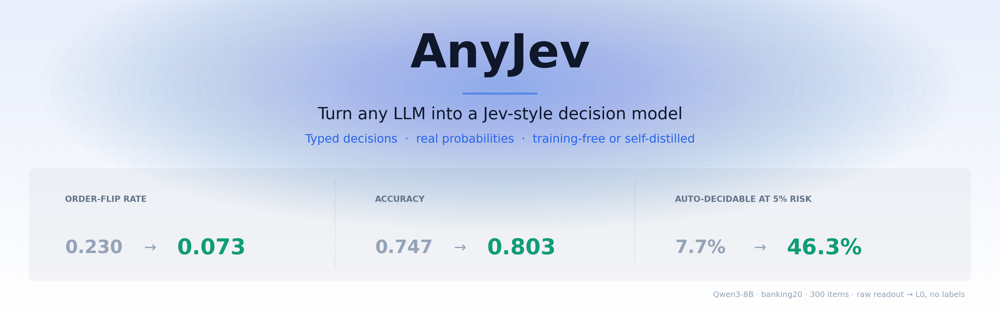</td>
<td align="center" valign="top">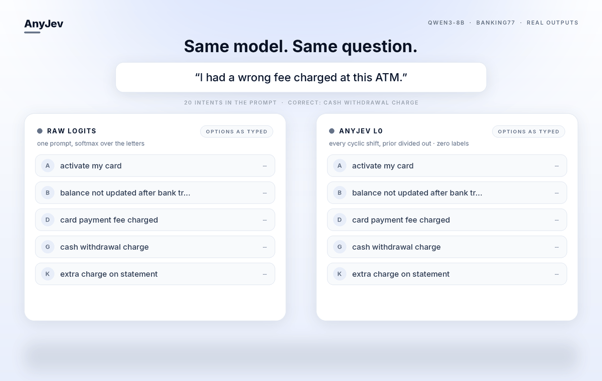 動態錄影</td>
</tr></table>

🧪 <b><a href="https://github.com/allebee/jevk5">allebee/jevk5</a></b> · ⭐160 · Python · 🔎 inferred · 37 天

##### 📝 摘要

JevK5：TypeSafe Jev 的開放權重替代方案。一次前向傳播即可取得帶機率的類型化決策；提供 Apache-2.0 權重與程式碼。

##### 📌 基本資訊

| 欄位 | 值                     |
| ---- | ---------------------- |
| 分類 | `評估、校準與基準測試` |
| 證據 | `inferred`             |
| 語言 | Python                 |

##### 📊 資料

| 指標     | 值         |
| -------- | ---------- |
| Star 數  | **160**    |
| 最近推送 | 2026-09-28 |
| 首次收錄 | 2026-10-29 |

🏷 `calibration` · `decision-model` · `jev` · `jev-alternative` · `jevbench` · `lora` · `qwen` · `system-one`

---

<table><tr><th align="center" width="50%">🖼 圖片</th><th align="center" width="50%">🎬 影片</th></tr><tr>
<td align="center" valign="top">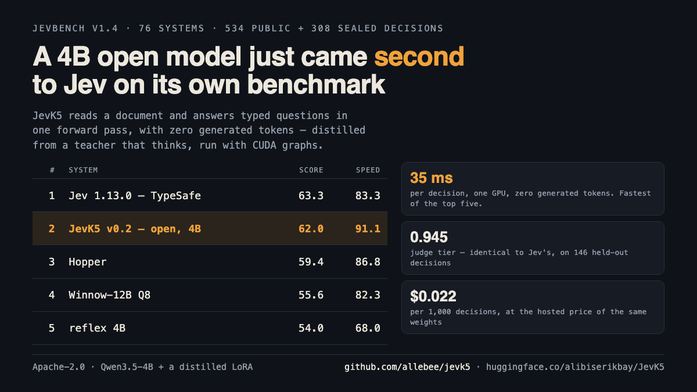</td>
<td align="center" valign="top">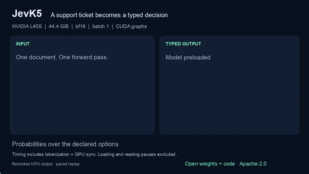 動態錄影 · <a href="https://raw.githubusercontent.com/allebee/jevk5/main/docs/demo/jevk5-nvidia-demo.mp4">開啟影片</a></td>
</tr></table>

🧪 <b><a href="https://github.com/Heman10x-NGU/Verdict-open-jev">Heman10x-NGU/Verdict-open-jev</a></b> · ⭐115 · Python · 🔎 inferred · 14 天

##### 📝 摘要

基於 ModernBERT（151M）的非自回歸決策引擎，具備校準不確定性（RLCD）、TypeSafe AI Jev 基準測試稽核，以及瀏覽器內 WebGPU 遊樂場

##### 📌 基本資訊

| 欄位 | 值                     |
| ---- | ---------------------- |
| 分類 | `評估、校準與基準測試` |
| 證據 | `inferred`             |
| 語言 | Python                 |

##### 📊 資料

| 指標     | 值         |
| -------- | ---------- |
| Star 數  | **115**    |
| 最近推送 | 2026-10-21 |
| 首次收錄 | 2026-09-18 |

🏷 `brier-score` · `calibration` · `decision-engine` · `edge-ai` · `gliclass` · `jev` · `modernbert` · `onnx`

---

<table><tr><th align="center" width="50%">🖼 圖片</th><th align="center" width="50%">🎬 影片</th></tr><tr>
<td align="center" valign="top"></td>
<td align="center" valign="top">未發布媒體</td>
</tr></table>

由於上游未宣告再散布授權，資源直接連結至上游儲存庫。

🧪 <b><a href="https://github.com/manjunathshiva/opendecider">manjunathshiva/opendecider</a></b> · ⭐38 · Python · 🔎 inferred · 0 天

##### 📝 摘要

Open, calibrated System 1 decision models: typed choice / score / yes-no answers with a probability for every option. 400M to 80B; CPU, NVIDIA, Apple Silicon, LM Studio, Ollama and vLLM.

##### 📌 基本資訊

| 欄位 | 值                     |
| ---- | ---------------------- |
| 分類 | `評估、校準與基準測試` |
| 證據 | `inferred`             |
| 語言 | Python                 |

##### 📊 資料

| 指標     | 值         |
| -------- | ---------- |
| Star 數  | **38**     |
| 最近推送 | 2026-11-04 |
| 首次收錄 | 2026-11-04 |

🏷 `apple-silicon` · `calibration` · `classification` · `decision-model` · `gguf` · `huggingface` · `llm` · `mlx`

---

<table><tr><th align="center" width="50%">🖼 圖片</th><th align="center" width="50%">🎬 影片</th></tr><tr>
<td align="center" valign="top">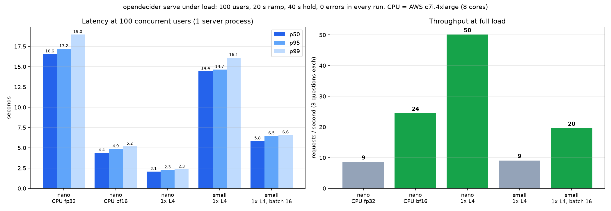</td>
<td align="center" valign="top">未發布媒體</td>
</tr></table>

🧪 <b><a href="https://github.com/Eliot5566/JEV-Paper-Radar">Eliot5566/JEV-Paper-Radar</a></b> · ⭐37 · Python · 🔎 inferred · 0 天

##### 📝 摘要

讓 Jev 每天早晨閱讀每篇新的 arXiv 論文，並浮現你應該閱讀的少數幾篇。純英文興趣、經校準的機率、約 $0.06/天，fork 即可使用。

##### 📌 基本資訊

| 欄位 | 值                     |
| ---- | ---------------------- |
| 分類 | `評估、校準與基準測試` |
| 證據 | `inferred`             |
| 語言 | Python                 |

##### 📊 資料

| 指標     | 值         |
| -------- | ---------- |
| Star 數  | **37**     |
| 最近推送 | 2026-11-04 |
| 首次收錄 | 2026-10-19 |

🏷 `arxiv` · `biorxiv` · `github-actions` · `jev` · `literature-review` · `llm` · `paper-recommendation` · `python`

---

<table><tr><th align="center" width="50%">🖼 圖片</th><th align="center" width="50%">🎬 影片</th></tr><tr>
<td align="center" valign="top">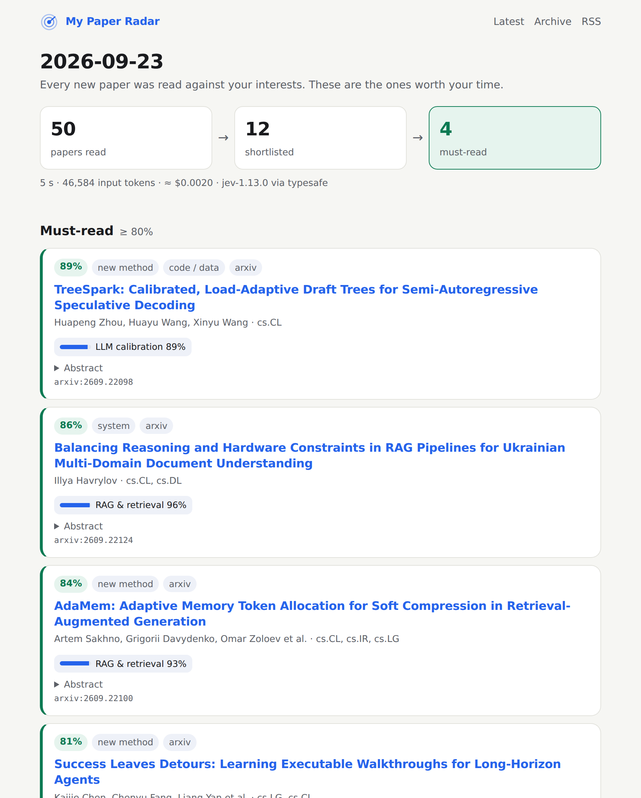</td>
<td align="center" valign="top">未發布媒體</td>
</tr></table>

<b>本分類更多項目</b> · 77

- [pozapas/awesome-system-one-models](https://github.com/pozapas/awesome-system-one-models) - Curated, evidence-graded list of System One models。
- [alby13/systemone](https://github.com/alby13/systemone) - Typed, calibrated decisions for software in a single forward pass: an…
- [alexrose13/measuring-ee-open-system-one-models](https://github.com/alexrose13/measuring-ee-open-system-one-models) - Measuring Exploration and Exploitation in Organizational Text with Open System…
- [BILLKISHORE/opensysone](https://github.com/BILLKISHORE/opensysone) - Open System One model for Apple Silicon: typed decisions with calibrated…
- [christian-taillon/telltale-systemone](https://github.com/christian-taillon/telltale-systemone) - Reference Telltale analyzer.v1 extension that evaluates guard packs with a…
- [jburns24/jev-demo](https://github.com/jburns24/jev-demo) - playing with jev-latest evaluation model。
- [Lucasrrafael/system-one-model-fine-tuning](https://github.com/Lucasrrafael/system-one-model-fine-tuning) - Fine-tuning pipeline for Laya and clef (9B/27B) decision models on ordinal…
- [mahirmalik030/Jev-vs-LLMs](https://github.com/mahirmalik030/Jev-vs-LLMs) - A comparative study of Jev 1.13 and Large Language Models (LLMs) for phishing…
- [patryckalves/jev-no-enem](https://github.com/patryckalves/jev-no-enem) - 可重現的基準測試，使用巴西 ENEM 2025 標準化考試評估 TypeSafe AI 的 Jev（System One 範式）.
- [Saviskar/schema-mapping-bench](https://github.com/Saviskar/schema-mapping-bench) - Benchmarking lightweight and open-source LLMs and system one models on…
- [buberlo/jev-trader](https://github.com/buberlo/jev-trader) - 圍繞 Jev（TypeSafe System One）決策的 24/7 market-making 系統：確定性狀態、校準後的判斷、嚴格風險否決.
- [yzfly/edgejev](https://github.com/yzfly/edgejev) - 离线可用的本地类型化决策：4 核 CPU 单题 15.6ms。Local &amp; offline Jev / System One inference on…
- [ankit-aglawe/tinyjev](https://github.com/ankit-aglawe/tinyjev) - 一個小型類 jev 模型，可在一次 forward pass 中回答 Choice、Score 和 Noul 問題，並回傳校準後的機率.
- [shibing624/train-jev](https://github.com/shibing624/train-jev) - 在 Qwen3.5 和 Qwen3.8-27B 上訓練 JEV 風格的 System 1 決策模型：24 槽位決策頭、KL 蒸餾、校準與服務部署.
- [SamratDuttaOfficial/WaterSheep](https://github.com/SamratDuttaOfficial/WaterSheep) - 一個決策模型，會針對是/否、選擇、評分和多標籤問題回傳校準答案.
- [Nhahan/Xevn](https://github.com/Nhahan/Xevn) - A 4B decision model built for Korean.
- [BrendanH18/jev_fsd](https://github.com/BrendanH18/jev_fsd) - A driving simulator on real OpenStreetMap streets where TypeSafe。
- [us/jev-local](https://github.com/us/jev-local) - 本機 Jev 相容評估伺服器：POST /v1/systemone，具備型別化 noul/choice/score、開放權重、無等候名單。
- [cablehead/jev.nu](https://github.com/cablehead/jev.nu) - 適用於 TypeSafe System One API 的 Nushell 模組：具型別且附經校準機率的決策。
- [wondertwins/jev-benchmark](https://github.com/wondertwins/jev-benchmark) - TypeSafe 的 Jev（System One）模型的基準測試與遊樂場：西洋棋，以及語音轉文字遊戲 NPC 的「玩家正在與誰對話」。
- [mertkayacs/jevalt](https://github.com/mertkayacs/jevalt) - Three 4B decision models for English, Turkish and German, with per-option…
- [y0usaf/jev-lm](https://github.com/y0usaf/jev-lm) - 一個詞級語言模型，其輸出層為 Jev：n-gram 起草器、Noul 區塊驗證、bits-per-token 評估。
- [Yifan-Lan/awesome-jev-robustness](https://github.com/Yifan-Lan/awesome-jev-robustness) - 對 Jev（TypeSafe System One）進行的測試、校準稽核與失效模式研究：鋸齒性、一致性、注入、拒答.
- [zamax14/Laya-Finetune](https://github.com/zamax14/Laya-Finetune) - 微調 Laya——開放的 System One 決策模型，以處理任何型別化決策任務：合成資料、RLCD、校準與長上下文.
- [tak-bro/local-jev-bench](https://github.com/tak-bro/local-jev-bench) - Local Jev-style System One decision models on Apple Silicon Macs: AnyJev, Kev…
- [CodyQin/zh-decision-bench](https://github.com/CodyQin/zh-decision-bench) - 首個面向 Jev 級「System One」決策模型的中文校準基準：資料集 (CC BY 4.0)、含 Jev 與 NeoHorse 的 5…
- [mertkayacs/jevoss](https://github.com/mertkayacs/jevoss) - Evaluation tools for Jev-compatible decision models, covering accuracy…
- [mpuig/system-one](https://github.com/mpuig/system-one) - 開源的 System One 決策模型——Kahneman 對快速、自動判斷能力的稱呼.
- [AlanViollier/jev-vs-pii](https://github.com/AlanViollier/jev-vs-pii) - How good is Jev, a decision model, at finding personal information?
- [divyanshudhruv/oev](https://github.com/divyanshudhruv/oev) - An 184M-parameter monolingual decision engine delivering calibrated…
- [etsabary/jev-deterministic-benchmark](https://github.com/etsabary/jev-deterministic-benchmark) - 涵蓋 25 個確定性推理家族、共 1,000 個決策的 Jev 行為基準測試.
- [Nefelim584/JEV_Judge](https://github.com/Nefelim584/JEV_Judge) - jev-lite: a ModernBERT-based typed decision model (Bool / Choice / Score) with…
- [teyhouse/jev-secret-detection](https://github.com/teyhouse/jev-secret-detection) - 衡量 TypeSafe 的 RLCD-Jev 模型在檔案片段中找出真實機密憑證的能力。
- [CosmoIknosLab/EarthJev](https://github.com/CosmoIknosLab/EarthJev) - EarthJev: calibrated, non-generative answers to natural-language questions…
- [EnesDemir143/jev-laya-benchmark](https://github.com/EnesDemir143/jev-laya-benchmark) - 比較 TypeSafe Jev 與 Laya-MLX 進行結構化問題分類的本地基準測試。
- [lewistouchtech/opencode-jev-safe-compact](https://github.com/lewistouchtech/opencode-jev-safe-compact) - JEV-guided context compaction for OpenCode, built on a measured finding: noul…
- [patelvishwa112/jev-system-one-rlcd](https://github.com/patelvishwa112/jev-system-one-rlcd) - Jev System One AI 與 RLCD 重現引擎：使用 SmolLM-135M 實現低於 70 毫秒的校準決策與 0 個輸出 Token。
- [Rushab1/gr-jev](https://github.com/Rushab1/gr-jev) - Code for。
- [vortezwohl/JevNER](https://github.com/vortezwohl/JevNER) - Zero-shot multilingual named entity recognition (NER) powered by TypeSafe…
- [113636xfh/jev-decision-head](https://github.com/113636xfh/jev-decision-head) - A lightweight Jev-style decision head, plus the Strata patches that let one…
- [acbharath14/ollama-jev-decision-demo](https://github.com/acbharath14/ollama-jev-decision-demo) - Decision models via Ollama (Jev /v1/systemone): ask typed questions — choice…
- [agarwalastitwa027-svg/mini-jev-multimodal](https://github.com/agarwalastitwa027-svg/mini-jev-multimodal) - 小型圖像+文字決策模型：Qwen3-VL-2B + LoRA + 答案頭在一次前向傳遞中為你的選項評分（不進行生成）.
- [amatelic/jev](https://github.com/amatelic/jev) - One-line local AI decisions. Calibrated choice/noul/score from open models.
- [ameya-panchpor/jev-2048](https://github.com/ameya-panchpor/jev-2048) - Does a System One classifier belong in a sequential decision loop? A regret and…
- [ameya690/jev-2048](https://github.com/ameya690/jev-2048) - Does a System One classifier belong in a sequential decision loop? A regret and…
- [ankur287/jev-open-calibration](https://github.com/ankur287/jev-open-calibration) - Rebuilding Jev。
- [beskvladimir-create/ru-jev](https://github.com/beskvladimir-create/ru-jev) - Ru-Jev: an open Russian typed-decision model.
- [betulsimsek/jev-decomposition-tr](https://github.com/betulsimsek/jev-decomposition-tr) - Does splitting a typed-decision question help? Jev vs OpenAI Decisions vs Laya…
- [cayoesn/llm-jev-engine](https://github.com/cayoesn/llm-jev-engine) - System-1 Non-Autoregressive Single-Pass Neural Decision Engine with RLCD…
- [devrecated/jev-alternative](https://github.com/devrecated/jev-alternative) - Free, open-source Jev alternative: fine-tune the open Laya decision model on…
- [dnakhoa/jev-deferred-crispification](https://github.com/dnakhoa/jev-deferred-crispification) - 立場論文：TypeSafe AI 的 Jev 與 System-One 決策模型所缺少的 Hidden-Markov 與模糊原語.
- [himalaya-kaushik/mini-jev](https://github.com/himalaya-kaushik/mini-jev) - Where one-pass decision models break: a local Jev-style model + 4 stress tests。
- [Holovkat/jev-mark](https://github.com/Holovkat/jev-mark) - Benchmarking Local LLM。
- [jsaurabh/qwen-rlcd-jev-repro](https://github.com/jsaurabh/qwen-rlcd-jev-repro) - 使用 Qwen、Nimble、AutoJev 與 JevBench，針對類似 Jev 的具型別決策模型進行可重現的 MLX 與 Colab 實驗。
- [n9omi/jev-calibration-audit](https://github.com/n9omi/jev-calibration-audit) - Independent calibration audit of TypeSafe AI。
- [Nijal-AI/jev-lab](https://github.com/Nijal-AI/jev-lab) - Atelier web pour mettre à l。
- [onlyoneaman/jev-eval](https://github.com/onlyoneaman/jev-eval) - TypeSafe。
- [open-factoryai/myJEV](https://github.com/open-factoryai/myJEV) - 將任何狀態轉換為結構化且經校準的決策。開源 System One 遊樂場：具型別的問題（choice / score / noul）→ 機率分布，而非自由文字.
- [Poojithcodes/jev-calibration-study](https://github.com/Poojithcodes/jev-calibration-study) - Comparing Jev。
- [Teddy9710/jev-playground](https://github.com/Teddy9710/jev-playground) - TypeSafe System One（Jev）的本機遊樂場：在瀏覽器中組合 Choice/Noul/Score 問題，呼叫即時的 API，並從 arXiv…
- [unofficial-equivocation2029/Open-Jev](https://github.com/unofficial-equivocation2029/Open-Jev) - 立即從上下文與候選項目取得具型別的決策機率——不需要自回歸生成或 JSON 解析.
- [UpHash-Network/mini-jev](https://github.com/UpHash-Network/mini-jev) - LogitTrail (formerly Mini Jev): inspectable local typed decisions, candidate…
- [xiaohuiyan/awesome-jev-papers](https://github.com/xiaohuiyan/awesome-jev-papers) - Curated arXiv papers on Jev, System One and typed decision models, with…
- [yauwes/datascape-jev-rlcd-pipeline](https://github.com/yauwes/datascape-jev-rlcd-pipeline) - DATASCAPE 2026：使用 Jev System One 決策架構與 RLCD（用於校準決策的強化學習）進行套件品質控制。
- [Zayan-droid/Jev](https://github.com/Zayan-droid/Jev) - Calibrated single-pass decision model: typed yes/no, choice and score questions…
- [taeold/djev-run](https://github.com/taeold/djev-run) - Serve the experimental DiffusionGemma-Jev diffusion model on Cloud Run GPUs…
- [kyotofin/tax-doc-classifier](https://github.com/kyotofin/tax-doc-classifier) - 基於 Jev 決策建置的稅務文件頁面分類器。涵蓋 261 份 IRS 表格，達到 100% 嚴格準確率，每頁約 $0.001.
- [mohit67890/imajev](https://github.com/mohit67890/imajev) - 開源的 Jev 風格型別化決策模型，也能處理影像：輸入照片 + 應用程式狀態 + 型別化問題，在本機端輸出校準後的機率.
- [hotchpotch/bekko-system-one](https://github.com/hotchpotch/bekko-system-one) - 小型 System One 決策模型（17M–400M），用於 Yes/No、Choice、Score 和重新排序.
- [mithalouni/system-one-open](https://github.com/mithalouni/system-one-open) - TypeSafe 的 Jev 的開放式複製品：在 Gemma 4 E2B／Gemma 3 270M（Modal）上，於單次前向傳播中完成具型別的校準決策。
- [genai-craft/openvons](https://github.com/genai-craft/openvons) - openvons（open-Jev）：以機率回答有限選項的決策層 — 文字／影像／日語語音指令。
- [arnabgho/rlcd-lite](https://github.com/arnabgho/rlcd-lite) - 用於校準決策的簡化 RL：平行受限 JSON 解碼 + 具適當評分規則獎勵的 GRPO + 校準評估（Jev/RLCD 重建）。
- [nomadoor/ComfyUI-TypedDecision](https://github.com/nomadoor/ComfyUI-TypedDecision) - 在 ComfyUI 中，於文字編碼器引擎上提供具校準機率的型別化決策（noul / choice / score）。目前為 imajev.
- [mithril-lang/typed-decisions](https://github.com/mithril-lang/typed-decisions) - 在 ModernBERT / DeBERTa / LLaDA-MoE 上的 Jev 形狀型別化決策模型。
- [Mangaba-ai/brier](https://github.com/Mangaba-ai/brier) - Brier, by Mangaba AI: typed, calibrated decisions (choice/score/noul) for…
- [KanishkaGD/decision-rerank](https://github.com/KanishkaGD/decision-rerank) - Zero-shot reranking and calibration of decision models (Jev, Laya) on TREC DL…
- [shamazharikh/qwen-rlcd](https://github.com/shamazharikh/qwen-rlcd) - 在 Qwen3.5-0.8B 上的 Jev 風格校準決策模型（Choice/Score/Noul）。

## 開放重現、權重與架構研究

開放的權重、小型重現實作與架構研究。其中若干專案之所以存在，是因為單憑公開資料無法重現其校準行為。

🔬 <b><a href="https://github.com/kshetrajna12/reflex">kshetrajna12/reflex</a></b> · ⭐172 · Python · 👁️ observed · 29 天

##### 📝 摘要

小型開放決策模型：狀態 + 具型別問題 -> 經校準的機率。在 Qwen3.5 上重現 Jev / System One。

> 💡 具備相同「狀態加具型別問題」介面的開放決策模型。即使你從未執行它，也值得將其作為結構參考來閱讀。

##### 📌 基本資訊

| 欄位 | 值                         |
| ---- | -------------------------- |
| 分類 | `開放重現、權重與架構研究` |
| 證據 | `observed`                 |
| 語言 | Python                     |

##### 📊 資料

| 指標     | 值         |
| -------- | ---------- |
| Star 數  | **172**    |
| 最近推送 | 2026-10-06 |
| 首次收錄 | 2026-10-28 |

🔬 <b><a href="https://github.com/TianyuCodings/NanoJev">TianyuCodings/NanoJev</a></b> · ⭐2578 · Python · 🔎 inferred · 20 天

##### 📝 摘要

Jev 的奈米級複製品：平行決策、動態候選項目，以及端到端訓練管線。

> 💡 平行決策結構的小型複製品。適合在沒有供應商技術堆疊的情況下閱讀架構，也是數項介面相關主張最初得以驗證的方式。

##### 📌 基本資訊

| 欄位 | 值                         |
| ---- | -------------------------- |
| 分類 | `開放重現、權重與架構研究` |
| 證據 | `inferred`                 |
| 語言 | Python                     |

##### 📊 資料

| 指標     | 值         |
| -------- | ---------- |
| Star 數  | **2578**   |
| 最近推送 | 2026-10-16 |
| 首次收錄 | 2026-10-29 |

---

<table><tr><th align="center" width="50%">🖼 圖片</th><th align="center" width="50%">🎬 影片</th></tr><tr>
<td align="center" valign="top"></td>
<td align="center" valign="top">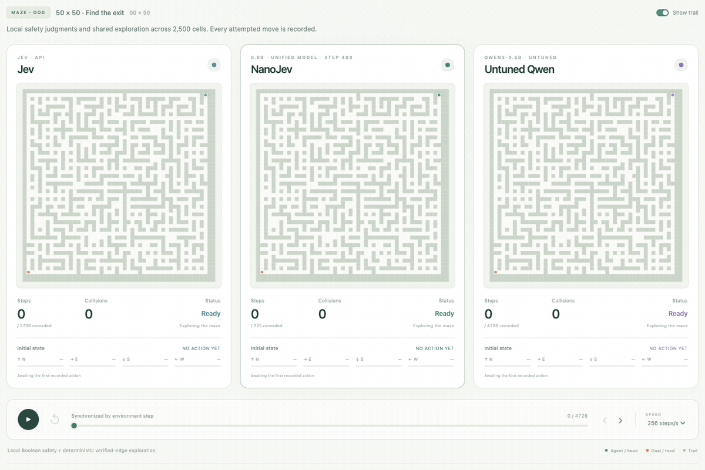 動態錄影</td>
</tr></table>

🔬 <b><a href="https://github.com/r-ms/mini-jev">r-ms/mini-jev</a></b> · ⭐61 · Python · 🔎 inferred · 47 天

##### 📝 摘要

mini-Jev：在凍結的 Qwen3-4B 上，Jev 風格型別化決策介面看起來是什麼樣子——讀取選項字母的 logits，而不是產生 JSON。預註冊實驗、結果、教學基準。

> 💡 最值得閱讀的獨立重現：它展示了讀取 logits 的機制可運作，也明確警告其讀出的占比不是校準機率。這項警告是此生態系中最重要的單一注意事項。

##### 📌 基本資訊

| 欄位 | 值                         |
| ---- | -------------------------- |
| 分類 | `開放重現、權重與架構研究` |
| 證據 | `inferred`                 |
| 語言 | Python                     |

##### 📊 資料

| 指標     | 值         |
| -------- | ---------- |
| Star 數  | **61**     |
| 最近推送 | 2026-09-18 |
| 首次收錄 | 2026-09-18 |

---

<table><tr><th align="center" width="50%">🖼 圖片</th><th align="center" width="50%">🎬 影片</th></tr><tr>
<td align="center" valign="top">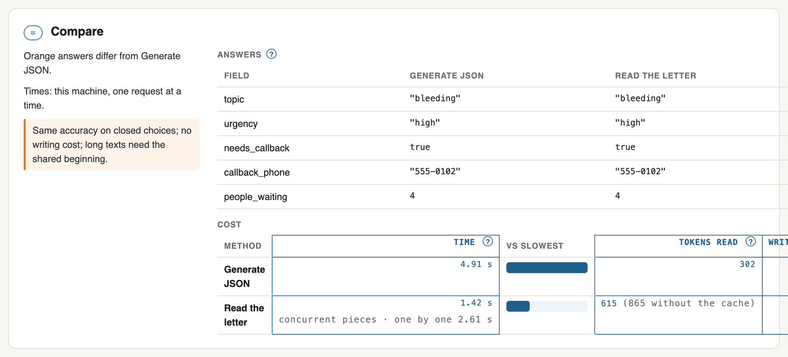</td>
<td align="center" valign="top">未發布媒體</td>
</tr></table>

🔬 <b><a href="https://github.com/FBddcz/embodied-jev">FBddcz/embodied-jev</a></b> · ⭐333 · Python · 👁️ observed · 43 天

##### 📝 摘要

EmbodiedJev：搭載 MiniCPM5-2B、Jev 並相容於模型 APIs 的 MuJoCo 機器人決策工作台

🔧 於程式碼中發現使用: `README.md`

##### 📌 基本資訊

| 欄位 | 值                         |
| ---- | -------------------------- |
| 分類 | `開放重現、權重與架構研究` |
| 證據 | `observed`                 |
| 語言 | Python                     |

##### 📊 資料

| 指標     | 值         |
| -------- | ---------- |
| Star 數  | **333**    |
| 最近推送 | 2026-09-22 |
| 首次收錄 | 2026-10-29 |

---

<table><tr><th align="center" width="50%">🖼 圖片</th><th align="center" width="50%">🎬 影片</th></tr><tr>
<td align="center" valign="top">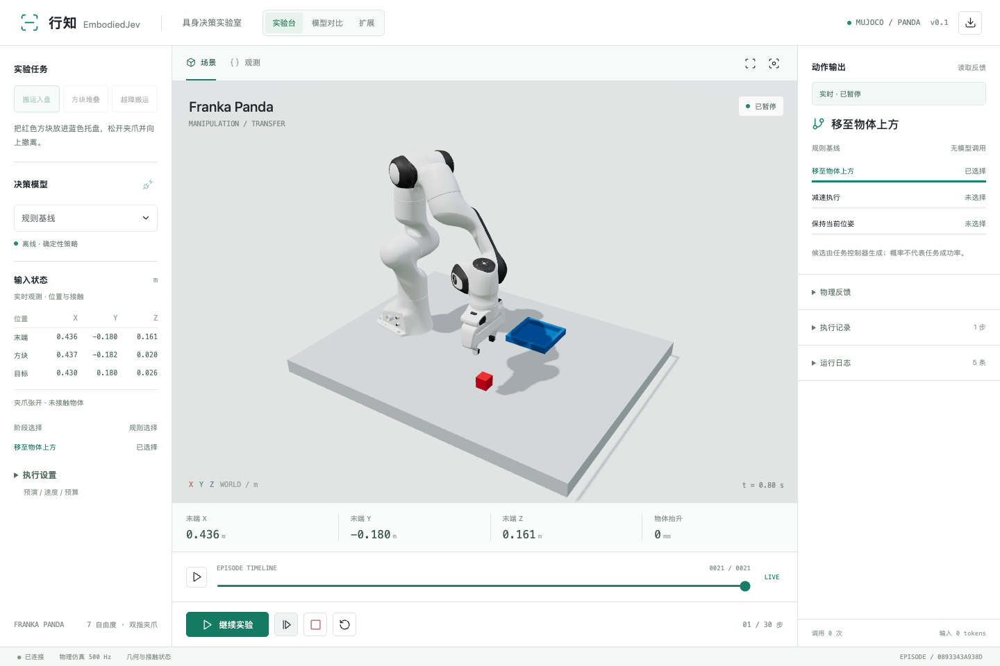</td>
<td align="center" valign="top">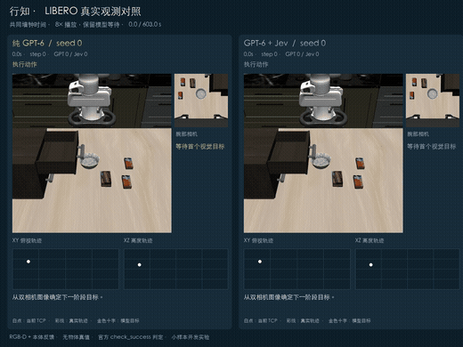 動態錄影 · <a href="https://raw.githubusercontent.com/FBddcz/embodied-jev/main/docs/media/libero-drawer-comparison.mp4">開啟影片</a></td>
</tr></table>

🔬 <b><a href="https://github.com/alvarobartt/sys1">alvarobartt/sys1</a></b> · ⭐59 · Rust · 👁️ observed · 0 天 · ⭐+1

##### 📝 摘要

極速、自託管的結構化決策，適用於開放模型，具備相容 TypeSafe AI 的 API，以 Rust 撰寫。

🔧 於程式碼中發現使用: `README.md`

##### 📌 基本資訊

| 欄位 | 值                         |
| ---- | -------------------------- |
| 分類 | `開放重現、權重與架構研究` |
| 證據 | `observed`                 |
| 語言 | Rust                       |

##### 📊 資料

| 指標     | 值          |
| -------- | ----------- |
| Star 數  | **59** (+1) |
| 最近推送 | 2026-11-04  |
| 首次收錄 | 2026-10-29  |

🏷 `clef` · `decision-model` · `decisions-api` · `huggingface` · `inference-server` · `jev` · `laya` · `self-hosted`

---

<table><tr><th align="center" width="50%">🖼 圖片</th><th align="center" width="50%">🎬 影片</th></tr><tr>
<td align="center" valign="top"></td>
<td align="center" valign="top">未發布媒體</td>
</tr></table>

🔬 <b><a href="https://github.com/PsiACE/dohnuts">PsiACE/dohnuts</a></b> · ⭐38 · Python · 👁️ observed · 29 天

##### 📝 摘要

Dohnuts 建構用於直接決策的小型多模態模型。-> System One 模型

##### 📌 基本資訊

| 欄位 | 值                         |
| ---- | -------------------------- |
| 分類 | `開放重現、權重與架構研究` |
| 證據 | `observed`                 |
| 語言 | Python                     |

##### 📊 資料

| 指標     | 值         |
| -------- | ---------- |
| Star 數  | **38**     |
| 最近推送 | 2026-10-06 |
| 首次收錄 | 2026-09-21 |

🏷 `decision-model` · `jev` · `laya` · `llm` · `lora` · `rlcd` · `system-one` · `typesafe`

---

<table><tr><th align="center" width="50%">🖼 圖片</th><th align="center" width="50%">🎬 影片</th></tr><tr>
<td align="center" valign="top"></td>
<td align="center" valign="top">未發布媒體</td>
</tr></table>

🔬 <b><a href="https://github.com/Endgame-Labs/understudy">Endgame-Labs/understudy</a></b> · ⭐6 · Rust · 👁️ observed · 2 天

##### 📝 摘要

A drop-in, CPU-only proxy for System One models (Jev, Rune, Clef). It learns each repeated question from the lead, then answers it itself.

##### 📌 基本資訊

| 欄位 | 值                         |
| ---- | -------------------------- |
| 分類 | `開放重現、權重與架構研究` |
| 證據 | `observed`                 |
| 語言 | Rust                       |

##### 📊 資料

| 指標     | 值         |
| -------- | ---------- |
| Star 數  | **6**      |
| 最近推送 | 2026-11-02 |
| 首次收錄 | 2026-11-03 |

🏷 `classification` · `cpu-inference` · `decision-model` · `distillation` · `llm` · `proxy` · `rust`

🔬 <b><a href="https://github.com/themusebook/clawd-jev-trading-machine">themusebook/clawd-jev-trading-machine</a></b> · ⭐1 · Python · 👁️ observed · 40 天

##### 📝 摘要

clawd-JEV-trading machine: JEV-on-Solana paper trader. TypeSafe jev-latest brain, dynamic action space, CoinGecko regime + Supermemory memory, Jupiter/DFlow venues. Dry-run only.

##### 📌 基本資訊

| 欄位 | 值                         |
| ---- | -------------------------- |
| 分類 | `開放重現、權重與架構研究` |
| 證據 | `observed`                 |
| 語言 | Python                     |

##### 📊 資料

| 指標     | 值         |
| -------- | ---------- |
| Star 數  | **1**      |
| 最近推送 | 2026-09-25 |
| 首次收錄 | 2026-11-01 |

🔬 <b><a href="https://github.com/BipinRajC/Jev-api-experiments">BipinRajC/Jev-api-experiments</a></b> · Python · 👁️ observed · 17 天

##### 📝 摘要

使用 RLCD 訓練的 TypeSafe Jev System One 模型之實證實驗與 API 研究

##### 📌 基本資訊

| 欄位 | 值                         |
| ---- | -------------------------- |
| 分類 | `開放重現、權重與架構研究` |
| 證據 | `observed`                 |
| 語言 | Python                     |

##### 📊 資料

| 指標     | 值         |
| -------- | ---------- |
| Star 數  | **0**      |
| 最近推送 | 2026-10-18 |
| 首次收錄 | 2026-09-22 |

🏷 `api` · `experimental` · `jev` · `rlcd` · `typesafe-ai`

🔬 <b><a href="https://huggingface.co/lysandre/JEV-27B-VL">lysandre/JEV-27B-VL</a></b> · model · 👁️ observed · 2 天

##### 📝 摘要

上游未發布說明。

##### 📌 基本資訊

| 欄位 | 值                         |
| ---- | -------------------------- |
| 分類 | `開放重現、權重與架構研究` |
| 證據 | `observed`                 |

##### 📊 資料

| 指標     | 值         |
| -------- | ---------- |
| 首次收錄 | 2026-11-02 |

🏷 `transformers` · `safetensors` · `qwen3_5` · `image-text-to-text` · `jev` · `system-one` · `system-two` · `typed-decisions`

🔬 <b><a href="https://huggingface.co/mradermacher/JEV-27B-VL-GGUF">mradermacher/JEV-27B-VL-GGUF</a></b> · model · 👁️ observed · 1 天

##### 📝 摘要

上游未發布說明。

##### 📌 基本資訊

| 欄位 | 值                         |
| ---- | -------------------------- |
| 分類 | `開放重現、權重與架構研究` |
| 證據 | `observed`                 |

##### 📊 資料

| 指標     | 值         |
| -------- | ---------- |
| 首次收錄 | 2026-11-04 |

🏷 `transformers` · `gguf` · `jev` · `system-one` · `system-two` · `typed-decisions` · `decision-model` · `calibrated-probabilities`

🔬 <b><a href="https://huggingface.co/stephenlb/system-one-model">stephenlb/system-one-model</a></b> · model · 👁️ observed · 34 天

##### 📝 摘要

上游未發布說明。

##### 📌 基本資訊

| 欄位 | 值                         |
| ---- | -------------------------- |
| 分類 | `開放重現、權重與架構研究` |
| 證據 | `observed`                 |

##### 📊 資料

| 指標     | 值         |
| -------- | ---------- |
| 首次收錄 | 2026-10-05 |

🏷 `transformers` · `safetensors` · `truetype_system_one` · `feature-extraction` · `custom_code` · `gemma4` · `typed-decisions` · `text-classification`

🔬 <b><a href="https://github.com/TheoLeeCJ/SemIf-OpenJev">TheoLeeCJ/SemIf-OpenJev</a></b> · ⭐4929 · Python · 🔎 inferred · 42 天 · ⭐+4

##### 📝 摘要

來自開放模型的語意 ifs，在家中的 3090 上執行。獨立；與 Jev 或 TypeSafe 無關。

##### 📌 基本資訊

| 欄位 | 值                         |
| ---- | -------------------------- |
| 分類 | `開放重現、權重與架構研究` |
| 證據 | `inferred`                 |
| 語言 | Python                     |

##### 📊 資料

| 指標     | 值            |
| -------- | ------------- |
| Star 數  | **4929** (+4) |
| 最近推送 | 2026-09-23    |
| 首次收錄 | 2026-10-29    |

---

<table><tr><th align="center" width="50%">🖼 圖片</th><th align="center" width="50%">🎬 影片</th></tr><tr>
<td align="center" valign="top">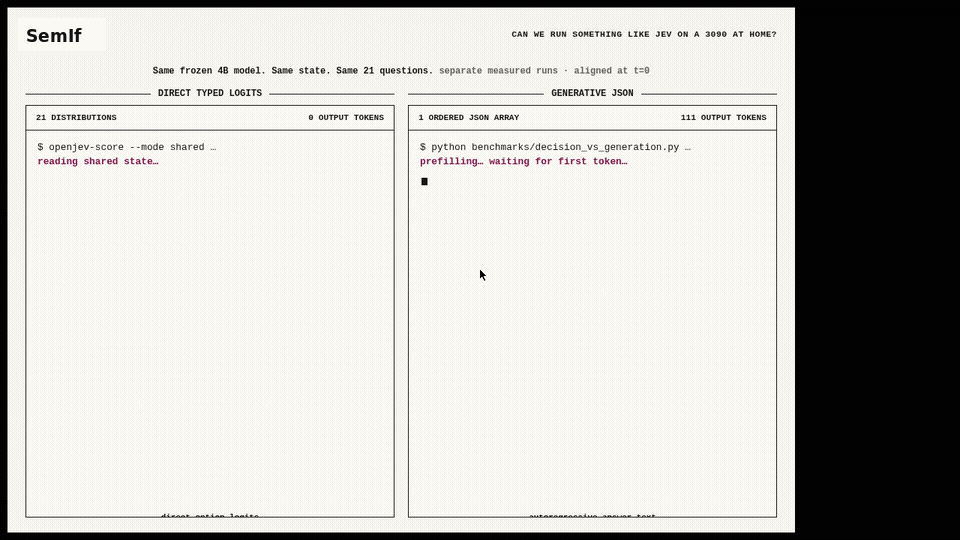</td>
<td align="center" valign="top"> 動態錄影</td>
</tr></table>

🔬 <b><a href="https://github.com/mode-io/vllm-jev">mode-io/vllm-jev</a></b> · ⭐943 · Python · 🔎 inferred · 13 天

##### 📝 摘要

為 Jev 決策模型提供原生 vLLM 服務

##### 📌 基本資訊

| 欄位 | 值                         |
| ---- | -------------------------- |
| 分類 | `開放重現、權重與架構研究` |
| 證據 | `inferred`                 |
| 語言 | Python                     |

##### 📊 資料

| 指標     | 值         |
| -------- | ---------- |
| Star 數  | **943**    |
| 最近推送 | 2026-10-22 |
| 首次收錄 | 2026-10-29 |

---

<table><tr><th align="center" width="50%">🖼 圖片</th><th align="center" width="50%">🎬 影片</th></tr><tr>
<td align="center" valign="top">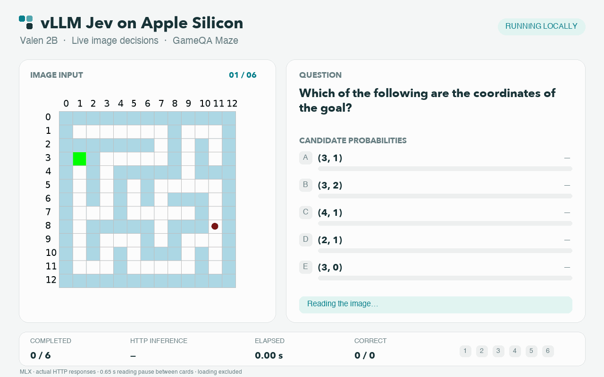</td>
<td align="center" valign="top">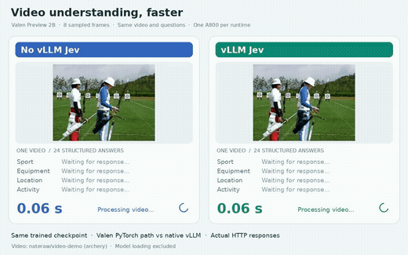 動態錄影 · <a href="https://raw.githubusercontent.com/mode-io/vllm-jev/main/docs/assets/valen-video-live.mp4">開啟影片</a></td>
</tr></table>

🔬 <b><a href="https://github.com/featherless-ai/simple-jev">featherless-ai/simple-jev</a></b> · ⭐644 · Python · 🔎 inferred · 28 天 · ⭐+2

##### 📝 摘要

將任何開放模型轉換為分類器/jev 端點

##### 📌 基本資訊

| 欄位 | 值                         |
| ---- | -------------------------- |
| 分類 | `開放重現、權重與架構研究` |
| 證據 | `inferred`                 |
| 語言 | Python                     |

##### 📊 資料

| 指標     | 值           |
| -------- | ------------ |
| Star 數  | **644** (+2) |
| 最近推送 | 2026-10-07   |
| 首次收錄 | 2026-10-29   |

---

<table><tr><th align="center" width="50%">🖼 圖片</th><th align="center" width="50%">🎬 影片</th></tr><tr>
<td align="center" valign="top"></td>
<td align="center" valign="top">未發布媒體</td>
</tr></table>

🔬 <b><a href="https://github.com/ekzhang/openjev-sglang">ekzhang/openjev-sglang</a></b> · ⭐334 · Python · 🔎 inferred · 34 天 · ⭐+1

##### 📝 摘要

基於開放模型的 Jev 相容 API 端點（僅預填）

> 💡 由開放模型提供服務的 Jev 相容端點，因此無需託管的 API 也能操作該介面。

##### 📌 基本資訊

| 欄位 | 值                         |
| ---- | -------------------------- |
| 分類 | `開放重現、權重與架構研究` |
| 證據 | `inferred`                 |
| 語言 | Python                     |

##### 📊 資料

| 指標     | 值           |
| -------- | ------------ |
| Star 數  | **334** (+1) |
| 最近推送 | 2026-10-01   |
| 首次收錄 | 2026-10-29   |

🏷 `jev` · `llm` · `structured-generation` · `systemone`

---

<table><tr><th align="center" width="50%">🖼 圖片</th><th align="center" width="50%">🎬 影片</th></tr><tr>
<td align="center" valign="top"></td>
<td align="center" valign="top"> 動態錄影</td>
</tr></table>

由於上游未宣告再散布授權，資源直接連結至上游儲存庫。

🔬 <b><a href="https://github.com/tomerglick57/Jevstiller">tomerglick57/Jevstiller</a></b> · ⭐72 · Python · 🔎 inferred · 3 天

##### 📝 摘要

將重複的 Jev 分類任務即時萃取成一個本機模型 — 相同答案，使用你的硬體。

##### 📌 基本資訊

| 欄位 | 值                         |
| ---- | -------------------------- |
| 分類 | `開放重現、權重與架構研究` |
| 證據 | `inferred`                 |
| 語言 | Python                     |

##### 📊 資料

| 指標     | 值         |
| -------- | ---------- |
| Star 數  | **72**     |
| 最近推送 | 2026-11-01 |
| 首次收錄 | 2026-10-29 |

🏷 `classification` · `distillation` · `jev` · `knowledge-distillation` · `llm` · `mlops` · `model-cascade` · `python`

---

<table><tr><th align="center" width="50%">🖼 圖片</th><th align="center" width="50%">🎬 影片</th></tr><tr>
<td align="center" valign="top">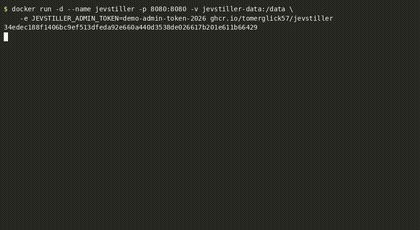</td>
<td align="center" valign="top">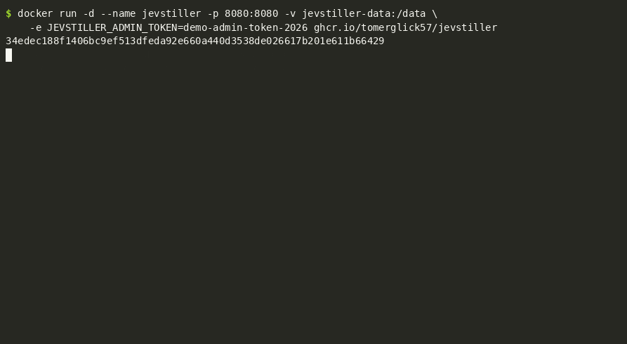 動態錄影</td>
</tr></table>

🔬 <b><a href="https://github.com/OpenLAIR/lev">OpenLAIR/lev</a></b> · ⭐25 · Python · 🔎 inferred · 17 天

##### 📝 摘要

Lev: Thinking Fast and Deep with Looped Decision Models. One checkpoint, multiple depths: System 1.5 decision models that think in loops, not tokens.

##### 📌 基本資訊

| 欄位 | 值                         |
| ---- | -------------------------- |
| 分類 | `開放重現、權重與架構研究` |
| 證據 | `inferred`                 |
| 語言 | Python                     |

##### 📊 資料

| 指標     | 值         |
| -------- | ---------- |
| Star 數  | **25**     |
| 最近推送 | 2026-10-19 |
| 首次收錄 | 2026-11-03 |

🏷 `adaptive-computation` · `adaptive-depth` · `decision-models` · `early-exit` · `huggingface` · `jev` · `jev-api` · `jev-model`

---

<table><tr><th align="center" width="50%">🖼 圖片</th><th align="center" width="50%">🎬 影片</th></tr><tr>
<td align="center" valign="top">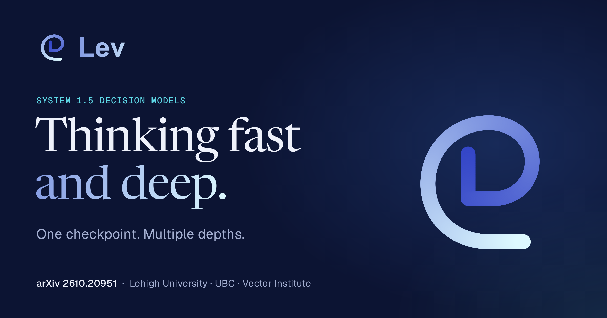</td>
<td align="center" valign="top">未發布媒體</td>
</tr></table>

<b>本分類更多項目</b> · 44

- [wfzyx/von](https://github.com/wfzyx/von) - 開源的 System One 決策模型。低於 15ms、非自回歸、可在本機直接替換 TypeSafe Jev.
- [hyperspaceai/jevcache](https://github.com/hyperspaceai/jevcache) - 適用於 TypeSafe Jev 類模型的決策快取 — 將決策記憶化，使重複決策免費、具確定性且可共用。單一 2 MB 二進位檔.
- [mars-tw/jev-trading-command-center](https://github.com/mars-tw/jev-trading-command-center) - Open-source paper-trading research app integrating TypeSafe Jev, animated 3D…
- [mattt/AnyDecisionModel](https://github.com/mattt/AnyDecisionModel) - A Swift package for typed decisions from language models。
- [hunkim/solar-mini4-jev](https://github.com/hunkim/solar-mini4-jev)
- [amithgc/local-jev](https://github.com/amithgc/local-jev) - 一個本地、離線的 System One 伺服器，相容於 TypeSafe 的 Jev API。它使用小型開放模型回答型別化的是/否、類別與評分問題.
- [whyashthakker/awesome-jev-use-cases](https://github.com/whyashthakker/awesome-jev-use-cases) - Jev 使用案例的精選清單。與 GPT 模型（LLMs）在成本與速度方面進行比較.
- [ljwwwiop/JEV-mini](https://github.com/ljwwwiop/JEV-mini) - JEV-mini is a minimal learning project to train a fast decision-making model.
- [pCwOrM/werr](https://github.com/pCwOrM/werr) - Zero-memory System-1 decision engine &amp; TypeSafe Jev runtime powered by…
- [skydiving94/klint](https://github.com/skydiving94/klint) - 適用於本機開放權重 kev 和遠端 System One（/v1/systemone）模型的宣告式語意 linter 與架構程式碼稽核器.
- [yuting-ai/minicpm5-2b-jev](https://github.com/yuting-ai/minicpm5-2b-jev) - MiniCPM5-2B-Jev: High-Speed System 1 Decision Model。
- [0utKast/Jev_AI](https://github.com/0utKast/Jev_AI) - Curso completo, cuadernos Google Colab y guía bibliográfica sobre Jev。
- [Frank-Funney/mini-jev](https://github.com/Frank-Funney/mini-jev) - A super lightweight structured decision engine for edge devices.
- [welcomeenjoy75-hue/mini-jev](https://github.com/welcomeenjoy75-hue/mini-jev) - A super lightweight structured decision engine for edge devicea。
- [AbdelStark/reachy-jev](https://github.com/AbdelStark/reachy-jev) - Typed Jev decision primitives for Reachy Mini applications.
- [AnilDeshpande/jev-youtube-demo](https://github.com/AnilDeshpande/jev-youtube-demo) - Jev (TypeSafe) vs GPT-4o-mini: classifying YouTube comments with a Judgement…
- [Dlmily/minimind-jev-dlmily](https://github.com/Dlmily/minimind-jev-dlmily) - MiniMind Jev probability scoring page (GitHub Pages)。
- [Drykeeightyeight427/jev-robot-control](https://github.com/Drykeeightyeight427/jev-robot-control) - Compare GPT-6 Astra, GPT-4.1 mini, and Jev controlling an xArm7 in MuJoCo via…
- [emilesilvis/jev-experiment](https://github.com/emilesilvis/jev-experiment) - Reproducible Jev and GPT-4o mini classification experiments, findings, and…
- [gbesse/jev-minimis-watch](https://github.com/gbesse/jev-minimis-watch) - Prépare la revue des cumuls d。
- [gryszzz/jev-paper](https://github.com/gryszzz/jev-paper) - JEV Solana memecoin PAPER-trading PWA (no real money)。
- [harlanljones/jev-roster-shapes](https://github.com/harlanljones/jev-roster-shapes) - Interactive workspace for comparing baseball roster acquisitions — positional…
- [jobakk/jev-cj-asap](https://github.com/jobakk/jev-cj-asap) - Comparative judgment of ASAP essays by Jev (a decision-model API), gpt-oss-20b…
- [khs0927/jev-browser-control-plane](https://github.com/khs0927/jev-browser-control-plane) - Official Jev control plane using jev-ultrafast, browser-harness, and minimal…
- [lawrence3699/Jev-Style-0.8B-Decision-v3-MLX](https://github.com/lawrence3699/Jev-Style-0.8B-Decision-v3-MLX) - GitHub mirror of the chaoliangUNSW/Jev-Style-0.8B-Decision-v3-MLX Hugging Face…
- [lawrence3699/Jev-Style-2B-Decision-v3-MLX](https://github.com/lawrence3699/Jev-Style-2B-Decision-v3-MLX) - GitHub mirror of the chaoliangUNSW/Jev-Style-2B-Decision-v3-MLX Hugging Face…
- [lawrence3699/Jev-Style-2B-Decision-v4-MLX](https://github.com/lawrence3699/Jev-Style-2B-Decision-v4-MLX) - GitHub mirror of the chaoliangUNSW/Jev-Style-2B-Decision-v4-MLX Hugging Face…
- [lawrence3699/Jev-Style-Qwen3.5-2B-Decision-MLX-bf16](https://github.com/lawrence3699/Jev-Style-Qwen3.5-2B-Decision-MLX-bf16) - GitHub mirror of the chaoliangUNSW/Jev-Style-Qwen3.5-2B-Decision-MLX-bf16…
- [lawrence3699/Jev-Style-Qwen3.5-2B-Decision-v2-MLX-bf16](https://github.com/lawrence3699/Jev-Style-Qwen3.5-2B-Decision-v2-MLX-bf16) - GitHub mirror of the chaoliangUNSW/Jev-Style-Qwen3.5-2B-Decision-v2-MLX-bf16…
- [lawrence3699/MacJev-322M-4K-Laya-MLX](https://github.com/lawrence3699/MacJev-322M-4K-Laya-MLX) - GitHub mirror of the chaoliangUNSW/MacJev-322M-4K-Laya-MLX Hugging Face model。
- [luckberonne/mini-jev](https://github.com/luckberonne/mini-jev) - Clasificador de comandos de shell de una sola pasada。
- [MarwaneAit-mouloud/reachy-jev](https://github.com/MarwaneAit-mouloud/reachy-jev) - Reachy Mini contrôle les commandes : modèles de décision (Jev, OpenAI) contre…
- [taegi-hong/jev-researchmate-local](https://github.com/taegi-hong/jev-researchmate-local) - JEV 벤처 스튜디오 Stage 4 자동 생성 풀스택 MVP - 로컬에서 논문 요약 및 반론 생성, 연구 효율 극대화.
- [u007/minicpm5-jev](https://github.com/u007/minicpm5-jev) - MiniCPM5-2B-8bit as a Jev-compatible typed-decision service on Apple Silicon…
- [Van5hdeep/mini-jev](https://github.com/Van5hdeep/mini-jev) - a simple model trained on inspiration of jev。
- [vicfei/minimind-jev](https://github.com/vicfei/minimind-jev) - Train your own tiny Jev (System One decision model) — v0.1: frozen Chinese…
- [wangjunxiao/MiniJev](https://github.com/wangjunxiao/MiniJev) - A lightweight and easy-to-follow implementation of Jev.
- [yo4e/JevPip](https://github.com/yo4e/JevPip) - GMOのFX/BTC市場データに対応したローカル市場研究ターミナル。ライブチャート、ペーパートレード、バックテスト、安全監督、TypeSafe Jev連携.
- [imikerussell/beebots](https://github.com/imikerussell/beebots) - OKX 上的三隻 AI 交易蜜蜂，每個決策都由 Jev 做出。預設為模擬交易。非財務建議.
- [apiplant/laya-rs](https://github.com/apiplant/laya-rs) - Laya 的 Rust 重新實作，這是一個低於 35ms 的非自回歸 typed-decision 引擎。
- [Astro-Han/decision-head-rlcd](https://github.com/Astro-Han/decision-head-rlcd) - 決策模型的泛化能力從何而來？Qwen3.5-4B 上的 RLCD，按訓練資料覆蓋率分組的保留集合、JevBench 與三個外部套件.
- [smixs/jevchik](https://github.com/smixs/jevchik) - Telegram bot for group chats: karma for useful messages, anti-spam for…
- [vicksiyi/qwen-2.5-1b-rlcd](https://github.com/vicksiyi/qwen-2.5-1b-rlcd) - 衍生自 harshatheg/Qwen-2.5-1B-RLCD、在 Hugging Face 上執行的本機 MLX 決策機率示範。
- [yangshun2005/laya-cn](https://github.com/yangshun2005/laya-cn) - \[中文化\] 多語言、非自回歸的 System 1 決策引擎。使用 RLCD 訓練，透過一次前向傳播（33 ms）對 100 多種語言作出具型別決策.

## 應用程式、遊戲、機器人與互動示範

遊戲、機器人、瀏覽器與儀表板。正是示範讓延遲與成本的說法變得可讀。

🎮 <b><a href="https://github.com/heyjunpenn/awesome-jev">heyjunpenn/awesome-jev</a></b> · ⭐1055 · Astro · 👁️ observed · 17 天

##### 📝 摘要

A verified, community-maintained catalog of 992 open-source projects built with Jev.

🔧 於程式碼中發現使用: `README.md`, `CHANGELOG.md`, `README.ko.md`, `README.es.md`

##### 📌 基本資訊

| 欄位 | 值                                 |
| ---- | ---------------------------------- |
| 分類 | `應用程式、遊戲、機器人與互動示範` |
| 證據 | `observed`                         |
| 語言 | Astro                              |

##### 📊 資料

| 指標     | 值         |
| -------- | ---------- |
| Star 數  | **1055**   |
| 最近推送 | 2026-10-19 |
| 首次收錄 | 2026-10-29 |

🏷 `astro` · `awesome` · `awesome-jev` · `awesome-list` · `jev` · `typesafe`

🎮 <b><a href="https://github.com/superagents-lab/jev-search">superagents-lab/jev-search</a></b> · ⭐552 · TypeScript · 👁️ observed · 14 天 · ⭐-1

##### 📝 摘要

使用 TypeSafe 的 Jev 搜尋網路：來源選擇、查詢理解與相關性排序。使用 Search1API 建置。

🔧 於程式碼中發現使用: `README.md`

##### 📌 基本資訊

| 欄位 | 值                                 |
| ---- | ---------------------------------- |
| 分類 | `應用程式、遊戲、機器人與互動示範` |
| 證據 | `observed`                         |
| 語言 | TypeScript                         |

##### 📊 資料

| 指標     | 值           |
| -------- | ------------ |
| Star 數  | **552** (-1) |
| 最近推送 | 2026-10-21   |
| 首次收錄 | 2026-10-29   |

---

<table><tr><th align="center" width="50%">🖼 圖片</th><th align="center" width="50%">🎬 影片</th></tr><tr>
<td align="center" valign="top"></td>
<td align="center" valign="top">未發布媒體</td>
</tr></table>

🎮 <b><a href="https://github.com/MCG-NJU/VideoJev">MCG-NJU/VideoJev</a></b> · ⭐290 · Python · 👁️ observed · 17 天

##### 📝 摘要

VideoJev：用於影片理解與互動的System One Model

##### 📌 基本資訊

| 欄位 | 值                                 |
| ---- | ---------------------------------- |
| 分類 | `應用程式、遊戲、機器人與互動示範` |
| 證據 | `observed`                         |
| 語言 | Python                             |

##### 📊 資料

| 指標     | 值         |
| -------- | ---------- |
| Star 數  | **290**    |
| 最近推送 | 2026-10-18 |
| 首次收錄 | 2026-10-28 |

---

<table><tr><th align="center" width="50%">🖼 圖片</th><th align="center" width="50%">🎬 影片</th></tr><tr>
<td align="center" valign="top">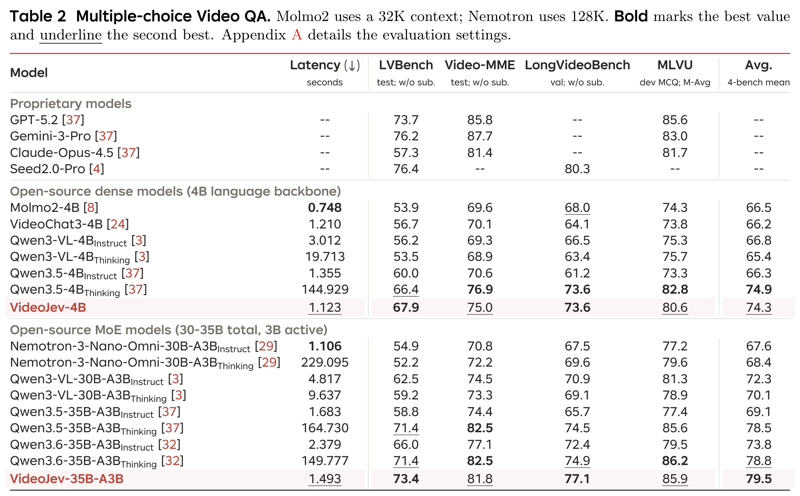</td>
<td align="center" valign="top">未發布媒體</td>
</tr></table>

🎮 <b><a href="https://github.com/mrnugget/jev-shell-history">mrnugget/jev-shell-history</a></b> · ⭐119 · TypeScript · 👁️ observed · 47 天

##### 📝 摘要

以 Fish 風格提供的 zsh 歷史記錄自動建議，依 Jev（TypeSafe）排序

🔧 於程式碼中發現使用: `README.md`

##### 📌 基本資訊

| 欄位 | 值                                 |
| ---- | ---------------------------------- |
| 分類 | `應用程式、遊戲、機器人與互動示範` |
| 證據 | `observed`                         |
| 語言 | TypeScript                         |

##### 📊 資料

| 指標     | 值         |
| -------- | ---------- |
| Star 數  | **119**    |
| 最近推送 | 2026-09-18 |
| 首次收錄 | 2026-10-29 |

---

<table><tr><th align="center" width="50%">🖼 圖片</th><th align="center" width="50%">🎬 影片</th></tr><tr>
<td align="center" valign="top"></td>
<td align="center" valign="top"> 動態錄影</td>
</tr></table>

由於上游未宣告再散布授權，資源直接連結至上游儲存庫。

🎮 <b><a href="https://github.com/realZachi/typesafe-adblock">realZachi/typesafe-adblock</a></b> · ⭐94 · JavaScript · 👁️ observed · 48 天

##### 📝 摘要

🧹 趣味專案：一個 Chrome 擴充功能，會詢問小型 AI 決策模型（TypeSafe Jev）「這個 DOM 元素是廣告嗎？」並將其從頁面移除。BYOK、無後端，並非真正的廣告攔截器。

🔧 於程式碼中發現使用: `README.md`

##### 📌 基本資訊

| 欄位 | 值                                 |
| ---- | ---------------------------------- |
| 分類 | `應用程式、遊戲、機器人與互動示範` |
| 證據 | `observed`                         |
| 語言 | JavaScript                         |

##### 📊 資料

| 指標     | 值         |
| -------- | ---------- |
| Star 數  | **94**     |
| 最近推送 | 2026-09-17 |
| 首次收錄 | 2026-10-29 |

🎮 <b><a href="https://github.com/zadescoxp/Jev-Trades">zadescoxp/Jev-Trades</a></b> · ⭐59 · Python · 👁️ observed · 40 天

##### 📝 摘要

使用全新 TypeSafe AI 首個名為 Jev 的 system one 模型的交易機器人

##### 📌 基本資訊

| 欄位 | 值                                 |
| ---- | ---------------------------------- |
| 分類 | `應用程式、遊戲、機器人與互動示範` |
| 證據 | `observed`                         |
| 語言 | Python                             |

##### 📊 資料

| 指標     | 值         |
| -------- | ---------- |
| Star 數  | **59**     |
| 最近推送 | 2026-09-25 |
| 首次收錄 | 2026-10-21 |

🏷 `automated-testing` · `backtesting` · `crypto-trading-bot-latest` · `trading-bot-ai-automated`

---

<table><tr><th align="center" width="50%">🖼 圖片</th><th align="center" width="50%">🎬 影片</th></tr><tr>
<td align="center" valign="top">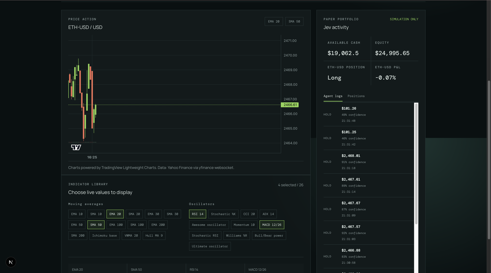</td>
<td align="center" valign="top">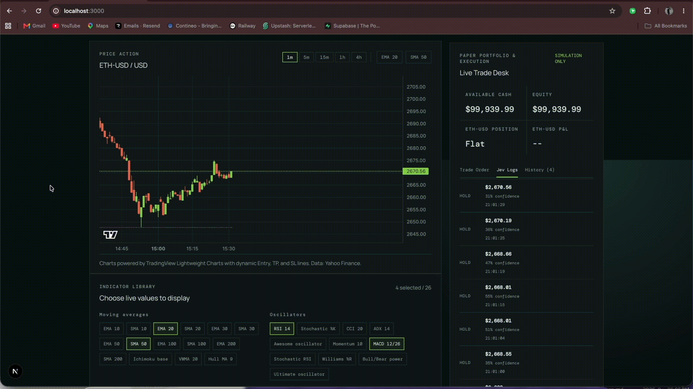 動態錄影</td>
</tr></table>

🎮 <b><a href="https://github.com/dfinke/Jev">dfinke/Jev</a></b> · ⭐11 · PowerShell · 👁️ observed · 19 天

##### 📝 摘要

使用 TypeSafe AI 的 Jev 模型進行 PowerShell 決策：https://typesafe.ai/blog/introducing-system-one-models-and-jev

##### 📌 基本資訊

| 欄位 | 值                                 |
| ---- | ---------------------------------- |
| 分類 | `應用程式、遊戲、機器人與互動示範` |
| 證據 | `observed`                         |
| 語言 | PowerShell                         |

##### 📊 資料

| 指標     | 值         |
| -------- | ---------- |
| Star 數  | **11**     |
| 最近推送 | 2026-10-16 |
| 首次收錄 | 2026-10-28 |

---

<table><tr><th align="center" width="50%">🖼 圖片</th><th align="center" width="50%">🎬 影片</th></tr><tr>
<td align="center" valign="top"></td>
<td align="center" valign="top">未發布媒體</td>
</tr></table>

🎮 <b><a href="https://github.com/chris-wozniczek/jev-voice-control">chris-wozniczek/jev-voice-control</a></b> · ⭐7 · Swift · 👁️ observed · 44 天

##### 📝 摘要

用語音控制 Mac。語音 → Jev（TypeSafe AI System One 模型）類型化決策 → macOS 動作。選單列 Swift 應用程式。

##### 📌 基本資訊

| 欄位 | 值                                 |
| ---- | ---------------------------------- |
| 分類 | `應用程式、遊戲、機器人與互動示範` |
| 證據 | `observed`                         |
| 語言 | Swift                              |

##### 📊 資料

| 指標     | 值         |
| -------- | ---------- |
| Star 數  | **7**      |
| 最近推送 | 2026-09-21 |
| 首次收錄 | 2026-10-28 |

🏷 `computer-use` · `cua` · `jev` · `jev-ai` · `jev-api` · `jev-model` · `voice` · `voice-recognition`

🎮 <b><a href="https://github.com/Omrigotlieb/awesome-jev">Omrigotlieb/awesome-jev</a></b> · ⭐1 · Python · 👁️ observed · 0 天

##### 📝 摘要

經驗證且充滿螢幕截圖的優質清單，列出建構於 Jev 之上的專案——TypeSafe AI 的 System One 具型別決策模型

##### 📌 基本資訊

| 欄位 | 值                                 |
| ---- | ---------------------------------- |
| 分類 | `應用程式、遊戲、機器人與互動示範` |
| 證據 | `observed`                         |
| 語言 | Python                             |

##### 📊 資料

| 指標     | 值         |
| -------- | ---------- |
| Star 數  | **1**      |
| 最近推送 | 2026-11-04 |
| 首次收錄 | 2026-09-21 |

🎮 <b><a href="https://github.com/Amr-devman/systemone-robotics">Amr-devman/systemone-robotics</a></b> · 👁️ observed · 9 天

##### 📝 摘要

Control a robotic arm using systemone models

##### 📌 基本資訊

| 欄位 | 值                                 |
| ---- | ---------------------------------- |
| 分類 | `應用程式、遊戲、機器人與互動示範` |
| 證據 | `observed`                         |

##### 📊 資料

| 指標     | 值         |
| -------- | ---------- |
| Star 數  | **0**      |
| 最近推送 | 2026-10-26 |
| 首次收錄 | 2026-10-27 |

🎮 <b><a href="https://github.com/Anshul261/SystemOne_Demos">Anshul261/SystemOne_Demos</a></b> · Python · 👁️ observed · 6 天

##### 📝 摘要

Using Jev/SystemOne Models to build use cases

##### 📌 基本資訊

| 欄位 | 值                                 |
| ---- | ---------------------------------- |
| 分類 | `應用程式、遊戲、機器人與互動示範` |
| 證據 | `observed`                         |
| 語言 | Python                             |

##### 📊 資料

| 指標     | 值         |
| -------- | ---------- |
| Star 數  | **0**      |
| 最近推送 | 2026-10-29 |
| 首次收錄 | 2026-10-26 |

🎮 <b><a href="https://github.com/bobbylite/jev-system-one-model-primitives">bobbylite/jev-system-one-model-primitives</a></b> · TypeScript · 👁️ observed · 26 天

##### 📝 摘要

Basic sample app to demonstrate primitive types for system one models like TypeSafe's latest Jev decision model

##### 📌 基本資訊

| 欄位 | 值                                 |
| ---- | ---------------------------------- |
| 分類 | `應用程式、遊戲、機器人與互動示範` |
| 證據 | `observed`                         |
| 語言 | TypeScript                         |

##### 📊 資料

| 指標     | 值         |
| -------- | ---------- |
| Star 數  | **0**      |
| 最近推送 | 2026-10-09 |
| 首次收錄 | 2026-11-01 |

🎮 <b><a href="https://github.com/Shivam-Jha96/gsp">Shivam-Jha96/gsp</a></b> · Python · 👁️ observed · 0 天

##### 📝 摘要

由 AI 驅動的宏觀情緒分析終端，即時讀取數千則突發全球金融新聞事件，並在無伺服器 GPU 上使用自訂的 Contrastive-LM System-One 模型評分其市場影響！

##### 📌 基本資訊

| 欄位 | 值                                 |
| ---- | ---------------------------------- |
| 分類 | `應用程式、遊戲、機器人與互動示範` |
| 證據 | `observed`                         |
| 語言 | Python                             |

##### 📊 資料

| 指標     | 值         |
| -------- | ---------- |
| Star 數  | **0**      |
| 最近推送 | 2026-11-04 |
| 首次收錄 | 2026-10-26 |

🏷 `artificial-intelligence-algorithms` · `finance-dashboard` · `stock-analysis` · `stock-market` · `stock-prediction`

---

<table><tr><th align="center" width="50%">🖼 圖片</th><th align="center" width="50%">🎬 影片</th></tr><tr>
<td align="center" valign="top"></td>
<td align="center" valign="top">未發布媒體</td>
</tr></table>

由於上游未宣告再散布授權，資源直接連結至上游儲存庫。

🎮 <b><a href="https://x.com/tspy/status/2100864234523685146">Xtags — X intent labeller</a></b> · @tspy · 👁️ observed · 47 天

##### 📝 摘要

Xtags: a Chrome extension that labels each post in an X timeline with what it is trying to get from you — inducement, provocation, promotion, machine-generated, persuasion, entertainment, information — drawn as a tag plus a probability right after the timestamp. A side panel reports session counts (seen, judged, correct) and cumulative token cost. The author reports near-instant responses and usable accuracy before any tuning.

➡️ **Original project (manifoldor/xtags)** — [https://github.com/manifoldor/xtags](https://github.com/manifoldor/xtags)

> 💡 Worth reading as a latency argument rather than an accuracy one: labelling a timeline only works if the decision costs less than the scroll, which is the constraint a generative model cannot meet.

##### 📌 基本資訊

| 欄位   | 值                                   |
| ------ | ------------------------------------ |
| 分類   | `應用程式、遊戲、機器人與互動示範`   |
| 證據   | `observed`                           |
| 擁有者 | [yishan](https://x.com/tspy) · @tspy |

##### 📊 資料

| 指標     | 值         |
| -------- | ---------- |
| 瀏覽     | **9873**   |
| 按讚數   | 24         |
| 留言數   | 11         |
| 發佈     | 2026-09-18 |
| 首次收錄 | 2026-09-18 |

🏷 `x`

---

<table><tr><th align="center" width="50%">🖼 圖片</th><th align="center" width="50%">🎬 影片</th></tr><tr>
<td align="center" valign="top"></td>
<td align="center" valign="top"> 動態錄影 · <a href="https://video.twimg.com/amplify_video/2100858340331200512/vid/avc1/1242x720/ex2FF5-TerVxo9xX.mp4">開啟影片</a></td>
</tr></table>

🎮 <b><a href="https://github.com/Valen-Team/Valen">Valen-Team/Valen</a></b> · ⭐900 · Python · 🔎 inferred · 0 天 · ⭐-1

##### 📝 摘要

Open, lightweight multimodal decision models for text, images, and video. Train and run them yourself.

##### 📌 基本資訊

| 欄位 | 值                                 |
| ---- | ---------------------------------- |
| 分類 | `應用程式、遊戲、機器人與互動示範` |
| 證據 | `inferred`                         |
| 語言 | Python                             |

##### 📊 資料

| 指標     | 值           |
| -------- | ------------ |
| Star 數  | **900** (-1) |
| 最近推送 | 2026-11-04   |
| 首次收錄 | 2026-10-29   |

🏷 `decision-model` · `jev` · `system-one` · `typed-decisions`

---

<table><tr><th align="center" width="50%">🖼 圖片</th><th align="center" width="50%">🎬 影片</th></tr><tr>
<td align="center" valign="top">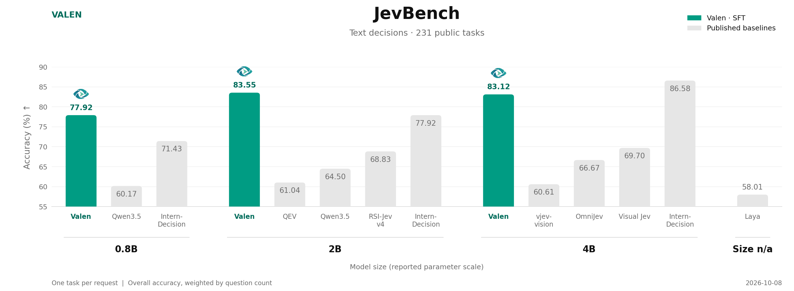</td>
<td align="center" valign="top"> 動態錄影</td>
</tr></table>

🎮 <b><a href="https://github.com/jkudish/jev-browser">jkudish/jev-browser</a></b> · ⭐367 · JavaScript · 🔎 inferred · 6 天

##### 📝 摘要

使用 Typesafe 的 Jev 模型操作瀏覽器

##### 📌 基本資訊

| 欄位 | 值                                 |
| ---- | ---------------------------------- |
| 分類 | `應用程式、遊戲、機器人與互動示範` |
| 證據 | `inferred`                         |
| 語言 | JavaScript                         |

##### 📊 資料

| 指標     | 值         |
| -------- | ---------- |
| Star 數  | **367**    |
| 最近推送 | 2026-10-30 |
| 首次收錄 | 2026-10-29 |

---

<table><tr><th align="center" width="50%">🖼 圖片</th><th align="center" width="50%">🎬 影片</th></tr><tr>
<td align="center" valign="top"></td>
<td align="center" valign="top"> 動態錄影 · <a href="https://raw.githubusercontent.com/jkudish/jev-browser/main/assets/github-demo.mp4">開啟影片</a></td>
</tr></table>

🎮 <b><a href="https://github.com/hr98w/jev-visual">hr98w/jev-visual</a></b> · ⭐327 · Python · 🔎 inferred · 44 天

##### 📝 摘要

Apple Silicon 上類似 Jev 的教育性視覺推論實驗：共享上下文、直接候選評分，以及本機視覺示範。

##### 📌 基本資訊

| 欄位 | 值                                 |
| ---- | ---------------------------------- |
| 分類 | `應用程式、遊戲、機器人與互動示範` |
| 證據 | `inferred`                         |
| 語言 | Python                             |

##### 📊 資料

| 指標     | 值         |
| -------- | ---------- |
| Star 數  | **327**    |
| 最近推送 | 2026-09-21 |
| 首次收錄 | 2026-10-29 |

---

<table><tr><th align="center" width="50%">🖼 圖片</th><th align="center" width="50%">🎬 影片</th></tr><tr>
<td align="center" valign="top">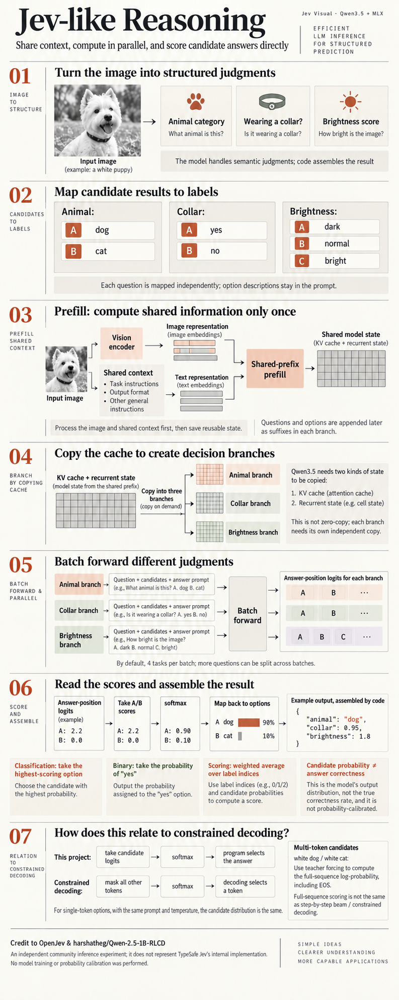</td>
<td align="center" valign="top">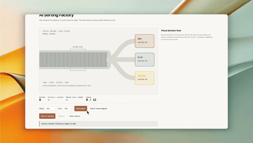 動態錄影 · <a href="https://github.com/user-attachments/assets/c87c09d8-30d2-4392-b981-d0b5cf1879ae">開啟影片</a></td>
</tr></table>

🎮 <b><a href="https://github.com/aowang-ai/jev-trade">aowang-ai/jev-trade</a></b> · ⭐225 · TypeScript · 🔎 inferred · 44 天

##### 📝 摘要

Hyperliquid 上的即時 Jev 交易者

##### 📌 基本資訊

| 欄位 | 值                                 |
| ---- | ---------------------------------- |
| 分類 | `應用程式、遊戲、機器人與互動示範` |
| 證據 | `inferred`                         |
| 語言 | TypeScript                         |

##### 📊 資料

| 指標     | 值         |
| -------- | ---------- |
| Star 數  | **225**    |
| 最近推送 | 2026-09-21 |
| 首次收錄 | 2026-10-29 |

🏷 `hyperliquid` · `jev` · `quantitative-finance` · `typesafe`

---

<table><tr><th align="center" width="50%">🖼 圖片</th><th align="center" width="50%">🎬 影片</th></tr><tr>
<td align="center" valign="top"></td>
<td align="center" valign="top">未發布媒體</td>
</tr></table>

由於上游未宣告再散布授權，資源直接連結至上游儲存庫。

<b>本分類更多項目</b> · 28

- [maxlbchung/system-one-harness](https://github.com/maxlbchung/system-one-harness) - A computer use harness for system one models。
- [jarrodwatts/jev-trader](https://github.com/jarrodwatts/jev-trader) - 每個 Monad 區塊進行一次 AI 交易決策。在 Kuru MON-USDC 上使用 Jev.
- [droidrun/mobile-jev](https://github.com/droidrun/mobile-jev)
- [moritzkremb/jev-voice-browser](https://github.com/moritzkremb/jev-voice-browser) - 透過語音控制真實瀏覽器。Jev（TypeSafe System One）在每個口語單字約 300 毫秒內決定意圖與目標；Playwright…
- [kevinbadi/jev-voice](https://github.com/kevinbadi/jev-voice) - 與你的 Mac 對話。本機 whisper.cpp + 每個命令一次 Jev（TypeSafe）呼叫 + macOS 自動化.
- [NanmiCoder/jev-arena](https://github.com/NanmiCoder/jev-arena) - Jev 模型介紹與實測：透過 Choice / Score / Noul 將自然語言轉為帶型別的判斷與機率，用於分類、評分和路由；支援與 DeepSeek…
- [BudEcosystem/Bud-Decision-Studio](https://github.com/BudEcosystem/Bud-Decision-Studio) - Bud Decision studio 是一款易於使用的跨平台桌面應用程式與服務系統，可在本機執行類似 Jev 的模型.
- [buer2233/jev-ui-test](https://github.com/buer2233/jev-ui-test) - 由 Jev 決策模型驅動的 UI 自動化測試框架：不生成「下一步做什麼」的文字，而是在候選元素中直接評分；一句話撰寫測試案例，pytest 執行，Allure…
- [bilune/jev-design](https://github.com/bilune/jev-design) - 模型能設計儀表板嗎？一個整套設計系統都由 Jev 根據一句話簡述於執行階段生成的主控台.
- [emrickgarrett/OneVOneJev](https://github.com/emrickgarrett/OneVOneJev) - 1v1 Jev quickscope 競技場——Three.js + TypeSafe System One。
- [justinhe16/trade-jev](https://github.com/justinhe16/trade-jev) - Backtest Jev (TypeSafe) as a BUY/SELL/HOLD trader on NQ L10 order-book data。
- [Tommylegen/jev-laya-toolkit](https://github.com/Tommylegen/jev-laya-toolkit) - Dashboard and local proxy for SystemOne decision models - Jev (TypeSafe API)…
- [wizicer/jev_info_site](https://github.com/wizicer/jev_info_site) - Community index of tools, models, and real-world use cases built on Jev.
- [harsha89/jev-demo](https://github.com/harsha89/jev-demo) - 展示 TypeSafe JEV 對電子郵件進行分類：垃圾郵件（noul）、類別（choice）與緊急程度（score）——Next.js + MUI…
- [PistachioAIHQ/jev-synergy-screening](https://github.com/PistachioAIHQ/jev-synergy-screening) - Jev（TypeSafe System One）× ASReview SYNERGY 摘要篩選示範——Choice/Noul 與黃金標籤比較。
- [Tatuck/jev-boe-demo](https://github.com/Tatuck/jev-boe-demo) - Daily demo applying TypeSafe&#x27;s Jev model to Spain&#x27;s official gazette (BOE).
- [dgarridou/KaLM-Jev](https://github.com/dgarridou/KaLM-Jev) - Run efficient local Choice, Score, and Noul services with KaLM-Reranker-V1-R2…
- [arkulinskis/jev-buddy](https://github.com/arkulinskis/jev-buddy) - Jev Buddy: the developer guide to Jev, the AI decision model。
- [BrendanH18/jev-lab](https://github.com/BrendanH18/jev-lab) - Six small apps and a workbench that show what TypeSafe。
- [charles-forsyth/jev-decision-wall](https://github.com/charles-forsyth/jev-decision-wall) - Type anything. 200 yes/no AI judgments light up as a live heatmap in ~200 ms…
- [giuliano1101/jev-fast](https://github.com/giuliano1101/jev-fast) - Jev browser execution MVP with bounded actions, durable auditing, and real…
- [liangkingjin/jev-demo](https://github.com/liangkingjin/jev-demo) - Jev（TypeSafe System One）判定模型演示：Choice / Noul / Score 三原语 + 三档阈值分流，离线可跑。
- [mberliner/jev-lab](https://github.com/mberliner/jev-lab) - Laboratorio progresivo para aprender y demostrar Jev, el modelo de decisión…
- [neurogabo/jev-arena](https://github.com/neurogabo/jev-arena) - Run a Pokémon Champions battle arena locally with Jev, TypeSafe, and Pokémon…
- [project-blockwarriors/dreamweaver-jev-starter](https://github.com/project-blockwarriors/dreamweaver-jev-starter) - Jev-powered reference bot for BlockWarriors Dreamweaver: asynchronous tactics…
- [Sandesh-S-Dalvi/playwright-jev-demo](https://github.com/Sandesh-S-Dalvi/playwright-jev-demo) - Playwright + TypeSafe Jev (System One) decision-map demo for semantic test…
- [shmulc8/jev-game-lab](https://github.com/shmulc8/jev-game-lab) - Recorded JEV Snake and Tetris experiments, code baselines, and static replay…
- [sorrycc/typesafe-snake](https://github.com/sorrycc/typesafe-snake) - 由 TypeSafe 的 Jev 模型自動遊玩的 Snake：每個 tick 做出一個 System One 選擇，合法走法與事實由程式碼產生。

## 文章、討論與同類清單

發布討論串、獨立報導以及本領域的其他精選清單。本儲存庫並非唯一，明說這一點比假裝不是更有用。

📰 <b><a href="https://docs.typesafe.ai/model-jaggedness/jev-1.13">9 類已知缺陷（jaggedness）</a></b> · ✅ official · 48 天

##### 📝 摘要

字面理解、**計數不可靠**、日期比較、多級間接、無關細節大 state、對抗內容、指令與 criteria 矛盾、結構性不變量、生成。官方建議「拆成原子問題在程式碼裡組合」。

> 💡 **能力邊界**——這是廠商自認的邊界清單，已完整收錄

##### 📌 基本資訊

| 欄位 | 值                     |
| ---- | ---------------------- |
| 分類 | `文章、討論與同類清單` |
| 證據 | `official`             |

##### 📊 資料

| 指標     | 值         |
| -------- | ---------- |
| 首次收錄 | 2026-09-20 |

📰 <b><a href="https://docs.typesafe.ai/cookbooks/consistency_choice_cookbook">`consistency_choice` cookbook 正式回答了「重複呼叫結果會改變」</a></b> · ✅ official · 48 天

##### 📝 摘要

同一審核 rubric、**8 個 Choice × 每個條件重複 15 次**。TypeSafe **raw agree 90.8%**（8 題中有 2 題翻轉，但 **conflicts=0**——翻轉只發生在「具體標籤 ↔ uncertain」之間）。**加上一條 abstention 規則（使用 `probabilities` 要求 top probability ≥ 0.60，否則由 `uncertain` 轉人工）後一致率升至 99.2%**，automatic 74.2%，**不增加模型呼叫**。對照：Haiku t=0 100%、Opus 4.8 reasoning 92.5%、gpt-5.4-mini t=0 99.2%。官方聲明：這不會使模型變得確定；這些數字代表的是**重複性而非正確性**；0.60 是示例策略，生產環境閾值要使用帶標籤樣本與成本來決定。

> 💡 **\[DEFINITION-CHANGE\]** 回寫了 B5、關鍵數字表、SKILL.md 鐵律 3 與上線第 6 項、適用性邊界第 6 項——**本庫此前把「非確定性」記為風險，現改為官方的正解：用 abstention 管理它**

##### 📌 基本資訊

| 欄位 | 值                     |
| ---- | ---------------------- |
| 分類 | `文章、討論與同類清單` |
| 證據 | `official`             |

##### 📊 資料

| 指標     | 值         |
| -------- | ---------- |
| 首次收錄 | 2026-09-20 |

📰 <b><a href="https://docs.typesafe.ai/confidence">confidence 的官方語義確認</a></b> · ✅ official · 48 天

##### 📝 摘要

官方明說 `confidence` 是**從 `probabilities` 分布算出的統計量**，分布越集中就越確定；**Noul 不帶 confidence**；官方明說「你沒有被鎖死在我們的定義上」；閾值應「從保守值開始，在你自己的資料上測試」。

> 💡 與 Archer 的逆向公式一致，寫入定義檔案

##### 📌 基本資訊

| 欄位 | 值                     |
| ---- | ---------------------- |
| 分類 | `文章、討論與同類清單` |
| 證據 | `official`             |

##### 📊 資料

| 指標     | 值         |
| -------- | ---------- |
| 首次收錄 | 2026-09-20 |

📰 <b><a href="https://www.langchain.com/blog/building-a-harness-with-jev（2026-09-17">LangChain 官方博文解釋了「為什麼 agent 防護欄類別爆發」—，Sydney Runkle &amp; Hunter Lovell）</a></b> · ✅ official

##### 📝 摘要

*「像 claude、codex、cursor 這類 Coding harnesses 已經推出某種方式來分類危險動作……**直到現在，這個分類器步驟一直被鎖在 harness 的閉源部分。現在既然有了便宜且高效能的分類器模型，我們就能採用相同模式，將它應用到所有 agents！**」*；並給出 router 範例（使用 Jev 依自訂標準選擇模型，機率保留在 agent state 中）與 *「Jev 不是 LLM 的 drop-in replacement」*。

> 💡 **解釋了本庫觀察到的「護欄用品化」現象**——這是因閉源 harness 特性被開源化；已寫入片段庫 §2.5

##### 📌 基本資訊

| 欄位 | 值                     |
| ---- | ---------------------- |
| 分類 | `文章、討論與同類清單` |
| 證據 | `official`             |

##### 📊 資料

| 指標     | 值         |
| -------- | ---------- |
| 首次收錄 | 2026-09-20 |

📰 <b><a href="https://typesafe.ai/team">TypeSafe 新增 Team 頁面 + 導覽新增 `Enterprise` 入口（產品化／商業化訊號）</a></b> · ✅ official · 47 天

##### 📝 摘要

TypeSafe 新增 Team 頁面 + 導覽新增 `Enterprise` 入口（產品化／商業化訊號）

> 💡 **\[DEFINITION-CHANGE\]**（團隊事實 + 產品化訊號）；`01-系统定义/jev-系统定义.md` 新增 **§6b/6c**；`references/README.md` 快速事實卡更新

##### 📌 基本資訊

| 欄位 | 值                     |
| ---- | ---------------------- |
| 分類 | `文章、討論與同類清單` |
| 證據 | `official`             |

##### 📊 資料

| 指標     | 值         |
| -------- | ---------- |
| 首次收錄 | 2026-09-20 |

📰 <b><a href="https://vercel.com/changelog/typesafe-ai-jev-now-available-on-ai-gateway">Vercel 官方 changelog 宣布 Jev 上架 AI Gateway</a></b> · ✅ official

##### 📝 摘要

Vercel 官方 changelog 宣布 Jev 上架 AI Gateway

> 💡 片段庫 Vercel 行補上 **AI SDK 用法**（真正的增量）；**關鍵數字表無需修改**（數字已有）→ **本輪定義層級變更降級為「否」**

##### 📌 基本資訊

| 欄位 | 值                     |
| ---- | ---------------------- |
| 分類 | `文章、討論與同類清單` |
| 證據 | `official`             |

##### 📊 資料

| 指標     | 值         |
| -------- | ---------- |
| 首次收錄 | 2026-09-20 |

📰 <b><a href="https://docs.typesafe.ai/llms.txt">發現並擷取 18 篇官方 cookbook 實戰配方（此前完全缺失）</a></b> · ✅ official · 48 天

##### 📝 摘要

`llms.txt` 全站 111 頁；本地原有 30 頁，diff 後發現 `cookbooks/` 下有 **18 篇配方**（含可執行程式碼、真實資料集、實測數字）。逐篇擷取並加入 `type: official-cookbook` frontmatter。

> 💡 新建 `03-能力边界/jev-官方cookbook配方.md` 索引頁；**這是「從原理走到生產」的那一層**

##### 📌 基本資訊

| 欄位 | 值                     |
| ---- | ---------------------- |
| 分類 | `文章、討論與同類清單` |
| 證據 | `official`             |

##### 📊 資料

| 指標     | 值         |
| -------- | ---------- |
| 首次收錄 | 2026-09-20 |

📰 <b><a href="https://github.com/typesafe-ai/skills（⭐128">安裝官方 agent skill `typesafe-ai` —，MIT）</a></b> · ✅ official · 48 天

##### 📝 摘要

`npx -y skills@latest add typesafe-ai/skills -s typesafe-ai -g -a '*' --copy -y` → 安裝到 `~/.agents/skills/typesafe-ai/`（單檔案 SKILL.md，149 行／10 KB，涵蓋 79 個 agent）。安全評估：Gen=Safe、Socket=0 alerts、Snyk=Low Risk。唯一失敗項目是 Eve（不支援全域安裝，無影響）。

> 💡 與我們的 `jev` skill **並存互補**

##### 📌 基本資訊

| 欄位 | 值                     |
| ---- | ---------------------- |
| 分類 | `文章、討論與同類清單` |
| 證據 | `official`             |

##### 📊 資料

| 指標     | 值         |
| -------- | ---------- |
| 首次收錄 | 2026-09-20 |

📰 <b><a href="https://docs.typesafe.ai/llms.txt`">官方文件 diff 再次驗證有效 — `</a></b> · ✅ official

##### 📝 摘要

本輪 diff 未發現新增頁面（30 篇 + 18 cookbook 已齊）；說明採集器的 diff 邏輯正確。

> 💡 保留為每輪固定步驟

##### 📌 基本資訊

| 欄位 | 值                     |
| ---- | ---------------------- |
| 分類 | `文章、討論與同類清單` |
| 證據 | `official`             |

##### 📊 資料

| 指標     | 值         |
| -------- | ---------- |
| 首次收錄 | 2026-09-20 |

📰 <b><a href="https://docs.typesafe.ai/models">官方文件索引與限流／上下文／自訂政策全部核實</a></b> · ✅ official · 48 天

##### 📝 摘要

端點 `POST https://api.typesafe.ai/v1/systemone`；`jev-1.13.0`，別名 `jev-latest`/`jev-preview`；每次請求 64k、state+最長問題 32k；限流 250k tok/s、1200 req/min 且**動態調整**；僅文字輸入；Choice≤255、Score 2–10 檔；**不進行 fine-tune、所有帳號共用同一套權重**；不使用客戶資料訓練；英語最準。

> 💡 **架構／能力邊界**——寫入 `01-系统定义/jev-系统定义.md` 與 `jev-能力与边界-准确定义.md`

##### 📌 基本資訊

| 欄位 | 值                     |
| ---- | ---------------------- |
| 分類 | `文章、討論與同類清單` |
| 證據 | `official`             |

##### 📊 資料

| 指標     | 值         |
| -------- | ---------- |
| 首次收錄 | 2026-09-20 |

📰 <b><a href="https://docs.typesafe.ai/migrating-to-v1">補齊官方缺失頁面：遷移至 v1 API</a></b> · ✅ official · 48 天

##### 📝 摘要

preview 端點 `/preview/evaluation` → 穩定版 **`POST /v1/systemone`**；`prompts` 陣列 → `questions` map；`responses` 陣列 → `answers` map；欄位改名 **`probability`→`noul`、`chosen`→`choice`、`expectation`→`score`**；choice 機率由陣列變為 map；**score 機率為 v1 新增**；驗證方式不變。

> 💡 收錄 `官方文档快照/migrating-to-v1.md`；這也提供了**第二種官方頁面發現管道**（官方 skill 的文件路由表）

##### 📌 基本資訊

| 欄位 | 值                     |
| ---- | ---------------------- |
| 分類 | `文章、討論與同類清單` |
| 證據 | `official`             |

##### 📊 資料

| 指標     | 值         |
| -------- | ---------- |
| 首次收錄 | 2026-09-20 |

📰 <b><a href="https://github.com/yibie/awesome-jev">yibie/awesome-jev</a></b> · ⭐2539 · Python · 👁️ observed · 5 天 · ⭐+2

##### 📝 摘要

以 Jev 建置的公開專案、整合與討論精選清單——TypeSafe AI 用於具型別決策的 System One 模型。

##### 📌 基本資訊

| 欄位 | 值                     |
| ---- | ---------------------- |
| 分類 | `文章、討論與同類清單` |
| 證據 | `observed`             |
| 語言 | Python                 |

##### 📊 資料

| 指標     | 值            |
| -------- | ------------- |
| Star 數  | **2539** (+2) |
| 最近推送 | 2026-10-31    |
| 首次收錄 | 2026-09-18    |

🏷 `awesome` · `awesome-list` · `jev` · `llm`

<b>本分類更多項目</b> · 68

- [cobanov/awesome-jev](https://github.com/cobanov/awesome-jev) - 以 Jev 建置的、經精選且有來源依據的專案清單；TypeSafe AI 用於具型別決策的 System One 模型.
- [Typesafe AI raises $870M at $7.5B](https://news.ycombinator.com/item?id=50023450)
- [We’re releasing Jev 1.14.0 along with experimental features for dreamers](https://news.ycombinator.com/item?id=50095353)
- [hellogumbo/awesome-jev](https://github.com/hellogumbo/awesome-jev) - 建立在 Jev、TypeSafe AI 的 System One 模型之上的專案社群目錄.
- [Open-sourced jev architecture last year with model,paper and dataset](https://news.ycombinator.com/item?id=49736660) - 現在大家都在談論這種架構——它不是自回歸式的，並且能使用 json schema 以極快速度進行機率預測.
- [Show HN: Jev Cards, Can you beat a vision model at a picture quiz?](https://news.ycombinator.com/item?id=50167617) - I built a quiz game around TypeSafe&amp;#x27;s new Jev model, which has vision…
- [What Is RLCD? The Secret Behind Jev](https://news.ycombinator.com/item?id=49829625)
- [Document Review with Unsiloed and TypeSafe Jev](https://news.ycombinator.com/item?id=50068443)
- [aliaihub/awesome-jev-usecases](https://github.com/aliaihub/awesome-jev-usecases) - 使用 Jev、TypeSafe AI 的 System One 模型進行建置時，以證據為依據的使用案例、模式與指南。每項主張均有標籤並附上來源.
- [TypeSafe started the decision-model category;OpenAI and AWS did it in 3 weeks](https://news.ycombinator.com/item?id=50003920)
- [jtnkminimal/awesome-jev](https://github.com/jtnkminimal/awesome-jev) - A curated projects built with Jev, TypeSafe。
- [Show HN: Fastbrowse, Browser agent that picks clicks with a System One model](https://news.ycombinator.com/item?id=50311029) - Hi HN, I&amp;#x27;m Furqan founder of Nebula.
- [Show HN: jev-bisect – Find answers with Jev via bisection search](https://news.ycombinator.com/item?id=50010094) - ! pip install jev-bisect ! export…
- [Show HN: Nouli – A multi-turn decision graph harness for System One models](https://news.ycombinator.com/item?id=50288442) - I&amp;#x27;ve been fine tuning my own decision models lately and I&amp;#x27;ve been…
- [Ask HN: Everyone was Jev-maxxing. Why not CDMs now?](https://news.ycombinator.com/item?id=50242523) - Just a few weeks ago, all that my feed had was people JEV-maxxing.
- [Ask HN: System One models for autonomous agents](https://news.ycombinator.com/item?id=50142037) - I&amp;#x27;ve seen a few impressive demos of Typesafe&amp;#x27;s new paradigm with…
- [Building Barista: Postgres, Embeddings, and Jev](https://news.ycombinator.com/item?id=50372564)
- [Jeyzma is TypeSafeAI minus $850M plus Go/TinyGo/llama.cpp in the browser](https://news.ycombinator.com/item?id=50031093)
- [Building a System One Model for Prompt Injection](https://news.ycombinator.com/item?id=50165645)
- [JEV: Type Safe AI](https://news.ycombinator.com/item?id=50106296)
- [Show HN: Decide – Jev decisions in the shell, scripts, and agent skills](https://news.ycombinator.com/item?id=49878492) - 所有軟體都會做決策。程式碼處理確定性的決策。像 Jev 這樣的決策模型處理判斷型決策。決策模型接收上下文和具有固定選項集的問題，並回傳帶有校準機率的答案.
- [Show HN: We Beat TypeSafe Jev and Released Open-Source Decision Model](https://news.ycombinator.com/item?id=50027132)
- [The Hitchhiker's Guide to System One Models](https://news.ycombinator.com/item?id=50301027)
- [Typesafe.ai Jev Open Source Alternative Qwen-2.5-1B-RLCD](https://news.ycombinator.com/item?id=49734345)
- [ozers/jevsome-projects](https://github.com/ozers/jevsome-projects) - 能以可證明方式呼叫 Jev、TypeSafe AI 的 System One 模型的開源專案。每個項目都連結至能證明這一點的程式碼行。每日更新.
- [RadRebelSam/awesome-jev](https://github.com/RadRebelSam/awesome-jev) - 由爬蟲維護、列出建構於 Jev、TypeSafe AI 的 System One 模型之上的專案目錄。每日 GitHub + npm 掃描，由人工合併.
- [rhc98/awesome-jev](https://github.com/rhc98/awesome-jev) - 建構於 Jev（TypeSafe AI 的 System One 模型）之上的專案，由 Jev 自身策劃.
- [108 条声明对照：Jev 的校准并不独特（含作者自我修正）](https://truestandard.ai/blog/jev-accuracy-tested) - 108 條聲明對照：Jev 的校準並不獨特（含作者自我修正）。
- [\[cellcog.ai 追踪页\]() 自称分层记录 *"claims / concedes / measured / found, dated"* → 与本库锚页设计意图一致，值得长期对照](https://cellcog.ai/blog/jev-typesafe-decision-model) - \[cellcog.ai 追蹤頁\]() 自稱分層記錄 *「claims / concedes / measured / found, dated」* →…
- [\`calibre\`：独立标定实验证明"阈值参数不跨数据集迁移"](https://github.com/FirasSX914/calibre) - 在兩個帶標籤資料集（**Banking77** 與 **Web of Science**）上獨立測量 Jev 校準，**協議在產出結果前凍結**，原始…
- [\`classifier.dev\`：建在 Jev 上的免费零样本分类服务（含 agent skill）](https://classifier.dev) - **無 API key、無帳號**的零樣本分類 HTTP 服務；提供 `openapi.json`（OpenAPI 3.1）與…
- [\`clownware/bouncer\` 提供目前最硬的第三方独立标定数据](https://github.com/clownware/bouncer) - 6 個問題的準確率／Brier／分桶可靠度：Brier **0.036–0.149**；高信心分桶（0.9–1.0）多為 100%。
- [\`Jev Judge vs Dimension Scores\`：分解不总是更好（含日语多语证据）](https://agentjournal.dev/blog/llm-judge-vs-feature-extraction/) - 在三個分類任務上比較「每題一個直接 Jev 問題」與「12–14 個評分維度 + 本機擬合權重」；**5,477 筆測試列、3,410 萬個輸入…
- [\`jevcal\`：最小样本经验值 \< 约 100 条不可信；并多做两件我们没做的事](https://github.com/abhixhek/jevcal) - 在自有帶標籤資料上擬合每個問題的信心閾值 → 以留出集驗證 → **估算回退流量** → **在 CI 中複查已鎖定的閾值**.
- [\`kaijia323/dsh-plugin-jev\`：DeepSeek Harness 的 Jev 插件（与本库同环境）](https://github.com/kaijia323/dsh-plugin-jev) - 把 Jev 接進 DSH，**註冊原生工具 `jev_decide`**。
- [corolin/vibrato](https://github.com/corolin/vibrato) - A complete System One model for emotion — emotion reading as typed decisions。
- [New：\[InfoWorld（2026-09-17）\]() —— 企业媒体视角，用例清单：*"which tool to invoke, which action to take next, whether a request should be approved, when a task…](https://www.infoworld.com/article/4223468/typesafe-ais-new-models-work-with-machines-not-humans.html) - New：\[InfoWorld（2026-09-17）\]() —— 企業媒體視角，用例清單：*。
- [OOD 校准审计："Jev 知道自己不知道吗？"](https://github.com/scienthoon/jev-ood-calibration)
- [X 上一条新描述口径](https://x.com/testingcatalog/status/2099968075861008781) - 把 Jev 描述為 *&quot;a small and customizable System One decision model&quot;*，並明確 *。
- [X： \[@omarsar0\]()（Elvis Saravia, DAIR.AI）独立表述了本库的「铁律 1」](https://x.com/omarsar0/status/2099933100440494105) - *。
- [X：\[@heyDhavall\]() 的简洁概括（*"why make software wait for an LLM to generate paragraphs when it really just needs decisions?"*）](https://x.com/heyDhavall/status/2099926342095798783) - X：\[@heyDhavall\]() 的簡潔概括。
- [X：拿到本库最具体的单次成本数字 — \[@moritzkremb\]()](https://x.com/moritzkremb) - *。
- [主 HN 帖规模](https://news.ycombinator.com/item?id=49717558) - **1862 points**；評論裡正面為主（doom demo 酷、態度好），有一條被廣泛引用的猜測。
- [先例清单：\[ibl.ai\]() 指出 CriticGPT 与 Prometheus 2 都在 2024 年就做"判断模型" → 写进优先权争议页 §4d，与 Laya 的指称分开记；本库判断 Jev 与它们的真实差异是"把判断做成带类型与概率的一等 API"](https://ibl.ai/blog/jev-judge-model-evaluation-not-generation-enterprise) - 先例清單：\[ibl.ai\]() 指出 CriticGPT 與 Prometheus 2 都在 2024 年就做&quot;判斷模型&quot; → 寫進優先權爭議頁…
- [创始人第二段"原始初衷"（比第一段更锋利）：Diogo Almeida 经 \[Pat McGuinness Substack\]() 转引](https://patmcguinness.substack.com/p/jev-makes-fast-and-cheap-decisions) - 創辦人第二段&quot;原始初衷&quot;（比第一段更銳利）：Diogo Almeida 經 \[Pat McGuinness Substack\]() 轉引。
- [又一份"本地 vs 托管"选型实录：\[astgl.com\]()（James Cruce，09-22）—— 421M 开源模型在其 frozen replay 上胜过自制路由；他最终不选 Jev 是因为约束（数据不出本机、可控回退），并主动限定*"whether Laya beats Jev…](https://astgl.com/p/local-laya-vs-hosted-jev-typed-decisions) - 又一份&quot;本地 vs 託管&quot;選型實錄：\[astgl.com\]()（James Cruce，09-22）—— 421M 開源模型在其 frozen…
- [发现与本库做同一件事的 agent skill：\`decision-first\`](https://github.com/harrymunro/decision-first) - *。
- [发现社区维护的完整索引 \`AbdelStark/awesome-typesafe\`（ 103）](https://github.com/AbdelStark/awesome-typesafe) - 把我們此前零散收集的生態補成一張完整的圖，結構為「官方資源 / 用戶端與整合 / agent 與開發者工具 / 瀏覽器 agent / 遊戲機器人與互動…
- [四条精准告诫（已写入 IO 契约 §S8） —— \[Wavect 独立评测\]()：](https://wavect.io/blog/jev-ai-decision-model-review) - 四條精準告誡（已寫入 IO 契約 §S8） —— \[Wavect 獨立評測\]()：。
- [新用例：上下文压缩（LiteLLM 的 TypeSafe 护栏）](https://github.com/BerriAI/litellm) - `litellm/types/proxy/guardrails/guardrail_hooks/typesafe.py` 實作了 **compaction…
- [独立第三方与我们的术语纪律收敛：\[HarnessRouter（2026-09-20）\]()](https://harnessrouter.ai/blog/what-is-a-system-one-model) - 獨立第三方與我們的術語紀律收斂：\[HarnessRouter（2026-09-20）\]()。
- [生态跨过一条线：出现 Jev-HTTP-API 兼容的开源服务端](https://github.com/ekzhang/openjev-sglang（⭐**123**）) - *。
- [第 11 份独立评测：克罗地亚语零样本 vs 自己微调的 BERT（\[Senko Rašić\]()，09-22）](https://blog.senko.net/analyzing-jev-a-new-ai-model) - 第 11 份獨立評測：克羅埃西亞語零樣本 vs 自己微調的 BERT（\[Senko Rašić\]()，09-22）。
- [第 12 份独立评测：注入鲁棒性系统测试《Can Jev be jailbroken?》（\[tanh.xyz\]()，14,495 次记录调用，原始记录公开）](https://tanh.xyz/research-notes/jev-prompt-manipulation) - 第 12 份獨立評測：注入強健性系統測試《Can Jev be jailbroken?》（\[tanh.xyz\]()，14,495 次記錄呼叫，原始記錄公開）。
- [第 9 份独立评测：\[@juanmacias《Testing TypeSafe's Jev - Legal Corpus》\]()](https://x.com/i/article/2100463318209048850) - 第 9 份獨立評測：\。
- [第三方 SDK 覆盖主流服务端语言：HN \`Show HN: Typesafe Java SDK (Unofficial)\`（\[item 49762324\]()）](https://news.ycombinator.com/item?id=49762324) - 加上此前的 Go / Rust（×3）/ Elixir / Ruby（×3）/ .NET / Rails，**第三方 SDK 已覆蓋主流伺服器端語言**。
- [第三方深度解读补充大量可操作实测](https://flaviocopes.com/jev) - ① **Noul 的 0.5 不等於&quot;中等&quot;**，意味模型分不出來；② **Score 不是測量**，不要在檔位間插值。
- [第三方独立实测：Classmethod / DevelopersIO](https://dev.classmethod.jp/en/articles/jev-for-llm-model-routing/) - 40 次呼叫全成功、10/10 分類正確；median **0.643–0.674…
- [第三方独立实测：Vercel 生产集成（最重要产业证据）](https://x.com/rauchg/status/2100307962262872105) - fx 預設 auto 模式的 safety reviewer 原跑 GPT Luna，換 Jev 後 **p95 快 18× 且更準**；。
- [财经媒体的独立表态：\[TechStock²《…Its 445× Cost Claim Is Still Self-Tested》\]()（2026-09-17）：*"…leaves the biggest performance numbers dependent on TypeSafe's…](https://ts2.tech/en/typesafe-ai-raises-40-million-for-jev-but-its-445x-cost-claim-is-still-self-tested/) - 財經媒體的獨立表態：\。
- [闭环信号：Archer 那篇文章上了 HN —— \`Jev's Architecture Unmasked\`（\[item 49766351\]()，1pt）](https://news.ycombinator.com/item?id=49766351) - 閉環訊號：Archer 那篇文章上了 HN —— `Jev。
- [首个上市公司级集成：\[Aurora Mobile（NASDAQ: JG）的 GPTBots.ai 集成 Jev\]()（09-22）→ *"two-layer AI architecture: one layer that thinks, one layer that…](https://markets.businessinsider.com/news/stocks/aurora-mobile-s-gptbots-ai-integrates-jev-two-layers-of-ai-one-enterprise-platform-1036563338) - 首個上市公司級整合：\[Aurora Mobile（NASDAQ: JG）的 GPTBots.ai 整合 Jev\]()（09-22）→…
- [首份关于 Jev 概率的强反证：\`jev-does-not-play-dice\`](https://github.com/KantaHayashiAI/jev-does-not-play-dice) - **Jev 報出的機率反映「模型有多確定」，不反映「世界有多隨機」**。實測——公平六面骰 Choice：參考 16.7%、**Jev 報…
- [AppitStudio/awesome-jev](https://github.com/AppitStudio/awesome-jev) - 精選的 Jev 資源與可執行範例，適用於型別化 AI 決策.
- [onlyoasis/awesome-jev-cases](https://github.com/onlyoasis/awesome-jev-cases) - Source-linked Jev use cases, open-source projects, and official cookbooks。
- [samTime101/Jev-emoji-reactor](https://github.com/samTime101/Jev-emoji-reactor) - integrated latest decision making model jev to classify emoji reading the…
- [新的优先权主张（与 Laya 无关）：HN \`I built the Jev architecture one year ago and open-sourced it\`（2pts）→ \[r/LocalLLaMA 帖\]()；本轮只登记 URL 与主张，未读原文、不下判断，下一轮核实](https://www.reddit.com/r/LocalLLaMA/comments/1wijo3e/i_literally_built_the_jev_architecture_one_year/) - 新的優先權主張（與 Laya 無關）：HN `I built the Jev architecture one year ago and…
- [X 社区：发布日官方账号被钓鱼](https://commondefense.ai/blog/typesafe-x-account-phished) - @typesafeai 在發布日 11:17am 發布後，5:43pm 被 CEO 報告被盜，5:54pm 確認釣魚，11:49pm 奪回。

## 其他專案

🧩 <b><a href="https://github.com/Contrastive-LM/CLM">Contrastive-LM/CLM</a></b> · ⭐3160 · Python · 👁️ observed · 30 天 · ⭐+5

##### 📝 摘要

對比語言模型（CLMs）是一類新的 System One 模型，以連結狀態與動作的對比學習目標進行訓練。

##### 📌 基本資訊

| 欄位 | 值         |
| ---- | ---------- |
| 分類 | `其他專案` |
| 證據 | `observed` |
| 語言 | Python     |

##### 📊 資料

| 指標     | 值            |
| -------- | ------------- |
| Star 數  | **3160** (+5) |
| 最近推送 | 2026-10-05    |
| 首次收錄 | 2026-10-28    |

---

<table><tr><th align="center" width="50%">🖼 圖片</th><th align="center" width="50%">🎬 影片</th></tr><tr>
<td align="center" valign="top">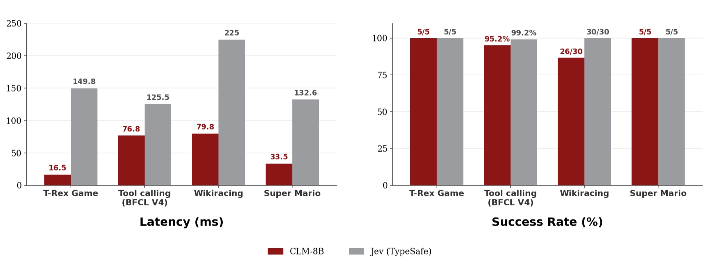</td>
<td align="center" valign="top">未發布媒體</td>
</tr></table>

🧩 <b><a href="https://github.com/jev-chat/jev-chat-windows">jev-chat/jev-chat-windows</a></b> · ⭐873 · Python · 👁️ observed · 37 天 · ⭐+3

##### 📝 摘要

JevChat-Windows：掛在聊天視窗旁的回覆輔助。視窗截圖 + 本地離線 OCR 讀對方訊息 → Jev 判斷意圖 → 3 條候選一鍵填入，傳送永遠手動

🔧 於程式碼中發現使用: `README.md`

##### 📌 基本資訊

| 欄位 | 值         |
| ---- | ---------- |
| 分類 | `其他專案` |
| 證據 | `observed` |
| 語言 | Python     |

##### 📊 資料

| 指標     | 值           |
| -------- | ------------ |
| Star 數  | **873** (+3) |
| 最近推送 | 2026-09-28   |
| 首次收錄 | 2026-10-29   |

🏷 `chat-assistant` · `jev` · `llm` · `local-first` · `ocr` · `privacy` · `pyqt` · `python`

---

<table><tr><th align="center" width="50%">🖼 圖片</th><th align="center" width="50%">🎬 影片</th></tr><tr>
<td align="center" valign="top"></td>
<td align="center" valign="top">未發布媒體</td>
</tr></table>

由於上游未宣告再散布授權，資源直接連結至上游儲存庫。

🧩 <b><a href="https://github.com/datawhalechina/jev-cookbook">datawhalechina/jev-cookbook</a></b> · ⭐594 · Jupyter · 👁️ observed · 5 天 · ⭐+3

##### 📝 摘要

⚡ 適合中國寶寶的 Jev 入門教程｜手把手帶你了解關於 Jev 的一切——Jupyter Notebook 輕鬆實驗，從三種問題原語到 18 篇實戰配方、語音智慧家居、模型評測與本地微調，全面掌握 System One 判斷模型的開發範式

🔧 於程式碼中發現使用: `AGENT.md`, `content/api.md`, `content/sdk/python.md`, `content/sdk/python/usage.md`

##### 📌 基本資訊

| 欄位 | 值         |
| ---- | ---------- |
| 分類 | `其他專案` |
| 證據 | `observed` |
| 語言 | Jupyter    |

##### 📊 資料

| 指標     | 值           |
| -------- | ------------ |
| Star 數  | **594** (+3) |
| 最近推送 | 2026-10-30   |
| 首次收錄 | 2026-10-29   |

---

<table><tr><th align="center" width="50%">🖼 圖片</th><th align="center" width="50%">🎬 影片</th></tr><tr>
<td align="center" valign="top"></td>
<td align="center" valign="top">未發布媒體</td>
</tr></table>

由於上游未宣告再散布授權，資源直接連結至上游儲存庫。

🧩 <b><a href="https://github.com/Yinsongxu/LLM2Jev">Yinsongxu/LLM2Jev</a></b> · ⭐481 · Python · 👁️ observed · 20 天

##### 📝 摘要

將本地語言模型轉換為 Jev 風格的結構化決策模型。僅透過 prefill 即可從文字與影像取得結果——無需逐 token 解碼。

🔧 於程式碼中發現使用: `README.md`

##### 📌 基本資訊

| 欄位 | 值         |
| ---- | ---------- |
| 分類 | `其他專案` |
| 證據 | `observed` |
| 語言 | Python     |

##### 📊 資料

| 指標     | 值         |
| -------- | ---------- |
| Star 數  | **481**    |
| 最近推送 | 2026-10-16 |
| 首次收錄 | 2026-10-29 |

🏷 `jev` · `llm` · `mllm`

---

<table><tr><th align="center" width="50%">🖼 圖片</th><th align="center" width="50%">🎬 影片</th></tr><tr>
<td align="center" valign="top"></td>
<td align="center" valign="top">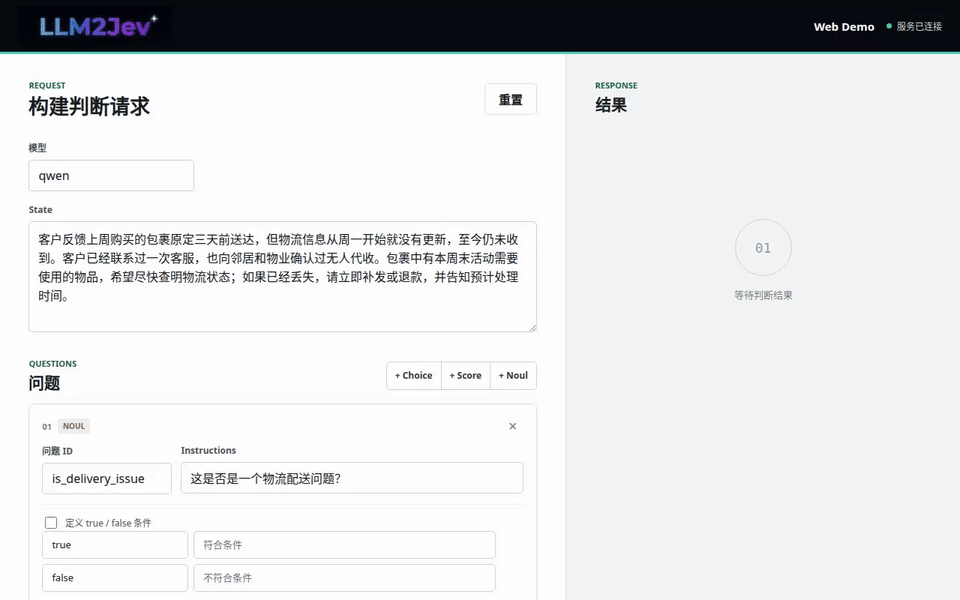 動態錄影</td>
</tr></table>

🧩 <b><a href="https://github.com/logan-markewich/jeff">logan-markewich/jeff</a></b> · ⭐312 · Python · 👁️ observed · 46 天 · ⭐-1

##### 📝 摘要

由 GliFormer 驅動、可直接替換 TypeSafe 的 jev 的自架式替代方案。

🔧 於程式碼中發現使用: `README.md`

##### 📌 基本資訊

| 欄位 | 值         |
| ---- | ---------- |
| 分類 | `其他專案` |
| 證據 | `observed` |
| 語言 | Python     |

##### 📊 資料

| 指標     | 值           |
| -------- | ------------ |
| Star 數  | **312** (-1) |
| 最近推送 | 2026-09-20   |
| 首次收錄 | 2026-10-29   |

🏷 `classification` · `encoder` · `gliner` · `jev` · `typesafe`

🧩 <b><a href="https://github.com/LiQiiiii/Jeva">LiQiiiii/Jeva</a></b> · ⭐228 · Python · 👁️ observed · 18 天

##### 📝 摘要

Jeva: System One Models from First Principles

##### 📌 基本資訊

| 欄位 | 值         |
| ---- | ---------- |
| 分類 | `其他專案` |
| 證據 | `observed` |
| 語言 | Python     |

##### 📊 資料

| 指標     | 值         |
| -------- | ---------- |
| Star 數  | **228**    |
| 最近推送 | 2026-10-17 |
| 首次收錄 | 2026-10-28 |

---

<table><tr><th align="center" width="50%">🖼 圖片</th><th align="center" width="50%">🎬 影片</th></tr><tr>
<td align="center" valign="top">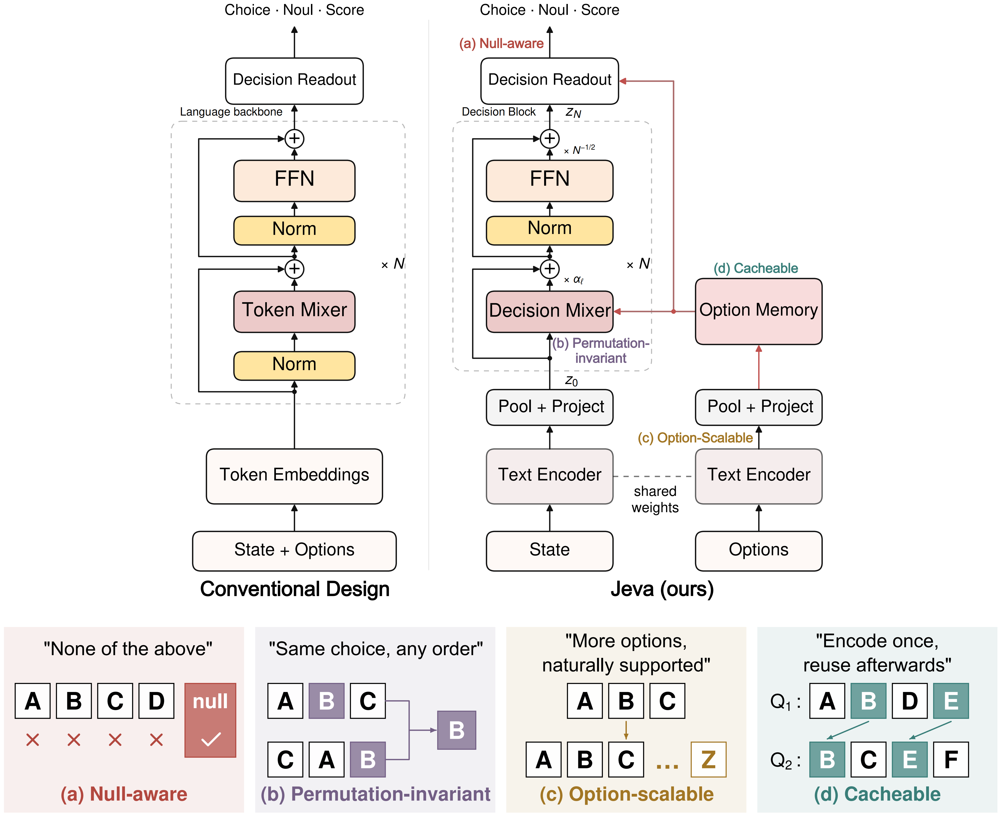</td>
<td align="center" valign="top">未發布媒體</td>
</tr></table>

🧩 <b><a href="https://github.com/brainstormity/Jev-X-Sentiment-Analysis">brainstormity/Jev-X-Sentiment-Analysis</a></b> · ⭐227 · Python · 👁️ observed · 14 天

##### 📝 摘要

An on-demand crypto market intelligence and decision-support terminal powered by TypeSafe AI's System One model

##### 📌 基本資訊

| 欄位 | 值         |
| ---- | ---------- |
| 分類 | `其他專案` |
| 證據 | `observed` |
| 語言 | Python     |

##### 📊 資料

| 指標     | 值         |
| -------- | ---------- |
| Star 數  | **227**    |
| 最近推送 | 2026-10-21 |
| 首次收錄 | 2026-10-29 |

---

<table><tr><th align="center" width="50%">🖼 圖片</th><th align="center" width="50%">🎬 影片</th></tr><tr>
<td align="center" valign="top"></td>
<td align="center" valign="top">未發布媒體</td>
</tr></table>

🧩 <b><a href="https://github.com/Futureppo/typesafe_register">Futureppo/typesafe_register</a></b> · ⭐132 · Python · 👁️ observed · 44 天

##### 📝 摘要

typesafe.ai 註冊機，極致最佳化，無限 jev

##### 📌 基本資訊

| 欄位 | 值         |
| ---- | ---------- |
| 分類 | `其他專案` |
| 證據 | `observed` |
| 語言 | Python     |

##### 📊 資料

| 指標     | 值         |
| -------- | ---------- |
| Star 數  | **132**    |
| 最近推送 | 2026-09-21 |
| 首次收錄 | 2026-10-29 |

---

<table><tr><th align="center" width="50%">🖼 圖片</th><th align="center" width="50%">🎬 影片</th></tr><tr>
<td align="center" valign="top"></td>
<td align="center" valign="top">未發布媒體</td>
</tr></table>

🧩 <b><a href="https://github.com/peterfriese/system-one-foundation-models">peterfriese/system-one-foundation-models</a></b> · ⭐124 · Swift · 👁️ observed · 26 天

##### 📝 摘要

一個輕量、原生的 Swift 6 橋接器，將 TypeSafe AI 的 Jev System One 決策模型整合到 Apple 的 Foundation Models 框架中。

🔧 於程式碼中發現使用: `README.md`

##### 📌 基本資訊

| 欄位 | 值         |
| ---- | ---------- |
| 分類 | `其他專案` |
| 證據 | `observed` |
| 語言 | Swift      |

##### 📊 資料

| 指標     | 值         |
| -------- | ---------- |
| Star 數  | **124**    |
| 最近推送 | 2026-10-09 |
| 首次收錄 | 2026-10-28 |

🧩 <b><a href="https://github.com/f/jev-leftpad">f/jev-leftpad</a></b> · ⭐85 · JavaScript · 👁️ observed · 10 天

##### 📝 摘要

使用 TypeSafe AI 的 Jev 為字串左側補齊。理由不明。

🔧 於程式碼中發現使用: `README.md`

##### 📌 基本資訊

| 欄位 | 值         |
| ---- | ---------- |
| 分類 | `其他專案` |
| 證據 | `observed` |
| 語言 | JavaScript |

##### 📊 資料

| 指標     | 值         |
| -------- | ---------- |
| Star 數  | **85**     |
| 最近推送 | 2026-10-25 |
| 首次收錄 | 2026-10-29 |

🧩 <b><a href="https://github.com/Mushroom-Systems/lichen-v1">Mushroom-Systems/lichen-v1</a></b> · ⭐59 · Python · 👁️ observed · 35 天

##### 📝 摘要

Jev 的本地、相容於 API 的替代品，即 TypeSafe 的 System One 模型

##### 📌 基本資訊

| 欄位 | 值         |
| ---- | ---------- |
| 分類 | `其他專案` |
| 證據 | `observed` |
| 語言 | Python     |

##### 📊 資料

| 指標     | 值         |
| -------- | ---------- |
| Star 數  | **59**     |
| 最近推送 | 2026-09-30 |
| 首次收錄 | 2026-11-03 |

---

<table><tr><th align="center" width="50%">🖼 圖片</th><th align="center" width="50%">🎬 影片</th></tr><tr>
<td align="center" valign="top">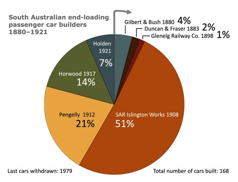</td>
<td align="center" valign="top">未發布媒體</td>
</tr></table>

🧩 <b><a href="https://github.com/jev-sec/jev-ids">jev-sec/jev-ids</a></b> · ⭐30 · Python · 👁️ observed · 2 天

##### 📝 摘要

Blazing-Fast Token-Efficient Intrusion Detection System (IDS) based on TypeSafe's Jev.

##### 📌 基本資訊

| 欄位 | 值         |
| ---- | ---------- |
| 分類 | `其他專案` |
| 證據 | `observed` |
| 語言 | Python     |

##### 📊 資料

| 指標     | 值         |
| -------- | ---------- |
| Star 數  | **30**     |
| 最近推送 | 2026-11-03 |
| 首次收錄 | 2026-11-03 |

🏷 `cybersecurity` · `intrusion-detection` · `intrusion-detection-system` · `jev` · `network-security` · `system-one-model` · `typesafe`

---

<table><tr><th align="center" width="50%">🖼 圖片</th><th align="center" width="50%">🎬 影片</th></tr><tr>
<td align="center" valign="top"></td>
<td align="center" valign="top">未發布媒體</td>
</tr></table>

🧩 <b><a href="https://github.com/parth-kp/jev-mail-classifier">parth-kp/jev-mail-classifier</a></b> · ⭐23 · Python · 👁️ observed · 45 天

##### 📝 摘要

使用 Jev（TypeSafe 的 System One 模型）分類你的收件匣——所有功能皆由設定驅動，包括加標籤、移動、標記與通知。

##### 📌 基本資訊

| 欄位 | 值         |
| ---- | ---------- |
| 分類 | `其他專案` |
| 證據 | `observed` |
| 語言 | Python     |

##### 📊 資料

| 指標     | 值         |
| -------- | ---------- |
| Star 數  | **23**     |
| 最近推送 | 2026-09-20 |
| 首次收錄 | 2026-10-28 |

---

<table><tr><th align="center" width="50%">🖼 圖片</th><th align="center" width="50%">🎬 影片</th></tr><tr>
<td align="center" valign="top">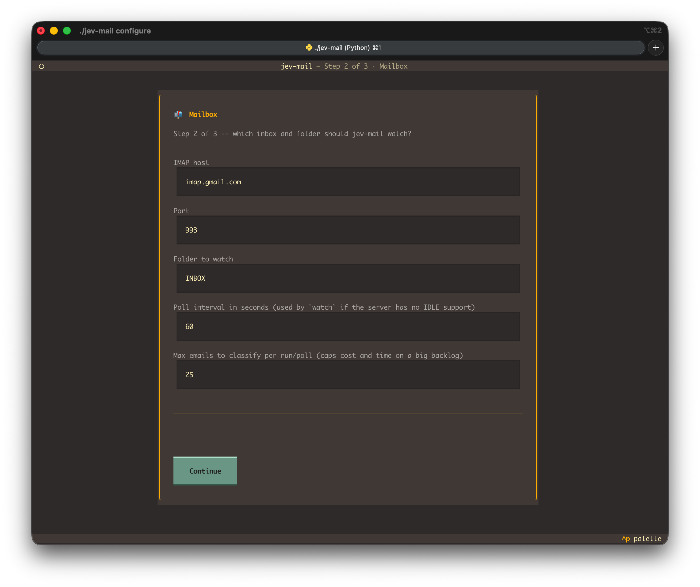</td>
<td align="center" valign="top">未發布媒體</td>
</tr></table>

🧩 <b><a href="https://github.com/factbag/factbag">factbag/factbag</a></b> · ⭐1 · TypeScript · 👁️ observed · 2 天

##### 📝 摘要

Combine narrow judgments from System One models with explicit rules in a knowledgebase.

##### 📌 基本資訊

| 欄位 | 值         |
| ---- | ---------- |
| 分類 | `其他專案` |
| 證據 | `observed` |
| 語言 | TypeScript |

##### 📊 資料

| 指標     | 值         |
| -------- | ---------- |
| Star 數  | **1**      |
| 最近推送 | 2026-11-02 |
| 首次收錄 | 2026-10-26 |

🏷 `explainability` · `jev` · `knowledge-base` · `logic` · `npm-package` · `provenance` · `rules-engine` · `system-one`

---

<table><tr><th align="center" width="50%">🖼 圖片</th><th align="center" width="50%">🎬 影片</th></tr><tr>
<td align="center" valign="top"></td>
<td align="center" valign="top">未發布媒體</td>
</tr></table>

🧩 <b><a href="https://github.com/Yibo-Wen/Pev">Yibo-Wen/Pev</a></b> · ⭐1 · Python · 👁️ observed · 0 天 · **NEW**

##### 📝 摘要

A System One Model for Protein Evolution

##### 📌 基本資訊

| 欄位 | 值         |
| ---- | ---------- |
| 分類 | `其他專案` |
| 證據 | `observed` |
| 語言 | Python     |

##### 📊 資料

| 指標     | 值         |
| -------- | ---------- |
| Star 數  | **1**      |
| 最近推送 | 2026-11-05 |
| 首次收錄 | 2026-11-05 |

---

<table><tr><th align="center" width="50%">🖼 圖片</th><th align="center" width="50%">🎬 影片</th></tr><tr>
<td align="center" valign="top"></td>
<td align="center" valign="top"> 動態錄影</td>
</tr></table>

由於上游未宣告再散布授權，資源直接連結至上游儲存庫。

🧩 <b><a href="https://github.com/amadzai/think-fast-jev">amadzai/think-fast-jev</a></b> · Python · 👁️ observed · 1 天

##### 📝 摘要

System One models vs an LLM at the decision steps of answering crypto market questions

##### 📌 基本資訊

| 欄位 | 值         |
| ---- | ---------- |
| 分類 | `其他專案` |
| 證據 | `observed` |
| 語言 | Python     |

##### 📊 資料

| 指標     | 值         |
| -------- | ---------- |
| Star 數  | **0**      |
| 最近推送 | 2026-11-03 |
| 首次收錄 | 2026-10-30 |

🏷 `jev` · `kev`

---

<table><tr><th align="center" width="50%">🖼 圖片</th><th align="center" width="50%">🎬 影片</th></tr><tr>
<td align="center" valign="top"></td>
<td align="center" valign="top">未發布媒體</td>
</tr></table>

由於上游未宣告再散布授權，資源直接連結至上游儲存庫。

🧩 <b><a href="https://github.com/jaredpalmer/kev">jaredpalmer/kev</a></b> · ⭐9825 · Python · 🔎 inferred · 2 天 · ⭐+8

##### 📝 摘要

建構於 Qwen3.5/3.8 之上的類 Jev 決策模型家族，你可以自行訓練並執行

##### 📌 基本資訊

| 欄位 | 值         |
| ---- | ---------- |
| 分類 | `其他專案` |
| 證據 | `inferred` |
| 語言 | Python     |

##### 📊 資料

| 指標     | 值            |
| -------- | ------------- |
| Star 數  | **9825** (+8) |
| 最近推送 | 2026-11-03    |
| 首次收錄 | 2026-10-29    |

🏷 `decision-model` · `jev` · `qwen3`

---

<table><tr><th align="center" width="50%">🖼 圖片</th><th align="center" width="50%">🎬 影片</th></tr><tr>
<td align="center" valign="top">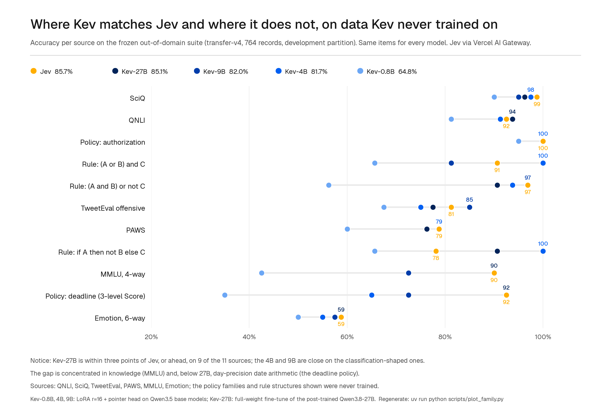</td>
<td align="center" valign="top">未發布媒體</td>
</tr></table>

🧩 <b><a href="https://github.com/TypeLLM/TypeLLM">TypeLLM/TypeLLM</a></b> · ⭐976 · Python · 🔎 inferred · 10 天

##### 📝 摘要

TypeLLM：具備型別安全生成的 LLMs

##### 📌 基本資訊

| 欄位 | 值         |
| ---- | ---------- |
| 分類 | `其他專案` |
| 證據 | `inferred` |
| 語言 | Python     |

##### 📊 資料

| 指標     | 值         |
| -------- | ---------- |
| Star 數  | **976**    |
| 最近推送 | 2026-10-25 |
| 首次收錄 | 2026-10-29 |

🏷 `ai` · `jev` · `llms` · `types`

---

<table><tr><th align="center" width="50%">🖼 圖片</th><th align="center" width="50%">🎬 影片</th></tr><tr>
<td align="center" valign="top">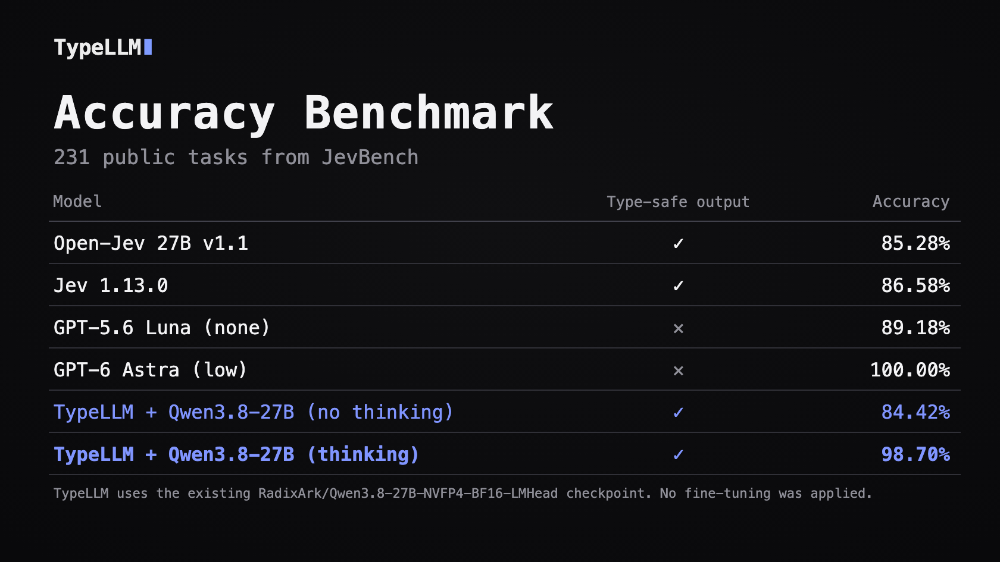</td>
<td align="center" valign="top">未發布媒體</td>
</tr></table>

<b>本分類更多項目</b> · 76

- [talmago/fast_gliner](https://github.com/talmago/fast_gliner) - Fast ONNX inference for GLiNER, GLiClass, GLiFormer, and System One — Python…
- [DreamBlooms/dohnuts.cpp](https://github.com/DreamBlooms/dohnuts.cpp) - The same decisions, on CPU. System One model that can run on your Personal…
- [SoundBlaster/SwiftJev](https://github.com/SoundBlaster/SwiftJev) - 用於存取由 TypeSafe.ai 提供的 Jev System One 模型的 Swift 框架。
- [codaaiteam/jev-ai](https://github.com/codaaiteam/jev-ai) - Jev AI quickstart &amp; FAQ — TypeSafe AI。
- [soderlind/ai-provider-for-jev](https://github.com/soderlind/ai-provider-for-jev) - 將 WordPress 連接至 TypeSafe 的 Jev System One 模型，以進行結構化決策（choice、score、noul）.
- [Shristi1611/systemone-testbed](https://github.com/Shristi1611/systemone-testbed) - A security test environment for Jev-compatible decision models。
- [DreamBlooms/ifReflex.cpp](https://github.com/DreamBlooms/ifReflex.cpp) - 任何 LLM 都能在您的個人電腦上充當 SystemOne 決策模型。並支援 LLaDA-MoE/DiffusionGemma.
- [DevItaliya22/jev-chess](https://github.com/DevItaliya22/jev-chess) - Jev。
- [Dominion-Academy/System-One-Models](https://github.com/Dominion-Academy/System-One-Models)
- [FrancescoDesiderato/Devfest_SystemOneModel](https://github.com/FrancescoDesiderato/Devfest_SystemOneModel) - Repository of Code for GDG DevFest 2026 Talk about &quot;System One Models&quot;。
- [jakob-lilliemarck/komply](https://github.com/jakob-lilliemarck/komply) - Use SystemOne models to check compliance with architectural rules。
- [justintout/systemone](https://github.com/justintout/systemone) - 用於與 Jev 及其他 System One 模型互動的非官方 Go 模組。
- [leejisabella/system_one_explanability](https://github.com/leejisabella/system_one_explanability) - Exploring model misalignment, System One model information availability, and…
- [prashu-asp/Systemonemodels](https://github.com/prashu-asp/Systemonemodels)
- [unbraind/pm-jev](https://github.com/unbraind/pm-jev) - 採用 Jev 風格 System One 模型的具型別、本機優先 pm 項目決策（預設使用本機 Ollama tev1；可選擇託管的 TypeSafe Jev）。
- [wang-erica/system-one-sft](https://github.com/wang-erica/system-one-sft) - Supervised fine tuning of System One models for image classification。
- [shcherbak-ai/contextgem](https://github.com/shcherbak-ai/contextgem) - Extract structured data and insights from documents using LLMs and decision…
- [feder-cr/jev](https://github.com/feder-cr/jev) - jevos：Jev 和 Microsoft-Decision-1 的開源替代方案。在筆記型電腦的 CPU 上，以機率進行是／否決策、選擇和評分.
- [AgriciDaniel/jev-seo](https://github.com/AgriciDaniel/jev-seo) - 從單一首頁 URL 即時稽核任何網站的 SEO，由 Jev 評判。PDF、XLSX 與 Markdown 報告.
- [Sac-Y/Jev-cu](https://github.com/Sac-Y/Jev-cu)
- [shengjidaguai-china/goutoujunshi-jev-chat](https://github.com/shengjidaguai-china/goutoujunshi-jev-chat) - 狗頭軍師 Chat：Mac 微信讀屏、關係分析與回覆草稿懸浮窗。
- [TianyuCodings/JevHarness](https://github.com/TianyuCodings/JevHarness) - 由 LLM 撰寫的特定任務 Jev 測試框架，具備可選的完整軌跡獎勵反思與 GEPA 演進.
- [jev-chat/jev-chat-jarvis-mac](https://github.com/jev-chat/jev-chat-jarvis-mac) - 聊天浮動視窗助手（macOS）：螢幕感知 + 本地小模型判斷意圖與風險，按話術生成回覆候選。純只讀.
- [Zefan-Cai/Open-Jev](https://github.com/Zefan-Cai/Open-Jev)
- [dabit3/jev-experiments](https://github.com/dabit3/jev-experiments)
- [1Panel-dev/laya-server](https://github.com/1Panel-dev/laya-server) - 一個自架的 API 與 Web 介面，用於 Laya 的結構化決策模型，相容於 TypeSafe Jev API 格式.
- [Abhinavexists/lev](https://github.com/Abhinavexists/lev) - 一個開放的 System One 決策模型。
- [I-You-Dream/jev-from-scratch](https://github.com/I-You-Dream/jev-from-scratch) - 从零开源复刻 Jev（System One）决策模型范式，基于 Qwen 基座训练，支持 Choice / Noul 原语，包含推理、微调、ECE…
- [2951461586/Jev-Register-Tool](https://github.com/2951461586/Jev-Register-Tool) - TypeSafe（Jev / System One）申請 → 確認郵件 → 獲批 → 註冊 → 建 API Key 全鏈路工具，純 HTTP 無瀏覽器。
- [Jev-Engineering/cookbook](https://github.com/Jev-Engineering/cookbook) - 使用 Jev 進行型別化決策的六十個 notebook 配方：從首次分類到閉迴路控制的 Choice、Noul 與 Score 模式。
- [yijunyu/jev-rs](https://github.com/yijunyu/jev-rs) - 來自任何 LLM、在一次預填中產生的 System One 判斷（noul/choice/score）——一個 Rust、Jev 相容的…
- [nvkudva/ollajev](https://github.com/nvkudva/ollajev) - 在本機於 Jev / System One API 背後執行來自 Hugging Face 的 System One 決策模型，Ollama 風格。
- [manifoldor/xtags](https://github.com/manifoldor/xtags) - 在 X 的時間軸上，給每則貼文標出它想讓你做什麼。判斷來自 Jev，一個只回傳機率、不生成文字的模型.
- [rawwerks/one-system](https://github.com/rawwerks/one-system) - 透過單一 TypeSafe API 使用本機與託管分類器，也就是決策模型，也就是類 Jev 模型。
- [botassembly/thinkthen](https://github.com/botassembly/thinkthen) - ThinkThen：了解你意圖的程式碼。
- [comoc/jev-minesweeper](https://github.com/comoc/jev-minesweeper) - 讓 TypeSafe Jev（System One）在瀏覽器上解開踩地雷的示範。
- [XingQiPan/rwkv-jev](https://github.com/XingQiPan/rwkv-jev) - 基於 RWKV-7 (g1k-1b) 的 Jev 式零生成決策引擎：受限 softmax 直讀機率分布，支援 noul/choice/score…
- [Lasimeri/Intel-Phi-Jev](https://github.com/Lasimeri/Intel-Phi-Jev) - XKEYSCORE for Jev: TypeSafe System One judgments (noul/choice/score) served…
- [lawrence3699/Jev-Style-0.8B-Decision-v3-GGUF](https://github.com/lawrence3699/Jev-Style-0.8B-Decision-v3-GGUF) - GitHub mirror of the chaoliangUNSW/Jev-Style-0.8B-Decision-v3-GGUF Hugging Face…
- [sergiecode/jev-test-si-o-no](https://github.com/sergiecode/jev-test-si-o-no) - Noul -&gt; 用來判斷是或否的 Primitiva。
- [TanayPadar/gpt-vs-jev](https://github.com/TanayPadar/gpt-vs-jev) - 比較 GPT 生成的語言與 JEV 在相同輸入上的結構化 Noul 決策.
- [udooz/mastering-jev-and-kev-book](https://github.com/udooz/mastering-jev-and-kev-book) - This repository contains the code for Mastering TypeSafe Jev book。
- [Arohtea/jev-readout](https://github.com/Arohtea/jev-readout) - 把一段内容交给 TypeSafe AI 的 Jev 模型，得到带概率分布的结构化判断。
- [cfu288/jev-vs-ml-classifiers](https://github.com/cfu288/jev-vs-ml-classifiers) - How well does the latest JEV model do against classical ML classifier models…
- [dsaad68/review-with-jev](https://github.com/dsaad68/review-with-jev) - Rust code review for the issues the compiler doesn。
- [ethan-krich/jev-migrate](https://github.com/ethan-krich/jev-migrate) - Using Jev to migrate from one language to another using an lsp。
- [fanweiya/gomoku-jev](https://github.com/fanweiya/gomoku-jev) - Five-in-a-row vs a Jev AI: Three.js 3D board, orbit camera, stone bowls, win…
- [GabrielAndrus/Jev-Rule-Engine](https://github.com/GabrielAndrus/Jev-Rule-Engine) - Neurosymbolic rule engine using JEV and declarative/logical code for dual…
- [Jou21/AutoJev](https://github.com/Jou21/AutoJev) - AutoJev — exploração e testes QA com React, FastAPI e Playwright。
- [lawrence3699/Jev-Style-0.8B-Decision-v3](https://github.com/lawrence3699/Jev-Style-0.8B-Decision-v3) - GitHub mirror of the chaoliangUNSW/Jev-Style-0.8B-Decision-v3 Hugging Face model。
- [lawrence3699/jev-style-2b](https://github.com/lawrence3699/jev-style-2b) - GitHub mirror of the chaoliangUNSW/jev-style-2b Hugging Face Space。
- [lawrence3699/Jev-Style-2B-Decision-v3](https://github.com/lawrence3699/Jev-Style-2B-Decision-v3) - GitHub mirror of the chaoliangUNSW/Jev-Style-2B-Decision-v3 Hugging Face model。
- [lawrence3699/Jev-Style-2B-Decision-v3-GGUF](https://github.com/lawrence3699/Jev-Style-2B-Decision-v3-GGUF) - GitHub mirror of the chaoliangUNSW/Jev-Style-2B-Decision-v3-GGUF Hugging Face…
- [lawrence3699/Jev-Style-2B-Decision-v4](https://github.com/lawrence3699/Jev-Style-2B-Decision-v4) - GitHub mirror of the chaoliangUNSW/Jev-Style-2B-Decision-v4 Hugging Face model。
- [lawrence3699/Jev-Style-2B-Decision-v4-GGUF](https://github.com/lawrence3699/Jev-Style-2B-Decision-v4-GGUF) - GitHub mirror of the chaoliangUNSW/Jev-Style-2B-Decision-v4-GGUF Hugging Face…
- [lawrence3699/Jev-Style-Cascade-9B](https://github.com/lawrence3699/Jev-Style-Cascade-9B) - GitHub mirror of the chaoliangUNSW/Jev-Style-Cascade-9B Hugging Face model。
- [lawrence3699/Jev-Style-Qwen3.5-2B-Decision-GGUF](https://github.com/lawrence3699/Jev-Style-Qwen3.5-2B-Decision-GGUF) - GitHub mirror of the chaoliangUNSW/Jev-Style-Qwen3.5-2B-Decision-GGUF Hugging…
- [lawrence3699/Jev-Style-Qwen3.5-2B-Decision-v2](https://github.com/lawrence3699/Jev-Style-Qwen3.5-2B-Decision-v2) - GitHub mirror of the chaoliangUNSW/Jev-Style-Qwen3.5-2B-Decision-v2 Hugging…
- [lawrence3699/Jev-Style-Qwen3.5-2B-Decision-v2-GGUF](https://github.com/lawrence3699/Jev-Style-Qwen3.5-2B-Decision-v2-GGUF) - GitHub mirror of the chaoliangUNSW/Jev-Style-Qwen3.5-2B-Decision-v2-GGUF…
- [lawrence3699/jev-style-v3](https://github.com/lawrence3699/jev-style-v3) - GitHub mirror of the chaoliangUNSW/jev-style-v3 Hugging Face Space。
- [lawrence3699/MacJev-0.8B-Decision-Data](https://github.com/lawrence3699/MacJev-0.8B-Decision-Data) - GitHub mirror of the chaoliangUNSW/MacJev-0.8B-Decision-Data Hugging Face…
- [LiLittleCat/jev-playlist-classify](https://github.com/LiLittleCat/jev-playlist-classify) - Classify large playlists by song language with TypeSafe AI。
- [PineappleBingo/jev-radar](https://github.com/PineappleBingo/jev-radar) - TypeSafe Jev 오픈소스 구현을 매일 모아 한국어로 정리하는 레이더 (radar-index/1)。
- [Shijiuwei/SemIf-OpenJev-mirror-583](https://github.com/Shijiuwei/SemIf-OpenJev-mirror-583) - High availability mirror and network topology specifications for…
- [taegi-hong/jev-disputeguard-local-ai-ai](https://github.com/taegi-hong/jev-disputeguard-local-ai-ai) - JEV 벤처 스튜디오 Stage 4 자동 생성 풀스택 MVP - 변호사/법무팀을 위한 로컬 기반 분쟁 리스크 진단 AI。
- [xiaotian1171/jev-trolley-switch](https://github.com/xiaotian1171/jev-trolley-switch) - Interactive Trolley Problem decision lab powered by Pollinations POST…
- [receptron/laya](https://github.com/receptron/laya) - 透過 ONNX Runtime，從 Node.js / TypeScript 執行 Laya，這個開源且相容 Jev 的 System-1 決策模型。
- [Rizzo-AI-Academy/rizzo-flow](https://github.com/Rizzo-AI-Academy/rizzo-flow) - 對 Jev 的開放、本機詮釋：來自 LLM 的型別化決策，不生成任何一個 token。
- [razorback16/openjev](https://github.com/razorback16/openjev) - 基於 DiffusionGemma 的開放、相容 Jev 的 System One 決策伺服器。
- [jerryjliu/docjev](https://github.com/jerryjliu/docjev) - 使用 Jev 的極快速文件分類器／分割器。
- [PostHog/jeeves](https://github.com/PostHog/jeeves) - Jeeves – 推理改進類 Jev 決策模型。
- [codejunkie99/keel](https://github.com/codejunkie99/keel) - 以本機優先的 macOS 編碼工作區，搭配本機 Laya 與可選的 Jev 決策選擇。
- [iapp-technology/openthai-systemone](https://github.com/iapp-technology/openthai-systemone) - OpenThai-SystemOne：開放 Thai + English System One 決策模型。
- [hawkymisc/typed-decision-bert](https://github.com/hawkymisc/typed-decision-bert) - 非官方 PoC：在型別化決策（noul / choice / score）HTTP API 背後的 BERT 風格編碼器決策引擎。與 TypeSafe 無關.
- [InterfazeAI/lev](https://github.com/InterfazeAI/lev) - 一個開放的 System One 決策模型。
- [epergaboni/jevseo](https://github.com/epergaboni/jevseo) - 由 Jev（一個 System One 決策模型）驅動的型別化 SEO、AEO 與 GEO 判斷。規則由程式碼掌握，意義由模型掌握.

## 依實作語言劃分的專案

該生態系集中在 Python 與 TypeScript，但其他語言的型別化客戶端仍不斷出現。本表由條目本身產生。

| 語言       | 條目 | 範例                                                                                                    |
| ---------- | ---- | ------------------------------------------------------------------------------------------------------- |
| Python     | 359  | `typesafe-ai/system-one-adapter-python`, `typesafe-ai/typesafe-sdk-python`, `typesafe-ai/WorkflowEvals` |
| TypeScript | 136  | `typesafe-ai/typesafe-sdk-js`, `TypeSafeAI/jev-harness`, `qkal/Canny`                                   |
| JavaScript | 72   | `clouatre-labs/decisions-judge-mcp`, `socai-io/jev-social`, `Ying-Kai-Liao/jev-browser`                 |
| Rust       | 40   | `chussenot/judgment`, `ollaya-dev/ollaya`, `supercorp-ai/supercov`                                      |
| HTML       | 30   | `typesafe-ai/typesafe-ai.github.io`, `yzfly/awesome-jev-zh`, `AkashPriyadarshii/jev-superpowers`        |
| Go         | 13   | `frodi-karlsson/onesie`, `devbackend/jevgo`, `JimmyWesley/rlcd-gateway`                                 |
| Jupyter    | 13   | `jexp/neo4jev`, `GitHub30/OpenJev`, `Mainakcris7/agent-guardrail-with-jev`                              |
| C#         | 7    | `elbruno/ElBruno.AI.Decisions`, `CMaintz/jev-dotnet`, `saibimajdi/typesafeai-dotnet-sdk`                |
| Java       | 6    | `Premo-Cloud/typesafe-sdk-java`, `CMaintz/jev-java`, `Murat-Selim/jev_doc_router`                       |
| Elixir     | 5    | `dannote/jev`, `Elue-dev/jev_elixir`, `nshkrdotcom/system_one_sdk`                                      |
| PHP        | 5    | `basi/typesafe-ai-php-client`, `vibefilter/filament`, `Butochnikov/laravel-typesafe-jev`                |
| Swift      | 5    | `john-rocky/coreai-kit`, `mattt/AnyDecisionModel`, `chris-wozniczek/jev-voice-control`                  |
| C++        | 3    | `DreamBlooms/dohnuts.cpp`, `DreamBlooms/ifReflex.cpp`, `feder-cr/jev`                                   |
| Astro      | 2    | `heyjunpenn/awesome-jev`, `wizicer/jev_info_site`                                                       |
| C          | 2    | `giuliosmall/pg_typesafe`, `lijiawei255/jev-tune`                                                       |
| CSS        | 2    | `yangzhou-chaofan/awesome-jev-prompt`, `Dlmily/minimind-jev-dlmily`                                     |
| Kotlin     | 2    | `MiaoWuNYA/rikkahub-sillytavern-android`, `jev-chat/jev-chat-jarvis`                                    |
| PowerShell | 2    | `BFLabsAI/bf-jev-deep-research`, `dfinke/Jev`                                                           |
| Ruby       | 2    | `obie/ruby_decision_model`, `Ray-Hughes/jevalyn`                                                        |
| Shell      | 2    | `realZachi/pg-jev`, `skylence-org/claudecode-jev-marketplace`                                           |
| TeX        | 2    | `dnakhoa/jev-deferred-crispification`, `xiaohuiyan/awesome-jev-papers`                                  |
| XS         | 2    | `cameronb-xano/jev-agent-guardrail`, `xano-community/agent-guardrail-jev`                               |
| Haskell    | 1    | `getmissionctrl/hs-jev`                                                                                 |
| Nushell    | 1    | `cablehead/jev.nu`                                                                                      |
| Pascal     | 1    | `danieleteti/systemone-delphi`                                                                          |
| Scala      | 1    | `maxtrezzi/jev4s`                                                                                       |
| Svelte     | 1    | `fini/warped-sys1-lab`                                                                                  |

僅統計有宣告語言的條目。基礎設施、文件與討論類條目不計入本表。

## 貢獻指南

歡迎指正，這是改進本清單最快的方式。若條目歸類有誤、分級有誤，或某個專案被誤判為名稱衝突而排除，請開 issue 或 pull request——最後一類正是自動篩選器最容易出錯的地方。新增條目最好透過在 `scripts/collect.py` 中加入來源，而不是直接編輯 README，因為 README 每一輪都會重新產生。

---

獨立社群專案。與 TypeSafe AI 無隸屬關係，未獲其背書或審閱。產品行為、定價、限制與模型別名均可能隨時變更；任何關鍵依賴請以官方文件為準。資源歸其上游專案所有，僅在授權允許的情況下轉載。

產生工具 · 2026-11-05T12:08:26+08:00
